# AnyDerived 逐行详解

> 源文件: `source/blender/blenlib/BLI_any_derived.hh` (177 行)

---

## 一句话概览

**AnyDerived** 是一个带小缓冲区优化 (SBO) 的类型擦除容器，可以持有某个基类 `Base` 的**任意派生类**对象，并根据对象大小自动选择内联存储或堆分配（`shared_ptr`）。

---

## 整体架构

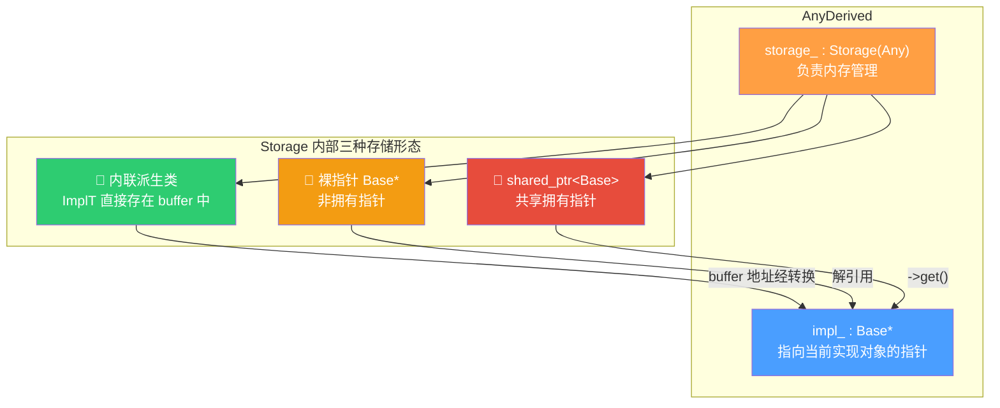

---

## 依赖关系

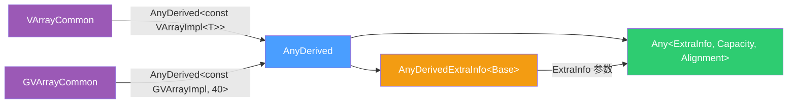

---

## 第 1–9 行：文件头与包含

```cpp
// SPDX-FileCopyrightText: 2026 Blender Authors
// SPDX-License-Identifier: GPL-2.0-or-later
#pragma once
#include "BLI_any.hh"
```

- `#pragma once` — 非标准但广泛支持的包含守卫，确保头文件只被编译一次。
- `BLI_any.hh` — 提供 `Any` 模板，是 AnyDerived 的底层存储引擎。

---

## 第 11–47 行：`detail::AnyDerivedExtraInfo<Base>`

```cpp
namespace blender {
namespace detail {

template<typename Base> struct AnyDerivedExtraInfo {
```

这是传给 `Any` 的 **ExtraInfo** 参数。`Any` 为每种存储类型保存一份 ExtraInfo，AnyDerived 利用它来存储一个函数指针 `get_impl`，用于从 `Any` 的不透明 buffer 中提取出 `Base*`。

### 第 15 行：核心函数指针

```cpp
Base *(*get_impl)(const void *buffer);
```

- **类型**: 指向函数的指针，接受 `const void*`（即 Any 内部 buffer 的地址），返回 `Base*`。
- **作用**: 因为 Any 内部 buffer 可能存放的是 `ImplT`（内联对象）、`Base*`（裸指针）或 `shared_ptr<Base>`，三种情况提取 `Base*` 的方式不同，所以用函数指针做分发。

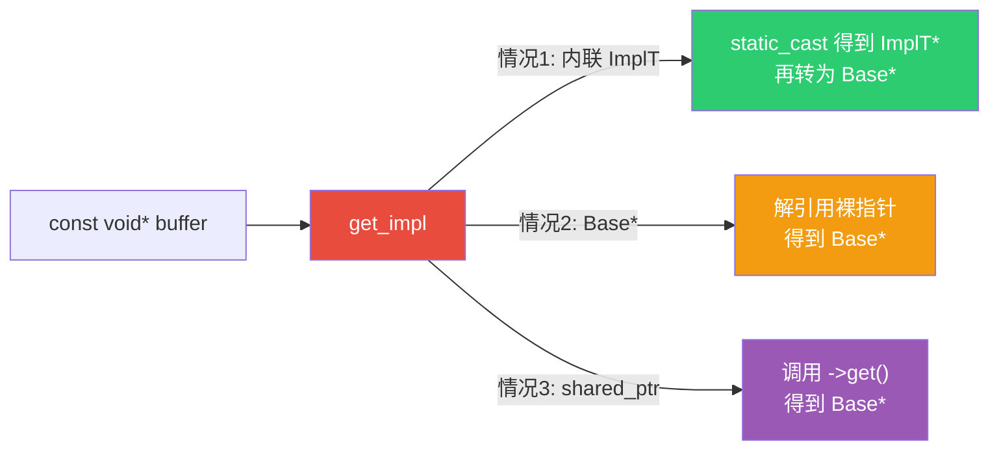

### 第 17–44 行：`get<StorageT>()` 静态工厂

```cpp
template<typename StorageT> static constexpr AnyDerivedExtraInfo get()
```

这是一个 **静态成员函数模板**，根据 `StorageT` 的实际类型在编译期生成不同的 `get_impl` 函数。

#### 第 20–21 行：编译期约束

```cpp
static_assert(std::is_base_of_v<Base, StorageT> ||
              is_same_any_v<StorageT, Base *, std::shared_ptr<Base>>);
```

- `std::is_base_of_v<Base, StorageT>` — StorageT 是 Base 的派生类（内联存储场景）。
- `is_same_any_v<StorageT, Base*, std::shared_ptr<Base>>` — StorageT 是裸指针或 shared_ptr。
- `is_same_any_v` 是 Blender 自定义的工具：判断 `StorageT` 是否等于后面列表中的任一类型。
- `static_assert` 在编译期触发错误，不允许其他类型。

#### 第 25–28 行：情况 1 — 内联派生类

```cpp
if constexpr (std::is_base_of_v<Base, StorageT>) {
    return {[](const void *buffer) {
        return static_cast<Base *>(
            const_cast<StorageT *>(
                static_cast<const StorageT *>(buffer)));
    }};
}
```

**逐层拆解转换链**:

```
const void* buffer
  → static_cast<const StorageT*>(buffer)   // 1. 视为指向 StorageT 的 const 指针
  → const_cast<StorageT*>(...)              // 2. 去掉 const（因为我们要返回非 const Base*）
  → static_cast<Base*>(...)                 // 3. 派生类指针转基类指针（向上转型，隐式可行）
```

> **为什么需要 `const_cast`？** 因为 `buffer` 参数是 `const void*`，但返回类型是 `Base*`（非 const）。AnyDerived 的 `impl_` 是非 const 指针，所以必须去掉 const。

> **`if constexpr`** — C++17 特性，编译期分支。条件为 false 的分支**根本不会被编译**，所以即使里面有非法代码也不会报错。

#### 第 30–33 行：情况 2 — 裸指针 `Base*`

```cpp
else if constexpr (std::is_same_v<StorageT, Base *>) {
    return {[](const void *buffer) {
        return *const_cast<StorageT *>(static_cast<const StorageT *>(buffer));
    }};
}
```

buffer 里存的是一个 `Base*`（指针的指针），需要**解引用**才能得到 `Base*`：

```
const void* buffer
  → static_cast<const Base**>(buffer)  // 视为指向 Base* 的指针
  → const_cast<Base**>(...)            // 去 const
  → *(...)                             // 解引用，得到 Base*
```

#### 第 35–38 行：情况 3 — `shared_ptr<Base>`

```cpp
else if constexpr (std::is_same_v<StorageT, std::shared_ptr<Base>>) {
    return {[](const void *buffer) {
        return (const_cast<StorageT *>(static_cast<const StorageT *>(buffer)))->get();
    }};
}
```

buffer 里存的是 `shared_ptr<Base>` 对象，调用其 `.get()` 方法提取裸指针：

```
const void* buffer
  → static_cast<const shared_ptr<Base>*>(buffer)  // 视为指向 shared_ptr 的指针
  → const_cast<shared_ptr<Base>*>(...)             // 去 const
  → ->get()                                        // shared_ptr 的 get() 返回 Base*
```

#### 第 40–43 行：不可达分支

```cpp
else {
    BLI_assert_unreachable();
    return {};
}
```

`BLI_assert_unreachable()` — Blender 的断言宏，在 Debug 构建中触发中断。由于前面的 `static_assert` 已排除了其他类型，此分支理论上不会执行。

---

## 第 49–65 行：AnyDerived 类文档注释

```cpp
/**
 * This allows storing or passing around derived classes of a common base class.
 * Typically, this always requires allocating the value on the heap and passing it
 * around e.g. as unique_ptr.
 * #AnyDerived has small buffer optimization. So if the type is small, it can be
 * stored directly without an additional allocation.
 *
 * If all derived types are known where the type is used, it can be more efficient
 * to use std::variant<Derived1, Derived2, ...> instead. #AnyDerived uses type
 * erasure through the use of #Any and therefore works even when not all used
 * derived types are known.
 *
 * This is used extensively for virtual arrays. Each type of virtual array is
 * implemented as subclass of #VArrayImpl while #VArray actually stores a
 * specific implementation.
 *
 * Note: If the value is not stored inline, it's currently stored as a shared_ptr
 * which is shared when the AnyDerived is copied. This behavior is fine and
 * efficient for all current uses but it may need to be generalized if
 * #AnyDerived is supposed to be used in more places.
 */
```

**翻译要点**:

| 原文 | 翻译 |
|------|------|
| small buffer optimization (SBO) | 小缓冲区优化——小对象直接存在栈上，无需堆分配 |
| type erasure | 类型擦除——隐藏具体类型，只暴露基类接口 |
| `std::variant` 替代方案 | 如果所有派生类型已知，用 `variant` 更高效（无虚函数开销） |
| shared when copied | 拷贝时共享 `shared_ptr`，即**浅拷贝**语义 |

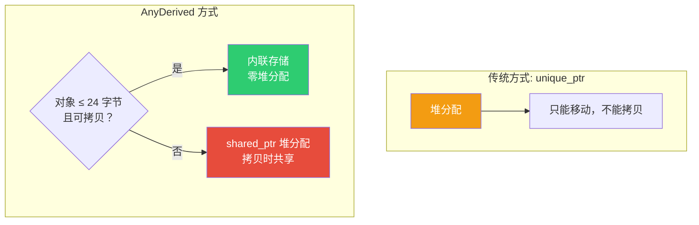

---

## 第 66 行：类模板声明

```cpp
template<typename Base, int64_t InlineBufferCapacity = 24> struct AnyDerived {
```

| 参数 | 含义 | 默认值 |
|------|------|--------|
| `Base` | 基类类型，如 `const VArrayImpl<T>` | （必须指定） |
| `InlineBufferCapacity` | 内联缓冲区大小（字节） | 24 |

> **为什么默认 24？** 24 字节足以容纳大多数小型 VArray 实现（如 `VArrayImpl_For_Span`），同时不会让 `AnyDerived` 对象过大。`GVArrayCommon` 使用 40 字节因为其实现通常更大。

> **`struct` 而非 `class`** — Blender 风格：默认 public 访问。C++ 中 struct 和 class 唯一区别就是默认访问权限。

---

## 第 67–79 行：私有成员

```cpp
private:
    using Storage = Any<detail::AnyDerivedExtraInfo<Base>, InlineBufferCapacity, alignof(Base)>;
```

- **`Any<ExtraInfo, Capacity, Alignment>`** — 底层存储引擎。
  - `ExtraInfo` = `AnyDerivedExtraInfo<Base>`，提供 `get_impl` 函数指针。
  - `Capacity` = `InlineBufferCapacity`，内联缓冲区大小。
  - `Alignment` = `alignof(Base)`，对齐要求与基类一致。

```cpp
Base *impl_ = nullptr;
```

- 指向当前实现对象的**裸指针**。可能为 `nullptr`（空状态）。
- 这是访问实际对象的**快速路径**——不需要每次都通过 `storage_.extra_info().get_impl()` 提取。

```cpp
Storage storage_;
```

- 负责内存管理的存储对象。内部可能是以下三种之一：

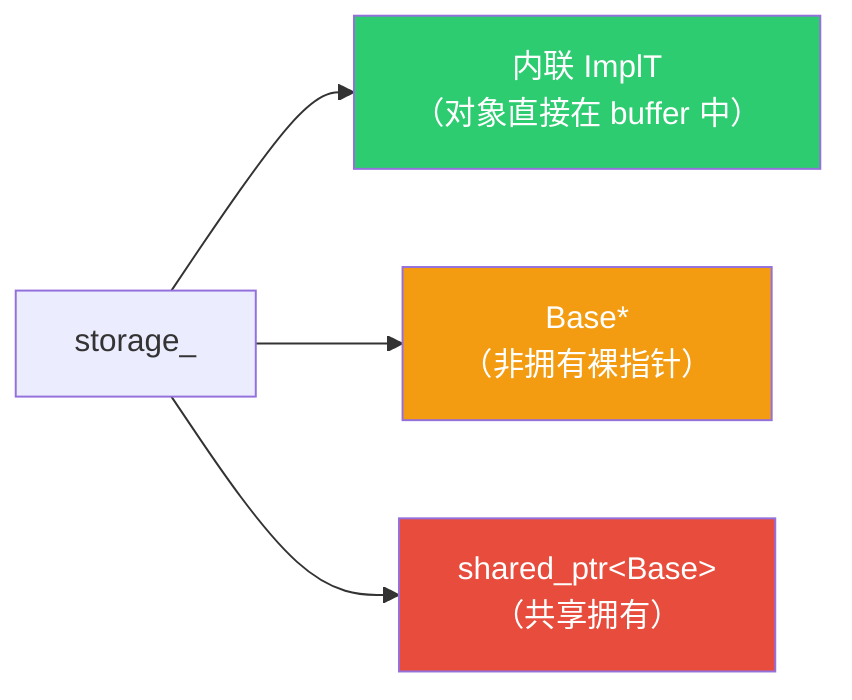

---

## 第 82 行：默认构造

```cpp
AnyDerived() = default;
```

- `= default` — 显式要求编译器生成默认构造函数。
- 效果：`impl_` 初始化为 `nullptr`，`storage_` 默认构造（空状态）。
- 结果：`operator bool()` 返回 `false`。

---

## 第 84–87 行：拷贝构造

```cpp
AnyDerived(const AnyDerived &other) : storage_(other.storage_)
{
    impl_ = this->impl_from_storage();
}
```

1. **`storage_(other.storage_)`** — 拷贝 Any 对象。Any 的拷贝行为：
   - 内联对象：调用拷贝构造函数（深拷贝）。
   - `shared_ptr`：引用计数 +1（浅拷贝/共享）。
   - 裸指针：直接复制指针值（非拥有，安全）。
2. **`impl_ = this->impl_from_storage()`** — 从新拷贝的 storage 中重新提取 `impl_` 指针。**不能**直接用 `other.impl_`，因为内联对象被深拷贝后地址已变。

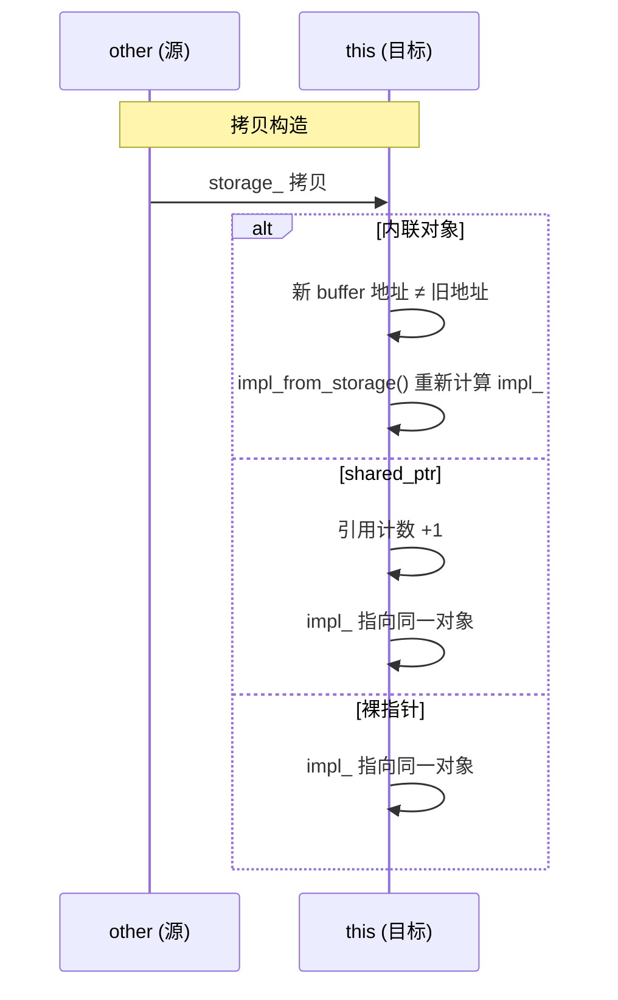

---

## 第 89–94 行：移动构造

```cpp
AnyDerived(AnyDerived &&other) noexcept : storage_(std::move(other.storage_))
{
    impl_ = this->impl_from_storage();
    other.storage_.reset();
    other.impl_ = nullptr;
}
```

1. **`std::move(other.storage_)`** — 移动 Any，源对象进入"有效但未指定"状态。
2. **`impl_from_storage()`** — 重新提取指针（移动后 buffer 内容可能已变）。
3. **`other.storage_.reset()`** — 清空源 storage，使其变为空状态。
4. **`other.impl_ = nullptr`** — 源的 impl 指针置空。

> **`noexcept`** — 声明此函数不抛异常。这使得 `AnyDerived` 可以被放入某些要求 noexcept 移动的容器中（如 `std::vector` 在 realloc 时会优先使用移动）。

---

## 第 96–99 行：裸指针构造

```cpp
explicit AnyDerived(Base *impl) : impl_(impl)
{
    storage_ = impl_;
}
```

- **`explicit`** — 防止隐式转换，必须显式写 `AnyDerived<Base>(ptr)`。
- **`storage_ = impl_`** — 将裸指针存入 Any。Any 会将其存为 `Base*` 类型（非拥有）。
- **注意**：调用者必须确保指针在 AnyDerived 存活期间有效。

---

## 第 101–106 行：shared_ptr 构造

```cpp
explicit AnyDerived(std::shared_ptr<Base> impl) : impl_(impl.get())
{
    if (impl_) {
        storage_ = std::move(impl);
    }
}
```

1. **`impl_(impl.get())`** — 从 shared_ptr 提取裸指针给 `impl_`。
2. **`if (impl_)`** — 如果指针非空，才将 shared_ptr 移入 storage。如果为空，storage 保持默认（空状态）。
3. **`std::move(impl)`** — 移动 shared_ptr 到 storage，避免引用计数增减。

---

## 第 108–128 行：赋值运算符

### 拷贝赋值

```cpp
AnyDerived &operator=(const AnyDerived &other)
{
    if (this == &other) { return *this; }  // 自赋值检查
    storage_ = other.storage_;
    impl_ = this->impl_from_storage();
    return *this;
}
```

逻辑与拷贝构造一致，只是多了自赋值检查。

### 移动赋值

```cpp
AnyDerived &operator=(AnyDerived &&other) noexcept
{
    if (this == &other) { return *this; }
    storage_ = std::move(other.storage_);
    impl_ = this->impl_from_storage();
    other.storage_.reset();
    other.impl_ = nullptr;
    return *this;
}
```

逻辑与移动构造一致。

---

## 第 130–146 行：`emplace<ImplT>(args...)` — 核心方法

```cpp
template<typename ImplT, typename... Args>
    requires std::is_base_of_v<Base, ImplT>
void emplace(Args &&...args)
```

- **`requires std::is_base_of_v<Base, ImplT>`** — C++20 概念约束，确保 `ImplT` 必须是 `Base` 的派生类。
- **`Args&&...`** — 完美转发的参数包。

### 第 134–138 行：内联路径

```cpp
if constexpr (std::is_copy_constructible_v<ImplT> && Storage::template is_inline_v<ImplT>) {
    impl_ = &storage_.template emplace<ImplT>(std::forward<Args>(args)...);
}
```

**条件**：`ImplT` 可拷贝 **且** 大小 ≤ `InlineBufferCapacity` 且对齐满足要求。

- **`Storage::template is_inline_v<ImplT>`** — Any 的静态常量，判断类型是否能内联存储。
- **`storage_.template emplace<ImplT>(...)`** — 在 Any 的 buffer 中原地构造 `ImplT`，返回引用。`&` 取地址赋给 `impl_`。
- **`template` 关键字** — 在依赖模板参数的成员模板调用中，必须加 `template` 告诉编译器 `emplace` 是模板而非 `<` 比较。

> **为什么要求可拷贝？** 因为 `Any` 在拷贝时需要能拷贝其内容。不可拷贝的类型无法内联存储到 Any 中。

### 第 139–145 行：堆分配路径

```cpp
else {
    std::shared_ptr<Base> ptr = std::make_shared<ImplT>(std::forward<Args>(args)...);
    impl_ = &*ptr;
    storage_ = std::move(ptr);
}
```

- **`std::make_shared<ImplT>(...)`** — 在堆上构造 `ImplT`，创建 `shared_ptr<Base>`。
- **`&*ptr`** — `*ptr` 解引用得到 `ImplT&`，`&` 取地址得到 `ImplT*`，隐式转为 `Base*`。
- **`std::move(ptr)`** — 移动 shared_ptr 到 storage。

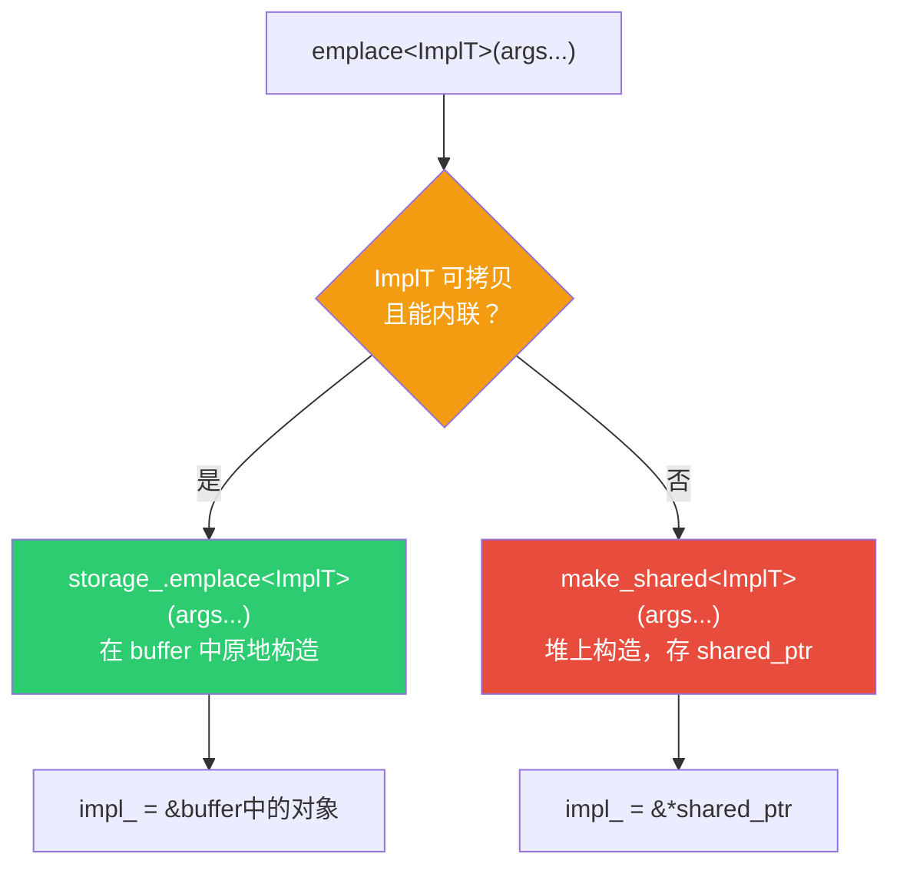

---

## 第 148–166 行：访问器

```cpp
operator bool() const { return impl_ != nullptr; }
```
- 隐式转换为 bool：`if (any_derived)` 检查是否持有值。

```cpp
Base &operator*() const { return *impl_; }
Base *operator->() const { return impl_; }
Base *get() const { return impl_; }
```
- `operator*` — 解引用，返回 `Base&`。
- `operator->` — 箭头运算符，返回 `Base*`，支持 `a->method()` 语法。
- `get()` — 显式获取裸指针。

> 这三个方法让 AnyDerived 用起来就像一个智能指针。

---

## 第 168–176 行：`impl_from_storage()` — 从 storage 恢复 impl_

```cpp
protected:
Base *impl_from_storage() const
{
    if (!storage_.has_value()) {
        return nullptr;
    }
    return storage_.extra_info().get_impl(storage_.get());
}
```

1. **`storage_.has_value()`** — 检查 Any 是否持有值。
2. **`storage_.extra_info()`** — 获取 `AnyDerivedExtraInfo<Base>`，其中包含 `get_impl` 函数指针。
3. **`storage_.get()`** — 获取 Any 内部 buffer 的 `void*` 地址。
4. **`get_impl(buffer)`** — 调用对应的提取函数，返回 `Base*`。

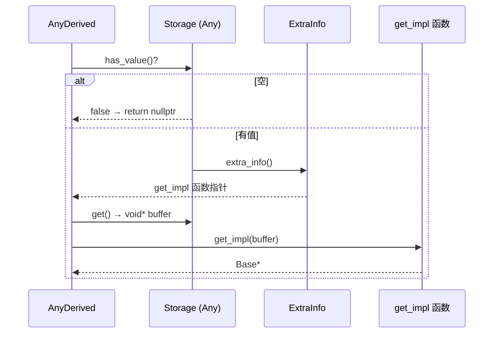

---

## 实际使用场景

### VArray（虚拟数组）

```cpp
// BLI_virtual_array.hh:513
AnyDerived<const VArrayImpl<T>> impl_;
```

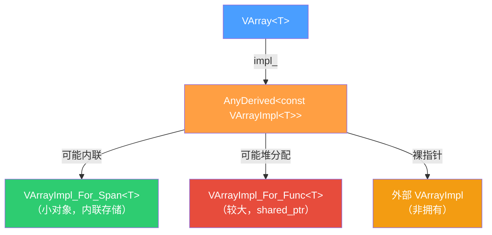

### GVArray（泛型虚拟数组）

```cpp
// BLI_generic_virtual_array.hh:93
AnyDerived<const GVArrayImpl, 40> impl_;
```

- `InlineBufferCapacity = 40` — 泛型实现通常更大，需要更大的内联缓冲区。

---

## 内存布局对比

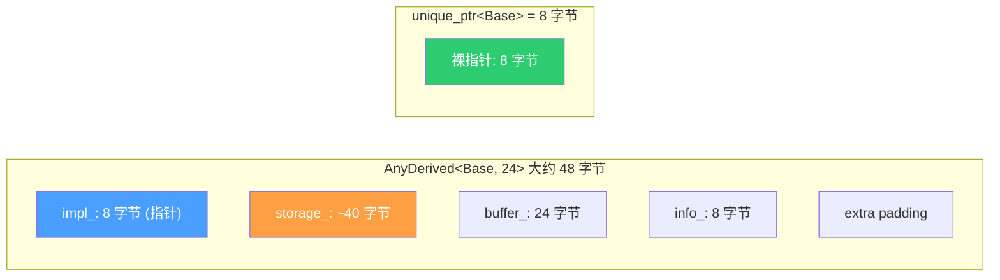

> AnyDerived 牺牲了栈空间（约 48 字节 vs unique_ptr 的 8 字节），换来：
> 1. 小对象零堆分配
> 2. 可拷贝（shared_ptr 共享语义）
> 3. 支持非拥有引用（裸指针）

---

## 关键语法速查

| 语法 | 含义 |
|------|------|
| `if constexpr` | C++17 编译期分支，false 分支不编译 |
| `requires std::is_base_of_v<Base, ImplT>` | C++20 概念约束，限制模板参数 |
| `storage_.template emplace<ImplT>(...)` | 依赖模板参数的成员模板调用，`template` 消歧 |
| `std::forward<Args>(args)...` | 完美转发，保持参数的值类别 |
| `const_cast<StorageT*>(...)` | 去除 const，用于从 `const void*` 提取非 const 指针 |
| `static_cast<const StorageT*>(buffer)` | 向下转型（void→具体类型），编译期检查安全性 |
| `noexcept` | 声明不抛异常，允许容器优化 |
| `explicit` | 禁止隐式构造转换 |
| `= default` | 显式使用编译器生成的默认实现 |
| `BLI_assert_unreachable()` | Blender 断言宏，Debug 模式下触发中断 |

---

## 拷贝语义总结

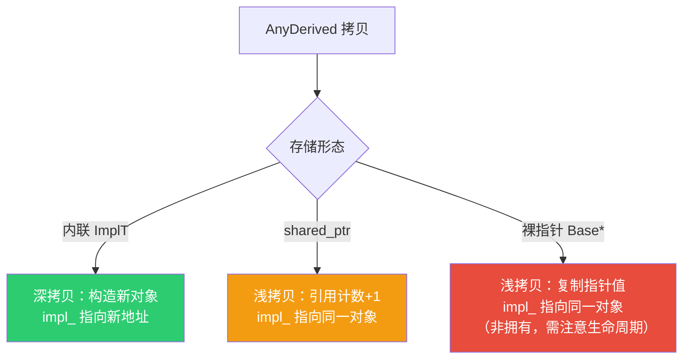

---

## 完整数据流

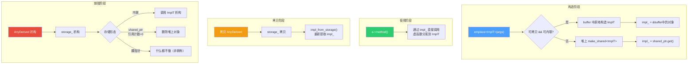
