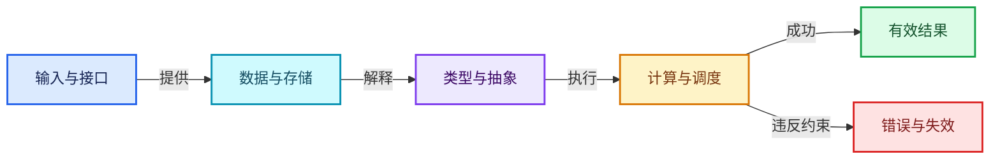

# 图表配色与阅读约定

> 第二版阅读方式：先看教学注释代码，再看紧邻的机制推导；原始源码和基准行号放在折叠区。依赖入口链接到完整实现单元。源码一致性检查与内容复核分别记录。

颜色与文字共同表达语义，禁止仅靠颜色传达正确与错误。每篇正文至少四张图。图中的教学关系、编译依赖和实际状态推演分别标注。

| 语义 | 填充 | 描边 |
|---|---|---|
| 输入与接口 | #DBEAFE | #2563EB |
| 数据与存储 | #CFFAFE | #0891B2 |
| 类型与抽象 | #EDE9FE | #7C3AED |
| 计算与调度 | #FEF3C7 | #D97706 |
| 有效结果 | #DCFCE7 | #16A34A |
| 错误与失效 | #FEE2E2 | #DC2626 |

本轮采用flowchart作为统一图形语法；布局方向按内容选择LR或TB。边上的文字明确表示依赖、数据流或教学步骤，避免把include当作运行时调用。
