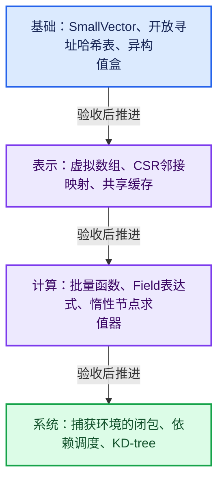

# 学习路线与阶段验收

> 第二版阅读方式：先看教学注释代码，再看紧邻的机制推导；原始源码和基准行号放在折叠区。依赖入口链接到完整实现单元。源码一致性检查与内容复核分别记录。

每阶段交付可以运行或手算核对的最小实现。时间安排以实际掌握为准，完成阅读不等于完成训练。

## 基础阶段：01—03

成果：SmallVector、开放寻址哈希表、异构值盒。

先建立正确性对照，再构造边界和退化输入，最后讨论优化。要求能解释拥有关系、状态变化和代价来源。

## 表示阶段：04—06

成果：虚拟数组、CSR邻接映射、共享缓存。

先建立正确性对照，再构造边界和退化输入，最后讨论优化。要求能解释拥有关系、状态变化和代价来源。

## 计算阶段：07—09

成果：批量函数、Field表达式、惰性节点求值器。

先建立正确性对照，再构造边界和退化输入，最后讨论优化。要求能解释拥有关系、状态变化和代价来源。

## 系统阶段：10—12

成果：捕获环境的闭包、依赖调度、KD-tree。

先建立正确性对照，再构造边界和退化输入，最后讨论优化。要求能解释拥有关系、状态变化和代价来源。

与AI协作时，先提交自己的不变量与方案，让AI找反例；核心小实现由自己完成，再用测试和源码复盘。能解释已有代码之后，还要练习在需求改变时预测哪里失效。
