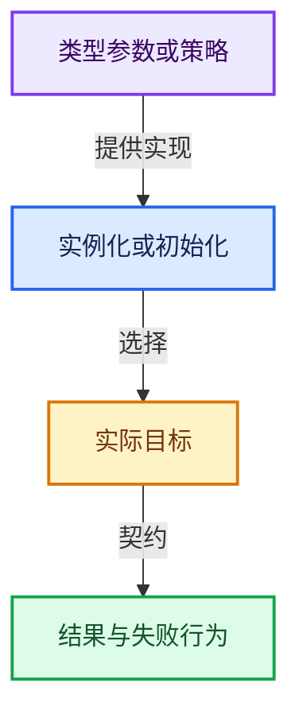
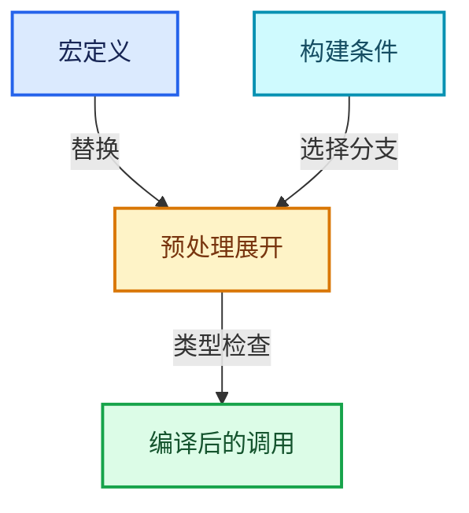

# 模板、宏与动态分派协议

## 为什么不能只凭函数短名定位

模板类型可以由调用者提供，auto依赖推导，虚函数取决于实际对象，函数指针可以在运行时切换。同名不是实现身份。无法从当前结构证据确定具体目标时，正文保留调用表达式、行号和选择条件入口。

## 模板参数提供的操作

T的构造、析构、比较与调用运算符属于实例化契约。讲解容器时解释所需操作、异常性质与资源责任，不能枚举所有未来用户定义类型。Slot、Allocator、Query等策略同理；已知默认策略须继续看它的实际实现。

## Vector的默认分配分派

Allocator默认是GuardedAllocator。公开MEM入口通过mem_mallocN_aligned_ex和mem_freeN_ex成组分派，默认lockfree，可切换guarded。两个后端的块头布局不同，切换检查要求没有活分配。元素T的析构仍由Vector负责，MEM原始存储标记不表示T一定平凡。

## 局部可调用对象与运行时策略

lambda或FunctionRef的operator()应回到初始化、捕获与桥接实现，不跳到仓库里另一个同名get或call。回调同步/异步决定被捕获对象需要多长寿命；跨线程时还要区分共享环境与线程局部存储。

## 外部边界

标准库、第三方库、系统接口讲调用契约，不把任意安装版本的内部实现说成Blender源码。

### `uninitialized_copy_n`

在目标原始存储复制构造n个对象；源若由move_iterator访问，构造重载可以采用移动。源与目标区间不得重叠。目标构造失败时清理已构造目标，不恢复已经移动的源值，也不释放外层分配的缓冲。

[一手接口资料](https://eel.is/c++draft/uninitialized.copy)

### `uninitialized_default_construct_n`

在目标建立默认初始化的对象；对基本标量不承诺零初始化。与对已有对象赋值不同。失败时按未初始化算法契约清理已构造目标。

[一手接口资料](https://eel.is/c++draft/uninitialized.construct.default)

### `uninitialized_fill_n`

从同一个源值复制构造n个目标；源值须保持有效。目标是原始存储，不能把它当作对已有对象的fill赋值。

[一手接口资料](https://eel.is/c++draft/uninitialized.fill)

### `destroy_n`

销毁n个已经构造的对象，不释放整块存储。对象析构可能释放各自资源；原始缓冲仍由分配者管理。

[一手接口资料](https://eel.is/c++draft/specialized.destroy)

### `make_move_iterator`

适配迭代器的解引用值类别，不单独转移资源。实际对象的构造函数决定是否以及如何移动。

[一手接口资料](https://eel.is/c++draft/move.iterators)

### `move`

把表达式转换成可供移动重载选择的值类别；不保证真的移动，不结束源对象寿命，对const值可能选择复制。

[一手接口资料](https://eel.is/c++draft/utility.forward)

### `forward`

在转发引用中恢复调用者传入的值类别；依赖推导类型，不能与无条件move互换。

[一手接口资料](https://eel.is/c++draft/utility.forward)

### `max`

按比较关系选取较大值。本讲解中的增长公式同时满足最低请求和几何增长；若保存返回引用，还需注意实参寿命。

[一手接口资料](https://eel.is/c++draft/alg.min.max)

### `min`

按比较关系选取较小值；截断范围时还需先满足非负和可表示范围，min本身不会证明边界安全。

[一手接口资料](https://eel.is/c++draft/alg.min.max)

### `exchange`

把新值写入对象并返回旧值，常用于取走资源后为源留下明确空状态。

[一手接口资料](https://eel.is/c++draft/utility.exchange)

### `make_shared`

构造由共享控制块管理的对象；共享寿命不自动使被指对象读写线程安全，强引用环需单独处理。

[一手接口资料](https://eel.is/c++draft/util.smartptr.shared.create)

### `make_unique`

创建独占拥有的对象，拥有关系可移动，get返回的借用指针不自动延长寿命。

[一手接口资料](https://eel.is/c++draft/unique.ptr.create)

### `visit`

按variant当前活动分支调用访客；所有候选分支的类型要求需满足，不能读取非活动分支的对象表示。

[一手接口资料](https://eel.is/c++draft/variant.visit)

### `memcpy`

复制字节，源与目标不应重叠。类型生命周期、对齐和可复制表示须由调用者证明，不是任意对象的复制构造。

[一手接口资料](https://eel.is/c++draft/cstring.syn)

### `memmove`

复制可能重叠的字节区间；允许字节重叠不代表自动满足任意C++对象的移动构造契约。

[一手接口资料](https://eel.is/c++draft/cstring.syn)

### `memset`

填充字节，不调用T构造函数，也不保证任意类型的全零表示是合法或期望值。

[一手接口资料](https://eel.is/c++draft/cstring.syn)

### `malloc`

取得原始存储，失败可返回空指针；不构造C++对象。必须与匹配释放接口及对象寿命管理结合。

[一手接口资料](https://eel.is/c++draft/c.malloc)

### `calloc`

取得并清零原始存储，不等于为任意C++类型执行值初始化。

[一手接口资料](https://eel.is/c++draft/c.malloc)

### `realloc`

可能取得新地址并释放旧分配；成功后旧地址失效，失败行为与C++对象迁移不同，不可直接替代非平凡对象迁移。

[一手接口资料](https://eel.is/c++draft/c.malloc)

### `free`

归还相匹配的C分配存储，不自动执行C++析构；不可用于Windows的_aligned_malloc结果。

[一手接口资料](https://eel.is/c++draft/c.malloc)

### `_aligned_malloc`

Windows对齐分配；失败可返回NULL，使用_aligned_free归还。到这里停止深入运行库内部实现。

[一手接口资料](https://learn.microsoft.com/en-us/cpp/c-runtime-library/reference/aligned-malloc?view=msvc-170)

### `_aligned_free`

与Windows对齐分配配对，传入分配基地址。MEM用户地址可能位于块头之后，应先由MEM后端恢复基地址。

[一手接口资料](https://learn.microsoft.com/en-us/cpp/c-runtime-library/reference/aligned-free?view=msvc-170)

### `abort`

终止进程，不是可供调用者catch的普通C++异常恢复路径。

[一手接口资料](https://eel.is/c++draft/support.start.term)

### `assert`

检查开发者预期条件，配置可能关闭；不承担完整输入处理或自动修复。

[一手接口资料](https://eel.is/c++draft/assertions)

