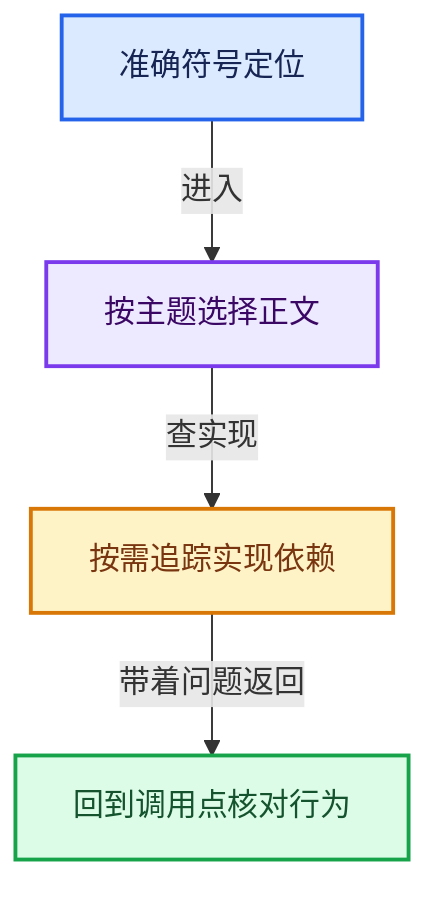
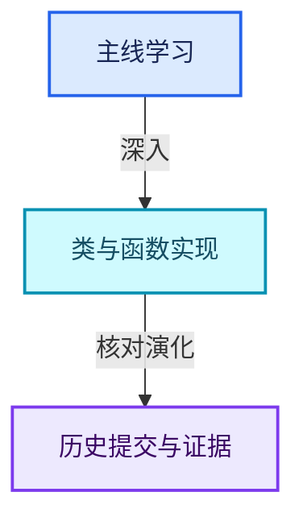

# 全部符号定位表

[简明符号索引](符号依赖与实现索引.md)

按正文归属组织；用于编辑器搜索准确符号，不代替课程阅读顺序。

## [01-对象生命周期与值类别](../../01-基础容器与现代CPP/01-对象生命周期与值类别.md)

- [blender::destruct_n](../../01-基础容器与现代CPP/01-对象生命周期与值类别.md#f-cb5bcdbd0ee77885)
- [blender::default_construct_n](../../01-基础容器与现代CPP/01-对象生命周期与值类别.md#f-7fba5f8c23635f17)
- [blender::initialized_copy_n](../../01-基础容器与现代CPP/01-对象生命周期与值类别.md#f-7e8b9229298df6c5)
- [blender::uninitialized_copy_n](../../01-基础容器与现代CPP/01-对象生命周期与值类别.md#f-6cd63ebede164cd2)
- [blender::uninitialized_convert_n](../../01-基础容器与现代CPP/01-对象生命周期与值类别.md#f-c9f2d65f10e2b002)
- [blender::initialized_move_n](../../01-基础容器与现代CPP/01-对象生命周期与值类别.md#f-328a89f173c24880)
- [blender::uninitialized_move_n](../../01-基础容器与现代CPP/01-对象生命周期与值类别.md#f-fc5f51bf717c3b5a)
- [blender::initialized_relocate_n](../../01-基础容器与现代CPP/01-对象生命周期与值类别.md#f-2a6b73d9c52ae967)
- [blender::uninitialized_relocate_n](../../01-基础容器与现代CPP/01-对象生命周期与值类别.md#f-9de0365b9a47fd68)
- [blender::initialized_fill_n](../../01-基础容器与现代CPP/01-对象生命周期与值类别.md#f-4af3bf5ccfdcee6c)
- [blender::uninitialized_fill_n](../../01-基础容器与现代CPP/01-对象生命周期与值类别.md#f-020ca78eff5f9227)
- [blender::DestructValueAtAddress::DestructValueAtAddress](../../01-基础容器与现代CPP/01-对象生命周期与值类别.md#f-c9d4681b038e8a38)
- [blender::DestructValueAtAddress::DestructValueAtAddress](../../01-基础容器与现代CPP/01-对象生命周期与值类别.md#f-4db22228b88fab24)
- [blender::DestructValueAtAddress::operator()](../../01-基础容器与现代CPP/01-对象生命周期与值类别.md#f-3850f67b46b81e8d)
- [blender::AlignedBuffer::()](../../01-基础容器与现代CPP/01-对象生命周期与值类别.md#f-f2d0c89c389deadc)
- [blender::AlignedBuffer::() const](../../01-基础容器与现代CPP/01-对象生命周期与值类别.md#f-d34418cfa8e83a5b)
- [blender::AlignedBuffer::ptr](../../01-基础容器与现代CPP/01-对象生命周期与值类别.md#f-bfe745bcb7c7811c)
- [blender::AlignedBuffer::ptr](../../01-基础容器与现代CPP/01-对象生命周期与值类别.md#f-f24632360e6cd028)
- [blender::TypedBuffer::get_size](../../01-基础容器与现代CPP/01-对象生命周期与值类别.md#f-01c9908024e5905f)
- [blender::TypedBuffer::get_alignment](../../01-基础容器与现代CPP/01-对象生命周期与值类别.md#f-97f29e4dc546127f)
- [blender::TypedBuffer::()](../../01-基础容器与现代CPP/01-对象生命周期与值类别.md#f-47e1bfca173d566c)

## [02-模板与约束](../../01-基础容器与现代CPP/02-模板与约束.md)

- [blender::NonCopyable::NonCopyable](../../01-基础容器与现代CPP/02-模板与约束.md#f-9abdbafa96508887)
- [blender::NonCopyable::operator=](../../01-基础容器与现代CPP/02-模板与约束.md#f-d3f04ceb006ce221)
- [blender::NonCopyable::NonCopyable](../../01-基础容器与现代CPP/02-模板与约束.md#f-52302918f6d25b92)
- [blender::NonCopyable::NonCopyable](../../01-基础容器与现代CPP/02-模板与约束.md#f-8501db0dae9f24ad)
- [blender::NonCopyable::operator=](../../01-基础容器与现代CPP/02-模板与约束.md#f-c96c7852ba671878)
- [blender::NonMovable::NonMovable](../../01-基础容器与现代CPP/02-模板与约束.md#f-86feb2b1369738e7)
- [blender::NonMovable::operator=](../../01-基础容器与现代CPP/02-模板与约束.md#f-6761b09b71c2506e)
- [blender::NonMovable::NonMovable](../../01-基础容器与现代CPP/02-模板与约束.md#f-10f338f65ef5ffb5)
- [blender::NonMovable::NonMovable](../../01-基础容器与现代CPP/02-模板与约束.md#f-afb5005918d08146)
- [blender::NonMovable::operator=](../../01-基础容器与现代CPP/02-模板与约束.md#f-2cd1f30034d8b934)

## [03-内存工具与分配器接口](../../01-基础容器与现代CPP/03-内存工具与分配器接口.md)

- [blender::GuardedAllocator::allocate](../../01-基础容器与现代CPP/03-内存工具与分配器接口.md#f-a57239e6d3bd10d9)
- [blender::GuardedAllocator::allocate_zero](../../01-基础容器与现代CPP/03-内存工具与分配器接口.md#f-ba4b11000deea5e5)
- [blender::GuardedAllocator::deallocate](../../01-基础容器与现代CPP/03-内存工具与分配器接口.md#f-c1586978e7959acb)
- [blender::GuardedAlignedAllocator::allocate](../../01-基础容器与现代CPP/03-内存工具与分配器接口.md#f-ddfb0ce826a2afee)
- [blender::GuardedAlignedAllocator::allocate_zero](../../01-基础容器与现代CPP/03-内存工具与分配器接口.md#f-74210c2fb8df75bf)
- [blender::GuardedAlignedAllocator::deallocate](../../01-基础容器与现代CPP/03-内存工具与分配器接口.md#f-9b77734460f186e0)
- [blender::RawAllocator::allocate](../../01-基础容器与现代CPP/03-内存工具与分配器接口.md#f-557f7d891fdff07f)
- [blender::RawAllocator::allocate_zero](../../01-基础容器与现代CPP/03-内存工具与分配器接口.md#f-c9e893521059d691)
- [blender::RawAllocator::deallocate](../../01-基础容器与现代CPP/03-内存工具与分配器接口.md#f-31aae8b6d94cfd98)

## [04-IndexRange连续整数区间](../../01-基础容器与现代CPP/04-IndexRange连续整数区间.md)

- [blender::IndexRange::IndexRange](../../01-基础容器与现代CPP/04-IndexRange连续整数区间.md#f-137c81a537a5d604)
- [blender::IndexRange::IndexRange](../../01-基础容器与现代CPP/04-IndexRange连续整数区间.md#f-e7f519dcc417d983)
- [blender::IndexRange::IndexRange](../../01-基础容器与现代CPP/04-IndexRange连续整数区间.md#f-2d5ea7e20125ee16)
- [blender::IndexRange::from_begin_size](../../01-基础容器与现代CPP/04-IndexRange连续整数区间.md#f-392d3c73c80f255d)
- [blender::IndexRange::from_begin_end](../../01-基础容器与现代CPP/04-IndexRange连续整数区间.md#f-a523839fb9650253)
- [blender::IndexRange::from_begin_end_inclusive](../../01-基础容器与现代CPP/04-IndexRange连续整数区间.md#f-66cc5b933b552ea1)
- [blender::IndexRange::from_end_size](../../01-基础容器与现代CPP/04-IndexRange连续整数区间.md#f-14a2146987e7c92d)
- [blender::IndexRange::from_single](../../01-基础容器与现代CPP/04-IndexRange连续整数区间.md#f-c53911354f78d5b0)
- [blender::IndexRange::Iterator::Iterator](../../01-基础容器与现代CPP/04-IndexRange连续整数区间.md#f-27f6725fdde0e062)
- [blender::IndexRange::Iterator::operator*](../../01-基础容器与现代CPP/04-IndexRange连续整数区间.md#f-c5f5c826cbb273d8)
- [blender::IndexRange::Iterator::iter_prop](../../01-基础容器与现代CPP/04-IndexRange连续整数区间.md#f-fee52fe271750873)
- [blender::IndexRange::begin](../../01-基础容器与现代CPP/04-IndexRange连续整数区间.md#f-1ea3c945dec55d0a)
- [blender::IndexRange::end](../../01-基础容器与现代CPP/04-IndexRange连续整数区间.md#f-119dd529d7090e64)
- [blender::IndexRange::operator[]](../../01-基础容器与现代CPP/04-IndexRange连续整数区间.md#f-7369b205de195454)
- [blender::IndexRange::operator==](../../01-基础容器与现代CPP/04-IndexRange连续整数区间.md#f-65eebc6a24647e81)
- [blender::IndexRange::operator!=](../../01-基础容器与现代CPP/04-IndexRange连续整数区间.md#f-9d6d8d6ebe05411a)
- [blender::IndexRange::size](../../01-基础容器与现代CPP/04-IndexRange连续整数区间.md#f-05f66c3ebb2fdfec)
- [blender::IndexRange::index_range](../../01-基础容器与现代CPP/04-IndexRange连续整数区间.md#f-fd83072b4b81bce5)
- [blender::IndexRange::is_empty](../../01-基础容器与现代CPP/04-IndexRange连续整数区间.md#f-9501e070be01ff71)
- [blender::IndexRange::with_new_end](../../01-基础容器与现代CPP/04-IndexRange连续整数区间.md#f-834d1751c4701574)
- [blender::IndexRange::after](../../01-基础容器与现代CPP/04-IndexRange连续整数区间.md#f-33b01201b3ef9092)
- [blender::IndexRange::before](../../01-基础容器与现代CPP/04-IndexRange连续整数区间.md#f-4b046e8c0c80c95a)
- [blender::IndexRange::first](../../01-基础容器与现代CPP/04-IndexRange连续整数区间.md#f-ab443c94e531befa)
- [blender::IndexRange::last](../../01-基础容器与现代CPP/04-IndexRange连续整数区间.md#f-66896c6351a40de1)
- [blender::IndexRange::one_before_start](../../01-基础容器与现代CPP/04-IndexRange连续整数区间.md#f-d0a8ffd393a2929e)
- [blender::IndexRange::one_after_last](../../01-基础容器与现代CPP/04-IndexRange连续整数区间.md#f-ed04bec9c731fc86)
- [blender::IndexRange::start](../../01-基础容器与现代CPP/04-IndexRange连续整数区间.md#f-99d2195bd9cfd1f0)
- [blender::IndexRange::contains](../../01-基础容器与现代CPP/04-IndexRange连续整数区间.md#f-1a01eaa28eaecd5c)
- [blender::IndexRange::contains](../../01-基础容器与现代CPP/04-IndexRange连续整数区间.md#f-8eb195a52f17a51f)
- [blender::IndexRange::slice](../../01-基础容器与现代CPP/04-IndexRange连续整数区间.md#f-6249bf624e38d609)
- [blender::IndexRange::slice](../../01-基础容器与现代CPP/04-IndexRange连续整数区间.md#f-eb80885fefc31b6f)
- [blender::IndexRange::intersect](../../01-基础容器与现代CPP/04-IndexRange连续整数区间.md#f-be538eb451fe039b)
- [blender::IndexRange::drop_front](../../01-基础容器与现代CPP/04-IndexRange连续整数区间.md#f-ef3101407d982c90)
- [blender::IndexRange::drop_back](../../01-基础容器与现代CPP/04-IndexRange连续整数区间.md#f-be17c307e5b14575)
- [blender::IndexRange::take_front](../../01-基础容器与现代CPP/04-IndexRange连续整数区间.md#f-63ad1817cc7169c5)
- [blender::IndexRange::take_back](../../01-基础容器与现代CPP/04-IndexRange连续整数区间.md#f-90cb4525591ba822)
- [blender::IndexRange::shift](../../01-基础容器与现代CPP/04-IndexRange连续整数区间.md#f-76db8d7d4d67215c)

## [05-Span只读连续视图](../../01-基础容器与现代CPP/05-Span只读连续视图.md)

- [blender::Span::Span](../../01-基础容器与现代CPP/05-Span只读连续视图.md#f-e40cbae1aae23eb8)
- [blender::Span::Span](../../01-基础容器与现代CPP/05-Span只读连续视图.md#f-8e13b31cdc54dc44)
- [blender::Span::Span](../../01-基础容器与现代CPP/05-Span只读连续视图.md#f-e3f5617e03851c03)
- [blender::Span::Span](../../01-基础容器与现代CPP/05-Span只读连续视图.md#f-6dbccc3a78910bb7)
- [blender::Span::Span](../../01-基础容器与现代CPP/05-Span只读连续视图.md#f-0692c02d691e68a6)
- [blender::Span::Span](../../01-基础容器与现代CPP/05-Span只读连续视图.md#f-45073fe4b3cefa46)
- [blender::Span::Span](../../01-基础容器与现代CPP/05-Span只读连续视图.md#f-b2e1b3c3e3349048)
- [blender::Span::slice](../../01-基础容器与现代CPP/05-Span只读连续视图.md#f-380a0e8fdcbd53cc)
- [blender::Span::slice](../../01-基础容器与现代CPP/05-Span只读连续视图.md#f-9b9c15e78dd54eec)
- [blender::Span::slice_safe](../../01-基础容器与现代CPP/05-Span只读连续视图.md#f-5ffbda70864e9d0b)
- [blender::Span::slice_safe](../../01-基础容器与现代CPP/05-Span只读连续视图.md#f-8438e78e505b5ff4)
- [blender::Span::drop_front](../../01-基础容器与现代CPP/05-Span只读连续视图.md#f-932897accbde3413)
- [blender::Span::drop_back](../../01-基础容器与现代CPP/05-Span只读连续视图.md#f-fbabd5706815d493)
- [blender::Span::take_front](../../01-基础容器与现代CPP/05-Span只读连续视图.md#f-1556b8b4aac9d42f)
- [blender::Span::take_back](../../01-基础容器与现代CPP/05-Span只读连续视图.md#f-6767e3f6b257ca29)
- [blender::Span::data](../../01-基础容器与现代CPP/05-Span只读连续视图.md#f-10c5889198935800)
- [blender::Span::begin](../../01-基础容器与现代CPP/05-Span只读连续视图.md#f-415883b512284f46)
- [blender::Span::end](../../01-基础容器与现代CPP/05-Span只读连续视图.md#f-a7d8b9e494c291a7)
- [blender::Span::rbegin](../../01-基础容器与现代CPP/05-Span只读连续视图.md#f-491ff42545304e78)
- [blender::Span::rend](../../01-基础容器与现代CPP/05-Span只读连续视图.md#f-cb6fb4c63c153082)
- [blender::Span::operator[]](../../01-基础容器与现代CPP/05-Span只读连续视图.md#f-3c6e7880d4bca267)
- [blender::Span::size](../../01-基础容器与现代CPP/05-Span只读连续视图.md#f-5f80fa006089c998)
- [blender::Span::is_empty](../../01-基础容器与现代CPP/05-Span只读连续视图.md#f-8cc1d7ba8feb50e6)
- [blender::Span::size_in_bytes](../../01-基础容器与现代CPP/05-Span只读连续视图.md#f-1369fbdcc037fcaf)
- [blender::Span::contains](../../01-基础容器与现代CPP/05-Span只读连续视图.md#f-7caee498c984f2c0)
- [blender::Span::contains_ptr](../../01-基础容器与现代CPP/05-Span只读连续视图.md#f-f4b5c58b844fb9c7)
- [blender::Span::count](../../01-基础容器与现代CPP/05-Span只读连续视图.md#f-998e4abcd2436f81)
- [blender::Span::first](../../01-基础容器与现代CPP/05-Span只读连续视图.md#f-d8c9bcc3e9757248)
- [blender::Span::last](../../01-基础容器与现代CPP/05-Span只读连续视图.md#f-a92146c285596891)
- [blender::Span::has_duplicates__linear_search](../../01-基础容器与现代CPP/05-Span只读连续视图.md#f-e8294f87972ebf36)
- [blender::Span::intersects__linear_search](../../01-基础容器与现代CPP/05-Span只读连续视图.md#f-bbb38418f7af8be3)
- [blender::Span::first_index](../../01-基础容器与现代CPP/05-Span只读连续视图.md#f-fb6b750e8096a830)
- [blender::Span::first_index_try](../../01-基础容器与现代CPP/05-Span只读连续视图.md#f-811ebd0e3e302c09)
- [blender::Span::index_range](../../01-基础容器与现代CPP/05-Span只读连续视图.md#f-caaa9b06e13e53e0)
- [blender::Span::hash](../../01-基础容器与现代CPP/05-Span只读连续视图.md#f-cc1fde6844ea8d5b)
- [blender::Span::cast](../../01-基础容器与现代CPP/05-Span只读连续视图.md#f-e082d823028af8f6)
- [blender::Span::operator==](../../01-基础容器与现代CPP/05-Span只读连续视图.md#f-2cde38f377f549a5)
- [blender::Span::operator!=](../../01-基础容器与现代CPP/05-Span只读连续视图.md#f-8ff6c8c81db2f3ae)

## [06-MutableSpan可写视图](../../01-基础容器与现代CPP/06-MutableSpan可写视图.md)

- [blender::MutableSpan::MutableSpan](../../01-基础容器与现代CPP/06-MutableSpan可写视图.md#f-0f07034aaffc3384)
- [blender::MutableSpan::MutableSpan](../../01-基础容器与现代CPP/06-MutableSpan可写视图.md#f-39977234ad0ce192)
- [blender::MutableSpan::MutableSpan](../../01-基础容器与现代CPP/06-MutableSpan可写视图.md#f-ee249b5042dd38aa)
- [blender::MutableSpan::MutableSpan](../../01-基础容器与现代CPP/06-MutableSpan可写视图.md#f-479c5f85921e531f)
- [blender::MutableSpan::MutableSpan](../../01-基础容器与现代CPP/06-MutableSpan可写视图.md#f-afcce5325e6f19e0)
- [blender::MutableSpan::() const](../../01-基础容器与现代CPP/06-MutableSpan可写视图.md#f-375a7bfe1a463fa0)
- [blender::MutableSpan::is_span_convertible_pointer_v](../../01-基础容器与现代CPP/06-MutableSpan可写视图.md#f-0943740a633bd96c)
- [blender::MutableSpan::size](../../01-基础容器与现代CPP/06-MutableSpan可写视图.md#f-1de6a66839c304a8)
- [blender::MutableSpan::size_in_bytes](../../01-基础容器与现代CPP/06-MutableSpan可写视图.md#f-2e42823b970a8406)
- [blender::MutableSpan::is_empty](../../01-基础容器与现代CPP/06-MutableSpan可写视图.md#f-be88df1422757437)
- [blender::MutableSpan::fill](../../01-基础容器与现代CPP/06-MutableSpan可写视图.md#f-8daedd52c727ec26)
- [blender::MutableSpan::fill_indices](../../01-基础容器与现代CPP/06-MutableSpan可写视图.md#f-2237396727062a71)
- [blender::MutableSpan::data](../../01-基础容器与现代CPP/06-MutableSpan可写视图.md#f-eb45a6e4d8211efd)
- [blender::MutableSpan::begin](../../01-基础容器与现代CPP/06-MutableSpan可写视图.md#f-02a6b28889d59da1)
- [blender::MutableSpan::end](../../01-基础容器与现代CPP/06-MutableSpan可写视图.md#f-4bf60034b9ddbc44)
- [blender::MutableSpan::rbegin](../../01-基础容器与现代CPP/06-MutableSpan可写视图.md#f-458240dd97e75d71)
- [blender::MutableSpan::rend](../../01-基础容器与现代CPP/06-MutableSpan可写视图.md#f-fb016849ac8f1ed3)
- [blender::MutableSpan::operator[]](../../01-基础容器与现代CPP/06-MutableSpan可写视图.md#f-161cfdfebf149994)
- [blender::MutableSpan::slice](../../01-基础容器与现代CPP/06-MutableSpan可写视图.md#f-6808b4aefbf58808)
- [blender::MutableSpan::slice](../../01-基础容器与现代CPP/06-MutableSpan可写视图.md#f-c05b010821861e4f)
- [blender::MutableSpan::slice_safe](../../01-基础容器与现代CPP/06-MutableSpan可写视图.md#f-c09a735aa425b0c9)
- [blender::MutableSpan::slice_safe](../../01-基础容器与现代CPP/06-MutableSpan可写视图.md#f-a9e8d564e75d5b49)
- [blender::MutableSpan::drop_front](../../01-基础容器与现代CPP/06-MutableSpan可写视图.md#f-3ed1464d2e0d1608)
- [blender::MutableSpan::drop_back](../../01-基础容器与现代CPP/06-MutableSpan可写视图.md#f-d675bc737c0ae11c)
- [blender::MutableSpan::take_front](../../01-基础容器与现代CPP/06-MutableSpan可写视图.md#f-0a0235d84ddc265d)
- [blender::MutableSpan::take_back](../../01-基础容器与现代CPP/06-MutableSpan可写视图.md#f-3fce5fbbe328c130)
- [blender::MutableSpan::reverse](../../01-基础容器与现代CPP/06-MutableSpan可写视图.md#f-2b346f2468d4245c)
- [blender::MutableSpan::as_span](../../01-基础容器与现代CPP/06-MutableSpan可写视图.md#f-d0c35de0cfb9761e)
- [blender::MutableSpan::index_range](../../01-基础容器与现代CPP/06-MutableSpan可写视图.md#f-f9a9d59a69ca64b5)
- [blender::MutableSpan::first](../../01-基础容器与现代CPP/06-MutableSpan可写视图.md#f-3126bab9f43cee1c)
- [blender::MutableSpan::last](../../01-基础容器与现代CPP/06-MutableSpan可写视图.md#f-73191eeabe29aab7)
- [blender::MutableSpan::count](../../01-基础容器与现代CPP/06-MutableSpan可写视图.md#f-3eb034c11d9c0c24)
- [blender::MutableSpan::contains](../../01-基础容器与现代CPP/06-MutableSpan可写视图.md#f-6c4a9f3c2e01f236)
- [blender::MutableSpan::contains_ptr](../../01-基础容器与现代CPP/06-MutableSpan可写视图.md#f-9d678de90ce1a5b3)
- [blender::MutableSpan::copy_from](../../01-基础容器与现代CPP/06-MutableSpan可写视图.md#f-e4f099b1497adddb)
- [blender::MutableSpan::cast](../../01-基础容器与现代CPP/06-MutableSpan可写视图.md#f-360354e608371779)

## [07-Array构造与存储](../../01-基础容器与现代CPP/07-Array构造与存储.md)

- [blender::Array::Array](../../01-基础容器与现代CPP/07-Array构造与存储.md#f-001fd5eb3c658238)
- [blender::Array::Array](../../01-基础容器与现代CPP/07-Array构造与存储.md#f-674e2f10361a462b)
- [blender::Array::Array](../../01-基础容器与现代CPP/07-Array构造与存储.md#f-aa1e5908a9b67557)
- [blender::Array::Array](../../01-基础容器与现代CPP/07-Array构造与存储.md#f-b141be39084346f3)
- [blender::Array::Array](../../01-基础容器与现代CPP/07-Array构造与存储.md#f-452e276f39e81a2a)
- [blender::Array::Array](../../01-基础容器与现代CPP/07-Array构造与存储.md#f-646aa58152ec44f6)
- [blender::Array::Array](../../01-基础容器与现代CPP/07-Array构造与存储.md#f-0a9de4a549125f99)
- [blender::Array::Array](../../01-基础容器与现代CPP/07-Array构造与存储.md#f-31f001eb92069e9d)
- [blender::Array::Array](../../01-基础容器与现代CPP/07-Array构造与存储.md#f-cf8148f06fc6747a)
- [blender::Array::Array](../../01-基础容器与现代CPP/07-Array构造与存储.md#f-2ddca2fb9dd964b3)
- [blender::Array::~Array](../../01-基础容器与现代CPP/07-Array构造与存储.md#f-d3e841adf490c602)
- [blender::Array::operator=](../../01-基础容器与现代CPP/07-Array构造与存储.md#f-b79d193528d32d2c)
- [blender::Array::operator=](../../01-基础容器与现代CPP/07-Array构造与存储.md#f-19d9166b03bfbe17)
- [blender::Array::operator[]](../../01-基础容器与现代CPP/07-Array构造与存储.md#f-bcb35665b16fe75d)
- [blender::Array::operator[]](../../01-基础容器与现代CPP/07-Array构造与存储.md#f-025ff30c2ce36b46)
- [blender::Array::() const](../../01-基础容器与现代CPP/07-Array构造与存储.md#f-8b41b5ce990b7e0c)
- [blender::Array::()](../../01-基础容器与现代CPP/07-Array构造与存储.md#f-070ad15abdf8efa3)
- [blender::Array::is_span_convertible_pointer_v](../../01-基础容器与现代CPP/07-Array构造与存储.md#f-028d3115f029cad0)

## [08-Array复制移动与销毁](../../01-基础容器与现代CPP/08-Array复制移动与销毁.md)

- [blender::Array::is_span_convertible_pointer_v](../../01-基础容器与现代CPP/08-Array复制移动与销毁.md#f-65fb5d195f4b28d6)
- [blender::Array::as_span](../../01-基础容器与现代CPP/08-Array复制移动与销毁.md#f-05fc77056a242032)
- [blender::Array::as_mutable_span](../../01-基础容器与现代CPP/08-Array复制移动与销毁.md#f-4e91de9f1337c144)
- [blender::Array::size](../../01-基础容器与现代CPP/08-Array复制移动与销毁.md#f-c13f1b5a44f423b2)
- [blender::Array::is_empty](../../01-基础容器与现代CPP/08-Array复制移动与销毁.md#f-5eba6dba0f0e521b)
- [blender::Array::fill](../../01-基础容器与现代CPP/08-Array复制移动与销毁.md#f-7c4a16a0c445ca41)
- [blender::Array::first](../../01-基础容器与现代CPP/08-Array复制移动与销毁.md#f-6342670317ce2cd2)
- [blender::Array::first](../../01-基础容器与现代CPP/08-Array复制移动与销毁.md#f-40adec4f230b5792)
- [blender::Array::last](../../01-基础容器与现代CPP/08-Array复制移动与销毁.md#f-022e4eec5e52edfe)
- [blender::Array::last](../../01-基础容器与现代CPP/08-Array复制移动与销毁.md#f-5026b1478e15b195)
- [blender::Array::data](../../01-基础容器与现代CPP/08-Array复制移动与销毁.md#f-95648c799002f4ba)
- [blender::Array::data](../../01-基础容器与现代CPP/08-Array复制移动与销毁.md#f-50c18301f8c40f9e)
- [blender::Array::begin](../../01-基础容器与现代CPP/08-Array复制移动与销毁.md#f-c8883b490929edac)
- [blender::Array::end](../../01-基础容器与现代CPP/08-Array复制移动与销毁.md#f-3b7a7433862ab426)
- [blender::Array::begin](../../01-基础容器与现代CPP/08-Array复制移动与销毁.md#f-62d7e9ae6a7826e8)
- [blender::Array::end](../../01-基础容器与现代CPP/08-Array复制移动与销毁.md#f-c97b06b19f45e8ec)
- [blender::Array::rbegin](../../01-基础容器与现代CPP/08-Array复制移动与销毁.md#f-6f4f21355f79b2a2)
- [blender::Array::rend](../../01-基础容器与现代CPP/08-Array复制移动与销毁.md#f-66651c57a5258fd7)
- [blender::Array::rbegin](../../01-基础容器与现代CPP/08-Array复制移动与销毁.md#f-e269dd9623e68a66)
- [blender::Array::rend](../../01-基础容器与现代CPP/08-Array复制移动与销毁.md#f-32621a3b4d01a137)
- [blender::Array::index_range](../../01-基础容器与现代CPP/08-Array复制移动与销毁.md#f-50a09e14742887a0)
- [blender::Array::hash](../../01-基础容器与现代CPP/08-Array复制移动与销毁.md#f-374526d122c54433)
- [blender::Array::hash_as](../../01-基础容器与现代CPP/08-Array复制移动与销毁.md#f-2b4df78037774351)
- [blender::Array::operator==](../../01-基础容器与现代CPP/08-Array复制移动与销毁.md#f-73bb63acaebcfe74)
- [blender::Array::operator!=](../../01-基础容器与现代CPP/08-Array复制移动与销毁.md#f-011b2970f5f36938)
- [blender::Array::clear_without_destruct](../../01-基础容器与现代CPP/08-Array复制移动与销毁.md#f-de66bc47730bf4e6)
- [blender::Array::allocator](../../01-基础容器与现代CPP/08-Array复制移动与销毁.md#f-0686876763af3305)
- [blender::Array::allocator](../../01-基础容器与现代CPP/08-Array复制移动与销毁.md#f-402e2f7848b96665)
- [blender::Array::inline_buffer_capacity](../../01-基础容器与现代CPP/08-Array复制移动与销毁.md#f-bbe69b0556f92519)
- [blender::Array::reinitialize](../../01-基础容器与现代CPP/08-Array复制移动与销毁.md#f-3414f619e246b688)
- [blender::Array::get_buffer_for_size](../../01-基础容器与现代CPP/08-Array复制移动与销毁.md#f-1b659c0da810061b)
- [blender::Array::allocate](../../01-基础容器与现代CPP/08-Array复制移动与销毁.md#f-e04fa41f1de70295)
- [blender::Array::deallocate_if_not_inline](../../01-基础容器与现代CPP/08-Array复制移动与销毁.md#f-0357a7b58bbc84fa)

## [09-Vector存储与内嵌缓冲](../../01-基础容器与现代CPP/09-Vector存储与内嵌缓冲.md)

- [blender::Vector::is_nothrow_move_constructible](../../01-基础容器与现代CPP/09-Vector存储与内嵌缓冲.md#f-7cf894b15eff302e)

## [10-Vector扩容与增长](../../01-基础容器与现代CPP/10-Vector扩容与增长.md)

- [blender::Vector::operator[]](../../01-基础容器与现代CPP/10-Vector扩容与增长.md#f-57bef91be0a315ba)
- [blender::Vector::operator[]](../../01-基础容器与现代CPP/10-Vector扩容与增长.md#f-2799dcbf5e803bba)
- [blender::Vector::() const](../../01-基础容器与现代CPP/10-Vector扩容与增长.md#f-6242156c039749d9)
- [blender::Vector::()](../../01-基础容器与现代CPP/10-Vector扩容与增长.md#f-cc55237b756cff1f)
- [blender::Vector::is_span_convertible_pointer_v](../../01-基础容器与现代CPP/10-Vector扩容与增长.md#f-500582cbfe82b04e)
- [blender::Vector::is_span_convertible_pointer_v](../../01-基础容器与现代CPP/10-Vector扩容与增长.md#f-2ac8fbdcf3763d04)
- [blender::Vector::as_span](../../01-基础容器与现代CPP/10-Vector扩容与增长.md#f-e2eed03cefcdd2ff)
- [blender::Vector::as_mutable_span](../../01-基础容器与现代CPP/10-Vector扩容与增长.md#f-98b7994c0b2e3bae)
- [blender::Vector::reserve](../../01-基础容器与现代CPP/10-Vector扩容与增长.md#f-4cf9c0f00e01102e)
- [blender::Vector::resize](../../01-基础容器与现代CPP/10-Vector扩容与增长.md#f-059312cabb8abe3a)
- [blender::Vector::resize](../../01-基础容器与现代CPP/10-Vector扩容与增长.md#f-ab8f94924ebe2d12)
- [blender::Vector::reinitialize](../../01-基础容器与现代CPP/10-Vector扩容与增长.md#f-9249cd61747c1405)
- [blender::Vector::clear](../../01-基础容器与现代CPP/10-Vector扩容与增长.md#f-d051bebff5275a43)
- [blender::Vector::clear_and_shrink](../../01-基础容器与现代CPP/10-Vector扩容与增长.md#f-bc6dd407df52ad34)
- [blender::Vector::ensure_space_for_one](../../01-基础容器与现代CPP/10-Vector扩容与增长.md#f-eafa5315534c2edf)
- [blender::Vector::realloc_to_at_least](../../01-基础容器与现代CPP/10-Vector扩容与增长.md#f-9189de35f17e7c08)

## [11-Vector插入删除与重排](../../01-基础容器与现代CPP/11-Vector插入删除与重排.md)

- [blender::Vector::append](../../01-基础容器与现代CPP/11-Vector插入删除与重排.md#f-5bde268a69e443ec)
- [blender::Vector::append](../../01-基础容器与现代CPP/11-Vector插入删除与重排.md#f-591e0b15e6308532)
- [blender::Vector::append_as](../../01-基础容器与现代CPP/11-Vector插入删除与重排.md#f-44d7aa103502cef2)
- [blender::Vector::append_and_get_index](../../01-基础容器与现代CPP/11-Vector插入删除与重排.md#f-1de78b06c3aa90cd)
- [blender::Vector::append_and_get_index](../../01-基础容器与现代CPP/11-Vector插入删除与重排.md#f-91413faf22574850)
- [blender::Vector::append_and_get_index_as](../../01-基础容器与现代CPP/11-Vector插入删除与重排.md#f-c450f8d287116a44)
- [blender::Vector::append_non_duplicates](../../01-基础容器与现代CPP/11-Vector插入删除与重排.md#f-7741238254851c96)
- [blender::Vector::append_unchecked](../../01-基础容器与现代CPP/11-Vector插入删除与重排.md#f-b24d60bc615a7ccd)
- [blender::Vector::append_unchecked](../../01-基础容器与现代CPP/11-Vector插入删除与重排.md#f-415919ea0bfd674a)
- [blender::Vector::append_unchecked_as](../../01-基础容器与现代CPP/11-Vector插入删除与重排.md#f-f0d43149aa607529)
- [blender::Vector::append_n_times](../../01-基础容器与现代CPP/11-Vector插入删除与重排.md#f-8b696bc4bd1e57b2)
- [blender::Vector::increase_size_by_unchecked](../../01-基础容器与现代CPP/11-Vector插入删除与重排.md#f-b53f66d936e54628)
- [blender::Vector::extend](../../01-基础容器与现代CPP/11-Vector插入删除与重排.md#f-fe6fcb7d09beded9)
- [blender::Vector::extend](../../01-基础容器与现代CPP/11-Vector插入删除与重排.md#f-40095c219019e2f9)
- [blender::Vector::extend](../../01-基础容器与现代CPP/11-Vector插入删除与重排.md#f-4d2e556cd7412fe4)
- [blender::Vector::extend_non_duplicates](../../01-基础容器与现代CPP/11-Vector插入删除与重排.md#f-7a2e99100b1e5c91)
- [blender::Vector::extend_unchecked](../../01-基础容器与现代CPP/11-Vector插入删除与重排.md#f-2de7071f1c607c2b)
- [blender::Vector::extend_unchecked](../../01-基础容器与现代CPP/11-Vector插入删除与重排.md#f-426341a2f8c84626)
- [blender::Vector::extend](../../01-基础容器与现代CPP/11-Vector插入删除与重排.md#f-ae44ad8b3f05b082)
- [blender::Vector::insert](../../01-基础容器与现代CPP/11-Vector插入删除与重排.md#f-dc44511e282a0e11)
- [blender::Vector::insert](../../01-基础容器与现代CPP/11-Vector插入删除与重排.md#f-cc759c6bf2f684fd)
- [blender::Vector::insert](../../01-基础容器与现代CPP/11-Vector插入删除与重排.md#f-aa84192ea68b9354)
- [blender::Vector::insert](../../01-基础容器与现代CPP/11-Vector插入删除与重排.md#f-a0091ac806c762b7)
- [blender::Vector::insert](../../01-基础容器与现代CPP/11-Vector插入删除与重排.md#f-1b9c3c520da8d7ea)
- [blender::Vector::prepend](../../01-基础容器与现代CPP/11-Vector插入删除与重排.md#f-b76ad94949406774)
- [blender::Vector::prepend](../../01-基础容器与现代CPP/11-Vector插入删除与重排.md#f-345922747528a638)
- [blender::Vector::prepend](../../01-基础容器与现代CPP/11-Vector插入删除与重排.md#f-2db0a5bf574e2b8b)
- [blender::Vector::prepend](../../01-基础容器与现代CPP/11-Vector插入删除与重排.md#f-40f488096ace08d7)
- [blender::Vector::last](../../01-基础容器与现代CPP/11-Vector插入删除与重排.md#f-d32e1fd895e766b4)
- [blender::Vector::last](../../01-基础容器与现代CPP/11-Vector插入删除与重排.md#f-66b262993c080d9d)
- [blender::Vector::first](../../01-基础容器与现代CPP/11-Vector插入删除与重排.md#f-2dacb3f08535697d)
- [blender::Vector::first](../../01-基础容器与现代CPP/11-Vector插入删除与重排.md#f-1d394fd9ab82bf04)
- [blender::Vector::size](../../01-基础容器与现代CPP/11-Vector插入删除与重排.md#f-714773731767349c)
- [blender::Vector::is_empty](../../01-基础容器与现代CPP/11-Vector插入删除与重排.md#f-937bbd9cb80bdcc8)
- [blender::Vector::remove_last](../../01-基础容器与现代CPP/11-Vector插入删除与重排.md#f-eb628db49318cc2d)
- [blender::Vector::pop_last](../../01-基础容器与现代CPP/11-Vector插入删除与重排.md#f-e001e773e04130ce)
- [blender::Vector::remove_and_reorder](../../01-基础容器与现代CPP/11-Vector插入删除与重排.md#f-d33bba972e915909)
- [blender::Vector::remove_first_occurrence_and_reorder](../../01-基础容器与现代CPP/11-Vector插入删除与重排.md#f-9b94078deb4496a0)
- [blender::Vector::remove](../../01-基础容器与现代CPP/11-Vector插入删除与重排.md#f-d289325ebb7646a6)
- [blender::Vector::remove](../../01-基础容器与现代CPP/11-Vector插入删除与重排.md#f-25b0f2d5f71c417f)
- [blender::Vector::remove_if](../../01-基础容器与现代CPP/11-Vector插入删除与重排.md#f-3da7f50a7f2f34b7)
- [blender::Vector::first_index_of_try](../../01-基础容器与现代CPP/11-Vector插入删除与重排.md#f-0ce44a0b2bae5853)
- [blender::Vector::first_index_of](../../01-基础容器与现代CPP/11-Vector插入删除与重排.md#f-957f1fbe5a6868c8)

## [12-Vector异常安全与边界](../../01-基础容器与现代CPP/12-Vector异常安全与边界.md)

- [blender::Vector::Vector](../../01-基础容器与现代CPP/12-Vector异常安全与边界.md#f-ab20dffca18ad8b4)
- [blender::Vector::Vector](../../01-基础容器与现代CPP/12-Vector异常安全与边界.md#f-5206291d80a18329)
- [blender::Vector::Vector](../../01-基础容器与现代CPP/12-Vector异常安全与边界.md#f-cc29c46f5c02ab6d)
- [blender::Vector::Vector](../../01-基础容器与现代CPP/12-Vector异常安全与边界.md#f-a9d10aa4291b7089)
- [blender::Vector::Vector](../../01-基础容器与现代CPP/12-Vector异常安全与边界.md#f-935f899213b6ce94)
- [blender::Vector::Vector](../../01-基础容器与现代CPP/12-Vector异常安全与边界.md#f-f0b5338edc8805e1)
- [blender::Vector::Vector](../../01-基础容器与现代CPP/12-Vector异常安全与边界.md#f-3084fd15b4638b21)
- [blender::Vector::Vector](../../01-基础容器与现代CPP/12-Vector异常安全与边界.md#f-3cc8029c12867b7d)
- [blender::Vector::Vector](../../01-基础容器与现代CPP/12-Vector异常安全与边界.md#f-95a96a4e20e3631c)
- [blender::Vector::Vector](../../01-基础容器与现代CPP/12-Vector异常安全与边界.md#f-5e04fad7dcd1d026)
- [blender::Vector::Vector](../../01-基础容器与现代CPP/12-Vector异常安全与边界.md#f-9c6019eebde38e3d)
- [blender::Vector::Vector](../../01-基础容器与现代CPP/12-Vector异常安全与边界.md#f-f2eccc710679297d)
- [blender::Vector::Vector](../../01-基础容器与现代CPP/12-Vector异常安全与边界.md#f-b182708a81ce8fa3)
- [blender::Vector::Vector](../../01-基础容器与现代CPP/12-Vector异常安全与边界.md#f-827ffc9f66c8b8e2)
- [blender::Vector::~Vector](../../01-基础容器与现代CPP/12-Vector异常安全与边界.md#f-5bb542e876703c53)
- [blender::Vector::operator=](../../01-基础容器与现代CPP/12-Vector异常安全与边界.md#f-8a670c4671e6afbf)
- [blender::Vector::operator=](../../01-基础容器与现代CPP/12-Vector异常安全与边界.md#f-3bb029958591f4cd)
- [blender::Vector::contains](../../01-基础容器与现代CPP/12-Vector异常安全与边界.md#f-11ad8adb697ee04a)
- [blender::Vector::fill](../../01-基础容器与现代CPP/12-Vector异常安全与边界.md#f-da02b30aee138d05)
- [blender::Vector::data](../../01-基础容器与现代CPP/12-Vector异常安全与边界.md#f-6e441591404715bc)
- [blender::Vector::data](../../01-基础容器与现代CPP/12-Vector异常安全与边界.md#f-4bc78d4954c1021a)
- [blender::Vector::begin](../../01-基础容器与现代CPP/12-Vector异常安全与边界.md#f-64fb75a6663b953c)
- [blender::Vector::end](../../01-基础容器与现代CPP/12-Vector异常安全与边界.md#f-8a6033745be8f712)
- [blender::Vector::begin](../../01-基础容器与现代CPP/12-Vector异常安全与边界.md#f-7c6486a8b8e8f13f)
- [blender::Vector::end](../../01-基础容器与现代CPP/12-Vector异常安全与边界.md#f-ebb3ada259887677)
- [blender::Vector::rbegin](../../01-基础容器与现代CPP/12-Vector异常安全与边界.md#f-f1e523162dc4431e)
- [blender::Vector::rend](../../01-基础容器与现代CPP/12-Vector异常安全与边界.md#f-8470d766978ae8ff)
- [blender::Vector::rbegin](../../01-基础容器与现代CPP/12-Vector异常安全与边界.md#f-1081c5a8dbe3da6d)
- [blender::Vector::rend](../../01-基础容器与现代CPP/12-Vector异常安全与边界.md#f-e92566e309ba3774)
- [blender::Vector::capacity](../../01-基础容器与现代CPP/12-Vector异常安全与边界.md#f-1a73aecfff2e3366)
- [blender::Vector::is_at_capacity](../../01-基础容器与现代CPP/12-Vector异常安全与边界.md#f-8100f4f00d21e24a)
- [blender::Vector::index_range](../../01-基础容器与现代CPP/12-Vector异常安全与边界.md#f-ac29cf36ef185ab9)
- [blender::Vector::hash](../../01-基础容器与现代CPP/12-Vector异常安全与边界.md#f-339596212b3a522b)
- [blender::Vector::hash_as](../../01-基础容器与现代CPP/12-Vector异常安全与边界.md#f-d8f0d24dab0befb9)
- [blender::Vector::operator==](../../01-基础容器与现代CPP/12-Vector异常安全与边界.md#f-2a81db2985856401)
- [blender::Vector::operator!=](../../01-基础容器与现代CPP/12-Vector异常安全与边界.md#f-7136161a0ba80d49)
- [blender::Vector::release](../../01-基础容器与现代CPP/12-Vector异常安全与边界.md#f-beccf028a70f67dd)
- [blender::Vector::print_stats](../../01-基础容器与现代CPP/12-Vector异常安全与边界.md#f-49028d362a4125fe)
- [blender::Vector::is_inline](../../01-基础容器与现代CPP/12-Vector异常安全与边界.md#f-6bbcba0fedd158a9)

## [13-Stack与栈接口](../../01-基础容器与现代CPP/13-Stack与栈接口.md)

- [blender::detail::StackChunk::capacity](../../01-基础容器与现代CPP/13-Stack与栈接口.md#f-5cb187442d401b1e)
- [blender::Stack::Stack](../../01-基础容器与现代CPP/13-Stack与栈接口.md#f-a53ac7254247fa58)
- [blender::Stack::Stack](../../01-基础容器与现代CPP/13-Stack与栈接口.md#f-de2c9e9bc6b5b21f)
- [blender::Stack::Stack](../../01-基础容器与现代CPP/13-Stack与栈接口.md#f-37e20d939435a562)
- [blender::Stack::Stack](../../01-基础容器与现代CPP/13-Stack与栈接口.md#f-8ab4663afe18405b)
- [blender::Stack::Stack](../../01-基础容器与现代CPP/13-Stack与栈接口.md#f-34fe58988571eade)
- [blender::Stack::Stack](../../01-基础容器与现代CPP/13-Stack与栈接口.md#f-691cd301833aca8a)
- [blender::Stack::~Stack](../../01-基础容器与现代CPP/13-Stack与栈接口.md#f-fb47e8384818f13f)
- [blender::Stack::operator=](../../01-基础容器与现代CPP/13-Stack与栈接口.md#f-0344869abf3c6a97)
- [blender::Stack::operator=](../../01-基础容器与现代CPP/13-Stack与栈接口.md#f-2278c8e3fb4b6a75)
- [blender::Stack::push](../../01-基础容器与现代CPP/13-Stack与栈接口.md#f-4e2f52822df4658e)
- [blender::Stack::push](../../01-基础容器与现代CPP/13-Stack与栈接口.md#f-6eb0d6a78e38b4e8)
- [blender::Stack::push_as](../../01-基础容器与现代CPP/13-Stack与栈接口.md#f-93b44dc312868c14)
- [blender::Stack::pop](../../01-基础容器与现代CPP/13-Stack与栈接口.md#f-6ef6c36a2a0aa986)
- [blender::Stack::peek](../../01-基础容器与现代CPP/13-Stack与栈接口.md#f-a3114651b0124209)
- [blender::Stack::peek](../../01-基础容器与现代CPP/13-Stack与栈接口.md#f-2a790db47a49cdfc)
- [blender::Stack::push_multiple](../../01-基础容器与现代CPP/13-Stack与栈接口.md#f-a3eb47c7b48a626e)
- [blender::Stack::is_empty](../../01-基础容器与现代CPP/13-Stack与栈接口.md#f-0dbc636232316093)
- [blender::Stack::size](../../01-基础容器与现代CPP/13-Stack与栈接口.md#f-76b3f559da913e8c)
- [blender::Stack::clear](../../01-基础容器与现代CPP/13-Stack与栈接口.md#f-df36a73da6588828)
- [blender::Stack::clear_and_shrink](../../01-基础容器与现代CPP/13-Stack与栈接口.md#f-a8a3a714d8ca35ba)
- [blender::Stack::is_invariant_maintained](../../01-基础容器与现代CPP/13-Stack与栈接口.md#f-72f645e17852c679)
- [blender::Stack::activate_next_chunk](../../01-基础容器与现代CPP/13-Stack与栈接口.md#f-e784470426321e09)
- [blender::Stack::move_top_pointer_back_to_below_chunk](../../01-基础容器与现代CPP/13-Stack与栈接口.md#f-572c361194d3579b)
- [blender::Stack::destruct_all_elements](../../01-基础容器与现代CPP/13-Stack与栈接口.md#f-1ed7af3ee250c61e)

## [14-VectorSet稳定索引与去重](../../01-基础容器与现代CPP/14-VectorSet稳定索引与去重.md)

- [blender::VectorSet::VectorSet](../../01-基础容器与现代CPP/14-VectorSet稳定索引与去重.md#f-5dcfd2b16265d252)
- [blender::VectorSet::VectorSet](../../01-基础容器与现代CPP/14-VectorSet稳定索引与去重.md#f-7dba7f74774a0655)
- [blender::VectorSet::VectorSet](../../01-基础容器与现代CPP/14-VectorSet稳定索引与去重.md#f-9ee5250feacb126b)
- [blender::VectorSet::VectorSet](../../01-基础容器与现代CPP/14-VectorSet稳定索引与去重.md#f-ea58e193b6c2468e)
- [blender::VectorSet::VectorSet](../../01-基础容器与现代CPP/14-VectorSet稳定索引与去重.md#f-2975ca22adb37cbb)
- [blender::VectorSet::~VectorSet](../../01-基础容器与现代CPP/14-VectorSet稳定索引与去重.md#f-9200961caf9a19e8)
- [blender::VectorSet::VectorSet](../../01-基础容器与现代CPP/14-VectorSet稳定索引与去重.md#f-2f6da5e69b89d9f6)
- [blender::VectorSet::VectorSet](../../01-基础容器与现代CPP/14-VectorSet稳定索引与去重.md#f-517cc8fd2a936778)
- [blender::VectorSet::operator=](../../01-基础容器与现代CPP/14-VectorSet稳定索引与去重.md#f-6291004a23b303e6)
- [blender::VectorSet::operator=](../../01-基础容器与现代CPP/14-VectorSet稳定索引与去重.md#f-8d0a258820fac04b)
- [blender::VectorSet::operator[]](../../01-基础容器与现代CPP/14-VectorSet稳定索引与去重.md#f-a8071b64877d2b53)
- [blender::VectorSet::() const](../../01-基础容器与现代CPP/14-VectorSet稳定索引与去重.md#f-ba3bfd9beb64de36)
- [blender::VectorSet::operator==](../../01-基础容器与现代CPP/14-VectorSet稳定索引与去重.md#f-1fce6e8ed0a1ce78)
- [blender::VectorSet::as_span](../../01-基础容器与现代CPP/14-VectorSet稳定索引与去重.md#f-76ed81b1cfbe99ad)
- [blender::VectorSet::add_new](../../01-基础容器与现代CPP/14-VectorSet稳定索引与去重.md#f-03989f7359a8636d)
- [blender::VectorSet::add_new](../../01-基础容器与现代CPP/14-VectorSet稳定索引与去重.md#f-ef9174f041011a6b)
- [blender::VectorSet::add](../../01-基础容器与现代CPP/14-VectorSet稳定索引与去重.md#f-96bfe2bf376d6298)
- [blender::VectorSet::add](../../01-基础容器与现代CPP/14-VectorSet稳定索引与去重.md#f-c0474f6a0568033b)
- [blender::VectorSet::add_as](../../01-基础容器与现代CPP/14-VectorSet稳定索引与去重.md#f-867376d1e0927f2f)
- [blender::VectorSet::add_overwrite](../../01-基础容器与现代CPP/14-VectorSet稳定索引与去重.md#f-5cf16792ccb8514a)
- [blender::VectorSet::add_overwrite](../../01-基础容器与现代CPP/14-VectorSet稳定索引与去重.md#f-e434899875503db7)
- [blender::VectorSet::add_overwrite_as](../../01-基础容器与现代CPP/14-VectorSet稳定索引与去重.md#f-f87302184f0820f5)
- [blender::VectorSet::add_multiple](../../01-基础容器与现代CPP/14-VectorSet稳定索引与去重.md#f-911e364c3013b35e)
- [blender::VectorSet::contains](../../01-基础容器与现代CPP/14-VectorSet稳定索引与去重.md#f-c940dd79693ca442)
- [blender::VectorSet::contains_as](../../01-基础容器与现代CPP/14-VectorSet稳定索引与去重.md#f-a92a57eabddbbac3)
- [blender::VectorSet::remove](../../01-基础容器与现代CPP/14-VectorSet稳定索引与去重.md#f-f6a5925c9fe3f6d3)
- [blender::VectorSet::remove_as](../../01-基础容器与现代CPP/14-VectorSet稳定索引与去重.md#f-7ab1ff5e5a4c8ba6)
- [blender::VectorSet::remove_contained](../../01-基础容器与现代CPP/14-VectorSet稳定索引与去重.md#f-9007ab1a2a37d370)
- [blender::VectorSet::remove_contained_as](../../01-基础容器与现代CPP/14-VectorSet稳定索引与去重.md#f-1a20b5c93335cac9)
- [blender::VectorSet::remove_if](../../01-基础容器与现代CPP/14-VectorSet稳定索引与去重.md#f-c7917c3bb71e862a)
- [blender::VectorSet::pop](../../01-基础容器与现代CPP/14-VectorSet稳定索引与去重.md#f-083fe96f8ae41e77)
- [blender::VectorSet::index_of](../../01-基础容器与现代CPP/14-VectorSet稳定索引与去重.md#f-cdcdb1260c0182b5)
- [blender::VectorSet::index_of_as](../../01-基础容器与现代CPP/14-VectorSet稳定索引与去重.md#f-ef6b2f218e6bfa50)
- [blender::VectorSet::index_of_try](../../01-基础容器与现代CPP/14-VectorSet稳定索引与去重.md#f-216c9238b6003f1a)
- [blender::VectorSet::index_of_try_as](../../01-基础容器与现代CPP/14-VectorSet稳定索引与去重.md#f-285bbcbc191f95f7)
- [blender::VectorSet::index_of_or_add](../../01-基础容器与现代CPP/14-VectorSet稳定索引与去重.md#f-f2628fdd122b5270)
- [blender::VectorSet::index_of_or_add](../../01-基础容器与现代CPP/14-VectorSet稳定索引与去重.md#f-7134ab7d140dfd6a)
- [blender::VectorSet::index_of_or_add_as](../../01-基础容器与现代CPP/14-VectorSet稳定索引与去重.md#f-d4650cfa1aade2a7)
- [blender::VectorSet::lookup_key](../../01-基础容器与现代CPP/14-VectorSet稳定索引与去重.md#f-20f42623b009067d)
- [blender::VectorSet::lookup_key_as](../../01-基础容器与现代CPP/14-VectorSet稳定索引与去重.md#f-52f779df092b62f1)
- [blender::VectorSet::lookup_key_default](../../01-基础容器与现代CPP/14-VectorSet稳定索引与去重.md#f-b711e0aa206d58e5)
- [blender::VectorSet::lookup_key_default_as](../../01-基础容器与现代CPP/14-VectorSet稳定索引与去重.md#f-8e827b6a3df1eb0a)
- [blender::VectorSet::lookup_key_ptr](../../01-基础容器与现代CPP/14-VectorSet稳定索引与去重.md#f-9fc9cd5e28af59d8)
- [blender::VectorSet::lookup_key_ptr_as](../../01-基础容器与现代CPP/14-VectorSet稳定索引与去重.md#f-ad623973b7164fb6)
- [blender::VectorSet::data](../../01-基础容器与现代CPP/14-VectorSet稳定索引与去重.md#f-d57a57714f47727d)
- [blender::VectorSet::begin](../../01-基础容器与现代CPP/14-VectorSet稳定索引与去重.md#f-42e02e05e3b89f75)
- [blender::VectorSet::end](../../01-基础容器与现代CPP/14-VectorSet稳定索引与去重.md#f-986bb42f590f4d9e)
- [blender::VectorSet::index_range](../../01-基础容器与现代CPP/14-VectorSet稳定索引与去重.md#f-da5115bdc28bb390)
- [blender::VectorSet::print_stats](../../01-基础容器与现代CPP/14-VectorSet稳定索引与去重.md#f-173b8b2e1ccf19dc)
- [blender::VectorSet::is_inline](../../01-基础容器与现代CPP/14-VectorSet稳定索引与去重.md#f-bafc33380df75ae3)
- [blender::VectorSet::size](../../01-基础容器与现代CPP/14-VectorSet稳定索引与去重.md#f-f42667f4f31e3349)
- [blender::VectorSet::is_empty](../../01-基础容器与现代CPP/14-VectorSet稳定索引与去重.md#f-0d62a24040f63dec)
- [blender::VectorSet::capacity](../../01-基础容器与现代CPP/14-VectorSet稳定索引与去重.md#f-8d00675f3b610d4f)
- [blender::VectorSet::removed_amount](../../01-基础容器与现代CPP/14-VectorSet稳定索引与去重.md#f-11bdb5d088ba8c1a)
- [blender::VectorSet::size_per_element](../../01-基础容器与现代CPP/14-VectorSet稳定索引与去重.md#f-6747d33965b5d403)
- [blender::VectorSet::size_in_bytes](../../01-基础容器与现代CPP/14-VectorSet稳定索引与去重.md#f-aaeb2992c9bb67c1)
- [blender::VectorSet::reserve](../../01-基础容器与现代CPP/14-VectorSet稳定索引与去重.md#f-2315ad23ca588c20)
- [blender::VectorSet::clear](../../01-基础容器与现代CPP/14-VectorSet稳定索引与去重.md#f-e4faa0f2bc3037ea)
- [blender::VectorSet::clear_and_keep_capacity](../../01-基础容器与现代CPP/14-VectorSet稳定索引与去重.md#f-4c25eba520dbcd9f)
- [blender::VectorSet::count_collisions](../../01-基础容器与现代CPP/14-VectorSet稳定索引与去重.md#f-92f1c5fc284703a9)
- [blender::VectorSet::extract_vector](../../01-基础容器与现代CPP/14-VectorSet稳定索引与去重.md#f-26ac9184814b0784)
- [blender::VectorSet::realloc_and_reinsert](../../01-基础容器与现代CPP/14-VectorSet稳定索引与去重.md#f-154b4bb42d30807e)
- [blender::VectorSet::add_after_grow](../../01-基础容器与现代CPP/14-VectorSet稳定索引与去重.md#f-fa3c248e441c09f0)
- [blender::VectorSet::noexcept_reset](../../01-基础容器与现代CPP/14-VectorSet稳定索引与去重.md#f-1288e4acf7c8092a)
- [blender::VectorSet::contains__impl](../../01-基础容器与现代CPP/14-VectorSet稳定索引与去重.md#f-9309cfac0b39917e)
- [blender::VectorSet::add_new__impl](../../01-基础容器与现代CPP/14-VectorSet稳定索引与去重.md#f-c253f642df98f383)
- [blender::VectorSet::add__impl](../../01-基础容器与现代CPP/14-VectorSet稳定索引与去重.md#f-63127658674c7b47)
- [blender::VectorSet::add_overwrite__impl](../../01-基础容器与现代CPP/14-VectorSet稳定索引与去重.md#f-60d9c2d278ec1cad)
- [blender::VectorSet::index_of__impl](../../01-基础容器与现代CPP/14-VectorSet稳定索引与去重.md#f-258b74cfad3e0910)
- [blender::VectorSet::index_of_try__impl](../../01-基础容器与现代CPP/14-VectorSet稳定索引与去重.md#f-bef61fedf126c26b)
- [blender::VectorSet::index_of_or_add__impl](../../01-基础容器与现代CPP/14-VectorSet稳定索引与去重.md#f-c136cdd2d71e9ac0)
- [blender::VectorSet::pop__impl](../../01-基础容器与现代CPP/14-VectorSet稳定索引与去重.md#f-e816f0df588785fa)
- [blender::VectorSet::remove__impl](../../01-基础容器与现代CPP/14-VectorSet稳定索引与去重.md#f-5b2e5fc7250db5d2)
- [blender::VectorSet::remove_contained__impl](../../01-基础容器与现代CPP/14-VectorSet稳定索引与去重.md#f-251c8f6a488ee4ba)
- [blender::VectorSet::remove_key_internal](../../01-基础容器与现代CPP/14-VectorSet稳定索引与去重.md#f-a2b67739e9907a9a)
- [blender::VectorSet::update_slot_index](../../01-基础容器与现代CPP/14-VectorSet稳定索引与去重.md#f-91ad767e12fdf326)
- [blender::VectorSet::count_collisions__impl](../../01-基础容器与现代CPP/14-VectorSet稳定索引与去重.md#f-a277d462ec35ca72)
- [blender::VectorSet::ensure_can_add](../../01-基础容器与现代CPP/14-VectorSet稳定索引与去重.md#f-624cfa9690c23a8c)
- [blender::VectorSet::allocate_keys_array](../../01-基础容器与现代CPP/14-VectorSet稳定索引与去重.md#f-802358992d1629aa)
- [blender::VectorSet::deallocate_keys_array](../../01-基础容器与现代CPP/14-VectorSet稳定索引与去重.md#f-909355f38a511e1a)
- [blender::CustomIDHash::operator()](../../01-基础容器与现代CPP/14-VectorSet稳定索引与去重.md#f-7aad77bb30af67bd)
- [blender::CustomIDHash::operator()](../../01-基础容器与现代CPP/14-VectorSet稳定索引与去重.md#f-e2827311129b9658)
- [blender::CustomIDEqual::operator()](../../01-基础容器与现代CPP/14-VectorSet稳定索引与去重.md#f-e6e577a13e52af08)
- [blender::CustomIDEqual::operator()](../../01-基础容器与现代CPP/14-VectorSet稳定索引与去重.md#f-ba0614905f20feee)
- [blender::CustomIDEqual::operator()](../../01-基础容器与现代CPP/14-VectorSet稳定索引与去重.md#f-e293e23747c183d5)

## [15-StringRef字符串视图](../../01-基础容器与现代CPP/15-StringRef字符串视图.md)

- [blender::StringRefNull::StringRefNull](../../01-基础容器与现代CPP/15-StringRef字符串视图.md#f-ebc6ee5f8fc16390)
- [blender::StringRefBase::StringRefBase](../../01-基础容器与现代CPP/15-StringRef字符串视图.md#f-0c03bbb04e980a0d)
- [blender::StringRefBase::size](../../01-基础容器与现代CPP/15-StringRef字符串视图.md#f-60d4631c74931d2e)
- [blender::StringRefBase::is_empty](../../01-基础容器与现代CPP/15-StringRef字符串视图.md#f-9f6c3d2da1cb1796)
- [blender::StringRefBase::data](../../01-基础容器与现代CPP/15-StringRef字符串视图.md#f-cced1a1ccd124155)
- [blender::Span](../../01-基础容器与现代CPP/15-StringRef字符串视图.md#f-eea723436ab634ed)
- [blender::std::string](../../01-基础容器与现代CPP/15-StringRef字符串视图.md#f-e67b9a9ef20b00c5)
- [blender::std::string_view](../../01-基础容器与现代CPP/15-StringRef字符串视图.md#f-46b1e99e1269c4c5)
- [blender::StringRefBase::begin](../../01-基础容器与现代CPP/15-StringRef字符串视图.md#f-0fa50fe40314532d)
- [blender::StringRefBase::end](../../01-基础容器与现代CPP/15-StringRef字符串视图.md#f-6197aad1986222a5)
- [blender::StringRefBase::index_range](../../01-基础容器与现代CPP/15-StringRef字符串视图.md#f-d4dfd09c4cf9e9af)
- [blender::StringRefBase::copy_unsafe](../../01-基础容器与现代CPP/15-StringRef字符串视图.md#f-0616684a44814e0a)
- [blender::StringRefBase::copy_utf8_truncated](../../01-基础容器与现代CPP/15-StringRef字符串视图.md#f-b2a0157cbe286321)
- [blender::StringRefBase::copy_bytes_truncated](../../01-基础容器与现代CPP/15-StringRef字符串视图.md#f-85cebbbc759b261d)
- [blender::StringRefBase::startswith](../../01-基础容器与现代CPP/15-StringRef字符串视图.md#f-78237ccfe249bfa5)
- [blender::StringRefBase::endswith](../../01-基础容器与现代CPP/15-StringRef字符串视图.md#f-9b23dbdd3afc9dbb)
- [blender::StringRefBase::substr](../../01-基础容器与现代CPP/15-StringRef字符串视图.md#f-cc876508a516d26d)
- [blender::StringRefBase::front](../../01-基础容器与现代CPP/15-StringRef字符串视图.md#f-2f0b587164397612)
- [blender::StringRefBase::back](../../01-基础容器与现代CPP/15-StringRef字符串视图.md#f-8d65a3cf7e6db022)
- [blender::index_or_npos_to_int64](../../01-基础容器与现代CPP/15-StringRef字符串视图.md#f-e827ad71d725e04e)
- [blender::StringRefBase::find](../../01-基础容器与现代CPP/15-StringRef字符串视图.md#f-00f0ca38486d01b5)
- [blender::StringRefBase::find](../../01-基础容器与现代CPP/15-StringRef字符串视图.md#f-824b468ce4cb47b7)
- [blender::StringRefBase::rfind](../../01-基础容器与现代CPP/15-StringRef字符串视图.md#f-27776ce224b75211)
- [blender::StringRefBase::rfind](../../01-基础容器与现代CPP/15-StringRef字符串视图.md#f-6c36f5dbd6a83083)
- [blender::StringRefBase::find_first_of](../../01-基础容器与现代CPP/15-StringRef字符串视图.md#f-1f3c5f639269f8da)
- [blender::StringRefBase::find_first_of](../../01-基础容器与现代CPP/15-StringRef字符串视图.md#f-d68ec25e99992ba5)
- [blender::StringRefBase::find_last_of](../../01-基础容器与现代CPP/15-StringRef字符串视图.md#f-772956008fcef072)
- [blender::StringRefBase::find_last_of](../../01-基础容器与现代CPP/15-StringRef字符串视图.md#f-8a2955b5a2a9177f)
- [blender::StringRefBase::find_first_not_of](../../01-基础容器与现代CPP/15-StringRef字符串视图.md#f-66eefb2c95171a7c)
- [blender::StringRefBase::find_first_not_of](../../01-基础容器与现代CPP/15-StringRef字符串视图.md#f-ba321a173dea47b3)
- [blender::StringRefBase::find_last_not_of](../../01-基础容器与现代CPP/15-StringRef字符串视图.md#f-7f92fb4ffcc1f4c5)
- [blender::StringRefBase::find_last_not_of](../../01-基础容器与现代CPP/15-StringRef字符串视图.md#f-63ba3e73e571b0b4)
- [blender::StringRefBase::trim](../../01-基础容器与现代CPP/15-StringRef字符串视图.md#f-53f4b336ac71154b)
- [blender::StringRefBase::trim](../../01-基础容器与现代CPP/15-StringRef字符串视图.md#f-2a15ed81d1fc8e36)
- [blender::StringRefBase::trim](../../01-基础容器与现代CPP/15-StringRef字符串视图.md#f-15cd2878b4064a6b)
- [blender::StringRefBase::trim_left](../../01-基础容器与现代CPP/15-StringRef字符串视图.md#f-c3e754d9f6106c2d)
- [blender::StringRefBase::trim_left](../../01-基础容器与现代CPP/15-StringRef字符串视图.md#f-6203cbb4ae69903e)
- [blender::StringRefBase::trim_right](../../01-基础容器与现代CPP/15-StringRef字符串视图.md#f-46e1efa074e46d26)
- [blender::StringRefBase::trim_right](../../01-基础容器与现代CPP/15-StringRef字符串视图.md#f-f8dc6f1f89f0a813)
- [blender::StringRefNull::StringRefNull](../../01-基础容器与现代CPP/15-StringRef字符串视图.md#f-936c98fc0d9ae39e)
- [blender::StringRefNull::StringRefNull](../../01-基础容器与现代CPP/15-StringRef字符串视图.md#f-cf03ac0c28007ee0)
- [blender::StringRefNull::StringRefNull](../../01-基础容器与现代CPP/15-StringRef字符串视图.md#f-8a14273318bc57e1)
- [blender::StringRefNull::StringRefNull](../../01-基础容器与现代CPP/15-StringRef字符串视图.md#f-e1cc63a4ff92775b)
- [blender::StringRefNull::operator[]](../../01-基础容器与现代CPP/15-StringRef字符串视图.md#f-4ff78da5de2eecfb)
- [blender::StringRefNull::c_str](../../01-基础容器与现代CPP/15-StringRef字符串视图.md#f-4a8bbfe1e6d00757)
- [blender::StringRef::StringRef](../../01-基础容器与现代CPP/15-StringRef字符串视图.md#f-f6aca324a36faa7e)
- [blender::StringRef::StringRef](../../01-基础容器与现代CPP/15-StringRef字符串视图.md#f-ab9714781ca51bac)
- [blender::StringRef::StringRef](../../01-基础容器与现代CPP/15-StringRef字符串视图.md#f-95f0b483bbdd7739)
- [blender::StringRef::StringRef](../../01-基础容器与现代CPP/15-StringRef字符串视图.md#f-808d05699cb33334)
- [blender::StringRef::drop_prefix](../../01-基础容器与现代CPP/15-StringRef字符串视图.md#f-d6d7a931996e7e19)
- [blender::StringRef::drop_known_prefix](../../01-基础容器与现代CPP/15-StringRef字符串视图.md#f-4800aaabdc73488d)
- [blender::StringRef::drop_suffix](../../01-基础容器与现代CPP/15-StringRef字符串视图.md#f-633267797ac1458a)
- [blender::StringRef::drop_known_suffix](../../01-基础容器与现代CPP/15-StringRef字符串视图.md#f-84ac890d45be5f4f)
- [blender::StringRef::operator[]](../../01-基础容器与现代CPP/15-StringRef字符串视图.md#f-8ff5f60e963d6032)
- [blender::StringRef::StringRef](../../01-基础容器与现代CPP/15-StringRef字符串视图.md#f-37788e5f3fa3b736)
- [blender::StringRef::StringRef](../../01-基础容器与现代CPP/15-StringRef字符串视图.md#f-11abd0510fb6b926)
- [blender::StringRef::StringRef](../../01-基础容器与现代CPP/15-StringRef字符串视图.md#f-8437dbd8a582eefd)
- [blender::StringRef::StringRef](../../01-基础容器与现代CPP/15-StringRef字符串视图.md#f-70bcb338de0db978)
- [blender::operator+](../../01-基础容器与现代CPP/15-StringRef字符串视图.md#f-7ad59b7909e39773)
- [blender::operator==](../../01-基础容器与现代CPP/15-StringRef字符串视图.md#f-89218ef675c2a399)
- [blender::operator!=](../../01-基础容器与现代CPP/15-StringRef字符串视图.md#f-b77d7304d6c35dc5)
- [blender::operator<](../../01-基础容器与现代CPP/15-StringRef字符串视图.md#f-5e955b4eb8cf0387)
- [blender::operator>](../../01-基础容器与现代CPP/15-StringRef字符串视图.md#f-ca1c3b499d1914e4)
- [blender::operator<=](../../01-基础容器与现代CPP/15-StringRef字符串视图.md#f-7579426962866d2f)
- [blender::operator>=](../../01-基础容器与现代CPP/15-StringRef字符串视图.md#f-ec9b14ae9611fbc0)
- [blender::format_as](../../01-基础容器与现代CPP/15-StringRef字符串视图.md#f-0b808c3634b69ae7)

## [16-FunctionRef非拥有回调](../../01-基础容器与现代CPP/16-FunctionRef非拥有回调.md)

- [blender::FunctionRef<Ret(Params...)>::callback_fn](../../01-基础容器与现代CPP/16-FunctionRef非拥有回调.md#f-8b15aa528e981c61)
- [blender::FunctionRef<Ret(Params...)>::FunctionRef](../../01-基础容器与现代CPP/16-FunctionRef非拥有回调.md#f-69a1c2b6abda8f12)
- [blender::FunctionRef<Ret(Params...)>::FunctionRef](../../01-基础容器与现代CPP/16-FunctionRef非拥有回调.md#f-2e2201d8f4e01286)
- [blender::FunctionRef<Ret(Params...)>::FunctionRef](../../01-基础容器与现代CPP/16-FunctionRef非拥有回调.md#f-47cc48d9103a9b80)
- [blender::FunctionRef<Ret(Params...)>::operator()](../../01-基础容器与现代CPP/16-FunctionRef非拥有回调.md#f-550a3d61957d49e4)
- [blender::FunctionRef<Ret(Params...)>::() const](../../01-基础容器与现代CPP/16-FunctionRef非拥有回调.md#f-994896c467518f47)

## [17-Any类型擦除存储](../../01-基础容器与现代CPP/17-Any类型擦除存储.md)

- [blender::blenlib_detail::NoExtraInfo::get](../../01-基础容器与现代CPP/17-Any类型擦除存储.md#f-2727a984d95dcacd)
- [blender::Any::get_info](../../01-基础容器与现代CPP/17-Any类型擦除存储.md#f-66742acac22e5594)
- [blender::Any::Any](../../01-基础容器与现代CPP/17-Any类型擦除存储.md#f-6d96940cbdf38a2e)
- [blender::Any::Any](../../01-基础容器与现代CPP/17-Any类型擦除存储.md#f-4d983d38c60c9114)
- [blender::Any::Any](../../01-基础容器与现代CPP/17-Any类型擦除存储.md#f-cdc7c0704d2ce84e)
- [blender::Any::Any](../../01-基础容器与现代CPP/17-Any类型擦除存储.md#f-dae8158e4a5934da)
- [blender::Any::Any](../../01-基础容器与现代CPP/17-Any类型擦除存储.md#f-b3b3c8d5b26ee242)
- [blender::Any::~Any](../../01-基础容器与现代CPP/17-Any类型擦除存储.md#f-9f23446bc07e3137)
- [blender::Any::operator=](../../01-基础容器与现代CPP/17-Any类型擦除存储.md#f-334be9eb41901b76)
- [blender::Any::operator=](../../01-基础容器与现代CPP/17-Any类型擦除存储.md#f-17ae7340bee39d0c)
- [blender::Any::reset](../../01-基础容器与现代CPP/17-Any类型擦除存储.md#f-4aaa848556386cca)
- [blender::Any::() const](../../01-基础容器与现代CPP/17-Any类型擦除存储.md#f-ff16ff458427eb27)
- [blender::Any::has_value](../../01-基础容器与现代CPP/17-Any类型擦除存储.md#f-8aa6656a044be07e)
- [blender::Any::emplace](../../01-基础容器与现代CPP/17-Any类型擦除存储.md#f-5e654b65ea045bf2)
- [blender::Any::emplace_on_empty](../../01-基础容器与现代CPP/17-Any类型擦除存储.md#f-1eef4d2176fe3b60)
- [blender::Any::allocate](../../01-基础容器与现代CPP/17-Any类型擦除存储.md#f-af8c4dfad5058d49)
- [blender::Any::allocate_on_empty](../../01-基础容器与现代CPP/17-Any类型擦除存储.md#f-148792036eb63c4f)
- [blender::Any::is](../../01-基础容器与现代CPP/17-Any类型擦除存储.md#f-9ca1778afa1df154)
- [blender::Any::get](../../01-基础容器与现代CPP/17-Any类型擦除存储.md#f-d13d53cda71870a4)
- [blender::Any::get](../../01-基础容器与现代CPP/17-Any类型擦除存储.md#f-26e8db7340c50d4c)
- [blender::Any::get](../../01-基础容器与现代CPP/17-Any类型擦除存储.md#f-ac2a1c7c9a117c3b)
- [blender::Any::get](../../01-基础容器与现代CPP/17-Any类型擦除存储.md#f-bd73cf50e0cf156d)
- [blender::Any::extra_info](../../01-基础容器与现代CPP/17-Any类型擦除存储.md#f-7a560ad93b9c62eb)

## [18-AnyDerived多态对象值封装](../../01-基础容器与现代CPP/18-AnyDerived多态对象值封装.md)

- [blender::detail::AnyDerivedExtraInfo::get](../../01-基础容器与现代CPP/18-AnyDerived多态对象值封装.md#f-2d0f34ed023c6938)
- [blender::AnyDerived::AnyDerived](../../01-基础容器与现代CPP/18-AnyDerived多态对象值封装.md#f-b7128a8732397b12)
- [blender::AnyDerived::AnyDerived](../../01-基础容器与现代CPP/18-AnyDerived多态对象值封装.md#f-872cc8bbb38b0a72)
- [blender::AnyDerived::AnyDerived](../../01-基础容器与现代CPP/18-AnyDerived多态对象值封装.md#f-1ad37a0192ecef2f)
- [blender::AnyDerived::AnyDerived](../../01-基础容器与现代CPP/18-AnyDerived多态对象值封装.md#f-3bc0304c25e8d6f7)
- [blender::AnyDerived::AnyDerived](../../01-基础容器与现代CPP/18-AnyDerived多态对象值封装.md#f-881e07b80adb1a2f)
- [blender::AnyDerived::operator=](../../01-基础容器与现代CPP/18-AnyDerived多态对象值封装.md#f-3fe9db6b219d9803)
- [blender::AnyDerived::operator=](../../01-基础容器与现代CPP/18-AnyDerived多态对象值封装.md#f-207455878cf0d83c)
- [blender::AnyDerived::emplace](../../01-基础容器与现代CPP/18-AnyDerived多态对象值封装.md#f-57e6b0e71dbdff55)
- [blender::AnyDerived::() const](../../01-基础容器与现代CPP/18-AnyDerived多态对象值封装.md#f-85f228e6401f7dfe)
- [blender::AnyDerived::operator*](../../01-基础容器与现代CPP/18-AnyDerived多态对象值封装.md#f-e7df15a90d62d241)
- [blender::AnyDerived::operator->](../../01-基础容器与现代CPP/18-AnyDerived多态对象值封装.md#f-c6bb9fa094cce092)
- [blender::AnyDerived::get](../../01-基础容器与现代CPP/18-AnyDerived多态对象值封装.md#f-ebda3f1086d3f9fc)
- [blender::AnyDerived::impl_from_storage](../../01-基础容器与现代CPP/18-AnyDerived多态对象值封装.md#f-7fb2c31d30ad3dc7)

## [19-BitSpan与BitVector](../../01-基础容器与现代CPP/19-BitSpan与BitVector.md)

- [blender::bits::BitIteratorBase::BitIteratorBase](../../01-基础容器与现代CPP/19-BitSpan与BitVector.md#f-566dbb6a47d0b80c)
- [blender::bits::BitIteratorBase::operator++](../../01-基础容器与现代CPP/19-BitSpan与BitVector.md#f-5093249b73d63043)
- [blender::bits::BitIteratorBase::operator!=](../../01-基础容器与现代CPP/19-BitSpan与BitVector.md#f-317f789b06d60d50)
- [blender::bits::BitIterator::BitIterator](../../01-基础容器与现代CPP/19-BitSpan与BitVector.md#f-97991474ea4ebbf9)
- [blender::bits::BitIterator::operator*](../../01-基础容器与现代CPP/19-BitSpan与BitVector.md#f-d64bc10301b947ff)
- [blender::bits::MutableBitIterator::MutableBitIterator](../../01-基础容器与现代CPP/19-BitSpan与BitVector.md#f-e0140cbf1074a83d)
- [blender::bits::MutableBitIterator::operator*](../../01-基础容器与现代CPP/19-BitSpan与BitVector.md#f-acc2bffd6c1281c3)
- [blender::bits::OneBitIterator::OneBitIterator](../../01-基础容器与现代CPP/19-BitSpan与BitVector.md#f-109a651a8d2c3ce6)
- [blender::bits::OneBitIterator::operator*](../../01-基础容器与现代CPP/19-BitSpan与BitVector.md#f-22c6e9ec0e303245)
- [blender::bits::OneBitIterator::operator++](../../01-基础容器与现代CPP/19-BitSpan与BitVector.md#f-8ce8ff8984c66e7f)
- [blender::bits::OneBitIterator::operator!=](../../01-基础容器与现代CPP/19-BitSpan与BitVector.md#f-60757c91250d10ce)
- [blender::bits::OneBitIteratorRange::OneBitIteratorRange](../../01-基础容器与现代CPP/19-BitSpan与BitVector.md#f-951e4a3ffd86e85a)
- [blender::bits::OneBitIteratorRange::begin](../../01-基础容器与现代CPP/19-BitSpan与BitVector.md#f-050923e4c44f9f9a)
- [blender::bits::OneBitIteratorRange::end](../../01-基础容器与现代CPP/19-BitSpan与BitVector.md#f-a2accf9d07735340)
- [blender::bits::iter_1_indices](../../01-基础容器与现代CPP/19-BitSpan与BitVector.md#f-eb4a8451a9086ff1)
- [blender::bits::BitSpan::BitSpan](../../01-基础容器与现代CPP/19-BitSpan与BitVector.md#f-910f6695cf3e6c50)
- [blender::bits::BitSpan::BitSpan](../../01-基础容器与现代CPP/19-BitSpan与BitVector.md#f-01ead3d0eaf1cbb8)
- [blender::bits::BitSpan::BitSpan](../../01-基础容器与现代CPP/19-BitSpan与BitVector.md#f-424d11167d1bc782)
- [blender::bits::BitSpan::size](../../01-基础容器与现代CPP/19-BitSpan与BitVector.md#f-619593bac6a150f5)
- [blender::bits::BitSpan::is_empty](../../01-基础容器与现代CPP/19-BitSpan与BitVector.md#f-9e464d71eeb9d5c6)
- [blender::bits::BitSpan::index_range](../../01-基础容器与现代CPP/19-BitSpan与BitVector.md#f-be50d7b366362ae1)
- [blender::bits::BitSpan::operator[]](../../01-基础容器与现代CPP/19-BitSpan与BitVector.md#f-2803637807349bfc)
- [blender::bits::BitSpan::slice](../../01-基础容器与现代CPP/19-BitSpan与BitVector.md#f-3f83a2bfddce7a17)
- [blender::bits::BitSpan::take_front](../../01-基础容器与现代CPP/19-BitSpan与BitVector.md#f-1afba0c992ebf775)
- [blender::bits::BitSpan::take_back](../../01-基础容器与现代CPP/19-BitSpan与BitVector.md#f-b5e56079380e9e4b)
- [blender::bits::BitSpan::drop_front](../../01-基础容器与现代CPP/19-BitSpan与BitVector.md#f-dd957c52b8737102)
- [blender::bits::BitSpan::drop_back](../../01-基础容器与现代CPP/19-BitSpan与BitVector.md#f-dfacaf9d87804c5e)
- [blender::bits::BitSpan::data](../../01-基础容器与现代CPP/19-BitSpan与BitVector.md#f-7fb8ab932727dff6)
- [blender::bits::BitSpan::bit_range](../../01-基础容器与现代CPP/19-BitSpan与BitVector.md#f-8752cfebfc5d5dc6)
- [blender::bits::BitSpan::begin](../../01-基础容器与现代CPP/19-BitSpan与BitVector.md#f-37c1e44c5b89e9bb)
- [blender::bits::BitSpan::end](../../01-基础容器与现代CPP/19-BitSpan与BitVector.md#f-6750f56465994072)
- [blender::bits::is_bounded_span](../../01-基础容器与现代CPP/19-BitSpan与BitVector.md#f-319fb838ca0d0737)
- [blender::bits::BoundedBitSpan::BoundedBitSpan](../../01-基础容器与现代CPP/19-BitSpan与BitVector.md#f-32131d22e1d5bfb9)
- [blender::bits::BoundedBitSpan::BoundedBitSpan](../../01-基础容器与现代CPP/19-BitSpan与BitVector.md#f-4486a1f04b261177)
- [blender::bits::BoundedBitSpan::BoundedBitSpan](../../01-基础容器与现代CPP/19-BitSpan与BitVector.md#f-79f2490316451de0)
- [blender::bits::BoundedBitSpan::BoundedBitSpan](../../01-基础容器与现代CPP/19-BitSpan与BitVector.md#f-0264bf64a7ffe34e)
- [blender::bits::BoundedBitSpan::offset](../../01-基础容器与现代CPP/19-BitSpan与BitVector.md#f-c9adae950e66ddd6)
- [blender::bits::BoundedBitSpan::full_ints_num](../../01-基础容器与现代CPP/19-BitSpan与BitVector.md#f-e2913cd46d3ecd5c)
- [blender::bits::BoundedBitSpan::final_bits_num](../../01-基础容器与现代CPP/19-BitSpan与BitVector.md#f-847de2476cddf160)
- [blender::bits::BoundedBitSpan::take_front](../../01-基础容器与现代CPP/19-BitSpan与BitVector.md#f-629656ccb49a92f4)
- [blender::bits::MutableBitSpan::MutableBitSpan](../../01-基础容器与现代CPP/19-BitSpan与BitVector.md#f-84ef7fce1e590bd4)
- [blender::bits::MutableBitSpan::MutableBitSpan](../../01-基础容器与现代CPP/19-BitSpan与BitVector.md#f-7736cbfc8277cb34)
- [blender::bits::MutableBitSpan::MutableBitSpan](../../01-基础容器与现代CPP/19-BitSpan与BitVector.md#f-840e1097a65b5c26)
- [blender::bits::MutableBitSpan::size](../../01-基础容器与现代CPP/19-BitSpan与BitVector.md#f-9ffa8a62bb4f9736)
- [blender::bits::MutableBitSpan::is_empty](../../01-基础容器与现代CPP/19-BitSpan与BitVector.md#f-35c62b2f24a38b37)
- [blender::bits::MutableBitSpan::index_range](../../01-基础容器与现代CPP/19-BitSpan与BitVector.md#f-e0c5e51264ebfb22)
- [blender::bits::MutableBitSpan::operator[]](../../01-基础容器与现代CPP/19-BitSpan与BitVector.md#f-5de98801abb4511b)
- [blender::bits::MutableBitSpan::slice](../../01-基础容器与现代CPP/19-BitSpan与BitVector.md#f-a82fe11b24635930)
- [blender::bits::MutableBitSpan::take_front](../../01-基础容器与现代CPP/19-BitSpan与BitVector.md#f-94ccea9f67f4c922)
- [blender::bits::MutableBitSpan::take_back](../../01-基础容器与现代CPP/19-BitSpan与BitVector.md#f-d6a5df8e9b56ae02)
- [blender::bits::MutableBitSpan::data](../../01-基础容器与现代CPP/19-BitSpan与BitVector.md#f-eacb49b07ccc79d2)
- [blender::bits::MutableBitSpan::bit_range](../../01-基础容器与现代CPP/19-BitSpan与BitVector.md#f-0f66b0c373e90c42)
- [blender::bits::MutableBitSpan::begin](../../01-基础容器与现代CPP/19-BitSpan与BitVector.md#f-93bd9f64c4c3c6ec)
- [blender::bits::MutableBitSpan::end](../../01-基础容器与现代CPP/19-BitSpan与BitVector.md#f-03437c4e7e5b8158)
- [blender::bits::MutableBitSpan::() const](../../01-基础容器与现代CPP/19-BitSpan与BitVector.md#f-88f875c8435f1dec)
- [blender::bits::MutableBitSpan::set_all](../../01-基础容器与现代CPP/19-BitSpan与BitVector.md#f-c716291e63f0f992)
- [blender::bits::MutableBitSpan::fill](../../01-基础容器与现代CPP/19-BitSpan与BitVector.md#f-cfd7d75d122f41c6)
- [blender::bits::MutableBoundedBitSpan::MutableBoundedBitSpan](../../01-基础容器与现代CPP/19-BitSpan与BitVector.md#f-45192a8e7f0f68d2)
- [blender::bits::MutableBoundedBitSpan::MutableBoundedBitSpan](../../01-基础容器与现代CPP/19-BitSpan与BitVector.md#f-b5d0feb2179fa0dc)
- [blender::bits::MutableBoundedBitSpan::MutableBoundedBitSpan](../../01-基础容器与现代CPP/19-BitSpan与BitVector.md#f-5beb9b5b301bb097)
- [blender::bits::MutableBoundedBitSpan::MutableBoundedBitSpan](../../01-基础容器与现代CPP/19-BitSpan与BitVector.md#f-05a04d90eb69029c)
- [blender::bits::MutableBoundedBitSpan::() const](../../01-基础容器与现代CPP/19-BitSpan与BitVector.md#f-d151d86212ca24e6)
- [blender::bits::MutableBoundedBitSpan::offset](../../01-基础容器与现代CPP/19-BitSpan与BitVector.md#f-07fa36a7229192a6)
- [blender::bits::MutableBoundedBitSpan::full_ints_num](../../01-基础容器与现代CPP/19-BitSpan与BitVector.md#f-da3a6679a324bab1)
- [blender::bits::MutableBoundedBitSpan::final_bits_num](../../01-基础容器与现代CPP/19-BitSpan与BitVector.md#f-68367f9dd6744dc4)
- [blender::bits::MutableBoundedBitSpan::take_front](../../01-基础容器与现代CPP/19-BitSpan与BitVector.md#f-f5930953c2d9944e)
- [blender::bits::MutableBoundedBitSpan::as_span](../../01-基础容器与现代CPP/19-BitSpan与BitVector.md#f-440832f6359e4588)
- [blender::bits::try_get_bounded_span](../../01-基础容器与现代CPP/19-BitSpan与BitVector.md#f-41ec4d2628969e47)
- [blender::bits::to_best_bit_span](../../01-基础容器与现代CPP/19-BitSpan与BitVector.md#f-6022c3f014aff6c7)
- [blender::bits::BitVector::required_ints_for_bits](../../01-基础容器与现代CPP/19-BitSpan与BitVector.md#f-1a38d1364142c5e6)
- [blender::bits::BitVector::BitVector](../../01-基础容器与现代CPP/19-BitSpan与BitVector.md#f-90975b5628d14a10)
- [blender::bits::BitVector::BitVector](../../01-基础容器与现代CPP/19-BitSpan与BitVector.md#f-9f2d13628c1fd34c)
- [blender::bits::BitVector::BitVector](../../01-基础容器与现代CPP/19-BitSpan与BitVector.md#f-6370d12fe2a8e1a6)
- [blender::bits::BitVector::BitVector](../../01-基础容器与现代CPP/19-BitSpan与BitVector.md#f-1775d911682b513c)
- [blender::bits::BitVector::BitVector](../../01-基础容器与现代CPP/19-BitSpan与BitVector.md#f-dfea00b77bfa0a09)
- [blender::bits::BitVector::BitVector](../../01-基础容器与现代CPP/19-BitSpan与BitVector.md#f-2504a5a062cfd92b)
- [blender::bits::BitVector::BitVector](../../01-基础容器与现代CPP/19-BitSpan与BitVector.md#f-bde2d7db9a78cc54)
- [blender::bits::BitVector::~BitVector](../../01-基础容器与现代CPP/19-BitSpan与BitVector.md#f-8c2b889adbc4e32d)
- [blender::bits::BitVector::operator=](../../01-基础容器与现代CPP/19-BitSpan与BitVector.md#f-777eb0d9648b3c8c)
- [blender::bits::BitVector::operator=](../../01-基础容器与现代CPP/19-BitSpan与BitVector.md#f-625c650255dc5a79)
- [blender::bits::BitVector::() const](../../01-基础容器与现代CPP/19-BitSpan与BitVector.md#f-254764265cfc7259)
- [blender::bits::BitVector::()](../../01-基础容器与现代CPP/19-BitSpan与BitVector.md#f-da7e8aa00c4221eb)
- [blender::bits::BitVector::size](../../01-基础容器与现代CPP/19-BitSpan与BitVector.md#f-a7b6c5beecee4b89)
- [blender::bits::BitVector::capacity](../../01-基础容器与现代CPP/19-BitSpan与BitVector.md#f-c8c80d4fa68616c1)
- [blender::bits::BitVector::is_empty](../../01-基础容器与现代CPP/19-BitSpan与BitVector.md#f-1a7e379badc265d3)
- [blender::bits::BitVector::data](../../01-基础容器与现代CPP/19-BitSpan与BitVector.md#f-a9301c662d0e70bf)
- [blender::bits::BitVector::data](../../01-基础容器与现代CPP/19-BitSpan与BitVector.md#f-08d0139b117e5585)
- [blender::bits::BitVector::operator[]](../../01-基础容器与现代CPP/19-BitSpan与BitVector.md#f-ff2822cdaf81de7a)
- [blender::bits::BitVector::operator[]](../../01-基础容器与现代CPP/19-BitSpan与BitVector.md#f-9756eb3746054773)
- [blender::bits::BitVector::index_range](../../01-基础容器与现代CPP/19-BitSpan与BitVector.md#f-0aea2de9e95e0e03)
- [blender::bits::BitVector::append](../../01-基础容器与现代CPP/19-BitSpan与BitVector.md#f-9c33b7056c2bfc24)
- [blender::bits::BitVector::begin](../../01-基础容器与现代CPP/19-BitSpan与BitVector.md#f-3caa0599974c5858)
- [blender::bits::BitVector::end](../../01-基础容器与现代CPP/19-BitSpan与BitVector.md#f-a84b3c9c3876cf92)
- [blender::bits::BitVector::begin](../../01-基础容器与现代CPP/19-BitSpan与BitVector.md#f-84784dada44a3ec3)
- [blender::bits::BitVector::end](../../01-基础容器与现代CPP/19-BitSpan与BitVector.md#f-f3ad7c62c6619397)
- [blender::bits::BitVector::resize](../../01-基础容器与现代CPP/19-BitSpan与BitVector.md#f-eeab855041750a13)
- [blender::bits::BitVector::fill](../../01-基础容器与现代CPP/19-BitSpan与BitVector.md#f-ebe084fd083316a3)
- [blender::bits::BitVector::reserve](../../01-基础容器与现代CPP/19-BitSpan与BitVector.md#f-8190103e0c15f743)
- [blender::bits::BitVector::clear](../../01-基础容器与现代CPP/19-BitSpan与BitVector.md#f-4291cadca390b3e4)
- [blender::bits::BitVector::clear_and_shrink](../../01-基础容器与现代CPP/19-BitSpan与BitVector.md#f-ddcefa4d7a343589)
- [blender::bits::BitVector::ensure_space_for_one](../../01-基础容器与现代CPP/19-BitSpan与BitVector.md#f-928c1ea7459b573f)
- [blender::bits::BitVector::realloc_to_at_least](../../01-基础容器与现代CPP/19-BitSpan与BitVector.md#f-bc52520c3f09e80f)
- [blender::bits::BitVector::is_inline](../../01-基础容器与现代CPP/19-BitSpan与BitVector.md#f-f5129a79970cea79)
- [blender::bits::BitVector::used_ints_amount](../../01-基础容器与现代CPP/19-BitSpan与BitVector.md#f-c163a82e76b7acb7)
- [blender::bits::to_best_bit_span](../../01-基础容器与现代CPP/19-BitSpan与BitVector.md#f-3fc666cf00474745)
- [blender::bits::to_best_bit_span](../../01-基础容器与现代CPP/19-BitSpan与BitVector.md#f-60527b8413fafc8b)

## [20-容器选择与独立实现](../../01-基础容器与现代CPP/20-容器选择与独立实现.md)

- [blender::array_utils::calc_copy_grain_size](../../01-基础容器与现代CPP/20-容器选择与独立实现.md#f-c6af31786a6d8b20)
- [blender::array_utils::calc_copy_grain_size](../../01-基础容器与现代CPP/20-容器选择与独立实现.md#f-c68d314ea462aa55)
- [blender::array_utils::exec_mode_tag_for_copy](../../01-基础容器与现代CPP/20-容器选择与独立实现.md#f-44241a45acb6e103)
- [blender::array_utils::copy](../../01-基础容器与现代CPP/20-容器选择与独立实现.md#f-82e21acdac93f91c)
- [blender::array_utils::copy](../../01-基础容器与现代CPP/20-容器选择与独立实现.md#f-ee9c17de026a6c9a)
- [blender::array_utils::copy](../../01-基础容器与现代CPP/20-容器选择与独立实现.md#f-ec9fd099c7280717)
- [blender::array_utils::compute_sum](../../01-基础容器与现代CPP/20-容器选择与独立实现.md#f-6fce617e91148c4c)
- [blender::array_utils::scatter](../../01-基础容器与现代CPP/20-容器选择与独立实现.md#f-b15429f5fef4369f)
- [blender::array_utils::scatter](../../01-基础容器与现代CPP/20-容器选择与独立实现.md#f-6244f1765e33f6ab)
- [blender::array_utils::gather](../../01-基础容器与现代CPP/20-容器选择与独立实现.md#f-1760adec5858a42f)
- [blender::array_utils::gather](../../01-基础容器与现代CPP/20-容器选择与独立实现.md#f-a9f65820788454bf)
- [blender::array_utils::gather](../../01-基础容器与现代CPP/20-容器选择与独立实现.md#f-279764b4196f0b63)
- [blender::array_utils::gather](../../01-基础容器与现代CPP/20-容器选择与独立实现.md#f-e310fd489b49341b)
- [blender::array_utils::gather](../../01-基础容器与现代CPP/20-容器选择与独立实现.md#f-7b21c29791903615)

## [01-哈希与相等契约](../../02-哈希表与关联数据结构/01-哈希与相等契约.md)

- [blender::DefaultHash::operator()](../../02-哈希表与关联数据结构/01-哈希与相等契约.md#f-6ee983ba28dfb7a8)
- [blender::DefaultHash::operator()](../../02-哈希表与关联数据结构/01-哈希与相等契约.md#f-28d94d8c82f04e12)
- [blender::DefaultHash<const T>::operator()](../../02-哈希表与关联数据结构/01-哈希与相等契约.md#f-b7c2254390d8af0f)
- [blender::DefaultHash<T>::operator()](../../02-哈希表与关联数据结构/01-哈希与相等契约.md#f-e435fb712e91ce00)
- [blender::DefaultHash<float>::operator()](../../02-哈希表与关联数据结构/01-哈希与相等契约.md#f-b7fa50aaf0aa2b9e)
- [blender::DefaultHash<double>::operator()](../../02-哈希表与关联数据结构/01-哈希与相等契约.md#f-11b59b4c6d9a224c)
- [blender::DefaultHash<bool>::operator()](../../02-哈希表与关联数据结构/01-哈希与相等契约.md#f-cb5269bad90e566f)
- [blender::hash_string](../../02-哈希表与关联数据结构/01-哈希与相等契约.md#f-38851336c213d83a)
- [blender::DefaultHash<std::string>::operator()](../../02-哈希表与关联数据结构/01-哈希与相等契约.md#f-8d477810b8ce08df)
- [blender::DefaultHash<StringRef>::operator()](../../02-哈希表与关联数据结构/01-哈希与相等契约.md#f-fe0e6e987196538f)
- [blender::DefaultHash<StringRefNull>::operator()](../../02-哈希表与关联数据结构/01-哈希与相等契约.md#f-fcf19434152c7ec8)
- [blender::DefaultHash<std::string_view>::operator()](../../02-哈希表与关联数据结构/01-哈希与相等契约.md#f-3611383aad8cf2e7)
- [blender::DefaultHash<T *>::operator()](../../02-哈希表与关联数据结构/01-哈希与相等契约.md#f-77aa2fff6a83a82d)
- [blender::blenlib_detail::get_default_hash_array](../../02-哈希表与关联数据结构/01-哈希与相等契约.md#f-3122b929123a2695)
- [blender::get_default_hash](../../02-哈希表与关联数据结构/01-哈希与相等契约.md#f-5f2c246aedf3dc0a)
- [blender::PointerHashes::operator()](../../02-哈希表与关联数据结构/01-哈希与相等契约.md#f-6b996743fbbb4e50)
- [blender::DefaultHash<std::reference_wrapper<T>>::operator()](../../02-哈希表与关联数据结构/01-哈希与相等契约.md#f-0e4032c79ba660d4)
- [blender::DefaultHash<std::pair<T1, T2>>::operator()](../../02-哈希表与关联数据结构/01-哈希与相等契约.md#f-aea745251c7deb63)
- [blender::DefaultHash<Ret (*)(Args...)>::operator()](../../02-哈希表与关联数据结构/01-哈希与相等契约.md#f-f88ac9a65be60154)

## [02-Map总体布局](../../02-哈希表与关联数据结构/02-Map总体布局.md)

- [blender::MutableMapItem::() const](../../02-哈希表与关联数据结构/02-Map总体布局.md#f-dadd5c6bb0ccd9f7)
- [blender::Map::Map](../../02-哈希表与关联数据结构/02-Map总体布局.md#f-e0d8c5a779bf1fe6)
- [blender::Map::Map](../../02-哈希表与关联数据结构/02-Map总体布局.md#f-4aa903cac6e09717)
- [blender::Map::~Map](../../02-哈希表与关联数据结构/02-Map总体布局.md#f-03613363e331638a)
- [blender::Map::Map](../../02-哈希表与关联数据结构/02-Map总体布局.md#f-0f3e34c689337809)
- [blender::Map::Map](../../02-哈希表与关联数据结构/02-Map总体布局.md#f-87609e28f3c023fe)
- [blender::Map::Map](../../02-哈希表与关联数据结构/02-Map总体布局.md#f-4fe292ed2a65a919)
- [blender::Map::Map](../../02-哈希表与关联数据结构/02-Map总体布局.md#f-7a8f9a7fb1f1a947)
- [blender::Map::operator=](../../02-哈希表与关联数据结构/02-Map总体布局.md#f-53c620c0fbf02ae3)
- [blender::Map::operator=](../../02-哈希表与关联数据结构/02-Map总体布局.md#f-7326ff2df9f69f6a)
- [blender::Map::add_new](../../02-哈希表与关联数据结构/02-Map总体布局.md#f-521ff0865e8229d0)
- [blender::Map::add_new](../../02-哈希表与关联数据结构/02-Map总体布局.md#f-d89cee0e3d2848a0)
- [blender::Map::add_new](../../02-哈希表与关联数据结构/02-Map总体布局.md#f-c13142c32e703ebd)

## [03-槽位状态与探测](../../02-哈希表与关联数据结构/03-槽位状态与探测.md)

- [blender::ceil_division](../../02-哈希表与关联数据结构/03-槽位状态与探测.md#f-cd004b286ff3d156)
- [blender::floor_division](../../02-哈希表与关联数据结构/03-槽位状态与探测.md#f-83f54206e4c77f2c)
- [blender::ceil_division_by_fraction](../../02-哈希表与关联数据结构/03-槽位状态与探测.md#f-5507d9b4ed706129)
- [blender::floor_multiplication_with_fraction](../../02-哈希表与关联数据结构/03-槽位状态与探测.md#f-f92d01ac3aeb5e78)
- [blender::total_slot_amount_for_usable_slots](../../02-哈希表与关联数据结构/03-槽位状态与探测.md#f-47e270f1eb4a1d3b)
- [blender::LoadFactor::LoadFactor](../../02-哈希表与关联数据结构/03-槽位状态与探测.md#f-a0b729c35424648f)
- [blender::LoadFactor::compute_total_and_usable_slots](../../02-哈希表与关联数据结构/03-槽位状态与探测.md#f-23ebf500254e8be7)
- [blender::LoadFactor::compute_total_slots](../../02-哈希表与关联数据结构/03-槽位状态与探测.md#f-39ec7f30463f18b0)
- [blender::TemplatedKeyInfo::get_empty](../../02-哈希表与关联数据结构/03-槽位状态与探测.md#f-34228fd1778ca088)
- [blender::TemplatedKeyInfo::remove](../../02-哈希表与关联数据结构/03-槽位状态与探测.md#f-49b952b6d1afab30)
- [blender::TemplatedKeyInfo::is_empty](../../02-哈希表与关联数据结构/03-槽位状态与探测.md#f-3ea0596b9e22dc08)
- [blender::TemplatedKeyInfo::is_removed](../../02-哈希表与关联数据结构/03-槽位状态与探测.md#f-2a46dd7fa62d394a)
- [blender::TemplatedKeyInfo::is_not_empty_or_removed](../../02-哈希表与关联数据结构/03-槽位状态与探测.md#f-aea94ce38373c158)
- [blender::PointerKeyInfo::get_empty](../../02-哈希表与关联数据结构/03-槽位状态与探测.md#f-fbf9f2317921e1e5)
- [blender::PointerKeyInfo::remove](../../02-哈希表与关联数据结构/03-槽位状态与探测.md#f-272c11689c1dc791)
- [blender::PointerKeyInfo::is_empty](../../02-哈希表与关联数据结构/03-槽位状态与探测.md#f-428da956931af365)
- [blender::PointerKeyInfo::is_removed](../../02-哈希表与关联数据结构/03-槽位状态与探测.md#f-fa8e3a83914c8cb4)
- [blender::PointerKeyInfo::is_not_empty_or_removed](../../02-哈希表与关联数据结构/03-槽位状态与探测.md#f-58b0259b21a3e5fd)
- [blender::HashTableStats::HashTableStats](../../02-哈希表与关联数据结构/03-槽位状态与探测.md#f-a65b58d018284de1)
- [blender::DefaultEquality::operator()](../../02-哈希表与关联数据结构/03-槽位状态与探测.md#f-c219c64c14f67cd8)
- [blender::PointerComparison::operator()](../../02-哈希表与关联数据结构/03-槽位状态与探测.md#f-1b6d592a278fec2f)
- [blender::SequenceComparison::operator()](../../02-哈希表与关联数据结构/03-槽位状态与探测.md#f-6ffd0339c6e78aa6)
- [blender::initialize_pointer_pair](../../02-哈希表与关联数据结构/03-槽位状态与探测.md#f-2c8b226448f2491f)
- [blender::SimpleMapSlot::SimpleMapSlot](../../02-哈希表与关联数据结构/03-槽位状态与探测.md#f-1da544190c40adf5)
- [blender::SimpleMapSlot::~SimpleMapSlot](../../02-哈希表与关联数据结构/03-槽位状态与探测.md#f-158832a368d7fc56)
- [blender::SimpleMapSlot::SimpleMapSlot](../../02-哈希表与关联数据结构/03-槽位状态与探测.md#f-93b70dd563ec45f6)
- [blender::SimpleMapSlot::SimpleMapSlot](../../02-哈希表与关联数据结构/03-槽位状态与探测.md#f-b51fab9903b57c3d)
- [blender::SimpleMapSlot::key](../../02-哈希表与关联数据结构/03-槽位状态与探测.md#f-5c6518e27184d9c6)
- [blender::SimpleMapSlot::key](../../02-哈希表与关联数据结构/03-槽位状态与探测.md#f-e6492f49ecf89e3b)
- [blender::SimpleMapSlot::value](../../02-哈希表与关联数据结构/03-槽位状态与探测.md#f-9481808b45bd9676)
- [blender::SimpleMapSlot::value](../../02-哈希表与关联数据结构/03-槽位状态与探测.md#f-e44306ec91903240)
- [blender::SimpleMapSlot::is_occupied](../../02-哈希表与关联数据结构/03-槽位状态与探测.md#f-77cf8800a3021e47)
- [blender::SimpleMapSlot::is_empty](../../02-哈希表与关联数据结构/03-槽位状态与探测.md#f-8a75f6169c2e4f8d)
- [blender::SimpleMapSlot::get_hash](../../02-哈希表与关联数据结构/03-槽位状态与探测.md#f-81816a8837de25f0)
- [blender::SimpleMapSlot::contains](../../02-哈希表与关联数据结构/03-槽位状态与探测.md#f-8b46f4fbdd202cbe)
- [blender::SimpleMapSlot::occupy](../../02-哈希表与关联数据结构/03-槽位状态与探测.md#f-e7653618c97d0a90)
- [blender::SimpleMapSlot::occupy_no_value](../../02-哈希表与关联数据结构/03-槽位状态与探测.md#f-49c34bfe2aef2528)
- [blender::SimpleMapSlot::remove](../../02-哈希表与关联数据结构/03-槽位状态与探测.md#f-51097f9581fdd5cb)
- [blender::IntrusiveMapSlot::IntrusiveMapSlot](../../02-哈希表与关联数据结构/03-槽位状态与探测.md#f-72b2dc06b9d387c9)
- [blender::IntrusiveMapSlot::~IntrusiveMapSlot](../../02-哈希表与关联数据结构/03-槽位状态与探测.md#f-c1ada89ba8c339af)
- [blender::IntrusiveMapSlot::IntrusiveMapSlot](../../02-哈希表与关联数据结构/03-槽位状态与探测.md#f-1b77208c0fe8a0cb)
- [blender::IntrusiveMapSlot::IntrusiveMapSlot](../../02-哈希表与关联数据结构/03-槽位状态与探测.md#f-5b329d30b56b0007)
- [blender::IntrusiveMapSlot::key](../../02-哈希表与关联数据结构/03-槽位状态与探测.md#f-4899ae75013dfdc4)
- [blender::IntrusiveMapSlot::key](../../02-哈希表与关联数据结构/03-槽位状态与探测.md#f-95208bfa1bc6a548)
- [blender::IntrusiveMapSlot::value](../../02-哈希表与关联数据结构/03-槽位状态与探测.md#f-b49326d6a0a72883)
- [blender::IntrusiveMapSlot::value](../../02-哈希表与关联数据结构/03-槽位状态与探测.md#f-9216debab2a78c58)
- [blender::IntrusiveMapSlot::is_occupied](../../02-哈希表与关联数据结构/03-槽位状态与探测.md#f-40342e23b77bc6c0)
- [blender::IntrusiveMapSlot::is_empty](../../02-哈希表与关联数据结构/03-槽位状态与探测.md#f-1165406f4d5cbd3f)
- [blender::IntrusiveMapSlot::get_hash](../../02-哈希表与关联数据结构/03-槽位状态与探测.md#f-d4dabe98f4d70623)
- [blender::IntrusiveMapSlot::contains](../../02-哈希表与关联数据结构/03-槽位状态与探测.md#f-1d575ac599bac8d3)
- [blender::IntrusiveMapSlot::occupy](../../02-哈希表与关联数据结构/03-槽位状态与探测.md#f-ddfd5aec6dc4bca6)
- [blender::IntrusiveMapSlot::occupy_no_value](../../02-哈希表与关联数据结构/03-槽位状态与探测.md#f-d837a52d81b78728)
- [blender::IntrusiveMapSlot::remove](../../02-哈希表与关联数据结构/03-槽位状态与探测.md#f-afd1834933e40b65)

## [04-Map查找与键访问](../../02-哈希表与关联数据结构/04-Map查找与键访问.md)

- [blender::Map::add_new](../../02-哈希表与关联数据结构/04-Map查找与键访问.md#f-da1e537f229db040)
- [blender::Map::add_new_as](../../02-哈希表与关联数据结构/04-Map查找与键访问.md#f-f556b7e3fb7de063)
- [blender::Map::add](../../02-哈希表与关联数据结构/04-Map查找与键访问.md#f-8d38101abf162f88)
- [blender::Map::add](../../02-哈希表与关联数据结构/04-Map查找与键访问.md#f-1f59510cdfbd9f87)
- [blender::Map::add](../../02-哈希表与关联数据结构/04-Map查找与键访问.md#f-645e0522347aa018)
- [blender::Map::add](../../02-哈希表与关联数据结构/04-Map查找与键访问.md#f-03405db0730cedc0)
- [blender::Map::add_as](../../02-哈希表与关联数据结构/04-Map查找与键访问.md#f-14a51c8e15129893)
- [blender::Map::add_overwrite](../../02-哈希表与关联数据结构/04-Map查找与键访问.md#f-e340706c503570c8)
- [blender::Map::add_overwrite](../../02-哈希表与关联数据结构/04-Map查找与键访问.md#f-33b468b72fd66944)
- [blender::Map::add_overwrite](../../02-哈希表与关联数据结构/04-Map查找与键访问.md#f-d91cbf0ab4beeb7f)
- [blender::Map::add_overwrite](../../02-哈希表与关联数据结构/04-Map查找与键访问.md#f-7e2b93551ab3f253)
- [blender::Map::add_overwrite_as](../../02-哈希表与关联数据结构/04-Map查找与键访问.md#f-5db21628bb7ff876)
- [blender::Map::contains](../../02-哈希表与关联数据结构/04-Map查找与键访问.md#f-70237c86261ee04d)
- [blender::Map::contains_as](../../02-哈希表与关联数据结构/04-Map查找与键访问.md#f-4e0b78bed756de2b)
- [blender::Map::remove](../../02-哈希表与关联数据结构/04-Map查找与键访问.md#f-2f431f9fec96d780)
- [blender::Map::remove_as](../../02-哈希表与关联数据结构/04-Map查找与键访问.md#f-c45f4a8184335ca1)
- [blender::Map::remove_contained](../../02-哈希表与关联数据结构/04-Map查找与键访问.md#f-a4aaf2d337ca5a8c)
- [blender::Map::remove_contained_as](../../02-哈希表与关联数据结构/04-Map查找与键访问.md#f-1bcb2ee7f6fa6831)
- [blender::Map::pop](../../02-哈希表与关联数据结构/04-Map查找与键访问.md#f-bbb4dcd2e8987a30)
- [blender::Map::pop_as](../../02-哈希表与关联数据结构/04-Map查找与键访问.md#f-79800111d8438c28)
- [blender::Map::pop_try](../../02-哈希表与关联数据结构/04-Map查找与键访问.md#f-1b454f51360ea453)
- [blender::Map::pop_try_as](../../02-哈希表与关联数据结构/04-Map查找与键访问.md#f-3c6b67808922ebfb)
- [blender::Map::pop_default](../../02-哈希表与关联数据结构/04-Map查找与键访问.md#f-9dd656831c024785)
- [blender::Map::pop_default](../../02-哈希表与关联数据结构/04-Map查找与键访问.md#f-f0e4b7971e882c92)
- [blender::Map::pop_default_as](../../02-哈希表与关联数据结构/04-Map查找与键访问.md#f-e594019adc9970e7)
- [blender::Map::add_or_modify](../../02-哈希表与关联数据结构/04-Map查找与键访问.md#f-eb982d087ea50687)
- [blender::Map::add_or_modify](../../02-哈希表与关联数据结构/04-Map查找与键访问.md#f-1811a186397c90d9)
- [blender::Map::add_or_modify_as](../../02-哈希表与关联数据结构/04-Map查找与键访问.md#f-22f41133444128e3)
- [blender::Map::lookup_ptr](../../02-哈希表与关联数据结构/04-Map查找与键访问.md#f-90844510a761dcb2)
- [blender::Map::lookup_ptr](../../02-哈希表与关联数据结构/04-Map查找与键访问.md#f-ce017485b88f4b2c)
- [blender::Map::lookup_ptr_as](../../02-哈希表与关联数据结构/04-Map查找与键访问.md#f-c82b929e8b2a18fb)
- [blender::Map::lookup_ptr_as](../../02-哈希表与关联数据结构/04-Map查找与键访问.md#f-6350d153de2baf1d)
- [blender::Map::lookup_try](../../02-哈希表与关联数据结构/04-Map查找与键访问.md#f-665dd73b209925d1)
- [blender::Map::lookup_try_as](../../02-哈希表与关联数据结构/04-Map查找与键访问.md#f-b67ee5c5ed0c1195)
- [blender::Map::lookup](../../02-哈希表与关联数据结构/04-Map查找与键访问.md#f-f25ef95f1454656d)
- [blender::Map::lookup](../../02-哈希表与关联数据结构/04-Map查找与键访问.md#f-742f9454fa7ea4b9)

## [05-Map插入与回调](../../02-哈希表与关联数据结构/05-Map插入与回调.md)

- [blender::Map::lookup_as](../../02-哈希表与关联数据结构/05-Map插入与回调.md#f-79a6756cad0e235d)
- [blender::Map::lookup_as](../../02-哈希表与关联数据结构/05-Map插入与回调.md#f-2c59f935773aaceb)
- [blender::Map::lookup_default](../../02-哈希表与关联数据结构/05-Map插入与回调.md#f-40294aaf345f6a8b)
- [blender::Map::lookup_default_as](../../02-哈希表与关联数据结构/05-Map插入与回调.md#f-e564beca3ee75526)
- [blender::Map::lookup_or_add](../../02-哈希表与关联数据结构/05-Map插入与回调.md#f-c419897675e1c232)
- [blender::Map::lookup_or_add](../../02-哈希表与关联数据结构/05-Map插入与回调.md#f-85b5fa3f7399794c)
- [blender::Map::lookup_or_add](../../02-哈希表与关联数据结构/05-Map插入与回调.md#f-45a386e54e052059)
- [blender::Map::lookup_or_add](../../02-哈希表与关联数据结构/05-Map插入与回调.md#f-fee760b21dfabceb)
- [blender::Map::lookup_or_add_as](../../02-哈希表与关联数据结构/05-Map插入与回调.md#f-d3d3b432f492ec61)
- [blender::Map::lookup_or_add_cb](../../02-哈希表与关联数据结构/05-Map插入与回调.md#f-6e15bb75721c1170)
- [blender::Map::lookup_or_add_cb](../../02-哈希表与关联数据结构/05-Map插入与回调.md#f-9685875870107c12)
- [blender::Map::lookup_or_add_cb_as](../../02-哈希表与关联数据结构/05-Map插入与回调.md#f-5209824801eb636c)
- [blender::Map::lookup_or_add_default](../../02-哈希表与关联数据结构/05-Map插入与回调.md#f-e8d33f0bfe1f3153)
- [blender::Map::lookup_or_add_default](../../02-哈希表与关联数据结构/05-Map插入与回调.md#f-d67ab6e12fd0a267)
- [blender::Map::lookup_or_add_default_as](../../02-哈希表与关联数据结构/05-Map插入与回调.md#f-85914156c7417813)
- [blender::Map::lookup_key](../../02-哈希表与关联数据结构/05-Map插入与回调.md#f-2614e1eb65c2dda9)
- [blender::Map::lookup_key_as](../../02-哈希表与关联数据结构/05-Map插入与回调.md#f-7d4693e0bc2252d8)
- [blender::Map::lookup_key_ptr](../../02-哈希表与关联数据结构/05-Map插入与回调.md#f-fcf615d00982e3b5)
- [blender::Map::lookup_key_ptr_as](../../02-哈希表与关联数据结构/05-Map插入与回调.md#f-d6fbaf53a7a0a28e)
- [blender::Map::foreach_item](../../02-哈希表与关联数据结构/05-Map插入与回调.md#f-f89a0d0750944af9)
- [blender::Map::BaseIterator::BaseIterator](../../02-哈希表与关联数据结构/05-Map插入与回调.md#f-a394f8f4f0141378)
- [blender::Map::BaseIterator::operator++](../../02-哈希表与关联数据结构/05-Map插入与回调.md#f-050bf55da33bd479)
- [blender::Map::BaseIterator::operator++](../../02-哈希表与关联数据结构/05-Map插入与回调.md#f-4cb0e9cf03c9034b)
- [blender::Map::BaseIterator::operator!=](../../02-哈希表与关联数据结构/05-Map插入与回调.md#f-f2c23891df0e4c7b)
- [blender::Map::BaseIterator::operator==](../../02-哈希表与关联数据结构/05-Map插入与回调.md#f-90da2fc7568b08c9)
- [blender::Map::BaseIterator::current_slot](../../02-哈希表与关联数据结构/05-Map插入与回调.md#f-283fe72c7ce12584)
- [blender::Map::BaseIteratorRange::BaseIteratorRange](../../02-哈希表与关联数据结构/05-Map插入与回调.md#f-b3e92a89d6ba9236)
- [blender::Map::BaseIteratorRange::begin](../../02-哈希表与关联数据结构/05-Map插入与回调.md#f-bcd12bb52281115b)
- [blender::Map::BaseIteratorRange::end](../../02-哈希表与关联数据结构/05-Map插入与回调.md#f-00a44046aabf3a7b)
- [blender::Map::KeyIterator::KeyIterator](../../02-哈希表与关联数据结构/05-Map插入与回调.md#f-5e9806986c193a63)
- [blender::Map::KeyIterator::operator*](../../02-哈希表与关联数据结构/05-Map插入与回调.md#f-02dd80375dbea8b8)
- [blender::Map::ValueIterator::ValueIterator](../../02-哈希表与关联数据结构/05-Map插入与回调.md#f-6aac7da87f2da164)
- [blender::Map::ValueIterator::operator*](../../02-哈希表与关联数据结构/05-Map插入与回调.md#f-0cd1014e720eb0d0)
- [blender::Map::MutableValueIterator::MutableValueIterator](../../02-哈希表与关联数据结构/05-Map插入与回调.md#f-8e9767a5d701c1bf)
- [blender::Map::MutableValueIterator::operator*](../../02-哈希表与关联数据结构/05-Map插入与回调.md#f-4a81a21d370d978c)

## [06-删除墓碑与值销毁](../../02-哈希表与关联数据结构/06-删除墓碑与值销毁.md)

- [blender::Map::ItemIterator::ItemIterator](../../02-哈希表与关联数据结构/06-删除墓碑与值销毁.md#f-6fe1b8c5dd23feed)
- [blender::Map::ItemIterator::operator*](../../02-哈希表与关联数据结构/06-删除墓碑与值销毁.md#f-adacabf317edd563)
- [blender::Map::MutableItemIterator::MutableItemIterator](../../02-哈希表与关联数据结构/06-删除墓碑与值销毁.md#f-3279f61e3bb03dec)
- [blender::Map::MutableItemIterator::operator*](../../02-哈希表与关联数据结构/06-删除墓碑与值销毁.md#f-fdc4b5f47be09c05)
- [blender::Map::keys](../../02-哈希表与关联数据结构/06-删除墓碑与值销毁.md#f-03712192091336cc)
- [blender::Map::values](../../02-哈希表与关联数据结构/06-删除墓碑与值销毁.md#f-1ac557fce41bc5ad)
- [blender::Map::values](../../02-哈希表与关联数据结构/06-删除墓碑与值销毁.md#f-990baba928a54f33)
- [blender::Map::items](../../02-哈希表与关联数据结构/06-删除墓碑与值销毁.md#f-9ef4f6f70cba8f81)
- [blender::Map::items](../../02-哈希表与关联数据结构/06-删除墓碑与值销毁.md#f-0a69f4e73db8973e)
- [blender::Map::keys](../../02-哈希表与关联数据结构/06-删除墓碑与值销毁.md#f-94cdd669fbc1a03d)
- [blender::Map::values](../../02-哈希表与关联数据结构/06-删除墓碑与值销毁.md#f-170edfefcc9656c1)
- [blender::Map::values](../../02-哈希表与关联数据结构/06-删除墓碑与值销毁.md#f-b7260376cafdd01d)
- [blender::Map::items](../../02-哈希表与关联数据结构/06-删除墓碑与值销毁.md#f-092add737130dcfb)
- [blender::Map::items](../../02-哈希表与关联数据结构/06-删除墓碑与值销毁.md#f-4bfc999f60cdede4)
- [blender::Map::remove](../../02-哈希表与关联数据结构/06-删除墓碑与值销毁.md#f-91af8d68066c586e)
- [blender::Map::remove_if](../../02-哈希表与关联数据结构/06-删除墓碑与值销毁.md#f-a790019b18a8b8f4)
- [blender::Map::print_stats](../../02-哈希表与关联数据结构/06-删除墓碑与值销毁.md#f-b6bc3220bef1bf5f)
- [blender::Map::size](../../02-哈希表与关联数据结构/06-删除墓碑与值销毁.md#f-ac1e466c97fbbebe)
- [blender::Map::is_empty](../../02-哈希表与关联数据结构/06-删除墓碑与值销毁.md#f-1f8d9e6725234656)
- [blender::Map::capacity](../../02-哈希表与关联数据结构/06-删除墓碑与值销毁.md#f-e6ccc650b1e864dc)
- [blender::Map::removed_amount](../../02-哈希表与关联数据结构/06-删除墓碑与值销毁.md#f-3954198a5b4e2617)
- [blender::Map::size_per_element](../../02-哈希表与关联数据结构/06-删除墓碑与值销毁.md#f-3698f10ea24289a2)
- [blender::Map::size_in_bytes](../../02-哈希表与关联数据结构/06-删除墓碑与值销毁.md#f-51be54743088cfbc)
- [blender::Map::reserve](../../02-哈希表与关联数据结构/06-删除墓碑与值销毁.md#f-03761191d90c03e9)
- [blender::Map::clear](../../02-哈希表与关联数据结构/06-删除墓碑与值销毁.md#f-c58ca43ed9dafe4a)
- [blender::Map::clear_and_keep_capacity](../../02-哈希表与关联数据结构/06-删除墓碑与值销毁.md#f-ddfdc91e9bf77fbe)
- [blender::Map::count_collisions](../../02-哈希表与关联数据结构/06-删除墓碑与值销毁.md#f-3de8bcc37cfa24be)
- [blender::Map::operator==](../../02-哈希表与关联数据结构/06-删除墓碑与值销毁.md#f-e9325eb90e7ff57e)
- [blender::Map::operator!=](../../02-哈希表与关联数据结构/06-删除墓碑与值销毁.md#f-d752b4f69a172565)

## [07-重建与摊还复杂度](../../02-哈希表与关联数据结构/07-重建与摊还复杂度.md)

- [blender::Map::realloc_and_reinsert](../../02-哈希表与关联数据结构/07-重建与摊还复杂度.md#f-9722cb90385659a2)
- [blender::Map::add_after_grow](../../02-哈希表与关联数据结构/07-重建与摊还复杂度.md#f-6714dff0bb459035)
- [blender::Map::noexcept_reset](../../02-哈希表与关联数据结构/07-重建与摊还复杂度.md#f-2bfb0182821f0fbc)
- [blender::Map::add_new__impl](../../02-哈希表与关联数据结构/07-重建与摊还复杂度.md#f-5c0d112426a8af61)
- [blender::Map::add__impl](../../02-哈希表与关联数据结构/07-重建与摊还复杂度.md#f-28f9b02dc3c96291)
- [blender::Map::add_or_modify__impl](../../02-哈希表与关联数据结构/07-重建与摊还复杂度.md#f-f36721a3ec1883f8)
- [blender::Map::lookup_or_add_cb__impl](../../02-哈希表与关联数据结构/07-重建与摊还复杂度.md#f-04674c71289a8005)
- [blender::Map::lookup_or_add__impl](../../02-哈希表与关联数据结构/07-重建与摊还复杂度.md#f-e91ef5efdcac2964)
- [blender::Map::add_overwrite__impl](../../02-哈希表与关联数据结构/07-重建与摊还复杂度.md#f-4cc01a88e5ace88d)
- [blender::Map::lookup_slot](../../02-哈希表与关联数据结构/07-重建与摊还复杂度.md#f-7180cfdde1dfaf79)
- [blender::Map::lookup_slot](../../02-哈希表与关联数据结构/07-重建与摊还复杂度.md#f-94b5328db99e893f)
- [blender::Map::lookup_slot_ptr](../../02-哈希表与关联数据结构/07-重建与摊还复杂度.md#f-93cb8db01f95f07b)
- [blender::Map::lookup_slot_ptr](../../02-哈希表与关联数据结构/07-重建与摊还复杂度.md#f-eeec937f512ef4fe)
- [blender::Map::count_collisions__impl](../../02-哈希表与关联数据结构/07-重建与摊还复杂度.md#f-b4c19a82eea275ee)
- [blender::Map::ensure_can_add](../../02-哈希表与关联数据结构/07-重建与摊还复杂度.md#f-9f80bd27d37042e0)

## [08-Set与集合语义](../../02-哈希表与关联数据结构/08-Set与集合语义.md)

- [blender::Set::Set](../../02-哈希表与关联数据结构/08-Set与集合语义.md#f-90ed819a0d9f9bb9)
- [blender::Set::Set](../../02-哈希表与关联数据结构/08-Set与集合语义.md#f-c9b8f9a3408eebf2)
- [blender::Set::Set](../../02-哈希表与关联数据结构/08-Set与集合语义.md#f-ee3bc759853aea7c)
- [blender::Set::Set](../../02-哈希表与关联数据结构/08-Set与集合语义.md#f-e445c4d2f90ade85)
- [blender::Set::~Set](../../02-哈希表与关联数据结构/08-Set与集合语义.md#f-6de785e3b9e53f8d)
- [blender::Set::Set](../../02-哈希表与关联数据结构/08-Set与集合语义.md#f-a94620600dd86254)
- [blender::Set::Set](../../02-哈希表与关联数据结构/08-Set与集合语义.md#f-4889adf4964a0a54)
- [blender::Set::operator=](../../02-哈希表与关联数据结构/08-Set与集合语义.md#f-cd8970db93b0c160)
- [blender::Set::operator=](../../02-哈希表与关联数据结构/08-Set与集合语义.md#f-7c07cb70a94a8f07)
- [blender::Set::add_new](../../02-哈希表与关联数据结构/08-Set与集合语义.md#f-12f4dd65a3abaaac)
- [blender::Set::add_new](../../02-哈希表与关联数据结构/08-Set与集合语义.md#f-9c46c167cdd9bb73)
- [blender::Set::add](../../02-哈希表与关联数据结构/08-Set与集合语义.md#f-c7498809c2327fba)
- [blender::Set::add](../../02-哈希表与关联数据结构/08-Set与集合语义.md#f-e3ac8d1c52c03c2b)
- [blender::Set::add_as](../../02-哈希表与关联数据结构/08-Set与集合语义.md#f-ce49561a490e821a)
- [blender::Set::add_overwrite](../../02-哈希表与关联数据结构/08-Set与集合语义.md#f-647c919fe97d16c2)
- [blender::Set::add_overwrite](../../02-哈希表与关联数据结构/08-Set与集合语义.md#f-2811f2e733a12f8f)
- [blender::Set::add_overwrite_as](../../02-哈希表与关联数据结构/08-Set与集合语义.md#f-ac8df34dd60f4eda)
- [blender::Set::add_multiple](../../02-哈希表与关联数据结构/08-Set与集合语义.md#f-18a099a39b0fcf37)
- [blender::Set::add_multiple_new](../../02-哈希表与关联数据结构/08-Set与集合语义.md#f-d3ed25b77a7be06e)
- [blender::Set::contains](../../02-哈希表与关联数据结构/08-Set与集合语义.md#f-af7099799494350e)
- [blender::Set::contains_as](../../02-哈希表与关联数据结构/08-Set与集合语义.md#f-cfb34e01adf42d3a)
- [blender::Set::lookup_key](../../02-哈希表与关联数据结构/08-Set与集合语义.md#f-223b6788d784103f)
- [blender::Set::lookup_key_as](../../02-哈希表与关联数据结构/08-Set与集合语义.md#f-359a668340af93c8)
- [blender::Set::lookup_key_default](../../02-哈希表与关联数据结构/08-Set与集合语义.md#f-868d5a2e0ec7ead6)
- [blender::Set::lookup_key_default_as](../../02-哈希表与关联数据结构/08-Set与集合语义.md#f-a7d935a275a2a042)
- [blender::Set::lookup_key_ptr](../../02-哈希表与关联数据结构/08-Set与集合语义.md#f-4b63f4d782804c8e)
- [blender::Set::lookup_key_ptr_as](../../02-哈希表与关联数据结构/08-Set与集合语义.md#f-4547118d8b516515)
- [blender::Set::lookup_key_or_add](../../02-哈希表与关联数据结构/08-Set与集合语义.md#f-3464e5a6b866af8a)
- [blender::Set::lookup_key_or_add](../../02-哈希表与关联数据结构/08-Set与集合语义.md#f-b2bddb4323cfb56b)
- [blender::Set::lookup_key_or_add_as](../../02-哈希表与关联数据结构/08-Set与集合语义.md#f-6eb644d4a23c98f3)
- [blender::Set::lookup_key_or_add_cb](../../02-哈希表与关联数据结构/08-Set与集合语义.md#f-023d6e6ec0da1d67)
- [blender::Set::lookup_key_or_add_cb_as](../../02-哈希表与关联数据结构/08-Set与集合语义.md#f-f57e06eca9772802)
- [blender::Set::remove](../../02-哈希表与关联数据结构/08-Set与集合语义.md#f-15d39dbe8a968718)
- [blender::Set::remove_as](../../02-哈希表与关联数据结构/08-Set与集合语义.md#f-20dd5d8116cacb91)
- [blender::Set::remove_contained](../../02-哈希表与关联数据结构/08-Set与集合语义.md#f-81c553c1cf89015f)
- [blender::Set::remove_contained_as](../../02-哈希表与关联数据结构/08-Set与集合语义.md#f-eba96bdcf980f7fb)
- [blender::Set::Iterator::Iterator](../../02-哈希表与关联数据结构/08-Set与集合语义.md#f-bae639d92797fd81)
- [blender::Set::Iterator::operator++](../../02-哈希表与关联数据结构/08-Set与集合语义.md#f-9d894c2270fe7957)
- [blender::Set::Iterator::operator++](../../02-哈希表与关联数据结构/08-Set与集合语义.md#f-ddee9b5479acc743)
- [blender::Set::Iterator::operator*](../../02-哈希表与关联数据结构/08-Set与集合语义.md#f-fd48a20b30b5e263)
- [blender::Set::Iterator::operator->](../../02-哈希表与关联数据结构/08-Set与集合语义.md#f-d8831a06f788ec90)
- [blender::Set::Iterator::operator!=](../../02-哈希表与关联数据结构/08-Set与集合语义.md#f-323da7bfc4ce98dc)
- [blender::Set::Iterator::operator==](../../02-哈希表与关联数据结构/08-Set与集合语义.md#f-5090905f991b2e8e)
- [blender::Set::Iterator::current_slot](../../02-哈希表与关联数据结构/08-Set与集合语义.md#f-beed03e57500adc6)
- [blender::Set::begin](../../02-哈希表与关联数据结构/08-Set与集合语义.md#f-2885cc115ca7486f)
- [blender::Set::end](../../02-哈希表与关联数据结构/08-Set与集合语义.md#f-553fc42e3d469eaa)
- [blender::Set::remove](../../02-哈希表与关联数据结构/08-Set与集合语义.md#f-c9547a19dae5001b)
- [blender::Set::remove_if](../../02-哈希表与关联数据结构/08-Set与集合语义.md#f-01add0e8479a54a0)
- [blender::Set::print_stats](../../02-哈希表与关联数据结构/08-Set与集合语义.md#f-cc5ba8d9e511d814)
- [blender::Set::count_collisions](../../02-哈希表与关联数据结构/08-Set与集合语义.md#f-59fd5b07ca13acb4)
- [blender::Set::clear](../../02-哈希表与关联数据结构/08-Set与集合语义.md#f-ca1071f7960a58f0)
- [blender::Set::clear_and_keep_capacity](../../02-哈希表与关联数据结构/08-Set与集合语义.md#f-6d1b7ef693ab87df)
- [blender::Set::rehash](../../02-哈希表与关联数据结构/08-Set与集合语义.md#f-cc3aa2ccf6f94081)
- [blender::Set::size](../../02-哈希表与关联数据结构/08-Set与集合语义.md#f-4f8f88fffeb44b15)
- [blender::Set::is_empty](../../02-哈希表与关联数据结构/08-Set与集合语义.md#f-5f91040461f7120c)
- [blender::Set::capacity](../../02-哈希表与关联数据结构/08-Set与集合语义.md#f-e94848ccd12a0aef)
- [blender::Set::removed_amount](../../02-哈希表与关联数据结构/08-Set与集合语义.md#f-b496b06b5b9e9e40)
- [blender::Set::size_per_element](../../02-哈希表与关联数据结构/08-Set与集合语义.md#f-87ae76e573c802a1)
- [blender::Set::size_in_bytes](../../02-哈希表与关联数据结构/08-Set与集合语义.md#f-2549996772571128)
- [blender::Set::reserve](../../02-哈希表与关联数据结构/08-Set与集合语义.md#f-95bdc8ebdf9331d4)
- [blender::Set::Intersects](../../02-哈希表与关联数据结构/08-Set与集合语义.md#f-18d6f595c8e87bc5)
- [blender::Set::Disjoint](../../02-哈希表与关联数据结构/08-Set与集合语义.md#f-e9d87230dcbcdfbe)
- [blender::Set::operator==](../../02-哈希表与关联数据结构/08-Set与集合语义.md#f-e083381757edba1c)
- [blender::Set::operator!=](../../02-哈希表与关联数据结构/08-Set与集合语义.md#f-a7a33c1accc4dfa0)
- [blender::Set::realloc_and_reinsert](../../02-哈希表与关联数据结构/08-Set与集合语义.md#f-649abea6bedaaa95)
- [blender::Set::add_after_grow](../../02-哈希表与关联数据结构/08-Set与集合语义.md#f-70de256afc93e8c8)
- [blender::Set::noexcept_reset](../../02-哈希表与关联数据结构/08-Set与集合语义.md#f-8e129637c06ba7df)
- [blender::Set::contains__impl](../../02-哈希表与关联数据结构/08-Set与集合语义.md#f-c5ed4ac8fe44e158)
- [blender::Set::lookup_key__impl](../../02-哈希表与关联数据结构/08-Set与集合语义.md#f-4d6ee914c304e771)
- [blender::Set::lookup_key_ptr__impl](../../02-哈希表与关联数据结构/08-Set与集合语义.md#f-8bc0730a5900e50c)
- [blender::Set::add_new__impl](../../02-哈希表与关联数据结构/08-Set与集合语义.md#f-bc4ae48abcde6959)
- [blender::Set::add__impl](../../02-哈希表与关联数据结构/08-Set与集合语义.md#f-f71ddee9127387aa)
- [blender::Set::add_overwrite__impl](../../02-哈希表与关联数据结构/08-Set与集合语义.md#f-021aba3aad404275)
- [blender::Set::remove__impl](../../02-哈希表与关联数据结构/08-Set与集合语义.md#f-eb2a1637047acb99)
- [blender::Set::remove_contained__impl](../../02-哈希表与关联数据结构/08-Set与集合语义.md#f-7dfbc6e4ad863afb)
- [blender::Set::lookup_key_or_add__impl](../../02-哈希表与关联数据结构/08-Set与集合语义.md#f-77b743a659c803a6)
- [blender::Set::lookup_key_or_add_cb__impl](../../02-哈希表与关联数据结构/08-Set与集合语义.md#f-05077930ab750268)
- [blender::Set::count_collisions__impl](../../02-哈希表与关联数据结构/08-Set与集合语义.md#f-00c5b7754faa08b8)
- [blender::Set::ensure_can_add](../../02-哈希表与关联数据结构/08-Set与集合语义.md#f-7b03b2102df62235)

## [09-MultiValueMap一键多值](../../02-哈希表与关联数据结构/09-MultiValueMap一键多值.md)

- [blender::MultiValueMap::add](../../02-哈希表与关联数据结构/09-MultiValueMap一键多值.md#f-63372b49311db5a5)
- [blender::MultiValueMap::add](../../02-哈希表与关联数据结构/09-MultiValueMap一键多值.md#f-05dd4addb1fcb0b0)
- [blender::MultiValueMap::add](../../02-哈希表与关联数据结构/09-MultiValueMap一键多值.md#f-c897543def377b93)
- [blender::MultiValueMap::add](../../02-哈希表与关联数据结构/09-MultiValueMap一键多值.md#f-3cf2c275172b7900)
- [blender::MultiValueMap::add_as](../../02-哈希表与关联数据结构/09-MultiValueMap一键多值.md#f-9aabcfd35c38bed5)
- [blender::MultiValueMap::add_non_duplicates](../../02-哈希表与关联数据结构/09-MultiValueMap一键多值.md#f-2cb28f7abac43da3)
- [blender::MultiValueMap::add_multiple](../../02-哈希表与关联数据结构/09-MultiValueMap一键多值.md#f-3236c04d962e940d)
- [blender::MultiValueMap::add_multiple](../../02-哈希表与关联数据结构/09-MultiValueMap一键多值.md#f-74b742baac3b83e5)
- [blender::MultiValueMap::add_multiple_as](../../02-哈希表与关联数据结构/09-MultiValueMap一键多值.md#f-18f5156166c5bec0)
- [blender::MultiValueMap::lookup](../../02-哈希表与关联数据结构/09-MultiValueMap一键多值.md#f-f383a2c94301a8b5)
- [blender::MultiValueMap::lookup_as](../../02-哈希表与关联数据结构/09-MultiValueMap一键多值.md#f-de8c6d22dc599f86)
- [blender::MultiValueMap::lookup](../../02-哈希表与关联数据结构/09-MultiValueMap一键多值.md#f-d41a0c2c200fd60f)
- [blender::MultiValueMap::lookup_as](../../02-哈希表与关联数据结构/09-MultiValueMap一键多值.md#f-89df1a67deebfae3)
- [blender::MultiValueMap::size](../../02-哈希表与关联数据结构/09-MultiValueMap一键多值.md#f-a847efd2a0e4c5c5)
- [blender::MultiValueMap::is_empty](../../02-哈希表与关联数据结构/09-MultiValueMap一键多值.md#f-5fd2aafc4b38e58d)
- [blender::MultiValueMap::items](../../02-哈希表与关联数据结构/09-MultiValueMap一键多值.md#f-f01c75c50f161aa6)
- [blender::MultiValueMap::items](../../02-哈希表与关联数据结构/09-MultiValueMap一键多值.md#f-9c4f2e06dc72246a)
- [blender::MultiValueMap::keys](../../02-哈希表与关联数据结构/09-MultiValueMap一键多值.md#f-18aa5e87c3129d25)
- [blender::MultiValueMap::values](../../02-哈希表与关联数据结构/09-MultiValueMap一键多值.md#f-ed5f936b478b47a3)
- [blender::MultiValueMap::values](../../02-哈希表与关联数据结构/09-MultiValueMap一键多值.md#f-6c5f689196887fad)
- [blender::MultiValueMap::clear](../../02-哈希表与关联数据结构/09-MultiValueMap一键多值.md#f-2c6e6f1800f8abbb)
- [blender::MultiValueMap::clear_and_shrink](../../02-哈希表与关联数据结构/09-MultiValueMap一键多值.md#f-43fba4e38b98f24b)

## [10-浮点修复与基础库对比](../../02-哈希表与关联数据结构/10-浮点修复与基础库对比.md)

- [blender::SimpleSetSlot::SimpleSetSlot](../../02-哈希表与关联数据结构/10-浮点修复与基础库对比.md#f-b9ee9e2dccee4bfe)
- [blender::SimpleSetSlot::~SimpleSetSlot](../../02-哈希表与关联数据结构/10-浮点修复与基础库对比.md#f-104e3747ed2b3e8d)
- [blender::SimpleSetSlot::SimpleSetSlot](../../02-哈希表与关联数据结构/10-浮点修复与基础库对比.md#f-d95efd57bf256619)
- [blender::SimpleSetSlot::SimpleSetSlot](../../02-哈希表与关联数据结构/10-浮点修复与基础库对比.md#f-7b7c486de54ac180)
- [blender::SimpleSetSlot::key](../../02-哈希表与关联数据结构/10-浮点修复与基础库对比.md#f-1d88ff991f47d686)
- [blender::SimpleSetSlot::key](../../02-哈希表与关联数据结构/10-浮点修复与基础库对比.md#f-bf4e750ed64c398c)
- [blender::SimpleSetSlot::is_occupied](../../02-哈希表与关联数据结构/10-浮点修复与基础库对比.md#f-5af1a021584cc3de)
- [blender::SimpleSetSlot::is_empty](../../02-哈希表与关联数据结构/10-浮点修复与基础库对比.md#f-d290f6f957aacbeb)
- [blender::SimpleSetSlot::get_hash](../../02-哈希表与关联数据结构/10-浮点修复与基础库对比.md#f-8da8b2ef71da1b6e)
- [blender::SimpleSetSlot::contains](../../02-哈希表与关联数据结构/10-浮点修复与基础库对比.md#f-1077b14d7891c415)
- [blender::SimpleSetSlot::occupy](../../02-哈希表与关联数据结构/10-浮点修复与基础库对比.md#f-173bd7a5b6441f70)
- [blender::SimpleSetSlot::remove](../../02-哈希表与关联数据结构/10-浮点修复与基础库对比.md#f-d5efb876e6730548)
- [blender::HashedSetSlot::HashedSetSlot](../../02-哈希表与关联数据结构/10-浮点修复与基础库对比.md#f-61735a2ed5d71c7a)
- [blender::HashedSetSlot::~HashedSetSlot](../../02-哈希表与关联数据结构/10-浮点修复与基础库对比.md#f-ffe9716c51f7d15c)
- [blender::HashedSetSlot::HashedSetSlot](../../02-哈希表与关联数据结构/10-浮点修复与基础库对比.md#f-0843ac08048c3047)
- [blender::HashedSetSlot::HashedSetSlot](../../02-哈希表与关联数据结构/10-浮点修复与基础库对比.md#f-b0e55caa52cb485d)
- [blender::HashedSetSlot::key](../../02-哈希表与关联数据结构/10-浮点修复与基础库对比.md#f-3755b812e3ebcadd)
- [blender::HashedSetSlot::key](../../02-哈希表与关联数据结构/10-浮点修复与基础库对比.md#f-eb1ad45cf93a2cf6)
- [blender::HashedSetSlot::is_occupied](../../02-哈希表与关联数据结构/10-浮点修复与基础库对比.md#f-b9ecb775121fca14)
- [blender::HashedSetSlot::is_empty](../../02-哈希表与关联数据结构/10-浮点修复与基础库对比.md#f-576afd87ba3fc920)
- [blender::HashedSetSlot::get_hash](../../02-哈希表与关联数据结构/10-浮点修复与基础库对比.md#f-2578e8eb8969ae7c)
- [blender::HashedSetSlot::contains](../../02-哈希表与关联数据结构/10-浮点修复与基础库对比.md#f-67296f1fb3dc7f2c)
- [blender::HashedSetSlot::occupy](../../02-哈希表与关联数据结构/10-浮点修复与基础库对比.md#f-6c7f7e9e439ed79d)
- [blender::HashedSetSlot::remove](../../02-哈希表与关联数据结构/10-浮点修复与基础库对比.md#f-58801fd411ce115a)
- [blender::IntrusiveSetSlot::IntrusiveSetSlot](../../02-哈希表与关联数据结构/10-浮点修复与基础库对比.md#f-9bc6b595263a9577)
- [blender::IntrusiveSetSlot::~IntrusiveSetSlot](../../02-哈希表与关联数据结构/10-浮点修复与基础库对比.md#f-1a6470792b3fe3b4)
- [blender::IntrusiveSetSlot::IntrusiveSetSlot](../../02-哈希表与关联数据结构/10-浮点修复与基础库对比.md#f-976b80fb16a6e80f)
- [blender::IntrusiveSetSlot::IntrusiveSetSlot](../../02-哈希表与关联数据结构/10-浮点修复与基础库对比.md#f-24153995f9bd81d2)
- [blender::IntrusiveSetSlot::key](../../02-哈希表与关联数据结构/10-浮点修复与基础库对比.md#f-d546033d35967af9)
- [blender::IntrusiveSetSlot::key](../../02-哈希表与关联数据结构/10-浮点修复与基础库对比.md#f-bd4433fd49d28412)
- [blender::IntrusiveSetSlot::is_occupied](../../02-哈希表与关联数据结构/10-浮点修复与基础库对比.md#f-f5b6c56c03d77357)
- [blender::IntrusiveSetSlot::is_empty](../../02-哈希表与关联数据结构/10-浮点修复与基础库对比.md#f-a92d47603dac492d)
- [blender::IntrusiveSetSlot::get_hash](../../02-哈希表与关联数据结构/10-浮点修复与基础库对比.md#f-6afc44e9706a4fe3)
- [blender::IntrusiveSetSlot::contains](../../02-哈希表与关联数据结构/10-浮点修复与基础库对比.md#f-9d4ca6d590c113a2)
- [blender::IntrusiveSetSlot::occupy](../../02-哈希表与关联数据结构/10-浮点修复与基础库对比.md#f-437d6f1e3f2c91b0)
- [blender::IntrusiveSetSlot::remove](../../02-哈希表与关联数据结构/10-浮点修复与基础库对比.md#f-36ae9db309c88a22)

## [01-对齐与未初始化存储](../../03-内存分配与运行时类型/01-对齐与未初始化存储.md)

- [blender::TypedBuffer::() const](../../03-内存分配与运行时类型/01-对齐与未初始化存储.md#f-d3e73f96dfe929a1)
- [blender::TypedBuffer::operator*](../../03-内存分配与运行时类型/01-对齐与未初始化存储.md#f-d07a89e9073ebe61)
- [blender::TypedBuffer::operator*](../../03-内存分配与运行时类型/01-对齐与未初始化存储.md#f-7e92d190f8458cae)
- [blender::TypedBuffer::ptr](../../03-内存分配与运行时类型/01-对齐与未初始化存储.md#f-d0aaaaf3ad8ab525)
- [blender::TypedBuffer::ptr](../../03-内存分配与运行时类型/01-对齐与未初始化存储.md#f-a084c429c8af03d6)
- [blender::TypedBuffer::ref](../../03-内存分配与运行时类型/01-对齐与未初始化存储.md#f-0bc330ab3d8ae4fb)
- [blender::TypedBuffer::ref](../../03-内存分配与运行时类型/01-对齐与未初始化存储.md#f-373a7ba220c358f0)
- [blender::default_inline_buffer_capacity](../../03-内存分配与运行时类型/01-对齐与未初始化存储.md#f-42d3124fcf2f8764)
- [blender::copy_assign_container](../../03-内存分配与运行时类型/01-对齐与未初始化存储.md#f-546a45b4d8b5ab44)
- [blender::move_assign_container](../../03-内存分配与运行时类型/01-对齐与未初始化存储.md#f-5144b56be86e6f42)
- [blender::assign_if_different](../../03-内存分配与运行时类型/01-对齐与未初始化存储.md#f-019a80a30da7ea92)
- [blender::assign_if_different](../../03-内存分配与运行时类型/01-对齐与未初始化存储.md#f-061957c365052182)
- [blender::blenlib_detail::ScopedDeferHelper::~ScopedDeferHelper](../../03-内存分配与运行时类型/01-对齐与未初始化存储.md#f-1754a1e52743016b)

## [02-LinearAllocator布局](../../03-内存分配与运行时类型/02-LinearAllocator布局.md)

- [blender::LinearAllocator::LinearAllocator](../../03-内存分配与运行时类型/02-LinearAllocator布局.md#f-6a8a423544b94e9d)
- [blender::LinearAllocator::~LinearAllocator](../../03-内存分配与运行时类型/02-LinearAllocator布局.md#f-bdfe31d5f1c06ea4)
- [blender::LinearAllocator::allocate](../../03-内存分配与运行时类型/02-LinearAllocator布局.md#f-26209c6a21e04bc0)
- [blender::LinearAllocator::allocate](../../03-内存分配与运行时类型/02-LinearAllocator布局.md#f-b34ac68f2e3d66f1)
- [blender::LinearAllocator::allocate](../../03-内存分配与运行时类型/02-LinearAllocator布局.md#f-96480f78749ba1c7)
- [blender::LinearAllocator::allocate_array](../../03-内存分配与运行时类型/02-LinearAllocator布局.md#f-a4f71808bf7434ab)
- [blender::LinearAllocator::allocate_array](../../03-内存分配与运行时类型/02-LinearAllocator布局.md#f-3957475aeffc5dc7)
- [blender::LinearAllocator::construct](../../03-内存分配与运行时类型/02-LinearAllocator布局.md#f-437c16eedf07fa2a)
- [blender::LinearAllocator::construct_array](../../03-内存分配与运行时类型/02-LinearAllocator布局.md#f-feacfdeb9403355c)

## [03-LinearAllocator分配与扩展](../../03-内存分配与运行时类型/03-LinearAllocator分配与扩展.md)

- [blender::LinearAllocator::construct_array_copy](../../03-内存分配与运行时类型/03-LinearAllocator分配与扩展.md#f-624dae6e50cb3ee4)
- [blender::LinearAllocator::copy_string](../../03-内存分配与运行时类型/03-LinearAllocator分配与扩展.md#f-78f19108ed967ade)
- [blender::LinearAllocator::allocate_elements_and_pointer_array](../../03-内存分配与运行时类型/03-LinearAllocator分配与扩展.md#f-d9310cb93a619dd7)
- [blender::LinearAllocator::construct_elements_and_pointer_array](../../03-内存分配与运行时类型/03-LinearAllocator分配与扩展.md#f-d029a9d5abd4ee87)
- [blender::LinearAllocator::provide_buffer](../../03-内存分配与运行时类型/03-LinearAllocator分配与扩展.md#f-7fb26e552e8c2077)
- [blender::LinearAllocator::provide_buffer](../../03-内存分配与运行时类型/03-LinearAllocator分配与扩展.md#f-f477894fce14f489)
- [blender::LinearAllocator::free_end_of_previous_allocation](../../03-内存分配与运行时类型/03-LinearAllocator分配与扩展.md#f-1f42aa4765087f6b)
- [blender::LinearAllocator::transfer_ownership_from](../../03-内存分配与运行时类型/03-LinearAllocator分配与扩展.md#f-a434086fde13dfa2)
- [blender::LinearAllocator::allocate_new_buffer](../../03-内存分配与运行时类型/03-LinearAllocator分配与扩展.md#f-322a6ab25072a895)
- [blender::LinearAllocator::allocator_large_buffer](../../03-内存分配与运行时类型/03-LinearAllocator分配与扩展.md#f-669bf2dc9b5416a6)
- [blender::LinearAllocator::allocated_owned](../../03-内存分配与运行时类型/03-LinearAllocator分配与扩展.md#f-124e3cce12f1f5cf)

## [04-ChunkedList分块容器](../../03-内存分配与运行时类型/04-ChunkedList分块容器.md)

- [blender::linear_allocator::ChunkedList::ChunkedList](../../03-内存分配与运行时类型/04-ChunkedList分块容器.md#f-83f7d77aa506bfd5)
- [blender::linear_allocator::ChunkedList::ChunkedList](../../03-内存分配与运行时类型/04-ChunkedList分块容器.md#f-86d1f0372accb7c3)
- [blender::linear_allocator::ChunkedList::~ChunkedList](../../03-内存分配与运行时类型/04-ChunkedList分块容器.md#f-1dfeb15c84727051)
- [blender::linear_allocator::ChunkedList::~ChunkedList](../../03-内存分配与运行时类型/04-ChunkedList分块容器.md#f-3f2c0aeb4a761de9)
- [blender::linear_allocator::ChunkedList::operator=](../../03-内存分配与运行时类型/04-ChunkedList分块容器.md#f-0630ac76ad8dd19e)
- [blender::linear_allocator::ChunkedList::append](../../03-内存分配与运行时类型/04-ChunkedList分块容器.md#f-020993fe6a934544)
- [blender::linear_allocator::ChunkedList::append](../../03-内存分配与运行时类型/04-ChunkedList分块容器.md#f-d2eadbc4c01dc126)
- [blender::linear_allocator::ChunkedList::append_as](../../03-内存分配与运行时类型/04-ChunkedList分块容器.md#f-317889722ec9d79d)
- [blender::linear_allocator::ChunkedList::ConstIterator::ConstIterator](../../03-内存分配与运行时类型/04-ChunkedList分块容器.md#f-e4eb78e35108224c)
- [blender::linear_allocator::ChunkedList::ConstIterator::ConstIterator](../../03-内存分配与运行时类型/04-ChunkedList分块容器.md#f-90c0bea7d2c67399)
- [blender::linear_allocator::ChunkedList::ConstIterator::operator++](../../03-内存分配与运行时类型/04-ChunkedList分块容器.md#f-f478ccb6fae161dd)
- [blender::linear_allocator::ChunkedList::ConstIterator::operator*](../../03-内存分配与运行时类型/04-ChunkedList分块容器.md#f-49cd86ccbc427e54)
- [blender::linear_allocator::ChunkedList::MutableIterator::MutableIterator](../../03-内存分配与运行时类型/04-ChunkedList分块容器.md#f-cf33778d178da43b)
- [blender::linear_allocator::ChunkedList::MutableIterator::MutableIterator](../../03-内存分配与运行时类型/04-ChunkedList分块容器.md#f-2a12b1ed71ab22d3)
- [blender::linear_allocator::ChunkedList::MutableIterator::operator++](../../03-内存分配与运行时类型/04-ChunkedList分块容器.md#f-3e701989bdaa3912)
- [blender::linear_allocator::ChunkedList::MutableIterator::operator*](../../03-内存分配与运行时类型/04-ChunkedList分块容器.md#f-ae4961ce9e1c711a)
- [blender::linear_allocator::ChunkedList::begin](../../03-内存分配与运行时类型/04-ChunkedList分块容器.md#f-76c76e3cc3f8bef8)
- [blender::linear_allocator::ChunkedList::end](../../03-内存分配与运行时类型/04-ChunkedList分块容器.md#f-397012c9774eef0c)
- [blender::linear_allocator::ChunkedList::begin](../../03-内存分配与运行时类型/04-ChunkedList分块容器.md#f-665c8e17c8f931ea)
- [blender::linear_allocator::ChunkedList::end](../../03-内存分配与运行时类型/04-ChunkedList分块容器.md#f-650d98c5792faa29)

## [05-ResourceScope销毁责任](../../03-内存分配与运行时类型/05-ResourceScope销毁责任.md)

- [blender::ResourceScope::ResourceScope](../../03-内存分配与运行时类型/05-ResourceScope销毁责任.md#f-7786c6191cc3607e)
- [blender::ResourceScope::ResourceScope](../../03-内存分配与运行时类型/05-ResourceScope销毁责任.md#f-5649bbdfcb887f2b)
- [blender::ResourceScope::add](../../03-内存分配与运行时类型/05-ResourceScope销毁责任.md#f-ea50aaeb75a3ae88)
- [blender::ResourceScope::add](../../03-内存分配与运行时类型/05-ResourceScope销毁责任.md#f-69a0755cd9372e60)
- [blender::ResourceScope::add](../../03-内存分配与运行时类型/05-ResourceScope销毁责任.md#f-af785bf57d715c47)
- [blender::ResourceScope::add](../../03-内存分配与运行时类型/05-ResourceScope销毁责任.md#f-bd09b45cee23317d)
- [blender::ResourceScope::add_value](../../03-内存分配与运行时类型/05-ResourceScope销毁责任.md#f-7a41deec7f0a9e2f)
- [blender::ResourceScope::add_destruct_call](../../03-内存分配与运行时类型/05-ResourceScope销毁责任.md#f-086b76d60c137c86)
- [blender::ResourceScope::construct](../../03-内存分配与运行时类型/05-ResourceScope销毁责任.md#f-5b24624bb64539d5)
- [blender::ResourceScope::allocate_owned](../../03-内存分配与运行时类型/05-ResourceScope销毁责任.md#f-09d5097dca8b32ae)
- [blender::ResourceScope::allocator](../../03-内存分配与运行时类型/05-ResourceScope销毁责任.md#f-7ccba69e393aa150)
- [blender::ResourceScope::ResourceScope](../../03-内存分配与运行时类型/05-ResourceScope销毁责任.md#f-faeeac323f1a6590)
- [blender::ResourceScope::ResourceScope](../../03-内存分配与运行时类型/05-ResourceScope销毁责任.md#f-6563afbda36dcdee)
- [blender::ResourceScope::create_own_allocator_in_buffer](../../03-内存分配与运行时类型/05-ResourceScope销毁责任.md#f-15edb8e8e229b95a)
- [blender::ResourceScope::create_own_allocator](../../03-内存分配与运行时类型/05-ResourceScope销毁责任.md#f-7eadcf189ad796c0)
- [blender::ResourceScope::~ResourceScope](../../03-内存分配与运行时类型/05-ResourceScope销毁责任.md#f-bf27e0637f6edd69)

## [06-CPPType总体接口](../../03-内存分配与运行时类型/06-CPPType总体接口.md)

- [blender::CPPType::~CPPType](../../03-内存分配与运行时类型/06-CPPType总体接口.md#f-2c612a83bb6d63a5)

## [07-CPPType操作生成](../../03-内存分配与运行时类型/07-CPPType操作生成.md)

- [blender::cpp_type_util::pointer_has_valid_alignment](../../03-内存分配与运行时类型/07-CPPType操作生成.md#f-4075fb1d2970559c)
- [blender::cpp_type_util::pointer_can_point_to_instance](../../03-内存分配与运行时类型/07-CPPType操作生成.md#f-a16082c3bb0a9c03)
- [blender::cpp_type_util::default_construct_cb](../../03-内存分配与运行时类型/07-CPPType操作生成.md#f-5bfc25972c507619)
- [blender::cpp_type_util::default_construct_indices_cb](../../03-内存分配与运行时类型/07-CPPType操作生成.md#f-c823551210e3d7ab)
- [blender::cpp_type_util::default_construct_n_cb](../../03-内存分配与运行时类型/07-CPPType操作生成.md#f-19911a5747ab4881)
- [blender::cpp_type_util::value_initialize_cb](../../03-内存分配与运行时类型/07-CPPType操作生成.md#f-fbf71db1d8ec91e8)
- [blender::cpp_type_util::value_initialize_indices_cb](../../03-内存分配与运行时类型/07-CPPType操作生成.md#f-a1b220432e4e70e5)
- [blender::cpp_type_util::value_initialize_n_cb](../../03-内存分配与运行时类型/07-CPPType操作生成.md#f-2e9232529a423e1d)
- [blender::cpp_type_util::destruct_cb](../../03-内存分配与运行时类型/07-CPPType操作生成.md#f-ea7c336b32fedf8b)
- [blender::cpp_type_util::destruct_indices_cb](../../03-内存分配与运行时类型/07-CPPType操作生成.md#f-9a68e5c2cc5d6d6c)
- [blender::cpp_type_util::destruct_n_cb](../../03-内存分配与运行时类型/07-CPPType操作生成.md#f-39ba112621685767)
- [blender::cpp_type_util::copy_assign_cb](../../03-内存分配与运行时类型/07-CPPType操作生成.md#f-1f7d2d1d2b8f3913)
- [blender::cpp_type_util::copy_assign_indices_cb](../../03-内存分配与运行时类型/07-CPPType操作生成.md#f-50a67c11c233b6cf)
- [blender::cpp_type_util::copy_assign_n_cb](../../03-内存分配与运行时类型/07-CPPType操作生成.md#f-0cc5488d98da1bdf)
- [blender::cpp_type_util::copy_assign_compressed_cb](../../03-内存分配与运行时类型/07-CPPType操作生成.md#f-d4337d09fd76201c)
- [blender::cpp_type_util::copy_construct_cb](../../03-内存分配与运行时类型/07-CPPType操作生成.md#f-3b3b784c1d13b4dd)
- [blender::cpp_type_util::copy_construct_indices_cb](../../03-内存分配与运行时类型/07-CPPType操作生成.md#f-8d8eca8145e2a55b)
- [blender::cpp_type_util::copy_construct_n_cb](../../03-内存分配与运行时类型/07-CPPType操作生成.md#f-2c4c9abe95154a8a)
- [blender::cpp_type_util::copy_construct_compressed_cb](../../03-内存分配与运行时类型/07-CPPType操作生成.md#f-91288d6214b4fa60)
- [blender::cpp_type_util::move_assign_cb](../../03-内存分配与运行时类型/07-CPPType操作生成.md#f-93c917793cc79887)
- [blender::cpp_type_util::move_assign_indices_cb](../../03-内存分配与运行时类型/07-CPPType操作生成.md#f-bfcaf0e5a0d48110)
- [blender::cpp_type_util::move_assign_n_cb](../../03-内存分配与运行时类型/07-CPPType操作生成.md#f-4c59c04a30a21f5c)
- [blender::cpp_type_util::move_construct_cb](../../03-内存分配与运行时类型/07-CPPType操作生成.md#f-bd7cea66f070daac)
- [blender::cpp_type_util::move_construct_indices_cb](../../03-内存分配与运行时类型/07-CPPType操作生成.md#f-1f77b4b6f194e1ec)
- [blender::cpp_type_util::move_construct_n_cb](../../03-内存分配与运行时类型/07-CPPType操作生成.md#f-de741a53f10ba379)
- [blender::cpp_type_util::relocate_assign_cb](../../03-内存分配与运行时类型/07-CPPType操作生成.md#f-88e7196106a36a75)
- [blender::cpp_type_util::relocate_assign_indices_cb](../../03-内存分配与运行时类型/07-CPPType操作生成.md#f-6e321c6c237230db)
- [blender::cpp_type_util::relocate_assign_n_cb](../../03-内存分配与运行时类型/07-CPPType操作生成.md#f-116731e3654b628f)
- [blender::cpp_type_util::relocate_construct_cb](../../03-内存分配与运行时类型/07-CPPType操作生成.md#f-222479e410ad239b)
- [blender::cpp_type_util::relocate_construct_indices_cb](../../03-内存分配与运行时类型/07-CPPType操作生成.md#f-5f7a3d37a92918f7)
- [blender::cpp_type_util::relocate_construct_n_cb](../../03-内存分配与运行时类型/07-CPPType操作生成.md#f-a6f2a843feb4998f)
- [blender::cpp_type_util::fill_assign_indices_cb](../../03-内存分配与运行时类型/07-CPPType操作生成.md#f-f0995ecd6dd15adf)
- [blender::cpp_type_util::fill_assign_n_cb](../../03-内存分配与运行时类型/07-CPPType操作生成.md#f-13994d29a7c9100a)
- [blender::cpp_type_util::fill_construct_cb](../../03-内存分配与运行时类型/07-CPPType操作生成.md#f-c1054388897a3343)
- [blender::cpp_type_util::fill_construct_indices_cb](../../03-内存分配与运行时类型/07-CPPType操作生成.md#f-881a36606cdd1d20)
- [blender::cpp_type_util::fill_construct_n_cb](../../03-内存分配与运行时类型/07-CPPType操作生成.md#f-89ef925ab00881e9)
- [blender::cpp_type_util::print_cb](../../03-内存分配与运行时类型/07-CPPType操作生成.md#f-f3ee306c7a80544f)
- [blender::cpp_type_util::is_equal_cb](../../03-内存分配与运行时类型/07-CPPType操作生成.md#f-70bfe4285d789213)
- [blender::cpp_type_util::hash_cb](../../03-内存分配与运行时类型/07-CPPType操作生成.md#f-17cc6742ff72e4cf)
- [blender::cpp_type_util::hash_unique_cb](../../03-内存分配与运行时类型/07-CPPType操作生成.md#f-06cb3dc5a3794380)
- [blender::CPPType::CPPType](../../03-内存分配与运行时类型/07-CPPType操作生成.md#f-3a212766cf361525)
- [blender::detail::register_cpp_type](../../03-内存分配与运行时类型/07-CPPType操作生成.md#f-d692de0166806e6b)

## [08-CPPType构造与析构](../../03-内存分配与运行时类型/08-CPPType构造与析构.md)

- [blender::CPPType::call_with_type_impl_](../../03-内存分配与运行时类型/08-CPPType构造与析构.md#f-0e42941532ee4cee)
- [blender::operator==](../../03-内存分配与运行时类型/08-CPPType构造与析构.md#f-2ddebda237412e70)
- [blender::operator!=](../../03-内存分配与运行时类型/08-CPPType构造与析构.md#f-034dabd977b9935c)
- [blender::CPPType::get](../../03-内存分配与运行时类型/08-CPPType构造与析构.md#f-0cc10a3783d6abdb)
- [blender::CPPType::get_pre_register](../../03-内存分配与运行时类型/08-CPPType构造与析构.md#f-10afb648db5332e1)
- [blender::CPPType::name](../../03-内存分配与运行时类型/08-CPPType构造与析构.md#f-e5ab6239f7e97c8e)
- [blender::CPPType::is_printable](../../03-内存分配与运行时类型/08-CPPType构造与析构.md#f-0fa397dd1eec40af)
- [blender::CPPType::is_equality_comparable](../../03-内存分配与运行时类型/08-CPPType构造与析构.md#f-ed982afd031c9775)
- [blender::CPPType::is_hashable](../../03-内存分配与运行时类型/08-CPPType构造与析构.md#f-b34f129b9afb9992)
- [blender::CPPType::pointer_has_valid_alignment](../../03-内存分配与运行时类型/08-CPPType构造与析构.md#f-e6c3071a36daaa2d)
- [blender::CPPType::pointer_can_point_to_instance](../../03-内存分配与运行时类型/08-CPPType构造与析构.md#f-2e5140a882358ea2)
- [blender::CPPType::default_construct](../../03-内存分配与运行时类型/08-CPPType构造与析构.md#f-7ed74c0abe93df1c)
- [blender::CPPType::default_construct_n](../../03-内存分配与运行时类型/08-CPPType构造与析构.md#f-ffb51b59521d5579)
- [blender::CPPType::default_construct_indices](../../03-内存分配与运行时类型/08-CPPType构造与析构.md#f-2273e9c1cf32179e)

## [09-CPPType复制移动重定位](../../03-内存分配与运行时类型/09-CPPType复制移动重定位.md)

- [blender::CPPType::value_initialize](../../03-内存分配与运行时类型/09-CPPType复制移动重定位.md#f-fbcaf2a7fa47e6a2)
- [blender::CPPType::value_initialize_n](../../03-内存分配与运行时类型/09-CPPType复制移动重定位.md#f-151b9bad4e4ccf5e)
- [blender::CPPType::value_initialize_indices](../../03-内存分配与运行时类型/09-CPPType复制移动重定位.md#f-8a08e958708a4989)
- [blender::CPPType::destruct](../../03-内存分配与运行时类型/09-CPPType复制移动重定位.md#f-85f4f006e822b3c7)
- [blender::CPPType::destruct_n](../../03-内存分配与运行时类型/09-CPPType复制移动重定位.md#f-1858ea1d7f707a74)
- [blender::CPPType::destruct_indices](../../03-内存分配与运行时类型/09-CPPType复制移动重定位.md#f-399974b7f6ab3ceb)
- [blender::CPPType::copy_assign](../../03-内存分配与运行时类型/09-CPPType复制移动重定位.md#f-08648460bfa418fe)
- [blender::CPPType::copy_assign_n](../../03-内存分配与运行时类型/09-CPPType复制移动重定位.md#f-bdf812bca95da2b6)
- [blender::CPPType::copy_assign_indices](../../03-内存分配与运行时类型/09-CPPType复制移动重定位.md#f-c5ba85ee3070672a)
- [blender::CPPType::copy_assign_compressed](../../03-内存分配与运行时类型/09-CPPType复制移动重定位.md#f-9ac673adef57e5a6)
- [blender::CPPType::copy_construct](../../03-内存分配与运行时类型/09-CPPType复制移动重定位.md#f-cfda413a9784073e)
- [blender::CPPType::copy_construct_n](../../03-内存分配与运行时类型/09-CPPType复制移动重定位.md#f-3676f00cc2bda6e3)
- [blender::CPPType::copy_construct_indices](../../03-内存分配与运行时类型/09-CPPType复制移动重定位.md#f-3a03a15dfd4d33a5)
- [blender::CPPType::copy_construct_compressed](../../03-内存分配与运行时类型/09-CPPType复制移动重定位.md#f-a23ef52383d4378c)
- [blender::CPPType::move_assign](../../03-内存分配与运行时类型/09-CPPType复制移动重定位.md#f-6a7ee5d525710ef4)
- [blender::CPPType::move_assign_n](../../03-内存分配与运行时类型/09-CPPType复制移动重定位.md#f-954927155163eda8)
- [blender::CPPType::move_assign_indices](../../03-内存分配与运行时类型/09-CPPType复制移动重定位.md#f-b5c72b351a0921ae)
- [blender::CPPType::move_construct](../../03-内存分配与运行时类型/09-CPPType复制移动重定位.md#f-12275cc6e59e9740)
- [blender::CPPType::move_construct_n](../../03-内存分配与运行时类型/09-CPPType复制移动重定位.md#f-80ac9476a9ba29f9)
- [blender::CPPType::move_construct_indices](../../03-内存分配与运行时类型/09-CPPType复制移动重定位.md#f-3243415a42c2b53f)
- [blender::CPPType::relocate_assign](../../03-内存分配与运行时类型/09-CPPType复制移动重定位.md#f-2e80f595092cf36e)
- [blender::CPPType::relocate_assign_n](../../03-内存分配与运行时类型/09-CPPType复制移动重定位.md#f-a9af541e1bc5b42f)
- [blender::CPPType::relocate_assign_indices](../../03-内存分配与运行时类型/09-CPPType复制移动重定位.md#f-0c209a0835a6bf45)
- [blender::CPPType::relocate_construct](../../03-内存分配与运行时类型/09-CPPType复制移动重定位.md#f-0f702bbad84aaebb)
- [blender::CPPType::relocate_construct_n](../../03-内存分配与运行时类型/09-CPPType复制移动重定位.md#f-3febed5919e51ed4)
- [blender::CPPType::relocate_construct_indices](../../03-内存分配与运行时类型/09-CPPType复制移动重定位.md#f-bcebffa3275da567)
- [blender::CPPType::fill_assign_n](../../03-内存分配与运行时类型/09-CPPType复制移动重定位.md#f-fd80e7c7f897917a)
- [blender::CPPType::fill_assign_indices](../../03-内存分配与运行时类型/09-CPPType复制移动重定位.md#f-284e9603995c9aa1)
- [blender::CPPType::fill_construct_n](../../03-内存分配与运行时类型/09-CPPType复制移动重定位.md#f-705024b9be263717)
- [blender::CPPType::fill_construct_indices](../../03-内存分配与运行时类型/09-CPPType复制移动重定位.md#f-76c7dd833335e68b)
- [blender::CPPType::can_exist_in_buffer](../../03-内存分配与运行时类型/09-CPPType复制移动重定位.md#f-b88c37f0bbabd288)
- [blender::CPPType::print](../../03-内存分配与运行时类型/09-CPPType复制移动重定位.md#f-0792ac5627e8b049)
- [blender::CPPType::is_equal](../../03-内存分配与运行时类型/09-CPPType复制移动重定位.md#f-40e64570e7a3436a)
- [blender::CPPType::is_equal_or_false](../../03-内存分配与运行时类型/09-CPPType复制移动重定位.md#f-0492816f8a6e1e91)
- [blender::CPPType::hash](../../03-内存分配与运行时类型/09-CPPType复制移动重定位.md#f-20cc5897cf92aa57)
- [blender::CPPType::hash_or_fallback](../../03-内存分配与运行时类型/09-CPPType复制移动重定位.md#f-7de4a1ded0feb2bf)
- [blender::CPPType::hash_unique](../../03-内存分配与运行时类型/09-CPPType复制移动重定位.md#f-3a483970e4e17329)
- [blender::CPPType::default_value](../../03-内存分配与运行时类型/09-CPPType复制移动重定位.md#f-95e76cbe74b383e8)
- [blender::CPPType::hash](../../03-内存分配与运行时类型/09-CPPType复制移动重定位.md#f-01b52b46dca406ee)
- [blender::CPPType::destruct_fn](../../03-内存分配与运行时类型/09-CPPType复制移动重定位.md#f-bcbb2d5e0b01917e)
- [blender::CPPType::is](../../03-内存分配与运行时类型/09-CPPType复制移动重定位.md#f-2e2c3ee7602530a4)
- [blender::CPPType::is_any](../../03-内存分配与运行时类型/09-CPPType复制移动重定位.md#f-3076269297bb5d87)
- [blender::CPPType::to_static_type](../../03-内存分配与运行时类型/09-CPPType复制移动重定位.md#f-c63e6d79f19ab075)
- [blender::CPPType::to_static_type_try](../../03-内存分配与运行时类型/09-CPPType复制移动重定位.md#f-bd7d5b1f468949e8)

## [10-运行时到静态类型分派](../../03-内存分配与运行时类型/10-运行时到静态类型分派.md)

- [blender::CPPType::to_string](../../03-内存分配与运行时类型/10-运行时到静态类型分派.md#f-f4cb60810546b32d)
- [blender::CPPType::print_or_default](../../03-内存分配与运行时类型/10-运行时到静态类型分派.md#f-812c39017b2c90e8)

## [11-GSpan与GArray](../../03-内存分配与运行时类型/11-GSpan与GArray.md)

- [blender::GArray::GArray](../../03-内存分配与运行时类型/11-GSpan与GArray.md#f-7183420bd41edea3)
- [blender::GArray::GArray](../../03-内存分配与运行时类型/11-GSpan与GArray.md#f-54ba86a04812c90f)
- [blender::GArray::GArray](../../03-内存分配与运行时类型/11-GSpan与GArray.md#f-18357249324c54dd)
- [blender::GArray::GArray](../../03-内存分配与运行时类型/11-GSpan与GArray.md#f-33241c148b83a171)
- [blender::GArray::GArray](../../03-内存分配与运行时类型/11-GSpan与GArray.md#f-0faafb1b26659ab4)
- [blender::GArray::GArray](../../03-内存分配与运行时类型/11-GSpan与GArray.md#f-2a6391fbc5a71528)
- [blender::GArray::GArray](../../03-内存分配与运行时类型/11-GSpan与GArray.md#f-15ff6ec174e95d5d)
- [blender::GArray::GArray](../../03-内存分配与运行时类型/11-GSpan与GArray.md#f-7fcca6a7a5a969b2)
- [blender::GArray::GArray](../../03-内存分配与运行时类型/11-GSpan与GArray.md#f-b4a6d6139574374a)
- [blender::GArray::~GArray](../../03-内存分配与运行时类型/11-GSpan与GArray.md#f-52e9de70b8dc030c)
- [blender::GArray::operator=](../../03-内存分配与运行时类型/11-GSpan与GArray.md#f-763fc0e5f452a4a5)
- [blender::GArray::operator=](../../03-内存分配与运行时类型/11-GSpan与GArray.md#f-36d4610cf35f67a4)
- [blender::GArray::type](../../03-内存分配与运行时类型/11-GSpan与GArray.md#f-3c4bebd424df52cc)
- [blender::GArray::is_empty](../../03-内存分配与运行时类型/11-GSpan与GArray.md#f-4ccdaadbedb64690)
- [blender::GArray::size](../../03-内存分配与运行时类型/11-GSpan与GArray.md#f-8897580a87dde189)
- [blender::GArray::data](../../03-内存分配与运行时类型/11-GSpan与GArray.md#f-fe965f44840f15ac)
- [blender::GArray::data](../../03-内存分配与运行时类型/11-GSpan与GArray.md#f-831c5c3abf4c5711)
- [blender::GArray::operator[]](../../03-内存分配与运行时类型/11-GSpan与GArray.md#f-4e3d4e23c3b378de)
- [blender::GArray::operator[]](../../03-内存分配与运行时类型/11-GSpan与GArray.md#f-66c04936ac4748d9)
- [blender::GArray::() const](../../03-内存分配与运行时类型/11-GSpan与GArray.md#f-97578d7bb8d6ea87)
- [blender::GArray::()](../../03-内存分配与运行时类型/11-GSpan与GArray.md#f-627fa18ad52324b4)
- [blender::GArray::as_span](../../03-内存分配与运行时类型/11-GSpan与GArray.md#f-3f8b9fae52fa4eca)
- [blender::GArray::as_mutable_span](../../03-内存分配与运行时类型/11-GSpan与GArray.md#f-2f8508997cf678b6)
- [blender::GArray::allocator](../../03-内存分配与运行时类型/11-GSpan与GArray.md#f-ff4a88b67591331c)
- [blender::GArray::allocator](../../03-内存分配与运行时类型/11-GSpan与GArray.md#f-b5bcd3b1182e656d)
- [blender::GArray::reinitialize](../../03-内存分配与运行时类型/11-GSpan与GArray.md#f-9e39971b381f60e8)
- [blender::GArray::allocate](../../03-内存分配与运行时类型/11-GSpan与GArray.md#f-a7d4b4dd2b1d68c6)
- [blender::GArray::deallocate](../../03-内存分配与运行时类型/11-GSpan与GArray.md#f-7b412d648b115aab)
- [blender::GSpan::GSpan](../../03-内存分配与运行时类型/11-GSpan与GArray.md#f-9d0c95702007eea6)
- [blender::GSpan::GSpan](../../03-内存分配与运行时类型/11-GSpan与GArray.md#f-6650bd08c7eecc66)
- [blender::GSpan::GSpan](../../03-内存分配与运行时类型/11-GSpan与GArray.md#f-bf180950832673fb)
- [blender::GSpan::GSpan](../../03-内存分配与运行时类型/11-GSpan与GArray.md#f-cf949d5590ea9ab6)
- [blender::GSpan::GSpan](../../03-内存分配与运行时类型/11-GSpan与GArray.md#f-a66ab52ee0842aee)
- [blender::GSpan::GSpan](../../03-内存分配与运行时类型/11-GSpan与GArray.md#f-d9084fa10964390f)
- [blender::GSpan::GSpan](../../03-内存分配与运行时类型/11-GSpan与GArray.md#f-76e3de3cc3d65761)
- [blender::GSpan::type](../../03-内存分配与运行时类型/11-GSpan与GArray.md#f-4c44cc0364dcf191)
- [blender::GSpan::type_ptr](../../03-内存分配与运行时类型/11-GSpan与GArray.md#f-5294e3d5beb8ed8f)
- [blender::GSpan::is_empty](../../03-内存分配与运行时类型/11-GSpan与GArray.md#f-30ba56eaa986966b)
- [blender::GSpan::size](../../03-内存分配与运行时类型/11-GSpan与GArray.md#f-c942a700d5d93de1)
- [blender::GSpan::size_in_bytes](../../03-内存分配与运行时类型/11-GSpan与GArray.md#f-bb9e867bc32a6f4e)
- [blender::GSpan::data](../../03-内存分配与运行时类型/11-GSpan与GArray.md#f-25f2f0038c437d19)
- [blender::GSpan::operator[]](../../03-内存分配与运行时类型/11-GSpan与GArray.md#f-6d10b3ee1228df45)
- [blender::GSpan::typed](../../03-内存分配与运行时类型/11-GSpan与GArray.md#f-aa54cf0d7a8dae2b)
- [blender::GSpan::slice](../../03-内存分配与运行时类型/11-GSpan与GArray.md#f-c7f535c5dacdc816)
- [blender::GSpan::slice](../../03-内存分配与运行时类型/11-GSpan与GArray.md#f-13774c4cd5408fa2)
- [blender::GSpan::drop_front](../../03-内存分配与运行时类型/11-GSpan与GArray.md#f-4fdd4b33b123f637)
- [blender::GSpan::drop_back](../../03-内存分配与运行时类型/11-GSpan与GArray.md#f-56187450e4e2ecc9)
- [blender::GSpan::take_front](../../03-内存分配与运行时类型/11-GSpan与GArray.md#f-74aac1e521e64a50)
- [blender::GSpan::take_back](../../03-内存分配与运行时类型/11-GSpan与GArray.md#f-5da03f9b93d53ea8)
- [blender::GMutableSpan::GMutableSpan](../../03-内存分配与运行时类型/11-GSpan与GArray.md#f-b4ef5399177eeedd)
- [blender::GMutableSpan::GMutableSpan](../../03-内存分配与运行时类型/11-GSpan与GArray.md#f-6439a40f33c7a2e5)
- [blender::GMutableSpan::GMutableSpan](../../03-内存分配与运行时类型/11-GSpan与GArray.md#f-6054339faadc1405)
- [blender::GMutableSpan::GMutableSpan](../../03-内存分配与运行时类型/11-GSpan与GArray.md#f-d1333b42c7982310)
- [blender::GMutableSpan::GMutableSpan](../../03-内存分配与运行时类型/11-GSpan与GArray.md#f-3584f997d0fe9a96)
- [blender::GMutableSpan::GMutableSpan](../../03-内存分配与运行时类型/11-GSpan与GArray.md#f-3074afdbe5232417)
- [blender::GMutableSpan::() const](../../03-内存分配与运行时类型/11-GSpan与GArray.md#f-cfe0fd5b7efdce1e)
- [blender::GMutableSpan::type](../../03-内存分配与运行时类型/11-GSpan与GArray.md#f-74385040046c86d5)
- [blender::GMutableSpan::type_ptr](../../03-内存分配与运行时类型/11-GSpan与GArray.md#f-a8fc419775d9560b)
- [blender::GMutableSpan::is_empty](../../03-内存分配与运行时类型/11-GSpan与GArray.md#f-6fac8d7ba01608fb)
- [blender::GMutableSpan::size](../../03-内存分配与运行时类型/11-GSpan与GArray.md#f-ecf8873167fb66c8)
- [blender::GMutableSpan::size_in_bytes](../../03-内存分配与运行时类型/11-GSpan与GArray.md#f-78ac72dc14caccbc)
- [blender::GMutableSpan::data](../../03-内存分配与运行时类型/11-GSpan与GArray.md#f-f951536a0bdbb159)
- [blender::GMutableSpan::operator[]](../../03-内存分配与运行时类型/11-GSpan与GArray.md#f-d35de295cbb18ea0)
- [blender::GMutableSpan::typed](../../03-内存分配与运行时类型/11-GSpan与GArray.md#f-d66e288b393f6545)
- [blender::GMutableSpan::slice](../../03-内存分配与运行时类型/11-GSpan与GArray.md#f-d7f8e350bc3a5156)
- [blender::GMutableSpan::slice](../../03-内存分配与运行时类型/11-GSpan与GArray.md#f-b1101d4d9009fa75)
- [blender::GMutableSpan::drop_front](../../03-内存分配与运行时类型/11-GSpan与GArray.md#f-04cf63f6499f2011)
- [blender::GMutableSpan::drop_back](../../03-内存分配与运行时类型/11-GSpan与GArray.md#f-6d40d07765898686)
- [blender::GMutableSpan::take_front](../../03-内存分配与运行时类型/11-GSpan与GArray.md#f-25bf88950b43997d)
- [blender::GMutableSpan::take_back](../../03-内存分配与运行时类型/11-GSpan与GArray.md#f-dab8f8fd0229971a)
- [blender::GMutableSpan::copy_from](../../03-内存分配与运行时类型/11-GSpan与GArray.md#f-a171994cef44e883)

## [12-异构值存储实战](../../03-内存分配与运行时类型/12-异构值存储实战.md)

- [blender::GMutablePointer::GMutablePointer](../../03-内存分配与运行时类型/12-异构值存储实战.md#f-fbca26a6230ccee3)
- [blender::GMutablePointer::GMutablePointer](../../03-内存分配与运行时类型/12-异构值存储实战.md#f-5642c9bb9fa7de6a)
- [blender::GMutablePointer::GMutablePointer](../../03-内存分配与运行时类型/12-异构值存储实战.md#f-70209a293bb6ab0c)
- [blender::GMutablePointer::GMutablePointer](../../03-内存分配与运行时类型/12-异构值存储实战.md#f-c6bc7f1e06d8061d)
- [blender::GMutablePointer::get](../../03-内存分配与运行时类型/12-异构值存储实战.md#f-212d33f800c0316e)
- [blender::GMutablePointer::type](../../03-内存分配与运行时类型/12-异构值存储实战.md#f-a083aa9dc4c7b8e1)
- [blender::GMutablePointer::() const](../../03-内存分配与运行时类型/12-异构值存储实战.md#f-f7d5906399876844)
- [blender::GMutablePointer::get](../../03-内存分配与运行时类型/12-异构值存储实战.md#f-f00e2816067f0feb)
- [blender::GMutablePointer::is_type](../../03-内存分配与运行时类型/12-异构值存储实战.md#f-a052fef3142c6e2f)
- [blender::GMutablePointer::relocate_out](../../03-内存分配与运行时类型/12-异构值存储实战.md#f-17664e18018e87dd)
- [blender::GMutablePointer::destruct](../../03-内存分配与运行时类型/12-异构值存储实战.md#f-efdf3a1db12cc0a5)
- [blender::GPointer::GPointer](../../03-内存分配与运行时类型/12-异构值存储实战.md#f-40f7a024c1e541df)
- [blender::GPointer::GPointer](../../03-内存分配与运行时类型/12-异构值存储实战.md#f-e981128b9c36f9ef)
- [blender::GPointer::GPointer](../../03-内存分配与运行时类型/12-异构值存储实战.md#f-5d3066175455aed0)
- [blender::GPointer::GPointer](../../03-内存分配与运行时类型/12-异构值存储实战.md#f-9194d11793ea4a06)
- [blender::GPointer::GPointer](../../03-内存分配与运行时类型/12-异构值存储实战.md#f-1a9887b65d37a9ca)
- [blender::GPointer::() const](../../03-内存分配与运行时类型/12-异构值存储实战.md#f-658818ab56931598)
- [blender::GPointer::get](../../03-内存分配与运行时类型/12-异构值存储实战.md#f-d98a4f1af4104afe)
- [blender::GPointer::type](../../03-内存分配与运行时类型/12-异构值存储实战.md#f-fab893bd990213d9)
- [blender::GPointer::get](../../03-内存分配与运行时类型/12-异构值存储实战.md#f-5cf9e563400cde6b)
- [blender::GPointer::is_type](../../03-内存分配与运行时类型/12-异构值存储实战.md#f-4925d683e0c01d86)

## [01-VArray表示与值语义](../../04-虚拟数组与索引选择/01-VArray表示与值语义.md)

- [blender::CommonVArrayInfo::CommonVArrayInfo](../../04-虚拟数组与索引选择/01-VArray表示与值语义.md#f-a716088fcd760d27)
- [blender::CommonVArrayInfo::CommonVArrayInfo](../../04-虚拟数组与索引选择/01-VArray表示与值语义.md#f-018a4490310fea4d)
- [blender::VArrayImpl::VArrayImpl](../../04-虚拟数组与索引选择/01-VArray表示与值语义.md#f-56eb0fe9b7a9e3b2)
- [blender::VArrayImpl::~VArrayImpl](../../04-虚拟数组与索引选择/01-VArray表示与值语义.md#f-642d5bc0ff8a895e)
- [blender::VArrayImpl::size](../../04-虚拟数组与索引选择/01-VArray表示与值语义.md#f-fbf37f2ba6f22399)
- [blender::VArrayImpl::common_info](../../04-虚拟数组与索引选择/01-VArray表示与值语义.md#f-68078b4f5e7a53d4)
- [blender::VArrayImpl::materialize](../../04-虚拟数组与索引选择/01-VArray表示与值语义.md#f-1c4b235f5c046f0a)
- [blender::VArrayImpl::materialize_compressed](../../04-虚拟数组与索引选择/01-VArray表示与值语义.md#f-2b826bcaea11fef8)
- [blender::VArrayImpl::try_assign_GVArray](../../04-虚拟数组与索引选择/01-VArray表示与值语义.md#f-d1581e4df8a656dd)
- [blender::VMutableArrayImpl::set_all](../../04-虚拟数组与索引选择/01-VArray表示与值语义.md#f-664d4eb6d5a2e9b9)
- [blender::VMutableArrayImpl::try_assign_GVMutableArray](../../04-虚拟数组与索引选择/01-VArray表示与值语义.md#f-c774beb58cc32c5e)
- [blender::VArrayImpl_For_Span::VArrayImpl_For_Span](../../04-虚拟数组与索引选择/01-VArray表示与值语义.md#f-7745a67c5d6d396b)
- [blender::VArrayImpl_For_Span::VArrayImpl_For_Span](../../04-虚拟数组与索引选择/01-VArray表示与值语义.md#f-de7b5fd99dc1a88d)
- [blender::VArrayImpl_For_Span::get](../../04-虚拟数组与索引选择/01-VArray表示与值语义.md#f-b5d536dcfede9ac0)
- [blender::VArrayImpl_For_Span::set](../../04-虚拟数组与索引选择/01-VArray表示与值语义.md#f-3b037517ba01e8be)
- [blender::VArrayImpl_For_Span::common_info](../../04-虚拟数组与索引选择/01-VArray表示与值语义.md#f-fb3c90a88b5b3bd8)
- [blender::VArrayImpl_For_Span::materialize](../../04-虚拟数组与索引选择/01-VArray表示与值语义.md#f-e2aab136264188b6)
- [blender::VArrayImpl_For_Span::materialize_compressed](../../04-虚拟数组与索引选择/01-VArray表示与值语义.md#f-c917b258eee7fcaf)
- [blender::VArrayImpl_For_Span_final::VArrayImpl_For_Span_final](../../04-虚拟数组与索引选择/01-VArray表示与值语义.md#f-afd3d1a01cc85400)
- [blender::VArrayImpl_For_Span_final::common_info](../../04-虚拟数组与索引选择/01-VArray表示与值语义.md#f-93f2eaf44ff4a315)
- [blender::VArrayImpl_For_ArrayContainer::VArrayImpl_For_ArrayContainer](../../04-虚拟数组与索引选择/01-VArray表示与值语义.md#f-ce4269f221b588d3)

## [02-VArrayImpl实现接口](../../04-虚拟数组与索引选择/02-VArrayImpl实现接口.md)

- [blender::VArrayImpl_For_Single::VArrayImpl_For_Single](../../04-虚拟数组与索引选择/02-VArrayImpl实现接口.md#f-7ed229374a641958)
- [blender::VArrayImpl_For_Single::get](../../04-虚拟数组与索引选择/02-VArrayImpl实现接口.md#f-62c705cc3442334e)
- [blender::VArrayImpl_For_Single::common_info](../../04-虚拟数组与索引选择/02-VArrayImpl实现接口.md#f-8b3462728d95d9b1)
- [blender::VArrayImpl_For_Single::materialize](../../04-虚拟数组与索引选择/02-VArrayImpl实现接口.md#f-362c12525e25f825)
- [blender::VArrayImpl_For_Single::materialize_compressed](../../04-虚拟数组与索引选择/02-VArrayImpl实现接口.md#f-bfe3bf894410b6c7)
- [blender::VArrayImpl_For_Func::VArrayImpl_For_Func](../../04-虚拟数组与索引选择/02-VArrayImpl实现接口.md#f-a8ac022375e41bd0)
- [blender::VArrayImpl_For_Func::get](../../04-虚拟数组与索引选择/02-VArrayImpl实现接口.md#f-0dda53e7719f99d6)
- [blender::VArrayImpl_For_Func::materialize](../../04-虚拟数组与索引选择/02-VArrayImpl实现接口.md#f-35071ab6a1d4c612)
- [blender::VArrayImpl_For_Func::materialize_compressed](../../04-虚拟数组与索引选择/02-VArrayImpl实现接口.md#f-fc50a319fd7dc3b3)
- [blender::VArrayImpl_For_DerivedSpan::VArrayImpl_For_DerivedSpan](../../04-虚拟数组与索引选择/02-VArrayImpl实现接口.md#f-115fb3d38f6b6fd4)
- [blender::VArrayImpl_For_DerivedSpan::get](../../04-虚拟数组与索引选择/02-VArrayImpl实现接口.md#f-9a7d40e70a914814)
- [blender::VArrayImpl_For_DerivedSpan::set](../../04-虚拟数组与索引选择/02-VArrayImpl实现接口.md#f-85b0b72dcbb29644)
- [blender::VArrayImpl_For_DerivedSpan::materialize](../../04-虚拟数组与索引选择/02-VArrayImpl实现接口.md#f-a7470a0f0ca5f8ca)
- [blender::VArrayImpl_For_DerivedSpan::materialize_compressed](../../04-虚拟数组与索引选择/02-VArrayImpl实现接口.md#f-404ea683b11062d6)
- [blender::VArrayCommon::VArrayCommon](../../04-虚拟数组与索引选择/02-VArrayImpl实现接口.md#f-1d8435455d764938)
- [blender::VArrayCommon::VArrayCommon](../../04-虚拟数组与索引选择/02-VArrayImpl实现接口.md#f-48c11e1ce3c370ae)
- [blender::VArrayCommon::VArrayCommon](../../04-虚拟数组与索引选择/02-VArrayImpl实现接口.md#f-aa8eea78ae380d31)
- [blender::VArrayCommon::emplace](../../04-虚拟数组与索引选择/02-VArrayImpl实现接口.md#f-bd0fffea634fdbce)
- [blender::VArrayCommon::() const](../../04-虚拟数组与索引选择/02-VArrayImpl实现接口.md#f-047193deec782945)
- [blender::VArrayCommon::operator[]](../../04-虚拟数组与索引选择/02-VArrayImpl实现接口.md#f-8192a9f439402fc9)
- [blender::VArrayCommon::get](../../04-虚拟数组与索引选择/02-VArrayImpl实现接口.md#f-dce84cee97df9ded)
- [blender::VArrayCommon::size](../../04-虚拟数组与索引选择/02-VArrayImpl实现接口.md#f-a098c32ba789341e)
- [blender::VArrayCommon::first](../../04-虚拟数组与索引选择/02-VArrayImpl实现接口.md#f-b613483c80286afb)
- [blender::VArrayCommon::last](../../04-虚拟数组与索引选择/02-VArrayImpl实现接口.md#f-e17c360c3547b9b6)
- [blender::VArrayCommon::is_empty](../../04-虚拟数组与索引选择/02-VArrayImpl实现接口.md#f-234c8d43229160e3)
- [blender::VArrayCommon::index_range](../../04-虚拟数组与索引选择/02-VArrayImpl实现接口.md#f-0d80b03598c030d3)
- [blender::VArrayCommon::common_info](../../04-虚拟数组与索引选择/02-VArrayImpl实现接口.md#f-087793fc5c4b8977)

## [03-单值与Span表示](../../04-虚拟数组与索引选择/03-单值与Span表示.md)

- [blender::VArrayCommon::is_span](../../04-虚拟数组与索引选择/03-单值与Span表示.md#f-64290cd299f91a17)
- [blender::VArrayCommon::get_internal_span](../../04-虚拟数组与索引选择/03-单值与Span表示.md#f-acfccb6ed8e0649d)
- [blender::VArrayCommon::is_single](../../04-虚拟数组与索引选择/03-单值与Span表示.md#f-6ae3a68e4344a995)
- [blender::VArrayCommon::get_internal_single](../../04-虚拟数组与索引选择/03-单值与Span表示.md#f-00662e7a964a3e33)
- [blender::VArrayCommon::get_if_single](../../04-虚拟数组与索引选择/03-单值与Span表示.md#f-779c11c4fd8e6ac3)
- [blender::VArrayCommon::materialize](../../04-虚拟数组与索引选择/03-单值与Span表示.md#f-027abeb1cca6e086)
- [blender::VArrayCommon::materialize](../../04-虚拟数组与索引选择/03-单值与Span表示.md#f-2b80aad83eab5a2b)
- [blender::VArrayCommon::materialize_to_uninitialized](../../04-虚拟数组与索引选择/03-单值与Span表示.md#f-be429d5ef5fbe3e8)
- [blender::VArrayCommon::materialize_to_uninitialized](../../04-虚拟数组与索引选择/03-单值与Span表示.md#f-48dc93aed240b8c8)
- [blender::VArrayCommon::materialize_compressed](../../04-虚拟数组与索引选择/03-单值与Span表示.md#f-94b54a4646bb2429)
- [blender::VArrayCommon::materialize_compressed_to_uninitialized](../../04-虚拟数组与索引选择/03-单值与Span表示.md#f-fc7cffa7d1ec5c8a)
- [blender::VArrayCommon::try_assign_GVArray](../../04-虚拟数组与索引选择/03-单值与Span表示.md#f-145e7934a3bdf83e)
- [blender::VArrayCommon::get_implementation](../../04-虚拟数组与索引选择/03-单值与Span表示.md#f-249a020ca10e83ef)
- [blender::VArray::VArray](../../04-虚拟数组与索引选择/03-单值与Span表示.md#f-d7ae0ad405cffa83)
- [blender::VArray::VArray](../../04-虚拟数组与索引选择/03-单值与Span表示.md#f-23fc37534533119a)
- [blender::VArray::VArray](../../04-虚拟数组与索引选择/03-单值与Span表示.md#f-69612c15887be77d)
- [blender::VArray::VArray](../../04-虚拟数组与索引选择/03-单值与Span表示.md#f-75f0a06e36786df7)
- [blender::VArray::VArray](../../04-虚拟数组与索引选择/03-单值与Span表示.md#f-2f6f2caa2a2d034f)
- [blender::VArray::from](../../04-虚拟数组与索引选择/03-单值与Span表示.md#f-e96d850733ac0936)
- [blender::VArray::from_single](../../04-虚拟数组与索引选择/03-单值与Span表示.md#f-ea0b7b864c7f4785)
- [blender::VArray::from_span](../../04-虚拟数组与索引选择/03-单值与Span表示.md#f-d9cf90c7ec1493b6)
- [blender::VArray::from_func](../../04-虚拟数组与索引选择/03-单值与Span表示.md#f-960f6d3e81b7819d)
- [blender::VArray::from_std_func](../../04-虚拟数组与索引选择/03-单值与Span表示.md#f-00caa26198ab056c)
- [blender::VArray::from_derived_span](../../04-虚拟数组与索引选择/03-单值与Span表示.md#f-a2d48e2bb0adee05)
- [blender::VArray::from_container](../../04-虚拟数组与索引选择/03-单值与Span表示.md#f-0e0990c28b1aac89)
- [blender::VMutableArray::VMutableArray](../../04-虚拟数组与索引选择/03-单值与Span表示.md#f-7d00cfe7e0f39894)
- [blender::VMutableArray::VMutableArray](../../04-虚拟数组与索引选择/03-单值与Span表示.md#f-6aa931086ad8c337)
- [blender::VMutableArray::VMutableArray](../../04-虚拟数组与索引选择/03-单值与Span表示.md#f-501f53822265efe6)
- [blender::VMutableArray::from](../../04-虚拟数组与索引选择/03-单值与Span表示.md#f-eeb70de90a9479c6)
- [blender::VMutableArray::from_span](../../04-虚拟数组与索引选择/03-单值与Span表示.md#f-242830d588dac107)
- [blender::VMutableArray::from_derived_span](../../04-虚拟数组与索引选择/03-单值与Span表示.md#f-3c53c78ff4ef22fa)
- [blender::VMutableArray::from_container](../../04-虚拟数组与索引选择/03-单值与Span表示.md#f-279cd9a8fbe2456d)
- [blender::VMutableArray::&](../../04-虚拟数组与索引选择/03-单值与Span表示.md#f-8bfdd1585c9e461e)
- [blender::VMutableArray::&&](../../04-虚拟数组与索引选择/03-单值与Span表示.md#f-93953292cf77077a)
- [blender::VMutableArray::get_internal_span](../../04-虚拟数组与索引选择/03-单值与Span表示.md#f-0e1976e5e506a122)
- [blender::VMutableArray::set](../../04-虚拟数组与索引选择/03-单值与Span表示.md#f-05bfe1c89a3b807f)
- [blender::VMutableArray::set_all](../../04-虚拟数组与索引选择/03-单值与Span表示.md#f-dad1ed84c715ae1f)

## [04-所有权与小对象优化](../../04-虚拟数组与索引选择/04-所有权与小对象优化.md)

- [blender::VMutableArray::try_assign_GVMutableArray](../../04-虚拟数组与索引选择/04-所有权与小对象优化.md#f-ef455b7aaf50f0df)
- [blender::VMutableArray::get_impl](../../04-虚拟数组与索引选择/04-所有权与小对象优化.md#f-780a81eacf8ce915)
- [blender::VArraySpan::VArraySpan](../../04-虚拟数组与索引选择/04-所有权与小对象优化.md#f-7f6b36035be3dc40)
- [blender::VArraySpan::VArraySpan](../../04-虚拟数组与索引选择/04-所有权与小对象优化.md#f-40832e170cafb212)
- [blender::VArraySpan::VArraySpan](../../04-虚拟数组与索引选择/04-所有权与小对象优化.md#f-3d07ad306af2ea15)
- [blender::VArraySpan::VArraySpan](../../04-虚拟数组与索引选择/04-所有权与小对象优化.md#f-4ef6f24b8ef9ee54)
- [blender::VArraySpan::operator=](../../04-虚拟数组与索引选择/04-所有权与小对象优化.md#f-0ffbc0cced010b41)
- [blender::MutableVArraySpan::MutableVArraySpan](../../04-虚拟数组与索引选择/04-所有权与小对象优化.md#f-b7a16960b22ac17c)
- [blender::MutableVArraySpan::MutableVArraySpan](../../04-虚拟数组与索引选择/04-所有权与小对象优化.md#f-a70baaa54ab27b1c)
- [blender::MutableVArraySpan::MutableVArraySpan](../../04-虚拟数组与索引选择/04-所有权与小对象优化.md#f-4b93396fd2f7c825)
- [blender::MutableVArraySpan::~MutableVArraySpan](../../04-虚拟数组与索引选择/04-所有权与小对象优化.md#f-f051a11ebe6109fe)
- [blender::MutableVArraySpan::operator=](../../04-虚拟数组与索引选择/04-所有权与小对象优化.md#f-f380b44d89fc1db9)
- [blender::MutableVArraySpan::varray](../../04-虚拟数组与索引选择/04-所有权与小对象优化.md#f-e31b73c039045082)
- [blender::MutableVArraySpan::save](../../04-虚拟数组与索引选择/04-所有权与小对象优化.md#f-f8d37593880473b7)
- [blender::MutableVArraySpan::disable_not_applied_warning](../../04-虚拟数组与索引选择/04-所有权与小对象优化.md#f-182d096768d6ad70)
- [blender::SingleAsSpan::SingleAsSpan](../../04-虚拟数组与索引选择/04-所有权与小对象优化.md#f-be255a0bc8ee3fdb)
- [blender::SingleAsSpan::SingleAsSpan](../../04-虚拟数组与索引选择/04-所有权与小对象优化.md#f-39c1d292d667288b)
- [blender::SingleAsSpan::operator[]](../../04-虚拟数组与索引选择/04-所有权与小对象优化.md#f-25a70392a2e7f54a)
- [blender::VArrayRef::VArrayRef](../../04-虚拟数组与索引选择/04-所有权与小对象优化.md#f-9949b2f2147d7a3e)
- [blender::VArrayRef::operator[]](../../04-虚拟数组与索引选择/04-所有权与小对象优化.md#f-1f5c02149a373cbc)
- [blender::VArrayDevirtualizer::devirtualize](../../04-虚拟数组与索引选择/04-所有权与小对象优化.md#f-386ae3887fe05e49)
- [blender::devirtualize_varray](../../04-虚拟数组与索引选择/04-所有权与小对象优化.md#f-e8985eebdbe1038a)
- [blender::devirtualize_varray2](../../04-虚拟数组与索引选择/04-所有权与小对象优化.md#f-bde90af1be7e0936)

## [05-GVArray运行时类型](../../04-虚拟数组与索引选择/05-GVArray运行时类型.md)

- [blender::GVArrayImpl::~GVArrayImpl](../../04-虚拟数组与索引选择/05-GVArray运行时类型.md#f-4423a8b32c24181e)
- [blender::GVMutableArrayImpl::GVMutableArrayImpl](../../04-虚拟数组与索引选择/05-GVArray运行时类型.md#f-e0634e756247fff4)
- [blender::GVArrayCommon::GVArrayCommon](../../04-虚拟数组与索引选择/05-GVArray运行时类型.md#f-b1b8889f91d37cdc)
- [blender::GVArray::GVArray](../../04-虚拟数组与索引选择/05-GVArray运行时类型.md#f-64f7cbf5d9f0e955)
- [blender::GVArray::get_implementation](../../04-虚拟数组与索引选择/05-GVArray运行时类型.md#f-6ffca701d1b3b981)
- [blender::GVMutableArray::GVMutableArray](../../04-虚拟数组与索引选择/05-GVArray运行时类型.md#f-755e1cf8dfa41c20)
- [blender::GVArraySpan::GVArraySpan](../../04-虚拟数组与索引选择/05-GVArray运行时类型.md#f-b479de195b07e6f3)
- [blender::GVArrayImpl_For_VArray::GVArrayImpl_For_VArray](../../04-虚拟数组与索引选择/05-GVArray运行时类型.md#f-102f12c7aa2920ab)
- [blender::GVArrayImpl_For_VArray::get](../../04-虚拟数组与索引选择/05-GVArray运行时类型.md#f-b1dc5f5c9b362838)
- [blender::GVArrayImpl_For_VArray::get_to_uninitialized](../../04-虚拟数组与索引选择/05-GVArray运行时类型.md#f-0a49b2ca66ab4ad6)
- [blender::GVArrayImpl_For_VArray::materialize](../../04-虚拟数组与索引选择/05-GVArray运行时类型.md#f-507b6065108ad9d9)
- [blender::GVArrayImpl_For_VArray::materialize_compressed](../../04-虚拟数组与索引选择/05-GVArray运行时类型.md#f-8f720e5e19fbb193)
- [blender::GVArrayImpl_For_VArray::try_assign_VArray](../../04-虚拟数组与索引选择/05-GVArray运行时类型.md#f-52d073e17919611b)
- [blender::GVArrayImpl_For_VArray::common_info](../../04-虚拟数组与索引选择/05-GVArray运行时类型.md#f-234755181abe3b17)
- [blender::VArrayImpl_For_GVArray::VArrayImpl_For_GVArray](../../04-虚拟数组与索引选择/05-GVArray运行时类型.md#f-da0f7c96ec618516)
- [blender::VArrayImpl_For_GVArray::get](../../04-虚拟数组与索引选择/05-GVArray运行时类型.md#f-d8bb24f77c251248)
- [blender::VArrayImpl_For_GVArray::common_info](../../04-虚拟数组与索引选择/05-GVArray运行时类型.md#f-99a5494ea39f947e)
- [blender::VArrayImpl_For_GVArray::try_assign_GVArray](../../04-虚拟数组与索引选择/05-GVArray运行时类型.md#f-eb95a72fae366bef)
- [blender::VArrayImpl_For_GVArray::materialize](../../04-虚拟数组与索引选择/05-GVArray运行时类型.md#f-d2e8020ff868f610)
- [blender::VArrayImpl_For_GVArray::materialize_compressed](../../04-虚拟数组与索引选择/05-GVArray运行时类型.md#f-a0a6f421939fd7d7)
- [blender::GVMutableArrayImpl_For_VMutableArray::GVMutableArrayImpl_For_VMutableArray](../../04-虚拟数组与索引选择/05-GVArray运行时类型.md#f-ea1fec6ff81f1398)
- [blender::GVMutableArrayImpl_For_VMutableArray::get](../../04-虚拟数组与索引选择/05-GVArray运行时类型.md#f-2a09f313f4eb8628)
- [blender::GVMutableArrayImpl_For_VMutableArray::get_to_uninitialized](../../04-虚拟数组与索引选择/05-GVArray运行时类型.md#f-ea50e6026d6918ab)
- [blender::GVMutableArrayImpl_For_VMutableArray::common_info](../../04-虚拟数组与索引选择/05-GVArray运行时类型.md#f-5f0b15448c6851ed)
- [blender::GVMutableArrayImpl_For_VMutableArray::set_by_copy](../../04-虚拟数组与索引选择/05-GVArray运行时类型.md#f-d33ae315f9f08472)
- [blender::GVMutableArrayImpl_For_VMutableArray::set_by_relocate](../../04-虚拟数组与索引选择/05-GVArray运行时类型.md#f-7f014ad16c000ff9)
- [blender::GVMutableArrayImpl_For_VMutableArray::set_by_move](../../04-虚拟数组与索引选择/05-GVArray运行时类型.md#f-f20f1270a648972d)
- [blender::GVMutableArrayImpl_For_VMutableArray::set_all](../../04-虚拟数组与索引选择/05-GVArray运行时类型.md#f-58276720253116f0)
- [blender::GVMutableArrayImpl_For_VMutableArray::materialize](../../04-虚拟数组与索引选择/05-GVArray运行时类型.md#f-3e6650d328631bf4)
- [blender::GVMutableArrayImpl_For_VMutableArray::materialize_compressed](../../04-虚拟数组与索引选择/05-GVArray运行时类型.md#f-b1298f0ed70f10f6)
- [blender::GVMutableArrayImpl_For_VMutableArray::try_assign_VArray](../../04-虚拟数组与索引选择/05-GVArray运行时类型.md#f-efa78c8e959ab611)
- [blender::GVMutableArrayImpl_For_VMutableArray::try_assign_VMutableArray](../../04-虚拟数组与索引选择/05-GVArray运行时类型.md#f-58d0863c0e5c6904)
- [blender::VMutableArrayImpl_For_GVMutableArray::VMutableArrayImpl_For_GVMutableArray](../../04-虚拟数组与索引选择/05-GVArray运行时类型.md#f-0abc55aa53ce84b4)
- [blender::VMutableArrayImpl_For_GVMutableArray::get](../../04-虚拟数组与索引选择/05-GVArray运行时类型.md#f-68e9f7023c27846a)
- [blender::VMutableArrayImpl_For_GVMutableArray::set](../../04-虚拟数组与索引选择/05-GVArray运行时类型.md#f-379ccd388ddf362d)
- [blender::VMutableArrayImpl_For_GVMutableArray::common_info](../../04-虚拟数组与索引选择/05-GVArray运行时类型.md#f-c51144f73f5a6fc7)
- [blender::VMutableArrayImpl_For_GVMutableArray::try_assign_GVArray](../../04-虚拟数组与索引选择/05-GVArray运行时类型.md#f-b1a3711797daffae)
- [blender::VMutableArrayImpl_For_GVMutableArray::try_assign_GVMutableArray](../../04-虚拟数组与索引选择/05-GVArray运行时类型.md#f-bf948ac1c698b368)
- [blender::VMutableArrayImpl_For_GVMutableArray::materialize](../../04-虚拟数组与索引选择/05-GVArray运行时类型.md#f-fffa63e92b8966ac)
- [blender::VMutableArrayImpl_For_GVMutableArray::materialize_compressed](../../04-虚拟数组与索引选择/05-GVArray运行时类型.md#f-3414b4d7432efd33)
- [blender::GVArrayImpl_For_GSpan::GVArrayImpl_For_GSpan](../../04-虚拟数组与索引选择/05-GVArray运行时类型.md#f-290820d47bb48aa8)
- [blender::GVArrayImpl_For_GSpan::GVArrayImpl_For_GSpan](../../04-虚拟数组与索引选择/05-GVArray运行时类型.md#f-1710634f692c04df)
- [blender::GVArrayImpl_For_SingleValueRef::GVArrayImpl_For_SingleValueRef](../../04-虚拟数组与索引选择/05-GVArray运行时类型.md#f-5e84818f31238d8f)
- [blender::GVArrayImpl_For_SingleValueRef::GVArrayImpl_For_SingleValueRef](../../04-虚拟数组与索引选择/05-GVArray运行时类型.md#f-b8ffcbe05cdad3bf)
- [blender::GVArrayImpl_For_Func::GVArrayImpl_For_Func](../../04-虚拟数组与索引选择/05-GVArray运行时类型.md#f-e6906b14b2be6b6f)
- [blender::GVArrayImpl_For_Func::get](../../04-虚拟数组与索引选择/05-GVArray运行时类型.md#f-a77b0cb9c1e536ee)
- [blender::GVArrayImpl_For_Func::get_to_uninitialized](../../04-虚拟数组与索引选择/05-GVArray运行时类型.md#f-25cbe78da5343b95)
- [blender::GVArrayImpl::GVArrayImpl](../../04-虚拟数组与索引选择/05-GVArray运行时类型.md#f-cd78d341806fa634)
- [blender::GVArrayImpl::type](../../04-虚拟数组与索引选择/05-GVArray运行时类型.md#f-cd6180e689f8f58f)
- [blender::GVArrayImpl::size](../../04-虚拟数组与索引选择/05-GVArray运行时类型.md#f-f23d3d1f3b110f1e)
- [blender::GVMutableArray::set_by_copy](../../04-虚拟数组与索引选择/05-GVArray运行时类型.md#f-f544e119875f7082)
- [blender::GVMutableArray::set_by_move](../../04-虚拟数组与索引选择/05-GVArray运行时类型.md#f-a34bb333d4b7b82a)
- [blender::GVMutableArray::set_by_relocate](../../04-虚拟数组与索引选择/05-GVArray运行时类型.md#f-82717e356f72d9d0)
- [blender::GVMutableArray::try_assign_VMutableArray](../../04-虚拟数组与索引选择/05-GVArray运行时类型.md#f-a6f247b69e2c3829)
- [blender::GVMutableArray::get_impl](../../04-虚拟数组与索引选择/05-GVArray运行时类型.md#f-f8cd81d9d8dd534e)
- [blender::GVMutableArray::get_implementation](../../04-虚拟数组与索引选择/05-GVArray运行时类型.md#f-00cf64c9a9fed688)
- [blender::GVArrayCommon::emplace](../../04-虚拟数组与索引选择/05-GVArray运行时类型.md#f-f0a1f1400cf15e73)
- [blender::GVArrayCommon::get](../../04-虚拟数组与索引选择/05-GVArray运行时类型.md#f-1d82b6393ee549e4)
- [blender::GVArrayCommon::get](../../04-虚拟数组与索引选择/05-GVArray运行时类型.md#f-edb10a209a2dac3e)
- [blender::GVArrayCommon::get_to_uninitialized](../../04-虚拟数组与索引选择/05-GVArray运行时类型.md#f-4552f48d024ca567)
- [blender::GVArrayCommon::try_assign_VArray](../../04-虚拟数组与索引选择/05-GVArray运行时类型.md#f-705f92ec047b4c3d)
- [blender::GVArrayCommon::type](../../04-虚拟数组与索引选择/05-GVArray运行时类型.md#f-3b02e0dea8c95656)
- [blender::bool](../../04-虚拟数组与索引选择/05-GVArray运行时类型.md#f-58c53f74b4fd3ab8)
- [blender::GVArrayCommon::common_info](../../04-虚拟数组与索引选择/05-GVArray运行时类型.md#f-6e36f872f4ef34e2)
- [blender::GVArrayCommon::size](../../04-虚拟数组与索引选择/05-GVArray运行时类型.md#f-0856784f4e4fd3c9)
- [blender::GVArrayCommon::is_empty](../../04-虚拟数组与索引选择/05-GVArray运行时类型.md#f-c1da602ffc5555f9)
- [blender::GVArrayDevirtualizer::devirtualize](../../04-虚拟数组与索引选择/05-GVArray运行时类型.md#f-b780878ab0170e3c)
- [blender::GVArray::GVArray](../../04-虚拟数组与索引选择/05-GVArray运行时类型.md#f-92ab30090a1a4c9d)
- [blender::GVArray::GVArray](../../04-虚拟数组与索引选择/05-GVArray运行时类型.md#f-ffdfb9685892d387)
- [blender::blenlib_detail::GVArrayAnyExtraInfo::get](../../04-虚拟数组与索引选择/05-GVArray运行时类型.md#f-c3fe669b0f479b98)
- [blender::GVArray::from](../../04-虚拟数组与索引选择/05-GVArray运行时类型.md#f-6cde33ece049b395)
- [blender::GVArray::GVArray](../../04-虚拟数组与索引选择/05-GVArray运行时类型.md#f-9750722bb98b7336)
- [blender::GVArray::GVArray](../../04-虚拟数组与索引选择/05-GVArray运行时类型.md#f-570ef42684f1d635)
- [blender::GVArray::GVArray](../../04-虚拟数组与索引选择/05-GVArray运行时类型.md#f-ae91aa8c66a4a0d1)
- [blender::GVArray::GVArray](../../04-虚拟数组与索引选择/05-GVArray运行时类型.md#f-3397bbb4ba5e7ea4)
- [blender::GVArray::from_single](../../04-虚拟数组与索引选择/05-GVArray运行时类型.md#f-1c85e09520e47c5a)
- [blender::GVArray::from_single_ref](../../04-虚拟数组与索引选择/05-GVArray运行时类型.md#f-8208f854554701e4)
- [blender::GVArray::from_single_default](../../04-虚拟数组与索引选择/05-GVArray运行时类型.md#f-c4a824ac76fa9b56)
- [blender::GVArray::from_span](../../04-虚拟数组与索引选择/05-GVArray运行时类型.md#f-e8b978ca15febb67)
- [blender::GVArray::from_empty](../../04-虚拟数组与索引选择/05-GVArray运行时类型.md#f-91ae3fb22624bee4)
- [blender::GVArray::from_std_func](../../04-虚拟数组与索引选择/05-GVArray运行时类型.md#f-0a328b199673260a)
- [blender::GVArray::typed](../../04-虚拟数组与索引选择/05-GVArray运行时类型.md#f-c17d1cd75ef41a17)
- [blender::GVArray::from_func](../../04-虚拟数组与索引选择/05-GVArray运行时类型.md#f-5284f38409debf59)
- [blender::GVMutableArray::from](../../04-虚拟数组与索引选择/05-GVArray运行时类型.md#f-50ec35cb9127911e)
- [blender::GVMutableArray::GVMutableArray](../../04-虚拟数组与索引选择/05-GVArray运行时类型.md#f-f8e068df1e409cfc)
- [blender::GVMutableArray::typed](../../04-虚拟数组与索引选择/05-GVArray运行时类型.md#f-414a70d820eeffdc)
- [blender::GVArrayImpl::materialize](../../04-虚拟数组与索引选择/05-GVArray运行时类型.md#f-8056e4a3c4fa3885)
- [blender::GVArrayImpl::materialize_compressed](../../04-虚拟数组与索引选择/05-GVArray运行时类型.md#f-d078b16d7e8c679f)
- [blender::GVArrayImpl::get](../../04-虚拟数组与索引选择/05-GVArray运行时类型.md#f-c7354dce945e059b)
- [blender::GVArrayImpl::common_info](../../04-虚拟数组与索引选择/05-GVArray运行时类型.md#f-05cf2613df5cf341)
- [blender::GVArrayImpl::try_assign_VArray](../../04-虚拟数组与索引选择/05-GVArray运行时类型.md#f-ef251914d5073c40)
- [blender::GVMutableArrayImpl::set_by_copy](../../04-虚拟数组与索引选择/05-GVArray运行时类型.md#f-f9c4e210455779c1)
- [blender::GVMutableArrayImpl::set_by_relocate](../../04-虚拟数组与索引选择/05-GVArray运行时类型.md#f-938dea40428e8ed7)
- [blender::GVMutableArrayImpl::set_all](../../04-虚拟数组与索引选择/05-GVArray运行时类型.md#f-5354504ab4ba2ac4)
- [blender::GVMutableArray::fill](../../04-虚拟数组与索引选择/05-GVArray运行时类型.md#f-25598b64f372a93e)
- [blender::GVMutableArrayImpl::try_assign_VMutableArray](../../04-虚拟数组与索引选择/05-GVArray运行时类型.md#f-22ffb4823b6078d9)
- [blender::GVArrayImpl_For_GSpan::get](../../04-虚拟数组与索引选择/05-GVArray运行时类型.md#f-f1934587bbbfdc36)
- [blender::GVArrayImpl_For_GSpan::get_to_uninitialized](../../04-虚拟数组与索引选择/05-GVArray运行时类型.md#f-4f0d272272959642)
- [blender::GVArrayImpl_For_GSpan::set_by_copy](../../04-虚拟数组与索引选择/05-GVArray运行时类型.md#f-d75d7436f11d9b40)
- [blender::GVArrayImpl_For_GSpan::set_by_move](../../04-虚拟数组与索引选择/05-GVArray运行时类型.md#f-27e6bad1464913d4)
- [blender::GVArrayImpl_For_GSpan::set_by_relocate](../../04-虚拟数组与索引选择/05-GVArray运行时类型.md#f-31b0979711eadd24)
- [blender::GVArrayImpl_For_GSpan::common_info](../../04-虚拟数组与索引选择/05-GVArray运行时类型.md#f-6c4a162c38b6415f)
- [blender::GVArrayImpl_For_GSpan::materialize](../../04-虚拟数组与索引选择/05-GVArray运行时类型.md#f-de62223d780ae37a)
- [blender::GVArrayImpl_For_GSpan::materialize_compressed](../../04-虚拟数组与索引选择/05-GVArray运行时类型.md#f-f92cb2674c526935)
- [blender::GVArrayImpl_For_SingleValueRef::get](../../04-虚拟数组与索引选择/05-GVArray运行时类型.md#f-9bd488af126f8344)
- [blender::GVArrayImpl_For_SingleValueRef::get_to_uninitialized](../../04-虚拟数组与索引选择/05-GVArray运行时类型.md#f-90dfa9913fe053ac)
- [blender::GVArrayImpl_For_SingleValueRef::common_info](../../04-虚拟数组与索引选择/05-GVArray运行时类型.md#f-834c569e1dd69e0f)
- [blender::GVArrayImpl_For_SingleValueRef::materialize](../../04-虚拟数组与索引选择/05-GVArray运行时类型.md#f-8867a7c873b3f753)
- [blender::GVArrayImpl_For_SingleValueRef::materialize_compressed](../../04-虚拟数组与索引选择/05-GVArray运行时类型.md#f-f6d2f603ed416c39)
- [blender::GVArrayImpl_For_SingleValue::GVArrayImpl_For_SingleValue](../../04-虚拟数组与索引选择/05-GVArray运行时类型.md#f-04520dbbc5f5ed42)
- [blender::GVArrayImpl_For_SingleValue::~GVArrayImpl_For_SingleValue](../../04-虚拟数组与索引选择/05-GVArray运行时类型.md#f-4de9d992f2afdd1b)
- [blender::GVArrayImpl_For_SmallTrivialSingleValue::GVArrayImpl_For_SmallTrivialSingleValue](../../04-虚拟数组与索引选择/05-GVArray运行时类型.md#f-b9b54b01e49e7ac2)
- [blender::GVArrayImpl_For_SmallTrivialSingleValue::get](../../04-虚拟数组与索引选择/05-GVArray运行时类型.md#f-577b7c1ac921c09e)
- [blender::GVArrayImpl_For_SmallTrivialSingleValue::get_to_uninitialized](../../04-虚拟数组与索引选择/05-GVArray运行时类型.md#f-77cfeec2b64185d8)
- [blender::GVArrayImpl_For_SmallTrivialSingleValue::materialize](../../04-虚拟数组与索引选择/05-GVArray运行时类型.md#f-c183e4f4f2302249)
- [blender::GVArrayImpl_For_SmallTrivialSingleValue::materialize_compressed](../../04-虚拟数组与索引选择/05-GVArray运行时类型.md#f-358d4eb1f799e731)
- [blender::GVArrayImpl_For_SmallTrivialSingleValue::common_info](../../04-虚拟数组与索引选择/05-GVArray运行时类型.md#f-39e37899b65bc707)
- [blender::GVArraySpan](../../04-虚拟数组与索引选择/05-GVArray运行时类型.md#f-9b90d28a9eb6532a)
- [blender::GVArraySpan::GVArraySpan](../../04-虚拟数组与索引选择/05-GVArray运行时类型.md#f-680772c86d476c76)
- [blender::GVArraySpan::GVArraySpan](../../04-虚拟数组与索引选择/05-GVArray运行时类型.md#f-c34c4668d266d8db)
- [blender::GVArraySpan::~GVArraySpan](../../04-虚拟数组与索引选择/05-GVArray运行时类型.md#f-fd4c937062fd1c65)
- [blender::GVArraySpan::operator=](../../04-虚拟数组与索引选择/05-GVArray运行时类型.md#f-d3e70ed0cdd8b72c)
- [blender::GMutableVArraySpan](../../04-虚拟数组与索引选择/05-GVArray运行时类型.md#f-57bad71443a7a1d9)
- [blender::GMutableVArraySpan::GMutableVArraySpan](../../04-虚拟数组与索引选择/05-GVArray运行时类型.md#f-5e5a2221cd407d39)
- [blender::GMutableVArraySpan::GMutableVArraySpan](../../04-虚拟数组与索引选择/05-GVArray运行时类型.md#f-8b56ed5f8db9b680)
- [blender::GMutableVArraySpan::~GMutableVArraySpan](../../04-虚拟数组与索引选择/05-GVArray运行时类型.md#f-21dd1ff2c057612f)
- [blender::GMutableVArraySpan::operator=](../../04-虚拟数组与索引选择/05-GVArray运行时类型.md#f-742e17bbeff59699)
- [blender::GMutableVArraySpan::save](../../04-虚拟数组与索引选择/05-GVArray运行时类型.md#f-5f2d8d70d31ba596)
- [blender::GMutableVArraySpan::disable_not_applied_warning](../../04-虚拟数组与索引选择/05-GVArray运行时类型.md#f-7c16e0eca8ad4d6b)
- [blender::GMutableVArraySpan::varray](../../04-虚拟数组与索引选择/05-GVArray运行时类型.md#f-d6ed1d26620cf41c)
- [blender::GVArrayImpl_For_SlicedGVArray::GVArrayImpl_For_SlicedGVArray](../../04-虚拟数组与索引选择/05-GVArray运行时类型.md#f-c07eaa0cabb17438)
- [blender::GVArrayImpl_For_SlicedGVArray::get](../../04-虚拟数组与索引选择/05-GVArray运行时类型.md#f-c5d4297cc6f59df8)
- [blender::GVArrayImpl_For_SlicedGVArray::get_to_uninitialized](../../04-虚拟数组与索引选择/05-GVArray运行时类型.md#f-754a9075440e5046)
- [blender::GVArrayImpl_For_SlicedGVArray::common_info](../../04-虚拟数组与索引选择/05-GVArray运行时类型.md#f-2ce071a68f18d77f)
- [blender::GVArrayImpl_For_SlicedGVArray::materialize](../../04-虚拟数组与索引选择/05-GVArray运行时类型.md#f-75c9f56d972bada9)
- [blender::GVArrayImpl_For_SlicedGVArray::materialize_compressed](../../04-虚拟数组与索引选择/05-GVArray运行时类型.md#f-50532611177ebc0e)
- [blender::GVArrayCommon::GVArrayCommon](../../04-虚拟数组与索引选择/05-GVArray运行时类型.md#f-f195eac313171d3c)
- [blender::GVArrayCommon::GVArrayCommon](../../04-虚拟数组与索引选择/05-GVArray运行时类型.md#f-414669db68021a8d)
- [blender::GVArrayCommon::materialize](../../04-虚拟数组与索引选择/05-GVArray运行时类型.md#f-17121b3b54df2314)
- [blender::GVArrayCommon::materialize](../../04-虚拟数组与索引选择/05-GVArray运行时类型.md#f-5327fee1c9a8f46d)
- [blender::GVArrayCommon::materialize_to_uninitialized](../../04-虚拟数组与索引选择/05-GVArray运行时类型.md#f-0ef617099e7a1b09)
- [blender::GVArrayCommon::materialize_to_uninitialized](../../04-虚拟数组与索引选择/05-GVArray运行时类型.md#f-9111da5be58c2dee)
- [blender::GVArrayCommon::materialize_compressed](../../04-虚拟数组与索引选择/05-GVArray运行时类型.md#f-e63760258b55d128)
- [blender::GVArrayCommon::materialize_compressed_to_uninitialized](../../04-虚拟数组与索引选择/05-GVArray运行时类型.md#f-21579865c629c41f)
- [blender::GVArrayCommon::is_span](../../04-虚拟数组与索引选择/05-GVArray运行时类型.md#f-9e55c2a04e9917ef)
- [blender::GVArrayCommon::get_internal_span](../../04-虚拟数组与索引选择/05-GVArray运行时类型.md#f-4d436117b63aa0fc)
- [blender::GVArrayCommon::is_single](../../04-虚拟数组与索引选择/05-GVArray运行时类型.md#f-12dadf2e2bd191c4)
- [blender::GVArrayCommon::get_internal_single](../../04-虚拟数组与索引选择/05-GVArray运行时类型.md#f-88fec63a67b9e1c4)
- [blender::GVArrayCommon::get_internal_single_to_uninitialized](../../04-虚拟数组与索引选择/05-GVArray运行时类型.md#f-3859d151c7e25317)
- [blender::GVArrayCommon::index_range](../../04-虚拟数组与索引选择/05-GVArray运行时类型.md#f-7c884dad91d86bf8)
- [blender::GVArray::GVArray](../../04-虚拟数组与索引选择/05-GVArray运行时类型.md#f-fac576444532110b)
- [blender::GVArrayImpl_For_GArray::GVArrayImpl_For_GArray](../../04-虚拟数组与索引选择/05-GVArray运行时类型.md#f-130a211d0adae633)
- [blender::GVArray::from_garray](../../04-虚拟数组与索引选择/05-GVArray运行时类型.md#f-1b814aa9b1fb3a37)
- [blender::GVArray::slice](../../04-虚拟数组与索引选择/05-GVArray运行时类型.md#f-78ff2fe92b17a34c)
- [blender::GVMutableArray::GVMutableArray](../../04-虚拟数组与索引选择/05-GVArray运行时类型.md#f-e40ab62ee36c8354)
- [blender::GVMutableArray::GVMutableArray](../../04-虚拟数组与索引选择/05-GVArray运行时类型.md#f-1da1448a133440b8)
- [blender::GVMutableArray::from_span](../../04-虚拟数组与索引选择/05-GVArray运行时类型.md#f-ad97783cbbc9da66)
- [blender::&](../../04-虚拟数组与索引选择/05-GVArray运行时类型.md#f-50676f22af6a0c2d)
- [blender::&&](../../04-虚拟数组与索引选择/05-GVArray运行时类型.md#f-8cec7184dfda5c15)
- [blender::GVMutableArray::set_all](../../04-虚拟数组与索引选择/05-GVArray运行时类型.md#f-712893acb9492cff)
- [blender::GVMutableArray::get_internal_span](../../04-虚拟数组与索引选择/05-GVArray运行时类型.md#f-1f2931ad1abf0605)
- [blender::GVArrayImpl_For_GSpan_final::common_info](../../04-虚拟数组与索引选择/05-GVArray运行时类型.md#f-8b760d26627d58a7)
- [blender::GVArrayImpl_For_SingleValueRef_final::common_info](../../04-虚拟数组与索引选择/05-GVArray运行时类型.md#f-3e14cde911ade0d0)

## [06-切片与物化](../../04-虚拟数组与索引选择/06-切片与物化.md)

- [blender::VArrayRangeSpans::VArrayRangeSpans](../../04-虚拟数组与索引选择/06-切片与物化.md#f-883606f894b2ca14)
- [blender::VArrayRangeSpans::VArrayRangeSpans](../../04-虚拟数组与索引选择/06-切片与物化.md#f-c21b06a125d10188)
- [blender::VArrayRangeSpans::get_span_for_range](../../04-虚拟数组与索引选择/06-切片与物化.md#f-c74e84a9228263b8)
- [blender::internal::print_mutable_varray_span_warning](../../04-虚拟数组与索引选择/06-切片与物化.md#f-707a160c6711dcb2)

## [07-去虚拟化与优化](../../04-虚拟数组与索引选择/07-去虚拟化与优化.md)

- [blender::call_with_devirtualized_parameters](../../04-虚拟数组与索引选择/07-去虚拟化与优化.md#f-d35adfc32b894260)
- [blender::BasicDevirtualizer::devirtualize](../../04-虚拟数组与索引选择/07-去虚拟化与优化.md#f-8a989b23cebb28aa)

## [08-IndexMask总体表示](../../04-虚拟数组与索引选择/08-IndexMask总体表示.md)

- [blender::index_mask::IndexMaskMemory::IndexMaskMemory](../../04-虚拟数组与索引选择/08-IndexMask总体表示.md#f-df7fc028dddf78cf)

## [09-分段存储与遍历](../../04-虚拟数组与索引选择/09-分段存储与遍历.md)

- [blender::index_mask::IndexMaskFromSegment::IndexMaskFromSegment](../../04-虚拟数组与索引选择/09-分段存储与遍历.md#f-a1da3c38b06c9afe)
- [blender::index_mask::IndexMaskFromSegment::update](../../04-虚拟数组与索引选择/09-分段存储与遍历.md#f-4b1966ed72243256)
- [blender::index_mask::get_static_indices_array](../../04-虚拟数组与索引选择/09-分段存储与遍历.md#f-31f6d95c232aa378)
- [blender::index_mask::operator!=](../../04-虚拟数组与索引选择/09-分段存储与遍历.md#f-69a350076a050ce6)
- [blender::index_mask::operator==](../../04-虚拟数组与索引选择/09-分段存储与遍历.md#f-0419e64e618b2667)
- [blender::index_mask::IndexMaskSegment::IndexMaskSegment](../../04-虚拟数组与索引选择/09-分段存储与遍历.md#f-e03e31149bb40def)
- [blender::index_mask::IndexMaskSegment::slice](../../04-虚拟数组与索引选择/09-分段存储与遍历.md#f-139f8e8f6e3b0f6e)
- [blender::index_mask::IndexMaskSegment::slice](../../04-虚拟数组与索引选择/09-分段存储与遍历.md#f-3ab4d324abc22bb8)
- [blender::index_mask::IndexMaskSegment::shift](../../04-虚拟数组与索引选择/09-分段存储与遍历.md#f-fb06a0877f380c7d)
- [blender::index_mask::init_empty_mask](../../04-虚拟数组与索引选择/09-分段存储与遍历.md#f-3ccc94e8ca8efb8b)
- [blender::index_mask::IndexMask::IndexMask](../../04-虚拟数组与索引选择/09-分段存储与遍历.md#f-8c95440e4c5fec78)
- [blender::index_mask::IndexMask::IndexMask](../../04-虚拟数组与索引选择/09-分段存储与遍历.md#f-fdd9dc18868bc0cd)
- [blender::index_mask::IndexMask::IndexMask](../../04-虚拟数组与索引选择/09-分段存储与遍历.md#f-4b32f3ba3de66d05)
- [blender::index_mask::IndexMask::size](../../04-虚拟数组与索引选择/09-分段存储与遍历.md#f-0163b32abc9a0d9c)
- [blender::index_mask::IndexMask::is_empty](../../04-虚拟数组与索引选择/09-分段存储与遍历.md#f-190ac996386064f4)
- [blender::index_mask::IndexMask::index_range](../../04-虚拟数组与索引选择/09-分段存储与遍历.md#f-749c399cf5bc4035)
- [blender::index_mask::IndexMask::bounds](../../04-虚拟数组与索引选择/09-分段存储与遍历.md#f-fa5495b91986c71a)
- [blender::index_mask::IndexMask::first](../../04-虚拟数组与索引选择/09-分段存储与遍历.md#f-0fdcf75a0be7ad37)
- [blender::index_mask::IndexMask::last](../../04-虚拟数组与索引选择/09-分段存储与遍历.md#f-b0ceb4e14d4fa2ce)
- [blender::index_mask::IndexMask::min_array_size](../../04-虚拟数组与索引选择/09-分段存储与遍历.md#f-f3a460d74b4fc7d6)
- [blender::index_mask::IndexMask::index_to_iterator](../../04-虚拟数组与索引选择/09-分段存储与遍历.md#f-4a38a8ef153d0252)
- [blender::index_mask::IndexMask::iterator_to_index](../../04-虚拟数组与索引选择/09-分段存储与遍历.md#f-75baed2341047e2b)
- [blender::index_mask::IndexMask::operator[]](../../04-虚拟数组与索引选择/09-分段存储与遍历.md#f-ccab8d61cd699722)
- [blender::index_mask::IndexMask::operator[]](../../04-虚拟数组与索引选择/09-分段存储与遍历.md#f-ddfcd04361af5e7f)
- [blender::index_mask::IndexMask::segments_num](../../04-虚拟数组与索引选择/09-分段存储与遍历.md#f-db528b440e915681)
- [blender::index_mask::IndexMask::segment](../../04-虚拟数组与索引选择/09-分段存储与遍历.md#f-a8ed8c6498a00acb)
- [blender::index_mask::IndexMask::slice](../../04-虚拟数组与索引选择/09-分段存储与遍历.md#f-8c3ef56b66c5f123)
- [blender::index_mask::IndexMask::data_for_inplace_construction](../../04-虚拟数组与索引选择/09-分段存储与遍历.md#f-3f494d48d3360201)
- [blender::index_mask::IndexMask::foreach_index](../../04-虚拟数组与索引选择/09-分段存储与遍历.md#f-cd6cd317e2e2812c)

## [10-IndexMask构建与并行](../../04-虚拟数组与索引选择/10-IndexMask构建与并行.md)

- [blender::index_mask::build_reverse_map](../../04-虚拟数组与索引选择/10-IndexMask构建与并行.md#f-70299191942ae7f9)
- [blender::index_mask::build_static_indices_array](../../04-虚拟数组与索引选择/10-IndexMask构建与并行.md#f-9958a48c7f6cd73a)
- [blender::index_mask::get_static_index_mask_for_min_size](../../04-虚拟数组与索引选择/10-IndexMask构建与并行.md#f-0f12c23149144daa)
- [blender::index_mask::operator<<](../../04-虚拟数组与索引选择/10-IndexMask构建与并行.md#f-c65eb3e688c3dfd6)
- [blender::index_mask::IndexMask::slice](../../04-虚拟数组与索引选择/10-IndexMask构建与并行.md#f-ff79fd755a945991)
- [blender::index_mask::IndexMask::slice](../../04-虚拟数组与索引选择/10-IndexMask构建与并行.md#f-c8b1c9029be81481)
- [blender::index_mask::IndexMask::slice_content](../../04-虚拟数组与索引选择/10-IndexMask构建与并行.md#f-99e50e114a76b5d2)
- [blender::index_mask::IndexMask::slice_content](../../04-虚拟数组与索引选择/10-IndexMask构建与并行.md#f-bd843b5ad1f8db9a)
- [blender::index_mask::IndexMask::slice_and_shift](../../04-虚拟数组与索引选择/10-IndexMask构建与并行.md#f-1cad6a88e321f558)
- [blender::index_mask::IndexMask::slice_and_shift](../../04-虚拟数组与索引选择/10-IndexMask构建与并行.md#f-55994dae07c436eb)
- [blender::index_mask::IndexMask::shift](../../04-虚拟数组与索引选择/10-IndexMask构建与并行.md#f-cca6002a18fe18fd)
- [blender::index_mask::consolidate_index_mask_segments](../../04-虚拟数组与索引选择/10-IndexMask构建与并行.md#f-eb5dd442e805914d)
- [blender::index_mask::IndexMask::from_segments](../../04-虚拟数组与索引选择/10-IndexMask构建与并行.md#f-41394291d85cac56)
- [blender::index_mask::segments_from_indices](../../04-虚拟数组与索引选择/10-IndexMask构建与并行.md#f-1a6ee884fb1bba18)
- [blender::index_mask::ParallelSegmentsCollector::reduce](../../04-虚拟数组与索引选择/10-IndexMask构建与并行.md#f-eef26ce320c41c28)
- [blender::index_mask::IndexMask::complement](../../04-虚拟数组与索引选择/10-IndexMask构建与并行.md#f-1e9932d5baa6f719)
- [blender::index_mask::IndexMask::from_indices](../../04-虚拟数组与索引选择/10-IndexMask构建与并行.md#f-85c4cb3a40ba9bbe)
- [blender::index_mask::IndexMask::from_bits](../../04-虚拟数组与索引选择/10-IndexMask构建与并行.md#f-793d0ba2aa866e11)
- [blender::index_mask::from_bits_batch_predicate](../../04-虚拟数组与索引选择/10-IndexMask构建与并行.md#f-d67c96f3252cb886)
- [blender::index_mask::IndexMask::from_bits](../../04-虚拟数组与索引选择/10-IndexMask构建与并行.md#f-c64648e6798fe52e)
- [blender::index_mask::segments_from_batch_predicate](../../04-虚拟数组与索引选择/10-IndexMask构建与并行.md#f-9d283faecc65c9d8)
- [blender::index_mask::IndexMask::from_batch_predicate](../../04-虚拟数组与索引选择/10-IndexMask构建与并行.md#f-b146123222440730)
- [blender::index_mask::IndexMask::from_bools](../../04-虚拟数组与索引选择/10-IndexMask构建与并行.md#f-1eccbfd39b11c6bc)
- [blender::index_mask::IndexMask::from_bools](../../04-虚拟数组与索引选择/10-IndexMask构建与并行.md#f-3962fd5fd5aee616)
- [blender::index_mask::IndexMask::from_bools_inverse](../../04-虚拟数组与索引选择/10-IndexMask构建与并行.md#f-96442cca3bb6cc50)
- [blender::index_mask::IndexMask::from_bools_inverse](../../04-虚拟数组与索引选择/10-IndexMask构建与并行.md#f-c40b154f402a386c)
- [blender::index_mask::IndexMask::from_bools](../../04-虚拟数组与索引选择/10-IndexMask构建与并行.md#f-5f32581e6bbdca9e)
- [blender::index_mask::IndexMask::from_bools_inverse](../../04-虚拟数组与索引选择/10-IndexMask构建与并行.md#f-f2da3a64e1eb2558)
- [blender::index_mask::IndexMask::from_bools](../../04-虚拟数组与索引选择/10-IndexMask构建与并行.md#f-89ee3d007144c267)
- [blender::index_mask::IndexMask::from_bools_inverse](../../04-虚拟数组与索引选择/10-IndexMask构建与并行.md#f-1975fcd2e2ded5f3)
- [blender::index_mask::IndexMask::from_ranges](../../04-虚拟数组与索引选择/10-IndexMask构建与并行.md#f-9e2cc3fdc0fcc24c)
- [blender::index_mask::IndexMask::from_union](../../04-虚拟数组与索引选择/10-IndexMask构建与并行.md#f-0cb58611e975e52f)
- [blender::index_mask::IndexMask::from_union](../../04-虚拟数组与索引选择/10-IndexMask构建与并行.md#f-0179f5a01162926a)
- [blender::index_mask::IndexMask::from_difference](../../04-虚拟数组与索引选择/10-IndexMask构建与并行.md#f-2cf6879a7399cc50)
- [blender::index_mask::IndexMask::from_intersection](../../04-虚拟数组与索引选择/10-IndexMask构建与并行.md#f-78af86ab2ffd3de3)
- [blender::index_mask::IndexMask::from_initializers](../../04-虚拟数组与索引选择/10-IndexMask构建与并行.md#f-990c4edf7fabd209)
- [blender::index_mask::IndexMask::to_indices](../../04-虚拟数组与索引选择/10-IndexMask构建与并行.md#f-7d2f4148b6937424)
- [blender::index_mask::IndexMask::set_bits](../../04-虚拟数组与索引选择/10-IndexMask构建与并行.md#f-2e090ca8c15b5bf7)
- [blender::index_mask::IndexMask::to_bits](../../04-虚拟数组与索引选择/10-IndexMask构建与并行.md#f-e0d0dc4543e2e33c)
- [blender::index_mask::IndexMask::to_bools](../../04-虚拟数组与索引选择/10-IndexMask构建与并行.md#f-006b4104971dea55)
- [blender::index_mask::IndexMask::to_ranges](../../04-虚拟数组与索引选择/10-IndexMask构建与并行.md#f-cd5f75ac4df255f1)
- [blender::index_mask::IndexMask::to_ranges_invert](../../04-虚拟数组与索引选择/10-IndexMask构建与并行.md#f-8946ae7b309c5b1f)
- [blender::index_mask::detail::segments_from_predicate_filter](../../04-虚拟数组与索引选择/10-IndexMask构建与并行.md#f-3620d6949e2b63ae)
- [blender::index_mask::detail::from_predicate_impl](../../04-虚拟数组与索引选择/10-IndexMask构建与并行.md#f-aa59b835e87db5e4)
- [blender::index_mask::IndexMask::find](../../04-虚拟数组与索引选择/10-IndexMask构建与并行.md#f-62a7ad46f56acbe7)
- [blender::index_mask::IndexMask::find_larger_equal](../../04-虚拟数组与索引选择/10-IndexMask构建与并行.md#f-3ba7524ef78669fe)
- [blender::index_mask::IndexMask::find_smaller_equal](../../04-虚拟数组与索引选择/10-IndexMask构建与并行.md#f-616600e43c052589)
- [blender::index_mask::IndexMask::contains](../../04-虚拟数组与索引选择/10-IndexMask构建与并行.md#f-eceedbe7a5b1446b)
- [blender::index_mask::build_every_nth_index_array](../../04-虚拟数组与索引选择/10-IndexMask构建与并行.md#f-61d90e808e9ad376)
- [blender::index_mask::get_every_nth_index](../../04-虚拟数组与索引选择/10-IndexMask构建与并行.md#f-437384cfe4c3d4e6)
- [blender::index_mask::IndexMask::from_repeating](../../04-虚拟数组与索引选择/10-IndexMask构建与并行.md#f-e01983ba7a7217e6)
- [blender::index_mask::IndexMask::from_every_nth](../../04-虚拟数组与索引选择/10-IndexMask构建与并行.md#f-c0792a82a7d24ee3)
- [blender::index_mask::IndexMask::foreach_segment_zipped](../../04-虚拟数组与索引选择/10-IndexMask构建与并行.md#f-c79f1e5b5df454f1)
- [blender::index_mask::segments_is_equal](../../04-虚拟数组与索引选择/10-IndexMask构建与并行.md#f-820350ea5f752a3b)
- [blender::index_mask::operator==](../../04-虚拟数组与索引选择/10-IndexMask构建与并行.md#f-d2ab367fcf260184)
- [blender::index_mask::IndexMask::from_group_ids](../../04-虚拟数组与索引选择/10-IndexMask构建与并行.md#f-a3c5dff8569d29be)
- [blender::index_mask::IndexMask::from_group_ids](../../04-虚拟数组与索引选择/10-IndexMask构建与并行.md#f-286db2c26a8db1a7)
- [blender::index_mask::random_mask](../../04-虚拟数组与索引选择/10-IndexMask构建与并行.md#f-62df5a035e3e2c59)
- [blender::index_mask::random_mask](../../04-虚拟数组与索引选择/10-IndexMask构建与并行.md#f-0ce60f68e14b15c5)

## [11-集合表达式与运算](../../04-虚拟数组与索引选择/11-集合表达式与运算.md)

- [blender::index_mask::Expr::expression_array_size](../../04-虚拟数组与索引选择/11-集合表达式与运算.md#f-f523850e7fa95484)
- [blender::index_mask::Expr::as_atomic](../../04-虚拟数组与索引选择/11-集合表达式与运算.md#f-e01cd551d24976ab)
- [blender::index_mask::Expr::as_union](../../04-虚拟数组与索引选择/11-集合表达式与运算.md#f-525779ae6b0f8246)
- [blender::index_mask::Expr::as_intersection](../../04-虚拟数组与索引选择/11-集合表达式与运算.md#f-b0eba3ff4c2a3594)
- [blender::index_mask::Expr::as_difference](../../04-虚拟数组与索引选择/11-集合表达式与运算.md#f-9d30de3fe0a55789)
- [blender::index_mask::sort_course_boundaries](../../04-虚拟数组与索引选择/11-集合表达式与运算.md#f-ed425284618e4be0)
- [blender::index_mask::sort_course_boundaries](../../04-虚拟数组与索引选择/11-集合表达式与运算.md#f-25114467cbf45721)
- [blender::index_mask::add_coarse_segment__full](../../04-虚拟数组与索引选择/11-集合表达式与运算.md#f-7f8309ea09a571f9)
- [blender::index_mask::add_coarse_segment__unknown](../../04-虚拟数组与索引选择/11-集合表达式与运算.md#f-a95278a592c2d278)
- [blender::index_mask::add_coarse_segment__copy](../../04-虚拟数组与索引选择/11-集合表达式与运算.md#f-86cb1a8ae04cadaf)
- [blender::index_mask::evaluate_coarse_union](../../04-虚拟数组与索引选择/11-集合表达式与运算.md#f-c3768301db8de5b1)
- [blender::index_mask::evaluate_coarse_intersection](../../04-虚拟数组与索引选择/11-集合表达式与运算.md#f-05c7df64e78274c7)
- [blender::index_mask::evaluate_coarse_difference](../../04-虚拟数组与索引选择/11-集合表达式与运算.md#f-ca0aff07379f1a60)
- [blender::index_mask::evaluate_coarse](../../04-虚拟数组与索引选择/11-集合表达式与运算.md#f-a490e0f6553bcc06)
- [blender::index_mask::bits_to_indices](../../04-虚拟数组与索引选择/11-集合表达式与运算.md#f-cc5c5861bf8c1f6c)
- [blender::index_mask::evaluate_exact_with_bits](../../04-虚拟数组与索引选择/11-集合表达式与运算.md#f-04848da0b33c33c0)
- [blender::index_mask::union_index_mask_segments](../../04-虚拟数组与索引选择/11-集合表达式与运算.md#f-987b4f9ac1891ebd)
- [blender::index_mask::intersect_index_mask_segments](../../04-虚拟数组与索引选择/11-集合表达式与运算.md#f-7776443b52487b21)
- [blender::index_mask::difference_index_mask_segments](../../04-虚拟数组与索引选择/11-集合表达式与运算.md#f-6a290c25acbc601f)
- [blender::index_mask::evaluate_exact_with_indices](../../04-虚拟数组与索引选择/11-集合表达式与运算.md#f-a92cf366756126f0)
- [blender::index_mask::build_result_mask_segments](../../04-虚拟数组与索引选择/11-集合表达式与运算.md#f-596baa4be46e09ae)
- [blender::index_mask::compute_eval_order](../../04-虚拟数组与索引选择/11-集合表达式与运算.md#f-09afc2db17f2f14b)
- [blender::index_mask::determine_exact_eval_mode](../../04-虚拟数组与索引选择/11-集合表达式与运算.md#f-ab961918c9a27b5c)
- [blender::index_mask::evaluate_coarse_and_split_until_segments_are_short](../../04-虚拟数组与索引选择/11-集合表达式与运算.md#f-c2d4483087202f56)
- [blender::index_mask::evaluate_short_unknown_segments_exactly](../../04-虚拟数组与索引选择/11-集合表达式与运算.md#f-ccc0ddd31d004aac)
- [blender::index_mask::evaluated_segments_to_index_mask](../../04-虚拟数组与索引选择/11-集合表达式与运算.md#f-41c92e9bfd7b8a60)
- [blender::index_mask::evaluate_expression_impl](../../04-虚拟数组与索引选择/11-集合表达式与运算.md#f-0e3f40558f90564b)
- [blender::index_mask::evaluate_expression](../../04-虚拟数组与索引选择/11-集合表达式与运算.md#f-40d8c36cfc950b5c)
- [blender::index_mask::ExprBuilder::merge](../../04-虚拟数组与索引选择/11-集合表达式与运算.md#f-7de4ae3f540d9c6f)
- [blender::index_mask::ExprBuilder::subtract](../../04-虚拟数组与索引选择/11-集合表达式与运算.md#f-52beba0b260f0078)
- [blender::index_mask::ExprBuilder::intersect](../../04-虚拟数组与索引选择/11-集合表达式与运算.md#f-111253b65a00135f)
- [blender::index_mask::ExprBuilder::term_to_expr](../../04-虚拟数组与索引选择/11-集合表达式与运算.md#f-bb38cfe7047c9c2c)

## [12-重构历史与基准练习](../../04-虚拟数组与索引选择/12-重构历史与基准练习.md)

- [blender::index_mask::optimized_foreach_index](../../04-虚拟数组与索引选择/12-重构历史与基准练习.md#f-eda84a695b62dcb8)
- [blender::index_mask::optimized_foreach_index_with_pos](../../04-虚拟数组与索引选择/12-重构历史与基准练习.md#f-dec8d85922d17b4b)
- [blender::index_mask::IndexMask::foreach_index_optimized](../../04-虚拟数组与索引选择/12-重构历史与基准练习.md#f-a2c3e7876407eaaf)
- [blender::index_mask::IndexMask::foreach_segment_optimized](../../04-虚拟数组与索引选择/12-重构历史与基准练习.md#f-cf307bcd562186e0)
- [blender::index_mask::IndexMask::foreach_segment](../../04-虚拟数组与索引选择/12-重构历史与基准练习.md#f-ae3b9242dccf9a21)
- [blender::index_mask::IndexMask::foreach_range](../../04-虚拟数组与索引选择/12-重构历史与基准练习.md#f-dab36a132dcb5bac)
- [blender::index_mask::IndexMask::from_predicate](../../04-虚拟数组与索引选择/12-重构历史与基准练习.md#f-3864daa059098df8)
- [blender::index_mask::IndexMask::from_groups](../../04-虚拟数组与索引选择/12-重构历史与基准练习.md#f-df7af197626c37f1)
- [blender::index_mask::IndexMask::to_indices](../../04-虚拟数组与索引选择/12-重构历史与基准练习.md#f-9821e0729f14f866)
- [blender::index_mask::IndexMask::to_range](../../04-虚拟数组与索引选择/12-重构历史与基准练习.md#f-bcc016bae424bbaf)
- [blender::index_mask::IndexMask::to_spans_and_ranges](../../04-虚拟数组与索引选择/12-重构历史与基准练习.md#f-5b8d97a4a9df3559)
- [blender::index_mask::operator!=](../../04-虚拟数组与索引选择/12-重构历史与基准练习.md#f-e1763152614f7db3)
- [blender::index_mask::index_range_to_mask_segments](../../04-虚拟数组与索引选择/12-重构历史与基准练习.md#f-9bed203fab79eb5c)
- [blender::index_mask::detail::gather_assign_segment](../../04-虚拟数组与索引选择/12-重构历史与基准练习.md#f-f8fea6dc94181f8e)
- [blender::index_mask::detail::copy_assign_segment](../../04-虚拟数组与索引选择/12-重构历史与基准练习.md#f-48e58ecbef90d7b3)
- [blender::index_mask::detail::fill_segment](../../04-虚拟数组与索引选择/12-重构历史与基准练习.md#f-84e6b66755b2a77b)
- [blender::index_mask::detail::copy_assign](../../04-虚拟数组与索引选择/12-重构历史与基准练习.md#f-be4df34f277f2f95)
- [blender::index_mask::detail::gather_assign](../../04-虚拟数组与索引选择/12-重构历史与基准练习.md#f-6ca85cf84b731900)
- [blender::index_mask::detail::fill](../../04-虚拟数组与索引选择/12-重构历史与基准练习.md#f-ea2ed6e1c98523f9)
- [blender::index_mask::masked_fill](../../04-虚拟数组与索引选择/12-重构历史与基准练习.md#f-00f1f611c7000f05)
- [blender::index_mask::copy_assign](../../04-虚拟数组与索引选择/12-重构历史与基准练习.md#f-43ed6243f2a54488)
- [blender::index_mask::gather_assign](../../04-虚拟数组与索引选择/12-重构历史与基准练习.md#f-e2c86f136b45d251)

## [01-Mesh顶点边面角点](../../05-几何存储与拓扑映射/01-Mesh顶点边面角点.md)

- [blender::bke::mesh::face_corner_prev](../../05-几何存储与拓扑映射/01-Mesh顶点边面角点.md#f-7d8f15af3216c9f5)
- [blender::bke::mesh::face_corner_next](../../05-几何存储与拓扑映射/01-Mesh顶点边面角点.md#f-bf639df87b51fe48)
- [blender::bke::mesh::face_find_corner_from_vert](../../05-几何存储与拓扑映射/01-Mesh顶点边面角点.md#f-6d7f1e04f4b052aa)
- [blender::bke::mesh::face_find_adjacent_verts](../../05-几何存储与拓扑映射/01-Mesh顶点边面角点.md#f-2c11a0178b78bf97)
- [blender::bke::mesh::face_triangles_num](../../05-几何存储与拓扑映射/01-Mesh顶点边面角点.md#f-720b4d927730b800)
- [blender::bke::mesh::face_triangles_range](../../05-几何存储与拓扑映射/01-Mesh顶点边面角点.md#f-029966d2ab83c686)
- [blender::bke::mesh::edge_other_vert](../../05-几何存储与拓扑映射/01-Mesh顶点边面角点.md#f-1490bc33956b55a1)

## [02-OffsetIndices完整接口](../../05-几何存储与拓扑映射/02-OffsetIndices完整接口.md)

- [blender::offset_indices::OffsetIndices::OffsetIndices](../../05-几何存储与拓扑映射/02-OffsetIndices完整接口.md#f-52a26009810ef8ec)
- [blender::offset_indices::OffsetIndices::OffsetIndices](../../05-几何存储与拓扑映射/02-OffsetIndices完整接口.md#f-7be713f9489f3dd7)
- [blender::offset_indices::OffsetIndices::OffsetIndices](../../05-几何存储与拓扑映射/02-OffsetIndices完整接口.md#f-db7e81a5ec2dfb8d)
- [blender::offset_indices::OffsetIndices::total_size](../../05-几何存储与拓扑映射/02-OffsetIndices完整接口.md#f-c111ffdac7a19248)
- [blender::offset_indices::OffsetIndices::size](../../05-几何存储与拓扑映射/02-OffsetIndices完整接口.md#f-e238abc62ed42abd)
- [blender::offset_indices::OffsetIndices::is_empty](../../05-几何存储与拓扑映射/02-OffsetIndices完整接口.md#f-e348e19b62d50b3e)
- [blender::offset_indices::OffsetIndices::index_range](../../05-几何存储与拓扑映射/02-OffsetIndices完整接口.md#f-19b5ca1456de007d)
- [blender::offset_indices::OffsetIndices::operator[]](../../05-几何存储与拓扑映射/02-OffsetIndices完整接口.md#f-7859aaa7a67d7ad8)
- [blender::offset_indices::OffsetIndices::operator[]](../../05-几何存储与拓扑映射/02-OffsetIndices完整接口.md#f-057c979f4ae40216)
- [blender::offset_indices::OffsetIndices::slice](../../05-几何存储与拓扑映射/02-OffsetIndices完整接口.md#f-79800a807858620a)
- [blender::offset_indices::OffsetIndices::data](../../05-几何存储与拓扑映射/02-OffsetIndices完整接口.md#f-aab71e7e2c02fc06)
- [blender::offset_indices::GroupedSpan::GroupedSpan](../../05-几何存储与拓扑映射/02-OffsetIndices完整接口.md#f-7873f891bc51e8c7)
- [blender::offset_indices::GroupedSpan::GroupedSpan](../../05-几何存储与拓扑映射/02-OffsetIndices完整接口.md#f-d59a6907578831ba)
- [blender::offset_indices::GroupedSpan::operator[]](../../05-几何存储与拓扑映射/02-OffsetIndices完整接口.md#f-4ea42f93fe3651db)
- [blender::offset_indices::GroupedSpan::size](../../05-几何存储与拓扑映射/02-OffsetIndices完整接口.md#f-05d068a7e35e9521)
- [blender::offset_indices::GroupedSpan::index_range](../../05-几何存储与拓扑映射/02-OffsetIndices完整接口.md#f-b8ff7336d5914412)
- [blender::offset_indices::GroupedSpan::is_empty](../../05-几何存储与拓扑映射/02-OffsetIndices完整接口.md#f-fbf8831b9c376155)
- [blender::offset_indices::gather_selected_offsets](../../05-几何存储与拓扑映射/02-OffsetIndices完整接口.md#f-7114c46ef264d80b)
- [blender::offset_indices::gather_selected_offsets](../../05-几何存储与拓扑映射/02-OffsetIndices完整接口.md#f-25cd4510af788ad9)

## [03-MPoly迁移与兼容](../../05-几何存储与拓扑映射/03-MPoly迁移与兼容.md)

- [blender::mesh_init_data](../../05-几何存储与拓扑映射/03-MPoly迁移与兼容.md#f-1757cdb9b7da70a7)
- [blender::mesh_copy_data](../../05-几何存储与拓扑映射/03-MPoly迁移与兼容.md#f-d3ba4614831672c7)
- [blender::mesh_free_data](../../05-几何存储与拓扑映射/03-MPoly迁移与兼容.md#f-c6c080776573cb1f)
- [blender::mesh_foreach_id](../../05-几何存储与拓扑映射/03-MPoly迁移与兼容.md#f-b0b201b59126df3d)
- [blender::mesh_foreach_path](../../05-几何存储与拓扑映射/03-MPoly迁移与兼容.md#f-4482daef9c988c6c)
- [blender::mesh_foreach_working_space_color](../../05-几何存储与拓扑映射/03-MPoly迁移与兼容.md#f-4cc758ccec4c0837)
- [blender::mesh_blend_write](../../05-几何存储与拓扑映射/03-MPoly迁移与兼容.md#f-c93e65eefab216aa)
- [blender::mesh_blend_read_data](../../05-几何存储与拓扑映射/03-MPoly迁移与兼容.md#f-110362c7a559c4fd)
- [blender::BKE_mesh_attribute_required](../../05-几何存储与拓扑映射/03-MPoly迁移与兼容.md#f-0ba7a34fa5134ce0)
- [blender::BKE_mesh_ensure_skin_customdata](../../05-几何存储与拓扑映射/03-MPoly迁移与兼容.md#f-04ea4a98e381e43f)
- [BKE_mesh_has_custom_loop_normals](../../05-几何存储与拓扑映射/03-MPoly迁移与兼容.md#f-0c859997d804d699)
- [bke::mesh_ensure_default_color_attribute_on_add](../../05-几何存储与拓扑映射/03-MPoly迁移与兼容.md#f-04ccdee1a3de59c3)
- [bke::mesh_ensure_default_uv_attribute_on_add](../../05-几何存储与拓扑映射/03-MPoly迁移与兼容.md#f-c9d50f5a439bb907)
- [bke::mesh_ensure_required_data_layers](../../05-几何存储与拓扑映射/03-MPoly迁移与兼容.md#f-7c7ac295b149daf7)
- [bke::get_first_uv_map_name](../../05-几何存储与拓扑映射/03-MPoly迁移与兼容.md#f-23fcc2a43421fff9)
- [bke::mesh_ensure_active_uv_map](../../05-几何存储与拓扑映射/03-MPoly迁移与兼容.md#f-bc8aa66962212cf2)
- [bke::mesh_ensure_default_uv_map](../../05-几何存储与拓扑映射/03-MPoly迁移与兼容.md#f-2150d3924b7a76b9)
- [bke::mesh_remove_invalid_attribute_strings](../../05-几何存储与拓扑映射/03-MPoly迁移与兼容.md#f-44d0125984c059c6)
- [bke::merge_bounds](../../05-几何存储与拓扑映射/03-MPoly迁移与兼容.md#f-f374bcaaa37341c1)
- [bke::negative_bounds](../../05-几何存储与拓扑映射/03-MPoly迁移与兼容.md#f-3f6d98cb4546b669)
- [bke::partition_faces_recursively](../../05-几何存储与拓扑映射/03-MPoly迁移与兼容.md#f-9222cb7d5ca6b0e5)
- [bke::build_vertex_groups_for_leaves](../../05-几何存储与拓扑映射/03-MPoly迁移与兼容.md#f-4cfdb321d04541e5)
- [bke::compute_local_mesh_groups](../../05-几何存储与拓扑映射/03-MPoly迁移与兼容.md#f-eb63c10d2aa8607b)
- [bke::mesh_apply_spatial_organization](../../05-几何存储与拓扑映射/03-MPoly迁移与兼容.md#f-25299a32e0defc14)
- [mesh_clear_geometry](../../05-几何存储与拓扑映射/03-MPoly迁移与兼容.md#f-d554ddea2a3a42a0)
- [clear_attribute_names](../../05-几何存储与拓扑映射/03-MPoly迁移与兼容.md#f-0bec14220ddbaa3d)
- [BKE_mesh_clear_geometry](../../05-几何存储与拓扑映射/03-MPoly迁移与兼容.md#f-42690fbc498b2f85)
- [BKE_mesh_clear_geometry_and_metadata](../../05-几何存储与拓扑映射/03-MPoly迁移与兼容.md#f-7d598a950a1f4f4a)
- [mesh_tessface_clear_intern](../../05-几何存储与拓扑映射/03-MPoly迁移与兼容.md#f-572aa4b8a6355d9c)
- [BKE_mesh_add](../../05-几何存储与拓扑映射/03-MPoly迁移与兼容.md#f-33de92ce6cf34362)
- [BKE_mesh_face_offsets_ensure_alloc](../../05-几何存储与拓扑映射/03-MPoly迁移与兼容.md#f-84769033a40a5901)
- [Mesh::vert_positions](../../05-几何存储与拓扑映射/03-MPoly迁移与兼容.md#f-ae4177e5c5f2b371)
- [Mesh::vert_positions_for_write](../../05-几何存储与拓扑映射/03-MPoly迁移与兼容.md#f-ae8d77205112d843)
- [Mesh::edges](../../05-几何存储与拓扑映射/03-MPoly迁移与兼容.md#f-7232f6756b674d12)
- [Mesh::edges_for_write](../../05-几何存储与拓扑映射/03-MPoly迁移与兼容.md#f-a4c919c44eeede7c)
- [Mesh::faces](../../05-几何存储与拓扑映射/03-MPoly迁移与兼容.md#f-ea444760154e17b2)
- [Mesh::face_offsets](../../05-几何存储与拓扑映射/03-MPoly迁移与兼容.md#f-49a5e24b1b5e8989)
- [Mesh::face_offsets_for_write](../../05-几何存储与拓扑映射/03-MPoly迁移与兼容.md#f-483f42747ab436a2)
- [Mesh::corner_verts](../../05-几何存储与拓扑映射/03-MPoly迁移与兼容.md#f-a59c61f583b64bc4)
- [Mesh::corner_verts_for_write](../../05-几何存储与拓扑映射/03-MPoly迁移与兼容.md#f-6dfaf316a81ba215)
- [Mesh::corner_edges](../../05-几何存储与拓扑映射/03-MPoly迁移与兼容.md#f-687b790868e7f257)
- [Mesh::corner_edges_for_write](../../05-几何存储与拓扑映射/03-MPoly迁移与兼容.md#f-51e939a4353adb83)
- [Mesh::deform_verts](../../05-几何存储与拓扑映射/03-MPoly迁移与兼容.md#f-4c0433aad24aa301)
- [Mesh::deform_verts_for_write](../../05-几何存储与拓扑映射/03-MPoly迁移与兼容.md#f-7f671db4897482dc)
- [Mesh::count_memory](../../05-几何存储与拓扑映射/03-MPoly迁移与兼容.md#f-97f255348389ed15)
- [Mesh::attributes](../../05-几何存储与拓扑映射/03-MPoly迁移与兼容.md#f-607bbfe3e57cfc7f)
- [Mesh::attributes_for_write](../../05-几何存储与拓扑映射/03-MPoly迁移与兼容.md#f-ca7af2f1a15f0bc4)
- [Mesh::uv_map_names](../../05-几何存储与拓扑映射/03-MPoly迁移与兼容.md#f-6f71b15466566fad)
- [Mesh::active_uv_map_name](../../05-几何存储与拓扑映射/03-MPoly迁移与兼容.md#f-9b4762e851836e79)
- [Mesh::default_uv_map_name](../../05-几何存储与拓扑映射/03-MPoly迁移与兼容.md#f-69e95ac159da434a)
- [Mesh::active_or_default_uv_map_name](../../05-几何存储与拓扑映射/03-MPoly迁移与兼容.md#f-325a42222bc2c9c2)
- [Mesh::uv_maps_active_set](../../05-几何存储与拓扑映射/03-MPoly迁移与兼容.md#f-bcaa0129e8e6bbb3)
- [Mesh::uv_maps_default_set](../../05-几何存储与拓扑映射/03-MPoly迁移与兼容.md#f-d754397489bfa6aa)
- [BKE_mesh_new_nomain](../../05-几何存储与拓扑映射/03-MPoly迁移与兼容.md#f-d63806a6e34190f2)
- [bke::mesh::is_uv_map](../../05-几何存储与拓扑映射/03-MPoly迁移与兼容.md#f-d54e2b7387551a2a)
- [bke::mesh::is_uv_map](../../05-几何存储与拓扑映射/03-MPoly迁移与兼容.md#f-ccba85e25e6455e3)
- [bke::mesh::is_color_attribute](../../05-几何存储与拓扑映射/03-MPoly迁移与兼容.md#f-a46946697ca88d8b)
- [bke::mesh::is_color_attribute](../../05-几何存储与拓扑映射/03-MPoly迁移与兼容.md#f-a459162c156510fd)
- [bke::mesh_new_no_attributes](../../05-几何存储与拓扑映射/03-MPoly迁移与兼容.md#f-7e0ad807b58050cf)
- [copy_attribute_names](../../05-几何存储与拓扑映射/03-MPoly迁移与兼容.md#f-be76c778e1f2cf54)
- [BKE_mesh_copy_parameters](../../05-几何存储与拓扑映射/03-MPoly迁移与兼容.md#f-ef5676005d694d8d)
- [BKE_mesh_copy_parameters_for_eval](../../05-几何存储与拓扑映射/03-MPoly迁移与兼容.md#f-71bebe4e73fe4c13)
- [BKE_mesh_new_nomain_from_template_ex](../../05-几何存储与拓扑映射/03-MPoly迁移与兼容.md#f-3c31b7952495cb58)
- [BKE_mesh_new_nomain_from_template](../../05-几何存储与拓扑映射/03-MPoly迁移与兼容.md#f-ec9d18994432323b)
- [BKE_mesh_copy_for_eval](../../05-几何存储与拓扑映射/03-MPoly迁移与兼容.md#f-32e8f0e51faecc10)
- [BKE_mesh_to_bmesh_ex](../../05-几何存储与拓扑映射/03-MPoly迁移与兼容.md#f-dd2f413684da0188)
- [BKE_mesh_to_bmesh](../../05-几何存储与拓扑映射/03-MPoly迁移与兼容.md#f-f55531d87037a905)
- [BKE_mesh_from_bmesh_nomain](../../05-几何存储与拓扑映射/03-MPoly迁移与兼容.md#f-3fb9685e560c61d5)
- [BKE_mesh_from_bmesh_for_eval_nomain](../../05-几何存储与拓扑映射/03-MPoly迁移与兼容.md#f-92b713674a1be50c)
- [ensure_orig_index_layer](../../05-几何存储与拓扑映射/03-MPoly迁移与兼容.md#f-a2d4744fe86ae45f)
- [BKE_mesh_ensure_default_orig_index_customdata](../../05-几何存储与拓扑映射/03-MPoly迁移与兼容.md#f-293b886fbcab7b85)
- [BKE_mesh_ensure_default_orig_index_customdata_no_check](../../05-几何存储与拓扑映射/03-MPoly迁移与兼容.md#f-dc77a46e5a456b24)
- [BKE_mesh_texspace_calc](../../05-几何存储与拓扑映射/03-MPoly迁移与兼容.md#f-6bc56fb8c90adbe6)
- [BKE_mesh_texspace_ensure](../../05-几何存储与拓扑映射/03-MPoly迁移与兼容.md#f-a6adaa6cf1c082d5)
- [BKE_mesh_texspace_get](../../05-几何存储与拓扑映射/03-MPoly迁移与兼容.md#f-e04048b821aedff8)
- [BKE_mesh_texspace_get_reference](../../05-几何存储与拓扑映射/03-MPoly迁移与兼容.md#f-eb76ab4dfbb96919)
- [BKE_mesh_orco_verts_get](../../05-几何存储与拓扑映射/03-MPoly迁移与兼容.md#f-bbe92d4086086176)
- [BKE_mesh_orco_verts_transform](../../05-几何存储与拓扑映射/03-MPoly迁移与兼容.md#f-0310af64073b6afe)
- [BKE_mesh_orco_verts_transform](../../05-几何存储与拓扑映射/03-MPoly迁移与兼容.md#f-1e12235ffe4ed6d7)
- [BKE_mesh_orco_ensure](../../05-几何存储与拓扑映射/03-MPoly迁移与兼容.md#f-ae5ef716846ed6a3)
- [BKE_mesh_from_object](../../05-几何存储与拓扑映射/03-MPoly迁移与兼容.md#f-b61ea0a2928af719)
- [BKE_mesh_assign_object](../../05-几何存储与拓扑映射/03-MPoly迁移与兼容.md#f-0c606b0b5482cdc9)
- [BKE_mesh_material_index_remove](../../05-几何存储与拓扑映射/03-MPoly迁移与兼容.md#f-47c85ab7fa51a699)
- [BKE_mesh_material_index_used](../../05-几何存储与拓扑映射/03-MPoly迁移与兼容.md#f-e3f1fc816f3a5703)
- [BKE_mesh_material_index_clear](../../05-几何存储与拓扑映射/03-MPoly迁移与兼容.md#f-3336d19c9790ebc2)
- [BKE_mesh_material_remap](../../05-几何存储与拓扑映射/03-MPoly迁移与兼容.md#f-5b13785586927329)
- [bke::mesh_smooth_set](../../05-几何存储与拓扑映射/03-MPoly迁移与兼容.md#f-61497df030106e04)
- [bke::mesh_sharp_edges_set_from_angle](../../05-几何存储与拓扑映射/03-MPoly迁移与兼容.md#f-2021081d6a131dbe)
- [Mesh::bounds_min_max](../../05-几何存储与拓扑映射/03-MPoly迁移与兼容.md#f-1a7c466d855d52a6)
- [Mesh::bounds_set_eager](../../05-几何存储与拓扑映射/03-MPoly迁移与兼容.md#f-6991ba836567c364)
- [use_bmesh_material_indices](../../05-几何存储与拓扑映射/03-MPoly迁移与兼容.md#f-ad2ddede29357dee)
- [Mesh::material_index_max](../../05-几何存储与拓扑映射/03-MPoly迁移与兼容.md#f-fcaa1e6e793473e9)
- [Mesh::material_indices_used](../../05-几何存储与拓扑映射/03-MPoly迁移与兼容.md#f-58546dc5868e876a)
- [bke::translate_positions](../../05-几何存储与拓扑映射/03-MPoly迁移与兼容.md#f-31a55f799beb7d91)
- [bke::mesh_translate](../../05-几何存储与拓扑映射/03-MPoly迁移与兼容.md#f-658a68334fe6ad23)
- [bke::mesh_transform](../../05-几何存储与拓扑映射/03-MPoly迁移与兼容.md#f-642e61047e97e364)
- [BKE_mesh_tessface_clear](../../05-几何存储与拓扑映射/03-MPoly迁移与兼容.md#f-6e1c9d5c6f446c2d)
- [BKE_mesh_mselect_clear](../../05-几何存储与拓扑映射/03-MPoly迁移与兼容.md#f-d659e4f8dd816a04)
- [BKE_mesh_mselect_validate](../../05-几何存储与拓扑映射/03-MPoly迁移与兼容.md#f-2279da437de8776b)
- [BKE_mesh_mselect_find](../../05-几何存储与拓扑映射/03-MPoly迁移与兼容.md#f-ec3ef7cc45e15dec)
- [BKE_mesh_mselect_active_get](../../05-几何存储与拓扑映射/03-MPoly迁移与兼容.md#f-e6ca6cc4b1568159)
- [BKE_mesh_mselect_active_set](../../05-几何存储与拓扑映射/03-MPoly迁移与兼容.md#f-44f858a3e2128864)
- [BKE_mesh_count_selected_items](../../05-几何存储与拓扑映射/03-MPoly迁移与兼容.md#f-1910bfd7e8ea86e3)
- [BKE_mesh_eval_geometry](../../05-几何存储与拓扑映射/03-MPoly迁移与兼容.md#f-f62f730e0a4d20fd)

## [04-CurvesGeometry存储](../../05-几何存储与拓扑映射/04-CurvesGeometry存储.md)

- [blender::bke::CurvesGeometry::adapt_domain](../../05-几何存储与拓扑映射/04-CurvesGeometry存储.md#f-352cb47463117f12)
- [blender::bke::CurvesEditHints::CurvesEditHints](../../05-几何存储与拓扑映射/04-CurvesGeometry存储.md#f-f36a671bcf45a5a0)
- [blender::bke::curves::segments_num](../../05-几何存储与拓扑映射/04-CurvesGeometry存储.md#f-279080e6d7ab269f)
- [blender::bke::curves::encode_surface_bary_coord](../../05-几何存储与拓扑映射/04-CurvesGeometry存储.md#f-069309b2b6b5b6d6)
- [blender::bke::curves::decode_surface_bary_coord](../../05-几何存储与拓扑映射/04-CurvesGeometry存储.md#f-5393a9b29b2b74a3)
- [blender::bke::curves::per_curve_point_offsets_range](../../05-几何存储与拓扑映射/04-CurvesGeometry存储.md#f-92c59782b4fd056e)
- [blender::bke::curves::catmull_rom::interpolate](../../05-几何存储与拓扑映射/04-CurvesGeometry存储.md#f-fb6d6db316a5388b)
- [blender::bke::CurvesGeometry::points_num](../../05-几何存储与拓扑映射/04-CurvesGeometry存储.md#f-049421b1f643c700)
- [blender::bke::CurvesGeometry::curves_num](../../05-几何存储与拓扑映射/04-CurvesGeometry存储.md#f-eabb3f0e5d3c57be)
- [blender::bke::CurvesGeometry::nurbs_has_custom_knots](../../05-几何存储与拓扑映射/04-CurvesGeometry存储.md#f-462177a6bae60d14)
- [blender::bke::CurvesGeometry::is_empty](../../05-几何存储与拓扑映射/04-CurvesGeometry存储.md#f-4c323ef62c4b64ab)
- [blender::bke::CurvesGeometry::points_range](../../05-几何存储与拓扑映射/04-CurvesGeometry存储.md#f-4559390918002dfa)
- [blender::bke::CurvesGeometry::curves_range](../../05-几何存储与拓扑映射/04-CurvesGeometry存储.md#f-9aedfb1afc5ebcfb)
- [blender::bke::CurvesGeometry::is_single_type](../../05-几何存储与拓扑映射/04-CurvesGeometry存储.md#f-4a92c3c9cde2433d)
- [blender::bke::CurvesGeometry::has_curve_with_type](../../05-几何存储与拓扑映射/04-CurvesGeometry存储.md#f-ad6af25919eba48f)
- [blender::bke::CurvesGeometry::has_curve_with_type](../../05-几何存储与拓扑映射/04-CurvesGeometry存储.md#f-63c87ca1983c206e)
- [blender::bke::CurvesGeometry::curve_type_counts](../../05-几何存储与拓扑映射/04-CurvesGeometry存储.md#f-c350479811891ffd)
- [blender::bke::CurvesGeometry::points_by_curve](../../05-几何存储与拓扑映射/04-CurvesGeometry存储.md#f-a0416697e10ec205)
- [blender::bke::CurvesGeometry::evaluated_points_num](../../05-几何存储与拓扑映射/04-CurvesGeometry存储.md#f-2cd4b96399d1e7d8)
- [blender::bke::CurvesGeometry::bezier_evaluated_offsets_for_curve](../../05-几何存储与拓扑映射/04-CurvesGeometry存储.md#f-b23f3527d5025ce2)
- [blender::bke::CurvesGeometry::lengths_range_for_curve](../../05-几何存储与拓扑映射/04-CurvesGeometry存储.md#f-dd2120f77219d8be)
- [blender::bke::CurvesGeometry::evaluated_lengths_for_curve](../../05-几何存储与拓扑映射/04-CurvesGeometry存储.md#f-d88b56fe4968987d)
- [blender::bke::CurvesGeometry::evaluated_length_total_for_curve](../../05-几何存储与拓扑映射/04-CurvesGeometry存储.md#f-e26e35a431ece56a)
- [blender::bke::curves::bezier::point_is_sharp](../../05-几何存储与拓扑映射/04-CurvesGeometry存储.md#f-fb1b616944885465)
- [blender::bke::curves::bezier::segment_is_vector](../../05-几何存储与拓扑映射/04-CurvesGeometry存储.md#f-54be6c52a3cd4fb2)
- [blender::bke::curves::bezier::segment_is_vector](../../05-几何存储与拓扑映射/04-CurvesGeometry存储.md#f-c7eda14849965cee)
- [blender::bke::curves::bezier::has_vector_handles](../../05-几何存储与拓扑映射/04-CurvesGeometry存储.md#f-4d6f162b8574189c)
- [blender::bke::curves::bezier::calculate_vector_handle](../../05-几何存储与拓扑映射/04-CurvesGeometry存储.md#f-14f87ea5301b948b)
- [blender::bke::curves::nurbs::knots_num](../../05-几何存储与拓扑映射/04-CurvesGeometry存储.md#f-9f7f95ef37bd8123)
- [blender::bke::curves::nurbs::control_points_num](../../05-几何存储与拓扑映射/04-CurvesGeometry存储.md#f-3f36c56d6a2f7cbe)
- [blender::bke::CurvesSurfaceTransforms::CurvesSurfaceTransforms](../../05-几何存储与拓扑映射/04-CurvesGeometry存储.md#f-7ebf9d0cb34b5c6e)
- [blender::CurvesGeometry::wrap](../../05-几何存储与拓扑映射/04-CurvesGeometry存储.md#f-a7765d40348cc475)
- [blender::CurvesGeometry::wrap](../../05-几何存储与拓扑映射/04-CurvesGeometry存储.md#f-0a1accc9d07df888)

## [05-邻接关系与前缀和](../../05-几何存储与拓扑映射/05-邻接关系与前缀和.md)

- [blender::offset_indices::accumulate_counts_to_offsets](../../05-几何存储与拓扑映射/05-邻接关系与前缀和.md#f-cfa9fbd186afcdd5)
- [blender::offset_indices::accumulate_counts_to_offsets_with_overflow_check](../../05-几何存储与拓扑映射/05-邻接关系与前缀和.md#f-bebec884d0d4f7de)
- [blender::offset_indices::fill_constant_group_size](../../05-几何存储与拓扑映射/05-邻接关系与前缀和.md#f-9957fe9b72898d83)
- [blender::offset_indices::copy_group_sizes](../../05-几何存储与拓扑映射/05-邻接关系与前缀和.md#f-5727ee5259519dfa)
- [blender::offset_indices::gather_group_sizes](../../05-几何存储与拓扑映射/05-邻接关系与前缀和.md#f-19204b84ba6992bb)
- [blender::offset_indices::gather_group_sizes](../../05-几何存储与拓扑映射/05-邻接关系与前缀和.md#f-4bb5520e88589c9b)
- [blender::offset_indices::sum_group_sizes](../../05-几何存储与拓扑映射/05-邻接关系与前缀和.md#f-89e81645a99e1102)
- [blender::offset_indices::sum_group_sizes](../../05-几何存储与拓扑映射/05-邻接关系与前缀和.md#f-2d8c42ca6d454833)
- [blender::offset_indices::gather_selected_offsets](../../05-几何存储与拓扑映射/05-邻接关系与前缀和.md#f-db58dc5f33a70276)
- [blender::offset_indices::gather_selected_offsets](../../05-几何存储与拓扑映射/05-邻接关系与前缀和.md#f-81774b7fe5ae69aa)
- [blender::offset_indices::build_reverse_map](../../05-几何存储与拓扑映射/05-邻接关系与前缀和.md#f-e141ea8969e34cfa)
- [blender::offset_indices::build_reverse_offsets](../../05-几何存储与拓扑映射/05-邻接关系与前缀和.md#f-f9f2ea11aab00646)
- [blender::offset_indices::sort_groups](../../05-几何存储与拓扑映射/05-邻接关系与前缀和.md#f-fff299dd476fdddd)
- [blender::offset_indices::counting_chunk_size](../../05-几何存储与拓扑映射/05-邻接关系与前缀和.md#f-80ce42d8074386dc)
- [blender::offset_indices::reverse_indices_in_groups_counting](../../05-几何存储与拓扑映射/05-邻接关系与前缀和.md#f-e5811bc6d2def117)
- [blender::offset_indices::reverse_indices_in_groups_atomic](../../05-几何存储与拓扑映射/05-邻接关系与前缀和.md#f-04620da0274c274a)
- [blender::offset_indices::fill_groups](../../05-几何存储与拓扑映射/05-邻接关系与前缀和.md#f-e7a8963a62987b35)
- [blender::offset_indices::assert_group_indices_valid](../../05-几何存储与拓扑映射/05-邻接关系与前缀和.md#f-11d8788a5c4286f4)
- [blender::offset_indices::reverse_indices_in_groups](../../05-几何存储与拓扑映射/05-邻接关系与前缀和.md#f-a6233b87f753fce6)
- [blender::offset_indices::reverse_indices_in_groups](../../05-几何存储与拓扑映射/05-邻接关系与前缀和.md#f-8a5003c28b7e2b96)
- [blender::offset_indices::reverse_indices_in_groups](../../05-几何存储与拓扑映射/05-邻接关系与前缀和.md#f-b670c6339bcc64cd)
- [blender::offset_indices::build_groups_from_indices](../../05-几何存储与拓扑映射/05-邻接关系与前缀和.md#f-4c5bda776ec6ec9d)
- [blender::offset_indices::build_groups_from_indices](../../05-几何存储与拓扑映射/05-邻接关系与前缀和.md#f-6b34988c9f051249)

## [06-拓扑映射构建](../../05-几何存储与拓扑映射/06-拓扑映射构建.md)

- [blender::BKE_mesh_uv_vert_map_create](../../05-几何存储与拓扑映射/06-拓扑映射构建.md#f-880b8c4f30f451cb)
- [blender::BKE_mesh_uv_vert_map_get_vert](../../05-几何存储与拓扑映射/06-拓扑映射构建.md#f-f9984247e1f01c8c)
- [blender::BKE_mesh_uv_vert_map_free](../../05-几何存储与拓扑映射/06-拓扑映射构建.md#f-0f80ab094a4b51ac)
- [blender::BKE_mesh_vert_corner_tri_map_create](../../05-几何存储与拓扑映射/06-拓扑映射构建.md#f-8d38f1e900f3aca3)
- [blender::BKE_mesh_origindex_map_create](../../05-几何存储与拓扑映射/06-拓扑映射构建.md#f-024f18bb88f89050)
- [blender::BKE_mesh_origindex_map_create_corner_tri](../../05-几何存储与拓扑映射/06-拓扑映射构建.md#f-acb4c21b53c6be92)
- [blender::bke::mesh::create_reverse_offsets](../../05-几何存储与拓扑映射/06-拓扑映射构建.md#f-73c8f3d09a0786d8)
- [blender::bke::mesh::build_corner_to_face_map](../../05-几何存储与拓扑映射/06-拓扑映射构建.md#f-03abee56cb704ad5)
- [blender::bke::mesh::build_vert_to_edge_map](../../05-几何存储与拓扑映射/06-拓扑映射构建.md#f-066f7f6eb05684e1)
- [blender::bke::mesh::build_vert_to_face_indices](../../05-几何存储与拓扑映射/06-拓扑映射构建.md#f-584fa6de12700e95)
- [blender::bke::mesh::build_vert_to_face_map](../../05-几何存储与拓扑映射/06-拓扑映射构建.md#f-8ac7ac30f034d556)
- [blender::bke::mesh::build_vert_to_corner_indices](../../05-几何存储与拓扑映射/06-拓扑映射构建.md#f-e101eb282f5adaf0)
- [blender::bke::mesh::build_vert_to_corner_map](../../05-几何存储与拓扑映射/06-拓扑映射构建.md#f-8380e069bcb58a92)
- [blender::bke::mesh::build_edge_to_corner_map](../../05-几何存储与拓扑映射/06-拓扑映射构建.md#f-5f491c2586ac177d)
- [blender::bke::mesh::build_edge_to_face_map](../../05-几何存储与拓扑映射/06-拓扑映射构建.md#f-f873db1fb4f85999)
- [blender::face_edge_loop_islands_calc_bitflags_exclude_at_boundary](../../05-几何存储与拓扑映射/06-拓扑映射构建.md#f-1c6b99d0f120bb72)
- [blender::face_edge_loop_islands_calc](../../05-几何存储与拓扑映射/06-拓扑映射构建.md#f-c4a54b126948f409)
- [blender::mesh_calc_smoothgroups](../../05-几何存储与拓扑映射/06-拓扑映射构建.md#f-ebb5819306b04fa8)
- [blender::BKE_mesh_calc_smoothgroups](../../05-几何存储与拓扑映射/06-拓扑映射构建.md#f-a50e959cea136fbe)
- [blender::BKE_mesh_calc_smoothgroups_bitflags](../../05-几何存储与拓扑映射/06-拓扑映射构建.md#f-48e1984c90feab45)
- [blender::BKE_mesh_loop_islands_init](../../05-几何存储与拓扑映射/06-拓扑映射构建.md#f-1b5b52fe5d8e6f27)
- [blender::BKE_mesh_loop_islands_clear](../../05-几何存储与拓扑映射/06-拓扑映射构建.md#f-43b929c2690aad76)
- [blender::BKE_mesh_loop_islands_free](../../05-几何存储与拓扑映射/06-拓扑映射构建.md#f-7c52daa1bcc34c55)
- [blender::BKE_mesh_loop_islands_add](../../05-几何存储与拓扑映射/06-拓扑映射构建.md#f-b07a87ba24c2ef66)
- [blender::mesh_calc_islands_loop_face_uv](../../05-几何存储与拓扑映射/06-拓扑映射构建.md#f-aa15c86e8bd84d04)
- [blender::BKE_mesh_calc_islands_loop_face_edgeseam](../../05-几何存储与拓扑映射/06-拓扑映射构建.md#f-3560982b96ccb53d)

## [07-分组访问与反向索引](../../05-几何存储与拓扑映射/07-分组访问与反向索引.md)

- [blender::array_utils::gather_group_to_group](../../05-几何存储与拓扑映射/07-分组访问与反向索引.md#f-9a8d6622652e3b4f)
- [blender::array_utils::gather_group_to_group](../../05-几何存储与拓扑映射/07-分组访问与反向索引.md#f-330167e6d0e14cf9)
- [blender::array_utils::gather_group_to_group](../../05-几何存储与拓扑映射/07-分组访问与反向索引.md#f-01a9cb8bd5e4abab)
- [blender::array_utils::gather_to_groups](../../05-几何存储与拓扑映射/07-分组访问与反向索引.md#f-f417b7a0f21ac1c3)
- [blender::array_utils::copy_group_to_group](../../05-几何存储与拓扑映射/07-分组访问与反向索引.md#f-0e7685e7fb20237e)
- [blender::array_utils::booleans_mix_calc](../../05-几何存储与拓扑映射/07-分组访问与反向索引.md#f-aa790c55b250b597)
- [blender::array_utils::find_all_ranges](../../05-几何存储与拓扑映射/07-分组访问与反向索引.md#f-c2d9cbb49d70df09)
- [blender::array_utils::fill_index_range](../../05-几何存储与拓扑映射/07-分组访问与反向索引.md#f-f8128b104d76df0f)
- [blender::array_utils::fill_index_range](../../05-几何存储与拓扑映射/07-分组访问与反向索引.md#f-95ca84458bfc7e7e)
- [blender::array_utils::fill_index_range](../../05-几何存储与拓扑映射/07-分组访问与反向索引.md#f-c11b114c213cd61a)
- [blender::array_utils::indexed_data_equal](../../05-几何存储与拓扑映射/07-分组访问与反向索引.md#f-ecd395133ccba511)
- [blender::array_utils::max_element_index](../../05-几何存储与拓扑映射/07-分组访问与反向索引.md#f-f316f6bf293c736a)
- [blender::array_utils::max_element_index](../../05-几何存储与拓扑映射/07-分组访问与反向索引.md#f-8340f4a761328013)

## [08-AttributeAccessor接口](../../05-几何存储与拓扑映射/08-AttributeAccessor接口.md)

- [blender::bke::AttributeInit::AttributeInit](../../05-几何存储与拓扑映射/08-AttributeAccessor接口.md#f-490f8f2524ba7168)
- [blender::bke::AttributeInitConstruct::AttributeInitConstruct](../../05-几何存储与拓扑映射/08-AttributeAccessor接口.md#f-864cb8bb6c1e50b4)
- [blender::bke::AttributeInitValue::AttributeInitValue](../../05-几何存储与拓扑映射/08-AttributeAccessor接口.md#f-cd502d5742ad6d0f)
- [blender::bke::AttributeInitValue::AttributeInitValue](../../05-几何存储与拓扑映射/08-AttributeAccessor接口.md#f-54b1dad08bff7914)
- [blender::bke::AttributeInitDefaultValue::AttributeInitDefaultValue](../../05-几何存储与拓扑映射/08-AttributeAccessor接口.md#f-7601b35c9f910252)
- [blender::bke::AttributeInitVArray::AttributeInitVArray](../../05-几何存储与拓扑映射/08-AttributeAccessor接口.md#f-956e4152f3f1e0b2)
- [blender::bke::AttributeInitShared::AttributeInitShared](../../05-几何存储与拓扑映射/08-AttributeAccessor接口.md#f-d833f311804f775e)
- [blender::bke::AttributeReader::operator*](../../05-几何存储与拓扑映射/08-AttributeAccessor接口.md#f-8173b3cbe2dcadf1)
- [blender::bke::AttributeReader::operator*](../../05-几何存储与拓扑映射/08-AttributeAccessor接口.md#f-374c05ed7b45fc6b)
- [blender::bke::AttributeReader::operator*](../../05-几何存储与拓扑映射/08-AttributeAccessor接口.md#f-d47657e62edbdcce)
- [blender::bke::AttributeReader::() const](../../05-几何存储与拓扑映射/08-AttributeAccessor接口.md#f-13b78dfca78342ca)
- [blender::bke::AttributeValidator::() const](../../05-几何存储与拓扑映射/08-AttributeAccessor接口.md#f-4e5054513b76c17d)
- [blender::bke::AttributeWriter::() const](../../05-几何存储与拓扑映射/08-AttributeAccessor接口.md#f-52ec74970f5fa3ff)
- [blender::bke::AttributeWriter::finish](../../05-几何存储与拓扑映射/08-AttributeAccessor接口.md#f-b6b3155626d94225)
- [blender::bke::SpanAttributeWriter::SpanAttributeWriter](../../05-几何存储与拓扑映射/08-AttributeAccessor接口.md#f-29446288c774db3c)
- [blender::bke::SpanAttributeWriter::SpanAttributeWriter](../../05-几何存储与拓扑映射/08-AttributeAccessor接口.md#f-0639852562aacd3a)
- [blender::bke::SpanAttributeWriter::() const](../../05-几何存储与拓扑映射/08-AttributeAccessor接口.md#f-e9c24112e968dd12)
- [blender::bke::SpanAttributeWriter::finish](../../05-几何存储与拓扑映射/08-AttributeAccessor接口.md#f-585970a3b1bd4da4)
- [blender::bke::GAttributeReader::() const](../../05-几何存储与拓扑映射/08-AttributeAccessor接口.md#f-201f5abf8d301325)
- [blender::bke::GAttributeReader::operator*](../../05-几何存储与拓扑映射/08-AttributeAccessor接口.md#f-23cd503cfe531214)
- [blender::bke::GAttributeReader::operator*](../../05-几何存储与拓扑映射/08-AttributeAccessor接口.md#f-5510ee714cee7dfa)
- [blender::bke::GAttributeReader::operator*](../../05-几何存储与拓扑映射/08-AttributeAccessor接口.md#f-a55bf2aa8df2af3b)
- [blender::bke::GAttributeReader::typed](../../05-几何存储与拓扑映射/08-AttributeAccessor接口.md#f-7285749d1014d792)
- [blender::bke::GAttributeWriter::() const](../../05-几何存储与拓扑映射/08-AttributeAccessor接口.md#f-3f585757de16fefd)
- [blender::bke::GAttributeWriter::finish](../../05-几何存储与拓扑映射/08-AttributeAccessor接口.md#f-4e0dccfd8696c6ac)
- [blender::bke::GAttributeWriter::typed](../../05-几何存储与拓扑映射/08-AttributeAccessor接口.md#f-f53acc019d6da8d7)
- [blender::bke::GSpanAttributeWriter::GSpanAttributeWriter](../../05-几何存储与拓扑映射/08-AttributeAccessor接口.md#f-e15f50b2b8c06981)
- [blender::bke::GSpanAttributeWriter::GSpanAttributeWriter](../../05-几何存储与拓扑映射/08-AttributeAccessor接口.md#f-7c50e96c0339ffc4)
- [blender::bke::GSpanAttributeWriter::() const](../../05-几何存储与拓扑映射/08-AttributeAccessor接口.md#f-2ec7aae1c0c9bbf5)
- [blender::bke::GSpanAttributeWriter::finish](../../05-几何存储与拓扑映射/08-AttributeAccessor接口.md#f-6e58c9c72c82f592)
- [blender::bke::AttributeIter::AttributeIter](../../05-几何存储与拓扑映射/08-AttributeAccessor接口.md#f-8a709b00db14efba)
- [blender::bke::AttributeIter::stop](../../05-几何存储与拓扑映射/08-AttributeAccessor接口.md#f-d7a4971daaf59ad1)
- [blender::bke::AttributeIter::is_stopped](../../05-几何存储与拓扑映射/08-AttributeAccessor接口.md#f-78d44598b8fa0c04)
- [blender::bke::AttributeIter::get](../../05-几何存储与拓扑映射/08-AttributeAccessor接口.md#f-96c11326ce251969)
- [blender::bke::AttributeIter::get](../../05-几何存储与拓扑映射/08-AttributeAccessor接口.md#f-cf743236e80abe49)
- [blender::bke::AttributeIter::get](../../05-几何存储与拓扑映射/08-AttributeAccessor接口.md#f-9aafba5d0c4d4d23)
- [blender::bke::AttributeIter::get](../../05-几何存储与拓扑映射/08-AttributeAccessor接口.md#f-bee09d0823c91cdb)
- [blender::bke::AttributeAccessor::AttributeAccessor](../../05-几何存储与拓扑映射/08-AttributeAccessor接口.md#f-9d1f53e927223cec)
- [blender::bke::AttributeAccessor::contains](../../05-几何存储与拓扑映射/08-AttributeAccessor接口.md#f-b0f1620f38a5372d)
- [blender::bke::AttributeAccessor::lookup_meta_data](../../05-几何存储与拓扑映射/08-AttributeAccessor接口.md#f-8e846cee4b51f075)
- [blender::bke::AttributeAccessor::domain_supported](../../05-几何存储与拓扑映射/08-AttributeAccessor接口.md#f-a8e8d81497065bbd)
- [blender::bke::AttributeAccessor::domain_size](../../05-几何存储与拓扑映射/08-AttributeAccessor接口.md#f-ef6a71571070a259)
- [blender::bke::AttributeAccessor::is_builtin](../../05-几何存储与拓扑映射/08-AttributeAccessor接口.md#f-a2dbcba450acd997)
- [blender::bke::AttributeAccessor::get_builtin_domain_and_type](../../05-几何存储与拓扑映射/08-AttributeAccessor接口.md#f-a96d2a8736a8e586)
- [blender::bke::AttributeAccessor::get_builtin_default](../../05-几何存储与拓扑映射/08-AttributeAccessor接口.md#f-b332b7ba40482768)
- [blender::bke::AttributeAccessor::lookup](../../05-几何存储与拓扑映射/08-AttributeAccessor接口.md#f-432b90c796a80893)
- [blender::bke::AttributeAccessor::lookup](../../05-几何存储与拓扑映射/08-AttributeAccessor接口.md#f-a60c1a45b85155d9)
- [blender::bke::AttributeAccessor::lookup](../../05-几何存储与拓扑映射/08-AttributeAccessor接口.md#f-16ca459803fc30a6)
- [blender::bke::AttributeAccessor::lookup](../../05-几何存储与拓扑映射/08-AttributeAccessor接口.md#f-403fd8a9d1a16c6d)
- [blender::bke::AttributeAccessor::lookup_or_default](../../05-几何存储与拓扑映射/08-AttributeAccessor接口.md#f-e3d2ed81ebe0af61)
- [blender::bke::AttributeAccessor::lookup_validator](../../05-几何存储与拓扑映射/08-AttributeAccessor接口.md#f-157191d13b91c8be)
- [blender::bke::AttributeAccessor::adapt_domain](../../05-几何存储与拓扑映射/08-AttributeAccessor接口.md#f-305741960874253d)
- [blender::bke::AttributeAccessor::adapt_domain](../../05-几何存储与拓扑映射/08-AttributeAccessor接口.md#f-4a5f3c263af68b9c)
- [blender::bke::AttributeAccessor::foreach_attribute](../../05-几何存储与拓扑映射/08-AttributeAccessor接口.md#f-44723ac57e0d1fa4)
- [blender::bke::MutableAttributeAccessor::MutableAttributeAccessor](../../05-几何存储与拓扑映射/08-AttributeAccessor接口.md#f-22c329b6ae0e6946)
- [blender::bke::MutableAttributeAccessor::lookup_for_write](../../05-几何存储与拓扑映射/08-AttributeAccessor接口.md#f-c0a1a0bb3df935f1)
- [blender::bke::MutableAttributeAccessor::lookup_for_write_span](../../05-几何存储与拓扑映射/08-AttributeAccessor接口.md#f-4ace458d74222bb4)
- [blender::bke::MutableAttributeAccessor::add](../../05-几何存储与拓扑映射/08-AttributeAccessor接口.md#f-5fa7f06d7e22891a)
- [blender::bke::MutableAttributeAccessor::add](../../05-几何存储与拓扑映射/08-AttributeAccessor接口.md#f-42998ceb23ada8cc)
- [blender::bke::MutableAttributeAccessor::add_override](../../05-几何存储与拓扑映射/08-AttributeAccessor接口.md#f-534f5c942f0c96e5)
- [blender::bke::MutableAttributeAccessor::assign_data](../../05-几何存储与拓扑映射/08-AttributeAccessor接口.md#f-a3b636639737383c)
- [blender::bke::MutableAttributeAccessor::lookup_or_add_for_write](../../05-几何存储与拓扑映射/08-AttributeAccessor接口.md#f-ef75b392eb6cc78b)
- [blender::bke::MutableAttributeAccessor::lookup_or_add_for_write_span](../../05-几何存储与拓扑映射/08-AttributeAccessor接口.md#f-aa4c0d5a61437381)
- [blender::bke::MutableAttributeAccessor::lookup_or_add_for_write_only_span](../../05-几何存储与拓扑映射/08-AttributeAccessor接口.md#f-ee8d09f75408ac4f)
- [blender::bke::MutableAttributeAccessor::convert_or_add_for_write](../../05-几何存储与拓扑映射/08-AttributeAccessor接口.md#f-e42b4b3dca28557b)
- [blender::bke::MutableAttributeAccessor::convert_or_add_for_write_span](../../05-几何存储与拓扑映射/08-AttributeAccessor接口.md#f-841bfd3d266ac810)
- [blender::bke::MutableAttributeAccessor::convert_or_add_for_write_only_span](../../05-几何存储与拓扑映射/08-AttributeAccessor接口.md#f-131ff595b326b9f9)
- [blender::bke::MutableAttributeAccessor::remove](../../05-几何存储与拓扑映射/08-AttributeAccessor接口.md#f-70cc562b046f24be)

## [09-属性域与转换](../../05-几何存储与拓扑映射/09-属性域与转换.md)

- [blender::bke::MeshFieldContext::mesh](../../05-几何存储与拓扑映射/09-属性域与转换.md#f-91a02bcc81348f9b)
- [blender::bke::MeshFieldContext::domain](../../05-几何存储与拓扑映射/09-属性域与转换.md#f-d79465234e208679)
- [blender::bke::CurvesFieldContext::curves](../../05-几何存储与拓扑映射/09-属性域与转换.md#f-653d2e4598f77b4f)
- [blender::bke::CurvesFieldContext::curves_id](../../05-几何存储与拓扑映射/09-属性域与转换.md#f-e8ce1ee0ef1464ea)
- [blender::bke::CurvesFieldContext::domain](../../05-几何存储与拓扑映射/09-属性域与转换.md#f-0038edf79d2032b0)
- [blender::bke::PointCloudFieldContext::PointCloudFieldContext](../../05-几何存储与拓扑映射/09-属性域与转换.md#f-a4bb7d7ea8d7b008)
- [blender::bke::PointCloudFieldContext::pointcloud](../../05-几何存储与拓扑映射/09-属性域与转换.md#f-ec1abb64b783b0cb)
- [blender::bke::GreasePencilFieldContext::GreasePencilFieldContext](../../05-几何存储与拓扑映射/09-属性域与转换.md#f-491735092629faa9)
- [blender::bke::GreasePencilFieldContext::grease_pencil](../../05-几何存储与拓扑映射/09-属性域与转换.md#f-56a77031bab0a35f)
- [blender::bke::GreasePencilLayerFieldContext::GreasePencilLayerFieldContext](../../05-几何存储与拓扑映射/09-属性域与转换.md#f-bd0f57d7d905998c)
- [blender::bke::GreasePencilLayerFieldContext::grease_pencil](../../05-几何存储与拓扑映射/09-属性域与转换.md#f-3c94c2040c2c802c)
- [blender::bke::GreasePencilLayerFieldContext::domain](../../05-几何存储与拓扑映射/09-属性域与转换.md#f-831bc39cbc1d57e2)
- [blender::bke::GreasePencilLayerFieldContext::layer_index](../../05-几何存储与拓扑映射/09-属性域与转换.md#f-1fd57245025db164)
- [blender::bke::InstancesFieldContext::InstancesFieldContext](../../05-几何存储与拓扑映射/09-属性域与转换.md#f-04b46b20758c9d64)
- [blender::bke::InstancesFieldContext::instances](../../05-几何存储与拓扑映射/09-属性域与转换.md#f-83b99c9da983d0a1)
- [blender::bke::GeometryFieldContext::geometry](../../05-几何存储与拓扑映射/09-属性域与转换.md#f-ec432eb686c477fb)
- [blender::bke::GeometryFieldContext::type](../../05-几何存储与拓扑映射/09-属性域与转换.md#f-48e9fe71391982f6)
- [blender::bke::GeometryFieldContext::domain](../../05-几何存储与拓扑映射/09-属性域与转换.md#f-e616fe8766422431)
- [blender::bke::GeometryFieldContext::grease_pencil_layer_index](../../05-几何存储与拓扑映射/09-属性域与转换.md#f-b48faa617e8f5bee)
- [blender::bke::NativeFieldDomain::NativeFieldDomain](../../05-几何存储与拓扑映射/09-属性域与转换.md#f-57aafdb998fcbe3e)
- [blender::bke::NativeFieldDomain::NativeFieldDomain](../../05-几何存储与拓扑映射/09-属性域与转换.md#f-69c545c74aed6790)
- [blender::bke::NativeFieldDomain::NativeFieldDomain](../../05-几何存储与拓扑映射/09-属性域与转换.md#f-9d89fd4661f767bf)
- [blender::bke::MeshFieldContext::MeshFieldContext](../../05-几何存储与拓扑映射/09-属性域与转换.md#f-5660a4d8efb6eaea)
- [blender::bke::CurvesFieldContext::CurvesFieldContext](../../05-几何存储与拓扑映射/09-属性域与转换.md#f-c3b22ec14276311d)
- [blender::bke::CurvesFieldContext::CurvesFieldContext](../../05-几何存储与拓扑映射/09-属性域与转换.md#f-01111fea909d16de)
- [blender::bke::GreasePencilLayerFieldContext::get_varray_for_input](../../05-几何存储与拓扑映射/09-属性域与转换.md#f-57473c14901651ba)
- [blender::bke::GeometryFieldContext::GeometryFieldContext](../../05-几何存储与拓扑映射/09-属性域与转换.md#f-afca45b4fdff0cb8)
- [blender::bke::GeometryFieldContext::GeometryFieldContext](../../05-几何存储与拓扑映射/09-属性域与转换.md#f-7b56cd9144b091c3)
- [blender::bke::GeometryFieldContext::GeometryFieldContext](../../05-几何存储与拓扑映射/09-属性域与转换.md#f-bc263eb677cfbc67)
- [blender::bke::GeometryFieldContext::GeometryFieldContext](../../05-几何存储与拓扑映射/09-属性域与转换.md#f-bd3e814f0d8e6695)
- [blender::bke::GeometryFieldContext::GeometryFieldContext](../../05-几何存储与拓扑映射/09-属性域与转换.md#f-5033c387bd0c1efa)
- [blender::bke::GeometryFieldContext::GeometryFieldContext](../../05-几何存储与拓扑映射/09-属性域与转换.md#f-6091e42f35008293)
- [blender::bke::GeometryFieldContext::GeometryFieldContext](../../05-几何存储与拓扑映射/09-属性域与转换.md#f-1d2ff7866319c9fc)
- [blender::bke::GeometryFieldContext::GeometryFieldContext](../../05-几何存储与拓扑映射/09-属性域与转换.md#f-24151eecd46d157f)
- [blender::bke::GeometryFieldContext::GeometryFieldContext](../../05-几何存储与拓扑映射/09-属性域与转换.md#f-476f0639b8e0a974)
- [blender::bke::GeometryFieldContext::GeometryFieldContext](../../05-几何存储与拓扑映射/09-属性域与转换.md#f-8031185278a9f611)
- [blender::bke::GeometryFieldContext::attributes](../../05-几何存储与拓扑映射/09-属性域与转换.md#f-931d6ea979988cc3)
- [blender::bke::GeometryFieldContext::mesh](../../05-几何存储与拓扑映射/09-属性域与转换.md#f-a4e6fc3cf94a29c3)
- [blender::bke::GeometryFieldContext::curves](../../05-几何存储与拓扑映射/09-属性域与转换.md#f-50963d21154ea342)
- [blender::bke::GeometryFieldContext::pointcloud](../../05-几何存储与拓扑映射/09-属性域与转换.md#f-00b35709c6c18fd9)
- [blender::bke::GeometryFieldContext::grease_pencil](../../05-几何存储与拓扑映射/09-属性域与转换.md#f-2edeb11000171692)
- [blender::bke::GeometryFieldContext::grease_pencil_layer_drawing](../../05-几何存储与拓扑映射/09-属性域与转换.md#f-6a635796314120cf)
- [blender::bke::GeometryFieldContext::curves_or_strokes](../../05-几何存储与拓扑映射/09-属性域与转换.md#f-58ef2aeb036a13cb)
- [blender::bke::GeometryFieldContext::curves_id](../../05-几何存储与拓扑映射/09-属性域与转换.md#f-8cca028dc69e917b)
- [blender::bke::GeometryFieldContext::instances](../../05-几何存储与拓扑映射/09-属性域与转换.md#f-467cbfb7848f00fb)
- [blender::bke::try_get_geometry_field_context](../../05-几何存储与拓扑映射/09-属性域与转换.md#f-c8c6e5082215d7a2)
- [blender::bke::GeometryFieldInput::get_varray_for_context](../../05-几何存储与拓扑映射/09-属性域与转换.md#f-969974f0d2971fc2)
- [blender::bke::GeometryFieldInput::preferred_domain](../../05-几何存储与拓扑映射/09-属性域与转换.md#f-062b8cb8677e0878)
- [blender::bke::GeometryFieldInput::native_domain_info](../../05-几何存储与拓扑映射/09-属性域与转换.md#f-2e09d351a9f7e337)
- [blender::bke::MeshFieldInput::get_varray_for_context](../../05-几何存储与拓扑映射/09-属性域与转换.md#f-60159ab818daa2cc)
- [blender::bke::MeshFieldInput::preferred_domain](../../05-几何存储与拓扑映射/09-属性域与转换.md#f-193c84335b5c275d)
- [blender::bke::MeshFieldInput::native_domain_info](../../05-几何存储与拓扑映射/09-属性域与转换.md#f-6cd21f19964ef692)
- [blender::bke::CurvesFieldInput::get_varray_for_context](../../05-几何存储与拓扑映射/09-属性域与转换.md#f-7f2cfc4e8b3e45ff)
- [blender::bke::CurvesFieldInput::preferred_domain](../../05-几何存储与拓扑映射/09-属性域与转换.md#f-b7931ddd750b3cdc)
- [blender::bke::PointCloudFieldInput::get_varray_for_context](../../05-几何存储与拓扑映射/09-属性域与转换.md#f-7361b403c670ad54)
- [blender::bke::InstancesFieldInput::get_varray_for_context](../../05-几何存储与拓扑映射/09-属性域与转换.md#f-10eb49b4bef487dc)
- [blender::bke::AttributeFieldInput::get_varray_for_context](../../05-几何存储与拓扑映射/09-属性域与转换.md#f-b504248f0dc8ea52)
- [blender::bke::AttributeExistsFieldInput::get_varray_for_context](../../05-几何存储与拓扑映射/09-属性域与转换.md#f-aeb3848f1ff9c132)
- [blender::bke::AttributeExistsFieldInput::hash_unique](../../05-几何存储与拓扑映射/09-属性域与转换.md#f-c7f8a67d97bf70b9)
- [blender::bke::AttributeExistsFieldInput::native_domain_info](../../05-几何存储与拓扑映射/09-属性域与转换.md#f-e79a2ba6275c166c)
- [blender::bke::AttributeFieldInput::socket_inspection_name](../../05-几何存储与拓扑映射/09-属性域与转换.md#f-e69729f175ca5602)
- [blender::bke::AttributeFieldInput::hash_unique](../../05-几何存储与拓扑映射/09-属性域与转换.md#f-02a14c800f857083)
- [blender::bke::AttributeFieldInput::preferred_domain](../../05-几何存储与拓扑映射/09-属性域与转换.md#f-4bb3e364fbc3f901)
- [blender::bke::AttributeFieldInput::native_domain_info](../../05-几何存储与拓扑映射/09-属性域与转换.md#f-2a8c091c8e75276b)
- [blender::bke::get_random_id_attribute_name](../../05-几何存储与拓扑映射/09-属性域与转换.md#f-08670c3d4867b9f4)
- [blender::bke::IDAttributeFieldInput::get_varray_for_context](../../05-几何存储与拓扑映射/09-属性域与转换.md#f-3f0914b4c386fad1)
- [blender::bke::IDAttributeFieldInput::socket_inspection_name](../../05-几何存储与拓扑映射/09-属性域与转换.md#f-431f23c8feaa76ba)
- [blender::bke::IDAttributeFieldInput::hash_unique](../../05-几何存储与拓扑映射/09-属性域与转换.md#f-75ad9abf1550c9f0)
- [blender::bke::IDAttributeFieldInput::get_field](../../05-几何存储与拓扑映射/09-属性域与转换.md#f-86f478ec7a2d2fa4)
- [blender::bke::NamedLayerSelectionFieldInput::get_varray_for_context](../../05-几何存储与拓扑映射/09-属性域与转换.md#f-4d89a07a7e7f1a4f)
- [blender::bke::NamedLayerSelectionFieldInput::hash_unique](../../05-几何存储与拓扑映射/09-属性域与转换.md#f-f998997055cddaae)
- [blender::bke::NamedLayerSelectionFieldInput::preferred_domain](../../05-几何存储与拓扑映射/09-属性域与转换.md#f-5e7cd234f5e17838)
- [blender::bke::EvaluateAtIndexInput::EvaluateAtIndexInput](../../05-几何存储与拓扑映射/09-属性域与转换.md#f-3078e68686cfc1a9)
- [blender::bke::EvaluateAtIndexInput::get_varray_for_context](../../05-几何存储与拓扑映射/09-属性域与转换.md#f-d4eadb7700c756d2)
- [blender::bke::EvaluateAtIndexInput::hash_unique](../../05-几何存储与拓扑映射/09-属性域与转换.md#f-7a8fd4ae34e3b37d)
- [blender::bke::component_is_available](../../05-几何存储与拓扑映射/09-属性域与转换.md#f-32a3cb30814fb56b)
- [blender::bke::SampleIndexFunction::find_source_component](../../05-几何存储与拓扑映射/09-属性域与转换.md#f-395147ceb5ded1ec)
- [blender::bke::SampleIndexFunction::SampleIndexFunction](../../05-几何存储与拓扑映射/09-属性域与转换.md#f-40bc98aae79bf1cc)
- [blender::bke::SampleIndexFunction::prepare_for_execution](../../05-几何存储与拓扑映射/09-属性域与转换.md#f-a61b8dc3eb91db81)
- [blender::bke::SampleIndexFunction::call](../../05-几何存储与拓扑映射/09-属性域与转换.md#f-7c81a07eef894626)
- [blender::bke::SampleIndexFunction::hash_unique](../../05-几何存储与拓扑映射/09-属性域与转换.md#f-c0e5b9a0e75f7d26)
- [blender::bke::EvaluateOnDomainInput::EvaluateOnDomainInput](../../05-几何存储与拓扑映射/09-属性域与转换.md#f-de4db7e3ecfad84f)
- [blender::bke::EvaluateOnDomainInput::get_varray_for_context](../../05-几何存储与拓扑映射/09-属性域与转换.md#f-7ffaaec45fb8818f)
- [blender::bke::EvaluateOnDomainInput::hash_unique](../../05-几何存储与拓扑映射/09-属性域与转换.md#f-87285ee9c811cf27)
- [blender::bke::EvaluateOnDomainInput::foreach_recursive_field](../../05-几何存储与拓扑映射/09-属性域与转换.md#f-99e9f6b0a4127071)
- [blender::bke::EvaluateOnDomainInput::preferred_domain](../../05-几何存储与拓扑映射/09-属性域与转换.md#f-8208cffdde650cc1)
- [blender::bke::EvaluateOnDomainInput::native_domain_info](../../05-几何存储与拓扑映射/09-属性域与转换.md#f-70da1128186e773d)
- [blender::bke::NormalFieldInput::get_varray_for_context](../../05-几何存储与拓扑映射/09-属性域与转换.md#f-5e0c392bb420ba33)
- [blender::bke::NormalFieldInput::socket_inspection_name](../../05-几何存储与拓扑映射/09-属性域与转换.md#f-631e7f371553ca9c)
- [blender::bke::NormalFieldInput::hash_unique](../../05-几何存储与拓扑映射/09-属性域与转换.md#f-fa3496ff89e34532)
- [blender::bke::NormalFieldInput::native_domain_info](../../05-几何存储与拓扑映射/09-属性域与转换.md#f-e2f15da072276575)
- [blender::bke::NormalFieldInput::get_field](../../05-几何存储与拓扑映射/09-属性域与转换.md#f-03d23babdc306e1b)
- [blender::bke::try_get_field_direct_attribute_id](../../05-几何存储与拓扑映射/09-属性域与转换.md#f-d8b9840abebde91e)
- [blender::bke::attribute_kind_matches](../../05-几何存储与拓扑映射/09-属性域与转换.md#f-38e5d7392d7ba97e)
- [blender::bke::try_add_shared_field_attribute](../../05-几何存储与拓扑映射/09-属性域与转换.md#f-36db4dfadb67c31e)
- [blender::bke::attribute_data_matches_varray](../../05-几何存储与拓扑映射/09-属性域与转换.md#f-1fbff09988e255de)
- [blender::bke::try_assign_single_value](../../05-几何存储与拓扑映射/09-属性域与转换.md#f-41b97c46f256081e)
- [blender::bke::initialize_new_data](../../05-几何存储与拓扑映射/09-属性域与转换.md#f-fdea885a10607c64)
- [blender::bke::try_capture_fields_on_geometry](../../05-几何存储与拓扑映射/09-属性域与转换.md#f-53d2a58a397bf570)
- [blender::bke::try_capture_fields_on_geometry](../../05-几何存储与拓扑映射/09-属性域与转换.md#f-5d358ef05cd2c31e)
- [blender::bke::try_capture_fields_on_geometry](../../05-几何存储与拓扑映射/09-属性域与转换.md#f-acecccde14dde369)
- [blender::bke::try_detect_native_field_domain](../../05-几何存储与拓扑映射/09-属性域与转换.md#f-6bb1185186516d32)
- [blender::bke::try_detect_field_domain](../../05-几何存储与拓扑映射/09-属性域与转换.md#f-cc6ad2248ff4ee63)

## [10-布局兼容与几何实战](../../05-几何存储与拓扑映射/10-布局兼容与几何实战.md)

- [blender::bke::AttributeStorageRuntime::AttributeNameGetter::operator()](../../05-几何存储与拓扑映射/10-布局兼容与几何实战.md#f-ce20a330c808f5e4)
- [blender::bke::AttributeStorage::Iterator::Iterator](../../05-几何存储与拓扑映射/10-布局兼容与几何实战.md#f-09865f3b508bb2ff)
- [blender::bke::AttributeStorage::Iterator::operator*](../../05-几何存储与拓扑映射/10-布局兼容与几何实战.md#f-8af8f36d636ff94c)
- [blender::bke::AttributeStorage::Iterator::iter_prop](../../05-几何存储与拓扑映射/10-布局兼容与几何实战.md#f-c0bcc2b8d0a4d972)
- [blender::bke::AttributeStorage::MutableIterator::MutableIterator](../../05-几何存储与拓扑映射/10-布局兼容与几何实战.md#f-64b23fb063c2eb68)
- [blender::bke::AttributeStorage::MutableIterator::operator*](../../05-几何存储与拓扑映射/10-布局兼容与几何实战.md#f-ddcb9ab8eee1ed4a)
- [blender::bke::AttributeStorage::MutableIterator::iter_prop](../../05-几何存储与拓扑映射/10-布局兼容与几何实战.md#f-c4054518f7f3b804)
- [blender::bke::Attribute::name](../../05-几何存储与拓扑映射/10-布局兼容与几何实战.md#f-673c10c3082f9df5)
- [blender::bke::Attribute::domain](../../05-几何存储与拓扑映射/10-布局兼容与几何实战.md#f-03667cd47954e9ff)
- [blender::bke::Attribute::data_type](../../05-几何存储与拓扑映射/10-布局兼容与几何实战.md#f-d86548da166fa237)
- [blender::bke::Attribute::data](../../05-几何存储与拓扑映射/10-布局兼容与几何实战.md#f-1d913000744fef94)
- [blender::bke::Attribute::storage_type](../../05-几何存储与拓扑映射/10-布局兼容与几何实战.md#f-e08ee0374bedc01d)
- [blender::bke::Attribute::assign_data](../../05-几何存储与拓扑映射/10-布局兼容与几何实战.md#f-9fcff5d02b6d8c44)
- [blender::bke::AttributeStorage::begin](../../05-几何存储与拓扑映射/10-布局兼容与几何实战.md#f-70f7155955ff8b3f)
- [blender::bke::AttributeStorage::end](../../05-几何存储与拓扑映射/10-布局兼容与几何实战.md#f-5d715f2bee737620)
- [blender::bke::AttributeStorage::begin](../../05-几何存储与拓扑映射/10-布局兼容与几何实战.md#f-a8a145499157c9cc)
- [blender::bke::AttributeStorage::end](../../05-几何存储与拓扑映射/10-布局兼容与几何实战.md#f-77457cb350c01404)
- [blender::AttributeStorage::wrap](../../05-几何存储与拓扑映射/10-布局兼容与几何实战.md#f-dcd2d04d6f92ca8c)
- [blender::AttributeStorage::wrap](../../05-几何存储与拓扑映射/10-布局兼容与几何实战.md#f-9ad0fac9bae8a380)

## [01-所有权与写时复制](../../06-隐式共享与缓存系统/01-所有权与写时复制.md)

- [blender::ImplicitSharingInfo::~ImplicitSharingInfo](../../06-隐式共享与缓存系统/01-所有权与写时复制.md#f-197a1d33ed587b85)
- [blender::ImplicitSharingInfo::is_mutable](../../06-隐式共享与缓存系统/01-所有权与写时复制.md#f-b4d31aba499caecb)
- [blender::ImplicitSharingInfo::is_expired](../../06-隐式共享与缓存系统/01-所有权与写时复制.md#f-2dc355bd9568b068)
- [blender::ImplicitSharingInfo::add_user](../../06-隐式共享与缓存系统/01-所有权与写时复制.md#f-741a32230373564f)
- [blender::ImplicitSharingInfo::add_weak_user](../../06-隐式共享与缓存系统/01-所有权与写时复制.md#f-b7fa994ae87eec42)
- [blender::ImplicitSharingInfo::tag_ensured_mutable](../../06-隐式共享与缓存系统/01-所有权与写时复制.md#f-b7d71fa0b9bc809d)
- [blender::ImplicitSharingInfo::version](../../06-隐式共享与缓存系统/01-所有权与写时复制.md#f-6e3cd6856b154cd9)
- [blender::ImplicitSharingInfo::strong_users](../../06-隐式共享与缓存系统/01-所有权与写时复制.md#f-6d7b726e895320e3)
- [blender::ImplicitSharingInfo::remove_user_and_delete_if_last](../../06-隐式共享与缓存系统/01-所有权与写时复制.md#f-b3e7edf61d0e96f5)

## [02-ImplicitSharingInfo计数](../../06-隐式共享与缓存系统/02-ImplicitSharingInfo计数.md)

- [blender::ImplicitSharingInfo::remove_weak_user_and_delete_if_last](../../06-隐式共享与缓存系统/02-ImplicitSharingInfo计数.md#f-33f42460e9493840)
- [blender::ImplicitSharingInfo::delete_data_only](../../06-隐式共享与缓存系统/02-ImplicitSharingInfo计数.md#f-63e74771c57e7705)
- [blender::ImplicitSharingMixin::delete_self_with_data](../../06-隐式共享与缓存系统/02-ImplicitSharingInfo计数.md#f-5865dc97c0b87f41)
- [blender::ImplicitSharedValue::ImplicitSharedValue](../../06-隐式共享与缓存系统/02-ImplicitSharingInfo计数.md#f-c04d8b71818b91c6)
- [blender::ImplicitSharedValue::delete_self_with_data](../../06-隐式共享与缓存系统/02-ImplicitSharingInfo计数.md#f-842a3c42ede7fed9)
- [blender::ImplicitSharedValue::delete_data_only](../../06-隐式共享与缓存系统/02-ImplicitSharingInfo计数.md#f-3fb62c32fb6d365c)
- [blender::implicit_sharing::copy_shared_pointer](../../06-隐式共享与缓存系统/02-ImplicitSharingInfo计数.md#f-6888195eb0e306f7)
- [blender::implicit_sharing::free_shared_data](../../06-隐式共享与缓存系统/02-ImplicitSharingInfo计数.md#f-8e443cc043206969)
- [blender::implicit_sharing::info_for_mem_free](../../06-隐式共享与缓存系统/02-ImplicitSharingInfo计数.md#f-7ad95caa930eb54d)
- [blender::implicit_sharing::make_trivial_data_mutable](../../06-隐式共享与缓存系统/02-ImplicitSharingInfo计数.md#f-b499c16ddcf078f7)
- [blender::implicit_sharing::resize_trivial_array](../../06-隐式共享与缓存系统/02-ImplicitSharingInfo计数.md#f-e7d20aa4c26cbc5a)

## [03-Mixin与共享指针封装](../../06-隐式共享与缓存系统/03-Mixin与共享指针封装.md)

- [blender::ImplicitSharingPtr::ImplicitSharingPtr](../../06-隐式共享与缓存系统/03-Mixin与共享指针封装.md#f-d28a43dbb5ed8c05)
- [blender::ImplicitSharingPtr::ImplicitSharingPtr](../../06-隐式共享与缓存系统/03-Mixin与共享指针封装.md#f-d27d5ebf676e244a)
- [blender::ImplicitSharingPtr::ImplicitSharingPtr](../../06-隐式共享与缓存系统/03-Mixin与共享指针封装.md#f-17d0c5fe2b03a664)
- [blender::ImplicitSharingPtr::ImplicitSharingPtr](../../06-隐式共享与缓存系统/03-Mixin与共享指针封装.md#f-1c8729ae57532370)
- [blender::ImplicitSharingPtr::ImplicitSharingPtr](../../06-隐式共享与缓存系统/03-Mixin与共享指针封装.md#f-0b6be0142b98009e)
- [blender::ImplicitSharingPtr::ImplicitSharingPtr](../../06-隐式共享与缓存系统/03-Mixin与共享指针封装.md#f-90c601ed9ed99045)
- [blender::ImplicitSharingPtr::ImplicitSharingPtr](../../06-隐式共享与缓存系统/03-Mixin与共享指针封装.md#f-1625179ceae7a66d)
- [blender::ImplicitSharingPtr::~ImplicitSharingPtr](../../06-隐式共享与缓存系统/03-Mixin与共享指针封装.md#f-7ecb8a51a2b7a250)
- [blender::ImplicitSharingPtr::operator=](../../06-隐式共享与缓存系统/03-Mixin与共享指针封装.md#f-b1a2be564e828480)
- [blender::ImplicitSharingPtr::operator=](../../06-隐式共享与缓存系统/03-Mixin与共享指针封装.md#f-0284efd2a1d10d97)
- [blender::ImplicitSharingPtr::operator->](../../06-隐式共享与缓存系统/03-Mixin与共享指针封装.md#f-5ed70b05d19381f3)
- [blender::ImplicitSharingPtr::operator*](../../06-隐式共享与缓存系统/03-Mixin与共享指针封装.md#f-bf59de53a4f27ff3)
- [blender::ImplicitSharingPtr::() const](../../06-隐式共享与缓存系统/03-Mixin与共享指针封装.md#f-1fa528d5699e6af3)
- [blender::ImplicitSharingPtr::get](../../06-隐式共享与缓存系统/03-Mixin与共享指针封装.md#f-71f0b315cfcf8f62)
- [blender::ImplicitSharingPtr::release](../../06-隐式共享与缓存系统/03-Mixin与共享指针封装.md#f-8061ad4a45fa7012)
- [blender::ImplicitSharingPtr::reset](../../06-隐式共享与缓存系统/03-Mixin与共享指针封装.md#f-2cf5b0f0f6653eb0)
- [blender::ImplicitSharingPtr::has_value](../../06-隐式共享与缓存系统/03-Mixin与共享指针封装.md#f-a314b1da9fbbfecb)
- [blender::ImplicitSharingPtr::hash](../../06-隐式共享与缓存系统/03-Mixin与共享指针封装.md#f-6cbdf7dd2c434573)
- [blender::ImplicitSharingPtr::ensure_mutable_inplace](../../06-隐式共享与缓存系统/03-Mixin与共享指针封装.md#f-d9e9b25281edf91a)
- [blender::ImplicitSharingPtr::hash_as](../../06-隐式共享与缓存系统/03-Mixin与共享指针封装.md#f-7d7373d45d758f74)
- [blender::ImplicitSharingPtr::operator==](../../06-隐式共享与缓存系统/03-Mixin与共享指针封装.md#f-426229e5e054b462)
- [blender::ImplicitSharingPtr::operator==](../../06-隐式共享与缓存系统/03-Mixin与共享指针封装.md#f-301cc6e034874ab6)
- [blender::ImplicitSharingPtr::add_user](../../06-隐式共享与缓存系统/03-Mixin与共享指针封装.md#f-6894ff5a333e0ce0)
- [blender::ImplicitSharingPtr::remove_user_and_delete_if_last](../../06-隐式共享与缓存系统/03-Mixin与共享指针封装.md#f-8cd6c11e50fef966)
- [blender::ImplicitSharingPtrAndData::ImplicitSharingPtrAndData](../../06-隐式共享与缓存系统/03-Mixin与共享指针封装.md#f-b638ba229f127da3)
- [blender::ImplicitSharingPtrAndData::ImplicitSharingPtrAndData](../../06-隐式共享与缓存系统/03-Mixin与共享指针封装.md#f-280d680b539131a1)
- [blender::ImplicitSharingPtrAndData::ImplicitSharingPtrAndData](../../06-隐式共享与缓存系统/03-Mixin与共享指针封装.md#f-8fb560e9c557e887)
- [blender::ImplicitSharingPtrAndData::ImplicitSharingPtrAndData](../../06-隐式共享与缓存系统/03-Mixin与共享指针封装.md#f-abc15598ca9aa9bf)
- [blender::ImplicitSharingPtrAndData::operator=](../../06-隐式共享与缓存系统/03-Mixin与共享指针封装.md#f-ea25e929f0542407)
- [blender::ImplicitSharingPtrAndData::operator=](../../06-隐式共享与缓存系统/03-Mixin与共享指针封装.md#f-f6d1bebc5010fb47)
- [blender::ImplicitSharingPtrAndData::~ImplicitSharingPtrAndData](../../06-隐式共享与缓存系统/03-Mixin与共享指针封装.md#f-11b6c6e08f5b0a26)
- [blender::ImplicitSharingPtrAndData::has_value](../../06-隐式共享与缓存系统/03-Mixin与共享指针封装.md#f-fa282934ffc7248a)

## [04-GeometryComponent共享](../../06-隐式共享与缓存系统/04-GeometryComponent共享.md)

- [blender::bke::GeometryComponent::~GeometryComponent](../../06-隐式共享与缓存系统/04-GeometryComponent共享.md#f-a691e2c55e863829)
- [blender::bke::GeometrySet::get_component_for_write](../../06-隐式共享与缓存系统/04-GeometryComponent共享.md#f-496855aef114a782)
- [blender::bke::GeometrySet::get_component_ptr](../../06-隐式共享与缓存系统/04-GeometryComponent共享.md#f-75ac80931008c42c)
- [blender::bke::GeometrySet::get_component](../../06-隐式共享与缓存系统/04-GeometryComponent共享.md#f-e0aa32e968527b27)
- [blender::bke::GeometrySet::has](../../06-隐式共享与缓存系统/04-GeometryComponent共享.md#f-5bb2e44dacf92a36)
- [blender::bke::GeometrySet::has_component](../../06-隐式共享与缓存系统/04-GeometryComponent共享.md#f-b8d4ee0c445a53ad)
- [blender::bke::GeometrySet::remove](../../06-隐式共享与缓存系统/04-GeometryComponent共享.md#f-b4ab5f7e230fc44c)
- [blender::bke::GeometrySet::operator==](../../06-隐式共享与缓存系统/04-GeometryComponent共享.md#f-38dcc66d12156c28)
- [blender::bke::GeometrySet::hash](../../06-隐式共享与缓存系统/04-GeometryComponent共享.md#f-a04185935eaecd14)
- [blender::bke::GeometrySet::get_component_for_write_ptr](../../06-隐式共享与缓存系统/04-GeometryComponent共享.md#f-8ee8ef0103c7ee2a)

## [05-GeometrySet读写与复制](../../06-隐式共享与缓存系统/05-GeometrySet读写与复制.md)

- [blender::bke::GeometryComponent::GeometryComponent](../../06-隐式共享与缓存系统/05-GeometrySet读写与复制.md#f-c8e333a95aef5a99)
- [blender::bke::GeometryComponent::create](../../06-隐式共享与缓存系统/05-GeometrySet读写与复制.md#f-057aed72adfa658c)
- [blender::bke::GeometryComponent::attribute_domain_size](../../06-隐式共享与缓存系统/05-GeometrySet读写与复制.md#f-3cb3765f59e14900)
- [blender::bke::GeometryComponent::attributes](../../06-隐式共享与缓存系统/05-GeometrySet读写与复制.md#f-d58a41ede5a46f2c)
- [blender::bke::GeometryComponent::attributes_for_write](../../06-隐式共享与缓存系统/05-GeometrySet读写与复制.md#f-c68ee72f71fc3179)
- [blender::bke::GeometryComponent::count_memory](../../06-隐式共享与缓存系统/05-GeometrySet读写与复制.md#f-169cceaa62075506)
- [blender::bke::GeometryComponent::type](../../06-隐式共享与缓存系统/05-GeometrySet读写与复制.md#f-f73336c224943890)
- [blender::bke::GeometryComponent::is_empty](../../06-隐式共享与缓存系统/05-GeometrySet读写与复制.md#f-b4b017a3f04968a2)
- [blender::bke::GeometryComponent::delete_self](../../06-隐式共享与缓存系统/05-GeometrySet读写与复制.md#f-083a51a6b1b055eb)
- [blender::bke::GeometryComponent::delete_data_only](../../06-隐式共享与缓存系统/05-GeometrySet读写与复制.md#f-d85e807e1acf3676)
- [blender::bke::GeometrySet](../../06-隐式共享与缓存系统/05-GeometrySet读写与复制.md#f-5c04c744356a3105)
- [blender::bke::GeometrySet](../../06-隐式共享与缓存系统/05-GeometrySet读写与复制.md#f-2cad26a0ad85d09a)
- [blender::bke::GeometrySet](../../06-隐式共享与缓存系统/05-GeometrySet读写与复制.md#f-3f67f0b978a84929)
- [blender::bke::~GeometrySet](../../06-隐式共享与缓存系统/05-GeometrySet读写与复制.md#f-0d3215503e9b73fe)
- [blender::bke::GeometrySet::get_component_for_write](../../06-隐式共享与缓存系统/05-GeometrySet读写与复制.md#f-21eccb196f5b9a78)
- [blender::bke::GeometrySet::get_component_for_write_ptr](../../06-隐式共享与缓存系统/05-GeometrySet读写与复制.md#f-b077f987c95b3425)
- [blender::bke::GeometrySet::get_component](../../06-隐式共享与缓存系统/05-GeometrySet读写与复制.md#f-26f915a73bb3d7e8)
- [blender::bke::GeometrySet::has](../../06-隐式共享与缓存系统/05-GeometrySet读写与复制.md#f-5777be605a5451b6)
- [blender::bke::GeometrySet::remove](../../06-隐式共享与缓存系统/05-GeometrySet读写与复制.md#f-32c960ae92da98ca)
- [blender::bke::GeometrySet::keep_only](../../06-隐式共享与缓存系统/05-GeometrySet读写与复制.md#f-3342295c6e1df386)
- [blender::bke::GeometrySet::add](../../06-隐式共享与缓存系统/05-GeometrySet读写与复制.md#f-818cd8e6e071a477)
- [blender::bke::GeometrySet::get_components](../../06-隐式共享与缓存系统/05-GeometrySet读写与复制.md#f-cc37b529b336a65e)
- [blender::bke::GeometrySet::compute_boundbox_without_instances](../../06-隐式共享与缓存系统/05-GeometrySet读写与复制.md#f-9006a5875efaaa6b)
- [blender::bke::operator<<](../../06-隐式共享与缓存系统/05-GeometrySet读写与复制.md#f-8e9d66f8103c7871)
- [blender::bke::GeometrySet::clear](../../06-隐式共享与缓存系统/05-GeometrySet读写与复制.md#f-8c0f2e9da85aab58)
- [blender::bke::GeometrySet::ensure_owns_direct_data](../../06-隐式共享与缓存系统/05-GeometrySet读写与复制.md#f-9626a230081195a6)
- [blender::bke::GeometrySet::ensure_owns_all_data](../../06-隐式共享与缓存系统/05-GeometrySet读写与复制.md#f-80fb9cda8ab985dc)
- [blender::bke::GeometrySet::owns_direct_data](../../06-隐式共享与缓存系统/05-GeometrySet读写与复制.md#f-fa1220837e627b58)
- [blender::bke::GeometrySet::ensure_no_shared_components](../../06-隐式共享与缓存系统/05-GeometrySet读写与复制.md#f-9731dcbe6940b104)
- [blender::bke::GeometrySet::get_mesh](../../06-隐式共享与缓存系统/05-GeometrySet读写与复制.md#f-25151145065d998b)
- [blender::bke::GeometrySet::has_mesh](../../06-隐式共享与缓存系统/05-GeometrySet读写与复制.md#f-8d9a6e8a3a3c9006)
- [blender::bke::GeometrySet::get_pointcloud](../../06-隐式共享与缓存系统/05-GeometrySet读写与复制.md#f-e9c60234d315f635)
- [blender::bke::GeometrySet::get_volume](../../06-隐式共享与缓存系统/05-GeometrySet读写与复制.md#f-e4dddefabca41664)
- [blender::bke::GeometrySet::get_curves](../../06-隐式共享与缓存系统/05-GeometrySet读写与复制.md#f-1d7b3a3ddbc6c57b)
- [blender::bke::GeometrySet::get_instances](../../06-隐式共享与缓存系统/05-GeometrySet读写与复制.md#f-75fcc67a0b3c0fa1)
- [blender::bke::GeometrySet::get_curve_edit_hints](../../06-隐式共享与缓存系统/05-GeometrySet读写与复制.md#f-0f0a70818546603c)
- [blender::bke::GeometrySet::get_grease_pencil_edit_hints](../../06-隐式共享与缓存系统/05-GeometrySet读写与复制.md#f-a0bc0fbf238aff4c)
- [blender::bke::GeometrySet::get_gizmo_edit_hints](../../06-隐式共享与缓存系统/05-GeometrySet读写与复制.md#f-702d54afe2f330b8)
- [blender::bke::GeometrySet::get_grease_pencil](../../06-隐式共享与缓存系统/05-GeometrySet读写与复制.md#f-4c73d7995c66f8bf)
- [blender::bke::GeometrySet::has_pointcloud](../../06-隐式共享与缓存系统/05-GeometrySet读写与复制.md#f-9760ce952821b1a7)
- [blender::bke::GeometrySet::has_instances](../../06-隐式共享与缓存系统/05-GeometrySet读写与复制.md#f-96f474fc46f602f1)
- [blender::bke::GeometrySet::has_volume](../../06-隐式共享与缓存系统/05-GeometrySet读写与复制.md#f-b4653e73439de63b)
- [blender::bke::GeometrySet::has_curves](../../06-隐式共享与缓存系统/05-GeometrySet读写与复制.md#f-56204772a0e108bd)
- [blender::bke::GeometrySet::has_realized_data](../../06-隐式共享与缓存系统/05-GeometrySet读写与复制.md#f-3fef05062f1b2a03)
- [blender::bke::GeometrySet::has_grease_pencil](../../06-隐式共享与缓存系统/05-GeometrySet读写与复制.md#f-357bcb62da7a8afd)
- [blender::bke::GeometrySet::is_empty](../../06-隐式共享与缓存系统/05-GeometrySet读写与复制.md#f-20c815c1f8a499ee)
- [blender::bke::GeometrySet::from_mesh](../../06-隐式共享与缓存系统/05-GeometrySet读写与复制.md#f-2a5e9b771a337510)
- [blender::bke::GeometrySet::from_volume](../../06-隐式共享与缓存系统/05-GeometrySet读写与复制.md#f-415a45cfe9cafe5a)
- [blender::bke::GeometrySet::from_pointcloud](../../06-隐式共享与缓存系统/05-GeometrySet读写与复制.md#f-2552789cec99aad0)
- [blender::bke::GeometrySet::from_curves](../../06-隐式共享与缓存系统/05-GeometrySet读写与复制.md#f-4a638adc47cc3b9f)
- [blender::bke::GeometrySet::from_instances](../../06-隐式共享与缓存系统/05-GeometrySet读写与复制.md#f-0c23a168248fb2cb)
- [blender::bke::GeometrySet::from_instances](../../06-隐式共享与缓存系统/05-GeometrySet读写与复制.md#f-447a100ea7cfda47)
- [blender::bke::GeometrySet::from_grease_pencil](../../06-隐式共享与缓存系统/05-GeometrySet读写与复制.md#f-748482c32524fe31)
- [blender::bke::GeometrySet::replace_mesh](../../06-隐式共享与缓存系统/05-GeometrySet读写与复制.md#f-bf82c30bb38f2007)
- [blender::bke::GeometrySet::replace_curves](../../06-隐式共享与缓存系统/05-GeometrySet读写与复制.md#f-2ca8a73c1f6ef2f1)
- [blender::bke::GeometrySet::replace_instances](../../06-隐式共享与缓存系统/05-GeometrySet读写与复制.md#f-b26122377a17a66c)
- [blender::bke::GeometrySet::replace_pointcloud](../../06-隐式共享与缓存系统/05-GeometrySet读写与复制.md#f-02414356dff40c94)
- [blender::bke::GeometrySet::replace_volume](../../06-隐式共享与缓存系统/05-GeometrySet读写与复制.md#f-9abc34c3f65e4d7c)
- [blender::bke::GeometrySet::replace_grease_pencil](../../06-隐式共享与缓存系统/05-GeometrySet读写与复制.md#f-4e75c59c90c26e32)
- [blender::bke::GeometrySet::get_mesh_for_write](../../06-隐式共享与缓存系统/05-GeometrySet读写与复制.md#f-0988a6845ad4e207)
- [blender::bke::GeometrySet::get_pointcloud_for_write](../../06-隐式共享与缓存系统/05-GeometrySet读写与复制.md#f-eae41fb2ed3be0d5)
- [blender::bke::GeometrySet::get_volume_for_write](../../06-隐式共享与缓存系统/05-GeometrySet读写与复制.md#f-9a13760c4934e3d8)
- [blender::bke::GeometrySet::get_curves_for_write](../../06-隐式共享与缓存系统/05-GeometrySet读写与复制.md#f-95199063db32b8f7)
- [blender::bke::GeometrySet::get_instances_for_write](../../06-隐式共享与缓存系统/05-GeometrySet读写与复制.md#f-e2fefbfed77f753f)
- [blender::bke::GeometrySet::get_curve_edit_hints_for_write](../../06-隐式共享与缓存系统/05-GeometrySet读写与复制.md#f-dad8cce84be02774)
- [blender::bke::GeometrySet::get_grease_pencil_edit_hints_for_write](../../06-隐式共享与缓存系统/05-GeometrySet读写与复制.md#f-5c60e7ee2e177a47)
- [blender::bke::GeometrySet::get_gizmo_edit_hints_for_write](../../06-隐式共享与缓存系统/05-GeometrySet读写与复制.md#f-407a3c1a97ae8f2e)
- [blender::bke::GeometrySet::get_grease_pencil_for_write](../../06-隐式共享与缓存系统/05-GeometrySet读写与复制.md#f-bfc5e891a352651b)
- [blender::bke::GeometrySet::count_memory](../../06-隐式共享与缓存系统/05-GeometrySet读写与复制.md#f-e7e91962b52d3318)
- [blender::bke::GeometrySet::attribute_foreach](../../06-隐式共享与缓存系统/05-GeometrySet读写与复制.md#f-80d996c309d0e8b2)
- [blender::bke::attribute_is_builtin_on_component_type](../../06-隐式共享与缓存系统/05-GeometrySet读写与复制.md#f-a5af9d8dd89a0797)
- [blender::bke::GeometrySet::GatheredAttributes::add](../../06-隐式共享与缓存系统/05-GeometrySet读写与复制.md#f-df0701c2f420bf1b)
- [blender::bke::gather_component_types_recursive](../../06-隐式共享与缓存系统/05-GeometrySet读写与复制.md#f-1c207465a47ea46b)
- [blender::bke::GeometrySet::gather_component_types](../../06-隐式共享与缓存系统/05-GeometrySet读写与复制.md#f-4e435cce666ede4e)
- [blender::bke::GeometrySet::has_bundle](../../06-隐式共享与缓存系统/05-GeometrySet读写与复制.md#f-607ccecfa5f4141f)
- [blender::bke::GeometrySet::bundle](../../06-隐式共享与缓存系统/05-GeometrySet读写与复制.md#f-96d381ad16719cfb)
- [blender::bke::GeometrySet::bundle_ptr](../../06-隐式共享与缓存系统/05-GeometrySet读写与复制.md#f-235d74dc85ecf06b)
- [blender::bke::GeometrySet::bundle_ptr](../../06-隐式共享与缓存系统/05-GeometrySet读写与复制.md#f-034ec9e085dc2d32)
- [blender::bke::GeometrySet::bundle_for_write](../../06-隐式共享与缓存系统/05-GeometrySet读写与复制.md#f-9f3eaefe0279cab7)
- [blender::bke::GeometrySet::copy_bundle_from](../../06-隐式共享与缓存系统/05-GeometrySet读写与复制.md#f-32e6a8e8cd4cc25c)
- [blender::bke::GeometrySet::merge_bundle_from](../../06-隐式共享与缓存系统/05-GeometrySet读写与复制.md#f-79a1a9ddd0a95801)
- [blender::bke::GeometrySet::set_name](../../06-隐式共享与缓存系统/05-GeometrySet读写与复制.md#f-8509f63d0760936e)
- [blender::bke::GeometrySet::name](../../06-隐式共享与缓存系统/05-GeometrySet读写与复制.md#f-8cf6870c2e71a4aa)
- [blender::bke::object_has_geometry_set_instances](../../06-隐式共享与缓存系统/05-GeometrySet读写与复制.md#f-e48d507dbfd856ee)

## [06-CacheMutex惰性初始化](../../06-隐式共享与缓存系统/06-CacheMutex惰性初始化.md)

- [blender::CacheMutex::ensure](../../06-隐式共享与缓存系统/06-CacheMutex惰性初始化.md#f-97d7c841675a4237)
- [blender::CacheMutex::tag_dirty](../../06-隐式共享与缓存系统/06-CacheMutex惰性初始化.md#f-571ddf8feebd876c)
- [blender::CacheMutex::is_dirty](../../06-隐式共享与缓存系统/06-CacheMutex惰性初始化.md#f-330f3a13228d209f)
- [blender::CacheMutex::is_cached](../../06-隐式共享与缓存系统/06-CacheMutex惰性初始化.md#f-f7e9b4cd645b17b2)

## [07-SharedCache跨对象复用](../../06-隐式共享与缓存系统/07-SharedCache跨对象复用.md)

- [blender::SharedCache::CacheData::CacheData](../../06-隐式共享与缓存系统/07-SharedCache跨对象复用.md#f-2ffd6dd324934c37)
- [blender::SharedCache::CacheData::CacheData](../../06-隐式共享与缓存系统/07-SharedCache跨对象复用.md#f-edf763f82e7a63fb)
- [blender::SharedCache::SharedCache](../../06-隐式共享与缓存系统/07-SharedCache跨对象复用.md#f-8a25b868e658520d)
- [blender::SharedCache::tag_dirty](../../06-隐式共享与缓存系统/07-SharedCache跨对象复用.md#f-d8ea6f9241ff1ef6)
- [blender::SharedCache::ensure](../../06-隐式共享与缓存系统/07-SharedCache跨对象复用.md#f-09a50e4006926b3b)
- [blender::SharedCache::update](../../06-隐式共享与缓存系统/07-SharedCache跨对象复用.md#f-54ddcb8d4790b9a0)
- [blender::SharedCache::data](../../06-隐式共享与缓存系统/07-SharedCache跨对象复用.md#f-e889dc636bce7d8d)
- [blender::SharedCache::is_dirty](../../06-隐式共享与缓存系统/07-SharedCache跨对象复用.md#f-38169051f5542da4)
- [blender::SharedCache::is_cached](../../06-隐式共享与缓存系统/07-SharedCache跨对象复用.md#f-8edec85801ad0319)

## [08-法线缓存的真实依赖](../../06-隐式共享与缓存系统/08-法线缓存的真实依赖.md)

- [blender::bke::mesh_vert_normals_assign](../../06-隐式共享与缓存系统/08-法线缓存的真实依赖.md#f-8b1f54645380b8f0)
- [blender::bke::mesh_vert_normals_assign](../../06-隐式共享与缓存系统/08-法线缓存的真实依赖.md#f-aacbc38a0e8cd621)
- [blender::bke::NormalsCache::ensure_vector_size](../../06-隐式共享与缓存系统/08-法线缓存的真实依赖.md#f-78a076593b2e4433)
- [blender::bke::NormalsCache::get_span](../../06-隐式共享与缓存系统/08-法线缓存的真实依赖.md#f-b8648d1431aa2272)
- [blender::bke::NormalsCache::store_varray](../../06-隐式共享与缓存系统/08-法线缓存的真实依赖.md#f-3803344aba1391c2)
- [blender::bke::NormalsCache::store_vector](../../06-隐式共享与缓存系统/08-法线缓存的真实依赖.md#f-863f00d1b40780a0)
- [blender::BKE_mesh_vert_normals_are_dirty](../../06-隐式共享与缓存系统/08-法线缓存的真实依赖.md#f-9288deb067058754)
- [blender::BKE_mesh_face_normals_are_dirty](../../06-隐式共享与缓存系统/08-法线缓存的真实依赖.md#f-99295a8853fdc3c4)
- [blender::bke::mesh::normal_calc_ngon](../../06-隐式共享与缓存系统/08-法线缓存的真实依赖.md#f-c15fa2e642adeaad)
- [blender::bke::mesh::face_normal_calc](../../06-隐式共享与缓存系统/08-法线缓存的真实依赖.md#f-d62af7ecfb61b003)
- [blender::bke::mesh::normals_calc_faces](../../06-隐式共享与缓存系统/08-法线缓存的真实依赖.md#f-eb179c7fddf256a7)
- [blender::bke::mesh::normals_calc_verts](../../06-隐式共享与缓存系统/08-法线缓存的真实依赖.md#f-d32a150778e2a1da)
- [blender::bke::mesh::mix_normals_corner_to_vert](../../06-隐式共享与缓存系统/08-法线缓存的真实依赖.md#f-d424082777c607e8)
- [blender::bke::mesh::mix_normals_vert_to_face](../../06-隐式共享与缓存系统/08-法线缓存的真实依赖.md#f-b31283ae40c37abb)
- [blender::bke::mesh::mix_normals_corner_to_face](../../06-隐式共享与缓存系统/08-法线缓存的真实依赖.md#f-5912fc06883957d6)
- [blender::Mesh::normals_domain](../../06-隐式共享与缓存系统/08-法线缓存的真实依赖.md#f-303a2beb01515e4a)
- [blender::Mesh::vert_normals](../../06-隐式共享与缓存系统/08-法线缓存的真实依赖.md#f-e9a9d50dc8e15fba)
- [blender::Mesh::vert_normals_true](../../06-隐式共享与缓存系统/08-法线缓存的真实依赖.md#f-9f843a18ab6ce3ef)
- [blender::Mesh::face_normals](../../06-隐式共享与缓存系统/08-法线缓存的真实依赖.md#f-65ff7730b863cee0)
- [blender::Mesh::face_normals_true](../../06-隐式共享与缓存系统/08-法线缓存的真实依赖.md#f-fe50f8ea920f5198)
- [blender::Mesh::corner_normals](../../06-隐式共享与缓存系统/08-法线缓存的真实依赖.md#f-91d46c2a581e44bc)
- [blender::BKE_lnor_spacearr_init](../../06-隐式共享与缓存系统/08-法线缓存的真实依赖.md#f-c9c03b6c56b5819c)
- [blender::BKE_lnor_spacearr_tls_init](../../06-隐式共享与缓存系统/08-法线缓存的真实依赖.md#f-4423735483536492)
- [blender::BKE_lnor_spacearr_tls_join](../../06-隐式共享与缓存系统/08-法线缓存的真实依赖.md#f-af6a8f30bcafd511)
- [blender::BKE_lnor_spacearr_clear](../../06-隐式共享与缓存系统/08-法线缓存的真实依赖.md#f-9ef868214a8332e6)
- [blender::BKE_lnor_spacearr_free](../../06-隐式共享与缓存系统/08-法线缓存的真实依赖.md#f-db2bf57cbb492dde)
- [blender::BKE_lnor_space_create](../../06-隐式共享与缓存系统/08-法线缓存的真实依赖.md#f-3443e484badc548d)
- [blender::bke::mesh::corner_fan_space_define](../../06-隐式共享与缓存系统/08-法线缓存的真实依赖.md#f-61711fc157de0247)
- [blender::BKE_lnor_space_define](../../06-隐式共享与缓存系统/08-法线缓存的真实依赖.md#f-3f35195e55e05cfe)
- [blender::BKE_lnor_space_add_loop](../../06-隐式共享与缓存系统/08-法线缓存的真实依赖.md#f-3512e215d096c095)
- [blender::unit_short_to_float](../../06-隐式共享与缓存系统/08-法线缓存的真实依赖.md#f-b55c0984df844441)
- [blender::unit_float_to_short](../../06-隐式共享与缓存系统/08-法线缓存的真实依赖.md#f-973fd20aa57187dd)
- [blender::bke::mesh::corner_space_custom_data_to_normal](../../06-隐式共享与缓存系统/08-法线缓存的真实依赖.md#f-a3d259178af8c19c)
- [blender::BKE_lnor_space_custom_data_to_normal](../../06-隐式共享与缓存系统/08-法线缓存的真实依赖.md#f-934d547cec483672)
- [blender::bke::mesh::corner_space_custom_normal_to_data](../../06-隐式共享与缓存系统/08-法线缓存的真实依赖.md#f-93f6ee1fb21a1368)
- [blender::BKE_lnor_space_custom_normal_to_data](../../06-隐式共享与缓存系统/08-法线缓存的真实依赖.md#f-1c563ba9a64f2747)
- [blender::bke::mesh::mesh_edges_sharp_tag](../../06-隐式共享与缓存系统/08-法线缓存的真实依赖.md#f-6bd4e25f5b9ff4cd)
- [blender::bke::mesh::edges_sharp_from_angle_set](../../06-隐式共享与缓存系统/08-法线缓存的真实依赖.md#f-d05898a8e91b4b5f)
- [blender::bke::mesh::collect_corner_info](../../06-隐式共享与缓存系统/08-法线缓存的真实依赖.md#f-0a6ec2279b5a5235)
- [blender::bke::mesh::add_corner_to_edge](../../06-隐式共享与缓存系统/08-法线缓存的真实依赖.md#f-407a3a5061e39eec)
- [blender::bke::mesh::calc_local_edge_indices](../../06-隐式共享与缓存系统/08-法线缓存的真实依赖.md#f-49cb3739fbed4227)
- [blender::bke::mesh::calc_connecting_edge_info](../../06-隐式共享与缓存系统/08-法线缓存的真实依赖.md#f-1f71ac8b5bdc6428)
- [blender::bke::mesh::traverse_fan_local_corners](../../06-隐式共享与缓存系统/08-法线缓存的真实依赖.md#f-3c0d9d87d736336f)
- [blender::bke::mesh::calc_edge_directions](../../06-隐式共享与缓存系统/08-法线缓存的真实依赖.md#f-6221412f260b22a3)
- [blender::bke::mesh::accumulate_fan_normal](../../06-隐式共享与缓存系统/08-法线缓存的真实依赖.md#f-98593d1031fde0be)
- [blender::bke::mesh::handle_fan_result_and_custom_normals](../../06-隐式共享与缓存系统/08-法线缓存的真实依赖.md#f-c9004df09fcfd0a0)
- [blender::bke::mesh::normals_calc_corners](../../06-隐式共享与缓存系统/08-法线缓存的真实依赖.md#f-be88fbe319bfb500)
- [blender::bke::mesh::mesh_normals_corner_custom_set](../../06-隐式共享与缓存系统/08-法线缓存的真实依赖.md#f-5047f512cd65de05)
- [blender::bke::mesh::normals_corner_custom_set](../../06-隐式共享与缓存系统/08-法线缓存的真实依赖.md#f-047f5ce7040508c8)
- [blender::bke::mesh::normals_corner_custom_set_from_verts](../../06-隐式共享与缓存系统/08-法线缓存的真实依赖.md#f-15dff820a56fcdf7)
- [blender::bke::mesh::mesh_set_custom_normals](../../06-隐式共享与缓存系统/08-法线缓存的真实依赖.md#f-6017a7bffabab195)
- [blender::bke::normalize_vecs](../../06-隐式共享与缓存系统/08-法线缓存的真实依赖.md#f-7e37411b558422fb)
- [blender::bke::mesh_set_custom_normals](../../06-隐式共享与缓存系统/08-法线缓存的真实依赖.md#f-8d90e94d841c7dcf)
- [blender::bke::mesh_set_custom_normals_normalized](../../06-隐式共享与缓存系统/08-法线缓存的真实依赖.md#f-96e05ccd6d9a9c03)
- [blender::bke::mesh_set_custom_normals_from_verts](../../06-隐式共享与缓存系统/08-法线缓存的真实依赖.md#f-fa22cf93862ba2ae)
- [blender::bke::mesh_set_custom_normals_from_verts_normalized](../../06-隐式共享与缓存系统/08-法线缓存的真实依赖.md#f-7df24f22876b41f5)
- [blender::bke::mesh::is_corner_fan_normals](../../06-隐式共享与缓存系统/08-法线缓存的真实依赖.md#f-e5bd923dabe8960a)
- [blender::bke::mesh::normal_domain_to_domain](../../06-隐式共享与缓存系统/08-法线缓存的真实依赖.md#f-e675ac08ac19b8f0)
- [blender::bke::mesh::NormalJoinInfo::add_no_custom_normals](../../06-隐式共享与缓存系统/08-法线缓存的真实依赖.md#f-8ee5e707e9af8ae0)
- [blender::bke::mesh::NormalJoinInfo::add_corner_fan_normals](../../06-隐式共享与缓存系统/08-法线缓存的真实依赖.md#f-67464f6624329e1d)
- [blender::bke::mesh::NormalJoinInfo::add_domain](../../06-隐式共享与缓存系统/08-法线缓存的真实依赖.md#f-c3fc413609ed2832)
- [blender::bke::mesh::NormalJoinInfo::add_free_normals](../../06-隐式共享与缓存系统/08-法线缓存的真实依赖.md#f-83f547d0166a910f)
- [blender::bke::mesh::NormalJoinInfo::add_mesh](../../06-隐式共享与缓存系统/08-法线缓存的真实依赖.md#f-77cbc5843f71aa8e)

## [09-BVH共享与运行时数据](../../06-隐式共享与缓存系统/09-BVH共享与运行时数据.md)

- [blender::bke::bvhtree_ray_tri_intersection](../../06-隐式共享与缓存系统/09-BVH共享与运行时数据.md#f-762c1cf73cdcb17d)
- [blender::bke::bvhtree_sphereray_tri_intersection](../../06-隐式共享与缓存系统/09-BVH共享与运行时数据.md#f-f78e5e398cf48fde)
- [blender::bke::mesh_faces_nearest_point](../../06-隐式共享与缓存系统/09-BVH共享与运行时数据.md#f-30a5eb84bb598d31)
- [blender::bke::mesh_corner_tris_nearest_point](../../06-隐式共享与缓存系统/09-BVH共享与运行时数据.md#f-8d1af6b856ecf398)
- [blender::bke::mesh_faces_spherecast](../../06-隐式共享与缓存系统/09-BVH共享与运行时数据.md#f-7f5f5aed0095f62d)
- [blender::bke::mesh_corner_tris_spherecast](../../06-隐式共享与缓存系统/09-BVH共享与运行时数据.md#f-51176d990d9a21fa)
- [blender::bke::mesh_edges_nearest_point](../../06-隐式共享与缓存系统/09-BVH共享与运行时数据.md#f-bf772b006f1e1926)
- [blender::bke::mesh_verts_spherecast_do](../../06-隐式共享与缓存系统/09-BVH共享与运行时数据.md#f-0cd74fd9cb6614c4)
- [blender::bke::mesh_verts_spherecast](../../06-隐式共享与缓存系统/09-BVH共享与运行时数据.md#f-4b4419f195495cf9)
- [blender::bke::mesh_edges_spherecast](../../06-隐式共享与缓存系统/09-BVH共享与运行时数据.md#f-799f06e85dd7590f)
- [blender::bke::create_verts_tree_data](../../06-隐式共享与缓存系统/09-BVH共享与运行时数据.md#f-b4d0af3d2a7b2414)
- [blender::bke::create_verts_tree_data](../../06-隐式共享与缓存系统/09-BVH共享与运行时数据.md#f-7aa5d5356a55d14e)
- [blender::bke::create_edges_tree_data](../../06-隐式共享与缓存系统/09-BVH共享与运行时数据.md#f-804ab4bfc33be4c7)
- [blender::bke::create_edges_tree_data](../../06-隐式共享与缓存系统/09-BVH共享与运行时数据.md#f-bd42261919784f35)
- [blender::bke::create_legacy_faces_tree_data](../../06-隐式共享与缓存系统/09-BVH共享与运行时数据.md#f-b9165541f09fa292)
- [blender::bke::create_tris_tree_data](../../06-隐式共享与缓存系统/09-BVH共享与运行时数据.md#f-f3b39fadd8ae0065)
- [blender::bke::create_tris_tree_data](../../06-隐式共享与缓存系统/09-BVH共享与运行时数据.md#f-a80bec9bc6639089)
- [blender::bke::bvhtree_new_common](../../06-隐式共享与缓存系统/09-BVH共享与运行时数据.md#f-1a50284e994a407c)
- [blender::bke::create_tree_from_verts](../../06-隐式共享与缓存系统/09-BVH共享与运行时数据.md#f-470cf58b27f17fce)
- [blender::bke::bvhtree_from_mesh_verts_ex](../../06-隐式共享与缓存系统/09-BVH共享与运行时数据.md#f-f4843cfc58ef5787)
- [blender::bke::create_tree_from_edges](../../06-隐式共享与缓存系统/09-BVH共享与运行时数据.md#f-71b91847a4f82f1e)
- [blender::bke::bvhtree_from_mesh_edges_ex](../../06-隐式共享与缓存系统/09-BVH共享与运行时数据.md#f-37dad6d5408bf18f)
- [blender::bke::create_tree_from_legacy_faces](../../06-隐式共享与缓存系统/09-BVH共享与运行时数据.md#f-74cec5b362c43b3e)
- [blender::bke::create_tree_from_tris](../../06-隐式共享与缓存系统/09-BVH共享与运行时数据.md#f-8f13a8e45c55ea2f)
- [blender::bke::create_tree_from_tris](../../06-隐式共享与缓存系统/09-BVH共享与运行时数据.md#f-1936a97467f36e38)
- [blender::bke::bvhtree_from_mesh_corner_tris_ex](../../06-隐式共享与缓存系统/09-BVH共享与运行时数据.md#f-85e4392d08db9a08)
- [blender::bke::loose_verts_no_hidden_mask_get](../../06-隐式共享与缓存系统/09-BVH共享与运行时数据.md#f-16656cbcd94c4954)
- [blender::bke::loose_edges_no_hidden_mask_get](../../06-隐式共享与缓存系统/09-BVH共享与运行时数据.md#f-6caa0a814d5a280f)
- [blender::Mesh::bvh_loose_verts](../../06-隐式共享与缓存系统/09-BVH共享与运行时数据.md#f-8024d4cf28d56da8)
- [blender::Mesh::bvh_loose_no_hidden_verts](../../06-隐式共享与缓存系统/09-BVH共享与运行时数据.md#f-eae894b5bdcff282)
- [blender::Mesh::bvh_verts](../../06-隐式共享与缓存系统/09-BVH共享与运行时数据.md#f-31dc9b32b0d4da34)
- [blender::Mesh::bvh_loose_edges](../../06-隐式共享与缓存系统/09-BVH共享与运行时数据.md#f-dd0c85cef4bc51f3)
- [blender::Mesh::bvh_loose_no_hidden_edges](../../06-隐式共享与缓存系统/09-BVH共享与运行时数据.md#f-f016c1f5c9ec61b3)
- [blender::Mesh::bvh_edges](../../06-隐式共享与缓存系统/09-BVH共享与运行时数据.md#f-65395be9217c5e97)
- [blender::Mesh::bvh_edges_legacy](../../06-隐式共享与缓存系统/09-BVH共享与运行时数据.md#f-37bb1c5842bdc8e7)
- [blender::Mesh::bvh_legacy_faces](../../06-隐式共享与缓存系统/09-BVH共享与运行时数据.md#f-e13130fcb57ccf68)
- [blender::Mesh::bvh_corner_tris_no_hidden](../../06-隐式共享与缓存系统/09-BVH共享与运行时数据.md#f-c563c06db0c15dbe)
- [blender::Mesh::bvh_corner_tris](../../06-隐式共享与缓存系统/09-BVH共享与运行时数据.md#f-9c8110cd438d92e1)
- [blender::Mesh::bvh_tris](../../06-隐式共享与缓存系统/09-BVH共享与运行时数据.md#f-22c52773bbb2366e)
- [blender::PointCloud::bvh_tree](../../06-隐式共享与缓存系统/09-BVH共享与运行时数据.md#f-9cc7d9fc76c38113)

## [10-局部更新与失效修复](../../06-隐式共享与缓存系统/10-局部更新与失效修复.md)

- [blender::bke::free_mesh_eval](../../06-隐式共享与缓存系统/10-局部更新与失效修复.md#f-9914f37a1b4d858f)
- [blender::bke::free_batch_cache](../../06-隐式共享与缓存系统/10-局部更新与失效修复.md#f-3a0d9839e8119593)
- [blender::bke::free_bvh_caches](../../06-隐式共享与缓存系统/10-局部更新与失效修复.md#f-390b904aeb0669e8)
- [blender::bke::MeshRuntime](../../06-隐式共享与缓存系统/10-局部更新与失效修复.md#f-95b92aff3b5d63a9)
- [blender::bke::MeshRuntime::~MeshRuntime](../../06-隐式共享与缓存系统/10-局部更新与失效修复.md#f-e5eca33ec1f38589)
- [blender::bke::set_bools](../../06-隐式共享与缓存系统/10-局部更新与失效修复.md#f-b3fd82969c5cbeda)
- [blender::bke::try_tag_verts_no_face_none](../../06-隐式共享与缓存系统/10-局部更新与失效修复.md#f-859a3b0a1fbc0ea8)
- [blender::Mesh::corner_to_face_map](../../06-隐式共享与缓存系统/10-局部更新与失效修复.md#f-43907d9811e2baa7)
- [blender::Mesh::vert_to_face_map_offsets](../../06-隐式共享与缓存系统/10-局部更新与失效修复.md#f-2b55b2923fa81c7e)
- [blender::Mesh::vert_to_face_map](../../06-隐式共享与缓存系统/10-局部更新与失效修复.md#f-343af7b6eb5a9239)
- [blender::Mesh::vert_to_corner_map](../../06-隐式共享与缓存系统/10-局部更新与失效修复.md#f-c0845a9b3fbd56eb)
- [blender::Mesh::edge_to_corner_map](../../06-隐式共享与缓存系统/10-局部更新与失效修复.md#f-c1c3e254b19dbee3)
- [blender::Mesh::loose_verts](../../06-隐式共享与缓存系统/10-局部更新与失效修复.md#f-9f31b4f671ff9085)
- [blender::Mesh::verts_no_face](../../06-隐式共享与缓存系统/10-局部更新与失效修复.md#f-11b9bed425be6cbf)
- [blender::Mesh::no_overlapping_topology](../../06-隐式共享与缓存系统/10-局部更新与失效修复.md#f-e0203a45618f1e8d)
- [blender::Mesh::loose_edges](../../06-隐式共享与缓存系统/10-局部更新与失效修复.md#f-80e2cb4f8c0f449d)
- [blender::Mesh::tag_loose_verts_none](../../06-隐式共享与缓存系统/10-局部更新与失效修复.md#f-496bb182c3efc1ed)
- [blender::Mesh::tag_loose_edges_none](../../06-隐式共享与缓存系统/10-局部更新与失效修复.md#f-ce3d1779ee275444)
- [blender::Mesh::tag_overlapping_none](../../06-隐式共享与缓存系统/10-局部更新与失效修复.md#f-23199a5a728fd0dc)
- [blender::bke::TrianglesCache::freeze](../../06-隐式共享与缓存系统/10-局部更新与失效修复.md#f-6ba7b67f716c5309)
- [blender::bke::TrianglesCache::unfreeze](../../06-隐式共享与缓存系统/10-局部更新与失效修复.md#f-fe1250030f601dab)
- [blender::bke::TrianglesCache::tag_dirty](../../06-隐式共享与缓存系统/10-局部更新与失效修复.md#f-d5ae6694f59bf316)
- [blender::Mesh::corner_tris](../../06-隐式共享与缓存系统/10-局部更新与失效修复.md#f-9bb421790000fc20)
- [blender::Mesh::corner_tri_faces](../../06-隐式共享与缓存系统/10-局部更新与失效修复.md#f-94cfee90bf521ed4)
- [blender::BKE_mesh_runtime_corner_tris_len](../../06-隐式共享与缓存系统/10-局部更新与失效修复.md#f-0c13526c31ccfacd)
- [blender::BKE_mesh_runtime_ensure_edit_data](../../06-隐式共享与缓存系统/10-局部更新与失效修复.md#f-bd697561fb664105)
- [blender::BKE_mesh_runtime_clear_cache](../../06-隐式共享与缓存系统/10-局部更新与失效修复.md#f-de9b4245f2adf2e7)
- [blender::BKE_mesh_runtime_clear_geometry](../../06-隐式共享与缓存系统/10-局部更新与失效修复.md#f-b0e508c51e37f71f)
- [blender::Mesh::tag_edges_split](../../06-隐式共享与缓存系统/10-局部更新与失效修复.md#f-e97057a42e360e96)
- [blender::Mesh::tag_sharpness_changed](../../06-隐式共享与缓存系统/10-局部更新与失效修复.md#f-e531598913c14ddd)
- [blender::Mesh::tag_custom_normals_changed](../../06-隐式共享与缓存系统/10-局部更新与失效修复.md#f-0ef70b740b71632c)
- [blender::Mesh::tag_face_winding_changed](../../06-隐式共享与缓存系统/10-局部更新与失效修复.md#f-4d45ac7efe5d9754)
- [blender::Mesh::tag_positions_changed](../../06-隐式共享与缓存系统/10-局部更新与失效修复.md#f-90e852663d44ad53)
- [blender::Mesh::tag_positions_changed_no_normals](../../06-隐式共享与缓存系统/10-局部更新与失效修复.md#f-0c6fd079d0be8e01)
- [blender::Mesh::tag_positions_changed_uniformly](../../06-隐式共享与缓存系统/10-局部更新与失效修复.md#f-8cd0155fb6d86941)
- [blender::Mesh::tag_topology_changed](../../06-隐式共享与缓存系统/10-局部更新与失效修复.md#f-fab19a295d0a1a6b)
- [blender::Mesh::tag_visibility_changed](../../06-隐式共享与缓存系统/10-局部更新与失效修复.md#f-1e32fb5b320e8a31)
- [blender::Mesh::tag_material_index_changed](../../06-隐式共享与缓存系统/10-局部更新与失效修复.md#f-24484bc5c5eda46a)
- [blender::BKE_mesh_batch_cache_dirty_tag](../../06-隐式共享与缓存系统/10-局部更新与失效修复.md#f-a872bfdc8b712b65)
- [blender::BKE_mesh_batch_cache_free](../../06-隐式共享与缓存系统/10-局部更新与失效修复.md#f-56f14634da3a69be)

## [01-批量计算模型](../../07-MultiFunction与批量执行/01-批量计算模型.md)

- [blender::fn::multi_function::MultiFunction::~MultiFunction](../../07-MultiFunction与批量执行/01-批量计算模型.md#f-04f9b4b536f8c693)
- [blender::fn::multi_function::MultiFunction::param_amount](../../07-MultiFunction与批量执行/01-批量计算模型.md#f-dbc6d25e1e7ed8c8)
- [blender::fn::multi_function::MultiFunction::param_indices](../../07-MultiFunction与批量执行/01-批量计算模型.md#f-e06e9cd4be7e3ea1)
- [blender::fn::multi_function::MultiFunction::param_type](../../07-MultiFunction与批量执行/01-批量计算模型.md#f-b713a5aeabff53fa)
- [blender::fn::multi_function::MultiFunction::param_name](../../07-MultiFunction与批量执行/01-批量计算模型.md#f-c803cd8bd675fedc)
- [blender::fn::multi_function::MultiFunction::name](../../07-MultiFunction与批量执行/01-批量计算模型.md#f-1e2f3fd60998b0bd)
- [blender::fn::multi_function::MultiFunction::signature](../../07-MultiFunction与批量执行/01-批量计算模型.md#f-bb80a89e78852180)
- [blender::fn::multi_function::MultiFunction::prepare_for_execution](../../07-MultiFunction与批量执行/01-批量计算模型.md#f-d9cb2a6f3a06d34b)
- [blender::fn::multi_function::MultiFunction::set_signature](../../07-MultiFunction与批量执行/01-批量计算模型.md#f-3b440d337b220123)
- [blender::fn::multi_function::ParamsBuilder::ParamsBuilder](../../07-MultiFunction与批量执行/01-批量计算模型.md#f-18f5afa063545a96)
- [blender::fn::multi_function::MultiFunction::hash_unique](../../07-MultiFunction与批量执行/01-批量计算模型.md#f-55c34d8750402db1)
- [blender::fn::multi_function::MultiFunction::equals](../../07-MultiFunction与批量执行/01-批量计算模型.md#f-2792c778c9aa88a6)
- [blender::fn::multi_function::MultiFunction::execution_hints](../../07-MultiFunction与批量执行/01-批量计算模型.md#f-773d2e5692baae68)
- [blender::fn::multi_function::MultiFunction::get_execution_hints](../../07-MultiFunction与批量执行/01-批量计算模型.md#f-e1b22f59a166b4eb)
- [blender::fn::multi_function::supports_threading_by_slicing_params](../../07-MultiFunction与批量执行/01-批量计算模型.md#f-a83382f203acb4d0)
- [blender::fn::multi_function::compute_grain_size](../../07-MultiFunction与批量执行/01-批量计算模型.md#f-873d9b4d857ec781)
- [blender::fn::multi_function::compute_alignment](../../07-MultiFunction与批量执行/01-批量计算模型.md#f-c318697e4551f808)
- [blender::fn::multi_function::add_sliced_parameters](../../07-MultiFunction与批量执行/01-批量计算模型.md#f-8510d4de7675e1fb)
- [blender::fn::multi_function::MultiFunction::call_auto](../../07-MultiFunction与批量执行/01-批量计算模型.md#f-003a5b189ca0aabc)
- [blender::fn::multi_function::MultiFunction::debug_name](../../07-MultiFunction与批量执行/01-批量计算模型.md#f-20c77270a8ed3f75)

## [02-函数签名](../../07-MultiFunction与批量执行/02-函数签名.md)

- [blender::fn::multi_function::SignatureBuilder::SignatureBuilder](../../07-MultiFunction与批量执行/02-函数签名.md#f-18a566e45ddf76ab)
- [blender::fn::multi_function::SignatureBuilder::single_input](../../07-MultiFunction与批量执行/02-函数签名.md#f-8c435d9e973ba71d)
- [blender::fn::multi_function::SignatureBuilder::single_input](../../07-MultiFunction与批量执行/02-函数签名.md#f-9df9b61334a7062a)
- [blender::fn::multi_function::SignatureBuilder::vector_input](../../07-MultiFunction与批量执行/02-函数签名.md#f-d757ef2273ad7d4f)
- [blender::fn::multi_function::SignatureBuilder::vector_input](../../07-MultiFunction与批量执行/02-函数签名.md#f-aa31731c7fc6d7d1)
- [blender::fn::multi_function::SignatureBuilder::input](../../07-MultiFunction与批量执行/02-函数签名.md#f-024aa00d79e3d78e)
- [blender::fn::multi_function::SignatureBuilder::single_output](../../07-MultiFunction与批量执行/02-函数签名.md#f-12fe60c15a0df7eb)
- [blender::fn::multi_function::SignatureBuilder::single_output](../../07-MultiFunction与批量执行/02-函数签名.md#f-578452e5167aab0d)
- [blender::fn::multi_function::SignatureBuilder::vector_output](../../07-MultiFunction与批量执行/02-函数签名.md#f-65d0378eb3c0b8d0)
- [blender::fn::multi_function::SignatureBuilder::vector_output](../../07-MultiFunction与批量执行/02-函数签名.md#f-01baff011e966305)
- [blender::fn::multi_function::SignatureBuilder::output](../../07-MultiFunction与批量执行/02-函数签名.md#f-f01fcfbfc17e01a7)
- [blender::fn::multi_function::SignatureBuilder::single_mutable](../../07-MultiFunction与批量执行/02-函数签名.md#f-04a96c67ffbbdef5)
- [blender::fn::multi_function::SignatureBuilder::single_mutable](../../07-MultiFunction与批量执行/02-函数签名.md#f-1878913cbab01fe3)
- [blender::fn::multi_function::SignatureBuilder::vector_mutable](../../07-MultiFunction与批量执行/02-函数签名.md#f-f8f0abadb4dc81cb)
- [blender::fn::multi_function::SignatureBuilder::vector_mutable](../../07-MultiFunction与批量执行/02-函数签名.md#f-4e414eb888669c11)
- [blender::fn::multi_function::SignatureBuilder::mutable_](../../07-MultiFunction与批量执行/02-函数签名.md#f-77548abc56bfb495)
- [blender::fn::multi_function::SignatureBuilder::add](../../07-MultiFunction与批量执行/02-函数签名.md#f-5362d79471971d53)
- [blender::fn::multi_function::SignatureBuilder::add](../../07-MultiFunction与批量执行/02-函数签名.md#f-c78f0b406df4344b)

## [03-参数类型与角色](../../07-MultiFunction与批量执行/03-参数类型与角色.md)

- [blender::fn::multi_function::DataType::DataType](../../07-MultiFunction与批量执行/03-参数类型与角色.md#f-d5763a5c629a72c5)
- [blender::fn::multi_function::DataType::DataType](../../07-MultiFunction与批量执行/03-参数类型与角色.md#f-cc5d3c7e322c6ac7)
- [blender::fn::multi_function::DataType::ForSingle](../../07-MultiFunction与批量执行/03-参数类型与角色.md#f-e041e357ea765818)
- [blender::fn::multi_function::DataType::ForVector](../../07-MultiFunction与批量执行/03-参数类型与角色.md#f-7df464f275adbd5f)
- [blender::fn::multi_function::DataType::ForSingle](../../07-MultiFunction与批量执行/03-参数类型与角色.md#f-ffb4bc870ea750f6)
- [blender::fn::multi_function::DataType::ForVector](../../07-MultiFunction与批量执行/03-参数类型与角色.md#f-b8a84ac3287de49e)
- [blender::fn::multi_function::DataType::is_single](../../07-MultiFunction与批量执行/03-参数类型与角色.md#f-10871d59c2ee7599)
- [blender::fn::multi_function::DataType::is_vector](../../07-MultiFunction与批量执行/03-参数类型与角色.md#f-d2b339a97c1f6ee3)
- [blender::fn::multi_function::DataType::category](../../07-MultiFunction与批量执行/03-参数类型与角色.md#f-c6df4fec62069575)
- [blender::fn::multi_function::DataType::single_type](../../07-MultiFunction与批量执行/03-参数类型与角色.md#f-4c13c52b011327d7)
- [blender::fn::multi_function::DataType::vector_base_type](../../07-MultiFunction与批量执行/03-参数类型与角色.md#f-0e9453ed801fd6c6)
- [blender::fn::multi_function::DataType::to_string](../../07-MultiFunction与批量执行/03-参数类型与角色.md#f-13bde1d61ff998f1)
- [blender::fn::multi_function::DataType::hash](../../07-MultiFunction与批量执行/03-参数类型与角色.md#f-4b3860e1453dd89c)
- [blender::fn::multi_function::ParamType::ParamType](../../07-MultiFunction与批量执行/03-参数类型与角色.md#f-0e2fe2ba44d205ba)
- [blender::fn::multi_function::ParamType::ForSingleInput](../../07-MultiFunction与批量执行/03-参数类型与角色.md#f-86d08054eca0c13f)
- [blender::fn::multi_function::ParamType::ForVectorInput](../../07-MultiFunction与批量执行/03-参数类型与角色.md#f-0b53610f33acaf7b)
- [blender::fn::multi_function::ParamType::ForSingleOutput](../../07-MultiFunction与批量执行/03-参数类型与角色.md#f-c50381a225332e4f)
- [blender::fn::multi_function::ParamType::ForVectorOutput](../../07-MultiFunction与批量执行/03-参数类型与角色.md#f-7cfaa12248cda9cf)
- [blender::fn::multi_function::ParamType::ForMutableSingle](../../07-MultiFunction与批量执行/03-参数类型与角色.md#f-93ebc0161bf4482c)
- [blender::fn::multi_function::ParamType::ForMutableVector](../../07-MultiFunction与批量执行/03-参数类型与角色.md#f-9f99bed6d0240d8d)
- [blender::fn::multi_function::ParamType::data_type](../../07-MultiFunction与批量执行/03-参数类型与角色.md#f-b29743877463338d)
- [blender::fn::multi_function::ParamType::interface_type](../../07-MultiFunction与批量执行/03-参数类型与角色.md#f-a506dc82cef792f5)
- [blender::fn::multi_function::ParamType::category](../../07-MultiFunction与批量执行/03-参数类型与角色.md#f-3b4b7b7786763245)
- [blender::fn::multi_function::ParamType::is_input_or_mutable](../../07-MultiFunction与批量执行/03-参数类型与角色.md#f-9a468c97ebe9901f)
- [blender::fn::multi_function::ParamType::is_output_or_mutable](../../07-MultiFunction与批量执行/03-参数类型与角色.md#f-4e2eec52f51fcf70)
- [blender::fn::multi_function::ParamType::is_output](../../07-MultiFunction与批量执行/03-参数类型与角色.md#f-fd8eda039a304162)

## [04-参数访问与输出构造](../../07-MultiFunction与批量执行/04-参数访问与输出构造.md)

- [blender::fn::multi_function::Params::Params](../../07-MultiFunction与批量执行/04-参数访问与输出构造.md#f-937c9b1a376d7518)
- [blender::fn::multi_function::ParamsBuilder::ParamsBuilder](../../07-MultiFunction与批量执行/04-参数访问与输出构造.md#f-034dbf5173420e67)
- [blender::fn::multi_function::ParamsBuilder::add_readonly_single_input_value](../../07-MultiFunction与批量执行/04-参数访问与输出构造.md#f-5c21804f16393871)
- [blender::fn::multi_function::ParamsBuilder::add_readonly_single_input](../../07-MultiFunction与批量执行/04-参数访问与输出构造.md#f-5ef65d99e991c3f8)
- [blender::fn::multi_function::ParamsBuilder::add_readonly_single_input](../../07-MultiFunction与批量执行/04-参数访问与输出构造.md#f-39d85bcf8f1eb606)
- [blender::fn::multi_function::ParamsBuilder::add_readonly_single_input](../../07-MultiFunction与批量执行/04-参数访问与输出构造.md#f-b4224f26d95311ed)
- [blender::fn::multi_function::ParamsBuilder::add_readonly_single_input](../../07-MultiFunction与批量执行/04-参数访问与输出构造.md#f-c9ee081fd1fae167)
- [blender::fn::multi_function::ParamsBuilder::add_readonly_vector_input](../../07-MultiFunction与批量执行/04-参数访问与输出构造.md#f-46596f0075454a4f)
- [blender::fn::multi_function::ParamsBuilder::add_readonly_vector_input](../../07-MultiFunction与批量执行/04-参数访问与输出构造.md#f-bd4cff0cdc49fd06)
- [blender::fn::multi_function::ParamsBuilder::add_readonly_vector_input](../../07-MultiFunction与批量执行/04-参数访问与输出构造.md#f-4b1cbff206be0b9e)
- [blender::fn::multi_function::ParamsBuilder::add_uninitialized_single_output](../../07-MultiFunction与批量执行/04-参数访问与输出构造.md#f-1faa1a496d7da36b)
- [blender::fn::multi_function::ParamsBuilder::add_uninitialized_single_output](../../07-MultiFunction与批量执行/04-参数访问与输出构造.md#f-1466d69a4fff0159)
- [blender::fn::multi_function::ParamsBuilder::add_ignored_single_output](../../07-MultiFunction与批量执行/04-参数访问与输出构造.md#f-1c7fc6f769a09e79)
- [blender::fn::multi_function::ParamsBuilder::add_vector_output](../../07-MultiFunction与批量执行/04-参数访问与输出构造.md#f-df140eb09bdbb300)
- [blender::fn::multi_function::ParamsBuilder::add_single_mutable](../../07-MultiFunction与批量执行/04-参数访问与输出构造.md#f-239c619fcb387f5c)
- [blender::fn::multi_function::ParamsBuilder::add_vector_mutable](../../07-MultiFunction与批量执行/04-参数访问与输出构造.md#f-8b6b30e2e5fb69df)
- [blender::fn::multi_function::ParamsBuilder::next_param_index](../../07-MultiFunction与批量执行/04-参数访问与输出构造.md#f-0dab30db67991fa9)
- [blender::fn::multi_function::ParamsBuilder::computed_array](../../07-MultiFunction与批量执行/04-参数访问与输出构造.md#f-72a94628a3edd16e)
- [blender::fn::multi_function::ParamsBuilder::computed_vector_array](../../07-MultiFunction与批量执行/04-参数访问与输出构造.md#f-6168f08328fc07bb)
- [blender::fn::multi_function::ParamsBuilder::assert_current_param_type](../../07-MultiFunction与批量执行/04-参数访问与输出构造.md#f-7c3e2932f035e39d)
- [blender::fn::multi_function::ParamsBuilder::assert_current_param_name](../../07-MultiFunction与批量执行/04-参数访问与输出构造.md#f-19b619170218802a)
- [blender::fn::multi_function::ParamsBuilder::resource_scope](../../07-MultiFunction与批量执行/04-参数访问与输出构造.md#f-f9b869c1d9b293b4)
- [blender::fn::multi_function::Params::readonly_single_input](../../07-MultiFunction与批量执行/04-参数访问与输出构造.md#f-bf8962325f032689)
- [blender::fn::multi_function::Params::readonly_single_input](../../07-MultiFunction与批量执行/04-参数访问与输出构造.md#f-fb1c312ddfea5e55)
- [blender::fn::multi_function::Params::single_output_is_required](../../07-MultiFunction与批量执行/04-参数访问与输出构造.md#f-4cc6328513b3b327)
- [blender::fn::multi_function::Params::uninitialized_single_output](../../07-MultiFunction与批量执行/04-参数访问与输出构造.md#f-80ab080c634045bd)
- [blender::fn::multi_function::Params::uninitialized_single_output](../../07-MultiFunction与批量执行/04-参数访问与输出构造.md#f-86ca5af9f5eee7ba)
- [blender::fn::multi_function::Params::uninitialized_single_output_if_required](../../07-MultiFunction与批量执行/04-参数访问与输出构造.md#f-cf61774be6d07a93)
- [blender::fn::multi_function::Params::uninitialized_single_output_if_required](../../07-MultiFunction与批量执行/04-参数访问与输出构造.md#f-72bff53c80d8ed47)
- [blender::fn::multi_function::Params::readonly_vector_input](../../07-MultiFunction与批量执行/04-参数访问与输出构造.md#f-f10cb6752c83eb7e)
- [blender::fn::multi_function::Params::readonly_vector_input](../../07-MultiFunction与批量执行/04-参数访问与输出构造.md#f-d0a0a8be68d7c202)
- [blender::fn::multi_function::Params::vector_output](../../07-MultiFunction与批量执行/04-参数访问与输出构造.md#f-e6968c248cf9952b)
- [blender::fn::multi_function::Params::vector_output](../../07-MultiFunction与批量执行/04-参数访问与输出构造.md#f-864dcd22feffcff4)
- [blender::fn::multi_function::Params::single_mutable](../../07-MultiFunction与批量执行/04-参数访问与输出构造.md#f-3624af775b0fc604)
- [blender::fn::multi_function::Params::single_mutable](../../07-MultiFunction与批量执行/04-参数访问与输出构造.md#f-53a65f416e11568f)
- [blender::fn::multi_function::Params::vector_mutable](../../07-MultiFunction与批量执行/04-参数访问与输出构造.md#f-d26c0a543522f4f1)
- [blender::fn::multi_function::Params::vector_mutable](../../07-MultiFunction与批量执行/04-参数访问与输出构造.md#f-f84d494dd92b847b)
- [blender::fn::multi_function::Params::assert_correct_param](../../07-MultiFunction与批量执行/04-参数访问与输出构造.md#f-45bde18251d8e30f)
- [blender::fn::multi_function::Params::assert_correct_param](../../07-MultiFunction与批量执行/04-参数访问与输出构造.md#f-415298f92005bdb3)
- [blender::fn::multi_function::ParamsBuilder::add_unused_output_for_unsupporting_function](../../07-MultiFunction与批量执行/04-参数访问与输出构造.md#f-35b344c748dfab4b)

## [05-Context与临时资源](../../07-MultiFunction与批量执行/05-Context与临时资源.md)

- [blender::fn::multi_function::Context::Context](../../07-MultiFunction与批量执行/05-Context与临时资源.md#f-4781cb50eff6c508)
- [blender::fn::multi_function::ContextBuilder::user_data](../../07-MultiFunction与批量执行/05-Context与临时资源.md#f-7723407b01c60bdb)
- [blender::fn::multi_function::Context::Context](../../07-MultiFunction与批量执行/05-Context与临时资源.md#f-70cf2d7805da577a)

## [06-函数构建器](../../07-MultiFunction与批量执行/06-函数构建器.md)

- [blender::fn::multi_function::build::exec_presets::AllSpanOrSingle::create_devirtualizers](../../07-MultiFunction与批量执行/06-函数构建器.md#f-d0b73d395db68545)
- [blender::fn::multi_function::build::exec_presets::SomeSpanOrSingle::create_devirtualizers](../../07-MultiFunction与批量执行/06-函数构建器.md#f-44389c732e9cb04c)
- [blender::fn::multi_function::build::detail::execute_array](../../07-MultiFunction与批量执行/06-函数构建器.md#f-6f09ff1962422578)
- [blender::fn::multi_function::build::detail::execute_materialized_impl](../../07-MultiFunction与批量执行/06-函数构建器.md#f-4ddc7038cb502dfe)
- [blender::fn::multi_function::build::detail::execute_materialized](../../07-MultiFunction与批量执行/06-函数构建器.md#f-9c0347cadbb9d363)
- [blender::fn::multi_function::build::detail::execute_element_fn_as_multi_function](../../07-MultiFunction与批量执行/06-函数构建器.md#f-9e5e81c39784c8e2)
- [blender::fn::multi_function::build::detail::build_multi_function_call_from_element_fn](../../07-MultiFunction与批量执行/06-函数构建器.md#f-2d152081ded23225)
- [blender::fn::multi_function::build::detail::CustomMF::CustomMF](../../07-MultiFunction与批量执行/06-函数构建器.md#f-7d2aa8e764de6f41)
- [blender::fn::multi_function::build::detail::CustomMF::call](../../07-MultiFunction与批量执行/06-函数构建器.md#f-a13e7af9e8beec17)
- [blender::fn::multi_function::build::detail::build_multi_function_with_n_inputs_one_output](../../07-MultiFunction与批量执行/06-函数构建器.md#f-2e1454533bed8272)
- [blender::fn::multi_function::build::detail::build_multi_function_with_n_inputs_two_outputs](../../07-MultiFunction与批量执行/06-函数构建器.md#f-7627cde2af138722)
- [blender::fn::multi_function::build::SI1_SO](../../07-MultiFunction与批量执行/06-函数构建器.md#f-436db9c1ae3c5c8f)
- [blender::fn::multi_function::build::SI2_SO](../../07-MultiFunction与批量执行/06-函数构建器.md#f-0d5ff71f533b13fb)
- [blender::fn::multi_function::build::SI3_SO](../../07-MultiFunction与批量执行/06-函数构建器.md#f-ce61391f45fe0e8c)
- [blender::fn::multi_function::build::SI4_SO](../../07-MultiFunction与批量执行/06-函数构建器.md#f-3d4af0348bc7182b)
- [blender::fn::multi_function::build::SI5_SO](../../07-MultiFunction与批量执行/06-函数构建器.md#f-1b0527edb6bffdac)
- [blender::fn::multi_function::build::SI6_SO](../../07-MultiFunction与批量执行/06-函数构建器.md#f-b724039813edbe32)
- [blender::fn::multi_function::build::SI8_SO](../../07-MultiFunction与批量执行/06-函数构建器.md#f-3b2dd1e62415531e)
- [blender::fn::multi_function::build::SM](../../07-MultiFunction与批量执行/06-函数构建器.md#f-7df88787135eda4d)
- [blender::fn::multi_function::build::SI1_SO2](../../07-MultiFunction与批量执行/06-函数构建器.md#f-7d526d79c69df158)
- [blender::fn::multi_function::build::SI2_SO2](../../07-MultiFunction与批量执行/06-函数构建器.md#f-b9d61243283f8790)
- [blender::fn::multi_function::build::SI3_SO2](../../07-MultiFunction与批量执行/06-函数构建器.md#f-f8f8c12a127b62dd)
- [blender::fn::multi_function::build::SI4_SO2](../../07-MultiFunction与批量执行/06-函数构建器.md#f-c103a71a6f8f2d2f)
- [blender::fn::multi_function::build::SI5_SO2](../../07-MultiFunction与批量执行/06-函数构建器.md#f-2e81f24847a3cde3)
- [blender::fn::multi_function::build::SI1_SO3](../../07-MultiFunction与批量执行/06-函数构建器.md#f-2dce188c14a6e808)
- [blender::fn::multi_function::build::SI1_SO4](../../07-MultiFunction与批量执行/06-函数构建器.md#f-f9db488c10eaea01)
- [blender::fn::multi_function::CustomMF_Constant::CustomMF_Constant](../../07-MultiFunction与批量执行/06-函数构建器.md#f-c2f41f1991b59adf)
- [blender::fn::multi_function::CustomMF_Constant::call](../../07-MultiFunction与批量执行/06-函数构建器.md#f-685e25f05fff5505)
- [blender::fn::multi_function::CustomMF_Constant::hash_unique](../../07-MultiFunction与批量执行/06-函数构建器.md#f-f680cd8fbeb1e46e)
- [blender::fn::multi_function::CustomMF_Constant::equals](../../07-MultiFunction与批量执行/06-函数构建器.md#f-184eaf47ff084622)
- [blender::fn::multi_function::CustomMF_GenericConstant::CustomMF_GenericConstant](../../07-MultiFunction与批量执行/06-函数构建器.md#f-54aa9b40a273f07f)
- [blender::fn::multi_function::CustomMF_GenericConstant::~CustomMF_GenericConstant](../../07-MultiFunction与批量执行/06-函数构建器.md#f-8f1cd780bcf2080e)
- [blender::fn::multi_function::CustomMF_GenericConstant::call](../../07-MultiFunction与批量执行/06-函数构建器.md#f-7f9a8a275ed3c541)
- [blender::fn::multi_function::CustomMF_GenericConstant::hash_unique](../../07-MultiFunction与批量执行/06-函数构建器.md#f-63cc1837190cc4ab)
- [blender::fn::multi_function::CustomMF_GenericConstant::equals](../../07-MultiFunction与批量执行/06-函数构建器.md#f-6fac0ae2fef17e0b)
- [blender::fn::multi_function::CustomMF_GenericConstantArray::CustomMF_GenericConstantArray](../../07-MultiFunction与批量执行/06-函数构建器.md#f-91c3499945205951)
- [blender::fn::multi_function::CustomMF_GenericConstantArray::call](../../07-MultiFunction与批量执行/06-函数构建器.md#f-4da15428ffb91d2d)
- [blender::fn::multi_function::CustomMF_DefaultOutput::CustomMF_DefaultOutput](../../07-MultiFunction与批量执行/06-函数构建器.md#f-be144224e759cc61)
- [blender::fn::multi_function::CustomMF_DefaultOutput::call](../../07-MultiFunction与批量执行/06-函数构建器.md#f-638f7f1d314dcd17)
- [blender::fn::multi_function::CustomMF_GenericCopy::CustomMF_GenericCopy](../../07-MultiFunction与批量执行/06-函数构建器.md#f-a4e17dc73231ddaf)
- [blender::fn::multi_function::CustomMF_GenericCopy::call](../../07-MultiFunction与批量执行/06-函数构建器.md#f-5846beb7a21e955f)

## [07-Procedure指令与控制流](../../07-MultiFunction与批量执行/07-Procedure指令与控制流.md)

- [blender::fn::multi_function::InstructionCursor::InstructionCursor](../../07-MultiFunction与批量执行/07-Procedure指令与控制流.md#f-46d989e9084be759)
- [blender::fn::multi_function::Procedure::Procedure](../../07-MultiFunction与批量执行/07-Procedure指令与控制流.md#f-f00b4b3d449e70ef)
- [blender::fn::multi_function::InstructionCursor::InstructionCursor](../../07-MultiFunction与批量执行/07-Procedure指令与控制流.md#f-f7edb805b8d1c90d)
- [blender::fn::multi_function::InstructionCursor::InstructionCursor](../../07-MultiFunction与批量执行/07-Procedure指令与控制流.md#f-d4c872dcb0625f0b)
- [blender::fn::multi_function::InstructionCursor::InstructionCursor](../../07-MultiFunction与批量执行/07-Procedure指令与控制流.md#f-02dbb4e6d6ad202a)
- [blender::fn::multi_function::InstructionCursor::InstructionCursor](../../07-MultiFunction与批量执行/07-Procedure指令与控制流.md#f-092357c1450ae931)
- [blender::fn::multi_function::InstructionCursor::ForEntry](../../07-MultiFunction与批量执行/07-Procedure指令与控制流.md#f-5054dabb07986d8d)
- [blender::fn::multi_function::InstructionCursor::instruction](../../07-MultiFunction与批量执行/07-Procedure指令与控制流.md#f-d4e9127f4d3672d7)
- [blender::fn::multi_function::InstructionCursor::type](../../07-MultiFunction与批量执行/07-Procedure指令与控制流.md#f-76e4c230aa096835)
- [blender::fn::multi_function::Variable::data_type](../../07-MultiFunction与批量执行/07-Procedure指令与控制流.md#f-80356391ae1c000e)
- [blender::fn::multi_function::Variable::users](../../07-MultiFunction与批量执行/07-Procedure指令与控制流.md#f-e6625fe8dfcde86e)
- [blender::fn::multi_function::Variable::name](../../07-MultiFunction与批量执行/07-Procedure指令与控制流.md#f-0e3a00340d24dd3f)
- [blender::fn::multi_function::Variable::index_in_procedure](../../07-MultiFunction与批量执行/07-Procedure指令与控制流.md#f-1ce9a9270d7eaf91)
- [blender::fn::multi_function::Instruction::type](../../07-MultiFunction与批量执行/07-Procedure指令与控制流.md#f-7627ff2a0b57ac1f)
- [blender::fn::multi_function::Instruction::prev](../../07-MultiFunction与批量执行/07-Procedure指令与控制流.md#f-7054e50273301b5a)
- [blender::fn::multi_function::CallInstruction::fn](../../07-MultiFunction与批量执行/07-Procedure指令与控制流.md#f-572ebb7362882f77)
- [blender::fn::multi_function::CallInstruction::next](../../07-MultiFunction与批量执行/07-Procedure指令与控制流.md#f-fbae951f837e1665)
- [blender::fn::multi_function::CallInstruction::next](../../07-MultiFunction与批量执行/07-Procedure指令与控制流.md#f-d1ed628812aad40a)
- [blender::fn::multi_function::CallInstruction::params](../../07-MultiFunction与批量执行/07-Procedure指令与控制流.md#f-4a9ea187cb82c472)
- [blender::fn::multi_function::CallInstruction::params](../../07-MultiFunction与批量执行/07-Procedure指令与控制流.md#f-a91b8ab686f96649)
- [blender::fn::multi_function::BranchInstruction::condition](../../07-MultiFunction与批量执行/07-Procedure指令与控制流.md#f-c95145698d6f8749)
- [blender::fn::multi_function::BranchInstruction::condition](../../07-MultiFunction与批量执行/07-Procedure指令与控制流.md#f-3e3191e98a53bb9a)
- [blender::fn::multi_function::BranchInstruction::branch_true](../../07-MultiFunction与批量执行/07-Procedure指令与控制流.md#f-214bcef229090a6a)
- [blender::fn::multi_function::BranchInstruction::branch_true](../../07-MultiFunction与批量执行/07-Procedure指令与控制流.md#f-ab726f068b20fae8)
- [blender::fn::multi_function::BranchInstruction::branch_false](../../07-MultiFunction与批量执行/07-Procedure指令与控制流.md#f-5f559cc4a23b8ad8)
- [blender::fn::multi_function::BranchInstruction::branch_false](../../07-MultiFunction与批量执行/07-Procedure指令与控制流.md#f-64488c0b7992ae49)
- [blender::fn::multi_function::DestructInstruction::variable](../../07-MultiFunction与批量执行/07-Procedure指令与控制流.md#f-9a543d124703e5f7)
- [blender::fn::multi_function::DestructInstruction::variable](../../07-MultiFunction与批量执行/07-Procedure指令与控制流.md#f-a4656c3cfa7704c1)
- [blender::fn::multi_function::DestructInstruction::next](../../07-MultiFunction与批量执行/07-Procedure指令与控制流.md#f-5247a1ab6a5e8119)
- [blender::fn::multi_function::DestructInstruction::next](../../07-MultiFunction与批量执行/07-Procedure指令与控制流.md#f-145e184be00d486a)
- [blender::fn::multi_function::DummyInstruction::next](../../07-MultiFunction与批量执行/07-Procedure指令与控制流.md#f-58111eede308b083)
- [blender::fn::multi_function::DummyInstruction::next](../../07-MultiFunction与批量执行/07-Procedure指令与控制流.md#f-d8df726602a36843)
- [blender::fn::multi_function::Procedure::params](../../07-MultiFunction与批量执行/07-Procedure指令与控制流.md#f-0ba3927a219e6465)
- [blender::fn::multi_function::Procedure::entry](../../07-MultiFunction与批量执行/07-Procedure指令与控制流.md#f-abdb843c4cc052b2)
- [blender::fn::multi_function::Procedure::entry](../../07-MultiFunction与批量执行/07-Procedure指令与控制流.md#f-6b7fb1a71808de2e)
- [blender::fn::multi_function::Procedure::variables](../../07-MultiFunction与批量执行/07-Procedure指令与控制流.md#f-6adc5e63a3866c37)
- [blender::fn::multi_function::Procedure::variables](../../07-MultiFunction与批量执行/07-Procedure指令与控制流.md#f-f61d930bbf9581fb)
- [blender::fn::multi_function::Procedure::construct_function](../../07-MultiFunction与批量执行/07-Procedure指令与控制流.md#f-528d43f69faf4a3a)
- [blender::fn::multi_function::InstructionCursor::set_next](../../07-MultiFunction与批量执行/07-Procedure指令与控制流.md#f-36ec225368437022)
- [blender::fn::multi_function::InstructionCursor::next](../../07-MultiFunction与批量执行/07-Procedure指令与控制流.md#f-53900f11751e5a12)
- [blender::fn::multi_function::Variable::set_name](../../07-MultiFunction与批量执行/07-Procedure指令与控制流.md#f-94f264b25a4b6fdb)
- [blender::fn::multi_function::CallInstruction::set_next](../../07-MultiFunction与批量执行/07-Procedure指令与控制流.md#f-34d8e94ed3409f09)
- [blender::fn::multi_function::CallInstruction::set_param_variable](../../07-MultiFunction与批量执行/07-Procedure指令与控制流.md#f-89bde933df565760)
- [blender::fn::multi_function::CallInstruction::set_params](../../07-MultiFunction与批量执行/07-Procedure指令与控制流.md#f-919a8b42ee8a34c8)
- [blender::fn::multi_function::BranchInstruction::set_condition](../../07-MultiFunction与批量执行/07-Procedure指令与控制流.md#f-7ce39dd7f04480f4)
- [blender::fn::multi_function::BranchInstruction::set_branch_true](../../07-MultiFunction与批量执行/07-Procedure指令与控制流.md#f-b66722975c9f59e7)
- [blender::fn::multi_function::BranchInstruction::set_branch_false](../../07-MultiFunction与批量执行/07-Procedure指令与控制流.md#f-df67650d43aa2a6c)
- [blender::fn::multi_function::DestructInstruction::set_variable](../../07-MultiFunction与批量执行/07-Procedure指令与控制流.md#f-17147ce4e430fa02)
- [blender::fn::multi_function::DestructInstruction::set_next](../../07-MultiFunction与批量执行/07-Procedure指令与控制流.md#f-b14c2cd3343e3ff0)
- [blender::fn::multi_function::DummyInstruction::set_next](../../07-MultiFunction与批量执行/07-Procedure指令与控制流.md#f-7d29e37892f72338)
- [blender::fn::multi_function::Procedure::new_variable](../../07-MultiFunction与批量执行/07-Procedure指令与控制流.md#f-97792d1ab76460f6)
- [blender::fn::multi_function::Procedure::new_call_instruction](../../07-MultiFunction与批量执行/07-Procedure指令与控制流.md#f-f4ad5da2a3c137f7)
- [blender::fn::multi_function::Procedure::new_branch_instruction](../../07-MultiFunction与批量执行/07-Procedure指令与控制流.md#f-274c35a9d9c82932)
- [blender::fn::multi_function::Procedure::new_destruct_instruction](../../07-MultiFunction与批量执行/07-Procedure指令与控制流.md#f-bde16a3623b7efb0)
- [blender::fn::multi_function::Procedure::new_dummy_instruction](../../07-MultiFunction与批量执行/07-Procedure指令与控制流.md#f-848c33d9763ea86e)
- [blender::fn::multi_function::Procedure::new_return_instruction](../../07-MultiFunction与批量执行/07-Procedure指令与控制流.md#f-ceabadac8b932290)
- [blender::fn::multi_function::Procedure::add_parameter](../../07-MultiFunction与批量执行/07-Procedure指令与控制流.md#f-45d1ce9e49f129ba)
- [blender::fn::multi_function::Procedure::set_entry](../../07-MultiFunction与批量执行/07-Procedure指令与控制流.md#f-4c51b8f1bb3fa082)
- [blender::fn::multi_function::Procedure::~Procedure](../../07-MultiFunction与批量执行/07-Procedure指令与控制流.md#f-e929a8273762247f)
- [blender::fn::multi_function::Procedure::validate](../../07-MultiFunction与批量执行/07-Procedure指令与控制流.md#f-28071fb0bda77d98)
- [blender::fn::multi_function::Procedure::prepare_for_execution](../../07-MultiFunction与批量执行/07-Procedure指令与控制流.md#f-111e586e7f33c366)
- [blender::fn::multi_function::Procedure::validate_all_instruction_pointers_set](../../07-MultiFunction与批量执行/07-Procedure指令与控制流.md#f-7d128b09bad7dc23)
- [blender::fn::multi_function::Procedure::validate_all_params_provided](../../07-MultiFunction与批量执行/07-Procedure指令与控制流.md#f-c4487da69a3c3b75)
- [blender::fn::multi_function::Procedure::validate_same_variables_in_one_call](../../07-MultiFunction与批量执行/07-Procedure指令与控制流.md#f-d61a2dfd28e678b4)
- [blender::fn::multi_function::Procedure::validate_parameters](../../07-MultiFunction与批量执行/07-Procedure指令与控制流.md#f-52e0c2266de6fa5c)
- [blender::fn::multi_function::Procedure::validate_initialization](../../07-MultiFunction与批量执行/07-Procedure指令与控制流.md#f-9030b5f6e6b26ac6)
- [blender::fn::multi_function::Procedure::find_initialization_state_before_instruction](../../07-MultiFunction与批量执行/07-Procedure指令与控制流.md#f-8f36d6775fef87e4)
- [blender::fn::multi_function::ProcedureDotExport::ProcedureDotExport](../../07-MultiFunction与批量执行/07-Procedure指令与控制流.md#f-ebbdd17e00deacbd)
- [blender::fn::multi_function::ProcedureDotExport::generate](../../07-MultiFunction与批量执行/07-Procedure指令与控制流.md#f-2f5bec5ca2b3ae71)
- [blender::fn::multi_function::ProcedureDotExport::create_nodes](../../07-MultiFunction与批量执行/07-Procedure指令与控制流.md#f-fb61c3abc4a02384)
- [blender::fn::multi_function::ProcedureDotExport::create_edges](../../07-MultiFunction与批量执行/07-Procedure指令与控制流.md#f-91f98f112e97e98f)
- [blender::fn::multi_function::ProcedureDotExport::has_to_be_block_begin](../../07-MultiFunction与批量执行/07-Procedure指令与控制流.md#f-0ceafc1bbca83c9e)
- [blender::fn::multi_function::ProcedureDotExport::get_first_instruction_in_block](../../07-MultiFunction与批量执行/07-Procedure指令与控制流.md#f-755192609edeb165)
- [blender::fn::multi_function::ProcedureDotExport::get_next_instruction_in_block](../../07-MultiFunction与批量执行/07-Procedure指令与控制流.md#f-031c04dcdc4b6f0e)
- [blender::fn::multi_function::ProcedureDotExport::get_instructions_in_block](../../07-MultiFunction与批量执行/07-Procedure指令与控制流.md#f-8caaf806865a68d3)
- [blender::fn::multi_function::ProcedureDotExport::variable_to_string](../../07-MultiFunction与批量执行/07-Procedure指令与控制流.md#f-247eba694d41e13b)
- [blender::fn::multi_function::ProcedureDotExport::instruction_name_format](../../07-MultiFunction与批量执行/07-Procedure指令与控制流.md#f-1aec7dca5f810b73)
- [blender::fn::multi_function::ProcedureDotExport::instruction_to_string](../../07-MultiFunction与批量执行/07-Procedure指令与控制流.md#f-82374f1ccceebcb0)
- [blender::fn::multi_function::ProcedureDotExport::instruction_to_string](../../07-MultiFunction与批量执行/07-Procedure指令与控制流.md#f-0bf125010add0b1d)
- [blender::fn::multi_function::ProcedureDotExport::instruction_to_string](../../07-MultiFunction与批量执行/07-Procedure指令与控制流.md#f-b9346307e244054e)
- [blender::fn::multi_function::ProcedureDotExport::instruction_to_string](../../07-MultiFunction与批量执行/07-Procedure指令与控制流.md#f-3c43ff60987f79dd)
- [blender::fn::multi_function::ProcedureDotExport::instruction_to_string](../../07-MultiFunction与批量执行/07-Procedure指令与控制流.md#f-62a2a2c6ca2d9501)
- [blender::fn::multi_function::ProcedureDotExport::create_entry_node](../../07-MultiFunction与批量执行/07-Procedure指令与控制流.md#f-f2a0dcbe949cd10d)
- [blender::fn::multi_function::Procedure::to_dot](../../07-MultiFunction与批量执行/07-Procedure指令与控制流.md#f-59a2cfab7a76f9b3)

## [08-ProcedureBuilder](../../07-MultiFunction与批量执行/08-ProcedureBuilder.md)

- [blender::fn::multi_function::ProcedureBuilder::ProcedureBuilder](../../07-MultiFunction与批量执行/08-ProcedureBuilder.md#f-c652f41f16257fcb)
- [blender::fn::multi_function::ProcedureBuilder::ProcedureBuilder](../../07-MultiFunction与批量执行/08-ProcedureBuilder.md#f-432df97aad990fd7)
- [blender::fn::multi_function::ProcedureBuilder::ProcedureBuilder](../../07-MultiFunction与批量执行/08-ProcedureBuilder.md#f-826744efcd60f022)
- [blender::fn::multi_function::ProcedureBuilder::set_cursor](../../07-MultiFunction与批量执行/08-ProcedureBuilder.md#f-b9755671c677ac38)
- [blender::fn::multi_function::ProcedureBuilder::set_cursor](../../07-MultiFunction与批量执行/08-ProcedureBuilder.md#f-40a0e136958bde62)
- [blender::fn::multi_function::ProcedureBuilder::set_cursor_after_branch](../../07-MultiFunction与批量执行/08-ProcedureBuilder.md#f-eefbfd9221023dd2)
- [blender::fn::multi_function::ProcedureBuilder::set_cursor_after_loop](../../07-MultiFunction与批量执行/08-ProcedureBuilder.md#f-0f723fcbc534d4cb)
- [blender::fn::multi_function::ProcedureBuilder::set_cursor](../../07-MultiFunction与批量执行/08-ProcedureBuilder.md#f-eb8e98a76af6be9a)
- [blender::fn::multi_function::ProcedureBuilder::add_call](../../07-MultiFunction与批量执行/08-ProcedureBuilder.md#f-d05603fe7febe6f5)
- [blender::fn::multi_function::ProcedureBuilder::add_parameter](../../07-MultiFunction与批量执行/08-ProcedureBuilder.md#f-b1c9a8ed216921da)
- [blender::fn::multi_function::ProcedureBuilder::add_parameter](../../07-MultiFunction与批量执行/08-ProcedureBuilder.md#f-1873f8729c16d818)
- [blender::fn::multi_function::ProcedureBuilder::add_input_parameter](../../07-MultiFunction与批量执行/08-ProcedureBuilder.md#f-917446224552beb4)
- [blender::fn::multi_function::ProcedureBuilder::add_single_input_parameter](../../07-MultiFunction与批量执行/08-ProcedureBuilder.md#f-335418406fb31f7a)
- [blender::fn::multi_function::ProcedureBuilder::add_single_mutable_parameter](../../07-MultiFunction与批量执行/08-ProcedureBuilder.md#f-f9268cbd5254c3e8)
- [blender::fn::multi_function::ProcedureBuilder::add_output_parameter](../../07-MultiFunction与批量执行/08-ProcedureBuilder.md#f-66c3601d3b521f6b)
- [blender::fn::multi_function::ProcedureBuilder::link_to_cursors](../../07-MultiFunction与批量执行/08-ProcedureBuilder.md#f-f99c51d41dc9aa4a)
- [blender::fn::multi_function::ProcedureBuilder::add_destruct](../../07-MultiFunction与批量执行/08-ProcedureBuilder.md#f-f8a8929a8bf369a7)
- [blender::fn::multi_function::ProcedureBuilder::add_destruct](../../07-MultiFunction与批量执行/08-ProcedureBuilder.md#f-79f7df17b8367301)
- [blender::fn::multi_function::ProcedureBuilder::add_return](../../07-MultiFunction与批量执行/08-ProcedureBuilder.md#f-bca07ac75a9be8d0)
- [blender::fn::multi_function::ProcedureBuilder::add_call_with_no_variables](../../07-MultiFunction与批量执行/08-ProcedureBuilder.md#f-90e421f5f2bbc8d1)
- [blender::fn::multi_function::ProcedureBuilder::add_call_with_all_variables](../../07-MultiFunction与批量执行/08-ProcedureBuilder.md#f-76c448c2d866e629)
- [blender::fn::multi_function::ProcedureBuilder::add_call](../../07-MultiFunction与批量执行/08-ProcedureBuilder.md#f-032ccba1a50f8de7)
- [blender::fn::multi_function::ProcedureBuilder::add_branch](../../07-MultiFunction与批量执行/08-ProcedureBuilder.md#f-fbbc81a45e354fc5)
- [blender::fn::multi_function::ProcedureBuilder::add_loop](../../07-MultiFunction与批量执行/08-ProcedureBuilder.md#f-eb7cfc064c96c3e0)
- [blender::fn::multi_function::ProcedureBuilder::add_loop_continue](../../07-MultiFunction与批量执行/08-ProcedureBuilder.md#f-d841187fccf34d6d)
- [blender::fn::multi_function::ProcedureBuilder::add_loop_break](../../07-MultiFunction与批量执行/08-ProcedureBuilder.md#f-3c30b61905e8e76f)

## [09-执行器与内存复用](../../07-MultiFunction与批量执行/09-执行器与内存复用.md)

- [blender::fn::multi_function::ProcedureExecutor::ProcedureExecutor](../../07-MultiFunction与批量执行/09-执行器与内存复用.md#f-e06266765d19d919)
- [blender::fn::multi_function::VariableValue::VariableValue](../../07-MultiFunction与批量执行/09-执行器与内存复用.md#f-baf35c005d300c3e)
- [blender::fn::multi_function::VariableValue_GVArray::VariableValue_GVArray](../../07-MultiFunction与批量执行/09-执行器与内存复用.md#f-001a2ee3b68dd9f6)
- [blender::fn::multi_function::VariableValue_Span::VariableValue_Span](../../07-MultiFunction与批量执行/09-执行器与内存复用.md#f-5b469585ce672a00)
- [blender::fn::multi_function::VariableValue_GVVectorArray::VariableValue_GVVectorArray](../../07-MultiFunction与批量执行/09-执行器与内存复用.md#f-75b221f11c9ac2dc)
- [blender::fn::multi_function::VariableValue_GVectorArray::VariableValue_GVectorArray](../../07-MultiFunction与批量执行/09-执行器与内存复用.md#f-9c9076727c7ed03f)
- [blender::fn::multi_function::VariableValue_OneSingle::VariableValue_OneSingle](../../07-MultiFunction与批量执行/09-执行器与内存复用.md#f-beaecec2f5eab016)
- [blender::fn::multi_function::VariableValue_OneVector::VariableValue_OneVector](../../07-MultiFunction与批量执行/09-执行器与内存复用.md#f-9eb6beffea90baaf)
- [blender::fn::multi_function::ValueAllocator::ValueAllocator](../../07-MultiFunction与批量执行/09-执行器与内存复用.md#f-b33b09bf72ec4878)
- [blender::fn::multi_function::ValueAllocator::obtain_GVArray](../../07-MultiFunction与批量执行/09-执行器与内存复用.md#f-14709e78ac0521ca)
- [blender::fn::multi_function::ValueAllocator::obtain_GVVectorArray](../../07-MultiFunction与批量执行/09-执行器与内存复用.md#f-bbc312074060f315)
- [blender::fn::multi_function::ValueAllocator::obtain_Span_not_owned](../../07-MultiFunction与批量执行/09-执行器与内存复用.md#f-aca7ecb8cce4096c)
- [blender::fn::multi_function::ValueAllocator::obtain_Span](../../07-MultiFunction与批量执行/09-执行器与内存复用.md#f-bc03148392c6625f)
- [blender::fn::multi_function::ValueAllocator::obtain_GVectorArray_not_owned](../../07-MultiFunction与批量执行/09-执行器与内存复用.md#f-1004a0d6ad71f67a)
- [blender::fn::multi_function::ValueAllocator::obtain_GVectorArray](../../07-MultiFunction与批量执行/09-执行器与内存复用.md#f-10b711ff25d6c239)
- [blender::fn::multi_function::ValueAllocator::obtain_OneSingle](../../07-MultiFunction与批量执行/09-执行器与内存复用.md#f-ca70a1ef9159c3da)
- [blender::fn::multi_function::ValueAllocator::obtain_OneVector](../../07-MultiFunction与批量执行/09-执行器与内存复用.md#f-42c352abcafde57b)
- [blender::fn::multi_function::ValueAllocator::release_value](../../07-MultiFunction与批量执行/09-执行器与内存复用.md#f-940606e0d3952ddb)
- [blender::fn::multi_function::ValueAllocator::obtain](../../07-MultiFunction与批量执行/09-执行器与内存复用.md#f-cbb11d2af929f70a)
- [blender::fn::multi_function::VariableState::destruct_value](../../07-MultiFunction与批量执行/09-执行器与内存复用.md#f-420915cba29efaaa)
- [blender::fn::multi_function::VariableState::is_one](../../07-MultiFunction与批量执行/09-执行器与内存复用.md#f-c3aaf9effb975b09)
- [blender::fn::multi_function::VariableState::is_fully_initialized](../../07-MultiFunction与批量执行/09-执行器与内存复用.md#f-819124874ca377ff)
- [blender::fn::multi_function::VariableState::is_fully_uninitialized](../../07-MultiFunction与批量执行/09-执行器与内存复用.md#f-2e32ad19c9d90bea)
- [blender::fn::multi_function::VariableState::add_as_input](../../07-MultiFunction与批量执行/09-执行器与内存复用.md#f-cc4b1d0f951b189c)
- [blender::fn::multi_function::VariableState::ensure_is_mutable](../../07-MultiFunction与批量执行/09-执行器与内存复用.md#f-4dafd0801bb84e85)
- [blender::fn::multi_function::VariableState::add_as_mutable](../../07-MultiFunction与批量执行/09-执行器与内存复用.md#f-4d598d31d1140d6d)
- [blender::fn::multi_function::VariableState::add_as_output](../../07-MultiFunction与批量执行/09-执行器与内存复用.md#f-f53bdd1cf58fe93f)
- [blender::fn::multi_function::VariableState::add_as_input__one](../../07-MultiFunction与批量执行/09-执行器与内存复用.md#f-14f206cf9754ae40)
- [blender::fn::multi_function::VariableState::ensure_is_mutable__one](../../07-MultiFunction与批量执行/09-执行器与内存复用.md#f-4c1edd367c8f66f6)
- [blender::fn::multi_function::VariableState::add_as_mutable__one](../../07-MultiFunction与批量执行/09-执行器与内存复用.md#f-89658e45b9d0aab1)
- [blender::fn::multi_function::VariableState::add_as_output__one](../../07-MultiFunction与批量执行/09-执行器与内存复用.md#f-dda8677f1f9066c5)
- [blender::fn::multi_function::VariableState::destruct](../../07-MultiFunction与批量执行/09-执行器与内存复用.md#f-1364c87d9fe1c435)
- [blender::fn::multi_function::VariableState::indices_split](../../07-MultiFunction与批量执行/09-执行器与内存复用.md#f-25b6f7d5e8fc662b)
- [blender::fn::multi_function::VariableState::value_as](../../07-MultiFunction与批量执行/09-执行器与内存复用.md#f-89a3a07abd8acf67)
- [blender::fn::multi_function::VariableState::value_as](../../07-MultiFunction与批量执行/09-执行器与内存复用.md#f-7b103b0772668bc9)
- [blender::fn::multi_function::VariableStates::VariableStates](../../07-MultiFunction与批量执行/09-执行器与内存复用.md#f-a57723eff20e1ae9)
- [blender::fn::multi_function::VariableStates::~VariableStates](../../07-MultiFunction与批量执行/09-执行器与内存复用.md#f-bf34ce24a447bdf5)
- [blender::fn::multi_function::VariableStates::value_allocator](../../07-MultiFunction与批量执行/09-执行器与内存复用.md#f-ec3c51f6df4e2047)
- [blender::fn::multi_function::VariableStates::full_mask](../../07-MultiFunction与批量执行/09-执行器与内存复用.md#f-76616e3b2f2ae0c3)
- [blender::fn::multi_function::VariableStates::add_initial_variable_states](../../07-MultiFunction与批量执行/09-执行器与内存复用.md#f-39c05d916bbd5ab6)
- [blender::fn::multi_function::VariableStates::add_as_param](../../07-MultiFunction与批量执行/09-执行器与内存复用.md#f-7d408d43280242b6)
- [blender::fn::multi_function::VariableStates::add_as_param__one](../../07-MultiFunction与批量执行/09-执行器与内存复用.md#f-36edc217ca8ed448)
- [blender::fn::multi_function::VariableStates::destruct](../../07-MultiFunction与批量执行/09-执行器与内存复用.md#f-5c34cc50c6ab320a)
- [blender::fn::multi_function::VariableStates::get_variable_state](../../07-MultiFunction与批量执行/09-执行器与内存复用.md#f-bf2b272a80e64d06)
- [blender::fn::multi_function::evaluate_as_one](../../07-MultiFunction与批量执行/09-执行器与内存复用.md#f-d44db57c9b582b10)
- [blender::fn::multi_function::gather_parameter_variable_states](../../07-MultiFunction与批量执行/09-执行器与内存复用.md#f-fe21318b23663db2)
- [blender::fn::multi_function::fill_params__one](../../07-MultiFunction与批量执行/09-执行器与内存复用.md#f-c0626a55d467235a)
- [blender::fn::multi_function::fill_params](../../07-MultiFunction与批量执行/09-执行器与内存复用.md#f-6f72c3a9623e07df)
- [blender::fn::multi_function::execute_call_instruction](../../07-MultiFunction与批量执行/09-执行器与内存复用.md#f-5168133cdd9412e9)
- [blender::fn::multi_function::InstructionIndices::mask](../../07-MultiFunction与批量执行/09-执行器与内存复用.md#f-130225c8e9c57414)
- [blender::fn::multi_function::NextInstructionInfo::mask](../../07-MultiFunction与批量执行/09-执行器与内存复用.md#f-1f052a20bb17069e)
- [blender::fn::multi_function::NextInstructionInfo::() const](../../07-MultiFunction与批量执行/09-执行器与内存复用.md#f-cf44cebaf13cb83f)
- [blender::fn::multi_function::InstructionScheduler::InstructionScheduler](../../07-MultiFunction与批量执行/09-执行器与内存复用.md#f-ce9d6eb0876ac5ad)
- [blender::fn::multi_function::InstructionScheduler::add_referenced_indices](../../07-MultiFunction与批量执行/09-执行器与内存复用.md#f-eceaaad526c03539)
- [blender::fn::multi_function::InstructionScheduler::add_owned_indices](../../07-MultiFunction与批量执行/09-执行器与内存复用.md#f-12f759fbe0626460)
- [blender::fn::multi_function::InstructionScheduler::is_done](../../07-MultiFunction与批量执行/09-执行器与内存复用.md#f-987251250e2fa0c6)
- [blender::fn::multi_function::InstructionScheduler::peek](../../07-MultiFunction与批量执行/09-执行器与内存复用.md#f-ba0eee28daaf39e1)
- [blender::fn::multi_function::InstructionScheduler::update_instruction_pointer](../../07-MultiFunction与批量执行/09-执行器与内存复用.md#f-f487095c6f82a204)
- [blender::fn::multi_function::InstructionScheduler::pop](../../07-MultiFunction与批量执行/09-执行器与内存复用.md#f-8d62a03b35659c90)
- [blender::fn::multi_function::ProcedureExecutor::call](../../07-MultiFunction与批量执行/09-执行器与内存复用.md#f-7c940e46e6fc4dae)
- [blender::fn::multi_function::ProcedureExecutor::get_execution_hints](../../07-MultiFunction与批量执行/09-执行器与内存复用.md#f-9606a43a4bbd9a39)

## [10-优化注册与实战](../../07-MultiFunction与批量执行/10-优化注册与实战.md)

- [blender::fn::multi_function::registry::add_new_cb](../../07-MultiFunction与批量执行/10-优化注册与实战.md#f-1b55c08551584bc6)
- [blender::fn::multi_function::procedure_optimization::move_destructs_up](../../07-MultiFunction与批量执行/10-优化注册与实战.md#f-2cc183d1baed074d)

## [02-GField存储表示](../../08-Field表达式与求值/02-GField存储表示.md)

- [blender::fn::GField::GField](../../08-Field表达式与求值/02-GField存储表示.md#f-05b8cf641fd81420)

## [05-FieldOperation运算节点](../../08-Field表达式与求值/05-FieldOperation运算节点.md)

- [blender::fn::GField::GField](../../08-Field表达式与求值/05-FieldOperation运算节点.md#f-211db26b169f2f41)
- [blender::fn::GField::GField](../../08-Field表达式与求值/05-FieldOperation运算节点.md#f-7fdb26f58de14966)
- [blender::fn::GField::GField](../../08-Field表达式与求值/05-FieldOperation运算节点.md#f-0f8304d195c6e071)
- [blender::fn::GField::GField](../../08-Field表达式与求值/05-FieldOperation运算节点.md#f-49cf4fb08737a047)
- [blender::fn::GField::from_non_owning_ref](../../08-Field表达式与求值/05-FieldOperation运算节点.md#f-3418a2faa8f1c8c6)
- [blender::fn::GField::TrivialInlineConstant::cpp_type_supported](../../08-Field表达式与求值/05-FieldOperation运算节点.md#f-d3dcf87f1fd371b9)
- [blender::fn::GField::from_non_owning_constant](../../08-Field表达式与求值/05-FieldOperation运算节点.md#f-b7deb7357dcded50)
- [blender::fn::Field<T> Field<T>::from_non_owning_ref](../../08-Field表达式与求值/05-FieldOperation运算节点.md#f-054313375a3ccf97)
- [blender::fn::GField::from_input](../../08-Field表达式与求值/05-FieldOperation运算节点.md#f-53eedc63fedfa749)
- [blender::fn::Field<T> Field<T>::from_input](../../08-Field表达式与求值/05-FieldOperation运算节点.md#f-f776b1001f6d77c2)
- [blender::fn::Field<T>::Field](../../08-Field表达式与求值/05-FieldOperation运算节点.md#f-0b2f3f4cecd8c44a)
- [blender::fn::Field<T>::depends_on_input](../../08-Field表达式与求值/05-FieldOperation运算节点.md#f-c0874f9733e45938)
- [blender::fn::GField::cpp_type](../../08-Field表达式与求值/05-FieldOperation运算节点.md#f-284e6a7a85c0110e)
- [blender::fn::GField::deref_field_ref](../../08-Field表达式与求值/05-FieldOperation运算节点.md#f-a19407c284f28fcf)
- [blender::fn::operator==](../../08-Field表达式与求值/05-FieldOperation运算节点.md#f-902838a06abfecea)
- [blender::fn::Field<T>::hash](../../08-Field表达式与求值/05-FieldOperation运算节点.md#f-cf906dac4510906c)
- [blender::fn::FieldInput::cpp_type](../../08-Field表达式与求值/05-FieldOperation运算节点.md#f-fd32b5474fd78eee)
- [blender::fn::FieldOperation::field_inputs](../../08-Field表达式与求值/05-FieldOperation运算节点.md#f-cf4ea6a3da6247fa)
- [blender::fn::FieldInput::debug_name](../../08-Field表达式与求值/05-FieldOperation运算节点.md#f-fa0a83004ce05d59)
- [blender::fn::FieldInput::socket_inspection_name](../../08-Field表达式与求值/05-FieldOperation运算节点.md#f-cdb28d30b6850ce2)
- [blender::fn::() const](../../08-Field表达式与求值/05-FieldOperation运算节点.md#f-642c6ea7bfcae8fe)
- [blender::fn::GField::typed](../../08-Field表达式与求值/05-FieldOperation运算节点.md#f-14b7d34a50f6f754)
- [blender::fn::GField::typed](../../08-Field表达式与求值/05-FieldOperation运算节点.md#f-f2a9fa08827bea89)
- [blender::fn::GField::variant](../../08-Field表达式与求值/05-FieldOperation运算节点.md#f-8f429c3ff862c024)
- [blender::fn::Field<T>::Field](../../08-Field表达式与求值/05-FieldOperation运算节点.md#f-6fbbe0144f689448)
- [blender::fn::Field<T>::Field](../../08-Field表达式与求值/05-FieldOperation运算节点.md#f-b9fadbb0d8465bfe)
- [blender::fn::Field<T>::Field](../../08-Field表达式与求值/05-FieldOperation运算节点.md#f-be75a0525262720c)
- [blender::fn::GField::depends_on_input](../../08-Field表达式与求值/05-FieldOperation运算节点.md#f-f9ec31f757d56a15)
- [blender::fn::GField::get_input_if](../../08-Field表达式与求值/05-FieldOperation运算节点.md#f-38e9a387769f7559)
- [blender::fn::GField::get_if_constant](../../08-Field表达式与求值/05-FieldOperation运算节点.md#f-ccb799dec3f9ae8b)
- [blender::fn::Field<T>::get_input_if](../../08-Field表达式与求值/05-FieldOperation运算节点.md#f-cc6fc1999773d702)
- [blender::fn::FieldOperation::inputs](../../08-Field表达式与求值/05-FieldOperation运算节点.md#f-f12207436a4ae11f)
- [blender::fn::GFieldRef::GFieldRef](../../08-Field表达式与求值/05-FieldOperation运算节点.md#f-7c3c61754c76e5b3)
- [blender::fn::GFieldRef::GFieldRef](../../08-Field表达式与求值/05-FieldOperation运算节点.md#f-15ef31dab45d2b47)
- [blender::fn::GFieldRef::GFieldRef](../../08-Field表达式与求值/05-FieldOperation运算节点.md#f-484aa20064f4a61a)
- [blender::fn::GFieldRef::from_constant](../../08-Field表达式与求值/05-FieldOperation运算节点.md#f-a6b928050c1a3157)
- [blender::fn::GFieldRef::GFieldRef](../../08-Field表达式与求值/05-FieldOperation运算节点.md#f-e54eebdf61c69d0c)
- [blender::fn::GFieldRef::variant](../../08-Field表达式与求值/05-FieldOperation运算节点.md#f-0658bc405899b72d)
- [blender::fn::GFieldRef::cpp_type](../../08-Field表达式与求值/05-FieldOperation运算节点.md#f-1aef155d79027564)
- [blender::fn::operator==](../../08-Field表达式与求值/05-FieldOperation运算节点.md#f-9ad8861ba5ef7030)
- [blender::fn::FieldOperation::multi_function](../../08-Field表达式与求值/05-FieldOperation运算节点.md#f-153d145518f644fe)

## [06-FieldContext上下文](../../08-Field表达式与求值/06-FieldContext上下文.md)

- [blender::fn::FieldContext::~FieldContext](../../08-Field表达式与求值/06-FieldContext上下文.md#f-95d74d3ba390252c)
- [blender::fn::FieldHashDeep::lookup](../../08-Field表达式与求值/06-FieldContext上下文.md#f-2483e2b840f48397)
- [blender::fn::FieldHashDeep::contains](../../08-Field表达式与求值/06-FieldContext上下文.md#f-1d3dbeb7482b6f18)
- [blender::fn::FieldInput::FieldInput](../../08-Field表达式与求值/06-FieldContext上下文.md#f-1d7188e5c0ab1865)
- [blender::fn::GField::from_constant](../../08-Field表达式与求值/06-FieldContext上下文.md#f-5d89d09beb3c6aa2)
- [blender::fn::operator==](../../08-Field表达式与求值/06-FieldContext上下文.md#f-785025a775df58a3)
- [blender::fn::GField::hash](../../08-Field表达式与求值/06-FieldContext上下文.md#f-032ec4a1ea6ba9ad)
- [blender::fn::FieldHashDeep::ensure](../../08-Field表达式与求值/06-FieldContext上下文.md#f-b9ff7b1bca42851f)
- [blender::fn::FieldInput::field_inputs](../../08-Field表达式与求值/06-FieldContext上下文.md#f-05676e282eec0f39)
- [blender::fn::FieldInput::hash](../../08-Field表达式与求值/06-FieldContext上下文.md#f-d29927fe8c713513)
- [blender::fn::~FieldInput](../../08-Field表达式与求值/06-FieldContext上下文.md#f-2bc23bc02f92c19c)
- [blender::fn::FieldInput::foreach_recursive_field](../../08-Field表达式与求值/06-FieldContext上下文.md#f-137a6e56c5cc5d19)
- [blender::fn::FieldInput::hash_unique](../../08-Field表达式与求值/06-FieldContext上下文.md#f-4d782bec4202a01f)
- [blender::fn::GField::try_extract_operation](../../08-Field表达式与求值/06-FieldContext上下文.md#f-2bc372408f0f8ad9)
- [blender::fn::FieldInput::delete_self](../../08-Field表达式与求值/06-FieldContext上下文.md#f-522228a2cbf86b86)
- [blender::fn::FieldOperation::delete_self](../../08-Field表达式与求值/06-FieldContext上下文.md#f-feceaf0068cb17bb)
- [blender::fn::FieldOperation::delete_input_fields](../../08-Field表达式与求值/06-FieldContext上下文.md#f-8da7b0f6b5c47498)
- [blender::fn::FieldInputs::delete_self](../../08-Field表达式与求值/06-FieldContext上下文.md#f-68595ebb783901ca)
- [blender::fn::FieldOperation::from](../../08-Field表达式与求值/06-FieldContext上下文.md#f-d78060e8f5e1929f)
- [blender::fn::FieldOperation::from](../../08-Field表达式与求值/06-FieldContext上下文.md#f-60a41b323ee8ceb7)

## [07-FieldEvaluator接口与使用](../../08-Field表达式与求值/07-FieldEvaluator接口与使用.md)

- [blender::fn::FieldEvaluator::FieldEvaluator](../../08-Field表达式与求值/07-FieldEvaluator接口与使用.md#f-c627a114b465253f)
- [blender::fn::FieldEvaluator::FieldEvaluator](../../08-Field表达式与求值/07-FieldEvaluator接口与使用.md#f-56bba9a765ca15e0)
- [blender::fn::FieldEvaluator::~FieldEvaluator](../../08-Field表达式与求值/07-FieldEvaluator接口与使用.md#f-2a349afc7707ddf4)
- [blender::fn::FieldEvaluator::set_selection](../../08-Field表达式与求值/07-FieldEvaluator接口与使用.md#f-1d38e812a1e29e63)
- [blender::fn::FieldEvaluator::add_with_destination](../../08-Field表达式与求值/07-FieldEvaluator接口与使用.md#f-3edfceb249cb5cad)
- [blender::fn::FieldEvaluator::add_with_destination](../../08-Field表达式与求值/07-FieldEvaluator接口与使用.md#f-03289f589afbd469)
- [blender::fn::FieldEvaluator::add](../../08-Field表达式与求值/07-FieldEvaluator接口与使用.md#f-ab31e309cff56785)
- [blender::fn::FieldEvaluator::add](../../08-Field表达式与求值/07-FieldEvaluator接口与使用.md#f-d1fd1566630f59d2)
- [blender::fn::FieldEvaluator::get_evaluated](../../08-Field表达式与求值/07-FieldEvaluator接口与使用.md#f-57a3012b0391bad8)
- [blender::fn::FieldEvaluator::get_evaluated](../../08-Field表达式与求值/07-FieldEvaluator接口与使用.md#f-65bbf8d4b675d2cc)
- [blender::fn::FieldEvaluator::evaluation_mask](../../08-Field表达式与求值/07-FieldEvaluator接口与使用.md#f-3ae13f43436a7406)
- [blender::fn::evaluate_constant_field](../../08-Field表达式与求值/07-FieldEvaluator接口与使用.md#f-643b2a9dabb93260)

## [08-表达式分析与共享子图](../../08-Field表达式与求值/08-表达式分析与共享子图.md)

- [blender::fn::preprocess_field_tree](../../08-Field表达式与求值/08-表达式分析与共享子图.md#f-0c09d982cd4a9565)
- [blender::fn::get_field_context_inputs](../../08-Field表达式与求值/08-表达式分析与共享子图.md#f-f4c46e3a6eef3e08)
- [blender::fn::find_varying_fields](../../08-Field表达式与求值/08-表达式分析与共享子图.md#f-5438415425419f77)
- [blender::fn::build_multi_function_procedure_for_fields](../../08-Field表达式与求值/08-表达式分析与共享子图.md#f-49eee4947391b8da)

## [09-生成Procedure与执行](../../08-Field表达式与求值/09-生成Procedure与执行.md)

- [blender::fn::evaluate_fields](../../08-Field表达式与求值/09-生成Procedure与执行.md#f-ed60dcf67b5c0771)
- [blender::fn::evaluate_constant_field](../../08-Field表达式与求值/09-生成Procedure与执行.md#f-6d8b2700cb0e9775)
- [blender::fn::make_field_constant_if_possible](../../08-Field表达式与求值/09-生成Procedure与执行.md#f-5d1ff41b2db0ee4c)
- [blender::fn::index_mask_from_selection](../../08-Field表达式与求值/09-生成Procedure与执行.md#f-f7d68505ac28e904)
- [blender::fn::FieldEvaluator::add_with_destination](../../08-Field表达式与求值/09-生成Procedure与执行.md#f-165e23b00ea43ee4)
- [blender::fn::FieldEvaluator::add_with_destination](../../08-Field表达式与求值/09-生成Procedure与执行.md#f-79ade07d74d08d73)
- [blender::fn::FieldEvaluator::add](../../08-Field表达式与求值/09-生成Procedure与执行.md#f-0095e095e744d86b)
- [blender::fn::FieldEvaluator::add](../../08-Field表达式与求值/09-生成Procedure与执行.md#f-fa52050946072c2f)
- [blender::fn::evaluate_selection](../../08-Field表达式与求值/09-生成Procedure与执行.md#f-47ad6c5e5521a900)
- [blender::fn::FieldEvaluator::evaluate](../../08-Field表达式与求值/09-生成Procedure与执行.md#f-d2c4933d17ec204c)
- [blender::fn::FieldEvaluator::get_evaluated_as_mask](../../08-Field表达式与求值/09-生成Procedure与执行.md#f-cfd7e1245f4592f5)
- [blender::fn::FieldEvaluator::get_evaluated_selection_as_mask](../../08-Field表达式与求值/09-生成Procedure与执行.md#f-fcf42f8a6ea87efa)

## [10-几何上下文与属性域](../../08-Field表达式与求值/10-几何上下文与属性域.md)

- [blender::bke::AttributeFieldInput::AttributeFieldInput](../../08-Field表达式与求值/10-几何上下文与属性域.md#f-6051ebac4d517bf5)
- [blender::bke::AttributeFieldInput::from](../../08-Field表达式与求值/10-几何上下文与属性域.md#f-f6704d8eed37d4e0)
- [blender::bke::AttributeFieldInput::from](../../08-Field表达式与求值/10-几何上下文与属性域.md#f-f4484f9c40661b54)
- [blender::bke::AttributeFieldInput::attribute_name](../../08-Field表达式与求值/10-几何上下文与属性域.md#f-e19557951c22465a)
- [blender::bke::AttributeFieldInput::get_field](../../08-Field表达式与求值/10-几何上下文与属性域.md#f-f06c472d9ae4678e)
- [blender::bke::AttributeExistsFieldInput::AttributeExistsFieldInput](../../08-Field表达式与求值/10-几何上下文与属性域.md#f-8a80496d63e6cb64)
- [blender::bke::AttributeExistsFieldInput::from](../../08-Field表达式与求值/10-几何上下文与属性域.md#f-7e9f013809ed41c8)
- [blender::bke::NamedLayerSelectionFieldInput::NamedLayerSelectionFieldInput](../../08-Field表达式与求值/10-几何上下文与属性域.md#f-87a66492eb242c51)
- [blender::bke::IDAttributeFieldInput::IDAttributeFieldInput](../../08-Field表达式与求值/10-几何上下文与属性域.md#f-38d5bd76369418ac)
- [blender::bke::NormalFieldInput::NormalFieldInput](../../08-Field表达式与求值/10-几何上下文与属性域.md#f-806247809f1cf5e4)
- [blender::bke::EvaluateAtIndexInput::preferred_domain](../../08-Field表达式与求值/10-几何上下文与属性域.md#f-24ba42b964e01ae6)
- [blender::bke::try_capture_field_on_geometry](../../08-Field表达式与求值/10-几何上下文与属性域.md#f-72eacdaeb9630253)
- [blender::bke::try_capture_field_on_geometry](../../08-Field表达式与求值/10-几何上下文与属性域.md#f-4232bd6552082375)
- [blender::bke::try_capture_field_on_geometry](../../08-Field表达式与求值/10-几何上下文与属性域.md#f-e9f28624aa26ddc4)

## [11-SetPosition完整调用链](../../08-Field表达式与求值/11-SetPosition完整调用链.md)

- [blender::nodes::node_geo_set_position_cc::node_declare](../../08-Field表达式与求值/11-SetPosition完整调用链.md#f-b5caee3c577ed27a)
- [blender::nodes::node_geo_set_position_cc::get_add_fn](../../08-Field表达式与求值/11-SetPosition完整调用链.md#f-49d6264bf81ac0b7)
- [blender::nodes::node_geo_set_position_cc::get_sub_fn](../../08-Field表达式与求值/11-SetPosition完整调用链.md#f-e548a51b73a69a7b)
- [blender::nodes::node_geo_set_position_cc::set_points_position](../../08-Field表达式与求值/11-SetPosition完整调用链.md#f-a6eabddb96f18d5f)
- [blender::nodes::node_geo_set_position_cc::set_curves_position](../../08-Field表达式与求值/11-SetPosition完整调用链.md#f-804816a7dfe0390a)
- [blender::nodes::node_geo_set_position_cc::set_position_in_grease_pencil](../../08-Field表达式与求值/11-SetPosition完整调用链.md#f-bb0313d4e9cd1fa8)
- [blender::nodes::node_geo_set_position_cc::set_instances_position](../../08-Field表达式与求值/11-SetPosition完整调用链.md#f-b5e0b5109fe47e37)
- [blender::nodes::node_geo_set_position_cc::node_geo_exec](../../08-Field表达式与求值/11-SetPosition完整调用链.md#f-458f69634436e36f)
- [blender::nodes::node_geo_set_position_cc::node_register](../../08-Field表达式与求值/11-SetPosition完整调用链.md#f-1b152f6a910ccf96)

## [12-Field重构与深链销毁](../../08-Field表达式与求值/12-Field重构与深链销毁.md)

- [blender::fn::combine_field_inputs](../../08-Field表达式与求值/12-Field重构与深链销毁.md#f-e3c95636989d69b5)
- [blender::fn::GField::GField](../../08-Field表达式与求值/12-Field重构与深链销毁.md#f-7865e4089df6225d)
- [blender::fn::GField::GField](../../08-Field表达式与求值/12-Field重构与深链销毁.md#f-438a60155477a30a)
- [blender::fn::GField::operator=](../../08-Field表达式与求值/12-Field重构与深链销毁.md#f-3df228f92ead9063)
- [blender::fn::GField::operator=](../../08-Field表达式与求值/12-Field重构与深链销毁.md#f-564659b6cae76dc2)
- [blender::fn::GField::~GField](../../08-Field表达式与求值/12-Field重构与深链销毁.md#f-d51153b40c92ce28)
- [blender::fn::GFieldRef::GFieldRef](../../08-Field表达式与求值/12-Field重构与深链销毁.md#f-bf79fe01c354a749)
- [blender::fn::GFieldRef::field_inputs](../../08-Field表达式与求值/12-Field重构与深链销毁.md#f-c3fc23bad9cfc7fe)
- [blender::fn::operator==](../../08-Field表达式与求值/12-Field重构与深链销毁.md#f-48f533c3482a0140)
- [blender::fn::GFieldRef::hash](../../08-Field表达式与求值/12-Field重构与深链销毁.md#f-44e86c2115ad8061)
- [blender::fn::FieldOperation::FieldOperation](../../08-Field表达式与求值/12-Field重构与深链销毁.md#f-a39185e5acb73d6c)
- [blender::fn::FieldOperation::FieldOperation](../../08-Field表达式与求值/12-Field重构与深链销毁.md#f-3b98c1949fb839b3)
- [blender::fn::FieldOperation::output_cpp_type](../../08-Field表达式与求值/12-Field重构与深链销毁.md#f-d8a0515a193d6e7c)
- [blender::fn::GField::field_inputs](../../08-Field表达式与求值/12-Field重构与深链销毁.md#f-38d3beaa39d9b6e4)
- [blender::fn::FieldContext::get_varray_for_input](../../08-Field表达式与求值/12-Field重构与深链销毁.md#f-fa717bcd9d8a17b6)
- [blender::fn::IndexFieldInput::IndexFieldInput](../../08-Field表达式与求值/12-Field重构与深链销毁.md#f-7b6767536b02e570)
- [blender::fn::IndexFieldInput::get_index_varray](../../08-Field表达式与求值/12-Field重构与深链销毁.md#f-ccbff6769d817bd8)
- [blender::fn::IndexFieldInput::get_varray_for_context](../../08-Field表达式与求值/12-Field重构与深链销毁.md#f-13983c604ac02aa7)
- [blender::fn::IndexFieldInput::hash_unique](../../08-Field表达式与求值/12-Field重构与深链销毁.md#f-10a5489c8a9530a7)
- [blender::fn::IndexFieldInput::get_field](../../08-Field表达式与求值/12-Field重构与深链销毁.md#f-a460860734a3f161)
- [blender::fn::invert_boolean_field](../../08-Field表达式与求值/12-Field重构与深链销毁.md#f-83502f6c77fa1eec)

## [01-按需执行模型](../../09-LazyFunction与节点执行架构/01-按需执行模型.md)

- [blender::fn::lazy_function::Context::Context](../../09-LazyFunction与节点执行架构/01-按需执行模型.md#f-53e5df72a9d0843f)
- [blender::fn::lazy_function::Input::Input](../../09-LazyFunction与节点执行架构/01-按需执行模型.md#f-7d4fd5cd4c7e1526)
- [blender::fn::lazy_function::Output::Output](../../09-LazyFunction与节点执行架构/01-按需执行模型.md#f-07a9de5e9e9fcfcf)

## [02-LazyFunction接口](../../09-LazyFunction与节点执行架构/02-LazyFunction接口.md)

- [blender::fn::lazy_function::LazyFunction::~LazyFunction](../../09-LazyFunction与节点执行架构/02-LazyFunction接口.md#f-9a1bcaa519fca623)
- [blender::fn::lazy_function::LazyFunction::allow_missing_requested_inputs](../../09-LazyFunction与节点执行架构/02-LazyFunction接口.md#f-cc624a0aba52e3c3)
- [blender::fn::lazy_function::LazyFunction::inputs](../../09-LazyFunction与节点执行架构/02-LazyFunction接口.md#f-bdcd40e6f47d0ad9)
- [blender::fn::lazy_function::LazyFunction::outputs](../../09-LazyFunction与节点执行架构/02-LazyFunction接口.md#f-8131802149321817)
- [blender::fn::lazy_function::LazyFunction::execute](../../09-LazyFunction与节点执行架构/02-LazyFunction接口.md#f-1d443709054d33d8)
- [blender::fn::lazy_function::Params::Params](../../09-LazyFunction与节点执行架构/02-LazyFunction接口.md#f-f9cf703e30a42b43)
- [blender::fn::lazy_function::Params::try_get_input_data_ptr](../../09-LazyFunction与节点执行架构/02-LazyFunction接口.md#f-9dc147b3722ce6e6)
- [blender::fn::lazy_function::Params::try_get_input_data_ptr_or_request](../../09-LazyFunction与节点执行架构/02-LazyFunction接口.md#f-89de2295f5baa94f)
- [blender::fn::lazy_function::Params::get_output_data_ptr](../../09-LazyFunction与节点执行架构/02-LazyFunction接口.md#f-e994bf059ecf6ba3)
- [blender::fn::lazy_function::Params::output_set](../../09-LazyFunction与节点执行架构/02-LazyFunction接口.md#f-ccb221ae62d438f5)
- [blender::fn::lazy_function::Params::output_was_set](../../09-LazyFunction与节点执行架构/02-LazyFunction接口.md#f-aecdc506c9bbff3b)
- [blender::fn::lazy_function::Params::get_output_usage](../../09-LazyFunction与节点执行架构/02-LazyFunction接口.md#f-bd2d3063532e6360)
- [blender::fn::lazy_function::Params::set_input_unused](../../09-LazyFunction与节点执行架构/02-LazyFunction接口.md#f-0a0db77ebf68f7c8)
- [blender::fn::lazy_function::Params::extract_input](../../09-LazyFunction与节点执行架构/02-LazyFunction接口.md#f-037bdbe54ffc8fdd)
- [blender::fn::lazy_function::Params::get_input](../../09-LazyFunction与节点执行架构/02-LazyFunction接口.md#f-167a9263f8e9f932)
- [blender::fn::lazy_function::Params::try_get_input_data_ptr](../../09-LazyFunction与节点执行架构/02-LazyFunction接口.md#f-3751fbc263e091cc)
- [blender::fn::lazy_function::Params::try_get_input_data_ptr_or_request](../../09-LazyFunction与节点执行架构/02-LazyFunction接口.md#f-97ba143c63061e47)
- [blender::fn::lazy_function::Params::set_output](../../09-LazyFunction与节点执行架构/02-LazyFunction接口.md#f-993589d688de575d)
- [blender::fn::lazy_function::Params::try_enable_multi_threading](../../09-LazyFunction与节点执行架构/02-LazyFunction接口.md#f-1ceea5517dd77439)
- [blender::fn::lazy_function::Params::assert_valid_thread](../../09-LazyFunction与节点执行架构/02-LazyFunction接口.md#f-9848da8ca4109c9c)
- [blender::fn::lazy_function::LazyFunction::name](../../09-LazyFunction与节点执行架构/02-LazyFunction接口.md#f-85edcdbb1b7dc03e)
- [blender::fn::lazy_function::LazyFunction::input_name](../../09-LazyFunction与节点执行架构/02-LazyFunction接口.md#f-2ba456440c2ad06b)
- [blender::fn::lazy_function::LazyFunction::output_name](../../09-LazyFunction与节点执行架构/02-LazyFunction接口.md#f-a3307c7033377187)
- [blender::fn::lazy_function::LazyFunction::init_storage](../../09-LazyFunction与节点执行架构/02-LazyFunction接口.md#f-bd7a0cc9756b5fb3)
- [blender::fn::lazy_function::LazyFunction::destruct_storage](../../09-LazyFunction与节点执行架构/02-LazyFunction接口.md#f-5cbebb5d2dfbeff5)
- [blender::fn::lazy_function::LazyFunction::possible_output_dependencies](../../09-LazyFunction与节点执行架构/02-LazyFunction接口.md#f-b9757aab4f5b7d75)
- [blender::fn::lazy_function::LazyFunction::always_used_inputs_available](../../09-LazyFunction与节点执行架构/02-LazyFunction接口.md#f-68ec2a24506330a6)
- [blender::fn::lazy_function::Params::try_enable_multi_threading_impl](../../09-LazyFunction与节点执行架构/02-LazyFunction接口.md#f-67fdc9655cbfdfc5)

## [03-Params与ValueUsage](../../09-LazyFunction与节点执行架构/03-Params与ValueUsage.md)

- [blender::fn::lazy_function::detail::execute_lazy_function_eagerly_impl](../../09-LazyFunction与节点执行架构/03-Params与ValueUsage.md#f-5e63b4813811b2db)
- [blender::fn::lazy_function::execute_lazy_function_eagerly](../../09-LazyFunction与节点执行架构/03-Params与ValueUsage.md#f-a47eee497bf34125)
- [blender::fn::lazy_function::BasicParams::BasicParams](../../09-LazyFunction与节点执行架构/03-Params与ValueUsage.md#f-089cca0eedfa4485)
- [blender::fn::lazy_function::BasicParams::try_get_input_data_ptr_impl](../../09-LazyFunction与节点执行架构/03-Params与ValueUsage.md#f-1422dd7ac14d9590)
- [blender::fn::lazy_function::BasicParams::try_get_input_data_ptr_or_request_impl](../../09-LazyFunction与节点执行架构/03-Params与ValueUsage.md#f-22d47a20a372fa8d)
- [blender::fn::lazy_function::BasicParams::get_output_data_ptr_impl](../../09-LazyFunction与节点执行架构/03-Params与ValueUsage.md#f-143832f4f24356bc)
- [blender::fn::lazy_function::BasicParams::output_set_impl](../../09-LazyFunction与节点执行架构/03-Params与ValueUsage.md#f-3a457b9afe1e2aef)
- [blender::fn::lazy_function::BasicParams::output_was_set_impl](../../09-LazyFunction与节点执行架构/03-Params与ValueUsage.md#f-ecc713de96899c1d)
- [blender::fn::lazy_function::BasicParams::get_output_usage_impl](../../09-LazyFunction与节点执行架构/03-Params与ValueUsage.md#f-12bb4bf0c8b54c4d)
- [blender::fn::lazy_function::BasicParams::set_input_unused_impl](../../09-LazyFunction与节点执行架构/03-Params与ValueUsage.md#f-c6697b764ff44fb0)
- [blender::fn::lazy_function::BasicParams::try_enable_multi_threading_impl](../../09-LazyFunction与节点执行架构/03-Params与ValueUsage.md#f-cbd4b141e735ac90)
- [blender::fn::lazy_function::RemappedParams::RemappedParams](../../09-LazyFunction与节点执行架构/03-Params与ValueUsage.md#f-5e0c98fd75fd4b37)
- [blender::fn::lazy_function::RemappedParams::try_get_input_data_ptr_impl](../../09-LazyFunction与节点执行架构/03-Params与ValueUsage.md#f-a44ad7e251b760d6)
- [blender::fn::lazy_function::RemappedParams::try_get_input_data_ptr_or_request_impl](../../09-LazyFunction与节点执行架构/03-Params与ValueUsage.md#f-f03f4458bc818a1b)
- [blender::fn::lazy_function::RemappedParams::get_output_data_ptr_impl](../../09-LazyFunction与节点执行架构/03-Params与ValueUsage.md#f-f6e6f74be370f1aa)
- [blender::fn::lazy_function::RemappedParams::output_set_impl](../../09-LazyFunction与节点执行架构/03-Params与ValueUsage.md#f-798dba657e63240e)
- [blender::fn::lazy_function::RemappedParams::output_was_set_impl](../../09-LazyFunction与节点执行架构/03-Params与ValueUsage.md#f-db78cc9177a7febd)
- [blender::fn::lazy_function::RemappedParams::get_output_usage_impl](../../09-LazyFunction与节点执行架构/03-Params与ValueUsage.md#f-a13e246cbfe9d624)
- [blender::fn::lazy_function::RemappedParams::set_input_unused_impl](../../09-LazyFunction与节点执行架构/03-Params与ValueUsage.md#f-55f236aa7f49af91)
- [blender::fn::lazy_function::RemappedParams::try_enable_multi_threading_impl](../../09-LazyFunction与节点执行架构/03-Params与ValueUsage.md#f-e9a21bdd9a79aa2e)

## [04-Context与执行状态](../../09-LazyFunction与节点执行架构/04-Context与执行状态.md)

- [blender::fn::LocalUserData::~LocalUserData](../../09-LazyFunction与节点执行架构/04-Context与执行状态.md#f-d38e7f36a44a3392)
- [blender::fn::UserData::~UserData](../../09-LazyFunction与节点执行架构/04-Context与执行状态.md#f-2f51f20fbfd27d67)

## [05-Graph与Socket](../../09-LazyFunction与节点执行架构/05-Graph与Socket.md)

- [blender::fn::lazy_function::Socket::is_input](../../09-LazyFunction与节点执行架构/05-Graph与Socket.md#f-5a9b6b8c0ecfc06f)
- [blender::fn::lazy_function::Socket::is_output](../../09-LazyFunction与节点执行架构/05-Graph与Socket.md#f-b540bc7496444762)
- [blender::fn::lazy_function::Socket::index](../../09-LazyFunction与节点执行架构/05-Graph与Socket.md#f-314b126d3d271869)
- [blender::fn::lazy_function::Socket::index_in_graph](../../09-LazyFunction与节点执行架构/05-Graph与Socket.md#f-8b7965014cc012e2)
- [blender::fn::lazy_function::Socket::as_input](../../09-LazyFunction与节点执行架构/05-Graph与Socket.md#f-cc08673bece64505)
- [blender::fn::lazy_function::Socket::as_output](../../09-LazyFunction与节点执行架构/05-Graph与Socket.md#f-4e6cbdc641848569)
- [blender::fn::lazy_function::Socket::as_input](../../09-LazyFunction与节点执行架构/05-Graph与Socket.md#f-6bcfca3a6485796d)
- [blender::fn::lazy_function::Socket::as_output](../../09-LazyFunction与节点执行架构/05-Graph与Socket.md#f-55e517e1af1588cd)
- [blender::fn::lazy_function::Socket::node](../../09-LazyFunction与节点执行架构/05-Graph与Socket.md#f-4ab53625f9fdc45c)
- [blender::fn::lazy_function::Socket::node](../../09-LazyFunction与节点执行架构/05-Graph与Socket.md#f-543435ebbbc41876)
- [blender::fn::lazy_function::Socket::type](../../09-LazyFunction与节点执行架构/05-Graph与Socket.md#f-cc2b98ba800ba7ff)
- [blender::fn::lazy_function::InputSocket::origin](../../09-LazyFunction与节点执行架构/05-Graph与Socket.md#f-23e348d006791199)
- [blender::fn::lazy_function::InputSocket::origin](../../09-LazyFunction与节点执行架构/05-Graph与Socket.md#f-9a661684d09e4c1a)
- [blender::fn::lazy_function::InputSocket::default_value](../../09-LazyFunction与节点执行架构/05-Graph与Socket.md#f-6c5dbaf6060edc39)
- [blender::fn::lazy_function::InputSocket::set_default_value](../../09-LazyFunction与节点执行架构/05-Graph与Socket.md#f-4f92074b62d78dc7)
- [blender::fn::lazy_function::OutputSocket::targets](../../09-LazyFunction与节点执行架构/05-Graph与Socket.md#f-43dff0996f77e0b5)
- [blender::fn::lazy_function::OutputSocket::targets](../../09-LazyFunction与节点执行架构/05-Graph与Socket.md#f-8a9f2a2113a28c18)
- [blender::fn::lazy_function::Node::is_interface](../../09-LazyFunction与节点执行架构/05-Graph与Socket.md#f-4076f01e8d26e7ea)
- [blender::fn::lazy_function::Node::is_function](../../09-LazyFunction与节点执行架构/05-Graph与Socket.md#f-50712b849447d57c)
- [blender::fn::lazy_function::Node::index_in_graph](../../09-LazyFunction与节点执行架构/05-Graph与Socket.md#f-b56b38392c619b8a)
- [blender::fn::lazy_function::Node::inputs](../../09-LazyFunction与节点执行架构/05-Graph与Socket.md#f-604143d7125a2cb2)
- [blender::fn::lazy_function::Node::outputs](../../09-LazyFunction与节点执行架构/05-Graph与Socket.md#f-cee362503c59dfa1)
- [blender::fn::lazy_function::Node::inputs](../../09-LazyFunction与节点执行架构/05-Graph与Socket.md#f-dc767e82586562b4)
- [blender::fn::lazy_function::Node::outputs](../../09-LazyFunction与节点执行架构/05-Graph与Socket.md#f-1c358c925c50075c)
- [blender::fn::lazy_function::Node::input](../../09-LazyFunction与节点执行架构/05-Graph与Socket.md#f-f55de52ad7d47ca2)
- [blender::fn::lazy_function::Node::output](../../09-LazyFunction与节点执行架构/05-Graph与Socket.md#f-2fecb4e83f57c39c)
- [blender::fn::lazy_function::Node::input](../../09-LazyFunction与节点执行架构/05-Graph与Socket.md#f-f8695f9c02e31f5f)
- [blender::fn::lazy_function::Node::output](../../09-LazyFunction与节点执行架构/05-Graph与Socket.md#f-6688afdaa28f1ba7)
- [blender::fn::lazy_function::FunctionNode::function](../../09-LazyFunction与节点执行架构/05-Graph与Socket.md#f-62523dd4ec1da97b)
- [blender::fn::lazy_function::Graph::name](../../09-LazyFunction与节点执行架构/05-Graph与Socket.md#f-112b3e570400e7d8)
- [blender::fn::lazy_function::Graph::nodes](../../09-LazyFunction与节点执行架构/05-Graph与Socket.md#f-3c0b68ce1dc2de00)
- [blender::fn::lazy_function::Graph::nodes](../../09-LazyFunction与节点执行架构/05-Graph与Socket.md#f-72d8ec0a5e1310eb)
- [blender::fn::lazy_function::Graph::function_nodes](../../09-LazyFunction与节点执行架构/05-Graph与Socket.md#f-065ffd696a0bbcb8)
- [blender::fn::lazy_function::Graph::function_nodes](../../09-LazyFunction与节点执行架构/05-Graph与Socket.md#f-534c197e071c34d8)
- [blender::fn::lazy_function::Graph::graph_inputs](../../09-LazyFunction与节点执行架构/05-Graph与Socket.md#f-01b6daedba5dcd59)
- [blender::fn::lazy_function::Graph::graph_outputs](../../09-LazyFunction与节点执行架构/05-Graph与Socket.md#f-0a034695f080c026)
- [blender::fn::lazy_function::Graph::graph_inputs](../../09-LazyFunction与节点执行架构/05-Graph与Socket.md#f-cffc8e1e6e821321)
- [blender::fn::lazy_function::Graph::graph_outputs](../../09-LazyFunction与节点执行架构/05-Graph与Socket.md#f-e61b0b133304261c)
- [blender::fn::lazy_function::Graph::socket_num](../../09-LazyFunction与节点执行架构/05-Graph与Socket.md#f-eac9a2034a190f4f)
- [blender::fn::lazy_function::Graph::Graph](../../09-LazyFunction与节点执行架构/05-Graph与Socket.md#f-9b67ad184b555214)
- [blender::fn::lazy_function::Graph::~Graph](../../09-LazyFunction与节点执行架构/05-Graph与Socket.md#f-8f6c6ab879d6511d)
- [blender::fn::lazy_function::Graph::add_function](../../09-LazyFunction与节点执行架构/05-Graph与Socket.md#f-e3b1de312a10505f)
- [blender::fn::lazy_function::Graph::add_input](../../09-LazyFunction与节点执行架构/05-Graph与Socket.md#f-5ba24059cb7509d1)
- [blender::fn::lazy_function::Graph::add_output](../../09-LazyFunction与节点执行架构/05-Graph与Socket.md#f-a3f7054aad76da4d)
- [blender::fn::lazy_function::Graph::add_link](../../09-LazyFunction与节点执行架构/05-Graph与Socket.md#f-9f7e86fc6fe42046)
- [blender::fn::lazy_function::Graph::clear_origin](../../09-LazyFunction与节点执行架构/05-Graph与Socket.md#f-e50e24e3517e8486)
- [blender::fn::lazy_function::Graph::update_node_indices](../../09-LazyFunction与节点执行架构/05-Graph与Socket.md#f-c4b2854250326c4e)
- [blender::fn::lazy_function::Graph::update_socket_indices](../../09-LazyFunction与节点执行架构/05-Graph与Socket.md#f-be5815aff9d4e7a9)
- [blender::fn::lazy_function::Graph::node_indices_are_valid](../../09-LazyFunction与节点执行架构/05-Graph与Socket.md#f-e1f5b9ce58d25c27)
- [blender::fn::lazy_function::Socket::name](../../09-LazyFunction与节点执行架构/05-Graph与Socket.md#f-a01e7f5d2dcb5ce1)
- [blender::fn::lazy_function::Socket::detailed_name](../../09-LazyFunction与节点执行架构/05-Graph与Socket.md#f-990865c30bdf0421)
- [blender::fn::lazy_function::Node::name](../../09-LazyFunction与节点执行架构/05-Graph与Socket.md#f-73dc394ac56a5b7a)
- [blender::fn::lazy_function::Graph::ToDotOptions::socket_name](../../09-LazyFunction与节点执行架构/05-Graph与Socket.md#f-02f632bc0bf8db8e)
- [blender::fn::lazy_function::Graph::ToDotOptions::socket_font_color](../../09-LazyFunction与节点执行架构/05-Graph与Socket.md#f-247275e155ef31de)
- [blender::fn::lazy_function::Graph::ToDotOptions::add_edge_attributes](../../09-LazyFunction与节点执行架构/05-Graph与Socket.md#f-a277abdf151018a8)
- [blender::fn::lazy_function::Graph::to_dot](../../09-LazyFunction与节点执行架构/05-Graph与Socket.md#f-9edc6aed65c17d95)

## [06-GraphExecutor对外接口](../../09-LazyFunction与节点执行架构/06-GraphExecutor对外接口.md)

- [blender::fn::lazy_function::GraphExecutorLogger::~GraphExecutorLogger](../../09-LazyFunction与节点执行架构/06-GraphExecutor对外接口.md#f-3b70218069091972)
- [blender::fn::lazy_function::GraphExecutorLogger::LoggingEnabledState::LoggingEnabledState](../../09-LazyFunction与节点执行架构/06-GraphExecutor对外接口.md#f-413510b041b0bf88)
- [blender::fn::lazy_function::GraphExecutorSideEffectProvider::~GraphExecutorSideEffectProvider](../../09-LazyFunction与节点执行架构/06-GraphExecutor对外接口.md#f-fdef0eac36919d85)
- [blender::fn::lazy_function::GraphExecutorNodeExecuteWrapper::~GraphExecutorNodeExecuteWrapper](../../09-LazyFunction与节点执行架构/06-GraphExecutor对外接口.md#f-b7e18ecc12e9e43d)

## [07-执行器内部状态](../../09-LazyFunction与节点执行架构/07-执行器内部状态.md)

- [blender::fn::lazy_function::generic_graph_executor::LockedNode::LockedNode](../../09-LazyFunction与节点执行架构/07-执行器内部状态.md#f-5df0d29ba951cf89)
- [blender::fn::lazy_function::generic_graph_executor::ScheduledNodes::schedule](../../09-LazyFunction与节点执行架构/07-执行器内部状态.md#f-4f18e955e7e89550)
- [blender::fn::lazy_function::generic_graph_executor::ScheduledNodes::pop_next_node](../../09-LazyFunction与节点执行架构/07-执行器内部状态.md#f-c2e45d09c5dc9842)
- [blender::fn::lazy_function::generic_graph_executor::ScheduledNodes::is_empty](../../09-LazyFunction与节点执行架构/07-执行器内部状态.md#f-a3006763b65a2c8b)
- [blender::fn::lazy_function::generic_graph_executor::ScheduledNodes::nodes_num](../../09-LazyFunction与节点执行架构/07-执行器内部状态.md#f-22a36b3cb344a842)
- [blender::fn::lazy_function::generic_graph_executor::ScheduledNodes::split_into](../../09-LazyFunction与节点执行架构/07-执行器内部状态.md#f-bcd7cfdf27feb514)
- [blender::fn::lazy_function::generic_graph_executor::GenericGraphExecutor::GenericGraphExecutor](../../09-LazyFunction与节点执行架构/07-执行器内部状态.md#f-84a2105b9fab4bb0)
- [blender::fn::lazy_function::generic_graph_executor::GenericGraphExecutor::~GenericGraphExecutor](../../09-LazyFunction与节点执行架构/07-执行器内部状态.md#f-615f9ab9dbcf2ac7)
- [blender::fn::lazy_function::generic_graph_executor::GenericGraphExecutor::execute](../../09-LazyFunction与节点执行架构/07-执行器内部状态.md#f-bc0c8d6e8ccdfe00)
- [blender::fn::lazy_function::generic_graph_executor::GenericGraphExecutor::preprocess_graph](../../09-LazyFunction与节点执行架构/07-执行器内部状态.md#f-659747f7fb0dd121)
- [blender::fn::lazy_function::generic_graph_executor::GenericGraphExecutor::initialize_node_states](../../09-LazyFunction与节点执行架构/07-执行器内部状态.md#f-05c2bb552e982083)
- [blender::fn::lazy_function::generic_graph_executor::GenericGraphExecutor::destruct_node_state](../../09-LazyFunction与节点执行架构/07-执行器内部状态.md#f-24d14ab045346510)
- [blender::fn::lazy_function::generic_graph_executor::GenericGraphExecutor::schedule_for_new_output_usages](../../09-LazyFunction与节点执行架构/07-执行器内部状态.md#f-f43b4bbc3230e370)
- [blender::fn::lazy_function::generic_graph_executor::GenericGraphExecutor::set_defaulted_graph_outputs](../../09-LazyFunction与节点执行架构/07-执行器内部状态.md#f-51546f5fee7bda2e)
- [blender::fn::lazy_function::generic_graph_executor::GenericGraphExecutor::set_always_unused_graph_inputs](../../09-LazyFunction与节点执行架构/07-执行器内部状态.md#f-ce14e3fb5470c75f)
- [blender::fn::lazy_function::generic_graph_executor::GenericGraphExecutor::initialize_static_value_usages](../../09-LazyFunction与节点执行架构/07-执行器内部状态.md#f-0b02c65541649611)
- [blender::fn::lazy_function::generic_graph_executor::GenericGraphExecutor::schedule_side_effect_nodes](../../09-LazyFunction与节点执行架构/07-执行器内部状态.md#f-001e278440b0dee4)
- [blender::fn::lazy_function::generic_graph_executor::GenericGraphExecutor::forward_newly_provided_inputs](../../09-LazyFunction与节点执行架构/07-执行器内部状态.md#f-616f29b493571eca)
- [blender::fn::lazy_function::generic_graph_executor::GenericGraphExecutor::forward_newly_provided_input](../../09-LazyFunction与节点执行架构/07-执行器内部状态.md#f-97d4e1b4ccf76fdd)
- [blender::fn::lazy_function::generic_graph_executor::GenericGraphExecutor::notify_output_required](../../09-LazyFunction与节点执行架构/07-执行器内部状态.md#f-96477d1c17e1cde4)

## [08-输入请求与调度](../../09-LazyFunction与节点执行架构/08-输入请求与调度.md)

- [blender::fn::lazy_function::generic_graph_executor::GenericGraphExecutor::notify_output_unused](../../09-LazyFunction与节点执行架构/08-输入请求与调度.md#f-97fae740613955e1)
- [blender::fn::lazy_function::generic_graph_executor::GenericGraphExecutor::schedule_node](../../09-LazyFunction与节点执行架构/08-输入请求与调度.md#f-21314db865691d6c)
- [blender::fn::lazy_function::generic_graph_executor::GenericGraphExecutor::with_locked_node](../../09-LazyFunction与节点执行架构/08-输入请求与调度.md#f-558a4af963d49ca5)
- [blender::fn::lazy_function::generic_graph_executor::GenericGraphExecutor::send_output_required_notifications](../../09-LazyFunction与节点执行架构/08-输入请求与调度.md#f-c7e804282f107c24)
- [blender::fn::lazy_function::generic_graph_executor::GenericGraphExecutor::send_output_unused_notifications](../../09-LazyFunction与节点执行架构/08-输入请求与调度.md#f-691b6fbc1f4cadf1)
- [blender::fn::lazy_function::generic_graph_executor::GenericGraphExecutor::run_task](../../09-LazyFunction与节点执行架构/08-输入请求与调度.md#f-69ea4dbbb8db22ad)
- [blender::fn::lazy_function::generic_graph_executor::GenericGraphExecutor::run_node_task](../../09-LazyFunction与节点执行架构/08-输入请求与调度.md#f-fa205cb497a7e120)
- [blender::fn::lazy_function::generic_graph_executor::GenericGraphExecutor::assert_expected_outputs_have_been_computed](../../09-LazyFunction与节点执行架构/08-输入请求与调度.md#f-4e415f80e9875ba4)
- [blender::fn::lazy_function::generic_graph_executor::GenericGraphExecutor::finish_node_if_possible](../../09-LazyFunction与节点执行架构/08-输入请求与调度.md#f-fdbdecc29e8c16d8)
- [blender::fn::lazy_function::generic_graph_executor::GenericGraphExecutor::destruct_input_value_if_exists](../../09-LazyFunction与节点执行架构/08-输入请求与调度.md#f-6d51891c2ba9aa52)
- [blender::fn::lazy_function::generic_graph_executor::GenericGraphExecutor::set_input_unused_during_execution](../../09-LazyFunction与节点执行架构/08-输入请求与调度.md#f-91c26735e37a5734)
- [blender::fn::lazy_function::generic_graph_executor::GenericGraphExecutor::set_input_unused](../../09-LazyFunction与节点执行架构/08-输入请求与调度.md#f-9775450f6c3b09bc)
- [blender::fn::lazy_function::generic_graph_executor::GenericGraphExecutor::set_input_required_during_execution](../../09-LazyFunction与节点执行架构/08-输入请求与调度.md#f-40a1ceb0b8614020)
- [blender::fn::lazy_function::generic_graph_executor::GenericGraphExecutor::set_input_required](../../09-LazyFunction与节点执行架构/08-输入请求与调度.md#f-3e507d832042f06b)
- [blender::fn::lazy_function::generic_graph_executor::GenericGraphExecutor::forward_value_to_linked_inputs](../../09-LazyFunction与节点执行架构/08-输入请求与调度.md#f-69b83ab5c030a8fe)
- [blender::fn::lazy_function::generic_graph_executor::GenericGraphExecutor::forward_value_to_input](../../09-LazyFunction与节点执行架构/08-输入请求与调度.md#f-ca3b7ec7b1185607)
- [blender::fn::lazy_function::generic_graph_executor::GenericGraphExecutor::use_multi_threading](../../09-LazyFunction与节点执行架构/08-输入请求与调度.md#f-1964954674308a00)
- [blender::fn::lazy_function::generic_graph_executor::GenericGraphExecutor::try_enable_multi_threading](../../09-LazyFunction与节点执行架构/08-输入请求与调度.md#f-80e324e445ad3d2b)
- [blender::fn::lazy_function::generic_graph_executor::GenericGraphExecutor::ensure_thread_locals](../../09-LazyFunction与节点执行架构/08-输入请求与调度.md#f-1c6ecd05ec731544)
- [blender::fn::lazy_function::generic_graph_executor::GenericGraphExecutor::push_all_scheduled_nodes_to_task_pool](../../09-LazyFunction与节点执行架构/08-输入请求与调度.md#f-b5f8cda9f00cd4c0)
- [blender::fn::lazy_function::generic_graph_executor::GenericGraphExecutor::push_to_task_pool](../../09-LazyFunction与节点执行架构/08-输入请求与调度.md#f-1022ed5807ce59ac)
- [blender::fn::lazy_function::generic_graph_executor::GenericGraphExecutor::get_local_data](../../09-LazyFunction与节点执行架构/08-输入请求与调度.md#f-42d8fb80bb0cac76)
- [blender::fn::lazy_function::generic_graph_executor::GraphExecutorLFParams::GraphExecutorLFParams](../../09-LazyFunction与节点执行架构/08-输入请求与调度.md#f-32d16b2684ffd7e2)
- [blender::fn::lazy_function::generic_graph_executor::GraphExecutorLFParams::get_local_data](../../09-LazyFunction与节点执行架构/08-输入请求与调度.md#f-b57f3fab49b0b960)
- [blender::fn::lazy_function::generic_graph_executor::GraphExecutorLFParams::try_get_input_data_ptr_impl](../../09-LazyFunction与节点执行架构/08-输入请求与调度.md#f-eac2911a7f6c5f05)
- [blender::fn::lazy_function::generic_graph_executor::GraphExecutorLFParams::try_get_input_data_ptr_or_request_impl](../../09-LazyFunction与节点执行架构/08-输入请求与调度.md#f-88fd8d65546b4770)
- [blender::fn::lazy_function::generic_graph_executor::GraphExecutorLFParams::get_output_data_ptr_impl](../../09-LazyFunction与节点执行架构/08-输入请求与调度.md#f-2ffb8bcd55da4b14)
- [blender::fn::lazy_function::generic_graph_executor::GraphExecutorLFParams::output_set_impl](../../09-LazyFunction与节点执行架构/08-输入请求与调度.md#f-5996c8988225bf5e)
- [blender::fn::lazy_function::generic_graph_executor::GraphExecutorLFParams::output_was_set_impl](../../09-LazyFunction与节点执行架构/08-输入请求与调度.md#f-020cda554c97e6d6)
- [blender::fn::lazy_function::generic_graph_executor::GraphExecutorLFParams::get_output_usage_impl](../../09-LazyFunction与节点执行架构/08-输入请求与调度.md#f-6b60927d0da20189)
- [blender::fn::lazy_function::generic_graph_executor::GraphExecutorLFParams::set_input_unused_impl](../../09-LazyFunction与节点执行架构/08-输入请求与调度.md#f-18a90dd0677ab1be)
- [blender::fn::lazy_function::generic_graph_executor::GraphExecutorLFParams::try_enable_multi_threading_impl](../../09-LazyFunction与节点执行架构/08-输入请求与调度.md#f-cb2861b5d844a418)
- [blender::fn::lazy_function::generic_graph_executor::GenericGraphExecutor::execute_node](../../09-LazyFunction与节点执行架构/08-输入请求与调度.md#f-54eaaedb4c74d982)

## [09-几何节点图构建器](../../09-LazyFunction与节点执行架构/09-几何节点图构建器.md)

- [blender::nodes::lazy_function_interface_from_node](../../09-LazyFunction与节点执行架构/09-几何节点图构建器.md#f-2cd02d3b61dae993)
- [blender::nodes::LazyFunctionForGeometryNode::LazyFunctionForGeometryNode](../../09-LazyFunction与节点执行架构/09-几何节点图构建器.md#f-ea022a28ce6967df)
- [blender::nodes::LazyFunctionForGeometryNode::execute_impl](../../09-LazyFunction与节点执行架构/09-几何节点图构建器.md#f-0749b0b0f9abb432)
- [blender::nodes::LazyFunctionForGeometryNode::input_name](../../09-LazyFunction与节点执行架构/09-几何节点图构建器.md#f-c8faaba92ccf581b)
- [blender::nodes::LazyFunctionForGeometryNode::output_name](../../09-LazyFunction与节点执行架构/09-几何节点图构建器.md#f-a69aae6e90815aa6)
- [blender::nodes::LazyFunctionForGeometryNode::output_anonymous_attribute_field](../../09-LazyFunction与节点执行架构/09-几何节点图构建器.md#f-3e07bf3e457a3d7d)
- [blender::nodes::LazyFunctionForGeometryNode::anonymous_attribute_name_for_output](../../09-LazyFunction与节点执行架构/09-几何节点图构建器.md#f-c263eec240aee887)
- [blender::nodes::LazyFunctionForMultiInput::LazyFunctionForMultiInput](../../09-LazyFunction与节点执行架构/09-几何节点图构建器.md#f-6fff315a365ec6c8)
- [blender::nodes::LazyFunctionForMultiInput::execute_impl](../../09-LazyFunction与节点执行架构/09-几何节点图构建器.md#f-8b90f257259fe9e4)
- [blender::nodes::LazyFunctionForRerouteNode::LazyFunctionForRerouteNode](../../09-LazyFunction与节点执行架构/09-几何节点图构建器.md#f-f3b69367c91def38)
- [blender::nodes::LazyFunctionForRerouteNode::execute_impl](../../09-LazyFunction与节点执行架构/09-几何节点图构建器.md#f-1e18b5d34eb27bc6)
- [blender::nodes::LazyFunctionForUndefinedNode::LazyFunctionForUndefinedNode](../../09-LazyFunction与节点执行架构/09-几何节点图构建器.md#f-90e6a503e7f76419)
- [blender::nodes::LazyFunctionForUndefinedNode::execute_impl](../../09-LazyFunction与节点执行架构/09-几何节点图构建器.md#f-7457cc87d0c40ffc)
- [blender::nodes::construct_socket_default_value](../../09-LazyFunction与节点执行架构/09-几何节点图构建器.md#f-a59784ddc99b0d2c)
- [blender::nodes::set_default_value_for_output_socket](../../09-LazyFunction与节点执行架构/09-几何节点图构建器.md#f-11b53ecad0665b10)
- [blender::nodes::set_default_remaining_node_outputs](../../09-LazyFunction与节点执行架构/09-几何节点图构建器.md#f-548a714675fa63b4)
- [blender::nodes::make_anonymous_attribute_socket_inspection_string](../../09-LazyFunction与节点执行架构/09-几何节点图构建器.md#f-3fca7e5f17a78baf)
- [blender::nodes::make_anonymous_attribute_socket_inspection_string](../../09-LazyFunction与节点执行架构/09-几何节点图构建器.md#f-afd6caac8c6dd9ed)
- [blender::nodes::execute_multi_function_on_value_variant__single](../../09-LazyFunction与节点执行架构/09-几何节点图构建器.md#f-04cff8b4b1ad9384)
- [blender::nodes::execute_multi_function_on_value_variant__field](../../09-LazyFunction与节点执行架构/09-几何节点图构建器.md#f-93bbba2243ea41c6)
- [blender::nodes::execute_multi_function_on_value_variant](../../09-LazyFunction与节点执行架构/09-几何节点图构建器.md#f-b3bbb9da34c5cb4c)
- [blender::nodes::implicitly_convert_socket_value](../../09-LazyFunction与节点执行架构/09-几何节点图构建器.md#f-acd6da1b974cd95d)
- [blender::nodes::LazyFunctionForImplicitConversion::LazyFunctionForImplicitConversion](../../09-LazyFunction与节点执行架构/09-几何节点图构建器.md#f-115a92ece930f1a4)
- [blender::nodes::LazyFunctionForImplicitConversion::execute_impl](../../09-LazyFunction与节点执行架构/09-几何节点图构建器.md#f-5228dd9865699100)
- [blender::nodes::build_implicit_conversion_lazy_function](../../09-LazyFunction与节点执行架构/09-几何节点图构建器.md#f-ad350b59f3110f9f)
- [blender::nodes::LazyFunctionForMutedNode::LazyFunctionForMutedNode](../../09-LazyFunction与节点执行架构/09-几何节点图构建器.md#f-7420709cc0263dc3)
- [blender::nodes::LazyFunctionForMutedNode::execute_impl](../../09-LazyFunction与节点执行架构/09-几何节点图构建器.md#f-ad2bc62f8683c8ae)
- [blender::nodes::LazyFunctionForMultiFunctionNode::LazyFunctionForMultiFunctionNode](../../09-LazyFunction与节点执行架构/09-几何节点图构建器.md#f-d1d472f91d46db89)
- [blender::nodes::LazyFunctionForMultiFunctionNode::execute_impl](../../09-LazyFunction与节点执行架构/09-几何节点图构建器.md#f-b97628229a5e5bb0)
- [blender::nodes::LazyFunctionForImplicitInput::LazyFunctionForImplicitInput](../../09-LazyFunction与节点执行架构/09-几何节点图构建器.md#f-0b163558e21751f3)
- [blender::nodes::LazyFunctionForImplicitInput::execute_impl](../../09-LazyFunction与节点执行架构/09-几何节点图构建器.md#f-572cdac9d65cedb4)
- [blender::nodes::LazyFunctionForImplicitSceneFrame::LazyFunctionForImplicitSceneFrame](../../09-LazyFunction与节点执行架构/09-几何节点图构建器.md#f-11ff473f84afac9d)
- [blender::nodes::LazyFunctionForImplicitSceneFrame::execute_impl](../../09-LazyFunction与节点执行架构/09-几何节点图构建器.md#f-5e27fb7af2a8d1a5)
- [blender::nodes::LazyFunctionForImplicitSelfObject::LazyFunctionForImplicitSelfObject](../../09-LazyFunction与节点执行架构/09-几何节点图构建器.md#f-f97f6e0be1027a17)
- [blender::nodes::LazyFunctionForImplicitSelfObject::execute_impl](../../09-LazyFunction与节点执行架构/09-几何节点图构建器.md#f-f463aa4fc022b34b)
- [blender::nodes::LazyFunctionForViewerNode::LazyFunctionForViewerNode](../../09-LazyFunction与节点执行架构/09-几何节点图构建器.md#f-d48c4e658bc25019)
- [blender::nodes::LazyFunctionForViewerNode::execute_impl](../../09-LazyFunction与节点执行架构/09-几何节点图构建器.md#f-29fb96355aac9c9c)
- [blender::nodes::LazyFunctionForViewerInputUsage::LazyFunctionForViewerInputUsage](../../09-LazyFunction与节点执行架构/09-几何节点图构建器.md#f-413fb6795db85232)
- [blender::nodes::LazyFunctionForViewerInputUsage::execute_impl](../../09-LazyFunction与节点执行架构/09-几何节点图构建器.md#f-5ad691f3f19eeadf)
- [blender::nodes::gizmo_is_used](../../09-LazyFunction与节点执行架构/09-几何节点图构建器.md#f-f27b782422287583)
- [blender::nodes::LazyFunctionForGizmoNode::LazyFunctionForGizmoNode](../../09-LazyFunction与节点执行架构/09-几何节点图构建器.md#f-913e70d85e4a63e7)
- [blender::nodes::LazyFunctionForGizmoNode::execute_impl](../../09-LazyFunction与节点执行架构/09-几何节点图构建器.md#f-61c44f42231c191f)
- [blender::nodes::LazyFunctionForGizmoInputsUsage::LazyFunctionForGizmoInputsUsage](../../09-LazyFunction与节点执行架构/09-几何节点图构建器.md#f-d24793c6dc6505b2)
- [blender::nodes::LazyFunctionForGizmoInputsUsage::execute_impl](../../09-LazyFunction与节点执行架构/09-几何节点图构建器.md#f-b9b65d4d2eeb736a)
- [blender::nodes::LazyFunctionForSimulationInputsUsage::LazyFunctionForSimulationInputsUsage](../../09-LazyFunction与节点执行架构/09-几何节点图构建器.md#f-7fdeec865bc7e356)
- [blender::nodes::LazyFunctionForSimulationInputsUsage::execute_impl](../../09-LazyFunction与节点执行架构/09-几何节点图构建器.md#f-ff47a5a4b7fb3801)
- [blender::nodes::LazyFunctionForSimulationInputsUsage::set_default_outputs](../../09-LazyFunction与节点执行架构/09-几何节点图构建器.md#f-987032f5d704b5fa)
- [blender::nodes::LazyFunctionForBakeInputsUsage::LazyFunctionForBakeInputsUsage](../../09-LazyFunction与节点执行架构/09-几何节点图构建器.md#f-daa9015e77fbd63c)
- [blender::nodes::LazyFunctionForBakeInputsUsage::execute_impl](../../09-LazyFunction与节点执行架构/09-几何节点图构建器.md#f-17f7c7bbcff2dd90)
- [blender::nodes::LazyFunctionForBakeInputsUsage::set_default_outputs](../../09-LazyFunction与节点执行架构/09-几何节点图构建器.md#f-b643d226f0d93812)
- [blender::nodes::should_log_verbose_in_context](../../09-LazyFunction与节点执行架构/09-几何节点图构建器.md#f-836bece1420cf33c)
- [blender::nodes::LazyFunctionForGroupNode::LazyFunctionForGroupNode](../../09-LazyFunction与节点执行架构/09-几何节点图构建器.md#f-93b7d0583f39c4ce)
- [blender::nodes::LazyFunctionForGroupNode::execute_impl](../../09-LazyFunction与节点执行架构/09-几何节点图构建器.md#f-5e57486034ba2342)
- [blender::nodes::LazyFunctionForGroupNode::init_storage](../../09-LazyFunction与节点执行架构/09-几何节点图构建器.md#f-0cd6cd6654e9f452)
- [blender::nodes::LazyFunctionForGroupNode::destruct_storage](../../09-LazyFunction与节点执行架构/09-几何节点图构建器.md#f-75c0292b75f43c54)
- [blender::nodes::LazyFunctionForGroupNode::name](../../09-LazyFunction与节点执行架构/09-几何节点图构建器.md#f-ad340d5f14d925c9)
- [blender::nodes::LazyFunctionForGroupNode::input_name](../../09-LazyFunction与节点执行架构/09-几何节点图构建器.md#f-70c839b44f3bb93f)
- [blender::nodes::LazyFunctionForGroupNode::output_name](../../09-LazyFunction与节点执行架构/09-几何节点图构建器.md#f-9857fa6bffdd5eb1)
- [blender::nodes::LazyFunctionForLogicalOr::LazyFunctionForLogicalOr](../../09-LazyFunction与节点执行架构/09-几何节点图构建器.md#f-79b2d1add00d92b9)
- [blender::nodes::LazyFunctionForLogicalOr::execute_impl](../../09-LazyFunction与节点执行架构/09-几何节点图构建器.md#f-2eeebc14170fff23)
- [blender::nodes::LazyFunctionForSwitchSocketUsage::LazyFunctionForSwitchSocketUsage](../../09-LazyFunction与节点执行架构/09-几何节点图构建器.md#f-fb6ef127c8ca1ab2)
- [blender::nodes::LazyFunctionForSwitchSocketUsage::execute_impl](../../09-LazyFunction与节点执行架构/09-几何节点图构建器.md#f-56eeafa46687d7bb)
- [blender::nodes::LazyFunctionForEnableOutputSocketUsage::LazyFunctionForEnableOutputSocketUsage](../../09-LazyFunction与节点执行架构/09-几何节点图构建器.md#f-5fc3811bc4bbbeaa)
- [blender::nodes::LazyFunctionForEnableOutputSocketUsage::execute_impl](../../09-LazyFunction与节点执行架构/09-几何节点图构建器.md#f-7dbcd3fbc4c4cffb)
- [blender::nodes::LazyFunctionForIndexSwitchSocketUsage::LazyFunctionForIndexSwitchSocketUsage](../../09-LazyFunction与节点执行架构/09-几何节点图构建器.md#f-74ade9b11a8f3d55)
- [blender::nodes::LazyFunctionForIndexSwitchSocketUsage::execute_impl](../../09-LazyFunction与节点执行架构/09-几何节点图构建器.md#f-b5c17fbe11418d05)
- [blender::nodes::LazyFunctionForExtractingReferenceSet::LazyFunctionForExtractingReferenceSet](../../09-LazyFunction与节点执行架构/09-几何节点图构建器.md#f-e8f626fcac1728bc)
- [blender::nodes::LazyFunctionForExtractingReferenceSet::execute_impl](../../09-LazyFunction与节点执行架构/09-几何节点图构建器.md#f-35b6bff59f057f9c)
- [blender::nodes::LazyFunctionForExtractingReferenceSet::gather_references_from_field](../../09-LazyFunction与节点执行架构/09-几何节点图构建器.md#f-9a15db80fbc64a8a)

## [10-普通节点与函数适配](../../09-LazyFunction与节点执行架构/10-普通节点与函数适配.md)

- [blender::fn::lazy_function::GraphExecutor::GraphExecutor](../../09-LazyFunction与节点执行架构/10-普通节点与函数适配.md#f-0be25d17bc9dd959)
- [blender::fn::lazy_function::GraphExecutor::GraphExecutor](../../09-LazyFunction与节点执行架构/10-普通节点与函数适配.md#f-505048fd3bdb2b1a)
- [blender::fn::lazy_function::GraphExecutor::execute_impl](../../09-LazyFunction与节点执行架构/10-普通节点与函数适配.md#f-161c82696993ca52)
- [blender::fn::lazy_function::GraphExecutor::init_storage](../../09-LazyFunction与节点执行架构/10-普通节点与函数适配.md#f-bd0edaf8169fc7b6)
- [blender::fn::lazy_function::GraphExecutor::destruct_storage](../../09-LazyFunction与节点执行架构/10-普通节点与函数适配.md#f-ffbb96fbb28dece6)
- [blender::fn::lazy_function::GraphExecutor::input_name](../../09-LazyFunction与节点执行架构/10-普通节点与函数适配.md#f-4f612310c77ac993)
- [blender::fn::lazy_function::GraphExecutor::output_name](../../09-LazyFunction与节点执行架构/10-普通节点与函数适配.md#f-916c8628a5533eab)
- [blender::fn::lazy_function::GraphExecutorLogger::get_logging_enabled_state](../../09-LazyFunction与节点执行架构/10-普通节点与函数适配.md#f-d3fafc98891f595e)
- [blender::fn::lazy_function::GraphExecutorLogger::log_socket_value](../../09-LazyFunction与节点执行架构/10-普通节点与函数适配.md#f-bd370e5046d5710c)
- [blender::fn::lazy_function::GraphExecutorLogger::log_before_node_execute](../../09-LazyFunction与节点执行架构/10-普通节点与函数适配.md#f-bd880431fe231d17)
- [blender::fn::lazy_function::GraphExecutorLogger::log_after_node_execute](../../09-LazyFunction与节点执行架构/10-普通节点与函数适配.md#f-f69ef76a7deeb0c5)
- [blender::fn::lazy_function::GraphExecutorSideEffectProvider::get_nodes_with_side_effects](../../09-LazyFunction与节点执行架构/10-普通节点与函数适配.md#f-946b01522a79d087)
- [blender::fn::lazy_function::GraphExecutorLogger::dump_when_outputs_are_missing](../../09-LazyFunction与节点执行架构/10-普通节点与函数适配.md#f-c76bed722cc7e432)
- [blender::fn::lazy_function::GraphExecutorLogger::dump_when_input_is_set_twice](../../09-LazyFunction与节点执行架构/10-普通节点与函数适配.md#f-29eeda47d1783ba5)
- [blender::nodes::LazyFunctionForJoinReferenceSets::LazyFunctionForJoinReferenceSets](../../09-LazyFunction与节点执行架构/10-普通节点与函数适配.md#f-d82db7fc0d392d0f)
- [blender::nodes::LazyFunctionForJoinReferenceSets::execute_impl](../../09-LazyFunction与节点执行架构/10-普通节点与函数适配.md#f-73064fa23f9d9b11)
- [blender::nodes::LazyFunctionForJoinReferenceSets::get_use_input](../../09-LazyFunction与节点执行架构/10-普通节点与函数适配.md#f-f8e68ba7f522de06)
- [blender::nodes::LazyFunctionForJoinReferenceSets::get_reference_set_input](../../09-LazyFunction与节点执行架构/10-普通节点与函数适配.md#f-666d430897fcedcb)
- [blender::nodes::LazyFunctionForJoinReferenceSets::get_cached](../../09-LazyFunction与节点执行架构/10-普通节点与函数适配.md#f-24e144fd91823f86)
- [blender::nodes::LazyFunctionForJoinReferenceSets::get_cache](../../09-LazyFunction与节点执行架构/10-普通节点与函数适配.md#f-678a730f7d727d57)
- [blender::nodes::LazyFunctionForSimulationZone::LazyFunctionForSimulationZone](../../09-LazyFunction与节点执行架构/10-普通节点与函数适配.md#f-3eff3c87f02cb8d7)
- [blender::nodes::LazyFunctionForSimulationZone::execute_impl](../../09-LazyFunction与节点执行架构/10-普通节点与函数适配.md#f-7c8bef0b7330fa7e)
- [blender::nodes::LazyFunctionForSimulationZone::init_storage](../../09-LazyFunction与节点执行架构/10-普通节点与函数适配.md#f-2aa76d43eb36403f)
- [blender::nodes::LazyFunctionForSimulationZone::destruct_storage](../../09-LazyFunction与节点执行架构/10-普通节点与函数适配.md#f-bc20aea31a8c9c5b)
- [blender::nodes::LazyFunctionForSimulationZone::input_name](../../09-LazyFunction与节点执行架构/10-普通节点与函数适配.md#f-152efaa0d8d4f997)
- [blender::nodes::LazyFunctionForSimulationZone::output_name](../../09-LazyFunction与节点执行架构/10-普通节点与函数适配.md#f-6c2135d643ffb6a5)
- [blender::nodes::report_from_multi_function](../../09-LazyFunction与节点执行架构/10-普通节点与函数适配.md#f-aee754e5a6632bc9)
- [blender::nodes::BuildGraphParams::BuildGraphParams](../../09-LazyFunction与节点执行架构/10-普通节点与函数适配.md#f-5cb312975d472a76)
- [blender::nodes::ignore_zone_bsocket](../../09-LazyFunction与节点执行架构/10-普通节点与函数适配.md#f-630e3abab1c72489)
- [blender::nodes::initialize_zone_wrapper](../../09-LazyFunction与节点执行架构/10-普通节点与函数适配.md#f-9102b80bb125a7b5)
- [blender::nodes::zone_wrapper_input_name](../../09-LazyFunction与节点执行架构/10-普通节点与函数适配.md#f-131172fce8dcd04f)
- [blender::nodes::zone_wrapper_output_name](../../09-LazyFunction与节点执行架构/10-普通节点与函数适配.md#f-e21716c6e3aeb079)
- [blender::nodes::GeometryNodesLazyFunctionLogger::GeometryNodesLazyFunctionLogger](../../09-LazyFunction与节点执行架构/10-普通节点与函数适配.md#f-a6ef7cacf6cd7753)
- [blender::nodes::GeometryNodesLazyFunctionLogger::get_logging_enabled_state](../../09-LazyFunction与节点执行架构/10-普通节点与函数适配.md#f-352303c68ff7955a)
- [blender::nodes::GeometryNodesLazyFunctionLogger::log_socket_value](../../09-LazyFunction与节点执行架构/10-普通节点与函数适配.md#f-5d8bdac4663cc45c)
- [blender::nodes::GeometryNodesLazyFunctionLogger::dump_when_outputs_are_missing](../../09-LazyFunction与节点执行架构/10-普通节点与函数适配.md#f-a65c50aae5420759)
- [blender::nodes::GeometryNodesLazyFunctionLogger::dump_when_input_is_set_twice](../../09-LazyFunction与节点执行架构/10-普通节点与函数适配.md#f-1469213c8f4c28a2)
- [blender::nodes::GeometryNodesLazyFunctionLogger::log_before_node_execute](../../09-LazyFunction与节点执行架构/10-普通节点与函数适配.md#f-08b07d3d7f16310e)
- [blender::nodes::GeometryNodesLazyFunctionLogger::add_thread_id_debug_message](../../09-LazyFunction与节点执行架构/10-普通节点与函数适配.md#f-0144be6ea831052e)
- [blender::nodes::GeometryNodesLazyFunctionSideEffectProvider::GeometryNodesLazyFunctionSideEffectProvider](../../09-LazyFunction与节点执行架构/10-普通节点与函数适配.md#f-e47ee98380ccf6a2)
- [blender::nodes::GeometryNodesLazyFunctionSideEffectProvider::get_nodes_with_side_effects](../../09-LazyFunction与节点执行架构/10-普通节点与函数适配.md#f-b67997d4333450ad)
- [blender::nodes::GeometryNodesLazyFunctionBuilder::GeometryNodesLazyFunctionBuilder](../../09-LazyFunction与节点执行架构/10-普通节点与函数适配.md#f-3941f692fd191f31)
- [blender::nodes::GeometryNodesLazyFunctionBuilder::build](../../09-LazyFunction与节点执行架构/10-普通节点与函数适配.md#f-0d63d7278e10c732)
- [blender::nodes::GeometryNodesLazyFunctionBuilder::initialize_mapping_arrays](../../09-LazyFunction与节点执行架构/10-普通节点与函数适配.md#f-043493ca70267732)
- [blender::nodes::GeometryNodesLazyFunctionBuilder::build_zone_functions](../../09-LazyFunction与节点执行架构/10-普通节点与函数适配.md#f-9a96565e315364f1)
- [blender::nodes::GeometryNodesLazyFunctionBuilder::compute_zone_build_order](../../09-LazyFunction与节点执行架构/10-普通节点与函数适配.md#f-b7d42a68692a77a1)
- [blender::nodes::GeometryNodesLazyFunctionBuilder::build_simulation_zone_function](../../09-LazyFunction与节点执行架构/10-普通节点与函数适配.md#f-981c056b4fd80af8)
- [blender::nodes::GeometryNodesLazyFunctionBuilder::build_repeat_zone_function](../../09-LazyFunction与节点执行架构/10-普通节点与函数适配.md#f-12a877779ee53da2)
- [blender::nodes::GeometryNodesLazyFunctionBuilder::build_foreach_geometry_element_zone_function](../../09-LazyFunction与节点执行架构/10-普通节点与函数适配.md#f-c5999adc25d3e0fd)
- [blender::nodes::GeometryNodesLazyFunctionBuilder::build_closure_zone_function](../../09-LazyFunction与节点执行架构/10-普通节点与函数适配.md#f-cc4dbfcb6a4e3fd1)
- [blender::nodes::GeometryNodesLazyFunctionBuilder::build_zone_body_function](../../09-LazyFunction与节点执行架构/10-普通节点与函数适配.md#f-8b3800bb0090dced)
- [blender::nodes::GeometryNodesLazyFunctionBuilder::build_zone_border_links_inputs](../../09-LazyFunction与节点执行架构/10-普通节点与函数适配.md#f-8525962eb4b70f5b)
- [blender::nodes::GeometryNodesLazyFunctionBuilder::build_zone_border_link_input_usages](../../09-LazyFunction与节点执行架构/10-普通节点与函数适配.md#f-c64ef5e81ea9a668)
- [blender::nodes::GeometryNodesLazyFunctionBuilder::build_reference_set_for_zone](../../09-LazyFunction与节点执行架构/10-普通节点与函数适配.md#f-2d085a34be8be071)
- [blender::nodes::GeometryNodesLazyFunctionBuilder::build_root_graph](../../09-LazyFunction与节点执行架构/10-普通节点与函数适配.md#f-78da6f6861fe18b7)
- [blender::nodes::GeometryNodesLazyFunctionBuilder::build_geometry_nodes_group_function](../../09-LazyFunction与节点执行架构/10-普通节点与函数适配.md#f-1a14b2c4cb3bb111)
- [blender::nodes::GeometryNodesLazyFunctionBuilder::build_reference_sets_outside_of_zones](../../09-LazyFunction与节点执行架构/10-普通节点与函数适配.md#f-0e062bdeafa74e3f)
- [blender::nodes::GeometryNodesLazyFunctionBuilder::find_all_required_reference_sets](../../09-LazyFunction与节点执行架构/10-普通节点与函数适配.md#f-19e0ae45470b3797)
- [blender::nodes::GeometryNodesLazyFunctionBuilder::link_reference_sets](../../09-LazyFunction与节点执行架构/10-普通节点与函数适配.md#f-828b896a49956687)
- [blender::nodes::GeometryNodesLazyFunctionBuilder::insert_nodes_and_zones](../../09-LazyFunction与节点执行架构/10-普通节点与函数适配.md#f-75364fa14f65915e)
- [blender::nodes::GeometryNodesLazyFunctionBuilder::link_border_link_inputs_and_usages](../../09-LazyFunction与节点执行架构/10-普通节点与函数适配.md#f-c44dcfaccdc0eaf4)
- [blender::nodes::GeometryNodesLazyFunctionBuilder::get_extracted_reference_set](../../09-LazyFunction与节点执行架构/10-普通节点与函数适配.md#f-fd08ee6e6dd01211)
- [blender::nodes::GeometryNodesLazyFunctionBuilder::join_reference_sets](../../09-LazyFunction与节点执行架构/10-普通节点与函数适配.md#f-549ebc7d9fe22795)
- [blender::nodes::GeometryNodesLazyFunctionBuilder::insert_child_zone_node](../../09-LazyFunction与节点执行架构/10-普通节点与函数适配.md#f-438cd123f842ff70)
- [blender::nodes::GeometryNodesLazyFunctionBuilder::build_main_group_inputs](../../09-LazyFunction与节点执行架构/10-普通节点与函数适配.md#f-9bc3591a5ffa1aa7)
- [blender::nodes::GeometryNodesLazyFunctionBuilder::build_fallback_group_outputs](../../09-LazyFunction与节点执行架构/10-普通节点与函数适配.md#f-028535e7c7677198)

## [11-Switch与MenuSwitch](../../09-LazyFunction与节点执行架构/11-Switch与MenuSwitch.md)

- [blender::nodes::node_geo_menu_switch_cc::node_declare](../../09-LazyFunction与节点执行架构/11-Switch与MenuSwitch.md#f-2f7ee7144a31018c)
- [blender::nodes::node_geo_menu_switch_cc::node_layout](../../09-LazyFunction与节点执行架构/11-Switch与MenuSwitch.md#f-cbb04faf0bcce046)
- [blender::nodes::node_geo_menu_switch_cc::node_init](../../09-LazyFunction与节点执行架构/11-Switch与MenuSwitch.md#f-7e3d95b2056db06e)
- [blender::nodes::node_geo_menu_switch_cc::node_free_storage](../../09-LazyFunction与节点执行架构/11-Switch与MenuSwitch.md#f-ebd956355001c714)
- [blender::nodes::node_geo_menu_switch_cc::node_copy_storage](../../09-LazyFunction与节点执行架构/11-Switch与MenuSwitch.md#f-50215441f4572cfb)
- [blender::nodes::node_geo_menu_switch_cc::node_gather_link_searches](../../09-LazyFunction与节点执行架构/11-Switch与MenuSwitch.md#f-fcacd9616cd5cf1e)
- [blender::nodes::node_geo_menu_switch_cc::MenuSwitchFn::MenuSwitchFn](../../09-LazyFunction与节点执行架构/11-Switch与MenuSwitch.md#f-a803471a3de4c624)
- [blender::nodes::node_geo_menu_switch_cc::MenuSwitchFn::call](../../09-LazyFunction与节点执行架构/11-Switch与MenuSwitch.md#f-fe546a4d79294cab)
- [blender::nodes::node_geo_menu_switch_cc::MenuSwitchFn::hash_unique](../../09-LazyFunction与节点执行架构/11-Switch与MenuSwitch.md#f-87c3ee9c6dad64be)
- [blender::nodes::node_geo_menu_switch_cc::MenuSwitchBoolsFn::MenuSwitchBoolsFn](../../09-LazyFunction与节点执行架构/11-Switch与MenuSwitch.md#f-441873f73cda3999)
- [blender::nodes::node_geo_menu_switch_cc::MenuSwitchBoolsFn::call](../../09-LazyFunction与节点执行架构/11-Switch与MenuSwitch.md#f-d5fe304a724ebb11)
- [blender::nodes::node_geo_menu_switch_cc::MenuSwitchBoolsFn::hash_unique](../../09-LazyFunction与节点执行架构/11-Switch与MenuSwitch.md#f-22d915e4f0a21656)
- [blender::nodes::node_geo_menu_switch_cc::LazyFunctionForMenuSwitchNode::LazyFunctionForMenuSwitchNode](../../09-LazyFunction与节点执行架构/11-Switch与MenuSwitch.md#f-1e9a5d178d54eb01)
- [blender::nodes::node_geo_menu_switch_cc::LazyFunctionForMenuSwitchNode::execute_impl](../../09-LazyFunction与节点执行架构/11-Switch与MenuSwitch.md#f-00ce9da768d07d58)
- [blender::nodes::node_geo_menu_switch_cc::LazyFunctionForMenuSwitchNode::execute_single](../../09-LazyFunction与节点执行架构/11-Switch与MenuSwitch.md#f-b4d90dfbcd0281be)
- [blender::nodes::node_geo_menu_switch_cc::LazyFunctionForMenuSwitchNode::execute_field](../../09-LazyFunction与节点执行架构/11-Switch与MenuSwitch.md#f-92924dbb194417a0)
- [blender::nodes::node_geo_menu_switch_cc::LazyFunctionMenuSwitchBooleanOutputs::LazyFunctionMenuSwitchBooleanOutputs](../../09-LazyFunction与节点执行架构/11-Switch与MenuSwitch.md#f-98bfb3d793d38c67)
- [blender::nodes::node_geo_menu_switch_cc::LazyFunctionMenuSwitchBooleanOutputs::execute_impl](../../09-LazyFunction与节点执行架构/11-Switch与MenuSwitch.md#f-f4b794db5e1be159)
- [blender::nodes::node_geo_menu_switch_cc::LazyFunctionMenuSwitchBooleanOutputs::execute_single](../../09-LazyFunction与节点执行架构/11-Switch与MenuSwitch.md#f-cf633ed0e9816635)
- [blender::nodes::node_geo_menu_switch_cc::LazyFunctionForMenuSwitchSocketUsage::LazyFunctionForMenuSwitchSocketUsage](../../09-LazyFunction与节点执行架构/11-Switch与MenuSwitch.md#f-a9a1d36580acfa27)
- [blender::nodes::node_geo_menu_switch_cc::LazyFunctionForMenuSwitchSocketUsage::execute_impl](../../09-LazyFunction与节点执行架构/11-Switch与MenuSwitch.md#f-306d395cfaa06f05)
- [blender::nodes::node_geo_menu_switch_cc::MenuSwitchOperation::execute](../../09-LazyFunction与节点执行架构/11-Switch与MenuSwitch.md#f-13d2a0833d274933)
- [blender::nodes::node_geo_menu_switch_cc::get_compositor_operation](../../09-LazyFunction与节点执行架构/11-Switch与MenuSwitch.md#f-d95d09777e99feab)
- [blender::nodes::node_geo_menu_switch_cc::node_layout_ex](../../09-LazyFunction与节点执行架构/11-Switch与MenuSwitch.md#f-1763d2d5b10a9245)
- [blender::nodes::node_geo_menu_switch_cc::node_operators](../../09-LazyFunction与节点执行架构/11-Switch与MenuSwitch.md#f-32fcd0b7f2f3512d)
- [blender::nodes::node_geo_menu_switch_cc::node_insert_link](../../09-LazyFunction与节点执行架构/11-Switch与MenuSwitch.md#f-c2ba9bf0156afe4b)
- [blender::nodes::node_geo_menu_switch_cc::node_blend_write](../../09-LazyFunction与节点执行架构/11-Switch与MenuSwitch.md#f-d0c88d102ff3a694)
- [blender::nodes::node_geo_menu_switch_cc::node_blend_read](../../09-LazyFunction与节点执行架构/11-Switch与MenuSwitch.md#f-ed2c09c35b62d695)
- [blender::nodes::node_geo_menu_switch_cc::node_internally_linked_input](../../09-LazyFunction与节点执行架构/11-Switch与MenuSwitch.md#f-ba01b3ee9d553661)
- [blender::nodes::node_geo_menu_switch_cc::data_type_items_callback](../../09-LazyFunction与节点执行架构/11-Switch与MenuSwitch.md#f-7380dcac19d03e05)
- [blender::nodes::node_geo_menu_switch_cc::node_rna](../../09-LazyFunction与节点执行架构/11-Switch与MenuSwitch.md#f-ca58b1e3a0a3b5b3)
- [blender::nodes::node_geo_menu_switch_cc::register_node](../../09-LazyFunction与节点执行架构/11-Switch与MenuSwitch.md#f-de6053195da80e66)
- [blender::nodes::get_menu_switch_node_lazy_function](../../09-LazyFunction与节点执行架构/11-Switch与MenuSwitch.md#f-448d886ce446bf2f)
- [blender::nodes::get_menu_switch_node_boolean_outputs_lazy_function](../../09-LazyFunction与节点执行架构/11-Switch与MenuSwitch.md#f-f4855258c89dbdc0)
- [blender::nodes::get_menu_switch_node_socket_usage_lazy_function](../../09-LazyFunction与节点执行架构/11-Switch与MenuSwitch.md#f-c2489d1e6e6b1043)
- [blender::nodes::MenuSwitchItemsAccessor::blend_write_item](../../09-LazyFunction与节点执行架构/11-Switch与MenuSwitch.md#f-ecbda9aef4ea0d7c)
- [blender::nodes::MenuSwitchItemsAccessor::blend_read_data_item](../../09-LazyFunction与节点执行架构/11-Switch与MenuSwitch.md#f-a8c55645f14e5d98)
- [blender::nodes::node_geo_switch_cc::node_declare](../../09-LazyFunction与节点执行架构/11-Switch与MenuSwitch.md#f-378aa114550c4a5e)
- [blender::nodes::node_geo_switch_cc::node_layout](../../09-LazyFunction与节点执行架构/11-Switch与MenuSwitch.md#f-940c03a4a8b88b89)
- [blender::nodes::node_geo_switch_cc::node_init](../../09-LazyFunction与节点执行架构/11-Switch与MenuSwitch.md#f-e56a10a6c7c383df)
- [blender::nodes::node_geo_switch_cc::node_gather_link_searches](../../09-LazyFunction与节点执行架构/11-Switch与MenuSwitch.md#f-49a92a5fa93e5cc0)
- [blender::nodes::node_geo_switch_cc::LazyFunctionForSwitchNode::LazyFunctionForSwitchNode](../../09-LazyFunction与节点执行架构/11-Switch与MenuSwitch.md#f-ffc52b6f70e821fc)
- [blender::nodes::node_geo_switch_cc::LazyFunctionForSwitchNode::execute_impl](../../09-LazyFunction与节点执行架构/11-Switch与MenuSwitch.md#f-39c9023447d47991)
- [blender::nodes::node_geo_switch_cc::LazyFunctionForSwitchNode::execute_single](../../09-LazyFunction与节点执行架构/11-Switch与MenuSwitch.md#f-4249afe28ce8f493)
- [blender::nodes::node_geo_switch_cc::LazyFunctionForSwitchNode::execute_field](../../09-LazyFunction与节点执行架构/11-Switch与MenuSwitch.md#f-fc1025899a06c010)
- [blender::nodes::node_geo_switch_cc::LazyFunctionForSwitchNode::get_switch_multi_function](../../09-LazyFunction与节点执行架构/11-Switch与MenuSwitch.md#f-1216f025ff2b702e)
- [blender::nodes::node_geo_switch_cc::SwitchOperation::execute](../../09-LazyFunction与节点执行架构/11-Switch与MenuSwitch.md#f-d1f88180869eba2f)
- [blender::nodes::node_geo_switch_cc::SwitchOperation::get_condition](../../09-LazyFunction与节点执行架构/11-Switch与MenuSwitch.md#f-9a093ecbc5cfa465)
- [blender::nodes::node_geo_switch_cc::get_compositor_operation](../../09-LazyFunction与节点执行架构/11-Switch与MenuSwitch.md#f-c9a49213d05b7003)
- [blender::nodes::node_geo_switch_cc::node_internally_linked_input](../../09-LazyFunction与节点执行架构/11-Switch与MenuSwitch.md#f-32d2d03c2f0c3c59)
- [blender::nodes::node_geo_switch_cc::node_rna](../../09-LazyFunction与节点执行架构/11-Switch与MenuSwitch.md#f-b59f79a3e43e9291)
- [blender::nodes::node_geo_switch_cc::register_node](../../09-LazyFunction与节点执行架构/11-Switch与MenuSwitch.md#f-0e11fd0966cd44e2)
- [blender::nodes::get_switch_node_lazy_function](../../09-LazyFunction与节点执行架构/11-Switch与MenuSwitch.md#f-4c8089366dcfe968)

## [12-嵌套图副作用日志与测试](../../09-LazyFunction与节点执行架构/12-嵌套图副作用日志与测试.md)

- [blender::fn::lazy_function::tests::AddLazyFunction::AddLazyFunction](../../09-LazyFunction与节点执行架构/12-嵌套图副作用日志与测试.md#f-24fca7004f517c73)
- [blender::fn::lazy_function::tests::AddLazyFunction::execute_impl](../../09-LazyFunction与节点执行架构/12-嵌套图副作用日志与测试.md#f-4dc5415b71ff93c1)
- [blender::fn::lazy_function::tests::StoreValueFunction::StoreValueFunction](../../09-LazyFunction与节点执行架构/12-嵌套图副作用日志与测试.md#f-b7a46c5295704ab0)
- [blender::fn::lazy_function::tests::StoreValueFunction::execute_impl](../../09-LazyFunction与节点执行架构/12-嵌套图副作用日志与测试.md#f-2c8bd92e18ed69ae)
- [blender::fn::lazy_function::tests::SimpleSideEffectProvider::SimpleSideEffectProvider](../../09-LazyFunction与节点执行架构/12-嵌套图副作用日志与测试.md#f-d361a5520713ae20)
- [blender::fn::lazy_function::tests::SimpleSideEffectProvider::get_nodes_with_side_effects](../../09-LazyFunction与节点执行架构/12-嵌套图副作用日志与测试.md#f-0790d488f10c8833)
- [blender::fn::lazy_function::tests::TEST_F](../../09-LazyFunction与节点执行架构/12-嵌套图副作用日志与测试.md#f-6a2323afb7baceda)
- [blender::fn::lazy_function::tests::TEST_F](../../09-LazyFunction与节点执行架构/12-嵌套图副作用日志与测试.md#f-c0011fa97bfdfb99)
- [blender::fn::lazy_function::tests::PartialEvaluationTestFunction::PartialEvaluationTestFunction](../../09-LazyFunction与节点执行架构/12-嵌套图副作用日志与测试.md#f-a80a55f058dd4f88)
- [blender::fn::lazy_function::tests::PartialEvaluationTestFunction::execute_impl](../../09-LazyFunction与节点执行架构/12-嵌套图副作用日志与测试.md#f-b3428795ade1f3c7)
- [blender::fn::lazy_function::tests::PartialEvaluationTestFunction::possible_output_dependencies](../../09-LazyFunction与节点执行架构/12-嵌套图副作用日志与测试.md#f-35a9c3333a5957ad)
- [blender::fn::lazy_function::tests::TEST_F](../../09-LazyFunction与节点执行架构/12-嵌套图副作用日志与测试.md#f-edb61f46e4d43983)
- [blender::nodes::GeometryNodesLazyFunctionBuilder::insert_node_in_graph](../../09-LazyFunction与节点执行架构/12-嵌套图副作用日志与测试.md#f-07167d3e81534614)
- [blender::nodes::GeometryNodesLazyFunctionBuilder::build_muted_node](../../09-LazyFunction与节点执行架构/12-嵌套图副作用日志与测试.md#f-bb1e733d04428263)
- [blender::nodes::GeometryNodesLazyFunctionBuilder::build_muted_node_usages](../../09-LazyFunction与节点执行架构/12-嵌套图副作用日志与测试.md#f-5b901eccf78144ca)
- [blender::nodes::GeometryNodesLazyFunctionBuilder::build_reroute_node](../../09-LazyFunction与节点执行架构/12-嵌套图副作用日志与测试.md#f-03f61a0910984409)
- [blender::nodes::GeometryNodesLazyFunctionBuilder::handle_group_input_node](../../09-LazyFunction与节点执行架构/12-嵌套图副作用日志与测试.md#f-cf8cc0e7a11b22c8)
- [blender::nodes::GeometryNodesLazyFunctionBuilder::build_group_output_node](../../09-LazyFunction与节点执行架构/12-嵌套图副作用日志与测试.md#f-41e81342da1acab5)
- [blender::nodes::GeometryNodesLazyFunctionBuilder::build_group_node](../../09-LazyFunction与节点执行架构/12-嵌套图副作用日志与测试.md#f-0a64f59677b2925c)
- [blender::nodes::GeometryNodesLazyFunctionBuilder::build_group_node_socket_usage](../../09-LazyFunction与节点执行架构/12-嵌套图副作用日志与测试.md#f-fdd6f125e80c3444)
- [blender::nodes::GeometryNodesLazyFunctionBuilder::build_geometry_node](../../09-LazyFunction与节点执行架构/12-嵌套图副作用日志与测试.md#f-e24b8c990dcf166f)
- [blender::nodes::GeometryNodesLazyFunctionBuilder::build_standard_node_input_socket_usage](../../09-LazyFunction与节点执行架构/12-嵌套图副作用日志与测试.md#f-49624d659c7341ca)
- [blender::nodes::GeometryNodesLazyFunctionBuilder::build_multi_function_node](../../09-LazyFunction与节点执行架构/12-嵌套图副作用日志与测试.md#f-a39466d8624f8f12)
- [blender::nodes::GeometryNodesLazyFunctionBuilder::build_viewer_node](../../09-LazyFunction与节点执行架构/12-嵌套图副作用日志与测试.md#f-f9937d6b45746714)
- [blender::nodes::GeometryNodesLazyFunctionBuilder::build_gizmo_node](../../09-LazyFunction与节点执行架构/12-嵌套图副作用日志与测试.md#f-abc8caf24bd7ac84)
- [blender::nodes::GeometryNodesLazyFunctionBuilder::build_gizmo_node_socket_usage](../../09-LazyFunction与节点执行架构/12-嵌套图副作用日志与测试.md#f-051ef20efd7cb813)
- [blender::nodes::GeometryNodesLazyFunctionBuilder::insert_simulation_input_node](../../09-LazyFunction与节点执行架构/12-嵌套图副作用日志与测试.md#f-eff96a195d49ee83)
- [blender::nodes::GeometryNodesLazyFunctionBuilder::insert_simulation_output_node](../../09-LazyFunction与节点执行架构/12-嵌套图副作用日志与测试.md#f-2ba3c878857eb37e)
- [blender::nodes::GeometryNodesLazyFunctionBuilder::build_bake_node](../../09-LazyFunction与节点执行架构/12-嵌套图副作用日志与测试.md#f-d00541e87e1bca85)
- [blender::nodes::GeometryNodesLazyFunctionBuilder::build_bake_node_socket_usage](../../09-LazyFunction与节点执行架构/12-嵌套图副作用日志与测试.md#f-ae7e8cd09928278b)
- [blender::nodes::GeometryNodesLazyFunctionBuilder::build_switch_node](../../09-LazyFunction与节点执行架构/12-嵌套图副作用日志与测试.md#f-44b9ecd57cf83f4c)
- [blender::nodes::GeometryNodesLazyFunctionBuilder::build_switch_node_socket_usage](../../09-LazyFunction与节点执行架构/12-嵌套图副作用日志与测试.md#f-2d5ff3a8e778d619)
- [blender::nodes::GeometryNodesLazyFunctionBuilder::build_enable_output_node](../../09-LazyFunction与节点执行架构/12-嵌套图副作用日志与测试.md#f-b1be6bbb2909092e)
- [blender::nodes::GeometryNodesLazyFunctionBuilder::build_enable_output_node_socket_usage](../../09-LazyFunction与节点执行架构/12-嵌套图副作用日志与测试.md#f-01d44e84e0e456f5)
- [blender::nodes::GeometryNodesLazyFunctionBuilder::build_index_switch_node](../../09-LazyFunction与节点执行架构/12-嵌套图副作用日志与测试.md#f-d76ad4ee074abda9)
- [blender::nodes::GeometryNodesLazyFunctionBuilder::build_index_switch_node_socket_usage](../../09-LazyFunction与节点执行架构/12-嵌套图副作用日志与测试.md#f-04be8a0a1188c764)
- [blender::nodes::GeometryNodesLazyFunctionBuilder::build_warning_node](../../09-LazyFunction与节点执行架构/12-嵌套图副作用日志与测试.md#f-8c9fa4a4ed49725f)
- [blender::nodes::GeometryNodesLazyFunctionBuilder::build_menu_switch_node](../../09-LazyFunction与节点执行架构/12-嵌套图副作用日志与测试.md#f-bcd1bf42acfbde70)
- [blender::nodes::GeometryNodesLazyFunctionBuilder::build_menu_switch_node_socket_usage](../../09-LazyFunction与节点执行架构/12-嵌套图副作用日志与测试.md#f-b382aa8954fbb877)
- [blender::nodes::GeometryNodesLazyFunctionBuilder::build_evaluate_closure_node](../../09-LazyFunction与节点执行架构/12-嵌套图副作用日志与测试.md#f-092d670672fa3e52)
- [blender::nodes::GeometryNodesLazyFunctionBuilder::build_undefined_node](../../09-LazyFunction与节点执行架构/12-嵌套图副作用日志与测试.md#f-82547a55ca5cff39)
- [blender::nodes::GeometryNodesLazyFunctionBuilder::add_to_socket_map](../../09-LazyFunction与节点执行架构/12-嵌套图副作用日志与测试.md#f-a775b88d81440c9c)
- [blender::nodes::GeometryNodesLazyFunctionBuilder::add_to_socket_map](../../09-LazyFunction与节点执行架构/12-嵌套图副作用日志与测试.md#f-94dc61e364135caa)
- [blender::nodes::GeometryNodesLazyFunctionBuilder::insert_links_from_socket](../../09-LazyFunction与节点执行架构/12-嵌套图副作用日志与测试.md#f-7a9a3bf9aac88c76)
- [blender::nodes::GeometryNodesLazyFunctionBuilder::group_link_targets_by_type](../../09-LazyFunction与节点执行架构/12-嵌套图副作用日志与测试.md#f-c251ce4306ccf443)
- [blender::nodes::GeometryNodesLazyFunctionBuilder::find_link_targets](../../09-LazyFunction与节点执行架构/12-嵌套图副作用日志与测试.md#f-e1c6c27f00981231)
- [blender::nodes::GeometryNodesLazyFunctionBuilder::insert_type_conversion_if_necessary](../../09-LazyFunction与节点执行架构/12-嵌套图副作用日志与测试.md#f-1701c52378814583)
- [blender::nodes::GeometryNodesLazyFunctionBuilder::add_default_inputs](../../09-LazyFunction与节点执行架构/12-嵌套图副作用日志与测试.md#f-fd82ceb30a96694c)
- [blender::nodes::GeometryNodesLazyFunctionBuilder::add_default_input](../../09-LazyFunction与节点执行架构/12-嵌套图副作用日志与测试.md#f-c33231966bb0abc6)
- [blender::nodes::GeometryNodesLazyFunctionBuilder::try_add_implicit_input](../../09-LazyFunction与节点执行架构/12-嵌套图副作用日志与测试.md#f-9fe997191f19fc0b)
- [blender::nodes::GeometryNodesLazyFunctionBuilder::build_root_reference_set_inputs](../../09-LazyFunction与节点执行架构/12-嵌套图副作用日志与测试.md#f-8407423571c9dc85)
- [blender::nodes::GeometryNodesLazyFunctionBuilder::or_socket_usages](../../09-LazyFunction与节点执行架构/12-嵌套图副作用日志与测试.md#f-30aa810f0ca23bf6)
- [blender::nodes::GeometryNodesLazyFunctionBuilder::build_output_socket_usages](../../09-LazyFunction与节点执行架构/12-嵌套图副作用日志与测试.md#f-34dd900ebe1f2cf3)
- [blender::nodes::GeometryNodesLazyFunctionBuilder::build_group_input_usages](../../09-LazyFunction与节点执行架构/12-嵌套图副作用日志与测试.md#f-5ff18a568c5e31cf)
- [blender::nodes::GeometryNodesLazyFunctionBuilder::fix_link_cycles](../../09-LazyFunction与节点执行架构/12-嵌套图副作用日志与测试.md#f-1aae439362a72e08)
- [blender::nodes::GeometryNodesLazyFunctionGraphInfo::GeometryNodesLazyFunctionGraphInfo](../../09-LazyFunction与节点执行架构/12-嵌套图副作用日志与测试.md#f-ef2da3a936054dbe)
- [blender::nodes::ensure_geometry_nodes_lazy_function_graph_impl](../../09-LazyFunction与节点执行架构/12-嵌套图副作用日志与测试.md#f-f6e0aacd05eb7a34)
- [blender::nodes::ensure_geometry_nodes_lazy_function_graph](../../09-LazyFunction与节点执行架构/12-嵌套图副作用日志与测试.md#f-52501f045c159f79)
- [blender::nodes::GeoNodesUserData::get_local](../../09-LazyFunction与节点执行架构/12-嵌套图副作用日志与测试.md#f-af97113ceb3c9dc9)
- [blender::nodes::GeoNodesLocalUserData::ensure_tree_logger](../../09-LazyFunction与节点执行架构/12-嵌套图副作用日志与测试.md#f-b4389642d0c66dcd)
- [blender::nodes::find_nested_node_id](../../09-LazyFunction与节点执行架构/12-嵌套图副作用日志与测试.md#f-47a19aafca77eac7)
- [blender::nodes::GeoNodesOperatorDepsgraphs::~GeoNodesOperatorDepsgraphs](../../09-LazyFunction与节点执行架构/12-嵌套图副作用日志与测试.md#f-16a3aee9bb3c6ce0)
- [blender::nodes::get_only_evaluated_id](../../09-LazyFunction与节点执行架构/12-嵌套图副作用日志与测试.md#f-04ebc493cc93fb0d)
- [blender::nodes::GeoNodesOperatorDepsgraphs::get_evaluated_id](../../09-LazyFunction与节点执行架构/12-嵌套图副作用日志与测试.md#f-6232816c524d427d)
- [blender::nodes::GeoNodesCallData::self_object](../../09-LazyFunction与节点执行架构/12-嵌套图副作用日志与测试.md#f-680f6efa9a561909)

## [01-匿名属性与引用问题](../../10-引用生命周期与Closure/01-匿名属性与引用问题.md)

- [blender::bke::attribute_name_is_anonymous](../../10-引用生命周期与Closure/01-匿名属性与引用问题.md#f-ce0c92720483f1bc)
- [blender::bke::ProcessAllAttributeExceptAnonymous::filter](../../10-引用生命周期与Closure/01-匿名属性与引用问题.md#f-72706cc666e50f3e)

## [03-节点树生命周期分析](../../10-引用生命周期与Closure/03-节点树生命周期分析.md)

- [blender::bke::node_tree_reference_lifetimes::ReferenceSetInfo::ReferenceSetInfo](../../10-引用生命周期与Closure/03-节点树生命周期分析.md#f-a64516585329d193)
- [blender::bke::node_tree_reference_lifetimes::ReferenceSetInfo::ReferenceSetInfo](../../10-引用生命周期与Closure/03-节点树生命周期分析.md#f-ffb56190353cc0bd)
- [blender::bke::node_tree_reference_lifetimes::operator<<](../../10-引用生命周期与Closure/03-节点树生命周期分析.md#f-cc01362024a202be)
- [blender::bke::node_tree_reference_lifetimes::socket_may_have_reference](../../10-引用生命周期与Closure/03-节点树生命周期分析.md#f-fb46d5ae5efd8052)
- [blender::bke::node_tree_reference_lifetimes::or_into_each_other_masked](../../10-引用生命周期与Closure/03-节点树生命周期分析.md#f-8a248bc758bd6ba1)
- [blender::bke::node_tree_reference_lifetimes::or_into_each_other](../../10-引用生命周期与Closure/03-节点树生命周期分析.md#f-db14e0a03a527ccb)
- [blender::bke::node_tree_reference_lifetimes::can_contain_reference](../../10-引用生命周期与Closure/03-节点树生命周期分析.md#f-b7f1fdc2b03dc208)
- [blender::bke::node_tree_reference_lifetimes::can_contain_referenced_data](../../10-引用生命周期与Closure/03-节点树生命周期分析.md#f-53b4d34364082dc9)
- [blender::bke::node_tree_reference_lifetimes::get_zone_of_node_if_full](../../10-引用生命周期与Closure/03-节点树生命周期分析.md#f-a8f5ace07cda333f)
- [blender::bke::node_tree_reference_lifetimes::prepare_relations_by_node](../../10-引用生命周期与Closure/03-节点树生命周期分析.md#f-2533691fa653c88e)
- [blender::bke::node_tree_reference_lifetimes::find_reference_sets](../../10-引用生命周期与Closure/03-节点树生命周期分析.md#f-8a249fa52ef22684)
- [blender::bke::node_tree_reference_lifetimes::set_initial_data_and_reference_bits](../../10-引用生命周期与Closure/03-节点树生命周期分析.md#f-263f10937e2f9cb5)
- [blender::bke::node_tree_reference_lifetimes::get_references_coming_from_outside_zone](../../10-引用生命周期与Closure/03-节点树生命周期分析.md#f-5ba3348c2ef453e2)
- [blender::bke::node_tree_reference_lifetimes::pass_left_to_right](../../10-引用生命周期与Closure/03-节点树生命周期分析.md#f-c2bad54b0e02c735)
- [blender::bke::node_tree_reference_lifetimes::prepare_required_data_for_group_outputs](../../10-引用生命周期与Closure/03-节点树生命周期分析.md#f-51790b3a3fb9db93)
- [blender::bke::node_tree_reference_lifetimes::prepare_required_data_for_closure_outputs](../../10-引用生命周期与Closure/03-节点树生命周期分析.md#f-0b0dcbec42c168e5)
- [blender::bke::node_tree_reference_lifetimes::prepare_required_data_for_outputs](../../10-引用生命周期与Closure/03-节点树生命周期分析.md#f-9561a5d7c39d9b41)
- [blender::bke::node_tree_reference_lifetimes::pass_right_to_left](../../10-引用生命周期与Closure/03-节点树生命周期分析.md#f-c372c95d4d140240)
- [blender::bke::node_tree_reference_lifetimes::bNodeTreeBitGroupVectorOptions::bNodeTreeBitGroupVectorOptions](../../10-引用生命周期与Closure/03-节点树生命周期分析.md#f-c390f8c87ed0e24a)
- [blender::bke::node_tree_reference_lifetimes::bNodeTreeBitGroupVectorOptions::socket_name](../../10-引用生命周期与Closure/03-节点树生命周期分析.md#f-3321d4e02b9578ce)
- [blender::bke::node_tree_reference_lifetimes::get_tree_relations](../../10-引用生命周期与Closure/03-节点树生命周期分析.md#f-0e4e6160aad96006)
- [blender::bke::node_tree_reference_lifetimes::disable_unused_group_output_propagation](../../10-引用生命周期与Closure/03-节点树生命周期分析.md#f-e65095b5c12437ed)
- [blender::bke::node_tree_reference_lifetimes::make_reference_lifetimes_info](../../10-引用生命周期与Closure/03-节点树生命周期分析.md#f-d46b87d4f47490e2)
- [blender::bke::node_tree_reference_lifetimes::analyse_reference_lifetimes](../../10-引用生命周期与Closure/03-节点树生命周期分析.md#f-fd83eb63264e1037)

## [04-引用传播与过滤](../../10-引用生命周期与Closure/04-引用传播与过滤.md)

- [blender::bke::AttributeFilter::~AttributeFilter](../../10-引用生命周期与Closure/04-引用传播与过滤.md#f-2f5e50b8ed2896d1)
- [blender::bke::AttributeFilter::filter](../../10-引用生命周期与Closure/04-引用传播与过滤.md#f-236b3a1d5d2bc91f)
- [blender::bke::AttributeFilter::allow_skip](../../10-引用生命周期与Closure/04-引用传播与过滤.md#f-58a977257551e818)
- [blender::bke::AttributeFilter::default_filter](../../10-引用生命周期与Closure/04-引用传播与过滤.md#f-a2b95eee7b748d9b)
- [blender::bke::AttributeFilterFromFunc::AttributeFilterFromFunc](../../10-引用生命周期与Closure/04-引用传播与过滤.md#f-dadb3b089cb38419)
- [blender::bke::AttributeFilterFromFunc::filter](../../10-引用生命周期与Closure/04-引用传播与过滤.md#f-2fa66ad469635949)
- [blender::bke::attribute_filter_with_skip_ref](../../10-引用生命周期与Closure/04-引用传播与过滤.md#f-fb7ec97de265665e)
- [blender::bke::attribute_filter_with_skip_ref](../../10-引用生命周期与Closure/04-引用传播与过滤.md#f-344bdf1375999376)
- [blender::bke::attribute_filter_from_skip_ref](../../10-引用生命周期与Closure/04-引用传播与过滤.md#f-daf63eca081bf88f)
- [blender::bke::attribute_filter_from_skip_ref](../../10-引用生命周期与Closure/04-引用传播与过滤.md#f-cec0791774e42016)

## [05-Bundle值组合](../../10-引用生命周期与Closure/05-Bundle值组合.md)

- [blender::nodes::operator==](../../10-引用生命周期与Closure/05-Bundle值组合.md#f-78ac855754d32747)
- [blender::nodes::operator!=](../../10-引用生命周期与Closure/05-Bundle值组合.md#f-7b6e1ed6b2fad087)
- [blender::nodes::BundleSignature::set_auto_structure_types](../../10-引用生命周期与Closure/05-Bundle值组合.md#f-04ad5ba574fdf901)
- [blender::nodes::BundleKey::is_valid_key](../../10-引用生命周期与Closure/05-Bundle值组合.md#f-1727e83d6c1766e1)
- [blender::nodes::Bundle::is_valid_path](../../10-引用生命周期与Closure/05-Bundle值组合.md#f-de824016abdd7b56)
- [blender::nodes::Bundle::split_path](../../10-引用生命周期与Closure/05-Bundle值组合.md#f-6be8a5b6ff42af9a)
- [blender::nodes::Bundle::create](../../10-引用生命周期与Closure/05-Bundle值组合.md#f-e048ba1da7751af9)
- [blender::nodes::Bundle::add_new](../../10-引用生命周期与Closure/05-Bundle值组合.md#f-024966f8ba4f7f41)
- [blender::nodes::Bundle::add_new](../../10-引用生命周期与Closure/05-Bundle值组合.md#f-e23db06d4fd3b4f6)
- [blender::nodes::Bundle::add_override](../../10-引用生命周期与Closure/05-Bundle值组合.md#f-149d390d8c299702)
- [blender::nodes::Bundle::add](../../10-引用生命周期与Closure/05-Bundle值组合.md#f-1d3f8ed0f1d1c28b)
- [blender::nodes::Bundle::add](../../10-引用生命周期与Closure/05-Bundle值组合.md#f-102b881c74112c46)
- [blender::nodes::create_nested_bundle_item](../../10-引用生命周期与Closure/05-Bundle值组合.md#f-f6537b8b0cdae4e2)
- [blender::nodes::Bundle::add_path_override](../../10-引用生命周期与Closure/05-Bundle值组合.md#f-2240ee34492834c7)
- [blender::nodes::Bundle::add_path_override](../../10-引用生命周期与Closure/05-Bundle值组合.md#f-6d54992a49f18ffe)
- [blender::nodes::Bundle::add_path](../../10-引用生命周期与Closure/05-Bundle值组合.md#f-56c8a34efa5c4cde)
- [blender::nodes::Bundle::add_path_new](../../10-引用生命周期与Closure/05-Bundle值组合.md#f-33903a0d3ab1017d)
- [blender::nodes::Bundle::ensure_nested_bundle](../../10-引用生命周期与Closure/05-Bundle值组合.md#f-719e06fb5f772fbb)
- [blender::nodes::Bundle::lookup](../../10-引用生命周期与Closure/05-Bundle值组合.md#f-ab104e20fea01b7b)
- [blender::nodes::Bundle::lookup](../../10-引用生命周期与Closure/05-Bundle值组合.md#f-8c688818796b1bfd)
- [blender::nodes::Bundle::lookup_path](../../10-引用生命周期与Closure/05-Bundle值组合.md#f-0db09ce658d6a12d)
- [blender::nodes::Bundle::lookup_path](../../10-引用生命周期与Closure/05-Bundle值组合.md#f-2765e91b5514bd71)
- [blender::nodes::Bundle::lookup_path_for_write](../../10-引用生命周期与Closure/05-Bundle值组合.md#f-bbf4231d04b83f66)
- [blender::nodes::Bundle::lookup_path_for_write](../../10-引用生命周期与Closure/05-Bundle值组合.md#f-ddd6cfd6bbacec2f)
- [blender::nodes::Bundle::merge](../../10-引用生命周期与Closure/05-Bundle值组合.md#f-41500b6298f63f09)
- [blender::nodes::Bundle::merge_override](../../10-引用生命周期与Closure/05-Bundle值组合.md#f-a5eaaa80ea2d3058)
- [blender::nodes::Bundle::ensure_owns_direct_data](../../10-引用生命周期与Closure/05-Bundle值组合.md#f-61947a2b69b1bf21)
- [blender::nodes::Bundle::owns_direct_data](../../10-引用生命周期与Closure/05-Bundle值组合.md#f-02e9422d38864cbe)
- [blender::nodes::Bundle::copy](../../10-引用生命周期与Closure/05-Bundle值组合.md#f-355b4f3662c11be5)
- [blender::nodes::Bundle::remove](../../10-引用生命周期与Closure/05-Bundle值组合.md#f-f3474163d6d7aae9)
- [blender::nodes::Bundle::remove_path](../../10-引用生命周期与Closure/05-Bundle值组合.md#f-13ca3b25faf3ddd5)
- [blender::nodes::Bundle::remove_path](../../10-引用生命周期与Closure/05-Bundle值组合.md#f-9de74025976d6c7d)
- [blender::nodes::Bundle::contains](../../10-引用生命周期与Closure/05-Bundle值组合.md#f-403242429d751adc)
- [blender::nodes::Bundle::contains_path](../../10-引用生命周期与Closure/05-Bundle值组合.md#f-3020ae8bbd7d0a6c)
- [blender::nodes::Bundle::contains_path](../../10-引用生命周期与Closure/05-Bundle值组合.md#f-2249078481ea4fbe)
- [blender::nodes::Bundle::combine_path](../../10-引用生命周期与Closure/05-Bundle值组合.md#f-be98aa769e8e9e48)
- [blender::nodes::Bundle::combine_path](../../10-引用生命周期与Closure/05-Bundle值组合.md#f-50fe26841466a915)
- [blender::nodes::Bundle::delete_self](../../10-引用生命周期与Closure/05-Bundle值组合.md#f-6e414d87f6dd42ab)
- [blender::nodes::Bundle::clear](../../10-引用生命周期与Closure/05-Bundle值组合.md#f-7d77c2201c133e28)
- [blender::nodes::Bundle::type](../../10-引用生命周期与Closure/05-Bundle值组合.md#f-eca9354f24640657)
- [blender::nodes::Bundle::count_memory](../../10-引用生命周期与Closure/05-Bundle值组合.md#f-0296c589d741a526)
- [blender::nodes::get_structure_type_for_bundle_signature](../../10-引用生命周期与Closure/05-Bundle值组合.md#f-e5154ce9b63c8eab)
- [blender::nodes::BundleSignature::add](../../10-引用生命周期与Closure/05-Bundle值组合.md#f-0d7efec3fc8f7f9d)
- [blender::nodes::BundleSignature::from_combine_bundle_node](../../10-引用生命周期与Closure/05-Bundle值组合.md#f-c6cb00725dc5145b)
- [blender::nodes::BundleSignature::from_separate_bundle_node](../../10-引用生命周期与Closure/05-Bundle值组合.md#f-ca3d9628240a7177)
- [blender::nodes::LinkedBundleSignatures::has_type_definition](../../10-引用生命周期与Closure/05-Bundle值组合.md#f-eed6cd3671d5cf6a)
- [blender::nodes::LinkedBundleSignatures::get_merged_signature](../../10-引用生命周期与Closure/05-Bundle值组合.md#f-056c7112446c6477)
- [blender::nodes::foreach_nested_bundle_item_recursive](../../10-引用生命周期与Closure/05-Bundle值组合.md#f-03f4da0be6c7917d)
- [blender::nodes::foreach_nested_bundle_item](../../10-引用生命周期与Closure/05-Bundle值组合.md#f-f419d75e748cb011)
- [blender::nodes::gather_bundle_paths_by_bundle_type](../../10-引用生命周期与Closure/05-Bundle值组合.md#f-3b155c4fc63d3262)
- [blender::nodes::gather_bundle_paths_by_data_type](../../10-引用生命周期与Closure/05-Bundle值组合.md#f-900c50198894a302)
- [blender::nodes::BundleItemValue::as_socket_value](../../10-引用生命周期与Closure/05-Bundle值组合.md#f-b9771cf43e2f0ba8)

## [06-Closure表示与捕获](../../10-引用生命周期与Closure/06-Closure表示与捕获.md)

- [blender::nodes::Closure::Closure](../../10-引用生命周期与Closure/06-Closure表示与捕获.md#f-5ca25804a1b4352a)
- [blender::nodes::Closure::signature](../../10-引用生命周期与Closure/06-Closure表示与捕获.md#f-8275667609078cdd)
- [blender::nodes::Closure::indices](../../10-引用生命周期与Closure/06-Closure表示与捕获.md#f-bb9842155c0ea68e)
- [blender::nodes::Closure::function](../../10-引用生命周期与Closure/06-Closure表示与捕获.md#f-14cd9326f4df1021)
- [blender::nodes::Closure::source_location](../../10-引用生命周期与Closure/06-Closure表示与捕获.md#f-10e3b4b9756058ca)
- [blender::nodes::Closure::eval_log_ptr](../../10-引用生命周期与Closure/06-Closure表示与捕获.md#f-3775e1185fb79a00)
- [blender::nodes::Closure::default_input_value](../../10-引用生命周期与Closure/06-Closure表示与捕获.md#f-3d4a74685d21bc9b)
- [blender::nodes::Closure::default_input_values](../../10-引用生命周期与Closure/06-Closure表示与捕获.md#f-f23385651688fa55)
- [blender::nodes::Closure::captured_values](../../10-引用生命周期与Closure/06-Closure表示与捕获.md#f-30bae2230fc08100)
- [blender::nodes::Closure::delete_self](../../10-引用生命周期与Closure/06-Closure表示与捕获.md#f-db30451bf2c4f81a)
- [blender::nodes::Closure::log_evaluation](../../10-引用生命周期与Closure/06-Closure表示与捕获.md#f-07b64bd5a2c2adae)
- [blender::nodes::ClosureSignature::ItemKeyGetter::operator()](../../10-引用生命周期与Closure/06-Closure表示与捕获.md#f-d42982a25736127a)

## [07-Closure求值与Zone](../../10-引用生命周期与Closure/07-Closure求值与Zone.md)

- [blender::nodes::ClosureSignature::find_input_index](../../10-引用生命周期与Closure/07-Closure求值与Zone.md#f-c39c1a59ec43e66a)
- [blender::nodes::ClosureSignature::find_output_index](../../10-引用生命周期与Closure/07-Closure求值与Zone.md#f-ac44dd834f32c9a1)
- [blender::nodes::ClosureSignature::set_auto_structure_types](../../10-引用生命周期与Closure/07-Closure求值与Zone.md#f-b28078dc386f733a)
- [blender::nodes::operator==](../../10-引用生命周期与Closure/07-Closure求值与Zone.md#f-3dd501fbdeb941a4)
- [blender::nodes::operator!=](../../10-引用生命周期与Closure/07-Closure求值与Zone.md#f-92b16c1b8579dabe)
- [blender::nodes::ClosureSignature::from_closure_output_node](../../10-引用生命周期与Closure/07-Closure求值与Zone.md#f-898cb96758ba047a)
- [blender::nodes::ClosureSignature::from_evaluate_closure_node](../../10-引用生命周期与Closure/07-Closure求值与Zone.md#f-3b5defd90d7f6fb2)
- [blender::nodes::ClosureSignature::from_closure_to_list_node](../../10-引用生命周期与Closure/07-Closure求值与Zone.md#f-8e8fb27c7b3490ac)
- [blender::nodes::LinkedClosureSignatures::has_type_definition](../../10-引用生命周期与Closure/07-Closure求值与Zone.md#f-5558c1acc03e4885)
- [blender::nodes::LinkedClosureSignatures::get_merged_signature](../../10-引用生命周期与Closure/07-Closure求值与Zone.md#f-adfb1bb5e7ce3f21)
- [blender::nodes::ClosureIntermediateGraphSideEffectProvider::ClosureIntermediateGraphSideEffectProvider](../../10-引用生命周期与Closure/07-Closure求值与Zone.md#f-67dd2251c0a62f7e)
- [blender::nodes::ClosureIntermediateGraphSideEffectProvider::get_nodes_with_side_effects](../../10-引用生命周期与Closure/07-Closure求值与Zone.md#f-03a7b830220440b0)
- [blender::nodes::LazyFunctionForClosureZone::LazyFunctionForClosureZone](../../10-引用生命周期与Closure/07-Closure求值与Zone.md#f-6223f966d4db7a38)
- [blender::nodes::LazyFunctionForClosureZone::execute_impl](../../10-引用生命周期与Closure/07-Closure求值与Zone.md#f-42be48f1a5c97310)
- [blender::nodes::LazyFunctionForEvaluateClosureNode::LazyFunctionForEvaluateClosureNode](../../10-引用生命周期与Closure/07-Closure求值与Zone.md#f-9198238aa22bbb10)
- [blender::nodes::LazyFunctionForEvaluateClosureNode::indices](../../10-引用生命周期与Closure/07-Closure求值与Zone.md#f-9c6ad042b40043f0)
- [blender::nodes::LazyFunctionForEvaluateClosureNode::init_storage](../../10-引用生命周期与Closure/07-Closure求值与Zone.md#f-79c4ab6f6fe54790)
- [blender::nodes::LazyFunctionForEvaluateClosureNode::destruct_storage](../../10-引用生命周期与Closure/07-Closure求值与Zone.md#f-f2b991866c06e245)
- [blender::nodes::LazyFunctionForEvaluateClosureNode::execute_impl](../../10-引用生命周期与Closure/07-Closure求值与Zone.md#f-25777200385dcdfa)
- [blender::nodes::LazyFunctionForEvaluateClosureNode::is_recursive_call](../../10-引用生命周期与Closure/07-Closure求值与Zone.md#f-d0bbf0aeccbca01b)
- [blender::nodes::LazyFunctionForEvaluateClosureNode::set_default_outputs](../../10-引用生命周期与Closure/07-Closure求值与Zone.md#f-8f1dff3f074ac6d2)
- [blender::nodes::LazyFunctionForEvaluateClosureNode::generate_closure_compatibility_warnings](../../10-引用生命周期与Closure/07-Closure求值与Zone.md#f-17fc43baeca7c33d)
- [blender::nodes::LazyFunctionForEvaluateClosureNode::initialize_execution_graph](../../10-引用生命周期与Closure/07-Closure求值与Zone.md#f-aae59901b5675b45)
- [blender::nodes::LazyFunctionForEvaluateClosureNode::initialize_pass_through_graph](../../10-引用生命周期与Closure/07-Closure求值与Zone.md#f-a8c8b494630313e1)
- [blender::nodes::evaluate_closure_eagerly](../../10-引用生命周期与Closure/07-Closure求值与Zone.md#f-3b261dd8b9d8e496)
- [blender::nodes::build_closure_zone_lazy_function](../../10-引用生命周期与Closure/07-Closure求值与Zone.md#f-b94e17d0b5d3767f)
- [blender::nodes::build_evaluate_closure_node_lazy_function](../../10-引用生命周期与Closure/07-Closure求值与Zone.md#f-2cf2d672751790f1)

## [08-执行图所有权与演化](../../10-引用生命周期与Closure/08-执行图所有权与演化.md)

- [blender::nodes::GeoNodesUserData::is_stack_limit_reached](../../10-引用生命周期与Closure/08-执行图所有权与演化.md#f-f8dcea562cd0e5f3)
- [blender::nodes::GeoNodesLocalUserData::GeoNodesLocalUserData](../../10-引用生命周期与Closure/08-执行图所有权与演化.md#f-a5c9d0bc2dbc3d22)
- [blender::nodes::GeoNodesLocalUserData::try_get_tree_logger](../../10-引用生命周期与Closure/08-执行图所有权与演化.md#f-5e8d7f157d7814da)
- [blender::nodes::ScopedComputeContextTimer::ScopedComputeContextTimer](../../10-引用生命周期与Closure/08-执行图所有权与演化.md#f-42f7010a051db0df)
- [blender::nodes::ScopedComputeContextTimer::~ScopedComputeContextTimer](../../10-引用生命周期与Closure/08-执行图所有权与演化.md#f-ee32d0a0e5bd06f8)
- [blender::nodes::ScopedNodeTimer::ScopedNodeTimer](../../10-引用生命周期与Closure/08-执行图所有权与演化.md#f-7665db78b9661277)
- [blender::nodes::ScopedNodeTimer::~ScopedNodeTimer](../../10-引用生命周期与Closure/08-执行图所有权与演化.md#f-2e5b050a6576ff55)

## [01-场景更新总体架构](../../11-Depsgraph与并行任务系统/01-场景更新总体架构.md)

- [blender::deg::Relation::Relation](../../11-Depsgraph与并行任务系统/01-场景更新总体架构.md#f-c6fb4e168b3d2cc8)

## [02-ID组件与操作节点](../../11-Depsgraph与并行任务系统/02-ID组件与操作节点.md)

- [blender::deg::ComponentNode::OperationIDKey::OperationIDKey](../../11-Depsgraph与并行任务系统/02-ID组件与操作节点.md#f-9718328620cfc0e2)
- [blender::deg::ComponentNode::OperationIDKey::OperationIDKey](../../11-Depsgraph与并行任务系统/02-ID组件与操作节点.md#f-c6a81bb5a5e3803f)
- [blender::deg::ComponentNode::OperationIDKey::OperationIDKey](../../11-Depsgraph与并行任务系统/02-ID组件与操作节点.md#f-8501e713250fa7e8)
- [blender::deg::ComponentNode::OperationIDKey::hash](../../11-Depsgraph与并行任务系统/02-ID组件与操作节点.md#f-6fd345335ad09860)
- [blender::deg::ComponentNode::depends_on_cow](../../11-Depsgraph与并行任务系统/02-ID组件与操作节点.md#f-f96724ab661f954f)
- [blender::deg::ComponentNode::need_tag_cow_before_update](../../11-Depsgraph与并行任务系统/02-ID组件与操作节点.md#f-2520cb4a769c9ec6)
- [blender::ParametersComponentNode::need_tag_cow_before_update](../../11-Depsgraph与并行任务系统/02-ID组件与操作节点.md#f-5e8679eab3e0a655)
- [blender::AudioComponentNode::need_tag_cow_before_update](../../11-Depsgraph与并行任务系统/02-ID组件与操作节点.md#f-cd9e49987d4d52d7)
- [blender::deg::IDNode::ComponentIDKey::ComponentIDKey](../../11-Depsgraph与并行任务系统/02-ID组件与操作节点.md#f-683c3e0bc0e1fcc7)
- [blender::deg::IDNode::ComponentIDKey::hash](../../11-Depsgraph与并行任务系统/02-ID组件与操作节点.md#f-a06bb1f4103a7a8f)
- [blender::deg::OperationNode::is_noop](../../11-Depsgraph与并行任务系统/02-ID组件与操作节点.md#f-61716786eb343cd9)
- [blender::deg::OperationNode::get_entry_operation](../../11-Depsgraph与并行任务系统/02-ID组件与操作节点.md#f-59b2c2b058f3a904)
- [blender::deg::OperationNode::get_exit_operation](../../11-Depsgraph与并行任务系统/02-ID组件与操作节点.md#f-df545c43056129e3)

## [03-节点构建器](../../11-Depsgraph与并行任务系统/03-节点构建器.md)

- [blender::deg::DepsgraphNodeBuilder::DepsgraphNodeBuilder](../../11-Depsgraph与并行任务系统/03-节点构建器.md#f-94ae8a9e435301dd)
- [blender::deg::DepsgraphNodeBuilder::~DepsgraphNodeBuilder](../../11-Depsgraph与并行任务系统/03-节点构建器.md#f-786a784e7bfcc5ec)
- [blender::deg::DepsgraphNodeBuilder::add_id_node](../../11-Depsgraph与并行任务系统/03-节点构建器.md#f-dbb27edf6c5a5cce)
- [blender::deg::DepsgraphNodeBuilder::find_id_node](../../11-Depsgraph与并行任务系统/03-节点构建器.md#f-a3c223430b156ff1)
- [blender::deg::DepsgraphNodeBuilder::add_time_source](../../11-Depsgraph与并行任务系统/03-节点构建器.md#f-ea20be2b33d447d7)
- [blender::deg::DepsgraphNodeBuilder::add_component_node](../../11-Depsgraph与并行任务系统/03-节点构建器.md#f-830e3ab58436b867)
- [blender::deg::DepsgraphNodeBuilder::find_component_node](../../11-Depsgraph与并行任务系统/03-节点构建器.md#f-9ad617273580a0b7)
- [blender::deg::DepsgraphNodeBuilder::add_operation_node](../../11-Depsgraph与并行任务系统/03-节点构建器.md#f-af4bc9beff6a8947)
- [blender::deg::DepsgraphNodeBuilder::add_operation_node](../../11-Depsgraph与并行任务系统/03-节点构建器.md#f-83c337cd1005cd03)
- [blender::deg::DepsgraphNodeBuilder::add_operation_node](../../11-Depsgraph与并行任务系统/03-节点构建器.md#f-acdc3fdc26d9ecc3)
- [blender::deg::DepsgraphNodeBuilder::ensure_operation_node](../../11-Depsgraph与并行任务系统/03-节点构建器.md#f-cf4e26883e3bc03a)
- [blender::deg::DepsgraphNodeBuilder::ensure_operation_node](../../11-Depsgraph与并行任务系统/03-节点构建器.md#f-bd267daaae660ca7)
- [blender::deg::DepsgraphNodeBuilder::has_operation_node](../../11-Depsgraph与并行任务系统/03-节点构建器.md#f-eee9c9f65d2fdde9)
- [blender::deg::DepsgraphNodeBuilder::has_operation_node](../../11-Depsgraph与并行任务系统/03-节点构建器.md#f-52b6e2cb3adb3ff5)
- [blender::deg::DepsgraphNodeBuilder::find_operation_node](../../11-Depsgraph与并行任务系统/03-节点构建器.md#f-900c405a8fdc7903)
- [blender::deg::DepsgraphNodeBuilder::find_operation_node](../../11-Depsgraph与并行任务系统/03-节点构建器.md#f-1cf237fa524dc3e8)
- [blender::deg::DepsgraphNodeBuilder::find_operation_node](../../11-Depsgraph与并行任务系统/03-节点构建器.md#f-716252a7f052972d)
- [blender::deg::DepsgraphNodeBuilder::get_cow_id](../../11-Depsgraph与并行任务系统/03-节点构建器.md#f-37a0793516db02ac)
- [blender::deg::DepsgraphNodeBuilder::ensure_cow_id](../../11-Depsgraph与并行任务系统/03-节点构建器.md#f-256061b86cbb5cc8)
- [blender::deg::DepsgraphNodeBuilder::begin_build](../../11-Depsgraph与并行任务系统/03-节点构建器.md#f-f366618598505a99)
- [blender::deg::DepsgraphNodeBuilder::foreach_id_cow_detect_need_for_update_callback](../../11-Depsgraph与并行任务系统/03-节点构建器.md#f-35f02300ea1e5c14)
- [blender::deg::foreach_id_cow_detect_need_for_update_callback](../../11-Depsgraph与并行任务系统/03-节点构建器.md#f-0f14ab3659d41465)
- [blender::deg::DepsgraphNodeBuilder::update_invalid_cow_pointers](../../11-Depsgraph与并行任务系统/03-节点构建器.md#f-3efaa16e58cda839)
- [blender::deg::DepsgraphNodeBuilder::tag_previously_tagged_nodes](../../11-Depsgraph与并行任务系统/03-节点构建器.md#f-59b56bd3d0b8a1f8)
- [blender::deg::DepsgraphNodeBuilder::end_build](../../11-Depsgraph与并行任务系统/03-节点构建器.md#f-a1ed9ade0c1911ad)
- [blender::deg::DepsgraphNodeBuilder::build_id](../../11-Depsgraph与并行任务系统/03-节点构建器.md#f-7496feea754a1035)
- [blender::deg::DepsgraphNodeBuilder::build_generic_id](../../11-Depsgraph与并行任务系统/03-节点构建器.md#f-1ac51a1f50d566f0)
- [blender::deg::DepsgraphNodeBuilder::build_idproperties](../../11-Depsgraph与并行任务系统/03-节点构建器.md#f-cff75bdb39624564)
- [blender::deg::DepsgraphNodeBuilder::build_collection](../../11-Depsgraph与并行任务系统/03-节点构建器.md#f-f5bbc75590ade678)
- [blender::deg::DepsgraphNodeBuilder::build_object](../../11-Depsgraph与并行任务系统/03-节点构建器.md#f-61a6bd9952a2c7da)
- [blender::deg::DepsgraphNodeBuilder::build_object_from_layer](../../11-Depsgraph与并行任务系统/03-节点构建器.md#f-fdc465e979d748f2)
- [blender::deg::DepsgraphNodeBuilder::build_object_flags](../../11-Depsgraph与并行任务系统/03-节点构建器.md#f-c0610b34a1257f43)
- [blender::deg::DepsgraphNodeBuilder::build_object_instance_collection](../../11-Depsgraph与并行任务系统/03-节点构建器.md#f-e375eba11a253c05)
- [blender::deg::DepsgraphNodeBuilder::build_object_modifiers](../../11-Depsgraph与并行任务系统/03-节点构建器.md#f-ff3880eef6cd6f66)
- [blender::deg::DepsgraphNodeBuilder::build_object_data](../../11-Depsgraph与并行任务系统/03-节点构建器.md#f-838f7b225b7b3374)
- [blender::deg::DepsgraphNodeBuilder::build_object_data_camera](../../11-Depsgraph与并行任务系统/03-节点构建器.md#f-3e914f1dd212bef7)
- [blender::deg::DepsgraphNodeBuilder::build_object_data_light](../../11-Depsgraph与并行任务系统/03-节点构建器.md#f-013b92fa71aa857a)
- [blender::deg::DepsgraphNodeBuilder::build_object_data_lightprobe](../../11-Depsgraph与并行任务系统/03-节点构建器.md#f-083fc1a1cebd546d)
- [blender::deg::DepsgraphNodeBuilder::build_object_data_grease_pencil](../../11-Depsgraph与并行任务系统/03-节点构建器.md#f-74ed6b1e0b3665fb)
- [blender::deg::DepsgraphNodeBuilder::build_object_data_speaker](../../11-Depsgraph与并行任务系统/03-节点构建器.md#f-ad0b70be668b05a8)
- [blender::deg::DepsgraphNodeBuilder::build_object_transform](../../11-Depsgraph与并行任务系统/03-节点构建器.md#f-58b88eff9b1bb1ac)
- [blender::deg::DepsgraphNodeBuilder::build_object_constraints](../../11-Depsgraph与并行任务系统/03-节点构建器.md#f-36b9eea2bd16520d)
- [blender::deg::DepsgraphNodeBuilder::build_object_pointcache](../../11-Depsgraph与并行任务系统/03-节点构建器.md#f-3efbde3c8514571b)
- [blender::deg::DepsgraphNodeBuilder::build_object_light_linking](../../11-Depsgraph与并行任务系统/03-节点构建器.md#f-e4ae0ef9ec679b8b)
- [blender::deg::DepsgraphNodeBuilder::build_light_linking_collection](../../11-Depsgraph与并行任务系统/03-节点构建器.md#f-a685173eef57f791)
- [blender::deg::DepsgraphNodeBuilder::build_object_shading](../../11-Depsgraph与并行任务系统/03-节点构建器.md#f-7440356d5e772972)
- [blender::deg::DepsgraphNodeBuilder::build_animdata](../../11-Depsgraph与并行任务系统/03-节点构建器.md#f-437c90ebf09fa8c8)
- [blender::deg::DepsgraphNodeBuilder::build_animdata_nlastrip_targets](../../11-Depsgraph与并行任务系统/03-节点构建器.md#f-d417faf9eaa1524d)
- [blender::deg::DepsgraphNodeBuilder::build_animation_images](../../11-Depsgraph与并行任务系统/03-节点构建器.md#f-404732c657b13d57)
- [blender::deg::DepsgraphNodeBuilder::build_action](../../11-Depsgraph与并行任务系统/03-节点构建器.md#f-44853ed3fc5e9652)
- [blender::deg::DepsgraphNodeBuilder::build_animdata_drivers](../../11-Depsgraph与并行任务系统/03-节点构建器.md#f-51a86b14f7b3e445)
- [blender::deg::DepsgraphNodeBuilder::build_driver](../../11-Depsgraph与并行任务系统/03-节点构建器.md#f-6397a5187463f281)
- [blender::deg::DepsgraphNodeBuilder::build_driver_variables](../../11-Depsgraph与并行任务系统/03-节点构建器.md#f-e0e9b305fda3eac5)
- [blender::deg::DepsgraphNodeBuilder::build_driver_scene_camera_variable](../../11-Depsgraph与并行任务系统/03-节点构建器.md#f-28161dbc807c55e9)
- [blender::deg::DepsgraphNodeBuilder::build_driver_id_property](../../11-Depsgraph与并行任务系统/03-节点构建器.md#f-b57d6b25c294f0cf)
- [blender::deg::DepsgraphNodeBuilder::build_parameters](../../11-Depsgraph与并行任务系统/03-节点构建器.md#f-c3ba3affce030f5d)
- [blender::deg::DepsgraphNodeBuilder::build_dimensions](../../11-Depsgraph与并行任务系统/03-节点构建器.md#f-35171244a426f3f1)
- [blender::deg::DepsgraphNodeBuilder::build_world](../../11-Depsgraph与并行任务系统/03-节点构建器.md#f-ed8326146539cd72)
- [blender::deg::DepsgraphNodeBuilder::build_rigidbody](../../11-Depsgraph与并行任务系统/03-节点构建器.md#f-442ab768e5df1f7e)
- [blender::deg::DepsgraphNodeBuilder::build_particle_systems](../../11-Depsgraph与并行任务系统/03-节点构建器.md#f-9e769cad65ef9002)
- [blender::deg::DepsgraphNodeBuilder::build_particle_settings](../../11-Depsgraph与并行任务系统/03-节点构建器.md#f-8b7ccc0f48338bbd)
- [blender::deg::DepsgraphNodeBuilder::build_shapekeys](../../11-Depsgraph与并行任务系统/03-节点构建器.md#f-58487a4c30c6bc44)
- [blender::deg::DepsgraphNodeBuilder::build_empty_object](../../11-Depsgraph与并行任务系统/03-节点构建器.md#f-053630ffc05a5dd5)
- [blender::deg::DepsgraphNodeBuilder::build_object_data_geometry](../../11-Depsgraph与并行任务系统/03-节点构建器.md#f-d0be4b9ee5057c9f)
- [blender::deg::DepsgraphNodeBuilder::build_object_data_geometry_datablock](../../11-Depsgraph与并行任务系统/03-节点构建器.md#f-3f31b16df3e3c60b)
- [blender::deg::DepsgraphNodeBuilder::build_armature](../../11-Depsgraph与并行任务系统/03-节点构建器.md#f-e5e2dac6c811db8a)
- [blender::deg::DepsgraphNodeBuilder::build_armature_bones](../../11-Depsgraph与并行任务系统/03-节点构建器.md#f-589a0d9718ed78e4)
- [blender::deg::DepsgraphNodeBuilder::build_armature_bone_collections](../../11-Depsgraph与并行任务系统/03-节点构建器.md#f-9d283b01957d423f)
- [blender::deg::DepsgraphNodeBuilder::build_camera](../../11-Depsgraph与并行任务系统/03-节点构建器.md#f-004f34fa3488d25d)
- [blender::deg::DepsgraphNodeBuilder::build_light](../../11-Depsgraph与并行任务系统/03-节点构建器.md#f-a7b6d8ab346da31a)
- [blender::deg::DepsgraphNodeBuilder::build_nodetree_socket](../../11-Depsgraph与并行任务系统/03-节点构建器.md#f-b60467612d695ff1)
- [blender::deg::DepsgraphNodeBuilder::build_nodetree](../../11-Depsgraph与并行任务系统/03-节点构建器.md#f-c40fd43eb74edb1a)
- [blender::deg::DepsgraphNodeBuilder::build_material](../../11-Depsgraph与并行任务系统/03-节点构建器.md#f-33bacbe9a6646b84)
- [blender::deg::DepsgraphNodeBuilder::build_materials](../../11-Depsgraph与并行任务系统/03-节点构建器.md#f-498d530ea401da22)
- [blender::deg::DepsgraphNodeBuilder::build_texture](../../11-Depsgraph与并行任务系统/03-节点构建器.md#f-2b8dd481632d8c6e)
- [blender::deg::DepsgraphNodeBuilder::build_image](../../11-Depsgraph与并行任务系统/03-节点构建器.md#f-00488827420e4b91)
- [blender::deg::DepsgraphNodeBuilder::build_cachefile](../../11-Depsgraph与并行任务系统/03-节点构建器.md#f-f4da25d3ec4b1bf9)
- [blender::deg::DepsgraphNodeBuilder::build_mask](../../11-Depsgraph与并行任务系统/03-节点构建器.md#f-f807b2f9656d1cae)
- [blender::deg::DepsgraphNodeBuilder::build_freestyle_linestyle](../../11-Depsgraph与并行任务系统/03-节点构建器.md#f-5b3ab8668f200b21)
- [blender::deg::DepsgraphNodeBuilder::build_movieclip](../../11-Depsgraph与并行任务系统/03-节点构建器.md#f-90714b602d0dba68)
- [blender::deg::DepsgraphNodeBuilder::build_lightprobe](../../11-Depsgraph与并行任务系统/03-节点构建器.md#f-291437fadd62a8d9)
- [blender::deg::DepsgraphNodeBuilder::build_speaker](../../11-Depsgraph与并行任务系统/03-节点构建器.md#f-b1714ea3e1d985fc)
- [blender::deg::DepsgraphNodeBuilder::build_sound](../../11-Depsgraph与并行任务系统/03-节点构建器.md#f-f2268cafff797d1d)
- [blender::deg::DepsgraphNodeBuilder::build_vfont](../../11-Depsgraph与并行任务系统/03-节点构建器.md#f-4d994ed488595f15)
- [blender::deg::strip_node_build_cb](../../11-Depsgraph与并行任务系统/03-节点构建器.md#f-d0b133c5c3e10ce8)
- [blender::deg::DepsgraphNodeBuilder::build_scene_sequencer](../../11-Depsgraph与并行任务系统/03-节点构建器.md#f-816edfae8a79e73a)
- [blender::deg::DepsgraphNodeBuilder::build_scene_audio](../../11-Depsgraph与并行任务系统/03-节点构建器.md#f-f778b532cb0b25f5)
- [blender::deg::DepsgraphNodeBuilder::build_scene_speakers](../../11-Depsgraph与并行任务系统/03-节点构建器.md#f-2bafb0fb3db2e356)
- [blender::deg::DepsgraphNodeBuilder::modifier_walk](../../11-Depsgraph与并行任务系统/03-节点构建器.md#f-9f0b048dac01e33f)
- [blender::deg::DepsgraphNodeBuilder::constraint_walk](../../11-Depsgraph与并行任务系统/03-节点构建器.md#f-7763d237aa943945)
- [blender::deg::DepsgraphNodeBuilder::get_built_ids](../../11-Depsgraph与并行任务系统/03-节点构建器.md#f-e627342e2b445bef)
- [blender::deg::DepsgraphNodeBuilder::get_cow_datablock](../../11-Depsgraph与并行任务系统/03-节点构建器.md#f-fdbde2485091dd6b)
- [blender::deg::DepsgraphNodeBuilder::get_orig_datablock](../../11-Depsgraph与并行任务系统/03-节点构建器.md#f-72787528df868a9a)

## [04-关系构建器](../../11-Depsgraph与并行任务系统/04-关系构建器.md)

- [blender::deg::is_time_dependent_scene_driver_target](../../11-Depsgraph与并行任务系统/04-关系构建器.md#f-641d001ff7055001)
- [blender::deg::driver_target_depends_on_time](../../11-Depsgraph与并行任务系统/04-关系构建器.md#f-1a91d510c2d5d720)
- [blender::deg::driver_variable_depends_on_time](../../11-Depsgraph与并行任务系统/04-关系构建器.md#f-88aecb00c9ff8ca0)
- [blender::deg::driver_variables_depends_on_time](../../11-Depsgraph与并行任务系统/04-关系构建器.md#f-ab0fe7640428d9f5)
- [blender::deg::driver_depends_on_time](../../11-Depsgraph与并行任务系统/04-关系构建器.md#f-fced18929487d1ff)
- [blender::deg::particle_system_depends_on_time](../../11-Depsgraph与并行任务系统/04-关系构建器.md#f-a69110eafb3e622f)
- [blender::deg::object_particles_depends_on_time](../../11-Depsgraph与并行任务系统/04-关系构建器.md#f-93c5ed14be283e06)
- [blender::deg::check_id_has_anim_component](../../11-Depsgraph与并行任务系统/04-关系构建器.md#f-72b20cf66838d898)
- [blender::deg::check_id_has_driver_component](../../11-Depsgraph与并行任务系统/04-关系构建器.md#f-6f9db0b2486406b3)
- [blender::deg::bone_target_opcode](../../11-Depsgraph与并行任务系统/04-关系构建器.md#f-13f6d2525cfaf63f)
- [blender::deg::object_have_geometry_component](../../11-Depsgraph与并行任务系统/04-关系构建器.md#f-6bf2ae4c23cb4733)
- [blender::deg::DepsgraphRelationBuilder::DepsgraphRelationBuilder](../../11-Depsgraph与并行任务系统/04-关系构建器.md#f-2b13242625e2aa71)
- [blender::deg::DepsgraphRelationBuilder::get_node](../../11-Depsgraph与并行任务系统/04-关系构建器.md#f-643623ad522e2b50)
- [blender::deg::DepsgraphRelationBuilder::get_node](../../11-Depsgraph与并行任务系统/04-关系构建器.md#f-3f46f7cef157b43c)
- [blender::deg::DepsgraphRelationBuilder::get_node](../../11-Depsgraph与并行任务系统/04-关系构建器.md#f-bbe823fc394f5d32)
- [blender::deg::DepsgraphRelationBuilder::get_node](../../11-Depsgraph与并行任务系统/04-关系构建器.md#f-bf98884d578c6f50)
- [blender::deg::DepsgraphRelationBuilder::find_node](../../11-Depsgraph与并行任务系统/04-关系构建器.md#f-4f87496b341ba6e5)
- [blender::deg::DepsgraphRelationBuilder::find_node](../../11-Depsgraph与并行任务系统/04-关系构建器.md#f-0638742ed3b55166)
- [blender::deg::DepsgraphRelationBuilder::has_node](../../11-Depsgraph与并行任务系统/04-关系构建器.md#f-c217992a198e44d1)
- [blender::deg::DepsgraphRelationBuilder::has_node](../../11-Depsgraph与并行任务系统/04-关系构建器.md#f-221fbc8cb9be9333)
- [blender::deg::DepsgraphRelationBuilder::add_node_handle_relation](../../11-Depsgraph与并行任务系统/04-关系构建器.md#f-7ca601bc392405e0)
- [blender::deg::DepsgraphRelationBuilder::add_depends_on_transform_relation](../../11-Depsgraph与并行任务系统/04-关系构建器.md#f-30ea0548acb230fb)
- [blender::deg::DepsgraphRelationBuilder::add_customdata_mask](../../11-Depsgraph与并行任务系统/04-关系构建器.md#f-9d93f68ae452fd31)
- [blender::deg::DepsgraphRelationBuilder::add_special_eval_flag](../../11-Depsgraph与并行任务系统/04-关系构建器.md#f-cd0bbc6fad1fc8a3)
- [blender::deg::DepsgraphRelationBuilder::add_time_relation](../../11-Depsgraph与并行任务系统/04-关系构建器.md#f-df1064ecbe8b7ea7)
- [blender::deg::DepsgraphRelationBuilder::add_visibility_relation](../../11-Depsgraph与并行任务系统/04-关系构建器.md#f-021d97766a652a27)
- [blender::deg::DepsgraphRelationBuilder::add_operation_relation](../../11-Depsgraph与并行任务系统/04-关系构建器.md#f-9185b6ea7f68b11e)
- [blender::deg::DepsgraphRelationBuilder::add_particle_collision_relations](../../11-Depsgraph与并行任务系统/04-关系构建器.md#f-85c0183ec5e0b43f)
- [blender::deg::DepsgraphRelationBuilder::add_particle_forcefield_relations](../../11-Depsgraph与并行任务系统/04-关系构建器.md#f-a80d4cdc3f44367a)
- [blender::deg::DepsgraphRelationBuilder::getGraph](../../11-Depsgraph与并行任务系统/04-关系构建器.md#f-1dc3713b173691bc)
- [blender::deg::DepsgraphRelationBuilder::begin_build](../../11-Depsgraph与并行任务系统/04-关系构建器.md#f-c0eeba9c801be809)
- [blender::deg::DepsgraphRelationBuilder::build_id](../../11-Depsgraph与并行任务系统/04-关系构建器.md#f-59a70207e73ac06d)
- [blender::deg::DepsgraphRelationBuilder::build_generic_id](../../11-Depsgraph与并行任务系统/04-关系构建器.md#f-aeb209898cf2b49d)
- [blender::deg::DepsgraphRelationBuilder::build_idproperties](../../11-Depsgraph与并行任务系统/04-关系构建器.md#f-098c28c24f9a599e)
- [blender::deg::DepsgraphRelationBuilder::build_collection](../../11-Depsgraph与并行任务系统/04-关系构建器.md#f-d2e6e38050b906e1)
- [blender::deg::DepsgraphRelationBuilder::build_object](../../11-Depsgraph与并行任务系统/04-关系构建器.md#f-0ddc4dbd91400df3)
- [blender::deg::DepsgraphRelationBuilder::build_object_from_view_layer_base](../../11-Depsgraph与并行任务系统/04-关系构建器.md#f-deaaa91a61d264b3)
- [blender::deg::DepsgraphRelationBuilder::build_object_layer_component_relations](../../11-Depsgraph与并行任务系统/04-关系构建器.md#f-9b1e61ab7002110b)
- [blender::deg::DepsgraphRelationBuilder::build_object_modifiers](../../11-Depsgraph与并行任务系统/04-关系构建器.md#f-39f11b5eff18938b)
- [blender::deg::DepsgraphRelationBuilder::build_object_data](../../11-Depsgraph与并行任务系统/04-关系构建器.md#f-bade3a5260a19cf5)
- [blender::deg::DepsgraphRelationBuilder::build_object_data_camera](../../11-Depsgraph与并行任务系统/04-关系构建器.md#f-9c4cc21c016ab612)
- [blender::deg::DepsgraphRelationBuilder::build_object_data_light](../../11-Depsgraph与并行任务系统/04-关系构建器.md#f-825efd791f8f755e)
- [blender::deg::DepsgraphRelationBuilder::build_object_data_lightprobe](../../11-Depsgraph与并行任务系统/04-关系构建器.md#f-70b6086a6a1ac8bd)
- [blender::deg::DepsgraphRelationBuilder::build_object_data_speaker](../../11-Depsgraph与并行任务系统/04-关系构建器.md#f-cc538ca47f67ccc2)
- [blender::deg::DepsgraphRelationBuilder::build_object_parent](../../11-Depsgraph与并行任务系统/04-关系构建器.md#f-2d480be55ef41eb8)
- [blender::deg::get_latter_modifier](../../11-Depsgraph与并行任务系统/04-关系构建器.md#f-30ef101eb7c64bf1)
- [blender::deg::DepsgraphRelationBuilder::build_object_pointcache](../../11-Depsgraph与并行任务系统/04-关系构建器.md#f-095773ae3e61627b)
- [blender::deg::DepsgraphRelationBuilder::build_object_instance_collection](../../11-Depsgraph与并行任务系统/04-关系构建器.md#f-f42d1f17379f1523)
- [blender::deg::DepsgraphRelationBuilder::build_object_shading](../../11-Depsgraph与并行任务系统/04-关系构建器.md#f-cbd8e80156d71a4c)
- [blender::deg::DepsgraphRelationBuilder::build_object_light_linking](../../11-Depsgraph与并行任务系统/04-关系构建器.md#f-302b1be899aee8cf)
- [blender::deg::DepsgraphRelationBuilder::build_light_linking_collection](../../11-Depsgraph与并行任务系统/04-关系构建器.md#f-b232d93f9cf4372f)
- [blender::deg::DepsgraphRelationBuilder::build_constraints](../../11-Depsgraph与并行任务系统/04-关系构建器.md#f-099364e4eb7b10ee)
- [blender::deg::DepsgraphRelationBuilder::build_animdata](../../11-Depsgraph与并行任务系统/04-关系构建器.md#f-d91aa8056920fc4e)
- [blender::deg::DepsgraphRelationBuilder::build_animdata_curves](../../11-Depsgraph与并行任务系统/04-关系构建器.md#f-4c30583eefedb771)
- [blender::deg::DepsgraphRelationBuilder::build_animdata_fcurve_target](../../11-Depsgraph与并行任务系统/04-关系构建器.md#f-dfafb6a10318e4b4)
- [blender::deg::DepsgraphRelationBuilder::build_animdata_action_targets](../../11-Depsgraph与并行任务系统/04-关系构建器.md#f-eec75611531bbe60)
- [blender::deg::DepsgraphRelationBuilder::build_animdata_nlastrip_targets](../../11-Depsgraph与并行任务系统/04-关系构建器.md#f-443d55448bb1fe3f)
- [blender::deg::DepsgraphRelationBuilder::build_animdata_drivers](../../11-Depsgraph与并行任务系统/04-关系构建器.md#f-beb1fac506de15ac)
- [blender::deg::DepsgraphRelationBuilder::build_animation_images](../../11-Depsgraph与并行任务系统/04-关系构建器.md#f-b88e42d76f3b7999)
- [blender::deg::DepsgraphRelationBuilder::build_animdata_force](../../11-Depsgraph与并行任务系统/04-关系构建器.md#f-2de1225247a6d966)
- [blender::deg::DepsgraphRelationBuilder::build_action](../../11-Depsgraph与并行任务系统/04-关系构建器.md#f-4d610bf92f9c0f7a)
- [blender::deg::DepsgraphRelationBuilder::build_driver](../../11-Depsgraph与并行任务系统/04-关系构建器.md#f-4066e543b1a836c5)
- [blender::deg::DepsgraphRelationBuilder::build_driver_data](../../11-Depsgraph与并行任务系统/04-关系构建器.md#f-89c70f1292b42260)
- [blender::deg::DepsgraphRelationBuilder::build_driver_variables](../../11-Depsgraph与并行任务系统/04-关系构建器.md#f-45a7f5b49d07b912)
- [blender::deg::DepsgraphRelationBuilder::build_driver_scene_camera_variable](../../11-Depsgraph与并行任务系统/04-关系构建器.md#f-d4e51bdcb8a299f7)
- [blender::deg::DepsgraphRelationBuilder::build_driver_rna_path_variable](../../11-Depsgraph与并行任务系统/04-关系构建器.md#f-9bf73f810c12be3a)
- [blender::deg::DepsgraphRelationBuilder::build_driver_id_property](../../11-Depsgraph与并行任务系统/04-关系构建器.md#f-e57513403b6505cb)
- [blender::deg::DepsgraphRelationBuilder::build_parameters](../../11-Depsgraph与并行任务系统/04-关系构建器.md#f-a095a33b2fc26d07)
- [blender::deg::DepsgraphRelationBuilder::build_dimensions](../../11-Depsgraph与并行任务系统/04-关系构建器.md#f-b83bb8d4916ee54c)
- [blender::deg::DepsgraphRelationBuilder::build_world](../../11-Depsgraph与并行任务系统/04-关系构建器.md#f-bd9aef293dc12b9d)
- [blender::deg::DepsgraphRelationBuilder::build_rigidbody](../../11-Depsgraph与并行任务系统/04-关系构建器.md#f-00eb294b8ee2940c)
- [blender::deg::DepsgraphRelationBuilder::build_particle_systems](../../11-Depsgraph与并行任务系统/04-关系构建器.md#f-c3fcd72eb137a63f)
- [blender::deg::DepsgraphRelationBuilder::build_particle_settings](../../11-Depsgraph与并行任务系统/04-关系构建器.md#f-529f3b9029d767c0)
- [blender::deg::DepsgraphRelationBuilder::build_particle_system_visualization_object](../../11-Depsgraph与并行任务系统/04-关系构建器.md#f-3262f6653d56f133)
- [blender::deg::DepsgraphRelationBuilder::build_shapekeys](../../11-Depsgraph与并行任务系统/04-关系构建器.md#f-04d03a17550218a3)
- [blender::deg::DepsgraphRelationBuilder::build_object_data_geometry](../../11-Depsgraph与并行任务系统/04-关系构建器.md#f-4108080ff1727aa3)
- [blender::deg::DepsgraphRelationBuilder::build_object_data_geometry_datablock](../../11-Depsgraph与并行任务系统/04-关系构建器.md#f-13b3892fe0cc607f)
- [blender::deg::DepsgraphRelationBuilder::build_object_data_empty](../../11-Depsgraph与并行任务系统/04-关系构建器.md#f-4b62840ff96f8696)
- [blender::deg::DepsgraphRelationBuilder::build_armature](../../11-Depsgraph与并行任务系统/04-关系构建器.md#f-96a6ff7467e2302e)
- [blender::deg::DepsgraphRelationBuilder::build_armature_bones](../../11-Depsgraph与并行任务系统/04-关系构建器.md#f-58c0e80892d0ef37)
- [blender::deg::DepsgraphRelationBuilder::build_armature_bone_collections](../../11-Depsgraph与并行任务系统/04-关系构建器.md#f-6e9eac48dc099e2e)
- [blender::deg::DepsgraphRelationBuilder::build_camera](../../11-Depsgraph与并行任务系统/04-关系构建器.md#f-a57bc1f1084f83dc)
- [blender::deg::DepsgraphRelationBuilder::build_light](../../11-Depsgraph与并行任务系统/04-关系构建器.md#f-14f1072a61002442)
- [blender::deg::DepsgraphRelationBuilder::build_nodetree_socket](../../11-Depsgraph与并行任务系统/04-关系构建器.md#f-9d4598c97ab6a487)
- [blender::deg::DepsgraphRelationBuilder::build_nodetree](../../11-Depsgraph与并行任务系统/04-关系构建器.md#f-bc96d036c97cb732)
- [blender::deg::DepsgraphRelationBuilder::build_material](../../11-Depsgraph与并行任务系统/04-关系构建器.md#f-d06b28548f0a70cc)
- [blender::deg::DepsgraphRelationBuilder::build_materials](../../11-Depsgraph与并行任务系统/04-关系构建器.md#f-325c0e70f4dd8e2c)
- [blender::deg::DepsgraphRelationBuilder::build_texture](../../11-Depsgraph与并行任务系统/04-关系构建器.md#f-ae4e249549cbaffe)
- [blender::deg::DepsgraphRelationBuilder::build_image](../../11-Depsgraph与并行任务系统/04-关系构建器.md#f-8004802967902b86)
- [blender::deg::DepsgraphRelationBuilder::build_cachefile](../../11-Depsgraph与并行任务系统/04-关系构建器.md#f-d9b10925cdf2e5d0)
- [blender::deg::DepsgraphRelationBuilder::build_mask](../../11-Depsgraph与并行任务系统/04-关系构建器.md#f-b2c4d62441a8145c)
- [blender::deg::DepsgraphRelationBuilder::build_freestyle_linestyle](../../11-Depsgraph与并行任务系统/04-关系构建器.md#f-480636971805b120)
- [blender::deg::DepsgraphRelationBuilder::build_movieclip](../../11-Depsgraph与并行任务系统/04-关系构建器.md#f-bf51d35afd34b057)
- [blender::deg::DepsgraphRelationBuilder::build_lightprobe](../../11-Depsgraph与并行任务系统/04-关系构建器.md#f-9bcd1a01ca0bc724)
- [blender::deg::DepsgraphRelationBuilder::build_speaker](../../11-Depsgraph与并行任务系统/04-关系构建器.md#f-34014c9349e45aec)
- [blender::deg::DepsgraphRelationBuilder::build_sound](../../11-Depsgraph与并行任务系统/04-关系构建器.md#f-a8177a0677d4172b)
- [blender::deg::strip_build_prop_cb](../../11-Depsgraph与并行任务系统/04-关系构建器.md#f-1b3e72b477729969)
- [blender::deg::DepsgraphRelationBuilder::build_scene_sequencer](../../11-Depsgraph与并行任务系统/04-关系构建器.md#f-22f1643b67cfb62c)
- [blender::deg::DepsgraphRelationBuilder::build_scene_audio](../../11-Depsgraph与并行任务系统/04-关系构建器.md#f-1dfd6af6b8a0d79b)
- [blender::deg::DepsgraphRelationBuilder::build_scene_speakers](../../11-Depsgraph与并行任务系统/04-关系构建器.md#f-4c4a47796976aff1)
- [blender::deg::DepsgraphRelationBuilder::build_vfont](../../11-Depsgraph与并行任务系统/04-关系构建器.md#f-dc674bb6ab38ba7f)
- [blender::deg::DepsgraphRelationBuilder::build_copy_on_write_relations](../../11-Depsgraph与并行任务系统/04-关系构建器.md#f-106539e44d5619ad)
- [blender::deg::DepsgraphRelationBuilder::build_nested_datablock](../../11-Depsgraph与并行任务系统/04-关系构建器.md#f-ce4a6d03e41da9ac)
- [blender::deg::DepsgraphRelationBuilder::build_nested_nodetree](../../11-Depsgraph与并行任务系统/04-关系构建器.md#f-54983fe9af60f5d7)
- [blender::deg::DepsgraphRelationBuilder::build_nested_shapekey](../../11-Depsgraph与并行任务系统/04-关系构建器.md#f-3452999dc2a1549c)
- [blender::deg::DepsgraphRelationBuilder::build_copy_on_write_relations](../../11-Depsgraph与并行任务系统/04-关系构建器.md#f-4199198eedad3465)
- [blender::deg::DepsgraphRelationBuilder::modifier_walk](../../11-Depsgraph与并行任务系统/04-关系构建器.md#f-b9c94034445d2b84)
- [blender::deg::DepsgraphRelationBuilder::constraint_walk](../../11-Depsgraph与并行任务系统/04-关系构建器.md#f-5e28e3c600c2b79d)
- [blender::deg::DepsgraphRelationBuilder::get_built_ids](../../11-Depsgraph与并行任务系统/04-关系构建器.md#f-3239cea74d710ebe)
- [blender::deg::DepsNodeHandle::DepsNodeHandle](../../11-Depsgraph与并行任务系统/04-关系构建器.md#f-fa49525c0b319e20)

## [05-失效传播](../../11-Depsgraph与并行任务系统/05-失效传播.md)

- [blender::deg::flush_init_id_node_func](../../11-Depsgraph与并行任务系统/05-失效传播.md#f-bf9058bda264a201)
- [blender::deg::flush_prepare](../../11-Depsgraph与并行任务系统/05-失效传播.md#f-f176258900395102)
- [blender::deg::flush_schedule_entrypoints](../../11-Depsgraph与并行任务系统/05-失效传播.md#f-1a5d53dc2b140eef)
- [blender::deg::flush_handle_id_node](../../11-Depsgraph与并行任务系统/05-失效传播.md#f-0f00b47f844bee88)
- [blender::deg::flush_handle_component_node](../../11-Depsgraph与并行任务系统/05-失效传播.md#f-302ab63d309e0953)
- [blender::deg::flush_schedule_children](../../11-Depsgraph与并行任务系统/05-失效传播.md#f-0bd9e4f3133863d8)
- [blender::deg::flush_editors_id_update](../../11-Depsgraph与并行任务系统/05-失效传播.md#f-c540a8b05b302686)
- [blender::deg::invalidate_tagged_evaluated_transform](../../11-Depsgraph与并行任务系统/05-失效传播.md#f-eb8fad1c201596e2)
- [blender::deg::invalidate_tagged_evaluated_geometry](../../11-Depsgraph与并行任务系统/05-失效传播.md#f-6a1124f6a5fa3356)
- [blender::deg::invalidate_tagged_evaluated_data](../../11-Depsgraph与并行任务系统/05-失效传播.md#f-f96110400e2fcf55)
- [blender::deg::deg_graph_flush_updates](../../11-Depsgraph与并行任务系统/05-失效传播.md#f-459f7b4fd56db2ff)
- [blender::deg::deg_graph_clear_tags](../../11-Depsgraph与并行任务系统/05-失效传播.md#f-6c186684a053f2a1)

## [06-可见性与求值调度](../../11-Depsgraph与并行任务系统/06-可见性与求值调度.md)

- [blender::deg::evaluate_node](../../11-Depsgraph与并行任务系统/06-可见性与求值调度.md#f-2cc0421a43322bbf)
- [blender::deg::deg_task_run_func](../../11-Depsgraph与并行任务系统/06-可见性与求值调度.md#f-b682a9dde0ef89a0)
- [blender::deg::check_operation_node_visible](../../11-Depsgraph与并行任务系统/06-可见性与求值调度.md#f-f3fd0ccd594670d0)
- [blender::deg::calculate_pending_parents_for_node](../../11-Depsgraph与并行任务系统/06-可见性与求值调度.md#f-5d6de181a8a40ac4)
- [blender::deg::calculate_pending_parents_if_needed](../../11-Depsgraph与并行任务系统/06-可见性与求值调度.md#f-7692423bd504f3c2)
- [blender::deg::initialize_execution](../../11-Depsgraph与并行任务系统/06-可见性与求值调度.md#f-5b6b96bd82176be9)
- [blender::deg::is_metaball_object_operation](../../11-Depsgraph与并行任务系统/06-可见性与求值调度.md#f-46f802f4eabf2aa0)
- [blender::deg::is_modifier_subframe_operation](../../11-Depsgraph与并行任务系统/06-可见性与求值调度.md#f-33c71b8ce4bdea62)
- [blender::deg::need_evaluate_operation_at_stage](../../11-Depsgraph与并行任务系统/06-可见性与求值调度.md#f-60f370526d6a613d)
- [blender::deg::schedule_node](../../11-Depsgraph与并行任务系统/06-可见性与求值调度.md#f-7efcd07ebddc8929)
- [blender::deg::schedule_graph](../../11-Depsgraph与并行任务系统/06-可见性与求值调度.md#f-73698249d4377958)
- [blender::deg::schedule_children](../../11-Depsgraph与并行任务系统/06-可见性与求值调度.md#f-34c6de1e2d5d13af)
- [blender::deg::evaluate_graph_threaded_stage](../../11-Depsgraph与并行任务系统/06-可见性与求值调度.md#f-26eb2db1571a2a13)
- [blender::deg::evaluate_graph_single_threaded_if_needed](../../11-Depsgraph与并行任务系统/06-可见性与求值调度.md#f-9667080880856711)
- [blender::deg::depsgraph_ensure_view_layer](../../11-Depsgraph与并行任务系统/06-可见性与求值调度.md#f-2130a7104205c237)
- [blender::deg::deg_evaluate_task_pool_create](../../11-Depsgraph与并行任务系统/06-可见性与求值调度.md#f-3d25e6e6daed5388)
- [blender::deg::deg_evaluate_on_refresh](../../11-Depsgraph与并行任务系统/06-可见性与求值调度.md#f-2b87a4f8f79cfb07)
- [blender::deg::deg_evaluate_object_node_visibility](../../11-Depsgraph与并行任务系统/06-可见性与求值调度.md#f-572c40065e28fd6f)
- [blender::deg::deg_evaluate_object_modifiers_mode_node_visibility](../../11-Depsgraph与并行任务系统/06-可见性与求值调度.md#f-9165b73b63dde096)
- [blender::deg::deg_graph_flush_visibility_flags](../../11-Depsgraph与并行任务系统/06-可见性与求值调度.md#f-fb55a328df6a0415)
- [blender::deg::deg_graph_flush_visibility_flags_if_needed](../../11-Depsgraph与并行任务系统/06-可见性与求值调度.md#f-ff57a7e78a6d406e)

## [07-任务池与TBB接入](../../11-Depsgraph与并行任务系统/07-任务池与TBB接入.md)

- [blender::threading::parallel_for_each](../../11-Depsgraph与并行任务系统/07-任务池与TBB接入.md#f-d5604027445ef0f5)
- [blender::threading::parallel_for](../../11-Depsgraph与并行任务系统/07-任务池与TBB接入.md#f-838294754c24426c)
- [blender::threading::align_sub_range](../../11-Depsgraph与并行任务系统/07-任务池与TBB接入.md#f-09ad8ee7b1041e00)
- [blender::threading::parallel_for_aligned](../../11-Depsgraph与并行任务系统/07-任务池与TBB接入.md#f-247ed9610f9d2b09)
- [blender::threading::parallel_reduce](../../11-Depsgraph与并行任务系统/07-任务池与TBB接入.md#f-9225ddb5efb97fcc)
- [blender::threading::parallel_reduce_aligned](../../11-Depsgraph与并行任务系统/07-任务池与TBB接入.md#f-b7bcaba57aab9b5f)
- [blender::threading::parallel_deterministic_reduce](../../11-Depsgraph与并行任务系统/07-任务池与TBB接入.md#f-a0f79812a52b6a46)
- [blender::threading::parallel_invoke](../../11-Depsgraph与并行任务系统/07-任务池与TBB接入.md#f-82fe32e383788161)
- [blender::threading::parallel_invoke](../../11-Depsgraph与并行任务系统/07-任务池与TBB接入.md#f-8600ab96e862d7e4)
- [blender::threading::isolate_task](../../11-Depsgraph与并行任务系统/07-任务池与TBB接入.md#f-c13dd3df595aa4f8)
- [blender::threading::max_threads_task](../../11-Depsgraph与并行任务系统/07-任务池与TBB接入.md#f-caf66416559a5d62)
- [blender::threading::memory_bandwidth_bound_task](../../11-Depsgraph与并行任务系统/07-任务池与TBB接入.md#f-aa412ccec656928d)
- [blender::Task::Task](../../11-Depsgraph与并行任务系统/07-任务池与TBB接入.md#f-be2ba00170b3cb29)
- [blender::Task::~Task](../../11-Depsgraph与并行任务系统/07-任务池与TBB接入.md#f-dde30cb5cd141b36)
- [blender::Task::Task](../../11-Depsgraph与并行任务系统/07-任务池与TBB接入.md#f-a6f9145b4862e84a)
- [blender::Task::Task](../../11-Depsgraph与并行任务系统/07-任务池与TBB接入.md#f-e2eab17b9c04f0e9)
- [blender::Task::Task](../../11-Depsgraph与并行任务系统/07-任务池与TBB接入.md#f-cf8f82f313f854d2)
- [blender::Task::operator=](../../11-Depsgraph与并行任务系统/07-任务池与TBB接入.md#f-ef40f0da690eb9a3)
- [blender::Task::operator=](../../11-Depsgraph与并行任务系统/07-任务池与TBB接入.md#f-e6b387c21603e2f2)
- [blender::Task::operator()](../../11-Depsgraph与并行任务系统/07-任务池与TBB接入.md#f-c05b54195be0238f)
- [blender::TBBTaskGroup::TBBTaskGroup](../../11-Depsgraph与并行任务系统/07-任务池与TBB接入.md#f-0e4272814046168f)
- [blender::TaskPool::TaskPool](../../11-Depsgraph与并行任务系统/07-任务池与TBB接入.md#f-a6ea13407110dd69)
- [blender::TaskPool::~TaskPool](../../11-Depsgraph与并行任务系统/07-任务池与TBB接入.md#f-378035ed03998e66)
- [blender::TaskPool::TaskPool](../../11-Depsgraph与并行任务系统/07-任务池与TBB接入.md#f-b787fb68aba043f5)
- [blender::TaskPool::TaskPool](../../11-Depsgraph与并行任务系统/07-任务池与TBB接入.md#f-7953f179d10cd6e6)
- [blender::TaskPool::operator=](../../11-Depsgraph与并行任务系统/07-任务池与TBB接入.md#f-8389733365aae239)
- [blender::TaskPool::operator=](../../11-Depsgraph与并行任务系统/07-任务池与TBB接入.md#f-db8826e2b315a517)
- [blender::TaskPool::task_push](../../11-Depsgraph与并行任务系统/07-任务池与TBB接入.md#f-39285aac5009c990)
- [blender::TaskPool::work_and_wait](../../11-Depsgraph与并行任务系统/07-任务池与TBB接入.md#f-1312bba9b3d56019)
- [blender::TaskPool::tbb_task_pool_run](../../11-Depsgraph与并行任务系统/07-任务池与TBB接入.md#f-7b69247b35fb765b)
- [TaskPool::tbb_task_pool_work_and_wait](../../11-Depsgraph与并行任务系统/07-任务池与TBB接入.md#f-8727a9f0e91d4cac)
- [TaskPool::background_task_pool_run](../../11-Depsgraph与并行任务系统/07-任务池与TBB接入.md#f-40fa7f10bbd71e15)
- [TaskPool::background_task_pool_work_and_wait](../../11-Depsgraph与并行任务系统/07-任务池与TBB接入.md#f-911240bda2553ebe)
- [TaskPool::background_task_run](../../11-Depsgraph与并行任务系统/07-任务池与TBB接入.md#f-54f2b8e439ce0935)
- [BLI_task_pool_create](../../11-Depsgraph与并行任务系统/07-任务池与TBB接入.md#f-1bbb9c0703fd163c)
- [BLI_task_pool_create_background](../../11-Depsgraph与并行任务系统/07-任务池与TBB接入.md#f-abf2820e6cdcaec7)
- [BLI_task_pool_create_suspended](../../11-Depsgraph与并行任务系统/07-任务池与TBB接入.md#f-4a09a2e3e7e6d25d)
- [BLI_task_pool_create_no_threads](../../11-Depsgraph与并行任务系统/07-任务池与TBB接入.md#f-924b86e55e2c790d)
- [BLI_task_pool_create_background_serial](../../11-Depsgraph与并行任务系统/07-任务池与TBB接入.md#f-26abbc160f60386d)
- [BLI_task_pool_free](../../11-Depsgraph与并行任务系统/07-任务池与TBB接入.md#f-b9af08e8b1362aaa)
- [BLI_task_pool_push](../../11-Depsgraph与并行任务系统/07-任务池与TBB接入.md#f-16c248b3ea6653d2)
- [BLI_task_pool_work_and_wait](../../11-Depsgraph与并行任务系统/07-任务池与TBB接入.md#f-cece9e6aa22a9121)
- [BLI_task_pool_user_data](../../11-Depsgraph与并行任务系统/07-任务池与TBB接入.md#f-f4e86036a25f60c7)
- [blender::FlushDenormalsObserver::FlushDenormalsObserver](../../11-Depsgraph与并行任务系统/07-任务池与TBB接入.md#f-ff5dc789ad13d8eb)
- [blender::FlushDenormalsObserver::~FlushDenormalsObserver](../../11-Depsgraph与并行任务系统/07-任务池与TBB接入.md#f-03931f4641132345)
- [blender::FlushDenormalsObserver::on_scheduler_entry](../../11-Depsgraph与并行任务系统/07-任务池与TBB接入.md#f-17a563159ebddcad)
- [blender::ensure_flush_denormals_observer](../../11-Depsgraph与并行任务系统/07-任务池与TBB接入.md#f-46d3c115eb3e1766)
- [blender::BLI_task_scheduler_init](../../11-Depsgraph与并行任务系统/07-任务池与TBB接入.md#f-2a9b04d296c08d20)
- [blender::BLI_task_scheduler_exit](../../11-Depsgraph与并行任务系统/07-任务池与TBB接入.md#f-18b11f0ce15cd616)
- [blender::BLI_task_scheduler_num_threads](../../11-Depsgraph与并行任务系统/07-任务池与TBB接入.md#f-3c1a5dc8137998ab)
- [blender::BLI_task_isolate](../../11-Depsgraph与并行任务系统/07-任务池与TBB接入.md#f-a745b4ecb6c311ab)

## [08-任务隔离死锁与实战](../../11-Depsgraph与并行任务系统/08-任务隔离死锁与实战.md)

- [blender::~TaskNode](../../11-Depsgraph与并行任务系统/08-任务隔离死锁与实战.md#f-3daec5900620b239)
- [blender::run](../../11-Depsgraph与并行任务系统/08-任务隔离死锁与实战.md#f-e0a9311a21289c7b)
- [blender::run_serial](../../11-Depsgraph与并行任务系统/08-任务隔离死锁与实战.md#f-f0332d4951a6bc42)
- [blender::BLI_task_graph_create](../../11-Depsgraph与并行任务系统/08-任务隔离死锁与实战.md#f-134046033975a50e)
- [blender::BLI_task_graph_free](../../11-Depsgraph与并行任务系统/08-任务隔离死锁与实战.md#f-77159d0ad0099d45)
- [blender::BLI_task_graph_work_and_wait](../../11-Depsgraph与并行任务系统/08-任务隔离死锁与实战.md#f-598dba109d651b96)
- [blender::BLI_task_graph_node_create](../../11-Depsgraph与并行任务系统/08-任务隔离死锁与实战.md#f-c18650b423c23ceb)
- [blender::BLI_task_graph_node_push_work](../../11-Depsgraph与并行任务系统/08-任务隔离死锁与实战.md#f-bea66b2287ad0bbd)
- [blender::BLI_task_graph_edge_create](../../11-Depsgraph与并行任务系统/08-任务隔离死锁与实战.md#f-b9e5cfbf321df16d)
- [blender::RangeTask::RangeTask](../../11-Depsgraph与并行任务系统/08-任务隔离死锁与实战.md#f-b57059423ba8b7bb)
- [blender::RangeTask::RangeTask](../../11-Depsgraph与并行任务系统/08-任务隔离死锁与实战.md#f-1d007c2930dec1ac)
- [blender::RangeTask::RangeTask](../../11-Depsgraph与并行任务系统/08-任务隔离死锁与实战.md#f-9972f52c08bf0906)
- [blender::RangeTask::~RangeTask](../../11-Depsgraph与并行任务系统/08-任务隔离死锁与实战.md#f-3e7ece355679ff45)
- [blender::RangeTask::init_chunk](../../11-Depsgraph与并行任务系统/08-任务隔离死锁与实战.md#f-ff62e306ec43ab39)
- [blender::RangeTask::operator()](../../11-Depsgraph与并行任务系统/08-任务隔离死锁与实战.md#f-51bc1c2fe002281c)
- [blender::RangeTask::join](../../11-Depsgraph与并行任务系统/08-任务隔离死锁与实战.md#f-3a0346e2c142802c)
- [blender::BLI_task_parallel_range](../../11-Depsgraph与并行任务系统/08-任务隔离死锁与实战.md#f-9d237d7e4e78d7e2)
- [blender::BLI_task_parallel_thread_id](../../11-Depsgraph与并行任务系统/08-任务隔离死锁与实战.md#f-a172a2e649c7a8ef)
- [blender::threading::detail::parallel_for_impl_static_size](../../11-Depsgraph与并行任务系统/08-任务隔离死锁与实战.md#f-847d25f3fe873b43)
- [blender::threading::detail::parallel_for_impl_individual_size_lookup](../../11-Depsgraph与并行任务系统/08-任务隔离死锁与实战.md#f-bceaa9d2f1b6301d)
- [blender::threading::detail::parallel_for_impl_accumulated_size_lookup](../../11-Depsgraph与并行任务系统/08-任务隔离死锁与实战.md#f-978fb03f3f173f7e)
- [blender::threading::detail::parallel_for_impl](../../11-Depsgraph与并行任务系统/08-任务隔离死锁与实战.md#f-238230997dc52c53)
- [blender::threading::detail::memory_bandwidth_bound_task_impl](../../11-Depsgraph与并行任务系统/08-任务隔离死锁与实战.md#f-1a3c280ff004f38d)
- [blender::threading::detail::max_threads_task_impl](../../11-Depsgraph与并行任务系统/08-任务隔离死锁与实战.md#f-9f107d09692b64f8)

## [01-空间查询与暴力基准](../../12-空间数据结构与几何算法/01-空间查询与暴力基准.md)

- [blender::tests::random_points](../../12-空间数据结构与几何算法/01-空间查询与暴力基准.md#f-2c5734675ae060dd)
- [blender::tests::brute_force_sorted](../../12-空间数据结构与几何算法/01-空间查询与暴力基准.md#f-cb31096772913d3b)
- [blender::tests::grid_points](../../12-空间数据结构与几何算法/01-空间查询与暴力基准.md#f-485cde1e1f051273)
- [blender::tests::all_indices](../../12-空间数据结构与几何算法/01-空间查询与暴力基准.md#f-73628d17e2e9c4fc)
- [blender::tests::TEST](../../12-空间数据结构与几何算法/01-空间查询与暴力基准.md#f-0597ebf92ff15050)
- [blender::tests::TEST](../../12-空间数据结构与几何算法/01-空间查询与暴力基准.md#f-e18b60d586e593cb)
- [blender::tests::TEST](../../12-空间数据结构与几何算法/01-空间查询与暴力基准.md#f-60aba2850c904037)
- [blender::tests::TEST](../../12-空间数据结构与几何算法/01-空间查询与暴力基准.md#f-bccbe7212055940e)
- [blender::tests::TEST](../../12-空间数据结构与几何算法/01-空间查询与暴力基准.md#f-a225518982bb326c)
- [blender::tests::TEST](../../12-空间数据结构与几何算法/01-空间查询与暴力基准.md#f-419f42403a334eda)
- [blender::tests::TEST](../../12-空间数据结构与几何算法/01-空间查询与暴力基准.md#f-e9d6de4aaf1b1832)
- [blender::tests::TEST](../../12-空间数据结构与几何算法/01-空间查询与暴力基准.md#f-4d156b36789ca642)
- [blender::tests::TEST](../../12-空间数据结构与几何算法/01-空间查询与暴力基准.md#f-152451326a606aa0)
- [blender::tests::TEST](../../12-空间数据结构与几何算法/01-空间查询与暴力基准.md#f-ad19fbad0e14b360)
- [blender::tests::TEST](../../12-空间数据结构与几何算法/01-空间查询与暴力基准.md#f-f7b9f55e75f35631)
- [blender::tests::TEST](../../12-空间数据结构与几何算法/01-空间查询与暴力基准.md#f-9ac4d8ab716d13fd)
- [blender::tests::TEST](../../12-空间数据结构与几何算法/01-空间查询与暴力基准.md#f-d2dfea5e62bf971b)
- [blender::tests::check_duplicates](../../12-空间数据结构与几何算法/01-空间查询与暴力基准.md#f-b0b8f67b7b515b90)
- [blender::tests::TEST](../../12-空间数据结构与几何算法/01-空间查询与暴力基准.md#f-dbf98eb2735f8dd5)
- [blender::tests::TEST](../../12-空间数据结构与几何算法/01-空间查询与暴力基准.md#f-1cb9dc6be4563ba6)
- [blender::tests::TEST](../../12-空间数据结构与几何算法/01-空间查询与暴力基准.md#f-f76496aa60056e68)
- [blender::tests::TEST](../../12-空间数据结构与几何算法/01-空间查询与暴力基准.md#f-7f7886402011aa2d)
- [blender::tests::TEST](../../12-空间数据结构与几何算法/01-空间查询与暴力基准.md#f-234eabdb415a65d4)
- [blender::tests::TEST](../../12-空间数据结构与几何算法/01-空间查询与暴力基准.md#f-695d529f01f99348)
- [blender::tests::TEST](../../12-空间数据结构与几何算法/01-空间查询与暴力基准.md#f-0b403d82bff0aa29)
- [blender::tests::TEST](../../12-空间数据结构与几何算法/01-空间查询与暴力基准.md#f-3ba46f31d79e108f)
- [blender::tests::TEST](../../12-空间数据结构与几何算法/01-空间查询与暴力基准.md#f-52c45b8f47270115)

## [03-KDTreeNew构建](../../12-空间数据结构与几何算法/03-KDTreeNew构建.md)

- [blender::parallel_build_threads](../../12-空间数据结构与几何算法/03-KDTreeNew构建.md#f-496105406e762ca6)
- [blender::TreeBuilder::NodeAllocator::allocate](../../12-空间数据结构与几何算法/03-KDTreeNew构建.md#f-b20ae1e189f03d83)
- [blender::TreeBuilder::node_batch_size](../../12-空间数据结构与几何算法/03-KDTreeNew构建.md#f-ee365f41997d9839)
- [blender::TreeBuilder::TreeBuilder](../../12-空间数据结构与几何算法/03-KDTreeNew构建.md#f-569fef2a33fa8074)
- [blender::TreeBuilder::build](../../12-空间数据结构与几何算法/03-KDTreeNew构建.md#f-1aeedf8a897736f1)

## [04-最近邻搜索与剪枝](../../12-空间数据结构与几何算法/04-最近邻搜索与剪枝.md)

- [blender::kdtree::NearestQuery::index](../../12-空间数据结构与几何算法/04-最近邻搜索与剪枝.md#f-8d4612e78793f66f)
- [blender::kdtree::NearestQuery::distance_sq](../../12-空间数据结构与几何算法/04-最近邻搜索与剪枝.md#f-977a9f870200ecd7)
- [blender::kdtree::NearestQuery::add_point](../../12-空间数据结构与几何算法/04-最近邻搜索与剪枝.md#f-7610cf7d3d7f674e)
- [blender::kdtree::NearestQuery::max_distance_sq](../../12-空间数据结构与几何算法/04-最近邻搜索与剪枝.md#f-45916eafc1581b6e)
- [blender::kdtree::FilteredNearestQuery::FilteredNearestQuery](../../12-空间数据结构与几何算法/04-最近邻搜索与剪枝.md#f-a12257c227376b5e)
- [blender::kdtree::FilteredNearestQuery::index](../../12-空间数据结构与几何算法/04-最近邻搜索与剪枝.md#f-17a76e90286f4788)
- [blender::kdtree::FilteredNearestQuery::distance_sq](../../12-空间数据结构与几何算法/04-最近邻搜索与剪枝.md#f-6cde8eacea689b32)
- [blender::kdtree::FilteredNearestQuery::add_point](../../12-空间数据结构与几何算法/04-最近邻搜索与剪枝.md#f-8a0781a8fc2d1f08)
- [blender::kdtree::FilteredNearestQuery::max_distance_sq](../../12-空间数据结构与几何算法/04-最近邻搜索与剪枝.md#f-8623425385c0b670)
- [blender::kdtree::NearestNQuery::NearestNQuery](../../12-空间数据结构与几何算法/04-最近邻搜索与剪枝.md#f-219f683b37df3b5c)
- [blender::kdtree::NearestNQuery::count](../../12-空间数据结构与几何算法/04-最近邻搜索与剪枝.md#f-6f49dd5add550d6d)
- [blender::kdtree::NearestNQuery::add_point](../../12-空间数据结构与几何算法/04-最近邻搜索与剪枝.md#f-ec885808278320e2)
- [blender::kdtree::NearestNQuery::max_distance_sq](../../12-空间数据结构与几何算法/04-最近邻搜索与剪枝.md#f-c67d8e70f1ee6294)
- [blender::kdtree::RadiusQuery::RadiusQuery](../../12-空间数据结构与几何算法/04-最近邻搜索与剪枝.md#f-512b8ac1f2890093)
- [blender::TreeBuilder::build_single_leaf](../../12-空间数据结构与几何算法/04-最近邻搜索与剪枝.md#f-81e455968e8b4fd4)
- [blender::TreeBuilder::build_nodes](../../12-空间数据结构与几何算法/04-最近邻搜索与剪枝.md#f-4c26235c83d52682)
- [blender::TreeBuilder::init_points](../../12-空间数据结构与几何算法/04-最近邻搜索与剪枝.md#f-c296467746797bdc)
- [blender::TreeBuilder::build_point](../../12-空间数据结构与几何算法/04-最近邻搜索与剪枝.md#f-680694f1b4b2a553)
- [blender::TreeBuilder::collect_indices](../../12-空间数据结构与几何算法/04-最近邻搜索与剪枝.md#f-0f401eb41849f12c)
- [blender::TreeBuilder::build_node](../../12-空间数据结构与几何算法/04-最近邻搜索与剪枝.md#f-f1e48dd374ab2f94)
- [blender::TreeBuilder::compute_bounds](../../12-空间数据结构与几何算法/04-最近邻搜索与剪枝.md#f-ca9df6e912eb9a22)
- [blender::TreeBuilder::compute_bounds_in_blocks](../../12-空间数据结构与几何算法/04-最近邻搜索与剪枝.md#f-d9101d3608d36f3d)

## [05-K近邻与范围查询](../../12-空间数据结构与几何算法/05-K近邻与范围查询.md)

- [blender::kdtree::RadiusQuery::count](../../12-空间数据结构与几何算法/05-K近邻与范围查询.md#f-7d6dc3ce6d525a96)
- [blender::kdtree::RadiusQuery::add_point](../../12-空间数据结构与几何算法/05-K近邻与范围查询.md#f-a4b6c726abd99b28)
- [blender::kdtree::RadiusQuery::max_distance_sq](../../12-空间数据结构与几何算法/05-K近邻与范围查询.md#f-89db76625fbc3a8f)
- [blender::kdtree::keep_distance](../../12-空间数据结构与几何算法/05-K近邻与范围查询.md#f-a334a4358d347b43)
- [blender::kdtree::calc_duplicates](../../12-空间数据结构与几何算法/05-K近邻与范围查询.md#f-1642fa253cb95b93)
- [blender::KDTreeNew<T>::size](../../12-空间数据结构与几何算法/05-K近邻与范围查询.md#f-233c05ce6d5c8d39)
- [blender::KDTreeNew<T>::is_empty](../../12-空间数据结构与几何算法/05-K近邻与范围查询.md#f-67f0ff91cf00b00b)
- [blender::KDTreeNew<T>::points](../../12-空间数据结构与几何算法/05-K近邻与范围查询.md#f-656b1cc85960b5e1)
- [blender::Span<int> KDTreeNew<T>::tree_indices](../../12-空间数据结构与几何算法/05-K近邻与范围查询.md#f-98d9bc641dcb8b2c)
- [blender::KDTreeNew<T>::find_nearest](../../12-空间数据结构与几何算法/05-K近邻与范围查询.md#f-2ae1c56f5d4ecf10)
- [blender::KDTreeNew<T>::find_nearest_filtered](../../12-空间数据结构与几何算法/05-K近邻与范围查询.md#f-bfd0ae665ae44a28)
- [blender::TreeBuilder::merge_bounds](../../12-空间数据结构与几何算法/05-K近邻与范围查询.md#f-c1b3a1b0d3c95da7)
- [blender::TreeBuilder::partition_points](../../12-空间数据结构与几何算法/05-K近邻与范围查询.md#f-0e810e2ffd5ca073)
- [blender::TreeBuilder::partition_points_small](../../12-空间数据结构与几何算法/05-K近邻与范围查询.md#f-7a40ad615e53c5ea)
- [blender::TreeBuilder::partition_points_in_blocks](../../12-空间数据结构与几何算法/05-K近邻与范围查询.md#f-1bc1c063fd362097)
- [blender::TreeBuilder::block_num](../../12-空间数据结构与几何算法/05-K近邻与范围查询.md#f-e51408720bbd2ff8)
- [blender::TreeBuilder::block_begin](../../12-空间数据结构与几何算法/05-K近邻与范围查询.md#f-6861ede2cacc364f)

## [06-筛选与子集查询](../../12-空间数据结构与几何算法/06-筛选与子集查询.md)

- [blender::KDTreeNew<T>::find_nearest_n](../../12-空间数据结构与几何算法/06-筛选与子集查询.md#f-72a182470129c15b)
- [blender::KDTreeNew<T>::foreach_in_radius](../../12-空间数据结构与几何算法/06-筛选与子集查询.md#f-5e6826a931e2f8d6)
- [blender::KDTreeNew<T>::find_in_radius](../../12-空间数据结构与几何算法/06-筛选与子集查询.md#f-acec42217fb9ad11)
- [blender::KDTreeNew<T>::count_in_radius](../../12-空间数据结构与几何算法/06-筛选与子集查询.md#f-25d4ccffbc06de2d)
- [blender::KDTreeNew<T>::search](../../12-空间数据结构与几何算法/06-筛选与子集查询.md#f-d531d5162b90d15b)
- [blender::KDTreeNew<T>::search_node](../../12-空间数据结构与几何算法/06-筛选与子集查询.md#f-38adb2f47349106c)
- [blender::KDTreeNew<T>::build](../../12-空间数据结构与几何算法/06-筛选与子集查询.md#f-1fc07a1ede356a96)
- [blender::LinearAllocator<> &KDTreeNew<T>::make_allocator](../../12-空间数据结构与几何算法/06-筛选与子集查询.md#f-b35e915624e1f8bb)
- [blender::KDTreeNew<T>::~KDTreeNew](../../12-空间数据结构与几何算法/06-筛选与子集查询.md#f-1856fbeb1aefe45c)
- [blender::KDTreeNew<T>::KDTreeNew](../../12-空间数据结构与几何算法/06-筛选与子集查询.md#f-bb29dc753f9ace96)
- [blender::KDTreeNew<T>::KDTreeNew](../../12-空间数据结构与几何算法/06-筛选与子集查询.md#f-7b90c4afe158a529)
- [blender::KDTreeNew<T>::KDTreeNew](../../12-空间数据结构与几何算法/06-筛选与子集查询.md#f-4d484b655307db59)
- [blender::KDTreeNew<T>::KDTreeNew](../../12-空间数据结构与几何算法/06-筛选与子集查询.md#f-0dad5cb3c5960a77)
- [blender::KDTreeNew<T>::KDTreeNew](../../12-空间数据结构与几何算法/06-筛选与子集查询.md#f-562c349ca41dfb92)
- [blender::KDTreeNew<T>::KDTreeNew](../../12-空间数据结构与几何算法/06-筛选与子集查询.md#f-a3ce1cb6cea36fef)
- [blender::kdtree::calc_duplicates_impl](../../12-空间数据结构与几何算法/06-筛选与子集查询.md#f-496cd1f192b3871c)
- [blender::kdtree::calc_duplicates](../../12-空间数据结构与几何算法/06-筛选与子集查询.md#f-117958deb05043c6)
- [blender::kdtree::calc_duplicates](../../12-空间数据结构与几何算法/06-筛选与子集查询.md#f-f66a4a034d00bb17)

## [07-Bounds与BVH对比](../../12-空间数据结构与几何算法/07-Bounds与BVH对比.md)

- [blender::bounds::merge](../../12-空间数据结构与几何算法/07-Bounds与BVH对比.md#f-26dade32771df176)
- [blender::bounds::merge](../../12-空间数据结构与几何算法/07-Bounds与BVH对比.md#f-f539fea5d229191a)
- [blender::bounds::merge](../../12-空间数据结构与几何算法/07-Bounds与BVH对比.md#f-34b53687690dd2a5)
- [blender::bounds::min_max](../../12-空间数据结构与几何算法/07-Bounds与BVH对比.md#f-8ec8264a27aee526)
- [blender::bounds::detail::min_max_lanes](../../12-空间数据结构与几何算法/07-Bounds与BVH对比.md#f-f7a622f039be3036)
- [blender::bounds::detail::min_max_lanes_with_radii](../../12-空间数据结构与几何算法/07-Bounds与BVH对比.md#f-0167286f0d1fe01d)
- [blender::bounds::min_max](../../12-空间数据结构与几何算法/07-Bounds与BVH对比.md#f-54be182a0edebcb6)
- [blender::bounds::min_max](../../12-空间数据结构与几何算法/07-Bounds与BVH对比.md#f-c05654b35c75b0ff)
- [blender::bounds::min_max_with_radii](../../12-空间数据结构与几何算法/07-Bounds与BVH对比.md#f-7cb47639fafbdef7)
- [blender::bounds::min_max](../../12-空间数据结构与几何算法/07-Bounds与BVH对比.md#f-6c1add8352426e55)
- [blender::bounds::intersect](../../12-空间数据结构与几何算法/07-Bounds与BVH对比.md#f-1efe408cab52f476)
- [blender::bounds::intersect](../../12-空间数据结构与几何算法/07-Bounds与BVH对比.md#f-73e90541b00d94e4)
- [blender::bounds::max](../../12-空间数据结构与几何算法/07-Bounds与BVH对比.md#f-407b28b5a068f9a0)
- [blender::bounds::corners](../../12-空间数据结构与几何算法/07-Bounds与BVH对比.md#f-d5da474e85cd48cd)
- [blender::bounds::corners](../../12-空间数据结构与几何算法/07-Bounds与BVH对比.md#f-fbf7c69b24980238)
- [blender::bounds::transform_bounds](../../12-空间数据结构与几何算法/07-Bounds与BVH对比.md#f-a4d7efbc8ef039f6)
- [blender::bounds::transform_bounds](../../12-空间数据结构与几何算法/07-Bounds与BVH对比.md#f-68216b9346cbd8a6)
- [blender::bounds::detail::any_less_than_v](../../12-空间数据结构与几何算法/07-Bounds与BVH对比.md#f-21ffb204579f81f6)
- [blender::bounds::detail::any_greater_than_v](../../12-空间数据结构与几何算法/07-Bounds与BVH对比.md#f-3322e6e8e179e497)
- [blender::bounds::detail::any_less_or_equal_than_v](../../12-空间数据结构与几何算法/07-Bounds与BVH对比.md#f-da1f0a52ba630529)
- [blender::bounds::detail::any_less_than](../../12-空间数据结构与几何算法/07-Bounds与BVH对比.md#f-1f388b5b899602b6)
- [blender::bounds::detail::any_greater_than](../../12-空间数据结构与几何算法/07-Bounds与BVH对比.md#f-00aee5e8c7a08fad)
- [blender::bounds::detail::any_less_or_equal_than](../../12-空间数据结构与几何算法/07-Bounds与BVH对比.md#f-afba6d8785c070eb)
- [blender::bounds::detail::segment_bounds](../../12-空间数据结构与几何算法/07-Bounds与BVH对比.md#f-309ef4d06a3dad92)
- [blender::bounds::detail::rational_greater_than](../../12-空间数据结构与几何算法/07-Bounds与BVH对比.md#f-8f4994e453ba23d3)
- [blender::bounds::detail::rational_less_than](../../12-空间数据结构与几何算法/07-Bounds与BVH对比.md#f-a7959b024cd5b6ed)
- [blender::bounds::detail::segment_enter_exit_bounds](../../12-空间数据结构与几何算法/07-Bounds与BVH对比.md#f-e759e832804dc57a)
- [blender::Bounds<T>::is_empty](../../12-空间数据结构与几何算法/07-Bounds与BVH对比.md#f-55ac376b3d0a0944)
- [blender::Bounds<T>::center](../../12-空间数据结构与几何算法/07-Bounds与BVH对比.md#f-7b998bf9d20cb6a5)
- [blender::Bounds<T>::size](../../12-空间数据结构与几何算法/07-Bounds与BVH对比.md#f-fcce88c0824fcd97)
- [blender::Bounds<T>::translate](../../12-空间数据结构与几何算法/07-Bounds与BVH对比.md#f-63c2470ae9655a5f)
- [blender::Bounds<T>::scale_from_center](../../12-空间数据结构与几何算法/07-Bounds与BVH对比.md#f-97ab0952fa59684b)
- [blender::Bounds<T>::resize](../../12-空间数据结构与几何算法/07-Bounds与BVH对比.md#f-64430fa40fd6a2bd)
- [blender::Bounds<T>::recenter](../../12-空间数据结构与几何算法/07-Bounds与BVH对比.md#f-cfd14e205a2d3989)
- [blender::Bounds<T>::pad](../../12-空间数据结构与几何算法/07-Bounds与BVH对比.md#f-325fbb34200737de)
- [blender::Bounds<T>::contains](../../12-空间数据结构与几何算法/07-Bounds与BVH对比.md#f-0a53b6dc67ee8070)
- [blender::Bounds<T>::intersects](../../12-空间数据结构与几何算法/07-Bounds与BVH对比.md#f-c0fa2673c5af4574)
- [blender::Bounds<T>::intersects_segment](../../12-空间数据结构与几何算法/07-Bounds与BVH对比.md#f-162e86a68afe8373)
- [blender::Bounds::Bounds](../../12-空间数据结构与几何算法/07-Bounds与BVH对比.md#f-a430ba7bc596d7c4)
- [blender::Bounds::Bounds](../../12-空间数据结构与几何算法/07-Bounds与BVH对比.md#f-9f61d555eb2b91f1)
- [blender::Bounds::Bounds](../../12-空间数据结构与几何算法/07-Bounds与BVH对比.md#f-7100dbd4bc2ea3b4)

## [08-正确性基准与独立实现](../../12-空间数据结构与几何算法/08-正确性基准与独立实现.md)

- [blender::radius_for_neighbor_count](../../12-空间数据结构与几何算法/08-正确性基准与独立实现.md#f-48db88f486d0282b)
- [blender::make_random_points](../../12-空间数据结构与几何算法/08-正确性基准与独立实现.md#f-2b680dbee0768bb6)
- [blender::make_contiguous_points](../../12-空间数据结构与几何算法/08-正确性基准与独立实现.md#f-05cdb99541054cc5)
- [blender::make_duplicate_points](../../12-空间数据结构与几何算法/08-正确性基准与独立实现.md#f-3e024a69b1c3a23f)
- [blender::impl_name](../../12-空间数据结构与几何算法/08-正确性基准与独立实现.md#f-a180f7f48748f4fd)
- [blender::make_query_points](../../12-空间数据结构与几何算法/08-正确性基准与独立实现.md#f-88f85373ec367ba1)
- [blender::build_bli_tree](../../12-空间数据结构与几何算法/08-正确性基准与独立实现.md#f-c83115dc6460b1a4)
- [blender::run_iterations](../../12-空间数据结构与几何算法/08-正确性基准与独立实现.md#f-0c7025bbe8d18ada)
- [blender::run_batched](../../12-空间数据结构与几何算法/08-正确性基准与独立实现.md#f-39792c1f29615ba7)
- [blender::run_queries](../../12-空间数据结构与几何算法/08-正确性基准与独立实现.md#f-87d5ece3276dbb93)
- [blender::print_time](../../12-空间数据结构与几何算法/08-正确性基准与独立实现.md#f-9396054c803c5964)
- [blender::print_table_header](../../12-空间数据结构与几何算法/08-正确性基准与独立实现.md#f-d255a595d924c8b9)
- [blender::run_table](../../12-空间数据结构与几何算法/08-正确性基准与独立实现.md#f-8d163fe5896dfbfd)
- [blender::TEST](../../12-空间数据结构与几何算法/08-正确性基准与独立实现.md#f-c6510c91181f6d13)
- [blender::TEST](../../12-空间数据结构与几何算法/08-正确性基准与独立实现.md#f-cdc87ef777591d48)
- [blender::TEST](../../12-空间数据结构与几何算法/08-正确性基准与独立实现.md#f-ba60f73e47f30150)
- [blender::TEST](../../12-空间数据结构与几何算法/08-正确性基准与独立实现.md#f-94cc868c6d02fa1c)
- [blender::TEST](../../12-空间数据结构与几何算法/08-正确性基准与独立实现.md#f-c8884780d28c35d7)
- [blender::TEST](../../12-空间数据结构与几何算法/08-正确性基准与独立实现.md#f-96f98563a541435f)
- [blender::TEST](../../12-空间数据结构与几何算法/08-正确性基准与独立实现.md#f-551ad19ba0ee38b6)
- [blender::TEST](../../12-空间数据结构与几何算法/08-正确性基准与独立实现.md#f-8ebed8b6cf1995a6)
- [blender::TEST](../../12-空间数据结构与几何算法/08-正确性基准与独立实现.md#f-f96f6e326d1ce94a)
- [blender::TEST](../../12-空间数据结构与几何算法/08-正确性基准与独立实现.md#f-2def14ed24e8ccb8)
- [blender::TEST](../../12-空间数据结构与几何算法/08-正确性基准与独立实现.md#f-738381d19ec36517)

## [扩展01-几何节点从编辑树到执行结果的全景](../../13-几何节点专题/01-节点接口与执行架构/扩展01-几何节点从编辑树到执行结果的全景.md)

- [blender::nodes::execute_geometry_nodes_on_geometry · L555—L673](../../13-几何节点专题/01-节点接口与执行架构/扩展01-几何节点从编辑树到执行结果的全景.md#f-4bcc40f845ef0bc0)

## [扩展02-节点注册声明与引用关系契约](../../13-几何节点专题/01-节点接口与执行架构/扩展02-节点注册声明与引用关系契约.md)

- [blender::nodes::node_geo_join_geometry_cc::node_register · L37—L49](../../13-几何节点专题/01-节点接口与执行架构/扩展02-节点注册声明与引用关系契约.md#f-93b68548974cf22b)
- [blender::nodes::build_node_declaration · L35—L44](../../13-几何节点专题/01-节点接口与执行架构/扩展02-节点注册声明与引用关系契约.md#f-648fedda72052819)
- [blender::nodes::evaluated_geometry_field · L710—L717](../../13-几何节点专题/01-节点接口与执行架构/扩展02-节点注册声明与引用关系契约.md#f-d5eba96bd6d7f28d)
- [blender::nodes::evaluated_geometry_field · L719—L732](../../13-几何节点专题/01-节点接口与执行架构/扩展02-节点注册声明与引用关系契约.md#f-7e05e04b89f79466)
- [blender::nodes::propagate_all_geometry · L598—L603](../../13-几何节点专题/01-节点接口与执行架构/扩展02-节点注册声明与引用关系契约.md#f-1a230a55f16cfdc6)

## [扩展03-GeoNodeExecParams参数适配与移动语义](../../13-几何节点专题/01-节点接口与执行架构/扩展03-GeoNodeExecParams参数适配与移动语义.md)

- [blender::nodes::GeoNodeExecParams::extract_input · L111—L150](../../13-几何节点专题/01-节点接口与执行架构/扩展03-GeoNodeExecParams参数适配与移动语义.md#f-0ff98bdbba2e2ab6)
- [blender::nodes::GeoNodeExecParams::get_input · L158—L195](../../13-几何节点专题/01-节点接口与执行架构/扩展03-GeoNodeExecParams参数适配与移动语义.md#f-592ea03803cd1e53)
- [blender::nodes::GeoNodeExecParams::set_output · L210—L226](../../13-几何节点专题/01-节点接口与执行架构/扩展03-GeoNodeExecParams参数适配与移动语义.md#f-8e835b27ade93c45)

## [扩展04-SocketValueVariant异构值与转换边界](../../13-几何节点专题/01-节点接口与执行架构/扩展04-SocketValueVariant异构值与转换边界.md)

- [blender::bke::from · L220—L225](../../13-几何节点专题/01-节点接口与执行架构/扩展04-SocketValueVariant异构值与转换边界.md#f-fa3c16e83ef6de45)
- [blender::bke::emplace · L227—L233](../../13-几何节点专题/01-节点接口与执行架构/扩展04-SocketValueVariant异构值与转换边界.md#f-b1c23f5500ae1b73)
- [blender::bke::try_convert · L235—L254](../../13-几何节点专题/01-节点接口与执行架构/扩展04-SocketValueVariant异构值与转换边界.md#f-dc6b18e59a681c72)
- [blender::bke::try_convert · L256—L269](../../13-几何节点专题/01-节点接口与执行架构/扩展04-SocketValueVariant异构值与转换边界.md#f-8b47ae436faf6028)
- [blender::bke::ensure_type · L271—L277](../../13-几何节点专题/01-节点接口与执行架构/扩展04-SocketValueVariant异构值与转换边界.md#f-36be485d1fc40c00)
- [blender::bke::ensure_type · L279—L285](../../13-几何节点专题/01-节点接口与执行架构/扩展04-SocketValueVariant异构值与转换边界.md#f-417f182997393297)

## [扩展05-执行图构建缓存与树副本所有权](../../13-几何节点专题/01-节点接口与执行架构/扩展05-执行图构建缓存与树副本所有权.md)

- [blender::nodes::ensure_geometry_nodes_lazy_function_graph_impl · L4265—L4332](../../13-几何节点专题/01-节点接口与执行架构/扩展05-执行图构建缓存与树副本所有权.md#f-f6e0aacd05eb7a34)
- [blender::nodes::GeometryNodesLazyFunctionBuilder::build · L2034—L2047](../../13-几何节点专题/01-节点接口与执行架构/扩展05-执行图构建缓存与树副本所有权.md#f-0d63d7278e10c732)
- [blender::nodes::ensure_geometry_nodes_lazy_function_graph · L4334—L4342](../../13-几何节点专题/01-节点接口与执行架构/扩展05-执行图构建缓存与树副本所有权.md#f-52501f045c159f79)

## [扩展06-按需执行匿名输出与Switch需求传播](../../13-几何节点专题/01-节点接口与执行架构/扩展06-按需执行匿名输出与Switch需求传播.md)

- [blender::nodes::LazyFunctionForGeometryNode::execute_impl · L187—L249](../../13-几何节点专题/01-节点接口与执行架构/扩展06-按需执行匿名输出与Switch需求传播.md#f-0749b0b0f9abb432)
- [blender::nodes::LazyFunctionForSwitchSocketUsage::execute_impl · L1326—L1338](../../13-几何节点专题/01-节点接口与执行架构/扩展06-按需执行匿名输出与Switch需求传播.md#f-56eeafa46687d7bb)

## [扩展01-数学节点从MultiFunction到FieldOperation](../../13-几何节点专题/01-节点接口与执行架构/扩展01-数学节点从MultiFunction到FieldOperation.md)

- [blender::nodes::execute_multi_function_on_value_variant__field · L466—L494](../../13-几何节点专题/01-节点接口与执行架构/扩展01-数学节点从MultiFunction到FieldOperation.md#f-93bbba2243ea41c6)
- [blender::nodes::execute_multi_function_on_value_variant · L500—L539](../../13-几何节点专题/01-节点接口与执行架构/扩展01-数学节点从MultiFunction到FieldOperation.md#f-b3bbb9da34c5cb4c)

## [扩展01-GeometrySet组件组合与写时分离](../../13-几何节点专题/02-几何数据与算法/扩展01-GeometrySet组件组合与写时分离.md)

- [blender::bke::get_component_for_write · L119—L127](../../13-几何节点专题/02-几何数据与算法/扩展01-GeometrySet组件组合与写时分离.md#f-21eccb196f5b9a78)
- [blender::bke::ensure_owns_direct_data · L272—L284](../../13-几何节点专题/02-几何数据与算法/扩展01-GeometrySet组件组合与写时分离.md#f-9626a230081195a6)
- [blender::bke::ensure_owns_all_data · L286—L292](../../13-几何节点专题/02-几何数据与算法/扩展01-GeometrySet组件组合与写时分离.md#f-80fb9cda8ab985dc)
- [blender::bke::ensure_geometry_instances · L111—L170](../../13-几何节点专题/02-几何数据与算法/扩展01-GeometrySet组件组合与写时分离.md#f-c6c307192970c4f3)

## [扩展01-几何FieldContext属性域与跨域求值](../../13-几何节点专题/03-Field与属性/扩展01-几何FieldContext属性域与跨域求值.md)

- [blender::bke::get_varray_for_context · L773—L813](../../13-几何节点专题/03-Field与属性/扩展01-几何FieldContext属性域与跨域求值.md#f-7ffaaec45fb8818f)
- [blender::bke::attributes · L182—L207](../../13-几何节点专题/03-Field与属性/扩展01-几何FieldContext属性域与跨域求值.md#f-931d6ea979988cc3)

## [扩展02-SetPosition读取写入与贝塞尔控制柄](../../13-几何节点专题/03-Field与属性/扩展02-SetPosition读取写入与贝塞尔控制柄.md)

- [blender::nodes::node_geo_set_position_cc::set_curves_position · L59—L85](../../13-几何节点专题/03-Field与属性/扩展02-SetPosition读取写入与贝塞尔控制柄.md#f-804816a7dfe0390a)
- [blender::nodes::node_geo_set_position_cc::set_instances_position · L106—L126](../../13-几何节点专题/03-Field与属性/扩展02-SetPosition读取写入与贝塞尔控制柄.md#f-b5e0b5109fe47e37)
- [blender::nodes::node_geo_set_position_cc::node_geo_exec · L128—L164](../../13-几何节点专题/03-Field与属性/扩展02-SetPosition读取写入与贝塞尔控制柄.md#f-458f69634436e36f)

## [扩展03-StoreNamedAttribute类型域与部分写入](../../13-几何节点专题/03-Field与属性/扩展03-StoreNamedAttribute类型域与部分写入.md)

- [blender::nodes::node_geo_store_named_attribute_cc::node_declare · L32—L53](../../13-几何节点专题/03-Field与属性/扩展03-StoreNamedAttribute类型域与部分写入.md#f-f7b08c7eeed868f5)
- [blender::nodes::node_geo_store_named_attribute_cc::node_geo_exec · L117—L226](../../13-几何节点专题/03-Field与属性/扩展03-StoreNamedAttribute类型域与部分写入.md#f-197b91bac162a162)

## [扩展02-属性捕获求值暂存与提交协议](../../13-几何节点专题/02-几何数据与算法/扩展02-属性捕获求值暂存与提交协议.md)

- [blender::bke::try_capture_fields_on_geometry · L998—L1142](../../13-几何节点专题/02-几何数据与算法/扩展02-属性捕获求值暂存与提交协议.md#f-53d2a58a397bf570)
- [blender::bke::try_add_shared_field_attribute · L926—L951](../../13-几何节点专题/02-几何数据与算法/扩展02-属性捕获求值暂存与提交协议.md#f-36db4dfadb67c31e)

## [扩展01-CaptureAttribute匿名属性引用与清理](../../13-几何节点专题/03-Field与属性/扩展01-CaptureAttribute匿名属性引用与清理.md)

- [blender::nodes::node_geo_attribute_capture_cc::clean_unused_attributes · L117—L143](../../13-几何节点专题/03-Field与属性/扩展01-CaptureAttribute匿名属性引用与清理.md#f-1fdf66dd3e447ed1)
- [blender::nodes::node_geo_attribute_capture_cc::node_geo_exec · L145—L227](../../13-几何节点专题/03-Field与属性/扩展01-CaptureAttribute匿名属性引用与清理.md#f-5b58eff2e0273e19)

## [扩展03-Instances引用表句柄与变换数组](../../13-几何节点专题/02-几何数据与算法/扩展03-Instances引用表句柄与变换数组.md)

- [blender::bke::add_reference · L268—L274](../../13-几何节点专题/02-几何数据与算法/扩展03-Instances引用表句柄与变换数组.md#f-e7eee339908d63f4)
- [blender::bke::add_reference · L276—L282](../../13-几何节点专题/02-几何数据与算法/扩展03-Instances引用表句柄与变换数组.md#f-adfebcd66974fcd2)
- [blender::bke::find_reference_handle · L257—L266](../../13-几何节点专题/02-几何数据与算法/扩展03-Instances引用表句柄与变换数组.md#f-19f94c1339524daf)
- [blender::bke::add_new_reference · L284—L288](../../13-几何节点专题/02-几何数据与算法/扩展03-Instances引用表句柄与变换数组.md#f-fde187bc84995b87)
- [blender::bke::transforms_for_write · L242—L246](../../13-几何节点专题/02-几何数据与算法/扩展03-Instances引用表句柄与变换数组.md#f-0350d6057ae379dc)

## [扩展04-InstanceOnPoints选择压缩与引用重映射](../../13-几何节点专题/02-几何数据与算法/扩展04-InstanceOnPoints选择压缩与引用重映射.md)

- [blender::nodes::node_geo_instance_on_points_cc::add_instances_from_component · L53—L196](../../13-几何节点专题/02-几何数据与算法/扩展04-InstanceOnPoints选择压缩与引用重映射.md#f-8a5ee61be4981438)

## [扩展05-JoinGeometry组件分派与Realize复用](../../13-几何节点专题/02-几何数据与算法/扩展05-JoinGeometry组件分派与Realize复用.md)

- [blender::nodes::node_geo_join_geometry_cc::node_geo_exec · L21—L35](../../13-几何节点专题/02-几何数据与算法/扩展05-JoinGeometry组件分派与Realize复用.md#f-13ad33c5be20122a)
- [blender::geometry::join_component_type · L194—L247](../../13-几何节点专题/02-几何数据与算法/扩展05-JoinGeometry组件分派与Realize复用.md#f-f596d09e783de47b)
- [blender::geometry::join_instances · L142—L185](../../13-几何节点专题/02-几何数据与算法/扩展05-JoinGeometry组件分派与Realize复用.md#f-d5dc6ce1fde0a4f4)

## [扩展06-RealizeInstances深度Field与任务流水线](../../13-几何节点专题/02-几何数据与算法/扩展06-RealizeInstances深度Field与任务流水线.md)

- [blender::nodes::node_geo_realize_instances_cc::node_geo_exec · L53—L111](../../13-几何节点专题/02-几何数据与算法/扩展06-RealizeInstances深度Field与任务流水线.md#f-89787c2996087794)
- [blender::geometry::get_final_points_num · L390—L406](../../13-几何节点专题/02-几何数据与算法/扩展06-RealizeInstances深度Field与任务流水线.md#f-671eb1d864ff83e7)
- [blender::geometry::realize_instances · L2939—L3054](../../13-几何节点专题/02-几何数据与算法/扩展06-RealizeInstances深度Field与任务流水线.md#f-7004abf3ef784a6a)

## [扩展02-Simulation状态协议缓存与时间步](../../13-几何节点专题/04-Zone与可传递程序/扩展02-Simulation状态协议缓存与时间步.md)

- [blender::nodes::node_geo_simulation_cc::sim_input_node::LazyFunctionForSimulationInputNode::execute_impl · L176—L220](../../13-几何节点专题/04-Zone与可传递程序/扩展02-Simulation状态协议缓存与时间步.md#f-75b30d53830c6e30)
- [blender::nodes::node_geo_simulation_cc::sim_output_node::LazyFunctionForSimulationOutputNode::execute_impl · L438—L496](../../13-几何节点专题/04-Zone与可传递程序/扩展02-Simulation状态协议缓存与时间步.md#f-3d44fc09705c4759)

## [扩展03-Repeat与Foreach执行状态及上下文身份](../../13-几何节点专题/04-Zone与可传递程序/扩展03-Repeat与Foreach执行状态及上下文身份.md)

- [blender::nodes::RepeatBodyNodeExecuteWrapper::execute_node · L40—L64](../../13-几何节点专题/04-Zone与可传递程序/扩展03-Repeat与Foreach执行状态及上下文身份.md#f-6c24a7231a022657)
- [blender::nodes::LazyFunctionForRepeatZone::execute_impl · L153—L185](../../13-几何节点专题/04-Zone与可传递程序/扩展03-Repeat与Foreach执行状态及上下文身份.md#f-76e732d2e630e3be)
- [blender::nodes::LazyFunctionForForeachGeometryElementZone::execute_impl · L330—L363](../../13-几何节点专题/04-Zone与可传递程序/扩展03-Repeat与Foreach执行状态及上下文身份.md#f-569dfb4b9a37ba7b)

## [扩展04-Closure可传递程序捕获与调用边界](../../13-几何节点专题/04-Zone与可传递程序/扩展04-Closure可传递程序捕获与调用边界.md)

- [blender::nodes::LazyFunctionForEvaluateClosureNode::execute_impl · L353—L408](../../13-几何节点专题/04-Zone与可传递程序/扩展04-Closure可传递程序捕获与调用边界.md#f-25777200385dcdfa)
- [blender::nodes::Closure::Closure · L73—L90](../../13-几何节点专题/04-Zone与可传递程序/扩展04-Closure可传递程序捕获与调用边界.md#f-5ca25804a1b4352a)

## [扩展05-Bundle嵌套值路径查找与写时复制](../../13-几何节点专题/04-Zone与可传递程序/扩展05-Bundle嵌套值路径查找与写时复制.md)

- [blender::nodes::lookup_path · L196—L212](../../13-几何节点专题/04-Zone与可传递程序/扩展05-Bundle嵌套值路径查找与写时复制.md#f-0db09ce658d6a12d)
- [blender::nodes::lookup_path · L214—L219](../../13-几何节点专题/04-Zone与可传递程序/扩展05-Bundle嵌套值路径查找与写时复制.md#f-2765e91b5514bd71)
- [blender::nodes::lookup_path_for_write · L221—L241](../../13-几何节点专题/04-Zone与可传递程序/扩展05-Bundle嵌套值路径查找与写时复制.md#f-bbf4231d04b83f66)

## [扩展07-ComputeContext日志映射与副作用根](../../13-几何节点专题/01-节点接口与执行架构/扩展07-ComputeContext日志映射与副作用根.md)

- [blender::nodes::GeometryNodesLazyFunctionLogger::log_socket_value · L1820—L1856](../../13-几何节点专题/01-节点接口与执行架构/扩展07-ComputeContext日志映射与副作用根.md#f-5d8bdac4663cc45c)
- [blender::nodes::GeometryNodesLazyFunctionSideEffectProvider::get_nodes_with_side_effects · L1952—L1966](../../13-几何节点专题/01-节点接口与执行架构/扩展07-ComputeContext日志映射与副作用根.md#f-b67997d4333450ad)

## [扩展01-几何节点性能诊断与架构训练](../../13-几何节点专题/05-性能诊断/扩展01-几何节点性能诊断与架构训练.md)

- [blender::nodes::ensure_geometry_nodes_lazy_function_graph · L4334—L4342](../../13-几何节点专题/05-性能诊断/扩展01-几何节点性能诊断与架构训练.md#f-52501f045c159f79)
- [blender::bke::get_component_for_write · L119—L127](../../13-几何节点专题/05-性能诊断/扩展01-几何节点性能诊断与架构训练.md#f-21eccb196f5b9a78)

## [扩展08-Jacques与Hans提交中的架构演化](../../13-几何节点专题/01-节点接口与执行架构/扩展08-Jacques与Hans提交中的架构演化.md)

- [blender::nodes::LazyFunctionForExtractingReferenceSet::gather_references_from_field · L1438—L1464](../../13-几何节点专题/01-节点接口与执行架构/扩展08-Jacques与Hans提交中的架构演化.md#f-9a15db80fbc64a8a)
- [blender::geometry::valid_int_num · L385—L388](../../13-几何节点专题/01-节点接口与执行架构/扩展08-Jacques与Hans提交中的架构演化.md#f-aca1707bc15ecdb9)

