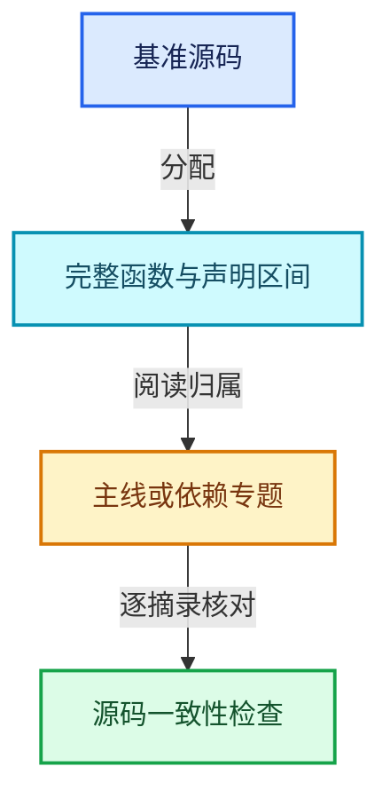
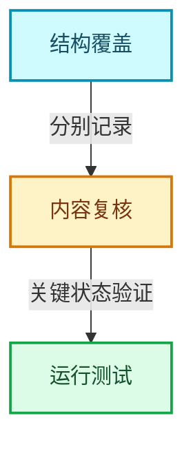

# 源码版本与覆盖索引

基准HEAD：`cbda6b96c26c0dee3c3b5cbb93960c4ac06a6b30`。具体文件SHA-256、摘录区间与教学位置见[_evidence/revision-v2.json](../../_evidence/revision-v2.json)。

主讲文件保持原有全行分配，改为完整函数和函数间声明区间；辅助实现通过独立专题展开。覆盖表示源码有阅读归属，不表示每个实现已经经过人工语义复核。

## 01-基础容器与现代CPP

### [01-01 对象生命周期与值类别](../../01-基础容器与现代CPP/01-对象生命周期与值类别.md)

- `source/blender/blenlib/BLI_memory_utils.hh` L1—L33：类型布局、声明或编译条件
- `source/blender/blenlib/BLI_memory_utils.hh` L34—L41：完整函数
- `source/blender/blenlib/BLI_memory_utils.hh` L42—L42：类型布局、声明或编译条件
- `source/blender/blenlib/BLI_memory_utils.hh` L43—L46：完整函数
- `source/blender/blenlib/BLI_memory_utils.hh` L47—L47：类型布局、声明或编译条件
- `source/blender/blenlib/BLI_memory_utils.hh` L48—L51：完整函数
- `source/blender/blenlib/BLI_memory_utils.hh` L52—L52：类型布局、声明或编译条件
- `source/blender/blenlib/BLI_memory_utils.hh` L53—L56：完整函数
- `source/blender/blenlib/BLI_memory_utils.hh` L57—L57：类型布局、声明或编译条件
- `source/blender/blenlib/BLI_memory_utils.hh` L58—L62：完整函数
- `source/blender/blenlib/BLI_memory_utils.hh` L63—L63：类型布局、声明或编译条件
- `source/blender/blenlib/BLI_memory_utils.hh` L64—L67：完整函数
- `source/blender/blenlib/BLI_memory_utils.hh` L68—L68：类型布局、声明或编译条件
- `source/blender/blenlib/BLI_memory_utils.hh` L69—L72：完整函数
- `source/blender/blenlib/BLI_memory_utils.hh` L73—L73：类型布局、声明或编译条件
- `source/blender/blenlib/BLI_memory_utils.hh` L74—L78：完整函数
- `source/blender/blenlib/BLI_memory_utils.hh` L79—L79：类型布局、声明或编译条件
- `source/blender/blenlib/BLI_memory_utils.hh` L80—L84：完整函数
- `source/blender/blenlib/BLI_memory_utils.hh` L85—L85：类型布局、声明或编译条件
- `source/blender/blenlib/BLI_memory_utils.hh` L86—L89：完整函数
- `source/blender/blenlib/BLI_memory_utils.hh` L90—L90：类型布局、声明或编译条件
- `source/blender/blenlib/BLI_memory_utils.hh` L91—L94：完整函数
- `source/blender/blenlib/BLI_memory_utils.hh` L95—L96：类型布局、声明或编译条件
- `source/blender/blenlib/BLI_memory_utils.hh` L97—L97：完整函数
- `source/blender/blenlib/BLI_memory_utils.hh` L98—L98：类型布局、声明或编译条件
- `source/blender/blenlib/BLI_memory_utils.hh` L99—L99：完整函数
- `source/blender/blenlib/BLI_memory_utils.hh` L100—L100：类型布局、声明或编译条件
- `source/blender/blenlib/BLI_memory_utils.hh` L101—L104：完整函数
- `source/blender/blenlib/BLI_memory_utils.hh` L105—L127：类型布局、声明或编译条件
- `source/blender/blenlib/BLI_memory_utils.hh` L128—L131：完整函数
- `source/blender/blenlib/BLI_memory_utils.hh` L132—L132：类型布局、声明或编译条件
- `source/blender/blenlib/BLI_memory_utils.hh` L133—L136：完整函数
- `source/blender/blenlib/BLI_memory_utils.hh` L137—L137：类型布局、声明或编译条件
- `source/blender/blenlib/BLI_memory_utils.hh` L138—L141：完整函数
- `source/blender/blenlib/BLI_memory_utils.hh` L142—L142：类型布局、声明或编译条件
- `source/blender/blenlib/BLI_memory_utils.hh` L143—L146：完整函数
- `source/blender/blenlib/BLI_memory_utils.hh` L147—L156：类型布局、声明或编译条件
- `source/blender/blenlib/BLI_memory_utils.hh` L157—L165：完整函数
- `source/blender/blenlib/BLI_memory_utils.hh` L166—L167：类型布局、声明或编译条件
- `source/blender/blenlib/BLI_memory_utils.hh` L168—L176：完整函数
- `source/blender/blenlib/BLI_memory_utils.hh` L177—L180：类型布局、声明或编译条件
- `source/blender/blenlib/BLI_memory_utils.hh` L181—L184：完整函数

### [01-02 模板与约束](../../01-基础容器与现代CPP/02-模板与约束.md)

- `source/blender/blenlib/BLI_utility_mixins.hh` L1—L18：类型布局、声明或编译条件
- `source/blender/blenlib/BLI_utility_mixins.hh` L19—L19：完整函数
- `source/blender/blenlib/BLI_utility_mixins.hh` L20—L20：完整函数
- `source/blender/blenlib/BLI_utility_mixins.hh` L21—L22：类型布局、声明或编译条件
- `source/blender/blenlib/BLI_utility_mixins.hh` L23—L23：完整函数
- `source/blender/blenlib/BLI_utility_mixins.hh` L24—L24：完整函数
- `source/blender/blenlib/BLI_utility_mixins.hh` L25—L25：完整函数
- `source/blender/blenlib/BLI_utility_mixins.hh` L26—L33：类型布局、声明或编译条件
- `source/blender/blenlib/BLI_utility_mixins.hh` L34—L34：完整函数
- `source/blender/blenlib/BLI_utility_mixins.hh` L35—L35：完整函数
- `source/blender/blenlib/BLI_utility_mixins.hh` L36—L37：类型布局、声明或编译条件
- `source/blender/blenlib/BLI_utility_mixins.hh` L38—L38：完整函数
- `source/blender/blenlib/BLI_utility_mixins.hh` L39—L39：完整函数
- `source/blender/blenlib/BLI_utility_mixins.hh` L40—L40：完整函数
- `source/blender/blenlib/BLI_utility_mixins.hh` L41—L43：类型布局、声明或编译条件

### [01-03 内存工具与分配器接口](../../01-基础容器与现代CPP/03-内存工具与分配器接口.md)

- `source/blender/blenlib/BLI_allocator.hh` L1—L42：类型布局、声明或编译条件
- `source/blender/blenlib/BLI_allocator.hh` L43—L48：完整函数
- `source/blender/blenlib/BLI_allocator.hh` L49—L58：完整函数
- `source/blender/blenlib/BLI_allocator.hh` L59—L59：类型布局、声明或编译条件
- `source/blender/blenlib/BLI_allocator.hh` L60—L63：完整函数
- `source/blender/blenlib/BLI_allocator.hh` L64—L74：类型布局、声明或编译条件
- `source/blender/blenlib/BLI_allocator.hh` L75—L78：完整函数
- `source/blender/blenlib/BLI_allocator.hh` L79—L88：完整函数
- `source/blender/blenlib/BLI_allocator.hh` L89—L89：类型布局、声明或编译条件
- `source/blender/blenlib/BLI_allocator.hh` L90—L93：完整函数
- `source/blender/blenlib/BLI_allocator.hh` L94—L107：类型布局、声明或编译条件
- `source/blender/blenlib/BLI_allocator.hh` L108—L118：完整函数
- `source/blender/blenlib/BLI_allocator.hh` L119—L124：完整函数
- `source/blender/blenlib/BLI_allocator.hh` L125—L125：类型布局、声明或编译条件
- `source/blender/blenlib/BLI_allocator.hh` L126—L132：完整函数
- `source/blender/blenlib/BLI_allocator.hh` L133—L135：类型布局、声明或编译条件

### [01-04 IndexRange连续整数区间](../../01-基础容器与现代CPP/04-IndexRange连续整数区间.md)

- `source/blender/blenlib/BLI_index_range.hh` L1—L59：类型布局、声明或编译条件
- `source/blender/blenlib/BLI_index_range.hh` L60—L60：完整函数
- `source/blender/blenlib/BLI_index_range.hh` L61—L61：类型布局、声明或编译条件
- `source/blender/blenlib/BLI_index_range.hh` L62—L65：完整函数
- `source/blender/blenlib/BLI_index_range.hh` L66—L66：类型布局、声明或编译条件
- `source/blender/blenlib/BLI_index_range.hh` L67—L71：完整函数
- `source/blender/blenlib/BLI_index_range.hh` L72—L72：类型布局、声明或编译条件
- `source/blender/blenlib/BLI_index_range.hh` L73—L76：完整函数
- `source/blender/blenlib/BLI_index_range.hh` L77—L77：类型布局、声明或编译条件
- `source/blender/blenlib/BLI_index_range.hh` L78—L81：完整函数
- `source/blender/blenlib/BLI_index_range.hh` L82—L82：类型布局、声明或编译条件
- `source/blender/blenlib/BLI_index_range.hh` L83—L86：完整函数
- `source/blender/blenlib/BLI_index_range.hh` L87—L87：类型布局、声明或编译条件
- `source/blender/blenlib/BLI_index_range.hh` L88—L91：完整函数
- `source/blender/blenlib/BLI_index_range.hh` L92—L92：类型布局、声明或编译条件
- `source/blender/blenlib/BLI_index_range.hh` L93—L96：完整函数
- `source/blender/blenlib/BLI_index_range.hh` L97—L107：类型布局、声明或编译条件
- `source/blender/blenlib/BLI_index_range.hh` L108—L108：完整函数
- `source/blender/blenlib/BLI_index_range.hh` L109—L109：类型布局、声明或编译条件
- `source/blender/blenlib/BLI_index_range.hh` L110—L113：完整函数
- `source/blender/blenlib/BLI_index_range.hh` L114—L114：类型布局、声明或编译条件
- `source/blender/blenlib/BLI_index_range.hh` L115—L118：完整函数
- `source/blender/blenlib/BLI_index_range.hh` L119—L120：类型布局、声明或编译条件
- `source/blender/blenlib/BLI_index_range.hh` L121—L124：完整函数
- `source/blender/blenlib/BLI_index_range.hh` L125—L125：类型布局、声明或编译条件
- `source/blender/blenlib/BLI_index_range.hh` L126—L129：完整函数
- `source/blender/blenlib/BLI_index_range.hh` L130—L133：类型布局、声明或编译条件
- `source/blender/blenlib/BLI_index_range.hh` L134—L139：完整函数
- `source/blender/blenlib/BLI_index_range.hh` L140—L143：类型布局、声明或编译条件
- `source/blender/blenlib/BLI_index_range.hh` L144—L147：完整函数
- `source/blender/blenlib/BLI_index_range.hh` L148—L151：完整函数
- `source/blender/blenlib/BLI_index_range.hh` L152—L155：类型布局、声明或编译条件
- `source/blender/blenlib/BLI_index_range.hh` L156—L159：完整函数
- `source/blender/blenlib/BLI_index_range.hh` L160—L160：类型布局、声明或编译条件
- `source/blender/blenlib/BLI_index_range.hh` L161—L164：完整函数
- `source/blender/blenlib/BLI_index_range.hh` L165—L168：类型布局、声明或编译条件
- `source/blender/blenlib/BLI_index_range.hh` L169—L172：完整函数
- `source/blender/blenlib/BLI_index_range.hh` L173—L176：类型布局、声明或编译条件
- `source/blender/blenlib/BLI_index_range.hh` L177—L180：完整函数
- `source/blender/blenlib/BLI_index_range.hh` L181—L184：类型布局、声明或编译条件
- `source/blender/blenlib/BLI_index_range.hh` L185—L189：完整函数
- `source/blender/blenlib/BLI_index_range.hh` L190—L193：类型布局、声明或编译条件
- `source/blender/blenlib/BLI_index_range.hh` L194—L198：完整函数
- `source/blender/blenlib/BLI_index_range.hh` L199—L203：类型布局、声明或编译条件
- `source/blender/blenlib/BLI_index_range.hh` L204—L208：完整函数
- `source/blender/blenlib/BLI_index_range.hh` L209—L213：类型布局、声明或编译条件
- `source/blender/blenlib/BLI_index_range.hh` L214—L220：完整函数
- `source/blender/blenlib/BLI_index_range.hh` L221—L225：类型布局、声明或编译条件
- `source/blender/blenlib/BLI_index_range.hh` L226—L230：完整函数
- `source/blender/blenlib/BLI_index_range.hh` L231—L234：类型布局、声明或编译条件
- `source/blender/blenlib/BLI_index_range.hh` L235—L238：完整函数
- `source/blender/blenlib/BLI_index_range.hh` L239—L242：类型布局、声明或编译条件
- `source/blender/blenlib/BLI_index_range.hh` L243—L246：完整函数
- `source/blender/blenlib/BLI_index_range.hh` L247—L250：类型布局、声明或编译条件
- `source/blender/blenlib/BLI_index_range.hh` L251—L254：完整函数
- `source/blender/blenlib/BLI_index_range.hh` L255—L258：类型布局、声明或编译条件
- `source/blender/blenlib/BLI_index_range.hh` L259—L271：完整函数
- `source/blender/blenlib/BLI_index_range.hh` L272—L275：类型布局、声明或编译条件
- `source/blender/blenlib/BLI_index_range.hh` L276—L283：完整函数
- `source/blender/blenlib/BLI_index_range.hh` L284—L287：完整函数
- `source/blender/blenlib/BLI_index_range.hh` L288—L293：类型布局、声明或编译条件
- `source/blender/blenlib/BLI_index_range.hh` L294—L300：完整函数
- `source/blender/blenlib/BLI_index_range.hh` L301—L305：类型布局、声明或编译条件
- `source/blender/blenlib/BLI_index_range.hh` L306—L311：完整函数
- `source/blender/blenlib/BLI_index_range.hh` L312—L316：类型布局、声明或编译条件
- `source/blender/blenlib/BLI_index_range.hh` L317—L322：完整函数
- `source/blender/blenlib/BLI_index_range.hh` L323—L327：类型布局、声明或编译条件
- `source/blender/blenlib/BLI_index_range.hh` L328—L333：完整函数
- `source/blender/blenlib/BLI_index_range.hh` L334—L338：类型布局、声明或编译条件
- `source/blender/blenlib/BLI_index_range.hh` L339—L344：完整函数
- `source/blender/blenlib/BLI_index_range.hh` L345—L349：类型布局、声明或编译条件
- `source/blender/blenlib/BLI_index_range.hh` L350—L353：完整函数
- `source/blender/blenlib/BLI_index_range.hh` L354—L373：类型布局、声明或编译条件

### [01-05 Span只读连续视图](../../01-基础容器与现代CPP/05-Span只读连续视图.md)

- `source/blender/blenlib/BLI_span.hh` L1—L91：类型布局、声明或编译条件
- `source/blender/blenlib/BLI_span.hh` L92—L92：完整函数
- `source/blender/blenlib/BLI_span.hh` L93—L93：类型布局、声明或编译条件
- `source/blender/blenlib/BLI_span.hh` L94—L97：完整函数
- `source/blender/blenlib/BLI_span.hh` L98—L98：类型布局、声明或编译条件
- `source/blender/blenlib/BLI_span.hh` L99—L105：完整函数
- `source/blender/blenlib/BLI_span.hh` L106—L117：类型布局、声明或编译条件
- `source/blender/blenlib/BLI_span.hh` L118—L120：完整函数
- `source/blender/blenlib/BLI_span.hh` L121—L121：类型布局、声明或编译条件
- `source/blender/blenlib/BLI_span.hh` L122—L122：完整函数
- `source/blender/blenlib/BLI_span.hh` L123—L123：类型布局、声明或编译条件
- `source/blender/blenlib/BLI_span.hh` L124—L124：完整函数
- `source/blender/blenlib/BLI_span.hh` L125—L129：类型布局、声明或编译条件
- `source/blender/blenlib/BLI_span.hh` L130—L135：完整函数
- `source/blender/blenlib/BLI_span.hh` L136—L140：类型布局、声明或编译条件
- `source/blender/blenlib/BLI_span.hh` L141—L147：完整函数
- `source/blender/blenlib/BLI_span.hh` L148—L148：类型布局、声明或编译条件
- `source/blender/blenlib/BLI_span.hh` L149—L152：完整函数
- `source/blender/blenlib/BLI_span.hh` L153—L157：类型布局、声明或编译条件
- `source/blender/blenlib/BLI_span.hh` L158—L164：完整函数
- `source/blender/blenlib/BLI_span.hh` L165—L165：类型布局、声明或编译条件
- `source/blender/blenlib/BLI_span.hh` L166—L169：完整函数
- `source/blender/blenlib/BLI_span.hh` L170—L174：类型布局、声明或编译条件
- `source/blender/blenlib/BLI_span.hh` L175—L180：完整函数
- `source/blender/blenlib/BLI_span.hh` L181—L185：类型布局、声明或编译条件
- `source/blender/blenlib/BLI_span.hh` L186—L191：完整函数
- `source/blender/blenlib/BLI_span.hh` L192—L196：类型布局、声明或编译条件
- `source/blender/blenlib/BLI_span.hh` L197—L202：完整函数
- `source/blender/blenlib/BLI_span.hh` L203—L207：类型布局、声明或编译条件
- `source/blender/blenlib/BLI_span.hh` L208—L213：完整函数
- `source/blender/blenlib/BLI_span.hh` L214—L218：类型布局、声明或编译条件
- `source/blender/blenlib/BLI_span.hh` L219—L222：完整函数
- `source/blender/blenlib/BLI_span.hh` L223—L223：类型布局、声明或编译条件
- `source/blender/blenlib/BLI_span.hh` L224—L227：完整函数
- `source/blender/blenlib/BLI_span.hh` L228—L231：完整函数
- `source/blender/blenlib/BLI_span.hh` L232—L232：类型布局、声明或编译条件
- `source/blender/blenlib/BLI_span.hh` L233—L236：完整函数
- `source/blender/blenlib/BLI_span.hh` L237—L240：完整函数
- `source/blender/blenlib/BLI_span.hh` L241—L245：类型布局、声明或编译条件
- `source/blender/blenlib/BLI_span.hh` L246—L251：完整函数
- `source/blender/blenlib/BLI_span.hh` L252—L255：类型布局、声明或编译条件
- `source/blender/blenlib/BLI_span.hh` L256—L259：完整函数
- `source/blender/blenlib/BLI_span.hh` L260—L263：类型布局、声明或编译条件
- `source/blender/blenlib/BLI_span.hh` L264—L267：完整函数
- `source/blender/blenlib/BLI_span.hh` L268—L271：类型布局、声明或编译条件
- `source/blender/blenlib/BLI_span.hh` L272—L275：完整函数
- `source/blender/blenlib/BLI_span.hh` L276—L280：类型布局、声明或编译条件
- `source/blender/blenlib/BLI_span.hh` L281—L289：完整函数
- `source/blender/blenlib/BLI_span.hh` L290—L294：类型布局、声明或编译条件
- `source/blender/blenlib/BLI_span.hh` L295—L298：完整函数
- `source/blender/blenlib/BLI_span.hh` L299—L303：类型布局、声明或编译条件
- `source/blender/blenlib/BLI_span.hh` L304—L313：完整函数
- `source/blender/blenlib/BLI_span.hh` L314—L318：类型布局、声明或编译条件
- `source/blender/blenlib/BLI_span.hh` L319—L323：完整函数
- `source/blender/blenlib/BLI_span.hh` L324—L328：类型布局、声明或编译条件
- `source/blender/blenlib/BLI_span.hh` L329—L334：完整函数
- `source/blender/blenlib/BLI_span.hh` L335—L339：类型布局、声明或编译条件
- `source/blender/blenlib/BLI_span.hh` L340—L355：完整函数
- `source/blender/blenlib/BLI_span.hh` L356—L361：类型布局、声明或编译条件
- `source/blender/blenlib/BLI_span.hh` L362—L375：完整函数
- `source/blender/blenlib/BLI_span.hh` L376—L380：类型布局、声明或编译条件
- `source/blender/blenlib/BLI_span.hh` L381—L386：完整函数
- `source/blender/blenlib/BLI_span.hh` L387—L390：类型布局、声明或编译条件
- `source/blender/blenlib/BLI_span.hh` L391—L399：完整函数
- `source/blender/blenlib/BLI_span.hh` L400—L404：类型布局、声明或编译条件
- `source/blender/blenlib/BLI_span.hh` L405—L408：完整函数
- `source/blender/blenlib/BLI_span.hh` L409—L409：类型布局、声明或编译条件
- `source/blender/blenlib/BLI_span.hh` L410—L417：完整函数
- `source/blender/blenlib/BLI_span.hh` L418—L421：类型布局、声明或编译条件
- `source/blender/blenlib/BLI_span.hh` L422—L427：完整函数
- `source/blender/blenlib/BLI_span.hh` L428—L428：类型布局、声明或编译条件
- `source/blender/blenlib/BLI_span.hh` L429—L435：完整函数
- `source/blender/blenlib/BLI_span.hh` L436—L436：类型布局、声明或编译条件
- `source/blender/blenlib/BLI_span.hh` L437—L440：完整函数
- `source/blender/blenlib/BLI_span.hh` L441—L461：类型布局、声明或编译条件

### [01-06 MutableSpan可写视图](../../01-基础容器与现代CPP/06-MutableSpan可写视图.md)

- `source/blender/blenlib/BLI_span.hh` L462—L462：完整函数
- `source/blender/blenlib/BLI_span.hh` L463—L463：类型布局、声明或编译条件
- `source/blender/blenlib/BLI_span.hh` L464—L464：完整函数
- `source/blender/blenlib/BLI_span.hh` L465—L465：类型布局、声明或编译条件
- `source/blender/blenlib/BLI_span.hh` L466—L466：完整函数
- `source/blender/blenlib/BLI_span.hh` L467—L467：类型布局、声明或编译条件
- `source/blender/blenlib/BLI_span.hh` L468—L471：完整函数
- `source/blender/blenlib/BLI_span.hh` L472—L476：类型布局、声明或编译条件
- `source/blender/blenlib/BLI_span.hh` L477—L482：完整函数
- `source/blender/blenlib/BLI_span.hh` L483—L483：类型布局、声明或编译条件
- `source/blender/blenlib/BLI_span.hh` L484—L487：完整函数
- `source/blender/blenlib/BLI_span.hh` L488—L488：类型布局、声明或编译条件
- `source/blender/blenlib/BLI_span.hh` L489—L494：完整函数
- `source/blender/blenlib/BLI_span.hh` L495—L498：类型布局、声明或编译条件
- `source/blender/blenlib/BLI_span.hh` L499—L502：完整函数
- `source/blender/blenlib/BLI_span.hh` L503—L506：类型布局、声明或编译条件
- `source/blender/blenlib/BLI_span.hh` L507—L510：完整函数
- `source/blender/blenlib/BLI_span.hh` L511—L514：类型布局、声明或编译条件
- `source/blender/blenlib/BLI_span.hh` L515—L518：完整函数
- `source/blender/blenlib/BLI_span.hh` L519—L522：类型布局、声明或编译条件
- `source/blender/blenlib/BLI_span.hh` L523—L526：完整函数
- `source/blender/blenlib/BLI_span.hh` L527—L531：类型布局、声明或编译条件
- `source/blender/blenlib/BLI_span.hh` L532—L539：完整函数
- `source/blender/blenlib/BLI_span.hh` L540—L544：类型布局、声明或编译条件
- `source/blender/blenlib/BLI_span.hh` L545—L548：完整函数
- `source/blender/blenlib/BLI_span.hh` L549—L549：类型布局、声明或编译条件
- `source/blender/blenlib/BLI_span.hh` L550—L553：完整函数
- `source/blender/blenlib/BLI_span.hh` L554—L557：完整函数
- `source/blender/blenlib/BLI_span.hh` L558—L558：类型布局、声明或编译条件
- `source/blender/blenlib/BLI_span.hh` L559—L562：完整函数
- `source/blender/blenlib/BLI_span.hh` L563—L566：完整函数
- `source/blender/blenlib/BLI_span.hh` L567—L567：类型布局、声明或编译条件
- `source/blender/blenlib/BLI_span.hh` L568—L573：完整函数
- `source/blender/blenlib/BLI_span.hh` L574—L578：类型布局、声明或编译条件
- `source/blender/blenlib/BLI_span.hh` L579—L585：完整函数
- `source/blender/blenlib/BLI_span.hh` L586—L586：类型布局、声明或编译条件
- `source/blender/blenlib/BLI_span.hh` L587—L590：完整函数
- `source/blender/blenlib/BLI_span.hh` L591—L595：类型布局、声明或编译条件
- `source/blender/blenlib/BLI_span.hh` L596—L602：完整函数
- `source/blender/blenlib/BLI_span.hh` L603—L603：类型布局、声明或编译条件
- `source/blender/blenlib/BLI_span.hh` L604—L607：完整函数
- `source/blender/blenlib/BLI_span.hh` L608—L612：类型布局、声明或编译条件
- `source/blender/blenlib/BLI_span.hh` L613—L618：完整函数
- `source/blender/blenlib/BLI_span.hh` L619—L623：类型布局、声明或编译条件
- `source/blender/blenlib/BLI_span.hh` L624—L629：完整函数
- `source/blender/blenlib/BLI_span.hh` L630—L634：类型布局、声明或编译条件
- `source/blender/blenlib/BLI_span.hh` L635—L640：完整函数
- `source/blender/blenlib/BLI_span.hh` L641—L645：类型布局、声明或编译条件
- `source/blender/blenlib/BLI_span.hh` L646—L651：完整函数
- `source/blender/blenlib/BLI_span.hh` L652—L655：类型布局、声明或编译条件
- `source/blender/blenlib/BLI_span.hh` L656—L661：完整函数
- `source/blender/blenlib/BLI_span.hh` L662—L666：类型布局、声明或编译条件
- `source/blender/blenlib/BLI_span.hh` L667—L670：完整函数
- `source/blender/blenlib/BLI_span.hh` L671—L675：类型布局、声明或编译条件
- `source/blender/blenlib/BLI_span.hh` L676—L679：完整函数
- `source/blender/blenlib/BLI_span.hh` L680—L684：类型布局、声明或编译条件
- `source/blender/blenlib/BLI_span.hh` L685—L689：完整函数
- `source/blender/blenlib/BLI_span.hh` L690—L694：类型布局、声明或编译条件
- `source/blender/blenlib/BLI_span.hh` L695—L700：完整函数
- `source/blender/blenlib/BLI_span.hh` L701—L705：类型布局、声明或编译条件
- `source/blender/blenlib/BLI_span.hh` L706—L715：完整函数
- `source/blender/blenlib/BLI_span.hh` L716—L720：类型布局、声明或编译条件
- `source/blender/blenlib/BLI_span.hh` L721—L729：完整函数
- `source/blender/blenlib/BLI_span.hh` L730—L734：类型布局、声明或编译条件
- `source/blender/blenlib/BLI_span.hh` L735—L738：完整函数
- `source/blender/blenlib/BLI_span.hh` L739—L744：类型布局、声明或编译条件
- `source/blender/blenlib/BLI_span.hh` L745—L749：完整函数
- `source/blender/blenlib/BLI_span.hh` L750—L754：类型布局、声明或编译条件
- `source/blender/blenlib/BLI_span.hh` L755—L760：完整函数
- `source/blender/blenlib/BLI_span.hh` L761—L763：类型布局、声明或编译条件

### [01-07 Array构造与存储](../../01-基础容器与现代CPP/07-Array构造与存储.md)

- `source/blender/blenlib/BLI_array.hh` L1—L77：类型布局、声明或编译条件
- `source/blender/blenlib/BLI_array.hh` L78—L82：完整函数
- `source/blender/blenlib/BLI_array.hh` L83—L83：类型布局、声明或编译条件
- `source/blender/blenlib/BLI_array.hh` L84—L84：完整函数
- `source/blender/blenlib/BLI_array.hh` L85—L88：类型布局、声明或编译条件
- `source/blender/blenlib/BLI_array.hh` L89—L98：完整函数
- `source/blender/blenlib/BLI_array.hh` L99—L102：类型布局、声明或编译条件
- `source/blender/blenlib/BLI_array.hh` L103—L108：完整函数
- `source/blender/blenlib/BLI_array.hh` L109—L109：类型布局、声明或编译条件
- `source/blender/blenlib/BLI_array.hh` L110—L113：完整函数
- `source/blender/blenlib/BLI_array.hh` L114—L122：类型布局、声明或编译条件
- `source/blender/blenlib/BLI_array.hh` L123—L129：完整函数
- `source/blender/blenlib/BLI_array.hh` L130—L134：类型布局、声明或编译条件
- `source/blender/blenlib/BLI_array.hh` L135—L154：完整函数
- `source/blender/blenlib/BLI_array.hh` L155—L167：类型布局、声明或编译条件
- `source/blender/blenlib/BLI_array.hh` L168—L174：完整函数
- `source/blender/blenlib/BLI_array.hh` L175—L175：类型布局、声明或编译条件
- `source/blender/blenlib/BLI_array.hh` L176—L176：完整函数
- `source/blender/blenlib/BLI_array.hh` L177—L177：类型布局、声明或编译条件
- `source/blender/blenlib/BLI_array.hh` L178—L198：完整函数
- `source/blender/blenlib/BLI_array.hh` L199—L199：类型布局、声明或编译条件
- `source/blender/blenlib/BLI_array.hh` L200—L204：完整函数
- `source/blender/blenlib/BLI_array.hh` L205—L205：类型布局、声明或编译条件
- `source/blender/blenlib/BLI_array.hh` L206—L209：完整函数
- `source/blender/blenlib/BLI_array.hh` L210—L210：类型布局、声明或编译条件
- `source/blender/blenlib/BLI_array.hh` L211—L214：完整函数
- `source/blender/blenlib/BLI_array.hh` L215—L215：类型布局、声明或编译条件
- `source/blender/blenlib/BLI_array.hh` L216—L221：完整函数
- `source/blender/blenlib/BLI_array.hh` L222—L222：类型布局、声明或编译条件
- `source/blender/blenlib/BLI_array.hh` L223—L228：完整函数
- `source/blender/blenlib/BLI_array.hh` L229—L229：类型布局、声明或编译条件
- `source/blender/blenlib/BLI_array.hh` L230—L233：完整函数
- `source/blender/blenlib/BLI_array.hh` L234—L234：类型布局、声明或编译条件
- `source/blender/blenlib/BLI_array.hh` L235—L238：完整函数
- `source/blender/blenlib/BLI_array.hh` L239—L239：类型布局、声明或编译条件
- `source/blender/blenlib/BLI_array.hh` L240—L245：完整函数

### [01-08 Array复制移动与销毁](../../01-基础容器与现代CPP/08-Array复制移动与销毁.md)

- `source/blender/blenlib/BLI_array.hh` L246—L246：类型布局、声明或编译条件
- `source/blender/blenlib/BLI_array.hh` L247—L252：完整函数
- `source/blender/blenlib/BLI_array.hh` L253—L253：类型布局、声明或编译条件
- `source/blender/blenlib/BLI_array.hh` L254—L257：完整函数
- `source/blender/blenlib/BLI_array.hh` L258—L258：类型布局、声明或编译条件
- `source/blender/blenlib/BLI_array.hh` L259—L262：完整函数
- `source/blender/blenlib/BLI_array.hh` L263—L266：类型布局、声明或编译条件
- `source/blender/blenlib/BLI_array.hh` L267—L270：完整函数
- `source/blender/blenlib/BLI_array.hh` L271—L274：类型布局、声明或编译条件
- `source/blender/blenlib/BLI_array.hh` L275—L278：完整函数
- `source/blender/blenlib/BLI_array.hh` L279—L282：类型布局、声明或编译条件
- `source/blender/blenlib/BLI_array.hh` L283—L286：完整函数
- `source/blender/blenlib/BLI_array.hh` L287—L291：类型布局、声明或编译条件
- `source/blender/blenlib/BLI_array.hh` L292—L296：完整函数
- `source/blender/blenlib/BLI_array.hh` L297—L301：完整函数
- `source/blender/blenlib/BLI_array.hh` L302—L306：类型布局、声明或编译条件
- `source/blender/blenlib/BLI_array.hh` L307—L312：完整函数
- `source/blender/blenlib/BLI_array.hh` L313—L318：完整函数
- `source/blender/blenlib/BLI_array.hh` L319—L322：类型布局、声明或编译条件
- `source/blender/blenlib/BLI_array.hh` L323—L326：完整函数
- `source/blender/blenlib/BLI_array.hh` L327—L330：完整函数
- `source/blender/blenlib/BLI_array.hh` L331—L331：类型布局、声明或编译条件
- `source/blender/blenlib/BLI_array.hh` L332—L335：完整函数
- `source/blender/blenlib/BLI_array.hh` L336—L339：完整函数
- `source/blender/blenlib/BLI_array.hh` L340—L340：类型布局、声明或编译条件
- `source/blender/blenlib/BLI_array.hh` L341—L344：完整函数
- `source/blender/blenlib/BLI_array.hh` L345—L348：完整函数
- `source/blender/blenlib/BLI_array.hh` L349—L349：类型布局、声明或编译条件
- `source/blender/blenlib/BLI_array.hh` L350—L353：完整函数
- `source/blender/blenlib/BLI_array.hh` L354—L357：完整函数
- `source/blender/blenlib/BLI_array.hh` L358—L358：类型布局、声明或编译条件
- `source/blender/blenlib/BLI_array.hh` L359—L362：完整函数
- `source/blender/blenlib/BLI_array.hh` L363—L366：完整函数
- `source/blender/blenlib/BLI_array.hh` L367—L370：类型布局、声明或编译条件
- `source/blender/blenlib/BLI_array.hh` L371—L374：完整函数
- `source/blender/blenlib/BLI_array.hh` L375—L375：类型布局、声明或编译条件
- `source/blender/blenlib/BLI_array.hh` L376—L379：完整函数
- `source/blender/blenlib/BLI_array.hh` L380—L380：类型布局、声明或编译条件
- `source/blender/blenlib/BLI_array.hh` L381—L384：完整函数
- `source/blender/blenlib/BLI_array.hh` L385—L385：类型布局、声明或编译条件
- `source/blender/blenlib/BLI_array.hh` L386—L389：完整函数
- `source/blender/blenlib/BLI_array.hh` L390—L390：类型布局、声明或编译条件
- `source/blender/blenlib/BLI_array.hh` L391—L394：完整函数
- `source/blender/blenlib/BLI_array.hh` L395—L399：类型布局、声明或编译条件
- `source/blender/blenlib/BLI_array.hh` L400—L403：完整函数
- `source/blender/blenlib/BLI_array.hh` L404—L407：类型布局、声明或编译条件
- `source/blender/blenlib/BLI_array.hh` L408—L411：完整函数
- `source/blender/blenlib/BLI_array.hh` L412—L415：完整函数
- `source/blender/blenlib/BLI_array.hh` L416—L420：类型布局、声明或编译条件
- `source/blender/blenlib/BLI_array.hh` L421—L424：完整函数
- `source/blender/blenlib/BLI_array.hh` L425—L429：类型布局、声明或编译条件
- `source/blender/blenlib/BLI_array.hh` L430—L455：完整函数
- `source/blender/blenlib/BLI_array.hh` L456—L457：类型布局、声明或编译条件
- `source/blender/blenlib/BLI_array.hh` L458—L469：完整函数
- `source/blender/blenlib/BLI_array.hh` L470—L470：类型布局、声明或编译条件
- `source/blender/blenlib/BLI_array.hh` L471—L477：完整函数
- `source/blender/blenlib/BLI_array.hh` L478—L478：类型布局、声明或编译条件
- `source/blender/blenlib/BLI_array.hh` L479—L484：完整函数
- `source/blender/blenlib/BLI_array.hh` L485—L487：类型布局、声明或编译条件

### [01-09 Vector存储与内嵌缓冲](../../01-基础容器与现代CPP/09-Vector存储与内嵌缓冲.md)

- `source/blender/blenlib/BLI_vector.hh` L1—L124：类型布局、声明或编译条件
- `source/blender/blenlib/BLI_vector.hh` L125—L133：完整函数
- `source/blender/blenlib/BLI_vector.hh` L134—L139：类型布局、声明或编译条件

### [01-10 Vector扩容与增长](../../01-基础容器与现代CPP/10-Vector扩容与增长.md)

- `source/blender/blenlib/BLI_vector.hh` L352—L357：完整函数
- `source/blender/blenlib/BLI_vector.hh` L358—L358：类型布局、声明或编译条件
- `source/blender/blenlib/BLI_vector.hh` L359—L364：完整函数
- `source/blender/blenlib/BLI_vector.hh` L365—L365：类型布局、声明或编译条件
- `source/blender/blenlib/BLI_vector.hh` L366—L369：完整函数
- `source/blender/blenlib/BLI_vector.hh` L370—L370：类型布局、声明或编译条件
- `source/blender/blenlib/BLI_vector.hh` L371—L374：完整函数
- `source/blender/blenlib/BLI_vector.hh` L375—L375：类型布局、声明或编译条件
- `source/blender/blenlib/BLI_vector.hh` L376—L381：完整函数
- `source/blender/blenlib/BLI_vector.hh` L382—L382：类型布局、声明或编译条件
- `source/blender/blenlib/BLI_vector.hh` L383—L388：完整函数
- `source/blender/blenlib/BLI_vector.hh` L389—L389：类型布局、声明或编译条件
- `source/blender/blenlib/BLI_vector.hh` L390—L393：完整函数
- `source/blender/blenlib/BLI_vector.hh` L394—L394：类型布局、声明或编译条件
- `source/blender/blenlib/BLI_vector.hh` L395—L398：完整函数
- `source/blender/blenlib/BLI_vector.hh` L399—L404：类型布局、声明或编译条件
- `source/blender/blenlib/BLI_vector.hh` L405—L410：完整函数
- `source/blender/blenlib/BLI_vector.hh` L411—L417：类型布局、声明或编译条件
- `source/blender/blenlib/BLI_vector.hh` L418—L431：完整函数
- `source/blender/blenlib/BLI_vector.hh` L432—L438：类型布局、声明或编译条件
- `source/blender/blenlib/BLI_vector.hh` L439—L452：完整函数
- `source/blender/blenlib/BLI_vector.hh` L453—L457：类型布局、声明或编译条件
- `source/blender/blenlib/BLI_vector.hh` L458—L462：完整函数
- `source/blender/blenlib/BLI_vector.hh` L463—L467：类型布局、声明或编译条件
- `source/blender/blenlib/BLI_vector.hh` L468—L473：完整函数
- `source/blender/blenlib/BLI_vector.hh` L474—L478：类型布局、声明或编译条件
- `source/blender/blenlib/BLI_vector.hh` L479—L490：完整函数
- `source/blender/blenlib/BLI_vector.hh` L491—L497：类型布局、声明或编译条件
- `source/blender/blenlib/BLI_vector.hh` L1114—L1119：完整函数
- `source/blender/blenlib/BLI_vector.hh` L1120—L1120：类型布局、声明或编译条件
- `source/blender/blenlib/BLI_vector.hh` L1121—L1151：完整函数
- `source/blender/blenlib/BLI_vector.hh` L1152—L1167：类型布局、声明或编译条件

### [01-11 Vector插入删除与重排](../../01-基础容器与现代CPP/11-Vector插入删除与重排.md)

- `source/blender/blenlib/BLI_vector.hh` L498—L501：完整函数
- `source/blender/blenlib/BLI_vector.hh` L502—L505：完整函数
- `source/blender/blenlib/BLI_vector.hh` L506—L506：类型布局、声明或编译条件
- `source/blender/blenlib/BLI_vector.hh` L507—L511：完整函数
- `source/blender/blenlib/BLI_vector.hh` L512—L516：类型布局、声明或编译条件
- `source/blender/blenlib/BLI_vector.hh` L517—L520：完整函数
- `source/blender/blenlib/BLI_vector.hh` L521—L524：完整函数
- `source/blender/blenlib/BLI_vector.hh` L525—L530：完整函数
- `source/blender/blenlib/BLI_vector.hh` L531—L536：类型布局、声明或编译条件
- `source/blender/blenlib/BLI_vector.hh` L537—L542：完整函数
- `source/blender/blenlib/BLI_vector.hh` L543—L548：类型布局、声明或编译条件
- `source/blender/blenlib/BLI_vector.hh` L549—L552：完整函数
- `source/blender/blenlib/BLI_vector.hh` L553—L556：完整函数
- `source/blender/blenlib/BLI_vector.hh` L557—L563：完整函数
- `source/blender/blenlib/BLI_vector.hh` L564—L568：类型布局、声明或编译条件
- `source/blender/blenlib/BLI_vector.hh` L569—L575：完整函数
- `source/blender/blenlib/BLI_vector.hh` L576—L582：类型布局、声明或编译条件
- `source/blender/blenlib/BLI_vector.hh` L583—L588：完整函数
- `source/blender/blenlib/BLI_vector.hh` L589—L594：类型布局、声明或编译条件
- `source/blender/blenlib/BLI_vector.hh` L595—L598：完整函数
- `source/blender/blenlib/BLI_vector.hh` L599—L603：完整函数
- `source/blender/blenlib/BLI_vector.hh` L604—L612：类型布局、声明或编译条件
- `source/blender/blenlib/BLI_vector.hh` L613—L619：完整函数
- `source/blender/blenlib/BLI_vector.hh` L620—L625：类型布局、声明或编译条件
- `source/blender/blenlib/BLI_vector.hh` L626—L631：完整函数
- `source/blender/blenlib/BLI_vector.hh` L632—L636：类型布局、声明或编译条件
- `source/blender/blenlib/BLI_vector.hh` L637—L640：完整函数
- `source/blender/blenlib/BLI_vector.hh` L641—L648：完整函数
- `source/blender/blenlib/BLI_vector.hh` L649—L649：类型布局、声明或编译条件
- `source/blender/blenlib/BLI_vector.hh` L650—L653：完整函数
- `source/blender/blenlib/BLI_vector.hh` L654—L659：类型布局、声明或编译条件
- `source/blender/blenlib/BLI_vector.hh` L660—L663：完整函数
- `source/blender/blenlib/BLI_vector.hh` L664—L668：完整函数
- `source/blender/blenlib/BLI_vector.hh` L669—L672：完整函数
- `source/blender/blenlib/BLI_vector.hh` L673—L677：完整函数
- `source/blender/blenlib/BLI_vector.hh` L678—L722：完整函数
- `source/blender/blenlib/BLI_vector.hh` L723—L727：类型布局、声明或编译条件
- `source/blender/blenlib/BLI_vector.hh` L728—L731：完整函数
- `source/blender/blenlib/BLI_vector.hh` L732—L735：完整函数
- `source/blender/blenlib/BLI_vector.hh` L736—L739：完整函数
- `source/blender/blenlib/BLI_vector.hh` L740—L743：完整函数
- `source/blender/blenlib/BLI_vector.hh` L744—L748：类型布局、声明或编译条件
- `source/blender/blenlib/BLI_vector.hh` L749—L754：完整函数
- `source/blender/blenlib/BLI_vector.hh` L755—L760：完整函数
- `source/blender/blenlib/BLI_vector.hh` L761—L765：类型布局、声明或编译条件
- `source/blender/blenlib/BLI_vector.hh` L766—L770：完整函数
- `source/blender/blenlib/BLI_vector.hh` L771—L775：完整函数
- `source/blender/blenlib/BLI_vector.hh` L776—L779：类型布局、声明或编译条件
- `source/blender/blenlib/BLI_vector.hh` L780—L785：完整函数
- `source/blender/blenlib/BLI_vector.hh` L786—L791：类型布局、声明或编译条件
- `source/blender/blenlib/BLI_vector.hh` L792—L795：完整函数
- `source/blender/blenlib/BLI_vector.hh` L796—L800：类型布局、声明或编译条件
- `source/blender/blenlib/BLI_vector.hh` L801—L807：完整函数
- `source/blender/blenlib/BLI_vector.hh` L808—L814：类型布局、声明或编译条件
- `source/blender/blenlib/BLI_vector.hh` L815—L823：完整函数
- `source/blender/blenlib/BLI_vector.hh` L824—L828：类型布局、声明或编译条件
- `source/blender/blenlib/BLI_vector.hh` L829—L841：完整函数
- `source/blender/blenlib/BLI_vector.hh` L842—L846：类型布局、声明或编译条件
- `source/blender/blenlib/BLI_vector.hh` L847—L851：完整函数
- `source/blender/blenlib/BLI_vector.hh` L852—L859：类型布局、声明或编译条件
- `source/blender/blenlib/BLI_vector.hh` L860—L871：完整函数
- `source/blender/blenlib/BLI_vector.hh` L872—L878：类型布局、声明或编译条件
- `source/blender/blenlib/BLI_vector.hh` L879—L892：完整函数
- `source/blender/blenlib/BLI_vector.hh` L893—L899：类型布局、声明或编译条件
- `source/blender/blenlib/BLI_vector.hh` L900—L907：完整函数
- `source/blender/blenlib/BLI_vector.hh` L908—L912：类型布局、声明或编译条件
- `source/blender/blenlib/BLI_vector.hh` L913—L921：完整函数
- `source/blender/blenlib/BLI_vector.hh` L922—L926：类型布局、声明或编译条件
- `source/blender/blenlib/BLI_vector.hh` L927—L932：完整函数
- `source/blender/blenlib/BLI_vector.hh` L933—L937：类型布局、声明或编译条件

### [01-12 Vector异常安全与边界](../../01-基础容器与现代CPP/12-Vector异常安全与边界.md)

- `source/blender/blenlib/BLI_vector.hh` L140—L146：完整函数
- `source/blender/blenlib/BLI_vector.hh` L147—L147：类型布局、声明或编译条件
- `source/blender/blenlib/BLI_vector.hh` L148—L148：完整函数
- `source/blender/blenlib/BLI_vector.hh` L149—L154：类型布局、声明或编译条件
- `source/blender/blenlib/BLI_vector.hh` L155—L159：完整函数
- `source/blender/blenlib/BLI_vector.hh` L160—L163：类型布局、声明或编译条件
- `source/blender/blenlib/BLI_vector.hh` L164—L168：完整函数
- `source/blender/blenlib/BLI_vector.hh` L169—L172：类型布局、声明或编译条件
- `source/blender/blenlib/BLI_vector.hh` L173—L182：完整函数
- `source/blender/blenlib/BLI_vector.hh` L183—L183：类型布局、声明或编译条件
- `source/blender/blenlib/BLI_vector.hh` L184—L189：完整函数
- `source/blender/blenlib/BLI_vector.hh` L190—L196：类型布局、声明或编译条件
- `source/blender/blenlib/BLI_vector.hh` L197—L202：完整函数
- `source/blender/blenlib/BLI_vector.hh` L203—L203：类型布局、声明或编译条件
- `source/blender/blenlib/BLI_vector.hh` L204—L204：完整函数
- `source/blender/blenlib/BLI_vector.hh` L205—L205：类型布局、声明或编译条件
- `source/blender/blenlib/BLI_vector.hh` L206—L211：完整函数
- `source/blender/blenlib/BLI_vector.hh` L212—L212：类型布局、声明或编译条件
- `source/blender/blenlib/BLI_vector.hh` L213—L223：完整函数
- `source/blender/blenlib/BLI_vector.hh` L224—L228：类型布局、声明或编译条件
- `source/blender/blenlib/BLI_vector.hh` L229—L229：完整函数
- `source/blender/blenlib/BLI_vector.hh` L230—L234：类型布局、声明或编译条件
- `source/blender/blenlib/BLI_vector.hh` L235—L239：完整函数
- `source/blender/blenlib/BLI_vector.hh` L240—L244：类型布局、声明或编译条件
- `source/blender/blenlib/BLI_vector.hh` L245—L307：完整函数
- `source/blender/blenlib/BLI_vector.hh` L308—L313：类型布局、声明或编译条件
- `source/blender/blenlib/BLI_vector.hh` L314—L328：完整函数
- `source/blender/blenlib/BLI_vector.hh` L329—L329：类型布局、声明或编译条件
- `source/blender/blenlib/BLI_vector.hh` L330—L336：完整函数
- `source/blender/blenlib/BLI_vector.hh` L337—L337：类型布局、声明或编译条件
- `source/blender/blenlib/BLI_vector.hh` L338—L341：完整函数
- `source/blender/blenlib/BLI_vector.hh` L342—L342：类型布局、声明或编译条件
- `source/blender/blenlib/BLI_vector.hh` L343—L346：完整函数
- `source/blender/blenlib/BLI_vector.hh` L347—L351：类型布局、声明或编译条件
- `source/blender/blenlib/BLI_vector.hh` L938—L941：完整函数
- `source/blender/blenlib/BLI_vector.hh` L942—L945：类型布局、声明或编译条件
- `source/blender/blenlib/BLI_vector.hh` L946—L949：完整函数
- `source/blender/blenlib/BLI_vector.hh` L950—L953：类型布局、声明或编译条件
- `source/blender/blenlib/BLI_vector.hh` L954—L957：完整函数
- `source/blender/blenlib/BLI_vector.hh` L958—L961：类型布局、声明或编译条件
- `source/blender/blenlib/BLI_vector.hh` L962—L965：完整函数
- `source/blender/blenlib/BLI_vector.hh` L966—L966：类型布局、声明或编译条件
- `source/blender/blenlib/BLI_vector.hh` L967—L970：完整函数
- `source/blender/blenlib/BLI_vector.hh` L971—L974：完整函数
- `source/blender/blenlib/BLI_vector.hh` L975—L975：类型布局、声明或编译条件
- `source/blender/blenlib/BLI_vector.hh` L976—L979：完整函数
- `source/blender/blenlib/BLI_vector.hh` L980—L983：完整函数
- `source/blender/blenlib/BLI_vector.hh` L984—L984：类型布局、声明或编译条件
- `source/blender/blenlib/BLI_vector.hh` L985—L988：完整函数
- `source/blender/blenlib/BLI_vector.hh` L989—L992：完整函数
- `source/blender/blenlib/BLI_vector.hh` L993—L993：类型布局、声明或编译条件
- `source/blender/blenlib/BLI_vector.hh` L994—L997：完整函数
- `source/blender/blenlib/BLI_vector.hh` L998—L1001：完整函数
- `source/blender/blenlib/BLI_vector.hh` L1002—L1006：类型布局、声明或编译条件
- `source/blender/blenlib/BLI_vector.hh` L1007—L1010：完整函数
- `source/blender/blenlib/BLI_vector.hh` L1011—L1011：类型布局、声明或编译条件
- `source/blender/blenlib/BLI_vector.hh` L1012—L1015：完整函数
- `source/blender/blenlib/BLI_vector.hh` L1016—L1025：类型布局、声明或编译条件
- `source/blender/blenlib/BLI_vector.hh` L1026—L1029：完整函数
- `source/blender/blenlib/BLI_vector.hh` L1030—L1030：类型布局、声明或编译条件
- `source/blender/blenlib/BLI_vector.hh` L1031—L1034：完整函数
- `source/blender/blenlib/BLI_vector.hh` L1035—L1035：类型布局、声明或编译条件
- `source/blender/blenlib/BLI_vector.hh` L1036—L1039：完整函数
- `source/blender/blenlib/BLI_vector.hh` L1040—L1040：类型布局、声明或编译条件
- `source/blender/blenlib/BLI_vector.hh` L1041—L1044：完整函数
- `source/blender/blenlib/BLI_vector.hh` L1045—L1045：类型布局、声明或编译条件
- `source/blender/blenlib/BLI_vector.hh` L1046—L1049：完整函数
- `source/blender/blenlib/BLI_vector.hh` L1050—L1059：类型布局、声明或编译条件
- `source/blender/blenlib/BLI_vector.hh` L1060—L1097：完整函数
- `source/blender/blenlib/BLI_vector.hh` L1098—L1101：类型布局、声明或编译条件
- `source/blender/blenlib/BLI_vector.hh` L1102—L1106：完整函数
- `source/blender/blenlib/BLI_vector.hh` L1107—L1107：类型布局、声明或编译条件
- `source/blender/blenlib/BLI_vector.hh` L1108—L1111：完整函数
- `source/blender/blenlib/BLI_vector.hh` L1112—L1113：类型布局、声明或编译条件

### [01-13 Stack与栈接口](../../01-基础容器与现代CPP/13-Stack与栈接口.md)

- `source/blender/blenlib/BLI_stack.hh` L1—L50：类型布局、声明或编译条件
- `source/blender/blenlib/BLI_stack.hh` L51—L54：完整函数
- `source/blender/blenlib/BLI_stack.hh` L55—L117：类型布局、声明或编译条件
- `source/blender/blenlib/BLI_stack.hh` L118—L128：完整函数
- `source/blender/blenlib/BLI_stack.hh` L129—L129：类型布局、声明或编译条件
- `source/blender/blenlib/BLI_stack.hh` L130—L130：完整函数
- `source/blender/blenlib/BLI_stack.hh` L131—L135：类型布局、声明或编译条件
- `source/blender/blenlib/BLI_stack.hh` L136—L139：完整函数
- `source/blender/blenlib/BLI_stack.hh` L140—L149：类型布局、声明或编译条件
- `source/blender/blenlib/BLI_stack.hh` L150—L153：完整函数
- `source/blender/blenlib/BLI_stack.hh` L154—L154：类型布局、声明或编译条件
- `source/blender/blenlib/BLI_stack.hh` L155—L162：完整函数
- `source/blender/blenlib/BLI_stack.hh` L163—L163：类型布局、声明或编译条件
- `source/blender/blenlib/BLI_stack.hh` L164—L190：完整函数
- `source/blender/blenlib/BLI_stack.hh` L191—L191：类型布局、声明或编译条件
- `source/blender/blenlib/BLI_stack.hh` L192—L200：完整函数
- `source/blender/blenlib/BLI_stack.hh` L201—L201：类型布局、声明或编译条件
- `source/blender/blenlib/BLI_stack.hh` L202—L205：完整函数
- `source/blender/blenlib/BLI_stack.hh` L206—L206：类型布局、声明或编译条件
- `source/blender/blenlib/BLI_stack.hh` L207—L210：完整函数
- `source/blender/blenlib/BLI_stack.hh` L211—L214：类型布局、声明或编译条件
- `source/blender/blenlib/BLI_stack.hh` L215—L218：完整函数
- `source/blender/blenlib/BLI_stack.hh` L219—L222：完整函数
- `source/blender/blenlib/BLI_stack.hh` L223—L223：类型布局、声明或编译条件
- `source/blender/blenlib/BLI_stack.hh` L224—L238：完整函数
- `source/blender/blenlib/BLI_stack.hh` L239—L243：类型布局、声明或编译条件
- `source/blender/blenlib/BLI_stack.hh` L244—L259：完整函数
- `source/blender/blenlib/BLI_stack.hh` L260—L264：类型布局、声明或编译条件
- `source/blender/blenlib/BLI_stack.hh` L265—L270：完整函数
- `source/blender/blenlib/BLI_stack.hh` L271—L276：完整函数
- `source/blender/blenlib/BLI_stack.hh` L277—L282：类型布局、声明或编译条件
- `source/blender/blenlib/BLI_stack.hh` L283—L305：完整函数
- `source/blender/blenlib/BLI_stack.hh` L306—L309：类型布局、声明或编译条件
- `source/blender/blenlib/BLI_stack.hh` L310—L313：完整函数
- `source/blender/blenlib/BLI_stack.hh` L314—L317：类型布局、声明或编译条件
- `source/blender/blenlib/BLI_stack.hh` L318—L321：完整函数
- `source/blender/blenlib/BLI_stack.hh` L322—L326：类型布局、声明或编译条件
- `source/blender/blenlib/BLI_stack.hh` L327—L332：完整函数
- `source/blender/blenlib/BLI_stack.hh` L333—L336：类型布局、声明或编译条件
- `source/blender/blenlib/BLI_stack.hh` L337—L341：完整函数
- `source/blender/blenlib/BLI_stack.hh` L342—L343：类型布局、声明或编译条件
- `source/blender/blenlib/BLI_stack.hh` L344—L350：完整函数
- `source/blender/blenlib/BLI_stack.hh` L351—L359：类型布局、声明或编译条件
- `source/blender/blenlib/BLI_stack.hh` L360—L383：完整函数
- `source/blender/blenlib/BLI_stack.hh` L384—L384：类型布局、声明或编译条件
- `source/blender/blenlib/BLI_stack.hh` L385—L395：完整函数
- `source/blender/blenlib/BLI_stack.hh` L396—L396：类型布局、声明或编译条件
- `source/blender/blenlib/BLI_stack.hh` L397—L407：完整函数
- `source/blender/blenlib/BLI_stack.hh` L408—L417：类型布局、声明或编译条件

### [01-14 VectorSet稳定索引与去重](../../01-基础容器与现代CPP/14-VectorSet稳定索引与去重.md)

- `source/blender/blenlib/BLI_vector_set.hh` L1—L177：类型布局、声明或编译条件
- `source/blender/blenlib/BLI_vector_set.hh` L178—L186：完整函数
- `source/blender/blenlib/BLI_vector_set.hh` L187—L187：类型布局、声明或编译条件
- `source/blender/blenlib/BLI_vector_set.hh` L188—L192：完整函数
- `source/blender/blenlib/BLI_vector_set.hh` L193—L193：类型布局、声明或编译条件
- `source/blender/blenlib/BLI_vector_set.hh` L194—L194：完整函数
- `source/blender/blenlib/BLI_vector_set.hh` L195—L195：类型布局、声明或编译条件
- `source/blender/blenlib/BLI_vector_set.hh` L196—L199：完整函数
- `source/blender/blenlib/BLI_vector_set.hh` L200—L203：类型布局、声明或编译条件
- `source/blender/blenlib/BLI_vector_set.hh` L204—L207：完整函数
- `source/blender/blenlib/BLI_vector_set.hh` L208—L208：类型布局、声明或编译条件
- `source/blender/blenlib/BLI_vector_set.hh` L209—L215：完整函数
- `source/blender/blenlib/BLI_vector_set.hh` L216—L216：类型布局、声明或编译条件
- `source/blender/blenlib/BLI_vector_set.hh` L217—L242：完整函数
- `source/blender/blenlib/BLI_vector_set.hh` L243—L243：类型布局、声明或编译条件
- `source/blender/blenlib/BLI_vector_set.hh` L244—L288：完整函数
- `source/blender/blenlib/BLI_vector_set.hh` L289—L289：类型布局、声明或编译条件
- `source/blender/blenlib/BLI_vector_set.hh` L290—L293：完整函数
- `source/blender/blenlib/BLI_vector_set.hh` L294—L294：类型布局、声明或编译条件
- `source/blender/blenlib/BLI_vector_set.hh` L295—L298：完整函数
- `source/blender/blenlib/BLI_vector_set.hh` L299—L302：类型布局、声明或编译条件
- `source/blender/blenlib/BLI_vector_set.hh` L303—L308：完整函数
- `source/blender/blenlib/BLI_vector_set.hh` L309—L309：类型布局、声明或编译条件
- `source/blender/blenlib/BLI_vector_set.hh` L310—L313：完整函数
- `source/blender/blenlib/BLI_vector_set.hh` L314—L314：类型布局、声明或编译条件
- `source/blender/blenlib/BLI_vector_set.hh` L315—L318：完整函数
- `source/blender/blenlib/BLI_vector_set.hh` L319—L325：类型布局、声明或编译条件
- `source/blender/blenlib/BLI_vector_set.hh` L326—L329：完整函数
- `source/blender/blenlib/BLI_vector_set.hh` L330—L335：类型布局、声明或编译条件
- `source/blender/blenlib/BLI_vector_set.hh` L336—L339：完整函数
- `source/blender/blenlib/BLI_vector_set.hh` L340—L343：完整函数
- `source/blender/blenlib/BLI_vector_set.hh` L344—L350：类型布局、声明或编译条件
- `source/blender/blenlib/BLI_vector_set.hh` L351—L354：完整函数
- `source/blender/blenlib/BLI_vector_set.hh` L355—L358：完整函数
- `source/blender/blenlib/BLI_vector_set.hh` L359—L362：完整函数
- `source/blender/blenlib/BLI_vector_set.hh` L363—L373：类型布局、声明或编译条件
- `source/blender/blenlib/BLI_vector_set.hh` L374—L377：完整函数
- `source/blender/blenlib/BLI_vector_set.hh` L378—L381：完整函数
- `source/blender/blenlib/BLI_vector_set.hh` L382—L385：完整函数
- `source/blender/blenlib/BLI_vector_set.hh` L386—L393：类型布局、声明或编译条件
- `source/blender/blenlib/BLI_vector_set.hh` L394—L399：完整函数
- `source/blender/blenlib/BLI_vector_set.hh` L400—L405：类型布局、声明或编译条件
- `source/blender/blenlib/BLI_vector_set.hh` L406—L409：完整函数
- `source/blender/blenlib/BLI_vector_set.hh` L410—L413：完整函数
- `source/blender/blenlib/BLI_vector_set.hh` L414—L422：类型布局、声明或编译条件
- `source/blender/blenlib/BLI_vector_set.hh` L423—L426：完整函数
- `source/blender/blenlib/BLI_vector_set.hh` L427—L430：完整函数
- `source/blender/blenlib/BLI_vector_set.hh` L431—L435：类型布局、声明或编译条件
- `source/blender/blenlib/BLI_vector_set.hh` L436—L439：完整函数
- `source/blender/blenlib/BLI_vector_set.hh` L440—L443：完整函数
- `source/blender/blenlib/BLI_vector_set.hh` L444—L450：类型布局、声明或编译条件
- `source/blender/blenlib/BLI_vector_set.hh` L451—L464：完整函数
- `source/blender/blenlib/BLI_vector_set.hh` L465—L469：类型布局、声明或编译条件
- `source/blender/blenlib/BLI_vector_set.hh` L470—L473：完整函数
- `source/blender/blenlib/BLI_vector_set.hh` L474—L478：类型布局、声明或编译条件
- `source/blender/blenlib/BLI_vector_set.hh` L479—L482：完整函数
- `source/blender/blenlib/BLI_vector_set.hh` L483—L486：完整函数
- `source/blender/blenlib/BLI_vector_set.hh` L487—L491：类型布局、声明或编译条件
- `source/blender/blenlib/BLI_vector_set.hh` L492—L495：完整函数
- `source/blender/blenlib/BLI_vector_set.hh` L496—L499：完整函数
- `source/blender/blenlib/BLI_vector_set.hh` L500—L504：类型布局、声明或编译条件
- `source/blender/blenlib/BLI_vector_set.hh` L505—L508：完整函数
- `source/blender/blenlib/BLI_vector_set.hh` L509—L512：完整函数
- `source/blender/blenlib/BLI_vector_set.hh` L513—L516：完整函数
- `source/blender/blenlib/BLI_vector_set.hh` L517—L521：类型布局、声明或编译条件
- `source/blender/blenlib/BLI_vector_set.hh` L522—L525：完整函数
- `source/blender/blenlib/BLI_vector_set.hh` L526—L531：完整函数
- `source/blender/blenlib/BLI_vector_set.hh` L532—L536：类型布局、声明或编译条件
- `source/blender/blenlib/BLI_vector_set.hh` L537—L540：完整函数
- `source/blender/blenlib/BLI_vector_set.hh` L541—L549：完整函数
- `source/blender/blenlib/BLI_vector_set.hh` L550—L554：类型布局、声明或编译条件
- `source/blender/blenlib/BLI_vector_set.hh` L555—L558：完整函数
- `source/blender/blenlib/BLI_vector_set.hh` L559—L566：完整函数
- `source/blender/blenlib/BLI_vector_set.hh` L567—L570：类型布局、声明或编译条件
- `source/blender/blenlib/BLI_vector_set.hh` L571—L574：完整函数
- `source/blender/blenlib/BLI_vector_set.hh` L575—L575：类型布局、声明或编译条件
- `source/blender/blenlib/BLI_vector_set.hh` L576—L579：完整函数
- `source/blender/blenlib/BLI_vector_set.hh` L580—L580：类型布局、声明或编译条件
- `source/blender/blenlib/BLI_vector_set.hh` L581—L584：完整函数
- `source/blender/blenlib/BLI_vector_set.hh` L585—L588：类型布局、声明或编译条件
- `source/blender/blenlib/BLI_vector_set.hh` L589—L592：完整函数
- `source/blender/blenlib/BLI_vector_set.hh` L593—L596：类型布局、声明或编译条件
- `source/blender/blenlib/BLI_vector_set.hh` L597—L601：完整函数
- `source/blender/blenlib/BLI_vector_set.hh` L602—L602：类型布局、声明或编译条件
- `source/blender/blenlib/BLI_vector_set.hh` L603—L606：完整函数
- `source/blender/blenlib/BLI_vector_set.hh` L607—L610：类型布局、声明或编译条件
- `source/blender/blenlib/BLI_vector_set.hh` L611—L614：完整函数
- `source/blender/blenlib/BLI_vector_set.hh` L615—L618：类型布局、声明或编译条件
- `source/blender/blenlib/BLI_vector_set.hh` L619—L622：完整函数
- `source/blender/blenlib/BLI_vector_set.hh` L623—L626：类型布局、声明或编译条件
- `source/blender/blenlib/BLI_vector_set.hh` L627—L630：完整函数
- `source/blender/blenlib/BLI_vector_set.hh` L631—L634：类型布局、声明或编译条件
- `source/blender/blenlib/BLI_vector_set.hh` L635—L638：完整函数
- `source/blender/blenlib/BLI_vector_set.hh` L639—L642：类型布局、声明或编译条件
- `source/blender/blenlib/BLI_vector_set.hh` L643—L646：完整函数
- `source/blender/blenlib/BLI_vector_set.hh` L647—L651：类型布局、声明或编译条件
- `source/blender/blenlib/BLI_vector_set.hh` L652—L655：完整函数
- `source/blender/blenlib/BLI_vector_set.hh` L656—L659：类型布局、声明或编译条件
- `source/blender/blenlib/BLI_vector_set.hh` L660—L665：完整函数
- `source/blender/blenlib/BLI_vector_set.hh` L666—L669：类型布局、声明或编译条件
- `source/blender/blenlib/BLI_vector_set.hh` L670—L674：完整函数
- `source/blender/blenlib/BLI_vector_set.hh` L675—L682：类型布局、声明或编译条件
- `source/blender/blenlib/BLI_vector_set.hh` L683—L693：完整函数
- `source/blender/blenlib/BLI_vector_set.hh` L694—L698：类型布局、声明或编译条件
- `source/blender/blenlib/BLI_vector_set.hh` L699—L702：完整函数
- `source/blender/blenlib/BLI_vector_set.hh` L703—L714：类型布局、声明或编译条件
- `source/blender/blenlib/BLI_vector_set.hh` L715—L746：完整函数
- `source/blender/blenlib/BLI_vector_set.hh` L747—L748：类型布局、声明或编译条件
- `source/blender/blenlib/BLI_vector_set.hh` L749—L841：完整函数
- `source/blender/blenlib/BLI_vector_set.hh` L842—L842：类型布局、声明或编译条件
- `source/blender/blenlib/BLI_vector_set.hh` L843—L856：完整函数
- `source/blender/blenlib/BLI_vector_set.hh` L857—L857：类型布局、声明或编译条件
- `source/blender/blenlib/BLI_vector_set.hh` L858—L863：完整函数
- `source/blender/blenlib/BLI_vector_set.hh` L864—L864：类型布局、声明或编译条件
- `source/blender/blenlib/BLI_vector_set.hh` L865—L877：完整函数
- `source/blender/blenlib/BLI_vector_set.hh` L878—L878：类型布局、声明或编译条件
- `source/blender/blenlib/BLI_vector_set.hh` L879—L898：完整函数
- `source/blender/blenlib/BLI_vector_set.hh` L899—L899：类型布局、声明或编译条件
- `source/blender/blenlib/BLI_vector_set.hh` L900—L920：完整函数
- `source/blender/blenlib/BLI_vector_set.hh` L921—L921：类型布局、声明或编译条件
- `source/blender/blenlib/BLI_vector_set.hh` L922—L946：完整函数
- `source/blender/blenlib/BLI_vector_set.hh` L947—L947：类型布局、声明或编译条件
- `source/blender/blenlib/BLI_vector_set.hh` L948—L959：完整函数
- `source/blender/blenlib/BLI_vector_set.hh` L960—L960：类型布局、声明或编译条件
- `source/blender/blenlib/BLI_vector_set.hh` L961—L973：完整函数
- `source/blender/blenlib/BLI_vector_set.hh` L974—L974：类型布局、声明或编译条件
- `source/blender/blenlib/BLI_vector_set.hh` L975—L996：完整函数
- `source/blender/blenlib/BLI_vector_set.hh` L997—L997：类型布局、声明或编译条件
- `source/blender/blenlib/BLI_vector_set.hh` L998—L1016：完整函数
- `source/blender/blenlib/BLI_vector_set.hh` L1017—L1017：类型布局、声明或编译条件
- `source/blender/blenlib/BLI_vector_set.hh` L1018—L1030：完整函数
- `source/blender/blenlib/BLI_vector_set.hh` L1031—L1031：类型布局、声明或编译条件
- `source/blender/blenlib/BLI_vector_set.hh` L1032—L1044：完整函数
- `source/blender/blenlib/BLI_vector_set.hh` L1045—L1045：类型布局、声明或编译条件
- `source/blender/blenlib/BLI_vector_set.hh` L1046—L1060：完整函数
- `source/blender/blenlib/BLI_vector_set.hh` L1061—L1061：类型布局、声明或编译条件
- `source/blender/blenlib/BLI_vector_set.hh` L1062—L1072：完整函数
- `source/blender/blenlib/BLI_vector_set.hh` L1073—L1073：类型布局、声明或编译条件
- `source/blender/blenlib/BLI_vector_set.hh` L1074—L1089：完整函数
- `source/blender/blenlib/BLI_vector_set.hh` L1090—L1090：类型布局、声明或编译条件
- `source/blender/blenlib/BLI_vector_set.hh` L1091—L1097：完整函数
- `source/blender/blenlib/BLI_vector_set.hh` L1098—L1098：类型布局、声明或编译条件
- `source/blender/blenlib/BLI_vector_set.hh` L1099—L1103：完整函数
- `source/blender/blenlib/BLI_vector_set.hh` L1104—L1104：类型布局、声明或编译条件
- `source/blender/blenlib/BLI_vector_set.hh` L1105—L1108：完整函数
- `source/blender/blenlib/BLI_vector_set.hh` L1109—L1126：类型布局、声明或编译条件
- `source/blender/blenlib/BLI_vector_set.hh` L1127—L1130：完整函数
- `source/blender/blenlib/BLI_vector_set.hh` L1131—L1134：完整函数
- `source/blender/blenlib/BLI_vector_set.hh` L1135—L1139：类型布局、声明或编译条件
- `source/blender/blenlib/BLI_vector_set.hh` L1140—L1143：完整函数
- `source/blender/blenlib/BLI_vector_set.hh` L1144—L1147：完整函数
- `source/blender/blenlib/BLI_vector_set.hh` L1148—L1151：完整函数
- `source/blender/blenlib/BLI_vector_set.hh` L1152—L1168：类型布局、声明或编译条件

### [01-15 StringRef字符串视图](../../01-基础容器与现代CPP/15-StringRef字符串视图.md)

- `source/blender/blenlib/BLI_string_ref.hh` L1—L148：类型布局、声明或编译条件
- `source/blender/blenlib/BLI_string_ref.hh` L149—L149：完整函数
- `source/blender/blenlib/BLI_string_ref.hh` L150—L187：类型布局、声明或编译条件
- `source/blender/blenlib/BLI_string_ref.hh` L188—L191：完整函数
- `source/blender/blenlib/BLI_string_ref.hh` L192—L195：类型布局、声明或编译条件
- `source/blender/blenlib/BLI_string_ref.hh` L196—L199：完整函数
- `source/blender/blenlib/BLI_string_ref.hh` L200—L200：类型布局、声明或编译条件
- `source/blender/blenlib/BLI_string_ref.hh` L201—L204：完整函数
- `source/blender/blenlib/BLI_string_ref.hh` L205—L208：类型布局、声明或编译条件
- `source/blender/blenlib/BLI_string_ref.hh` L209—L212：完整函数
- `source/blender/blenlib/BLI_string_ref.hh` L213—L213：类型布局、声明或编译条件
- `source/blender/blenlib/BLI_string_ref.hh` L214—L217：完整函数
- `source/blender/blenlib/BLI_string_ref.hh` L218—L222：类型布局、声明或编译条件
- `source/blender/blenlib/BLI_string_ref.hh` L223—L226：完整函数
- `source/blender/blenlib/BLI_string_ref.hh` L227—L227：类型布局、声明或编译条件
- `source/blender/blenlib/BLI_string_ref.hh` L228—L231：完整函数
- `source/blender/blenlib/BLI_string_ref.hh` L232—L232：类型布局、声明或编译条件
- `source/blender/blenlib/BLI_string_ref.hh` L233—L236：完整函数
- `source/blender/blenlib/BLI_string_ref.hh` L237—L237：类型布局、声明或编译条件
- `source/blender/blenlib/BLI_string_ref.hh` L238—L241：完整函数
- `source/blender/blenlib/BLI_string_ref.hh` L242—L242：类型布局、声明或编译条件
- `source/blender/blenlib/BLI_string_ref.hh` L243—L246：完整函数
- `source/blender/blenlib/BLI_string_ref.hh` L247—L247：类型布局、声明或编译条件
- `source/blender/blenlib/BLI_string_ref.hh` L248—L254：完整函数
- `source/blender/blenlib/BLI_string_ref.hh` L255—L255：类型布局、声明或编译条件
- `source/blender/blenlib/BLI_string_ref.hh` L256—L259：完整函数
- `source/blender/blenlib/BLI_string_ref.hh` L260—L260：类型布局、声明或编译条件
- `source/blender/blenlib/BLI_string_ref.hh` L261—L264：完整函数
- `source/blender/blenlib/BLI_string_ref.hh` L265—L268：类型布局、声明或编译条件
- `source/blender/blenlib/BLI_string_ref.hh` L269—L280：完整函数
- `source/blender/blenlib/BLI_string_ref.hh` L281—L284：类型布局、声明或编译条件
- `source/blender/blenlib/BLI_string_ref.hh` L285—L297：完整函数
- `source/blender/blenlib/BLI_string_ref.hh` L298—L302：类型布局、声明或编译条件
- `source/blender/blenlib/BLI_string_ref.hh` L303—L310：完整函数
- `source/blender/blenlib/BLI_string_ref.hh` L311—L314：类型布局、声明或编译条件
- `source/blender/blenlib/BLI_string_ref.hh` L315—L319：完整函数
- `source/blender/blenlib/BLI_string_ref.hh` L320—L323：类型布局、声明或编译条件
- `source/blender/blenlib/BLI_string_ref.hh` L324—L328：完整函数
- `source/blender/blenlib/BLI_string_ref.hh` L329—L329：类型布局、声明或编译条件
- `source/blender/blenlib/BLI_string_ref.hh` L330—L337：完整函数
- `source/blender/blenlib/BLI_string_ref.hh` L338—L338：类型布局、声明或编译条件
- `source/blender/blenlib/BLI_string_ref.hh` L339—L343：完整函数
- `source/blender/blenlib/BLI_string_ref.hh` L344—L344：类型布局、声明或编译条件
- `source/blender/blenlib/BLI_string_ref.hh` L345—L349：完整函数
- `source/blender/blenlib/BLI_string_ref.hh` L350—L350：类型布局、声明或编译条件
- `source/blender/blenlib/BLI_string_ref.hh` L351—L355：完整函数
- `source/blender/blenlib/BLI_string_ref.hh` L356—L356：类型布局、声明或编译条件
- `source/blender/blenlib/BLI_string_ref.hh` L357—L361：完整函数
- `source/blender/blenlib/BLI_string_ref.hh` L362—L362：类型布局、声明或编译条件
- `source/blender/blenlib/BLI_string_ref.hh` L363—L367：完整函数
- `source/blender/blenlib/BLI_string_ref.hh` L368—L368：类型布局、声明或编译条件
- `source/blender/blenlib/BLI_string_ref.hh` L369—L373：完整函数
- `source/blender/blenlib/BLI_string_ref.hh` L374—L374：类型布局、声明或编译条件
- `source/blender/blenlib/BLI_string_ref.hh` L375—L379：完整函数
- `source/blender/blenlib/BLI_string_ref.hh` L380—L380：类型布局、声明或编译条件
- `source/blender/blenlib/BLI_string_ref.hh` L381—L385：完整函数
- `source/blender/blenlib/BLI_string_ref.hh` L386—L386：类型布局、声明或编译条件
- `source/blender/blenlib/BLI_string_ref.hh` L387—L391：完整函数
- `source/blender/blenlib/BLI_string_ref.hh` L392—L392：类型布局、声明或编译条件
- `source/blender/blenlib/BLI_string_ref.hh` L393—L397：完整函数
- `source/blender/blenlib/BLI_string_ref.hh` L398—L398：类型布局、声明或编译条件
- `source/blender/blenlib/BLI_string_ref.hh` L399—L403：完整函数
- `source/blender/blenlib/BLI_string_ref.hh` L404—L404：类型布局、声明或编译条件
- `source/blender/blenlib/BLI_string_ref.hh` L405—L409：完整函数
- `source/blender/blenlib/BLI_string_ref.hh` L410—L413：类型布局、声明或编译条件
- `source/blender/blenlib/BLI_string_ref.hh` L414—L417：完整函数
- `source/blender/blenlib/BLI_string_ref.hh` L418—L422：类型布局、声明或编译条件
- `source/blender/blenlib/BLI_string_ref.hh` L423—L426：完整函数
- `source/blender/blenlib/BLI_string_ref.hh` L427—L431：类型布局、声明或编译条件
- `source/blender/blenlib/BLI_string_ref.hh` L432—L446：完整函数
- `source/blender/blenlib/BLI_string_ref.hh` L447—L450：类型布局、声明或编译条件
- `source/blender/blenlib/BLI_string_ref.hh` L451—L454：完整函数
- `source/blender/blenlib/BLI_string_ref.hh` L455—L459：类型布局、声明或编译条件
- `source/blender/blenlib/BLI_string_ref.hh` L460—L467：完整函数
- `source/blender/blenlib/BLI_string_ref.hh` L468—L471：类型布局、声明或编译条件
- `source/blender/blenlib/BLI_string_ref.hh` L472—L475：完整函数
- `source/blender/blenlib/BLI_string_ref.hh` L476—L480：类型布局、声明或编译条件
- `source/blender/blenlib/BLI_string_ref.hh` L481—L488：完整函数
- `source/blender/blenlib/BLI_string_ref.hh` L489—L495：类型布局、声明或编译条件
- `source/blender/blenlib/BLI_string_ref.hh` L496—L496：完整函数
- `source/blender/blenlib/BLI_string_ref.hh` L497—L501：类型布局、声明或编译条件
- `source/blender/blenlib/BLI_string_ref.hh` L502—L506：完整函数
- `source/blender/blenlib/BLI_string_ref.hh` L507—L511：类型布局、声明或编译条件
- `source/blender/blenlib/BLI_string_ref.hh` L512—L517：完整函数
- `source/blender/blenlib/BLI_string_ref.hh` L518—L522：类型布局、声明或编译条件
- `source/blender/blenlib/BLI_string_ref.hh` L523—L526：完整函数
- `source/blender/blenlib/BLI_string_ref.hh` L527—L530：类型布局、声明或编译条件
- `source/blender/blenlib/BLI_string_ref.hh` L531—L537：完整函数
- `source/blender/blenlib/BLI_string_ref.hh` L538—L543：类型布局、声明或编译条件
- `source/blender/blenlib/BLI_string_ref.hh` L544—L547：完整函数
- `source/blender/blenlib/BLI_string_ref.hh` L548—L554：类型布局、声明或编译条件
- `source/blender/blenlib/BLI_string_ref.hh` L555—L555：完整函数
- `source/blender/blenlib/BLI_string_ref.hh` L556—L559：类型布局、声明或编译条件
- `source/blender/blenlib/BLI_string_ref.hh` L560—L560：完整函数
- `source/blender/blenlib/BLI_string_ref.hh` L561—L564：类型布局、声明或编译条件
- `source/blender/blenlib/BLI_string_ref.hh` L565—L568：完整函数
- `source/blender/blenlib/BLI_string_ref.hh` L569—L569：类型布局、声明或编译条件
- `source/blender/blenlib/BLI_string_ref.hh` L570—L572：完整函数
- `source/blender/blenlib/BLI_string_ref.hh` L573—L577：类型布局、声明或编译条件
- `source/blender/blenlib/BLI_string_ref.hh` L578—L584：完整函数
- `source/blender/blenlib/BLI_string_ref.hh` L585—L589：类型布局、声明或编译条件
- `source/blender/blenlib/BLI_string_ref.hh` L590—L594：完整函数
- `source/blender/blenlib/BLI_string_ref.hh` L595—L599：类型布局、声明或编译条件
- `source/blender/blenlib/BLI_string_ref.hh` L600—L605：完整函数
- `source/blender/blenlib/BLI_string_ref.hh` L606—L610：类型布局、声明或编译条件
- `source/blender/blenlib/BLI_string_ref.hh` L611—L615：完整函数
- `source/blender/blenlib/BLI_string_ref.hh` L616—L619：类型布局、声明或编译条件
- `source/blender/blenlib/BLI_string_ref.hh` L620—L625：完整函数
- `source/blender/blenlib/BLI_string_ref.hh` L626—L630：类型布局、声明或编译条件
- `source/blender/blenlib/BLI_string_ref.hh` L631—L635：完整函数
- `source/blender/blenlib/BLI_string_ref.hh` L636—L640：类型布局、声明或编译条件
- `source/blender/blenlib/BLI_string_ref.hh` L641—L644：完整函数
- `source/blender/blenlib/BLI_string_ref.hh` L645—L645：类型布局、声明或编译条件
- `source/blender/blenlib/BLI_string_ref.hh` L646—L649：完整函数
- `source/blender/blenlib/BLI_string_ref.hh` L650—L650：类型布局、声明或编译条件
- `source/blender/blenlib/BLI_string_ref.hh` L651—L651：完整函数
- `source/blender/blenlib/BLI_string_ref.hh` L652—L665：类型布局、声明或编译条件
- `source/blender/blenlib/BLI_string_ref.hh` L666—L669：完整函数
- `source/blender/blenlib/BLI_string_ref.hh` L670—L680：类型布局、声明或编译条件
- `source/blender/blenlib/BLI_string_ref.hh` L681—L684：完整函数
- `source/blender/blenlib/BLI_string_ref.hh` L685—L685：类型布局、声明或编译条件
- `source/blender/blenlib/BLI_string_ref.hh` L686—L689：完整函数
- `source/blender/blenlib/BLI_string_ref.hh` L690—L690：类型布局、声明或编译条件
- `source/blender/blenlib/BLI_string_ref.hh` L691—L694：完整函数
- `source/blender/blenlib/BLI_string_ref.hh` L695—L695：类型布局、声明或编译条件
- `source/blender/blenlib/BLI_string_ref.hh` L696—L699：完整函数
- `source/blender/blenlib/BLI_string_ref.hh` L700—L700：类型布局、声明或编译条件
- `source/blender/blenlib/BLI_string_ref.hh` L701—L704：完整函数
- `source/blender/blenlib/BLI_string_ref.hh` L705—L705：类型布局、声明或编译条件
- `source/blender/blenlib/BLI_string_ref.hh` L706—L709：完整函数
- `source/blender/blenlib/BLI_string_ref.hh` L710—L719：类型布局、声明或编译条件
- `source/blender/blenlib/BLI_string_ref.hh` L720—L723：完整函数
- `source/blender/blenlib/BLI_string_ref.hh` L724—L727：类型布局、声明或编译条件

### [01-16 FunctionRef非拥有回调](../../01-基础容器与现代CPP/16-FunctionRef非拥有回调.md)

- `source/blender/blenlib/BLI_function_ref.hh` L1—L91：类型布局、声明或编译条件
- `source/blender/blenlib/BLI_function_ref.hh` L92—L95：完整函数
- `source/blender/blenlib/BLI_function_ref.hh` L96—L97：类型布局、声明或编译条件
- `source/blender/blenlib/BLI_function_ref.hh` L98—L98：完整函数
- `source/blender/blenlib/BLI_function_ref.hh` L99—L99：类型布局、声明或编译条件
- `source/blender/blenlib/BLI_function_ref.hh` L100—L100：完整函数
- `source/blender/blenlib/BLI_function_ref.hh` L101—L111：类型布局、声明或编译条件
- `source/blender/blenlib/BLI_function_ref.hh` L112—L140：完整函数
- `source/blender/blenlib/BLI_function_ref.hh` L141—L146：类型布局、声明或编译条件
- `source/blender/blenlib/BLI_function_ref.hh` L147—L151：完整函数
- `source/blender/blenlib/BLI_function_ref.hh` L152—L156：类型布局、声明或编译条件
- `source/blender/blenlib/BLI_function_ref.hh` L157—L162：完整函数
- `source/blender/blenlib/BLI_function_ref.hh` L163—L165：类型布局、声明或编译条件

### [01-17 Any类型擦除存储](../../01-基础容器与现代CPP/17-Any类型擦除存储.md)

- `source/blender/blenlib/BLI_any.hh` L1—L74：类型布局、声明或编译条件
- `source/blender/blenlib/BLI_any.hh` L75—L78：完整函数
- `source/blender/blenlib/BLI_any.hh` L79—L151：类型布局、声明或编译条件
- `source/blender/blenlib/BLI_any.hh` L152—L162：完整函数
- `source/blender/blenlib/BLI_any.hh` L163—L164：类型布局、声明或编译条件
- `source/blender/blenlib/BLI_any.hh` L165—L165：完整函数
- `source/blender/blenlib/BLI_any.hh` L166—L166：类型布局、声明或编译条件
- `source/blender/blenlib/BLI_any.hh` L167—L179：完整函数
- `source/blender/blenlib/BLI_any.hh` L180—L184：类型布局、声明或编译条件
- `source/blender/blenlib/BLI_any.hh` L185—L197：完整函数
- `source/blender/blenlib/BLI_any.hh` L198—L202：类型布局、声明或编译条件
- `source/blender/blenlib/BLI_any.hh` L203—L207：完整函数
- `source/blender/blenlib/BLI_any.hh` L208—L211：类型布局、声明或编译条件
- `source/blender/blenlib/BLI_any.hh` L212—L217：完整函数
- `source/blender/blenlib/BLI_any.hh` L218—L218：类型布局、声明或编译条件
- `source/blender/blenlib/BLI_any.hh` L219—L226：完整函数
- `source/blender/blenlib/BLI_any.hh` L227—L230：类型布局、声明或编译条件
- `source/blender/blenlib/BLI_any.hh` L231—L239：完整函数
- `source/blender/blenlib/BLI_any.hh` L240—L241：类型布局、声明或编译条件
- `source/blender/blenlib/BLI_any.hh` L242—L252：完整函数
- `source/blender/blenlib/BLI_any.hh` L253—L254：类型布局、声明或编译条件
- `source/blender/blenlib/BLI_any.hh` L255—L263：完整函数
- `source/blender/blenlib/BLI_any.hh` L264—L264：类型布局、声明或编译条件
- `source/blender/blenlib/BLI_any.hh` L265—L268：完整函数
- `source/blender/blenlib/BLI_any.hh` L269—L269：类型布局、声明或编译条件
- `source/blender/blenlib/BLI_any.hh` L270—L273：完整函数
- `source/blender/blenlib/BLI_any.hh` L274—L274：类型布局、声明或编译条件
- `source/blender/blenlib/BLI_any.hh` L275—L280：完整函数
- `source/blender/blenlib/BLI_any.hh` L281—L281：类型布局、声明或编译条件
- `source/blender/blenlib/BLI_any.hh` L282—L300：完整函数
- `source/blender/blenlib/BLI_any.hh` L301—L305：类型布局、声明或编译条件
- `source/blender/blenlib/BLI_any.hh` L306—L310：完整函数
- `source/blender/blenlib/BLI_any.hh` L311—L315：类型布局、声明或编译条件
- `source/blender/blenlib/BLI_any.hh` L316—L330：完整函数
- `source/blender/blenlib/BLI_any.hh` L331—L332：类型布局、声明或编译条件
- `source/blender/blenlib/BLI_any.hh` L333—L336：完整函数
- `source/blender/blenlib/BLI_any.hh` L337—L338：类型布局、声明或编译条件
- `source/blender/blenlib/BLI_any.hh` L339—L346：完整函数
- `source/blender/blenlib/BLI_any.hh` L347—L348：类型布局、声明或编译条件
- `source/blender/blenlib/BLI_any.hh` L349—L356：完整函数
- `source/blender/blenlib/BLI_any.hh` L357—L361：类型布局、声明或编译条件
- `source/blender/blenlib/BLI_any.hh` L362—L366：完整函数
- `source/blender/blenlib/BLI_any.hh` L367—L371：类型布局、声明或编译条件
- `source/blender/blenlib/BLI_any.hh` L372—L385：完整函数
- `source/blender/blenlib/BLI_any.hh` L386—L389：类型布局、声明或编译条件
- `source/blender/blenlib/BLI_any.hh` L390—L394：完整函数
- `source/blender/blenlib/BLI_any.hh` L395—L397：类型布局、声明或编译条件

### [01-18 AnyDerived多态对象值封装](../../01-基础容器与现代CPP/18-AnyDerived多态对象值封装.md)

- `source/blender/blenlib/BLI_any_derived.hh` L1—L20：类型布局、声明或编译条件
- `source/blender/blenlib/BLI_any_derived.hh` L21—L48：完整函数
- `source/blender/blenlib/BLI_any_derived.hh` L49—L85：类型布局、声明或编译条件
- `source/blender/blenlib/BLI_any_derived.hh` L86—L86：完整函数
- `source/blender/blenlib/BLI_any_derived.hh` L87—L87：类型布局、声明或编译条件
- `source/blender/blenlib/BLI_any_derived.hh` L88—L91：完整函数
- `source/blender/blenlib/BLI_any_derived.hh` L92—L92：类型布局、声明或编译条件
- `source/blender/blenlib/BLI_any_derived.hh` L93—L98：完整函数
- `source/blender/blenlib/BLI_any_derived.hh` L99—L99：类型布局、声明或编译条件
- `source/blender/blenlib/BLI_any_derived.hh` L100—L103：完整函数
- `source/blender/blenlib/BLI_any_derived.hh` L104—L104：类型布局、声明或编译条件
- `source/blender/blenlib/BLI_any_derived.hh` L105—L110：完整函数
- `source/blender/blenlib/BLI_any_derived.hh` L111—L111：类型布局、声明或编译条件
- `source/blender/blenlib/BLI_any_derived.hh` L112—L120：完整函数
- `source/blender/blenlib/BLI_any_derived.hh` L121—L121：类型布局、声明或编译条件
- `source/blender/blenlib/BLI_any_derived.hh` L122—L132：完整函数
- `source/blender/blenlib/BLI_any_derived.hh` L133—L133：类型布局、声明或编译条件
- `source/blender/blenlib/BLI_any_derived.hh` L134—L150：完整函数
- `source/blender/blenlib/BLI_any_derived.hh` L151—L151：类型布局、声明或编译条件
- `source/blender/blenlib/BLI_any_derived.hh` L152—L155：完整函数
- `source/blender/blenlib/BLI_any_derived.hh` L156—L156：类型布局、声明或编译条件
- `source/blender/blenlib/BLI_any_derived.hh` L157—L160：完整函数
- `source/blender/blenlib/BLI_any_derived.hh` L161—L161：类型布局、声明或编译条件
- `source/blender/blenlib/BLI_any_derived.hh` L162—L165：完整函数
- `source/blender/blenlib/BLI_any_derived.hh` L166—L166：类型布局、声明或编译条件
- `source/blender/blenlib/BLI_any_derived.hh` L167—L170：完整函数
- `source/blender/blenlib/BLI_any_derived.hh` L171—L172：类型布局、声明或编译条件
- `source/blender/blenlib/BLI_any_derived.hh` L173—L179：完整函数
- `source/blender/blenlib/BLI_any_derived.hh` L180—L182：类型布局、声明或编译条件

### [01-19 BitSpan与BitVector](../../01-基础容器与现代CPP/19-BitSpan与BitVector.md)

- `source/blender/blenlib/BLI_bit_span.hh` L1—L28：类型布局、声明或编译条件
- `source/blender/blenlib/BLI_bit_span.hh` L29—L31：完整函数
- `source/blender/blenlib/BLI_bit_span.hh` L32—L32：类型布局、声明或编译条件
- `source/blender/blenlib/BLI_bit_span.hh` L33—L37：完整函数
- `source/blender/blenlib/BLI_bit_span.hh` L38—L38：类型布局、声明或编译条件
- `source/blender/blenlib/BLI_bit_span.hh` L39—L43：完整函数
- `source/blender/blenlib/BLI_bit_span.hh` L44—L48：类型布局、声明或编译条件
- `source/blender/blenlib/BLI_bit_span.hh` L49—L49：完整函数
- `source/blender/blenlib/BLI_bit_span.hh` L50—L50：类型布局、声明或编译条件
- `source/blender/blenlib/BLI_bit_span.hh` L51—L54：完整函数
- `source/blender/blenlib/BLI_bit_span.hh` L55—L59：类型布局、声明或编译条件
- `source/blender/blenlib/BLI_bit_span.hh` L60—L60：完整函数
- `source/blender/blenlib/BLI_bit_span.hh` L61—L61：类型布局、声明或编译条件
- `source/blender/blenlib/BLI_bit_span.hh` L62—L65：完整函数
- `source/blender/blenlib/BLI_bit_span.hh` L66—L73：类型布局、声明或编译条件
- `source/blender/blenlib/BLI_bit_span.hh` L74—L77：完整函数
- `source/blender/blenlib/BLI_bit_span.hh` L78—L78：类型布局、声明或编译条件
- `source/blender/blenlib/BLI_bit_span.hh` L79—L82：完整函数
- `source/blender/blenlib/BLI_bit_span.hh` L83—L83：类型布局、声明或编译条件
- `source/blender/blenlib/BLI_bit_span.hh` L84—L93：完整函数
- `source/blender/blenlib/BLI_bit_span.hh` L94—L94：类型布局、声明或编译条件
- `source/blender/blenlib/BLI_bit_span.hh` L95—L98：完整函数
- `source/blender/blenlib/BLI_bit_span.hh` L99—L105：类型布局、声明或编译条件
- `source/blender/blenlib/BLI_bit_span.hh` L106—L106：完整函数
- `source/blender/blenlib/BLI_bit_span.hh` L107—L107：类型布局、声明或编译条件
- `source/blender/blenlib/BLI_bit_span.hh` L108—L111：完整函数
- `source/blender/blenlib/BLI_bit_span.hh` L112—L115：完整函数
- `source/blender/blenlib/BLI_bit_span.hh` L116—L117：类型布局、声明或编译条件
- `source/blender/blenlib/BLI_bit_span.hh` L118—L121：完整函数
- `source/blender/blenlib/BLI_bit_span.hh` L122—L141：类型布局、声明或编译条件
- `source/blender/blenlib/BLI_bit_span.hh` L142—L142：完整函数
- `source/blender/blenlib/BLI_bit_span.hh` L143—L143：类型布局、声明或编译条件
- `source/blender/blenlib/BLI_bit_span.hh` L144—L146：完整函数
- `source/blender/blenlib/BLI_bit_span.hh` L147—L147：类型布局、声明或编译条件
- `source/blender/blenlib/BLI_bit_span.hh` L148—L148：完整函数
- `source/blender/blenlib/BLI_bit_span.hh` L149—L150：类型布局、声明或编译条件
- `source/blender/blenlib/BLI_bit_span.hh` L151—L154：完整函数
- `source/blender/blenlib/BLI_bit_span.hh` L155—L155：类型布局、声明或编译条件
- `source/blender/blenlib/BLI_bit_span.hh` L156—L159：完整函数
- `source/blender/blenlib/BLI_bit_span.hh` L160—L160：类型布局、声明或编译条件
- `source/blender/blenlib/BLI_bit_span.hh` L161—L164：完整函数
- `source/blender/blenlib/BLI_bit_span.hh` L165—L165：类型布局、声明或编译条件
- `source/blender/blenlib/BLI_bit_span.hh` L166—L171：完整函数
- `source/blender/blenlib/BLI_bit_span.hh` L172—L172：类型布局、声明或编译条件
- `source/blender/blenlib/BLI_bit_span.hh` L173—L176：完整函数
- `source/blender/blenlib/BLI_bit_span.hh` L177—L177：类型布局、声明或编译条件
- `source/blender/blenlib/BLI_bit_span.hh` L178—L181：完整函数
- `source/blender/blenlib/BLI_bit_span.hh` L182—L182：类型布局、声明或编译条件
- `source/blender/blenlib/BLI_bit_span.hh` L183—L186：完整函数
- `source/blender/blenlib/BLI_bit_span.hh` L187—L187：类型布局、声明或编译条件
- `source/blender/blenlib/BLI_bit_span.hh` L188—L191：完整函数
- `source/blender/blenlib/BLI_bit_span.hh` L192—L192：类型布局、声明或编译条件
- `source/blender/blenlib/BLI_bit_span.hh` L193—L196：完整函数
- `source/blender/blenlib/BLI_bit_span.hh` L197—L197：类型布局、声明或编译条件
- `source/blender/blenlib/BLI_bit_span.hh` L198—L201：完整函数
- `source/blender/blenlib/BLI_bit_span.hh` L202—L202：类型布局、声明或编译条件
- `source/blender/blenlib/BLI_bit_span.hh` L203—L206：完整函数
- `source/blender/blenlib/BLI_bit_span.hh` L207—L207：类型布局、声明或编译条件
- `source/blender/blenlib/BLI_bit_span.hh` L208—L211：完整函数
- `source/blender/blenlib/BLI_bit_span.hh` L212—L212：类型布局、声明或编译条件
- `source/blender/blenlib/BLI_bit_span.hh` L213—L216：完整函数
- `source/blender/blenlib/BLI_bit_span.hh` L217—L225：类型布局、声明或编译条件
- `source/blender/blenlib/BLI_bit_span.hh` L226—L245：完整函数
- `source/blender/blenlib/BLI_bit_span.hh` L246—L251：类型布局、声明或编译条件
- `source/blender/blenlib/BLI_bit_span.hh` L252—L252：完整函数
- `source/blender/blenlib/BLI_bit_span.hh` L253—L253：类型布局、声明或编译条件
- `source/blender/blenlib/BLI_bit_span.hh` L254—L257：完整函数
- `source/blender/blenlib/BLI_bit_span.hh` L258—L258：类型布局、声明或编译条件
- `source/blender/blenlib/BLI_bit_span.hh` L259—L262：完整函数
- `source/blender/blenlib/BLI_bit_span.hh` L263—L263：类型布局、声明或编译条件
- `source/blender/blenlib/BLI_bit_span.hh` L264—L267：完整函数
- `source/blender/blenlib/BLI_bit_span.hh` L268—L268：类型布局、声明或编译条件
- `source/blender/blenlib/BLI_bit_span.hh` L269—L272：完整函数
- `source/blender/blenlib/BLI_bit_span.hh` L273—L273：类型布局、声明或编译条件
- `source/blender/blenlib/BLI_bit_span.hh` L274—L277：完整函数
- `source/blender/blenlib/BLI_bit_span.hh` L278—L278：类型布局、声明或编译条件
- `source/blender/blenlib/BLI_bit_span.hh` L279—L282：完整函数
- `source/blender/blenlib/BLI_bit_span.hh` L283—L283：类型布局、声明或编译条件
- `source/blender/blenlib/BLI_bit_span.hh` L284—L287：完整函数
- `source/blender/blenlib/BLI_bit_span.hh` L288—L296：类型布局、声明或编译条件
- `source/blender/blenlib/BLI_bit_span.hh` L297—L297：完整函数
- `source/blender/blenlib/BLI_bit_span.hh` L298—L298：类型布局、声明或编译条件
- `source/blender/blenlib/BLI_bit_span.hh` L299—L299：完整函数
- `source/blender/blenlib/BLI_bit_span.hh` L300—L300：类型布局、声明或编译条件
- `source/blender/blenlib/BLI_bit_span.hh` L301—L301：完整函数
- `source/blender/blenlib/BLI_bit_span.hh` L302—L302：类型布局、声明或编译条件
- `source/blender/blenlib/BLI_bit_span.hh` L303—L306：完整函数
- `source/blender/blenlib/BLI_bit_span.hh` L307—L307：类型布局、声明或编译条件
- `source/blender/blenlib/BLI_bit_span.hh` L308—L311：完整函数
- `source/blender/blenlib/BLI_bit_span.hh` L312—L312：类型布局、声明或编译条件
- `source/blender/blenlib/BLI_bit_span.hh` L313—L316：完整函数
- `source/blender/blenlib/BLI_bit_span.hh` L317—L317：类型布局、声明或编译条件
- `source/blender/blenlib/BLI_bit_span.hh` L318—L323：完整函数
- `source/blender/blenlib/BLI_bit_span.hh` L324—L324：类型布局、声明或编译条件
- `source/blender/blenlib/BLI_bit_span.hh` L325—L328：完整函数
- `source/blender/blenlib/BLI_bit_span.hh` L329—L329：类型布局、声明或编译条件
- `source/blender/blenlib/BLI_bit_span.hh` L330—L333：完整函数
- `source/blender/blenlib/BLI_bit_span.hh` L334—L334：类型布局、声明或编译条件
- `source/blender/blenlib/BLI_bit_span.hh` L335—L338：完整函数
- `source/blender/blenlib/BLI_bit_span.hh` L339—L339：类型布局、声明或编译条件
- `source/blender/blenlib/BLI_bit_span.hh` L340—L343：完整函数
- `source/blender/blenlib/BLI_bit_span.hh` L344—L344：类型布局、声明或编译条件
- `source/blender/blenlib/BLI_bit_span.hh` L345—L348：完整函数
- `source/blender/blenlib/BLI_bit_span.hh` L349—L349：类型布局、声明或编译条件
- `source/blender/blenlib/BLI_bit_span.hh` L350—L353：完整函数
- `source/blender/blenlib/BLI_bit_span.hh` L354—L354：类型布局、声明或编译条件
- `source/blender/blenlib/BLI_bit_span.hh` L355—L358：完整函数
- `source/blender/blenlib/BLI_bit_span.hh` L359—L359：类型布局、声明或编译条件
- `source/blender/blenlib/BLI_bit_span.hh` L360—L363：完整函数
- `source/blender/blenlib/BLI_bit_span.hh` L364—L374：类型布局、声明或编译条件
- `source/blender/blenlib/BLI_bit_span.hh` L375—L383：完整函数
- `source/blender/blenlib/BLI_bit_span.hh` L384—L385：类型布局、声明或编译条件
- `source/blender/blenlib/BLI_bit_span.hh` L386—L389：完整函数
- `source/blender/blenlib/BLI_bit_span.hh` L390—L396：类型布局、声明或编译条件
- `source/blender/blenlib/BLI_bit_span.hh` L397—L397：完整函数
- `source/blender/blenlib/BLI_bit_span.hh` L398—L398：类型布局、声明或编译条件
- `source/blender/blenlib/BLI_bit_span.hh` L399—L402：完整函数
- `source/blender/blenlib/BLI_bit_span.hh` L403—L403：类型布局、声明或编译条件
- `source/blender/blenlib/BLI_bit_span.hh` L404—L407：完整函数
- `source/blender/blenlib/BLI_bit_span.hh` L408—L408：类型布局、声明或编译条件
- `source/blender/blenlib/BLI_bit_span.hh` L409—L412：完整函数
- `source/blender/blenlib/BLI_bit_span.hh` L413—L413：类型布局、声明或编译条件
- `source/blender/blenlib/BLI_bit_span.hh` L414—L417：完整函数
- `source/blender/blenlib/BLI_bit_span.hh` L418—L418：类型布局、声明或编译条件
- `source/blender/blenlib/BLI_bit_span.hh` L419—L422：完整函数
- `source/blender/blenlib/BLI_bit_span.hh` L423—L423：类型布局、声明或编译条件
- `source/blender/blenlib/BLI_bit_span.hh` L424—L427：完整函数
- `source/blender/blenlib/BLI_bit_span.hh` L428—L428：类型布局、声明或编译条件
- `source/blender/blenlib/BLI_bit_span.hh` L429—L432：完整函数
- `source/blender/blenlib/BLI_bit_span.hh` L433—L433：类型布局、声明或编译条件
- `source/blender/blenlib/BLI_bit_span.hh` L434—L437：完整函数
- `source/blender/blenlib/BLI_bit_span.hh` L438—L438：类型布局、声明或编译条件
- `source/blender/blenlib/BLI_bit_span.hh` L439—L442：完整函数
- `source/blender/blenlib/BLI_bit_span.hh` L443—L447：类型布局、声明或编译条件
- `source/blender/blenlib/BLI_bit_span.hh` L448—L458：完整函数
- `source/blender/blenlib/BLI_bit_span.hh` L459—L463：类型布局、声明或编译条件
- `source/blender/blenlib/BLI_bit_span.hh` L464—L472：完整函数
- `source/blender/blenlib/BLI_bit_span.hh` L473—L488：类型布局、声明或编译条件
- `source/blender/blenlib/BLI_bit_vector.hh` L1—L60：类型布局、声明或编译条件
- `source/blender/blenlib/BLI_bit_vector.hh` L61—L64：完整函数
- `source/blender/blenlib/BLI_bit_vector.hh` L65—L88：类型布局、声明或编译条件
- `source/blender/blenlib/BLI_bit_vector.hh` L89—L95：完整函数
- `source/blender/blenlib/BLI_bit_vector.hh` L96—L96：类型布局、声明或编译条件
- `source/blender/blenlib/BLI_bit_vector.hh` L97—L97：完整函数
- `source/blender/blenlib/BLI_bit_vector.hh` L98—L98：类型布局、声明或编译条件
- `source/blender/blenlib/BLI_bit_vector.hh` L99—L115：完整函数
- `source/blender/blenlib/BLI_bit_vector.hh` L116—L116：类型布局、声明或编译条件
- `source/blender/blenlib/BLI_bit_vector.hh` L117—L120：完整函数
- `source/blender/blenlib/BLI_bit_vector.hh` L121—L121：类型布局、声明或编译条件
- `source/blender/blenlib/BLI_bit_vector.hh` L122—L147：完整函数
- `source/blender/blenlib/BLI_bit_vector.hh` L148—L151：类型布局、声明或编译条件
- `source/blender/blenlib/BLI_bit_vector.hh` L152—L156：完整函数
- `source/blender/blenlib/BLI_bit_vector.hh` L157—L160：类型布局、声明或编译条件
- `source/blender/blenlib/BLI_bit_vector.hh` L161—L166：完整函数
- `source/blender/blenlib/BLI_bit_vector.hh` L167—L167：类型布局、声明或编译条件
- `source/blender/blenlib/BLI_bit_vector.hh` L168—L173：完整函数
- `source/blender/blenlib/BLI_bit_vector.hh` L174—L174：类型布局、声明或编译条件
- `source/blender/blenlib/BLI_bit_vector.hh` L175—L178：完整函数
- `source/blender/blenlib/BLI_bit_vector.hh` L179—L179：类型布局、声明或编译条件
- `source/blender/blenlib/BLI_bit_vector.hh` L180—L183：完整函数
- `source/blender/blenlib/BLI_bit_vector.hh` L184—L184：类型布局、声明或编译条件
- `source/blender/blenlib/BLI_bit_vector.hh` L185—L188：完整函数
- `source/blender/blenlib/BLI_bit_vector.hh` L189—L189：类型布局、声明或编译条件
- `source/blender/blenlib/BLI_bit_vector.hh` L190—L193：完整函数
- `source/blender/blenlib/BLI_bit_vector.hh` L194—L197：类型布局、声明或编译条件
- `source/blender/blenlib/BLI_bit_vector.hh` L198—L201：完整函数
- `source/blender/blenlib/BLI_bit_vector.hh` L202—L205：类型布局、声明或编译条件
- `source/blender/blenlib/BLI_bit_vector.hh` L206—L209：完整函数
- `source/blender/blenlib/BLI_bit_vector.hh` L210—L210：类型布局、声明或编译条件
- `source/blender/blenlib/BLI_bit_vector.hh` L211—L214：完整函数
- `source/blender/blenlib/BLI_bit_vector.hh` L215—L215：类型布局、声明或编译条件
- `source/blender/blenlib/BLI_bit_vector.hh` L216—L219：完整函数
- `source/blender/blenlib/BLI_bit_vector.hh` L220—L220：类型布局、声明或编译条件
- `source/blender/blenlib/BLI_bit_vector.hh` L221—L224：完整函数
- `source/blender/blenlib/BLI_bit_vector.hh` L225—L228：类型布局、声明或编译条件
- `source/blender/blenlib/BLI_bit_vector.hh` L229—L234：完整函数
- `source/blender/blenlib/BLI_bit_vector.hh` L235—L238：类型布局、声明或编译条件
- `source/blender/blenlib/BLI_bit_vector.hh` L239—L244：完整函数
- `source/blender/blenlib/BLI_bit_vector.hh` L245—L245：类型布局、声明或编译条件
- `source/blender/blenlib/BLI_bit_vector.hh` L246—L249：完整函数
- `source/blender/blenlib/BLI_bit_vector.hh` L250—L253：类型布局、声明或编译条件
- `source/blender/blenlib/BLI_bit_vector.hh` L254—L260：完整函数
- `source/blender/blenlib/BLI_bit_vector.hh` L261—L261：类型布局、声明或编译条件
- `source/blender/blenlib/BLI_bit_vector.hh` L262—L265：完整函数
- `source/blender/blenlib/BLI_bit_vector.hh` L266—L266：类型布局、声明或编译条件
- `source/blender/blenlib/BLI_bit_vector.hh` L267—L270：完整函数
- `source/blender/blenlib/BLI_bit_vector.hh` L271—L271：类型布局、声明或编译条件
- `source/blender/blenlib/BLI_bit_vector.hh` L272—L275：完整函数
- `source/blender/blenlib/BLI_bit_vector.hh` L276—L276：类型布局、声明或编译条件
- `source/blender/blenlib/BLI_bit_vector.hh` L277—L280：完整函数
- `source/blender/blenlib/BLI_bit_vector.hh` L281—L285：类型布局、声明或编译条件
- `source/blender/blenlib/BLI_bit_vector.hh` L286—L298：完整函数
- `source/blender/blenlib/BLI_bit_vector.hh` L299—L302：类型布局、声明或编译条件
- `source/blender/blenlib/BLI_bit_vector.hh` L303—L306：完整函数
- `source/blender/blenlib/BLI_bit_vector.hh` L307—L311：类型布局、声明或编译条件
- `source/blender/blenlib/BLI_bit_vector.hh` L312—L315：完整函数
- `source/blender/blenlib/BLI_bit_vector.hh` L316—L320：类型布局、声明或编译条件
- `source/blender/blenlib/BLI_bit_vector.hh` L321—L324：完整函数
- `source/blender/blenlib/BLI_bit_vector.hh` L325—L328：类型布局、声明或编译条件
- `source/blender/blenlib/BLI_bit_vector.hh` L329—L337：完整函数
- `source/blender/blenlib/BLI_bit_vector.hh` L338—L339：类型布局、声明或编译条件
- `source/blender/blenlib/BLI_bit_vector.hh` L340—L345：完整函数
- `source/blender/blenlib/BLI_bit_vector.hh` L346—L346：类型布局、声明或编译条件
- `source/blender/blenlib/BLI_bit_vector.hh` L347—L377：完整函数
- `source/blender/blenlib/BLI_bit_vector.hh` L378—L378：类型布局、声明或编译条件
- `source/blender/blenlib/BLI_bit_vector.hh` L379—L382：完整函数
- `source/blender/blenlib/BLI_bit_vector.hh` L383—L383：类型布局、声明或编译条件
- `source/blender/blenlib/BLI_bit_vector.hh` L384—L387：完整函数
- `source/blender/blenlib/BLI_bit_vector.hh` L388—L389：类型布局、声明或编译条件
- `source/blender/blenlib/BLI_bit_vector.hh` L390—L394：完整函数
- `source/blender/blenlib/BLI_bit_vector.hh` L395—L395：类型布局、声明或编译条件
- `source/blender/blenlib/BLI_bit_vector.hh` L396—L400：完整函数
- `source/blender/blenlib/BLI_bit_vector.hh` L401—L406：类型布局、声明或编译条件

### [01-20 容器选择与独立实现](../../01-基础容器与现代CPP/20-容器选择与独立实现.md)

- `source/blender/blenlib/BLI_array_utils.hh` L1—L25：类型布局、声明或编译条件
- `source/blender/blenlib/BLI_array_utils.hh` L26—L31：完整函数
- `source/blender/blenlib/BLI_array_utils.hh` L32—L32：类型布局、声明或编译条件
- `source/blender/blenlib/BLI_array_utils.hh` L33—L36：完整函数
- `source/blender/blenlib/BLI_array_utils.hh` L37—L38：类型布局、声明或编译条件
- `source/blender/blenlib/BLI_array_utils.hh` L39—L48：完整函数
- `source/blender/blenlib/BLI_array_utils.hh` L49—L53：类型布局、声明或编译条件
- `source/blender/blenlib/BLI_array_utils.hh` L54—L67：完整函数
- `source/blender/blenlib/BLI_array_utils.hh` L68—L71：类型布局、声明或编译条件
- `source/blender/blenlib/BLI_array_utils.hh` L72—L85：完整函数
- `source/blender/blenlib/BLI_array_utils.hh` L86—L97：类型布局、声明或编译条件
- `source/blender/blenlib/BLI_array_utils.hh` L98—L107：完整函数
- `source/blender/blenlib/BLI_array_utils.hh` L108—L108：类型布局、声明或编译条件
- `source/blender/blenlib/BLI_array_utils.hh` L109—L130：完整函数
- `source/blender/blenlib/BLI_array_utils.hh` L131—L134：类型布局、声明或编译条件
- `source/blender/blenlib/BLI_array_utils.hh` L135—L153：完整函数
- `source/blender/blenlib/BLI_array_utils.hh` L154—L154：类型布局、声明或编译条件
- `source/blender/blenlib/BLI_array_utils.hh` L155—L166：完整函数
- `source/blender/blenlib/BLI_array_utils.hh` L167—L186：类型布局、声明或编译条件
- `source/blender/blenlib/BLI_array_utils.hh` L187—L204：完整函数
- `source/blender/blenlib/BLI_array_utils.hh` L205—L208：类型布局、声明或编译条件
- `source/blender/blenlib/BLI_array_utils.hh` L209—L220：完整函数
- `source/blender/blenlib/BLI_array_utils.hh` L221—L224：类型布局、声明或编译条件
- `source/blender/blenlib/BLI_array_utils.hh` L225—L232：完整函数
- `source/blender/blenlib/BLI_array_utils.hh` L233—L236：类型布局、声明或编译条件
- `source/blender/blenlib/BLI_array_utils.hh` L237—L263：完整函数
- `source/blender/blenlib/BLI_array_utils.hh` L264—L267：类型布局、声明或编译条件
- `source/blender/blenlib/BLI_array_utils.hh` L268—L275：完整函数

## 02-哈希表与关联数据结构

### [02-01 哈希与相等契约](../../02-哈希表与关联数据结构/01-哈希与相等契约.md)

- `source/blender/blenlib/BLI_hash.hh` L1—L85：类型布局、声明或编译条件
- `source/blender/blenlib/BLI_hash.hh` L86—L112：完整函数
- `source/blender/blenlib/BLI_hash.hh` L113—L113：类型布局、声明或编译条件
- `source/blender/blenlib/BLI_hash.hh` L114—L122：完整函数
- `source/blender/blenlib/BLI_hash.hh` L123—L128：类型布局、声明或编译条件
- `source/blender/blenlib/BLI_hash.hh` L129—L132：完整函数
- `source/blender/blenlib/BLI_hash.hh` L133—L143：类型布局、声明或编译条件
- `source/blender/blenlib/BLI_hash.hh` L144—L147：完整函数
- `source/blender/blenlib/BLI_hash.hh` L148—L153：类型布局、声明或编译条件
- `source/blender/blenlib/BLI_hash.hh` L154—L162：完整函数
- `source/blender/blenlib/BLI_hash.hh` L163—L165：类型布局、声明或编译条件
- `source/blender/blenlib/BLI_hash.hh` L166—L173：完整函数
- `source/blender/blenlib/BLI_hash.hh` L174—L176：类型布局、声明或编译条件
- `source/blender/blenlib/BLI_hash.hh` L177—L180：完整函数
- `source/blender/blenlib/BLI_hash.hh` L181—L182：类型布局、声明或编译条件
- `source/blender/blenlib/BLI_hash.hh` L183—L190：完整函数
- `source/blender/blenlib/BLI_hash.hh` L191—L196：类型布局、声明或编译条件
- `source/blender/blenlib/BLI_hash.hh` L197—L200：完整函数
- `source/blender/blenlib/BLI_hash.hh` L201—L203：类型布局、声明或编译条件
- `source/blender/blenlib/BLI_hash.hh` L204—L207：完整函数
- `source/blender/blenlib/BLI_hash.hh` L208—L210：类型布局、声明或编译条件
- `source/blender/blenlib/BLI_hash.hh` L211—L214：完整函数
- `source/blender/blenlib/BLI_hash.hh` L215—L217：类型布局、声明或编译条件
- `source/blender/blenlib/BLI_hash.hh` L218—L221：完整函数
- `source/blender/blenlib/BLI_hash.hh` L222—L227：类型布局、声明或编译条件
- `source/blender/blenlib/BLI_hash.hh` L228—L233：完整函数
- `source/blender/blenlib/BLI_hash.hh` L234—L239：类型布局、声明或编译条件
- `source/blender/blenlib/BLI_hash.hh` L240—L247：完整函数
- `source/blender/blenlib/BLI_hash.hh` L248—L250：类型布局、声明或编译条件
- `source/blender/blenlib/BLI_hash.hh` L251—L257：完整函数
- `source/blender/blenlib/BLI_hash.hh` L258—L260：类型布局、声明或编译条件
- `source/blender/blenlib/BLI_hash.hh` L261—L264：完整函数
- `source/blender/blenlib/BLI_hash.hh` L265—L270：类型布局、声明或编译条件
- `source/blender/blenlib/BLI_hash.hh` L271—L274：完整函数
- `source/blender/blenlib/BLI_hash.hh` L275—L277：类型布局、声明或编译条件
- `source/blender/blenlib/BLI_hash.hh` L278—L281：完整函数
- `source/blender/blenlib/BLI_hash.hh` L282—L288：类型布局、声明或编译条件
- `source/blender/blenlib/BLI_hash.hh` L289—L292：完整函数
- `source/blender/blenlib/BLI_hash.hh` L293—L295：类型布局、声明或编译条件

### [02-02 Map总体布局](../../02-哈希表与关联数据结构/02-Map总体布局.md)

- `source/blender/blenlib/BLI_map.hh` L1—L80：类型布局、声明或编译条件
- `source/blender/blenlib/BLI_map.hh` L81—L84：完整函数
- `source/blender/blenlib/BLI_map.hh` L85—L185：类型布局、声明或编译条件
- `source/blender/blenlib/BLI_map.hh` L186—L195：完整函数
- `source/blender/blenlib/BLI_map.hh` L196—L196：类型布局、声明或编译条件
- `source/blender/blenlib/BLI_map.hh` L197—L197：完整函数
- `source/blender/blenlib/BLI_map.hh` L198—L198：类型布局、声明或编译条件
- `source/blender/blenlib/BLI_map.hh` L199—L199：完整函数
- `source/blender/blenlib/BLI_map.hh` L200—L200：类型布局、声明或编译条件
- `source/blender/blenlib/BLI_map.hh` L201—L201：完整函数
- `source/blender/blenlib/BLI_map.hh` L202—L202：类型布局、声明或编译条件
- `source/blender/blenlib/BLI_map.hh` L203—L225：完整函数
- `source/blender/blenlib/BLI_map.hh` L226—L234：类型布局、声明或编译条件
- `source/blender/blenlib/BLI_map.hh` L235—L240：完整函数
- `source/blender/blenlib/BLI_map.hh` L241—L245：类型布局、声明或编译条件
- `source/blender/blenlib/BLI_map.hh` L246—L249：完整函数
- `source/blender/blenlib/BLI_map.hh` L250—L250：类型布局、声明或编译条件
- `source/blender/blenlib/BLI_map.hh` L251—L254：完整函数
- `source/blender/blenlib/BLI_map.hh` L255—L255：类型布局、声明或编译条件
- `source/blender/blenlib/BLI_map.hh` L256—L259：完整函数
- `source/blender/blenlib/BLI_map.hh` L260—L264：类型布局、声明或编译条件
- `source/blender/blenlib/BLI_map.hh` L265—L268：完整函数
- `source/blender/blenlib/BLI_map.hh` L269—L272：完整函数
- `source/blender/blenlib/BLI_map.hh` L273—L276：完整函数

### [02-03 槽位状态与探测](../../02-哈希表与关联数据结构/03-槽位状态与探测.md)

- `source/blender/blenlib/BLI_hash_tables.hh` L1—L25：类型布局、声明或编译条件
- `source/blender/blenlib/BLI_hash_tables.hh` L26—L31：完整函数
- `source/blender/blenlib/BLI_hash_tables.hh` L32—L32：类型布局、声明或编译条件
- `source/blender/blenlib/BLI_hash_tables.hh` L33—L38：完整函数
- `source/blender/blenlib/BLI_hash_tables.hh` L39—L39：类型布局、声明或编译条件
- `source/blender/blenlib/BLI_hash_tables.hh` L40—L45：完整函数
- `source/blender/blenlib/BLI_hash_tables.hh` L46—L46：类型布局、声明或编译条件
- `source/blender/blenlib/BLI_hash_tables.hh` L47—L52：完整函数
- `source/blender/blenlib/BLI_hash_tables.hh` L53—L53：类型布局、声明或编译条件
- `source/blender/blenlib/BLI_hash_tables.hh` L54—L60：完整函数
- `source/blender/blenlib/BLI_hash_tables.hh` L61—L77：类型布局、声明或编译条件
- `source/blender/blenlib/BLI_hash_tables.hh` L78—L83：完整函数
- `source/blender/blenlib/BLI_hash_tables.hh` L84—L84：类型布局、声明或编译条件
- `source/blender/blenlib/BLI_hash_tables.hh` L85—L100：完整函数
- `source/blender/blenlib/BLI_hash_tables.hh` L101—L101：类型布局、声明或编译条件
- `source/blender/blenlib/BLI_hash_tables.hh` L102—L107：完整函数
- `source/blender/blenlib/BLI_hash_tables.hh` L108—L138：类型布局、声明或编译条件
- `source/blender/blenlib/BLI_hash_tables.hh` L139—L142：完整函数
- `source/blender/blenlib/BLI_hash_tables.hh` L143—L146：类型布局、声明或编译条件
- `source/blender/blenlib/BLI_hash_tables.hh` L147—L150：完整函数
- `source/blender/blenlib/BLI_hash_tables.hh` L151—L154：类型布局、声明或编译条件
- `source/blender/blenlib/BLI_hash_tables.hh` L155—L158：完整函数
- `source/blender/blenlib/BLI_hash_tables.hh` L159—L162：类型布局、声明或编译条件
- `source/blender/blenlib/BLI_hash_tables.hh` L163—L166：完整函数
- `source/blender/blenlib/BLI_hash_tables.hh` L167—L170：类型布局、声明或编译条件
- `source/blender/blenlib/BLI_hash_tables.hh` L171—L174：完整函数
- `source/blender/blenlib/BLI_hash_tables.hh` L175—L185：类型布局、声明或编译条件
- `source/blender/blenlib/BLI_hash_tables.hh` L186—L189：完整函数
- `source/blender/blenlib/BLI_hash_tables.hh` L190—L190：类型布局、声明或编译条件
- `source/blender/blenlib/BLI_hash_tables.hh` L191—L194：完整函数
- `source/blender/blenlib/BLI_hash_tables.hh` L195—L195：类型布局、声明或编译条件
- `source/blender/blenlib/BLI_hash_tables.hh` L196—L199：完整函数
- `source/blender/blenlib/BLI_hash_tables.hh` L200—L200：类型布局、声明或编译条件
- `source/blender/blenlib/BLI_hash_tables.hh` L201—L204：完整函数
- `source/blender/blenlib/BLI_hash_tables.hh` L205—L205：类型布局、声明或编译条件
- `source/blender/blenlib/BLI_hash_tables.hh` L206—L209：完整函数
- `source/blender/blenlib/BLI_hash_tables.hh` L210—L247：类型布局、声明或编译条件
- `source/blender/blenlib/BLI_hash_tables.hh` L248—L272：完整函数
- `source/blender/blenlib/BLI_hash_tables.hh` L273—L285：类型布局、声明或编译条件
- `source/blender/blenlib/BLI_hash_tables.hh` L286—L289：完整函数
- `source/blender/blenlib/BLI_hash_tables.hh` L290—L295：类型布局、声明或编译条件
- `source/blender/blenlib/BLI_hash_tables.hh` L296—L299：完整函数
- `source/blender/blenlib/BLI_hash_tables.hh` L300—L305：类型布局、声明或编译条件
- `source/blender/blenlib/BLI_hash_tables.hh` L306—L316：完整函数
- `source/blender/blenlib/BLI_hash_tables.hh` L317—L322：类型布局、声明或编译条件
- `source/blender/blenlib/BLI_map_slots.hh` L1—L29：类型布局、声明或编译条件
- `source/blender/blenlib/BLI_map_slots.hh` L30—L41：完整函数
- `source/blender/blenlib/BLI_map_slots.hh` L42—L63：类型布局、声明或编译条件
- `source/blender/blenlib/BLI_map_slots.hh` L64—L67：完整函数
- `source/blender/blenlib/BLI_map_slots.hh` L68—L71：类型布局、声明或编译条件
- `source/blender/blenlib/BLI_map_slots.hh` L72—L78：完整函数
- `source/blender/blenlib/BLI_map_slots.hh` L79—L83：类型布局、声明或编译条件
- `source/blender/blenlib/BLI_map_slots.hh` L84—L93：完整函数
- `source/blender/blenlib/BLI_map_slots.hh` L94—L99：类型布局、声明或编译条件
- `source/blender/blenlib/BLI_map_slots.hh` L100—L110：完整函数
- `source/blender/blenlib/BLI_map_slots.hh` L111—L114：类型布局、声明或编译条件
- `source/blender/blenlib/BLI_map_slots.hh` L115—L118：完整函数
- `source/blender/blenlib/BLI_map_slots.hh` L119—L122：类型布局、声明或编译条件
- `source/blender/blenlib/BLI_map_slots.hh` L123—L126：完整函数
- `source/blender/blenlib/BLI_map_slots.hh` L127—L130：类型布局、声明或编译条件
- `source/blender/blenlib/BLI_map_slots.hh` L131—L134：完整函数
- `source/blender/blenlib/BLI_map_slots.hh` L135—L138：类型布局、声明或编译条件
- `source/blender/blenlib/BLI_map_slots.hh` L139—L142：完整函数
- `source/blender/blenlib/BLI_map_slots.hh` L143—L146：类型布局、声明或编译条件
- `source/blender/blenlib/BLI_map_slots.hh` L147—L150：完整函数
- `source/blender/blenlib/BLI_map_slots.hh` L151—L154：类型布局、声明或编译条件
- `source/blender/blenlib/BLI_map_slots.hh` L155—L158：完整函数
- `source/blender/blenlib/BLI_map_slots.hh` L159—L163：类型布局、声明或编译条件
- `source/blender/blenlib/BLI_map_slots.hh` L164—L168：完整函数
- `source/blender/blenlib/BLI_map_slots.hh` L169—L173：类型布局、声明或编译条件
- `source/blender/blenlib/BLI_map_slots.hh` L174—L181：完整函数
- `source/blender/blenlib/BLI_map_slots.hh` L182—L186：类型布局、声明或编译条件
- `source/blender/blenlib/BLI_map_slots.hh` L187—L194：完整函数
- `source/blender/blenlib/BLI_map_slots.hh` L195—L199：类型布局、声明或编译条件
- `source/blender/blenlib/BLI_map_slots.hh` L200—L212：完整函数
- `source/blender/blenlib/BLI_map_slots.hh` L213—L217：类型布局、声明或编译条件
- `source/blender/blenlib/BLI_map_slots.hh` L218—L224：完整函数
- `source/blender/blenlib/BLI_map_slots.hh` L225—L240：类型布局、声明或编译条件
- `source/blender/blenlib/BLI_map_slots.hh` L241—L241：完整函数
- `source/blender/blenlib/BLI_map_slots.hh` L242—L242：类型布局、声明或编译条件
- `source/blender/blenlib/BLI_map_slots.hh` L243—L248：完整函数
- `source/blender/blenlib/BLI_map_slots.hh` L249—L249：类型布局、声明或编译条件
- `source/blender/blenlib/BLI_map_slots.hh` L250—L255：完整函数
- `source/blender/blenlib/BLI_map_slots.hh` L256—L256：类型布局、声明或编译条件
- `source/blender/blenlib/BLI_map_slots.hh` L257—L262：完整函数
- `source/blender/blenlib/BLI_map_slots.hh` L263—L263：类型布局、声明或编译条件
- `source/blender/blenlib/BLI_map_slots.hh` L264—L267：完整函数
- `source/blender/blenlib/BLI_map_slots.hh` L268—L268：类型布局、声明或编译条件
- `source/blender/blenlib/BLI_map_slots.hh` L269—L272：完整函数
- `source/blender/blenlib/BLI_map_slots.hh` L273—L273：类型布局、声明或编译条件
- `source/blender/blenlib/BLI_map_slots.hh` L274—L277：完整函数
- `source/blender/blenlib/BLI_map_slots.hh` L278—L278：类型布局、声明或编译条件
- `source/blender/blenlib/BLI_map_slots.hh` L279—L282：完整函数
- `source/blender/blenlib/BLI_map_slots.hh` L283—L283：类型布局、声明或编译条件
- `source/blender/blenlib/BLI_map_slots.hh` L284—L287：完整函数
- `source/blender/blenlib/BLI_map_slots.hh` L288—L288：类型布局、声明或编译条件
- `source/blender/blenlib/BLI_map_slots.hh` L289—L292：完整函数
- `source/blender/blenlib/BLI_map_slots.hh` L293—L293：类型布局、声明或编译条件
- `source/blender/blenlib/BLI_map_slots.hh` L294—L298：完整函数
- `source/blender/blenlib/BLI_map_slots.hh` L299—L299：类型布局、声明或编译条件
- `source/blender/blenlib/BLI_map_slots.hh` L300—L313：完整函数
- `source/blender/blenlib/BLI_map_slots.hh` L314—L314：类型布局、声明或编译条件
- `source/blender/blenlib/BLI_map_slots.hh` L315—L322：完整函数
- `source/blender/blenlib/BLI_map_slots.hh` L323—L323：类型布局、声明或编译条件
- `source/blender/blenlib/BLI_map_slots.hh` L324—L335：完整函数
- `source/blender/blenlib/BLI_map_slots.hh` L336—L336：类型布局、声明或编译条件
- `source/blender/blenlib/BLI_map_slots.hh` L337—L342：完整函数
- `source/blender/blenlib/BLI_map_slots.hh` L343—L362：类型布局、声明或编译条件

### [02-04 Map查找与键访问](../../02-哈希表与关联数据结构/04-Map查找与键访问.md)

- `source/blender/blenlib/BLI_map.hh` L277—L280：完整函数
- `source/blender/blenlib/BLI_map.hh` L281—L286：完整函数
- `source/blender/blenlib/BLI_map.hh` L287—L294：类型布局、声明或编译条件
- `source/blender/blenlib/BLI_map.hh` L295—L298：完整函数
- `source/blender/blenlib/BLI_map.hh` L299—L302：完整函数
- `source/blender/blenlib/BLI_map.hh` L303—L306：完整函数
- `source/blender/blenlib/BLI_map.hh` L307—L310：完整函数
- `source/blender/blenlib/BLI_map.hh` L311—L316：完整函数
- `source/blender/blenlib/BLI_map.hh` L317—L324：类型布局、声明或编译条件
- `source/blender/blenlib/BLI_map.hh` L325—L328：完整函数
- `source/blender/blenlib/BLI_map.hh` L329—L332：完整函数
- `source/blender/blenlib/BLI_map.hh` L333—L336：完整函数
- `source/blender/blenlib/BLI_map.hh` L337—L340：完整函数
- `source/blender/blenlib/BLI_map.hh` L341—L346：完整函数
- `source/blender/blenlib/BLI_map.hh` L347—L352：类型布局、声明或编译条件
- `source/blender/blenlib/BLI_map.hh` L353—L356：完整函数
- `source/blender/blenlib/BLI_map.hh` L357—L360：完整函数
- `source/blender/blenlib/BLI_map.hh` L361—L367：类型布局、声明或编译条件
- `source/blender/blenlib/BLI_map.hh` L368—L371：完整函数
- `source/blender/blenlib/BLI_map.hh` L372—L381：完整函数
- `source/blender/blenlib/BLI_map.hh` L382—L386：类型布局、声明或编译条件
- `source/blender/blenlib/BLI_map.hh` L387—L390：完整函数
- `source/blender/blenlib/BLI_map.hh` L391—L396：完整函数
- `source/blender/blenlib/BLI_map.hh` L397—L401：类型布局、声明或编译条件
- `source/blender/blenlib/BLI_map.hh` L402—L405：完整函数
- `source/blender/blenlib/BLI_map.hh` L406—L413：完整函数
- `source/blender/blenlib/BLI_map.hh` L414—L418：类型布局、声明或编译条件
- `source/blender/blenlib/BLI_map.hh` L419—L422：完整函数
- `source/blender/blenlib/BLI_map.hh` L423—L433：完整函数
- `source/blender/blenlib/BLI_map.hh` L434—L438：类型布局、声明或编译条件
- `source/blender/blenlib/BLI_map.hh` L439—L442：完整函数
- `source/blender/blenlib/BLI_map.hh` L443—L446：完整函数
- `source/blender/blenlib/BLI_map.hh` L447—L458：完整函数
- `source/blender/blenlib/BLI_map.hh` L459—L479：类型布局、声明或编译条件
- `source/blender/blenlib/BLI_map.hh` L480—L486：完整函数
- `source/blender/blenlib/BLI_map.hh` L487—L492：完整函数
- `source/blender/blenlib/BLI_map.hh` L493—L500：完整函数
- `source/blender/blenlib/BLI_map.hh` L501—L507：类型布局、声明或编译条件
- `source/blender/blenlib/BLI_map.hh` L508—L511：完整函数
- `source/blender/blenlib/BLI_map.hh` L512—L515：完整函数
- `source/blender/blenlib/BLI_map.hh` L516—L520：完整函数
- `source/blender/blenlib/BLI_map.hh` L521—L524：完整函数
- `source/blender/blenlib/BLI_map.hh` L525—L530：类型布局、声明或编译条件
- `source/blender/blenlib/BLI_map.hh` L531—L534：完整函数
- `source/blender/blenlib/BLI_map.hh` L535—L539：完整函数
- `source/blender/blenlib/BLI_map.hh` L540—L544：类型布局、声明或编译条件
- `source/blender/blenlib/BLI_map.hh` L545—L548：完整函数
- `source/blender/blenlib/BLI_map.hh` L549—L552：完整函数

### [02-05 Map插入与回调](../../02-哈希表与关联数据结构/05-Map插入与回调.md)

- `source/blender/blenlib/BLI_map.hh` L553—L558：完整函数
- `source/blender/blenlib/BLI_map.hh` L559—L564：完整函数
- `source/blender/blenlib/BLI_map.hh` L565—L569：类型布局、声明或编译条件
- `source/blender/blenlib/BLI_map.hh` L570—L573：完整函数
- `source/blender/blenlib/BLI_map.hh` L574—L582：完整函数
- `source/blender/blenlib/BLI_map.hh` L583—L587：类型布局、声明或编译条件
- `source/blender/blenlib/BLI_map.hh` L588—L591：完整函数
- `source/blender/blenlib/BLI_map.hh` L592—L595：完整函数
- `source/blender/blenlib/BLI_map.hh` L596—L599：完整函数
- `source/blender/blenlib/BLI_map.hh` L600—L603：完整函数
- `source/blender/blenlib/BLI_map.hh` L604—L609：完整函数
- `source/blender/blenlib/BLI_map.hh` L610—L618：类型布局、声明或编译条件
- `source/blender/blenlib/BLI_map.hh` L619—L623：完整函数
- `source/blender/blenlib/BLI_map.hh` L624—L628：完整函数
- `source/blender/blenlib/BLI_map.hh` L629—L633：完整函数
- `source/blender/blenlib/BLI_map.hh` L634—L638：类型布局、声明或编译条件
- `source/blender/blenlib/BLI_map.hh` L639—L642：完整函数
- `source/blender/blenlib/BLI_map.hh` L643—L646：完整函数
- `source/blender/blenlib/BLI_map.hh` L647—L650：完整函数
- `source/blender/blenlib/BLI_map.hh` L651—L655：类型布局、声明或编译条件
- `source/blender/blenlib/BLI_map.hh` L656—L659：完整函数
- `source/blender/blenlib/BLI_map.hh` L660—L664：完整函数
- `source/blender/blenlib/BLI_map.hh` L665—L669：类型布局、声明或编译条件
- `source/blender/blenlib/BLI_map.hh` L670—L673：完整函数
- `source/blender/blenlib/BLI_map.hh` L674—L681：完整函数
- `source/blender/blenlib/BLI_map.hh` L682—L686：类型布局、声明或编译条件
- `source/blender/blenlib/BLI_map.hh` L687—L698：完整函数
- `source/blender/blenlib/BLI_map.hh` L699—L715：类型布局、声明或编译条件
- `source/blender/blenlib/BLI_map.hh` L716—L719：完整函数
- `source/blender/blenlib/BLI_map.hh` L720—L720：类型布局、声明或编译条件
- `source/blender/blenlib/BLI_map.hh` L721—L729：完整函数
- `source/blender/blenlib/BLI_map.hh` L730—L730：类型布局、声明或编译条件
- `source/blender/blenlib/BLI_map.hh` L731—L736：完整函数
- `source/blender/blenlib/BLI_map.hh` L737—L737：类型布局、声明或编译条件
- `source/blender/blenlib/BLI_map.hh` L738—L743：完整函数
- `source/blender/blenlib/BLI_map.hh` L744—L744：类型布局、声明或编译条件
- `source/blender/blenlib/BLI_map.hh` L745—L748：完整函数
- `source/blender/blenlib/BLI_map.hh` L749—L750：类型布局、声明或编译条件
- `source/blender/blenlib/BLI_map.hh` L751—L754：完整函数
- `source/blender/blenlib/BLI_map.hh` L755—L762：类型布局、声明或编译条件
- `source/blender/blenlib/BLI_map.hh` L763—L766：完整函数
- `source/blender/blenlib/BLI_map.hh` L767—L767：类型布局、声明或编译条件
- `source/blender/blenlib/BLI_map.hh` L768—L776：完整函数
- `source/blender/blenlib/BLI_map.hh` L777—L777：类型布局、声明或编译条件
- `source/blender/blenlib/BLI_map.hh` L778—L781：完整函数
- `source/blender/blenlib/BLI_map.hh` L782—L789：类型布局、声明或编译条件
- `source/blender/blenlib/BLI_map.hh` L790—L793：完整函数
- `source/blender/blenlib/BLI_map.hh` L794—L794：类型布局、声明或编译条件
- `source/blender/blenlib/BLI_map.hh` L795—L798：完整函数
- `source/blender/blenlib/BLI_map.hh` L799—L806：类型布局、声明或编译条件
- `source/blender/blenlib/BLI_map.hh` L807—L810：完整函数
- `source/blender/blenlib/BLI_map.hh` L811—L811：类型布局、声明或编译条件
- `source/blender/blenlib/BLI_map.hh` L812—L815：完整函数
- `source/blender/blenlib/BLI_map.hh` L816—L823：类型布局、声明或编译条件
- `source/blender/blenlib/BLI_map.hh` L824—L827：完整函数
- `source/blender/blenlib/BLI_map.hh` L828—L828：类型布局、声明或编译条件
- `source/blender/blenlib/BLI_map.hh` L829—L832：完整函数

### [02-06 删除墓碑与值销毁](../../02-哈希表与关联数据结构/06-删除墓碑与值销毁.md)

- `source/blender/blenlib/BLI_map.hh` L833—L840：类型布局、声明或编译条件
- `source/blender/blenlib/BLI_map.hh` L841—L844：完整函数
- `source/blender/blenlib/BLI_map.hh` L845—L845：类型布局、声明或编译条件
- `source/blender/blenlib/BLI_map.hh` L846—L850：完整函数
- `source/blender/blenlib/BLI_map.hh` L851—L858：类型布局、声明或编译条件
- `source/blender/blenlib/BLI_map.hh` L859—L862：完整函数
- `source/blender/blenlib/BLI_map.hh` L863—L863：类型布局、声明或编译条件
- `source/blender/blenlib/BLI_map.hh` L864—L868：完整函数
- `source/blender/blenlib/BLI_map.hh` L869—L874：类型布局、声明或编译条件
- `source/blender/blenlib/BLI_map.hh` L875—L878：完整函数
- `source/blender/blenlib/BLI_map.hh` L879—L883：类型布局、声明或编译条件
- `source/blender/blenlib/BLI_map.hh` L884—L887：完整函数
- `source/blender/blenlib/BLI_map.hh` L888—L892：类型布局、声明或编译条件
- `source/blender/blenlib/BLI_map.hh` L893—L896：完整函数
- `source/blender/blenlib/BLI_map.hh` L897—L901：类型布局、声明或编译条件
- `source/blender/blenlib/BLI_map.hh` L902—L905：完整函数
- `source/blender/blenlib/BLI_map.hh` L906—L912：类型布局、声明或编译条件
- `source/blender/blenlib/BLI_map.hh` L913—L916：完整函数
- `source/blender/blenlib/BLI_map.hh` L917—L922：类型布局、声明或编译条件
- `source/blender/blenlib/BLI_map.hh` L923—L923：完整函数
- `source/blender/blenlib/BLI_map.hh` L924—L924：完整函数
- `source/blender/blenlib/BLI_map.hh` L925—L925：完整函数
- `source/blender/blenlib/BLI_map.hh` L926—L926：完整函数
- `source/blender/blenlib/BLI_map.hh` L927—L927：完整函数
- `source/blender/blenlib/BLI_map.hh` L928—L933：类型布局、声明或编译条件
- `source/blender/blenlib/BLI_map.hh` L934—L940：完整函数
- `source/blender/blenlib/BLI_map.hh` L941—L947：类型布局、声明或编译条件
- `source/blender/blenlib/BLI_map.hh` L948—L962：完整函数
- `source/blender/blenlib/BLI_map.hh` L963—L966：类型布局、声明或编译条件
- `source/blender/blenlib/BLI_map.hh` L967—L971：完整函数
- `source/blender/blenlib/BLI_map.hh` L972—L975：类型布局、声明或编译条件
- `source/blender/blenlib/BLI_map.hh` L976—L979：完整函数
- `source/blender/blenlib/BLI_map.hh` L980—L985：类型布局、声明或编译条件
- `source/blender/blenlib/BLI_map.hh` L986—L989：完整函数
- `source/blender/blenlib/BLI_map.hh` L990—L993：类型布局、声明或编译条件
- `source/blender/blenlib/BLI_map.hh` L994—L997：完整函数
- `source/blender/blenlib/BLI_map.hh` L998—L1001：类型布局、声明或编译条件
- `source/blender/blenlib/BLI_map.hh` L1002—L1005：完整函数
- `source/blender/blenlib/BLI_map.hh` L1006—L1009：类型布局、声明或编译条件
- `source/blender/blenlib/BLI_map.hh` L1010—L1013：完整函数
- `source/blender/blenlib/BLI_map.hh` L1014—L1018：类型布局、声明或编译条件
- `source/blender/blenlib/BLI_map.hh` L1019—L1022：完整函数
- `source/blender/blenlib/BLI_map.hh` L1023—L1027：类型布局、声明或编译条件
- `source/blender/blenlib/BLI_map.hh` L1028—L1033：完整函数
- `source/blender/blenlib/BLI_map.hh` L1034—L1037：类型布局、声明或编译条件
- `source/blender/blenlib/BLI_map.hh` L1038—L1042：完整函数
- `source/blender/blenlib/BLI_map.hh` L1043—L1050：类型布局、声明或编译条件
- `source/blender/blenlib/BLI_map.hh` L1051—L1060：完整函数
- `source/blender/blenlib/BLI_map.hh` L1061—L1065：类型布局、声明或编译条件
- `source/blender/blenlib/BLI_map.hh` L1066—L1069：完整函数
- `source/blender/blenlib/BLI_map.hh` L1070—L1073：类型布局、声明或编译条件
- `source/blender/blenlib/BLI_map.hh` L1074—L1091：完整函数
- `source/blender/blenlib/BLI_map.hh` L1092—L1092：类型布局、声明或编译条件
- `source/blender/blenlib/BLI_map.hh` L1093—L1096：完整函数
- `source/blender/blenlib/BLI_map.hh` L1097—L1098：类型布局、声明或编译条件

### [02-07 重建与摊还复杂度](../../02-哈希表与关联数据结构/07-重建与摊还复杂度.md)

- `source/blender/blenlib/BLI_map.hh` L1099—L1149：完整函数
- `source/blender/blenlib/BLI_map.hh` L1150—L1150：类型布局、声明或编译条件
- `source/blender/blenlib/BLI_map.hh` L1151—L1162：完整函数
- `source/blender/blenlib/BLI_map.hh` L1163—L1163：类型布局、声明或编译条件
- `source/blender/blenlib/BLI_map.hh` L1164—L1169：完整函数
- `source/blender/blenlib/BLI_map.hh` L1170—L1170：类型布局、声明或编译条件
- `source/blender/blenlib/BLI_map.hh` L1171—L1188：完整函数
- `source/blender/blenlib/BLI_map.hh` L1189—L1189：类型布局、声明或编译条件
- `source/blender/blenlib/BLI_map.hh` L1190—L1212：完整函数
- `source/blender/blenlib/BLI_map.hh` L1213—L1213：类型布局、声明或编译条件
- `source/blender/blenlib/BLI_map.hh` L1214—L1249：完整函数
- `source/blender/blenlib/BLI_map.hh` L1250—L1250：类型布局、声明或编译条件
- `source/blender/blenlib/BLI_map.hh` L1251—L1269：完整函数
- `source/blender/blenlib/BLI_map.hh` L1270—L1270：类型布局、声明或编译条件
- `source/blender/blenlib/BLI_map.hh` L1271—L1289：完整函数
- `source/blender/blenlib/BLI_map.hh` L1290—L1290：类型布局、声明或编译条件
- `source/blender/blenlib/BLI_map.hh` L1291—L1304：完整函数
- `source/blender/blenlib/BLI_map.hh` L1305—L1305：类型布局、声明或编译条件
- `source/blender/blenlib/BLI_map.hh` L1306—L1316：完整函数
- `source/blender/blenlib/BLI_map.hh` L1317—L1317：类型布局、声明或编译条件
- `source/blender/blenlib/BLI_map.hh` L1318—L1321：完整函数
- `source/blender/blenlib/BLI_map.hh` L1322—L1322：类型布局、声明或编译条件
- `source/blender/blenlib/BLI_map.hh` L1323—L1335：完整函数
- `source/blender/blenlib/BLI_map.hh` L1336—L1336：类型布局、声明或编译条件
- `source/blender/blenlib/BLI_map.hh` L1337—L1340：完整函数
- `source/blender/blenlib/BLI_map.hh` L1341—L1341：类型布局、声明或编译条件
- `source/blender/blenlib/BLI_map.hh` L1342—L1357：完整函数
- `source/blender/blenlib/BLI_map.hh` L1358—L1358：类型布局、声明或编译条件
- `source/blender/blenlib/BLI_map.hh` L1359—L1365：完整函数
- `source/blender/blenlib/BLI_map.hh` L1366—L1383：类型布局、声明或编译条件

### [02-08 Set与集合语义](../../02-哈希表与关联数据结构/08-Set与集合语义.md)

- `source/blender/blenlib/BLI_set.hh` L1—L167：类型布局、声明或编译条件
- `source/blender/blenlib/BLI_set.hh` L168—L175：完整函数
- `source/blender/blenlib/BLI_set.hh` L176—L176：类型布局、声明或编译条件
- `source/blender/blenlib/BLI_set.hh` L177—L177：完整函数
- `source/blender/blenlib/BLI_set.hh` L178—L178：类型布局、声明或编译条件
- `source/blender/blenlib/BLI_set.hh` L179—L182：完整函数
- `source/blender/blenlib/BLI_set.hh` L183—L186：类型布局、声明或编译条件
- `source/blender/blenlib/BLI_set.hh` L187—L187：完整函数
- `source/blender/blenlib/BLI_set.hh` L188—L188：类型布局、声明或编译条件
- `source/blender/blenlib/BLI_set.hh` L189—L189：完整函数
- `source/blender/blenlib/BLI_set.hh` L190—L190：类型布局、声明或编译条件
- `source/blender/blenlib/BLI_set.hh` L191—L191：完整函数
- `source/blender/blenlib/BLI_set.hh` L192—L192：类型布局、声明或编译条件
- `source/blender/blenlib/BLI_set.hh` L193—L216：完整函数
- `source/blender/blenlib/BLI_set.hh` L217—L217：类型布局、声明或编译条件
- `source/blender/blenlib/BLI_set.hh` L218—L221：完整函数
- `source/blender/blenlib/BLI_set.hh` L222—L222：类型布局、声明或编译条件
- `source/blender/blenlib/BLI_set.hh` L223—L226：完整函数
- `source/blender/blenlib/BLI_set.hh` L227—L232：类型布局、声明或编译条件
- `source/blender/blenlib/BLI_set.hh` L233—L236：完整函数
- `source/blender/blenlib/BLI_set.hh` L237—L240：完整函数
- `source/blender/blenlib/BLI_set.hh` L241—L247：类型布局、声明或编译条件
- `source/blender/blenlib/BLI_set.hh` L248—L251：完整函数
- `source/blender/blenlib/BLI_set.hh` L252—L255：完整函数
- `source/blender/blenlib/BLI_set.hh` L256—L259：完整函数
- `source/blender/blenlib/BLI_set.hh` L260—L266：类型布局、声明或编译条件
- `source/blender/blenlib/BLI_set.hh` L267—L270：完整函数
- `source/blender/blenlib/BLI_set.hh` L271—L274：完整函数
- `source/blender/blenlib/BLI_set.hh` L275—L278：完整函数
- `source/blender/blenlib/BLI_set.hh` L279—L286：类型布局、声明或编译条件
- `source/blender/blenlib/BLI_set.hh` L287—L292：完整函数
- `source/blender/blenlib/BLI_set.hh` L293—L297：类型布局、声明或编译条件
- `source/blender/blenlib/BLI_set.hh` L298—L303：完整函数
- `source/blender/blenlib/BLI_set.hh` L304—L309：类型布局、声明或编译条件
- `source/blender/blenlib/BLI_set.hh` L310—L313：完整函数
- `source/blender/blenlib/BLI_set.hh` L314—L317：完整函数
- `source/blender/blenlib/BLI_set.hh` L318—L322：类型布局、声明或编译条件
- `source/blender/blenlib/BLI_set.hh` L323—L326：完整函数
- `source/blender/blenlib/BLI_set.hh` L327—L330：完整函数
- `source/blender/blenlib/BLI_set.hh` L331—L335：类型布局、声明或编译条件
- `source/blender/blenlib/BLI_set.hh` L336—L339：完整函数
- `source/blender/blenlib/BLI_set.hh` L340—L348：完整函数
- `source/blender/blenlib/BLI_set.hh` L349—L353：类型布局、声明或编译条件
- `source/blender/blenlib/BLI_set.hh` L354—L357：完整函数
- `source/blender/blenlib/BLI_set.hh` L358—L361：完整函数
- `source/blender/blenlib/BLI_set.hh` L362—L366：类型布局、声明或编译条件
- `source/blender/blenlib/BLI_set.hh` L367—L370：完整函数
- `source/blender/blenlib/BLI_set.hh` L371—L374：完整函数
- `source/blender/blenlib/BLI_set.hh` L375—L378：完整函数
- `source/blender/blenlib/BLI_set.hh` L379—L386：类型布局、声明或编译条件
- `source/blender/blenlib/BLI_set.hh` L387—L391：完整函数
- `source/blender/blenlib/BLI_set.hh` L392—L397：完整函数
- `source/blender/blenlib/BLI_set.hh` L398—L403：类型布局、声明或编译条件
- `source/blender/blenlib/BLI_set.hh` L404—L407：完整函数
- `source/blender/blenlib/BLI_set.hh` L408—L411：完整函数
- `source/blender/blenlib/BLI_set.hh` L412—L415：类型布局、声明或编译条件
- `source/blender/blenlib/BLI_set.hh` L416—L419：完整函数
- `source/blender/blenlib/BLI_set.hh` L420—L423：完整函数
- `source/blender/blenlib/BLI_set.hh` L424—L447：类型布局、声明或编译条件
- `source/blender/blenlib/BLI_set.hh` L448—L451：完整函数
- `source/blender/blenlib/BLI_set.hh` L452—L452：类型布局、声明或编译条件
- `source/blender/blenlib/BLI_set.hh` L453—L461：完整函数
- `source/blender/blenlib/BLI_set.hh` L462—L462：类型布局、声明或编译条件
- `source/blender/blenlib/BLI_set.hh` L463—L468：完整函数
- `source/blender/blenlib/BLI_set.hh` L469—L469：类型布局、声明或编译条件
- `source/blender/blenlib/BLI_set.hh` L470—L473：完整函数
- `source/blender/blenlib/BLI_set.hh` L474—L474：类型布局、声明或编译条件
- `source/blender/blenlib/BLI_set.hh` L475—L478：完整函数
- `source/blender/blenlib/BLI_set.hh` L479—L479：类型布局、声明或编译条件
- `source/blender/blenlib/BLI_set.hh` L480—L485：完整函数
- `source/blender/blenlib/BLI_set.hh` L486—L486：类型布局、声明或编译条件
- `source/blender/blenlib/BLI_set.hh` L487—L490：完整函数
- `source/blender/blenlib/BLI_set.hh` L491—L492：类型布局、声明或编译条件
- `source/blender/blenlib/BLI_set.hh` L493—L496：完整函数
- `source/blender/blenlib/BLI_set.hh` L497—L498：类型布局、声明或编译条件
- `source/blender/blenlib/BLI_set.hh` L499—L507：完整函数
- `source/blender/blenlib/BLI_set.hh` L508—L508：类型布局、声明或编译条件
- `source/blender/blenlib/BLI_set.hh` L509—L512：完整函数
- `source/blender/blenlib/BLI_set.hh` L513—L518：类型布局、声明或编译条件
- `source/blender/blenlib/BLI_set.hh` L519—L526：完整函数
- `source/blender/blenlib/BLI_set.hh` L527—L533：类型布局、声明或编译条件
- `source/blender/blenlib/BLI_set.hh` L534—L547：完整函数
- `source/blender/blenlib/BLI_set.hh` L548—L551：类型布局、声明或编译条件
- `source/blender/blenlib/BLI_set.hh` L552—L556：完整函数
- `source/blender/blenlib/BLI_set.hh` L557—L561：类型布局、声明或编译条件
- `source/blender/blenlib/BLI_set.hh` L562—L565：完整函数
- `source/blender/blenlib/BLI_set.hh` L566—L569：类型布局、声明或编译条件
- `source/blender/blenlib/BLI_set.hh` L570—L574：完整函数
- `source/blender/blenlib/BLI_set.hh` L575—L582：类型布局、声明或编译条件
- `source/blender/blenlib/BLI_set.hh` L583—L592：完整函数
- `source/blender/blenlib/BLI_set.hh` L593—L597：类型布局、声明或编译条件
- `source/blender/blenlib/BLI_set.hh` L598—L601：完整函数
- `source/blender/blenlib/BLI_set.hh` L602—L605：类型布局、声明或编译条件
- `source/blender/blenlib/BLI_set.hh` L606—L609：完整函数
- `source/blender/blenlib/BLI_set.hh` L610—L613：类型布局、声明或编译条件
- `source/blender/blenlib/BLI_set.hh` L614—L617：完整函数
- `source/blender/blenlib/BLI_set.hh` L618—L621：类型布局、声明或编译条件
- `source/blender/blenlib/BLI_set.hh` L622—L625：完整函数
- `source/blender/blenlib/BLI_set.hh` L626—L629：类型布局、声明或编译条件
- `source/blender/blenlib/BLI_set.hh` L630—L633：完整函数
- `source/blender/blenlib/BLI_set.hh` L634—L637：类型布局、声明或编译条件
- `source/blender/blenlib/BLI_set.hh` L638—L641：完整函数
- `source/blender/blenlib/BLI_set.hh` L642—L646：类型布局、声明或编译条件
- `source/blender/blenlib/BLI_set.hh` L647—L650：完整函数
- `source/blender/blenlib/BLI_set.hh` L651—L655：类型布局、声明或编译条件
- `source/blender/blenlib/BLI_set.hh` L656—L661：完整函数
- `source/blender/blenlib/BLI_set.hh` L662—L665：类型布局、声明或编译条件
- `source/blender/blenlib/BLI_set.hh` L666—L679：完整函数
- `source/blender/blenlib/BLI_set.hh` L680—L683：类型布局、声明或编译条件
- `source/blender/blenlib/BLI_set.hh` L684—L687：完整函数
- `source/blender/blenlib/BLI_set.hh` L688—L688：类型布局、声明或编译条件
- `source/blender/blenlib/BLI_set.hh` L689—L700：完整函数
- `source/blender/blenlib/BLI_set.hh` L701—L701：类型布局、声明或编译条件
- `source/blender/blenlib/BLI_set.hh` L702—L705：完整函数
- `source/blender/blenlib/BLI_set.hh` L706—L707：类型布局、声明或编译条件
- `source/blender/blenlib/BLI_set.hh` L708—L759：完整函数
- `source/blender/blenlib/BLI_set.hh` L760—L760：类型布局、声明或编译条件
- `source/blender/blenlib/BLI_set.hh` L761—L773：完整函数
- `source/blender/blenlib/BLI_set.hh` L774—L778：类型布局、声明或编译条件
- `source/blender/blenlib/BLI_set.hh` L779—L784：完整函数
- `source/blender/blenlib/BLI_set.hh` L785—L785：类型布局、声明或编译条件
- `source/blender/blenlib/BLI_set.hh` L786—L798：完整函数
- `source/blender/blenlib/BLI_set.hh` L799—L799：类型布局、声明或编译条件
- `source/blender/blenlib/BLI_set.hh` L800—L811：完整函数
- `source/blender/blenlib/BLI_set.hh` L812—L812：类型布局、声明或编译条件
- `source/blender/blenlib/BLI_set.hh` L813—L825：完整函数
- `source/blender/blenlib/BLI_set.hh` L826—L826：类型布局、声明或编译条件
- `source/blender/blenlib/BLI_set.hh` L827—L843：完整函数
- `source/blender/blenlib/BLI_set.hh` L844—L844：类型布局、声明或编译条件
- `source/blender/blenlib/BLI_set.hh` L845—L862：完整函数
- `source/blender/blenlib/BLI_set.hh` L863—L863：类型布局、声明或编译条件
- `source/blender/blenlib/BLI_set.hh` L864—L884：完整函数
- `source/blender/blenlib/BLI_set.hh` L885—L885：类型布局、声明或编译条件
- `source/blender/blenlib/BLI_set.hh` L886—L899：完整函数
- `source/blender/blenlib/BLI_set.hh` L900—L900：类型布局、声明或编译条件
- `source/blender/blenlib/BLI_set.hh` L901—L914：完整函数
- `source/blender/blenlib/BLI_set.hh` L915—L915：类型布局、声明或编译条件
- `source/blender/blenlib/BLI_set.hh` L916—L934：完整函数
- `source/blender/blenlib/BLI_set.hh` L935—L935：类型布局、声明或编译条件
- `source/blender/blenlib/BLI_set.hh` L936—L956：完整函数
- `source/blender/blenlib/BLI_set.hh` L957—L957：类型布局、声明或编译条件
- `source/blender/blenlib/BLI_set.hh` L958—L973：完整函数
- `source/blender/blenlib/BLI_set.hh` L974—L974：类型布局、声明或编译条件
- `source/blender/blenlib/BLI_set.hh` L975—L981：完整函数
- `source/blender/blenlib/BLI_set.hh` L982—L996：类型布局、声明或编译条件

### [02-09 MultiValueMap一键多值](../../02-哈希表与关联数据结构/09-MultiValueMap一键多值.md)

- `source/blender/blenlib/BLI_multi_value_map.hh` L1—L40：类型布局、声明或编译条件
- `source/blender/blenlib/BLI_multi_value_map.hh` L41—L44：完整函数
- `source/blender/blenlib/BLI_multi_value_map.hh` L45—L48：完整函数
- `source/blender/blenlib/BLI_multi_value_map.hh` L49—L52：完整函数
- `source/blender/blenlib/BLI_multi_value_map.hh` L53—L56：完整函数
- `source/blender/blenlib/BLI_multi_value_map.hh` L57—L62：完整函数
- `source/blender/blenlib/BLI_multi_value_map.hh` L63—L63：类型布局、声明或编译条件
- `source/blender/blenlib/BLI_multi_value_map.hh` L64—L68：完整函数
- `source/blender/blenlib/BLI_multi_value_map.hh` L69—L72：类型布局、声明或编译条件
- `source/blender/blenlib/BLI_multi_value_map.hh` L73—L76：完整函数
- `source/blender/blenlib/BLI_multi_value_map.hh` L77—L80：完整函数
- `source/blender/blenlib/BLI_multi_value_map.hh` L81—L85：完整函数
- `source/blender/blenlib/BLI_multi_value_map.hh` L86—L89：类型布局、声明或编译条件
- `source/blender/blenlib/BLI_multi_value_map.hh` L90—L93：完整函数
- `source/blender/blenlib/BLI_multi_value_map.hh` L94—L101：完整函数
- `source/blender/blenlib/BLI_multi_value_map.hh` L102—L105：类型布局、声明或编译条件
- `source/blender/blenlib/BLI_multi_value_map.hh` L106—L109：完整函数
- `source/blender/blenlib/BLI_multi_value_map.hh` L110—L117：完整函数
- `source/blender/blenlib/BLI_multi_value_map.hh` L118—L121：类型布局、声明或编译条件
- `source/blender/blenlib/BLI_multi_value_map.hh` L122—L125：完整函数
- `source/blender/blenlib/BLI_multi_value_map.hh` L126—L130：类型布局、声明或编译条件
- `source/blender/blenlib/BLI_multi_value_map.hh` L131—L134：完整函数
- `source/blender/blenlib/BLI_multi_value_map.hh` L135—L138：类型布局、声明或编译条件
- `source/blender/blenlib/BLI_multi_value_map.hh` L139—L142：完整函数
- `source/blender/blenlib/BLI_multi_value_map.hh` L143—L146：类型布局、声明或编译条件
- `source/blender/blenlib/BLI_multi_value_map.hh` L147—L150：完整函数
- `source/blender/blenlib/BLI_multi_value_map.hh` L151—L154：类型布局、声明或编译条件
- `source/blender/blenlib/BLI_multi_value_map.hh` L155—L158：完整函数
- `source/blender/blenlib/BLI_multi_value_map.hh` L159—L162：类型布局、声明或编译条件
- `source/blender/blenlib/BLI_multi_value_map.hh` L163—L166：完整函数
- `source/blender/blenlib/BLI_multi_value_map.hh` L167—L170：类型布局、声明或编译条件
- `source/blender/blenlib/BLI_multi_value_map.hh` L171—L174：完整函数
- `source/blender/blenlib/BLI_multi_value_map.hh` L175—L175：类型布局、声明或编译条件
- `source/blender/blenlib/BLI_multi_value_map.hh` L176—L179：完整函数
- `source/blender/blenlib/BLI_multi_value_map.hh` L180—L180：类型布局、声明或编译条件
- `source/blender/blenlib/BLI_multi_value_map.hh` L181—L184：完整函数
- `source/blender/blenlib/BLI_multi_value_map.hh` L185—L189：类型布局、声明或编译条件

### [02-10 浮点修复与基础库对比](../../02-哈希表与关联数据结构/10-浮点修复与基础库对比.md)

- `source/blender/blenlib/BLI_set_slots.hh` L1—L47：类型布局、声明或编译条件
- `source/blender/blenlib/BLI_set_slots.hh` L48—L51：完整函数
- `source/blender/blenlib/BLI_set_slots.hh` L52—L55：类型布局、声明或编译条件
- `source/blender/blenlib/BLI_set_slots.hh` L56—L61：完整函数
- `source/blender/blenlib/BLI_set_slots.hh` L62—L66：类型布局、声明或编译条件
- `source/blender/blenlib/BLI_set_slots.hh` L67—L73：完整函数
- `source/blender/blenlib/BLI_set_slots.hh` L74—L79：类型布局、声明或编译条件
- `source/blender/blenlib/BLI_set_slots.hh` L80—L86：完整函数
- `source/blender/blenlib/BLI_set_slots.hh` L87—L90：类型布局、声明或编译条件
- `source/blender/blenlib/BLI_set_slots.hh` L91—L94：完整函数
- `source/blender/blenlib/BLI_set_slots.hh` L95—L98：类型布局、声明或编译条件
- `source/blender/blenlib/BLI_set_slots.hh` L99—L102：完整函数
- `source/blender/blenlib/BLI_set_slots.hh` L103—L106：类型布局、声明或编译条件
- `source/blender/blenlib/BLI_set_slots.hh` L107—L110：完整函数
- `source/blender/blenlib/BLI_set_slots.hh` L111—L114：类型布局、声明或编译条件
- `source/blender/blenlib/BLI_set_slots.hh` L115—L118：完整函数
- `source/blender/blenlib/BLI_set_slots.hh` L119—L123：类型布局、声明或编译条件
- `source/blender/blenlib/BLI_set_slots.hh` L124—L128：完整函数
- `source/blender/blenlib/BLI_set_slots.hh` L129—L133：类型布局、声明或编译条件
- `source/blender/blenlib/BLI_set_slots.hh` L134—L141：完整函数
- `source/blender/blenlib/BLI_set_slots.hh` L142—L146：类型布局、声明或编译条件
- `source/blender/blenlib/BLI_set_slots.hh` L147—L152：完整函数
- `source/blender/blenlib/BLI_set_slots.hh` L153—L156：类型布局、声明或编译条件
- `source/blender/blenlib/BLI_set_slots.hh` L157—L162：完整函数
- `source/blender/blenlib/BLI_set_slots.hh` L163—L181：类型布局、声明或编译条件
- `source/blender/blenlib/BLI_set_slots.hh` L182—L185：完整函数
- `source/blender/blenlib/BLI_set_slots.hh` L186—L186：类型布局、声明或编译条件
- `source/blender/blenlib/BLI_set_slots.hh` L187—L192：完整函数
- `source/blender/blenlib/BLI_set_slots.hh` L193—L193：类型布局、声明或编译条件
- `source/blender/blenlib/BLI_set_slots.hh` L194—L201：完整函数
- `source/blender/blenlib/BLI_set_slots.hh` L202—L202：类型布局、声明或编译条件
- `source/blender/blenlib/BLI_set_slots.hh` L203—L210：完整函数
- `source/blender/blenlib/BLI_set_slots.hh` L211—L211：类型布局、声明或编译条件
- `source/blender/blenlib/BLI_set_slots.hh` L212—L215：完整函数
- `source/blender/blenlib/BLI_set_slots.hh` L216—L216：类型布局、声明或编译条件
- `source/blender/blenlib/BLI_set_slots.hh` L217—L220：完整函数
- `source/blender/blenlib/BLI_set_slots.hh` L221—L221：类型布局、声明或编译条件
- `source/blender/blenlib/BLI_set_slots.hh` L222—L225：完整函数
- `source/blender/blenlib/BLI_set_slots.hh` L226—L226：类型布局、声明或编译条件
- `source/blender/blenlib/BLI_set_slots.hh` L227—L230：完整函数
- `source/blender/blenlib/BLI_set_slots.hh` L231—L231：类型布局、声明或编译条件
- `source/blender/blenlib/BLI_set_slots.hh` L232—L236：完整函数
- `source/blender/blenlib/BLI_set_slots.hh` L237—L237：类型布局、声明或编译条件
- `source/blender/blenlib/BLI_set_slots.hh` L238—L248：完整函数
- `source/blender/blenlib/BLI_set_slots.hh` L249—L249：类型布局、声明或编译条件
- `source/blender/blenlib/BLI_set_slots.hh` L250—L256：完整函数
- `source/blender/blenlib/BLI_set_slots.hh` L257—L257：类型布局、声明或编译条件
- `source/blender/blenlib/BLI_set_slots.hh` L258—L263：完整函数
- `source/blender/blenlib/BLI_set_slots.hh` L264—L278：类型布局、声明或编译条件
- `source/blender/blenlib/BLI_set_slots.hh` L279—L279：完整函数
- `source/blender/blenlib/BLI_set_slots.hh` L280—L280：完整函数
- `source/blender/blenlib/BLI_set_slots.hh` L281—L281：完整函数
- `source/blender/blenlib/BLI_set_slots.hh` L282—L283：完整函数
- `source/blender/blenlib/BLI_set_slots.hh` L284—L284：类型布局、声明或编译条件
- `source/blender/blenlib/BLI_set_slots.hh` L285—L288：完整函数
- `source/blender/blenlib/BLI_set_slots.hh` L289—L289：类型布局、声明或编译条件
- `source/blender/blenlib/BLI_set_slots.hh` L290—L293：完整函数
- `source/blender/blenlib/BLI_set_slots.hh` L294—L294：类型布局、声明或编译条件
- `source/blender/blenlib/BLI_set_slots.hh` L295—L298：完整函数
- `source/blender/blenlib/BLI_set_slots.hh` L299—L299：类型布局、声明或编译条件
- `source/blender/blenlib/BLI_set_slots.hh` L300—L303：完整函数
- `source/blender/blenlib/BLI_set_slots.hh` L304—L304：类型布局、声明或编译条件
- `source/blender/blenlib/BLI_set_slots.hh` L305—L309：完整函数
- `source/blender/blenlib/BLI_set_slots.hh` L310—L310：类型布局、声明或编译条件
- `source/blender/blenlib/BLI_set_slots.hh` L311—L324：完整函数
- `source/blender/blenlib/BLI_set_slots.hh` L325—L325：类型布局、声明或编译条件
- `source/blender/blenlib/BLI_set_slots.hh` L326—L331：完整函数
- `source/blender/blenlib/BLI_set_slots.hh` L332—L332：类型布局、声明或编译条件
- `source/blender/blenlib/BLI_set_slots.hh` L333—L337：完整函数
- `source/blender/blenlib/BLI_set_slots.hh` L338—L378：类型布局、声明或编译条件

## 03-内存分配与运行时类型

### [03-01 对齐与未初始化存储](../../03-内存分配与运行时类型/01-对齐与未初始化存储.md)

- `source/blender/blenlib/BLI_memory_utils.hh` L185—L185：类型布局、声明或编译条件
- `source/blender/blenlib/BLI_memory_utils.hh` L186—L189：完整函数
- `source/blender/blenlib/BLI_memory_utils.hh` L190—L190：类型布局、声明或编译条件
- `source/blender/blenlib/BLI_memory_utils.hh` L191—L194：完整函数
- `source/blender/blenlib/BLI_memory_utils.hh` L195—L195：类型布局、声明或编译条件
- `source/blender/blenlib/BLI_memory_utils.hh` L196—L199：完整函数
- `source/blender/blenlib/BLI_memory_utils.hh` L200—L200：类型布局、声明或编译条件
- `source/blender/blenlib/BLI_memory_utils.hh` L201—L204：完整函数
- `source/blender/blenlib/BLI_memory_utils.hh` L205—L205：类型布局、声明或编译条件
- `source/blender/blenlib/BLI_memory_utils.hh` L206—L209：完整函数
- `source/blender/blenlib/BLI_memory_utils.hh` L210—L210：类型布局、声明或编译条件
- `source/blender/blenlib/BLI_memory_utils.hh` L211—L214：完整函数
- `source/blender/blenlib/BLI_memory_utils.hh` L215—L215：类型布局、声明或编译条件
- `source/blender/blenlib/BLI_memory_utils.hh` L216—L219：完整函数
- `source/blender/blenlib/BLI_memory_utils.hh` L220—L273：类型布局、声明或编译条件
- `source/blender/blenlib/BLI_memory_utils.hh` L274—L277：完整函数
- `source/blender/blenlib/BLI_memory_utils.hh` L278—L283：类型布局、声明或编译条件
- `source/blender/blenlib/BLI_memory_utils.hh` L284—L293：完整函数
- `source/blender/blenlib/BLI_memory_utils.hh` L294—L299：类型布局、声明或编译条件
- `source/blender/blenlib/BLI_memory_utils.hh` L300—L322：完整函数
- `source/blender/blenlib/BLI_memory_utils.hh` L323—L326：类型布局、声明或编译条件
- `source/blender/blenlib/BLI_memory_utils.hh` L327—L334：完整函数
- `source/blender/blenlib/BLI_memory_utils.hh` L335—L342：完整函数
- `source/blender/blenlib/BLI_memory_utils.hh` L343—L348：类型布局、声明或编译条件
- `source/blender/blenlib/BLI_memory_utils.hh` L349—L352：完整函数
- `source/blender/blenlib/BLI_memory_utils.hh` L353—L372：类型布局、声明或编译条件

### [03-02 LinearAllocator布局](../../03-内存分配与运行时类型/02-LinearAllocator布局.md)

- `source/blender/blenlib/BLI_linear_allocator.hh` L1—L46：类型布局、声明或编译条件
- `source/blender/blenlib/BLI_linear_allocator.hh` L47—L51：完整函数
- `source/blender/blenlib/BLI_linear_allocator.hh` L52—L52：类型布局、声明或编译条件
- `source/blender/blenlib/BLI_linear_allocator.hh` L53—L58：完整函数
- `source/blender/blenlib/BLI_linear_allocator.hh` L59—L65：类型布局、声明或编译条件
- `source/blender/blenlib/BLI_linear_allocator.hh` L66—L92：完整函数
- `source/blender/blenlib/BLI_linear_allocator.hh` L93—L98：类型布局、声明或编译条件
- `source/blender/blenlib/BLI_linear_allocator.hh` L99—L102：完整函数
- `source/blender/blenlib/BLI_linear_allocator.hh` L103—L104：类型布局、声明或编译条件
- `source/blender/blenlib/BLI_linear_allocator.hh` L105—L108：完整函数
- `source/blender/blenlib/BLI_linear_allocator.hh` L109—L114：类型布局、声明或编译条件
- `source/blender/blenlib/BLI_linear_allocator.hh` L115—L119：完整函数
- `source/blender/blenlib/BLI_linear_allocator.hh` L120—L121：类型布局、声明或编译条件
- `source/blender/blenlib/BLI_linear_allocator.hh` L122—L125：完整函数
- `source/blender/blenlib/BLI_linear_allocator.hh` L126—L134：类型布局、声明或编译条件
- `source/blender/blenlib/BLI_linear_allocator.hh` L135—L140：完整函数
- `source/blender/blenlib/BLI_linear_allocator.hh` L141—L146：类型布局、声明或编译条件
- `source/blender/blenlib/BLI_linear_allocator.hh` L147—L155：完整函数

### [03-03 LinearAllocator分配与扩展](../../03-内存分配与运行时类型/03-LinearAllocator分配与扩展.md)

- `source/blender/blenlib/BLI_linear_allocator.hh` L156—L159：类型布局、声明或编译条件
- `source/blender/blenlib/BLI_linear_allocator.hh` L160—L168：完整函数
- `source/blender/blenlib/BLI_linear_allocator.hh` L169—L173：类型布局、声明或编译条件
- `source/blender/blenlib/BLI_linear_allocator.hh` L174—L180：完整函数
- `source/blender/blenlib/BLI_linear_allocator.hh` L181—L181：类型布局、声明或编译条件
- `source/blender/blenlib/BLI_linear_allocator.hh` L182—L197：完整函数
- `source/blender/blenlib/BLI_linear_allocator.hh` L198—L198：类型布局、声明或编译条件
- `source/blender/blenlib/BLI_linear_allocator.hh` L199—L211：完整函数
- `source/blender/blenlib/BLI_linear_allocator.hh` L212—L216：类型布局、声明或编译条件
- `source/blender/blenlib/BLI_linear_allocator.hh` L217—L222：完整函数
- `source/blender/blenlib/BLI_linear_allocator.hh` L223—L223：类型布局、声明或编译条件
- `source/blender/blenlib/BLI_linear_allocator.hh` L224—L228：完整函数
- `source/blender/blenlib/BLI_linear_allocator.hh` L229—L240：类型布局、声明或编译条件
- `source/blender/blenlib/BLI_linear_allocator.hh` L241—L260：完整函数
- `source/blender/blenlib/BLI_linear_allocator.hh` L261—L268：类型布局、声明或编译条件
- `source/blender/blenlib/BLI_linear_allocator.hh` L269—L279：完整函数
- `source/blender/blenlib/BLI_linear_allocator.hh` L280—L281：类型布局、声明或编译条件
- `source/blender/blenlib/BLI_linear_allocator.hh` L282—L298：完整函数
- `source/blender/blenlib/BLI_linear_allocator.hh` L299—L299：类型布局、声明或编译条件
- `source/blender/blenlib/BLI_linear_allocator.hh` L300—L303：完整函数
- `source/blender/blenlib/BLI_linear_allocator.hh` L304—L304：类型布局、声明或编译条件
- `source/blender/blenlib/BLI_linear_allocator.hh` L305—L313：完整函数
- `source/blender/blenlib/BLI_linear_allocator.hh` L314—L316：类型布局、声明或编译条件

### [03-04 ChunkedList分块容器](../../03-内存分配与运行时类型/04-ChunkedList分块容器.md)

- `source/blender/blenlib/BLI_linear_allocator_chunked_list.hh` L1—L62：类型布局、声明或编译条件
- `source/blender/blenlib/BLI_linear_allocator_chunked_list.hh` L63—L63：完整函数
- `source/blender/blenlib/BLI_linear_allocator_chunked_list.hh` L64—L64：类型布局、声明或编译条件
- `source/blender/blenlib/BLI_linear_allocator_chunked_list.hh` L65—L69：完整函数
- `source/blender/blenlib/BLI_linear_allocator_chunked_list.hh` L70—L75：类型布局、声明或编译条件
- `source/blender/blenlib/BLI_linear_allocator_chunked_list.hh` L76—L78：完整函数
- `source/blender/blenlib/BLI_linear_allocator_chunked_list.hh` L79—L80：类型布局、声明或编译条件
- `source/blender/blenlib/BLI_linear_allocator_chunked_list.hh` L81—L90：完整函数
- `source/blender/blenlib/BLI_linear_allocator_chunked_list.hh` L91—L91：类型布局、声明或编译条件
- `source/blender/blenlib/BLI_linear_allocator_chunked_list.hh` L92—L100：完整函数
- `source/blender/blenlib/BLI_linear_allocator_chunked_list.hh` L101—L105：类型布局、声明或编译条件
- `source/blender/blenlib/BLI_linear_allocator_chunked_list.hh` L106—L109：完整函数
- `source/blender/blenlib/BLI_linear_allocator_chunked_list.hh` L110—L110：类型布局、声明或编译条件
- `source/blender/blenlib/BLI_linear_allocator_chunked_list.hh` L111—L114：完整函数
- `source/blender/blenlib/BLI_linear_allocator_chunked_list.hh` L115—L115：类型布局、声明或编译条件
- `source/blender/blenlib/BLI_linear_allocator_chunked_list.hh` L116—L127：完整函数
- `source/blender/blenlib/BLI_linear_allocator_chunked_list.hh` L128—L134：类型布局、声明或编译条件
- `source/blender/blenlib/BLI_linear_allocator_chunked_list.hh` L135—L135：完整函数
- `source/blender/blenlib/BLI_linear_allocator_chunked_list.hh` L136—L136：完整函数
- `source/blender/blenlib/BLI_linear_allocator_chunked_list.hh` L137—L137：类型布局、声明或编译条件
- `source/blender/blenlib/BLI_linear_allocator_chunked_list.hh` L138—L146：完整函数
- `source/blender/blenlib/BLI_linear_allocator_chunked_list.hh` L147—L147：类型布局、声明或编译条件
- `source/blender/blenlib/BLI_linear_allocator_chunked_list.hh` L148—L151：完整函数
- `source/blender/blenlib/BLI_linear_allocator_chunked_list.hh` L152—L161：类型布局、声明或编译条件
- `source/blender/blenlib/BLI_linear_allocator_chunked_list.hh` L162—L162：完整函数
- `source/blender/blenlib/BLI_linear_allocator_chunked_list.hh` L163—L163：完整函数
- `source/blender/blenlib/BLI_linear_allocator_chunked_list.hh` L164—L164：类型布局、声明或编译条件
- `source/blender/blenlib/BLI_linear_allocator_chunked_list.hh` L165—L173：完整函数
- `source/blender/blenlib/BLI_linear_allocator_chunked_list.hh` L174—L174：类型布局、声明或编译条件
- `source/blender/blenlib/BLI_linear_allocator_chunked_list.hh` L175—L178：完整函数
- `source/blender/blenlib/BLI_linear_allocator_chunked_list.hh` L179—L187：类型布局、声明或编译条件
- `source/blender/blenlib/BLI_linear_allocator_chunked_list.hh` L188—L191：完整函数
- `source/blender/blenlib/BLI_linear_allocator_chunked_list.hh` L192—L192：类型布局、声明或编译条件
- `source/blender/blenlib/BLI_linear_allocator_chunked_list.hh` L193—L196：完整函数
- `source/blender/blenlib/BLI_linear_allocator_chunked_list.hh` L197—L197：类型布局、声明或编译条件
- `source/blender/blenlib/BLI_linear_allocator_chunked_list.hh` L198—L201：完整函数
- `source/blender/blenlib/BLI_linear_allocator_chunked_list.hh` L202—L202：类型布局、声明或编译条件
- `source/blender/blenlib/BLI_linear_allocator_chunked_list.hh` L203—L206：完整函数
- `source/blender/blenlib/BLI_linear_allocator_chunked_list.hh` L207—L209：类型布局、声明或编译条件

### [03-05 ResourceScope销毁责任](../../03-内存分配与运行时类型/05-ResourceScope销毁责任.md)

- `source/blender/blenlib/BLI_resource_scope.hh` L1—L149：类型布局、声明或编译条件
- `source/blender/blenlib/BLI_resource_scope.hh` L150—L150：完整函数
- `source/blender/blenlib/BLI_resource_scope.hh` L151—L151：类型布局、声明或编译条件
- `source/blender/blenlib/BLI_resource_scope.hh` L152—L156：完整函数
- `source/blender/blenlib/BLI_resource_scope.hh` L157—L157：类型布局、声明或编译条件
- `source/blender/blenlib/BLI_resource_scope.hh` L158—L169：完整函数
- `source/blender/blenlib/BLI_resource_scope.hh` L170—L170：类型布局、声明或编译条件
- `source/blender/blenlib/BLI_resource_scope.hh` L171—L179：完整函数
- `source/blender/blenlib/BLI_resource_scope.hh` L180—L180：类型布局、声明或编译条件
- `source/blender/blenlib/BLI_resource_scope.hh` L181—L197：完整函数
- `source/blender/blenlib/BLI_resource_scope.hh` L198—L198：类型布局、声明或编译条件
- `source/blender/blenlib/BLI_resource_scope.hh` L199—L205：完整函数
- `source/blender/blenlib/BLI_resource_scope.hh` L206—L206：类型布局、声明或编译条件
- `source/blender/blenlib/BLI_resource_scope.hh` L207—L210：完整函数
- `source/blender/blenlib/BLI_resource_scope.hh` L211—L211：类型布局、声明或编译条件
- `source/blender/blenlib/BLI_resource_scope.hh` L212—L217：完整函数
- `source/blender/blenlib/BLI_resource_scope.hh` L218—L218：类型布局、声明或编译条件
- `source/blender/blenlib/BLI_resource_scope.hh` L219—L225：完整函数
- `source/blender/blenlib/BLI_resource_scope.hh` L226—L226：类型布局、声明或编译条件
- `source/blender/blenlib/BLI_resource_scope.hh` L227—L234：完整函数
- `source/blender/blenlib/BLI_resource_scope.hh` L235—L235：类型布局、声明或编译条件
- `source/blender/blenlib/BLI_resource_scope.hh` L236—L239：完整函数
- `source/blender/blenlib/BLI_resource_scope.hh` L240—L243：类型布局、声明或编译条件
- `source/blender/blenlib/intern/resource_scope.cc` L1—L12：类型布局、声明或编译条件
- `source/blender/blenlib/intern/resource_scope.cc` L13—L16：完整函数
- `source/blender/blenlib/intern/resource_scope.cc` L17—L17：类型布局、声明或编译条件
- `source/blender/blenlib/intern/resource_scope.cc` L18—L25：完整函数
- `source/blender/blenlib/intern/resource_scope.cc` L26—L26：类型布局、声明或编译条件
- `source/blender/blenlib/intern/resource_scope.cc` L27—L64：完整函数
- `source/blender/blenlib/intern/resource_scope.cc` L65—L65：类型布局、声明或编译条件
- `source/blender/blenlib/intern/resource_scope.cc` L66—L76：完整函数
- `source/blender/blenlib/intern/resource_scope.cc` L77—L77：类型布局、声明或编译条件
- `source/blender/blenlib/intern/resource_scope.cc` L78—L90：完整函数
- `source/blender/blenlib/intern/resource_scope.cc` L91—L92：类型布局、声明或编译条件

### [03-06 CPPType总体接口](../../03-内存分配与运行时类型/06-CPPType总体接口.md)

- `source/blender/blenlib/BLI_cpp_type.hh` L1—L228：类型布局、声明或编译条件
- `source/blender/blenlib/BLI_cpp_type.hh` L229—L229：完整函数
- `source/blender/blenlib/BLI_cpp_type.hh` L230—L438：类型布局、声明或编译条件

### [03-07 CPPType操作生成](../../03-内存分配与运行时类型/07-CPPType操作生成.md)

- `source/blender/blenlib/BLI_cpp_type_make.hh` L1—L21：类型布局、声明或编译条件
- `source/blender/blenlib/BLI_cpp_type_make.hh` L22—L25：完整函数
- `source/blender/blenlib/BLI_cpp_type_make.hh` L26—L26：类型布局、声明或编译条件
- `source/blender/blenlib/BLI_cpp_type_make.hh` L27—L30：完整函数
- `source/blender/blenlib/BLI_cpp_type_make.hh` L31—L31：类型布局、声明或编译条件
- `source/blender/blenlib/BLI_cpp_type_make.hh` L32—L36：完整函数
- `source/blender/blenlib/BLI_cpp_type_make.hh` L37—L44：完整函数
- `source/blender/blenlib/BLI_cpp_type_make.hh` L45—L48：完整函数
- `source/blender/blenlib/BLI_cpp_type_make.hh` L49—L49：类型布局、声明或编译条件
- `source/blender/blenlib/BLI_cpp_type_make.hh` L50—L54：完整函数
- `source/blender/blenlib/BLI_cpp_type_make.hh` L55—L59：完整函数
- `source/blender/blenlib/BLI_cpp_type_make.hh` L60—L63：完整函数
- `source/blender/blenlib/BLI_cpp_type_make.hh` L64—L64：类型布局、声明或编译条件
- `source/blender/blenlib/BLI_cpp_type_make.hh` L65—L69：完整函数
- `source/blender/blenlib/BLI_cpp_type_make.hh` L70—L78：完整函数
- `source/blender/blenlib/BLI_cpp_type_make.hh` L79—L82：完整函数
- `source/blender/blenlib/BLI_cpp_type_make.hh` L83—L83：类型布局、声明或编译条件
- `source/blender/blenlib/BLI_cpp_type_make.hh` L84—L89：完整函数
- `source/blender/blenlib/BLI_cpp_type_make.hh` L90—L103：完整函数
- `source/blender/blenlib/BLI_cpp_type_make.hh` L104—L107：完整函数
- `source/blender/blenlib/BLI_cpp_type_make.hh` L108—L122：完整函数
- `source/blender/blenlib/BLI_cpp_type_make.hh` L123—L123：类型布局、声明或编译条件
- `source/blender/blenlib/BLI_cpp_type_make.hh` L124—L130：完整函数
- `source/blender/blenlib/BLI_cpp_type_make.hh` L131—L141：完整函数
- `source/blender/blenlib/BLI_cpp_type_make.hh` L142—L145：完整函数
- `source/blender/blenlib/BLI_cpp_type_make.hh` L146—L157：完整函数
- `source/blender/blenlib/BLI_cpp_type_make.hh` L158—L158：类型布局、声明或编译条件
- `source/blender/blenlib/BLI_cpp_type_make.hh` L159—L164：完整函数
- `source/blender/blenlib/BLI_cpp_type_make.hh` L165—L174：完整函数
- `source/blender/blenlib/BLI_cpp_type_make.hh` L175—L178：完整函数
- `source/blender/blenlib/BLI_cpp_type_make.hh` L179—L179：类型布局、声明或编译条件
- `source/blender/blenlib/BLI_cpp_type_make.hh` L180—L187：完整函数
- `source/blender/blenlib/BLI_cpp_type_make.hh` L188—L197：完整函数
- `source/blender/blenlib/BLI_cpp_type_make.hh` L198—L201：完整函数
- `source/blender/blenlib/BLI_cpp_type_make.hh` L202—L202：类型布局、声明或编译条件
- `source/blender/blenlib/BLI_cpp_type_make.hh` L203—L213：完整函数
- `source/blender/blenlib/BLI_cpp_type_make.hh` L214—L226：完整函数
- `source/blender/blenlib/BLI_cpp_type_make.hh` L227—L230：完整函数
- `source/blender/blenlib/BLI_cpp_type_make.hh` L231—L231：类型布局、声明或编译条件
- `source/blender/blenlib/BLI_cpp_type_make.hh` L232—L242：完整函数
- `source/blender/blenlib/BLI_cpp_type_make.hh` L243—L256：完整函数
- `source/blender/blenlib/BLI_cpp_type_make.hh` L257—L260：完整函数
- `source/blender/blenlib/BLI_cpp_type_make.hh` L261—L261：类型布局、声明或编译条件
- `source/blender/blenlib/BLI_cpp_type_make.hh` L262—L275：完整函数
- `source/blender/blenlib/BLI_cpp_type_make.hh` L276—L279：完整函数
- `source/blender/blenlib/BLI_cpp_type_make.hh` L280—L280：类型布局、声明或编译条件
- `source/blender/blenlib/BLI_cpp_type_make.hh` L281—L289：完整函数
- `source/blender/blenlib/BLI_cpp_type_make.hh` L290—L297：完整函数
- `source/blender/blenlib/BLI_cpp_type_make.hh` L298—L301：完整函数
- `source/blender/blenlib/BLI_cpp_type_make.hh` L302—L302：类型布局、声明或编译条件
- `source/blender/blenlib/BLI_cpp_type_make.hh` L303—L307：完整函数
- `source/blender/blenlib/BLI_cpp_type_make.hh` L308—L308：类型布局、声明或编译条件
- `source/blender/blenlib/BLI_cpp_type_make.hh` L309—L316：完整函数
- `source/blender/blenlib/BLI_cpp_type_make.hh` L317—L317：类型布局、声明或编译条件
- `source/blender/blenlib/BLI_cpp_type_make.hh` L318—L323：完整函数
- `source/blender/blenlib/BLI_cpp_type_make.hh` L324—L324：类型布局、声明或编译条件
- `source/blender/blenlib/BLI_cpp_type_make.hh` L325—L330：完整函数
- `source/blender/blenlib/BLI_cpp_type_make.hh` L331—L335：类型布局、声明或编译条件
- `source/blender/blenlib/BLI_cpp_type_make.hh` L336—L481：完整函数
- `source/blender/blenlib/BLI_cpp_type_make.hh` L482—L483：类型布局、声明或编译条件
- `source/blender/blenlib/BLI_cpp_type_make.hh` L484—L500：完整函数
- `source/blender/blenlib/BLI_cpp_type_make.hh` L501—L507：类型布局、声明或编译条件

### [03-08 CPPType构造与析构](../../03-内存分配与运行时类型/08-CPPType构造与析构.md)

- `source/blender/blenlib/BLI_cpp_type.hh` L439—L442：完整函数
- `source/blender/blenlib/BLI_cpp_type.hh` L443—L470：类型布局、声明或编译条件
- `source/blender/blenlib/BLI_cpp_type.hh` L471—L474：完整函数
- `source/blender/blenlib/BLI_cpp_type.hh` L475—L475：类型布局、声明或编译条件
- `source/blender/blenlib/BLI_cpp_type.hh` L476—L479：完整函数
- `source/blender/blenlib/BLI_cpp_type.hh` L480—L480：类型布局、声明或编译条件
- `source/blender/blenlib/BLI_cpp_type.hh` L481—L490：完整函数
- `source/blender/blenlib/BLI_cpp_type.hh` L491—L491：类型布局、声明或编译条件
- `source/blender/blenlib/BLI_cpp_type.hh` L492—L495：完整函数
- `source/blender/blenlib/BLI_cpp_type.hh` L496—L496：类型布局、声明或编译条件
- `source/blender/blenlib/BLI_cpp_type.hh` L497—L500：完整函数
- `source/blender/blenlib/BLI_cpp_type.hh` L501—L501：类型布局、声明或编译条件
- `source/blender/blenlib/BLI_cpp_type.hh` L502—L505：完整函数
- `source/blender/blenlib/BLI_cpp_type.hh` L506—L506：类型布局、声明或编译条件
- `source/blender/blenlib/BLI_cpp_type.hh` L507—L510：完整函数
- `source/blender/blenlib/BLI_cpp_type.hh` L511—L511：类型布局、声明或编译条件
- `source/blender/blenlib/BLI_cpp_type.hh` L512—L515：完整函数
- `source/blender/blenlib/BLI_cpp_type.hh` L516—L516：类型布局、声明或编译条件
- `source/blender/blenlib/BLI_cpp_type.hh` L517—L520：完整函数
- `source/blender/blenlib/BLI_cpp_type.hh` L521—L521：类型布局、声明或编译条件
- `source/blender/blenlib/BLI_cpp_type.hh` L522—L525：完整函数
- `source/blender/blenlib/BLI_cpp_type.hh` L526—L526：类型布局、声明或编译条件
- `source/blender/blenlib/BLI_cpp_type.hh` L527—L530：完整函数
- `source/blender/blenlib/BLI_cpp_type.hh` L531—L531：类型布局、声明或编译条件
- `source/blender/blenlib/BLI_cpp_type.hh` L532—L535：完整函数
- `source/blender/blenlib/BLI_cpp_type.hh` L536—L536：类型布局、声明或编译条件
- `source/blender/blenlib/BLI_cpp_type.hh` L537—L540：完整函数

### [03-09 CPPType复制移动重定位](../../03-内存分配与运行时类型/09-CPPType复制移动重定位.md)

- `source/blender/blenlib/BLI_cpp_type.hh` L541—L541：类型布局、声明或编译条件
- `source/blender/blenlib/BLI_cpp_type.hh` L542—L545：完整函数
- `source/blender/blenlib/BLI_cpp_type.hh` L546—L546：类型布局、声明或编译条件
- `source/blender/blenlib/BLI_cpp_type.hh` L547—L550：完整函数
- `source/blender/blenlib/BLI_cpp_type.hh` L551—L551：类型布局、声明或编译条件
- `source/blender/blenlib/BLI_cpp_type.hh` L552—L555：完整函数
- `source/blender/blenlib/BLI_cpp_type.hh` L556—L556：类型布局、声明或编译条件
- `source/blender/blenlib/BLI_cpp_type.hh` L557—L560：完整函数
- `source/blender/blenlib/BLI_cpp_type.hh` L561—L561：类型布局、声明或编译条件
- `source/blender/blenlib/BLI_cpp_type.hh` L562—L565：完整函数
- `source/blender/blenlib/BLI_cpp_type.hh` L566—L566：类型布局、声明或编译条件
- `source/blender/blenlib/BLI_cpp_type.hh` L567—L570：完整函数
- `source/blender/blenlib/BLI_cpp_type.hh` L571—L571：类型布局、声明或编译条件
- `source/blender/blenlib/BLI_cpp_type.hh` L572—L575：完整函数
- `source/blender/blenlib/BLI_cpp_type.hh` L576—L576：类型布局、声明或编译条件
- `source/blender/blenlib/BLI_cpp_type.hh` L577—L580：完整函数
- `source/blender/blenlib/BLI_cpp_type.hh` L581—L581：类型布局、声明或编译条件
- `source/blender/blenlib/BLI_cpp_type.hh` L582—L585：完整函数
- `source/blender/blenlib/BLI_cpp_type.hh` L586—L586：类型布局、声明或编译条件
- `source/blender/blenlib/BLI_cpp_type.hh` L587—L592：完整函数
- `source/blender/blenlib/BLI_cpp_type.hh` L593—L593：类型布局、声明或编译条件
- `source/blender/blenlib/BLI_cpp_type.hh` L594—L597：完整函数
- `source/blender/blenlib/BLI_cpp_type.hh` L598—L598：类型布局、声明或编译条件
- `source/blender/blenlib/BLI_cpp_type.hh` L599—L602：完整函数
- `source/blender/blenlib/BLI_cpp_type.hh` L603—L603：类型布局、声明或编译条件
- `source/blender/blenlib/BLI_cpp_type.hh` L604—L609：完整函数
- `source/blender/blenlib/BLI_cpp_type.hh` L610—L610：类型布局、声明或编译条件
- `source/blender/blenlib/BLI_cpp_type.hh` L611—L616：完整函数
- `source/blender/blenlib/BLI_cpp_type.hh` L617—L617：类型布局、声明或编译条件
- `source/blender/blenlib/BLI_cpp_type.hh` L618—L621：完整函数
- `source/blender/blenlib/BLI_cpp_type.hh` L622—L622：类型布局、声明或编译条件
- `source/blender/blenlib/BLI_cpp_type.hh` L623—L626：完整函数
- `source/blender/blenlib/BLI_cpp_type.hh` L627—L627：类型布局、声明或编译条件
- `source/blender/blenlib/BLI_cpp_type.hh` L628—L631：完整函数
- `source/blender/blenlib/BLI_cpp_type.hh` L632—L632：类型布局、声明或编译条件
- `source/blender/blenlib/BLI_cpp_type.hh` L633—L636：完整函数
- `source/blender/blenlib/BLI_cpp_type.hh` L637—L637：类型布局、声明或编译条件
- `source/blender/blenlib/BLI_cpp_type.hh` L638—L641：完整函数
- `source/blender/blenlib/BLI_cpp_type.hh` L642—L642：类型布局、声明或编译条件
- `source/blender/blenlib/BLI_cpp_type.hh` L643—L646：完整函数
- `source/blender/blenlib/BLI_cpp_type.hh` L647—L647：类型布局、声明或编译条件
- `source/blender/blenlib/BLI_cpp_type.hh` L648—L651：完整函数
- `source/blender/blenlib/BLI_cpp_type.hh` L652—L652：类型布局、声明或编译条件
- `source/blender/blenlib/BLI_cpp_type.hh` L653—L656：完整函数
- `source/blender/blenlib/BLI_cpp_type.hh` L657—L657：类型布局、声明或编译条件
- `source/blender/blenlib/BLI_cpp_type.hh` L658—L661：完整函数
- `source/blender/blenlib/BLI_cpp_type.hh` L662—L662：类型布局、声明或编译条件
- `source/blender/blenlib/BLI_cpp_type.hh` L663—L666：完整函数
- `source/blender/blenlib/BLI_cpp_type.hh` L667—L667：类型布局、声明或编译条件
- `source/blender/blenlib/BLI_cpp_type.hh` L668—L671：完整函数
- `source/blender/blenlib/BLI_cpp_type.hh` L672—L672：类型布局、声明或编译条件
- `source/blender/blenlib/BLI_cpp_type.hh` L673—L676：完整函数
- `source/blender/blenlib/BLI_cpp_type.hh` L677—L677：类型布局、声明或编译条件
- `source/blender/blenlib/BLI_cpp_type.hh` L678—L681：完整函数
- `source/blender/blenlib/BLI_cpp_type.hh` L682—L682：类型布局、声明或编译条件
- `source/blender/blenlib/BLI_cpp_type.hh` L683—L686：完整函数
- `source/blender/blenlib/BLI_cpp_type.hh` L687—L687：类型布局、声明或编译条件
- `source/blender/blenlib/BLI_cpp_type.hh` L688—L691：完整函数
- `source/blender/blenlib/BLI_cpp_type.hh` L692—L692：类型布局、声明或编译条件
- `source/blender/blenlib/BLI_cpp_type.hh` L693—L698：完整函数
- `source/blender/blenlib/BLI_cpp_type.hh` L699—L699：类型布局、声明或编译条件
- `source/blender/blenlib/BLI_cpp_type.hh` L700—L704：完整函数
- `source/blender/blenlib/BLI_cpp_type.hh` L705—L705：类型布局、声明或编译条件
- `source/blender/blenlib/BLI_cpp_type.hh` L706—L710：完整函数
- `source/blender/blenlib/BLI_cpp_type.hh` L711—L711：类型布局、声明或编译条件
- `source/blender/blenlib/BLI_cpp_type.hh` L712—L715：完整函数
- `source/blender/blenlib/BLI_cpp_type.hh` L716—L716：类型布局、声明或编译条件
- `source/blender/blenlib/BLI_cpp_type.hh` L717—L723：完整函数
- `source/blender/blenlib/BLI_cpp_type.hh` L724—L724：类型布局、声明或编译条件
- `source/blender/blenlib/BLI_cpp_type.hh` L725—L728：完整函数
- `source/blender/blenlib/BLI_cpp_type.hh` L729—L729：类型布局、声明或编译条件
- `source/blender/blenlib/BLI_cpp_type.hh` L730—L736：完整函数
- `source/blender/blenlib/BLI_cpp_type.hh` L737—L737：类型布局、声明或编译条件
- `source/blender/blenlib/BLI_cpp_type.hh` L738—L741：完整函数
- `source/blender/blenlib/BLI_cpp_type.hh` L742—L742：类型布局、声明或编译条件
- `source/blender/blenlib/BLI_cpp_type.hh` L743—L746：完整函数
- `source/blender/blenlib/BLI_cpp_type.hh` L747—L747：类型布局、声明或编译条件
- `source/blender/blenlib/BLI_cpp_type.hh` L748—L751：完整函数
- `source/blender/blenlib/BLI_cpp_type.hh` L752—L752：类型布局、声明或编译条件
- `source/blender/blenlib/BLI_cpp_type.hh` L753—L756：完整函数
- `source/blender/blenlib/BLI_cpp_type.hh` L757—L757：类型布局、声明或编译条件
- `source/blender/blenlib/BLI_cpp_type.hh` L758—L761：完整函数
- `source/blender/blenlib/BLI_cpp_type.hh` L762—L762：类型布局、声明或编译条件
- `source/blender/blenlib/BLI_cpp_type.hh` L763—L766：完整函数
- `source/blender/blenlib/BLI_cpp_type.hh` L767—L767：类型布局、声明或编译条件
- `source/blender/blenlib/BLI_cpp_type.hh` L768—L774：完整函数
- `source/blender/blenlib/BLI_cpp_type.hh` L775—L775：类型布局、声明或编译条件
- `source/blender/blenlib/BLI_cpp_type.hh` L776—L806：完整函数
- `source/blender/blenlib/BLI_cpp_type.hh` L807—L808：类型布局、声明或编译条件

### [03-10 运行时到静态类型分派](../../03-内存分配与运行时类型/10-运行时到静态类型分派.md)

- `source/blender/blenlib/intern/cpp_type.cc` L1—L14：类型布局、声明或编译条件
- `source/blender/blenlib/intern/cpp_type.cc` L15—L20：完整函数
- `source/blender/blenlib/intern/cpp_type.cc` L21—L21：类型布局、声明或编译条件
- `source/blender/blenlib/intern/cpp_type.cc` L22—L32：完整函数
- `source/blender/blenlib/intern/cpp_type.cc` L33—L34：类型布局、声明或编译条件

### [03-11 GSpan与GArray](../../03-内存分配与运行时类型/11-GSpan与GArray.md)

- `source/blender/blenlib/BLI_generic_array.hh` L1—L47：类型布局、声明或编译条件
- `source/blender/blenlib/BLI_generic_array.hh` L48—L48：完整函数
- `source/blender/blenlib/BLI_generic_array.hh` L49—L49：类型布局、声明或编译条件
- `source/blender/blenlib/BLI_generic_array.hh` L50—L50：完整函数
- `source/blender/blenlib/BLI_generic_array.hh` L51—L55：类型布局、声明或编译条件
- `source/blender/blenlib/BLI_generic_array.hh` L56—L60：完整函数
- `source/blender/blenlib/BLI_generic_array.hh` L61—L61：类型布局、声明或编译条件
- `source/blender/blenlib/BLI_generic_array.hh` L62—L71：完整函数
- `source/blender/blenlib/BLI_generic_array.hh` L72—L75：类型布局、声明或编译条件
- `source/blender/blenlib/BLI_generic_array.hh` L76—L79：完整函数
- `source/blender/blenlib/BLI_generic_array.hh` L80—L84：类型布局、声明或编译条件
- `source/blender/blenlib/BLI_generic_array.hh` L85—L94：完整函数
- `source/blender/blenlib/BLI_generic_array.hh` L95—L98：类型布局、声明或编译条件
- `source/blender/blenlib/BLI_generic_array.hh` L99—L103：完整函数
- `source/blender/blenlib/BLI_generic_array.hh` L104—L107：类型布局、声明或编译条件
- `source/blender/blenlib/BLI_generic_array.hh` L108—L108：完整函数
- `source/blender/blenlib/BLI_generic_array.hh` L109—L112：类型布局、声明或编译条件
- `source/blender/blenlib/BLI_generic_array.hh` L113—L118：完整函数
- `source/blender/blenlib/BLI_generic_array.hh` L119—L119：类型布局、声明或编译条件
- `source/blender/blenlib/BLI_generic_array.hh` L120—L126：完整函数
- `source/blender/blenlib/BLI_generic_array.hh` L127—L127：类型布局、声明或编译条件
- `source/blender/blenlib/BLI_generic_array.hh` L128—L131：完整函数
- `source/blender/blenlib/BLI_generic_array.hh` L132—L132：类型布局、声明或编译条件
- `source/blender/blenlib/BLI_generic_array.hh` L133—L136：完整函数
- `source/blender/blenlib/BLI_generic_array.hh` L137—L137：类型布局、声明或编译条件
- `source/blender/blenlib/BLI_generic_array.hh` L138—L142：完整函数
- `source/blender/blenlib/BLI_generic_array.hh` L143—L143：类型布局、声明或编译条件
- `source/blender/blenlib/BLI_generic_array.hh` L144—L147：完整函数
- `source/blender/blenlib/BLI_generic_array.hh` L148—L151：类型布局、声明或编译条件
- `source/blender/blenlib/BLI_generic_array.hh` L152—L155：完整函数
- `source/blender/blenlib/BLI_generic_array.hh` L156—L159：类型布局、声明或编译条件
- `source/blender/blenlib/BLI_generic_array.hh` L160—L163：完整函数
- `source/blender/blenlib/BLI_generic_array.hh` L164—L167：完整函数
- `source/blender/blenlib/BLI_generic_array.hh` L168—L168：类型布局、声明或编译条件
- `source/blender/blenlib/BLI_generic_array.hh` L169—L173：完整函数
- `source/blender/blenlib/BLI_generic_array.hh` L174—L174：类型布局、声明或编译条件
- `source/blender/blenlib/BLI_generic_array.hh` L175—L179：完整函数
- `source/blender/blenlib/BLI_generic_array.hh` L180—L180：类型布局、声明或编译条件
- `source/blender/blenlib/BLI_generic_array.hh` L181—L185：完整函数
- `source/blender/blenlib/BLI_generic_array.hh` L186—L186：类型布局、声明或编译条件
- `source/blender/blenlib/BLI_generic_array.hh` L187—L191：完整函数
- `source/blender/blenlib/BLI_generic_array.hh` L192—L192：类型布局、声明或编译条件
- `source/blender/blenlib/BLI_generic_array.hh` L193—L196：完整函数
- `source/blender/blenlib/BLI_generic_array.hh` L197—L197：类型布局、声明或编译条件
- `source/blender/blenlib/BLI_generic_array.hh` L198—L201：完整函数
- `source/blender/blenlib/BLI_generic_array.hh` L202—L205：类型布局、声明或编译条件
- `source/blender/blenlib/BLI_generic_array.hh` L206—L209：完整函数
- `source/blender/blenlib/BLI_generic_array.hh` L210—L213：完整函数
- `source/blender/blenlib/BLI_generic_array.hh` L214—L218：类型布局、声明或编译条件
- `source/blender/blenlib/BLI_generic_array.hh` L219—L246：完整函数
- `source/blender/blenlib/BLI_generic_array.hh` L247—L248：类型布局、声明或编译条件
- `source/blender/blenlib/BLI_generic_array.hh` L249—L254：完整函数
- `source/blender/blenlib/BLI_generic_array.hh` L255—L255：类型布局、声明或编译条件
- `source/blender/blenlib/BLI_generic_array.hh` L256—L259：完整函数
- `source/blender/blenlib/BLI_generic_array.hh` L260—L262：类型布局、声明或编译条件
- `source/blender/blenlib/BLI_generic_span.hh` L1—L25：类型布局、声明或编译条件
- `source/blender/blenlib/BLI_generic_span.hh` L26—L26：完整函数
- `source/blender/blenlib/BLI_generic_span.hh` L27—L27：类型布局、声明或编译条件
- `source/blender/blenlib/BLI_generic_span.hh` L28—L35：完整函数
- `source/blender/blenlib/BLI_generic_span.hh` L36—L36：类型布局、声明或编译条件
- `source/blender/blenlib/BLI_generic_span.hh` L37—L37：完整函数
- `source/blender/blenlib/BLI_generic_span.hh` L38—L38：类型布局、声明或编译条件
- `source/blender/blenlib/BLI_generic_span.hh` L39—L39：完整函数
- `source/blender/blenlib/BLI_generic_span.hh` L40—L40：类型布局、声明或编译条件
- `source/blender/blenlib/BLI_generic_span.hh` L41—L41：完整函数
- `source/blender/blenlib/BLI_generic_span.hh` L42—L42：类型布局、声明或编译条件
- `source/blender/blenlib/BLI_generic_span.hh` L43—L47：完整函数
- `source/blender/blenlib/BLI_generic_span.hh` L48—L48：类型布局、声明或编译条件
- `source/blender/blenlib/BLI_generic_span.hh` L49—L53：完整函数
- `source/blender/blenlib/BLI_generic_span.hh` L54—L54：类型布局、声明或编译条件
- `source/blender/blenlib/BLI_generic_span.hh` L55—L59：完整函数
- `source/blender/blenlib/BLI_generic_span.hh` L60—L60：类型布局、声明或编译条件
- `source/blender/blenlib/BLI_generic_span.hh` L61—L64：完整函数
- `source/blender/blenlib/BLI_generic_span.hh` L65—L65：类型布局、声明或编译条件
- `source/blender/blenlib/BLI_generic_span.hh` L66—L69：完整函数
- `source/blender/blenlib/BLI_generic_span.hh` L70—L70：类型布局、声明或编译条件
- `source/blender/blenlib/BLI_generic_span.hh` L71—L74：完整函数
- `source/blender/blenlib/BLI_generic_span.hh` L75—L75：类型布局、声明或编译条件
- `source/blender/blenlib/BLI_generic_span.hh` L76—L79：完整函数
- `source/blender/blenlib/BLI_generic_span.hh` L80—L80：类型布局、声明或编译条件
- `source/blender/blenlib/BLI_generic_span.hh` L81—L84：完整函数
- `source/blender/blenlib/BLI_generic_span.hh` L85—L85：类型布局、声明或编译条件
- `source/blender/blenlib/BLI_generic_span.hh` L86—L90：完整函数
- `source/blender/blenlib/BLI_generic_span.hh` L91—L91：类型布局、声明或编译条件
- `source/blender/blenlib/BLI_generic_span.hh` L92—L97：完整函数
- `source/blender/blenlib/BLI_generic_span.hh` L98—L98：类型布局、声明或编译条件
- `source/blender/blenlib/BLI_generic_span.hh` L99—L105：完整函数
- `source/blender/blenlib/BLI_generic_span.hh` L106—L106：类型布局、声明或编译条件
- `source/blender/blenlib/BLI_generic_span.hh` L107—L110：完整函数
- `source/blender/blenlib/BLI_generic_span.hh` L111—L111：类型布局、声明或编译条件
- `source/blender/blenlib/BLI_generic_span.hh` L112—L117：完整函数
- `source/blender/blenlib/BLI_generic_span.hh` L118—L118：类型布局、声明或编译条件
- `source/blender/blenlib/BLI_generic_span.hh` L119—L124：完整函数
- `source/blender/blenlib/BLI_generic_span.hh` L125—L125：类型布局、声明或编译条件
- `source/blender/blenlib/BLI_generic_span.hh` L126—L131：完整函数
- `source/blender/blenlib/BLI_generic_span.hh` L132—L132：类型布局、声明或编译条件
- `source/blender/blenlib/BLI_generic_span.hh` L133—L138：完整函数
- `source/blender/blenlib/BLI_generic_span.hh` L139—L151：类型布局、声明或编译条件
- `source/blender/blenlib/BLI_generic_span.hh` L152—L152：完整函数
- `source/blender/blenlib/BLI_generic_span.hh` L153—L153：类型布局、声明或编译条件
- `source/blender/blenlib/BLI_generic_span.hh` L154—L161：完整函数
- `source/blender/blenlib/BLI_generic_span.hh` L162—L162：类型布局、声明或编译条件
- `source/blender/blenlib/BLI_generic_span.hh` L163—L165：完整函数
- `source/blender/blenlib/BLI_generic_span.hh` L166—L166：类型布局、声明或编译条件
- `source/blender/blenlib/BLI_generic_span.hh` L167—L167：完整函数
- `source/blender/blenlib/BLI_generic_span.hh` L168—L168：类型布局、声明或编译条件
- `source/blender/blenlib/BLI_generic_span.hh` L169—L169：完整函数
- `source/blender/blenlib/BLI_generic_span.hh` L170—L170：类型布局、声明或编译条件
- `source/blender/blenlib/BLI_generic_span.hh` L171—L175：完整函数
- `source/blender/blenlib/BLI_generic_span.hh` L176—L176：类型布局、声明或编译条件
- `source/blender/blenlib/BLI_generic_span.hh` L177—L180：完整函数
- `source/blender/blenlib/BLI_generic_span.hh` L181—L181：类型布局、声明或编译条件
- `source/blender/blenlib/BLI_generic_span.hh` L182—L186：完整函数
- `source/blender/blenlib/BLI_generic_span.hh` L187—L187：类型布局、声明或编译条件
- `source/blender/blenlib/BLI_generic_span.hh` L188—L191：完整函数
- `source/blender/blenlib/BLI_generic_span.hh` L192—L192：类型布局、声明或编译条件
- `source/blender/blenlib/BLI_generic_span.hh` L193—L196：完整函数
- `source/blender/blenlib/BLI_generic_span.hh` L197—L197：类型布局、声明或编译条件
- `source/blender/blenlib/BLI_generic_span.hh` L198—L201：完整函数
- `source/blender/blenlib/BLI_generic_span.hh` L202—L202：类型布局、声明或编译条件
- `source/blender/blenlib/BLI_generic_span.hh` L203—L206：完整函数
- `source/blender/blenlib/BLI_generic_span.hh` L207—L207：类型布局、声明或编译条件
- `source/blender/blenlib/BLI_generic_span.hh` L208—L211：完整函数
- `source/blender/blenlib/BLI_generic_span.hh` L212—L212：类型布局、声明或编译条件
- `source/blender/blenlib/BLI_generic_span.hh` L213—L218：完整函数
- `source/blender/blenlib/BLI_generic_span.hh` L219—L219：类型布局、声明或编译条件
- `source/blender/blenlib/BLI_generic_span.hh` L220—L225：完整函数
- `source/blender/blenlib/BLI_generic_span.hh` L226—L226：类型布局、声明或编译条件
- `source/blender/blenlib/BLI_generic_span.hh` L227—L233：完整函数
- `source/blender/blenlib/BLI_generic_span.hh` L234—L234：类型布局、声明或编译条件
- `source/blender/blenlib/BLI_generic_span.hh` L235—L238：完整函数
- `source/blender/blenlib/BLI_generic_span.hh` L239—L239：类型布局、声明或编译条件
- `source/blender/blenlib/BLI_generic_span.hh` L240—L245：完整函数
- `source/blender/blenlib/BLI_generic_span.hh` L246—L246：类型布局、声明或编译条件
- `source/blender/blenlib/BLI_generic_span.hh` L247—L252：完整函数
- `source/blender/blenlib/BLI_generic_span.hh` L253—L253：类型布局、声明或编译条件
- `source/blender/blenlib/BLI_generic_span.hh` L254—L259：完整函数
- `source/blender/blenlib/BLI_generic_span.hh` L260—L260：类型布局、声明或编译条件
- `source/blender/blenlib/BLI_generic_span.hh` L261—L266：完整函数
- `source/blender/blenlib/BLI_generic_span.hh` L267—L272：类型布局、声明或编译条件
- `source/blender/blenlib/BLI_generic_span.hh` L273—L278：完整函数
- `source/blender/blenlib/BLI_generic_span.hh` L279—L281：类型布局、声明或编译条件

### [03-12 异构值存储实战](../../03-内存分配与运行时类型/12-异构值存储实战.md)

- `source/blender/blenlib/BLI_generic_pointer.hh` L1—L23：类型布局、声明或编译条件
- `source/blender/blenlib/BLI_generic_pointer.hh` L24—L24：完整函数
- `source/blender/blenlib/BLI_generic_pointer.hh` L25—L25：类型布局、声明或编译条件
- `source/blender/blenlib/BLI_generic_pointer.hh` L26—L30：完整函数
- `source/blender/blenlib/BLI_generic_pointer.hh` L31—L31：类型布局、声明或编译条件
- `source/blender/blenlib/BLI_generic_pointer.hh` L32—L32：完整函数
- `source/blender/blenlib/BLI_generic_pointer.hh` L33—L33：类型布局、声明或编译条件
- `source/blender/blenlib/BLI_generic_pointer.hh` L34—L39：完整函数
- `source/blender/blenlib/BLI_generic_pointer.hh` L40—L40：类型布局、声明或编译条件
- `source/blender/blenlib/BLI_generic_pointer.hh` L41—L44：完整函数
- `source/blender/blenlib/BLI_generic_pointer.hh` L45—L45：类型布局、声明或编译条件
- `source/blender/blenlib/BLI_generic_pointer.hh` L46—L49：完整函数
- `source/blender/blenlib/BLI_generic_pointer.hh` L50—L50：类型布局、声明或编译条件
- `source/blender/blenlib/BLI_generic_pointer.hh` L51—L54：完整函数
- `source/blender/blenlib/BLI_generic_pointer.hh` L55—L55：类型布局、声明或编译条件
- `source/blender/blenlib/BLI_generic_pointer.hh` L56—L60：完整函数
- `source/blender/blenlib/BLI_generic_pointer.hh` L61—L61：类型布局、声明或编译条件
- `source/blender/blenlib/BLI_generic_pointer.hh` L62—L65：完整函数
- `source/blender/blenlib/BLI_generic_pointer.hh` L66—L66：类型布局、声明或编译条件
- `source/blender/blenlib/BLI_generic_pointer.hh` L67—L75：完整函数
- `source/blender/blenlib/BLI_generic_pointer.hh` L76—L76：类型布局、声明或编译条件
- `source/blender/blenlib/BLI_generic_pointer.hh` L77—L81：完整函数
- `source/blender/blenlib/BLI_generic_pointer.hh` L82—L92：类型布局、声明或编译条件
- `source/blender/blenlib/BLI_generic_pointer.hh` L93—L93：完整函数
- `source/blender/blenlib/BLI_generic_pointer.hh` L94—L94：类型布局、声明或编译条件
- `source/blender/blenlib/BLI_generic_pointer.hh` L95—L95：完整函数
- `source/blender/blenlib/BLI_generic_pointer.hh` L96—L96：类型布局、声明或编译条件
- `source/blender/blenlib/BLI_generic_pointer.hh` L97—L101：完整函数
- `source/blender/blenlib/BLI_generic_pointer.hh` L102—L102：类型布局、声明或编译条件
- `source/blender/blenlib/BLI_generic_pointer.hh` L103—L103：完整函数
- `source/blender/blenlib/BLI_generic_pointer.hh` L104—L104：类型布局、声明或编译条件
- `source/blender/blenlib/BLI_generic_pointer.hh` L105—L110：完整函数
- `source/blender/blenlib/BLI_generic_pointer.hh` L111—L111：类型布局、声明或编译条件
- `source/blender/blenlib/BLI_generic_pointer.hh` L112—L115：完整函数
- `source/blender/blenlib/BLI_generic_pointer.hh` L116—L116：类型布局、声明或编译条件
- `source/blender/blenlib/BLI_generic_pointer.hh` L117—L120：完整函数
- `source/blender/blenlib/BLI_generic_pointer.hh` L121—L121：类型布局、声明或编译条件
- `source/blender/blenlib/BLI_generic_pointer.hh` L122—L125：完整函数
- `source/blender/blenlib/BLI_generic_pointer.hh` L126—L126：类型布局、声明或编译条件
- `source/blender/blenlib/BLI_generic_pointer.hh` L127—L131：完整函数
- `source/blender/blenlib/BLI_generic_pointer.hh` L132—L132：类型布局、声明或编译条件
- `source/blender/blenlib/BLI_generic_pointer.hh` L133—L136：完整函数
- `source/blender/blenlib/BLI_generic_pointer.hh` L137—L139：类型布局、声明或编译条件

## 04-虚拟数组与索引选择

### [04-01 VArray表示与值语义](../../04-虚拟数组与索引选择/01-VArray表示与值语义.md)

- `source/blender/blenlib/BLI_virtual_array.hh` L1—L65：类型布局、声明或编译条件
- `source/blender/blenlib/BLI_virtual_array.hh` L66—L66：完整函数
- `source/blender/blenlib/BLI_virtual_array.hh` L67—L70：完整函数
- `source/blender/blenlib/BLI_virtual_array.hh` L71—L85：类型布局、声明或编译条件
- `source/blender/blenlib/BLI_virtual_array.hh` L86—L89：完整函数
- `source/blender/blenlib/BLI_virtual_array.hh` L90—L90：类型布局、声明或编译条件
- `source/blender/blenlib/BLI_virtual_array.hh` L91—L91：完整函数
- `source/blender/blenlib/BLI_virtual_array.hh` L92—L92：类型布局、声明或编译条件
- `source/blender/blenlib/BLI_virtual_array.hh` L93—L96：完整函数
- `source/blender/blenlib/BLI_virtual_array.hh` L97—L103：类型布局、声明或编译条件
- `source/blender/blenlib/BLI_virtual_array.hh` L104—L107：完整函数
- `source/blender/blenlib/BLI_virtual_array.hh` L108—L112：类型布局、声明或编译条件
- `source/blender/blenlib/BLI_virtual_array.hh` L113—L126：完整函数
- `source/blender/blenlib/BLI_virtual_array.hh` L127—L132：类型布局、声明或编译条件
- `source/blender/blenlib/BLI_virtual_array.hh` L133—L149：完整函数
- `source/blender/blenlib/BLI_virtual_array.hh` L150—L156：类型布局、声明或编译条件
- `source/blender/blenlib/BLI_virtual_array.hh` L157—L160：完整函数
- `source/blender/blenlib/BLI_virtual_array.hh` L161—L175：类型布局、声明或编译条件
- `source/blender/blenlib/BLI_virtual_array.hh` L176—L189：完整函数
- `source/blender/blenlib/BLI_virtual_array.hh` L190—L193：类型布局、声明或编译条件
- `source/blender/blenlib/BLI_virtual_array.hh` L194—L197：完整函数
- `source/blender/blenlib/BLI_virtual_array.hh` L198—L208：类型布局、声明或编译条件
- `source/blender/blenlib/BLI_virtual_array.hh` L209—L212：完整函数
- `source/blender/blenlib/BLI_virtual_array.hh` L213—L214：类型布局、声明或编译条件
- `source/blender/blenlib/BLI_virtual_array.hh` L215—L215：完整函数
- `source/blender/blenlib/BLI_virtual_array.hh` L216—L216：类型布局、声明或编译条件
- `source/blender/blenlib/BLI_virtual_array.hh` L217—L220：完整函数
- `source/blender/blenlib/BLI_virtual_array.hh` L221—L221：类型布局、声明或编译条件
- `source/blender/blenlib/BLI_virtual_array.hh` L222—L225：完整函数
- `source/blender/blenlib/BLI_virtual_array.hh` L226—L226：类型布局、声明或编译条件
- `source/blender/blenlib/BLI_virtual_array.hh` L227—L230：完整函数
- `source/blender/blenlib/BLI_virtual_array.hh` L231—L231：类型布局、声明或编译条件
- `source/blender/blenlib/BLI_virtual_array.hh` L232—L245：完整函数
- `source/blender/blenlib/BLI_virtual_array.hh` L246—L246：类型布局、声明或编译条件
- `source/blender/blenlib/BLI_virtual_array.hh` L247—L263：完整函数
- `source/blender/blenlib/BLI_virtual_array.hh` L264—L273：类型布局、声明或编译条件
- `source/blender/blenlib/BLI_virtual_array.hh` L274—L278：完整函数
- `source/blender/blenlib/BLI_virtual_array.hh` L279—L280：类型布局、声明或编译条件
- `source/blender/blenlib/BLI_virtual_array.hh` L281—L284：完整函数
- `source/blender/blenlib/BLI_virtual_array.hh` L285—L301：类型布局、声明或编译条件
- `source/blender/blenlib/BLI_virtual_array.hh` L302—L306：完整函数

### [04-02 VArrayImpl实现接口](../../04-虚拟数组与索引选择/02-VArrayImpl实现接口.md)

- `source/blender/blenlib/BLI_virtual_array.hh` L307—L318：类型布局、声明或编译条件
- `source/blender/blenlib/BLI_virtual_array.hh` L319—L322：完整函数
- `source/blender/blenlib/BLI_virtual_array.hh` L323—L324：类型布局、声明或编译条件
- `source/blender/blenlib/BLI_virtual_array.hh` L325—L328：完整函数
- `source/blender/blenlib/BLI_virtual_array.hh` L329—L329：类型布局、声明或编译条件
- `source/blender/blenlib/BLI_virtual_array.hh` L330—L333：完整函数
- `source/blender/blenlib/BLI_virtual_array.hh` L334—L334：类型布局、声明或编译条件
- `source/blender/blenlib/BLI_virtual_array.hh` L335—L348：完整函数
- `source/blender/blenlib/BLI_virtual_array.hh` L349—L349：类型布局、声明或编译条件
- `source/blender/blenlib/BLI_virtual_array.hh` L350—L365：完整函数
- `source/blender/blenlib/BLI_virtual_array.hh` L366—L379：类型布局、声明或编译条件
- `source/blender/blenlib/BLI_virtual_array.hh` L380—L383：完整函数
- `source/blender/blenlib/BLI_virtual_array.hh` L384—L385：类型布局、声明或编译条件
- `source/blender/blenlib/BLI_virtual_array.hh` L386—L389：完整函数
- `source/blender/blenlib/BLI_virtual_array.hh` L390—L390：类型布局、声明或编译条件
- `source/blender/blenlib/BLI_virtual_array.hh` L391—L404：完整函数
- `source/blender/blenlib/BLI_virtual_array.hh` L405—L405：类型布局、声明或编译条件
- `source/blender/blenlib/BLI_virtual_array.hh` L406—L422：完整函数
- `source/blender/blenlib/BLI_virtual_array.hh` L423—L436：类型布局、声明或编译条件
- `source/blender/blenlib/BLI_virtual_array.hh` L437—L440：完整函数
- `source/blender/blenlib/BLI_virtual_array.hh` L441—L448：类型布局、声明或编译条件
- `source/blender/blenlib/BLI_virtual_array.hh` L449—L452：完整函数
- `source/blender/blenlib/BLI_virtual_array.hh` L453—L453：类型布局、声明或编译条件
- `source/blender/blenlib/BLI_virtual_array.hh` L454—L457：完整函数
- `source/blender/blenlib/BLI_virtual_array.hh` L458—L458：类型布局、声明或编译条件
- `source/blender/blenlib/BLI_virtual_array.hh` L459—L474：完整函数
- `source/blender/blenlib/BLI_virtual_array.hh` L475—L475：类型布局、声明或编译条件
- `source/blender/blenlib/BLI_virtual_array.hh` L476—L494：完整函数
- `source/blender/blenlib/BLI_virtual_array.hh` L495—L514：类型布局、声明或编译条件
- `source/blender/blenlib/BLI_virtual_array.hh` L515—L515：完整函数
- `source/blender/blenlib/BLI_virtual_array.hh` L516—L520：类型布局、声明或编译条件
- `source/blender/blenlib/BLI_virtual_array.hh` L521—L521：完整函数
- `source/blender/blenlib/BLI_virtual_array.hh` L522—L525：类型布局、声明或编译条件
- `source/blender/blenlib/BLI_virtual_array.hh` L526—L526：完整函数
- `source/blender/blenlib/BLI_virtual_array.hh` L527—L530：类型布局、声明或编译条件
- `source/blender/blenlib/BLI_virtual_array.hh` L531—L534：完整函数
- `source/blender/blenlib/BLI_virtual_array.hh` L535—L537：类型布局、声明或编译条件
- `source/blender/blenlib/BLI_virtual_array.hh` L538—L541：完整函数
- `source/blender/blenlib/BLI_virtual_array.hh` L542—L547：类型布局、声明或编译条件
- `source/blender/blenlib/BLI_virtual_array.hh` L548—L554：完整函数
- `source/blender/blenlib/BLI_virtual_array.hh` L555—L559：类型布局、声明或编译条件
- `source/blender/blenlib/BLI_virtual_array.hh` L560—L563：完整函数
- `source/blender/blenlib/BLI_virtual_array.hh` L564—L568：类型布局、声明或编译条件
- `source/blender/blenlib/BLI_virtual_array.hh` L569—L575：完整函数
- `source/blender/blenlib/BLI_virtual_array.hh` L576—L578：类型布局、声明或编译条件
- `source/blender/blenlib/BLI_virtual_array.hh` L579—L582：完整函数
- `source/blender/blenlib/BLI_virtual_array.hh` L583—L585：类型布局、声明或编译条件
- `source/blender/blenlib/BLI_virtual_array.hh` L586—L589：完整函数
- `source/blender/blenlib/BLI_virtual_array.hh` L590—L591：类型布局、声明或编译条件
- `source/blender/blenlib/BLI_virtual_array.hh` L592—L595：完整函数
- `source/blender/blenlib/BLI_virtual_array.hh` L596—L596：类型布局、声明或编译条件
- `source/blender/blenlib/BLI_virtual_array.hh` L597—L600：完整函数
- `source/blender/blenlib/BLI_virtual_array.hh` L601—L601：类型布局、声明或编译条件
- `source/blender/blenlib/BLI_virtual_array.hh` L602—L606：完整函数

### [04-03 单值与Span表示](../../04-虚拟数组与索引选择/03-单值与Span表示.md)

- `source/blender/blenlib/BLI_virtual_array.hh` L607—L608：类型布局、声明或编译条件
- `source/blender/blenlib/BLI_virtual_array.hh` L609—L614：完整函数
- `source/blender/blenlib/BLI_virtual_array.hh` L615—L619：类型布局、声明或编译条件
- `source/blender/blenlib/BLI_virtual_array.hh` L620—L625：完整函数
- `source/blender/blenlib/BLI_virtual_array.hh` L626—L627：类型布局、声明或编译条件
- `source/blender/blenlib/BLI_virtual_array.hh` L628—L633：完整函数
- `source/blender/blenlib/BLI_virtual_array.hh` L634—L638：类型布局、声明或编译条件
- `source/blender/blenlib/BLI_virtual_array.hh` L639—L644：完整函数
- `source/blender/blenlib/BLI_virtual_array.hh` L645—L648：类型布局、声明或编译条件
- `source/blender/blenlib/BLI_virtual_array.hh` L649—L656：完整函数
- `source/blender/blenlib/BLI_virtual_array.hh` L657—L658：类型布局、声明或编译条件
- `source/blender/blenlib/BLI_virtual_array.hh` L659—L662：完整函数
- `source/blender/blenlib/BLI_virtual_array.hh` L663—L664：类型布局、声明或编译条件
- `source/blender/blenlib/BLI_virtual_array.hh` L665—L669：完整函数
- `source/blender/blenlib/BLI_virtual_array.hh` L670—L670：类型布局、声明或编译条件
- `source/blender/blenlib/BLI_virtual_array.hh` L671—L674：完整函数
- `source/blender/blenlib/BLI_virtual_array.hh` L675—L675：类型布局、声明或编译条件
- `source/blender/blenlib/BLI_virtual_array.hh` L676—L680：完整函数
- `source/blender/blenlib/BLI_virtual_array.hh` L681—L682：类型布局、声明或编译条件
- `source/blender/blenlib/BLI_virtual_array.hh` L683—L686：完整函数
- `source/blender/blenlib/BLI_virtual_array.hh` L687—L687：类型布局、声明或编译条件
- `source/blender/blenlib/BLI_virtual_array.hh` L688—L691：完整函数
- `source/blender/blenlib/BLI_virtual_array.hh` L692—L693：类型布局、声明或编译条件
- `source/blender/blenlib/BLI_virtual_array.hh` L694—L697：完整函数
- `source/blender/blenlib/BLI_virtual_array.hh` L698—L698：类型布局、声明或编译条件
- `source/blender/blenlib/BLI_virtual_array.hh` L699—L702：完整函数
- `source/blender/blenlib/BLI_virtual_array.hh` L703—L728：类型布局、声明或编译条件
- `source/blender/blenlib/BLI_virtual_array.hh` L729—L729：完整函数
- `source/blender/blenlib/BLI_virtual_array.hh` L730—L730：类型布局、声明或编译条件
- `source/blender/blenlib/BLI_virtual_array.hh` L731—L731：完整函数
- `source/blender/blenlib/BLI_virtual_array.hh` L732—L732：类型布局、声明或编译条件
- `source/blender/blenlib/BLI_virtual_array.hh` L733—L733：完整函数
- `source/blender/blenlib/BLI_virtual_array.hh` L734—L734：类型布局、声明或编译条件
- `source/blender/blenlib/BLI_virtual_array.hh` L735—L738：完整函数
- `source/blender/blenlib/BLI_virtual_array.hh` L739—L739：类型布局、声明或编译条件
- `source/blender/blenlib/BLI_virtual_array.hh` L740—L743：完整函数
- `source/blender/blenlib/BLI_virtual_array.hh` L744—L747：类型布局、声明或编译条件
- `source/blender/blenlib/BLI_virtual_array.hh` L748—L754：完整函数
- `source/blender/blenlib/BLI_virtual_array.hh` L755—L758：类型布局、声明或编译条件
- `source/blender/blenlib/BLI_virtual_array.hh` L759—L762：完整函数
- `source/blender/blenlib/BLI_virtual_array.hh` L763—L767：类型布局、声明或编译条件
- `source/blender/blenlib/BLI_virtual_array.hh` L768—L771：完整函数
- `source/blender/blenlib/BLI_virtual_array.hh` L772—L776：类型布局、声明或编译条件
- `source/blender/blenlib/BLI_virtual_array.hh` L777—L780：完整函数
- `source/blender/blenlib/BLI_virtual_array.hh` L781—L785：类型布局、声明或编译条件
- `source/blender/blenlib/BLI_virtual_array.hh` L786—L789：完整函数
- `source/blender/blenlib/BLI_virtual_array.hh` L790—L794：类型布局、声明或编译条件
- `source/blender/blenlib/BLI_virtual_array.hh` L795—L802：完整函数
- `source/blender/blenlib/BLI_virtual_array.hh` L803—L808：类型布局、声明或编译条件
- `source/blender/blenlib/BLI_virtual_array.hh` L809—L812：完整函数
- `source/blender/blenlib/BLI_virtual_array.hh` L813—L819：类型布局、声明或编译条件
- `source/blender/blenlib/BLI_virtual_array.hh` L820—L820：完整函数
- `source/blender/blenlib/BLI_virtual_array.hh` L821—L821：类型布局、声明或编译条件
- `source/blender/blenlib/BLI_virtual_array.hh` L822—L822：完整函数
- `source/blender/blenlib/BLI_virtual_array.hh` L823—L823：类型布局、声明或编译条件
- `source/blender/blenlib/BLI_virtual_array.hh` L824—L827：完整函数
- `source/blender/blenlib/BLI_virtual_array.hh` L828—L831：类型布局、声明或编译条件
- `source/blender/blenlib/BLI_virtual_array.hh` L832—L838：完整函数
- `source/blender/blenlib/BLI_virtual_array.hh` L839—L842：类型布局、声明或编译条件
- `source/blender/blenlib/BLI_virtual_array.hh` L843—L846：完整函数
- `source/blender/blenlib/BLI_virtual_array.hh` L847—L851：类型布局、声明或编译条件
- `source/blender/blenlib/BLI_virtual_array.hh` L852—L856：完整函数
- `source/blender/blenlib/BLI_virtual_array.hh` L857—L862：类型布局、声明或编译条件
- `source/blender/blenlib/BLI_virtual_array.hh` L863—L866：完整函数
- `source/blender/blenlib/BLI_virtual_array.hh` L867—L868：类型布局、声明或编译条件
- `source/blender/blenlib/BLI_virtual_array.hh` L869—L874：完整函数
- `source/blender/blenlib/BLI_virtual_array.hh` L875—L876：类型布局、声明或编译条件
- `source/blender/blenlib/BLI_virtual_array.hh` L877—L882：完整函数
- `source/blender/blenlib/BLI_virtual_array.hh` L883—L887：类型布局、声明或编译条件
- `source/blender/blenlib/BLI_virtual_array.hh` L888—L893：完整函数
- `source/blender/blenlib/BLI_virtual_array.hh` L894—L897：类型布局、声明或编译条件
- `source/blender/blenlib/BLI_virtual_array.hh` L898—L903：完整函数
- `source/blender/blenlib/BLI_virtual_array.hh` L904—L907：类型布局、声明或编译条件
- `source/blender/blenlib/BLI_virtual_array.hh` L908—L912：完整函数

### [04-04 所有权与小对象优化](../../04-虚拟数组与索引选择/04-所有权与小对象优化.md)

- `source/blender/blenlib/BLI_virtual_array.hh` L913—L914：类型布局、声明或编译条件
- `source/blender/blenlib/BLI_virtual_array.hh` L915—L918：完整函数
- `source/blender/blenlib/BLI_virtual_array.hh` L919—L921：类型布局、声明或编译条件
- `source/blender/blenlib/BLI_virtual_array.hh` L922—L928：完整函数
- `source/blender/blenlib/BLI_virtual_array.hh` L929—L953：类型布局、声明或编译条件
- `source/blender/blenlib/BLI_virtual_array.hh` L954—L954：完整函数
- `source/blender/blenlib/BLI_virtual_array.hh` L955—L955：类型布局、声明或编译条件
- `source/blender/blenlib/BLI_virtual_array.hh` L956—L956：完整函数
- `source/blender/blenlib/BLI_virtual_array.hh` L957—L957：类型布局、声明或编译条件
- `source/blender/blenlib/BLI_virtual_array.hh` L958—L974：完整函数
- `source/blender/blenlib/BLI_virtual_array.hh` L975—L975：类型布局、声明或编译条件
- `source/blender/blenlib/BLI_virtual_array.hh` L976—L992：完整函数
- `source/blender/blenlib/BLI_virtual_array.hh` L993—L993：类型布局、声明或编译条件
- `source/blender/blenlib/BLI_virtual_array.hh` L994—L1002：完整函数
- `source/blender/blenlib/BLI_virtual_array.hh` L1003—L1023：类型布局、声明或编译条件
- `source/blender/blenlib/BLI_virtual_array.hh` L1024—L1024：完整函数
- `source/blender/blenlib/BLI_virtual_array.hh` L1025—L1027：类型布局、声明或编译条件
- `source/blender/blenlib/BLI_virtual_array.hh` L1028—L1051：完整函数
- `source/blender/blenlib/BLI_virtual_array.hh` L1052—L1052：类型布局、声明或编译条件
- `source/blender/blenlib/BLI_virtual_array.hh` L1053—L1072：完整函数
- `source/blender/blenlib/BLI_virtual_array.hh` L1073—L1073：类型布局、声明或编译条件
- `source/blender/blenlib/BLI_virtual_array.hh` L1074—L1083：完整函数
- `source/blender/blenlib/BLI_virtual_array.hh` L1084—L1084：类型布局、声明或编译条件
- `source/blender/blenlib/BLI_virtual_array.hh` L1085—L1093：完整函数
- `source/blender/blenlib/BLI_virtual_array.hh` L1094—L1094：类型布局、声明或编译条件
- `source/blender/blenlib/BLI_virtual_array.hh` L1095—L1098：完整函数
- `source/blender/blenlib/BLI_virtual_array.hh` L1099—L1100：类型布局、声明或编译条件
- `source/blender/blenlib/BLI_virtual_array.hh` L1101—L1108：完整函数
- `source/blender/blenlib/BLI_virtual_array.hh` L1109—L1109：类型布局、声明或编译条件
- `source/blender/blenlib/BLI_virtual_array.hh` L1110—L1113：完整函数
- `source/blender/blenlib/BLI_virtual_array.hh` L1114—L1121：类型布局、声明或编译条件
- `source/blender/blenlib/BLI_virtual_array.hh` L1122—L1125：完整函数
- `source/blender/blenlib/BLI_virtual_array.hh` L1126—L1126：类型布局、声明或编译条件
- `source/blender/blenlib/BLI_virtual_array.hh` L1127—L1129：完整函数
- `source/blender/blenlib/BLI_virtual_array.hh` L1130—L1130：类型布局、声明或编译条件
- `source/blender/blenlib/BLI_virtual_array.hh` L1131—L1137：完整函数
- `source/blender/blenlib/BLI_virtual_array.hh` L1138—L1144：类型布局、声明或编译条件
- `source/blender/blenlib/BLI_virtual_array.hh` L1145—L1145：完整函数
- `source/blender/blenlib/BLI_virtual_array.hh` L1146—L1146：类型布局、声明或编译条件
- `source/blender/blenlib/BLI_virtual_array.hh` L1147—L1150：完整函数
- `source/blender/blenlib/BLI_virtual_array.hh` L1151—L1156：类型布局、声明或编译条件
- `source/blender/blenlib/BLI_virtual_array.hh` L1157—L1172：完整函数
- `source/blender/blenlib/BLI_virtual_array.hh` L1173—L1182：类型布局、声明或编译条件
- `source/blender/blenlib/BLI_virtual_array.hh` L1183—L1194：完整函数
- `source/blender/blenlib/BLI_virtual_array.hh` L1195—L1200：类型布局、声明或编译条件
- `source/blender/blenlib/BLI_virtual_array.hh` L1201—L1217：完整函数
- `source/blender/blenlib/BLI_virtual_array.hh` L1218—L1219：类型布局、声明或编译条件

### [04-05 GVArray运行时类型](../../04-虚拟数组与索引选择/05-GVArray运行时类型.md)

- `source/blender/blenlib/BLI_generic_virtual_array.hh` L1—L36：类型布局、声明或编译条件
- `source/blender/blenlib/BLI_generic_virtual_array.hh` L37—L37：完整函数
- `source/blender/blenlib/BLI_generic_virtual_array.hh` L38—L58：类型布局、声明或编译条件
- `source/blender/blenlib/BLI_generic_virtual_array.hh` L59—L59：完整函数
- `source/blender/blenlib/BLI_generic_virtual_array.hh` L60—L94：类型布局、声明或编译条件
- `source/blender/blenlib/BLI_generic_virtual_array.hh` L95—L95：完整函数
- `source/blender/blenlib/BLI_generic_virtual_array.hh` L96—L162：类型布局、声明或编译条件
- `source/blender/blenlib/BLI_generic_virtual_array.hh` L163—L163：完整函数
- `source/blender/blenlib/BLI_generic_virtual_array.hh` L164—L191：类型布局、声明或编译条件
- `source/blender/blenlib/BLI_generic_virtual_array.hh` L192—L195：完整函数
- `source/blender/blenlib/BLI_generic_virtual_array.hh` L196—L200：类型布局、声明或编译条件
- `source/blender/blenlib/BLI_generic_virtual_array.hh` L201—L201：完整函数
- `source/blender/blenlib/BLI_generic_virtual_array.hh` L202—L249：类型布局、声明或编译条件
- `source/blender/blenlib/BLI_generic_virtual_array.hh` L250—L250：完整函数
- `source/blender/blenlib/BLI_generic_virtual_array.hh` L251—L288：类型布局、声明或编译条件
- `source/blender/blenlib/BLI_generic_virtual_array.hh` L289—L292：完整函数
- `source/blender/blenlib/BLI_generic_virtual_array.hh` L293—L294：类型布局、声明或编译条件
- `source/blender/blenlib/BLI_generic_virtual_array.hh` L295—L298：完整函数
- `source/blender/blenlib/BLI_generic_virtual_array.hh` L299—L299：类型布局、声明或编译条件
- `source/blender/blenlib/BLI_generic_virtual_array.hh` L300—L303：完整函数
- `source/blender/blenlib/BLI_generic_virtual_array.hh` L304—L304：类型布局、声明或编译条件
- `source/blender/blenlib/BLI_generic_virtual_array.hh` L305—L310：完整函数
- `source/blender/blenlib/BLI_generic_virtual_array.hh` L311—L311：类型布局、声明或编译条件
- `source/blender/blenlib/BLI_generic_virtual_array.hh` L312—L318：完整函数
- `source/blender/blenlib/BLI_generic_virtual_array.hh` L319—L319：类型布局、声明或编译条件
- `source/blender/blenlib/BLI_generic_virtual_array.hh` L320—L324：完整函数
- `source/blender/blenlib/BLI_generic_virtual_array.hh` L325—L325：类型布局、声明或编译条件
- `source/blender/blenlib/BLI_generic_virtual_array.hh` L326—L329：完整函数
- `source/blender/blenlib/BLI_generic_virtual_array.hh` L330—L337：类型布局、声明或编译条件
- `source/blender/blenlib/BLI_generic_virtual_array.hh` L338—L342：完整函数
- `source/blender/blenlib/BLI_generic_virtual_array.hh` L343—L344：类型布局、声明或编译条件
- `source/blender/blenlib/BLI_generic_virtual_array.hh` L345—L350：完整函数
- `source/blender/blenlib/BLI_generic_virtual_array.hh` L351—L351：类型布局、声明或编译条件
- `source/blender/blenlib/BLI_generic_virtual_array.hh` L352—L355：完整函数
- `source/blender/blenlib/BLI_generic_virtual_array.hh` L356—L356：类型布局、声明或编译条件
- `source/blender/blenlib/BLI_generic_virtual_array.hh` L357—L361：完整函数
- `source/blender/blenlib/BLI_generic_virtual_array.hh` L362—L362：类型布局、声明或编译条件
- `source/blender/blenlib/BLI_generic_virtual_array.hh` L363—L366：完整函数
- `source/blender/blenlib/BLI_generic_virtual_array.hh` L367—L367：类型布局、声明或编译条件
- `source/blender/blenlib/BLI_generic_virtual_array.hh` L368—L373：完整函数
- `source/blender/blenlib/BLI_generic_virtual_array.hh` L374—L381：类型布局、声明或编译条件
- `source/blender/blenlib/BLI_generic_virtual_array.hh` L382—L385：完整函数
- `source/blender/blenlib/BLI_generic_virtual_array.hh` L386—L387：类型布局、声明或编译条件
- `source/blender/blenlib/BLI_generic_virtual_array.hh` L388—L391：完整函数
- `source/blender/blenlib/BLI_generic_virtual_array.hh` L392—L392：类型布局、声明或编译条件
- `source/blender/blenlib/BLI_generic_virtual_array.hh` L393—L396：完整函数
- `source/blender/blenlib/BLI_generic_virtual_array.hh` L397—L397：类型布局、声明或编译条件
- `source/blender/blenlib/BLI_generic_virtual_array.hh` L398—L401：完整函数
- `source/blender/blenlib/BLI_generic_virtual_array.hh` L402—L402：类型布局、声明或编译条件
- `source/blender/blenlib/BLI_generic_virtual_array.hh` L403—L407：完整函数
- `source/blender/blenlib/BLI_generic_virtual_array.hh` L408—L408：类型布局、声明或编译条件
- `source/blender/blenlib/BLI_generic_virtual_array.hh` L409—L414：完整函数
- `source/blender/blenlib/BLI_generic_virtual_array.hh` L415—L415：类型布局、声明或编译条件
- `source/blender/blenlib/BLI_generic_virtual_array.hh` L416—L420：完整函数
- `source/blender/blenlib/BLI_generic_virtual_array.hh` L421—L421：类型布局、声明或编译条件
- `source/blender/blenlib/BLI_generic_virtual_array.hh` L422—L425：完整函数
- `source/blender/blenlib/BLI_generic_virtual_array.hh` L426—L426：类型布局、声明或编译条件
- `source/blender/blenlib/BLI_generic_virtual_array.hh` L427—L432：完整函数
- `source/blender/blenlib/BLI_generic_virtual_array.hh` L433—L433：类型布局、声明或编译条件
- `source/blender/blenlib/BLI_generic_virtual_array.hh` L434—L440：完整函数
- `source/blender/blenlib/BLI_generic_virtual_array.hh` L441—L441：类型布局、声明或编译条件
- `source/blender/blenlib/BLI_generic_virtual_array.hh` L442—L446：完整函数
- `source/blender/blenlib/BLI_generic_virtual_array.hh` L447—L447：类型布局、声明或编译条件
- `source/blender/blenlib/BLI_generic_virtual_array.hh` L448—L452：完整函数
- `source/blender/blenlib/BLI_generic_virtual_array.hh` L453—L460：类型布局、声明或编译条件
- `source/blender/blenlib/BLI_generic_virtual_array.hh` L461—L466：完整函数
- `source/blender/blenlib/BLI_generic_virtual_array.hh` L467—L468：类型布局、声明或编译条件
- `source/blender/blenlib/BLI_generic_virtual_array.hh` L469—L474：完整函数
- `source/blender/blenlib/BLI_generic_virtual_array.hh` L475—L475：类型布局、声明或编译条件
- `source/blender/blenlib/BLI_generic_virtual_array.hh` L476—L479：完整函数
- `source/blender/blenlib/BLI_generic_virtual_array.hh` L480—L480：类型布局、声明或编译条件
- `source/blender/blenlib/BLI_generic_virtual_array.hh` L481—L484：完整函数
- `source/blender/blenlib/BLI_generic_virtual_array.hh` L485—L485：类型布局、声明或编译条件
- `source/blender/blenlib/BLI_generic_virtual_array.hh` L486—L490：完整函数
- `source/blender/blenlib/BLI_generic_virtual_array.hh` L491—L491：类型布局、声明或编译条件
- `source/blender/blenlib/BLI_generic_virtual_array.hh` L492—L496：完整函数
- `source/blender/blenlib/BLI_generic_virtual_array.hh` L497—L497：类型布局、声明或编译条件
- `source/blender/blenlib/BLI_generic_virtual_array.hh` L498—L501：完整函数
- `source/blender/blenlib/BLI_generic_virtual_array.hh` L502—L502：类型布局、声明或编译条件
- `source/blender/blenlib/BLI_generic_virtual_array.hh` L503—L508：完整函数
- `source/blender/blenlib/BLI_generic_virtual_array.hh` L509—L522：类型布局、声明或编译条件
- `source/blender/blenlib/BLI_generic_virtual_array.hh` L523—L528：完整函数
- `source/blender/blenlib/BLI_generic_virtual_array.hh` L529—L530：类型布局、声明或编译条件
- `source/blender/blenlib/BLI_generic_virtual_array.hh` L531—L534：完整函数
- `source/blender/blenlib/BLI_generic_virtual_array.hh` L535—L573：类型布局、声明或编译条件
- `source/blender/blenlib/BLI_generic_virtual_array.hh` L574—L577：完整函数
- `source/blender/blenlib/BLI_generic_virtual_array.hh` L578—L579：类型布局、声明或编译条件
- `source/blender/blenlib/BLI_generic_virtual_array.hh` L580—L582：完整函数
- `source/blender/blenlib/BLI_generic_virtual_array.hh` L583—L614：类型布局、声明或编译条件
- `source/blender/blenlib/BLI_generic_virtual_array.hh` L615—L618：完整函数
- `source/blender/blenlib/BLI_generic_virtual_array.hh` L619—L619：类型布局、声明或编译条件
- `source/blender/blenlib/BLI_generic_virtual_array.hh` L620—L626：完整函数
- `source/blender/blenlib/BLI_generic_virtual_array.hh` L627—L627：类型布局、声明或编译条件
- `source/blender/blenlib/BLI_generic_virtual_array.hh` L628—L631：完整函数
- `source/blender/blenlib/BLI_generic_virtual_array.hh` L632—L639：类型布局、声明或编译条件
- `source/blender/blenlib/BLI_generic_virtual_array.hh` L640—L644：完整函数
- `source/blender/blenlib/BLI_generic_virtual_array.hh` L645—L645：类型布局、声明或编译条件
- `source/blender/blenlib/BLI_generic_virtual_array.hh` L646—L649：完整函数
- `source/blender/blenlib/BLI_generic_virtual_array.hh` L650—L650：类型布局、声明或编译条件
- `source/blender/blenlib/BLI_generic_virtual_array.hh` L651—L654：完整函数
- `source/blender/blenlib/BLI_generic_virtual_array.hh` L655—L661：类型布局、声明或编译条件
- `source/blender/blenlib/BLI_generic_virtual_array.hh` L662—L667：完整函数
- `source/blender/blenlib/BLI_generic_virtual_array.hh` L668—L668：类型布局、声明或编译条件
- `source/blender/blenlib/BLI_generic_virtual_array.hh` L669—L674：完整函数
- `source/blender/blenlib/BLI_generic_virtual_array.hh` L675—L675：类型布局、声明或编译条件
- `source/blender/blenlib/BLI_generic_virtual_array.hh` L676—L681：完整函数
- `source/blender/blenlib/BLI_generic_virtual_array.hh` L682—L682：类型布局、声明或编译条件
- `source/blender/blenlib/BLI_generic_virtual_array.hh` L683—L688：完整函数
- `source/blender/blenlib/BLI_generic_virtual_array.hh` L689—L689：类型布局、声明或编译条件
- `source/blender/blenlib/BLI_generic_virtual_array.hh` L690—L693：完整函数
- `source/blender/blenlib/BLI_generic_virtual_array.hh` L694—L694：类型布局、声明或编译条件
- `source/blender/blenlib/BLI_generic_virtual_array.hh` L695—L698：完整函数
- `source/blender/blenlib/BLI_generic_virtual_array.hh` L699—L705：类型布局、声明或编译条件
- `source/blender/blenlib/BLI_generic_virtual_array.hh` L706—L709：完整函数
- `source/blender/blenlib/BLI_generic_virtual_array.hh` L710—L712：类型布局、声明或编译条件
- `source/blender/blenlib/BLI_generic_virtual_array.hh` L713—L718：完整函数
- `source/blender/blenlib/BLI_generic_virtual_array.hh` L719—L719：类型布局、声明或编译条件
- `source/blender/blenlib/BLI_generic_virtual_array.hh` L720—L728：完整函数
- `source/blender/blenlib/BLI_generic_virtual_array.hh` L729—L730：类型布局、声明或编译条件
- `source/blender/blenlib/BLI_generic_virtual_array.hh` L731—L736：完整函数
- `source/blender/blenlib/BLI_generic_virtual_array.hh` L737—L737：类型布局、声明或编译条件
- `source/blender/blenlib/BLI_generic_virtual_array.hh` L738—L742：完整函数
- `source/blender/blenlib/BLI_generic_virtual_array.hh` L743—L743：类型布局、声明或编译条件
- `source/blender/blenlib/BLI_generic_virtual_array.hh` L744—L747：完整函数
- `source/blender/blenlib/BLI_generic_virtual_array.hh` L748—L748：类型布局、声明或编译条件
- `source/blender/blenlib/BLI_generic_virtual_array.hh` L749—L752：完整函数
- `source/blender/blenlib/BLI_generic_virtual_array.hh` L753—L753：类型布局、声明或编译条件
- `source/blender/blenlib/BLI_generic_virtual_array.hh` L754—L757：完整函数
- `source/blender/blenlib/BLI_generic_virtual_array.hh` L758—L758：类型布局、声明或编译条件
- `source/blender/blenlib/BLI_generic_virtual_array.hh` L759—L765：完整函数
- `source/blender/blenlib/BLI_generic_virtual_array.hh` L766—L766：类型布局、声明或编译条件
- `source/blender/blenlib/BLI_generic_virtual_array.hh` L767—L770：完整函数
- `source/blender/blenlib/BLI_generic_virtual_array.hh` L771—L777：类型布局、声明或编译条件
- `source/blender/blenlib/BLI_generic_virtual_array.hh` L778—L793：完整函数
- `source/blender/blenlib/BLI_generic_virtual_array.hh` L794—L799：类型布局、声明或编译条件
- `source/blender/blenlib/BLI_generic_virtual_array.hh` L800—L806：完整函数
- `source/blender/blenlib/BLI_generic_virtual_array.hh` L807—L807：类型布局、声明或编译条件
- `source/blender/blenlib/BLI_generic_virtual_array.hh` L808—L814：完整函数
- `source/blender/blenlib/BLI_generic_virtual_array.hh` L815—L816：类型布局、声明或编译条件
- `source/blender/blenlib/BLI_generic_virtual_array.hh` L817—L837：完整函数
- `source/blender/blenlib/BLI_generic_virtual_array.hh` L838—L839：类型布局、声明或编译条件
- `source/blender/blenlib/BLI_generic_virtual_array.hh` L840—L846：完整函数
- `source/blender/blenlib/BLI_generic_virtual_array.hh` L847—L847：类型布局、声明或编译条件
- `source/blender/blenlib/BLI_generic_virtual_array.hh` L848—L850：完整函数
- `source/blender/blenlib/BLI_generic_virtual_array.hh` L851—L851：类型布局、声明或编译条件
- `source/blender/blenlib/BLI_generic_virtual_array.hh` L852—L872：完整函数
- `source/blender/blenlib/BLI_generic_virtual_array.hh` L873—L873：类型布局、声明或编译条件
- `source/blender/blenlib/BLI_generic_virtual_array.hh` L874—L874：完整函数
- `source/blender/blenlib/BLI_generic_virtual_array.hh` L875—L875：类型布局、声明或编译条件
- `source/blender/blenlib/BLI_generic_virtual_array.hh` L876—L878：完整函数
- `source/blender/blenlib/BLI_generic_virtual_array.hh` L879—L879：类型布局、声明或编译条件
- `source/blender/blenlib/BLI_generic_virtual_array.hh` L880—L883：完整函数
- `source/blender/blenlib/BLI_generic_virtual_array.hh` L884—L884：类型布局、声明或编译条件
- `source/blender/blenlib/BLI_generic_virtual_array.hh` L885—L888：完整函数
- `source/blender/blenlib/BLI_generic_virtual_array.hh` L889—L889：类型布局、声明或编译条件
- `source/blender/blenlib/BLI_generic_virtual_array.hh` L890—L893：完整函数
- `source/blender/blenlib/BLI_generic_virtual_array.hh` L894—L894：类型布局、声明或编译条件
- `source/blender/blenlib/BLI_generic_virtual_array.hh` L895—L898：完整函数
- `source/blender/blenlib/BLI_generic_virtual_array.hh` L899—L899：类型布局、声明或编译条件
- `source/blender/blenlib/BLI_generic_virtual_array.hh` L900—L903：完整函数
- `source/blender/blenlib/BLI_generic_virtual_array.hh` L904—L904：类型布局、声明或编译条件
- `source/blender/blenlib/BLI_generic_virtual_array.hh` L905—L911：完整函数
- `source/blender/blenlib/BLI_generic_virtual_array.hh` L912—L912：类型布局、声明或编译条件
- `source/blender/blenlib/BLI_generic_virtual_array.hh` L913—L933：完整函数
- `source/blender/blenlib/BLI_generic_virtual_array.hh` L934—L934：类型布局、声明或编译条件
- `source/blender/blenlib/BLI_generic_virtual_array.hh` L935—L940：完整函数
- `source/blender/blenlib/BLI_generic_virtual_array.hh` L941—L947：类型布局、声明或编译条件
- `source/blender/blenlib/BLI_generic_virtual_array.hh` L948—L955：完整函数
- `source/blender/blenlib/BLI_generic_virtual_array.hh` L956—L956：类型布局、声明或编译条件
- `source/blender/blenlib/BLI_generic_virtual_array.hh` L957—L972：完整函数
- `source/blender/blenlib/BLI_generic_virtual_array.hh` L973—L973：类型布局、声明或编译条件
- `source/blender/blenlib/BLI_generic_virtual_array.hh` L974—L990：完整函数
- `source/blender/blenlib/BLI_generic_virtual_array.hh` L991—L994：类型布局、声明或编译条件
- `source/blender/blenlib/intern/generic_virtual_array.cc` L1—L18：类型布局、声明或编译条件
- `source/blender/blenlib/intern/generic_virtual_array.cc` L19—L35：完整函数
- `source/blender/blenlib/intern/generic_virtual_array.cc` L36—L36：类型布局、声明或编译条件
- `source/blender/blenlib/intern/generic_virtual_array.cc` L37—L53：完整函数
- `source/blender/blenlib/intern/generic_virtual_array.cc` L54—L54：类型布局、声明或编译条件
- `source/blender/blenlib/intern/generic_virtual_array.cc` L55—L59：完整函数
- `source/blender/blenlib/intern/generic_virtual_array.cc` L60—L60：类型布局、声明或编译条件
- `source/blender/blenlib/intern/generic_virtual_array.cc` L61—L64：完整函数
- `source/blender/blenlib/intern/generic_virtual_array.cc` L65—L65：类型布局、声明或编译条件
- `source/blender/blenlib/intern/generic_virtual_array.cc` L66—L69：完整函数
- `source/blender/blenlib/intern/generic_virtual_array.cc` L70—L76：类型布局、声明或编译条件
- `source/blender/blenlib/intern/generic_virtual_array.cc` L77—L83：完整函数
- `source/blender/blenlib/intern/generic_virtual_array.cc` L84—L84：类型布局、声明或编译条件
- `source/blender/blenlib/intern/generic_virtual_array.cc` L85—L89：完整函数
- `source/blender/blenlib/intern/generic_virtual_array.cc` L90—L90：类型布局、声明或编译条件
- `source/blender/blenlib/intern/generic_virtual_array.cc` L91—L102：完整函数
- `source/blender/blenlib/intern/generic_virtual_array.cc` L103—L103：类型布局、声明或编译条件
- `source/blender/blenlib/intern/generic_virtual_array.cc` L104—L115：完整函数
- `source/blender/blenlib/intern/generic_virtual_array.cc` L116—L116：类型布局、声明或编译条件
- `source/blender/blenlib/intern/generic_virtual_array.cc` L117—L120：完整函数
- `source/blender/blenlib/intern/generic_virtual_array.cc` L121—L127：类型布局、声明或编译条件
- `source/blender/blenlib/intern/generic_virtual_array.cc` L128—L131：完整函数
- `source/blender/blenlib/intern/generic_virtual_array.cc` L132—L132：类型布局、声明或编译条件
- `source/blender/blenlib/intern/generic_virtual_array.cc` L133—L136：完整函数
- `source/blender/blenlib/intern/generic_virtual_array.cc` L137—L137：类型布局、声明或编译条件
- `source/blender/blenlib/intern/generic_virtual_array.cc` L138—L141：完整函数
- `source/blender/blenlib/intern/generic_virtual_array.cc` L142—L142：类型布局、声明或编译条件
- `source/blender/blenlib/intern/generic_virtual_array.cc` L143—L146：完整函数
- `source/blender/blenlib/intern/generic_virtual_array.cc` L147—L147：类型布局、声明或编译条件
- `source/blender/blenlib/intern/generic_virtual_array.cc` L148—L151：完整函数
- `source/blender/blenlib/intern/generic_virtual_array.cc` L152—L152：类型布局、声明或编译条件
- `source/blender/blenlib/intern/generic_virtual_array.cc` L153—L156：完整函数
- `source/blender/blenlib/intern/generic_virtual_array.cc` L157—L157：类型布局、声明或编译条件
- `source/blender/blenlib/intern/generic_virtual_array.cc` L158—L168：完整函数
- `source/blender/blenlib/intern/generic_virtual_array.cc` L169—L169：类型布局、声明或编译条件
- `source/blender/blenlib/intern/generic_virtual_array.cc` L170—L180：完整函数
- `source/blender/blenlib/intern/generic_virtual_array.cc` L181—L189：类型布局、声明或编译条件
- `source/blender/blenlib/intern/generic_virtual_array.cc` L190—L193：完整函数
- `source/blender/blenlib/intern/generic_virtual_array.cc` L194—L198：完整函数
- `source/blender/blenlib/intern/generic_virtual_array.cc` L199—L199：类型布局、声明或编译条件
- `source/blender/blenlib/intern/generic_virtual_array.cc` L200—L203：完整函数
- `source/blender/blenlib/intern/generic_virtual_array.cc` L204—L204：类型布局、声明或编译条件
- `source/blender/blenlib/intern/generic_virtual_array.cc` L205—L215：完整函数
- `source/blender/blenlib/intern/generic_virtual_array.cc` L216—L216：类型布局、声明或编译条件
- `source/blender/blenlib/intern/generic_virtual_array.cc` L217—L227：完整函数
- `source/blender/blenlib/intern/generic_virtual_array.cc` L228—L239：类型布局、声明或编译条件
- `source/blender/blenlib/intern/generic_virtual_array.cc` L240—L245：完整函数
- `source/blender/blenlib/intern/generic_virtual_array.cc` L246—L246：类型布局、声明或编译条件
- `source/blender/blenlib/intern/generic_virtual_array.cc` L247—L251：完整函数
- `source/blender/blenlib/intern/generic_virtual_array.cc` L252—L268：类型布局、声明或编译条件
- `source/blender/blenlib/intern/generic_virtual_array.cc` L269—L278：完整函数
- `source/blender/blenlib/intern/generic_virtual_array.cc` L279—L280：类型布局、声明或编译条件
- `source/blender/blenlib/intern/generic_virtual_array.cc` L281—L284：完整函数
- `source/blender/blenlib/intern/generic_virtual_array.cc` L285—L288：完整函数
- `source/blender/blenlib/intern/generic_virtual_array.cc` L289—L289：类型布局、声明或编译条件
- `source/blender/blenlib/intern/generic_virtual_array.cc` L290—L295：完整函数
- `source/blender/blenlib/intern/generic_virtual_array.cc` L296—L296：类型布局、声明或编译条件
- `source/blender/blenlib/intern/generic_virtual_array.cc` L297—L302：完整函数
- `source/blender/blenlib/intern/generic_virtual_array.cc` L303—L303：类型布局、声明或编译条件
- `source/blender/blenlib/intern/generic_virtual_array.cc` L304—L307：完整函数
- `source/blender/blenlib/intern/generic_virtual_array.cc` L308—L315：类型布局、声明或编译条件
- `source/blender/blenlib/intern/generic_virtual_array.cc` L316—L316：完整函数
- `source/blender/blenlib/intern/generic_virtual_array.cc` L317—L317：类型布局、声明或编译条件
- `source/blender/blenlib/intern/generic_virtual_array.cc` L318—L335：完整函数
- `source/blender/blenlib/intern/generic_virtual_array.cc` L336—L336：类型布局、声明或编译条件
- `source/blender/blenlib/intern/generic_virtual_array.cc` L337—L355：完整函数
- `source/blender/blenlib/intern/generic_virtual_array.cc` L356—L356：类型布局、声明或编译条件
- `source/blender/blenlib/intern/generic_virtual_array.cc` L357—L363：完整函数
- `source/blender/blenlib/intern/generic_virtual_array.cc` L364—L364：类型布局、声明或编译条件
- `source/blender/blenlib/intern/generic_virtual_array.cc` L365—L373：完整函数
- `source/blender/blenlib/intern/generic_virtual_array.cc` L374—L380：类型布局、声明或编译条件
- `source/blender/blenlib/intern/generic_virtual_array.cc` L381—L381：完整函数
- `source/blender/blenlib/intern/generic_virtual_array.cc` L382—L382：类型布局、声明或编译条件
- `source/blender/blenlib/intern/generic_virtual_array.cc` L383—L404：完整函数
- `source/blender/blenlib/intern/generic_virtual_array.cc` L405—L405：类型布局、声明或编译条件
- `source/blender/blenlib/intern/generic_virtual_array.cc` L406—L426：完整函数
- `source/blender/blenlib/intern/generic_virtual_array.cc` L427—L427：类型布局、声明或编译条件
- `source/blender/blenlib/intern/generic_virtual_array.cc` L428—L441：完整函数
- `source/blender/blenlib/intern/generic_virtual_array.cc` L442—L442：类型布局、声明或编译条件
- `source/blender/blenlib/intern/generic_virtual_array.cc` L443—L451：完整函数
- `source/blender/blenlib/intern/generic_virtual_array.cc` L452—L452：类型布局、声明或编译条件
- `source/blender/blenlib/intern/generic_virtual_array.cc` L453—L460：完整函数
- `source/blender/blenlib/intern/generic_virtual_array.cc` L461—L461：类型布局、声明或编译条件
- `source/blender/blenlib/intern/generic_virtual_array.cc` L462—L465：完整函数
- `source/blender/blenlib/intern/generic_virtual_array.cc` L466—L466：类型布局、声明或编译条件
- `source/blender/blenlib/intern/generic_virtual_array.cc` L467—L470：完整函数
- `source/blender/blenlib/intern/generic_virtual_array.cc` L471—L484：类型布局、声明或编译条件
- `source/blender/blenlib/intern/generic_virtual_array.cc` L485—L492：完整函数
- `source/blender/blenlib/intern/generic_virtual_array.cc` L493—L493：类型布局、声明或编译条件
- `source/blender/blenlib/intern/generic_virtual_array.cc` L494—L497：完整函数
- `source/blender/blenlib/intern/generic_virtual_array.cc` L498—L498：类型布局、声明或编译条件
- `source/blender/blenlib/intern/generic_virtual_array.cc` L499—L502：完整函数
- `source/blender/blenlib/intern/generic_virtual_array.cc` L503—L503：类型布局、声明或编译条件
- `source/blender/blenlib/intern/generic_virtual_array.cc` L504—L522：完整函数
- `source/blender/blenlib/intern/generic_virtual_array.cc` L523—L523：类型布局、声明或编译条件
- `source/blender/blenlib/intern/generic_virtual_array.cc` L524—L530：完整函数
- `source/blender/blenlib/intern/generic_virtual_array.cc` L531—L531：类型布局、声明或编译条件
- `source/blender/blenlib/intern/generic_virtual_array.cc` L532—L539：完整函数
- `source/blender/blenlib/intern/generic_virtual_array.cc` L540—L547：类型布局、声明或编译条件
- `source/blender/blenlib/intern/generic_virtual_array.cc` L548—L548：完整函数
- `source/blender/blenlib/intern/generic_virtual_array.cc` L549—L549：类型布局、声明或编译条件
- `source/blender/blenlib/intern/generic_virtual_array.cc` L550—L550：完整函数
- `source/blender/blenlib/intern/generic_virtual_array.cc` L551—L551：类型布局、声明或编译条件
- `source/blender/blenlib/intern/generic_virtual_array.cc` L552—L555：完整函数
- `source/blender/blenlib/intern/generic_virtual_array.cc` L556—L556：类型布局、声明或编译条件
- `source/blender/blenlib/intern/generic_virtual_array.cc` L557—L560：完整函数
- `source/blender/blenlib/intern/generic_virtual_array.cc` L561—L561：类型布局、声明或编译条件
- `source/blender/blenlib/intern/generic_virtual_array.cc` L562—L565：完整函数
- `source/blender/blenlib/intern/generic_virtual_array.cc` L566—L566：类型布局、声明或编译条件
- `source/blender/blenlib/intern/generic_virtual_array.cc` L567—L571：完整函数
- `source/blender/blenlib/intern/generic_virtual_array.cc` L572—L572：类型布局、声明或编译条件
- `source/blender/blenlib/intern/generic_virtual_array.cc` L573—L576：完整函数
- `source/blender/blenlib/intern/generic_virtual_array.cc` L577—L577：类型布局、声明或编译条件
- `source/blender/blenlib/intern/generic_virtual_array.cc` L578—L581：完整函数
- `source/blender/blenlib/intern/generic_virtual_array.cc` L582—L582：类型布局、声明或编译条件
- `source/blender/blenlib/intern/generic_virtual_array.cc` L583—L587：完整函数
- `source/blender/blenlib/intern/generic_virtual_array.cc` L588—L588：类型布局、声明或编译条件
- `source/blender/blenlib/intern/generic_virtual_array.cc` L589—L594：完整函数
- `source/blender/blenlib/intern/generic_virtual_array.cc` L595—L595：类型布局、声明或编译条件
- `source/blender/blenlib/intern/generic_virtual_array.cc` L596—L600：完整函数
- `source/blender/blenlib/intern/generic_virtual_array.cc` L601—L601：类型布局、声明或编译条件
- `source/blender/blenlib/intern/generic_virtual_array.cc` L602—L607：完整函数
- `source/blender/blenlib/intern/generic_virtual_array.cc` L608—L608：类型布局、声明或编译条件
- `source/blender/blenlib/intern/generic_virtual_array.cc` L609—L613：完整函数
- `source/blender/blenlib/intern/generic_virtual_array.cc` L614—L614：类型布局、声明或编译条件
- `source/blender/blenlib/intern/generic_virtual_array.cc` L615—L618：完整函数
- `source/blender/blenlib/intern/generic_virtual_array.cc` L619—L625：类型布局、声明或编译条件
- `source/blender/blenlib/intern/generic_virtual_array.cc` L626—L634：完整函数
- `source/blender/blenlib/intern/generic_virtual_array.cc` L635—L640：类型布局、声明或编译条件
- `source/blender/blenlib/intern/generic_virtual_array.cc` L641—L644：完整函数
- `source/blender/blenlib/intern/generic_virtual_array.cc` L645—L646：类型布局、声明或编译条件
- `source/blender/blenlib/intern/generic_virtual_array.cc` L647—L650：完整函数
- `source/blender/blenlib/intern/generic_virtual_array.cc` L651—L651：类型布局、声明或编译条件
- `source/blender/blenlib/intern/generic_virtual_array.cc` L652—L664：完整函数
- `source/blender/blenlib/intern/generic_virtual_array.cc` L665—L671：类型布局、声明或编译条件
- `source/blender/blenlib/intern/generic_virtual_array.cc` L672—L672：完整函数
- `source/blender/blenlib/intern/generic_virtual_array.cc` L673—L673：类型布局、声明或编译条件
- `source/blender/blenlib/intern/generic_virtual_array.cc` L674—L677：完整函数
- `source/blender/blenlib/intern/generic_virtual_array.cc` L678—L678：类型布局、声明或编译条件
- `source/blender/blenlib/intern/generic_virtual_array.cc` L679—L682：完整函数
- `source/blender/blenlib/intern/generic_virtual_array.cc` L683—L683：类型布局、声明或编译条件
- `source/blender/blenlib/intern/generic_virtual_array.cc` L684—L689：完整函数
- `source/blender/blenlib/intern/generic_virtual_array.cc` L690—L690：类型布局、声明或编译条件
- `source/blender/blenlib/intern/generic_virtual_array.cc` L691—L696：完整函数
- `source/blender/blenlib/intern/generic_virtual_array.cc` L697—L697：类型布局、声明或编译条件
- `source/blender/blenlib/intern/generic_virtual_array.cc` L698—L701：完整函数
- `source/blender/blenlib/intern/generic_virtual_array.cc` L702—L702：类型布局、声明或编译条件
- `source/blender/blenlib/intern/generic_virtual_array.cc` L703—L708：完整函数
- `source/blender/blenlib/intern/generic_virtual_array.cc` L709—L711：类型布局、声明或编译条件
- `source/blender/blenlib/intern/generic_virtual_array.cc` L712—L715：完整函数
- `source/blender/blenlib/intern/generic_virtual_array.cc` L716—L716：类型布局、声明或编译条件
- `source/blender/blenlib/intern/generic_virtual_array.cc` L717—L720：完整函数
- `source/blender/blenlib/intern/generic_virtual_array.cc` L721—L722：类型布局、声明或编译条件

### [04-06 切片与物化](../../04-虚拟数组与索引选择/06-切片与物化.md)

- `source/blender/blenlib/BLI_virtual_array_range_spans.hh` L1—L27：类型布局、声明或编译条件
- `source/blender/blenlib/BLI_virtual_array_range_spans.hh` L28—L28：完整函数
- `source/blender/blenlib/BLI_virtual_array_range_spans.hh` L29—L29：类型布局、声明或编译条件
- `source/blender/blenlib/BLI_virtual_array_range_spans.hh` L30—L52：完整函数
- `source/blender/blenlib/BLI_virtual_array_range_spans.hh` L53—L53：类型布局、声明或编译条件
- `source/blender/blenlib/BLI_virtual_array_range_spans.hh` L54—L63：完整函数
- `source/blender/blenlib/BLI_virtual_array_range_spans.hh` L64—L66：类型布局、声明或编译条件
- `source/blender/blenlib/intern/virtual_array.cc` L1—L14：类型布局、声明或编译条件
- `source/blender/blenlib/intern/virtual_array.cc` L15—L18：完整函数
- `source/blender/blenlib/intern/virtual_array.cc` L19—L20：类型布局、声明或编译条件

### [04-07 去虚拟化与优化](../../04-虚拟数组与索引选择/07-去虚拟化与优化.md)

- `source/blender/blenlib/BLI_devirtualize_parameters.hh` L1—L53：类型布局、声明或编译条件
- `source/blender/blenlib/BLI_devirtualize_parameters.hh` L54—L152：完整函数
- `source/blender/blenlib/BLI_devirtualize_parameters.hh` L153—L162：类型布局、声明或编译条件
- `source/blender/blenlib/BLI_devirtualize_parameters.hh` L163—L166：完整函数
- `source/blender/blenlib/BLI_devirtualize_parameters.hh` L167—L169：类型布局、声明或编译条件

### [04-08 IndexMask总体表示](../../04-虚拟数组与索引选择/08-IndexMask总体表示.md)

- `source/blender/blenlib/BLI_index_mask.hh` L1—L119：类型布局、声明或编译条件
- `source/blender/blenlib/BLI_index_mask.hh` L120—L123：完整函数
- `source/blender/blenlib/BLI_index_mask.hh` L124—L561：类型布局、声明或编译条件

### [04-09 分段存储与遍历](../../04-虚拟数组与索引选择/09-分段存储与遍历.md)

- `source/blender/blenlib/BLI_index_mask.hh` L562—L571：完整函数
- `source/blender/blenlib/BLI_index_mask.hh` L572—L572：类型布局、声明或编译条件
- `source/blender/blenlib/BLI_index_mask.hh` L573—L590：完整函数
- `source/blender/blenlib/BLI_index_mask.hh` L591—L599：类型布局、声明或编译条件
- `source/blender/blenlib/BLI_index_mask.hh` L600—L605：完整函数
- `source/blender/blenlib/BLI_index_mask.hh` L606—L648：类型布局、声明或编译条件
- `source/blender/blenlib/BLI_index_mask.hh` L649—L652：完整函数
- `source/blender/blenlib/BLI_index_mask.hh` L653—L653：类型布局、声明或编译条件
- `source/blender/blenlib/BLI_index_mask.hh` L654—L657：完整函数
- `source/blender/blenlib/BLI_index_mask.hh` L658—L664：类型布局、声明或编译条件
- `source/blender/blenlib/BLI_index_mask.hh` L665—L668：完整函数
- `source/blender/blenlib/BLI_index_mask.hh` L669—L669：类型布局、声明或编译条件
- `source/blender/blenlib/BLI_index_mask.hh` L670—L673：完整函数
- `source/blender/blenlib/BLI_index_mask.hh` L674—L674：类型布局、声明或编译条件
- `source/blender/blenlib/BLI_index_mask.hh` L675—L679：完整函数
- `source/blender/blenlib/BLI_index_mask.hh` L680—L680：类型布局、声明或编译条件
- `source/blender/blenlib/BLI_index_mask.hh` L681—L685：完整函数
- `source/blender/blenlib/BLI_index_mask.hh` L686—L692：类型布局、声明或编译条件
- `source/blender/blenlib/BLI_index_mask.hh` L693—L702：完整函数
- `source/blender/blenlib/BLI_index_mask.hh` L703—L703：类型布局、声明或编译条件
- `source/blender/blenlib/BLI_index_mask.hh` L704—L707：完整函数
- `source/blender/blenlib/BLI_index_mask.hh` L708—L708：类型布局、声明或编译条件
- `source/blender/blenlib/BLI_index_mask.hh` L709—L720：完整函数
- `source/blender/blenlib/BLI_index_mask.hh` L721—L721：类型布局、声明或编译条件
- `source/blender/blenlib/BLI_index_mask.hh` L722—L741：完整函数
- `source/blender/blenlib/BLI_index_mask.hh` L742—L742：类型布局、声明或编译条件
- `source/blender/blenlib/BLI_index_mask.hh` L743—L746：完整函数
- `source/blender/blenlib/BLI_index_mask.hh` L747—L747：类型布局、声明或编译条件
- `source/blender/blenlib/BLI_index_mask.hh` L748—L751：完整函数
- `source/blender/blenlib/BLI_index_mask.hh` L752—L752：类型布局、声明或编译条件
- `source/blender/blenlib/BLI_index_mask.hh` L753—L756：完整函数
- `source/blender/blenlib/BLI_index_mask.hh` L757—L757：类型布局、声明或编译条件
- `source/blender/blenlib/BLI_index_mask.hh` L758—L766：完整函数
- `source/blender/blenlib/BLI_index_mask.hh` L767—L767：类型布局、声明或编译条件
- `source/blender/blenlib/BLI_index_mask.hh` L768—L772：完整函数
- `source/blender/blenlib/BLI_index_mask.hh` L773—L773：类型布局、声明或编译条件
- `source/blender/blenlib/BLI_index_mask.hh` L774—L780：完整函数
- `source/blender/blenlib/BLI_index_mask.hh` L781—L781：类型布局、声明或编译条件
- `source/blender/blenlib/BLI_index_mask.hh` L782—L788：完整函数
- `source/blender/blenlib/BLI_index_mask.hh` L789—L789：类型布局、声明或编译条件
- `source/blender/blenlib/BLI_index_mask.hh` L790—L802：完整函数
- `source/blender/blenlib/BLI_index_mask.hh` L803—L803：类型布局、声明或编译条件
- `source/blender/blenlib/BLI_index_mask.hh` L804—L813：完整函数
- `source/blender/blenlib/BLI_index_mask.hh` L814—L814：类型布局、声明或编译条件
- `source/blender/blenlib/BLI_index_mask.hh` L815—L819：完整函数
- `source/blender/blenlib/BLI_index_mask.hh` L820—L820：类型布局、声明或编译条件
- `source/blender/blenlib/BLI_index_mask.hh` L821—L824：完整函数
- `source/blender/blenlib/BLI_index_mask.hh` L825—L825：类型布局、声明或编译条件
- `source/blender/blenlib/BLI_index_mask.hh` L826—L829：完整函数
- `source/blender/blenlib/BLI_index_mask.hh` L830—L830：类型布局、声明或编译条件
- `source/blender/blenlib/BLI_index_mask.hh` L831—L843：完整函数
- `source/blender/blenlib/BLI_index_mask.hh` L844—L844：类型布局、声明或编译条件
- `source/blender/blenlib/BLI_index_mask.hh` L845—L848：完整函数
- `source/blender/blenlib/BLI_index_mask.hh` L849—L849：类型布局、声明或编译条件
- `source/blender/blenlib/BLI_index_mask.hh` L850—L853：完整函数
- `source/blender/blenlib/BLI_index_mask.hh` L854—L854：类型布局、声明或编译条件
- `source/blender/blenlib/BLI_index_mask.hh` L855—L887：完整函数

### [04-10 IndexMask构建与并行](../../04-虚拟数组与索引选择/10-IndexMask构建与并行.md)

- `source/blender/blenlib/intern/index_mask.cc` L1—L35：类型布局、声明或编译条件
- `source/blender/blenlib/intern/index_mask.cc` L36—L45：完整函数
- `source/blender/blenlib/intern/index_mask.cc` L46—L48：类型布局、声明或编译条件
- `source/blender/blenlib/intern/index_mask.cc` L49—L56：完整函数
- `source/blender/blenlib/intern/index_mask.cc` L57—L57：类型布局、声明或编译条件
- `source/blender/blenlib/intern/index_mask.cc` L58—L102：完整函数
- `source/blender/blenlib/intern/index_mask.cc` L103—L103：类型布局、声明或编译条件
- `source/blender/blenlib/intern/index_mask.cc` L104—L123：完整函数
- `source/blender/blenlib/intern/index_mask.cc` L124—L124：类型布局、声明或编译条件
- `source/blender/blenlib/intern/index_mask.cc` L125—L142：完整函数
- `source/blender/blenlib/intern/index_mask.cc` L143—L143：类型布局、声明或编译条件
- `source/blender/blenlib/intern/index_mask.cc` L144—L158：完整函数
- `source/blender/blenlib/intern/index_mask.cc` L159—L159：类型布局、声明或编译条件
- `source/blender/blenlib/intern/index_mask.cc` L160—L163：完整函数
- `source/blender/blenlib/intern/index_mask.cc` L164—L164：类型布局、声明或编译条件
- `source/blender/blenlib/intern/index_mask.cc` L165—L182：完整函数
- `source/blender/blenlib/intern/index_mask.cc` L183—L183：类型布局、声明或编译条件
- `source/blender/blenlib/intern/index_mask.cc` L184—L189：完整函数
- `source/blender/blenlib/intern/index_mask.cc` L190—L190：类型布局、声明或编译条件
- `source/blender/blenlib/intern/index_mask.cc` L191—L203：完整函数
- `source/blender/blenlib/intern/index_mask.cc` L204—L204：类型布局、声明或编译条件
- `source/blender/blenlib/intern/index_mask.cc` L205—L224：完整函数
- `source/blender/blenlib/intern/index_mask.cc` L225—L225：类型布局、声明或编译条件
- `source/blender/blenlib/intern/index_mask.cc` L226—L286：完整函数
- `source/blender/blenlib/intern/index_mask.cc` L287—L287：类型布局、声明或编译条件
- `source/blender/blenlib/intern/index_mask.cc` L288—L332：完整函数
- `source/blender/blenlib/intern/index_mask.cc` L333—L337：类型布局、声明或编译条件
- `source/blender/blenlib/intern/index_mask.cc` L338—L377：完整函数
- `source/blender/blenlib/intern/index_mask.cc` L378—L394：类型布局、声明或编译条件
- `source/blender/blenlib/intern/index_mask.cc` L395—L404：完整函数
- `source/blender/blenlib/intern/index_mask.cc` L405—L406：类型布局、声明或编译条件
- `source/blender/blenlib/intern/index_mask.cc` L407—L412：完整函数
- `source/blender/blenlib/intern/index_mask.cc` L413—L413：类型布局、声明或编译条件
- `source/blender/blenlib/intern/index_mask.cc` L414—L450：完整函数
- `source/blender/blenlib/intern/index_mask.cc` L451—L451：类型布局、声明或编译条件
- `source/blender/blenlib/intern/index_mask.cc` L452—L455：完整函数
- `source/blender/blenlib/intern/index_mask.cc` L456—L456：类型布局、声明或编译条件
- `source/blender/blenlib/intern/index_mask.cc` L457—L483：完整函数
- `source/blender/blenlib/intern/index_mask.cc` L484—L484：类型布局、声明或编译条件
- `source/blender/blenlib/intern/index_mask.cc` L485—L500：完整函数
- `source/blender/blenlib/intern/index_mask.cc` L501—L501：类型布局、声明或编译条件
- `source/blender/blenlib/intern/index_mask.cc` L502—L554：完整函数
- `source/blender/blenlib/intern/index_mask.cc` L555—L555：类型布局、声明或编译条件
- `source/blender/blenlib/intern/index_mask.cc` L556—L591：完整函数
- `source/blender/blenlib/intern/index_mask.cc` L592—L592：类型布局、声明或编译条件
- `source/blender/blenlib/intern/index_mask.cc` L593—L596：完整函数
- `source/blender/blenlib/intern/index_mask.cc` L597—L597：类型布局、声明或编译条件
- `source/blender/blenlib/intern/index_mask.cc` L598—L601：完整函数
- `source/blender/blenlib/intern/index_mask.cc` L602—L602：类型布局、声明或编译条件
- `source/blender/blenlib/intern/index_mask.cc` L603—L606：完整函数
- `source/blender/blenlib/intern/index_mask.cc` L607—L607：类型布局、声明或编译条件
- `source/blender/blenlib/intern/index_mask.cc` L608—L611：完整函数
- `source/blender/blenlib/intern/index_mask.cc` L612—L612：类型布局、声明或编译条件
- `source/blender/blenlib/intern/index_mask.cc` L613—L638：完整函数
- `source/blender/blenlib/intern/index_mask.cc` L639—L639：类型布局、声明或编译条件
- `source/blender/blenlib/intern/index_mask.cc` L640—L647：完整函数
- `source/blender/blenlib/intern/index_mask.cc` L648—L648：类型布局、声明或编译条件
- `source/blender/blenlib/intern/index_mask.cc` L649—L666：完整函数
- `source/blender/blenlib/intern/index_mask.cc` L667—L667：类型布局、声明或编译条件
- `source/blender/blenlib/intern/index_mask.cc` L668—L685：完整函数
- `source/blender/blenlib/intern/index_mask.cc` L686—L686：类型布局、声明或编译条件
- `source/blender/blenlib/intern/index_mask.cc` L687—L698：完整函数
- `source/blender/blenlib/intern/index_mask.cc` L699—L699：类型布局、声明或编译条件
- `source/blender/blenlib/intern/index_mask.cc` L700—L705：完整函数
- `source/blender/blenlib/intern/index_mask.cc` L706—L706：类型布局、声明或编译条件
- `source/blender/blenlib/intern/index_mask.cc` L707—L716：完整函数
- `source/blender/blenlib/intern/index_mask.cc` L717—L717：类型布局、声明或编译条件
- `source/blender/blenlib/intern/index_mask.cc` L718—L725：完整函数
- `source/blender/blenlib/intern/index_mask.cc` L726—L726：类型布局、声明或编译条件
- `source/blender/blenlib/intern/index_mask.cc` L727—L734：完整函数
- `source/blender/blenlib/intern/index_mask.cc` L735—L735：类型布局、声明或编译条件
- `source/blender/blenlib/intern/index_mask.cc` L736—L764：完整函数
- `source/blender/blenlib/intern/index_mask.cc` L765—L765：类型布局、声明或编译条件
- `source/blender/blenlib/intern/index_mask.cc` L766—L774：完整函数
- `source/blender/blenlib/intern/index_mask.cc` L775—L775：类型布局、声明或编译条件
- `source/blender/blenlib/intern/index_mask.cc` L776—L793：完整函数
- `source/blender/blenlib/intern/index_mask.cc` L794—L794：类型布局、声明或编译条件
- `source/blender/blenlib/intern/index_mask.cc` L795—L800：完整函数
- `source/blender/blenlib/intern/index_mask.cc` L801—L801：类型布局、声明或编译条件
- `source/blender/blenlib/intern/index_mask.cc` L802—L807：完整函数
- `source/blender/blenlib/intern/index_mask.cc` L808—L808：类型布局、声明或编译条件
- `source/blender/blenlib/intern/index_mask.cc` L809—L814：完整函数
- `source/blender/blenlib/intern/index_mask.cc` L815—L815：类型布局、声明或编译条件
- `source/blender/blenlib/intern/index_mask.cc` L816—L820：完整函数
- `source/blender/blenlib/intern/index_mask.cc` L821—L827：类型布局、声明或编译条件
- `source/blender/blenlib/intern/index_mask.cc` L828—L856：完整函数
- `source/blender/blenlib/intern/index_mask.cc` L857—L857：类型布局、声明或编译条件
- `source/blender/blenlib/intern/index_mask.cc` L858—L894：完整函数
- `source/blender/blenlib/intern/index_mask.cc` L895—L896：类型布局、声明或编译条件
- `source/blender/blenlib/intern/index_mask.cc` L897—L905：完整函数
- `source/blender/blenlib/intern/index_mask.cc` L906—L906：类型布局、声明或编译条件
- `source/blender/blenlib/intern/index_mask.cc` L907—L931：完整函数
- `source/blender/blenlib/intern/index_mask.cc` L932—L932：类型布局、声明或编译条件
- `source/blender/blenlib/intern/index_mask.cc` L933—L963：完整函数
- `source/blender/blenlib/intern/index_mask.cc` L964—L964：类型布局、声明或编译条件
- `source/blender/blenlib/intern/index_mask.cc` L965—L968：完整函数
- `source/blender/blenlib/intern/index_mask.cc` L969—L969：类型布局、声明或编译条件
- `source/blender/blenlib/intern/index_mask.cc` L970—L979：完整函数
- `source/blender/blenlib/intern/index_mask.cc` L980—L985：类型布局、声明或编译条件
- `source/blender/blenlib/intern/index_mask.cc` L986—L1016：完整函数
- `source/blender/blenlib/intern/index_mask.cc` L1017—L1017：类型布局、声明或编译条件
- `source/blender/blenlib/intern/index_mask.cc` L1018—L1091：完整函数
- `source/blender/blenlib/intern/index_mask.cc` L1092—L1092：类型布局、声明或编译条件
- `source/blender/blenlib/intern/index_mask.cc` L1093—L1100：完整函数
- `source/blender/blenlib/intern/index_mask.cc` L1101—L1101：类型布局、声明或编译条件
- `source/blender/blenlib/intern/index_mask.cc` L1102—L1151：完整函数
- `source/blender/blenlib/intern/index_mask.cc` L1152—L1152：类型布局、声明或编译条件
- `source/blender/blenlib/intern/index_mask.cc` L1153—L1186：完整函数
- `source/blender/blenlib/intern/index_mask.cc` L1187—L1187：类型布局、声明或编译条件
- `source/blender/blenlib/intern/index_mask.cc` L1188—L1207：完整函数
- `source/blender/blenlib/intern/index_mask.cc` L1208—L1208：类型布局、声明或编译条件
- `source/blender/blenlib/intern/index_mask.cc` L1209—L1250：完整函数
- `source/blender/blenlib/intern/index_mask.cc` L1251—L1251：类型布局、声明或编译条件
- `source/blender/blenlib/intern/index_mask.cc` L1252—L1256：完整函数
- `source/blender/blenlib/intern/index_mask.cc` L1257—L1268：类型布局、声明或编译条件
- `source/blender/blenlib/intern/index_mask.cc` L1269—L1283：完整函数
- `source/blender/blenlib/intern/index_mask.cc` L1284—L1284：类型布局、声明或编译条件
- `source/blender/blenlib/intern/index_mask.cc` L1285—L1292：完整函数
- `source/blender/blenlib/intern/index_mask.cc` L1293—L1294：类型布局、声明或编译条件

### [04-11 集合表达式与运算](../../04-虚拟数组与索引选择/11-集合表达式与运算.md)

- `source/blender/blenlib/BLI_index_mask_expression.hh` L1—L68：类型布局、声明或编译条件
- `source/blender/blenlib/BLI_index_mask_expression.hh` L69—L72：完整函数
- `source/blender/blenlib/BLI_index_mask_expression.hh` L73—L73：类型布局、声明或编译条件
- `source/blender/blenlib/BLI_index_mask_expression.hh` L74—L78：完整函数
- `source/blender/blenlib/BLI_index_mask_expression.hh` L79—L79：类型布局、声明或编译条件
- `source/blender/blenlib/BLI_index_mask_expression.hh` L80—L84：完整函数
- `source/blender/blenlib/BLI_index_mask_expression.hh` L85—L85：类型布局、声明或编译条件
- `source/blender/blenlib/BLI_index_mask_expression.hh` L86—L90：完整函数
- `source/blender/blenlib/BLI_index_mask_expression.hh` L91—L91：类型布局、声明或编译条件
- `source/blender/blenlib/BLI_index_mask_expression.hh` L92—L96：完整函数
- `source/blender/blenlib/BLI_index_mask_expression.hh` L97—L98：类型布局、声明或编译条件
- `source/blender/blenlib/intern/index_mask_expression.cc` L1—L120：类型布局、声明或编译条件
- `source/blender/blenlib/intern/index_mask_expression.cc` L121—L126：完整函数
- `source/blender/blenlib/intern/index_mask_expression.cc` L127—L127：类型布局、声明或编译条件
- `source/blender/blenlib/intern/index_mask_expression.cc` L128—L134：完整函数
- `source/blender/blenlib/intern/index_mask_expression.cc` L135—L139：类型布局、声明或编译条件
- `source/blender/blenlib/intern/index_mask_expression.cc` L140—L165：完整函数
- `source/blender/blenlib/intern/index_mask_expression.cc` L166—L167：类型布局、声明或编译条件
- `source/blender/blenlib/intern/index_mask_expression.cc` L168—L185：完整函数
- `source/blender/blenlib/intern/index_mask_expression.cc` L186—L187：类型布局、声明或编译条件
- `source/blender/blenlib/intern/index_mask_expression.cc` L188—L214：完整函数
- `source/blender/blenlib/intern/index_mask_expression.cc` L215—L215：类型布局、声明或编译条件
- `source/blender/blenlib/intern/index_mask_expression.cc` L216—L279：完整函数
- `source/blender/blenlib/intern/index_mask_expression.cc` L280—L280：类型布局、声明或编译条件
- `source/blender/blenlib/intern/index_mask_expression.cc` L281—L353：完整函数
- `source/blender/blenlib/intern/index_mask_expression.cc` L354—L354：类型布局、声明或编译条件
- `source/blender/blenlib/intern/index_mask_expression.cc` L355—L461：完整函数
- `source/blender/blenlib/intern/index_mask_expression.cc` L462—L478：类型布局、声明或编译条件
- `source/blender/blenlib/intern/index_mask_expression.cc` L479—L565：完整函数
- `source/blender/blenlib/intern/index_mask_expression.cc` L566—L566：类型布局、声明或编译条件
- `source/blender/blenlib/intern/index_mask_expression.cc` L567—L576：完整函数
- `source/blender/blenlib/intern/index_mask_expression.cc` L577—L588：类型布局、声明或编译条件
- `source/blender/blenlib/intern/index_mask_expression.cc` L589—L641：完整函数
- `source/blender/blenlib/intern/index_mask_expression.cc` L642—L643：类型布局、声明或编译条件
- `source/blender/blenlib/intern/index_mask_expression.cc` L644—L700：完整函数
- `source/blender/blenlib/intern/index_mask_expression.cc` L701—L702：类型布局、声明或编译条件
- `source/blender/blenlib/intern/index_mask_expression.cc` L703—L752：完整函数
- `source/blender/blenlib/intern/index_mask_expression.cc` L753—L757：类型布局、声明或编译条件
- `source/blender/blenlib/intern/index_mask_expression.cc` L758—L842：完整函数
- `source/blender/blenlib/intern/index_mask_expression.cc` L843—L848：类型布局、声明或编译条件
- `source/blender/blenlib/intern/index_mask_expression.cc` L849—L968：完整函数
- `source/blender/blenlib/intern/index_mask_expression.cc` L969—L973：类型布局、声明或编译条件
- `source/blender/blenlib/intern/index_mask_expression.cc` L974—L998：完整函数
- `source/blender/blenlib/intern/index_mask_expression.cc` L999—L1003：类型布局、声明或编译条件
- `source/blender/blenlib/intern/index_mask_expression.cc` L1004—L1046：完整函数
- `source/blender/blenlib/intern/index_mask_expression.cc` L1047—L1048：类型布局、声明或编译条件
- `source/blender/blenlib/intern/index_mask_expression.cc` L1049—L1058：完整函数
- `source/blender/blenlib/intern/index_mask_expression.cc` L1059—L1059：类型布局、声明或编译条件
- `source/blender/blenlib/intern/index_mask_expression.cc` L1060—L1118：完整函数
- `source/blender/blenlib/intern/index_mask_expression.cc` L1119—L1119：类型布局、声明或编译条件
- `source/blender/blenlib/intern/index_mask_expression.cc` L1120—L1221：完整函数
- `source/blender/blenlib/intern/index_mask_expression.cc` L1222—L1222：类型布局、声明或编译条件
- `source/blender/blenlib/intern/index_mask_expression.cc` L1223—L1250：完整函数
- `source/blender/blenlib/intern/index_mask_expression.cc` L1251—L1251：类型布局、声明或编译条件
- `source/blender/blenlib/intern/index_mask_expression.cc` L1252—L1275：完整函数
- `source/blender/blenlib/intern/index_mask_expression.cc` L1276—L1276：类型布局、声明或编译条件
- `source/blender/blenlib/intern/index_mask_expression.cc` L1277—L1292：完整函数
- `source/blender/blenlib/intern/index_mask_expression.cc` L1293—L1293：类型布局、声明或编译条件
- `source/blender/blenlib/intern/index_mask_expression.cc` L1294—L1305：完整函数
- `source/blender/blenlib/intern/index_mask_expression.cc` L1306—L1306：类型布局、声明或编译条件
- `source/blender/blenlib/intern/index_mask_expression.cc` L1307—L1319：完整函数
- `source/blender/blenlib/intern/index_mask_expression.cc` L1320—L1320：类型布局、声明或编译条件
- `source/blender/blenlib/intern/index_mask_expression.cc` L1321—L1332：完整函数
- `source/blender/blenlib/intern/index_mask_expression.cc` L1333—L1333：类型布局、声明或编译条件
- `source/blender/blenlib/intern/index_mask_expression.cc` L1334—L1349：完整函数
- `source/blender/blenlib/intern/index_mask_expression.cc` L1350—L1351：类型布局、声明或编译条件

### [04-12 重构历史与基准练习](../../04-虚拟数组与索引选择/12-重构历史与基准练习.md)

- `source/blender/blenlib/BLI_index_mask.hh` L888—L890：类型布局、声明或编译条件
- `source/blender/blenlib/BLI_index_mask.hh` L891—L908：完整函数
- `source/blender/blenlib/BLI_index_mask.hh` L909—L911：类型布局、声明或编译条件
- `source/blender/blenlib/BLI_index_mask.hh` L912—L935：完整函数
- `source/blender/blenlib/BLI_index_mask.hh` L936—L936：类型布局、声明或编译条件
- `source/blender/blenlib/BLI_index_mask.hh` L937—L966：完整函数
- `source/blender/blenlib/BLI_index_mask.hh` L967—L967：类型布局、声明或编译条件
- `source/blender/blenlib/BLI_index_mask.hh` L968—L1010：完整函数
- `source/blender/blenlib/BLI_index_mask.hh` L1011—L1011：类型布局、声明或编译条件
- `source/blender/blenlib/BLI_index_mask.hh` L1012—L1044：完整函数
- `source/blender/blenlib/BLI_index_mask.hh` L1045—L1045：类型布局、声明或编译条件
- `source/blender/blenlib/BLI_index_mask.hh` L1046—L1063：完整函数
- `source/blender/blenlib/BLI_index_mask.hh` L1064—L1072：类型布局、声明或编译条件
- `source/blender/blenlib/BLI_index_mask.hh` L1073—L1103：完整函数
- `source/blender/blenlib/BLI_index_mask.hh` L1104—L1104：类型布局、声明或编译条件
- `source/blender/blenlib/BLI_index_mask.hh` L1105—L1127：完整函数
- `source/blender/blenlib/BLI_index_mask.hh` L1128—L1128：类型布局、声明或编译条件
- `source/blender/blenlib/BLI_index_mask.hh` L1129—L1134：完整函数
- `source/blender/blenlib/BLI_index_mask.hh` L1135—L1135：类型布局、声明或编译条件
- `source/blender/blenlib/BLI_index_mask.hh` L1136—L1147：完整函数
- `source/blender/blenlib/BLI_index_mask.hh` L1148—L1148：类型布局、声明或编译条件
- `source/blender/blenlib/BLI_index_mask.hh` L1149—L1155：完整函数
- `source/blender/blenlib/BLI_index_mask.hh` L1156—L1156：类型布局、声明或编译条件
- `source/blender/blenlib/BLI_index_mask.hh` L1157—L1160：完整函数
- `source/blender/blenlib/BLI_index_mask.hh` L1161—L1161：类型布局、声明或编译条件
- `source/blender/blenlib/BLI_index_mask.hh` L1162—L1174：完整函数
- `source/blender/blenlib/BLI_index_mask.hh` L1175—L1181：类型布局、声明或编译条件
- `source/blender/blenlib/BLI_index_mask.hh` L1182—L1189：完整函数
- `source/blender/blenlib/BLI_index_mask.hh` L1190—L1194：类型布局、声明或编译条件
- `source/blender/blenlib/BLI_index_mask.hh` L1195—L1200：完整函数
- `source/blender/blenlib/BLI_index_mask.hh` L1201—L1205：类型布局、声明或编译条件
- `source/blender/blenlib/BLI_index_mask.hh` L1206—L1229：完整函数
- `source/blender/blenlib/BLI_index_mask.hh` L1230—L1230：类型布局、声明或编译条件
- `source/blender/blenlib/BLI_index_mask.hh` L1231—L1237：完整函数
- `source/blender/blenlib/BLI_index_mask.hh` L1238—L1238：类型布局、声明或编译条件
- `source/blender/blenlib/BLI_index_mask.hh` L1239—L1249：完整函数
- `source/blender/blenlib/BLI_index_mask.hh` L1250—L1250：类型布局、声明或编译条件
- `source/blender/blenlib/BLI_index_mask.hh` L1251—L1257：完整函数
- `source/blender/blenlib/BLI_index_mask.hh` L1258—L1260：类型布局、声明或编译条件
- `source/blender/blenlib/BLI_index_mask.hh` L1261—L1266：完整函数
- `source/blender/blenlib/BLI_index_mask.hh` L1267—L1268：类型布局、声明或编译条件
- `source/blender/blenlib/BLI_index_mask.hh` L1269—L1275：完整函数
- `source/blender/blenlib/BLI_index_mask.hh` L1276—L1277：类型布局、声明或编译条件
- `source/blender/blenlib/BLI_index_mask.hh` L1278—L1284：完整函数
- `source/blender/blenlib/BLI_index_mask.hh` L1285—L1315：类型布局、声明或编译条件

## 05-几何存储与拓扑映射

### [05-01 Mesh顶点边面角点](../../05-几何存储与拓扑映射/01-Mesh顶点边面角点.md)

- `source/blender/blenkernel/BKE_mesh.hh` L1—L305：类型布局、声明或编译条件
- `source/blender/blenkernel/BKE_mesh.hh` L306—L309：完整函数
- `source/blender/blenkernel/BKE_mesh.hh` L310—L314：类型布局、声明或编译条件
- `source/blender/blenkernel/BKE_mesh.hh` L315—L321：完整函数
- `source/blender/blenkernel/BKE_mesh.hh` L322—L326：类型布局、声明或编译条件
- `source/blender/blenkernel/BKE_mesh.hh` L327—L332：完整函数
- `source/blender/blenkernel/BKE_mesh.hh` L333—L337：类型布局、声明或编译条件
- `source/blender/blenkernel/BKE_mesh.hh` L338—L345：完整函数
- `source/blender/blenkernel/BKE_mesh.hh` L346—L349：类型布局、声明或编译条件
- `source/blender/blenkernel/BKE_mesh.hh` L350—L354：完整函数
- `source/blender/blenkernel/BKE_mesh.hh` L355—L358：类型布局、声明或编译条件
- `source/blender/blenkernel/BKE_mesh.hh` L359—L365：完整函数
- `source/blender/blenkernel/BKE_mesh.hh` L366—L369：类型布局、声明或编译条件
- `source/blender/blenkernel/BKE_mesh.hh` L370—L377：完整函数
- `source/blender/blenkernel/BKE_mesh.hh` L378—L513：类型布局、声明或编译条件

### [05-02 OffsetIndices完整接口](../../05-几何存储与拓扑映射/02-OffsetIndices完整接口.md)

- `source/blender/blenlib/BLI_offset_indices.hh` L1—L43：类型布局、声明或编译条件
- `source/blender/blenlib/BLI_offset_indices.hh` L44—L44：完整函数
- `source/blender/blenlib/BLI_offset_indices.hh` L45—L48：完整函数
- `source/blender/blenlib/BLI_offset_indices.hh` L49—L54：类型布局、声明或编译条件
- `source/blender/blenlib/BLI_offset_indices.hh` L55—L55：完整函数
- `source/blender/blenlib/BLI_offset_indices.hh` L56—L57：类型布局、声明或编译条件
- `source/blender/blenlib/BLI_offset_indices.hh` L58—L61：完整函数
- `source/blender/blenlib/BLI_offset_indices.hh` L62—L66：类型布局、声明或编译条件
- `source/blender/blenlib/BLI_offset_indices.hh` L67—L70：完整函数
- `source/blender/blenlib/BLI_offset_indices.hh` L71—L71：类型布局、声明或编译条件
- `source/blender/blenlib/BLI_offset_indices.hh` L72—L75：完整函数
- `source/blender/blenlib/BLI_offset_indices.hh` L76—L76：类型布局、声明或编译条件
- `source/blender/blenlib/BLI_offset_indices.hh` L77—L80：完整函数
- `source/blender/blenlib/BLI_offset_indices.hh` L81—L81：类型布局、声明或编译条件
- `source/blender/blenlib/BLI_offset_indices.hh` L82—L89：完整函数
- `source/blender/blenlib/BLI_offset_indices.hh` L90—L90：类型布局、声明或编译条件
- `source/blender/blenlib/BLI_offset_indices.hh` L91—L96：完整函数
- `source/blender/blenlib/BLI_offset_indices.hh` L97—L102：类型布局、声明或编译条件
- `source/blender/blenlib/BLI_offset_indices.hh` L103—L107：完整函数
- `source/blender/blenlib/BLI_offset_indices.hh` L108—L108：类型布局、声明或编译条件
- `source/blender/blenlib/BLI_offset_indices.hh` L109—L112：完整函数
- `source/blender/blenlib/BLI_offset_indices.hh` L113—L126：类型布局、声明或编译条件
- `source/blender/blenlib/BLI_offset_indices.hh` L127—L127：完整函数
- `source/blender/blenlib/BLI_offset_indices.hh` L128—L131：完整函数
- `source/blender/blenlib/BLI_offset_indices.hh` L132—L132：类型布局、声明或编译条件
- `source/blender/blenlib/BLI_offset_indices.hh` L133—L136：完整函数
- `source/blender/blenlib/BLI_offset_indices.hh` L137—L137：类型布局、声明或编译条件
- `source/blender/blenlib/BLI_offset_indices.hh` L138—L141：完整函数
- `source/blender/blenlib/BLI_offset_indices.hh` L142—L142：类型布局、声明或编译条件
- `source/blender/blenlib/BLI_offset_indices.hh` L143—L146：完整函数
- `source/blender/blenlib/BLI_offset_indices.hh` L147—L147：类型布局、声明或编译条件
- `source/blender/blenlib/BLI_offset_indices.hh` L148—L151：完整函数
- `source/blender/blenlib/BLI_offset_indices.hh` L152—L181：类型布局、声明或编译条件
- `source/blender/blenlib/BLI_offset_indices.hh` L182—L187：完整函数
- `source/blender/blenlib/BLI_offset_indices.hh` L188—L191：类型布局、声明或编译条件
- `source/blender/blenlib/BLI_offset_indices.hh` L192—L197：完整函数
- `source/blender/blenlib/BLI_offset_indices.hh` L198—L284：类型布局、声明或编译条件

### [05-03 MPoly迁移与兼容](../../05-几何存储与拓扑映射/03-MPoly迁移与兼容.md)

- `source/blender/blenkernel/intern/mesh.cc` L1—L88：类型布局、声明或编译条件
- `source/blender/blenkernel/intern/mesh.cc` L89—L104：完整函数
- `source/blender/blenkernel/intern/mesh.cc` L105—L105：类型布局、声明或编译条件
- `source/blender/blenkernel/intern/mesh.cc` L106—L254：完整函数
- `source/blender/blenkernel/intern/mesh.cc` L255—L255：类型布局、声明或编译条件
- `source/blender/blenkernel/intern/mesh.cc` L256—L280：完整函数
- `source/blender/blenkernel/intern/mesh.cc` L281—L281：类型布局、声明或编译条件
- `source/blender/blenkernel/intern/mesh.cc` L282—L291：完整函数
- `source/blender/blenkernel/intern/mesh.cc` L292—L292：类型布局、声明或编译条件
- `source/blender/blenkernel/intern/mesh.cc` L293—L311：完整函数
- `source/blender/blenkernel/intern/mesh.cc` L312—L312：类型布局、声明或编译条件
- `source/blender/blenkernel/intern/mesh.cc` L313—L336：完整函数
- `source/blender/blenkernel/intern/mesh.cc` L337—L337：类型布局、声明或编译条件
- `source/blender/blenkernel/intern/mesh.cc` L338—L437：完整函数
- `source/blender/blenkernel/intern/mesh.cc` L438—L438：类型布局、声明或编译条件
- `source/blender/blenkernel/intern/mesh.cc` L439—L506：完整函数
- `source/blender/blenkernel/intern/mesh.cc` L507—L539：类型布局、声明或编译条件
- `source/blender/blenkernel/intern/mesh.cc` L540—L543：完整函数
- `source/blender/blenkernel/intern/mesh.cc` L544—L544：类型布局、声明或编译条件
- `source/blender/blenkernel/intern/mesh.cc` L545—L571：完整函数
- `source/blender/blenkernel/intern/mesh.cc` L572—L587：类型布局、声明或编译条件
- `source/blender/blenkernel/intern/mesh.cc` L588—L595：完整函数
- `source/blender/blenkernel/intern/mesh.cc` L596—L598：类型布局、声明或编译条件
- `source/blender/blenkernel/intern/mesh.cc` L599—L614：完整函数
- `source/blender/blenkernel/intern/mesh.cc` L615—L615：类型布局、声明或编译条件
- `source/blender/blenkernel/intern/mesh.cc` L616—L631：完整函数
- `source/blender/blenkernel/intern/mesh.cc` L632—L632：类型布局、声明或编译条件
- `source/blender/blenkernel/intern/mesh.cc` L633—L643：完整函数
- `source/blender/blenkernel/intern/mesh.cc` L644—L644：类型布局、声明或编译条件
- `source/blender/blenkernel/intern/mesh.cc` L645—L655：完整函数
- `source/blender/blenkernel/intern/mesh.cc` L656—L656：类型布局、声明或编译条件
- `source/blender/blenkernel/intern/mesh.cc` L657—L672：完整函数
- `source/blender/blenkernel/intern/mesh.cc` L673—L673：类型布局、声明或编译条件
- `source/blender/blenkernel/intern/mesh.cc` L674—L684：完整函数
- `source/blender/blenkernel/intern/mesh.cc` L685—L685：类型布局、声明或编译条件
- `source/blender/blenkernel/intern/mesh.cc` L686—L707：完整函数
- `source/blender/blenkernel/intern/mesh.cc` L708—L708：类型布局、声明或编译条件
- `source/blender/blenkernel/intern/mesh.cc` L709—L712：完整函数
- `source/blender/blenkernel/intern/mesh.cc` L713—L713：类型布局、声明或编译条件
- `source/blender/blenkernel/intern/mesh.cc` L714—L717：完整函数
- `source/blender/blenkernel/intern/mesh.cc` L718—L727：类型布局、声明或编译条件
- `source/blender/blenkernel/intern/mesh.cc` L728—L797：完整函数
- `source/blender/blenkernel/intern/mesh.cc` L798—L798：类型布局、声明或编译条件
- `source/blender/blenkernel/intern/mesh.cc` L799—L864：完整函数
- `source/blender/blenkernel/intern/mesh.cc` L865—L865：类型布局、声明或编译条件
- `source/blender/blenkernel/intern/mesh.cc` L866—L910：完整函数
- `source/blender/blenkernel/intern/mesh.cc` L911—L911：类型布局、声明或编译条件
- `source/blender/blenkernel/intern/mesh.cc` L912—L1092：完整函数
- `source/blender/blenkernel/intern/mesh.cc` L1093—L1107：类型布局、声明或编译条件
- `source/blender/blenkernel/intern/mesh.cc` L1108—L1129：完整函数
- `source/blender/blenkernel/intern/mesh.cc` L1130—L1130：类型布局、声明或编译条件
- `source/blender/blenkernel/intern/mesh.cc` L1131—L1140：完整函数
- `source/blender/blenkernel/intern/mesh.cc` L1141—L1141：类型布局、声明或编译条件
- `source/blender/blenkernel/intern/mesh.cc` L1142—L1146：完整函数
- `source/blender/blenkernel/intern/mesh.cc` L1147—L1147：类型布局、声明或编译条件
- `source/blender/blenkernel/intern/mesh.cc` L1148—L1153：完整函数
- `source/blender/blenkernel/intern/mesh.cc` L1154—L1154：类型布局、声明或编译条件
- `source/blender/blenkernel/intern/mesh.cc` L1155—L1165：完整函数
- `source/blender/blenkernel/intern/mesh.cc` L1166—L1166：类型布局、声明或编译条件
- `source/blender/blenkernel/intern/mesh.cc` L1167—L1170：完整函数
- `source/blender/blenkernel/intern/mesh.cc` L1171—L1171：类型布局、声明或编译条件
- `source/blender/blenkernel/intern/mesh.cc` L1172—L1191：完整函数
- `source/blender/blenkernel/intern/mesh.cc` L1192—L1192：类型布局、声明或编译条件
- `source/blender/blenkernel/intern/mesh.cc` L1193—L1198：完整函数
- `source/blender/blenkernel/intern/mesh.cc` L1199—L1203：完整函数
- `source/blender/blenkernel/intern/mesh.cc` L1204—L1204：类型布局、声明或编译条件
- `source/blender/blenkernel/intern/mesh.cc` L1205—L1210：完整函数
- `source/blender/blenkernel/intern/mesh.cc` L1211—L1215：完整函数
- `source/blender/blenkernel/intern/mesh.cc` L1216—L1216：类型布局、声明或编译条件
- `source/blender/blenkernel/intern/mesh.cc` L1217—L1220：完整函数
- `source/blender/blenkernel/intern/mesh.cc` L1221—L1227：完整函数
- `source/blender/blenkernel/intern/mesh.cc` L1228—L1236：完整函数
- `source/blender/blenkernel/intern/mesh.cc` L1237—L1237：类型布局、声明或编译条件
- `source/blender/blenkernel/intern/mesh.cc` L1238—L1245：完整函数
- `source/blender/blenkernel/intern/mesh.cc` L1246—L1250：完整函数
- `source/blender/blenkernel/intern/mesh.cc` L1251—L1251：类型布局、声明或编译条件
- `source/blender/blenkernel/intern/mesh.cc` L1252—L1259：完整函数
- `source/blender/blenkernel/intern/mesh.cc` L1260—L1264：完整函数
- `source/blender/blenkernel/intern/mesh.cc` L1265—L1265：类型布局、声明或编译条件
- `source/blender/blenkernel/intern/mesh.cc` L1266—L1274：完整函数
- `source/blender/blenkernel/intern/mesh.cc` L1275—L1285：完整函数
- `source/blender/blenkernel/intern/mesh.cc` L1286—L1286：类型布局、声明或编译条件
- `source/blender/blenkernel/intern/mesh.cc` L1287—L1296：完整函数
- `source/blender/blenkernel/intern/mesh.cc` L1297—L1297：类型布局、声明或编译条件
- `source/blender/blenkernel/intern/mesh.cc` L1298—L1301：完整函数
- `source/blender/blenkernel/intern/mesh.cc` L1302—L1302：类型布局、声明或编译条件
- `source/blender/blenkernel/intern/mesh.cc` L1303—L1306：完整函数
- `source/blender/blenkernel/intern/mesh.cc` L1307—L1307：类型布局、声明或编译条件
- `source/blender/blenkernel/intern/mesh.cc` L1308—L1317：完整函数
- `source/blender/blenkernel/intern/mesh.cc` L1318—L1318：类型布局、声明或编译条件
- `source/blender/blenkernel/intern/mesh.cc` L1319—L1326：完整函数
- `source/blender/blenkernel/intern/mesh.cc` L1327—L1327：类型布局、声明或编译条件
- `source/blender/blenkernel/intern/mesh.cc` L1328—L1335：完整函数
- `source/blender/blenkernel/intern/mesh.cc` L1336—L1336：类型布局、声明或编译条件
- `source/blender/blenkernel/intern/mesh.cc` L1337—L1344：完整函数
- `source/blender/blenkernel/intern/mesh.cc` L1345—L1345：类型布局、声明或编译条件
- `source/blender/blenkernel/intern/mesh.cc` L1346—L1359：完整函数
- `source/blender/blenkernel/intern/mesh.cc` L1360—L1360：类型布局、声明或编译条件
- `source/blender/blenkernel/intern/mesh.cc` L1361—L1374：完整函数
- `source/blender/blenkernel/intern/mesh.cc` L1375—L1375：类型布局、声明或编译条件
- `source/blender/blenkernel/intern/mesh.cc` L1376—L1384：完整函数
- `source/blender/blenkernel/intern/mesh.cc` L1385—L1389：类型布局、声明或编译条件
- `source/blender/blenkernel/intern/mesh.cc` L1390—L1393：完整函数
- `source/blender/blenkernel/intern/mesh.cc` L1394—L1394：类型布局、声明或编译条件
- `source/blender/blenkernel/intern/mesh.cc` L1395—L1398：完整函数
- `source/blender/blenkernel/intern/mesh.cc` L1399—L1399：类型布局、声明或编译条件
- `source/blender/blenkernel/intern/mesh.cc` L1400—L1404：完整函数
- `source/blender/blenkernel/intern/mesh.cc` L1405—L1405：类型布局、声明或编译条件
- `source/blender/blenkernel/intern/mesh.cc` L1406—L1409：完整函数
- `source/blender/blenkernel/intern/mesh.cc` L1410—L1412：类型布局、声明或编译条件
- `source/blender/blenkernel/intern/mesh.cc` L1413—L1430：完整函数
- `source/blender/blenkernel/intern/mesh.cc` L1431—L1433：类型布局、声明或编译条件
- `source/blender/blenkernel/intern/mesh.cc` L1434—L1460：完整函数
- `source/blender/blenkernel/intern/mesh.cc` L1461—L1461：类型布局、声明或编译条件
- `source/blender/blenkernel/intern/mesh.cc` L1462—L1482：完整函数
- `source/blender/blenkernel/intern/mesh.cc` L1483—L1483：类型布局、声明或编译条件
- `source/blender/blenkernel/intern/mesh.cc` L1484—L1505：完整函数
- `source/blender/blenkernel/intern/mesh.cc` L1506—L1506：类型布局、声明或编译条件
- `source/blender/blenkernel/intern/mesh.cc` L1507—L1565：完整函数
- `source/blender/blenkernel/intern/mesh.cc` L1566—L1566：类型布局、声明或编译条件
- `source/blender/blenkernel/intern/mesh.cc` L1567—L1575：完整函数
- `source/blender/blenkernel/intern/mesh.cc` L1576—L1576：类型布局、声明或编译条件
- `source/blender/blenkernel/intern/mesh.cc` L1577—L1581：完整函数
- `source/blender/blenkernel/intern/mesh.cc` L1582—L1582：类型布局、声明或编译条件
- `source/blender/blenkernel/intern/mesh.cc` L1583—L1593：完整函数
- `source/blender/blenkernel/intern/mesh.cc` L1594—L1594：类型布局、声明或编译条件
- `source/blender/blenkernel/intern/mesh.cc` L1595—L1607：完整函数
- `source/blender/blenkernel/intern/mesh.cc` L1608—L1608：类型布局、声明或编译条件
- `source/blender/blenkernel/intern/mesh.cc` L1609—L1618：完整函数
- `source/blender/blenkernel/intern/mesh.cc` L1619—L1619：类型布局、声明或编译条件
- `source/blender/blenkernel/intern/mesh.cc` L1620—L1628：完整函数
- `source/blender/blenkernel/intern/mesh.cc` L1629—L1629：类型布局、声明或编译条件
- `source/blender/blenkernel/intern/mesh.cc` L1630—L1638：完整函数
- `source/blender/blenkernel/intern/mesh.cc` L1639—L1639：类型布局、声明或编译条件
- `source/blender/blenkernel/intern/mesh.cc` L1640—L1644：完整函数
- `source/blender/blenkernel/intern/mesh.cc` L1645—L1645：类型布局、声明或编译条件
- `source/blender/blenkernel/intern/mesh.cc` L1646—L1651：完整函数
- `source/blender/blenkernel/intern/mesh.cc` L1652—L1652：类型布局、声明或编译条件
- `source/blender/blenkernel/intern/mesh.cc` L1653—L1683：完整函数
- `source/blender/blenkernel/intern/mesh.cc` L1684—L1684：类型布局、声明或编译条件
- `source/blender/blenkernel/intern/mesh.cc` L1685—L1692：完整函数
- `source/blender/blenkernel/intern/mesh.cc` L1693—L1693：类型布局、声明或编译条件
- `source/blender/blenkernel/intern/mesh.cc` L1694—L1704：完整函数
- `source/blender/blenkernel/intern/mesh.cc` L1705—L1705：类型布局、声明或编译条件
- `source/blender/blenkernel/intern/mesh.cc` L1706—L1722：完整函数
- `source/blender/blenkernel/intern/mesh.cc` L1723—L1723：类型布局、声明或编译条件
- `source/blender/blenkernel/intern/mesh.cc` L1724—L1735：完整函数
- `source/blender/blenkernel/intern/mesh.cc` L1736—L1736：类型布局、声明或编译条件
- `source/blender/blenkernel/intern/mesh.cc` L1737—L1758：完整函数
- `source/blender/blenkernel/intern/mesh.cc` L1759—L1759：类型布局、声明或编译条件
- `source/blender/blenkernel/intern/mesh.cc` L1760—L1763：完整函数
- `source/blender/blenkernel/intern/mesh.cc` L1764—L1764：类型布局、声明或编译条件
- `source/blender/blenkernel/intern/mesh.cc` L1765—L1777：完整函数
- `source/blender/blenkernel/intern/mesh.cc` L1778—L1778：类型布局、声明或编译条件
- `source/blender/blenkernel/intern/mesh.cc` L1779—L1789：完整函数
- `source/blender/blenkernel/intern/mesh.cc` L1790—L1790：类型布局、声明或编译条件
- `source/blender/blenkernel/intern/mesh.cc` L1791—L1813：完整函数
- `source/blender/blenkernel/intern/mesh.cc` L1814—L1814：类型布局、声明或编译条件
- `source/blender/blenkernel/intern/mesh.cc` L1815—L1837：完整函数
- `source/blender/blenkernel/intern/mesh.cc` L1838—L1838：类型布局、声明或编译条件
- `source/blender/blenkernel/intern/mesh.cc` L1839—L1850：完整函数
- `source/blender/blenkernel/intern/mesh.cc` L1851—L1851：类型布局、声明或编译条件
- `source/blender/blenkernel/intern/mesh.cc` L1852—L1859：完整函数
- `source/blender/blenkernel/intern/mesh.cc` L1860—L1860：类型布局、声明或编译条件
- `source/blender/blenkernel/intern/mesh.cc` L1861—L1896：完整函数
- `source/blender/blenkernel/intern/mesh.cc` L1897—L1899：类型布局、声明或编译条件
- `source/blender/blenkernel/intern/mesh.cc` L1900—L1910：完整函数
- `source/blender/blenkernel/intern/mesh.cc` L1911—L1911：类型布局、声明或编译条件
- `source/blender/blenkernel/intern/mesh.cc` L1912—L1938：完整函数
- `source/blender/blenkernel/intern/mesh.cc` L1939—L1941：类型布局、声明或编译条件
- `source/blender/blenkernel/intern/mesh.cc` L1942—L1961：完整函数
- `source/blender/blenkernel/intern/mesh.cc` L1962—L1962：类型布局、声明或编译条件
- `source/blender/blenkernel/intern/mesh.cc` L1963—L1966：完整函数
- `source/blender/blenkernel/intern/mesh.cc` L1967—L1967：类型布局、声明或编译条件
- `source/blender/blenkernel/intern/mesh.cc` L1968—L1971：完整函数
- `source/blender/blenkernel/intern/mesh.cc` L1972—L1972：类型布局、声明或编译条件
- `source/blender/blenkernel/intern/mesh.cc` L1973—L2002：完整函数
- `source/blender/blenkernel/intern/mesh.cc` L2003—L2003：类型布局、声明或编译条件
- `source/blender/blenkernel/intern/mesh.cc` L2004—L2050：完整函数
- `source/blender/blenkernel/intern/mesh.cc` L2051—L2053：类型布局、声明或编译条件
- `source/blender/blenkernel/intern/mesh.cc` L2054—L2061：完整函数
- `source/blender/blenkernel/intern/mesh.cc` L2062—L2062：类型布局、声明或编译条件
- `source/blender/blenkernel/intern/mesh.cc` L2063—L2089：完整函数
- `source/blender/blenkernel/intern/mesh.cc` L2090—L2090：类型布局、声明或编译条件
- `source/blender/blenkernel/intern/mesh.cc` L2091—L2104：完整函数
- `source/blender/blenkernel/intern/mesh.cc` L2105—L2107：类型布局、声明或编译条件
- `source/blender/blenkernel/intern/mesh.cc` L2108—L2111：完整函数
- `source/blender/blenkernel/intern/mesh.cc` L2112—L2115：类型布局、声明或编译条件
- `source/blender/blenkernel/intern/mesh.cc` L2116—L2120：完整函数
- `source/blender/blenkernel/intern/mesh.cc` L2121—L2121：类型布局、声明或编译条件
- `source/blender/blenkernel/intern/mesh.cc` L2122—L2188：完整函数
- `source/blender/blenkernel/intern/mesh.cc` L2189—L2189：类型布局、声明或编译条件
- `source/blender/blenkernel/intern/mesh.cc` L2190—L2201：完整函数
- `source/blender/blenkernel/intern/mesh.cc` L2202—L2202：类型布局、声明或编译条件
- `source/blender/blenkernel/intern/mesh.cc` L2203—L2213：完整函数
- `source/blender/blenkernel/intern/mesh.cc` L2214—L2214：类型布局、声明或编译条件
- `source/blender/blenkernel/intern/mesh.cc` L2215—L2234：完整函数
- `source/blender/blenkernel/intern/mesh.cc` L2235—L2235：类型布局、声明或编译条件
- `source/blender/blenkernel/intern/mesh.cc` L2236—L2245：完整函数
- `source/blender/blenkernel/intern/mesh.cc` L2246—L2248：类型布局、声明或编译条件
- `source/blender/blenkernel/intern/mesh.cc` L2249—L2268：完整函数
- `source/blender/blenkernel/intern/mesh.cc` L2269—L2270：类型布局、声明或编译条件

### [05-04 CurvesGeometry存储](../../05-几何存储与拓扑映射/04-CurvesGeometry存储.md)

- `source/blender/blenkernel/BKE_curves.hh` L1—L498：类型布局、声明或编译条件
- `source/blender/blenkernel/BKE_curves.hh` L499—L503：完整函数
- `source/blender/blenkernel/BKE_curves.hh` L504—L549：类型布局、声明或编译条件
- `source/blender/blenkernel/BKE_curves.hh` L550—L550：完整函数
- `source/blender/blenkernel/BKE_curves.hh` L551—L573：类型布局、声明或编译条件
- `source/blender/blenkernel/BKE_curves.hh` L574—L578：完整函数
- `source/blender/blenkernel/BKE_curves.hh` L579—L579：类型布局、声明或编译条件
- `source/blender/blenkernel/BKE_curves.hh` L580—L584：完整函数
- `source/blender/blenkernel/BKE_curves.hh` L585—L585：类型布局、声明或编译条件
- `source/blender/blenkernel/BKE_curves.hh` L586—L589：完整函数
- `source/blender/blenkernel/BKE_curves.hh` L590—L596：类型布局、声明或编译条件
- `source/blender/blenkernel/BKE_curves.hh` L597—L600：完整函数
- `source/blender/blenkernel/BKE_curves.hh` L601—L840：类型布局、声明或编译条件
- `source/blender/blenkernel/BKE_curves.hh` L841—L853：完整函数
- `source/blender/blenkernel/BKE_curves.hh` L854—L1000：类型布局、声明或编译条件
- `source/blender/blenkernel/BKE_curves.hh` L1001—L1004：完整函数
- `source/blender/blenkernel/BKE_curves.hh` L1005—L1008：完整函数
- `source/blender/blenkernel/BKE_curves.hh` L1009—L1012：完整函数
- `source/blender/blenkernel/BKE_curves.hh` L1013—L1018：完整函数
- `source/blender/blenkernel/BKE_curves.hh` L1019—L1022：完整函数
- `source/blender/blenkernel/BKE_curves.hh` L1023—L1026：完整函数
- `source/blender/blenkernel/BKE_curves.hh` L1027—L1027：类型布局、声明或编译条件
- `source/blender/blenkernel/BKE_curves.hh` L1028—L1031：完整函数
- `source/blender/blenkernel/BKE_curves.hh` L1032—L1032：类型布局、声明或编译条件
- `source/blender/blenkernel/BKE_curves.hh` L1033—L1036：完整函数
- `source/blender/blenkernel/BKE_curves.hh` L1037—L1037：类型布局、声明或编译条件
- `source/blender/blenkernel/BKE_curves.hh` L1038—L1042：完整函数
- `source/blender/blenkernel/BKE_curves.hh` L1043—L1043：类型布局、声明或编译条件
- `source/blender/blenkernel/BKE_curves.hh` L1044—L1056：完整函数
- `source/blender/blenkernel/BKE_curves.hh` L1057—L1057：类型布局、声明或编译条件
- `source/blender/blenkernel/BKE_curves.hh` L1058—L1062：完整函数
- `source/blender/blenkernel/BKE_curves.hh` L1063—L1063：类型布局、声明或编译条件
- `source/blender/blenkernel/BKE_curves.hh` L1064—L1068：完整函数
- `source/blender/blenkernel/BKE_curves.hh` L1069—L1069：类型布局、声明或编译条件
- `source/blender/blenkernel/BKE_curves.hh` L1070—L1077：完整函数
- `source/blender/blenkernel/BKE_curves.hh` L1078—L1078：类型布局、声明或编译条件
- `source/blender/blenkernel/BKE_curves.hh` L1079—L1086：完整函数
- `source/blender/blenkernel/BKE_curves.hh` L1087—L1087：类型布局、声明或编译条件
- `source/blender/blenkernel/BKE_curves.hh` L1088—L1093：完整函数
- `source/blender/blenkernel/BKE_curves.hh` L1094—L1094：类型布局、声明或编译条件
- `source/blender/blenkernel/BKE_curves.hh` L1095—L1103：完整函数
- `source/blender/blenkernel/BKE_curves.hh` L1104—L1114：类型布局、声明或编译条件
- `source/blender/blenkernel/BKE_curves.hh` L1115—L1121：完整函数
- `source/blender/blenkernel/BKE_curves.hh` L1122—L1122：类型布局、声明或编译条件
- `source/blender/blenkernel/BKE_curves.hh` L1123—L1126：完整函数
- `source/blender/blenkernel/BKE_curves.hh` L1127—L1127：类型布局、声明或编译条件
- `source/blender/blenkernel/BKE_curves.hh` L1128—L1131：完整函数
- `source/blender/blenkernel/BKE_curves.hh` L1132—L1132：类型布局、声明或编译条件
- `source/blender/blenkernel/BKE_curves.hh` L1133—L1139：完整函数
- `source/blender/blenkernel/BKE_curves.hh` L1140—L1140：类型布局、声明或编译条件
- `source/blender/blenkernel/BKE_curves.hh` L1141—L1144：完整函数
- `source/blender/blenkernel/BKE_curves.hh` L1145—L1155：类型布局、声明或编译条件
- `source/blender/blenkernel/BKE_curves.hh` L1156—L1160：完整函数
- `source/blender/blenkernel/BKE_curves.hh` L1161—L1161：类型布局、声明或编译条件
- `source/blender/blenkernel/BKE_curves.hh` L1162—L1165：完整函数
- `source/blender/blenkernel/BKE_curves.hh` L1166—L1183：类型布局、声明或编译条件
- `source/blender/blenkernel/BKE_curves.hh` L1184—L1184：完整函数
- `source/blender/blenkernel/BKE_curves.hh` L1185—L1189：类型布局、声明或编译条件
- `source/blender/blenkernel/BKE_curves.hh` L1190—L1193：完整函数
- `source/blender/blenkernel/BKE_curves.hh` L1194—L1197：完整函数
- `source/blender/blenkernel/BKE_curves.hh` L1198—L1199：类型布局、声明或编译条件

### [05-05 邻接关系与前缀和](../../05-几何存储与拓扑映射/05-邻接关系与前缀和.md)

- `source/blender/blenlib/intern/offset_indices.cc` L1—L23：类型布局、声明或编译条件
- `source/blender/blenlib/intern/offset_indices.cc` L24—L45：完整函数
- `source/blender/blenlib/intern/offset_indices.cc` L46—L46：类型布局、声明或编译条件
- `source/blender/blenlib/intern/offset_indices.cc` L47—L66：完整函数
- `source/blender/blenlib/intern/offset_indices.cc` L67—L67：类型布局、声明或编译条件
- `source/blender/blenlib/intern/offset_indices.cc` L68—L77：完整函数
- `source/blender/blenlib/intern/offset_indices.cc` L78—L78：类型布局、声明或编译条件
- `source/blender/blenlib/intern/offset_indices.cc` L79—L85：完整函数
- `source/blender/blenlib/intern/offset_indices.cc` L86—L86：类型布局、声明或编译条件
- `source/blender/blenlib/intern/offset_indices.cc` L87—L94：完整函数
- `source/blender/blenlib/intern/offset_indices.cc` L95—L95：类型布局、声明或编译条件
- `source/blender/blenlib/intern/offset_indices.cc` L96—L108：完整函数
- `source/blender/blenlib/intern/offset_indices.cc` L109—L109：类型布局、声明或编译条件
- `source/blender/blenlib/intern/offset_indices.cc` L110—L117：完整函数
- `source/blender/blenlib/intern/offset_indices.cc` L118—L118：类型布局、声明或编译条件
- `source/blender/blenlib/intern/offset_indices.cc` L119—L133：完整函数
- `source/blender/blenlib/intern/offset_indices.cc` L134—L134：类型布局、声明或编译条件
- `source/blender/blenlib/intern/offset_indices.cc` L135—L150：完整函数
- `source/blender/blenlib/intern/offset_indices.cc` L151—L151：类型布局、声明或编译条件
- `source/blender/blenlib/intern/offset_indices.cc` L152—L167：完整函数
- `source/blender/blenlib/intern/offset_indices.cc` L168—L168：类型布局、声明或编译条件
- `source/blender/blenlib/intern/offset_indices.cc` L169—L176：完整函数
- `source/blender/blenlib/intern/offset_indices.cc` L177—L177：类型布局、声明或编译条件
- `source/blender/blenlib/intern/offset_indices.cc` L178—L183：完整函数
- `source/blender/blenlib/intern/offset_indices.cc` L184—L184：类型布局、声明或编译条件
- `source/blender/blenlib/intern/offset_indices.cc` L185—L198：完整函数
- `source/blender/blenlib/intern/offset_indices.cc` L199—L204：类型布局、声明或编译条件
- `source/blender/blenlib/intern/offset_indices.cc` L205—L210：完整函数
- `source/blender/blenlib/intern/offset_indices.cc` L211—L219：类型布局、声明或编译条件
- `source/blender/blenlib/intern/offset_indices.cc` L220—L271：完整函数
- `source/blender/blenlib/intern/offset_indices.cc` L272—L276：类型布局、声明或编译条件
- `source/blender/blenlib/intern/offset_indices.cc` L277—L291：完整函数
- `source/blender/blenlib/intern/offset_indices.cc` L292—L296：类型布局、声明或编译条件
- `source/blender/blenlib/intern/offset_indices.cc` L297—L320：完整函数
- `source/blender/blenlib/intern/offset_indices.cc` L321—L322：类型布局、声明或编译条件
- `source/blender/blenlib/intern/offset_indices.cc` L323—L329：完整函数
- `source/blender/blenlib/intern/offset_indices.cc` L330—L330：类型布局、声明或编译条件
- `source/blender/blenlib/intern/offset_indices.cc` L331—L351：完整函数
- `source/blender/blenlib/intern/offset_indices.cc` L352—L352：类型布局、声明或编译条件
- `source/blender/blenlib/intern/offset_indices.cc` L353—L386：完整函数
- `source/blender/blenlib/intern/offset_indices.cc` L387—L387：类型布局、声明或编译条件
- `source/blender/blenlib/intern/offset_indices.cc` L388—L416：完整函数
- `source/blender/blenlib/intern/offset_indices.cc` L417—L417：类型布局、声明或编译条件
- `source/blender/blenlib/intern/offset_indices.cc` L418—L428：完整函数
- `source/blender/blenlib/intern/offset_indices.cc` L429—L429：类型布局、声明或编译条件
- `source/blender/blenlib/intern/offset_indices.cc` L430—L452：完整函数
- `source/blender/blenlib/intern/offset_indices.cc` L453—L454：类型布局、声明或编译条件

### [05-06 拓扑映射构建](../../05-几何存储与拓扑映射/06-拓扑映射构建.md)

- `source/blender/blenkernel/BKE_mesh_mapping.hh` L1—L314：类型布局、声明或编译条件
- `source/blender/blenkernel/intern/mesh_mapping.cc` L1—L36：类型布局、声明或编译条件
- `source/blender/blenkernel/intern/mesh_mapping.cc` L37—L132：完整函数
- `source/blender/blenkernel/intern/mesh_mapping.cc` L133—L133：类型布局、声明或编译条件
- `source/blender/blenkernel/intern/mesh_mapping.cc` L134—L137：完整函数
- `source/blender/blenkernel/intern/mesh_mapping.cc` L138—L138：类型布局、声明或编译条件
- `source/blender/blenkernel/intern/mesh_mapping.cc` L139—L150：完整函数
- `source/blender/blenkernel/intern/mesh_mapping.cc` L151—L151：类型布局、声明或编译条件
- `source/blender/blenkernel/intern/mesh_mapping.cc` L152—L192：完整函数
- `source/blender/blenkernel/intern/mesh_mapping.cc` L193—L193：类型布局、声明或编译条件
- `source/blender/blenkernel/intern/mesh_mapping.cc` L194—L233：完整函数
- `source/blender/blenkernel/intern/mesh_mapping.cc` L234—L234：类型布局、声明或编译条件
- `source/blender/blenkernel/intern/mesh_mapping.cc` L235—L260：完整函数
- `source/blender/blenkernel/intern/mesh_mapping.cc` L261—L263：类型布局、声明或编译条件
- `source/blender/blenkernel/intern/mesh_mapping.cc` L264—L269：完整函数
- `source/blender/blenkernel/intern/mesh_mapping.cc` L270—L270：类型布局、声明或编译条件
- `source/blender/blenkernel/intern/mesh_mapping.cc` L271—L276：完整函数
- `source/blender/blenkernel/intern/mesh_mapping.cc` L277—L277：类型布局、声明或编译条件
- `source/blender/blenkernel/intern/mesh_mapping.cc` L278—L292：完整函数
- `source/blender/blenkernel/intern/mesh_mapping.cc` L293—L293：类型布局、声明或编译条件
- `source/blender/blenkernel/intern/mesh_mapping.cc` L294—L300：完整函数
- `source/blender/blenkernel/intern/mesh_mapping.cc` L301—L301：类型布局、声明或编译条件
- `source/blender/blenkernel/intern/mesh_mapping.cc` L302—L312：完整函数
- `source/blender/blenkernel/intern/mesh_mapping.cc` L313—L313：类型布局、声明或编译条件
- `source/blender/blenkernel/intern/mesh_mapping.cc` L314—L320：完整函数
- `source/blender/blenkernel/intern/mesh_mapping.cc` L321—L321：类型布局、声明或编译条件
- `source/blender/blenkernel/intern/mesh_mapping.cc` L322—L328：完整函数
- `source/blender/blenkernel/intern/mesh_mapping.cc` L329—L329：类型布局、声明或编译条件
- `source/blender/blenkernel/intern/mesh_mapping.cc` L330—L336：完整函数
- `source/blender/blenkernel/intern/mesh_mapping.cc` L337—L337：类型布局、声明或编译条件
- `source/blender/blenkernel/intern/mesh_mapping.cc` L338—L349：完整函数
- `source/blender/blenkernel/intern/mesh_mapping.cc` L350—L368：类型布局、声明或编译条件
- `source/blender/blenkernel/intern/mesh_mapping.cc` L369—L385：完整函数
- `source/blender/blenkernel/intern/mesh_mapping.cc` L386—L402：类型布局、声明或编译条件
- `source/blender/blenkernel/intern/mesh_mapping.cc` L403—L613：完整函数
- `source/blender/blenkernel/intern/mesh_mapping.cc` L614—L614：类型布局、声明或编译条件
- `source/blender/blenkernel/intern/mesh_mapping.cc` L615—L664：完整函数
- `source/blender/blenkernel/intern/mesh_mapping.cc` L665—L665：类型布局、声明或编译条件
- `source/blender/blenkernel/intern/mesh_mapping.cc` L666—L675：完整函数
- `source/blender/blenkernel/intern/mesh_mapping.cc` L676—L676：类型布局、声明或编译条件
- `source/blender/blenkernel/intern/mesh_mapping.cc` L677—L697：完整函数
- `source/blender/blenkernel/intern/mesh_mapping.cc` L698—L700：类型布局、声明或编译条件
- `source/blender/blenkernel/intern/mesh_mapping.cc` L701—L733：完整函数
- `source/blender/blenkernel/intern/mesh_mapping.cc` L734—L734：类型布局、声明或编译条件
- `source/blender/blenkernel/intern/mesh_mapping.cc` L735—L753：完整函数
- `source/blender/blenkernel/intern/mesh_mapping.cc` L754—L754：类型布局、声明或编译条件
- `source/blender/blenkernel/intern/mesh_mapping.cc` L755—L761：完整函数
- `source/blender/blenkernel/intern/mesh_mapping.cc` L762—L762：类型布局、声明或编译条件
- `source/blender/blenkernel/intern/mesh_mapping.cc` L763—L812：完整函数
- `source/blender/blenkernel/intern/mesh_mapping.cc` L813—L813：类型布局、声明或编译条件
- `source/blender/blenkernel/intern/mesh_mapping.cc` L814—L945：完整函数
- `source/blender/blenkernel/intern/mesh_mapping.cc` L946—L946：类型布局、声明或编译条件
- `source/blender/blenkernel/intern/mesh_mapping.cc` L947—L958：完整函数
- `source/blender/blenkernel/intern/mesh_mapping.cc` L959—L962：类型布局、声明或编译条件

### [05-07 分组访问与反向索引](../../05-几何存储与拓扑映射/07-分组访问与反向索引.md)

- `source/blender/blenlib/BLI_array_utils.hh` L276—L276：类型布局、声明或编译条件
- `source/blender/blenlib/BLI_array_utils.hh` L277—L289：完整函数
- `source/blender/blenlib/BLI_array_utils.hh` L290—L290：类型布局、声明或编译条件
- `source/blender/blenlib/BLI_array_utils.hh` L291—L303：完整函数
- `source/blender/blenlib/BLI_array_utils.hh` L304—L304：类型布局、声明或编译条件
- `source/blender/blenlib/BLI_array_utils.hh` L305—L317：完整函数
- `source/blender/blenlib/BLI_array_utils.hh` L318—L318：类型布局、声明或编译条件
- `source/blender/blenlib/BLI_array_utils.hh` L319—L328：完整函数
- `source/blender/blenlib/BLI_array_utils.hh` L329—L339：类型布局、声明或编译条件
- `source/blender/blenlib/BLI_array_utils.hh` L340—L348：完整函数
- `source/blender/blenlib/BLI_array_utils.hh` L349—L386：类型布局、声明或编译条件
- `source/blender/blenlib/BLI_array_utils.hh` L387—L390：完整函数
- `source/blender/blenlib/BLI_array_utils.hh` L391—L407：类型布局、声明或编译条件
- `source/blender/blenlib/BLI_array_utils.hh` L408—L428：完整函数
- `source/blender/blenlib/BLI_array_utils.hh` L429—L433：类型布局、声明或编译条件
- `source/blender/blenlib/BLI_array_utils.hh` L434—L437：完整函数
- `source/blender/blenlib/BLI_array_utils.hh` L438—L438：类型布局、声明或编译条件
- `source/blender/blenlib/BLI_array_utils.hh` L439—L443：完整函数
- `source/blender/blenlib/BLI_array_utils.hh` L444—L444：类型布局、声明或编译条件
- `source/blender/blenlib/BLI_array_utils.hh` L445—L457：完整函数
- `source/blender/blenlib/BLI_array_utils.hh` L458—L458：类型布局、声明或编译条件
- `source/blender/blenlib/BLI_array_utils.hh` L459—L469：完整函数
- `source/blender/blenlib/BLI_array_utils.hh` L470—L476：类型布局、声明或编译条件
- `source/blender/blenlib/BLI_array_utils.hh` L477—L500：完整函数
- `source/blender/blenlib/BLI_array_utils.hh` L501—L535：完整函数
- `source/blender/blenlib/BLI_array_utils.hh` L536—L537：类型布局、声明或编译条件

### [05-08 AttributeAccessor接口](../../05-几何存储与拓扑映射/08-AttributeAccessor接口.md)

- `source/blender/blenkernel/BKE_attribute.hh` L1—L81：类型布局、声明或编译条件
- `source/blender/blenkernel/BKE_attribute.hh` L82—L82：完整函数
- `source/blender/blenkernel/BKE_attribute.hh` L83—L89：类型布局、声明或编译条件
- `source/blender/blenkernel/BKE_attribute.hh` L90—L90：完整函数
- `source/blender/blenkernel/BKE_attribute.hh` L91—L99：类型布局、声明或编译条件
- `source/blender/blenkernel/BKE_attribute.hh` L100—L103：完整函数
- `source/blender/blenkernel/BKE_attribute.hh` L104—L104：完整函数
- `source/blender/blenkernel/BKE_attribute.hh` L105—L110：类型布局、声明或编译条件
- `source/blender/blenkernel/BKE_attribute.hh` L111—L111：完整函数
- `source/blender/blenkernel/BKE_attribute.hh` L112—L120：类型布局、声明或编译条件
- `source/blender/blenkernel/BKE_attribute.hh` L121—L121：完整函数
- `source/blender/blenkernel/BKE_attribute.hh` L122—L131：类型布局、声明或编译条件
- `source/blender/blenkernel/BKE_attribute.hh` L132—L135：完整函数
- `source/blender/blenkernel/BKE_attribute.hh` L136—L161：类型布局、声明或编译条件
- `source/blender/blenkernel/BKE_attribute.hh` L162—L165：完整函数
- `source/blender/blenkernel/BKE_attribute.hh` L166—L166：类型布局、声明或编译条件
- `source/blender/blenkernel/BKE_attribute.hh` L167—L170：完整函数
- `source/blender/blenkernel/BKE_attribute.hh` L171—L171：类型布局、声明或编译条件
- `source/blender/blenkernel/BKE_attribute.hh` L172—L175：完整函数
- `source/blender/blenkernel/BKE_attribute.hh` L176—L176：类型布局、声明或编译条件
- `source/blender/blenkernel/BKE_attribute.hh` L177—L180：完整函数
- `source/blender/blenkernel/BKE_attribute.hh` L181—L193：类型布局、声明或编译条件
- `source/blender/blenkernel/BKE_attribute.hh` L194—L197：完整函数
- `source/blender/blenkernel/BKE_attribute.hh` L198—L224：类型布局、声明或编译条件
- `source/blender/blenkernel/BKE_attribute.hh` L225—L228：完整函数
- `source/blender/blenkernel/BKE_attribute.hh` L229—L232：类型布局、声明或编译条件
- `source/blender/blenkernel/BKE_attribute.hh` L233—L238：完整函数
- `source/blender/blenkernel/BKE_attribute.hh` L239—L259：类型布局、声明或编译条件
- `source/blender/blenkernel/BKE_attribute.hh` L260—L260：完整函数
- `source/blender/blenkernel/BKE_attribute.hh` L261—L261：类型布局、声明或编译条件
- `source/blender/blenkernel/BKE_attribute.hh` L262—L267：完整函数
- `source/blender/blenkernel/BKE_attribute.hh` L268—L268：类型布局、声明或编译条件
- `source/blender/blenkernel/BKE_attribute.hh` L269—L272：完整函数
- `source/blender/blenkernel/BKE_attribute.hh` L273—L278：类型布局、声明或编译条件
- `source/blender/blenkernel/BKE_attribute.hh` L279—L287：完整函数
- `source/blender/blenkernel/BKE_attribute.hh` L288—L297：类型布局、声明或编译条件
- `source/blender/blenkernel/BKE_attribute.hh` L298—L301：完整函数
- `source/blender/blenkernel/BKE_attribute.hh` L302—L302：类型布局、声明或编译条件
- `source/blender/blenkernel/BKE_attribute.hh` L303—L306：完整函数
- `source/blender/blenkernel/BKE_attribute.hh` L307—L307：类型布局、声明或编译条件
- `source/blender/blenkernel/BKE_attribute.hh` L308—L311：完整函数
- `source/blender/blenkernel/BKE_attribute.hh` L312—L312：类型布局、声明或编译条件
- `source/blender/blenkernel/BKE_attribute.hh` L313—L316：完整函数
- `source/blender/blenkernel/BKE_attribute.hh` L317—L317：类型布局、声明或编译条件
- `source/blender/blenkernel/BKE_attribute.hh` L318—L321：完整函数
- `source/blender/blenkernel/BKE_attribute.hh` L322—L331：类型布局、声明或编译条件
- `source/blender/blenkernel/BKE_attribute.hh` L332—L335：完整函数
- `source/blender/blenkernel/BKE_attribute.hh` L336—L336：类型布局、声明或编译条件
- `source/blender/blenkernel/BKE_attribute.hh` L337—L342：完整函数
- `source/blender/blenkernel/BKE_attribute.hh` L343—L343：类型布局、声明或编译条件
- `source/blender/blenkernel/BKE_attribute.hh` L344—L347：完整函数
- `source/blender/blenkernel/BKE_attribute.hh` L348—L357：类型布局、声明或编译条件
- `source/blender/blenkernel/BKE_attribute.hh` L358—L358：完整函数
- `source/blender/blenkernel/BKE_attribute.hh` L359—L359：类型布局、声明或编译条件
- `source/blender/blenkernel/BKE_attribute.hh` L360—L365：完整函数
- `source/blender/blenkernel/BKE_attribute.hh` L366—L366：类型布局、声明或编译条件
- `source/blender/blenkernel/BKE_attribute.hh` L367—L370：完整函数
- `source/blender/blenkernel/BKE_attribute.hh` L371—L371：类型布局、声明或编译条件
- `source/blender/blenkernel/BKE_attribute.hh` L372—L380：完整函数
- `source/blender/blenkernel/BKE_attribute.hh` L381—L404：类型布局、声明或编译条件
- `source/blender/blenkernel/BKE_attribute.hh` L405—L411：完整函数
- `source/blender/blenkernel/BKE_attribute.hh` L412—L413：类型布局、声明或编译条件
- `source/blender/blenkernel/BKE_attribute.hh` L414—L417：完整函数
- `source/blender/blenkernel/BKE_attribute.hh` L418—L418：类型布局、声明或编译条件
- `source/blender/blenkernel/BKE_attribute.hh` L419—L422：完整函数
- `source/blender/blenkernel/BKE_attribute.hh` L423—L424：类型布局、声明或编译条件
- `source/blender/blenkernel/BKE_attribute.hh` L425—L428：完整函数
- `source/blender/blenkernel/BKE_attribute.hh` L429—L432：类型布局、声明或编译条件
- `source/blender/blenkernel/BKE_attribute.hh` L433—L436：完整函数
- `source/blender/blenkernel/BKE_attribute.hh` L437—L437：类型布局、声明或编译条件
- `source/blender/blenkernel/BKE_attribute.hh` L438—L441：完整函数
- `source/blender/blenkernel/BKE_attribute.hh` L442—L442：类型布局、声明或编译条件
- `source/blender/blenkernel/BKE_attribute.hh` L443—L449：完整函数
- `source/blender/blenkernel/BKE_attribute.hh` L450—L511：类型布局、声明或编译条件
- `source/blender/blenkernel/BKE_attribute.hh` L512—L515：完整函数
- `source/blender/blenkernel/BKE_attribute.hh` L516—L524：类型布局、声明或编译条件
- `source/blender/blenkernel/BKE_attribute.hh` L525—L528：完整函数
- `source/blender/blenkernel/BKE_attribute.hh` L529—L532：类型布局、声明或编译条件
- `source/blender/blenkernel/BKE_attribute.hh` L533—L536：完整函数
- `source/blender/blenkernel/BKE_attribute.hh` L537—L540：类型布局、声明或编译条件
- `source/blender/blenkernel/BKE_attribute.hh` L541—L544：完整函数
- `source/blender/blenkernel/BKE_attribute.hh` L545—L548：类型布局、声明或编译条件
- `source/blender/blenkernel/BKE_attribute.hh` L549—L552：完整函数
- `source/blender/blenkernel/BKE_attribute.hh` L553—L557：类型布局、声明或编译条件
- `source/blender/blenkernel/BKE_attribute.hh` L558—L561：完整函数
- `source/blender/blenkernel/BKE_attribute.hh` L562—L565：类型布局、声明或编译条件
- `source/blender/blenkernel/BKE_attribute.hh` L566—L569：完整函数
- `source/blender/blenkernel/BKE_attribute.hh` L570—L574：类型布局、声明或编译条件
- `source/blender/blenkernel/BKE_attribute.hh` L575—L579：完整函数
- `source/blender/blenkernel/BKE_attribute.hh` L580—L584：类型布局、声明或编译条件
- `source/blender/blenkernel/BKE_attribute.hh` L585—L588：完整函数
- `source/blender/blenkernel/BKE_attribute.hh` L589—L601：类型布局、声明或编译条件
- `source/blender/blenkernel/BKE_attribute.hh` L602—L605：完整函数
- `source/blender/blenkernel/BKE_attribute.hh` L606—L610：类型布局、声明或编译条件
- `source/blender/blenkernel/BKE_attribute.hh` L611—L614：完整函数
- `source/blender/blenkernel/BKE_attribute.hh` L615—L619：类型布局、声明或编译条件
- `source/blender/blenkernel/BKE_attribute.hh` L620—L627：完整函数
- `source/blender/blenkernel/BKE_attribute.hh` L628—L642：类型布局、声明或编译条件
- `source/blender/blenkernel/BKE_attribute.hh` L643—L652：完整函数
- `source/blender/blenkernel/BKE_attribute.hh` L653—L656：类型布局、声明或编译条件
- `source/blender/blenkernel/BKE_attribute.hh` L657—L660：完整函数
- `source/blender/blenkernel/BKE_attribute.hh` L661—L664：类型布局、声明或编译条件
- `source/blender/blenkernel/BKE_attribute.hh` L665—L670：完整函数
- `source/blender/blenkernel/BKE_attribute.hh` L671—L674：类型布局、声明或编译条件
- `source/blender/blenkernel/BKE_attribute.hh` L675—L681：完整函数
- `source/blender/blenkernel/BKE_attribute.hh` L682—L686：类型布局、声明或编译条件
- `source/blender/blenkernel/BKE_attribute.hh` L687—L692：完整函数
- `source/blender/blenkernel/BKE_attribute.hh` L693—L708：类型布局、声明或编译条件
- `source/blender/blenkernel/BKE_attribute.hh` L709—L712：完整函数
- `source/blender/blenkernel/BKE_attribute.hh` L713—L728：类型布局、声明或编译条件
- `source/blender/blenkernel/BKE_attribute.hh` L729—L739：完整函数
- `source/blender/blenkernel/BKE_attribute.hh` L740—L743：类型布局、声明或编译条件
- `source/blender/blenkernel/BKE_attribute.hh` L744—L751：完整函数
- `source/blender/blenkernel/BKE_attribute.hh` L752—L768：类型布局、声明或编译条件
- `source/blender/blenkernel/BKE_attribute.hh` L769—L784：完整函数
- `source/blender/blenkernel/BKE_attribute.hh` L785—L791：完整函数
- `source/blender/blenkernel/BKE_attribute.hh` L792—L792：类型布局、声明或编译条件
- `source/blender/blenkernel/BKE_attribute.hh` L793—L814：完整函数
- `source/blender/blenkernel/BKE_attribute.hh` L815—L815：类型布局、声明或编译条件
- `source/blender/blenkernel/BKE_attribute.hh` L816—L820：完整函数
- `source/blender/blenkernel/BKE_attribute.hh` L821—L846：类型布局、声明或编译条件
- `source/blender/blenkernel/BKE_attribute.hh` L847—L856：完整函数
- `source/blender/blenkernel/BKE_attribute.hh` L857—L860：类型布局、声明或编译条件
- `source/blender/blenkernel/BKE_attribute.hh` L861—L872：完整函数
- `source/blender/blenkernel/BKE_attribute.hh` L873—L890：类型布局、声明或编译条件
- `source/blender/blenkernel/BKE_attribute.hh` L891—L902：完整函数
- `source/blender/blenkernel/BKE_attribute.hh` L903—L943：类型布局、声明或编译条件
- `source/blender/blenkernel/BKE_attribute.hh` L944—L953：完整函数
- `source/blender/blenkernel/BKE_attribute.hh` L954—L958：类型布局、声明或编译条件
- `source/blender/blenkernel/BKE_attribute.hh` L959—L968：完整函数
- `source/blender/blenkernel/BKE_attribute.hh` L969—L988：类型布局、声明或编译条件
- `source/blender/blenkernel/BKE_attribute.hh` L989—L1000：完整函数
- `source/blender/blenkernel/BKE_attribute.hh` L1001—L1006：类型布局、声明或编译条件
- `source/blender/blenkernel/BKE_attribute.hh` L1007—L1010：完整函数
- `source/blender/blenkernel/BKE_attribute.hh` L1011—L1113：类型布局、声明或编译条件

### [05-09 属性域与转换](../../05-几何存储与拓扑映射/09-属性域与转换.md)

- `source/blender/blenkernel/BKE_geometry_fields.hh` L1—L39：类型布局、声明或编译条件
- `source/blender/blenkernel/BKE_geometry_fields.hh` L40—L43：完整函数
- `source/blender/blenkernel/BKE_geometry_fields.hh` L44—L44：类型布局、声明或编译条件
- `source/blender/blenkernel/BKE_geometry_fields.hh` L45—L48：完整函数
- `source/blender/blenkernel/BKE_geometry_fields.hh` L49—L60：类型布局、声明或编译条件
- `source/blender/blenkernel/BKE_geometry_fields.hh` L61—L64：完整函数
- `source/blender/blenkernel/BKE_geometry_fields.hh` L65—L65：类型布局、声明或编译条件
- `source/blender/blenkernel/BKE_geometry_fields.hh` L66—L69：完整函数
- `source/blender/blenkernel/BKE_geometry_fields.hh` L70—L70：类型布局、声明或编译条件
- `source/blender/blenkernel/BKE_geometry_fields.hh` L71—L74：完整函数
- `source/blender/blenkernel/BKE_geometry_fields.hh` L75—L81：类型布局、声明或编译条件
- `source/blender/blenkernel/BKE_geometry_fields.hh` L82—L82：完整函数
- `source/blender/blenkernel/BKE_geometry_fields.hh` L83—L83：类型布局、声明或编译条件
- `source/blender/blenkernel/BKE_geometry_fields.hh` L84—L87：完整函数
- `source/blender/blenkernel/BKE_geometry_fields.hh` L88—L94：类型布局、声明或编译条件
- `source/blender/blenkernel/BKE_geometry_fields.hh` L95—L95：完整函数
- `source/blender/blenkernel/BKE_geometry_fields.hh` L96—L96：类型布局、声明或编译条件
- `source/blender/blenkernel/BKE_geometry_fields.hh` L97—L100：完整函数
- `source/blender/blenkernel/BKE_geometry_fields.hh` L101—L109：类型布局、声明或编译条件
- `source/blender/blenkernel/BKE_geometry_fields.hh` L110—L115：完整函数
- `source/blender/blenkernel/BKE_geometry_fields.hh` L116—L116：类型布局、声明或编译条件
- `source/blender/blenkernel/BKE_geometry_fields.hh` L117—L120：完整函数
- `source/blender/blenkernel/BKE_geometry_fields.hh` L121—L121：类型布局、声明或编译条件
- `source/blender/blenkernel/BKE_geometry_fields.hh` L122—L125：完整函数
- `source/blender/blenkernel/BKE_geometry_fields.hh` L126—L126：类型布局、声明或编译条件
- `source/blender/blenkernel/BKE_geometry_fields.hh` L127—L130：完整函数
- `source/blender/blenkernel/BKE_geometry_fields.hh` L131—L141：类型布局、声明或编译条件
- `source/blender/blenkernel/BKE_geometry_fields.hh` L142—L142：完整函数
- `source/blender/blenkernel/BKE_geometry_fields.hh` L143—L143：类型布局、声明或编译条件
- `source/blender/blenkernel/BKE_geometry_fields.hh` L144—L147：完整函数
- `source/blender/blenkernel/BKE_geometry_fields.hh` L148—L187：类型布局、声明或编译条件
- `source/blender/blenkernel/BKE_geometry_fields.hh` L188—L191：完整函数
- `source/blender/blenkernel/BKE_geometry_fields.hh` L192—L192：类型布局、声明或编译条件
- `source/blender/blenkernel/BKE_geometry_fields.hh` L193—L196：完整函数
- `source/blender/blenkernel/BKE_geometry_fields.hh` L197—L197：类型布局、声明或编译条件
- `source/blender/blenkernel/BKE_geometry_fields.hh` L198—L201：完整函数
- `source/blender/blenkernel/BKE_geometry_fields.hh` L202—L202：类型布局、声明或编译条件
- `source/blender/blenkernel/BKE_geometry_fields.hh` L203—L208：完整函数
- `source/blender/blenkernel/BKE_geometry_fields.hh` L209—L246：类型布局、声明或编译条件
- `source/blender/blenkernel/BKE_geometry_fields.hh` L247—L247：完整函数
- `source/blender/blenkernel/BKE_geometry_fields.hh` L248—L248：完整函数
- `source/blender/blenkernel/BKE_geometry_fields.hh` L249—L249：完整函数
- `source/blender/blenkernel/BKE_geometry_fields.hh` L250—L314：类型布局、声明或编译条件
- `source/blender/blenkernel/intern/geometry_fields.cc` L1—L31：类型布局、声明或编译条件
- `source/blender/blenkernel/intern/geometry_fields.cc` L32—L36：完整函数
- `source/blender/blenkernel/intern/geometry_fields.cc` L37—L37：类型布局、声明或编译条件
- `source/blender/blenkernel/intern/geometry_fields.cc` L38—L42：完整函数
- `source/blender/blenkernel/intern/geometry_fields.cc` L43—L43：类型布局、声明或编译条件
- `source/blender/blenkernel/intern/geometry_fields.cc` L44—L48：完整函数
- `source/blender/blenkernel/intern/geometry_fields.cc` L49—L49：类型布局、声明或编译条件
- `source/blender/blenkernel/intern/geometry_fields.cc` L50—L68：完整函数
- `source/blender/blenkernel/intern/geometry_fields.cc` L69—L69：类型布局、声明或编译条件
- `source/blender/blenkernel/intern/geometry_fields.cc` L70—L78：完整函数
- `source/blender/blenkernel/intern/geometry_fields.cc` L79—L79：类型布局、声明或编译条件
- `source/blender/blenkernel/intern/geometry_fields.cc` L80—L95：完整函数
- `source/blender/blenkernel/intern/geometry_fields.cc` L96—L96：类型布局、声明或编译条件
- `source/blender/blenkernel/intern/geometry_fields.cc` L97—L139：完整函数
- `source/blender/blenkernel/intern/geometry_fields.cc` L140—L140：类型布局、声明或编译条件
- `source/blender/blenkernel/intern/geometry_fields.cc` L141—L144：完整函数
- `source/blender/blenkernel/intern/geometry_fields.cc` L145—L148：完整函数
- `source/blender/blenkernel/intern/geometry_fields.cc` L149—L155：完整函数
- `source/blender/blenkernel/intern/geometry_fields.cc` L156—L159：完整函数
- `source/blender/blenkernel/intern/geometry_fields.cc` L160—L165：完整函数
- `source/blender/blenkernel/intern/geometry_fields.cc` L166—L174：完整函数
- `source/blender/blenkernel/intern/geometry_fields.cc` L175—L180：完整函数
- `source/blender/blenkernel/intern/geometry_fields.cc` L181—L181：类型布局、声明或编译条件
- `source/blender/blenkernel/intern/geometry_fields.cc` L182—L207：完整函数
- `source/blender/blenkernel/intern/geometry_fields.cc` L208—L208：类型布局、声明或编译条件
- `source/blender/blenkernel/intern/geometry_fields.cc` L209—L213：完整函数
- `source/blender/blenkernel/intern/geometry_fields.cc` L214—L219：完整函数
- `source/blender/blenkernel/intern/geometry_fields.cc` L220—L225：完整函数
- `source/blender/blenkernel/intern/geometry_fields.cc` L226—L231：完整函数
- `source/blender/blenkernel/intern/geometry_fields.cc` L232—L241：完整函数
- `source/blender/blenkernel/intern/geometry_fields.cc` L242—L251：完整函数
- `source/blender/blenkernel/intern/geometry_fields.cc` L252—L255：完整函数
- `source/blender/blenkernel/intern/geometry_fields.cc` L256—L261：完整函数
- `source/blender/blenkernel/intern/geometry_fields.cc` L262—L262：类型布局、声明或编译条件
- `source/blender/blenkernel/intern/geometry_fields.cc` L263—L304：完整函数
- `source/blender/blenkernel/intern/geometry_fields.cc` L305—L305：类型布局、声明或编译条件
- `source/blender/blenkernel/intern/geometry_fields.cc` L306—L316：完整函数
- `source/blender/blenkernel/intern/geometry_fields.cc` L317—L317：类型布局、声明或编译条件
- `source/blender/blenkernel/intern/geometry_fields.cc` L318—L322：完整函数
- `source/blender/blenkernel/intern/geometry_fields.cc` L323—L323：类型布局、声明或编译条件
- `source/blender/blenkernel/intern/geometry_fields.cc` L324—L328：完整函数
- `source/blender/blenkernel/intern/geometry_fields.cc` L329—L329：类型布局、声明或编译条件
- `source/blender/blenkernel/intern/geometry_fields.cc` L330—L345：完整函数
- `source/blender/blenkernel/intern/geometry_fields.cc` L346—L346：类型布局、声明或编译条件
- `source/blender/blenkernel/intern/geometry_fields.cc` L347—L350：完整函数
- `source/blender/blenkernel/intern/geometry_fields.cc` L351—L351：类型布局、声明或编译条件
- `source/blender/blenkernel/intern/geometry_fields.cc` L352—L355：完整函数
- `source/blender/blenkernel/intern/geometry_fields.cc` L356—L356：类型布局、声明或编译条件
- `source/blender/blenkernel/intern/geometry_fields.cc` L357—L374：完整函数
- `source/blender/blenkernel/intern/geometry_fields.cc` L375—L375：类型布局、声明或编译条件
- `source/blender/blenkernel/intern/geometry_fields.cc` L376—L380：完整函数
- `source/blender/blenkernel/intern/geometry_fields.cc` L381—L381：类型布局、声明或编译条件
- `source/blender/blenkernel/intern/geometry_fields.cc` L382—L399：完整函数
- `source/blender/blenkernel/intern/geometry_fields.cc` L400—L400：类型布局、声明或编译条件
- `source/blender/blenkernel/intern/geometry_fields.cc` L401—L418：完整函数
- `source/blender/blenkernel/intern/geometry_fields.cc` L419—L419：类型布局、声明或编译条件
- `source/blender/blenkernel/intern/geometry_fields.cc` L420—L456：完整函数
- `source/blender/blenkernel/intern/geometry_fields.cc` L457—L457：类型布局、声明或编译条件
- `source/blender/blenkernel/intern/geometry_fields.cc` L458—L478：完整函数
- `source/blender/blenkernel/intern/geometry_fields.cc` L479—L479：类型布局、声明或编译条件
- `source/blender/blenkernel/intern/geometry_fields.cc` L480—L486：完整函数
- `source/blender/blenkernel/intern/geometry_fields.cc` L487—L487：类型布局、声明或编译条件
- `source/blender/blenkernel/intern/geometry_fields.cc` L488—L492：完整函数
- `source/blender/blenkernel/intern/geometry_fields.cc` L493—L493：类型布局、声明或编译条件
- `source/blender/blenkernel/intern/geometry_fields.cc` L494—L500：完整函数
- `source/blender/blenkernel/intern/geometry_fields.cc` L501—L501：类型布局、声明或编译条件
- `source/blender/blenkernel/intern/geometry_fields.cc` L502—L507：完整函数
- `source/blender/blenkernel/intern/geometry_fields.cc` L508—L508：类型布局、声明或编译条件
- `source/blender/blenkernel/intern/geometry_fields.cc` L509—L521：完整函数
- `source/blender/blenkernel/intern/geometry_fields.cc` L522—L522：类型布局、声明或编译条件
- `source/blender/blenkernel/intern/geometry_fields.cc` L523—L534：完整函数
- `source/blender/blenkernel/intern/geometry_fields.cc` L535—L535：类型布局、声明或编译条件
- `source/blender/blenkernel/intern/geometry_fields.cc` L536—L545：完整函数
- `source/blender/blenkernel/intern/geometry_fields.cc` L546—L546：类型布局、声明或编译条件
- `source/blender/blenkernel/intern/geometry_fields.cc` L547—L560：完整函数
- `source/blender/blenkernel/intern/geometry_fields.cc` L561—L561：类型布局、声明或编译条件
- `source/blender/blenkernel/intern/geometry_fields.cc` L562—L565：完整函数
- `source/blender/blenkernel/intern/geometry_fields.cc` L566—L566：类型布局、声明或编译条件
- `source/blender/blenkernel/intern/geometry_fields.cc` L567—L572：完整函数
- `source/blender/blenkernel/intern/geometry_fields.cc` L573—L573：类型布局、声明或编译条件
- `source/blender/blenkernel/intern/geometry_fields.cc` L574—L579：完整函数
- `source/blender/blenkernel/intern/geometry_fields.cc` L580—L580：类型布局、声明或编译条件
- `source/blender/blenkernel/intern/geometry_fields.cc` L581—L612：完整函数
- `source/blender/blenkernel/intern/geometry_fields.cc` L613—L613：类型布局、声明或编译条件
- `source/blender/blenkernel/intern/geometry_fields.cc` L614—L619：完整函数
- `source/blender/blenkernel/intern/geometry_fields.cc` L620—L620：类型布局、声明或编译条件
- `source/blender/blenkernel/intern/geometry_fields.cc` L621—L625：完整函数
- `source/blender/blenkernel/intern/geometry_fields.cc` L626—L626：类型布局、声明或编译条件
- `source/blender/blenkernel/intern/geometry_fields.cc` L627—L635：完整函数
- `source/blender/blenkernel/intern/geometry_fields.cc` L636—L636：类型布局、声明或编译条件
- `source/blender/blenkernel/intern/geometry_fields.cc` L637—L663：完整函数
- `source/blender/blenkernel/intern/geometry_fields.cc` L664—L664：类型布局、声明或编译条件
- `source/blender/blenkernel/intern/geometry_fields.cc` L665—L674：完整函数
- `source/blender/blenkernel/intern/geometry_fields.cc` L675—L675：类型布局、声明或编译条件
- `source/blender/blenkernel/intern/geometry_fields.cc` L676—L685：完整函数
- `source/blender/blenkernel/intern/geometry_fields.cc` L686—L686：类型布局、声明或编译条件
- `source/blender/blenkernel/intern/geometry_fields.cc` L687—L705：完整函数
- `source/blender/blenkernel/intern/geometry_fields.cc` L706—L706：类型布局、声明或编译条件
- `source/blender/blenkernel/intern/geometry_fields.cc` L707—L718：完整函数
- `source/blender/blenkernel/intern/geometry_fields.cc` L719—L719：类型布局、声明或编译条件
- `source/blender/blenkernel/intern/geometry_fields.cc` L720—L734：完整函数
- `source/blender/blenkernel/intern/geometry_fields.cc` L735—L735：类型布局、声明或编译条件
- `source/blender/blenkernel/intern/geometry_fields.cc` L736—L754：完整函数
- `source/blender/blenkernel/intern/geometry_fields.cc` L755—L755：类型布局、声明或编译条件
- `source/blender/blenkernel/intern/geometry_fields.cc` L756—L764：完整函数
- `source/blender/blenkernel/intern/geometry_fields.cc` L765—L765：类型布局、声明或编译条件
- `source/blender/blenkernel/intern/geometry_fields.cc` L766—L771：完整函数
- `source/blender/blenkernel/intern/geometry_fields.cc` L772—L772：类型布局、声明或编译条件
- `source/blender/blenkernel/intern/geometry_fields.cc` L773—L813：完整函数
- `source/blender/blenkernel/intern/geometry_fields.cc` L814—L814：类型布局、声明或编译条件
- `source/blender/blenkernel/intern/geometry_fields.cc` L815—L822：完整函数
- `source/blender/blenkernel/intern/geometry_fields.cc` L823—L823：类型布局、声明或编译条件
- `source/blender/blenkernel/intern/geometry_fields.cc` L824—L827：完整函数
- `source/blender/blenkernel/intern/geometry_fields.cc` L828—L828：类型布局、声明或编译条件
- `source/blender/blenkernel/intern/geometry_fields.cc` L829—L833：完整函数
- `source/blender/blenkernel/intern/geometry_fields.cc` L834—L834：类型布局、声明或编译条件
- `source/blender/blenkernel/intern/geometry_fields.cc` L835—L839：完整函数
- `source/blender/blenkernel/intern/geometry_fields.cc` L840—L848：类型布局、声明或编译条件
- `source/blender/blenkernel/intern/geometry_fields.cc` L849—L860：完整函数
- `source/blender/blenkernel/intern/geometry_fields.cc` L861—L861：类型布局、声明或编译条件
- `source/blender/blenkernel/intern/geometry_fields.cc` L862—L865：完整函数
- `source/blender/blenkernel/intern/geometry_fields.cc` L866—L866：类型布局、声明或编译条件
- `source/blender/blenkernel/intern/geometry_fields.cc` L867—L874：完整函数
- `source/blender/blenkernel/intern/geometry_fields.cc` L875—L875：类型布局、声明或编译条件
- `source/blender/blenkernel/intern/geometry_fields.cc` L876—L898：完整函数
- `source/blender/blenkernel/intern/geometry_fields.cc` L899—L899：类型布局、声明或编译条件
- `source/blender/blenkernel/intern/geometry_fields.cc` L900—L905：完整函数
- `source/blender/blenkernel/intern/geometry_fields.cc` L906—L906：类型布局、声明或编译条件
- `source/blender/blenkernel/intern/geometry_fields.cc` L907—L913：完整函数
- `source/blender/blenkernel/intern/geometry_fields.cc` L914—L914：类型布局、声明或编译条件
- `source/blender/blenkernel/intern/geometry_fields.cc` L915—L920：完整函数
- `source/blender/blenkernel/intern/geometry_fields.cc` L921—L925：类型布局、声明或编译条件
- `source/blender/blenkernel/intern/geometry_fields.cc` L926—L951：完整函数
- `source/blender/blenkernel/intern/geometry_fields.cc` L952—L952：类型布局、声明或编译条件
- `source/blender/blenkernel/intern/geometry_fields.cc` L953—L964：完整函数
- `source/blender/blenkernel/intern/geometry_fields.cc` L965—L965：类型布局、声明或编译条件
- `source/blender/blenkernel/intern/geometry_fields.cc` L966—L971：完整函数
- `source/blender/blenkernel/intern/geometry_fields.cc` L972—L972：类型布局、声明或编译条件
- `source/blender/blenkernel/intern/geometry_fields.cc` L973—L996：完整函数
- `source/blender/blenkernel/intern/geometry_fields.cc` L997—L997：类型布局、声明或编译条件
- `source/blender/blenkernel/intern/geometry_fields.cc` L998—L1142：完整函数
- `source/blender/blenkernel/intern/geometry_fields.cc` L1143—L1143：类型布局、声明或编译条件
- `source/blender/blenkernel/intern/geometry_fields.cc` L1144—L1191：完整函数
- `source/blender/blenkernel/intern/geometry_fields.cc` L1192—L1192：类型布局、声明或编译条件
- `source/blender/blenkernel/intern/geometry_fields.cc` L1193—L1200：完整函数
- `source/blender/blenkernel/intern/geometry_fields.cc` L1201—L1201：类型布局、声明或编译条件
- `source/blender/blenkernel/intern/geometry_fields.cc` L1202—L1240：完整函数
- `source/blender/blenkernel/intern/geometry_fields.cc` L1241—L1241：类型布局、声明或编译条件
- `source/blender/blenkernel/intern/geometry_fields.cc` L1242—L1324：完整函数
- `source/blender/blenkernel/intern/geometry_fields.cc` L1325—L1330：类型布局、声明或编译条件

### [05-10 布局兼容与几何实战](../../05-几何存储与拓扑映射/10-布局兼容与几何实战.md)

- `source/blender/blenkernel/BKE_attribute_storage.hh` L1—L126：类型布局、声明或编译条件
- `source/blender/blenkernel/BKE_attribute_storage.hh` L127—L130：完整函数
- `source/blender/blenkernel/BKE_attribute_storage.hh` L131—L234：类型布局、声明或编译条件
- `source/blender/blenkernel/BKE_attribute_storage.hh` L235—L235：完整函数
- `source/blender/blenkernel/BKE_attribute_storage.hh` L236—L236：类型布局、声明或编译条件
- `source/blender/blenkernel/BKE_attribute_storage.hh` L237—L240：完整函数
- `source/blender/blenkernel/BKE_attribute_storage.hh` L241—L241：类型布局、声明或编译条件
- `source/blender/blenkernel/BKE_attribute_storage.hh` L242—L245：完整函数
- `source/blender/blenkernel/BKE_attribute_storage.hh` L246—L257：类型布局、声明或编译条件
- `source/blender/blenkernel/BKE_attribute_storage.hh` L258—L258：完整函数
- `source/blender/blenkernel/BKE_attribute_storage.hh` L259—L259：类型布局、声明或编译条件
- `source/blender/blenkernel/BKE_attribute_storage.hh` L260—L263：完整函数
- `source/blender/blenkernel/BKE_attribute_storage.hh` L264—L264：类型布局、声明或编译条件
- `source/blender/blenkernel/BKE_attribute_storage.hh` L265—L268：完整函数
- `source/blender/blenkernel/BKE_attribute_storage.hh` L269—L280：类型布局、声明或编译条件
- `source/blender/blenkernel/BKE_attribute_storage.hh` L281—L284：完整函数
- `source/blender/blenkernel/BKE_attribute_storage.hh` L285—L285：类型布局、声明或编译条件
- `source/blender/blenkernel/BKE_attribute_storage.hh` L286—L289：完整函数
- `source/blender/blenkernel/BKE_attribute_storage.hh` L290—L290：类型布局、声明或编译条件
- `source/blender/blenkernel/BKE_attribute_storage.hh` L291—L294：完整函数
- `source/blender/blenkernel/BKE_attribute_storage.hh` L295—L295：类型布局、声明或编译条件
- `source/blender/blenkernel/BKE_attribute_storage.hh` L296—L299：完整函数
- `source/blender/blenkernel/BKE_attribute_storage.hh` L300—L300：类型布局、声明或编译条件
- `source/blender/blenkernel/BKE_attribute_storage.hh` L301—L310：完整函数
- `source/blender/blenkernel/BKE_attribute_storage.hh` L311—L311：类型布局、声明或编译条件
- `source/blender/blenkernel/BKE_attribute_storage.hh` L312—L315：完整函数
- `source/blender/blenkernel/BKE_attribute_storage.hh` L316—L316：类型布局、声明或编译条件
- `source/blender/blenkernel/BKE_attribute_storage.hh` L317—L320：完整函数
- `source/blender/blenkernel/BKE_attribute_storage.hh` L321—L321：类型布局、声明或编译条件
- `source/blender/blenkernel/BKE_attribute_storage.hh` L322—L325：完整函数
- `source/blender/blenkernel/BKE_attribute_storage.hh` L326—L326：类型布局、声明或编译条件
- `source/blender/blenkernel/BKE_attribute_storage.hh` L327—L333：完整函数
- `source/blender/blenkernel/BKE_attribute_storage.hh` L334—L334：类型布局、声明或编译条件
- `source/blender/blenkernel/BKE_attribute_storage.hh` L335—L339：完整函数
- `source/blender/blenkernel/BKE_attribute_storage.hh` L340—L342：类型布局、声明或编译条件
- `source/blender/blenkernel/BKE_attribute_storage.hh` L343—L346：完整函数
- `source/blender/blenkernel/BKE_attribute_storage.hh` L347—L350：完整函数
- `source/blender/blenkernel/BKE_attribute_storage.hh` L351—L352：类型布局、声明或编译条件

## 06-隐式共享与缓存系统

### [06-01 所有权与写时复制](../../06-隐式共享与缓存系统/01-所有权与写时复制.md)

- `source/blender/blenlib/BLI_implicit_sharing.hh` L1—L68：类型布局、声明或编译条件
- `source/blender/blenlib/BLI_implicit_sharing.hh` L69—L73：完整函数
- `source/blender/blenlib/BLI_implicit_sharing.hh` L74—L75：类型布局、声明或编译条件
- `source/blender/blenlib/BLI_implicit_sharing.hh` L76—L79：完整函数
- `source/blender/blenlib/BLI_implicit_sharing.hh` L80—L84：类型布局、声明或编译条件
- `source/blender/blenlib/BLI_implicit_sharing.hh` L85—L88：完整函数
- `source/blender/blenlib/BLI_implicit_sharing.hh` L89—L90：类型布局、声明或编译条件
- `source/blender/blenlib/BLI_implicit_sharing.hh` L91—L95：完整函数
- `source/blender/blenlib/BLI_implicit_sharing.hh` L96—L104：类型布局、声明或编译条件
- `source/blender/blenlib/BLI_implicit_sharing.hh` L105—L108：完整函数
- `source/blender/blenlib/BLI_implicit_sharing.hh` L109—L114：类型布局、声明或编译条件
- `source/blender/blenlib/BLI_implicit_sharing.hh` L115—L122：完整函数
- `source/blender/blenlib/BLI_implicit_sharing.hh` L123—L127：类型布局、声明或编译条件
- `source/blender/blenlib/BLI_implicit_sharing.hh` L128—L131：完整函数
- `source/blender/blenlib/BLI_implicit_sharing.hh` L132—L132：类型布局、声明或编译条件
- `source/blender/blenlib/BLI_implicit_sharing.hh` L133—L136：完整函数
- `source/blender/blenlib/BLI_implicit_sharing.hh` L137—L141：类型布局、声明或编译条件
- `source/blender/blenlib/BLI_implicit_sharing.hh` L142—L165：完整函数

### [06-02 ImplicitSharingInfo计数](../../06-隐式共享与缓存系统/02-ImplicitSharingInfo计数.md)

- `source/blender/blenlib/BLI_implicit_sharing.hh` L166—L170：类型布局、声明或编译条件
- `source/blender/blenlib/BLI_implicit_sharing.hh` L171—L181：完整函数
- `source/blender/blenlib/BLI_implicit_sharing.hh` L182—L189：类型布局、声明或编译条件
- `source/blender/blenlib/BLI_implicit_sharing.hh` L190—L190：完整函数
- `source/blender/blenlib/BLI_implicit_sharing.hh` L191—L199：类型布局、声明或编译条件
- `source/blender/blenlib/BLI_implicit_sharing.hh` L200—L204：完整函数
- `source/blender/blenlib/BLI_implicit_sharing.hh` L205—L216：类型布局、声明或编译条件
- `source/blender/blenlib/BLI_implicit_sharing.hh` L217—L220：完整函数
- `source/blender/blenlib/BLI_implicit_sharing.hh` L221—L224：类型布局、声明或编译条件
- `source/blender/blenlib/BLI_implicit_sharing.hh` L225—L228：完整函数
- `source/blender/blenlib/BLI_implicit_sharing.hh` L229—L229：类型布局、声明或编译条件
- `source/blender/blenlib/BLI_implicit_sharing.hh` L230—L237：完整函数
- `source/blender/blenlib/BLI_implicit_sharing.hh` L238—L269：类型布局、声明或编译条件
- `source/blender/blenlib/BLI_implicit_sharing.hh` L270—L282：完整函数
- `source/blender/blenlib/BLI_implicit_sharing.hh` L283—L286：类型布局、声明或编译条件
- `source/blender/blenlib/BLI_implicit_sharing.hh` L287—L295：完整函数
- `source/blender/blenlib/BLI_implicit_sharing.hh` L296—L300：类型布局、声明或编译条件
- `source/blender/blenlib/BLI_implicit_sharing.hh` L301—L307：完整函数
- `source/blender/blenlib/BLI_implicit_sharing.hh` L308—L311：类型布局、声明或编译条件
- `source/blender/blenlib/BLI_implicit_sharing.hh` L312—L319：完整函数
- `source/blender/blenlib/BLI_implicit_sharing.hh` L320—L324：类型布局、声明或编译条件
- `source/blender/blenlib/BLI_implicit_sharing.hh` L325—L333：完整函数
- `source/blender/blenlib/BLI_implicit_sharing.hh` L334—L337：类型布局、声明或编译条件

### [06-03 Mixin与共享指针封装](../../06-隐式共享与缓存系统/03-Mixin与共享指针封装.md)

- `source/blender/blenlib/BLI_implicit_sharing_ptr.hh` L1—L31：类型布局、声明或编译条件
- `source/blender/blenlib/BLI_implicit_sharing_ptr.hh` L32—L32：完整函数
- `source/blender/blenlib/BLI_implicit_sharing_ptr.hh` L33—L33：类型布局、声明或编译条件
- `source/blender/blenlib/BLI_implicit_sharing_ptr.hh` L34—L34：完整函数
- `source/blender/blenlib/BLI_implicit_sharing_ptr.hh` L35—L36：类型布局、声明或编译条件
- `source/blender/blenlib/BLI_implicit_sharing_ptr.hh` L37—L37：完整函数
- `source/blender/blenlib/BLI_implicit_sharing_ptr.hh` L38—L38：类型布局、声明或编译条件
- `source/blender/blenlib/BLI_implicit_sharing_ptr.hh` L39—L42：完整函数
- `source/blender/blenlib/BLI_implicit_sharing_ptr.hh` L43—L43：类型布局、声明或编译条件
- `source/blender/blenlib/BLI_implicit_sharing_ptr.hh` L44—L47：完整函数
- `source/blender/blenlib/BLI_implicit_sharing_ptr.hh` L48—L48：类型布局、声明或编译条件
- `source/blender/blenlib/BLI_implicit_sharing_ptr.hh` L49—L55：完整函数
- `source/blender/blenlib/BLI_implicit_sharing_ptr.hh` L56—L56：类型布局、声明或编译条件
- `source/blender/blenlib/BLI_implicit_sharing_ptr.hh` L57—L63：完整函数
- `source/blender/blenlib/BLI_implicit_sharing_ptr.hh` L64—L64：类型布局、声明或编译条件
- `source/blender/blenlib/BLI_implicit_sharing_ptr.hh` L65—L68：完整函数
- `source/blender/blenlib/BLI_implicit_sharing_ptr.hh` L69—L69：类型布局、声明或编译条件
- `source/blender/blenlib/BLI_implicit_sharing_ptr.hh` L70—L80：完整函数
- `source/blender/blenlib/BLI_implicit_sharing_ptr.hh` L81—L81：类型布局、声明或编译条件
- `source/blender/blenlib/BLI_implicit_sharing_ptr.hh` L82—L92：完整函数
- `source/blender/blenlib/BLI_implicit_sharing_ptr.hh` L93—L93：类型布局、声明或编译条件
- `source/blender/blenlib/BLI_implicit_sharing_ptr.hh` L94—L98：完整函数
- `source/blender/blenlib/BLI_implicit_sharing_ptr.hh` L99—L99：类型布局、声明或编译条件
- `source/blender/blenlib/BLI_implicit_sharing_ptr.hh` L100—L104：完整函数
- `source/blender/blenlib/BLI_implicit_sharing_ptr.hh` L105—L105：类型布局、声明或编译条件
- `source/blender/blenlib/BLI_implicit_sharing_ptr.hh` L106—L109：完整函数
- `source/blender/blenlib/BLI_implicit_sharing_ptr.hh` L110—L110：类型布局、声明或编译条件
- `source/blender/blenlib/BLI_implicit_sharing_ptr.hh` L111—L114：完整函数
- `source/blender/blenlib/BLI_implicit_sharing_ptr.hh` L115—L115：类型布局、声明或编译条件
- `source/blender/blenlib/BLI_implicit_sharing_ptr.hh` L116—L121：完整函数
- `source/blender/blenlib/BLI_implicit_sharing_ptr.hh` L122—L122：类型布局、声明或编译条件
- `source/blender/blenlib/BLI_implicit_sharing_ptr.hh` L123—L127：完整函数
- `source/blender/blenlib/BLI_implicit_sharing_ptr.hh` L128—L128：类型布局、声明或编译条件
- `source/blender/blenlib/BLI_implicit_sharing_ptr.hh` L129—L132：完整函数
- `source/blender/blenlib/BLI_implicit_sharing_ptr.hh` L133—L133：类型布局、声明或编译条件
- `source/blender/blenlib/BLI_implicit_sharing_ptr.hh` L134—L137：完整函数
- `source/blender/blenlib/BLI_implicit_sharing_ptr.hh` L138—L143：类型布局、声明或编译条件
- `source/blender/blenlib/BLI_implicit_sharing_ptr.hh` L144—L154：完整函数
- `source/blender/blenlib/BLI_implicit_sharing_ptr.hh` L155—L155：类型布局、声明或编译条件
- `source/blender/blenlib/BLI_implicit_sharing_ptr.hh` L156—L159：完整函数
- `source/blender/blenlib/BLI_implicit_sharing_ptr.hh` L160—L162：类型布局、声明或编译条件
- `source/blender/blenlib/BLI_implicit_sharing_ptr.hh` L163—L166：完整函数
- `source/blender/blenlib/BLI_implicit_sharing_ptr.hh` L167—L167：类型布局、声明或编译条件
- `source/blender/blenlib/BLI_implicit_sharing_ptr.hh` L168—L171：完整函数
- `source/blender/blenlib/BLI_implicit_sharing_ptr.hh` L172—L173：类型布局、声明或编译条件
- `source/blender/blenlib/BLI_implicit_sharing_ptr.hh` L174—L184：完整函数
- `source/blender/blenlib/BLI_implicit_sharing_ptr.hh` L185—L185：类型布局、声明或编译条件
- `source/blender/blenlib/BLI_implicit_sharing_ptr.hh` L186—L196：完整函数
- `source/blender/blenlib/BLI_implicit_sharing_ptr.hh` L197—L213：类型布局、声明或编译条件
- `source/blender/blenlib/BLI_implicit_sharing_ptr.hh` L214—L214：完整函数
- `source/blender/blenlib/BLI_implicit_sharing_ptr.hh` L215—L218：完整函数
- `source/blender/blenlib/BLI_implicit_sharing_ptr.hh` L219—L219：类型布局、声明或编译条件
- `source/blender/blenlib/BLI_implicit_sharing_ptr.hh` L220—L220：完整函数
- `source/blender/blenlib/BLI_implicit_sharing_ptr.hh` L221—L221：类型布局、声明或编译条件
- `source/blender/blenlib/BLI_implicit_sharing_ptr.hh` L222—L225：完整函数
- `source/blender/blenlib/BLI_implicit_sharing_ptr.hh` L226—L226：类型布局、声明或编译条件
- `source/blender/blenlib/BLI_implicit_sharing_ptr.hh` L227—L235：完整函数
- `source/blender/blenlib/BLI_implicit_sharing_ptr.hh` L236—L236：类型布局、声明或编译条件
- `source/blender/blenlib/BLI_implicit_sharing_ptr.hh` L237—L245：完整函数
- `source/blender/blenlib/BLI_implicit_sharing_ptr.hh` L246—L246：类型布局、声明或编译条件
- `source/blender/blenlib/BLI_implicit_sharing_ptr.hh` L247—L250：完整函数
- `source/blender/blenlib/BLI_implicit_sharing_ptr.hh` L251—L251：类型布局、声明或编译条件
- `source/blender/blenlib/BLI_implicit_sharing_ptr.hh` L252—L255：完整函数
- `source/blender/blenlib/BLI_implicit_sharing_ptr.hh` L256—L262：类型布局、声明或编译条件

### [06-04 GeometryComponent共享](../../06-隐式共享与缓存系统/04-GeometryComponent共享.md)

- `source/blender/blenkernel/BKE_geometry_set.hh` L1—L91：类型布局、声明或编译条件
- `source/blender/blenkernel/BKE_geometry_set.hh` L92—L92：完整函数
- `source/blender/blenkernel/BKE_geometry_set.hh` L93—L179：类型布局、声明或编译条件
- `source/blender/blenkernel/BKE_geometry_set.hh` L180—L184：完整函数
- `source/blender/blenkernel/BKE_geometry_set.hh` L185—L185：类型布局、声明或编译条件
- `source/blender/blenkernel/BKE_geometry_set.hh` L186—L189：完整函数
- `source/blender/blenkernel/BKE_geometry_set.hh` L190—L194：类型布局、声明或编译条件
- `source/blender/blenkernel/BKE_geometry_set.hh` L195—L199：完整函数
- `source/blender/blenkernel/BKE_geometry_set.hh` L200—L201：类型布局、声明或编译条件
- `source/blender/blenkernel/BKE_geometry_set.hh` L202—L206：完整函数
- `source/blender/blenkernel/BKE_geometry_set.hh` L207—L207：类型布局、声明或编译条件
- `source/blender/blenkernel/BKE_geometry_set.hh` L208—L212：完整函数
- `source/blender/blenkernel/BKE_geometry_set.hh` L213—L214：类型布局、声明或编译条件
- `source/blender/blenkernel/BKE_geometry_set.hh` L215—L219：完整函数
- `source/blender/blenkernel/BKE_geometry_set.hh` L220—L462：类型布局、声明或编译条件
- `source/blender/blenkernel/BKE_geometry_set.hh` L463—L468：完整函数
- `source/blender/blenkernel/BKE_geometry_set.hh` L469—L469：类型布局、声明或编译条件
- `source/blender/blenkernel/BKE_geometry_set.hh` L470—L474：完整函数
- `source/blender/blenkernel/BKE_geometry_set.hh` L475—L483：类型布局、声明或编译条件
- `source/blender/blenkernel/BKE_geometry_set.hh` L484—L488：完整函数
- `source/blender/blenkernel/BKE_geometry_set.hh` L489—L852：类型布局、声明或编译条件

### [06-05 GeometrySet读写与复制](../../06-隐式共享与缓存系统/05-GeometrySet读写与复制.md)

- `source/blender/blenkernel/intern/geometry_set.cc` L1—L38：类型布局、声明或编译条件
- `source/blender/blenkernel/intern/geometry_set.cc` L39—L39：完整函数
- `source/blender/blenkernel/intern/geometry_set.cc` L40—L40：类型布局、声明或编译条件
- `source/blender/blenkernel/intern/geometry_set.cc` L41—L61：完整函数
- `source/blender/blenkernel/intern/geometry_set.cc` L62—L62：类型布局、声明或编译条件
- `source/blender/blenkernel/intern/geometry_set.cc` L63—L73：完整函数
- `source/blender/blenkernel/intern/geometry_set.cc` L74—L74：类型布局、声明或编译条件
- `source/blender/blenkernel/intern/geometry_set.cc` L75—L78：完整函数
- `source/blender/blenkernel/intern/geometry_set.cc` L79—L82：完整函数
- `source/blender/blenkernel/intern/geometry_set.cc` L83—L83：类型布局、声明或编译条件
- `source/blender/blenkernel/intern/geometry_set.cc` L84—L84：完整函数
- `source/blender/blenkernel/intern/geometry_set.cc` L85—L85：类型布局、声明或编译条件
- `source/blender/blenkernel/intern/geometry_set.cc` L86—L89：完整函数
- `source/blender/blenkernel/intern/geometry_set.cc` L90—L90：类型布局、声明或编译条件
- `source/blender/blenkernel/intern/geometry_set.cc` L91—L94：完整函数
- `source/blender/blenkernel/intern/geometry_set.cc` L95—L95：类型布局、声明或编译条件
- `source/blender/blenkernel/intern/geometry_set.cc` L96—L99：完整函数
- `source/blender/blenkernel/intern/geometry_set.cc` L100—L100：类型布局、声明或编译条件
- `source/blender/blenkernel/intern/geometry_set.cc` L101—L104：完整函数
- `source/blender/blenkernel/intern/geometry_set.cc` L105—L111：类型布局、声明或编译条件
- `source/blender/blenkernel/intern/geometry_set.cc` L112—L112：完整函数
- `source/blender/blenkernel/intern/geometry_set.cc` L113—L113：完整函数
- `source/blender/blenkernel/intern/geometry_set.cc` L114—L114：完整函数
- `source/blender/blenkernel/intern/geometry_set.cc` L115—L115：完整函数
- `source/blender/blenkernel/intern/geometry_set.cc` L116—L118：类型布局、声明或编译条件
- `source/blender/blenkernel/intern/geometry_set.cc` L119—L127：完整函数
- `source/blender/blenkernel/intern/geometry_set.cc` L128—L128：类型布局、声明或编译条件
- `source/blender/blenkernel/intern/geometry_set.cc` L129—L135：完整函数
- `source/blender/blenkernel/intern/geometry_set.cc` L136—L136：类型布局、声明或编译条件
- `source/blender/blenkernel/intern/geometry_set.cc` L137—L140：完整函数
- `source/blender/blenkernel/intern/geometry_set.cc` L141—L141：类型布局、声明或编译条件
- `source/blender/blenkernel/intern/geometry_set.cc` L142—L146：完整函数
- `source/blender/blenkernel/intern/geometry_set.cc` L147—L147：类型布局、声明或编译条件
- `source/blender/blenkernel/intern/geometry_set.cc` L148—L151：完整函数
- `source/blender/blenkernel/intern/geometry_set.cc` L152—L152：类型布局、声明或编译条件
- `source/blender/blenkernel/intern/geometry_set.cc` L153—L162：完整函数
- `source/blender/blenkernel/intern/geometry_set.cc` L163—L163：类型布局、声明或编译条件
- `source/blender/blenkernel/intern/geometry_set.cc` L164—L170：完整函数
- `source/blender/blenkernel/intern/geometry_set.cc` L171—L171：类型布局、声明或编译条件
- `source/blender/blenkernel/intern/geometry_set.cc` L172—L181：完整函数
- `source/blender/blenkernel/intern/geometry_set.cc` L182—L182：类型布局、声明或编译条件
- `source/blender/blenkernel/intern/geometry_set.cc` L183—L209：完整函数
- `source/blender/blenkernel/intern/geometry_set.cc` L210—L210：类型布局、声明或编译条件
- `source/blender/blenkernel/intern/geometry_set.cc` L211—L263：完整函数
- `source/blender/blenkernel/intern/geometry_set.cc` L264—L264：类型布局、声明或编译条件
- `source/blender/blenkernel/intern/geometry_set.cc` L265—L270：完整函数
- `source/blender/blenkernel/intern/geometry_set.cc` L271—L271：类型布局、声明或编译条件
- `source/blender/blenkernel/intern/geometry_set.cc` L272—L284：完整函数
- `source/blender/blenkernel/intern/geometry_set.cc` L285—L285：类型布局、声明或编译条件
- `source/blender/blenkernel/intern/geometry_set.cc` L286—L292：完整函数
- `source/blender/blenkernel/intern/geometry_set.cc` L293—L293：类型布局、声明或编译条件
- `source/blender/blenkernel/intern/geometry_set.cc` L294—L304：完整函数
- `source/blender/blenkernel/intern/geometry_set.cc` L305—L305：类型布局、声明或编译条件
- `source/blender/blenkernel/intern/geometry_set.cc` L306—L313：完整函数
- `source/blender/blenkernel/intern/geometry_set.cc` L314—L314：类型布局、声明或编译条件
- `source/blender/blenkernel/intern/geometry_set.cc` L315—L319：完整函数
- `source/blender/blenkernel/intern/geometry_set.cc` L320—L320：类型布局、声明或编译条件
- `source/blender/blenkernel/intern/geometry_set.cc` L321—L325：完整函数
- `source/blender/blenkernel/intern/geometry_set.cc` L326—L326：类型布局、声明或编译条件
- `source/blender/blenkernel/intern/geometry_set.cc` L327—L331：完整函数
- `source/blender/blenkernel/intern/geometry_set.cc` L332—L332：类型布局、声明或编译条件
- `source/blender/blenkernel/intern/geometry_set.cc` L333—L337：完整函数
- `source/blender/blenkernel/intern/geometry_set.cc` L338—L338：类型布局、声明或编译条件
- `source/blender/blenkernel/intern/geometry_set.cc` L339—L343：完整函数
- `source/blender/blenkernel/intern/geometry_set.cc` L344—L344：类型布局、声明或编译条件
- `source/blender/blenkernel/intern/geometry_set.cc` L345—L349：完整函数
- `source/blender/blenkernel/intern/geometry_set.cc` L350—L350：类型布局、声明或编译条件
- `source/blender/blenkernel/intern/geometry_set.cc` L351—L355：完整函数
- `source/blender/blenkernel/intern/geometry_set.cc` L356—L356：类型布局、声明或编译条件
- `source/blender/blenkernel/intern/geometry_set.cc` L357—L361：完整函数
- `source/blender/blenkernel/intern/geometry_set.cc` L362—L362：类型布局、声明或编译条件
- `source/blender/blenkernel/intern/geometry_set.cc` L363—L367：完整函数
- `source/blender/blenkernel/intern/geometry_set.cc` L368—L368：类型布局、声明或编译条件
- `source/blender/blenkernel/intern/geometry_set.cc` L369—L373：完整函数
- `source/blender/blenkernel/intern/geometry_set.cc` L374—L374：类型布局、声明或编译条件
- `source/blender/blenkernel/intern/geometry_set.cc` L375—L379：完整函数
- `source/blender/blenkernel/intern/geometry_set.cc` L380—L380：类型布局、声明或编译条件
- `source/blender/blenkernel/intern/geometry_set.cc` L381—L386：完整函数
- `source/blender/blenkernel/intern/geometry_set.cc` L387—L387：类型布局、声明或编译条件
- `source/blender/blenkernel/intern/geometry_set.cc` L388—L392：完整函数
- `source/blender/blenkernel/intern/geometry_set.cc` L393—L393：类型布局、声明或编译条件
- `source/blender/blenkernel/intern/geometry_set.cc` L394—L398：完整函数
- `source/blender/blenkernel/intern/geometry_set.cc` L399—L399：类型布局、声明或编译条件
- `source/blender/blenkernel/intern/geometry_set.cc` L400—L413：完整函数
- `source/blender/blenkernel/intern/geometry_set.cc` L414—L414：类型布局、声明或编译条件
- `source/blender/blenkernel/intern/geometry_set.cc` L415—L419：完整函数
- `source/blender/blenkernel/intern/geometry_set.cc` L420—L420：类型布局、声明或编译条件
- `source/blender/blenkernel/intern/geometry_set.cc` L421—L425：完整函数
- `source/blender/blenkernel/intern/geometry_set.cc` L426—L426：类型布局、声明或编译条件
- `source/blender/blenkernel/intern/geometry_set.cc` L427—L432：完整函数
- `source/blender/blenkernel/intern/geometry_set.cc` L433—L433：类型布局、声明或编译条件
- `source/blender/blenkernel/intern/geometry_set.cc` L434—L439：完整函数
- `source/blender/blenkernel/intern/geometry_set.cc` L440—L440：类型布局、声明或编译条件
- `source/blender/blenkernel/intern/geometry_set.cc` L441—L446：完整函数
- `source/blender/blenkernel/intern/geometry_set.cc` L447—L447：类型布局、声明或编译条件
- `source/blender/blenkernel/intern/geometry_set.cc` L448—L453：完整函数
- `source/blender/blenkernel/intern/geometry_set.cc` L454—L454：类型布局、声明或编译条件
- `source/blender/blenkernel/intern/geometry_set.cc` L455—L460：完整函数
- `source/blender/blenkernel/intern/geometry_set.cc` L461—L461：类型布局、声明或编译条件
- `source/blender/blenkernel/intern/geometry_set.cc` L462—L467：完整函数
- `source/blender/blenkernel/intern/geometry_set.cc` L468—L468：类型布局、声明或编译条件
- `source/blender/blenkernel/intern/geometry_set.cc` L469—L475：完整函数
- `source/blender/blenkernel/intern/geometry_set.cc` L476—L476：类型布局、声明或编译条件
- `source/blender/blenkernel/intern/geometry_set.cc` L477—L489：完整函数
- `source/blender/blenkernel/intern/geometry_set.cc` L490—L490：类型布局、声明或编译条件
- `source/blender/blenkernel/intern/geometry_set.cc` L491—L503：完整函数
- `source/blender/blenkernel/intern/geometry_set.cc` L504—L504：类型布局、声明或编译条件
- `source/blender/blenkernel/intern/geometry_set.cc` L505—L517：完整函数
- `source/blender/blenkernel/intern/geometry_set.cc` L518—L518：类型布局、声明或编译条件
- `source/blender/blenkernel/intern/geometry_set.cc` L519—L531：完整函数
- `source/blender/blenkernel/intern/geometry_set.cc` L532—L532：类型布局、声明或编译条件
- `source/blender/blenkernel/intern/geometry_set.cc` L533—L545：完整函数
- `source/blender/blenkernel/intern/geometry_set.cc` L546—L546：类型布局、声明或编译条件
- `source/blender/blenkernel/intern/geometry_set.cc` L547—L560：完整函数
- `source/blender/blenkernel/intern/geometry_set.cc` L561—L561：类型布局、声明或编译条件
- `source/blender/blenkernel/intern/geometry_set.cc` L562—L566：完整函数
- `source/blender/blenkernel/intern/geometry_set.cc` L567—L567：类型布局、声明或编译条件
- `source/blender/blenkernel/intern/geometry_set.cc` L568—L572：完整函数
- `source/blender/blenkernel/intern/geometry_set.cc` L573—L573：类型布局、声明或编译条件
- `source/blender/blenkernel/intern/geometry_set.cc` L574—L578：完整函数
- `source/blender/blenkernel/intern/geometry_set.cc` L579—L579：类型布局、声明或编译条件
- `source/blender/blenkernel/intern/geometry_set.cc` L580—L584：完整函数
- `source/blender/blenkernel/intern/geometry_set.cc` L585—L585：类型布局、声明或编译条件
- `source/blender/blenkernel/intern/geometry_set.cc` L586—L590：完整函数
- `source/blender/blenkernel/intern/geometry_set.cc` L591—L591：类型布局、声明或编译条件
- `source/blender/blenkernel/intern/geometry_set.cc` L592—L600：完整函数
- `source/blender/blenkernel/intern/geometry_set.cc` L601—L601：类型布局、声明或编译条件
- `source/blender/blenkernel/intern/geometry_set.cc` L602—L610：完整函数
- `source/blender/blenkernel/intern/geometry_set.cc` L611—L611：类型布局、声明或编译条件
- `source/blender/blenkernel/intern/geometry_set.cc` L612—L620：完整函数
- `source/blender/blenkernel/intern/geometry_set.cc` L621—L621：类型布局、声明或编译条件
- `source/blender/blenkernel/intern/geometry_set.cc` L622—L626：完整函数
- `source/blender/blenkernel/intern/geometry_set.cc` L627—L627：类型布局、声明或编译条件
- `source/blender/blenkernel/intern/geometry_set.cc` L628—L637：完整函数
- `source/blender/blenkernel/intern/geometry_set.cc` L638—L638：类型布局、声明或编译条件
- `source/blender/blenkernel/intern/geometry_set.cc` L639—L673：完整函数
- `source/blender/blenkernel/intern/geometry_set.cc` L674—L674：类型布局、声明或编译条件
- `source/blender/blenkernel/intern/geometry_set.cc` L675—L709：完整函数
- `source/blender/blenkernel/intern/geometry_set.cc` L710—L710：类型布局、声明或编译条件
- `source/blender/blenkernel/intern/geometry_set.cc` L711—L723：完整函数
- `source/blender/blenkernel/intern/geometry_set.cc` L724—L724：类型布局、声明或编译条件
- `source/blender/blenkernel/intern/geometry_set.cc` L725—L749：完整函数
- `source/blender/blenkernel/intern/geometry_set.cc` L750—L750：类型布局、声明或编译条件
- `source/blender/blenkernel/intern/geometry_set.cc` L751—L757：完整函数
- `source/blender/blenkernel/intern/geometry_set.cc` L758—L758：类型布局、声明或编译条件
- `source/blender/blenkernel/intern/geometry_set.cc` L759—L762：完整函数
- `source/blender/blenkernel/intern/geometry_set.cc` L763—L763：类型布局、声明或编译条件
- `source/blender/blenkernel/intern/geometry_set.cc` L764—L767：完整函数
- `source/blender/blenkernel/intern/geometry_set.cc` L768—L768：类型布局、声明或编译条件
- `source/blender/blenkernel/intern/geometry_set.cc` L769—L772：完整函数
- `source/blender/blenkernel/intern/geometry_set.cc` L773—L773：类型布局、声明或编译条件
- `source/blender/blenkernel/intern/geometry_set.cc` L774—L777：完整函数
- `source/blender/blenkernel/intern/geometry_set.cc` L778—L778：类型布局、声明或编译条件
- `source/blender/blenkernel/intern/geometry_set.cc` L779—L785：完整函数
- `source/blender/blenkernel/intern/geometry_set.cc` L786—L786：类型布局、声明或编译条件
- `source/blender/blenkernel/intern/geometry_set.cc` L787—L790：完整函数
- `source/blender/blenkernel/intern/geometry_set.cc` L791—L791：类型布局、声明或编译条件
- `source/blender/blenkernel/intern/geometry_set.cc` L792—L803：完整函数
- `source/blender/blenkernel/intern/geometry_set.cc` L804—L804：类型布局、声明或编译条件
- `source/blender/blenkernel/intern/geometry_set.cc` L805—L808：完整函数
- `source/blender/blenkernel/intern/geometry_set.cc` L809—L809：类型布局、声明或编译条件
- `source/blender/blenkernel/intern/geometry_set.cc` L810—L813：完整函数
- `source/blender/blenkernel/intern/geometry_set.cc` L814—L814：类型布局、声明或编译条件
- `source/blender/blenkernel/intern/geometry_set.cc` L815—L842：完整函数
- `source/blender/blenkernel/intern/geometry_set.cc` L843—L846：类型布局、声明或编译条件

### [06-06 CacheMutex惰性初始化](../../06-隐式共享与缓存系统/06-CacheMutex惰性初始化.md)

- `source/blender/blenlib/BLI_cache_mutex.hh` L1—L84：类型布局、声明或编译条件
- `source/blender/blenlib/BLI_cache_mutex.hh` L85—L92：完整函数
- `source/blender/blenlib/BLI_cache_mutex.hh` L93—L96：类型布局、声明或编译条件
- `source/blender/blenlib/BLI_cache_mutex.hh` L97—L100：完整函数
- `source/blender/blenlib/BLI_cache_mutex.hh` L101—L104：类型布局、声明或编译条件
- `source/blender/blenlib/BLI_cache_mutex.hh` L105—L108：完整函数
- `source/blender/blenlib/BLI_cache_mutex.hh` L109—L112：类型布局、声明或编译条件
- `source/blender/blenlib/BLI_cache_mutex.hh` L113—L116：完整函数
- `source/blender/blenlib/BLI_cache_mutex.hh` L117—L122：类型布局、声明或编译条件

### [06-07 SharedCache跨对象复用](../../06-隐式共享与缓存系统/07-SharedCache跨对象复用.md)

- `source/blender/blenlib/BLI_shared_cache.hh` L1—L38：类型布局、声明或编译条件
- `source/blender/blenlib/BLI_shared_cache.hh` L39—L39：完整函数
- `source/blender/blenlib/BLI_shared_cache.hh` L40—L40：完整函数
- `source/blender/blenlib/BLI_shared_cache.hh` L41—L44：类型布局、声明或编译条件
- `source/blender/blenlib/BLI_shared_cache.hh` L45—L49：完整函数
- `source/blender/blenlib/BLI_shared_cache.hh` L50—L51：类型布局、声明或编译条件
- `source/blender/blenlib/BLI_shared_cache.hh` L52—L60：完整函数
- `source/blender/blenlib/BLI_shared_cache.hh` L61—L65：类型布局、声明或编译条件
- `source/blender/blenlib/BLI_shared_cache.hh` L66—L69：完整函数
- `source/blender/blenlib/BLI_shared_cache.hh` L70—L76：类型布局、声明或编译条件
- `source/blender/blenlib/BLI_shared_cache.hh` L77—L86：完整函数
- `source/blender/blenlib/BLI_shared_cache.hh` L87—L88：类型布局、声明或编译条件
- `source/blender/blenlib/BLI_shared_cache.hh` L89—L93：完整函数
- `source/blender/blenlib/BLI_shared_cache.hh` L94—L97：类型布局、声明或编译条件
- `source/blender/blenlib/BLI_shared_cache.hh` L98—L101：完整函数
- `source/blender/blenlib/BLI_shared_cache.hh` L102—L105：类型布局、声明或编译条件
- `source/blender/blenlib/BLI_shared_cache.hh` L106—L109：完整函数
- `source/blender/blenlib/BLI_shared_cache.hh` L110—L112：类型布局、声明或编译条件

### [06-08 法线缓存的真实依赖](../../06-隐式共享与缓存系统/08-法线缓存的真实依赖.md)

- `source/blender/blenkernel/intern/mesh_normals.cc` L1—L49：类型布局、声明或编译条件
- `source/blender/blenkernel/intern/mesh_normals.cc` L50—L54：完整函数
- `source/blender/blenkernel/intern/mesh_normals.cc` L55—L55：类型布局、声明或编译条件
- `source/blender/blenkernel/intern/mesh_normals.cc` L56—L60：完整函数
- `source/blender/blenkernel/intern/mesh_normals.cc` L61—L61：类型布局、声明或编译条件
- `source/blender/blenkernel/intern/mesh_normals.cc` L62—L71：完整函数
- `source/blender/blenkernel/intern/mesh_normals.cc` L72—L72：类型布局、声明或编译条件
- `source/blender/blenkernel/intern/mesh_normals.cc` L73—L79：完整函数
- `source/blender/blenkernel/intern/mesh_normals.cc` L80—L80：类型布局、声明或编译条件
- `source/blender/blenkernel/intern/mesh_normals.cc` L81—L89：完整函数
- `source/blender/blenkernel/intern/mesh_normals.cc` L90—L90：类型布局、声明或编译条件
- `source/blender/blenkernel/intern/mesh_normals.cc` L91—L94：完整函数
- `source/blender/blenkernel/intern/mesh_normals.cc` L95—L97：类型布局、声明或编译条件
- `source/blender/blenkernel/intern/mesh_normals.cc` L98—L101：完整函数
- `source/blender/blenkernel/intern/mesh_normals.cc` L102—L102：类型布局、声明或编译条件
- `source/blender/blenkernel/intern/mesh_normals.cc` L103—L106：完整函数
- `source/blender/blenkernel/intern/mesh_normals.cc` L107—L122：类型布局、声明或编译条件
- `source/blender/blenkernel/intern/mesh_normals.cc` L123—L141：完整函数
- `source/blender/blenkernel/intern/mesh_normals.cc` L142—L142：类型布局、声明或编译条件
- `source/blender/blenkernel/intern/mesh_normals.cc` L143—L169：完整函数
- `source/blender/blenkernel/intern/mesh_normals.cc` L170—L179：类型布局、声明或编译条件
- `source/blender/blenkernel/intern/mesh_normals.cc` L180—L192：完整函数
- `source/blender/blenkernel/intern/mesh_normals.cc` L193—L193：类型布局、声明或编译条件
- `source/blender/blenkernel/intern/mesh_normals.cc` L194—L224：完整函数
- `source/blender/blenkernel/intern/mesh_normals.cc` L225—L227：类型布局、声明或编译条件
- `source/blender/blenkernel/intern/mesh_normals.cc` L228—L261：完整函数
- `source/blender/blenkernel/intern/mesh_normals.cc` L262—L262：类型布局、声明或编译条件
- `source/blender/blenkernel/intern/mesh_normals.cc` L263—L278：完整函数
- `source/blender/blenkernel/intern/mesh_normals.cc` L279—L279：类型布局、声明或编译条件
- `source/blender/blenkernel/intern/mesh_normals.cc` L280—L293：完整函数
- `source/blender/blenkernel/intern/mesh_normals.cc` L294—L300：类型布局、声明或编译条件
- `source/blender/blenkernel/intern/mesh_normals.cc` L301—L347：完整函数
- `source/blender/blenkernel/intern/mesh_normals.cc` L348—L348：类型布局、声明或编译条件
- `source/blender/blenkernel/intern/mesh_normals.cc` L349—L398：完整函数
- `source/blender/blenkernel/intern/mesh_normals.cc` L399—L399：类型布局、声明或编译条件
- `source/blender/blenkernel/intern/mesh_normals.cc` L400—L413：完整函数
- `source/blender/blenkernel/intern/mesh_normals.cc` L414—L414：类型布局、声明或编译条件
- `source/blender/blenkernel/intern/mesh_normals.cc` L415—L456：完整函数
- `source/blender/blenkernel/intern/mesh_normals.cc` L457—L457：类型布局、声明或编译条件
- `source/blender/blenkernel/intern/mesh_normals.cc` L458—L466：完整函数
- `source/blender/blenkernel/intern/mesh_normals.cc` L467—L467：类型布局、声明或编译条件
- `source/blender/blenkernel/intern/mesh_normals.cc` L468—L515：完整函数
- `source/blender/blenkernel/intern/mesh_normals.cc` L516—L516：类型布局、声明或编译条件
- `source/blender/blenkernel/intern/mesh_normals.cc` L517—L543：完整函数
- `source/blender/blenkernel/intern/mesh_normals.cc` L544—L544：类型布局、声明或编译条件
- `source/blender/blenkernel/intern/mesh_normals.cc` L545—L550：完整函数
- `source/blender/blenkernel/intern/mesh_normals.cc` L551—L551：类型布局、声明或编译条件
- `source/blender/blenkernel/intern/mesh_normals.cc` L552—L562：完整函数
- `source/blender/blenkernel/intern/mesh_normals.cc` L563—L563：类型布局、声明或编译条件
- `source/blender/blenkernel/intern/mesh_normals.cc` L564—L572：完整函数
- `source/blender/blenkernel/intern/mesh_normals.cc` L573—L573：类型布局、声明或编译条件
- `source/blender/blenkernel/intern/mesh_normals.cc` L574—L581：完整函数
- `source/blender/blenkernel/intern/mesh_normals.cc` L582—L582：类型布局、声明或编译条件
- `source/blender/blenkernel/intern/mesh_normals.cc` L583—L588：完整函数
- `source/blender/blenkernel/intern/mesh_normals.cc` L589—L594：类型布局、声明或编译条件
- `source/blender/blenkernel/intern/mesh_normals.cc` L595—L655：完整函数
- `source/blender/blenkernel/intern/mesh_normals.cc` L656—L658：类型布局、声明或编译条件
- `source/blender/blenkernel/intern/mesh_normals.cc` L659—L672：完整函数
- `source/blender/blenkernel/intern/mesh_normals.cc` L673—L673：类型布局、声明或编译条件
- `source/blender/blenkernel/intern/mesh_normals.cc` L674—L696：完整函数
- `source/blender/blenkernel/intern/mesh_normals.cc` L697—L697：类型布局、声明或编译条件
- `source/blender/blenkernel/intern/mesh_normals.cc` L698—L701：完整函数
- `source/blender/blenkernel/intern/mesh_normals.cc` L702—L702：类型布局、声明或编译条件
- `source/blender/blenkernel/intern/mesh_normals.cc` L703—L707：完整函数
- `source/blender/blenkernel/intern/mesh_normals.cc` L708—L710：类型布局、声明或编译条件
- `source/blender/blenkernel/intern/mesh_normals.cc` L711—L743：完整函数
- `source/blender/blenkernel/intern/mesh_normals.cc` L744—L746：类型布局、声明或编译条件
- `source/blender/blenkernel/intern/mesh_normals.cc` L747—L759：完整函数
- `source/blender/blenkernel/intern/mesh_normals.cc` L760—L762：类型布局、声明或编译条件
- `source/blender/blenkernel/intern/mesh_normals.cc` L763—L809：完整函数
- `source/blender/blenkernel/intern/mesh_normals.cc` L810—L812：类型布局、声明或编译条件
- `source/blender/blenkernel/intern/mesh_normals.cc` L813—L825：完整函数
- `source/blender/blenkernel/intern/mesh_normals.cc` L826—L835：类型布局、声明或编译条件
- `source/blender/blenkernel/intern/mesh_normals.cc` L836—L901：完整函数
- `source/blender/blenkernel/intern/mesh_normals.cc` L902—L902：类型布局、声明或编译条件
- `source/blender/blenkernel/intern/mesh_normals.cc` L903—L930：完整函数
- `source/blender/blenkernel/intern/mesh_normals.cc` L931—L949：类型布局、声明或编译条件
- `source/blender/blenkernel/intern/mesh_normals.cc` L950—L965：完整函数
- `source/blender/blenkernel/intern/mesh_normals.cc` L966—L997：类型布局、声明或编译条件
- `source/blender/blenkernel/intern/mesh_normals.cc` L998—L1034：完整函数
- `source/blender/blenkernel/intern/mesh_normals.cc` L1035—L1049：类型布局、声明或编译条件
- `source/blender/blenkernel/intern/mesh_normals.cc` L1050—L1058：完整函数
- `source/blender/blenkernel/intern/mesh_normals.cc` L1059—L1059：类型布局、声明或编译条件
- `source/blender/blenkernel/intern/mesh_normals.cc` L1060—L1090：完整函数
- `source/blender/blenkernel/intern/mesh_normals.cc` L1091—L1096：类型布局、声明或编译条件
- `source/blender/blenkernel/intern/mesh_normals.cc` L1097—L1144：完整函数
- `source/blender/blenkernel/intern/mesh_normals.cc` L1145—L1150：类型布局、声明或编译条件
- `source/blender/blenkernel/intern/mesh_normals.cc` L1151—L1159：完整函数
- `source/blender/blenkernel/intern/mesh_normals.cc` L1160—L1161：类型布局、声明或编译条件
- `source/blender/blenkernel/intern/mesh_normals.cc` L1162—L1181：完整函数
- `source/blender/blenkernel/intern/mesh_normals.cc` L1182—L1189：类型布局、声明或编译条件
- `source/blender/blenkernel/intern/mesh_normals.cc` L1190—L1237：完整函数
- `source/blender/blenkernel/intern/mesh_normals.cc` L1238—L1238：类型布局、声明或编译条件
- `source/blender/blenkernel/intern/mesh_normals.cc` L1239—L1393：完整函数
- `source/blender/blenkernel/intern/mesh_normals.cc` L1394—L1408：类型布局、声明或编译条件
- `source/blender/blenkernel/intern/mesh_normals.cc` L1409—L1598：完整函数
- `source/blender/blenkernel/intern/mesh_normals.cc` L1599—L1599：类型布局、声明或编译条件
- `source/blender/blenkernel/intern/mesh_normals.cc` L1600—L1624：完整函数
- `source/blender/blenkernel/intern/mesh_normals.cc` L1625—L1625：类型布局、声明或编译条件
- `source/blender/blenkernel/intern/mesh_normals.cc` L1626—L1650：完整函数
- `source/blender/blenkernel/intern/mesh_normals.cc` L1651—L1651：类型布局、声明或编译条件
- `source/blender/blenkernel/intern/mesh_normals.cc` L1652—L1681：完整函数
- `source/blender/blenkernel/intern/mesh_normals.cc` L1682—L1684：类型布局、声明或编译条件
- `source/blender/blenkernel/intern/mesh_normals.cc` L1685—L1692：完整函数
- `source/blender/blenkernel/intern/mesh_normals.cc` L1693—L1693：类型布局、声明或编译条件
- `source/blender/blenkernel/intern/mesh_normals.cc` L1694—L1698：完整函数
- `source/blender/blenkernel/intern/mesh_normals.cc` L1699—L1699：类型布局、声明或编译条件
- `source/blender/blenkernel/intern/mesh_normals.cc` L1700—L1703：完整函数
- `source/blender/blenkernel/intern/mesh_normals.cc` L1704—L1704：类型布局、声明或编译条件
- `source/blender/blenkernel/intern/mesh_normals.cc` L1705—L1709：完整函数
- `source/blender/blenkernel/intern/mesh_normals.cc` L1710—L1710：类型布局、声明或编译条件
- `source/blender/blenkernel/intern/mesh_normals.cc` L1711—L1714：完整函数
- `source/blender/blenkernel/intern/mesh_normals.cc` L1715—L1719：类型布局、声明或编译条件
- `source/blender/blenkernel/intern/mesh_normals.cc` L1720—L1723：完整函数
- `source/blender/blenkernel/intern/mesh_normals.cc` L1724—L1724：类型布局、声明或编译条件
- `source/blender/blenkernel/intern/mesh_normals.cc` L1725—L1737：完整函数
- `source/blender/blenkernel/intern/mesh_normals.cc` L1738—L1738：类型布局、声明或编译条件
- `source/blender/blenkernel/intern/mesh_normals.cc` L1739—L1742：完整函数
- `source/blender/blenkernel/intern/mesh_normals.cc` L1743—L1743：类型布局、声明或编译条件
- `source/blender/blenkernel/intern/mesh_normals.cc` L1744—L1750：完整函数
- `source/blender/blenkernel/intern/mesh_normals.cc` L1751—L1751：类型布局、声明或编译条件
- `source/blender/blenkernel/intern/mesh_normals.cc` L1752—L1763：完整函数
- `source/blender/blenkernel/intern/mesh_normals.cc` L1764—L1764：类型布局、声明或编译条件
- `source/blender/blenkernel/intern/mesh_normals.cc` L1765—L1769：完整函数
- `source/blender/blenkernel/intern/mesh_normals.cc` L1770—L1770：类型布局、声明或编译条件
- `source/blender/blenkernel/intern/mesh_normals.cc` L1771—L1791：完整函数
- `source/blender/blenkernel/intern/mesh_normals.cc` L1792—L1801：类型布局、声明或编译条件

### [06-09 BVH共享与运行时数据](../../06-隐式共享与缓存系统/09-BVH共享与运行时数据.md)

- `source/blender/blenkernel/BKE_mesh_runtime.hh` L1—L87：类型布局、声明或编译条件
- `source/blender/blenkernel/intern/bvhutils.cc` L1—L29：类型布局、声明或编译条件
- `source/blender/blenkernel/intern/bvhutils.cc` L30—L49：完整函数
- `source/blender/blenkernel/intern/bvhutils.cc` L50—L50：类型布局、声明或编译条件
- `source/blender/blenkernel/intern/bvhutils.cc` L51—L69：完整函数
- `source/blender/blenkernel/intern/bvhutils.cc` L70—L80：类型布局、声明或编译条件
- `source/blender/blenkernel/intern/bvhutils.cc` L81—L113：完整函数
- `source/blender/blenkernel/intern/bvhutils.cc` L114—L114：类型布局、声明或编译条件
- `source/blender/blenkernel/intern/bvhutils.cc` L115—L138：完整函数
- `source/blender/blenkernel/intern/bvhutils.cc` L139—L145：类型布局、声明或编译条件
- `source/blender/blenkernel/intern/bvhutils.cc` L146—L182：完整函数
- `source/blender/blenkernel/intern/bvhutils.cc` L183—L183：类型布局、声明或编译条件
- `source/blender/blenkernel/intern/bvhutils.cc` L184—L213：完整函数
- `source/blender/blenkernel/intern/bvhutils.cc` L214—L220：类型布局、声明或编译条件
- `source/blender/blenkernel/intern/bvhutils.cc` L221—L245：完整函数
- `source/blender/blenkernel/intern/bvhutils.cc` L246—L247：类型布局、声明或编译条件
- `source/blender/blenkernel/intern/bvhutils.cc` L248—L269：完整函数
- `source/blender/blenkernel/intern/bvhutils.cc` L270—L276：类型布局、声明或编译条件
- `source/blender/blenkernel/intern/bvhutils.cc` L277—L286：完整函数
- `source/blender/blenkernel/intern/bvhutils.cc` L287—L293：类型布局、声明或编译条件
- `source/blender/blenkernel/intern/bvhutils.cc` L294—L339：完整函数
- `source/blender/blenkernel/intern/bvhutils.cc` L340—L350：类型布局、声明或编译条件
- `source/blender/blenkernel/intern/bvhutils.cc` L351—L361：完整函数
- `source/blender/blenkernel/intern/bvhutils.cc` L362—L362：类型布局、声明或编译条件
- `source/blender/blenkernel/intern/bvhutils.cc` L363—L369：完整函数
- `source/blender/blenkernel/intern/bvhutils.cc` L370—L370：类型布局、声明或编译条件
- `source/blender/blenkernel/intern/bvhutils.cc` L371—L382：完整函数
- `source/blender/blenkernel/intern/bvhutils.cc` L383—L383：类型布局、声明或编译条件
- `source/blender/blenkernel/intern/bvhutils.cc` L384—L391：完整函数
- `source/blender/blenkernel/intern/bvhutils.cc` L392—L392：类型布局、声明或编译条件
- `source/blender/blenkernel/intern/bvhutils.cc` L393—L404：完整函数
- `source/blender/blenkernel/intern/bvhutils.cc` L405—L405：类型布局、声明或编译条件
- `source/blender/blenkernel/intern/bvhutils.cc` L406—L419：完整函数
- `source/blender/blenkernel/intern/bvhutils.cc` L420—L420：类型布局、声明或编译条件
- `source/blender/blenkernel/intern/bvhutils.cc` L421—L429：完整函数
- `source/blender/blenkernel/intern/bvhutils.cc` L430—L430：类型布局、声明或编译条件
- `source/blender/blenkernel/intern/bvhutils.cc` L431—L437：完整函数
- `source/blender/blenkernel/intern/bvhutils.cc` L438—L438：类型布局、声明或编译条件
- `source/blender/blenkernel/intern/bvhutils.cc` L439—L450：完整函数
- `source/blender/blenkernel/intern/bvhutils.cc` L451—L451：类型布局、声明或编译条件
- `source/blender/blenkernel/intern/bvhutils.cc` L452—L457：完整函数
- `source/blender/blenkernel/intern/bvhutils.cc` L458—L458：类型布局、声明或编译条件
- `source/blender/blenkernel/intern/bvhutils.cc` L459—L475：完整函数
- `source/blender/blenkernel/intern/bvhutils.cc` L476—L476：类型布局、声明或编译条件
- `source/blender/blenkernel/intern/bvhutils.cc` L477—L483：完整函数
- `source/blender/blenkernel/intern/bvhutils.cc` L484—L484：类型布局、声明或编译条件
- `source/blender/blenkernel/intern/bvhutils.cc` L485—L504：完整函数
- `source/blender/blenkernel/intern/bvhutils.cc` L505—L505：类型布局、声明或编译条件
- `source/blender/blenkernel/intern/bvhutils.cc` L506—L523：完整函数
- `source/blender/blenkernel/intern/bvhutils.cc` L524—L524：类型布局、声明或编译条件
- `source/blender/blenkernel/intern/bvhutils.cc` L525—L560：完整函数
- `source/blender/blenkernel/intern/bvhutils.cc` L561—L561：类型布局、声明或编译条件
- `source/blender/blenkernel/intern/bvhutils.cc` L562—L575：完整函数
- `source/blender/blenkernel/intern/bvhutils.cc` L576—L576：类型布局、声明或编译条件
- `source/blender/blenkernel/intern/bvhutils.cc` L577—L610：完整函数
- `source/blender/blenkernel/intern/bvhutils.cc` L611—L611：类型布局、声明或编译条件
- `source/blender/blenkernel/intern/bvhutils.cc` L612—L646：完整函数
- `source/blender/blenkernel/intern/bvhutils.cc` L647—L649：类型布局、声明或编译条件
- `source/blender/blenkernel/intern/bvhutils.cc` L650—L658：完整函数
- `source/blender/blenkernel/intern/bvhutils.cc` L659—L659：类型布局、声明或编译条件
- `source/blender/blenkernel/intern/bvhutils.cc` L660—L672：完整函数
- `source/blender/blenkernel/intern/bvhutils.cc` L673—L673：类型布局、声明或编译条件
- `source/blender/blenkernel/intern/bvhutils.cc` L674—L682：完整函数
- `source/blender/blenkernel/intern/bvhutils.cc` L683—L683：类型布局、声明或编译条件
- `source/blender/blenkernel/intern/bvhutils.cc` L684—L694：完整函数
- `source/blender/blenkernel/intern/bvhutils.cc` L695—L695：类型布局、声明或编译条件
- `source/blender/blenkernel/intern/bvhutils.cc` L696—L709：完整函数
- `source/blender/blenkernel/intern/bvhutils.cc` L710—L710：类型布局、声明或编译条件
- `source/blender/blenkernel/intern/bvhutils.cc` L711—L719：完整函数
- `source/blender/blenkernel/intern/bvhutils.cc` L720—L720：类型布局、声明或编译条件
- `source/blender/blenkernel/intern/bvhutils.cc` L721—L730：完整函数
- `source/blender/blenkernel/intern/bvhutils.cc` L731—L731：类型布局、声明或编译条件
- `source/blender/blenkernel/intern/bvhutils.cc` L732—L745：完整函数
- `source/blender/blenkernel/intern/bvhutils.cc` L746—L746：类型布局、声明或编译条件
- `source/blender/blenkernel/intern/bvhutils.cc` L747—L771：完整函数
- `source/blender/blenkernel/intern/bvhutils.cc` L772—L772：类型布局、声明或编译条件
- `source/blender/blenkernel/intern/bvhutils.cc` L773—L784：完整函数
- `source/blender/blenkernel/intern/bvhutils.cc` L785—L785：类型布局、声明或编译条件
- `source/blender/blenkernel/intern/bvhutils.cc` L786—L792：完整函数
- `source/blender/blenkernel/intern/bvhutils.cc` L793—L799：类型布局、声明或编译条件
- `source/blender/blenkernel/intern/bvhutils.cc` L800—L808：完整函数
- `source/blender/blenkernel/intern/bvhutils.cc` L809—L812：类型布局、声明或编译条件

### [06-10 局部更新与失效修复](../../06-隐式共享与缓存系统/10-局部更新与失效修复.md)

- `source/blender/blenkernel/intern/mesh_runtime.cc` L1—L30：类型布局、声明或编译条件
- `source/blender/blenkernel/intern/mesh_runtime.cc` L31—L37：完整函数
- `source/blender/blenkernel/intern/mesh_runtime.cc` L38—L38：类型布局、声明或编译条件
- `source/blender/blenkernel/intern/mesh_runtime.cc` L39—L45：完整函数
- `source/blender/blenkernel/intern/mesh_runtime.cc` L46—L46：类型布局、声明或编译条件
- `source/blender/blenkernel/intern/mesh_runtime.cc` L47—L60：完整函数
- `source/blender/blenkernel/intern/mesh_runtime.cc` L61—L61：类型布局、声明或编译条件
- `source/blender/blenkernel/intern/mesh_runtime.cc` L62—L62：完整函数
- `source/blender/blenkernel/intern/mesh_runtime.cc` L63—L63：类型布局、声明或编译条件
- `source/blender/blenkernel/intern/mesh_runtime.cc` L64—L68：完整函数
- `source/blender/blenkernel/intern/mesh_runtime.cc` L69—L69：类型布局、声明或编译条件
- `source/blender/blenkernel/intern/mesh_runtime.cc` L70—L79：完整函数
- `source/blender/blenkernel/intern/mesh_runtime.cc` L80—L83：类型布局、声明或编译条件
- `source/blender/blenkernel/intern/mesh_runtime.cc` L84—L97：完整函数
- `source/blender/blenkernel/intern/mesh_runtime.cc` L98—L100：类型布局、声明或编译条件
- `source/blender/blenkernel/intern/mesh_runtime.cc` L101—L108：完整函数
- `source/blender/blenkernel/intern/mesh_runtime.cc` L109—L109：类型布局、声明或编译条件
- `source/blender/blenkernel/intern/mesh_runtime.cc` L110—L117：完整函数
- `source/blender/blenkernel/intern/mesh_runtime.cc` L118—L118：类型布局、声明或编译条件
- `source/blender/blenkernel/intern/mesh_runtime.cc` L119—L138：完整函数
- `source/blender/blenkernel/intern/mesh_runtime.cc` L139—L139：类型布局、声明或编译条件
- `source/blender/blenkernel/intern/mesh_runtime.cc` L140—L147：完整函数
- `source/blender/blenkernel/intern/mesh_runtime.cc` L148—L148：类型布局、声明或编译条件
- `source/blender/blenkernel/intern/mesh_runtime.cc` L149—L161：完整函数
- `source/blender/blenkernel/intern/mesh_runtime.cc` L162—L162：类型布局、声明或编译条件
- `source/blender/blenkernel/intern/mesh_runtime.cc` L163—L174：完整函数
- `source/blender/blenkernel/intern/mesh_runtime.cc` L175—L175：类型布局、声明或编译条件
- `source/blender/blenkernel/intern/mesh_runtime.cc` L176—L187：完整函数
- `source/blender/blenkernel/intern/mesh_runtime.cc` L188—L188：类型布局、声明或编译条件
- `source/blender/blenkernel/intern/mesh_runtime.cc` L189—L192：完整函数
- `source/blender/blenkernel/intern/mesh_runtime.cc` L193—L193：类型布局、声明或编译条件
- `source/blender/blenkernel/intern/mesh_runtime.cc` L194—L205：完整函数
- `source/blender/blenkernel/intern/mesh_runtime.cc` L206—L206：类型布局、声明或编译条件
- `source/blender/blenkernel/intern/mesh_runtime.cc` L207—L216：完整函数
- `source/blender/blenkernel/intern/mesh_runtime.cc` L217—L217：类型布局、声明或编译条件
- `source/blender/blenkernel/intern/mesh_runtime.cc` L218—L227：完整函数
- `source/blender/blenkernel/intern/mesh_runtime.cc` L228—L228：类型布局、声明或编译条件
- `source/blender/blenkernel/intern/mesh_runtime.cc` L229—L233：完整函数
- `source/blender/blenkernel/intern/mesh_runtime.cc` L234—L236：类型布局、声明或编译条件
- `source/blender/blenkernel/intern/mesh_runtime.cc` L237—L241：完整函数
- `source/blender/blenkernel/intern/mesh_runtime.cc` L242—L242：类型布局、声明或编译条件
- `source/blender/blenkernel/intern/mesh_runtime.cc` L243—L250：完整函数
- `source/blender/blenkernel/intern/mesh_runtime.cc` L251—L251：类型布局、声明或编译条件
- `source/blender/blenkernel/intern/mesh_runtime.cc` L252—L260：完整函数
- `source/blender/blenkernel/intern/mesh_runtime.cc` L261—L263：类型布局、声明或编译条件
- `source/blender/blenkernel/intern/mesh_runtime.cc` L264—L283：完整函数
- `source/blender/blenkernel/intern/mesh_runtime.cc` L284—L284：类型布局、声明或编译条件
- `source/blender/blenkernel/intern/mesh_runtime.cc` L285—L293：完整函数
- `source/blender/blenkernel/intern/mesh_runtime.cc` L294—L294：类型布局、声明或编译条件
- `source/blender/blenkernel/intern/mesh_runtime.cc` L295—L299：完整函数
- `source/blender/blenkernel/intern/mesh_runtime.cc` L300—L300：类型布局、声明或编译条件
- `source/blender/blenkernel/intern/mesh_runtime.cc` L301—L306：完整函数
- `source/blender/blenkernel/intern/mesh_runtime.cc` L307—L307：类型布局、声明或编译条件
- `source/blender/blenkernel/intern/mesh_runtime.cc` L308—L315：完整函数
- `source/blender/blenkernel/intern/mesh_runtime.cc` L316—L316：类型布局、声明或编译条件
- `source/blender/blenkernel/intern/mesh_runtime.cc` L317—L345：完整函数
- `source/blender/blenkernel/intern/mesh_runtime.cc` L346—L346：类型布局、声明或编译条件
- `source/blender/blenkernel/intern/mesh_runtime.cc` L347—L377：完整函数
- `source/blender/blenkernel/intern/mesh_runtime.cc` L378—L378：类型布局、声明或编译条件
- `source/blender/blenkernel/intern/mesh_runtime.cc` L379—L384：完整函数
- `source/blender/blenkernel/intern/mesh_runtime.cc` L385—L385：类型布局、声明或编译条件
- `source/blender/blenkernel/intern/mesh_runtime.cc` L386—L391：完整函数
- `source/blender/blenkernel/intern/mesh_runtime.cc` L392—L392：类型布局、声明或编译条件
- `source/blender/blenkernel/intern/mesh_runtime.cc` L393—L405：完整函数
- `source/blender/blenkernel/intern/mesh_runtime.cc` L406—L406：类型布局、声明或编译条件
- `source/blender/blenkernel/intern/mesh_runtime.cc` L407—L416：完整函数
- `source/blender/blenkernel/intern/mesh_runtime.cc` L417—L417：类型布局、声明或编译条件
- `source/blender/blenkernel/intern/mesh_runtime.cc` L418—L424：完整函数
- `source/blender/blenkernel/intern/mesh_runtime.cc` L425—L425：类型布局、声明或编译条件
- `source/blender/blenkernel/intern/mesh_runtime.cc` L426—L431：完整函数
- `source/blender/blenkernel/intern/mesh_runtime.cc` L432—L432：类型布局、声明或编译条件
- `source/blender/blenkernel/intern/mesh_runtime.cc` L433—L436：完整函数
- `source/blender/blenkernel/intern/mesh_runtime.cc` L437—L437：类型布局、声明或编译条件
- `source/blender/blenkernel/intern/mesh_runtime.cc` L438—L443：完整函数
- `source/blender/blenkernel/intern/mesh_runtime.cc` L444—L444：类型布局、声明或编译条件
- `source/blender/blenkernel/intern/mesh_runtime.cc` L445—L448：完整函数
- `source/blender/blenkernel/intern/mesh_runtime.cc` L449—L460：类型布局、声明或编译条件
- `source/blender/blenkernel/intern/mesh_runtime.cc` L461—L473：完整函数
- `source/blender/blenkernel/intern/mesh_runtime.cc` L474—L477：完整函数
- `source/blender/blenkernel/intern/mesh_runtime.cc` L478—L481：类型布局、声明或编译条件

## 07-MultiFunction与批量执行

### [07-01 批量计算模型](../../07-MultiFunction与批量执行/01-批量计算模型.md)

- `source/blender/functions/FN_multi_function.hh` L1—L47：类型布局、声明或编译条件
- `source/blender/functions/FN_multi_function.hh` L48—L48：完整函数
- `source/blender/functions/FN_multi_function.hh` L49—L61：类型布局、声明或编译条件
- `source/blender/functions/FN_multi_function.hh` L62—L65：完整函数
- `source/blender/functions/FN_multi_function.hh` L66—L66：类型布局、声明或编译条件
- `source/blender/functions/FN_multi_function.hh` L67—L70：完整函数
- `source/blender/functions/FN_multi_function.hh` L71—L71：类型布局、声明或编译条件
- `source/blender/functions/FN_multi_function.hh` L72—L75：完整函数
- `source/blender/functions/FN_multi_function.hh` L76—L76：类型布局、声明或编译条件
- `source/blender/functions/FN_multi_function.hh` L77—L80：完整函数
- `source/blender/functions/FN_multi_function.hh` L81—L81：类型布局、声明或编译条件
- `source/blender/functions/FN_multi_function.hh` L82—L85：完整函数
- `source/blender/functions/FN_multi_function.hh` L86—L88：类型布局、声明或编译条件
- `source/blender/functions/FN_multi_function.hh` L89—L93：完整函数
- `source/blender/functions/FN_multi_function.hh` L94—L125：类型布局、声明或编译条件
- `source/blender/functions/FN_multi_function.hh` L126—L126：完整函数
- `source/blender/functions/FN_multi_function.hh` L127—L132：类型布局、声明或编译条件
- `source/blender/functions/FN_multi_function.hh` L133—L138：完整函数
- `source/blender/functions/FN_multi_function.hh` L139—L142：类型布局、声明或编译条件
- `source/blender/functions/FN_multi_function.hh` L143—L146：完整函数
- `source/blender/functions/FN_multi_function.hh` L147—L152：类型布局、声明或编译条件
- `source/blender/functions/intern/multi_function.cc` L1—L17：类型布局、声明或编译条件
- `source/blender/functions/intern/multi_function.cc` L18—L21：完整函数
- `source/blender/functions/intern/multi_function.cc` L22—L22：类型布局、声明或编译条件
- `source/blender/functions/intern/multi_function.cc` L23—L26：完整函数
- `source/blender/functions/intern/multi_function.cc` L27—L27：类型布局、声明或编译条件
- `source/blender/functions/intern/multi_function.cc` L28—L31：完整函数
- `source/blender/functions/intern/multi_function.cc` L32—L32：类型布局、声明或编译条件
- `source/blender/functions/intern/multi_function.cc` L33—L36：完整函数
- `source/blender/functions/intern/multi_function.cc` L37—L37：类型布局、声明或编译条件
- `source/blender/functions/intern/multi_function.cc` L38—L52：完整函数
- `source/blender/functions/intern/multi_function.cc` L53—L53：类型布局、声明或编译条件
- `source/blender/functions/intern/multi_function.cc` L54—L70：完整函数
- `source/blender/functions/intern/multi_function.cc` L71—L71：类型布局、声明或编译条件
- `source/blender/functions/intern/multi_function.cc` L72—L80：完整函数
- `source/blender/functions/intern/multi_function.cc` L81—L81：类型布局、声明或编译条件
- `source/blender/functions/intern/multi_function.cc` L82—L128：完整函数
- `source/blender/functions/intern/multi_function.cc` L129—L129：类型布局、声明或编译条件
- `source/blender/functions/intern/multi_function.cc` L130—L175：完整函数
- `source/blender/functions/intern/multi_function.cc` L176—L176：类型布局、声明或编译条件
- `source/blender/functions/intern/multi_function.cc` L177—L180：完整函数
- `source/blender/functions/intern/multi_function.cc` L181—L182：类型布局、声明或编译条件

### [07-02 函数签名](../../07-MultiFunction与批量执行/02-函数签名.md)

- `source/blender/functions/FN_multi_function_signature.hh` L1—L95：类型布局、声明或编译条件
- `source/blender/functions/FN_multi_function_signature.hh` L96—L100：完整函数
- `source/blender/functions/FN_multi_function_signature.hh` L101—L101：类型布局、声明或编译条件
- `source/blender/functions/FN_multi_function_signature.hh` L102—L105：完整函数
- `source/blender/functions/FN_multi_function_signature.hh` L106—L106：类型布局、声明或编译条件
- `source/blender/functions/FN_multi_function_signature.hh` L107—L110：完整函数
- `source/blender/functions/FN_multi_function_signature.hh` L111—L111：类型布局、声明或编译条件
- `source/blender/functions/FN_multi_function_signature.hh` L112—L115：完整函数
- `source/blender/functions/FN_multi_function_signature.hh` L116—L116：类型布局、声明或编译条件
- `source/blender/functions/FN_multi_function_signature.hh` L117—L120：完整函数
- `source/blender/functions/FN_multi_function_signature.hh` L121—L121：类型布局、声明或编译条件
- `source/blender/functions/FN_multi_function_signature.hh` L122—L125：完整函数
- `source/blender/functions/FN_multi_function_signature.hh` L126—L126：类型布局、声明或编译条件
- `source/blender/functions/FN_multi_function_signature.hh` L127—L131：完整函数
- `source/blender/functions/FN_multi_function_signature.hh` L132—L132：类型布局、声明或编译条件
- `source/blender/functions/FN_multi_function_signature.hh` L133—L138：完整函数
- `source/blender/functions/FN_multi_function_signature.hh` L139—L139：类型布局、声明或编译条件
- `source/blender/functions/FN_multi_function_signature.hh` L140—L144：完整函数
- `source/blender/functions/FN_multi_function_signature.hh` L145—L145：类型布局、声明或编译条件
- `source/blender/functions/FN_multi_function_signature.hh` L146—L151：完整函数
- `source/blender/functions/FN_multi_function_signature.hh` L152—L152：类型布局、声明或编译条件
- `source/blender/functions/FN_multi_function_signature.hh` L153—L156：完整函数
- `source/blender/functions/FN_multi_function_signature.hh` L157—L157：类型布局、声明或编译条件
- `source/blender/functions/FN_multi_function_signature.hh` L158—L161：完整函数
- `source/blender/functions/FN_multi_function_signature.hh` L162—L162：类型布局、声明或编译条件
- `source/blender/functions/FN_multi_function_signature.hh` L163—L166：完整函数
- `source/blender/functions/FN_multi_function_signature.hh` L167—L167：类型布局、声明或编译条件
- `source/blender/functions/FN_multi_function_signature.hh` L168—L171：完整函数
- `source/blender/functions/FN_multi_function_signature.hh` L172—L172：类型布局、声明或编译条件
- `source/blender/functions/FN_multi_function_signature.hh` L173—L176：完整函数
- `source/blender/functions/FN_multi_function_signature.hh` L177—L177：类型布局、声明或编译条件
- `source/blender/functions/FN_multi_function_signature.hh` L178—L181：完整函数
- `source/blender/functions/FN_multi_function_signature.hh` L182—L182：类型布局、声明或编译条件
- `source/blender/functions/FN_multi_function_signature.hh` L183—L196：完整函数
- `source/blender/functions/FN_multi_function_signature.hh` L197—L197：类型布局、声明或编译条件
- `source/blender/functions/FN_multi_function_signature.hh` L198—L222：完整函数
- `source/blender/functions/FN_multi_function_signature.hh` L223—L226：类型布局、声明或编译条件

### [07-03 参数类型与角色](../../07-MultiFunction与批量执行/03-参数类型与角色.md)

- `source/blender/functions/FN_multi_function_data_type.hh` L1—L32：类型布局、声明或编译条件
- `source/blender/functions/FN_multi_function_data_type.hh` L33—L33：完整函数
- `source/blender/functions/FN_multi_function_data_type.hh` L34—L59：类型布局、声明或编译条件
- `source/blender/functions/FN_multi_function_data_type.hh` L60—L63：完整函数
- `source/blender/functions/FN_multi_function_data_type.hh` L64—L64：类型布局、声明或编译条件
- `source/blender/functions/FN_multi_function_data_type.hh` L65—L68：完整函数
- `source/blender/functions/FN_multi_function_data_type.hh` L69—L69：类型布局、声明或编译条件
- `source/blender/functions/FN_multi_function_data_type.hh` L70—L73：完整函数
- `source/blender/functions/FN_multi_function_data_type.hh` L74—L74：类型布局、声明或编译条件
- `source/blender/functions/FN_multi_function_data_type.hh` L75—L78：完整函数
- `source/blender/functions/FN_multi_function_data_type.hh` L79—L79：类型布局、声明或编译条件
- `source/blender/functions/FN_multi_function_data_type.hh` L80—L83：完整函数
- `source/blender/functions/FN_multi_function_data_type.hh` L84—L84：类型布局、声明或编译条件
- `source/blender/functions/FN_multi_function_data_type.hh` L85—L88：完整函数
- `source/blender/functions/FN_multi_function_data_type.hh` L89—L89：类型布局、声明或编译条件
- `source/blender/functions/FN_multi_function_data_type.hh` L90—L93：完整函数
- `source/blender/functions/FN_multi_function_data_type.hh` L94—L94：类型布局、声明或编译条件
- `source/blender/functions/FN_multi_function_data_type.hh` L95—L98：完整函数
- `source/blender/functions/FN_multi_function_data_type.hh` L99—L99：类型布局、声明或编译条件
- `source/blender/functions/FN_multi_function_data_type.hh` L100—L104：完整函数
- `source/blender/functions/FN_multi_function_data_type.hh` L105—L105：类型布局、声明或编译条件
- `source/blender/functions/FN_multi_function_data_type.hh` L106—L110：完整函数
- `source/blender/functions/FN_multi_function_data_type.hh` L111—L111：类型布局、声明或编译条件
- `source/blender/functions/FN_multi_function_data_type.hh` L112—L122：完整函数
- `source/blender/functions/FN_multi_function_data_type.hh` L123—L123：类型布局、声明或编译条件
- `source/blender/functions/FN_multi_function_data_type.hh` L124—L127：完整函数
- `source/blender/functions/FN_multi_function_data_type.hh` L128—L131：类型布局、声明或编译条件
- `source/blender/functions/FN_multi_function_param_type.hh` L1—L77：类型布局、声明或编译条件
- `source/blender/functions/FN_multi_function_param_type.hh` L78—L81：完整函数
- `source/blender/functions/FN_multi_function_param_type.hh` L82—L82：类型布局、声明或编译条件
- `source/blender/functions/FN_multi_function_param_type.hh` L83—L86：完整函数
- `source/blender/functions/FN_multi_function_param_type.hh` L87—L87：类型布局、声明或编译条件
- `source/blender/functions/FN_multi_function_param_type.hh` L88—L91：完整函数
- `source/blender/functions/FN_multi_function_param_type.hh` L92—L92：类型布局、声明或编译条件
- `source/blender/functions/FN_multi_function_param_type.hh` L93—L96：完整函数
- `source/blender/functions/FN_multi_function_param_type.hh` L97—L97：类型布局、声明或编译条件
- `source/blender/functions/FN_multi_function_param_type.hh` L98—L101：完整函数
- `source/blender/functions/FN_multi_function_param_type.hh` L102—L102：类型布局、声明或编译条件
- `source/blender/functions/FN_multi_function_param_type.hh` L103—L106：完整函数
- `source/blender/functions/FN_multi_function_param_type.hh` L107—L107：类型布局、声明或编译条件
- `source/blender/functions/FN_multi_function_param_type.hh` L108—L111：完整函数
- `source/blender/functions/FN_multi_function_param_type.hh` L112—L112：类型布局、声明或编译条件
- `source/blender/functions/FN_multi_function_param_type.hh` L113—L116：完整函数
- `source/blender/functions/FN_multi_function_param_type.hh` L117—L117：类型布局、声明或编译条件
- `source/blender/functions/FN_multi_function_param_type.hh` L118—L121：完整函数
- `source/blender/functions/FN_multi_function_param_type.hh` L122—L122：类型布局、声明或编译条件
- `source/blender/functions/FN_multi_function_param_type.hh` L123—L151：完整函数
- `source/blender/functions/FN_multi_function_param_type.hh` L152—L152：类型布局、声明或编译条件
- `source/blender/functions/FN_multi_function_param_type.hh` L153—L156：完整函数
- `source/blender/functions/FN_multi_function_param_type.hh` L157—L157：类型布局、声明或编译条件
- `source/blender/functions/FN_multi_function_param_type.hh` L158—L161：完整函数
- `source/blender/functions/FN_multi_function_param_type.hh` L162—L162：类型布局、声明或编译条件
- `source/blender/functions/FN_multi_function_param_type.hh` L163—L166：完整函数
- `source/blender/functions/FN_multi_function_param_type.hh` L167—L170：类型布局、声明或编译条件

### [07-04 参数访问与输出构造](../../07-MultiFunction与批量执行/04-参数访问与输出构造.md)

- `source/blender/functions/FN_multi_function_params.hh` L1—L89：类型布局、声明或编译条件
- `source/blender/functions/FN_multi_function_params.hh` L90—L90：完整函数
- `source/blender/functions/FN_multi_function_params.hh` L91—L138：类型布局、声明或编译条件
- `source/blender/functions/FN_multi_function_params.hh` L139—L143：完整函数
- `source/blender/functions/FN_multi_function_params.hh` L144—L144：类型布局、声明或编译条件
- `source/blender/functions/FN_multi_function_params.hh` L145—L154：完整函数
- `source/blender/functions/FN_multi_function_params.hh` L155—L155：类型布局、声明或编译条件
- `source/blender/functions/FN_multi_function_params.hh` L156—L165：完整函数
- `source/blender/functions/FN_multi_function_params.hh` L166—L166：类型布局、声明或编译条件
- `source/blender/functions/FN_multi_function_params.hh` L167—L172：完整函数
- `source/blender/functions/FN_multi_function_params.hh` L173—L173：类型布局、声明或编译条件
- `source/blender/functions/FN_multi_function_params.hh` L174—L182：完整函数
- `source/blender/functions/FN_multi_function_params.hh` L183—L183：类型布局、声明或编译条件
- `source/blender/functions/FN_multi_function_params.hh` L184—L189：完整函数
- `source/blender/functions/FN_multi_function_params.hh` L190—L190：类型布局、声明或编译条件
- `source/blender/functions/FN_multi_function_params.hh` L191—L197：完整函数
- `source/blender/functions/FN_multi_function_params.hh` L198—L198：类型布局、声明或编译条件
- `source/blender/functions/FN_multi_function_params.hh` L199—L205：完整函数
- `source/blender/functions/FN_multi_function_params.hh` L206—L206：类型布局、声明或编译条件
- `source/blender/functions/FN_multi_function_params.hh` L207—L213：完整函数
- `source/blender/functions/FN_multi_function_params.hh` L214—L214：类型布局、声明或编译条件
- `source/blender/functions/FN_multi_function_params.hh` L215—L219：完整函数
- `source/blender/functions/FN_multi_function_params.hh` L220—L220：类型布局、声明或编译条件
- `source/blender/functions/FN_multi_function_params.hh` L221—L227：完整函数
- `source/blender/functions/FN_multi_function_params.hh` L228—L228：类型布局、声明或编译条件
- `source/blender/functions/FN_multi_function_params.hh` L229—L246：完整函数
- `source/blender/functions/FN_multi_function_params.hh` L247—L247：类型布局、声明或编译条件
- `source/blender/functions/FN_multi_function_params.hh` L248—L253：完整函数
- `source/blender/functions/FN_multi_function_params.hh` L254—L254：类型布局、声明或编译条件
- `source/blender/functions/FN_multi_function_params.hh` L255—L260：完整函数
- `source/blender/functions/FN_multi_function_params.hh` L261—L261：类型布局、声明或编译条件
- `source/blender/functions/FN_multi_function_params.hh` L262—L267：完整函数
- `source/blender/functions/FN_multi_function_params.hh` L268—L268：类型布局、声明或编译条件
- `source/blender/functions/FN_multi_function_params.hh` L269—L272：完整函数
- `source/blender/functions/FN_multi_function_params.hh` L273—L273：类型布局、声明或编译条件
- `source/blender/functions/FN_multi_function_params.hh` L274—L280：完整函数
- `source/blender/functions/FN_multi_function_params.hh` L281—L281：类型布局、声明或编译条件
- `source/blender/functions/FN_multi_function_params.hh` L282—L288：完整函数
- `source/blender/functions/FN_multi_function_params.hh` L289—L289：类型布局、声明或编译条件
- `source/blender/functions/FN_multi_function_params.hh` L290—L304：完整函数
- `source/blender/functions/FN_multi_function_params.hh` L305—L305：类型布局、声明或编译条件
- `source/blender/functions/FN_multi_function_params.hh` L306—L317：完整函数
- `source/blender/functions/FN_multi_function_params.hh` L318—L318：类型布局、声明或编译条件
- `source/blender/functions/FN_multi_function_params.hh` L319—L325：完整函数
- `source/blender/functions/FN_multi_function_params.hh` L326—L332：类型布局、声明或编译条件
- `source/blender/functions/FN_multi_function_params.hh` L333—L338：完整函数
- `source/blender/functions/FN_multi_function_params.hh` L339—L339：类型布局、声明或编译条件
- `source/blender/functions/FN_multi_function_params.hh` L340—L344：完整函数
- `source/blender/functions/FN_multi_function_params.hh` L345—L345：类型布局、声明或编译条件
- `source/blender/functions/FN_multi_function_params.hh` L346—L350：完整函数
- `source/blender/functions/FN_multi_function_params.hh` L351—L351：类型布局、声明或编译条件
- `source/blender/functions/FN_multi_function_params.hh` L352—L356：完整函数
- `source/blender/functions/FN_multi_function_params.hh` L357—L357：类型布局、声明或编译条件
- `source/blender/functions/FN_multi_function_params.hh` L358—L366：完整函数
- `source/blender/functions/FN_multi_function_params.hh` L367—L367：类型布局、声明或编译条件
- `source/blender/functions/FN_multi_function_params.hh` L368—L373：完整函数
- `source/blender/functions/FN_multi_function_params.hh` L374—L374：类型布局、声明或编译条件
- `source/blender/functions/FN_multi_function_params.hh` L375—L382：完整函数
- `source/blender/functions/FN_multi_function_params.hh` L383—L383：类型布局、声明或编译条件
- `source/blender/functions/FN_multi_function_params.hh` L384—L389：完整函数
- `source/blender/functions/FN_multi_function_params.hh` L390—L390：类型布局、声明或编译条件
- `source/blender/functions/FN_multi_function_params.hh` L391—L395：完整函数
- `source/blender/functions/FN_multi_function_params.hh` L396—L396：类型布局、声明或编译条件
- `source/blender/functions/FN_multi_function_params.hh` L397—L401：完整函数
- `source/blender/functions/FN_multi_function_params.hh` L402—L402：类型布局、声明或编译条件
- `source/blender/functions/FN_multi_function_params.hh` L403—L407：完整函数
- `source/blender/functions/FN_multi_function_params.hh` L408—L408：类型布局、声明或编译条件
- `source/blender/functions/FN_multi_function_params.hh` L409—L412：完整函数
- `source/blender/functions/FN_multi_function_params.hh` L413—L413：类型布局、声明或编译条件
- `source/blender/functions/FN_multi_function_params.hh` L414—L418：完整函数
- `source/blender/functions/FN_multi_function_params.hh` L419—L419：类型布局、声明或编译条件
- `source/blender/functions/FN_multi_function_params.hh` L420—L424：完整函数
- `source/blender/functions/FN_multi_function_params.hh` L425—L425：类型布局、声明或编译条件
- `source/blender/functions/FN_multi_function_params.hh` L426—L430：完整函数
- `source/blender/functions/FN_multi_function_params.hh` L431—L431：类型布局、声明或编译条件
- `source/blender/functions/FN_multi_function_params.hh` L432—L441：完整函数
- `source/blender/functions/FN_multi_function_params.hh` L442—L442：类型布局、声明或编译条件
- `source/blender/functions/FN_multi_function_params.hh` L443—L452：完整函数
- `source/blender/functions/FN_multi_function_params.hh` L453—L456：类型布局、声明或编译条件
- `source/blender/functions/intern/multi_function_params.cc` L1—L12：类型布局、声明或编译条件
- `source/blender/functions/intern/multi_function_params.cc` L13—L23：完整函数
- `source/blender/functions/intern/multi_function_params.cc` L24—L25：类型布局、声明或编译条件

### [07-05 Context与临时资源](../../07-MultiFunction与批量执行/05-Context与临时资源.md)

- `source/blender/functions/FN_multi_function_context.hh` L1—L33：类型布局、声明或编译条件
- `source/blender/functions/FN_multi_function_context.hh` L34—L34：完整函数
- `source/blender/functions/FN_multi_function_context.hh` L35—L46：类型布局、声明或编译条件
- `source/blender/functions/FN_multi_function_context.hh` L47—L50：完整函数
- `source/blender/functions/FN_multi_function_context.hh` L51—L52：类型布局、声明或编译条件
- `source/blender/functions/FN_multi_function_context.hh` L53—L56：完整函数
- `source/blender/functions/FN_multi_function_context.hh` L57—L58：类型布局、声明或编译条件

### [07-06 函数构建器](../../07-MultiFunction与批量执行/06-函数构建器.md)

- `source/blender/functions/FN_multi_function_builder.hh` L1—L63：类型布局、声明或编译条件
- `source/blender/functions/FN_multi_function_builder.hh` L64—L84：完整函数
- `source/blender/functions/FN_multi_function_builder.hh` L85—L95：类型布局、声明或编译条件
- `source/blender/functions/FN_multi_function_builder.hh` L96—L118：完整函数
- `source/blender/functions/FN_multi_function_builder.hh` L119—L135：类型布局、声明或编译条件
- `source/blender/functions/FN_multi_function_builder.hh` L136—L155：完整函数
- `source/blender/functions/FN_multi_function_builder.hh` L156—L171：类型布局、声明或编译条件
- `source/blender/functions/FN_multi_function_builder.hh` L172—L184：完整函数
- `source/blender/functions/FN_multi_function_builder.hh` L185—L190：类型布局、声明或编译条件
- `source/blender/functions/FN_multi_function_builder.hh` L191—L378：完整函数
- `source/blender/functions/FN_multi_function_builder.hh` L379—L379：类型布局、声明或编译条件
- `source/blender/functions/FN_multi_function_builder.hh` L380—L470：完整函数
- `source/blender/functions/FN_multi_function_builder.hh` L471—L477：类型布局、声明或编译条件
- `source/blender/functions/FN_multi_function_builder.hh` L478—L492：完整函数
- `source/blender/functions/FN_multi_function_builder.hh` L493—L502：类型布局、声明或编译条件
- `source/blender/functions/FN_multi_function_builder.hh` L503—L510：完整函数
- `source/blender/functions/FN_multi_function_builder.hh` L511—L511：类型布局、声明或编译条件
- `source/blender/functions/FN_multi_function_builder.hh` L512—L515：完整函数
- `source/blender/functions/FN_multi_function_builder.hh` L516—L517：类型布局、声明或编译条件
- `source/blender/functions/FN_multi_function_builder.hh` L518—L533：完整函数
- `source/blender/functions/FN_multi_function_builder.hh` L534—L534：类型布局、声明或编译条件
- `source/blender/functions/FN_multi_function_builder.hh` L535—L547：完整函数
- `source/blender/functions/FN_multi_function_builder.hh` L548—L551：类型布局、声明或编译条件
- `source/blender/functions/FN_multi_function_builder.hh` L552—L562：完整函数
- `source/blender/functions/FN_multi_function_builder.hh` L563—L564：类型布局、声明或编译条件
- `source/blender/functions/FN_multi_function_builder.hh` L565—L576：完整函数
- `source/blender/functions/FN_multi_function_builder.hh` L577—L578：类型布局、声明或编译条件
- `source/blender/functions/FN_multi_function_builder.hh` L579—L591：完整函数
- `source/blender/functions/FN_multi_function_builder.hh` L592—L593：类型布局、声明或编译条件
- `source/blender/functions/FN_multi_function_builder.hh` L594—L607：完整函数
- `source/blender/functions/FN_multi_function_builder.hh` L608—L609：类型布局、声明或编译条件
- `source/blender/functions/FN_multi_function_builder.hh` L610—L627：完整函数
- `source/blender/functions/FN_multi_function_builder.hh` L628—L629：类型布局、声明或编译条件
- `source/blender/functions/FN_multi_function_builder.hh` L630—L648：完整函数
- `source/blender/functions/FN_multi_function_builder.hh` L649—L650：类型布局、声明或编译条件
- `source/blender/functions/FN_multi_function_builder.hh` L651—L671：完整函数
- `source/blender/functions/FN_multi_function_builder.hh` L672—L673：类型布局、声明或编译条件
- `source/blender/functions/FN_multi_function_builder.hh` L674—L683：完整函数
- `source/blender/functions/FN_multi_function_builder.hh` L684—L685：类型布局、声明或编译条件
- `source/blender/functions/FN_multi_function_builder.hh` L686—L697：完整函数
- `source/blender/functions/FN_multi_function_builder.hh` L698—L699：类型布局、声明或编译条件
- `source/blender/functions/FN_multi_function_builder.hh` L700—L712：完整函数
- `source/blender/functions/FN_multi_function_builder.hh` L713—L714：类型布局、声明或编译条件
- `source/blender/functions/FN_multi_function_builder.hh` L715—L728：完整函数
- `source/blender/functions/FN_multi_function_builder.hh` L729—L730：类型布局、声明或编译条件
- `source/blender/functions/FN_multi_function_builder.hh` L731—L745：完整函数
- `source/blender/functions/FN_multi_function_builder.hh` L746—L747：类型布局、声明或编译条件
- `source/blender/functions/FN_multi_function_builder.hh` L748—L766：完整函数
- `source/blender/functions/FN_multi_function_builder.hh` L767—L768：类型布局、声明或编译条件
- `source/blender/functions/FN_multi_function_builder.hh` L769—L786：完整函数
- `source/blender/functions/FN_multi_function_builder.hh` L787—L788：类型布局、声明或编译条件
- `source/blender/functions/FN_multi_function_builder.hh` L789—L808：完整函数
- `source/blender/functions/FN_multi_function_builder.hh` L809—L862：类型布局、声明或编译条件
- `source/blender/functions/FN_multi_function_builder.hh` L863—L868：完整函数
- `source/blender/functions/FN_multi_function_builder.hh` L869—L869：类型布局、声明或编译条件
- `source/blender/functions/FN_multi_function_builder.hh` L870—L874：完整函数
- `source/blender/functions/FN_multi_function_builder.hh` L875—L875：类型布局、声明或编译条件
- `source/blender/functions/FN_multi_function_builder.hh` L876—L881：完整函数
- `source/blender/functions/FN_multi_function_builder.hh` L882—L882：类型布局、声明或编译条件
- `source/blender/functions/FN_multi_function_builder.hh` L883—L898：完整函数
- `source/blender/functions/FN_multi_function_builder.hh` L899—L922：类型布局、声明或编译条件
- `source/blender/functions/intern/multi_function_builder.cc` L1—L12：类型布局、声明或编译条件
- `source/blender/functions/intern/multi_function_builder.cc` L13—L28：完整函数
- `source/blender/functions/intern/multi_function_builder.cc` L29—L29：类型布局、声明或编译条件
- `source/blender/functions/intern/multi_function_builder.cc` L30—L36：完整函数
- `source/blender/functions/intern/multi_function_builder.cc` L37—L37：类型布局、声明或编译条件
- `source/blender/functions/intern/multi_function_builder.cc` L38—L44：完整函数
- `source/blender/functions/intern/multi_function_builder.cc` L45—L45：类型布局、声明或编译条件
- `source/blender/functions/intern/multi_function_builder.cc` L46—L51：完整函数
- `source/blender/functions/intern/multi_function_builder.cc` L52—L52：类型布局、声明或编译条件
- `source/blender/functions/intern/multi_function_builder.cc` L53—L63：完整函数
- `source/blender/functions/intern/multi_function_builder.cc` L64—L64：类型布局、声明或编译条件
- `source/blender/functions/intern/multi_function_builder.cc` L65—L71：完整函数
- `source/blender/functions/intern/multi_function_builder.cc` L72—L72：类型布局、声明或编译条件
- `source/blender/functions/intern/multi_function_builder.cc` L73—L79：完整函数
- `source/blender/functions/intern/multi_function_builder.cc` L80—L80：类型布局、声明或编译条件
- `source/blender/functions/intern/multi_function_builder.cc` L81—L93：完整函数
- `source/blender/functions/intern/multi_function_builder.cc` L94—L108：完整函数
- `source/blender/functions/intern/multi_function_builder.cc` L109—L109：类型布局、声明或编译条件
- `source/blender/functions/intern/multi_function_builder.cc` L110—L116：完整函数
- `source/blender/functions/intern/multi_function_builder.cc` L117—L117：类型布局、声明或编译条件
- `source/blender/functions/intern/multi_function_builder.cc` L118—L135：完整函数
- `source/blender/functions/intern/multi_function_builder.cc` L136—L137：类型布局、声明或编译条件

### [07-07 Procedure指令与控制流](../../07-MultiFunction与批量执行/07-Procedure指令与控制流.md)

- `source/blender/functions/FN_multi_function_procedure.hh` L1—L54：类型布局、声明或编译条件
- `source/blender/functions/FN_multi_function_procedure.hh` L55—L55：完整函数
- `source/blender/functions/FN_multi_function_procedure.hh` L56—L254：类型布局、声明或编译条件
- `source/blender/functions/FN_multi_function_procedure.hh` L255—L255：完整函数
- `source/blender/functions/FN_multi_function_procedure.hh` L256—L302：类型布局、声明或编译条件
- `source/blender/functions/FN_multi_function_procedure.hh` L303—L306：完整函数
- `source/blender/functions/FN_multi_function_procedure.hh` L307—L307：类型布局、声明或编译条件
- `source/blender/functions/FN_multi_function_procedure.hh` L308—L311：完整函数
- `source/blender/functions/FN_multi_function_procedure.hh` L312—L312：类型布局、声明或编译条件
- `source/blender/functions/FN_multi_function_procedure.hh` L313—L316：完整函数
- `source/blender/functions/FN_multi_function_procedure.hh` L317—L317：类型布局、声明或编译条件
- `source/blender/functions/FN_multi_function_procedure.hh` L318—L321：完整函数
- `source/blender/functions/FN_multi_function_procedure.hh` L322—L322：类型布局、声明或编译条件
- `source/blender/functions/FN_multi_function_procedure.hh` L323—L328：完整函数
- `source/blender/functions/FN_multi_function_procedure.hh` L329—L329：类型布局、声明或编译条件
- `source/blender/functions/FN_multi_function_procedure.hh` L330—L335：完整函数
- `source/blender/functions/FN_multi_function_procedure.hh` L336—L336：类型布局、声明或编译条件
- `source/blender/functions/FN_multi_function_procedure.hh` L337—L340：完整函数
- `source/blender/functions/FN_multi_function_procedure.hh` L341—L347：类型布局、声明或编译条件
- `source/blender/functions/FN_multi_function_procedure.hh` L348—L351：完整函数
- `source/blender/functions/FN_multi_function_procedure.hh` L352—L352：类型布局、声明或编译条件
- `source/blender/functions/FN_multi_function_procedure.hh` L353—L356：完整函数
- `source/blender/functions/FN_multi_function_procedure.hh` L357—L357：类型布局、声明或编译条件
- `source/blender/functions/FN_multi_function_procedure.hh` L358—L361：完整函数
- `source/blender/functions/FN_multi_function_procedure.hh` L362—L362：类型布局、声明或编译条件
- `source/blender/functions/FN_multi_function_procedure.hh` L363—L366：完整函数
- `source/blender/functions/FN_multi_function_procedure.hh` L367—L373：类型布局、声明或编译条件
- `source/blender/functions/FN_multi_function_procedure.hh` L374—L377：完整函数
- `source/blender/functions/FN_multi_function_procedure.hh` L378—L378：类型布局、声明或编译条件
- `source/blender/functions/FN_multi_function_procedure.hh` L379—L382：完整函数
- `source/blender/functions/FN_multi_function_procedure.hh` L383—L389：类型布局、声明或编译条件
- `source/blender/functions/FN_multi_function_procedure.hh` L390—L393：完整函数
- `source/blender/functions/FN_multi_function_procedure.hh` L394—L394：类型布局、声明或编译条件
- `source/blender/functions/FN_multi_function_procedure.hh` L395—L398：完整函数
- `source/blender/functions/FN_multi_function_procedure.hh` L399—L399：类型布局、声明或编译条件
- `source/blender/functions/FN_multi_function_procedure.hh` L400—L403：完整函数
- `source/blender/functions/FN_multi_function_procedure.hh` L404—L404：类型布局、声明或编译条件
- `source/blender/functions/FN_multi_function_procedure.hh` L405—L408：完整函数
- `source/blender/functions/FN_multi_function_procedure.hh` L409—L409：类型布局、声明或编译条件
- `source/blender/functions/FN_multi_function_procedure.hh` L410—L413：完整函数
- `source/blender/functions/FN_multi_function_procedure.hh` L414—L420：类型布局、声明或编译条件
- `source/blender/functions/FN_multi_function_procedure.hh` L421—L424：完整函数
- `source/blender/functions/FN_multi_function_procedure.hh` L425—L425：类型布局、声明或编译条件
- `source/blender/functions/FN_multi_function_procedure.hh` L426—L429：完整函数
- `source/blender/functions/FN_multi_function_procedure.hh` L430—L430：类型布局、声明或编译条件
- `source/blender/functions/FN_multi_function_procedure.hh` L431—L434：完整函数
- `source/blender/functions/FN_multi_function_procedure.hh` L435—L435：类型布局、声明或编译条件
- `source/blender/functions/FN_multi_function_procedure.hh` L436—L439：完整函数
- `source/blender/functions/FN_multi_function_procedure.hh` L440—L440：类型布局、声明或编译条件
- `source/blender/functions/FN_multi_function_procedure.hh` L441—L444：完整函数
- `source/blender/functions/FN_multi_function_procedure.hh` L445—L445：类型布局、声明或编译条件
- `source/blender/functions/FN_multi_function_procedure.hh` L446—L449：完整函数
- `source/blender/functions/FN_multi_function_procedure.hh` L450—L456：类型布局、声明或编译条件
- `source/blender/functions/FN_multi_function_procedure.hh` L457—L460：完整函数
- `source/blender/functions/FN_multi_function_procedure.hh` L461—L461：类型布局、声明或编译条件
- `source/blender/functions/FN_multi_function_procedure.hh` L462—L465：完整函数
- `source/blender/functions/FN_multi_function_procedure.hh` L466—L466：类型布局、声明或编译条件
- `source/blender/functions/FN_multi_function_procedure.hh` L467—L470：完整函数
- `source/blender/functions/FN_multi_function_procedure.hh` L471—L471：类型布局、声明或编译条件
- `source/blender/functions/FN_multi_function_procedure.hh` L472—L475：完整函数
- `source/blender/functions/FN_multi_function_procedure.hh` L476—L482：类型布局、声明或编译条件
- `source/blender/functions/FN_multi_function_procedure.hh` L483—L486：完整函数
- `source/blender/functions/FN_multi_function_procedure.hh` L487—L487：类型布局、声明或编译条件
- `source/blender/functions/FN_multi_function_procedure.hh` L488—L491：完整函数
- `source/blender/functions/FN_multi_function_procedure.hh` L492—L498：类型布局、声明或编译条件
- `source/blender/functions/FN_multi_function_procedure.hh` L499—L503：完整函数
- `source/blender/functions/FN_multi_function_procedure.hh` L504—L504：类型布局、声明或编译条件
- `source/blender/functions/FN_multi_function_procedure.hh` L505—L508：完整函数
- `source/blender/functions/FN_multi_function_procedure.hh` L509—L509：类型布局、声明或编译条件
- `source/blender/functions/FN_multi_function_procedure.hh` L510—L513：完整函数
- `source/blender/functions/FN_multi_function_procedure.hh` L514—L514：类型布局、声明或编译条件
- `source/blender/functions/FN_multi_function_procedure.hh` L515—L518：完整函数
- `source/blender/functions/FN_multi_function_procedure.hh` L519—L519：类型布局、声明或编译条件
- `source/blender/functions/FN_multi_function_procedure.hh` L520—L523：完整函数
- `source/blender/functions/FN_multi_function_procedure.hh` L524—L524：类型布局、声明或编译条件
- `source/blender/functions/FN_multi_function_procedure.hh` L525—L532：完整函数
- `source/blender/functions/FN_multi_function_procedure.hh` L533—L536：类型布局、声明或编译条件
- `source/blender/functions/intern/multi_function_procedure.cc` L1—L17：类型布局、声明或编译条件
- `source/blender/functions/intern/multi_function_procedure.cc` L18—L51：完整函数
- `source/blender/functions/intern/multi_function_procedure.cc` L52—L52：类型布局、声明或编译条件
- `source/blender/functions/intern/multi_function_procedure.cc` L53—L75：完整函数
- `source/blender/functions/intern/multi_function_procedure.cc` L76—L76：类型布局、声明或编译条件
- `source/blender/functions/intern/multi_function_procedure.cc` L77—L80：完整函数
- `source/blender/functions/intern/multi_function_procedure.cc` L81—L81：类型布局、声明或编译条件
- `source/blender/functions/intern/multi_function_procedure.cc` L82—L91：完整函数
- `source/blender/functions/intern/multi_function_procedure.cc` L92—L92：类型布局、声明或编译条件
- `source/blender/functions/intern/multi_function_procedure.cc` L93—L106：完整函数
- `source/blender/functions/intern/multi_function_procedure.cc` L107—L107：类型布局、声明或编译条件
- `source/blender/functions/intern/multi_function_procedure.cc` L108—L114：完整函数
- `source/blender/functions/intern/multi_function_procedure.cc` L115—L115：类型布局、声明或编译条件
- `source/blender/functions/intern/multi_function_procedure.cc` L116—L125：完整函数
- `source/blender/functions/intern/multi_function_procedure.cc` L126—L126：类型布局、声明或编译条件
- `source/blender/functions/intern/multi_function_procedure.cc` L127—L136：完整函数
- `source/blender/functions/intern/multi_function_procedure.cc` L137—L137：类型布局、声明或编译条件
- `source/blender/functions/intern/multi_function_procedure.cc` L138—L147：完整函数
- `source/blender/functions/intern/multi_function_procedure.cc` L148—L148：类型布局、声明或编译条件
- `source/blender/functions/intern/multi_function_procedure.cc` L149—L158：完整函数
- `source/blender/functions/intern/multi_function_procedure.cc` L159—L159：类型布局、声明或编译条件
- `source/blender/functions/intern/multi_function_procedure.cc` L160—L169：完整函数
- `source/blender/functions/intern/multi_function_procedure.cc` L170—L170：类型布局、声明或编译条件
- `source/blender/functions/intern/multi_function_procedure.cc` L171—L180：完整函数
- `source/blender/functions/intern/multi_function_procedure.cc` L181—L181：类型布局、声明或编译条件
- `source/blender/functions/intern/multi_function_procedure.cc` L182—L190：完整函数
- `source/blender/functions/intern/multi_function_procedure.cc` L191—L191：类型布局、声明或编译条件
- `source/blender/functions/intern/multi_function_procedure.cc` L192—L201：完整函数
- `source/blender/functions/intern/multi_function_procedure.cc` L202—L202：类型布局、声明或编译条件
- `source/blender/functions/intern/multi_function_procedure.cc` L203—L209：完整函数
- `source/blender/functions/intern/multi_function_procedure.cc` L210—L210：类型布局、声明或编译条件
- `source/blender/functions/intern/multi_function_procedure.cc` L211—L217：完整函数
- `source/blender/functions/intern/multi_function_procedure.cc` L218—L218：类型布局、声明或编译条件
- `source/blender/functions/intern/multi_function_procedure.cc` L219—L225：完整函数
- `source/blender/functions/intern/multi_function_procedure.cc` L226—L226：类型布局、声明或编译条件
- `source/blender/functions/intern/multi_function_procedure.cc` L227—L233：完整函数
- `source/blender/functions/intern/multi_function_procedure.cc` L234—L234：类型布局、声明或编译条件
- `source/blender/functions/intern/multi_function_procedure.cc` L235—L238：完整函数
- `source/blender/functions/intern/multi_function_procedure.cc` L239—L239：类型布局、声明或编译条件
- `source/blender/functions/intern/multi_function_procedure.cc` L240—L247：完整函数
- `source/blender/functions/intern/multi_function_procedure.cc` L248—L248：类型布局、声明或编译条件
- `source/blender/functions/intern/multi_function_procedure.cc` L249—L269：完整函数
- `source/blender/functions/intern/multi_function_procedure.cc` L270—L270：类型布局、声明或编译条件
- `source/blender/functions/intern/multi_function_procedure.cc` L271—L292：完整函数
- `source/blender/functions/intern/multi_function_procedure.cc` L293—L293：类型布局、声明或编译条件
- `source/blender/functions/intern/multi_function_procedure.cc` L294—L299：完整函数
- `source/blender/functions/intern/multi_function_procedure.cc` L300—L300：类型布局、声明或编译条件
- `source/blender/functions/intern/multi_function_procedure.cc` L301—L327：完整函数
- `source/blender/functions/intern/multi_function_procedure.cc` L328—L328：类型布局、声明或编译条件
- `source/blender/functions/intern/multi_function_procedure.cc` L329—L356：完整函数
- `source/blender/functions/intern/multi_function_procedure.cc` L357—L357：类型布局、声明或编译条件
- `source/blender/functions/intern/multi_function_procedure.cc` L358—L389：完整函数
- `source/blender/functions/intern/multi_function_procedure.cc` L390—L390：类型布局、声明或编译条件
- `source/blender/functions/intern/multi_function_procedure.cc` L391—L401：完整函数
- `source/blender/functions/intern/multi_function_procedure.cc` L402—L402：类型布局、声明或编译条件
- `source/blender/functions/intern/multi_function_procedure.cc` L403—L473：完整函数
- `source/blender/functions/intern/multi_function_procedure.cc` L474—L474：类型布局、声明或编译条件
- `source/blender/functions/intern/multi_function_procedure.cc` L475—L564：完整函数
- `source/blender/functions/intern/multi_function_procedure.cc` L565—L573：类型布局、声明或编译条件
- `source/blender/functions/intern/multi_function_procedure.cc` L574—L574：完整函数
- `source/blender/functions/intern/multi_function_procedure.cc` L575—L575：类型布局、声明或编译条件
- `source/blender/functions/intern/multi_function_procedure.cc` L576—L581：完整函数
- `source/blender/functions/intern/multi_function_procedure.cc` L582—L582：类型布局、声明或编译条件
- `source/blender/functions/intern/multi_function_procedure.cc` L583—L639：完整函数
- `source/blender/functions/intern/multi_function_procedure.cc` L640—L640：类型布局、声明或编译条件
- `source/blender/functions/intern/multi_function_procedure.cc` L641—L693：完整函数
- `source/blender/functions/intern/multi_function_procedure.cc` L694—L694：类型布局、声明或编译条件
- `source/blender/functions/intern/multi_function_procedure.cc` L695—L707：完整函数
- `source/blender/functions/intern/multi_function_procedure.cc` L708—L708：类型布局、声明或编译条件
- `source/blender/functions/intern/multi_function_procedure.cc` L709—L720：完整函数
- `source/blender/functions/intern/multi_function_procedure.cc` L721—L721：类型布局、声明或编译条件
- `source/blender/functions/intern/multi_function_procedure.cc` L722—L754：完整函数
- `source/blender/functions/intern/multi_function_procedure.cc` L755—L755：类型布局、声明或编译条件
- `source/blender/functions/intern/multi_function_procedure.cc` L756—L766：完整函数
- `source/blender/functions/intern/multi_function_procedure.cc` L767—L767：类型布局、声明或编译条件
- `source/blender/functions/intern/multi_function_procedure.cc` L768—L779：完整函数
- `source/blender/functions/intern/multi_function_procedure.cc` L780—L780：类型布局、声明或编译条件
- `source/blender/functions/intern/multi_function_procedure.cc` L781—L784：完整函数
- `source/blender/functions/intern/multi_function_procedure.cc` L785—L785：类型布局、声明或编译条件
- `source/blender/functions/intern/multi_function_procedure.cc` L786—L814：完整函数
- `source/blender/functions/intern/multi_function_procedure.cc` L815—L815：类型布局、声明或编译条件
- `source/blender/functions/intern/multi_function_procedure.cc` L816—L820：完整函数
- `source/blender/functions/intern/multi_function_procedure.cc` L821—L821：类型布局、声明或编译条件
- `source/blender/functions/intern/multi_function_procedure.cc` L822—L825：完整函数
- `source/blender/functions/intern/multi_function_procedure.cc` L826—L826：类型布局、声明或编译条件
- `source/blender/functions/intern/multi_function_procedure.cc` L827—L844：完整函数
- `source/blender/functions/intern/multi_function_procedure.cc` L845—L845：类型布局、声明或编译条件
- `source/blender/functions/intern/multi_function_procedure.cc` L846—L850：完整函数
- `source/blender/functions/intern/multi_function_procedure.cc` L851—L851：类型布局、声明或编译条件
- `source/blender/functions/intern/multi_function_procedure.cc` L852—L873：完整函数
- `source/blender/functions/intern/multi_function_procedure.cc` L874—L875：类型布局、声明或编译条件
- `source/blender/functions/intern/multi_function_procedure.cc` L876—L880：完整函数
- `source/blender/functions/intern/multi_function_procedure.cc` L881—L882：类型布局、声明或编译条件

### [07-08 ProcedureBuilder](../../07-MultiFunction与批量执行/08-ProcedureBuilder.md)

- `source/blender/functions/FN_multi_function_procedure_builder.hh` L1—L90：类型布局、声明或编译条件
- `source/blender/functions/FN_multi_function_procedure_builder.hh` L91—L95：完整函数
- `source/blender/functions/FN_multi_function_procedure_builder.hh` L96—L96：类型布局、声明或编译条件
- `source/blender/functions/FN_multi_function_procedure_builder.hh` L97—L100：完整函数
- `source/blender/functions/FN_multi_function_procedure_builder.hh` L101—L101：类型布局、声明或编译条件
- `source/blender/functions/FN_multi_function_procedure_builder.hh` L102—L106：完整函数
- `source/blender/functions/FN_multi_function_procedure_builder.hh` L107—L107：类型布局、声明或编译条件
- `source/blender/functions/FN_multi_function_procedure_builder.hh` L108—L111：完整函数
- `source/blender/functions/FN_multi_function_procedure_builder.hh` L112—L112：类型布局、声明或编译条件
- `source/blender/functions/FN_multi_function_procedure_builder.hh` L113—L116：完整函数
- `source/blender/functions/FN_multi_function_procedure_builder.hh` L117—L117：类型布局、声明或编译条件
- `source/blender/functions/FN_multi_function_procedure_builder.hh` L118—L121：完整函数
- `source/blender/functions/FN_multi_function_procedure_builder.hh` L122—L122：类型布局、声明或编译条件
- `source/blender/functions/FN_multi_function_procedure_builder.hh` L123—L126：完整函数
- `source/blender/functions/FN_multi_function_procedure_builder.hh` L127—L127：类型布局、声明或编译条件
- `source/blender/functions/FN_multi_function_procedure_builder.hh` L128—L134：完整函数
- `source/blender/functions/FN_multi_function_procedure_builder.hh` L135—L135：类型布局、声明或编译条件
- `source/blender/functions/FN_multi_function_procedure_builder.hh` L136—L146：完整函数
- `source/blender/functions/FN_multi_function_procedure_builder.hh` L147—L147：类型布局、声明或编译条件
- `source/blender/functions/FN_multi_function_procedure_builder.hh` L148—L152：完整函数
- `source/blender/functions/FN_multi_function_procedure_builder.hh` L153—L153：类型布局、声明或编译条件
- `source/blender/functions/FN_multi_function_procedure_builder.hh` L154—L159：完整函数
- `source/blender/functions/FN_multi_function_procedure_builder.hh` L160—L160：类型布局、声明或编译条件
- `source/blender/functions/FN_multi_function_procedure_builder.hh` L161—L164：完整函数
- `source/blender/functions/FN_multi_function_procedure_builder.hh` L165—L165：类型布局、声明或编译条件
- `source/blender/functions/FN_multi_function_procedure_builder.hh` L166—L170：完整函数
- `source/blender/functions/FN_multi_function_procedure_builder.hh` L171—L171：类型布局、声明或编译条件
- `source/blender/functions/FN_multi_function_procedure_builder.hh` L172—L176：完整函数
- `source/blender/functions/FN_multi_function_procedure_builder.hh` L177—L177：类型布局、声明或编译条件
- `source/blender/functions/FN_multi_function_procedure_builder.hh` L178—L181：完整函数
- `source/blender/functions/FN_multi_function_procedure_builder.hh` L182—L182：类型布局、声明或编译条件
- `source/blender/functions/FN_multi_function_procedure_builder.hh` L183—L188：完整函数
- `source/blender/functions/FN_multi_function_procedure_builder.hh` L189—L190：类型布局、声明或编译条件
- `source/blender/functions/intern/multi_function_procedure_builder.cc` L1—L12：类型布局、声明或编译条件
- `source/blender/functions/intern/multi_function_procedure_builder.cc` L13—L19：完整函数
- `source/blender/functions/intern/multi_function_procedure_builder.cc` L20—L20：类型布局、声明或编译条件
- `source/blender/functions/intern/multi_function_procedure_builder.cc` L21—L26：完整函数
- `source/blender/functions/intern/multi_function_procedure_builder.cc` L27—L27：类型布局、声明或编译条件
- `source/blender/functions/intern/multi_function_procedure_builder.cc` L28—L34：完整函数
- `source/blender/functions/intern/multi_function_procedure_builder.cc` L35—L35：类型布局、声明或编译条件
- `source/blender/functions/intern/multi_function_procedure_builder.cc` L36—L42：完整函数
- `source/blender/functions/intern/multi_function_procedure_builder.cc` L43—L43：类型布局、声明或编译条件
- `source/blender/functions/intern/multi_function_procedure_builder.cc` L44—L50：完整函数
- `source/blender/functions/intern/multi_function_procedure_builder.cc` L51—L51：类型布局、声明或编译条件
- `source/blender/functions/intern/multi_function_procedure_builder.cc` L52—L79：完整函数
- `source/blender/functions/intern/multi_function_procedure_builder.cc` L80—L80：类型布局、声明或编译条件
- `source/blender/functions/intern/multi_function_procedure_builder.cc` L81—L93：完整函数
- `source/blender/functions/intern/multi_function_procedure_builder.cc` L94—L94：类型布局、声明或编译条件
- `source/blender/functions/intern/multi_function_procedure_builder.cc` L95—L107：完整函数
- `source/blender/functions/intern/multi_function_procedure_builder.cc` L108—L108：类型布局、声明或编译条件
- `source/blender/functions/intern/multi_function_procedure_builder.cc` L109—L114：完整函数
- `source/blender/functions/intern/multi_function_procedure_builder.cc` L115—L115：类型布局、声明或编译条件
- `source/blender/functions/intern/multi_function_procedure_builder.cc` L116—L121：完整函数
- `source/blender/functions/intern/multi_function_procedure_builder.cc` L122—L123：类型布局、声明或编译条件

### [07-09 执行器与内存复用](../../07-MultiFunction与批量执行/09-执行器与内存复用.md)

- `source/blender/functions/FN_multi_function_procedure_executor.hh` L1—L30：类型布局、声明或编译条件
- `source/blender/functions/intern/multi_function_procedure_executor.cc` L1—L14：类型布局、声明或编译条件
- `source/blender/functions/intern/multi_function_procedure_executor.cc` L15—L24：完整函数
- `source/blender/functions/intern/multi_function_procedure_executor.cc` L25—L46：类型布局、声明或编译条件
- `source/blender/functions/intern/multi_function_procedure_executor.cc` L47—L47：完整函数
- `source/blender/functions/intern/multi_function_procedure_executor.cc` L48—L54：类型布局、声明或编译条件
- `source/blender/functions/intern/multi_function_procedure_executor.cc` L55—L58：完整函数
- `source/blender/functions/intern/multi_function_procedure_executor.cc` L59—L67：类型布局、声明或编译条件
- `source/blender/functions/intern/multi_function_procedure_executor.cc` L68—L70：完整函数
- `source/blender/functions/intern/multi_function_procedure_executor.cc` L71—L77：类型布局、声明或编译条件
- `source/blender/functions/intern/multi_function_procedure_executor.cc` L78—L80：完整函数
- `source/blender/functions/intern/multi_function_procedure_executor.cc` L81—L88：类型布局、声明或编译条件
- `source/blender/functions/intern/multi_function_procedure_executor.cc` L89—L92：完整函数
- `source/blender/functions/intern/multi_function_procedure_executor.cc` L93—L100：类型布局、声明或编译条件
- `source/blender/functions/intern/multi_function_procedure_executor.cc` L101—L101：完整函数
- `source/blender/functions/intern/multi_function_procedure_executor.cc` L102—L108：类型布局、声明或编译条件
- `source/blender/functions/intern/multi_function_procedure_executor.cc` L109—L109：完整函数
- `source/blender/functions/intern/multi_function_procedure_executor.cc` L110—L155：类型布局、声明或编译条件
- `source/blender/functions/intern/multi_function_procedure_executor.cc` L156—L156：完整函数
- `source/blender/functions/intern/multi_function_procedure_executor.cc` L157—L157：类型布局、声明或编译条件
- `source/blender/functions/intern/multi_function_procedure_executor.cc` L158—L161：完整函数
- `source/blender/functions/intern/multi_function_procedure_executor.cc` L162—L162：类型布局、声明或编译条件
- `source/blender/functions/intern/multi_function_procedure_executor.cc` L163—L166：完整函数
- `source/blender/functions/intern/multi_function_procedure_executor.cc` L167—L167：类型布局、声明或编译条件
- `source/blender/functions/intern/multi_function_procedure_executor.cc` L168—L171：完整函数
- `source/blender/functions/intern/multi_function_procedure_executor.cc` L172—L172：类型布局、声明或编译条件
- `source/blender/functions/intern/multi_function_procedure_executor.cc` L173—L200：完整函数
- `source/blender/functions/intern/multi_function_procedure_executor.cc` L201—L201：类型布局、声明或编译条件
- `source/blender/functions/intern/multi_function_procedure_executor.cc` L202—L205：完整函数
- `source/blender/functions/intern/multi_function_procedure_executor.cc` L206—L206：类型布局、声明或编译条件
- `source/blender/functions/intern/multi_function_procedure_executor.cc` L207—L211：完整函数
- `source/blender/functions/intern/multi_function_procedure_executor.cc` L212—L212：类型布局、声明或编译条件
- `source/blender/functions/intern/multi_function_procedure_executor.cc` L213—L229：完整函数
- `source/blender/functions/intern/multi_function_procedure_executor.cc` L230—L230：类型布局、声明或编译条件
- `source/blender/functions/intern/multi_function_procedure_executor.cc` L231—L235：完整函数
- `source/blender/functions/intern/multi_function_procedure_executor.cc` L236—L236：类型布局、声明或编译条件
- `source/blender/functions/intern/multi_function_procedure_executor.cc` L237—L291：完整函数
- `source/blender/functions/intern/multi_function_procedure_executor.cc` L292—L293：类型布局、声明或编译条件
- `source/blender/functions/intern/multi_function_procedure_executor.cc` L294—L303：完整函数
- `source/blender/functions/intern/multi_function_procedure_executor.cc` L304—L317：类型布局、声明或编译条件
- `source/blender/functions/intern/multi_function_procedure_executor.cc` L318—L322：完整函数
- `source/blender/functions/intern/multi_function_procedure_executor.cc` L323—L325：类型布局、声明或编译条件
- `source/blender/functions/intern/multi_function_procedure_executor.cc` L326—L347：完整函数
- `source/blender/functions/intern/multi_function_procedure_executor.cc` L348—L348：类型布局、声明或编译条件
- `source/blender/functions/intern/multi_function_procedure_executor.cc` L349—L352：完整函数
- `source/blender/functions/intern/multi_function_procedure_executor.cc` L353—L353：类型布局、声明或编译条件
- `source/blender/functions/intern/multi_function_procedure_executor.cc` L354—L358：完整函数
- `source/blender/functions/intern/multi_function_procedure_executor.cc` L359—L359：类型布局、声明或编译条件
- `source/blender/functions/intern/multi_function_procedure_executor.cc` L360—L397：完整函数
- `source/blender/functions/intern/multi_function_procedure_executor.cc` L398—L398：类型布局、声明或编译条件
- `source/blender/functions/intern/multi_function_procedure_executor.cc` L399—L470：完整函数
- `source/blender/functions/intern/multi_function_procedure_executor.cc` L471—L471：类型布局、声明或编译条件
- `source/blender/functions/intern/multi_function_procedure_executor.cc` L472—L503：完整函数
- `source/blender/functions/intern/multi_function_procedure_executor.cc` L504—L504：类型布局、声明或编译条件
- `source/blender/functions/intern/multi_function_procedure_executor.cc` L505—L537：完整函数
- `source/blender/functions/intern/multi_function_procedure_executor.cc` L538—L538：类型布局、声明或编译条件
- `source/blender/functions/intern/multi_function_procedure_executor.cc` L539—L570：完整函数
- `source/blender/functions/intern/multi_function_procedure_executor.cc` L571—L571：类型布局、声明或编译条件
- `source/blender/functions/intern/multi_function_procedure_executor.cc` L572—L623：完整函数
- `source/blender/functions/intern/multi_function_procedure_executor.cc` L624—L624：类型布局、声明或编译条件
- `source/blender/functions/intern/multi_function_procedure_executor.cc` L625—L652：完整函数
- `source/blender/functions/intern/multi_function_procedure_executor.cc` L653—L653：类型布局、声明或编译条件
- `source/blender/functions/intern/multi_function_procedure_executor.cc` L654—L689：完整函数
- `source/blender/functions/intern/multi_function_procedure_executor.cc` L690—L695：类型布局、声明或编译条件
- `source/blender/functions/intern/multi_function_procedure_executor.cc` L696—L764：完整函数
- `source/blender/functions/intern/multi_function_procedure_executor.cc` L765—L765：类型布局、声明或编译条件
- `source/blender/functions/intern/multi_function_procedure_executor.cc` L766—L800：完整函数
- `source/blender/functions/intern/multi_function_procedure_executor.cc` L801—L801：类型布局、声明或编译条件
- `source/blender/functions/intern/multi_function_procedure_executor.cc` L802—L807：完整函数
- `source/blender/functions/intern/multi_function_procedure_executor.cc` L808—L808：类型布局、声明或编译条件
- `source/blender/functions/intern/multi_function_procedure_executor.cc` L809—L814：完整函数
- `source/blender/functions/intern/multi_function_procedure_executor.cc` L815—L826：类型布局、声明或编译条件
- `source/blender/functions/intern/multi_function_procedure_executor.cc` L827—L835：完整函数
- `source/blender/functions/intern/multi_function_procedure_executor.cc` L836—L836：类型布局、声明或编译条件
- `source/blender/functions/intern/multi_function_procedure_executor.cc` L837—L846：完整函数
- `source/blender/functions/intern/multi_function_procedure_executor.cc` L847—L847：类型布局、声明或编译条件
- `source/blender/functions/intern/multi_function_procedure_executor.cc` L848—L851：完整函数
- `source/blender/functions/intern/multi_function_procedure_executor.cc` L852—L852：类型布局、声明或编译条件
- `source/blender/functions/intern/multi_function_procedure_executor.cc` L853—L856：完整函数
- `source/blender/functions/intern/multi_function_procedure_executor.cc` L857—L857：类型布局、声明或编译条件
- `source/blender/functions/intern/multi_function_procedure_executor.cc` L858—L911：完整函数
- `source/blender/functions/intern/multi_function_procedure_executor.cc` L912—L912：类型布局、声明或编译条件
- `source/blender/functions/intern/multi_function_procedure_executor.cc` L913—L933：完整函数
- `source/blender/functions/intern/multi_function_procedure_executor.cc` L934—L934：类型布局、声明或编译条件
- `source/blender/functions/intern/multi_function_procedure_executor.cc` L935—L955：完整函数
- `source/blender/functions/intern/multi_function_procedure_executor.cc` L956—L956：类型布局、声明或编译条件
- `source/blender/functions/intern/multi_function_procedure_executor.cc` L957—L963：完整函数
- `source/blender/functions/intern/multi_function_procedure_executor.cc` L964—L964：类型布局、声明或编译条件
- `source/blender/functions/intern/multi_function_procedure_executor.cc` L965—L970：完整函数
- `source/blender/functions/intern/multi_function_procedure_executor.cc` L971—L972：类型布局、声明或编译条件
- `source/blender/functions/intern/multi_function_procedure_executor.cc` L973—L986：完整函数
- `source/blender/functions/intern/multi_function_procedure_executor.cc` L987—L987：类型布局、声明或编译条件
- `source/blender/functions/intern/multi_function_procedure_executor.cc` L988—L1003：完整函数
- `source/blender/functions/intern/multi_function_procedure_executor.cc` L1004—L1004：类型布局、声明或编译条件
- `source/blender/functions/intern/multi_function_procedure_executor.cc` L1005—L1021：完整函数
- `source/blender/functions/intern/multi_function_procedure_executor.cc` L1022—L1022：类型布局、声明或编译条件
- `source/blender/functions/intern/multi_function_procedure_executor.cc` L1023—L1039：完整函数
- `source/blender/functions/intern/multi_function_procedure_executor.cc` L1040—L1040：类型布局、声明或编译条件
- `source/blender/functions/intern/multi_function_procedure_executor.cc` L1041—L1079：完整函数
- `source/blender/functions/intern/multi_function_procedure_executor.cc` L1080—L1085：类型布局、声明或编译条件
- `source/blender/functions/intern/multi_function_procedure_executor.cc` L1086—L1089：完整函数
- `source/blender/functions/intern/multi_function_procedure_executor.cc` L1090—L1096：类型布局、声明或编译条件
- `source/blender/functions/intern/multi_function_procedure_executor.cc` L1097—L1100：完整函数
- `source/blender/functions/intern/multi_function_procedure_executor.cc` L1101—L1101：类型布局、声明或编译条件
- `source/blender/functions/intern/multi_function_procedure_executor.cc` L1102—L1105：完整函数
- `source/blender/functions/intern/multi_function_procedure_executor.cc` L1106—L1116：类型布局、声明或编译条件
- `source/blender/functions/intern/multi_function_procedure_executor.cc` L1117—L1117：完整函数
- `source/blender/functions/intern/multi_function_procedure_executor.cc` L1118—L1118：类型布局、声明或编译条件
- `source/blender/functions/intern/multi_function_procedure_executor.cc` L1119—L1127：完整函数
- `source/blender/functions/intern/multi_function_procedure_executor.cc` L1128—L1128：类型布局、声明或编译条件
- `source/blender/functions/intern/multi_function_procedure_executor.cc` L1129—L1140：完整函数
- `source/blender/functions/intern/multi_function_procedure_executor.cc` L1141—L1141：类型布局、声明或编译条件
- `source/blender/functions/intern/multi_function_procedure_executor.cc` L1142—L1145：完整函数
- `source/blender/functions/intern/multi_function_procedure_executor.cc` L1146—L1146：类型布局、声明或编译条件
- `source/blender/functions/intern/multi_function_procedure_executor.cc` L1147—L1151：完整函数
- `source/blender/functions/intern/multi_function_procedure_executor.cc` L1152—L1152：类型布局、声明或编译条件
- `source/blender/functions/intern/multi_function_procedure_executor.cc` L1153—L1156：完整函数
- `source/blender/functions/intern/multi_function_procedure_executor.cc` L1157—L1157：类型布局、声明或编译条件
- `source/blender/functions/intern/multi_function_procedure_executor.cc` L1158—L1161：完整函数
- `source/blender/functions/intern/multi_function_procedure_executor.cc` L1162—L1163：类型布局、声明或编译条件
- `source/blender/functions/intern/multi_function_procedure_executor.cc` L1164—L1246：完整函数
- `source/blender/functions/intern/multi_function_procedure_executor.cc` L1247—L1247：类型布局、声明或编译条件
- `source/blender/functions/intern/multi_function_procedure_executor.cc` L1248—L1254：完整函数
- `source/blender/functions/intern/multi_function_procedure_executor.cc` L1255—L1256：类型布局、声明或编译条件

### [07-10 优化注册与实战](../../07-MultiFunction与批量执行/10-优化注册与实战.md)

- `source/blender/functions/FN_multi_function_procedure_optimization.hh` L1—L49：类型布局、声明或编译条件
- `source/blender/functions/FN_multi_function_registry.hh` L1—L25：类型布局、声明或编译条件
- `source/blender/functions/FN_multi_function_registry.hh` L26—L30：完整函数
- `source/blender/functions/FN_multi_function_registry.hh` L31—L37：类型布局、声明或编译条件
- `source/blender/functions/intern/multi_function_procedure_optimization.cc` L1—L12：类型布局、声明或编译条件
- `source/blender/functions/intern/multi_function_procedure_optimization.cc` L13—L79：完整函数
- `source/blender/functions/intern/multi_function_procedure_optimization.cc` L80—L81：类型布局、声明或编译条件

## 08-Field表达式与求值

### [08-01 Field语义与表达式](../../08-Field表达式与求值/01-Field语义与表达式.md)

- `source/blender/functions/FN_field.hh` L1—L120：类型布局、声明或编译条件

### [08-02 GField存储表示](../../08-Field表达式与求值/02-GField存储表示.md)

- `source/blender/functions/FN_field.hh` L121—L121：完整函数
- `source/blender/functions/FN_field.hh` L122—L292：类型布局、声明或编译条件

### [08-03 Field类型接口](../../08-Field表达式与求值/03-Field类型接口.md)

### [08-04 FieldInput输入节点](../../08-Field表达式与求值/04-FieldInput输入节点.md)

### [08-05 FieldOperation运算节点](../../08-Field表达式与求值/05-FieldOperation运算节点.md)

- `source/blender/functions/FN_field.hh` L450—L453：完整函数
- `source/blender/functions/FN_field.hh` L454—L454：完整函数
- `source/blender/functions/FN_field.hh` L455—L455：完整函数
- `source/blender/functions/FN_field.hh` L456—L459：完整函数
- `source/blender/functions/FN_field.hh` L460—L460：类型布局、声明或编译条件
- `source/blender/functions/FN_field.hh` L461—L464：完整函数
- `source/blender/functions/FN_field.hh` L465—L465：类型布局、声明或编译条件
- `source/blender/functions/FN_field.hh` L466—L470：完整函数
- `source/blender/functions/FN_field.hh` L471—L471：类型布局、声明或编译条件
- `source/blender/functions/FN_field.hh` L472—L475：完整函数
- `source/blender/functions/FN_field.hh` L476—L476：类型布局、声明或编译条件
- `source/blender/functions/FN_field.hh` L477—L480：完整函数
- `source/blender/functions/FN_field.hh` L481—L481：类型布局、声明或编译条件
- `source/blender/functions/FN_field.hh` L482—L486：完整函数
- `source/blender/functions/FN_field.hh` L487—L488：类型布局、声明或编译条件
- `source/blender/functions/FN_field.hh` L489—L493：完整函数
- `source/blender/functions/FN_field.hh` L494—L494：类型布局、声明或编译条件
- `source/blender/functions/FN_field.hh` L495—L511：完整函数
- `source/blender/functions/FN_field.hh` L512—L512：类型布局、声明或编译条件
- `source/blender/functions/FN_field.hh` L513—L516：完整函数
- `source/blender/functions/FN_field.hh` L517—L517：类型布局、声明或编译条件
- `source/blender/functions/FN_field.hh` L518—L539：完整函数
- `source/blender/functions/FN_field.hh` L540—L540：类型布局、声明或编译条件
- `source/blender/functions/FN_field.hh` L541—L547：完整函数
- `source/blender/functions/FN_field.hh` L548—L548：类型布局、声明或编译条件
- `source/blender/functions/FN_field.hh` L549—L552：完整函数
- `source/blender/functions/FN_field.hh` L553—L553：类型布局、声明或编译条件
- `source/blender/functions/FN_field.hh` L554—L557：完整函数
- `source/blender/functions/FN_field.hh` L558—L558：类型布局、声明或编译条件
- `source/blender/functions/FN_field.hh` L559—L562：完整函数
- `source/blender/functions/FN_field.hh` L563—L563：类型布局、声明或编译条件
- `source/blender/functions/FN_field.hh` L564—L567：完整函数
- `source/blender/functions/FN_field.hh` L568—L568：类型布局、声明或编译条件
- `source/blender/functions/FN_field.hh` L569—L572：完整函数
- `source/blender/functions/FN_field.hh` L573—L573：类型布局、声明或编译条件
- `source/blender/functions/FN_field.hh` L574—L577：完整函数
- `source/blender/functions/FN_field.hh` L578—L578：类型布局、声明或编译条件
- `source/blender/functions/FN_field.hh` L579—L582：完整函数
- `source/blender/functions/FN_field.hh` L583—L583：类型布局、声明或编译条件
- `source/blender/functions/FN_field.hh` L584—L589：完整函数
- `source/blender/functions/FN_field.hh` L590—L590：类型布局、声明或编译条件
- `source/blender/functions/FN_field.hh` L591—L596：完整函数
- `source/blender/functions/FN_field.hh` L597—L597：类型布局、声明或编译条件
- `source/blender/functions/FN_field.hh` L598—L601：完整函数
- `source/blender/functions/FN_field.hh` L602—L602：类型布局、声明或编译条件
- `source/blender/functions/FN_field.hh` L603—L603：完整函数
- `source/blender/functions/FN_field.hh` L604—L604：类型布局、声明或编译条件
- `source/blender/functions/FN_field.hh` L605—L607：完整函数
- `source/blender/functions/FN_field.hh` L608—L612：完整函数
- `source/blender/functions/FN_field.hh` L613—L613：类型布局、声明或编译条件
- `source/blender/functions/FN_field.hh` L614—L621：完整函数
- `source/blender/functions/FN_field.hh` L622—L622：类型布局、声明或编译条件
- `source/blender/functions/FN_field.hh` L623—L630：完整函数
- `source/blender/functions/FN_field.hh` L631—L631：类型布局、声明或编译条件
- `source/blender/functions/FN_field.hh` L632—L647：完整函数
- `source/blender/functions/FN_field.hh` L648—L648：类型布局、声明或编译条件
- `source/blender/functions/FN_field.hh` L649—L652：完整函数
- `source/blender/functions/FN_field.hh` L653—L653：类型布局、声明或编译条件
- `source/blender/functions/FN_field.hh` L654—L657：完整函数
- `source/blender/functions/FN_field.hh` L658—L658：类型布局、声明或编译条件
- `source/blender/functions/FN_field.hh` L659—L659：完整函数
- `source/blender/functions/FN_field.hh` L660—L660：类型布局、声明或编译条件
- `source/blender/functions/FN_field.hh` L661—L664：完整函数
- `source/blender/functions/FN_field.hh` L665—L665：类型布局、声明或编译条件
- `source/blender/functions/FN_field.hh` L666—L666：完整函数
- `source/blender/functions/FN_field.hh` L667—L667：类型布局、声明或编译条件
- `source/blender/functions/FN_field.hh` L668—L671：完整函数
- `source/blender/functions/FN_field.hh` L672—L672：类型布局、声明或编译条件
- `source/blender/functions/FN_field.hh` L673—L676：完整函数
- `source/blender/functions/FN_field.hh` L677—L677：类型布局、声明或编译条件
- `source/blender/functions/FN_field.hh` L678—L681：完整函数
- `source/blender/functions/FN_field.hh` L682—L682：类型布局、声明或编译条件
- `source/blender/functions/FN_field.hh` L683—L701：完整函数
- `source/blender/functions/FN_field.hh` L702—L702：类型布局、声明或编译条件
- `source/blender/functions/FN_field.hh` L703—L706：完整函数
- `source/blender/functions/FN_field.hh` L707—L707：类型布局、声明或编译条件
- `source/blender/functions/FN_field.hh` L708—L711：完整函数
- `source/blender/functions/FN_field.hh` L712—L715：类型布局、声明或编译条件

### [08-06 FieldContext上下文](../../08-Field表达式与求值/06-FieldContext上下文.md)

- `source/blender/functions/FN_field.hh` L293—L293：完整函数
- `source/blender/functions/FN_field.hh` L294—L308：类型布局、声明或编译条件
- `source/blender/functions/FN_field.hh` L309—L312：完整函数
- `source/blender/functions/FN_field.hh` L313—L316：完整函数
- `source/blender/functions/FN_field.hh` L317—L449：类型布局、声明或编译条件
- `source/blender/functions/intern/field.cc` L1—L18：类型布局、声明或编译条件
- `source/blender/functions/intern/field.cc` L19—L22：完整函数
- `source/blender/functions/intern/field.cc` L23—L23：类型布局、声明或编译条件
- `source/blender/functions/intern/field.cc` L24—L35：完整函数
- `source/blender/functions/intern/field.cc` L36—L36：类型布局、声明或编译条件
- `source/blender/functions/intern/field.cc` L37—L85：完整函数
- `source/blender/functions/intern/field.cc` L86—L86：类型布局、声明或编译条件
- `source/blender/functions/intern/field.cc` L87—L111：完整函数
- `source/blender/functions/intern/field.cc` L112—L112：类型布局、声明或编译条件
- `source/blender/functions/intern/field.cc` L113—L173：完整函数
- `source/blender/functions/intern/field.cc` L174—L174：类型布局、声明或编译条件
- `source/blender/functions/intern/field.cc` L175—L183：完整函数
- `source/blender/functions/intern/field.cc` L184—L184：类型布局、声明或编译条件
- `source/blender/functions/intern/field.cc` L185—L191：完整函数
- `source/blender/functions/intern/field.cc` L192—L192：类型布局、声明或编译条件
- `source/blender/functions/intern/field.cc` L193—L193：完整函数
- `source/blender/functions/intern/field.cc` L194—L194：类型布局、声明或编译条件
- `source/blender/functions/intern/field.cc` L195—L195：完整函数
- `source/blender/functions/intern/field.cc` L196—L196：类型布局、声明或编译条件
- `source/blender/functions/intern/field.cc` L197—L200：完整函数
- `source/blender/functions/intern/field.cc` L201—L201：类型布局、声明或编译条件
- `source/blender/functions/intern/field.cc` L202—L209：完整函数
- `source/blender/functions/intern/field.cc` L210—L210：类型布局、声明或编译条件
- `source/blender/functions/intern/field.cc` L211—L214：完整函数
- `source/blender/functions/intern/field.cc` L215—L215：类型布局、声明或编译条件
- `source/blender/functions/intern/field.cc` L216—L220：完整函数
- `source/blender/functions/intern/field.cc` L221—L221：类型布局、声明或编译条件
- `source/blender/functions/intern/field.cc` L222—L245：完整函数
- `source/blender/functions/intern/field.cc` L246—L246：类型布局、声明或编译条件
- `source/blender/functions/intern/field.cc` L247—L250：完整函数
- `source/blender/functions/intern/field.cc` L251—L251：类型布局、声明或编译条件
- `source/blender/functions/intern/field.cc` L252—L256：完整函数
- `source/blender/functions/intern/field.cc` L257—L257：类型布局、声明或编译条件
- `source/blender/functions/intern/field.cc` L258—L261：完整函数

### [08-07 FieldEvaluator接口与使用](../../08-Field表达式与求值/07-FieldEvaluator接口与使用.md)

- `source/blender/functions/FN_field_evaluation.hh` L1—L42：类型布局、声明或编译条件
- `source/blender/functions/FN_field_evaluation.hh` L43—L46：完整函数
- `source/blender/functions/FN_field_evaluation.hh` L47—L48：类型布局、声明或编译条件
- `source/blender/functions/FN_field_evaluation.hh` L49—L52：完整函数
- `source/blender/functions/FN_field_evaluation.hh` L53—L53：类型布局、声明或编译条件
- `source/blender/functions/FN_field_evaluation.hh` L54—L59：完整函数
- `source/blender/functions/FN_field_evaluation.hh` L60—L67：类型布局、声明或编译条件
- `source/blender/functions/FN_field_evaluation.hh` L68—L71：完整函数
- `source/blender/functions/FN_field_evaluation.hh` L72—L79：类型布局、声明或编译条件
- `source/blender/functions/FN_field_evaluation.hh` L80—L83：完整函数
- `source/blender/functions/FN_field_evaluation.hh` L84—L98：类型布局、声明或编译条件
- `source/blender/functions/FN_field_evaluation.hh` L99—L102：完整函数
- `source/blender/functions/FN_field_evaluation.hh` L103—L111：类型布局、声明或编译条件
- `source/blender/functions/FN_field_evaluation.hh` L112—L121：完整函数
- `source/blender/functions/FN_field_evaluation.hh` L122—L122：类型布局、声明或编译条件
- `source/blender/functions/FN_field_evaluation.hh` L123—L132：完整函数
- `source/blender/functions/FN_field_evaluation.hh` L133—L143：类型布局、声明或编译条件
- `source/blender/functions/FN_field_evaluation.hh` L144—L148：完整函数
- `source/blender/functions/FN_field_evaluation.hh` L149—L149：类型布局、声明或编译条件
- `source/blender/functions/FN_field_evaluation.hh` L150—L153：完整函数
- `source/blender/functions/FN_field_evaluation.hh` L154—L163：类型布局、声明或编译条件
- `source/blender/functions/FN_field_evaluation.hh` L164—L167：完整函数
- `source/blender/functions/FN_field_evaluation.hh` L168—L199：类型布局、声明或编译条件
- `source/blender/functions/FN_field_evaluation.hh` L200—L206：完整函数
- `source/blender/functions/FN_field_evaluation.hh` L207—L221：类型布局、声明或编译条件

### [08-08 表达式分析与共享子图](../../08-Field表达式与求值/08-表达式分析与共享子图.md)

- `source/blender/functions/intern/field_evaluation.cc` L1—L48：类型布局、声明或编译条件
- `source/blender/functions/intern/field_evaluation.cc` L49—L93：完整函数
- `source/blender/functions/intern/field_evaluation.cc` L94—L97：类型布局、声明或编译条件
- `source/blender/functions/intern/field_evaluation.cc` L98—L114：完整函数
- `source/blender/functions/intern/field_evaluation.cc` L115—L119：类型布局、声明或编译条件
- `source/blender/functions/intern/field_evaluation.cc` L120—L150：完整函数
- `source/blender/functions/intern/field_evaluation.cc` L151—L154：类型布局、声明或编译条件
- `source/blender/functions/intern/field_evaluation.cc` L155—L298：完整函数

### [08-09 生成Procedure与执行](../../08-Field表达式与求值/09-生成Procedure与执行.md)

- `source/blender/functions/intern/field_evaluation.cc` L299—L299：类型布局、声明或编译条件
- `source/blender/functions/intern/field_evaluation.cc` L300—L505：完整函数
- `source/blender/functions/intern/field_evaluation.cc` L506—L506：类型布局、声明或编译条件
- `source/blender/functions/intern/field_evaluation.cc` L507—L520：完整函数
- `source/blender/functions/intern/field_evaluation.cc` L521—L521：类型布局、声明或编译条件
- `source/blender/functions/intern/field_evaluation.cc` L522—L533：完整函数
- `source/blender/functions/intern/field_evaluation.cc` L534—L540：类型布局、声明或编译条件
- `source/blender/functions/intern/field_evaluation.cc` L541—L546：完整函数
- `source/blender/functions/intern/field_evaluation.cc` L547—L547：类型布局、声明或编译条件
- `source/blender/functions/intern/field_evaluation.cc` L548—L554：完整函数
- `source/blender/functions/intern/field_evaluation.cc` L555—L555：类型布局、声明或编译条件
- `source/blender/functions/intern/field_evaluation.cc` L556—L559：完整函数
- `source/blender/functions/intern/field_evaluation.cc` L560—L560：类型布局、声明或编译条件
- `source/blender/functions/intern/field_evaluation.cc` L561—L570：完整函数
- `source/blender/functions/intern/field_evaluation.cc` L571—L571：类型布局、声明或编译条件
- `source/blender/functions/intern/field_evaluation.cc` L572—L578：完整函数
- `source/blender/functions/intern/field_evaluation.cc` L579—L579：类型布局、声明或编译条件
- `source/blender/functions/intern/field_evaluation.cc` L580—L588：完整函数
- `source/blender/functions/intern/field_evaluation.cc` L589—L589：类型布局、声明或编译条件
- `source/blender/functions/intern/field_evaluation.cc` L590—L620：完整函数
- `source/blender/functions/intern/field_evaluation.cc` L621—L621：类型布局、声明或编译条件
- `source/blender/functions/intern/field_evaluation.cc` L622—L633：完整函数
- `source/blender/functions/intern/field_evaluation.cc` L634—L634：类型布局、声明或编译条件
- `source/blender/functions/intern/field_evaluation.cc` L635—L639：完整函数
- `source/blender/functions/intern/field_evaluation.cc` L640—L643：类型布局、声明或编译条件

### [08-10 几何上下文与属性域](../../08-Field表达式与求值/10-几何上下文与属性域.md)

- `source/blender/blenkernel/BKE_geometry_fields.hh` L315—L322：完整函数
- `source/blender/blenkernel/BKE_geometry_fields.hh` L323—L323：类型布局、声明或编译条件
- `source/blender/blenkernel/BKE_geometry_fields.hh` L324—L330：完整函数
- `source/blender/blenkernel/BKE_geometry_fields.hh` L331—L337：完整函数
- `source/blender/blenkernel/BKE_geometry_fields.hh` L338—L338：类型布局、声明或编译条件
- `source/blender/blenkernel/BKE_geometry_fields.hh` L339—L342：完整函数
- `source/blender/blenkernel/BKE_geometry_fields.hh` L343—L352：类型布局、声明或编译条件
- `source/blender/blenkernel/BKE_geometry_fields.hh` L353—L360：完整函数
- `source/blender/blenkernel/BKE_geometry_fields.hh` L361—L367：类型布局、声明或编译条件
- `source/blender/blenkernel/BKE_geometry_fields.hh` L368—L371：完整函数
- `source/blender/blenkernel/BKE_geometry_fields.hh` L372—L372：类型布局、声明或编译条件
- `source/blender/blenkernel/BKE_geometry_fields.hh` L373—L377：完整函数
- `source/blender/blenkernel/BKE_geometry_fields.hh` L378—L389：类型布局、声明或编译条件
- `source/blender/blenkernel/BKE_geometry_fields.hh` L390—L394：完整函数
- `source/blender/blenkernel/BKE_geometry_fields.hh` L395—L403：类型布局、声明或编译条件
- `source/blender/blenkernel/BKE_geometry_fields.hh` L404—L404：完整函数
- `source/blender/blenkernel/BKE_geometry_fields.hh` L405—L429：类型布局、声明或编译条件
- `source/blender/blenkernel/BKE_geometry_fields.hh` L430—L435：完整函数
- `source/blender/blenkernel/BKE_geometry_fields.hh` L436—L473：类型布局、声明或编译条件
- `source/blender/blenkernel/BKE_geometry_fields.hh` L474—L477：完整函数
- `source/blender/blenkernel/BKE_geometry_fields.hh` L478—L526：类型布局、声明或编译条件
- `source/blender/blenkernel/BKE_geometry_fields.hh` L527—L536：完整函数
- `source/blender/blenkernel/BKE_geometry_fields.hh` L537—L542：类型布局、声明或编译条件
- `source/blender/blenkernel/BKE_geometry_fields.hh` L543—L549：完整函数
- `source/blender/blenkernel/BKE_geometry_fields.hh` L550—L556：类型布局、声明或编译条件
- `source/blender/blenkernel/BKE_geometry_fields.hh` L557—L564：完整函数
- `source/blender/blenkernel/BKE_geometry_fields.hh` L565—L582：类型布局、声明或编译条件

### [08-11 SetPosition完整调用链](../../08-Field表达式与求值/11-SetPosition完整调用链.md)

- `source/blender/nodes/geometry/nodes/node_geo_set_position.cc` L1—L17：类型布局、声明或编译条件
- `source/blender/nodes/geometry/nodes/node_geo_set_position.cc` L18—L32：完整函数
- `source/blender/nodes/geometry/nodes/node_geo_set_position.cc` L33—L33：类型布局、声明或编译条件
- `source/blender/nodes/geometry/nodes/node_geo_set_position.cc` L34—L38：完整函数
- `source/blender/nodes/geometry/nodes/node_geo_set_position.cc` L39—L39：类型布局、声明或编译条件
- `source/blender/nodes/geometry/nodes/node_geo_set_position.cc` L40—L44：完整函数
- `source/blender/nodes/geometry/nodes/node_geo_set_position.cc` L45—L45：类型布局、声明或编译条件
- `source/blender/nodes/geometry/nodes/node_geo_set_position.cc` L46—L57：完整函数
- `source/blender/nodes/geometry/nodes/node_geo_set_position.cc` L58—L58：类型布局、声明或编译条件
- `source/blender/nodes/geometry/nodes/node_geo_set_position.cc` L59—L85：完整函数
- `source/blender/nodes/geometry/nodes/node_geo_set_position.cc` L86—L86：类型布局、声明或编译条件
- `source/blender/nodes/geometry/nodes/node_geo_set_position.cc` L87—L104：完整函数
- `source/blender/nodes/geometry/nodes/node_geo_set_position.cc` L105—L105：类型布局、声明或编译条件
- `source/blender/nodes/geometry/nodes/node_geo_set_position.cc` L106—L126：完整函数
- `source/blender/nodes/geometry/nodes/node_geo_set_position.cc` L127—L127：类型布局、声明或编译条件
- `source/blender/nodes/geometry/nodes/node_geo_set_position.cc` L128—L164：完整函数
- `source/blender/nodes/geometry/nodes/node_geo_set_position.cc` L165—L165：类型布局、声明或编译条件
- `source/blender/nodes/geometry/nodes/node_geo_set_position.cc` L166—L178：完整函数
- `source/blender/nodes/geometry/nodes/node_geo_set_position.cc` L179—L181：类型布局、声明或编译条件

### [08-12 Field重构与深链销毁](../../08-Field表达式与求值/12-Field重构与深链销毁.md)

- `source/blender/functions/intern/field.cc` L262—L265：类型布局、声明或编译条件
- `source/blender/functions/intern/field.cc` L266—L319：完整函数
- `source/blender/functions/intern/field.cc` L320—L320：类型布局、声明或编译条件
- `source/blender/functions/intern/field.cc` L321—L333：完整函数
- `source/blender/functions/intern/field.cc` L334—L334：类型布局、声明或编译条件
- `source/blender/functions/intern/field.cc` L335—L339：完整函数
- `source/blender/functions/intern/field.cc` L340—L340：类型布局、声明或编译条件
- `source/blender/functions/intern/field.cc` L341—L349：完整函数
- `source/blender/functions/intern/field.cc` L350—L350：类型布局、声明或编译条件
- `source/blender/functions/intern/field.cc` L351—L359：完整函数
- `source/blender/functions/intern/field.cc` L360—L360：类型布局、声明或编译条件
- `source/blender/functions/intern/field.cc` L361—L371：完整函数
- `source/blender/functions/intern/field.cc` L372—L372：类型布局、声明或编译条件
- `source/blender/functions/intern/field.cc` L373—L396：完整函数
- `source/blender/functions/intern/field.cc` L397—L397：类型布局、声明或编译条件
- `source/blender/functions/intern/field.cc` L398—L417：完整函数
- `source/blender/functions/intern/field.cc` L418—L418：类型布局、声明或编译条件
- `source/blender/functions/intern/field.cc` L419—L454：完整函数
- `source/blender/functions/intern/field.cc` L455—L455：类型布局、声明或编译条件
- `source/blender/functions/intern/field.cc` L456—L474：完整函数
- `source/blender/functions/intern/field.cc` L475—L475：类型布局、声明或编译条件
- `source/blender/functions/intern/field.cc` L476—L480：完整函数
- `source/blender/functions/intern/field.cc` L481—L481：类型布局、声明或编译条件
- `source/blender/functions/intern/field.cc` L482—L486：完整函数
- `source/blender/functions/intern/field.cc` L487—L487：类型布局、声明或编译条件
- `source/blender/functions/intern/field.cc` L488—L502：完整函数
- `source/blender/functions/intern/field.cc` L503—L503：类型布局、声明或编译条件
- `source/blender/functions/intern/field.cc` L504—L523：完整函数
- `source/blender/functions/intern/field.cc` L524—L524：类型布局、声明或编译条件
- `source/blender/functions/intern/field.cc` L525—L532：完整函数
- `source/blender/functions/intern/field.cc` L533—L533：类型布局、声明或编译条件
- `source/blender/functions/intern/field.cc` L534—L534：完整函数
- `source/blender/functions/intern/field.cc` L535—L535：类型布局、声明或编译条件
- `source/blender/functions/intern/field.cc` L536—L540：完整函数
- `source/blender/functions/intern/field.cc` L541—L541：类型布局、声明或编译条件
- `source/blender/functions/intern/field.cc` L542—L548：完整函数
- `source/blender/functions/intern/field.cc` L549—L549：类型布局、声明或编译条件
- `source/blender/functions/intern/field.cc` L550—L555：完整函数
- `source/blender/functions/intern/field.cc` L556—L556：类型布局、声明或编译条件
- `source/blender/functions/intern/field.cc` L557—L562：完整函数
- `source/blender/functions/intern/field.cc` L563—L563：类型布局、声明或编译条件
- `source/blender/functions/intern/field.cc` L564—L569：完整函数
- `source/blender/functions/intern/field.cc` L570—L571：类型布局、声明或编译条件

## 09-LazyFunction与节点执行架构

### [09-01 按需执行模型](../../09-LazyFunction与节点执行架构/01-按需执行模型.md)

- `source/blender/functions/FN_lazy_function.hh` L1—L98：类型布局、声明或编译条件
- `source/blender/functions/FN_lazy_function.hh` L99—L102：完整函数
- `source/blender/functions/FN_lazy_function.hh` L103—L222：类型布局、声明或编译条件
- `source/blender/functions/FN_lazy_function.hh` L223—L226：完整函数
- `source/blender/functions/FN_lazy_function.hh` L227—L239：类型布局、声明或编译条件
- `source/blender/functions/FN_lazy_function.hh` L240—L240：完整函数

### [09-02 LazyFunction接口](../../09-LazyFunction与节点执行架构/02-LazyFunction接口.md)

- `source/blender/functions/FN_lazy_function.hh` L241—L257：类型布局、声明或编译条件
- `source/blender/functions/FN_lazy_function.hh` L258—L258：完整函数
- `source/blender/functions/FN_lazy_function.hh` L259—L313：类型布局、声明或编译条件
- `source/blender/functions/FN_lazy_function.hh` L314—L317：完整函数
- `source/blender/functions/FN_lazy_function.hh` L318—L330：类型布局、声明或编译条件
- `source/blender/functions/FN_lazy_function.hh` L331—L334：完整函数
- `source/blender/functions/FN_lazy_function.hh` L335—L335：类型布局、声明或编译条件
- `source/blender/functions/FN_lazy_function.hh` L336—L339：完整函数
- `source/blender/functions/FN_lazy_function.hh` L340—L340：类型布局、声明或编译条件
- `source/blender/functions/FN_lazy_function.hh` L341—L347：完整函数
- `source/blender/functions/FN_lazy_function.hh` L348—L354：类型布局、声明或编译条件
- `source/blender/functions/FN_lazy_function.hh` L355—L364：完整函数
- `source/blender/functions/FN_lazy_function.hh` L365—L365：类型布局、声明或编译条件
- `source/blender/functions/FN_lazy_function.hh` L366—L370：完整函数
- `source/blender/functions/FN_lazy_function.hh` L371—L371：类型布局、声明或编译条件
- `source/blender/functions/FN_lazy_function.hh` L372—L377：完整函数
- `source/blender/functions/FN_lazy_function.hh` L378—L378：类型布局、声明或编译条件
- `source/blender/functions/FN_lazy_function.hh` L379—L384：完整函数
- `source/blender/functions/FN_lazy_function.hh` L385—L385：类型布局、声明或编译条件
- `source/blender/functions/FN_lazy_function.hh` L386—L391：完整函数
- `source/blender/functions/FN_lazy_function.hh` L392—L392：类型布局、声明或编译条件
- `source/blender/functions/FN_lazy_function.hh` L393—L397：完整函数
- `source/blender/functions/FN_lazy_function.hh` L398—L398：类型布局、声明或编译条件
- `source/blender/functions/FN_lazy_function.hh` L399—L403：完整函数
- `source/blender/functions/FN_lazy_function.hh` L404—L404：类型布局、声明或编译条件
- `source/blender/functions/FN_lazy_function.hh` L405—L410：完整函数
- `source/blender/functions/FN_lazy_function.hh` L411—L411：类型布局、声明或编译条件
- `source/blender/functions/FN_lazy_function.hh` L412—L419：完整函数
- `source/blender/functions/FN_lazy_function.hh` L420—L420：类型布局、声明或编译条件
- `source/blender/functions/FN_lazy_function.hh` L421—L426：完整函数
- `source/blender/functions/FN_lazy_function.hh` L427—L427：类型布局、声明或编译条件
- `source/blender/functions/FN_lazy_function.hh` L428—L432：完整函数
- `source/blender/functions/FN_lazy_function.hh` L433—L433：类型布局、声明或编译条件
- `source/blender/functions/FN_lazy_function.hh` L434—L438：完整函数
- `source/blender/functions/FN_lazy_function.hh` L439—L439：类型布局、声明或编译条件
- `source/blender/functions/FN_lazy_function.hh` L440—L447：完整函数
- `source/blender/functions/FN_lazy_function.hh` L448—L448：类型布局、声明或编译条件
- `source/blender/functions/FN_lazy_function.hh` L449—L459：完整函数
- `source/blender/functions/FN_lazy_function.hh` L460—L460：类型布局、声明或编译条件
- `source/blender/functions/FN_lazy_function.hh` L461—L471：完整函数
- `source/blender/functions/FN_lazy_function.hh` L472—L479：类型布局、声明或编译条件
- `source/blender/functions/intern/lazy_function.cc` L1—L12：类型布局、声明或编译条件
- `source/blender/functions/intern/lazy_function.cc` L13—L16：完整函数
- `source/blender/functions/intern/lazy_function.cc` L17—L17：类型布局、声明或编译条件
- `source/blender/functions/intern/lazy_function.cc` L18—L21：完整函数
- `source/blender/functions/intern/lazy_function.cc` L22—L22：类型布局、声明或编译条件
- `source/blender/functions/intern/lazy_function.cc` L23—L26：完整函数
- `source/blender/functions/intern/lazy_function.cc` L27—L27：类型布局、声明或编译条件
- `source/blender/functions/intern/lazy_function.cc` L28—L31：完整函数
- `source/blender/functions/intern/lazy_function.cc` L32—L32：类型布局、声明或编译条件
- `source/blender/functions/intern/lazy_function.cc` L33—L37：完整函数
- `source/blender/functions/intern/lazy_function.cc` L38—L38：类型布局、声明或编译条件
- `source/blender/functions/intern/lazy_function.cc` L39—L48：完整函数
- `source/blender/functions/intern/lazy_function.cc` L49—L49：类型布局、声明或编译条件
- `source/blender/functions/intern/lazy_function.cc` L50—L64：完整函数
- `source/blender/functions/intern/lazy_function.cc` L65—L65：类型布局、声明或编译条件
- `source/blender/functions/intern/lazy_function.cc` L66—L69：完整函数
- `source/blender/functions/intern/lazy_function.cc` L70—L71：类型布局、声明或编译条件

### [09-03 Params与ValueUsage](../../09-LazyFunction与节点执行架构/03-Params与ValueUsage.md)

- `source/blender/functions/FN_lazy_function_execute.hh` L1—L81：类型布局、声明或编译条件
- `source/blender/functions/FN_lazy_function_execute.hh` L82—L127：完整函数
- `source/blender/functions/FN_lazy_function_execute.hh` L128—L139：类型布局、声明或编译条件
- `source/blender/functions/FN_lazy_function_execute.hh` L140—L156：完整函数
- `source/blender/functions/FN_lazy_function_execute.hh` L157—L158：类型布局、声明或编译条件
- `source/blender/functions/intern/lazy_function_execute.cc` L1—L16：类型布局、声明或编译条件
- `source/blender/functions/intern/lazy_function_execute.cc` L17—L30：完整函数
- `source/blender/functions/intern/lazy_function_execute.cc` L31—L31：类型布局、声明或编译条件
- `source/blender/functions/intern/lazy_function_execute.cc` L32—L35：完整函数
- `source/blender/functions/intern/lazy_function_execute.cc` L36—L36：类型布局、声明或编译条件
- `source/blender/functions/intern/lazy_function_execute.cc` L37—L44：完整函数
- `source/blender/functions/intern/lazy_function_execute.cc` L45—L45：类型布局、声明或编译条件
- `source/blender/functions/intern/lazy_function_execute.cc` L46—L49：完整函数
- `source/blender/functions/intern/lazy_function_execute.cc` L50—L50：类型布局、声明或编译条件
- `source/blender/functions/intern/lazy_function_execute.cc` L51—L54：完整函数
- `source/blender/functions/intern/lazy_function_execute.cc` L55—L55：类型布局、声明或编译条件
- `source/blender/functions/intern/lazy_function_execute.cc` L56—L59：完整函数
- `source/blender/functions/intern/lazy_function_execute.cc` L60—L60：类型布局、声明或编译条件
- `source/blender/functions/intern/lazy_function_execute.cc` L61—L64：完整函数
- `source/blender/functions/intern/lazy_function_execute.cc` L65—L65：类型布局、声明或编译条件
- `source/blender/functions/intern/lazy_function_execute.cc` L66—L69：完整函数
- `source/blender/functions/intern/lazy_function_execute.cc` L70—L70：类型布局、声明或编译条件
- `source/blender/functions/intern/lazy_function_execute.cc` L71—L74：完整函数
- `source/blender/functions/intern/lazy_function_execute.cc` L75—L81：类型布局、声明或编译条件
- `source/blender/functions/intern/lazy_function_execute.cc` L82—L93：完整函数
- `source/blender/functions/intern/lazy_function_execute.cc` L94—L94：类型布局、声明或编译条件
- `source/blender/functions/intern/lazy_function_execute.cc` L95—L98：完整函数
- `source/blender/functions/intern/lazy_function_execute.cc` L99—L99：类型布局、声明或编译条件
- `source/blender/functions/intern/lazy_function_execute.cc` L100—L103：完整函数
- `source/blender/functions/intern/lazy_function_execute.cc` L104—L104：类型布局、声明或编译条件
- `source/blender/functions/intern/lazy_function_execute.cc` L105—L108：完整函数
- `source/blender/functions/intern/lazy_function_execute.cc` L109—L109：类型布局、声明或编译条件
- `source/blender/functions/intern/lazy_function_execute.cc` L110—L113：完整函数
- `source/blender/functions/intern/lazy_function_execute.cc` L114—L114：类型布局、声明或编译条件
- `source/blender/functions/intern/lazy_function_execute.cc` L115—L118：完整函数
- `source/blender/functions/intern/lazy_function_execute.cc` L119—L119：类型布局、声明或编译条件
- `source/blender/functions/intern/lazy_function_execute.cc` L120—L123：完整函数
- `source/blender/functions/intern/lazy_function_execute.cc` L124—L124：类型布局、声明或编译条件
- `source/blender/functions/intern/lazy_function_execute.cc` L125—L128：完整函数
- `source/blender/functions/intern/lazy_function_execute.cc` L129—L129：类型布局、声明或编译条件
- `source/blender/functions/intern/lazy_function_execute.cc` L130—L140：完整函数
- `source/blender/functions/intern/lazy_function_execute.cc` L141—L144：类型布局、声明或编译条件

### [09-04 Context与执行状态](../../09-LazyFunction与节点执行架构/04-Context与执行状态.md)

- `source/blender/blenlib/BLI_lazy_threading.hh` L1—L96：类型布局、声明或编译条件
- `source/blender/functions/FN_user_data.hh` L1—L21：类型布局、声明或编译条件
- `source/blender/functions/FN_user_data.hh` L22—L22：完整函数
- `source/blender/functions/FN_user_data.hh` L23—L33：类型布局、声明或编译条件
- `source/blender/functions/FN_user_data.hh` L34—L34：完整函数
- `source/blender/functions/FN_user_data.hh` L35—L42：类型布局、声明或编译条件

### [09-05 Graph与Socket](../../09-LazyFunction与节点执行架构/05-Graph与Socket.md)

- `source/blender/functions/FN_lazy_function_graph.hh` L1—L319：类型布局、声明或编译条件
- `source/blender/functions/FN_lazy_function_graph.hh` L320—L323：完整函数
- `source/blender/functions/FN_lazy_function_graph.hh` L324—L324：类型布局、声明或编译条件
- `source/blender/functions/FN_lazy_function_graph.hh` L325—L328：完整函数
- `source/blender/functions/FN_lazy_function_graph.hh` L329—L329：类型布局、声明或编译条件
- `source/blender/functions/FN_lazy_function_graph.hh` L330—L333：完整函数
- `source/blender/functions/FN_lazy_function_graph.hh` L334—L334：类型布局、声明或编译条件
- `source/blender/functions/FN_lazy_function_graph.hh` L335—L338：完整函数
- `source/blender/functions/FN_lazy_function_graph.hh` L339—L339：类型布局、声明或编译条件
- `source/blender/functions/FN_lazy_function_graph.hh` L340—L344：完整函数
- `source/blender/functions/FN_lazy_function_graph.hh` L345—L345：类型布局、声明或编译条件
- `source/blender/functions/FN_lazy_function_graph.hh` L346—L350：完整函数
- `source/blender/functions/FN_lazy_function_graph.hh` L351—L351：类型布局、声明或编译条件
- `source/blender/functions/FN_lazy_function_graph.hh` L352—L356：完整函数
- `source/blender/functions/FN_lazy_function_graph.hh` L357—L357：类型布局、声明或编译条件
- `source/blender/functions/FN_lazy_function_graph.hh` L358—L362：完整函数
- `source/blender/functions/FN_lazy_function_graph.hh` L363—L363：类型布局、声明或编译条件
- `source/blender/functions/FN_lazy_function_graph.hh` L364—L367：完整函数
- `source/blender/functions/FN_lazy_function_graph.hh` L368—L368：类型布局、声明或编译条件
- `source/blender/functions/FN_lazy_function_graph.hh` L369—L372：完整函数
- `source/blender/functions/FN_lazy_function_graph.hh` L373—L373：类型布局、声明或编译条件
- `source/blender/functions/FN_lazy_function_graph.hh` L374—L377：完整函数
- `source/blender/functions/FN_lazy_function_graph.hh` L378—L384：类型布局、声明或编译条件
- `source/blender/functions/FN_lazy_function_graph.hh` L385—L388：完整函数
- `source/blender/functions/FN_lazy_function_graph.hh` L389—L389：类型布局、声明或编译条件
- `source/blender/functions/FN_lazy_function_graph.hh` L390—L393：完整函数
- `source/blender/functions/FN_lazy_function_graph.hh` L394—L394：类型布局、声明或编译条件
- `source/blender/functions/FN_lazy_function_graph.hh` L395—L398：完整函数
- `source/blender/functions/FN_lazy_function_graph.hh` L399—L399：类型布局、声明或编译条件
- `source/blender/functions/FN_lazy_function_graph.hh` L400—L403：完整函数
- `source/blender/functions/FN_lazy_function_graph.hh` L404—L410：类型布局、声明或编译条件
- `source/blender/functions/FN_lazy_function_graph.hh` L411—L414：完整函数
- `source/blender/functions/FN_lazy_function_graph.hh` L415—L415：类型布局、声明或编译条件
- `source/blender/functions/FN_lazy_function_graph.hh` L416—L419：完整函数
- `source/blender/functions/FN_lazy_function_graph.hh` L420—L426：类型布局、声明或编译条件
- `source/blender/functions/FN_lazy_function_graph.hh` L427—L430：完整函数
- `source/blender/functions/FN_lazy_function_graph.hh` L431—L431：类型布局、声明或编译条件
- `source/blender/functions/FN_lazy_function_graph.hh` L432—L435：完整函数
- `source/blender/functions/FN_lazy_function_graph.hh` L436—L436：类型布局、声明或编译条件
- `source/blender/functions/FN_lazy_function_graph.hh` L437—L440：完整函数
- `source/blender/functions/FN_lazy_function_graph.hh` L441—L441：类型布局、声明或编译条件
- `source/blender/functions/FN_lazy_function_graph.hh` L442—L445：完整函数
- `source/blender/functions/FN_lazy_function_graph.hh` L446—L446：类型布局、声明或编译条件
- `source/blender/functions/FN_lazy_function_graph.hh` L447—L450：完整函数
- `source/blender/functions/FN_lazy_function_graph.hh` L451—L451：类型布局、声明或编译条件
- `source/blender/functions/FN_lazy_function_graph.hh` L452—L455：完整函数
- `source/blender/functions/FN_lazy_function_graph.hh` L456—L456：类型布局、声明或编译条件
- `source/blender/functions/FN_lazy_function_graph.hh` L457—L460：完整函数
- `source/blender/functions/FN_lazy_function_graph.hh` L461—L461：类型布局、声明或编译条件
- `source/blender/functions/FN_lazy_function_graph.hh` L462—L465：完整函数
- `source/blender/functions/FN_lazy_function_graph.hh` L466—L466：类型布局、声明或编译条件
- `source/blender/functions/FN_lazy_function_graph.hh` L467—L470：完整函数
- `source/blender/functions/FN_lazy_function_graph.hh` L471—L471：类型布局、声明或编译条件
- `source/blender/functions/FN_lazy_function_graph.hh` L472—L475：完整函数
- `source/blender/functions/FN_lazy_function_graph.hh` L476—L476：类型布局、声明或编译条件
- `source/blender/functions/FN_lazy_function_graph.hh` L477—L480：完整函数
- `source/blender/functions/FN_lazy_function_graph.hh` L481—L487：类型布局、声明或编译条件
- `source/blender/functions/FN_lazy_function_graph.hh` L488—L492：完整函数
- `source/blender/functions/FN_lazy_function_graph.hh` L493—L499：类型布局、声明或编译条件
- `source/blender/functions/FN_lazy_function_graph.hh` L500—L503：完整函数
- `source/blender/functions/FN_lazy_function_graph.hh` L504—L504：类型布局、声明或编译条件
- `source/blender/functions/FN_lazy_function_graph.hh` L505—L508：完整函数
- `source/blender/functions/FN_lazy_function_graph.hh` L509—L509：类型布局、声明或编译条件
- `source/blender/functions/FN_lazy_function_graph.hh` L510—L513：完整函数
- `source/blender/functions/FN_lazy_function_graph.hh` L514—L514：类型布局、声明或编译条件
- `source/blender/functions/FN_lazy_function_graph.hh` L515—L518：完整函数
- `source/blender/functions/FN_lazy_function_graph.hh` L519—L519：类型布局、声明或编译条件
- `source/blender/functions/FN_lazy_function_graph.hh` L520—L523：完整函数
- `source/blender/functions/FN_lazy_function_graph.hh` L524—L524：类型布局、声明或编译条件
- `source/blender/functions/FN_lazy_function_graph.hh` L525—L528：完整函数
- `source/blender/functions/FN_lazy_function_graph.hh` L529—L529：类型布局、声明或编译条件
- `source/blender/functions/FN_lazy_function_graph.hh` L530—L533：完整函数
- `source/blender/functions/FN_lazy_function_graph.hh` L534—L534：类型布局、声明或编译条件
- `source/blender/functions/FN_lazy_function_graph.hh` L535—L538：完整函数
- `source/blender/functions/FN_lazy_function_graph.hh` L539—L539：类型布局、声明或编译条件
- `source/blender/functions/FN_lazy_function_graph.hh` L540—L543：完整函数
- `source/blender/functions/FN_lazy_function_graph.hh` L544—L544：类型布局、声明或编译条件
- `source/blender/functions/FN_lazy_function_graph.hh` L545—L548：完整函数
- `source/blender/functions/FN_lazy_function_graph.hh` L549—L554：类型布局、声明或编译条件
- `source/blender/functions/intern/lazy_function_graph.cc` L1—L16：类型布局、声明或编译条件
- `source/blender/functions/intern/lazy_function_graph.cc` L17—L24：完整函数
- `source/blender/functions/intern/lazy_function_graph.cc` L25—L25：类型布局、声明或编译条件
- `source/blender/functions/intern/lazy_function_graph.cc` L26—L46：完整函数
- `source/blender/functions/intern/lazy_function_graph.cc` L47—L47：类型布局、声明或编译条件
- `source/blender/functions/intern/lazy_function_graph.cc` L48—L75：完整函数
- `source/blender/functions/intern/lazy_function_graph.cc` L76—L76：类型布局、声明或编译条件
- `source/blender/functions/intern/lazy_function_graph.cc` L77—L88：完整函数
- `source/blender/functions/intern/lazy_function_graph.cc` L89—L89：类型布局、声明或编译条件
- `source/blender/functions/intern/lazy_function_graph.cc` L90—L101：完整函数
- `source/blender/functions/intern/lazy_function_graph.cc` L102—L102：类型布局、声明或编译条件
- `source/blender/functions/intern/lazy_function_graph.cc` L103—L109：完整函数
- `source/blender/functions/intern/lazy_function_graph.cc` L110—L110：类型布局、声明或编译条件
- `source/blender/functions/intern/lazy_function_graph.cc` L111—L117：完整函数
- `source/blender/functions/intern/lazy_function_graph.cc` L118—L118：类型布局、声明或编译条件
- `source/blender/functions/intern/lazy_function_graph.cc` L119—L124：完整函数
- `source/blender/functions/intern/lazy_function_graph.cc` L125—L125：类型布局、声明或编译条件
- `source/blender/functions/intern/lazy_function_graph.cc` L126—L138：完整函数
- `source/blender/functions/intern/lazy_function_graph.cc` L139—L139：类型布局、声明或编译条件
- `source/blender/functions/intern/lazy_function_graph.cc` L140—L148：完整函数
- `source/blender/functions/intern/lazy_function_graph.cc` L149—L149：类型布局、声明或编译条件
- `source/blender/functions/intern/lazy_function_graph.cc` L150—L162：完整函数
- `source/blender/functions/intern/lazy_function_graph.cc` L163—L163：类型布局、声明或编译条件
- `source/blender/functions/intern/lazy_function_graph.cc` L164—L170：完整函数
- `source/blender/functions/intern/lazy_function_graph.cc` L171—L171：类型布局、声明或编译条件
- `source/blender/functions/intern/lazy_function_graph.cc` L172—L178：完整函数
- `source/blender/functions/intern/lazy_function_graph.cc` L179—L179：类型布局、声明或编译条件
- `source/blender/functions/intern/lazy_function_graph.cc` L180—L183：完整函数
- `source/blender/functions/intern/lazy_function_graph.cc` L184—L184：类型布局、声明或编译条件
- `source/blender/functions/intern/lazy_function_graph.cc` L185—L188：完整函数
- `source/blender/functions/intern/lazy_function_graph.cc` L189—L189：类型布局、声明或编译条件
- `source/blender/functions/intern/lazy_function_graph.cc` L190—L194：完整函数
- `source/blender/functions/intern/lazy_function_graph.cc` L195—L195：类型布局、声明或编译条件
- `source/blender/functions/intern/lazy_function_graph.cc` L196—L257：完整函数
- `source/blender/functions/intern/lazy_function_graph.cc` L258—L259：类型布局、声明或编译条件

### [09-06 GraphExecutor对外接口](../../09-LazyFunction与节点执行架构/06-GraphExecutor对外接口.md)

- `source/blender/functions/FN_lazy_function_graph_executor.hh` L1—L26：类型布局、声明或编译条件
- `source/blender/functions/FN_lazy_function_graph_executor.hh` L27—L27：完整函数
- `source/blender/functions/FN_lazy_function_graph_executor.hh` L28—L33：类型布局、声明或编译条件
- `source/blender/functions/FN_lazy_function_graph_executor.hh` L34—L37：完整函数
- `source/blender/functions/FN_lazy_function_graph_executor.hh` L38—L68：类型布局、声明或编译条件
- `source/blender/functions/FN_lazy_function_graph_executor.hh` L69—L69：完整函数
- `source/blender/functions/FN_lazy_function_graph_executor.hh` L70—L79：类型布局、声明或编译条件
- `source/blender/functions/FN_lazy_function_graph_executor.hh` L80—L80：完整函数
- `source/blender/functions/FN_lazy_function_graph_executor.hh` L81—L155：类型布局、声明或编译条件
- `source/blender/functions/FN_lazy_function_graph_executor_generic.hh` L1—L29：类型布局、声明或编译条件

### [09-07 执行器内部状态](../../09-LazyFunction与节点执行架构/07-执行器内部状态.md)

- `source/blender/functions/intern/lazy_function_graph_executor_generic.hh` L1—L214：类型布局、声明或编译条件
- `source/blender/functions/intern/lazy_function_graph_executor_generic.hh` L215—L215：完整函数
- `source/blender/functions/intern/lazy_function_graph_executor_generic.hh` L216—L231：类型布局、声明或编译条件
- `source/blender/functions/intern/lazy_function_graph_executor_generic.hh` L232—L240：完整函数
- `source/blender/functions/intern/lazy_function_graph_executor_generic.hh` L241—L241：类型布局、声明或编译条件
- `source/blender/functions/intern/lazy_function_graph_executor_generic.hh` L242—L251：完整函数
- `source/blender/functions/intern/lazy_function_graph_executor_generic.hh` L252—L252：类型布局、声明或编译条件
- `source/blender/functions/intern/lazy_function_graph_executor_generic.hh` L253—L256：完整函数
- `source/blender/functions/intern/lazy_function_graph_executor_generic.hh` L257—L257：类型布局、声明或编译条件
- `source/blender/functions/intern/lazy_function_graph_executor_generic.hh` L258—L261：完整函数
- `source/blender/functions/intern/lazy_function_graph_executor_generic.hh` L262—L265：类型布局、声明或编译条件
- `source/blender/functions/intern/lazy_function_graph_executor_generic.hh` L266—L275：完整函数
- `source/blender/functions/intern/lazy_function_graph_executor_generic.hh` L276—L350：类型布局、声明或编译条件
- `source/blender/functions/intern/lazy_function_graph_executor_generic.hh` L351—L355：完整函数
- `source/blender/functions/intern/lazy_function_graph_executor_generic.hh` L356—L356：类型布局、声明或编译条件
- `source/blender/functions/intern/lazy_function_graph_executor_generic.hh` L357—L369：完整函数
- `source/blender/functions/intern/lazy_function_graph_executor_generic.hh` L370—L373：类型布局、声明或编译条件
- `source/blender/functions/intern/lazy_function_graph_executor_generic.hh` L374—L438：完整函数
- `source/blender/functions/intern/lazy_function_graph_executor_generic.hh` L439—L439：类型布局、声明或编译条件
- `source/blender/functions/intern/lazy_function_graph_executor_generic.hh` L440—L468：完整函数
- `source/blender/functions/intern/lazy_function_graph_executor_generic.hh` L469—L470：类型布局、声明或编译条件
- `source/blender/functions/intern/lazy_function_graph_executor_generic.hh` L471—L501：完整函数
- `source/blender/functions/intern/lazy_function_graph_executor_generic.hh` L502—L502：类型布局、声明或编译条件
- `source/blender/functions/intern/lazy_function_graph_executor_generic.hh` L503—L517：完整函数
- `source/blender/functions/intern/lazy_function_graph_executor_generic.hh` L518—L521：类型布局、声明或编译条件
- `source/blender/functions/intern/lazy_function_graph_executor_generic.hh` L522—L545：完整函数
- `source/blender/functions/intern/lazy_function_graph_executor_generic.hh` L546—L546：类型布局、声明或编译条件
- `source/blender/functions/intern/lazy_function_graph_executor_generic.hh` L547—L567：完整函数
- `source/blender/functions/intern/lazy_function_graph_executor_generic.hh` L568—L568：类型布局、声明或编译条件
- `source/blender/functions/intern/lazy_function_graph_executor_generic.hh` L569—L580：完整函数
- `source/blender/functions/intern/lazy_function_graph_executor_generic.hh` L581—L588：类型布局、声明或编译条件
- `source/blender/functions/intern/lazy_function_graph_executor_generic.hh` L589—L660：完整函数
- `source/blender/functions/intern/lazy_function_graph_executor_generic.hh` L661—L661：类型布局、声明或编译条件
- `source/blender/functions/intern/lazy_function_graph_executor_generic.hh` L662—L673：完整函数
- `source/blender/functions/intern/lazy_function_graph_executor_generic.hh` L674—L674：类型布局、声明或编译条件
- `source/blender/functions/intern/lazy_function_graph_executor_generic.hh` L675—L692：完整函数
- `source/blender/functions/intern/lazy_function_graph_executor_generic.hh` L693—L693：类型布局、声明或编译条件
- `source/blender/functions/intern/lazy_function_graph_executor_generic.hh` L694—L704：完整函数
- `source/blender/functions/intern/lazy_function_graph_executor_generic.hh` L705—L705：类型布局、声明或编译条件
- `source/blender/functions/intern/lazy_function_graph_executor_generic.hh` L706—L744：完整函数

### [09-08 输入请求与调度](../../09-LazyFunction与节点执行架构/08-输入请求与调度.md)

- `source/blender/functions/intern/lazy_function_graph_executor_generic.hh` L745—L745：类型布局、声明或编译条件
- `source/blender/functions/intern/lazy_function_graph_executor_generic.hh` L746—L775：完整函数
- `source/blender/functions/intern/lazy_function_graph_executor_generic.hh` L776—L776：类型布局、声明或编译条件
- `source/blender/functions/intern/lazy_function_graph_executor_generic.hh` L777—L805：完整函数
- `source/blender/functions/intern/lazy_function_graph_executor_generic.hh` L806—L806：类型布局、声明或编译条件
- `source/blender/functions/intern/lazy_function_graph_executor_generic.hh` L807—L828：完整函数
- `source/blender/functions/intern/lazy_function_graph_executor_generic.hh` L829—L829：类型布局、声明或编译条件
- `source/blender/functions/intern/lazy_function_graph_executor_generic.hh` L830—L837：完整函数
- `source/blender/functions/intern/lazy_function_graph_executor_generic.hh` L838—L838：类型布局、声明或编译条件
- `source/blender/functions/intern/lazy_function_graph_executor_generic.hh` L839—L846：完整函数
- `source/blender/functions/intern/lazy_function_graph_executor_generic.hh` L847—L847：类型布局、声明或编译条件
- `source/blender/functions/intern/lazy_function_graph_executor_generic.hh` L848—L866：完整函数
- `source/blender/functions/intern/lazy_function_graph_executor_generic.hh` L867—L867：类型布局、声明或编译条件
- `source/blender/functions/intern/lazy_function_graph_executor_generic.hh` L868—L982：完整函数
- `source/blender/functions/intern/lazy_function_graph_executor_generic.hh` L983—L983：类型布局、声明或编译条件
- `source/blender/functions/intern/lazy_function_graph_executor_generic.hh` L984—L1012：完整函数
- `source/blender/functions/intern/lazy_function_graph_executor_generic.hh` L1013—L1013：类型布局、声明或编译条件
- `source/blender/functions/intern/lazy_function_graph_executor_generic.hh` L1014—L1058：完整函数
- `source/blender/functions/intern/lazy_function_graph_executor_generic.hh` L1059—L1059：类型布局、声明或编译条件
- `source/blender/functions/intern/lazy_function_graph_executor_generic.hh` L1060—L1066：完整函数
- `source/blender/functions/intern/lazy_function_graph_executor_generic.hh` L1067—L1072：类型布局、声明或编译条件
- `source/blender/functions/intern/lazy_function_graph_executor_generic.hh` L1073—L1084：完整函数
- `source/blender/functions/intern/lazy_function_graph_executor_generic.hh` L1085—L1085：类型布局、声明或编译条件
- `source/blender/functions/intern/lazy_function_graph_executor_generic.hh` L1086—L1106：完整函数
- `source/blender/functions/intern/lazy_function_graph_executor_generic.hh` L1107—L1107：类型布局、声明或编译条件
- `source/blender/functions/intern/lazy_function_graph_executor_generic.hh` L1108—L1121：完整函数
- `source/blender/functions/intern/lazy_function_graph_executor_generic.hh` L1122—L1122：类型布局、声明或编译条件
- `source/blender/functions/intern/lazy_function_graph_executor_generic.hh` L1123—L1147：完整函数
- `source/blender/functions/intern/lazy_function_graph_executor_generic.hh` L1148—L1148：类型布局、声明或编译条件
- `source/blender/functions/intern/lazy_function_graph_executor_generic.hh` L1149—L1224：完整函数
- `source/blender/functions/intern/lazy_function_graph_executor_generic.hh` L1225—L1225：类型布局、声明或编译条件
- `source/blender/functions/intern/lazy_function_graph_executor_generic.hh` L1226—L1247：完整函数
- `source/blender/functions/intern/lazy_function_graph_executor_generic.hh` L1248—L1248：类型布局、声明或编译条件
- `source/blender/functions/intern/lazy_function_graph_executor_generic.hh` L1249—L1252：完整函数
- `source/blender/functions/intern/lazy_function_graph_executor_generic.hh` L1253—L1253：类型布局、声明或编译条件
- `source/blender/functions/intern/lazy_function_graph_executor_generic.hh` L1254—L1283：完整函数
- `source/blender/functions/intern/lazy_function_graph_executor_generic.hh` L1284—L1284：类型布局、声明或编译条件
- `source/blender/functions/intern/lazy_function_graph_executor_generic.hh` L1285—L1295：完整函数
- `source/blender/functions/intern/lazy_function_graph_executor_generic.hh` L1296—L1299：类型布局、声明或编译条件
- `source/blender/functions/intern/lazy_function_graph_executor_generic.hh` L1300—L1313：完整函数
- `source/blender/functions/intern/lazy_function_graph_executor_generic.hh` L1314—L1314：类型布局、声明或编译条件
- `source/blender/functions/intern/lazy_function_graph_executor_generic.hh` L1315—L1334：完整函数
- `source/blender/functions/intern/lazy_function_graph_executor_generic.hh` L1335—L1335：类型布局、声明或编译条件
- `source/blender/functions/intern/lazy_function_graph_executor_generic.hh` L1336—L1346：完整函数
- `source/blender/functions/intern/lazy_function_graph_executor_generic.hh` L1347—L1358：类型布局、声明或编译条件
- `source/blender/functions/intern/lazy_function_graph_executor_generic.hh` L1359—L1372：完整函数
- `source/blender/functions/intern/lazy_function_graph_executor_generic.hh` L1373—L1374：类型布局、声明或编译条件
- `source/blender/functions/intern/lazy_function_graph_executor_generic.hh` L1375—L1383：完整函数
- `source/blender/functions/intern/lazy_function_graph_executor_generic.hh` L1384—L1384：类型布局、声明或编译条件
- `source/blender/functions/intern/lazy_function_graph_executor_generic.hh` L1385—L1392：完整函数
- `source/blender/functions/intern/lazy_function_graph_executor_generic.hh` L1393—L1393：类型布局、声明或编译条件
- `source/blender/functions/intern/lazy_function_graph_executor_generic.hh` L1394—L1402：完整函数
- `source/blender/functions/intern/lazy_function_graph_executor_generic.hh` L1403—L1403：类型布局、声明或编译条件
- `source/blender/functions/intern/lazy_function_graph_executor_generic.hh` L1404—L1414：完整函数
- `source/blender/functions/intern/lazy_function_graph_executor_generic.hh` L1415—L1415：类型布局、声明或编译条件
- `source/blender/functions/intern/lazy_function_graph_executor_generic.hh` L1416—L1428：完整函数
- `source/blender/functions/intern/lazy_function_graph_executor_generic.hh` L1429—L1429：类型布局、声明或编译条件
- `source/blender/functions/intern/lazy_function_graph_executor_generic.hh` L1430—L1434：完整函数
- `source/blender/functions/intern/lazy_function_graph_executor_generic.hh` L1435—L1435：类型布局、声明或编译条件
- `source/blender/functions/intern/lazy_function_graph_executor_generic.hh` L1436—L1440：完整函数
- `source/blender/functions/intern/lazy_function_graph_executor_generic.hh` L1441—L1441：类型布局、声明或编译条件
- `source/blender/functions/intern/lazy_function_graph_executor_generic.hh` L1442—L1446：完整函数
- `source/blender/functions/intern/lazy_function_graph_executor_generic.hh` L1447—L1447：类型布局、声明或编译条件
- `source/blender/functions/intern/lazy_function_graph_executor_generic.hh` L1448—L1455：完整函数
- `source/blender/functions/intern/lazy_function_graph_executor_generic.hh` L1456—L1462：类型布局、声明或编译条件
- `source/blender/functions/intern/lazy_function_graph_executor_generic.hh` L1463—L1501：完整函数
- `source/blender/functions/intern/lazy_function_graph_executor_generic.hh` L1502—L1503：类型布局、声明或编译条件

### [09-09 几何节点图构建器](../../09-LazyFunction与节点执行架构/09-几何节点图构建器.md)

- `source/blender/nodes/intern/geometry_nodes_lazy_function.cc` L1—L85：类型布局、声明或编译条件
- `source/blender/nodes/intern/geometry_nodes_lazy_function.cc` L86—L120：完整函数
- `source/blender/nodes/intern/geometry_nodes_lazy_function.cc` L121—L136：类型布局、声明或编译条件
- `source/blender/nodes/intern/geometry_nodes_lazy_function.cc` L137—L185：完整函数
- `source/blender/nodes/intern/geometry_nodes_lazy_function.cc` L186—L186：类型布局、声明或编译条件
- `source/blender/nodes/intern/geometry_nodes_lazy_function.cc` L187—L249：完整函数
- `source/blender/nodes/intern/geometry_nodes_lazy_function.cc` L250—L250：类型布局、声明或编译条件
- `source/blender/nodes/intern/geometry_nodes_lazy_function.cc` L251—L272：完整函数
- `source/blender/nodes/intern/geometry_nodes_lazy_function.cc` L273—L273：类型布局、声明或编译条件
- `source/blender/nodes/intern/geometry_nodes_lazy_function.cc` L274—L277：完整函数
- `source/blender/nodes/intern/geometry_nodes_lazy_function.cc` L278—L278：类型布局、声明或编译条件
- `source/blender/nodes/intern/geometry_nodes_lazy_function.cc` L279—L295：完整函数
- `source/blender/nodes/intern/geometry_nodes_lazy_function.cc` L296—L296：类型布局、声明或编译条件
- `source/blender/nodes/intern/geometry_nodes_lazy_function.cc` L297—L304：完整函数
- `source/blender/nodes/intern/geometry_nodes_lazy_function.cc` L305—L314：类型布局、声明或编译条件
- `source/blender/nodes/intern/geometry_nodes_lazy_function.cc` L315—L329：完整函数
- `source/blender/nodes/intern/geometry_nodes_lazy_function.cc` L330—L330：类型布局、声明或编译条件
- `source/blender/nodes/intern/geometry_nodes_lazy_function.cc` L331—L339：完整函数
- `source/blender/nodes/intern/geometry_nodes_lazy_function.cc` L340—L346：类型布局、声明或编译条件
- `source/blender/nodes/intern/geometry_nodes_lazy_function.cc` L347—L352：完整函数
- `source/blender/nodes/intern/geometry_nodes_lazy_function.cc` L353—L353：类型布局、声明或编译条件
- `source/blender/nodes/intern/geometry_nodes_lazy_function.cc` L354—L363：完整函数
- `source/blender/nodes/intern/geometry_nodes_lazy_function.cc` L364—L374：类型布局、声明或编译条件
- `source/blender/nodes/intern/geometry_nodes_lazy_function.cc` L375—L381：完整函数
- `source/blender/nodes/intern/geometry_nodes_lazy_function.cc` L382—L382：类型布局、声明或编译条件
- `source/blender/nodes/intern/geometry_nodes_lazy_function.cc` L383—L386：完整函数
- `source/blender/nodes/intern/geometry_nodes_lazy_function.cc` L387—L388：类型布局、声明或编译条件
- `source/blender/nodes/intern/geometry_nodes_lazy_function.cc` L389—L393：完整函数
- `source/blender/nodes/intern/geometry_nodes_lazy_function.cc` L394—L394：类型布局、声明或编译条件
- `source/blender/nodes/intern/geometry_nodes_lazy_function.cc` L395—L402：完整函数
- `source/blender/nodes/intern/geometry_nodes_lazy_function.cc` L403—L403：类型布局、声明或编译条件
- `source/blender/nodes/intern/geometry_nodes_lazy_function.cc` L404—L419：完整函数
- `source/blender/nodes/intern/geometry_nodes_lazy_function.cc` L420—L420：类型布局、声明或编译条件
- `source/blender/nodes/intern/geometry_nodes_lazy_function.cc` L421—L425：完整函数
- `source/blender/nodes/intern/geometry_nodes_lazy_function.cc` L426—L430：完整函数
- `source/blender/nodes/intern/geometry_nodes_lazy_function.cc` L431—L431：类型布局、声明或编译条件
- `source/blender/nodes/intern/geometry_nodes_lazy_function.cc` L432—L464：完整函数
- `source/blender/nodes/intern/geometry_nodes_lazy_function.cc` L465—L465：类型布局、声明或编译条件
- `source/blender/nodes/intern/geometry_nodes_lazy_function.cc` L466—L494：完整函数
- `source/blender/nodes/intern/geometry_nodes_lazy_function.cc` L495—L499：类型布局、声明或编译条件
- `source/blender/nodes/intern/geometry_nodes_lazy_function.cc` L500—L539：完整函数
- `source/blender/nodes/intern/geometry_nodes_lazy_function.cc` L540—L540：类型布局、声明或编译条件
- `source/blender/nodes/intern/geometry_nodes_lazy_function.cc` L541—L569：完整函数
- `source/blender/nodes/intern/geometry_nodes_lazy_function.cc` L570—L576：类型布局、声明或编译条件
- `source/blender/nodes/intern/geometry_nodes_lazy_function.cc` L577—L583：完整函数
- `source/blender/nodes/intern/geometry_nodes_lazy_function.cc` L584—L584：类型布局、声明或编译条件
- `source/blender/nodes/intern/geometry_nodes_lazy_function.cc` L585—L599：完整函数
- `source/blender/nodes/intern/geometry_nodes_lazy_function.cc` L600—L601：类型布局、声明或编译条件
- `source/blender/nodes/intern/geometry_nodes_lazy_function.cc` L602—L621：完整函数
- `source/blender/nodes/intern/geometry_nodes_lazy_function.cc` L622—L635：类型布局、声明或编译条件
- `source/blender/nodes/intern/geometry_nodes_lazy_function.cc` L636—L660：完整函数
- `source/blender/nodes/intern/geometry_nodes_lazy_function.cc` L661—L661：类型布局、声明或编译条件
- `source/blender/nodes/intern/geometry_nodes_lazy_function.cc` L662—L695：完整函数
- `source/blender/nodes/intern/geometry_nodes_lazy_function.cc` L696—L706：类型布局、声明或编译条件
- `source/blender/nodes/intern/geometry_nodes_lazy_function.cc` L707—L715：完整函数
- `source/blender/nodes/intern/geometry_nodes_lazy_function.cc` L716—L716：类型布局、声明或编译条件
- `source/blender/nodes/intern/geometry_nodes_lazy_function.cc` L717—L768：完整函数
- `source/blender/nodes/intern/geometry_nodes_lazy_function.cc` L769—L782：类型布局、声明或编译条件
- `source/blender/nodes/intern/geometry_nodes_lazy_function.cc` L783—L788：完整函数
- `source/blender/nodes/intern/geometry_nodes_lazy_function.cc` L789—L789：类型布局、声明或编译条件
- `source/blender/nodes/intern/geometry_nodes_lazy_function.cc` L790—L795：完整函数
- `source/blender/nodes/intern/geometry_nodes_lazy_function.cc` L796—L801：类型布局、声明或编译条件
- `source/blender/nodes/intern/geometry_nodes_lazy_function.cc` L802—L806：完整函数
- `source/blender/nodes/intern/geometry_nodes_lazy_function.cc` L807—L807：类型布局、声明或编译条件
- `source/blender/nodes/intern/geometry_nodes_lazy_function.cc` L808—L825：完整函数
- `source/blender/nodes/intern/geometry_nodes_lazy_function.cc` L826—L829：类型布局、声明或编译条件
- `source/blender/nodes/intern/geometry_nodes_lazy_function.cc` L830—L834：完整函数
- `source/blender/nodes/intern/geometry_nodes_lazy_function.cc` L835—L835：类型布局、声明或编译条件
- `source/blender/nodes/intern/geometry_nodes_lazy_function.cc` L836—L841：完整函数
- `source/blender/nodes/intern/geometry_nodes_lazy_function.cc` L842—L853：类型布局、声明或编译条件
- `source/blender/nodes/intern/geometry_nodes_lazy_function.cc` L854—L859：完整函数
- `source/blender/nodes/intern/geometry_nodes_lazy_function.cc` L860—L860：类型布局、声明或编译条件
- `source/blender/nodes/intern/geometry_nodes_lazy_function.cc` L861—L885：完整函数
- `source/blender/nodes/intern/geometry_nodes_lazy_function.cc` L886—L895：类型布局、声明或编译条件
- `source/blender/nodes/intern/geometry_nodes_lazy_function.cc` L896—L901：完整函数
- `source/blender/nodes/intern/geometry_nodes_lazy_function.cc` L902—L902：类型布局、声明或编译条件
- `source/blender/nodes/intern/geometry_nodes_lazy_function.cc` L903—L917：完整函数
- `source/blender/nodes/intern/geometry_nodes_lazy_function.cc` L918—L920：类型布局、声明或编译条件
- `source/blender/nodes/intern/geometry_nodes_lazy_function.cc` L921—L931：完整函数
- `source/blender/nodes/intern/geometry_nodes_lazy_function.cc` L932—L945：类型布局、声明或编译条件
- `source/blender/nodes/intern/geometry_nodes_lazy_function.cc` L946—L970：完整函数
- `source/blender/nodes/intern/geometry_nodes_lazy_function.cc` L971—L971：类型布局、声明或编译条件
- `source/blender/nodes/intern/geometry_nodes_lazy_function.cc` L972—L998：完整函数
- `source/blender/nodes/intern/geometry_nodes_lazy_function.cc` L999—L1005：类型布局、声明或编译条件
- `source/blender/nodes/intern/geometry_nodes_lazy_function.cc` L1006—L1011：完整函数
- `source/blender/nodes/intern/geometry_nodes_lazy_function.cc` L1012—L1012：类型布局、声明或编译条件
- `source/blender/nodes/intern/geometry_nodes_lazy_function.cc` L1013—L1018：完整函数
- `source/blender/nodes/intern/geometry_nodes_lazy_function.cc` L1019—L1025：类型布局、声明或编译条件
- `source/blender/nodes/intern/geometry_nodes_lazy_function.cc` L1026—L1031：完整函数
- `source/blender/nodes/intern/geometry_nodes_lazy_function.cc` L1032—L1032：类型布局、声明或编译条件
- `source/blender/nodes/intern/geometry_nodes_lazy_function.cc` L1033—L1069：完整函数
- `source/blender/nodes/intern/geometry_nodes_lazy_function.cc` L1070—L1070：类型布局、声明或编译条件
- `source/blender/nodes/intern/geometry_nodes_lazy_function.cc` L1071—L1075：完整函数
- `source/blender/nodes/intern/geometry_nodes_lazy_function.cc` L1076—L1082：类型布局、声明或编译条件
- `source/blender/nodes/intern/geometry_nodes_lazy_function.cc` L1083—L1087：完整函数
- `source/blender/nodes/intern/geometry_nodes_lazy_function.cc` L1088—L1088：类型布局、声明或编译条件
- `source/blender/nodes/intern/geometry_nodes_lazy_function.cc` L1089—L1114：完整函数
- `source/blender/nodes/intern/geometry_nodes_lazy_function.cc` L1115—L1115：类型布局、声明或编译条件
- `source/blender/nodes/intern/geometry_nodes_lazy_function.cc` L1116—L1119：完整函数
- `source/blender/nodes/intern/geometry_nodes_lazy_function.cc` L1120—L1121：类型布局、声明或编译条件
- `source/blender/nodes/intern/geometry_nodes_lazy_function.cc` L1122—L1132：完整函数
- `source/blender/nodes/intern/geometry_nodes_lazy_function.cc` L1133—L1148：类型布局、声明或编译条件
- `source/blender/nodes/intern/geometry_nodes_lazy_function.cc` L1149—L1183：完整函数
- `source/blender/nodes/intern/geometry_nodes_lazy_function.cc` L1184—L1184：类型布局、声明或编译条件
- `source/blender/nodes/intern/geometry_nodes_lazy_function.cc` L1185—L1231：完整函数
- `source/blender/nodes/intern/geometry_nodes_lazy_function.cc` L1232—L1232：类型布局、声明或编译条件
- `source/blender/nodes/intern/geometry_nodes_lazy_function.cc` L1233—L1238：完整函数
- `source/blender/nodes/intern/geometry_nodes_lazy_function.cc` L1239—L1239：类型布局、声明或编译条件
- `source/blender/nodes/intern/geometry_nodes_lazy_function.cc` L1240—L1245：完整函数
- `source/blender/nodes/intern/geometry_nodes_lazy_function.cc` L1246—L1246：类型布局、声明或编译条件
- `source/blender/nodes/intern/geometry_nodes_lazy_function.cc` L1247—L1251：完整函数
- `source/blender/nodes/intern/geometry_nodes_lazy_function.cc` L1252—L1252：类型布局、声明或编译条件
- `source/blender/nodes/intern/geometry_nodes_lazy_function.cc` L1253—L1256：完整函数
- `source/blender/nodes/intern/geometry_nodes_lazy_function.cc` L1257—L1257：类型布局、声明或编译条件
- `source/blender/nodes/intern/geometry_nodes_lazy_function.cc` L1258—L1261：完整函数
- `source/blender/nodes/intern/geometry_nodes_lazy_function.cc` L1262—L1263：类型布局、声明或编译条件
- `source/blender/nodes/intern/geometry_nodes_lazy_function.cc` L1264—L1271：完整函数
- `source/blender/nodes/intern/geometry_nodes_lazy_function.cc` L1272—L1272：类型布局、声明或编译条件
- `source/blender/nodes/intern/geometry_nodes_lazy_function.cc` L1273—L1310：完整函数
- `source/blender/nodes/intern/geometry_nodes_lazy_function.cc` L1311—L1317：类型布局、声明或编译条件
- `source/blender/nodes/intern/geometry_nodes_lazy_function.cc` L1318—L1324：完整函数
- `source/blender/nodes/intern/geometry_nodes_lazy_function.cc` L1325—L1325：类型布局、声明或编译条件
- `source/blender/nodes/intern/geometry_nodes_lazy_function.cc` L1326—L1338：完整函数
- `source/blender/nodes/intern/geometry_nodes_lazy_function.cc` L1339—L1342：类型布局、声明或编译条件
- `source/blender/nodes/intern/geometry_nodes_lazy_function.cc` L1343—L1348：完整函数
- `source/blender/nodes/intern/geometry_nodes_lazy_function.cc` L1349—L1349：类型布局、声明或编译条件
- `source/blender/nodes/intern/geometry_nodes_lazy_function.cc` L1350—L1360：完整函数
- `source/blender/nodes/intern/geometry_nodes_lazy_function.cc` L1361—L1368：类型布局、声明或编译条件
- `source/blender/nodes/intern/geometry_nodes_lazy_function.cc` L1369—L1376：完整函数
- `source/blender/nodes/intern/geometry_nodes_lazy_function.cc` L1377—L1377：类型布局、声明或编译条件
- `source/blender/nodes/intern/geometry_nodes_lazy_function.cc` L1378—L1392：完整函数
- `source/blender/nodes/intern/geometry_nodes_lazy_function.cc` L1393—L1400：类型布局、声明或编译条件
- `source/blender/nodes/intern/geometry_nodes_lazy_function.cc` L1401—L1407：完整函数
- `source/blender/nodes/intern/geometry_nodes_lazy_function.cc` L1408—L1408：类型布局、声明或编译条件
- `source/blender/nodes/intern/geometry_nodes_lazy_function.cc` L1409—L1436：完整函数
- `source/blender/nodes/intern/geometry_nodes_lazy_function.cc` L1437—L1437：类型布局、声明或编译条件
- `source/blender/nodes/intern/geometry_nodes_lazy_function.cc` L1438—L1464：完整函数
- `source/blender/nodes/intern/geometry_nodes_lazy_function.cc` L1465—L1474：类型布局、声明或编译条件

### [09-10 普通节点与函数适配](../../09-LazyFunction与节点执行架构/10-普通节点与函数适配.md)

- `source/blender/functions/intern/lazy_function_graph_executor.cc` L1—L18：类型布局、声明或编译条件
- `source/blender/functions/intern/lazy_function_graph_executor.cc` L19—L30：完整函数
- `source/blender/functions/intern/lazy_function_graph_executor.cc` L31—L31：类型布局、声明或编译条件
- `source/blender/functions/intern/lazy_function_graph_executor.cc` L32—L66：完整函数
- `source/blender/functions/intern/lazy_function_graph_executor.cc` L67—L67：类型布局、声明或编译条件
- `source/blender/functions/intern/lazy_function_graph_executor.cc` L68—L72：完整函数
- `source/blender/functions/intern/lazy_function_graph_executor.cc` L73—L73：类型布局、声明或编译条件
- `source/blender/functions/intern/lazy_function_graph_executor.cc` L74—L78：完整函数
- `source/blender/functions/intern/lazy_function_graph_executor.cc` L79—L79：类型布局、声明或编译条件
- `source/blender/functions/intern/lazy_function_graph_executor.cc` L80—L83：完整函数
- `source/blender/functions/intern/lazy_function_graph_executor.cc` L84—L84：类型布局、声明或编译条件
- `source/blender/functions/intern/lazy_function_graph_executor.cc` L85—L89：完整函数
- `source/blender/functions/intern/lazy_function_graph_executor.cc` L90—L90：类型布局、声明或编译条件
- `source/blender/functions/intern/lazy_function_graph_executor.cc` L91—L95：完整函数
- `source/blender/functions/intern/lazy_function_graph_executor.cc` L96—L96：类型布局、声明或编译条件
- `source/blender/functions/intern/lazy_function_graph_executor.cc` L97—L101：完整函数
- `source/blender/functions/intern/lazy_function_graph_executor.cc` L102—L102：类型布局、声明或编译条件
- `source/blender/functions/intern/lazy_function_graph_executor.cc` L103—L108：完整函数
- `source/blender/functions/intern/lazy_function_graph_executor.cc` L109—L109：类型布局、声明或编译条件
- `source/blender/functions/intern/lazy_function_graph_executor.cc` L110—L115：完整函数
- `source/blender/functions/intern/lazy_function_graph_executor.cc` L116—L116：类型布局、声明或编译条件
- `source/blender/functions/intern/lazy_function_graph_executor.cc` L117—L122：完整函数
- `source/blender/functions/intern/lazy_function_graph_executor.cc` L123—L123：类型布局、声明或编译条件
- `source/blender/functions/intern/lazy_function_graph_executor.cc` L124—L129：完整函数
- `source/blender/functions/intern/lazy_function_graph_executor.cc` L130—L130：类型布局、声明或编译条件
- `source/blender/functions/intern/lazy_function_graph_executor.cc` L131—L136：完整函数
- `source/blender/functions/intern/lazy_function_graph_executor.cc` L137—L137：类型布局、声明或编译条件
- `source/blender/functions/intern/lazy_function_graph_executor.cc` L138—L143：完整函数
- `source/blender/functions/intern/lazy_function_graph_executor.cc` L144—L145：类型布局、声明或编译条件
- `source/blender/nodes/intern/geometry_nodes_lazy_function.cc` L1475—L1484：完整函数
- `source/blender/nodes/intern/geometry_nodes_lazy_function.cc` L1485—L1485：类型布局、声明或编译条件
- `source/blender/nodes/intern/geometry_nodes_lazy_function.cc` L1486—L1524：完整函数
- `source/blender/nodes/intern/geometry_nodes_lazy_function.cc` L1525—L1525：类型布局、声明或编译条件
- `source/blender/nodes/intern/geometry_nodes_lazy_function.cc` L1526—L1529：完整函数
- `source/blender/nodes/intern/geometry_nodes_lazy_function.cc` L1530—L1530：类型布局、声明或编译条件
- `source/blender/nodes/intern/geometry_nodes_lazy_function.cc` L1531—L1534：完整函数
- `source/blender/nodes/intern/geometry_nodes_lazy_function.cc` L1535—L1538：类型布局、声明或编译条件
- `source/blender/nodes/intern/geometry_nodes_lazy_function.cc` L1539—L1549：完整函数
- `source/blender/nodes/intern/geometry_nodes_lazy_function.cc` L1550—L1551：类型布局、声明或编译条件
- `source/blender/nodes/intern/geometry_nodes_lazy_function.cc` L1552—L1557：完整函数
- `source/blender/nodes/intern/geometry_nodes_lazy_function.cc` L1558—L1565：类型布局、声明或编译条件
- `source/blender/nodes/intern/geometry_nodes_lazy_function.cc` L1566—L1572：完整函数
- `source/blender/nodes/intern/geometry_nodes_lazy_function.cc` L1573—L1573：类型布局、声明或编译条件
- `source/blender/nodes/intern/geometry_nodes_lazy_function.cc` L1574—L1589：完整函数
- `source/blender/nodes/intern/geometry_nodes_lazy_function.cc` L1590—L1590：类型布局、声明或编译条件
- `source/blender/nodes/intern/geometry_nodes_lazy_function.cc` L1591—L1594：完整函数
- `source/blender/nodes/intern/geometry_nodes_lazy_function.cc` L1595—L1595：类型布局、声明或编译条件
- `source/blender/nodes/intern/geometry_nodes_lazy_function.cc` L1596—L1599：完整函数
- `source/blender/nodes/intern/geometry_nodes_lazy_function.cc` L1600—L1600：类型布局、声明或编译条件
- `source/blender/nodes/intern/geometry_nodes_lazy_function.cc` L1601—L1604：完整函数
- `source/blender/nodes/intern/geometry_nodes_lazy_function.cc` L1605—L1605：类型布局、声明或编译条件
- `source/blender/nodes/intern/geometry_nodes_lazy_function.cc` L1606—L1609：完整函数
- `source/blender/nodes/intern/geometry_nodes_lazy_function.cc` L1610—L1611：类型布局、声明或编译条件
- `source/blender/nodes/intern/geometry_nodes_lazy_function.cc` L1612—L1650：完整函数
- `source/blender/nodes/intern/geometry_nodes_lazy_function.cc` L1651—L1688：类型布局、声明或编译条件
- `source/blender/nodes/intern/geometry_nodes_lazy_function.cc` L1689—L1689：完整函数
- `source/blender/nodes/intern/geometry_nodes_lazy_function.cc` L1690—L1691：类型布局、声明或编译条件
- `source/blender/nodes/intern/geometry_nodes_lazy_function.cc` L1692—L1702：完整函数
- `source/blender/nodes/intern/geometry_nodes_lazy_function.cc` L1703—L1703：类型布局、声明或编译条件
- `source/blender/nodes/intern/geometry_nodes_lazy_function.cc` L1704—L1756：完整函数
- `source/blender/nodes/intern/geometry_nodes_lazy_function.cc` L1757—L1757：类型布局、声明或编译条件
- `source/blender/nodes/intern/geometry_nodes_lazy_function.cc` L1758—L1777：完整函数
- `source/blender/nodes/intern/geometry_nodes_lazy_function.cc` L1778—L1778：类型布局、声明或编译条件
- `source/blender/nodes/intern/geometry_nodes_lazy_function.cc` L1779—L1798：完整函数
- `source/blender/nodes/intern/geometry_nodes_lazy_function.cc` L1799—L1808：类型布局、声明或编译条件
- `source/blender/nodes/intern/geometry_nodes_lazy_function.cc` L1809—L1812：完整函数
- `source/blender/nodes/intern/geometry_nodes_lazy_function.cc` L1813—L1813：类型布局、声明或编译条件
- `source/blender/nodes/intern/geometry_nodes_lazy_function.cc` L1814—L1818：完整函数
- `source/blender/nodes/intern/geometry_nodes_lazy_function.cc` L1819—L1819：类型布局、声明或编译条件
- `source/blender/nodes/intern/geometry_nodes_lazy_function.cc` L1820—L1856：完整函数
- `source/blender/nodes/intern/geometry_nodes_lazy_function.cc` L1857—L1859：类型布局、声明或编译条件
- `source/blender/nodes/intern/geometry_nodes_lazy_function.cc` L1860—L1873：完整函数
- `source/blender/nodes/intern/geometry_nodes_lazy_function.cc` L1874—L1874：类型布局、声明或编译条件
- `source/blender/nodes/intern/geometry_nodes_lazy_function.cc` L1875—L1888：完整函数
- `source/blender/nodes/intern/geometry_nodes_lazy_function.cc` L1889—L1889：类型布局、声明或编译条件
- `source/blender/nodes/intern/geometry_nodes_lazy_function.cc` L1890—L1898：完整函数
- `source/blender/nodes/intern/geometry_nodes_lazy_function.cc` L1899—L1899：类型布局、声明或编译条件
- `source/blender/nodes/intern/geometry_nodes_lazy_function.cc` L1900—L1933：完整函数
- `source/blender/nodes/intern/geometry_nodes_lazy_function.cc` L1934—L1945：类型布局、声明或编译条件
- `source/blender/nodes/intern/geometry_nodes_lazy_function.cc` L1946—L1950：完整函数
- `source/blender/nodes/intern/geometry_nodes_lazy_function.cc` L1951—L1951：类型布局、声明或编译条件
- `source/blender/nodes/intern/geometry_nodes_lazy_function.cc` L1952—L1966：完整函数
- `source/blender/nodes/intern/geometry_nodes_lazy_function.cc` L1967—L2022：类型布局、声明或编译条件
- `source/blender/nodes/intern/geometry_nodes_lazy_function.cc` L2023—L2032：完整函数
- `source/blender/nodes/intern/geometry_nodes_lazy_function.cc` L2033—L2033：类型布局、声明或编译条件
- `source/blender/nodes/intern/geometry_nodes_lazy_function.cc` L2034—L2047：完整函数
- `source/blender/nodes/intern/geometry_nodes_lazy_function.cc` L2048—L2049：类型布局、声明或编译条件
- `source/blender/nodes/intern/geometry_nodes_lazy_function.cc` L2050—L2060：完整函数
- `source/blender/nodes/intern/geometry_nodes_lazy_function.cc` L2061—L2064：类型布局、声明或编译条件
- `source/blender/nodes/intern/geometry_nodes_lazy_function.cc` L2065—L2094：完整函数
- `source/blender/nodes/intern/geometry_nodes_lazy_function.cc` L2095—L2095：类型布局、声明或编译条件
- `source/blender/nodes/intern/geometry_nodes_lazy_function.cc` L2096—L2105：完整函数
- `source/blender/nodes/intern/geometry_nodes_lazy_function.cc` L2106—L2110：类型布局、声明或编译条件
- `source/blender/nodes/intern/geometry_nodes_lazy_function.cc` L2111—L2238：完整函数
- `source/blender/nodes/intern/geometry_nodes_lazy_function.cc` L2239—L2242：类型布局、声明或编译条件
- `source/blender/nodes/intern/geometry_nodes_lazy_function.cc` L2243—L2252：完整函数
- `source/blender/nodes/intern/geometry_nodes_lazy_function.cc` L2253—L2253：类型布局、声明或编译条件
- `source/blender/nodes/intern/geometry_nodes_lazy_function.cc` L2254—L2264：完整函数
- `source/blender/nodes/intern/geometry_nodes_lazy_function.cc` L2265—L2265：类型布局、声明或编译条件
- `source/blender/nodes/intern/geometry_nodes_lazy_function.cc` L2266—L2275：完整函数
- `source/blender/nodes/intern/geometry_nodes_lazy_function.cc` L2276—L2279：类型布局、声明或编译条件
- `source/blender/nodes/intern/geometry_nodes_lazy_function.cc` L2280—L2393：完整函数
- `source/blender/nodes/intern/geometry_nodes_lazy_function.cc` L2394—L2394：类型布局、声明或编译条件
- `source/blender/nodes/intern/geometry_nodes_lazy_function.cc` L2395—L2405：完整函数
- `source/blender/nodes/intern/geometry_nodes_lazy_function.cc` L2406—L2406：类型布局、声明或编译条件
- `source/blender/nodes/intern/geometry_nodes_lazy_function.cc` L2407—L2416：完整函数
- `source/blender/nodes/intern/geometry_nodes_lazy_function.cc` L2417—L2417：类型布局、声明或编译条件
- `source/blender/nodes/intern/geometry_nodes_lazy_function.cc` L2418—L2461：完整函数
- `source/blender/nodes/intern/geometry_nodes_lazy_function.cc` L2462—L2466：类型布局、声明或编译条件
- `source/blender/nodes/intern/geometry_nodes_lazy_function.cc` L2467—L2518：完整函数
- `source/blender/nodes/intern/geometry_nodes_lazy_function.cc` L2519—L2523：类型布局、声明或编译条件
- `source/blender/nodes/intern/geometry_nodes_lazy_function.cc` L2524—L2581：完整函数
- `source/blender/nodes/intern/geometry_nodes_lazy_function.cc` L2582—L2582：类型布局、声明或编译条件
- `source/blender/nodes/intern/geometry_nodes_lazy_function.cc` L2583—L2627：完整函数
- `source/blender/nodes/intern/geometry_nodes_lazy_function.cc` L2628—L2628：类型布局、声明或编译条件
- `source/blender/nodes/intern/geometry_nodes_lazy_function.cc` L2629—L2645：完整函数
- `source/blender/nodes/intern/geometry_nodes_lazy_function.cc` L2646—L2646：类型布局、声明或编译条件
- `source/blender/nodes/intern/geometry_nodes_lazy_function.cc` L2647—L2693：完整函数
- `source/blender/nodes/intern/geometry_nodes_lazy_function.cc` L2694—L2694：类型布局、声明或编译条件
- `source/blender/nodes/intern/geometry_nodes_lazy_function.cc` L2695—L2719：完整函数
- `source/blender/nodes/intern/geometry_nodes_lazy_function.cc` L2720—L2720：类型布局、声明或编译条件
- `source/blender/nodes/intern/geometry_nodes_lazy_function.cc` L2721—L2749：完整函数
- `source/blender/nodes/intern/geometry_nodes_lazy_function.cc` L2750—L2750：类型布局、声明或编译条件
- `source/blender/nodes/intern/geometry_nodes_lazy_function.cc` L2751—L2769：完整函数
- `source/blender/nodes/intern/geometry_nodes_lazy_function.cc` L2770—L2773：类型布局、声明或编译条件
- `source/blender/nodes/intern/geometry_nodes_lazy_function.cc` L2774—L2808：完整函数
- `source/blender/nodes/intern/geometry_nodes_lazy_function.cc` L2809—L2809：类型布局、声明或编译条件
- `source/blender/nodes/intern/geometry_nodes_lazy_function.cc` L2810—L2877：完整函数
- `source/blender/nodes/intern/geometry_nodes_lazy_function.cc` L2878—L2878：类型布局、声明或编译条件
- `source/blender/nodes/intern/geometry_nodes_lazy_function.cc` L2879—L2887：完整函数
- `source/blender/nodes/intern/geometry_nodes_lazy_function.cc` L2888—L2892：类型布局、声明或编译条件
- `source/blender/nodes/intern/geometry_nodes_lazy_function.cc` L2893—L2902：完整函数

### [09-11 Switch与MenuSwitch](../../09-LazyFunction与节点执行架构/11-Switch与MenuSwitch.md)

- `source/blender/nodes/geometry/nodes/node_geo_menu_switch.cc` L1—L44：类型布局、声明或编译条件
- `source/blender/nodes/geometry/nodes/node_geo_menu_switch.cc` L45—L114：完整函数
- `source/blender/nodes/geometry/nodes/node_geo_menu_switch.cc` L115—L115：类型布局、声明或编译条件
- `source/blender/nodes/geometry/nodes/node_geo_menu_switch.cc` L116—L119：完整函数
- `source/blender/nodes/geometry/nodes/node_geo_menu_switch.cc` L120—L120：类型布局、声明或编译条件
- `source/blender/nodes/geometry/nodes/node_geo_menu_switch.cc` L121—L132：完整函数
- `source/blender/nodes/geometry/nodes/node_geo_menu_switch.cc` L133—L133：类型布局、声明或编译条件
- `source/blender/nodes/geometry/nodes/node_geo_menu_switch.cc` L134—L138：完整函数
- `source/blender/nodes/geometry/nodes/node_geo_menu_switch.cc` L139—L139：类型布局、声明或编译条件
- `source/blender/nodes/geometry/nodes/node_geo_menu_switch.cc` L140—L147：完整函数
- `source/blender/nodes/geometry/nodes/node_geo_menu_switch.cc` L148—L148：类型布局、声明或编译条件
- `source/blender/nodes/geometry/nodes/node_geo_menu_switch.cc` L149—L169：完整函数
- `source/blender/nodes/geometry/nodes/node_geo_menu_switch.cc` L170—L180：类型布局、声明或编译条件
- `source/blender/nodes/geometry/nodes/node_geo_menu_switch.cc` L181—L191：完整函数
- `source/blender/nodes/geometry/nodes/node_geo_menu_switch.cc` L192—L192：类型布局、声明或编译条件
- `source/blender/nodes/geometry/nodes/node_geo_menu_switch.cc` L193—L244：完整函数
- `source/blender/nodes/geometry/nodes/node_geo_menu_switch.cc` L245—L245：类型布局、声明或编译条件
- `source/blender/nodes/geometry/nodes/node_geo_menu_switch.cc` L246—L252：完整函数
- `source/blender/nodes/geometry/nodes/node_geo_menu_switch.cc` L253—L260：类型布局、声明或编译条件
- `source/blender/nodes/geometry/nodes/node_geo_menu_switch.cc` L261—L270：完整函数
- `source/blender/nodes/geometry/nodes/node_geo_menu_switch.cc` L271—L271：类型布局、声明或编译条件
- `source/blender/nodes/geometry/nodes/node_geo_menu_switch.cc` L272—L302：完整函数
- `source/blender/nodes/geometry/nodes/node_geo_menu_switch.cc` L303—L303：类型布局、声明或编译条件
- `source/blender/nodes/geometry/nodes/node_geo_menu_switch.cc` L304—L309：完整函数
- `source/blender/nodes/geometry/nodes/node_geo_menu_switch.cc` L310—L319：类型布局、声明或编译条件
- `source/blender/nodes/geometry/nodes/node_geo_menu_switch.cc` L320—L343：完整函数
- `source/blender/nodes/geometry/nodes/node_geo_menu_switch.cc` L344—L344：类型布局、声明或编译条件
- `source/blender/nodes/geometry/nodes/node_geo_menu_switch.cc` L345—L354：完整函数
- `source/blender/nodes/geometry/nodes/node_geo_menu_switch.cc` L355—L355：类型布局、声明或编译条件
- `source/blender/nodes/geometry/nodes/node_geo_menu_switch.cc` L356—L383：完整函数
- `source/blender/nodes/geometry/nodes/node_geo_menu_switch.cc` L384—L384：类型布局、声明或编译条件
- `source/blender/nodes/geometry/nodes/node_geo_menu_switch.cc` L385—L411：完整函数
- `source/blender/nodes/geometry/nodes/node_geo_menu_switch.cc` L412—L420：类型布局、声明或编译条件
- `source/blender/nodes/geometry/nodes/node_geo_menu_switch.cc` L421—L437：完整函数
- `source/blender/nodes/geometry/nodes/node_geo_menu_switch.cc` L438—L438：类型布局、声明或编译条件
- `source/blender/nodes/geometry/nodes/node_geo_menu_switch.cc` L439—L467：完整函数
- `source/blender/nodes/geometry/nodes/node_geo_menu_switch.cc` L468—L468：类型布局、声明或编译条件
- `source/blender/nodes/geometry/nodes/node_geo_menu_switch.cc` L469—L476：完整函数
- `source/blender/nodes/geometry/nodes/node_geo_menu_switch.cc` L477—L487：类型布局、声明或编译条件
- `source/blender/nodes/geometry/nodes/node_geo_menu_switch.cc` L488—L497：完整函数
- `source/blender/nodes/geometry/nodes/node_geo_menu_switch.cc` L498—L498：类型布局、声明或编译条件
- `source/blender/nodes/geometry/nodes/node_geo_menu_switch.cc` L499—L514：完整函数
- `source/blender/nodes/geometry/nodes/node_geo_menu_switch.cc` L515—L522：类型布局、声明或编译条件
- `source/blender/nodes/geometry/nodes/node_geo_menu_switch.cc` L523—L552：完整函数
- `source/blender/nodes/geometry/nodes/node_geo_menu_switch.cc` L553—L554：类型布局、声明或编译条件
- `source/blender/nodes/geometry/nodes/node_geo_menu_switch.cc` L555—L558：完整函数
- `source/blender/nodes/geometry/nodes/node_geo_menu_switch.cc` L559—L559：类型布局、声明或编译条件
- `source/blender/nodes/geometry/nodes/node_geo_menu_switch.cc` L560—L577：完整函数
- `source/blender/nodes/geometry/nodes/node_geo_menu_switch.cc` L578—L578：类型布局、声明或编译条件
- `source/blender/nodes/geometry/nodes/node_geo_menu_switch.cc` L579—L582：完整函数
- `source/blender/nodes/geometry/nodes/node_geo_menu_switch.cc` L583—L583：类型布局、声明或编译条件
- `source/blender/nodes/geometry/nodes/node_geo_menu_switch.cc` L584—L588：完整函数
- `source/blender/nodes/geometry/nodes/node_geo_menu_switch.cc` L589—L589：类型布局、声明或编译条件
- `source/blender/nodes/geometry/nodes/node_geo_menu_switch.cc` L590—L593：完整函数
- `source/blender/nodes/geometry/nodes/node_geo_menu_switch.cc` L594—L594：类型布局、声明或编译条件
- `source/blender/nodes/geometry/nodes/node_geo_menu_switch.cc` L595—L598：完整函数
- `source/blender/nodes/geometry/nodes/node_geo_menu_switch.cc` L599—L599：类型布局、声明或编译条件
- `source/blender/nodes/geometry/nodes/node_geo_menu_switch.cc` L600—L613：完整函数
- `source/blender/nodes/geometry/nodes/node_geo_menu_switch.cc` L614—L614：类型布局、声明或编译条件
- `source/blender/nodes/geometry/nodes/node_geo_menu_switch.cc` L615—L628：完整函数
- `source/blender/nodes/geometry/nodes/node_geo_menu_switch.cc` L629—L629：类型布局、声明或编译条件
- `source/blender/nodes/geometry/nodes/node_geo_menu_switch.cc` L630—L640：完整函数
- `source/blender/nodes/geometry/nodes/node_geo_menu_switch.cc` L641—L641：类型布局、声明或编译条件
- `source/blender/nodes/geometry/nodes/node_geo_menu_switch.cc` L642—L667：完整函数
- `source/blender/nodes/geometry/nodes/node_geo_menu_switch.cc` L668—L673：类型布局、声明或编译条件
- `source/blender/nodes/geometry/nodes/node_geo_menu_switch.cc` L674—L680：完整函数
- `source/blender/nodes/geometry/nodes/node_geo_menu_switch.cc` L681—L681：类型布局、声明或编译条件
- `source/blender/nodes/geometry/nodes/node_geo_menu_switch.cc` L682—L688：完整函数
- `source/blender/nodes/geometry/nodes/node_geo_menu_switch.cc` L689—L689：类型布局、声明或编译条件
- `source/blender/nodes/geometry/nodes/node_geo_menu_switch.cc` L690—L695：完整函数
- `source/blender/nodes/geometry/nodes/node_geo_menu_switch.cc` L696—L698：类型布局、声明或编译条件
- `source/blender/nodes/geometry/nodes/node_geo_menu_switch.cc` L699—L703：完整函数
- `source/blender/nodes/geometry/nodes/node_geo_menu_switch.cc` L704—L704：类型布局、声明或编译条件
- `source/blender/nodes/geometry/nodes/node_geo_menu_switch.cc` L705—L709：完整函数
- `source/blender/nodes/geometry/nodes/node_geo_menu_switch.cc` L710—L712：类型布局、声明或编译条件
- `source/blender/nodes/geometry/nodes/node_geo_switch.cc` L1—L29：类型布局、声明或编译条件
- `source/blender/nodes/geometry/nodes/node_geo_switch.cc` L30—L72：完整函数
- `source/blender/nodes/geometry/nodes/node_geo_switch.cc` L73—L73：类型布局、声明或编译条件
- `source/blender/nodes/geometry/nodes/node_geo_switch.cc` L74—L77：完整函数
- `source/blender/nodes/geometry/nodes/node_geo_switch.cc` L78—L78：类型布局、声明或编译条件
- `source/blender/nodes/geometry/nodes/node_geo_switch.cc` L79—L84：完整函数
- `source/blender/nodes/geometry/nodes/node_geo_switch.cc` L85—L85：类型布局、声明或编译条件
- `source/blender/nodes/geometry/nodes/node_geo_switch.cc` L86—L123：完整函数
- `source/blender/nodes/geometry/nodes/node_geo_switch.cc` L124—L131：类型布局、声明或编译条件
- `source/blender/nodes/geometry/nodes/node_geo_switch.cc` L132—L154：完整函数
- `source/blender/nodes/geometry/nodes/node_geo_switch.cc` L155—L155：类型布局、声明或编译条件
- `source/blender/nodes/geometry/nodes/node_geo_switch.cc` L156—L178：完整函数
- `source/blender/nodes/geometry/nodes/node_geo_switch.cc` L179—L182：类型布局、声明或编译条件
- `source/blender/nodes/geometry/nodes/node_geo_switch.cc` L183—L199：完整函数
- `source/blender/nodes/geometry/nodes/node_geo_switch.cc` L200—L200：类型布局、声明或编译条件
- `source/blender/nodes/geometry/nodes/node_geo_switch.cc` L201—L225：完整函数
- `source/blender/nodes/geometry/nodes/node_geo_switch.cc` L226—L226：类型布局、声明或编译条件
- `source/blender/nodes/geometry/nodes/node_geo_switch.cc` L227—L247：完整函数
- `source/blender/nodes/geometry/nodes/node_geo_switch.cc` L248—L255：类型布局、声明或编译条件
- `source/blender/nodes/geometry/nodes/node_geo_switch.cc` L256—L261：完整函数
- `source/blender/nodes/geometry/nodes/node_geo_switch.cc` L262—L262：类型布局、声明或编译条件
- `source/blender/nodes/geometry/nodes/node_geo_switch.cc` L263—L266：完整函数
- `source/blender/nodes/geometry/nodes/node_geo_switch.cc` L267—L268：类型布局、声明或编译条件
- `source/blender/nodes/geometry/nodes/node_geo_switch.cc` L269—L272：完整函数
- `source/blender/nodes/geometry/nodes/node_geo_switch.cc` L273—L273：类型布局、声明或编译条件
- `source/blender/nodes/geometry/nodes/node_geo_switch.cc` L274—L280：完整函数
- `source/blender/nodes/geometry/nodes/node_geo_switch.cc` L281—L281：类型布局、声明或编译条件
- `source/blender/nodes/geometry/nodes/node_geo_switch.cc` L282—L301：完整函数
- `source/blender/nodes/geometry/nodes/node_geo_switch.cc` L302—L302：类型布局、声明或编译条件
- `source/blender/nodes/geometry/nodes/node_geo_switch.cc` L303—L325：完整函数
- `source/blender/nodes/geometry/nodes/node_geo_switch.cc` L326—L331：类型布局、声明或编译条件
- `source/blender/nodes/geometry/nodes/node_geo_switch.cc` L332—L337：完整函数
- `source/blender/nodes/geometry/nodes/node_geo_switch.cc` L338—L340：类型布局、声明或编译条件

### [09-12 嵌套图副作用日志与测试](../../09-LazyFunction与节点执行架构/12-嵌套图副作用日志与测试.md)

- `source/blender/functions/tests/FN_lazy_function_test.cc` L1—L20：类型布局、声明或编译条件
- `source/blender/functions/tests/FN_lazy_function_test.cc` L21—L27：完整函数
- `source/blender/functions/tests/FN_lazy_function_test.cc` L28—L28：类型布局、声明或编译条件
- `source/blender/functions/tests/FN_lazy_function_test.cc` L29—L34：完整函数
- `source/blender/functions/tests/FN_lazy_function_test.cc` L35—L42：类型布局、声明或编译条件
- `source/blender/functions/tests/FN_lazy_function_test.cc` L43—L48：完整函数
- `source/blender/functions/tests/FN_lazy_function_test.cc` L49—L49：类型布局、声明或编译条件
- `source/blender/functions/tests/FN_lazy_function_test.cc` L50—L56：完整函数
- `source/blender/functions/tests/FN_lazy_function_test.cc` L57—L63：类型布局、声明或编译条件
- `source/blender/functions/tests/FN_lazy_function_test.cc` L64—L67：完整函数
- `source/blender/functions/tests/FN_lazy_function_test.cc` L68—L68：类型布局、声明或编译条件
- `source/blender/functions/tests/FN_lazy_function_test.cc` L69—L73：完整函数
- `source/blender/functions/tests/FN_lazy_function_test.cc` L74—L75：类型布局、声明或编译条件
- `source/blender/functions/tests/FN_lazy_function_test.cc` L76—L83：完整函数
- `source/blender/functions/tests/FN_lazy_function_test.cc` L84—L84：类型布局、声明或编译条件
- `source/blender/functions/tests/FN_lazy_function_test.cc` L85—L120：完整函数
- `source/blender/functions/tests/FN_lazy_function_test.cc` L121—L123：类型布局、声明或编译条件
- `source/blender/functions/tests/FN_lazy_function_test.cc` L124—L134：完整函数
- `source/blender/functions/tests/FN_lazy_function_test.cc` L135—L135：类型布局、声明或编译条件
- `source/blender/functions/tests/FN_lazy_function_test.cc` L136—L148：完整函数
- `source/blender/functions/tests/FN_lazy_function_test.cc` L149—L149：类型布局、声明或编译条件
- `source/blender/functions/tests/FN_lazy_function_test.cc` L150—L156：完整函数
- `source/blender/functions/tests/FN_lazy_function_test.cc` L157—L158：类型布局、声明或编译条件
- `source/blender/functions/tests/FN_lazy_function_test.cc` L159—L183：完整函数
- `source/blender/functions/tests/FN_lazy_function_test.cc` L184—L185：类型布局、声明或编译条件
- `source/blender/nodes/intern/geometry_nodes_lazy_function.cc` L2903—L2903：类型布局、声明或编译条件
- `source/blender/nodes/intern/geometry_nodes_lazy_function.cc` L2904—L2993：完整函数
- `source/blender/nodes/intern/geometry_nodes_lazy_function.cc` L2994—L2994：类型布局、声明或编译条件
- `source/blender/nodes/intern/geometry_nodes_lazy_function.cc` L2995—L3016：完整函数
- `source/blender/nodes/intern/geometry_nodes_lazy_function.cc` L3017—L3020：类型布局、声明或编译条件
- `source/blender/nodes/intern/geometry_nodes_lazy_function.cc` L3021—L3044：完整函数
- `source/blender/nodes/intern/geometry_nodes_lazy_function.cc` L3045—L3045：类型布局、声明或编译条件
- `source/blender/nodes/intern/geometry_nodes_lazy_function.cc` L3046—L3065：完整函数
- `source/blender/nodes/intern/geometry_nodes_lazy_function.cc` L3066—L3066：类型布局、声明或编译条件
- `source/blender/nodes/intern/geometry_nodes_lazy_function.cc` L3067—L3075：完整函数
- `source/blender/nodes/intern/geometry_nodes_lazy_function.cc` L3076—L3076：类型布局、声明或编译条件
- `source/blender/nodes/intern/geometry_nodes_lazy_function.cc` L3077—L3093：完整函数
- `source/blender/nodes/intern/geometry_nodes_lazy_function.cc` L3094—L3094：类型布局、声明或编译条件
- `source/blender/nodes/intern/geometry_nodes_lazy_function.cc` L3095—L3150：完整函数
- `source/blender/nodes/intern/geometry_nodes_lazy_function.cc` L3151—L3151：类型布局、声明或编译条件
- `source/blender/nodes/intern/geometry_nodes_lazy_function.cc` L3152—L3205：完整函数
- `source/blender/nodes/intern/geometry_nodes_lazy_function.cc` L3206—L3206：类型布局、声明或编译条件
- `source/blender/nodes/intern/geometry_nodes_lazy_function.cc` L3207—L3275：完整函数
- `source/blender/nodes/intern/geometry_nodes_lazy_function.cc` L3276—L3276：类型布局、声明或编译条件
- `source/blender/nodes/intern/geometry_nodes_lazy_function.cc` L3277—L3306：完整函数
- `source/blender/nodes/intern/geometry_nodes_lazy_function.cc` L3307—L3307：类型布局、声明或编译条件
- `source/blender/nodes/intern/geometry_nodes_lazy_function.cc` L3308—L3333：完整函数
- `source/blender/nodes/intern/geometry_nodes_lazy_function.cc` L3334—L3334：类型布局、声明或编译条件
- `source/blender/nodes/intern/geometry_nodes_lazy_function.cc` L3335—L3357：完整函数
- `source/blender/nodes/intern/geometry_nodes_lazy_function.cc` L3358—L3358：类型布局、声明或编译条件
- `source/blender/nodes/intern/geometry_nodes_lazy_function.cc` L3359—L3383：完整函数
- `source/blender/nodes/intern/geometry_nodes_lazy_function.cc` L3384—L3384：类型布局、声明或编译条件
- `source/blender/nodes/intern/geometry_nodes_lazy_function.cc` L3385—L3394：完整函数
- `source/blender/nodes/intern/geometry_nodes_lazy_function.cc` L3395—L3395：类型布局、声明或编译条件
- `source/blender/nodes/intern/geometry_nodes_lazy_function.cc` L3396—L3426：完整函数
- `source/blender/nodes/intern/geometry_nodes_lazy_function.cc` L3427—L3427：类型布局、声明或编译条件
- `source/blender/nodes/intern/geometry_nodes_lazy_function.cc` L3428—L3454：完整函数
- `source/blender/nodes/intern/geometry_nodes_lazy_function.cc` L3455—L3455：类型布局、声明或编译条件
- `source/blender/nodes/intern/geometry_nodes_lazy_function.cc` L3456—L3480：完整函数
- `source/blender/nodes/intern/geometry_nodes_lazy_function.cc` L3481—L3481：类型布局、声明或编译条件
- `source/blender/nodes/intern/geometry_nodes_lazy_function.cc` L3482—L3490：完整函数
- `source/blender/nodes/intern/geometry_nodes_lazy_function.cc` L3491—L3491：类型布局、声明或编译条件
- `source/blender/nodes/intern/geometry_nodes_lazy_function.cc` L3492—L3504：完整函数
- `source/blender/nodes/intern/geometry_nodes_lazy_function.cc` L3505—L3505：类型布局、声明或编译条件
- `source/blender/nodes/intern/geometry_nodes_lazy_function.cc` L3506—L3534：完整函数
- `source/blender/nodes/intern/geometry_nodes_lazy_function.cc` L3535—L3535：类型布局、声明或编译条件
- `source/blender/nodes/intern/geometry_nodes_lazy_function.cc` L3536—L3551：完整函数
- `source/blender/nodes/intern/geometry_nodes_lazy_function.cc` L3552—L3552：类型布局、声明或编译条件
- `source/blender/nodes/intern/geometry_nodes_lazy_function.cc` L3553—L3568：完整函数
- `source/blender/nodes/intern/geometry_nodes_lazy_function.cc` L3569—L3569：类型布局、声明或编译条件
- `source/blender/nodes/intern/geometry_nodes_lazy_function.cc` L3570—L3583：完整函数
- `source/blender/nodes/intern/geometry_nodes_lazy_function.cc` L3584—L3584：类型布局、声明或编译条件
- `source/blender/nodes/intern/geometry_nodes_lazy_function.cc` L3585—L3613：完整函数
- `source/blender/nodes/intern/geometry_nodes_lazy_function.cc` L3614—L3614：类型布局、声明或编译条件
- `source/blender/nodes/intern/geometry_nodes_lazy_function.cc` L3615—L3646：完整函数
- `source/blender/nodes/intern/geometry_nodes_lazy_function.cc` L3647—L3647：类型布局、声明或编译条件
- `source/blender/nodes/intern/geometry_nodes_lazy_function.cc` L3648—L3679：完整函数
- `source/blender/nodes/intern/geometry_nodes_lazy_function.cc` L3680—L3680：类型布局、声明或编译条件
- `source/blender/nodes/intern/geometry_nodes_lazy_function.cc` L3681—L3722：完整函数
- `source/blender/nodes/intern/geometry_nodes_lazy_function.cc` L3723—L3723：类型布局、声明或编译条件
- `source/blender/nodes/intern/geometry_nodes_lazy_function.cc` L3724—L3766：完整函数
- `source/blender/nodes/intern/geometry_nodes_lazy_function.cc` L3767—L3767：类型布局、声明或编译条件
- `source/blender/nodes/intern/geometry_nodes_lazy_function.cc` L3768—L3781：完整函数
- `source/blender/nodes/intern/geometry_nodes_lazy_function.cc` L3782—L3782：类型布局、声明或编译条件
- `source/blender/nodes/intern/geometry_nodes_lazy_function.cc` L3783—L3789：完整函数
- `source/blender/nodes/intern/geometry_nodes_lazy_function.cc` L3790—L3790：类型布局、声明或编译条件
- `source/blender/nodes/intern/geometry_nodes_lazy_function.cc` L3791—L3797：完整函数
- `source/blender/nodes/intern/geometry_nodes_lazy_function.cc` L3798—L3803：类型布局、声明或编译条件
- `source/blender/nodes/intern/geometry_nodes_lazy_function.cc` L3804—L3845：完整函数
- `source/blender/nodes/intern/geometry_nodes_lazy_function.cc` L3846—L3846：类型布局、声明或编译条件
- `source/blender/nodes/intern/geometry_nodes_lazy_function.cc` L3847—L3873：完整函数
- `source/blender/nodes/intern/geometry_nodes_lazy_function.cc` L3874—L3874：类型布局、声明或编译条件
- `source/blender/nodes/intern/geometry_nodes_lazy_function.cc` L3875—L3917：完整函数
- `source/blender/nodes/intern/geometry_nodes_lazy_function.cc` L3918—L3918：类型布局、声明或编译条件
- `source/blender/nodes/intern/geometry_nodes_lazy_function.cc` L3919—L3935：完整函数
- `source/blender/nodes/intern/geometry_nodes_lazy_function.cc` L3936—L3936：类型布局、声明或编译条件
- `source/blender/nodes/intern/geometry_nodes_lazy_function.cc` L3937—L3950：完整函数
- `source/blender/nodes/intern/geometry_nodes_lazy_function.cc` L3951—L3951：类型布局、声明或编译条件
- `source/blender/nodes/intern/geometry_nodes_lazy_function.cc` L3952—L3961：完整函数
- `source/blender/nodes/intern/geometry_nodes_lazy_function.cc` L3962—L3962：类型布局、声明或编译条件
- `source/blender/nodes/intern/geometry_nodes_lazy_function.cc` L3963—L4007：完整函数
- `source/blender/nodes/intern/geometry_nodes_lazy_function.cc` L4008—L4013：类型布局、声明或编译条件
- `source/blender/nodes/intern/geometry_nodes_lazy_function.cc` L4014—L4029：完整函数
- `source/blender/nodes/intern/geometry_nodes_lazy_function.cc` L4030—L4034：类型布局、声明或编译条件
- `source/blender/nodes/intern/geometry_nodes_lazy_function.cc` L4035—L4058：完整函数
- `source/blender/nodes/intern/geometry_nodes_lazy_function.cc` L4059—L4059：类型布局、声明或编译条件
- `source/blender/nodes/intern/geometry_nodes_lazy_function.cc` L4060—L4084：完整函数
- `source/blender/nodes/intern/geometry_nodes_lazy_function.cc` L4085—L4085：类型布局、声明或编译条件
- `source/blender/nodes/intern/geometry_nodes_lazy_function.cc` L4086—L4123：完整函数
- `source/blender/nodes/intern/geometry_nodes_lazy_function.cc` L4124—L4135：类型布局、声明或编译条件
- `source/blender/nodes/intern/geometry_nodes_lazy_function.cc` L4136—L4257：完整函数
- `source/blender/nodes/intern/geometry_nodes_lazy_function.cc` L4258—L4259：类型布局、声明或编译条件
- `source/blender/nodes/intern/geometry_nodes_lazy_function.cc` L4260—L4263：完整函数
- `source/blender/nodes/intern/geometry_nodes_lazy_function.cc` L4264—L4264：类型布局、声明或编译条件
- `source/blender/nodes/intern/geometry_nodes_lazy_function.cc` L4265—L4332：完整函数
- `source/blender/nodes/intern/geometry_nodes_lazy_function.cc` L4333—L4333：类型布局、声明或编译条件
- `source/blender/nodes/intern/geometry_nodes_lazy_function.cc` L4334—L4342：完整函数
- `source/blender/nodes/intern/geometry_nodes_lazy_function.cc` L4343—L4343：类型布局、声明或编译条件
- `source/blender/nodes/intern/geometry_nodes_lazy_function.cc` L4344—L4347：完整函数
- `source/blender/nodes/intern/geometry_nodes_lazy_function.cc` L4348—L4348：类型布局、声明或编译条件
- `source/blender/nodes/intern/geometry_nodes_lazy_function.cc` L4349—L4356：完整函数
- `source/blender/nodes/intern/geometry_nodes_lazy_function.cc` L4357—L4357：类型布局、声明或编译条件
- `source/blender/nodes/intern/geometry_nodes_lazy_function.cc` L4358—L4363：完整函数
- `source/blender/nodes/intern/geometry_nodes_lazy_function.cc` L4364—L4364：类型布局、声明或编译条件
- `source/blender/nodes/intern/geometry_nodes_lazy_function.cc` L4365—L4370：完整函数
- `source/blender/nodes/intern/geometry_nodes_lazy_function.cc` L4371—L4371：类型布局、声明或编译条件
- `source/blender/nodes/intern/geometry_nodes_lazy_function.cc` L4372—L4379：完整函数
- `source/blender/nodes/intern/geometry_nodes_lazy_function.cc` L4380—L4380：类型布局、声明或编译条件
- `source/blender/nodes/intern/geometry_nodes_lazy_function.cc` L4381—L4397：完整函数
- `source/blender/nodes/intern/geometry_nodes_lazy_function.cc` L4398—L4398：类型布局、声明或编译条件
- `source/blender/nodes/intern/geometry_nodes_lazy_function.cc` L4399—L4409：完整函数
- `source/blender/nodes/intern/geometry_nodes_lazy_function.cc` L4410—L4411：类型布局、声明或编译条件

## 10-引用生命周期与Closure

### [10-01 匿名属性与引用问题](../../10-引用生命周期与Closure/01-匿名属性与引用问题.md)

- `source/blender/blenkernel/BKE_anonymous_attribute_id.hh` L1—L23：类型布局、声明或编译条件
- `source/blender/blenkernel/BKE_anonymous_attribute_id.hh` L24—L27：完整函数
- `source/blender/blenkernel/BKE_anonymous_attribute_id.hh` L28—L30：类型布局、声明或编译条件
- `source/blender/blenkernel/BKE_anonymous_attribute_id.hh` L31—L37：完整函数
- `source/blender/blenkernel/BKE_anonymous_attribute_id.hh` L38—L40：类型布局、声明或编译条件

### [10-02 GeometryNodesReferenceSet](../../10-引用生命周期与Closure/02-GeometryNodesReferenceSet.md)

- `source/blender/blenkernel/BKE_geometry_nodes_reference_set.hh` L1—L31：类型布局、声明或编译条件

### [10-03 节点树生命周期分析](../../10-引用生命周期与Closure/03-节点树生命周期分析.md)

- `source/blender/blenkernel/BKE_node_tree_reference_lifetimes.hh` L1—L75：类型布局、声明或编译条件
- `source/blender/blenkernel/BKE_node_tree_reference_lifetimes.hh` L76—L80：完整函数
- `source/blender/blenkernel/BKE_node_tree_reference_lifetimes.hh` L81—L81：类型布局、声明或编译条件
- `source/blender/blenkernel/BKE_node_tree_reference_lifetimes.hh` L82—L88：完整函数
- `source/blender/blenkernel/BKE_node_tree_reference_lifetimes.hh` L89—L118：类型布局、声明或编译条件
- `source/blender/blenkernel/intern/node_tree_reference_lifetimes.cc` L1—L33：类型布局、声明或编译条件
- `source/blender/blenkernel/intern/node_tree_reference_lifetimes.cc` L34—L59：完整函数
- `source/blender/blenkernel/intern/node_tree_reference_lifetimes.cc` L60—L60：类型布局、声明或编译条件
- `source/blender/blenkernel/intern/node_tree_reference_lifetimes.cc` L61—L64：完整函数
- `source/blender/blenkernel/intern/node_tree_reference_lifetimes.cc` L65—L65：类型布局、声明或编译条件
- `source/blender/blenkernel/intern/node_tree_reference_lifetimes.cc` L66—L76：完整函数
- `source/blender/blenkernel/intern/node_tree_reference_lifetimes.cc` L77—L77：类型布局、声明或编译条件
- `source/blender/blenkernel/intern/node_tree_reference_lifetimes.cc` L78—L86：完整函数
- `source/blender/blenkernel/intern/node_tree_reference_lifetimes.cc` L87—L87：类型布局、声明或编译条件
- `source/blender/blenkernel/intern/node_tree_reference_lifetimes.cc` L88—L92：完整函数
- `source/blender/blenkernel/intern/node_tree_reference_lifetimes.cc` L93—L93：类型布局、声明或编译条件
- `source/blender/blenkernel/intern/node_tree_reference_lifetimes.cc` L94—L97：完整函数
- `source/blender/blenkernel/intern/node_tree_reference_lifetimes.cc` L98—L98：类型布局、声明或编译条件
- `source/blender/blenkernel/intern/node_tree_reference_lifetimes.cc` L99—L113：完整函数
- `source/blender/blenkernel/intern/node_tree_reference_lifetimes.cc` L114—L114：类型布局、声明或编译条件
- `source/blender/blenkernel/intern/node_tree_reference_lifetimes.cc` L115—L236：完整函数
- `source/blender/blenkernel/intern/node_tree_reference_lifetimes.cc` L237—L237：类型布局、声明或编译条件
- `source/blender/blenkernel/intern/node_tree_reference_lifetimes.cc` L238—L345：完整函数
- `source/blender/blenkernel/intern/node_tree_reference_lifetimes.cc` L346—L346：类型布局、声明或编译条件
- `source/blender/blenkernel/intern/node_tree_reference_lifetimes.cc` L347—L378：完整函数
- `source/blender/blenkernel/intern/node_tree_reference_lifetimes.cc` L379—L379：类型布局、声明或编译条件
- `source/blender/blenkernel/intern/node_tree_reference_lifetimes.cc` L380—L399：完整函数
- `source/blender/blenkernel/intern/node_tree_reference_lifetimes.cc` L400—L403：类型布局、声明或编译条件
- `source/blender/blenkernel/intern/node_tree_reference_lifetimes.cc` L404—L605：完整函数
- `source/blender/blenkernel/intern/node_tree_reference_lifetimes.cc` L606—L606：类型布局、声明或编译条件
- `source/blender/blenkernel/intern/node_tree_reference_lifetimes.cc` L607—L638：完整函数
- `source/blender/blenkernel/intern/node_tree_reference_lifetimes.cc` L639—L639：类型布局、声明或编译条件
- `source/blender/blenkernel/intern/node_tree_reference_lifetimes.cc` L640—L682：完整函数
- `source/blender/blenkernel/intern/node_tree_reference_lifetimes.cc` L683—L683：类型布局、声明或编译条件
- `source/blender/blenkernel/intern/node_tree_reference_lifetimes.cc` L684—L705：完整函数
- `source/blender/blenkernel/intern/node_tree_reference_lifetimes.cc` L706—L706：类型布局、声明或编译条件
- `source/blender/blenkernel/intern/node_tree_reference_lifetimes.cc` L707—L844：完整函数
- `source/blender/blenkernel/intern/node_tree_reference_lifetimes.cc` L845—L850：类型布局、声明或编译条件
- `source/blender/blenkernel/intern/node_tree_reference_lifetimes.cc` L851—L854：完整函数
- `source/blender/blenkernel/intern/node_tree_reference_lifetimes.cc` L855—L855：类型布局、声明或编译条件
- `source/blender/blenkernel/intern/node_tree_reference_lifetimes.cc` L856—L866：完整函数
- `source/blender/blenkernel/intern/node_tree_reference_lifetimes.cc` L867—L868：类型布局、声明或编译条件
- `source/blender/blenkernel/intern/node_tree_reference_lifetimes.cc` L869—L957：完整函数
- `source/blender/blenkernel/intern/node_tree_reference_lifetimes.cc` L958—L963：类型布局、声明或编译条件
- `source/blender/blenkernel/intern/node_tree_reference_lifetimes.cc` L964—L983：完整函数
- `source/blender/blenkernel/intern/node_tree_reference_lifetimes.cc` L984—L984：类型布局、声明或编译条件
- `source/blender/blenkernel/intern/node_tree_reference_lifetimes.cc` L985—L1089：完整函数
- `source/blender/blenkernel/intern/node_tree_reference_lifetimes.cc` L1090—L1090：类型布局、声明或编译条件
- `source/blender/blenkernel/intern/node_tree_reference_lifetimes.cc` L1091—L1110：完整函数
- `source/blender/blenkernel/intern/node_tree_reference_lifetimes.cc` L1111—L1112：类型布局、声明或编译条件

### [10-04 引用传播与过滤](../../10-引用生命周期与Closure/04-引用传播与过滤.md)

- `source/blender/blenkernel/BKE_attribute_filter.hh` L1—L34：类型布局、声明或编译条件
- `source/blender/blenkernel/BKE_attribute_filter.hh` L35—L35：完整函数
- `source/blender/blenkernel/BKE_attribute_filter.hh` L36—L40：类型布局、声明或编译条件
- `source/blender/blenkernel/BKE_attribute_filter.hh` L41—L44：完整函数
- `source/blender/blenkernel/BKE_attribute_filter.hh` L45—L48：类型布局、声明或编译条件
- `source/blender/blenkernel/BKE_attribute_filter.hh` L49—L52：完整函数
- `source/blender/blenkernel/BKE_attribute_filter.hh` L53—L53：类型布局、声明或编译条件
- `source/blender/blenkernel/BKE_attribute_filter.hh` L54—L58：完整函数
- `source/blender/blenkernel/BKE_attribute_filter.hh` L59—L61：类型布局、声明或编译条件
- `source/blender/blenkernel/BKE_attribute_filters.hh` L1—L26：类型布局、声明或编译条件
- `source/blender/blenkernel/BKE_attribute_filters.hh` L27—L27：完整函数
- `source/blender/blenkernel/BKE_attribute_filters.hh` L28—L28：类型布局、声明或编译条件
- `source/blender/blenkernel/BKE_attribute_filters.hh` L29—L32：完整函数
- `source/blender/blenkernel/BKE_attribute_filters.hh` L33—L38：类型布局、声明或编译条件
- `source/blender/blenkernel/BKE_attribute_filters.hh` L39—L48：完整函数
- `source/blender/blenkernel/BKE_attribute_filters.hh` L49—L50：类型布局、声明或编译条件
- `source/blender/blenkernel/BKE_attribute_filters.hh` L51—L60：完整函数
- `source/blender/blenkernel/BKE_attribute_filters.hh` L61—L65：类型布局、声明或编译条件
- `source/blender/blenkernel/BKE_attribute_filters.hh` L66—L74：完整函数
- `source/blender/blenkernel/BKE_attribute_filters.hh` L75—L76：类型布局、声明或编译条件
- `source/blender/blenkernel/BKE_attribute_filters.hh` L77—L85：完整函数
- `source/blender/blenkernel/BKE_attribute_filters.hh` L86—L87：类型布局、声明或编译条件

### [10-05 Bundle值组合](../../10-引用生命周期与Closure/05-Bundle值组合.md)

- `source/blender/nodes/intern/geometry_nodes_bundle.cc` L1—L20：类型布局、声明或编译条件
- `source/blender/nodes/intern/geometry_nodes_bundle.cc` L21—L24：完整函数
- `source/blender/nodes/intern/geometry_nodes_bundle.cc` L25—L25：类型布局、声明或编译条件
- `source/blender/nodes/intern/geometry_nodes_bundle.cc` L26—L29：完整函数
- `source/blender/nodes/intern/geometry_nodes_bundle.cc` L30—L30：类型布局、声明或编译条件
- `source/blender/nodes/intern/geometry_nodes_bundle.cc` L31—L37：完整函数
- `source/blender/nodes/intern/geometry_nodes_bundle.cc` L38—L38：类型布局、声明或编译条件
- `source/blender/nodes/intern/geometry_nodes_bundle.cc` L39—L50：完整函数
- `source/blender/nodes/intern/geometry_nodes_bundle.cc` L51—L51：类型布局、声明或编译条件
- `source/blender/nodes/intern/geometry_nodes_bundle.cc` L52—L55：完整函数
- `source/blender/nodes/intern/geometry_nodes_bundle.cc` L56—L56：类型布局、声明或编译条件
- `source/blender/nodes/intern/geometry_nodes_bundle.cc` L57—L86：完整函数
- `source/blender/nodes/intern/geometry_nodes_bundle.cc` L87—L87：类型布局、声明或编译条件
- `source/blender/nodes/intern/geometry_nodes_bundle.cc` L88—L91：完整函数
- `source/blender/nodes/intern/geometry_nodes_bundle.cc` L92—L92：类型布局、声明或编译条件
- `source/blender/nodes/intern/geometry_nodes_bundle.cc` L93—L96：完整函数
- `source/blender/nodes/intern/geometry_nodes_bundle.cc` L97—L97：类型布局、声明或编译条件
- `source/blender/nodes/intern/geometry_nodes_bundle.cc` L98—L101：完整函数
- `source/blender/nodes/intern/geometry_nodes_bundle.cc` L102—L102：类型布局、声明或编译条件
- `source/blender/nodes/intern/geometry_nodes_bundle.cc` L103—L107：完整函数
- `source/blender/nodes/intern/geometry_nodes_bundle.cc` L108—L108：类型布局、声明或编译条件
- `source/blender/nodes/intern/geometry_nodes_bundle.cc` L109—L116：完整函数
- `source/blender/nodes/intern/geometry_nodes_bundle.cc` L117—L117：类型布局、声明或编译条件
- `source/blender/nodes/intern/geometry_nodes_bundle.cc` L118—L125：完整函数
- `source/blender/nodes/intern/geometry_nodes_bundle.cc` L126—L126：类型布局、声明或编译条件
- `source/blender/nodes/intern/geometry_nodes_bundle.cc` L127—L133：完整函数
- `source/blender/nodes/intern/geometry_nodes_bundle.cc` L134—L134：类型布局、声明或编译条件
- `source/blender/nodes/intern/geometry_nodes_bundle.cc` L135—L150：完整函数
- `source/blender/nodes/intern/geometry_nodes_bundle.cc` L151—L151：类型布局、声明或编译条件
- `source/blender/nodes/intern/geometry_nodes_bundle.cc` L152—L157：完整函数
- `source/blender/nodes/intern/geometry_nodes_bundle.cc` L158—L158：类型布局、声明或编译条件
- `source/blender/nodes/intern/geometry_nodes_bundle.cc` L159—L166：完整函数
- `source/blender/nodes/intern/geometry_nodes_bundle.cc` L167—L167：类型布局、声明或编译条件
- `source/blender/nodes/intern/geometry_nodes_bundle.cc` L168—L172：完整函数
- `source/blender/nodes/intern/geometry_nodes_bundle.cc` L173—L173：类型布局、声明或编译条件
- `source/blender/nodes/intern/geometry_nodes_bundle.cc` L174—L184：完整函数
- `source/blender/nodes/intern/geometry_nodes_bundle.cc` L185—L185：类型布局、声明或编译条件
- `source/blender/nodes/intern/geometry_nodes_bundle.cc` L186—L189：完整函数
- `source/blender/nodes/intern/geometry_nodes_bundle.cc` L190—L190：类型布局、声明或编译条件
- `source/blender/nodes/intern/geometry_nodes_bundle.cc` L191—L194：完整函数
- `source/blender/nodes/intern/geometry_nodes_bundle.cc` L195—L195：类型布局、声明或编译条件
- `source/blender/nodes/intern/geometry_nodes_bundle.cc` L196—L212：完整函数
- `source/blender/nodes/intern/geometry_nodes_bundle.cc` L213—L213：类型布局、声明或编译条件
- `source/blender/nodes/intern/geometry_nodes_bundle.cc` L214—L219：完整函数
- `source/blender/nodes/intern/geometry_nodes_bundle.cc` L220—L220：类型布局、声明或编译条件
- `source/blender/nodes/intern/geometry_nodes_bundle.cc` L221—L241：完整函数
- `source/blender/nodes/intern/geometry_nodes_bundle.cc` L242—L242：类型布局、声明或编译条件
- `source/blender/nodes/intern/geometry_nodes_bundle.cc` L243—L248：完整函数
- `source/blender/nodes/intern/geometry_nodes_bundle.cc` L249—L249：类型布局、声明或编译条件
- `source/blender/nodes/intern/geometry_nodes_bundle.cc` L250—L255：完整函数
- `source/blender/nodes/intern/geometry_nodes_bundle.cc` L256—L256：类型布局、声明或编译条件
- `source/blender/nodes/intern/geometry_nodes_bundle.cc` L257—L262：完整函数
- `source/blender/nodes/intern/geometry_nodes_bundle.cc` L263—L263：类型布局、声明或编译条件
- `source/blender/nodes/intern/geometry_nodes_bundle.cc` L264—L271：完整函数
- `source/blender/nodes/intern/geometry_nodes_bundle.cc` L272—L272：类型布局、声明或编译条件
- `source/blender/nodes/intern/geometry_nodes_bundle.cc` L273—L283：完整函数
- `source/blender/nodes/intern/geometry_nodes_bundle.cc` L284—L284：类型布局、声明或编译条件
- `source/blender/nodes/intern/geometry_nodes_bundle.cc` L285—L291：完整函数
- `source/blender/nodes/intern/geometry_nodes_bundle.cc` L292—L292：类型布局、声明或编译条件
- `source/blender/nodes/intern/geometry_nodes_bundle.cc` L293—L296：完整函数
- `source/blender/nodes/intern/geometry_nodes_bundle.cc` L297—L297：类型布局、声明或编译条件
- `source/blender/nodes/intern/geometry_nodes_bundle.cc` L298—L303：完整函数
- `source/blender/nodes/intern/geometry_nodes_bundle.cc` L304—L304：类型布局、声明或编译条件
- `source/blender/nodes/intern/geometry_nodes_bundle.cc` L305—L320：完整函数
- `source/blender/nodes/intern/geometry_nodes_bundle.cc` L321—L321：类型布局、声明或编译条件
- `source/blender/nodes/intern/geometry_nodes_bundle.cc` L322—L325：完整函数
- `source/blender/nodes/intern/geometry_nodes_bundle.cc` L326—L326：类型布局、声明或编译条件
- `source/blender/nodes/intern/geometry_nodes_bundle.cc` L327—L330：完整函数
- `source/blender/nodes/intern/geometry_nodes_bundle.cc` L331—L331：类型布局、声明或编译条件
- `source/blender/nodes/intern/geometry_nodes_bundle.cc` L332—L335：完整函数
- `source/blender/nodes/intern/geometry_nodes_bundle.cc` L336—L336：类型布局、声明或编译条件
- `source/blender/nodes/intern/geometry_nodes_bundle.cc` L337—L340：完整函数
- `source/blender/nodes/intern/geometry_nodes_bundle.cc` L341—L341：类型布局、声明或编译条件
- `source/blender/nodes/intern/geometry_nodes_bundle.cc` L342—L345：完整函数
- `source/blender/nodes/intern/geometry_nodes_bundle.cc` L346—L346：类型布局、声明或编译条件
- `source/blender/nodes/intern/geometry_nodes_bundle.cc` L347—L350：完整函数
- `source/blender/nodes/intern/geometry_nodes_bundle.cc` L351—L351：类型布局、声明或编译条件
- `source/blender/nodes/intern/geometry_nodes_bundle.cc` L352—L355：完整函数
- `source/blender/nodes/intern/geometry_nodes_bundle.cc` L356—L356：类型布局、声明或编译条件
- `source/blender/nodes/intern/geometry_nodes_bundle.cc` L357—L361：完整函数
- `source/blender/nodes/intern/geometry_nodes_bundle.cc` L362—L362：类型布局、声明或编译条件
- `source/blender/nodes/intern/geometry_nodes_bundle.cc` L363—L370：完整函数
- `source/blender/nodes/intern/geometry_nodes_bundle.cc` L371—L371：类型布局、声明或编译条件
- `source/blender/nodes/intern/geometry_nodes_bundle.cc` L372—L384：完整函数
- `source/blender/nodes/intern/geometry_nodes_bundle.cc` L385—L385：类型布局、声明或编译条件
- `source/blender/nodes/intern/geometry_nodes_bundle.cc` L386—L391：完整函数
- `source/blender/nodes/intern/geometry_nodes_bundle.cc` L392—L392：类型布局、声明或编译条件
- `source/blender/nodes/intern/geometry_nodes_bundle.cc` L393—L410：完整函数
- `source/blender/nodes/intern/geometry_nodes_bundle.cc` L411—L411：类型布局、声明或编译条件
- `source/blender/nodes/intern/geometry_nodes_bundle.cc` L412—L429：完整函数
- `source/blender/nodes/intern/geometry_nodes_bundle.cc` L430—L430：类型布局、声明或编译条件
- `source/blender/nodes/intern/geometry_nodes_bundle.cc` L431—L439：完整函数
- `source/blender/nodes/intern/geometry_nodes_bundle.cc` L440—L440：类型布局、声明或编译条件
- `source/blender/nodes/intern/geometry_nodes_bundle.cc` L441—L459：完整函数
- `source/blender/nodes/intern/geometry_nodes_bundle.cc` L460—L460：类型布局、声明或编译条件
- `source/blender/nodes/intern/geometry_nodes_bundle.cc` L461—L481：完整函数
- `source/blender/nodes/intern/geometry_nodes_bundle.cc` L482—L482：类型布局、声明或编译条件
- `source/blender/nodes/intern/geometry_nodes_bundle.cc` L483—L489：完整函数
- `source/blender/nodes/intern/geometry_nodes_bundle.cc` L490—L490：类型布局、声明或编译条件
- `source/blender/nodes/intern/geometry_nodes_bundle.cc` L491—L508：完整函数
- `source/blender/nodes/intern/geometry_nodes_bundle.cc` L509—L509：类型布局、声明或编译条件
- `source/blender/nodes/intern/geometry_nodes_bundle.cc` L510—L523：完整函数
- `source/blender/nodes/intern/geometry_nodes_bundle.cc` L524—L524：类型布局、声明或编译条件
- `source/blender/nodes/intern/geometry_nodes_bundle.cc` L525—L537：完整函数
- `source/blender/nodes/intern/geometry_nodes_bundle.cc` L538—L539：类型布局、声明或编译条件

### [10-06 Closure表示与捕获](../../10-引用生命周期与Closure/06-Closure表示与捕获.md)

- `source/blender/nodes/NOD_geometry_nodes_closure.hh` L1—L72：类型布局、声明或编译条件
- `source/blender/nodes/NOD_geometry_nodes_closure.hh` L73—L90：完整函数
- `source/blender/nodes/NOD_geometry_nodes_closure.hh` L91—L91：类型布局、声明或编译条件
- `source/blender/nodes/NOD_geometry_nodes_closure.hh` L92—L95：完整函数
- `source/blender/nodes/NOD_geometry_nodes_closure.hh` L96—L96：类型布局、声明或编译条件
- `source/blender/nodes/NOD_geometry_nodes_closure.hh` L97—L100：完整函数
- `source/blender/nodes/NOD_geometry_nodes_closure.hh` L101—L101：类型布局、声明或编译条件
- `source/blender/nodes/NOD_geometry_nodes_closure.hh` L102—L105：完整函数
- `source/blender/nodes/NOD_geometry_nodes_closure.hh` L106—L106：类型布局、声明或编译条件
- `source/blender/nodes/NOD_geometry_nodes_closure.hh` L107—L110：完整函数
- `source/blender/nodes/NOD_geometry_nodes_closure.hh` L111—L111：类型布局、声明或编译条件
- `source/blender/nodes/NOD_geometry_nodes_closure.hh` L112—L115：完整函数
- `source/blender/nodes/NOD_geometry_nodes_closure.hh` L116—L116：类型布局、声明或编译条件
- `source/blender/nodes/NOD_geometry_nodes_closure.hh` L117—L120：完整函数
- `source/blender/nodes/NOD_geometry_nodes_closure.hh` L121—L121：类型布局、声明或编译条件
- `source/blender/nodes/NOD_geometry_nodes_closure.hh` L122—L125：完整函数
- `source/blender/nodes/NOD_geometry_nodes_closure.hh` L126—L126：类型布局、声明或编译条件
- `source/blender/nodes/NOD_geometry_nodes_closure.hh` L127—L130：完整函数
- `source/blender/nodes/NOD_geometry_nodes_closure.hh` L131—L131：类型布局、声明或编译条件
- `source/blender/nodes/NOD_geometry_nodes_closure.hh` L132—L135：完整函数
- `source/blender/nodes/NOD_geometry_nodes_closure.hh` L136—L136：类型布局、声明或编译条件
- `source/blender/nodes/NOD_geometry_nodes_closure.hh` L137—L144：完整函数
- `source/blender/nodes/NOD_geometry_nodes_closure.hh` L145—L147：类型布局、声明或编译条件
- `source/blender/nodes/NOD_geometry_nodes_closure_signature.hh` L1—L30：类型布局、声明或编译条件
- `source/blender/nodes/NOD_geometry_nodes_closure_signature.hh` L31—L34：完整函数
- `source/blender/nodes/NOD_geometry_nodes_closure_signature.hh` L35—L70：类型布局、声明或编译条件

### [10-07 Closure求值与Zone](../../10-引用生命周期与Closure/07-Closure求值与Zone.md)

- `source/blender/nodes/intern/geometry_nodes_closure.cc` L1—L15：类型布局、声明或编译条件
- `source/blender/nodes/intern/geometry_nodes_closure.cc` L16—L25：完整函数
- `source/blender/nodes/intern/geometry_nodes_closure.cc` L26—L26：类型布局、声明或编译条件
- `source/blender/nodes/intern/geometry_nodes_closure.cc` L27—L36：完整函数
- `source/blender/nodes/intern/geometry_nodes_closure.cc` L37—L37：类型布局、声明或编译条件
- `source/blender/nodes/intern/geometry_nodes_closure.cc` L38—L46：完整函数
- `source/blender/nodes/intern/geometry_nodes_closure.cc` L47—L47：类型布局、声明或编译条件
- `source/blender/nodes/intern/geometry_nodes_closure.cc` L48—L51：完整函数
- `source/blender/nodes/intern/geometry_nodes_closure.cc` L52—L52：类型布局、声明或编译条件
- `source/blender/nodes/intern/geometry_nodes_closure.cc` L53—L56：完整函数
- `source/blender/nodes/intern/geometry_nodes_closure.cc` L57—L57：类型布局、声明或编译条件
- `source/blender/nodes/intern/geometry_nodes_closure.cc` L58—L91：完整函数
- `source/blender/nodes/intern/geometry_nodes_closure.cc` L92—L92：类型布局、声明或编译条件
- `source/blender/nodes/intern/geometry_nodes_closure.cc` L93—L120：完整函数
- `source/blender/nodes/intern/geometry_nodes_closure.cc` L121—L121：类型布局、声明或编译条件
- `source/blender/nodes/intern/geometry_nodes_closure.cc` L122—L139：完整函数
- `source/blender/nodes/intern/geometry_nodes_closure.cc` L140—L140：类型布局、声明或编译条件
- `source/blender/nodes/intern/geometry_nodes_closure.cc` L141—L149：完整函数
- `source/blender/nodes/intern/geometry_nodes_closure.cc` L150—L150：类型布局、声明或编译条件
- `source/blender/nodes/intern/geometry_nodes_closure.cc` L151—L183：完整函数
- `source/blender/nodes/intern/geometry_nodes_closure.cc` L184—L185：类型布局、声明或编译条件
- `source/blender/nodes/intern/geometry_nodes_closure_zone.cc` L1—L50：类型布局、声明或编译条件
- `source/blender/nodes/intern/geometry_nodes_closure_zone.cc` L51—L54：完整函数
- `source/blender/nodes/intern/geometry_nodes_closure_zone.cc` L55—L55：类型布局、声明或编译条件
- `source/blender/nodes/intern/geometry_nodes_closure_zone.cc` L56—L72：完整函数
- `source/blender/nodes/intern/geometry_nodes_closure_zone.cc` L73—L94：类型布局、声明或编译条件
- `source/blender/nodes/intern/geometry_nodes_closure_zone.cc` L95—L146：完整函数
- `source/blender/nodes/intern/geometry_nodes_closure_zone.cc` L147—L147：类型布局、声明或编译条件
- `source/blender/nodes/intern/geometry_nodes_closure_zone.cc` L148—L281：完整函数
- `source/blender/nodes/intern/geometry_nodes_closure_zone.cc` L282—L304：类型布局、声明或编译条件
- `source/blender/nodes/intern/geometry_nodes_closure_zone.cc` L305—L332：完整函数
- `source/blender/nodes/intern/geometry_nodes_closure_zone.cc` L333—L333：类型布局、声明或编译条件
- `source/blender/nodes/intern/geometry_nodes_closure_zone.cc` L334—L337：完整函数
- `source/blender/nodes/intern/geometry_nodes_closure_zone.cc` L338—L338：类型布局、声明或编译条件
- `source/blender/nodes/intern/geometry_nodes_closure_zone.cc` L339—L342：完整函数
- `source/blender/nodes/intern/geometry_nodes_closure_zone.cc` L343—L343：类型布局、声明或编译条件
- `source/blender/nodes/intern/geometry_nodes_closure_zone.cc` L344—L351：完整函数
- `source/blender/nodes/intern/geometry_nodes_closure_zone.cc` L352—L352：类型布局、声明或编译条件
- `source/blender/nodes/intern/geometry_nodes_closure_zone.cc` L353—L408：完整函数
- `source/blender/nodes/intern/geometry_nodes_closure_zone.cc` L409—L409：类型布局、声明或编译条件
- `source/blender/nodes/intern/geometry_nodes_closure_zone.cc` L410—L424：完整函数
- `source/blender/nodes/intern/geometry_nodes_closure_zone.cc` L425—L425：类型布局、声明或编译条件
- `source/blender/nodes/intern/geometry_nodes_closure_zone.cc` L426—L435：完整函数
- `source/blender/nodes/intern/geometry_nodes_closure_zone.cc` L436—L436：类型布局、声明或编译条件
- `source/blender/nodes/intern/geometry_nodes_closure_zone.cc` L437—L533：完整函数
- `source/blender/nodes/intern/geometry_nodes_closure_zone.cc` L534—L534：类型布局、声明或编译条件
- `source/blender/nodes/intern/geometry_nodes_closure_zone.cc` L535—L696：完整函数
- `source/blender/nodes/intern/geometry_nodes_closure_zone.cc` L697—L697：类型布局、声明或编译条件
- `source/blender/nodes/intern/geometry_nodes_closure_zone.cc` L698—L756：完整函数
- `source/blender/nodes/intern/geometry_nodes_closure_zone.cc` L757—L758：类型布局、声明或编译条件
- `source/blender/nodes/intern/geometry_nodes_closure_zone.cc` L759—L887：完整函数
- `source/blender/nodes/intern/geometry_nodes_closure_zone.cc` L888—L888：类型布局、声明或编译条件
- `source/blender/nodes/intern/geometry_nodes_closure_zone.cc` L889—L899：完整函数
- `source/blender/nodes/intern/geometry_nodes_closure_zone.cc` L900—L900：类型布局、声明或编译条件
- `source/blender/nodes/intern/geometry_nodes_closure_zone.cc` L901—L909：完整函数
- `source/blender/nodes/intern/geometry_nodes_closure_zone.cc` L910—L911：类型布局、声明或编译条件

### [10-08 执行图所有权与演化](../../10-引用生命周期与Closure/08-执行图所有权与演化.md)

- `source/blender/nodes/NOD_geometry_nodes_closure_eval.hh` L1—L44：类型布局、声明或编译条件
- `source/blender/nodes/NOD_geometry_nodes_lazy_function.hh` L1—L291：类型布局、声明或编译条件
- `source/blender/nodes/NOD_geometry_nodes_lazy_function.hh` L292—L295：完整函数
- `source/blender/nodes/NOD_geometry_nodes_lazy_function.hh` L296—L306：类型布局、声明或编译条件
- `source/blender/nodes/NOD_geometry_nodes_lazy_function.hh` L307—L307：完整函数
- `source/blender/nodes/NOD_geometry_nodes_lazy_function.hh` L308—L312：类型布局、声明或编译条件
- `source/blender/nodes/NOD_geometry_nodes_lazy_function.hh` L313—L319：完整函数
- `source/blender/nodes/NOD_geometry_nodes_lazy_function.hh` L320—L527：类型布局、声明或编译条件
- `source/blender/nodes/NOD_geometry_nodes_lazy_function.hh` L528—L531：完整函数
- `source/blender/nodes/NOD_geometry_nodes_lazy_function.hh` L532—L532：类型布局、声明或编译条件
- `source/blender/nodes/NOD_geometry_nodes_lazy_function.hh` L533—L544：完整函数
- `source/blender/nodes/NOD_geometry_nodes_lazy_function.hh` L545—L556：类型布局、声明或编译条件
- `source/blender/nodes/NOD_geometry_nodes_lazy_function.hh` L557—L560：完整函数
- `source/blender/nodes/NOD_geometry_nodes_lazy_function.hh` L561—L561：类型布局、声明或编译条件
- `source/blender/nodes/NOD_geometry_nodes_lazy_function.hh` L562—L574：完整函数
- `source/blender/nodes/NOD_geometry_nodes_lazy_function.hh` L575—L691：类型布局、声明或编译条件

## 11-Depsgraph与并行任务系统

### [11-01 场景更新总体架构](../../11-Depsgraph与并行任务系统/01-场景更新总体架构.md)

- `source/blender/depsgraph/intern/depsgraph.hh` L1—L206：类型布局、声明或编译条件
- `source/blender/depsgraph/intern/depsgraph_relation.hh` L1—L35：类型布局、声明或编译条件
- `source/blender/depsgraph/intern/depsgraph_relation.hh` L36—L38：完整函数
- `source/blender/depsgraph/intern/depsgraph_relation.hh` L39—L51：类型布局、声明或编译条件

### [11-02 ID组件与操作节点](../../11-Depsgraph与并行任务系统/02-ID组件与操作节点.md)

- `source/blender/depsgraph/intern/node/deg_node_component.hh` L1—L39：类型布局、声明或编译条件
- `source/blender/depsgraph/intern/node/deg_node_component.hh` L40—L40：完整函数
- `source/blender/depsgraph/intern/node/deg_node_component.hh` L41—L41：完整函数
- `source/blender/depsgraph/intern/node/deg_node_component.hh` L42—L45：完整函数
- `source/blender/depsgraph/intern/node/deg_node_component.hh` L46—L48：类型布局、声明或编译条件
- `source/blender/depsgraph/intern/node/deg_node_component.hh` L49—L52：完整函数
- `source/blender/depsgraph/intern/node/deg_node_component.hh` L53—L131：类型布局、声明或编译条件
- `source/blender/depsgraph/intern/node/deg_node_component.hh` L132—L135：完整函数
- `source/blender/depsgraph/intern/node/deg_node_component.hh` L136—L138：类型布局、声明或编译条件
- `source/blender/depsgraph/intern/node/deg_node_component.hh` L139—L142：完整函数
- `source/blender/depsgraph/intern/node/deg_node_component.hh` L143—L235：类型布局、声明或编译条件
- `source/blender/depsgraph/intern/node/deg_node_component.hh` L236—L244：完整函数
- `source/blender/depsgraph/intern/node/deg_node_component.hh` L245—L250：类型布局、声明或编译条件
- `source/blender/depsgraph/intern/node/deg_node_component.hh` L251—L256：完整函数
- `source/blender/depsgraph/intern/node/deg_node_component.hh` L257—L264：类型布局、声明或编译条件
- `source/blender/depsgraph/intern/node/deg_node_id.hh` L1—L43：类型布局、声明或编译条件
- `source/blender/depsgraph/intern/node/deg_node_id.hh` L44—L44：完整函数
- `source/blender/depsgraph/intern/node/deg_node_id.hh` L45—L45：类型布局、声明或编译条件
- `source/blender/depsgraph/intern/node/deg_node_id.hh` L46—L49：完整函数
- `source/blender/depsgraph/intern/node/deg_node_id.hh` L50—L140：类型布局、声明或编译条件
- `source/blender/depsgraph/intern/node/deg_node_operation.hh` L1—L268：类型布局、声明或编译条件
- `source/blender/depsgraph/intern/node/deg_node_operation.hh` L269—L272：完整函数
- `source/blender/depsgraph/intern/node/deg_node_operation.hh` L273—L273：类型布局、声明或编译条件
- `source/blender/depsgraph/intern/node/deg_node_operation.hh` L274—L277：完整函数
- `source/blender/depsgraph/intern/node/deg_node_operation.hh` L278—L281：完整函数
- `source/blender/depsgraph/intern/node/deg_node_operation.hh` L282—L310：类型布局、声明或编译条件

### [11-03 节点构建器](../../11-Depsgraph与并行任务系统/03-节点构建器.md)

- `source/blender/depsgraph/intern/builder/deg_builder_nodes.cc` L1—L122：类型布局、声明或编译条件
- `source/blender/depsgraph/intern/builder/deg_builder_nodes.cc` L123—L132：完整函数
- `source/blender/depsgraph/intern/builder/deg_builder_nodes.cc` L133—L133：类型布局、声明或编译条件
- `source/blender/depsgraph/intern/builder/deg_builder_nodes.cc` L134—L143：完整函数
- `source/blender/depsgraph/intern/builder/deg_builder_nodes.cc` L144—L144：类型布局、声明或编译条件
- `source/blender/depsgraph/intern/builder/deg_builder_nodes.cc` L145—L206：完整函数
- `source/blender/depsgraph/intern/builder/deg_builder_nodes.cc` L207—L207：类型布局、声明或编译条件
- `source/blender/depsgraph/intern/builder/deg_builder_nodes.cc` L208—L211：完整函数
- `source/blender/depsgraph/intern/builder/deg_builder_nodes.cc` L212—L212：类型布局、声明或编译条件
- `source/blender/depsgraph/intern/builder/deg_builder_nodes.cc` L213—L216：完整函数
- `source/blender/depsgraph/intern/builder/deg_builder_nodes.cc` L217—L217：类型布局、声明或编译条件
- `source/blender/depsgraph/intern/builder/deg_builder_nodes.cc` L218—L226：完整函数
- `source/blender/depsgraph/intern/builder/deg_builder_nodes.cc` L227—L227：类型布局、声明或编译条件
- `source/blender/depsgraph/intern/builder/deg_builder_nodes.cc` L228—L237：完整函数
- `source/blender/depsgraph/intern/builder/deg_builder_nodes.cc` L238—L238：类型布局、声明或编译条件
- `source/blender/depsgraph/intern/builder/deg_builder_nodes.cc` L239—L259：完整函数
- `source/blender/depsgraph/intern/builder/deg_builder_nodes.cc` L260—L260：类型布局、声明或编译条件
- `source/blender/depsgraph/intern/builder/deg_builder_nodes.cc` L261—L271：完整函数
- `source/blender/depsgraph/intern/builder/deg_builder_nodes.cc` L272—L272：类型布局、声明或编译条件
- `source/blender/depsgraph/intern/builder/deg_builder_nodes.cc` L273—L281：完整函数
- `source/blender/depsgraph/intern/builder/deg_builder_nodes.cc` L282—L282：类型布局、声明或编译条件
- `source/blender/depsgraph/intern/builder/deg_builder_nodes.cc` L283—L296：完整函数
- `source/blender/depsgraph/intern/builder/deg_builder_nodes.cc` L297—L297：类型布局、声明或编译条件
- `source/blender/depsgraph/intern/builder/deg_builder_nodes.cc` L298—L310：完整函数
- `source/blender/depsgraph/intern/builder/deg_builder_nodes.cc` L311—L311：类型布局、声明或编译条件
- `source/blender/depsgraph/intern/builder/deg_builder_nodes.cc` L312—L320：完整函数
- `source/blender/depsgraph/intern/builder/deg_builder_nodes.cc` L321—L321：类型布局、声明或编译条件
- `source/blender/depsgraph/intern/builder/deg_builder_nodes.cc` L322—L327：完整函数
- `source/blender/depsgraph/intern/builder/deg_builder_nodes.cc` L328—L328：类型布局、声明或编译条件
- `source/blender/depsgraph/intern/builder/deg_builder_nodes.cc` L329—L341：完整函数
- `source/blender/depsgraph/intern/builder/deg_builder_nodes.cc` L342—L342：类型布局、声明或编译条件
- `source/blender/depsgraph/intern/builder/deg_builder_nodes.cc` L343—L347：完整函数
- `source/blender/depsgraph/intern/builder/deg_builder_nodes.cc` L348—L348：类型布局、声明或编译条件
- `source/blender/depsgraph/intern/builder/deg_builder_nodes.cc` L349—L353：完整函数
- `source/blender/depsgraph/intern/builder/deg_builder_nodes.cc` L354—L354：类型布局、声明或编译条件
- `source/blender/depsgraph/intern/builder/deg_builder_nodes.cc` L355—L358：完整函数
- `source/blender/depsgraph/intern/builder/deg_builder_nodes.cc` L359—L359：类型布局、声明或编译条件
- `source/blender/depsgraph/intern/builder/deg_builder_nodes.cc` L360—L368：完整函数
- `source/blender/depsgraph/intern/builder/deg_builder_nodes.cc` L369—L371：类型布局、声明或编译条件
- `source/blender/depsgraph/intern/builder/deg_builder_nodes.cc` L372—L414：完整函数
- `source/blender/depsgraph/intern/builder/deg_builder_nodes.cc` L415—L425：类型布局、声明或编译条件
- `source/blender/depsgraph/intern/builder/deg_builder_nodes.cc` L426—L459：完整函数
- `source/blender/depsgraph/intern/builder/deg_builder_nodes.cc` L460—L460：类型布局、声明或编译条件
- `source/blender/depsgraph/intern/builder/deg_builder_nodes.cc` L461—L477：完整函数
- `source/blender/depsgraph/intern/builder/deg_builder_nodes.cc` L478—L478：类型布局、声明或编译条件
- `source/blender/depsgraph/intern/builder/deg_builder_nodes.cc` L479—L528：完整函数
- `source/blender/depsgraph/intern/builder/deg_builder_nodes.cc` L529—L529：类型布局、声明或编译条件
- `source/blender/depsgraph/intern/builder/deg_builder_nodes.cc` L530—L552：完整函数
- `source/blender/depsgraph/intern/builder/deg_builder_nodes.cc` L553—L553：类型布局、声明或编译条件
- `source/blender/depsgraph/intern/builder/deg_builder_nodes.cc` L554—L559：完整函数
- `source/blender/depsgraph/intern/builder/deg_builder_nodes.cc` L560—L560：类型布局、声明或编译条件
- `source/blender/depsgraph/intern/builder/deg_builder_nodes.cc` L561—L671：完整函数
- `source/blender/depsgraph/intern/builder/deg_builder_nodes.cc` L672—L672：类型布局、声明或编译条件
- `source/blender/depsgraph/intern/builder/deg_builder_nodes.cc` L673—L683：完整函数
- `source/blender/depsgraph/intern/builder/deg_builder_nodes.cc` L684—L684：类型布局、声明或编译条件
- `source/blender/depsgraph/intern/builder/deg_builder_nodes.cc` L685—L690：完整函数
- `source/blender/depsgraph/intern/builder/deg_builder_nodes.cc` L691—L691：类型布局、声明或编译条件
- `source/blender/depsgraph/intern/builder/deg_builder_nodes.cc` L692—L749：完整函数
- `source/blender/depsgraph/intern/builder/deg_builder_nodes.cc` L750—L750：类型布局、声明或编译条件
- `source/blender/depsgraph/intern/builder/deg_builder_nodes.cc` L751—L875：完整函数
- `source/blender/depsgraph/intern/builder/deg_builder_nodes.cc` L876—L876：类型布局、声明或编译条件
- `source/blender/depsgraph/intern/builder/deg_builder_nodes.cc` L877—L890：完整函数
- `source/blender/depsgraph/intern/builder/deg_builder_nodes.cc` L891—L891：类型布局、声明或编译条件
- `source/blender/depsgraph/intern/builder/deg_builder_nodes.cc` L892—L912：完整函数
- `source/blender/depsgraph/intern/builder/deg_builder_nodes.cc` L913—L913：类型布局、声明或编译条件
- `source/blender/depsgraph/intern/builder/deg_builder_nodes.cc` L914—L923：完整函数
- `source/blender/depsgraph/intern/builder/deg_builder_nodes.cc` L924—L924：类型布局、声明或编译条件
- `source/blender/depsgraph/intern/builder/deg_builder_nodes.cc` L925—L984：完整函数
- `source/blender/depsgraph/intern/builder/deg_builder_nodes.cc` L985—L985：类型布局、声明或编译条件
- `source/blender/depsgraph/intern/builder/deg_builder_nodes.cc` L986—L1039：完整函数
- `source/blender/depsgraph/intern/builder/deg_builder_nodes.cc` L1040—L1040：类型布局、声明或编译条件
- `source/blender/depsgraph/intern/builder/deg_builder_nodes.cc` L1041—L1045：完整函数
- `source/blender/depsgraph/intern/builder/deg_builder_nodes.cc` L1046—L1046：类型布局、声明或编译条件
- `source/blender/depsgraph/intern/builder/deg_builder_nodes.cc` L1047—L1051：完整函数
- `source/blender/depsgraph/intern/builder/deg_builder_nodes.cc` L1052—L1052：类型布局、声明或编译条件
- `source/blender/depsgraph/intern/builder/deg_builder_nodes.cc` L1053—L1058：完整函数
- `source/blender/depsgraph/intern/builder/deg_builder_nodes.cc` L1059—L1059：类型布局、声明或编译条件
- `source/blender/depsgraph/intern/builder/deg_builder_nodes.cc` L1060—L1072：完整函数
- `source/blender/depsgraph/intern/builder/deg_builder_nodes.cc` L1073—L1073：类型布局、声明或编译条件
- `source/blender/depsgraph/intern/builder/deg_builder_nodes.cc` L1074—L1079：完整函数
- `source/blender/depsgraph/intern/builder/deg_builder_nodes.cc` L1080—L1080：类型布局、声明或编译条件
- `source/blender/depsgraph/intern/builder/deg_builder_nodes.cc` L1081—L1125：完整函数
- `source/blender/depsgraph/intern/builder/deg_builder_nodes.cc` L1126—L1143：类型布局、声明或编译条件
- `source/blender/depsgraph/intern/builder/deg_builder_nodes.cc` L1144—L1155：完整函数
- `source/blender/depsgraph/intern/builder/deg_builder_nodes.cc` L1156—L1156：类型布局、声明或编译条件
- `source/blender/depsgraph/intern/builder/deg_builder_nodes.cc` L1157—L1170：完整函数
- `source/blender/depsgraph/intern/builder/deg_builder_nodes.cc` L1171—L1171：类型布局、声明或编译条件
- `source/blender/depsgraph/intern/builder/deg_builder_nodes.cc` L1172—L1191：完整函数
- `source/blender/depsgraph/intern/builder/deg_builder_nodes.cc` L1192—L1192：类型布局、声明或编译条件
- `source/blender/depsgraph/intern/builder/deg_builder_nodes.cc` L1193—L1224：完整函数
- `source/blender/depsgraph/intern/builder/deg_builder_nodes.cc` L1225—L1225：类型布局、声明或编译条件
- `source/blender/depsgraph/intern/builder/deg_builder_nodes.cc` L1226—L1239：完整函数
- `source/blender/depsgraph/intern/builder/deg_builder_nodes.cc` L1240—L1240：类型布局、声明或编译条件
- `source/blender/depsgraph/intern/builder/deg_builder_nodes.cc` L1241—L1280：完整函数
- `source/blender/depsgraph/intern/builder/deg_builder_nodes.cc` L1281—L1281：类型布局、声明或编译条件
- `source/blender/depsgraph/intern/builder/deg_builder_nodes.cc` L1282—L1292：完整函数
- `source/blender/depsgraph/intern/builder/deg_builder_nodes.cc` L1293—L1293：类型布局、声明或编译条件
- `source/blender/depsgraph/intern/builder/deg_builder_nodes.cc` L1294—L1316：完整函数
- `source/blender/depsgraph/intern/builder/deg_builder_nodes.cc` L1317—L1317：类型布局、声明或编译条件
- `source/blender/depsgraph/intern/builder/deg_builder_nodes.cc` L1318—L1330：完整函数
- `source/blender/depsgraph/intern/builder/deg_builder_nodes.cc` L1331—L1331：类型布局、声明或编译条件
- `source/blender/depsgraph/intern/builder/deg_builder_nodes.cc` L1332—L1354：完整函数
- `source/blender/depsgraph/intern/builder/deg_builder_nodes.cc` L1355—L1355：类型布局、声明或编译条件
- `source/blender/depsgraph/intern/builder/deg_builder_nodes.cc` L1356—L1375：完整函数
- `source/blender/depsgraph/intern/builder/deg_builder_nodes.cc` L1376—L1376：类型布局、声明或编译条件
- `source/blender/depsgraph/intern/builder/deg_builder_nodes.cc` L1377—L1415：完整函数
- `source/blender/depsgraph/intern/builder/deg_builder_nodes.cc` L1416—L1416：类型布局、声明或编译条件
- `source/blender/depsgraph/intern/builder/deg_builder_nodes.cc` L1417—L1427：完整函数
- `source/blender/depsgraph/intern/builder/deg_builder_nodes.cc` L1428—L1428：类型布局、声明或编译条件
- `source/blender/depsgraph/intern/builder/deg_builder_nodes.cc` L1429—L1466：完整函数
- `source/blender/depsgraph/intern/builder/deg_builder_nodes.cc` L1467—L1467：类型布局、声明或编译条件
- `source/blender/depsgraph/intern/builder/deg_builder_nodes.cc` L1468—L1493：完整函数
- `source/blender/depsgraph/intern/builder/deg_builder_nodes.cc` L1494—L1494：类型布局、声明或编译条件
- `source/blender/depsgraph/intern/builder/deg_builder_nodes.cc` L1495—L1499：完整函数
- `source/blender/depsgraph/intern/builder/deg_builder_nodes.cc` L1500—L1500：类型布局、声明或编译条件
- `source/blender/depsgraph/intern/builder/deg_builder_nodes.cc` L1501—L1522：完整函数
- `source/blender/depsgraph/intern/builder/deg_builder_nodes.cc` L1523—L1524：类型布局、声明或编译条件
- `source/blender/depsgraph/intern/builder/deg_builder_nodes.cc` L1525—L1612：完整函数
- `source/blender/depsgraph/intern/builder/deg_builder_nodes.cc` L1613—L1613：类型布局、声明或编译条件
- `source/blender/depsgraph/intern/builder/deg_builder_nodes.cc` L1614—L1674：完整函数
- `source/blender/depsgraph/intern/builder/deg_builder_nodes.cc` L1675—L1675：类型布局、声明或编译条件
- `source/blender/depsgraph/intern/builder/deg_builder_nodes.cc` L1676—L1708：完整函数
- `source/blender/depsgraph/intern/builder/deg_builder_nodes.cc` L1709—L1709：类型布局、声明或编译条件
- `source/blender/depsgraph/intern/builder/deg_builder_nodes.cc` L1710—L1728：完整函数
- `source/blender/depsgraph/intern/builder/deg_builder_nodes.cc` L1729—L1729：类型布局、声明或编译条件
- `source/blender/depsgraph/intern/builder/deg_builder_nodes.cc` L1730—L1761：完整函数
- `source/blender/depsgraph/intern/builder/deg_builder_nodes.cc` L1762—L1764：类型布局、声明或编译条件
- `source/blender/depsgraph/intern/builder/deg_builder_nodes.cc` L1765—L1796：完整函数
- `source/blender/depsgraph/intern/builder/deg_builder_nodes.cc` L1797—L1797：类型布局、声明或编译条件
- `source/blender/depsgraph/intern/builder/deg_builder_nodes.cc` L1798—L1926：完整函数
- `source/blender/depsgraph/intern/builder/deg_builder_nodes.cc` L1927—L1927：类型布局、声明或编译条件
- `source/blender/depsgraph/intern/builder/deg_builder_nodes.cc` L1928—L1949：完整函数
- `source/blender/depsgraph/intern/builder/deg_builder_nodes.cc` L1950—L1950：类型布局、声明或编译条件
- `source/blender/depsgraph/intern/builder/deg_builder_nodes.cc` L1951—L1958：完整函数
- `source/blender/depsgraph/intern/builder/deg_builder_nodes.cc` L1959—L1959：类型布局、声明或编译条件
- `source/blender/depsgraph/intern/builder/deg_builder_nodes.cc` L1960—L1966：完整函数
- `source/blender/depsgraph/intern/builder/deg_builder_nodes.cc` L1967—L1967：类型布局、声明或编译条件
- `source/blender/depsgraph/intern/builder/deg_builder_nodes.cc` L1968—L1980：完整函数
- `source/blender/depsgraph/intern/builder/deg_builder_nodes.cc` L1981—L1981：类型布局、声明或编译条件
- `source/blender/depsgraph/intern/builder/deg_builder_nodes.cc` L1982—L2000：完整函数
- `source/blender/depsgraph/intern/builder/deg_builder_nodes.cc` L2001—L2001：类型布局、声明或编译条件
- `source/blender/depsgraph/intern/builder/deg_builder_nodes.cc` L2002—L2039：完整函数
- `source/blender/depsgraph/intern/builder/deg_builder_nodes.cc` L2040—L2040：类型布局、声明或编译条件
- `source/blender/depsgraph/intern/builder/deg_builder_nodes.cc` L2041—L2147：完整函数
- `source/blender/depsgraph/intern/builder/deg_builder_nodes.cc` L2148—L2148：类型布局、声明或编译条件
- `source/blender/depsgraph/intern/builder/deg_builder_nodes.cc` L2149—L2171：完整函数
- `source/blender/depsgraph/intern/builder/deg_builder_nodes.cc` L2172—L2172：类型布局、声明或编译条件
- `source/blender/depsgraph/intern/builder/deg_builder_nodes.cc` L2173—L2181：完整函数
- `source/blender/depsgraph/intern/builder/deg_builder_nodes.cc` L2182—L2182：类型布局、声明或编译条件
- `source/blender/depsgraph/intern/builder/deg_builder_nodes.cc` L2183—L2209：完整函数
- `source/blender/depsgraph/intern/builder/deg_builder_nodes.cc` L2210—L2210：类型布局、声明或编译条件
- `source/blender/depsgraph/intern/builder/deg_builder_nodes.cc` L2211—L2221：完整函数
- `source/blender/depsgraph/intern/builder/deg_builder_nodes.cc` L2222—L2222：类型布局、声明或编译条件
- `source/blender/depsgraph/intern/builder/deg_builder_nodes.cc` L2223—L2243：完整函数
- `source/blender/depsgraph/intern/builder/deg_builder_nodes.cc` L2244—L2244：类型布局、声明或编译条件
- `source/blender/depsgraph/intern/builder/deg_builder_nodes.cc` L2245—L2282：完整函数
- `source/blender/depsgraph/intern/builder/deg_builder_nodes.cc` L2283—L2283：类型布局、声明或编译条件
- `source/blender/depsgraph/intern/builder/deg_builder_nodes.cc` L2284—L2296：完整函数
- `source/blender/depsgraph/intern/builder/deg_builder_nodes.cc` L2297—L2297：类型布局、声明或编译条件
- `source/blender/depsgraph/intern/builder/deg_builder_nodes.cc` L2298—L2317：完整函数
- `source/blender/depsgraph/intern/builder/deg_builder_nodes.cc` L2318—L2318：类型布局、声明或编译条件
- `source/blender/depsgraph/intern/builder/deg_builder_nodes.cc` L2319—L2330：完整函数
- `source/blender/depsgraph/intern/builder/deg_builder_nodes.cc` L2331—L2331：类型布局、声明或编译条件
- `source/blender/depsgraph/intern/builder/deg_builder_nodes.cc` L2332—L2346：完整函数
- `source/blender/depsgraph/intern/builder/deg_builder_nodes.cc` L2347—L2347：类型布局、声明或编译条件
- `source/blender/depsgraph/intern/builder/deg_builder_nodes.cc` L2348—L2365：完整函数
- `source/blender/depsgraph/intern/builder/deg_builder_nodes.cc` L2366—L2366：类型布局、声明或编译条件
- `source/blender/depsgraph/intern/builder/deg_builder_nodes.cc` L2367—L2375：完整函数
- `source/blender/depsgraph/intern/builder/deg_builder_nodes.cc` L2376—L2376：类型布局、声明或编译条件
- `source/blender/depsgraph/intern/builder/deg_builder_nodes.cc` L2377—L2417：完整函数
- `source/blender/depsgraph/intern/builder/deg_builder_nodes.cc` L2418—L2418：类型布局、声明或编译条件
- `source/blender/depsgraph/intern/builder/deg_builder_nodes.cc` L2419—L2437：完整函数
- `source/blender/depsgraph/intern/builder/deg_builder_nodes.cc` L2438—L2438：类型布局、声明或编译条件
- `source/blender/depsgraph/intern/builder/deg_builder_nodes.cc` L2439—L2458：完整函数
- `source/blender/depsgraph/intern/builder/deg_builder_nodes.cc` L2459—L2459：类型布局、声明或编译条件
- `source/blender/depsgraph/intern/builder/deg_builder_nodes.cc` L2460—L2471：完整函数
- `source/blender/depsgraph/intern/builder/deg_builder_nodes.cc` L2472—L2474：类型布局、声明或编译条件
- `source/blender/depsgraph/intern/builder/deg_builder_nodes.cc` L2475—L2493：完整函数
- `source/blender/depsgraph/intern/builder/deg_builder_nodes.cc` L2494—L2494：类型布局、声明或编译条件
- `source/blender/depsgraph/intern/builder/deg_builder_nodes.cc` L2495—L2513：完整函数
- `source/blender/depsgraph/intern/builder/deg_builder_nodes.cc` L2514—L2514：类型布局、声明或编译条件
- `source/blender/depsgraph/intern/builder/deg_builder_nodes.cc` L2515—L2518：完整函数
- `source/blender/depsgraph/intern/builder/deg_builder_nodes.cc` L2519—L2520：类型布局、声明或编译条件
- `source/blender/depsgraph/intern/builder/deg_builder_nodes.h` L1—L85：类型布局、声明或编译条件
- `source/blender/depsgraph/intern/builder/deg_builder_nodes.h` L86—L89：完整函数
- `source/blender/depsgraph/intern/builder/deg_builder_nodes.h` L90—L91：类型布局、声明或编译条件
- `source/blender/depsgraph/intern/builder/deg_builder_nodes.h` L92—L95：完整函数
- `source/blender/depsgraph/intern/builder/deg_builder_nodes.h` L96—L360：类型布局、声明或编译条件

### [11-04 关系构建器](../../11-Depsgraph与并行任务系统/04-关系构建器.md)

- `source/blender/depsgraph/intern/builder/deg_builder_relations.cc` L1—L117：类型布局、声明或编译条件
- `source/blender/depsgraph/intern/builder/deg_builder_relations.cc` L118—L121：完整函数
- `source/blender/depsgraph/intern/builder/deg_builder_relations.cc` L122—L122：类型布局、声明或编译条件
- `source/blender/depsgraph/intern/builder/deg_builder_relations.cc` L123—L136：完整函数
- `source/blender/depsgraph/intern/builder/deg_builder_relations.cc` L137—L137：类型布局、声明或编译条件
- `source/blender/depsgraph/intern/builder/deg_builder_relations.cc` L138—L146：完整函数
- `source/blender/depsgraph/intern/builder/deg_builder_relations.cc` L147—L147：类型布局、声明或编译条件
- `source/blender/depsgraph/intern/builder/deg_builder_relations.cc` L148—L156：完整函数
- `source/blender/depsgraph/intern/builder/deg_builder_relations.cc` L157—L157：类型布局、声明或编译条件
- `source/blender/depsgraph/intern/builder/deg_builder_relations.cc` L158—L167：完整函数
- `source/blender/depsgraph/intern/builder/deg_builder_relations.cc` L168—L168：类型布局、声明或编译条件
- `source/blender/depsgraph/intern/builder/deg_builder_relations.cc` L169—L182：完整函数
- `source/blender/depsgraph/intern/builder/deg_builder_relations.cc` L183—L183：类型布局、声明或编译条件
- `source/blender/depsgraph/intern/builder/deg_builder_relations.cc` L184—L195：完整函数
- `source/blender/depsgraph/intern/builder/deg_builder_relations.cc` L196—L196：类型布局、声明或编译条件
- `source/blender/depsgraph/intern/builder/deg_builder_relations.cc` L197—L204：完整函数
- `source/blender/depsgraph/intern/builder/deg_builder_relations.cc` L205—L205：类型布局、声明或编译条件
- `source/blender/depsgraph/intern/builder/deg_builder_relations.cc` L206—L213：完整函数
- `source/blender/depsgraph/intern/builder/deg_builder_relations.cc` L214—L214：类型布局、声明或编译条件
- `source/blender/depsgraph/intern/builder/deg_builder_relations.cc` L215—L233：完整函数
- `source/blender/depsgraph/intern/builder/deg_builder_relations.cc` L234—L234：类型布局、声明或编译条件
- `source/blender/depsgraph/intern/builder/deg_builder_relations.cc` L235—L238：完整函数
- `source/blender/depsgraph/intern/builder/deg_builder_relations.cc` L239—L243：类型布局、声明或编译条件
- `source/blender/depsgraph/intern/builder/deg_builder_relations.cc` L244—L249：完整函数
- `source/blender/depsgraph/intern/builder/deg_builder_relations.cc` L250—L250：类型布局、声明或编译条件
- `source/blender/depsgraph/intern/builder/deg_builder_relations.cc` L251—L254：完整函数
- `source/blender/depsgraph/intern/builder/deg_builder_relations.cc` L255—L255：类型布局、声明或编译条件
- `source/blender/depsgraph/intern/builder/deg_builder_relations.cc` L256—L268：完整函数
- `source/blender/depsgraph/intern/builder/deg_builder_relations.cc` L269—L269：类型布局、声明或编译条件
- `source/blender/depsgraph/intern/builder/deg_builder_relations.cc` L270—L280：完整函数
- `source/blender/depsgraph/intern/builder/deg_builder_relations.cc` L281—L281：类型布局、声明或编译条件
- `source/blender/depsgraph/intern/builder/deg_builder_relations.cc` L282—L285：完整函数
- `source/blender/depsgraph/intern/builder/deg_builder_relations.cc` L286—L286：类型布局、声明或编译条件
- `source/blender/depsgraph/intern/builder/deg_builder_relations.cc` L287—L294：完整函数
- `source/blender/depsgraph/intern/builder/deg_builder_relations.cc` L295—L295：类型布局、声明或编译条件
- `source/blender/depsgraph/intern/builder/deg_builder_relations.cc` L296—L307：完整函数
- `source/blender/depsgraph/intern/builder/deg_builder_relations.cc` L308—L308：类型布局、声明或编译条件
- `source/blender/depsgraph/intern/builder/deg_builder_relations.cc` L309—L312：完整函数
- `source/blender/depsgraph/intern/builder/deg_builder_relations.cc` L313—L313：类型布局、声明或编译条件
- `source/blender/depsgraph/intern/builder/deg_builder_relations.cc` L314—L317：完整函数
- `source/blender/depsgraph/intern/builder/deg_builder_relations.cc` L318—L318：类型布局、声明或编译条件
- `source/blender/depsgraph/intern/builder/deg_builder_relations.cc` L319—L330：完整函数
- `source/blender/depsgraph/intern/builder/deg_builder_relations.cc` L331—L331：类型布局、声明或编译条件
- `source/blender/depsgraph/intern/builder/deg_builder_relations.cc` L332—L341：完整函数
- `source/blender/depsgraph/intern/builder/deg_builder_relations.cc` L342—L342：类型布局、声明或编译条件
- `source/blender/depsgraph/intern/builder/deg_builder_relations.cc` L343—L357：完整函数
- `source/blender/depsgraph/intern/builder/deg_builder_relations.cc` L358—L358：类型布局、声明或编译条件
- `source/blender/depsgraph/intern/builder/deg_builder_relations.cc` L359—L368：完整函数
- `source/blender/depsgraph/intern/builder/deg_builder_relations.cc` L369—L369：类型布局、声明或编译条件
- `source/blender/depsgraph/intern/builder/deg_builder_relations.cc` L370—L389：完整函数
- `source/blender/depsgraph/intern/builder/deg_builder_relations.cc` L390—L390：类型布局、声明或编译条件
- `source/blender/depsgraph/intern/builder/deg_builder_relations.cc` L391—L396：完整函数
- `source/blender/depsgraph/intern/builder/deg_builder_relations.cc` L397—L397：类型布局、声明或编译条件
- `source/blender/depsgraph/intern/builder/deg_builder_relations.cc` L398—L417：完整函数
- `source/blender/depsgraph/intern/builder/deg_builder_relations.cc` L418—L418：类型布局、声明或编译条件
- `source/blender/depsgraph/intern/builder/deg_builder_relations.cc` L419—L436：完整函数
- `source/blender/depsgraph/intern/builder/deg_builder_relations.cc` L437—L437：类型布局、声明或编译条件
- `source/blender/depsgraph/intern/builder/deg_builder_relations.cc` L438—L508：完整函数
- `source/blender/depsgraph/intern/builder/deg_builder_relations.cc` L509—L509：类型布局、声明或编译条件
- `source/blender/depsgraph/intern/builder/deg_builder_relations.cc` L510—L513：完整函数
- `source/blender/depsgraph/intern/builder/deg_builder_relations.cc` L514—L516：类型布局、声明或编译条件
- `source/blender/depsgraph/intern/builder/deg_builder_relations.cc` L517—L517：完整函数
- `source/blender/depsgraph/intern/builder/deg_builder_relations.cc` L518—L518：类型布局、声明或编译条件
- `source/blender/depsgraph/intern/builder/deg_builder_relations.cc` L519—L619：完整函数
- `source/blender/depsgraph/intern/builder/deg_builder_relations.cc` L620—L620：类型布局、声明或编译条件
- `source/blender/depsgraph/intern/builder/deg_builder_relations.cc` L621—L633：完整函数
- `source/blender/depsgraph/intern/builder/deg_builder_relations.cc` L634—L634：类型布局、声明或编译条件
- `source/blender/depsgraph/intern/builder/deg_builder_relations.cc` L635—L640：完整函数
- `source/blender/depsgraph/intern/builder/deg_builder_relations.cc` L641—L641：类型布局、声明或编译条件
- `source/blender/depsgraph/intern/builder/deg_builder_relations.cc` L642—L736：完整函数
- `source/blender/depsgraph/intern/builder/deg_builder_relations.cc` L737—L737：类型布局、声明或编译条件
- `source/blender/depsgraph/intern/builder/deg_builder_relations.cc` L738—L875：完整函数
- `source/blender/depsgraph/intern/builder/deg_builder_relations.cc` L876—L877：类型布局、声明或编译条件
- `source/blender/depsgraph/intern/builder/deg_builder_relations.cc` L878—L905：完整函数
- `source/blender/depsgraph/intern/builder/deg_builder_relations.cc` L906—L906：类型布局、声明或编译条件
- `source/blender/depsgraph/intern/builder/deg_builder_relations.cc` L907—L930：完整函数
- `source/blender/depsgraph/intern/builder/deg_builder_relations.cc` L931—L931：类型布局、声明或编译条件
- `source/blender/depsgraph/intern/builder/deg_builder_relations.cc` L932—L987：完整函数
- `source/blender/depsgraph/intern/builder/deg_builder_relations.cc` L988—L988：类型布局、声明或编译条件
- `source/blender/depsgraph/intern/builder/deg_builder_relations.cc` L989—L1063：完整函数
- `source/blender/depsgraph/intern/builder/deg_builder_relations.cc` L1064—L1064：类型布局、声明或编译条件
- `source/blender/depsgraph/intern/builder/deg_builder_relations.cc` L1065—L1072：完整函数
- `source/blender/depsgraph/intern/builder/deg_builder_relations.cc` L1073—L1073：类型布局、声明或编译条件
- `source/blender/depsgraph/intern/builder/deg_builder_relations.cc` L1074—L1083：完整函数
- `source/blender/depsgraph/intern/builder/deg_builder_relations.cc` L1084—L1084：类型布局、声明或编译条件
- `source/blender/depsgraph/intern/builder/deg_builder_relations.cc` L1085—L1094：完整函数
- `source/blender/depsgraph/intern/builder/deg_builder_relations.cc` L1095—L1095：类型布局、声明或编译条件
- `source/blender/depsgraph/intern/builder/deg_builder_relations.cc` L1096—L1103：完整函数
- `source/blender/depsgraph/intern/builder/deg_builder_relations.cc` L1104—L1104：类型布局、声明或编译条件
- `source/blender/depsgraph/intern/builder/deg_builder_relations.cc` L1105—L1210：完整函数
- `source/blender/depsgraph/intern/builder/deg_builder_relations.cc` L1211—L1212：类型布局、声明或编译条件
- `source/blender/depsgraph/intern/builder/deg_builder_relations.cc` L1213—L1228：完整函数
- `source/blender/depsgraph/intern/builder/deg_builder_relations.cc` L1229—L1229：类型布局、声明或编译条件
- `source/blender/depsgraph/intern/builder/deg_builder_relations.cc` L1230—L1308：完整函数
- `source/blender/depsgraph/intern/builder/deg_builder_relations.cc` L1309—L1309：类型布局、声明或编译条件
- `source/blender/depsgraph/intern/builder/deg_builder_relations.cc` L1310—L1334：完整函数
- `source/blender/depsgraph/intern/builder/deg_builder_relations.cc` L1335—L1335：类型布局、声明或编译条件
- `source/blender/depsgraph/intern/builder/deg_builder_relations.cc` L1336—L1351：完整函数
- `source/blender/depsgraph/intern/builder/deg_builder_relations.cc` L1352—L1352：类型布局、声明或编译条件
- `source/blender/depsgraph/intern/builder/deg_builder_relations.cc` L1353—L1370：完整函数
- `source/blender/depsgraph/intern/builder/deg_builder_relations.cc` L1371—L1371：类型布局、声明或编译条件
- `source/blender/depsgraph/intern/builder/deg_builder_relations.cc` L1372—L1422：完整函数
- `source/blender/depsgraph/intern/builder/deg_builder_relations.cc` L1423—L1423：类型布局、声明或编译条件
- `source/blender/depsgraph/intern/builder/deg_builder_relations.cc` L1424—L1610：完整函数
- `source/blender/depsgraph/intern/builder/deg_builder_relations.cc` L1611—L1611：类型布局、声明或编译条件
- `source/blender/depsgraph/intern/builder/deg_builder_relations.cc` L1612—L1627：完整函数
- `source/blender/depsgraph/intern/builder/deg_builder_relations.cc` L1628—L1628：类型布局、声明或编译条件
- `source/blender/depsgraph/intern/builder/deg_builder_relations.cc` L1629—L1672：完整函数
- `source/blender/depsgraph/intern/builder/deg_builder_relations.cc` L1673—L1673：类型布局、声明或编译条件
- `source/blender/depsgraph/intern/builder/deg_builder_relations.cc` L1674—L1709：完整函数
- `source/blender/depsgraph/intern/builder/deg_builder_relations.cc` L1710—L1710：类型布局、声明或编译条件
- `source/blender/depsgraph/intern/builder/deg_builder_relations.cc` L1711—L1752：完整函数
- `source/blender/depsgraph/intern/builder/deg_builder_relations.cc` L1753—L1753：类型布局、声明或编译条件
- `source/blender/depsgraph/intern/builder/deg_builder_relations.cc` L1754—L1773：完整函数
- `source/blender/depsgraph/intern/builder/deg_builder_relations.cc` L1774—L1774：类型布局、声明或编译条件
- `source/blender/depsgraph/intern/builder/deg_builder_relations.cc` L1775—L1800：完整函数
- `source/blender/depsgraph/intern/builder/deg_builder_relations.cc` L1801—L1801：类型布局、声明或编译条件
- `source/blender/depsgraph/intern/builder/deg_builder_relations.cc` L1802—L1835：完整函数
- `source/blender/depsgraph/intern/builder/deg_builder_relations.cc` L1836—L1836：类型布局、声明或编译条件
- `source/blender/depsgraph/intern/builder/deg_builder_relations.cc` L1837—L1853：完整函数
- `source/blender/depsgraph/intern/builder/deg_builder_relations.cc` L1854—L1854：类型布局、声明或编译条件
- `source/blender/depsgraph/intern/builder/deg_builder_relations.cc` L1855—L1873：完整函数
- `source/blender/depsgraph/intern/builder/deg_builder_relations.cc` L1874—L1874：类型布局、声明或编译条件
- `source/blender/depsgraph/intern/builder/deg_builder_relations.cc` L1875—L1892：完整函数
- `source/blender/depsgraph/intern/builder/deg_builder_relations.cc` L1893—L1893：类型布局、声明或编译条件
- `source/blender/depsgraph/intern/builder/deg_builder_relations.cc` L1894—L2012：完整函数
- `source/blender/depsgraph/intern/builder/deg_builder_relations.cc` L2013—L2013：类型布局、声明或编译条件
- `source/blender/depsgraph/intern/builder/deg_builder_relations.cc` L2014—L2108：完整函数
- `source/blender/depsgraph/intern/builder/deg_builder_relations.cc` L2109—L2109：类型布局、声明或编译条件
- `source/blender/depsgraph/intern/builder/deg_builder_relations.cc` L2110—L2133：完整函数
- `source/blender/depsgraph/intern/builder/deg_builder_relations.cc` L2134—L2134：类型布局、声明或编译条件
- `source/blender/depsgraph/intern/builder/deg_builder_relations.cc` L2135—L2190：完整函数
- `source/blender/depsgraph/intern/builder/deg_builder_relations.cc` L2191—L2191：类型布局、声明或编译条件
- `source/blender/depsgraph/intern/builder/deg_builder_relations.cc` L2192—L2236：完整函数
- `source/blender/depsgraph/intern/builder/deg_builder_relations.cc` L2237—L2237：类型布局、声明或编译条件
- `source/blender/depsgraph/intern/builder/deg_builder_relations.cc` L2238—L2245：完整函数
- `source/blender/depsgraph/intern/builder/deg_builder_relations.cc` L2246—L2246：类型布局、声明或编译条件
- `source/blender/depsgraph/intern/builder/deg_builder_relations.cc` L2247—L2254：完整函数
- `source/blender/depsgraph/intern/builder/deg_builder_relations.cc` L2255—L2255：类型布局、声明或编译条件
- `source/blender/depsgraph/intern/builder/deg_builder_relations.cc` L2256—L2283：完整函数
- `source/blender/depsgraph/intern/builder/deg_builder_relations.cc` L2284—L2284：类型布局、声明或编译条件
- `source/blender/depsgraph/intern/builder/deg_builder_relations.cc` L2285—L2386：完整函数
- `source/blender/depsgraph/intern/builder/deg_builder_relations.cc` L2387—L2387：类型布局、声明或编译条件
- `source/blender/depsgraph/intern/builder/deg_builder_relations.cc` L2388—L2495：完整函数
- `source/blender/depsgraph/intern/builder/deg_builder_relations.cc` L2496—L2496：类型布局、声明或编译条件
- `source/blender/depsgraph/intern/builder/deg_builder_relations.cc` L2497—L2540：完整函数
- `source/blender/depsgraph/intern/builder/deg_builder_relations.cc` L2541—L2541：类型布局、声明或编译条件
- `source/blender/depsgraph/intern/builder/deg_builder_relations.cc` L2542—L2555：完整函数
- `source/blender/depsgraph/intern/builder/deg_builder_relations.cc` L2556—L2557：类型布局、声明或编译条件
- `source/blender/depsgraph/intern/builder/deg_builder_relations.cc` L2558—L2580：完整函数
- `source/blender/depsgraph/intern/builder/deg_builder_relations.cc` L2581—L2601：类型布局、声明或编译条件
- `source/blender/depsgraph/intern/builder/deg_builder_relations.cc` L2602—L2711：完整函数
- `source/blender/depsgraph/intern/builder/deg_builder_relations.cc` L2712—L2712：类型布局、声明或编译条件
- `source/blender/depsgraph/intern/builder/deg_builder_relations.cc` L2713—L2884：完整函数
- `source/blender/depsgraph/intern/builder/deg_builder_relations.cc` L2885—L2886：类型布局、声明或编译条件
- `source/blender/depsgraph/intern/builder/deg_builder_relations.cc` L2887—L2913：完整函数
- `source/blender/depsgraph/intern/builder/deg_builder_relations.cc` L2914—L2914：类型布局、声明或编译条件
- `source/blender/depsgraph/intern/builder/deg_builder_relations.cc` L2915—L2929：完整函数
- `source/blender/depsgraph/intern/builder/deg_builder_relations.cc` L2930—L2930：类型布局、声明或编译条件
- `source/blender/depsgraph/intern/builder/deg_builder_relations.cc` L2931—L2938：完整函数
- `source/blender/depsgraph/intern/builder/deg_builder_relations.cc` L2939—L2939：类型布局、声明或编译条件
- `source/blender/depsgraph/intern/builder/deg_builder_relations.cc` L2940—L2946：完整函数
- `source/blender/depsgraph/intern/builder/deg_builder_relations.cc` L2947—L2947：类型布局、声明或编译条件
- `source/blender/depsgraph/intern/builder/deg_builder_relations.cc` L2948—L2973：完整函数
- `source/blender/depsgraph/intern/builder/deg_builder_relations.cc` L2974—L2975：类型布局、声明或编译条件
- `source/blender/depsgraph/intern/builder/deg_builder_relations.cc` L2976—L3003：完整函数
- `source/blender/depsgraph/intern/builder/deg_builder_relations.cc` L3004—L3004：类型布局、声明或编译条件
- `source/blender/depsgraph/intern/builder/deg_builder_relations.cc` L3005—L3067：完整函数
- `source/blender/depsgraph/intern/builder/deg_builder_relations.cc` L3068—L3068：类型布局、声明或编译条件
- `source/blender/depsgraph/intern/builder/deg_builder_relations.cc` L3069—L3217：完整函数
- `source/blender/depsgraph/intern/builder/deg_builder_relations.cc` L3218—L3219：类型布局、声明或编译条件
- `source/blender/depsgraph/intern/builder/deg_builder_relations.cc` L3220—L3253：完整函数
- `source/blender/depsgraph/intern/builder/deg_builder_relations.cc` L3254—L3254：类型布局、声明或编译条件
- `source/blender/depsgraph/intern/builder/deg_builder_relations.cc` L3255—L3263：完整函数
- `source/blender/depsgraph/intern/builder/deg_builder_relations.cc` L3264—L3265：类型布局、声明或编译条件
- `source/blender/depsgraph/intern/builder/deg_builder_relations.cc` L3266—L3309：完整函数
- `source/blender/depsgraph/intern/builder/deg_builder_relations.cc` L3310—L3310：类型布局、声明或编译条件
- `source/blender/depsgraph/intern/builder/deg_builder_relations.cc` L3311—L3322：完整函数
- `source/blender/depsgraph/intern/builder/deg_builder_relations.cc` L3323—L3323：类型布局、声明或编译条件
- `source/blender/depsgraph/intern/builder/deg_builder_relations.cc` L3324—L3355：完整函数
- `source/blender/depsgraph/intern/builder/deg_builder_relations.cc` L3356—L3356：类型布局、声明或编译条件
- `source/blender/depsgraph/intern/builder/deg_builder_relations.cc` L3357—L3398：完整函数
- `source/blender/depsgraph/intern/builder/deg_builder_relations.cc` L3399—L3399：类型布局、声明或编译条件
- `source/blender/depsgraph/intern/builder/deg_builder_relations.cc` L3400—L3414：完整函数
- `source/blender/depsgraph/intern/builder/deg_builder_relations.cc` L3415—L3415：类型布局、声明或编译条件
- `source/blender/depsgraph/intern/builder/deg_builder_relations.cc` L3416—L3429：完整函数
- `source/blender/depsgraph/intern/builder/deg_builder_relations.cc` L3430—L3430：类型布局、声明或编译条件
- `source/blender/depsgraph/intern/builder/deg_builder_relations.cc` L3431—L3443：完整函数
- `source/blender/depsgraph/intern/builder/deg_builder_relations.cc` L3444—L3444：类型布局、声明或编译条件
- `source/blender/depsgraph/intern/builder/deg_builder_relations.cc` L3445—L3463：完整函数
- `source/blender/depsgraph/intern/builder/deg_builder_relations.cc` L3464—L3464：类型布局、声明或编译条件
- `source/blender/depsgraph/intern/builder/deg_builder_relations.cc` L3465—L3482：完整函数
- `source/blender/depsgraph/intern/builder/deg_builder_relations.cc` L3483—L3489：类型布局、声明或编译条件
- `source/blender/depsgraph/intern/builder/deg_builder_relations.cc` L3490—L3547：完整函数
- `source/blender/depsgraph/intern/builder/deg_builder_relations.cc` L3548—L3548：类型布局、声明或编译条件
- `source/blender/depsgraph/intern/builder/deg_builder_relations.cc` L3549—L3571：完整函数
- `source/blender/depsgraph/intern/builder/deg_builder_relations.cc` L3572—L3572：类型布局、声明或编译条件
- `source/blender/depsgraph/intern/builder/deg_builder_relations.cc` L3573—L3585：完整函数
- `source/blender/depsgraph/intern/builder/deg_builder_relations.cc` L3586—L3586：类型布局、声明或编译条件
- `source/blender/depsgraph/intern/builder/deg_builder_relations.cc` L3587—L3597：完整函数
- `source/blender/depsgraph/intern/builder/deg_builder_relations.cc` L3598—L3598：类型布局、声明或编译条件
- `source/blender/depsgraph/intern/builder/deg_builder_relations.cc` L3599—L3610：完整函数
- `source/blender/depsgraph/intern/builder/deg_builder_relations.cc` L3611—L3611：类型布局、声明或编译条件
- `source/blender/depsgraph/intern/builder/deg_builder_relations.cc` L3612—L3617：完整函数
- `source/blender/depsgraph/intern/builder/deg_builder_relations.cc` L3618—L3624：类型布局、声明或编译条件
- `source/blender/depsgraph/intern/builder/deg_builder_relations.cc` L3625—L3634：完整函数
- `source/blender/depsgraph/intern/builder/deg_builder_relations.cc` L3635—L3635：类型布局、声明或编译条件
- `source/blender/depsgraph/intern/builder/deg_builder_relations.cc` L3636—L3645：完整函数
- `source/blender/depsgraph/intern/builder/deg_builder_relations.cc` L3646—L3646：类型布局、声明或编译条件
- `source/blender/depsgraph/intern/builder/deg_builder_relations.cc` L3647—L3653：完整函数
- `source/blender/depsgraph/intern/builder/deg_builder_relations.cc` L3654—L3654：类型布局、声明或编译条件
- `source/blender/depsgraph/intern/builder/deg_builder_relations.cc` L3655—L3794：完整函数
- `source/blender/depsgraph/intern/builder/deg_builder_relations.cc` L3795—L3797：类型布局、声明或编译条件
- `source/blender/depsgraph/intern/builder/deg_builder_relations.cc` L3798—L3809：完整函数
- `source/blender/depsgraph/intern/builder/deg_builder_relations.cc` L3810—L3810：类型布局、声明或编译条件
- `source/blender/depsgraph/intern/builder/deg_builder_relations.cc` L3811—L3822：完整函数
- `source/blender/depsgraph/intern/builder/deg_builder_relations.cc` L3823—L3823：类型布局、声明或编译条件
- `source/blender/depsgraph/intern/builder/deg_builder_relations.cc` L3824—L3827：完整函数
- `source/blender/depsgraph/intern/builder/deg_builder_relations.cc` L3828—L3829：类型布局、声明或编译条件
- `source/blender/depsgraph/intern/builder/deg_builder_relations.h` L1—L359：类型布局、声明或编译条件
- `source/blender/depsgraph/intern/builder/deg_builder_relations.h` L360—L366：完整函数
- `source/blender/depsgraph/intern/builder/deg_builder_relations.h` L367—L376：类型布局、声明或编译条件

### [11-05 失效传播](../../11-Depsgraph与并行任务系统/05-失效传播.md)

- `source/blender/depsgraph/intern/eval/deg_eval_flush.cc` L1—L70：类型布局、声明或编译条件
- `source/blender/depsgraph/intern/eval/deg_eval_flush.cc` L71—L81：完整函数
- `source/blender/depsgraph/intern/eval/deg_eval_flush.cc` L82—L82：类型布局、声明或编译条件
- `source/blender/depsgraph/intern/eval/deg_eval_flush.cc` L83—L96：完整函数
- `source/blender/depsgraph/intern/eval/deg_eval_flush.cc` L97—L97：类型布局、声明或编译条件
- `source/blender/depsgraph/intern/eval/deg_eval_flush.cc` L98—L108：完整函数
- `source/blender/depsgraph/intern/eval/deg_eval_flush.cc` L109—L109：类型布局、声明或编译条件
- `source/blender/depsgraph/intern/eval/deg_eval_flush.cc` L110—L113：完整函数
- `source/blender/depsgraph/intern/eval/deg_eval_flush.cc` L114—L115：类型布局、声明或编译条件
- `source/blender/depsgraph/intern/eval/deg_eval_flush.cc` L116—L155：完整函数
- `source/blender/depsgraph/intern/eval/deg_eval_flush.cc` L156—L162：类型布局、声明或编译条件
- `source/blender/depsgraph/intern/eval/deg_eval_flush.cc` L163—L201：完整函数
- `source/blender/depsgraph/intern/eval/deg_eval_flush.cc` L202—L203：类型布局、声明或编译条件
- `source/blender/depsgraph/intern/eval/deg_eval_flush.cc` L204—L242：完整函数
- `source/blender/depsgraph/intern/eval/deg_eval_flush.cc` L243—L244：类型布局、声明或编译条件
- `source/blender/depsgraph/intern/eval/deg_eval_flush.cc` L245—L257：完整函数
- `source/blender/depsgraph/intern/eval/deg_eval_flush.cc` L258—L258：类型布局、声明或编译条件
- `source/blender/depsgraph/intern/eval/deg_eval_flush.cc` L259—L271：完整函数
- `source/blender/depsgraph/intern/eval/deg_eval_flush.cc` L272—L273：类型布局、声明或编译条件
- `source/blender/depsgraph/intern/eval/deg_eval_flush.cc` L274—L304：完整函数
- `source/blender/depsgraph/intern/eval/deg_eval_flush.cc` L305—L307：类型布局、声明或编译条件
- `source/blender/depsgraph/intern/eval/deg_eval_flush.cc` L308—L352：完整函数
- `source/blender/depsgraph/intern/eval/deg_eval_flush.cc` L353—L353：类型布局、声明或编译条件
- `source/blender/depsgraph/intern/eval/deg_eval_flush.cc` L354—L360：完整函数
- `source/blender/depsgraph/intern/eval/deg_eval_flush.cc` L361—L362：类型布局、声明或编译条件

### [11-06 可见性与求值调度](../../11-Depsgraph与并行任务系统/06-可见性与求值调度.md)

- `source/blender/depsgraph/intern/eval/deg_eval.cc` L1—L87：类型布局、声明或编译条件
- `source/blender/depsgraph/intern/eval/deg_eval.cc` L88—L109：完整函数
- `source/blender/depsgraph/intern/eval/deg_eval.cc` L110—L110：类型布局、声明或编译条件
- `source/blender/depsgraph/intern/eval/deg_eval.cc` L111—L124：完整函数
- `source/blender/depsgraph/intern/eval/deg_eval.cc` L125—L125：类型布局、声明或编译条件
- `source/blender/depsgraph/intern/eval/deg_eval.cc` L126—L142：完整函数
- `source/blender/depsgraph/intern/eval/deg_eval.cc` L143—L143：类型布局、声明或编译条件
- `source/blender/depsgraph/intern/eval/deg_eval.cc` L144—L174：完整函数
- `source/blender/depsgraph/intern/eval/deg_eval.cc` L175—L175：类型布局、声明或编译条件
- `source/blender/depsgraph/intern/eval/deg_eval.cc` L176—L187：完整函数
- `source/blender/depsgraph/intern/eval/deg_eval.cc` L188—L188：类型布局、声明或编译条件
- `source/blender/depsgraph/intern/eval/deg_eval.cc` L189—L197：完整函数
- `source/blender/depsgraph/intern/eval/deg_eval.cc` L198—L198：类型布局、声明或编译条件
- `source/blender/depsgraph/intern/eval/deg_eval.cc` L199—L210：完整函数
- `source/blender/depsgraph/intern/eval/deg_eval.cc` L211—L215：类型布局、声明或编译条件
- `source/blender/depsgraph/intern/eval/deg_eval.cc` L216—L241：完整函数
- `source/blender/depsgraph/intern/eval/deg_eval.cc` L242—L242：类型布局、声明或编译条件
- `source/blender/depsgraph/intern/eval/deg_eval.cc` L243—L270：完整函数
- `source/blender/depsgraph/intern/eval/deg_eval.cc` L271—L275：类型布局、声明或编译条件
- `source/blender/depsgraph/intern/eval/deg_eval.cc` L276—L322：完整函数
- `source/blender/depsgraph/intern/eval/deg_eval.cc` L323—L323：类型布局、声明或编译条件
- `source/blender/depsgraph/intern/eval/deg_eval.cc` L324—L330：完整函数
- `source/blender/depsgraph/intern/eval/deg_eval.cc` L331—L331：类型布局、声明或编译条件
- `source/blender/depsgraph/intern/eval/deg_eval.cc` L332—L345：完整函数
- `source/blender/depsgraph/intern/eval/deg_eval.cc` L346—L349：类型布局、声明或编译条件
- `source/blender/depsgraph/intern/eval/deg_eval.cc` L350—L362：完整函数
- `source/blender/depsgraph/intern/eval/deg_eval.cc` L363—L364：类型布局、声明或编译条件
- `source/blender/depsgraph/intern/eval/deg_eval.cc` L365—L390：完整函数
- `source/blender/depsgraph/intern/eval/deg_eval.cc` L391—L391：类型布局、声明或编译条件
- `source/blender/depsgraph/intern/eval/deg_eval.cc` L392—L407：完整函数
- `source/blender/depsgraph/intern/eval/deg_eval.cc` L408—L408：类型布局、声明或编译条件
- `source/blender/depsgraph/intern/eval/deg_eval.cc` L409—L416：完整函数
- `source/blender/depsgraph/intern/eval/deg_eval.cc` L417—L419：类型布局、声明或编译条件
- `source/blender/depsgraph/intern/eval/deg_eval.cc` L420—L516：完整函数
- `source/blender/depsgraph/intern/eval/deg_eval.cc` L517—L518：类型布局、声明或编译条件
- `source/blender/depsgraph/intern/eval/deg_eval_visibility.cc` L1—L29：类型布局、声明或编译条件
- `source/blender/depsgraph/intern/eval/deg_eval_visibility.cc` L30—L52：完整函数
- `source/blender/depsgraph/intern/eval/deg_eval_visibility.cc` L53—L53：类型布局、声明或编译条件
- `source/blender/depsgraph/intern/eval/deg_eval_visibility.cc` L54—L90：完整函数
- `source/blender/depsgraph/intern/eval/deg_eval_visibility.cc` L91—L91：类型布局、声明或编译条件
- `source/blender/depsgraph/intern/eval/deg_eval_visibility.cc` L92—L224：完整函数
- `source/blender/depsgraph/intern/eval/deg_eval_visibility.cc` L225—L225：类型布局、声明或编译条件
- `source/blender/depsgraph/intern/eval/deg_eval_visibility.cc` L226—L233：完整函数
- `source/blender/depsgraph/intern/eval/deg_eval_visibility.cc` L234—L235：类型布局、声明或编译条件

### [11-07 任务池与TBB接入](../../11-Depsgraph与并行任务系统/07-任务池与TBB接入.md)

- `source/blender/blenlib/BLI_task.hh` L1—L29：类型布局、声明或编译条件
- `source/blender/blenlib/BLI_task.hh` L30—L40：完整函数
- `source/blender/blenlib/BLI_task.hh` L41—L67：类型布局、声明或编译条件
- `source/blender/blenlib/BLI_task.hh` L68—L83：完整函数
- `source/blender/blenlib/BLI_task.hh` L84—L88：类型布局、声明或编译条件
- `source/blender/blenlib/BLI_task.hh` L89—L105：完整函数
- `source/blender/blenlib/BLI_task.hh` L106—L113：类型布局、声明或编译条件
- `source/blender/blenlib/BLI_task.hh` L114—L124：完整函数
- `source/blender/blenlib/BLI_task.hh` L125—L125：类型布局、声明或编译条件
- `source/blender/blenlib/BLI_task.hh` L126—L148：完整函数
- `source/blender/blenlib/BLI_task.hh` L149—L149：类型布局、声明或编译条件
- `source/blender/blenlib/BLI_task.hh` L150—L167：完整函数
- `source/blender/blenlib/BLI_task.hh` L168—L168：类型布局、声明或编译条件
- `source/blender/blenlib/BLI_task.hh` L169—L191：完整函数
- `source/blender/blenlib/BLI_task.hh` L192—L196：类型布局、声明或编译条件
- `source/blender/blenlib/BLI_task.hh` L197—L204：完整函数
- `source/blender/blenlib/BLI_task.hh` L205—L210：类型布局、声明或编译条件
- `source/blender/blenlib/BLI_task.hh` L211—L221：完整函数
- `source/blender/blenlib/BLI_task.hh` L222—L223：类型布局、声明或编译条件
- `source/blender/blenlib/BLI_task.hh` L224—L232：完整函数
- `source/blender/blenlib/BLI_task.hh` L233—L237：类型布局、声明或编译条件
- `source/blender/blenlib/BLI_task.hh` L238—L242：完整函数
- `source/blender/blenlib/BLI_task.hh` L243—L249：类型布局、声明或编译条件
- `source/blender/blenlib/BLI_task.hh` L250—L264：完整函数
- `source/blender/blenlib/BLI_task.hh` L265—L267：类型布局、声明或编译条件
- `source/blender/blenlib/intern/task_pool.cc` L1—L48：类型布局、声明或编译条件
- `source/blender/blenlib/intern/task_pool.cc` L49—L56：完整函数
- `source/blender/blenlib/intern/task_pool.cc` L57—L57：类型布局、声明或编译条件
- `source/blender/blenlib/intern/task_pool.cc` L58—L68：完整函数
- `source/blender/blenlib/intern/task_pool.cc` L69—L73：类型布局、声明或编译条件
- `source/blender/blenlib/intern/task_pool.cc` L74—L86：完整函数
- `source/blender/blenlib/intern/task_pool.cc` L87—L93：类型布局、声明或编译条件
- `source/blender/blenlib/intern/task_pool.cc` L94—L106：完整函数
- `source/blender/blenlib/intern/task_pool.cc` L107—L107：类型布局、声明或编译条件
- `source/blender/blenlib/intern/task_pool.cc` L108—L108：完整函数
- `source/blender/blenlib/intern/task_pool.cc` L109—L110：类型布局、声明或编译条件
- `source/blender/blenlib/intern/task_pool.cc` L111—L111：完整函数
- `source/blender/blenlib/intern/task_pool.cc` L112—L112：完整函数
- `source/blender/blenlib/intern/task_pool.cc` L113—L117：类型布局、声明或编译条件
- `source/blender/blenlib/intern/task_pool.cc` L118—L121：完整函数
- `source/blender/blenlib/intern/task_pool.cc` L122—L129：类型布局、声明或编译条件
- `source/blender/blenlib/intern/task_pool.cc` L130—L147：完整函数
- `source/blender/blenlib/intern/task_pool.cc` L148—L179：类型布局、声明或编译条件
- `source/blender/blenlib/intern/task_pool.cc` L180—L214：完整函数
- `source/blender/blenlib/intern/task_pool.cc` L215—L215：类型布局、声明或编译条件
- `source/blender/blenlib/intern/task_pool.cc` L216—L232：完整函数
- `source/blender/blenlib/intern/task_pool.cc` L233—L233：类型布局、声明或编译条件
- `source/blender/blenlib/intern/task_pool.cc` L234—L234：完整函数
- `source/blender/blenlib/intern/task_pool.cc` L235—L245：类型布局、声明或编译条件
- `source/blender/blenlib/intern/task_pool.cc` L246—L246：完整函数
- `source/blender/blenlib/intern/task_pool.cc` L247—L247：类型布局、声明或编译条件
- `source/blender/blenlib/intern/task_pool.cc` L248—L248：完整函数
- `source/blender/blenlib/intern/task_pool.cc` L249—L249：完整函数
- `source/blender/blenlib/intern/task_pool.cc` L250—L253：类型布局、声明或编译条件
- `source/blender/blenlib/intern/task_pool.cc` L254—L270：完整函数
- `source/blender/blenlib/intern/task_pool.cc` L271—L274：类型布局、声明或编译条件
- `source/blender/blenlib/intern/task_pool.cc` L275—L288：完整函数
- `source/blender/blenlib/intern/task_pool.cc` L289—L308：类型布局、声明或编译条件
- `source/blender/blenlib/intern/task_pool.cc` L309—L338：完整函数
- `source/blender/blenlib/intern/task_pool.cc` L339—L340：类型布局、声明或编译条件
- `source/blender/blenlib/intern/task_pool.cc` L341—L363：完整函数
- `source/blender/blenlib/intern/task_pool.cc` L364—L364：类型布局、声明或编译条件
- `source/blender/blenlib/intern/task_pool.cc` L365—L379：完整函数
- `source/blender/blenlib/intern/task_pool.cc` L380—L380：类型布局、声明或编译条件
- `source/blender/blenlib/intern/task_pool.cc` L381—L390：完整函数
- `source/blender/blenlib/intern/task_pool.cc` L391—L391：类型布局、声明或编译条件
- `source/blender/blenlib/intern/task_pool.cc` L392—L400：完整函数
- `source/blender/blenlib/intern/task_pool.cc` L401—L403：类型布局、声明或编译条件
- `source/blender/blenlib/intern/task_pool.cc` L404—L407：完整函数
- `source/blender/blenlib/intern/task_pool.cc` L408—L408：类型布局、声明或编译条件
- `source/blender/blenlib/intern/task_pool.cc` L409—L421：完整函数
- `source/blender/blenlib/intern/task_pool.cc` L422—L422：类型布局、声明或编译条件
- `source/blender/blenlib/intern/task_pool.cc` L423—L429：完整函数
- `source/blender/blenlib/intern/task_pool.cc` L430—L430：类型布局、声明或编译条件
- `source/blender/blenlib/intern/task_pool.cc` L431—L434：完整函数
- `source/blender/blenlib/intern/task_pool.cc` L435—L435：类型布局、声明或编译条件
- `source/blender/blenlib/intern/task_pool.cc` L436—L439：完整函数
- `source/blender/blenlib/intern/task_pool.cc` L440—L440：类型布局、声明或编译条件
- `source/blender/blenlib/intern/task_pool.cc` L441—L444：完整函数
- `source/blender/blenlib/intern/task_pool.cc` L445—L445：类型布局、声明或编译条件
- `source/blender/blenlib/intern/task_pool.cc` L446—L453：完整函数
- `source/blender/blenlib/intern/task_pool.cc` L454—L454：类型布局、声明或编译条件
- `source/blender/blenlib/intern/task_pool.cc` L455—L458：完整函数
- `source/blender/blenlib/intern/task_pool.cc` L459—L459：类型布局、声明或编译条件
- `source/blender/blenlib/intern/task_pool.cc` L460—L463：完整函数
- `source/blender/blenlib/intern/task_pool.cc` L464—L465：类型布局、声明或编译条件
- `source/blender/blenlib/intern/task_scheduler.cc` L1—L47：类型布局、声明或编译条件
- `source/blender/blenlib/intern/task_scheduler.cc` L48—L51：完整函数
- `source/blender/blenlib/intern/task_scheduler.cc` L52—L52：类型布局、声明或编译条件
- `source/blender/blenlib/intern/task_scheduler.cc` L53—L56：完整函数
- `source/blender/blenlib/intern/task_scheduler.cc` L57—L57：类型布局、声明或编译条件
- `source/blender/blenlib/intern/task_scheduler.cc` L58—L61：完整函数
- `source/blender/blenlib/intern/task_scheduler.cc` L62—L63：类型布局、声明或编译条件
- `source/blender/blenlib/intern/task_scheduler.cc` L64—L67：完整函数
- `source/blender/blenlib/intern/task_scheduler.cc` L68—L69：类型布局、声明或编译条件
- `source/blender/blenlib/intern/task_scheduler.cc` L70—L101：完整函数
- `source/blender/blenlib/intern/task_scheduler.cc` L102—L102：类型布局、声明或编译条件
- `source/blender/blenlib/intern/task_scheduler.cc` L103—L108：完整函数
- `source/blender/blenlib/intern/task_scheduler.cc` L109—L109：类型布局、声明或编译条件
- `source/blender/blenlib/intern/task_scheduler.cc` L110—L113：完整函数
- `source/blender/blenlib/intern/task_scheduler.cc` L114—L114：类型布局、声明或编译条件
- `source/blender/blenlib/intern/task_scheduler.cc` L115—L123：完整函数
- `source/blender/blenlib/intern/task_scheduler.cc` L124—L125：类型布局、声明或编译条件

### [11-08 任务隔离死锁与实战](../../11-Depsgraph与并行任务系统/08-任务隔离死锁与实战.md)

- `source/blender/blenlib/intern/task_graph.cc` L1—L71：类型布局、声明或编译条件
- `source/blender/blenlib/intern/task_graph.cc` L72—L77：完整函数
- `source/blender/blenlib/intern/task_graph.cc` L78—L79：类型布局、声明或编译条件
- `source/blender/blenlib/intern/task_graph.cc` L80—L84：完整函数
- `source/blender/blenlib/intern/task_graph.cc` L85—L86：类型布局、声明或编译条件
- `source/blender/blenlib/intern/task_graph.cc` L87—L93：完整函数
- `source/blender/blenlib/intern/task_graph.cc` L94—L97：类型布局、声明或编译条件
- `source/blender/blenlib/intern/task_graph.cc` L98—L101：完整函数
- `source/blender/blenlib/intern/task_graph.cc` L102—L102：类型布局、声明或编译条件
- `source/blender/blenlib/intern/task_graph.cc` L103—L106：完整函数
- `source/blender/blenlib/intern/task_graph.cc` L107—L107：类型布局、声明或编译条件
- `source/blender/blenlib/intern/task_graph.cc` L108—L115：完整函数
- `source/blender/blenlib/intern/task_graph.cc` L116—L116：类型布局、声明或编译条件
- `source/blender/blenlib/intern/task_graph.cc` L117—L125：完整函数
- `source/blender/blenlib/intern/task_graph.cc` L126—L126：类型布局、声明或编译条件
- `source/blender/blenlib/intern/task_graph.cc` L127—L137：完整函数
- `source/blender/blenlib/intern/task_graph.cc` L138—L138：类型布局、声明或编译条件
- `source/blender/blenlib/intern/task_graph.cc` L139—L149：完整函数
- `source/blender/blenlib/intern/task_graph.cc` L150—L151：类型布局、声明或编译条件
- `source/blender/blenlib/intern/task_range.cc` L1—L44：类型布局、声明或编译条件
- `source/blender/blenlib/intern/task_range.cc` L45—L49：完整函数
- `source/blender/blenlib/intern/task_range.cc` L50—L51：类型布局、声明或编译条件
- `source/blender/blenlib/intern/task_range.cc` L52—L56：完整函数
- `source/blender/blenlib/intern/task_range.cc` L57—L58：类型布局、声明或编译条件
- `source/blender/blenlib/intern/task_range.cc` L59—L63：完整函数
- `source/blender/blenlib/intern/task_range.cc` L64—L64：类型布局、声明或编译条件
- `source/blender/blenlib/intern/task_range.cc` L65—L71：完整函数
- `source/blender/blenlib/intern/task_range.cc` L72—L72：类型布局、声明或编译条件
- `source/blender/blenlib/intern/task_range.cc` L73—L82：完整函数
- `source/blender/blenlib/intern/task_range.cc` L83—L83：类型布局、声明或编译条件
- `source/blender/blenlib/intern/task_range.cc` L84—L91：完整函数
- `source/blender/blenlib/intern/task_range.cc` L92—L92：类型布局、声明或编译条件
- `source/blender/blenlib/intern/task_range.cc` L93—L96：完整函数
- `source/blender/blenlib/intern/task_range.cc` L97—L100：类型布局、声明或编译条件
- `source/blender/blenlib/intern/task_range.cc` L101—L139：完整函数
- `source/blender/blenlib/intern/task_range.cc` L140—L140：类型布局、声明或编译条件
- `source/blender/blenlib/intern/task_range.cc` L141—L162：完整函数
- `source/blender/blenlib/intern/task_range.cc` L163—L166：类型布局、声明或编译条件
- `source/blender/blenlib/intern/task_range.cc` L167—L175：完整函数
- `source/blender/blenlib/intern/task_range.cc` L176—L178：类型布局、声明或编译条件
- `source/blender/blenlib/intern/task_range.cc` L179—L218：完整函数
- `source/blender/blenlib/intern/task_range.cc` L219—L221：类型布局、声明或编译条件
- `source/blender/blenlib/intern/task_range.cc` L222—L249：完整函数
- `source/blender/blenlib/intern/task_range.cc` L250—L250：类型布局、声明或编译条件
- `source/blender/blenlib/intern/task_range.cc` L251—L289：完整函数
- `source/blender/blenlib/intern/task_range.cc` L290—L290：类型布局、声明或编译条件
- `source/blender/blenlib/intern/task_range.cc` L291—L317：完整函数
- `source/blender/blenlib/intern/task_range.cc` L318—L318：类型布局、声明或编译条件
- `source/blender/blenlib/intern/task_range.cc` L319—L338：完整函数
- `source/blender/blenlib/intern/task_range.cc` L339—L341：类型布局、声明或编译条件

## 12-空间数据结构与几何算法

### [12-01 空间查询与暴力基准](../../12-空间数据结构与几何算法/01-空间查询与暴力基准.md)

- `source/blender/blenlib/tests/BLI_kdtree_test.cc` L1—L23：类型布局、声明或编译条件
- `source/blender/blenlib/tests/BLI_kdtree_test.cc` L24—L32：完整函数
- `source/blender/blenlib/tests/BLI_kdtree_test.cc` L33—L34：类型布局、声明或编译条件
- `source/blender/blenlib/tests/BLI_kdtree_test.cc` L35—L47：完整函数
- `source/blender/blenlib/tests/BLI_kdtree_test.cc` L48—L49：类型布局、声明或编译条件
- `source/blender/blenlib/tests/BLI_kdtree_test.cc` L50—L62：完整函数
- `source/blender/blenlib/tests/BLI_kdtree_test.cc` L63—L63：类型布局、声明或编译条件
- `source/blender/blenlib/tests/BLI_kdtree_test.cc` L64—L69：完整函数
- `source/blender/blenlib/tests/BLI_kdtree_test.cc` L70—L70：类型布局、声明或编译条件
- `source/blender/blenlib/tests/BLI_kdtree_test.cc` L71—L85：完整函数
- `source/blender/blenlib/tests/BLI_kdtree_test.cc` L86—L86：类型布局、声明或编译条件
- `source/blender/blenlib/tests/BLI_kdtree_test.cc` L87—L100：完整函数
- `source/blender/blenlib/tests/BLI_kdtree_test.cc` L101—L101：类型布局、声明或编译条件
- `source/blender/blenlib/tests/BLI_kdtree_test.cc` L102—L117：完整函数
- `source/blender/blenlib/tests/BLI_kdtree_test.cc` L118—L118：类型布局、声明或编译条件
- `source/blender/blenlib/tests/BLI_kdtree_test.cc` L119—L146：完整函数
- `source/blender/blenlib/tests/BLI_kdtree_test.cc` L147—L147：类型布局、声明或编译条件
- `source/blender/blenlib/tests/BLI_kdtree_test.cc` L148—L168：完整函数
- `source/blender/blenlib/tests/BLI_kdtree_test.cc` L169—L169：类型布局、声明或编译条件
- `source/blender/blenlib/tests/BLI_kdtree_test.cc` L170—L176：完整函数
- `source/blender/blenlib/tests/BLI_kdtree_test.cc` L177—L177：类型布局、声明或编译条件
- `source/blender/blenlib/tests/BLI_kdtree_test.cc` L178—L218：完整函数
- `source/blender/blenlib/tests/BLI_kdtree_test.cc` L219—L219：类型布局、声明或编译条件
- `source/blender/blenlib/tests/BLI_kdtree_test.cc` L220—L241：完整函数
- `source/blender/blenlib/tests/BLI_kdtree_test.cc` L242—L242：类型布局、声明或编译条件
- `source/blender/blenlib/tests/BLI_kdtree_test.cc` L243—L260：完整函数
- `source/blender/blenlib/tests/BLI_kdtree_test.cc` L261—L261：类型布局、声明或编译条件
- `source/blender/blenlib/tests/BLI_kdtree_test.cc` L262—L301：完整函数
- `source/blender/blenlib/tests/BLI_kdtree_test.cc` L302—L302：类型布局、声明或编译条件
- `source/blender/blenlib/tests/BLI_kdtree_test.cc` L303—L309：完整函数
- `source/blender/blenlib/tests/BLI_kdtree_test.cc` L310—L310：类型布局、声明或编译条件
- `source/blender/blenlib/tests/BLI_kdtree_test.cc` L311—L317：完整函数
- `source/blender/blenlib/tests/BLI_kdtree_test.cc` L318—L318：类型布局、声明或编译条件
- `source/blender/blenlib/tests/BLI_kdtree_test.cc` L319—L344：完整函数
- `source/blender/blenlib/tests/BLI_kdtree_test.cc` L345—L353：类型布局、声明或编译条件
- `source/blender/blenlib/tests/BLI_kdtree_test.cc` L354—L395：完整函数
- `source/blender/blenlib/tests/BLI_kdtree_test.cc` L396—L396：类型布局、声明或编译条件
- `source/blender/blenlib/tests/BLI_kdtree_test.cc` L397—L411：完整函数
- `source/blender/blenlib/tests/BLI_kdtree_test.cc` L412—L412：类型布局、声明或编译条件
- `source/blender/blenlib/tests/BLI_kdtree_test.cc` L413—L438：完整函数
- `source/blender/blenlib/tests/BLI_kdtree_test.cc` L439—L439：类型布局、声明或编译条件
- `source/blender/blenlib/tests/BLI_kdtree_test.cc` L440—L463：完整函数
- `source/blender/blenlib/tests/BLI_kdtree_test.cc` L464—L464：类型布局、声明或编译条件
- `source/blender/blenlib/tests/BLI_kdtree_test.cc` L465—L492：完整函数
- `source/blender/blenlib/tests/BLI_kdtree_test.cc` L493—L493：类型布局、声明或编译条件
- `source/blender/blenlib/tests/BLI_kdtree_test.cc` L494—L511：完整函数
- `source/blender/blenlib/tests/BLI_kdtree_test.cc` L512—L517：类型布局、声明或编译条件
- `source/blender/blenlib/tests/BLI_kdtree_test.cc` L518—L554：完整函数
- `source/blender/blenlib/tests/BLI_kdtree_test.cc` L555—L556：类型布局、声明或编译条件
- `source/blender/blenlib/tests/BLI_kdtree_test.cc` L557—L589：完整函数
- `source/blender/blenlib/tests/BLI_kdtree_test.cc` L590—L598：类型布局、声明或编译条件
- `source/blender/blenlib/tests/BLI_kdtree_test.cc` L599—L645：完整函数
- `source/blender/blenlib/tests/BLI_kdtree_test.cc` L646—L646：类型布局、声明或编译条件
- `source/blender/blenlib/tests/BLI_kdtree_test.cc` L647—L654：完整函数
- `source/blender/blenlib/tests/BLI_kdtree_test.cc` L655—L656：类型布局、声明或编译条件

### [12-02 KDTreeNew节点布局](../../12-空间数据结构与几何算法/02-KDTreeNew节点布局.md)

- `source/blender/blenlib/BLI_kdtree_new.hh` L1—L291：类型布局、声明或编译条件

### [12-03 KDTreeNew构建](../../12-空间数据结构与几何算法/03-KDTreeNew构建.md)

- `source/blender/blenlib/intern/kdtree.cc` L1—L77：类型布局、声明或编译条件
- `source/blender/blenlib/intern/kdtree.cc` L78—L83：完整函数
- `source/blender/blenlib/intern/kdtree.cc` L84—L130：类型布局、声明或编译条件
- `source/blender/blenlib/intern/kdtree.cc` L131—L142：完整函数
- `source/blender/blenlib/intern/kdtree.cc` L143—L151：类型布局、声明或编译条件
- `source/blender/blenlib/intern/kdtree.cc` L152—L156：完整函数
- `source/blender/blenlib/intern/kdtree.cc` L157—L182：类型布局、声明或编译条件
- `source/blender/blenlib/intern/kdtree.cc` L183—L189：完整函数
- `source/blender/blenlib/intern/kdtree.cc` L190—L190：类型布局、声明或编译条件
- `source/blender/blenlib/intern/kdtree.cc` L191—L214：完整函数
- `source/blender/blenlib/intern/kdtree.cc` L215—L220：类型布局、声明或编译条件

### [12-04 最近邻搜索与剪枝](../../12-空间数据结构与几何算法/04-最近邻搜索与剪枝.md)

- `source/blender/blenlib/BLI_kdtree_new.hh` L292—L295：完整函数
- `source/blender/blenlib/BLI_kdtree_new.hh` L296—L299：完整函数
- `source/blender/blenlib/BLI_kdtree_new.hh` L300—L300：类型布局、声明或编译条件
- `source/blender/blenlib/BLI_kdtree_new.hh` L301—L306：完整函数
- `source/blender/blenlib/BLI_kdtree_new.hh` L307—L307：类型布局、声明或编译条件
- `source/blender/blenlib/BLI_kdtree_new.hh` L308—L311：完整函数
- `source/blender/blenlib/BLI_kdtree_new.hh` L312—L323：类型布局、声明或编译条件
- `source/blender/blenlib/BLI_kdtree_new.hh` L324—L324：完整函数
- `source/blender/blenlib/BLI_kdtree_new.hh` L325—L325：类型布局、声明或编译条件
- `source/blender/blenlib/BLI_kdtree_new.hh` L326—L329：完整函数
- `source/blender/blenlib/BLI_kdtree_new.hh` L330—L333：完整函数
- `source/blender/blenlib/BLI_kdtree_new.hh` L334—L334：类型布局、声明或编译条件
- `source/blender/blenlib/BLI_kdtree_new.hh` L335—L342：完整函数
- `source/blender/blenlib/BLI_kdtree_new.hh` L343—L343：类型布局、声明或编译条件
- `source/blender/blenlib/BLI_kdtree_new.hh` L344—L347：完整函数
- `source/blender/blenlib/BLI_kdtree_new.hh` L348—L358：类型布局、声明或编译条件
- `source/blender/blenlib/BLI_kdtree_new.hh` L359—L359：完整函数
- `source/blender/blenlib/BLI_kdtree_new.hh` L360—L360：类型布局、声明或编译条件
- `source/blender/blenlib/BLI_kdtree_new.hh` L361—L364：完整函数
- `source/blender/blenlib/BLI_kdtree_new.hh` L365—L365：类型布局、声明或编译条件
- `source/blender/blenlib/BLI_kdtree_new.hh` L366—L386：完整函数
- `source/blender/blenlib/BLI_kdtree_new.hh` L387—L387：类型布局、声明或编译条件
- `source/blender/blenlib/BLI_kdtree_new.hh` L388—L394：完整函数
- `source/blender/blenlib/BLI_kdtree_new.hh` L395—L409：类型布局、声明或编译条件
- `source/blender/blenlib/BLI_kdtree_new.hh` L410—L410：完整函数
- `source/blender/blenlib/intern/kdtree.cc` L221—L240：完整函数
- `source/blender/blenlib/intern/kdtree.cc` L241—L241：类型布局、声明或编译条件
- `source/blender/blenlib/intern/kdtree.cc` L242—L276：完整函数
- `source/blender/blenlib/intern/kdtree.cc` L277—L283：类型布局、声明或编译条件
- `source/blender/blenlib/intern/kdtree.cc` L284—L311：完整函数
- `source/blender/blenlib/intern/kdtree.cc` L312—L312：类型布局、声明或编译条件
- `source/blender/blenlib/intern/kdtree.cc` L313—L322：完整函数
- `source/blender/blenlib/intern/kdtree.cc` L323—L324：类型布局、声明或编译条件
- `source/blender/blenlib/intern/kdtree.cc` L325—L344：完整函数
- `source/blender/blenlib/intern/kdtree.cc` L345—L350：类型布局、声明或编译条件
- `source/blender/blenlib/intern/kdtree.cc` L351—L420：完整函数
- `source/blender/blenlib/intern/kdtree.cc` L421—L427：类型布局、声明或编译条件
- `source/blender/blenlib/intern/kdtree.cc` L428—L435：完整函数
- `source/blender/blenlib/intern/kdtree.cc` L436—L437：类型布局、声明或编译条件
- `source/blender/blenlib/intern/kdtree.cc` L438—L455：完整函数

### [12-05 K近邻与范围查询](../../12-空间数据结构与几何算法/05-K近邻与范围查询.md)

- `source/blender/blenlib/BLI_kdtree_new.hh` L411—L411：类型布局、声明或编译条件
- `source/blender/blenlib/BLI_kdtree_new.hh` L412—L415：完整函数
- `source/blender/blenlib/BLI_kdtree_new.hh` L416—L416：类型布局、声明或编译条件
- `source/blender/blenlib/BLI_kdtree_new.hh` L417—L422：完整函数
- `source/blender/blenlib/BLI_kdtree_new.hh` L423—L424：类型布局、声明或编译条件
- `source/blender/blenlib/BLI_kdtree_new.hh` L425—L428：完整函数
- `source/blender/blenlib/BLI_kdtree_new.hh` L429—L431：类型布局、声明或编译条件
- `source/blender/blenlib/BLI_kdtree_new.hh` L432—L441：完整函数
- `source/blender/blenlib/BLI_kdtree_new.hh` L442—L482：类型布局、声明或编译条件
- `source/blender/blenlib/BLI_kdtree_new.hh` L483—L489：完整函数
- `source/blender/blenlib/BLI_kdtree_new.hh` L490—L492：类型布局、声明或编译条件
- `source/blender/blenlib/BLI_kdtree_new.hh` L493—L496：完整函数
- `source/blender/blenlib/BLI_kdtree_new.hh` L497—L497：类型布局、声明或编译条件
- `source/blender/blenlib/BLI_kdtree_new.hh` L498—L501：完整函数
- `source/blender/blenlib/BLI_kdtree_new.hh` L502—L502：类型布局、声明或编译条件
- `source/blender/blenlib/BLI_kdtree_new.hh` L503—L506：完整函数
- `source/blender/blenlib/BLI_kdtree_new.hh` L507—L507：类型布局、声明或编译条件
- `source/blender/blenlib/BLI_kdtree_new.hh` L508—L511：完整函数
- `source/blender/blenlib/BLI_kdtree_new.hh` L512—L512：类型布局、声明或编译条件
- `source/blender/blenlib/BLI_kdtree_new.hh` L513—L525：完整函数
- `source/blender/blenlib/BLI_kdtree_new.hh` L526—L527：类型布局、声明或编译条件
- `source/blender/blenlib/BLI_kdtree_new.hh` L528—L544：完整函数
- `source/blender/blenlib/intern/kdtree.cc` L456—L456：类型布局、声明或编译条件
- `source/blender/blenlib/intern/kdtree.cc` L457—L465：完整函数
- `source/blender/blenlib/intern/kdtree.cc` L466—L482：类型布局、声明或编译条件
- `source/blender/blenlib/intern/kdtree.cc` L483—L532：完整函数
- `source/blender/blenlib/intern/kdtree.cc` L533—L538：类型布局、声明或编译条件
- `source/blender/blenlib/intern/kdtree.cc` L539—L572：完整函数
- `source/blender/blenlib/intern/kdtree.cc` L573—L584：类型布局、声明或编译条件
- `source/blender/blenlib/intern/kdtree.cc` L585—L668：完整函数
- `source/blender/blenlib/intern/kdtree.cc` L669—L669：类型布局、声明或编译条件
- `source/blender/blenlib/intern/kdtree.cc` L670—L673：完整函数
- `source/blender/blenlib/intern/kdtree.cc` L674—L674：类型布局、声明或编译条件
- `source/blender/blenlib/intern/kdtree.cc` L675—L678：完整函数
- `source/blender/blenlib/intern/kdtree.cc` L679—L688：类型布局、声明或编译条件

### [12-06 筛选与子集查询](../../12-空间数据结构与几何算法/06-筛选与子集查询.md)

- `source/blender/blenlib/BLI_kdtree_new.hh` L545—L545：类型布局、声明或编译条件
- `source/blender/blenlib/BLI_kdtree_new.hh` L546—L555：完整函数
- `source/blender/blenlib/BLI_kdtree_new.hh` L556—L557：类型布局、声明或编译条件
- `source/blender/blenlib/BLI_kdtree_new.hh` L558—L566：完整函数
- `source/blender/blenlib/BLI_kdtree_new.hh` L567—L567：类型布局、声明或编译条件
- `source/blender/blenlib/BLI_kdtree_new.hh` L568—L581：完整函数
- `source/blender/blenlib/BLI_kdtree_new.hh` L582—L582：类型布局、声明或编译条件
- `source/blender/blenlib/BLI_kdtree_new.hh` L583—L592：完整函数
- `source/blender/blenlib/BLI_kdtree_new.hh` L593—L594：类型布局、声明或编译条件
- `source/blender/blenlib/BLI_kdtree_new.hh` L595—L614：完整函数
- `source/blender/blenlib/BLI_kdtree_new.hh` L615—L616：类型布局、声明或编译条件
- `source/blender/blenlib/BLI_kdtree_new.hh` L617—L684：完整函数
- `source/blender/blenlib/BLI_kdtree_new.hh` L685—L686：类型布局、声明或编译条件
- `source/blender/blenlib/intern/kdtree.cc` L689—L724：完整函数
- `source/blender/blenlib/intern/kdtree.cc` L725—L725：类型布局、声明或编译条件
- `source/blender/blenlib/intern/kdtree.cc` L726—L745：完整函数
- `source/blender/blenlib/intern/kdtree.cc` L746—L746：类型布局、声明或编译条件
- `source/blender/blenlib/intern/kdtree.cc` L747—L755：完整函数
- `source/blender/blenlib/intern/kdtree.cc` L756—L756：类型布局、声明或编译条件
- `source/blender/blenlib/intern/kdtree.cc` L757—L761：完整函数
- `source/blender/blenlib/intern/kdtree.cc` L762—L762：类型布局、声明或编译条件
- `source/blender/blenlib/intern/kdtree.cc` L763—L778：完整函数
- `source/blender/blenlib/intern/kdtree.cc` L779—L779：类型布局、声明或编译条件
- `source/blender/blenlib/intern/kdtree.cc` L780—L787：完整函数
- `source/blender/blenlib/intern/kdtree.cc` L788—L788：类型布局、声明或编译条件
- `source/blender/blenlib/intern/kdtree.cc` L789—L797：完整函数
- `source/blender/blenlib/intern/kdtree.cc` L798—L798：类型布局、声明或编译条件
- `source/blender/blenlib/intern/kdtree.cc` L799—L810：完整函数
- `source/blender/blenlib/intern/kdtree.cc` L811—L811：类型布局、声明或编译条件
- `source/blender/blenlib/intern/kdtree.cc` L812—L821：完整函数
- `source/blender/blenlib/intern/kdtree.cc` L822—L833：类型布局、声明或编译条件
- `source/blender/blenlib/intern/kdtree.cc` L834—L864：完整函数
- `source/blender/blenlib/intern/kdtree.cc` L865—L865：类型布局、声明或编译条件
- `source/blender/blenlib/intern/kdtree.cc` L866—L878：完整函数
- `source/blender/blenlib/intern/kdtree.cc` L879—L879：类型布局、声明或编译条件
- `source/blender/blenlib/intern/kdtree.cc` L880—L890：完整函数
- `source/blender/blenlib/intern/kdtree.cc` L891—L907：类型布局、声明或编译条件

### [12-07 Bounds与BVH对比](../../12-空间数据结构与几何算法/07-Bounds与BVH对比.md)

- `source/blender/blenlib/BLI_bounds.hh` L1—L26：类型布局、声明或编译条件
- `source/blender/blenlib/BLI_bounds.hh` L27—L30：完整函数
- `source/blender/blenlib/BLI_bounds.hh` L31—L31：类型布局、声明或编译条件
- `source/blender/blenlib/BLI_bounds.hh` L32—L46：完整函数
- `source/blender/blenlib/BLI_bounds.hh` L47—L47：类型布局、声明或编译条件
- `source/blender/blenlib/BLI_bounds.hh` L48—L53：完整函数
- `source/blender/blenlib/BLI_bounds.hh` L54—L54：类型布局、声明或编译条件
- `source/blender/blenlib/BLI_bounds.hh` L55—L63：完整函数
- `source/blender/blenlib/BLI_bounds.hh` L64—L71：类型布局、声明或编译条件
- `source/blender/blenlib/BLI_bounds.hh` L72—L101：完整函数
- `source/blender/blenlib/BLI_bounds.hh` L102—L103：类型布局、声明或编译条件
- `source/blender/blenlib/BLI_bounds.hh` L104—L135：完整函数
- `source/blender/blenlib/BLI_bounds.hh` L136—L141：类型布局、声明或编译条件
- `source/blender/blenlib/BLI_bounds.hh` L142—L157：完整函数
- `source/blender/blenlib/BLI_bounds.hh` L158—L158：类型布局、声明或编译条件
- `source/blender/blenlib/BLI_bounds.hh` L159—L182：完整函数
- `source/blender/blenlib/BLI_bounds.hh` L183—L187：类型布局、声明或编译条件
- `source/blender/blenlib/BLI_bounds.hh` L188—L207：完整函数
- `source/blender/blenlib/BLI_bounds.hh` L208—L211：类型布局、声明或编译条件
- `source/blender/blenlib/BLI_bounds.hh` L212—L240：完整函数
- `source/blender/blenlib/BLI_bounds.hh` L241—L245：类型布局、声明或编译条件
- `source/blender/blenlib/BLI_bounds.hh` L246—L254：完整函数
- `source/blender/blenlib/BLI_bounds.hh` L255—L263：完整函数
- `source/blender/blenlib/BLI_bounds.hh` L264—L267：类型布局、声明或编译条件
- `source/blender/blenlib/BLI_bounds.hh` L268—L289：完整函数
- `source/blender/blenlib/BLI_bounds.hh` L290—L309：类型布局、声明或编译条件
- `source/blender/blenlib/BLI_bounds.hh` L310—L323：完整函数
- `source/blender/blenlib/BLI_bounds.hh` L324—L341：类型布局、声明或编译条件
- `source/blender/blenlib/BLI_bounds.hh` L342—L351：完整函数
- `source/blender/blenlib/BLI_bounds.hh` L352—L362：类型布局、声明或编译条件
- `source/blender/blenlib/BLI_bounds.hh` L363—L372：完整函数
- `source/blender/blenlib/BLI_bounds.hh` L373—L378：类型布局、声明或编译条件
- `source/blender/blenlib/BLI_bounds.hh` L379—L388：完整函数
- `source/blender/blenlib/BLI_bounds.hh` L389—L391：类型布局、声明或编译条件
- `source/blender/blenlib/BLI_bounds.hh` L392—L401：完整函数
- `source/blender/blenlib/BLI_bounds.hh` L402—L402：类型布局、声明或编译条件
- `source/blender/blenlib/BLI_bounds.hh` L403—L412：完整函数
- `source/blender/blenlib/BLI_bounds.hh` L413—L413：类型布局、声明或编译条件
- `source/blender/blenlib/BLI_bounds.hh` L414—L424：完整函数
- `source/blender/blenlib/BLI_bounds.hh` L425—L425：类型布局、声明或编译条件
- `source/blender/blenlib/BLI_bounds.hh` L426—L434：完整函数
- `source/blender/blenlib/BLI_bounds.hh` L435—L435：类型布局、声明或编译条件
- `source/blender/blenlib/BLI_bounds.hh` L436—L444：完整函数
- `source/blender/blenlib/BLI_bounds.hh` L445—L445：类型布局、声明或编译条件
- `source/blender/blenlib/BLI_bounds.hh` L446—L454：完整函数
- `source/blender/blenlib/BLI_bounds.hh` L455—L455：类型布局、声明或编译条件
- `source/blender/blenlib/BLI_bounds.hh` L456—L461：完整函数
- `source/blender/blenlib/BLI_bounds.hh` L462—L463：类型布局、声明或编译条件
- `source/blender/blenlib/BLI_bounds.hh` L464—L469：完整函数
- `source/blender/blenlib/BLI_bounds.hh` L470—L470：类型布局、声明或编译条件
- `source/blender/blenlib/BLI_bounds.hh` L471—L476：完整函数
- `source/blender/blenlib/BLI_bounds.hh` L477—L478：类型布局、声明或编译条件
- `source/blender/blenlib/BLI_bounds.hh` L479—L528：完整函数
- `source/blender/blenlib/BLI_bounds.hh` L529—L532：类型布局、声明或编译条件
- `source/blender/blenlib/BLI_bounds.hh` L533—L536：完整函数
- `source/blender/blenlib/BLI_bounds.hh` L537—L537：类型布局、声明或编译条件
- `source/blender/blenlib/BLI_bounds.hh` L538—L541：完整函数
- `source/blender/blenlib/BLI_bounds.hh` L542—L542：类型布局、声明或编译条件
- `source/blender/blenlib/BLI_bounds.hh` L543—L546：完整函数
- `source/blender/blenlib/BLI_bounds.hh` L547—L547：类型布局、声明或编译条件
- `source/blender/blenlib/BLI_bounds.hh` L548—L552：完整函数
- `source/blender/blenlib/BLI_bounds.hh` L553—L553：类型布局、声明或编译条件
- `source/blender/blenlib/BLI_bounds.hh` L554—L560：完整函数
- `source/blender/blenlib/BLI_bounds.hh` L561—L561：类型布局、声明或编译条件
- `source/blender/blenlib/BLI_bounds.hh` L562—L566：完整函数
- `source/blender/blenlib/BLI_bounds.hh` L567—L567：类型布局、声明或编译条件
- `source/blender/blenlib/BLI_bounds.hh` L568—L572：完整函数
- `source/blender/blenlib/BLI_bounds.hh` L573—L574：类型布局、声明或编译条件
- `source/blender/blenlib/BLI_bounds.hh` L575—L580：完整函数
- `source/blender/blenlib/BLI_bounds.hh` L581—L581：类型布局、声明或编译条件
- `source/blender/blenlib/BLI_bounds.hh` L582—L591：完整函数
- `source/blender/blenlib/BLI_bounds.hh` L592—L592：类型布局、声明或编译条件
- `source/blender/blenlib/BLI_bounds.hh` L593—L599：完整函数
- `source/blender/blenlib/BLI_bounds.hh` L600—L600：类型布局、声明或编译条件
- `source/blender/blenlib/BLI_bounds.hh` L601—L614：完整函数
- `source/blender/blenlib/BLI_bounds.hh` L615—L616：类型布局、声明或编译条件
- `source/blender/blenlib/BLI_bounds_types.hh` L1—L15：类型布局、声明或编译条件
- `source/blender/blenlib/BLI_bounds_types.hh` L16—L16：完整函数
- `source/blender/blenlib/BLI_bounds_types.hh` L17—L17：完整函数
- `source/blender/blenlib/BLI_bounds_types.hh` L18—L18：完整函数
- `source/blender/blenlib/BLI_bounds_types.hh` L19—L82：类型布局、声明或编译条件

### [12-08 正确性基准与独立实现](../../12-空间数据结构与几何算法/08-正确性基准与独立实现.md)

- `source/blender/blenlib/tests/performance/BLI_kdtree_performance_test.cc` L1—L46：类型布局、声明或编译条件
- `source/blender/blenlib/tests/performance/BLI_kdtree_performance_test.cc` L47—L51：完整函数
- `source/blender/blenlib/tests/performance/BLI_kdtree_performance_test.cc` L52—L59：类型布局、声明或编译条件
- `source/blender/blenlib/tests/performance/BLI_kdtree_performance_test.cc` L60—L68：完整函数
- `source/blender/blenlib/tests/performance/BLI_kdtree_performance_test.cc` L69—L74：类型布局、声明或编译条件
- `source/blender/blenlib/tests/performance/BLI_kdtree_performance_test.cc` L75—L92：完整函数
- `source/blender/blenlib/tests/performance/BLI_kdtree_performance_test.cc` L93—L99：类型布局、声明或编译条件
- `source/blender/blenlib/tests/performance/BLI_kdtree_performance_test.cc` L100—L119：完整函数
- `source/blender/blenlib/tests/performance/BLI_kdtree_performance_test.cc` L120—L147：类型布局、声明或编译条件
- `source/blender/blenlib/tests/performance/BLI_kdtree_performance_test.cc` L148—L151：完整函数
- `source/blender/blenlib/tests/performance/BLI_kdtree_performance_test.cc` L152—L157：类型布局、声明或编译条件
- `source/blender/blenlib/tests/performance/BLI_kdtree_performance_test.cc` L158—L169：完整函数
- `source/blender/blenlib/tests/performance/BLI_kdtree_performance_test.cc` L170—L170：类型布局、声明或编译条件
- `source/blender/blenlib/tests/performance/BLI_kdtree_performance_test.cc` L171—L179：完整函数
- `source/blender/blenlib/tests/performance/BLI_kdtree_performance_test.cc` L180—L184：类型布局、声明或编译条件
- `source/blender/blenlib/tests/performance/BLI_kdtree_performance_test.cc` L185—L196：完整函数
- `source/blender/blenlib/tests/performance/BLI_kdtree_performance_test.cc` L197—L204：类型布局、声明或编译条件
- `source/blender/blenlib/tests/performance/BLI_kdtree_performance_test.cc` L205—L218：完整函数
- `source/blender/blenlib/tests/performance/BLI_kdtree_performance_test.cc` L219—L226：类型布局、声明或编译条件
- `source/blender/blenlib/tests/performance/BLI_kdtree_performance_test.cc` L227—L249：完整函数
- `source/blender/blenlib/tests/performance/BLI_kdtree_performance_test.cc` L250—L250：类型布局、声明或编译条件
- `source/blender/blenlib/tests/performance/BLI_kdtree_performance_test.cc` L251—L262：完整函数
- `source/blender/blenlib/tests/performance/BLI_kdtree_performance_test.cc` L263—L263：类型布局、声明或编译条件
- `source/blender/blenlib/tests/performance/BLI_kdtree_performance_test.cc` L264—L277：完整函数
- `source/blender/blenlib/tests/performance/BLI_kdtree_performance_test.cc` L278—L285：类型布局、声明或编译条件
- `source/blender/blenlib/tests/performance/BLI_kdtree_performance_test.cc` L286—L308：完整函数
- `source/blender/blenlib/tests/performance/BLI_kdtree_performance_test.cc` L309—L315：类型布局、声明或编译条件
- `source/blender/blenlib/tests/performance/BLI_kdtree_performance_test.cc` L316—L329：完整函数
- `source/blender/blenlib/tests/performance/BLI_kdtree_performance_test.cc` L330—L330：类型布局、声明或编译条件
- `source/blender/blenlib/tests/performance/BLI_kdtree_performance_test.cc` L331—L355：完整函数
- `source/blender/blenlib/tests/performance/BLI_kdtree_performance_test.cc` L356—L356：类型布局、声明或编译条件
- `source/blender/blenlib/tests/performance/BLI_kdtree_performance_test.cc` L357—L400：完整函数
- `source/blender/blenlib/tests/performance/BLI_kdtree_performance_test.cc` L401—L401：类型布局、声明或编译条件
- `source/blender/blenlib/tests/performance/BLI_kdtree_performance_test.cc` L402—L428：完整函数
- `source/blender/blenlib/tests/performance/BLI_kdtree_performance_test.cc` L429—L429：类型布局、声明或编译条件
- `source/blender/blenlib/tests/performance/BLI_kdtree_performance_test.cc` L430—L465：完整函数
- `source/blender/blenlib/tests/performance/BLI_kdtree_performance_test.cc` L466—L466：类型布局、声明或编译条件
- `source/blender/blenlib/tests/performance/BLI_kdtree_performance_test.cc` L467—L491：完整函数
- `source/blender/blenlib/tests/performance/BLI_kdtree_performance_test.cc` L492—L498：类型布局、声明或编译条件
- `source/blender/blenlib/tests/performance/BLI_kdtree_performance_test.cc` L499—L569：完整函数
- `source/blender/blenlib/tests/performance/BLI_kdtree_performance_test.cc` L570—L580：类型布局、声明或编译条件
- `source/blender/blenlib/tests/performance/BLI_kdtree_performance_test.cc` L581—L609：完整函数
- `source/blender/blenlib/tests/performance/BLI_kdtree_performance_test.cc` L610—L610：类型布局、声明或编译条件
- `source/blender/blenlib/tests/performance/BLI_kdtree_performance_test.cc` L611—L650：完整函数
- `source/blender/blenlib/tests/performance/BLI_kdtree_performance_test.cc` L651—L651：类型布局、声明或编译条件
- `source/blender/blenlib/tests/performance/BLI_kdtree_performance_test.cc` L652—L679：完整函数
- `source/blender/blenlib/tests/performance/BLI_kdtree_performance_test.cc` L680—L686：类型布局、声明或编译条件
- `source/blender/blenlib/tests/performance/BLI_kdtree_performance_test.cc` L687—L727：完整函数
- `source/blender/blenlib/tests/performance/BLI_kdtree_performance_test.cc` L728—L731：类型布局、声明或编译条件

## 新增几何节点专题入口

[24篇几何节点扩展学习地图](../../13-几何节点专题/README.md)：包含类关系、完整函数、实例与属性、Zone、日志和设计训练。

- `source/blender/nodes/intern/geometry_nodes_execute.cc` L555—L673 → [09-LazyFunction与节点执行架构\扩展01-几何节点从编辑树到执行结果的全景.md](../../13-几何节点专题/01-节点接口与执行架构/扩展01-几何节点从编辑树到执行结果的全景.md#f-4bcc40f845ef0bc0)
- `source/blender/nodes/geometry/nodes/node_geo_join_geometry.cc` L37—L49 → [09-LazyFunction与节点执行架构\扩展02-节点注册声明与引用关系契约.md](../../13-几何节点专题/01-节点接口与执行架构/扩展02-节点注册声明与引用关系契约.md#f-93b68548974cf22b)
- `source/blender/nodes/intern/node_declaration.cc` L35—L44 → [09-LazyFunction与节点执行架构\扩展02-节点注册声明与引用关系契约.md](../../13-几何节点专题/01-节点接口与执行架构/扩展02-节点注册声明与引用关系契约.md#f-648fedda72052819)
- `source/blender/nodes/intern/node_declaration.cc` L710—L717 → [09-LazyFunction与节点执行架构\扩展02-节点注册声明与引用关系契约.md](../../13-几何节点专题/01-节点接口与执行架构/扩展02-节点注册声明与引用关系契约.md#f-d5eba96bd6d7f28d)
- `source/blender/nodes/intern/node_declaration.cc` L719—L732 → [09-LazyFunction与节点执行架构\扩展02-节点注册声明与引用关系契约.md](../../13-几何节点专题/01-节点接口与执行架构/扩展02-节点注册声明与引用关系契约.md#f-7e05e04b89f79466)
- `source/blender/nodes/intern/node_declaration.cc` L598—L603 → [09-LazyFunction与节点执行架构\扩展02-节点注册声明与引用关系契约.md](../../13-几何节点专题/01-节点接口与执行架构/扩展02-节点注册声明与引用关系契约.md#f-1a230a55f16cfdc6)
- `source/blender/nodes/NOD_geometry_exec.hh` L111—L150 → [09-LazyFunction与节点执行架构\扩展03-GeoNodeExecParams参数适配与移动语义.md](../../13-几何节点专题/01-节点接口与执行架构/扩展03-GeoNodeExecParams参数适配与移动语义.md#f-0ff98bdbba2e2ab6)
- `source/blender/nodes/NOD_geometry_exec.hh` L158—L195 → [09-LazyFunction与节点执行架构\扩展03-GeoNodeExecParams参数适配与移动语义.md](../../13-几何节点专题/01-节点接口与执行架构/扩展03-GeoNodeExecParams参数适配与移动语义.md#f-592ea03803cd1e53)
- `source/blender/nodes/NOD_geometry_exec.hh` L210—L226 → [09-LazyFunction与节点执行架构\扩展03-GeoNodeExecParams参数适配与移动语义.md](../../13-几何节点专题/01-节点接口与执行架构/扩展03-GeoNodeExecParams参数适配与移动语义.md#f-8e835b27ade93c45)
- `source/blender/blenkernel/BKE_node_socket_value.hh` L220—L225 → [09-LazyFunction与节点执行架构\扩展04-SocketValueVariant异构值与转换边界.md](../../13-几何节点专题/01-节点接口与执行架构/扩展04-SocketValueVariant异构值与转换边界.md#f-fa3c16e83ef6de45)
- `source/blender/blenkernel/BKE_node_socket_value.hh` L227—L233 → [09-LazyFunction与节点执行架构\扩展04-SocketValueVariant异构值与转换边界.md](../../13-几何节点专题/01-节点接口与执行架构/扩展04-SocketValueVariant异构值与转换边界.md#f-b1c23f5500ae1b73)
- `source/blender/blenkernel/BKE_node_socket_value.hh` L235—L254 → [09-LazyFunction与节点执行架构\扩展04-SocketValueVariant异构值与转换边界.md](../../13-几何节点专题/01-节点接口与执行架构/扩展04-SocketValueVariant异构值与转换边界.md#f-dc6b18e59a681c72)
- `source/blender/blenkernel/BKE_node_socket_value.hh` L256—L269 → [09-LazyFunction与节点执行架构\扩展04-SocketValueVariant异构值与转换边界.md](../../13-几何节点专题/01-节点接口与执行架构/扩展04-SocketValueVariant异构值与转换边界.md#f-8b47ae436faf6028)
- `source/blender/blenkernel/BKE_node_socket_value.hh` L271—L277 → [09-LazyFunction与节点执行架构\扩展04-SocketValueVariant异构值与转换边界.md](../../13-几何节点专题/01-节点接口与执行架构/扩展04-SocketValueVariant异构值与转换边界.md#f-36be485d1fc40c00)
- `source/blender/blenkernel/BKE_node_socket_value.hh` L279—L285 → [09-LazyFunction与节点执行架构\扩展04-SocketValueVariant异构值与转换边界.md](../../13-几何节点专题/01-节点接口与执行架构/扩展04-SocketValueVariant异构值与转换边界.md#f-417f182997393297)
- `source/blender/nodes/intern/geometry_nodes_lazy_function.cc` L4265—L4332 → [09-LazyFunction与节点执行架构\扩展05-执行图构建缓存与树副本所有权.md](../../13-几何节点专题/01-节点接口与执行架构/扩展05-执行图构建缓存与树副本所有权.md#f-f6e0aacd05eb7a34)
- `source/blender/nodes/intern/geometry_nodes_lazy_function.cc` L2034—L2047 → [09-LazyFunction与节点执行架构\扩展05-执行图构建缓存与树副本所有权.md](../../13-几何节点专题/01-节点接口与执行架构/扩展05-执行图构建缓存与树副本所有权.md#f-0d63d7278e10c732)
- `source/blender/nodes/intern/geometry_nodes_lazy_function.cc` L4334—L4342 → [09-LazyFunction与节点执行架构\扩展05-执行图构建缓存与树副本所有权.md](../../13-几何节点专题/01-节点接口与执行架构/扩展05-执行图构建缓存与树副本所有权.md#f-52501f045c159f79)
- `source/blender/nodes/intern/geometry_nodes_lazy_function.cc` L187—L249 → [09-LazyFunction与节点执行架构\扩展06-按需执行匿名输出与Switch需求传播.md](../../13-几何节点专题/01-节点接口与执行架构/扩展06-按需执行匿名输出与Switch需求传播.md#f-0749b0b0f9abb432)
- `source/blender/nodes/intern/geometry_nodes_lazy_function.cc` L1326—L1338 → [09-LazyFunction与节点执行架构\扩展06-按需执行匿名输出与Switch需求传播.md](../../13-几何节点专题/01-节点接口与执行架构/扩展06-按需执行匿名输出与Switch需求传播.md#f-56eeafa46687d7bb)
- `source/blender/nodes/intern/geometry_nodes_lazy_function.cc` L466—L494 → [07-MultiFunction与批量执行\扩展01-数学节点从MultiFunction到FieldOperation.md](../../13-几何节点专题/01-节点接口与执行架构/扩展01-数学节点从MultiFunction到FieldOperation.md#f-93bbba2243ea41c6)
- `source/blender/nodes/intern/geometry_nodes_lazy_function.cc` L500—L539 → [07-MultiFunction与批量执行\扩展01-数学节点从MultiFunction到FieldOperation.md](../../13-几何节点专题/01-节点接口与执行架构/扩展01-数学节点从MultiFunction到FieldOperation.md#f-b3bbb9da34c5cb4c)
- `source/blender/blenkernel/intern/geometry_set.cc` L119—L127 → [05-几何存储与拓扑映射\扩展01-GeometrySet组件组合与写时分离.md](../../13-几何节点专题/02-几何数据与算法/扩展01-GeometrySet组件组合与写时分离.md#f-21eccb196f5b9a78)
- `source/blender/blenkernel/intern/geometry_set.cc` L272—L284 → [05-几何存储与拓扑映射\扩展01-GeometrySet组件组合与写时分离.md](../../13-几何节点专题/02-几何数据与算法/扩展01-GeometrySet组件组合与写时分离.md#f-9626a230081195a6)
- `source/blender/blenkernel/intern/geometry_set.cc` L286—L292 → [05-几何存储与拓扑映射\扩展01-GeometrySet组件组合与写时分离.md](../../13-几何节点专题/02-几何数据与算法/扩展01-GeometrySet组件组合与写时分离.md#f-80fb9cda8ab985dc)
- `source/blender/blenkernel/intern/geometry_set_instances.cc` L111—L170 → [05-几何存储与拓扑映射\扩展01-GeometrySet组件组合与写时分离.md](../../13-几何节点专题/02-几何数据与算法/扩展01-GeometrySet组件组合与写时分离.md#f-c6c307192970c4f3)
- `source/blender/blenkernel/intern/geometry_fields.cc` L773—L813 → [08-Field表达式与求值\扩展01-几何FieldContext属性域与跨域求值.md](../../13-几何节点专题/03-Field与属性/扩展01-几何FieldContext属性域与跨域求值.md#f-7ffaaec45fb8818f)
- `source/blender/blenkernel/intern/geometry_fields.cc` L182—L207 → [08-Field表达式与求值\扩展01-几何FieldContext属性域与跨域求值.md](../../13-几何节点专题/03-Field与属性/扩展01-几何FieldContext属性域与跨域求值.md#f-931d6ea979988cc3)
- `source/blender/nodes/geometry/nodes/node_geo_set_position.cc` L59—L85 → [08-Field表达式与求值\扩展02-SetPosition读取写入与贝塞尔控制柄.md](../../13-几何节点专题/03-Field与属性/扩展02-SetPosition读取写入与贝塞尔控制柄.md#f-804816a7dfe0390a)
- `source/blender/nodes/geometry/nodes/node_geo_set_position.cc` L106—L126 → [08-Field表达式与求值\扩展02-SetPosition读取写入与贝塞尔控制柄.md](../../13-几何节点专题/03-Field与属性/扩展02-SetPosition读取写入与贝塞尔控制柄.md#f-b5e0b5109fe47e37)
- `source/blender/nodes/geometry/nodes/node_geo_set_position.cc` L128—L164 → [08-Field表达式与求值\扩展02-SetPosition读取写入与贝塞尔控制柄.md](../../13-几何节点专题/03-Field与属性/扩展02-SetPosition读取写入与贝塞尔控制柄.md#f-458f69634436e36f)
- `source/blender/nodes/geometry/nodes/node_geo_store_named_attribute.cc` L32—L53 → [08-Field表达式与求值\扩展03-StoreNamedAttribute类型域与部分写入.md](../../13-几何节点专题/03-Field与属性/扩展03-StoreNamedAttribute类型域与部分写入.md#f-f7b08c7eeed868f5)
- `source/blender/nodes/geometry/nodes/node_geo_store_named_attribute.cc` L117—L226 → [08-Field表达式与求值\扩展03-StoreNamedAttribute类型域与部分写入.md](../../13-几何节点专题/03-Field与属性/扩展03-StoreNamedAttribute类型域与部分写入.md#f-197b91bac162a162)
- `source/blender/blenkernel/intern/geometry_fields.cc` L998—L1142 → [05-几何存储与拓扑映射\扩展02-属性捕获求值暂存与提交协议.md](../../13-几何节点专题/02-几何数据与算法/扩展02-属性捕获求值暂存与提交协议.md#f-53d2a58a397bf570)
- `source/blender/blenkernel/intern/geometry_fields.cc` L926—L951 → [05-几何存储与拓扑映射\扩展02-属性捕获求值暂存与提交协议.md](../../13-几何节点专题/02-几何数据与算法/扩展02-属性捕获求值暂存与提交协议.md#f-36db4dfadb67c31e)
- `source/blender/nodes/geometry/nodes/node_geo_attribute_capture.cc` L117—L143 → [10-引用生命周期与Closure\扩展01-CaptureAttribute匿名属性引用与清理.md](../../13-几何节点专题/03-Field与属性/扩展01-CaptureAttribute匿名属性引用与清理.md#f-1fdf66dd3e447ed1)
- `source/blender/nodes/geometry/nodes/node_geo_attribute_capture.cc` L145—L227 → [10-引用生命周期与Closure\扩展01-CaptureAttribute匿名属性引用与清理.md](../../13-几何节点专题/03-Field与属性/扩展01-CaptureAttribute匿名属性引用与清理.md#f-5b58eff2e0273e19)
- `source/blender/blenkernel/intern/instances.cc` L268—L274 → [05-几何存储与拓扑映射\扩展03-Instances引用表句柄与变换数组.md](../../13-几何节点专题/02-几何数据与算法/扩展03-Instances引用表句柄与变换数组.md#f-e7eee339908d63f4)
- `source/blender/blenkernel/intern/instances.cc` L276—L282 → [05-几何存储与拓扑映射\扩展03-Instances引用表句柄与变换数组.md](../../13-几何节点专题/02-几何数据与算法/扩展03-Instances引用表句柄与变换数组.md#f-adfebcd66974fcd2)
- `source/blender/blenkernel/intern/instances.cc` L257—L266 → [05-几何存储与拓扑映射\扩展03-Instances引用表句柄与变换数组.md](../../13-几何节点专题/02-几何数据与算法/扩展03-Instances引用表句柄与变换数组.md#f-19f94c1339524daf)
- `source/blender/blenkernel/intern/instances.cc` L284—L288 → [05-几何存储与拓扑映射\扩展03-Instances引用表句柄与变换数组.md](../../13-几何节点专题/02-几何数据与算法/扩展03-Instances引用表句柄与变换数组.md#f-fde187bc84995b87)
- `source/blender/blenkernel/intern/instances.cc` L242—L246 → [05-几何存储与拓扑映射\扩展03-Instances引用表句柄与变换数组.md](../../13-几何节点专题/02-几何数据与算法/扩展03-Instances引用表句柄与变换数组.md#f-0350d6057ae379dc)
- `source/blender/nodes/geometry/nodes/node_geo_instance_on_points.cc` L53—L196 → [05-几何存储与拓扑映射\扩展04-InstanceOnPoints选择压缩与引用重映射.md](../../13-几何节点专题/02-几何数据与算法/扩展04-InstanceOnPoints选择压缩与引用重映射.md#f-8a5ee61be4981438)
- `source/blender/nodes/geometry/nodes/node_geo_join_geometry.cc` L21—L35 → [05-几何存储与拓扑映射\扩展05-JoinGeometry组件分派与Realize复用.md](../../13-几何节点专题/02-几何数据与算法/扩展05-JoinGeometry组件分派与Realize复用.md#f-13ad33c5be20122a)
- `source/blender/geometry/intern/join_geometries.cc` L194—L247 → [05-几何存储与拓扑映射\扩展05-JoinGeometry组件分派与Realize复用.md](../../13-几何节点专题/02-几何数据与算法/扩展05-JoinGeometry组件分派与Realize复用.md#f-f596d09e783de47b)
- `source/blender/geometry/intern/join_geometries.cc` L142—L185 → [05-几何存储与拓扑映射\扩展05-JoinGeometry组件分派与Realize复用.md](../../13-几何节点专题/02-几何数据与算法/扩展05-JoinGeometry组件分派与Realize复用.md#f-d5dc6ce1fde0a4f4)
- `source/blender/nodes/geometry/nodes/node_geo_realize_instances.cc` L53—L111 → [05-几何存储与拓扑映射\扩展06-RealizeInstances深度Field与任务流水线.md](../../13-几何节点专题/02-几何数据与算法/扩展06-RealizeInstances深度Field与任务流水线.md#f-89787c2996087794)
- `source/blender/geometry/intern/realize_instances.cc` L390—L406 → [05-几何存储与拓扑映射\扩展06-RealizeInstances深度Field与任务流水线.md](../../13-几何节点专题/02-几何数据与算法/扩展06-RealizeInstances深度Field与任务流水线.md#f-671eb1d864ff83e7)
- `source/blender/geometry/intern/realize_instances.cc` L2939—L3054 → [05-几何存储与拓扑映射\扩展06-RealizeInstances深度Field与任务流水线.md](../../13-几何节点专题/02-几何数据与算法/扩展06-RealizeInstances深度Field与任务流水线.md#f-7004abf3ef784a6a)
- `source/blender/nodes/geometry/nodes/node_geo_simulation.cc` L176—L220 → [10-引用生命周期与Closure\扩展02-Simulation状态协议缓存与时间步.md](../../13-几何节点专题/04-Zone与可传递程序/扩展02-Simulation状态协议缓存与时间步.md#f-75b30d53830c6e30)
- `source/blender/nodes/geometry/nodes/node_geo_simulation.cc` L438—L496 → [10-引用生命周期与Closure\扩展02-Simulation状态协议缓存与时间步.md](../../13-几何节点专题/04-Zone与可传递程序/扩展02-Simulation状态协议缓存与时间步.md#f-3d44fc09705c4759)
- `source/blender/nodes/intern/geometry_nodes_repeat_zone.cc` L40—L64 → [10-引用生命周期与Closure\扩展03-Repeat与Foreach执行状态及上下文身份.md](../../13-几何节点专题/04-Zone与可传递程序/扩展03-Repeat与Foreach执行状态及上下文身份.md#f-6c24a7231a022657)
- `source/blender/nodes/intern/geometry_nodes_repeat_zone.cc` L153—L185 → [10-引用生命周期与Closure\扩展03-Repeat与Foreach执行状态及上下文身份.md](../../13-几何节点专题/04-Zone与可传递程序/扩展03-Repeat与Foreach执行状态及上下文身份.md#f-76e732d2e630e3be)
- `source/blender/nodes/intern/geometry_nodes_foreach_geometry_element_zone.cc` L330—L363 → [10-引用生命周期与Closure\扩展03-Repeat与Foreach执行状态及上下文身份.md](../../13-几何节点专题/04-Zone与可传递程序/扩展03-Repeat与Foreach执行状态及上下文身份.md#f-569dfb4b9a37ba7b)
- `source/blender/nodes/intern/geometry_nodes_closure_zone.cc` L353—L408 → [10-引用生命周期与Closure\扩展04-Closure可传递程序捕获与调用边界.md](../../13-几何节点专题/04-Zone与可传递程序/扩展04-Closure可传递程序捕获与调用边界.md#f-25777200385dcdfa)
- `source/blender/nodes/NOD_geometry_nodes_closure.hh` L73—L90 → [10-引用生命周期与Closure\扩展04-Closure可传递程序捕获与调用边界.md](../../13-几何节点专题/04-Zone与可传递程序/扩展04-Closure可传递程序捕获与调用边界.md#f-5ca25804a1b4352a)
- `source/blender/nodes/intern/geometry_nodes_bundle.cc` L196—L212 → [10-引用生命周期与Closure\扩展05-Bundle嵌套值路径查找与写时复制.md](../../13-几何节点专题/04-Zone与可传递程序/扩展05-Bundle嵌套值路径查找与写时复制.md#f-0db09ce658d6a12d)
- `source/blender/nodes/intern/geometry_nodes_bundle.cc` L214—L219 → [10-引用生命周期与Closure\扩展05-Bundle嵌套值路径查找与写时复制.md](../../13-几何节点专题/04-Zone与可传递程序/扩展05-Bundle嵌套值路径查找与写时复制.md#f-2765e91b5514bd71)
- `source/blender/nodes/intern/geometry_nodes_bundle.cc` L221—L241 → [10-引用生命周期与Closure\扩展05-Bundle嵌套值路径查找与写时复制.md](../../13-几何节点专题/04-Zone与可传递程序/扩展05-Bundle嵌套值路径查找与写时复制.md#f-bbf4231d04b83f66)
- `source/blender/nodes/intern/geometry_nodes_lazy_function.cc` L1820—L1856 → [09-LazyFunction与节点执行架构\扩展07-ComputeContext日志映射与副作用根.md](../../13-几何节点专题/01-节点接口与执行架构/扩展07-ComputeContext日志映射与副作用根.md#f-5d8bdac4663cc45c)
- `source/blender/nodes/intern/geometry_nodes_lazy_function.cc` L1952—L1966 → [09-LazyFunction与节点执行架构\扩展07-ComputeContext日志映射与副作用根.md](../../13-几何节点专题/01-节点接口与执行架构/扩展07-ComputeContext日志映射与副作用根.md#f-b67997d4333450ad)
- `source/blender/nodes/intern/geometry_nodes_lazy_function.cc` L4334—L4342 → [06-隐式共享与缓存系统\扩展01-几何节点性能诊断与架构训练.md](../../13-几何节点专题/05-性能诊断/扩展01-几何节点性能诊断与架构训练.md#f-52501f045c159f79)
- `source/blender/blenkernel/intern/geometry_set.cc` L119—L127 → [06-隐式共享与缓存系统\扩展01-几何节点性能诊断与架构训练.md](../../13-几何节点专题/05-性能诊断/扩展01-几何节点性能诊断与架构训练.md#f-21eccb196f5b9a78)
- `source/blender/nodes/intern/geometry_nodes_lazy_function.cc` L1438—L1464 → [09-LazyFunction与节点执行架构\扩展08-Jacques与Hans提交中的架构演化.md](../../13-几何节点专题/01-节点接口与执行架构/扩展08-Jacques与Hans提交中的架构演化.md#f-9a15db80fbc64a8a)
- `source/blender/geometry/intern/realize_instances.cc` L385—L388 → [09-LazyFunction与节点执行架构\扩展08-Jacques与Hans提交中的架构演化.md](../../13-几何节点专题/01-节点接口与执行架构/扩展08-Jacques与Hans提交中的架构演化.md#f-aca1707bc15ecdb9)
