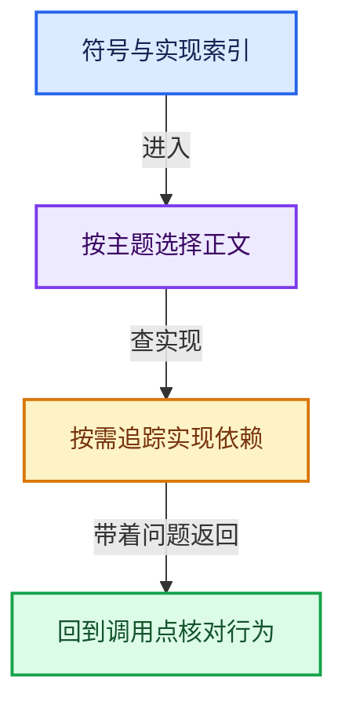
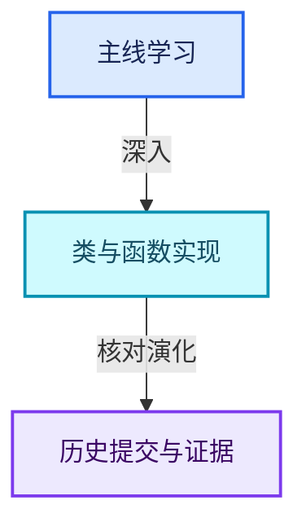

# 符号依赖与实现索引

从问题进入课程，从具体调用进入实现。这里提供分类入口，完整符号列表放在单独的定位表中。

- [全部符号定位表 · 3930个入口](全部符号定位表.md)：按正文分组，可搜索准确类名或函数名。
- [几何节点专题导航](../../13-几何节点专题/README.md)：接口、Field、几何数据、Zone与性能。
- [源码版本与覆盖索引](源码版本与覆盖索引.md)：核对文件、区间和版本。

## 按实现模块查找

- [01-BLI基础库 · 203份资料](../../90-实现依赖专题/01-BLI基础库/README.md)
- [02-BKE几何与数据 · 307份资料](../../90-实现依赖专题/02-BKE几何与数据/README.md)
- [03-FN函数与求值 · 4份资料](../../90-实现依赖专题/03-FN函数与求值/README.md)
- [04-Nodes节点系统 · 119份资料](../../90-实现依赖专题/04-Nodes节点系统/README.md)
- [05-Geometry几何算法 · 17份资料](../../90-实现依赖专题/05-Geometry几何算法/README.md)
- [06-Depsgraph依赖图 · 45份资料](../../90-实现依赖专题/06-Depsgraph依赖图/README.md)
- [07-Intern运行时与平台 · 167份资料](../../90-实现依赖专题/07-Intern运行时与平台/README.md)
- [08-其他Blender模块 · 890份资料](../../90-实现依赖专题/08-其他Blender模块/README.md)

## 原子操作的正确位置

- [原子操作扩展 · atomic_ops_ext.h](../../90-实现依赖专题/07-Intern运行时与平台/atomic/intern/atomic_ops_ext.h.md)
- [MSVC原子操作后端 · atomic_ops_msvc.h](../../90-实现依赖专题/07-Intern运行时与平台/atomic/intern/atomic_ops_msvc.h.md)

这两项属于Intern中的atomic模块，MSVC版本是平台实现资料；它们作为依赖被几何代码使用，并不意味着应归入“几何存储与拓扑映射”课程。

