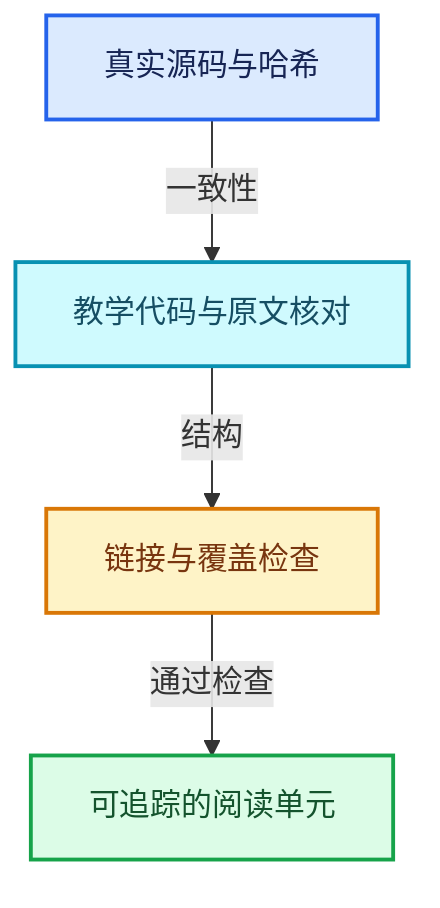
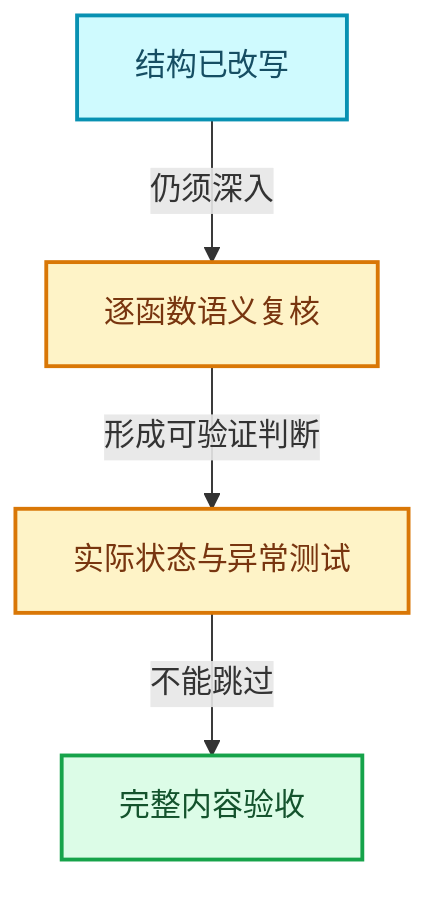

# 第二版验收报告

> 本页保留第二版基础改写的验收记录。后续新增24篇几何节点专题的范围和当前校验见[几何节点新增专题验收](../../13-几何节点专题/验收报告.md)。

记录日期：2026-10-14。基准HEAD：`cbda6b96c26c0dee3c3b5cbb93960c4ac06a6b30`。本报告明确区分格式改造、实现入口、技术内容复核与实际运行验证。

## 已交付的阅读方式

保留12个方向与132篇主线课程。主阅读区采用完整函数代码、就地中文注释、紧邻推导和实现依赖入口；原文与基准行号放入details折叠区。旧关键词逐行解释器退出正文入口。

新增1752份共享依赖专题，当前共1905份Markdown文档。主讲文件140份，按完整函数与声明区间保留阅读归属。实现依赖摘录涉及1864份源码。

## 分项检查结果

| 项目 | 结果与含义 |
|---|---|
| 原文一致性 | 25387个摘录与记录的源码区间比较；文件SHA-256同时核对。 |
| 教学代码一致性 | 只移除新增的// [讲解]注释行后与原文比较；忽略摘录末尾空行，代码文本保持一致。 |
| 导航与链接 | 140280个本地链接检查路径与显式章节锚点。 |
| 主讲源码覆盖 | 140个原有主讲文件的每行恰有一个主线区间归属；辅助摘录允许复用。 |
| 当前结构检查错误 | 0；详情见revision-check.json。 |
| Mermaid | 7579张图通过Mermaid 11.12.0解析；0个解析或渲染错误；75张代表图在Chromium中实际渲染。 |
| Vector运行验证 | 直接包含当前BLI_vector.hh，GCC 14.2.0、C++20、NDEBUG，9组状态与异常场景通过。 |

## Vector样章的内容复核

覆盖reserve、两个resize、reinitialize、两种clear，以及size、capacity、is_inline、ensure_space_for_one、realloc_to_at_least的实现入口。迁移链明确展开到uninitialized_move_n、move_iterator、标准未初始化构造和destruct_n；默认分配器展开到MEM入口、lockfree/guarded后端和平台对齐分配。

已区分分配器抛异常与默认MEM空返回路径，说明迁移失败后目标前缀由标准算法销毁、目标存储由Vector释放，而部分旧元素可能已经被移动。运行测试验证这一实际状态，未宣称所有元素类型都具有强异常保证。

调试宏明确区分NDEBUG、WITH_ASSERT_ABORT和debug_size_镜像；AT来源字符串与元素构造无关。两种MEM后端不能混用块头或系统释放接口。

## 尚未达到完整验收的部分

- 深入的函数专用机制讲解目前记录33个函数，另有接口与类型不变量说明。其余大量实现已提供完整源码、参数、实际写入和依赖入口，但这些结构信息不能替代逐函数的完整语义推导。因此不能把全套1884篇主线与依赖专题宣称为“全部讲透”。
- 当前记录14426个模板、返回对象、回调或间接分派调用协议，尚未全部落实为实例化后的具体实现目标。全局索引来自语法树，不是编译器完成的类型与动态调用解析。
- 1067个实现单元带有语法解析恢复标记。源码摘录一致性已检查，但这些位置的完整函数边界仍需要结合预处理配置复核。
- 共享专题的部分图表用于阅读导航和依赖分类，尚未逐篇替换为该实现专用的内存或状态图；代表渲染与语法解析不等于全部图表内容人工复核。
- 未编译完整Blender，也未运行所有方向的核心练习；Vector测试使用可注入异常的自定义分配器，不代表默认MEM失败会抛bad_alloc。

## 可复核证据与工具

- [revision-v2.json](../../_evidence/revision-v2.json)
- [revision-check.json](../../_evidence/revision-check.json)
- [mermaid-check.json](../../_evidence/mermaid-check.json)
- [vector-revision-test.json](../../_evidence/vector-revision-test.json)
- [cpp-structure-index.json](../../_evidence/cpp-structure-index.json)

校验入口：`_tools/check_revision.py`、`_tools/check_mermaid.cjs`。完整改写入口：`_tools/rewrite_docs.py`。旧build_docs入口已转向第二版；旧关键词解释函数不会再生成正文。

