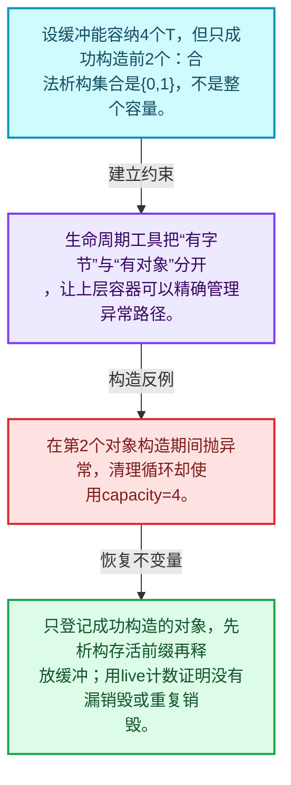
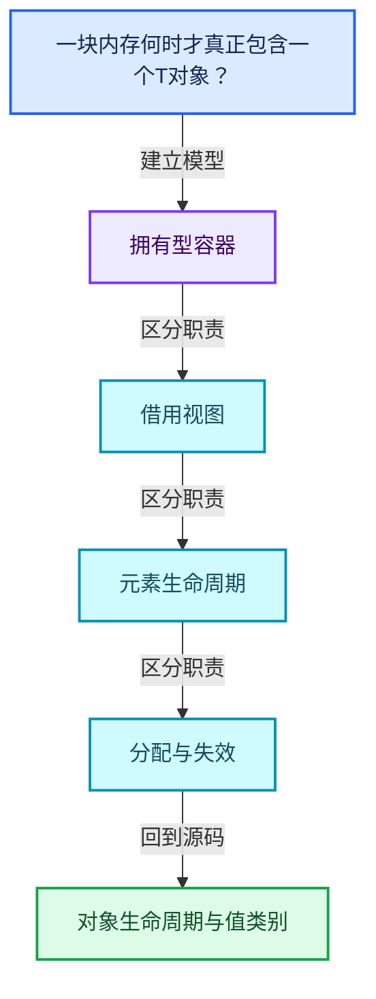
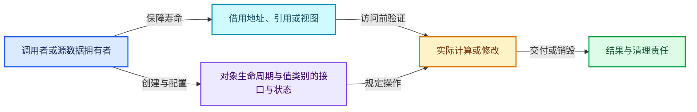
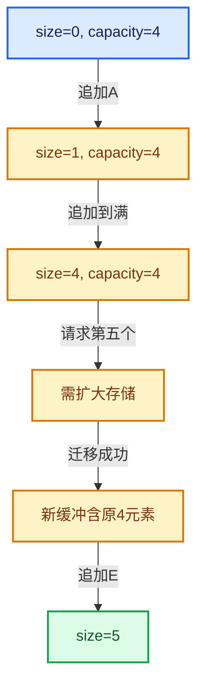

# 01-01 对象生命周期与值类别

[方向导航](README.md) · [总目录](../README.md) · [覆盖索引](../%E6%BA%90%E7%A0%81%E7%89%88%E6%9C%AC%E4%B8%8E%E8%A6%86%E7%9B%96%E7%B4%A2%E5%BC%95.md)

> 阅读顺序：问题与数据模型 → 语法与类型 → 源码逐行 → 调用线索 → 历史与取舍 → 推演和练习。

- 基准 HEAD：`cbda6b96c26c0dee3c3b5cbb93960c4ac06a6b30`。
- 记录日期：2026-10-14。
- 教学示例状态：正文中的推演不是本机性能实测；已运行练习见验收报告。

## 一、从问题到设计

一块内存何时才真正包含一个T对象？

存储、构造、赋值、移动和销毁是不同操作；std::move只是值类别转换，不能凭它判断资源已经转移。

本篇把语法、数据语义和系统取舍连接起来。先证明对象存活，再讨论索引；先区分借用与拥有，再讨论复制移动。

### 本篇独立模型与设计推理

设缓冲能容纳4个T，但只成功构造前2个：合法析构集合是{0,1}，不是整个容量。

设计取舍：生命周期工具把“有字节”与“有对象”分开，让上层容器可以精确管理异常路径。

最小反例：在第2个对象构造期间抛异常，清理循环却使用capacity=4。

推导与处理：只登记成功构造的对象，先析构存活前缀再释放缓冲；用live计数证明没有漏销毁或重复销毁。



### 源码范围与相邻篇章

| 文件 | 本篇逐行范围 | 基准SHA-256 |
|---|---|---|
| [source/blender/blenlib/BLI_memory_utils.hh](../../../../../source/blender/blenlib/BLI_memory_utils.hh) | L1—L184 | `042c4aefc749efe05b7e82142a29aff4443ee10cab696ced315e8f0ae124cb23` |

同一主讲文件可能分多篇覆盖；超出本篇范围的符号通过覆盖索引定位。空行与纯注释保留在源码摘录中，逐行表解释有效语句与语法边界；许可证头统一保留。

后篇：[模板与约束](02-%E6%A8%A1%E6%9D%BF%E4%B8%8E%E7%BA%A6%E6%9D%9F.md).

## 二、类型、数据与阅读地图



这是概念依赖图，边表示阅读关系，不声称是运行时调用顺序。

### 直接编译依赖


箭头只表示头文件包含关系；完整调用线索见后面的符号定位表。

## 三、关键词、语法与类型角色

### 模板 template

模板把类型或常量作为生成实现的参数。读声明时先列出类型参数、非类型参数和默认值，再看使用者实际实例化了什么。模板声明本身不意味着每种T都支持其全部成员。

具体检查：把T替换为int、string、只能移动的类型，分别检查每个被调用操作是否成立。

### 依赖名称 typename

typename既可引入类型模板参数，也可告诉编译器某个依赖名称是类型。它不创建运行时对象；解析期确认语法类别与实例化期检查具体类型是不同阶段。

具体检查：区分typename T::value_type和T::size()，前者标记类型，后者是表达式。

### 常量求值 constexpr

constexpr声明允许相应实体参与常量求值，但constexpr函数仍可以在运行时执行。是否常量求值由调用场景和表达式合法性共同决定。

具体检查：比较constexpr变量初始化和从运行时输入调用同一函数。

### 只读限定 const

const约束当前访问路径可做的修改。const指针、指向const的指针、const视图对象、const元素是不同位置的限定；其他别名可能仍可修改原对象。

具体检查：分别写T* const、const T*与const T* const，并画出不可修改的层次。

### 显式静态转换 static_cast

static_cast表达编译期允许的转换，不会自动验证运行时真实类型、指针寿命或索引边界。由void指针恢复T指针时，调用者仍须保证实际存储中确有合法T对象。

具体检查：标出转换前后的类型以及正确性依据来自哪里。

### 对齐 alignof

alignof得到类型要求的地址对齐。分配足够字节后仍需把地址对齐到相应边界，内嵌缓冲也一样。

具体检查：对齐a为2的幂时可推导向上取整，但仍要考虑溢出与边界。

### 对象表示 sizeof

sizeof给出对象表示大小，不是其引用的所有堆内存总量。sizeof视图很小并不说明底层数组很小。

具体检查：分别统计容器对象、容量字节和元素拥有的间接资源。

### 编译期分支 if constexpr

条件在实例化时决定被保留的分支，这常用于不同类型的合法操作选择。它与运行时if有不同的实例化检查规则。

具体检查：找出每个分支依赖哪些类型特征，再使用满足与不满足条件的类型。

### 独占拥有 unique_ptr

unique_ptr通过移动转移拥有关系，默认删除策略必须与资源来源匹配。get返回借用指针，release交出责任而不销毁。

具体检查：区分move、get、release和reset后谁负责销毁。

### 类型别名 using

类型别名为已有类型建立名字，不创建运行期对象。它常把模板内部使用的类型统一暴露给泛型调用者。

具体检查：展开别名直到基础类型，区分类型别名和变量声明。

## 四、真实源码与逐行讲解

源码块保持原行内容，原始行号由小节标题及逐行表给出。表中的调用定位是静态阅读辅助；重载、模板实例化、宏展开和虚调用需结合完整声明，不能仅凭词法出现证明动态调用。

### BLI_memory_utils.hh：L1—L46

<!-- source:source/blender/blenlib/BLI_memory_utils.hh:1:46 -->

```cpp
/* SPDX-FileCopyrightText: 2023 Blender Authors
 *
 * SPDX-License-Identifier: GPL-2.0-or-later */

#pragma once

/** \file
 * \ingroup bli
 */

#include <algorithm>
#include <memory>
#include <type_traits>

#include "BLI_utildefines.hh"

namespace blender {

/**
 * Under some circumstances #std::is_trivial_v<T> is false even though we know that the type is
 * actually trivial. Using that extra knowledge allows for some optimizations.
 */
template<typename T> inline constexpr bool is_trivial_extended_v = std::is_trivial_v<T>;
template<typename T>
inline constexpr bool is_trivially_destructible_extended_v = is_trivial_extended_v<T> ||
                                                             std::is_trivially_destructible_v<T>;
template<typename T>
inline constexpr bool is_trivially_copy_constructible_extended_v =
    is_trivial_extended_v<T> || std::is_trivially_copy_constructible_v<T>;
template<typename T>
inline constexpr bool is_trivially_move_constructible_extended_v =
    is_trivial_extended_v<T> || std::is_trivially_move_constructible_v<T>;

template<typename T> void destruct_n(T *ptr, int64_t n)
{
  if (is_trivially_destructible_extended_v<T>) {
    return;
  }

  std::destroy_n(ptr, n);
}

template<typename T> void default_construct_n(T *ptr, int64_t n)
{
  std::uninitialized_default_construct_n(ptr, n);
}
```

本段语义重点：

- `destruct_n`：对已构造的元素区间执行析构；计数必须对应真实存活对象，释放原始内存是另一操作。
- `default_construct_n`：为目标区间建立默认构造对象；基本类型默认初始化未必给出可读取的零。

| 原始行 | 语义、约束与检查 |
|---|---|
| L5 | 防止同一头文件在一个翻译单元中重复展开；不控制多个源文件之间的链接或对象寿命。 |
| L11 | 引入编译依赖 <algorithm>；这是声明可见性关系，不表示运行时一定调用该文件的所有接口。 |
| L12 | 引入编译依赖 <memory>；这是声明可见性关系，不表示运行时一定调用该文件的所有接口。 |
| L13 | 引入编译依赖 <type_traits>；这是声明可见性关系，不表示运行时一定调用该文件的所有接口。 |
| L15 | 引入编译依赖 "BLI_utildefines.hh"；这是声明可见性关系，不表示运行时一定调用该文件的所有接口。 |
| L17 | 把后续声明放入 blender 命名空间，影响名称查找和符号归属，不创建运行时对象。 |
| L23 | 声明模板参数 `template<typename T> inline constexpr bool is_trivial_extended_v = std::is_trivial_v<T>;`。类型参数决定生成操作的类型，非类型参数可决定内嵌容量或编译期分支。 |
| L24 | 声明模板参数 `template<typename T>`。类型参数决定生成操作的类型，非类型参数可决定内嵌容量或编译期分支。 |
| L25 | 把右侧 `is_trivial_extended_v<T> &#124;&#124;` 用于初始化或更新左侧 `inline constexpr bool is_trivially_destructible_extended_v`。声明初始化与已有对象赋值应按上下文区分；有资源的类型会调用相应特殊成员。 |
| L26 | 声明成员、局部对象或完成语句 `std::is_trivially_destructible_v<T>`。若为指针或引用，它本身不说明拥有；若为值对象，其构造析构由所在作用域或外层对象管理。 |
| L27 | 声明模板参数 `template<typename T>`。类型参数决定生成操作的类型，非类型参数可决定内嵌容量或编译期分支。 |
| L28 | 把右侧 `` 用于初始化或更新左侧 `inline constexpr bool is_trivially_copy_constructible_extended_v`。声明初始化与已有对象赋值应按上下文区分；有资源的类型会调用相应特殊成员。 |
| L29 | 声明成员、局部对象或完成语句 `is_trivial_extended_v<T> &#124;&#124; std::is_trivially_copy_constructible_v<T>`。若为指针或引用，它本身不说明拥有；若为值对象，其构造析构由所在作用域或外层对象管理。 |
| L30 | 声明模板参数 `template<typename T>`。类型参数决定生成操作的类型，非类型参数可决定内嵌容量或编译期分支。 |
| L31 | 把右侧 `` 用于初始化或更新左侧 `inline constexpr bool is_trivially_move_constructible_extended_v`。声明初始化与已有对象赋值应按上下文区分；有资源的类型会调用相应特殊成员。 |
| L32 | 声明成员、局部对象或完成语句 `is_trivial_extended_v<T> &#124;&#124; std::is_trivially_move_constructible_v<T>`。若为指针或引用，它本身不说明拥有；若为值对象，其构造析构由所在作用域或外层对象管理。 |
| L34 | 声明模板参数 `template<typename T> void destruct_n(T *ptr, int64_t n)`。类型参数决定生成操作的类型，非类型参数可决定内嵌容量或编译期分支。 |
| L35 | 连接上一行的声明或控制结构与其语句块；后续行在这个作用域中执行或声明。 |
| L36 | 判断 `is_trivially_destructible_extended_v<T>`，成立时进入本分支，否则继续后续路径。 |
| L37 | 结束当前函数，本路径不再执行后续语句；局部对象按作用域规则清理。 |
| L38 | 结束当前语法单元。局部自动对象在离开其作用域时按规则销毁；这不等于所有被引用的外部数据也被释放。 |
| L40 | 出现调用或函数声明 `std::destroy_n`，对应表达式为 `std::destroy_n(ptr, n);`。参数求值、返回类型与重载需结合前后完整语句；静态文本引用不能证明动态目标。 |
| L41 | 结束当前语法单元。局部自动对象在离开其作用域时按规则销毁；这不等于所有被引用的外部数据也被释放。 |
| L43 | 声明模板参数 `template<typename T> void default_construct_n(T *ptr, int64_t n)`。类型参数决定生成操作的类型，非类型参数可决定内嵌容量或编译期分支。 |
| L44 | 连接上一行的声明或控制结构与其语句块；后续行在这个作用域中执行或声明。 |
| L45 | 出现调用或函数声明 `std::uninitialized_default_construct_n`，对应表达式为 `std::uninitialized_default_construct_n(ptr, n);`。参数求值、返回类型与重载需结合前后完整语句；静态文本引用不能证明动态目标。 |
| L46 | 结束当前语法单元。局部自动对象在离开其作用域时按规则销毁；这不等于所有被引用的外部数据也被释放。 |

### BLI_memory_utils.hh：L47—L94

<!-- source:source/blender/blenlib/BLI_memory_utils.hh:47:94 -->

```cpp

template<typename T> void initialized_copy_n(const T *src, int64_t n, T *dst)
{
  std::copy_n(src, n, dst);
}

template<typename T> void uninitialized_copy_n(const T *src, int64_t n, T *dst)
{
  std::uninitialized_copy_n(src, n, dst);
}

template<typename From, typename To>
void uninitialized_convert_n(const From *src, int64_t n, To *dst)
{
  std::uninitialized_copy_n(src, n, dst);
}

template<typename T> void initialized_move_n(T *src, int64_t n, T *dst)
{
  std::copy_n(std::make_move_iterator(src), n, dst);
}

template<typename T> void uninitialized_move_n(T *src, int64_t n, T *dst)
{
  std::uninitialized_copy_n(std::make_move_iterator(src), n, dst);
}

template<typename T> void initialized_relocate_n(T *src, int64_t n, T *dst)
{
  initialized_move_n(src, n, dst);
  destruct_n(src, n);
}

template<typename T> void uninitialized_relocate_n(T *src, int64_t n, T *dst)
{
  uninitialized_move_n(src, n, dst);
  destruct_n(src, n);
}

template<typename T> void initialized_fill_n(T *dst, int64_t n, const T &value)
{
  std::fill_n(dst, n, value);
}

template<typename T> void uninitialized_fill_n(T *dst, int64_t n, const T &value)
{
  std::uninitialized_fill_n(dst, n, value);
}
```

本段语义重点：

- `uninitialized_relocate_n`：在目标原始存储建立n个对象，并结束源对象寿命；与仅移动构造不同，后续不能再次把源当作存活元素销毁。
- `uninitialized_copy_n`：把源值复制构造到未初始化的目标区间；目标已有对象时不能直接用此操作替代赋值。
- `uninitialized_move_n`：在目标存储移动构造元素；源对象是否另行销毁应查调用约定，不能与重定位自动等同。
- `destruct_n`：对已构造的元素区间执行析构；计数必须对应真实存活对象，释放原始内存是另一操作。

| 原始行 | 语义、约束与检查 |
|---|---|
| L48 | 声明模板参数 `template<typename T> void initialized_copy_n(const T *src, int64_t n, T *dst)`。类型参数决定生成操作的类型，非类型参数可决定内嵌容量或编译期分支。 |
| L49 | 连接上一行的声明或控制结构与其语句块；后续行在这个作用域中执行或声明。 |
| L50 | 出现调用或函数声明 `std::copy_n`，对应表达式为 `std::copy_n(src, n, dst);`。参数求值、返回类型与重载需结合前后完整语句；静态文本引用不能证明动态目标。 |
| L51 | 结束当前语法单元。局部自动对象在离开其作用域时按规则销毁；这不等于所有被引用的外部数据也被释放。 |
| L53 | 声明模板参数 `template<typename T> void uninitialized_copy_n(const T *src, int64_t n, T *dst)`。类型参数决定生成操作的类型，非类型参数可决定内嵌容量或编译期分支。 |
| L54 | 连接上一行的声明或控制结构与其语句块；后续行在这个作用域中执行或声明。 |
| L55 | 本行使用 `uninitialized_copy_n`：把源值复制构造到未初始化的目标区间；目标已有对象时不能直接用此操作替代赋值。 |
| L56 | 结束当前语法单元。局部自动对象在离开其作用域时按规则销毁；这不等于所有被引用的外部数据也被释放。 |
| L58 | 声明模板参数 `template<typename From, typename To>`。类型参数决定生成操作的类型，非类型参数可决定内嵌容量或编译期分支。 |
| L59 | 出现调用或函数声明 `uninitialized_convert_n`，对应表达式为 `void uninitialized_convert_n(const From *src, int64_t n, To *dst)`。参数求值、返回类型与重载需结合前后完整语句；静态文本引用不能证明动态目标。 |
| L60 | 连接上一行的声明或控制结构与其语句块；后续行在这个作用域中执行或声明。 |
| L61 | 本行使用 `uninitialized_copy_n`：把源值复制构造到未初始化的目标区间；目标已有对象时不能直接用此操作替代赋值。 |
| L62 | 结束当前语法单元。局部自动对象在离开其作用域时按规则销毁；这不等于所有被引用的外部数据也被释放。 |
| L64 | 声明模板参数 `template<typename T> void initialized_move_n(T *src, int64_t n, T *dst)`。类型参数决定生成操作的类型，非类型参数可决定内嵌容量或编译期分支。 |
| L65 | 连接上一行的声明或控制结构与其语句块；后续行在这个作用域中执行或声明。 |
| L66 | 出现调用或函数声明 `std::copy_n`，对应表达式为 `std::copy_n(std::make_move_iterator(src), n, dst);`。参数求值、返回类型与重载需结合前后完整语句；静态文本引用不能证明动态目标。 |
| L67 | 结束当前语法单元。局部自动对象在离开其作用域时按规则销毁；这不等于所有被引用的外部数据也被释放。 |
| L69 | 声明模板参数 `template<typename T> void uninitialized_move_n(T *src, int64_t n, T *dst)`。类型参数决定生成操作的类型，非类型参数可决定内嵌容量或编译期分支。 |
| L70 | 连接上一行的声明或控制结构与其语句块；后续行在这个作用域中执行或声明。 |
| L71 | 本行使用 `uninitialized_copy_n`：把源值复制构造到未初始化的目标区间；目标已有对象时不能直接用此操作替代赋值。 |
| L72 | 结束当前语法单元。局部自动对象在离开其作用域时按规则销毁；这不等于所有被引用的外部数据也被释放。 |
| L74 | 声明模板参数 `template<typename T> void initialized_relocate_n(T *src, int64_t n, T *dst)`。类型参数决定生成操作的类型，非类型参数可决定内嵌容量或编译期分支。 |
| L75 | 连接上一行的声明或控制结构与其语句块；后续行在这个作用域中执行或声明。 |
| L76 | 出现调用或函数声明 `initialized_move_n`，对应表达式为 `initialized_move_n(src, n, dst);`。参数求值、返回类型与重载需结合前后完整语句；静态文本引用不能证明动态目标。 |
| L77 | 本行使用 `destruct_n`：对已构造的元素区间执行析构；计数必须对应真实存活对象，释放原始内存是另一操作。 |
| L78 | 结束当前语法单元。局部自动对象在离开其作用域时按规则销毁；这不等于所有被引用的外部数据也被释放。 |
| L80 | 声明模板参数 `template<typename T> void uninitialized_relocate_n(T *src, int64_t n, T *dst)`。类型参数决定生成操作的类型，非类型参数可决定内嵌容量或编译期分支。 |
| L81 | 连接上一行的声明或控制结构与其语句块；后续行在这个作用域中执行或声明。 |
| L82 | 本行使用 `uninitialized_move_n`：在目标存储移动构造元素；源对象是否另行销毁应查调用约定，不能与重定位自动等同。 |
| L83 | 本行使用 `destruct_n`：对已构造的元素区间执行析构；计数必须对应真实存活对象，释放原始内存是另一操作。 |
| L84 | 结束当前语法单元。局部自动对象在离开其作用域时按规则销毁；这不等于所有被引用的外部数据也被释放。 |
| L86 | 声明模板参数 `template<typename T> void initialized_fill_n(T *dst, int64_t n, const T &value)`。类型参数决定生成操作的类型，非类型参数可决定内嵌容量或编译期分支。 |
| L87 | 连接上一行的声明或控制结构与其语句块；后续行在这个作用域中执行或声明。 |
| L88 | 出现调用或函数声明 `std::fill_n`，对应表达式为 `std::fill_n(dst, n, value);`。参数求值、返回类型与重载需结合前后完整语句；静态文本引用不能证明动态目标。 |
| L89 | 结束当前语法单元。局部自动对象在离开其作用域时按规则销毁；这不等于所有被引用的外部数据也被释放。 |
| L91 | 声明模板参数 `template<typename T> void uninitialized_fill_n(T *dst, int64_t n, const T &value)`。类型参数决定生成操作的类型，非类型参数可决定内嵌容量或编译期分支。 |
| L92 | 连接上一行的声明或控制结构与其语句块；后续行在这个作用域中执行或声明。 |
| L93 | 出现调用或函数声明 `std::uninitialized_fill_n`，对应表达式为 `std::uninitialized_fill_n(dst, n, value);`。参数求值、返回类型与重载需结合前后完整语句；静态文本引用不能证明动态目标。 |
| L94 | 结束当前语法单元。局部自动对象在离开其作用域时按规则销毁；这不等于所有被引用的外部数据也被释放。 |

### BLI_memory_utils.hh：L95—L141

<!-- source:source/blender/blenlib/BLI_memory_utils.hh:95:141 -->

```cpp

template<typename T> struct DestructValueAtAddress {
  DestructValueAtAddress() = default;

  template<typename U> DestructValueAtAddress(const U &) {}

  void operator()(T *ptr)
  {
    ptr->~T();
  }
};

/**
 * A destruct_ptr is like unique_ptr, but it will only call the destructor and will not free the
 * memory. This is useful when using custom allocators.
 */
template<typename T> using destruct_ptr = std::unique_ptr<T, DestructValueAtAddress<T>>;

/**
 * An `AlignedBuffer` is a byte array with at least the given size and alignment. The buffer will
 * not be initialized by the default constructor.
 */
template<size_t Size, size_t Alignment> class AlignedBuffer {
  struct Empty {};
  struct alignas(Alignment) Sized {
    /* Don't create an empty array. This causes problems with some compilers. */
    std::byte buffer_[Size > 0 ? Size : 1];
  };

  using BufferType = std::conditional_t<Size == 0, Empty, Sized>;
  BLI_NO_UNIQUE_ADDRESS BufferType buffer_;

 public:
  operator void *()
  {
    return this;
  }

  operator const void *() const
  {
    return this;
  }

  void *ptr()
  {
    return this;
  }
```

| 原始行 | 语义、约束与检查 |
|---|---|
| L96 | 声明模板参数 `template<typename T> struct DestructValueAtAddress {`。类型参数决定生成操作的类型，非类型参数可决定内嵌容量或编译期分支。 |
| L97 | 显式采用编译器生成的特殊成员行为：`DestructValueAtAddress() = default;`。成员和基类的性质决定该操作是否可用、是否被删除及异常约定，不表示运行时给对象赋值为default。 |
| L99 | 声明模板参数 `template<typename U> DestructValueAtAddress(const U &) {}`。类型参数决定生成操作的类型，非类型参数可决定内嵌容量或编译期分支。 |
| L101 | 运算符重载声明、定义或显式调用：`void operator()(T *ptr)`。结合参数和返回类型判断是赋值、索引、比较还是转换；operator=声明中的等号不是在给名为operator的变量赋值。 |
| L102 | 连接上一行的声明或控制结构与其语句块；后续行在这个作用域中执行或声明。 |
| L103 | 涉及析构接口或显式析构：`ptr->~T();`。检查目标对象已成功构造，且资源不会在另一条清理路径再次销毁。 |
| L104 | 结束当前语法单元。局部自动对象在离开其作用域时按规则销毁；这不等于所有被引用的外部数据也被释放。 |
| L105 | 结束当前语法单元。局部自动对象在离开其作用域时按规则销毁；这不等于所有被引用的外部数据也被释放。 |
| L111 | 声明模板参数 `template<typename T> using destruct_ptr = std::unique_ptr<T, DestructValueAtAddress<T>>;`。类型参数决定生成操作的类型，非类型参数可决定内嵌容量或编译期分支。 |
| L117 | 声明模板参数 `template<size_t Size, size_t Alignment> class AlignedBuffer {`。类型参数决定生成操作的类型，非类型参数可决定内嵌容量或编译期分支。 |
| L118 | 声明或定义类型 `struct Empty {}`。结合继承、访问权限和成员布局确认接口与拥有关系；前向声明本身没有完整对象布局。 |
| L119 | 声明或定义类型 `struct alignas(Alignment) Sized`。结合继承、访问权限和成员布局确认接口与拥有关系；前向声明本身没有完整对象布局。 |
| L121 | 声明成员、局部对象或完成语句 `std::byte buffer_[Size > 0 ? Size : 1]`。若为指针或引用，它本身不说明拥有；若为值对象，其构造析构由所在作用域或外层对象管理。 |
| L122 | 结束当前语法单元。局部自动对象在离开其作用域时按规则销毁；这不等于所有被引用的外部数据也被释放。 |
| L124 | 定义类型别名 `using BufferType = std::conditional_t<Size == 0, Empty, Sized>`，为模板接口或内部实现统一命名；本行不分配该类型对象。 |
| L125 | 声明成员、局部对象或完成语句 `BLI_NO_UNIQUE_ADDRESS BufferType buffer_`。若为指针或引用，它本身不说明拥有；若为值对象，其构造析构由所在作用域或外层对象管理。 |
| L127 | 切换成员访问权限为 public；它是编译期接口边界，不是线程同步或内存保护。 |
| L128 | 运算符重载声明、定义或显式调用：`operator void *()`。结合参数和返回类型判断是赋值、索引、比较还是转换；operator=声明中的等号不是在给名为operator的变量赋值。 |
| L129 | 连接上一行的声明或控制结构与其语句块；后续行在这个作用域中执行或声明。 |
| L130 | 返回表达式 `this`。 |
| L131 | 结束当前语法单元。局部自动对象在离开其作用域时按规则销毁；这不等于所有被引用的外部数据也被释放。 |
| L133 | 运算符重载声明、定义或显式调用：`operator const void *() const`。结合参数和返回类型判断是赋值、索引、比较还是转换；operator=声明中的等号不是在给名为operator的变量赋值。 |
| L134 | 连接上一行的声明或控制结构与其语句块；后续行在这个作用域中执行或声明。 |
| L135 | 返回表达式 `this`。 |
| L136 | 结束当前语法单元。局部自动对象在离开其作用域时按规则销毁；这不等于所有被引用的外部数据也被释放。 |
| L138 | 出现调用或函数声明 `ptr`，对应表达式为 `void *ptr()`。参数求值、返回类型与重载需结合前后完整语句；静态文本引用不能证明动态目标。 |
| L139 | 连接上一行的声明或控制结构与其语句块；后续行在这个作用域中执行或声明。 |
| L140 | 返回表达式 `this`。 |
| L141 | 结束当前语法单元。局部自动对象在离开其作用域时按规则销毁；这不等于所有被引用的外部数据也被释放。 |

### BLI_memory_utils.hh：L142—L184

<!-- source:source/blender/blenlib/BLI_memory_utils.hh:142:184 -->

```cpp

  const void *ptr() const
  {
    return this;
  }
};

/**
 * This can be used to reserve memory for C++ objects whose lifetime is different from the
 * lifetime of the object they are embedded in. It's used by containers with small buffer
 * optimization and hash table implementations.
 */
template<typename T, int64_t Size = 1> class TypedBuffer {
 private:
  /** Required so that `sizeof(T)` is not required when `Size` is 0. */
  static constexpr size_t get_size()
  {
    if constexpr (Size == 0) {
      return 0;
    }
    else {
      return sizeof(T) * size_t(Size);
    }
  }

  /** Required so that `alignof(T)` is not required when `Size` is 0. */
  static constexpr size_t get_alignment()
  {
    if constexpr (Size == 0) {
      return 1;
    }
    else {
      return alignof(T);
    }
  }

  BLI_NO_UNIQUE_ADDRESS AlignedBuffer<get_size(), get_alignment()> buffer_;

 public:
  operator T *()
  {
    return static_cast<T *>(buffer_.ptr());
  }
```

| 原始行 | 语义、约束与检查 |
|---|---|
| L143 | 出现调用或函数声明 `ptr`，对应表达式为 `const void *ptr() const`。参数求值、返回类型与重载需结合前后完整语句；静态文本引用不能证明动态目标。 |
| L144 | 连接上一行的声明或控制结构与其语句块；后续行在这个作用域中执行或声明。 |
| L145 | 返回表达式 `this`。 |
| L146 | 结束当前语法单元。局部自动对象在离开其作用域时按规则销毁；这不等于所有被引用的外部数据也被释放。 |
| L147 | 结束当前语法单元。局部自动对象在离开其作用域时按规则销毁；这不等于所有被引用的外部数据也被释放。 |
| L154 | 声明模板参数 `template<typename T, int64_t Size = 1> class TypedBuffer {`。类型参数决定生成操作的类型，非类型参数可决定内嵌容量或编译期分支。 |
| L155 | 切换成员访问权限为 private；它是编译期接口边界，不是线程同步或内存保护。 |
| L157 | 出现调用或函数声明 `get_size`，对应表达式为 `static constexpr size_t get_size()`。参数求值、返回类型与重载需结合前后完整语句；静态文本引用不能证明动态目标。 |
| L158 | 连接上一行的声明或控制结构与其语句块；后续行在这个作用域中执行或声明。 |
| L159 | 编译期条件分支 `if constexpr (Size == 0)`。按实例化类型选择相应实现；被舍弃分支和运行期if具有不同检查规则，不能当作运行时输入验证。 |
| L160 | 返回表达式 `0`。 |
| L161 | 结束当前语法单元。局部自动对象在离开其作用域时按规则销毁；这不等于所有被引用的外部数据也被释放。 |
| L162 | 处理前一条件不成立的互补路径。比较两条路径最后是否恢复同一不变量，以及是否产生不同的资源责任。 |
| L163 | 返回表达式 `sizeof(T) * size_t(Size)`。 |
| L164 | 结束当前语法单元。局部自动对象在离开其作用域时按规则销毁；这不等于所有被引用的外部数据也被释放。 |
| L165 | 结束当前语法单元。局部自动对象在离开其作用域时按规则销毁；这不等于所有被引用的外部数据也被释放。 |
| L168 | 出现调用或函数声明 `get_alignment`，对应表达式为 `static constexpr size_t get_alignment()`。参数求值、返回类型与重载需结合前后完整语句；静态文本引用不能证明动态目标。 |
| L169 | 连接上一行的声明或控制结构与其语句块；后续行在这个作用域中执行或声明。 |
| L170 | 编译期条件分支 `if constexpr (Size == 0)`。按实例化类型选择相应实现；被舍弃分支和运行期if具有不同检查规则，不能当作运行时输入验证。 |
| L171 | 返回表达式 `1`。 |
| L172 | 结束当前语法单元。局部自动对象在离开其作用域时按规则销毁；这不等于所有被引用的外部数据也被释放。 |
| L173 | 处理前一条件不成立的互补路径。比较两条路径最后是否恢复同一不变量，以及是否产生不同的资源责任。 |
| L174 | 返回表达式 `alignof(T)`。 |
| L175 | 结束当前语法单元。局部自动对象在离开其作用域时按规则销毁；这不等于所有被引用的外部数据也被释放。 |
| L176 | 结束当前语法单元。局部自动对象在离开其作用域时按规则销毁；这不等于所有被引用的外部数据也被释放。 |
| L178 | 出现调用或函数声明 `get_size`，对应表达式为 `BLI_NO_UNIQUE_ADDRESS AlignedBuffer<get_size(), get_alignment()> buffer_;`。参数求值、返回类型与重载需结合前后完整语句；静态文本引用不能证明动态目标。 |
| L180 | 切换成员访问权限为 public；它是编译期接口边界，不是线程同步或内存保护。 |
| L181 | 运算符重载声明、定义或显式调用：`operator T *()`。结合参数和返回类型判断是赋值、索引、比较还是转换；operator=声明中的等号不是在给名为operator的变量赋值。 |
| L182 | 连接上一行的声明或控制结构与其语句块；后续行在这个作用域中执行或声明。 |
| L183 | 返回表达式 `static_cast<T *>(buffer_.ptr())`。 |
| L184 | 结束当前语法单元。局部自动对象在离开其作用域时按规则销毁；这不等于所有被引用的外部数据也被释放。 |

## 五、接口定位、调用线索与生命周期

### 本篇声明与实现入口

| 源码位置 | 实际声明片段 |
|---|---|
| [BLI_memory_utils.hh:L34](../../../../../source/blender/blenlib/BLI_memory_utils.hh#L34) | `template<typename T> void destruct_n(T *ptr, int64_t n)` |
| [BLI_memory_utils.hh:L43](../../../../../source/blender/blenlib/BLI_memory_utils.hh#L43) | `template<typename T> void default_construct_n(T *ptr, int64_t n)` |
| [BLI_memory_utils.hh:L48](../../../../../source/blender/blenlib/BLI_memory_utils.hh#L48) | `template<typename T> void initialized_copy_n(const T *src, int64_t n, T *dst)` |
| [BLI_memory_utils.hh:L53](../../../../../source/blender/blenlib/BLI_memory_utils.hh#L53) | `template<typename T> void uninitialized_copy_n(const T *src, int64_t n, T *dst)` |
| [BLI_memory_utils.hh:L59](../../../../../source/blender/blenlib/BLI_memory_utils.hh#L59) | `void uninitialized_convert_n(const From *src, int64_t n, To *dst)` |
| [BLI_memory_utils.hh:L64](../../../../../source/blender/blenlib/BLI_memory_utils.hh#L64) | `template<typename T> void initialized_move_n(T *src, int64_t n, T *dst)` |
| [BLI_memory_utils.hh:L69](../../../../../source/blender/blenlib/BLI_memory_utils.hh#L69) | `template<typename T> void uninitialized_move_n(T *src, int64_t n, T *dst)` |
| [BLI_memory_utils.hh:L74](../../../../../source/blender/blenlib/BLI_memory_utils.hh#L74) | `template<typename T> void initialized_relocate_n(T *src, int64_t n, T *dst)` |
| [BLI_memory_utils.hh:L80](../../../../../source/blender/blenlib/BLI_memory_utils.hh#L80) | `template<typename T> void uninitialized_relocate_n(T *src, int64_t n, T *dst)` |
| [BLI_memory_utils.hh:L86](../../../../../source/blender/blenlib/BLI_memory_utils.hh#L86) | `template<typename T> void initialized_fill_n(T *dst, int64_t n, const T &value)` |
| [BLI_memory_utils.hh:L91](../../../../../source/blender/blenlib/BLI_memory_utils.hh#L91) | `template<typename T> void uninitialized_fill_n(T *dst, int64_t n, const T &value)` |
| [BLI_memory_utils.hh:L96](../../../../../source/blender/blenlib/BLI_memory_utils.hh#L96) | `template<typename T> struct DestructValueAtAddress` |
| [BLI_memory_utils.hh:L97](../../../../../source/blender/blenlib/BLI_memory_utils.hh#L97) | `DestructValueAtAddress() = default;` |
| [BLI_memory_utils.hh:L99](../../../../../source/blender/blenlib/BLI_memory_utils.hh#L99) | `template<typename U> DestructValueAtAddress(const U &) {}` |
| [BLI_memory_utils.hh:L101](../../../../../source/blender/blenlib/BLI_memory_utils.hh#L101) | `void operator()(T *ptr)` |
| [BLI_memory_utils.hh:L117](../../../../../source/blender/blenlib/BLI_memory_utils.hh#L117) | `template<size_t Size, size_t Alignment> class AlignedBuffer` |
| [BLI_memory_utils.hh:L118](../../../../../source/blender/blenlib/BLI_memory_utils.hh#L118) | `struct Empty {};` |
| [BLI_memory_utils.hh:L119](../../../../../source/blender/blenlib/BLI_memory_utils.hh#L119) | `struct alignas(Alignment) Sized` |
| [BLI_memory_utils.hh:L138](../../../../../source/blender/blenlib/BLI_memory_utils.hh#L138) | `void *ptr()` |
| [BLI_memory_utils.hh:L143](../../../../../source/blender/blenlib/BLI_memory_utils.hh#L143) | `const void *ptr() const` |
| [BLI_memory_utils.hh:L154](../../../../../source/blender/blenlib/BLI_memory_utils.hh#L154) | `template<typename T, int64_t Size = 1> class TypedBuffer` |
| [BLI_memory_utils.hh:L157](../../../../../source/blender/blenlib/BLI_memory_utils.hh#L157) | `static constexpr size_t get_size()` |
| [BLI_memory_utils.hh:L168](../../../../../source/blender/blenlib/BLI_memory_utils.hh#L168) | `static constexpr size_t get_alignment()` |

### 同名符号出现位置

以下表提供跨文件阅读入口，包含声明、调用或测试使用；没有经过完整C++名称解析，不把它命名为已证明的运行时调用图。

| 符号 | 位置 | 文本证据 |
|---|---|---|
| `destruct_n` | [BLI_array.hh:L202](../../../../../source/blender/blenlib/BLI_array.hh#L202) | `destruct_n(data_, size_);` |
| `destruct_n` | [BLI_array.hh:L435](../../../../../source/blender/blenlib/BLI_array.hh#L435) | `destruct_n(data_, size_);` |
| `destruct_n` | [BLI_cpp_type.hh:L290](../../../../../source/blender/blenlib/BLI_cpp_type.hh#L290) | `void destruct_n(void *ptr, int64_t n) const;` |
| `default_construct_n` | [BLI_array.hh:L127](../../../../../source/blender/blenlib/BLI_array.hh#L127) | `default_construct_n(data_, size);` |
| `default_construct_n` | [BLI_array.hh:L439](../../../../../source/blender/blenlib/BLI_array.hh#L439) | `default_construct_n(data_, new_size);` |
| `default_construct_n` | [BLI_array.hh:L444](../../../../../source/blender/blenlib/BLI_array.hh#L444) | `default_construct_n(new_data, new_size);` |
| `initialized_copy_n` | [BLI_span.hh:L748](../../../../../source/blender/blenlib/BLI_span.hh#L748) | `initialized_copy_n(values.data(), size_, data_);` |
| `initialized_copy_n` | [BLI_virtual_array.hh:L180](../../../../../source/blender/blenlib/BLI_virtual_array.hh#L180) | `initialized_copy_n(` |
| `initialized_copy_n` | [FN_multi_function_procedure_builder.hh:L144](../../../../../source/blender/functions/FN_multi_function_procedure_builder.hh#L144) | `initialized_copy_n(output_variables.data(), OutputN, output_array.data());` |
| `uninitialized_copy_n` | [BLI_bit_vector.hh:L114](../../../../../source/blender/blenlib/BLI_bit_vector.hh#L114) | `uninitialized_copy_n(span.data(), ints_to_copy, data_);` |
| `uninitialized_copy_n` | [BLI_bit_vector.hh:L134](../../../../../source/blender/blenlib/BLI_bit_vector.hh#L134) | `uninitialized_copy_n(other.data_, ints_to_copy, data_);` |
| `uninitialized_copy_n` | [BLI_bit_vector.hh:L364](../../../../../source/blender/blenlib/BLI_bit_vector.hh#L364) | `uninitialized_copy_n(data_, ints_to_copy, new_data);` |
| `initialized_move_n` | [BLI_cpp_type_make.hh:L163](../../../../../source/blender/blenlib/BLI_cpp_type_make.hh#L163) | `initialized_move_n(static_cast<T *>(src), 1, static_cast<T *>(dst));` |
| `uninitialized_move_n` | [BLI_cpp_type_make.hh:L186](../../../../../source/blender/blenlib/BLI_cpp_type_make.hh#L186) | `uninitialized_move_n(static_cast<T *>(src), 1, static_cast<T *>(dst));` |
| `uninitialized_move_n` | [BLI_vector.hh:L707](../../../../../source/blender/blenlib/BLI_vector.hh#L707) | `std::uninitialized_move_n(first, insert_amount, begin_ + insert_index);` |
| `uninitialized_relocate_n` | [BLI_array.hh:L186](../../../../../source/blender/blenlib/BLI_array.hh#L186) | `uninitialized_relocate_n(other.data_, other.size_, data_);` |
| `uninitialized_relocate_n` | [BLI_vector.hh:L277](../../../../../source/blender/blenlib/BLI_vector.hh#L277) | `uninitialized_relocate_n(other.begin_, size, begin_);` |
| `uninitialized_relocate_n` | [BLI_vector.hh:L286](../../../../../source/blender/blenlib/BLI_vector.hh#L286) | `uninitialized_relocate_n(other.begin_, size, begin_);` |
| `initialized_fill_n` | [BLI_array.hh:L285](../../../../../source/blender/blenlib/BLI_array.hh#L285) | `initialized_fill_n(data_, size_, value);` |
| `initialized_fill_n` | [BLI_span.hh:L525](../../../../../source/blender/blenlib/BLI_span.hh#L525) | `initialized_fill_n(data_, size_, value);` |
| `initialized_fill_n` | [BLI_vector.hh:L948](../../../../../source/blender/blenlib/BLI_vector.hh#L948) | `initialized_fill_n(begin_, this->size(), value);` |
| `uninitialized_fill_n` | [BLI_array.hh:L148](../../../../../source/blender/blenlib/BLI_array.hh#L148) | `uninitialized_fill_n(data_, size, value);` |
| `uninitialized_fill_n` | [BLI_bit_vector.hh:L94](../../../../../source/blender/blenlib/BLI_bit_vector.hh#L94) | `uninitialized_fill_n(data_, IntsInInlineBuffer, BitInt(0));` |
| `uninitialized_fill_n` | [BLI_bit_vector.hh:L368](../../../../../source/blender/blenlib/BLI_bit_vector.hh#L368) | `uninitialized_fill_n(` |
| `operator` | [BKE_attribute_storage.hh:L127](../../../../../source/blender/blenkernel/BKE_attribute_storage.hh#L127) | `StringRef operator()(const std::unique_ptr<Attribute> &value) const` |
| `operator` | [BLI_cpp_type.hh:L441](../../../../../source/blender/blenlib/BLI_cpp_type.hh#L441) | `fn.template operator()<T>();` |
| `operator` | [BLI_function_ref.hh:L147](../../../../../source/blender/blenlib/BLI_function_ref.hh#L147) | `Ret operator()(Params... params) const` |
| `alignas` | [BLI_index_mask.hh:L602](../../../../../source/blender/blenlib/BLI_index_mask.hh#L602) | `alignas(64) static const std::array<int16_t, max_segment_size> data =` |
| `ptr` | [BLI_any.hh:L174](../../../../../source/blender/blenlib/BLI_any.hh#L174) | `std::copy_n(static_cast<const std::byte *>(other.buffer_.ptr()),` |
| `ptr` | [BLI_any.hh:L176](../../../../../source/blender/blenlib/BLI_any.hh#L176) | `static_cast<std::byte *>(buffer_.ptr()));` |
| `ptr` | [BLI_any.hh:L192](../../../../../source/blender/blenlib/BLI_any.hh#L192) | `std::copy_n(static_cast<const std::byte *>(other.buffer_.ptr()),` |

### 生命周期推理图



这是审查生命周期的通用模型。具体类是否拥有数据由本篇成员、构造、析构和调用者一起证明；任何箭头都不自动代表shared_ptr。

## 六、把代码放进具体数据中推演

本方向的共同数值模型如下。本篇的专门检查是：用计数类型追踪构造、复制、移动、析构，检查每个成功构造的对象恰好析构一次。

| 步骤 | 数据或状态 | 为什么需要这一步 |
|---|---|---|
| 初始 | size=0, capacity=4 | 只有存储，没有可读取的T元素 |
| 追加A | size=1, capacity=4 | 在第0个位置构造A |
| 追加到满 | size=4, capacity=4 | 四个位置均已构造 |
| 请求第五个 | 需扩大存储 | 旧地址仍需被正确管理 |
| 迁移成功 | 新缓冲含原4元素 | 提交新指针并释放旧存储 |
| 追加E | size=5 | 只在成功构造后扩大有效区间 |



图是教学推演模型；精确分支与状态更新以本篇摘录及调用契约为准。

### 本篇独立练习与参考思路

用计数类型追踪构造、复制、移动、析构，检查每个成功构造的对象恰好析构一次。

参考思路：存储、构造、赋值、移动和销毁是不同操作；std::move只是值类别转换，不能凭它判断资源已经转移。

将输入、预期结果和资源责任分成三张清单。先用最直接的实现给出可核对的答案，再替换成对应源码使用的表示；比较结果不变的条件，而不是只比较接口名字。

验收依据：构造成功次数减析构次数应等于当前存活对象数；异常之后资源计数应回到合法状态。

## 七、复杂度、设计取舍与其他基础库

对比std::vector、std::array、std::span与LLVM SmallVector、ArrayRef时，分别比较拥有关系、内嵌存储、大小是否属于类型和失效条件。不要根据同名方法推断完全相同契约。

本篇的具体取舍：存储、构造、赋值、移动和销毁是不同操作；std::move只是值类别转换，不能凭它判断资源已经转移。

| 观察维度 | 从源码取得证据的方法 | 本篇要避免的误判 |
|---|---|---|
| 时间 | 对循环次数、分派次数和重建频率分别计数 | 看到单次常数操作就断定整个操作序列是常数成本 |
| 内存 | 区分对象本体、容量存储、间接资源和共享控制块 | 用sizeof代替总内存 |
| 安全 | 沿构造、失败回滚、销毁与失效逐路径检查 | 把断言或非空指针当作完整安全证明 |
| 并发 | 逐字段确认锁、发布顺序和借用寿命 | 把引用计数线程安全等同数据读写线程安全 |

相关一手资料：

- [C++公开工作草案](https://eel.is/c++draft/)：持续更新的工作草案；语言与标准库语义以相应章节为准。
- [LLVM Programmer’s Manual](https://llvm.org/docs/ProgrammersManual.html)：在线版，2026-10-14查阅；仅比较设计思路，不保证与本地LLVM版本一致。

资料用于核对契约和进一步阅读；这里没有声称外部库与Blender实现相同，也没有把上游性能数字当作本机实测。

## 八、历史提交与设计演化

### 2020-08-19 · Jacques Lucke

[BLI: improve exception safety of Vector, Array and Stack](https://projects.blender.org/blender/blender/commit/2aff45146f1464ba8899368ad004522cb6a1a98c)

完整哈希：`2aff45146f1464ba8899368ad004522cb6a1a98c`。提交标题与作者日期来自本地Git对象。

提交说明原文（历史证据，不能直接作为当前API说明）：

```text
BLI: improve exception safety of Vector, Array and Stack

Using C++ exceptions in Blender is difficult, due to the large
number of C functions in the call stack. However, C++ data
structures in blenlib should at least try to be exception safe,
so that they can be used if someone wants to use exceptions
in some isolated area.

This patch improves the exception safety of the Vector, Array
and Stack data structure. This is mainly achieved by reordering
some lines and doing some explicit exception handling.
I don't expect performance of common operations to be affected
by this change.

The three containers are supposed to provide at least the
basic exception guarantee for most methods (except for e.g.
`*_unchecked` methods). So, resources should not leak when
the contained type throws an exception.

I also added new unit tests that test the exception handling
in various cases.
```

阅读任务：先根据说明复述旧问题，提出一个自己的修复方案，再对照diff。结合本篇重点“一块内存何时才真正包含一个T对象？”判断方案改变的是表示、接口、生命周期还是调度。

## 九、反例、测试入口与掌握标准

仓库测试入口：

- [BLI_memory_utils_test.cc](../../../../../source/blender/blenlib/tests/BLI_memory_utils_test.cc)：阅读输入、断言与覆盖边界；本篇不把“存在测试”写成“本轮已运行”。

需要实际构造的反例：

- 空输入或没有结果需求：确认接口允许的空状态与不允许访问的操作。
- 边界位置和退化结构：把长度为1、末尾位置、重复值或深链代入真实分支。
- 生命周期结束或修改之后：检查保存的指针、引用、结果视图是否仍有效。
- 与本篇核心不变量相冲突的输入：用计数类型追踪构造、复制、移动、析构，检查每个成功构造的对象恰好析构一次。

### 可运行的教学参考程序

[reference_exercises.cc](../_tools/reference_exercises.cc)包含独立于Blender的C++20参考检查：视图、简化SmallVector、异常回滚、哈希碰撞与删除、偏移数组、拓扑映射、共享缓存、表达式、惰性分支、闭包和暴力最近邻。

参考程序有意省略生产实现的完整能力。例如SmallVector禁止复制移动容器，不支持只能移动的元素，并禁止append参数别名到自身元素；TinyMap固定8槽，不提供增长。程序通过不能替代Blender实现测试。实际运行结果、编译器与命令见验收报告。

掌握标准：离开源码解释“一块内存何时才真正包含一个T对象？”；独立完成上述练习；能指出一个会破坏拥有型容器相关约束的最小反例，并用具体代码行说明检查或修复应放在哪里。
