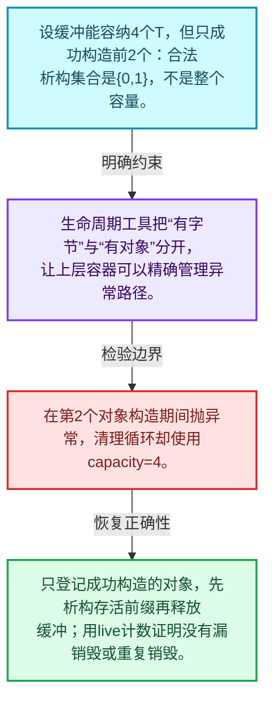
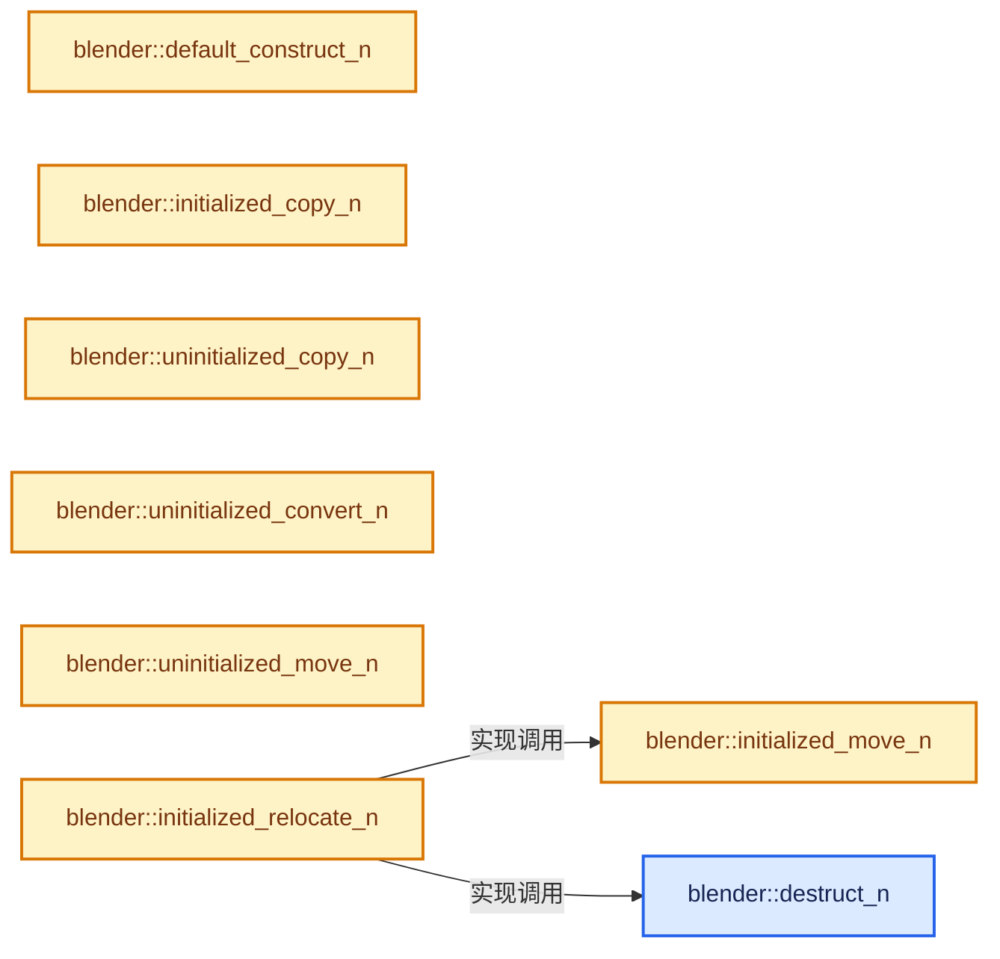
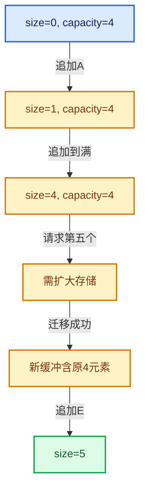

# 01-01 对象生命周期与值类别

[方向导航](README.md) · [总目录](../README.md) · [实现索引](../00-课程指南/02-源码与提交索引/符号依赖与实现索引.md)

## 从问题到实现

一块内存何时才真正包含一个T对象？

存储、构造、赋值、移动和销毁是不同操作；std::move只是值类别转换，不能凭它判断资源已经转移。

**数据模型**

设缓冲能容纳4个T，但只成功构造前2个：合法析构集合是{0,1}，不是整个容量。

**设计取舍**

生命周期工具把“有字节”与“有对象”分开，让上层容器可以精确管理异常路径。

**最小反例**

在第2个对象构造期间抛异常，清理循环却使用capacity=4。

**推导**

只登记成功构造的对象，先析构存活前缀再释放缓冲；用live计数证明没有漏销毁或重复销毁。

## 阅读地图与执行推演








图中的数值推演是本方向的教学模型；实际函数之间的调用边与概念分析边分别标注，不能把概念关系当作运行时调度顺序。

## 完整源码单元与就地讲解

中文讲解直接放在相关代码旁，复杂机制在代码下展开。原文折叠区保留基准行号；不需要在行号表和函数之间来回查找。类布局可分段展示，函数实现不按固定行数切开。

### 类型布局、声明与编译条件 · BLI_memory_utils.hh L1—L33

<!-- annotated:506ea34cd79a99 -->

```cpp
/* SPDX-FileCopyrightText: 2023 Blender Authors
 *
 * SPDX-License-Identifier: GPL-2.0-or-later */

#pragma once

/** \file
 * \ingroup bli
 */

#include <algorithm>
#include <memory>
#include <type_traits>

#include "BLI_utildefines.hh"

namespace blender {

/**
 * Under some circumstances #std::is_trivial_v<T> is false even though we know that the type is
 * actually trivial. Using that extra knowledge allows for some optimizations.
 */
template<typename T> inline constexpr bool is_trivial_extended_v = std::is_trivial_v<T>;
template<typename T>
inline constexpr bool is_trivially_destructible_extended_v = is_trivial_extended_v<T> ||
                                                             std::is_trivially_destructible_v<T>;
template<typename T>
inline constexpr bool is_trivially_copy_constructible_extended_v =
    is_trivial_extended_v<T> || std::is_trivially_copy_constructible_v<T>;
template<typename T>
inline constexpr bool is_trivially_move_constructible_extended_v =
    is_trivial_extended_v<T> || std::is_trivially_move_constructible_v<T>;

```

<details>
<summary>核对原始源码：source/blender/blenlib/BLI_memory_utils.hh · L1—L33</summary>

<!-- original:506ea34cd79a99:source/blender/blenlib/BLI_memory_utils.hh:1:33 -->

```cpp
/* SPDX-FileCopyrightText: 2023 Blender Authors
 *
 * SPDX-License-Identifier: GPL-2.0-or-later */

#pragma once

/** \file
 * \ingroup bli
 */

#include <algorithm>
#include <memory>
#include <type_traits>

#include "BLI_utildefines.hh"

namespace blender {

/**
 * Under some circumstances #std::is_trivial_v<T> is false even though we know that the type is
 * actually trivial. Using that extra knowledge allows for some optimizations.
 */
template<typename T> inline constexpr bool is_trivial_extended_v = std::is_trivial_v<T>;
template<typename T>
inline constexpr bool is_trivially_destructible_extended_v = is_trivial_extended_v<T> ||
                                                             std::is_trivially_destructible_v<T>;
template<typename T>
inline constexpr bool is_trivially_copy_constructible_extended_v =
    is_trivial_extended_v<T> || std::is_trivially_copy_constructible_v<T>;
template<typename T>
inline constexpr bool is_trivially_move_constructible_extended_v =
    is_trivial_extended_v<T> || std::is_trivially_move_constructible_v<T>;

```

</details>

<a id="f-cb5bcdbd0ee77885"></a>

### `blender::destruct_n`

结束n个已构造对象的寿命；不负责释放它们所在的缓冲。

实现位置：[source/blender/blenlib/BLI_memory_utils.hh](../../../../../source/blender/blenlib/BLI_memory_utils.hh) · L34—L41。

接口参数：

- `T *ptr`
- `int64_t n`

**教学注释版**

<!-- annotated:75082b777bfa7f -->

```cpp
template<typename T> void destruct_n(T *ptr, int64_t n)
{
  // [讲解] 平凡析构的类型跳过逐元素析构工作；不是“任意T都无需销毁”。
  if (is_trivially_destructible_extended_v<T>) {
    return;
  }

  // [讲解] 对真实存活的n个T逐个执行销毁，不调用分配器释放整块缓冲。
  std::destroy_n(ptr, n);
}
```

<details>
<summary>核对原始源码：source/blender/blenlib/BLI_memory_utils.hh · L34—L41</summary>

<!-- original:75082b777bfa7f:source/blender/blenlib/BLI_memory_utils.hh:34:41 -->

```cpp
template<typename T> void destruct_n(T *ptr, int64_t n)
{
  if (is_trivially_destructible_extended_v<T>) {
    return;
  }

  std::destroy_n(ptr, n);
}
```

</details>

**机制与执行推导**

is_trivially_destructible_extended_v结合标准性质与Blender的扩展性质。平凡类型无需逐个执行非平凡析构。

非平凡类型走std::destroy_n，资源释放由T析构器完成；缓存或存储的归还仍属于外层拥有者。

ptr必须指向真实存活对象区间，不能用capacity代替size。n=0表示不处理任何元素。

**继续追踪实现**

- `std::destroy_n` → [外部契约](https://eel.is/c++draft/specialized.destroy)：销毁n个已经构造的对象，不释放整块存储。对象析构可能释放各自资源；原始缓冲仍由分配者管理。

<!-- annotated:96e3320ef00125 -->

```cpp

```

<details>
<summary>核对原始源码：source/blender/blenlib/BLI_memory_utils.hh · L42—L42</summary>

<!-- original:96e3320ef00125:source/blender/blenlib/BLI_memory_utils.hh:42:42 -->

```cpp

```

</details>

<a id="f-7fba5f8c23635f17"></a>

### `blender::default_construct_n`

在未初始化区间默认构造n个T。

实现位置：[source/blender/blenlib/BLI_memory_utils.hh](../../../../../source/blender/blenlib/BLI_memory_utils.hh) · L43—L46。

接口参数：

- `T *ptr`
- `int64_t n`

**教学注释版**

<!-- annotated:6d96af99078e8f -->

```cpp
template<typename T> void default_construct_n(T *ptr, int64_t n)
{
  // [讲解] 默认初始化T，不是std::uninitialized_value_construct_n所表达的值初始化。
  std::uninitialized_default_construct_n(ptr, n);
}
```

<details>
<summary>核对原始源码：source/blender/blenlib/BLI_memory_utils.hh · L43—L46</summary>

<!-- original:6d96af99078e8f:source/blender/blenlib/BLI_memory_utils.hh:43:46 -->

```cpp
template<typename T> void default_construct_n(T *ptr, int64_t n)
{
  std::uninitialized_default_construct_n(ptr, n);
}
```

</details>

**机制与执行推导**

标准默认初始化算法不等于值初始化算法：对基本标量不承诺填零。异常时清理已经建立的新对象，原始缓冲的释放仍由调用者负责。

**继续追踪实现**

- `std::uninitialized_default_construct_n` → [外部契约](https://eel.is/c++draft/uninitialized.construct.default)：在目标建立默认初始化的对象；对基本标量不承诺零初始化。与对已有对象赋值不同。失败时按未初始化算法契约清理已构造目标。

<!-- annotated:719c9d76d09916 -->

```cpp

```

<details>
<summary>核对原始源码：source/blender/blenlib/BLI_memory_utils.hh · L47—L47</summary>

<!-- original:719c9d76d09916:source/blender/blenlib/BLI_memory_utils.hh:47:47 -->

```cpp

```

</details>

<a id="f-7e8b9229298df6c5"></a>

### `blender::initialized_copy_n`

实现位置：[source/blender/blenlib/BLI_memory_utils.hh](../../../../../source/blender/blenlib/BLI_memory_utils.hh) · L48—L51。

接口参数：

- `const T *src`
- `int64_t n`
- `T *dst`

**教学注释版**

<!-- annotated:78259584c791e7 -->

```cpp
template<typename T> void initialized_copy_n(const T *src, int64_t n, T *dst)
{
  std::copy_n(src, n, dst);
}
```

<details>
<summary>核对原始源码：source/blender/blenlib/BLI_memory_utils.hh · L48—L51</summary>

<!-- original:78259584c791e7:source/blender/blenlib/BLI_memory_utils.hh:48:51 -->

```cpp
template<typename T> void initialized_copy_n(const T *src, int64_t n, T *dst)
{
  std::copy_n(src, n, dst);
}
```

</details>

**继续追踪实现**

- `std::copy_n` → [外部契约](https://eel.is/c++draft/)：这个边界按实际表达式及所属类型核对参数、返回值、寿命与失败行为。这里提供接口入口，不声称已解释该第三方版本的内部实现。

<!-- annotated:8c62abeca6b3b1 -->

```cpp

```

<details>
<summary>核对原始源码：source/blender/blenlib/BLI_memory_utils.hh · L52—L52</summary>

<!-- original:8c62abeca6b3b1:source/blender/blenlib/BLI_memory_utils.hh:52:52 -->

```cpp

```

</details>

<a id="f-6cd63ebede164cd2"></a>

### `blender::uninitialized_copy_n`

实现位置：[source/blender/blenlib/BLI_memory_utils.hh](../../../../../source/blender/blenlib/BLI_memory_utils.hh) · L53—L56。

接口参数：

- `const T *src`
- `int64_t n`
- `T *dst`

**教学注释版**

<!-- annotated:c4a088199ac04d -->

```cpp
template<typename T> void uninitialized_copy_n(const T *src, int64_t n, T *dst)
{
  // [讲解] std::uninitialized_copy_n：在目标原始存储复制构造n个对象；源若由move_iterator访问，构造重载可以采用移动。源与目标区间不得重叠。目标构造失败时清理已构造目标，不恢复已经移动的源值，也不释放外层分配的缓冲。
  std::uninitialized_copy_n(src, n, dst);
}
```

<details>
<summary>核对原始源码：source/blender/blenlib/BLI_memory_utils.hh · L53—L56</summary>

<!-- original:c4a088199ac04d:source/blender/blenlib/BLI_memory_utils.hh:53:56 -->

```cpp
template<typename T> void uninitialized_copy_n(const T *src, int64_t n, T *dst)
{
  std::uninitialized_copy_n(src, n, dst);
}
```

</details>

**继续追踪实现**

- `std::uninitialized_copy_n` → [外部契约](https://eel.is/c++draft/uninitialized.copy)：在目标原始存储复制构造n个对象；源若由move_iterator访问，构造重载可以采用移动。源与目标区间不得重叠。目标构造失败时清理已构造目标，不恢复已经移动的源值，也不释放外层分配的缓冲。

<!-- annotated:ac95f65836fd99 -->

```cpp

```

<details>
<summary>核对原始源码：source/blender/blenlib/BLI_memory_utils.hh · L57—L57</summary>

<!-- original:ac95f65836fd99:source/blender/blenlib/BLI_memory_utils.hh:57:57 -->

```cpp

```

</details>

<a id="f-c9f2d65f10e2b002"></a>

### `blender::uninitialized_convert_n`

实现位置：[source/blender/blenlib/BLI_memory_utils.hh](../../../../../source/blender/blenlib/BLI_memory_utils.hh) · L58—L62。

接口参数：

- `const From *src`
- `int64_t n`
- `To *dst`

**教学注释版**

<!-- annotated:4f5de1415dbcf7 -->

```cpp
template<typename From, typename To>
void uninitialized_convert_n(const From *src, int64_t n, To *dst)
{
  // [讲解] std::uninitialized_copy_n：在目标原始存储复制构造n个对象；源若由move_iterator访问，构造重载可以采用移动。源与目标区间不得重叠。目标构造失败时清理已构造目标，不恢复已经移动的源值，也不释放外层分配的缓冲。
  std::uninitialized_copy_n(src, n, dst);
}
```

<details>
<summary>核对原始源码：source/blender/blenlib/BLI_memory_utils.hh · L58—L62</summary>

<!-- original:4f5de1415dbcf7:source/blender/blenlib/BLI_memory_utils.hh:58:62 -->

```cpp
template<typename From, typename To>
void uninitialized_convert_n(const From *src, int64_t n, To *dst)
{
  std::uninitialized_copy_n(src, n, dst);
}
```

</details>

**继续追踪实现**

- `std::uninitialized_copy_n` → [外部契约](https://eel.is/c++draft/uninitialized.copy)：在目标原始存储复制构造n个对象；源若由move_iterator访问，构造重载可以采用移动。源与目标区间不得重叠。目标构造失败时清理已构造目标，不恢复已经移动的源值，也不释放外层分配的缓冲。

<!-- annotated:61892a8981eff4 -->

```cpp

```

<details>
<summary>核对原始源码：source/blender/blenlib/BLI_memory_utils.hh · L63—L63</summary>

<!-- original:61892a8981eff4:source/blender/blenlib/BLI_memory_utils.hh:63:63 -->

```cpp

```

</details>

<a id="f-328a89f173c24880"></a>

### `blender::initialized_move_n`

实现位置：[source/blender/blenlib/BLI_memory_utils.hh](../../../../../source/blender/blenlib/BLI_memory_utils.hh) · L64—L67。

接口参数：

- `T *src`
- `int64_t n`
- `T *dst`

**教学注释版**

<!-- annotated:f70cab7c8bf56b -->

```cpp
template<typename T> void initialized_move_n(T *src, int64_t n, T *dst)
{
  // [讲解] std::make_move_iterator：适配迭代器的解引用值类别，不单独转移资源。实际对象的构造函数决定是否以及如何移动。
  std::copy_n(std::make_move_iterator(src), n, dst);
}
```

<details>
<summary>核对原始源码：source/blender/blenlib/BLI_memory_utils.hh · L64—L67</summary>

<!-- original:f70cab7c8bf56b:source/blender/blenlib/BLI_memory_utils.hh:64:67 -->

```cpp
template<typename T> void initialized_move_n(T *src, int64_t n, T *dst)
{
  std::copy_n(std::make_move_iterator(src), n, dst);
}
```

</details>

**继续追踪实现**

- `std::copy_n` → [外部契约](https://eel.is/c++draft/)：这个边界按实际表达式及所属类型核对参数、返回值、寿命与失败行为。这里提供接口入口，不声称已解释该第三方版本的内部实现。
- `std::make_move_iterator` → [外部契约](https://eel.is/c++draft/move.iterators)：适配迭代器的解引用值类别，不单独转移资源。实际对象的构造函数决定是否以及如何移动。

<!-- annotated:c61ddd9cd6d3d0 -->

```cpp

```

<details>
<summary>核对原始源码：source/blender/blenlib/BLI_memory_utils.hh · L68—L68</summary>

<!-- original:c61ddd9cd6d3d0:source/blender/blenlib/BLI_memory_utils.hh:68:68 -->

```cpp

```

</details>

<a id="f-fc5f51bf717c3b5a"></a>

### `blender::uninitialized_move_n`

通过移动迭代器驱动标准未初始化复制算法，实现目标移动构造。

实现位置：[source/blender/blenlib/BLI_memory_utils.hh](../../../../../source/blender/blenlib/BLI_memory_utils.hh) · L69—L72。

接口参数：

- `T *src`
- `int64_t n`
- `T *dst`

**教学注释版**

<!-- annotated:beded8ad3c3217 -->

```cpp
template<typename T> void uninitialized_move_n(T *src, int64_t n, T *dst)
{
  // [讲解] 右值解引用驱动目标构造；标准算法管目标前缀回滚，字节缓冲仍由调用者释放。
  std::uninitialized_copy_n(std::make_move_iterator(src), n, dst);
}
```

<details>
<summary>核对原始源码：source/blender/blenlib/BLI_memory_utils.hh · L69—L72</summary>

<!-- original:beded8ad3c3217:source/blender/blenlib/BLI_memory_utils.hh:69:72 -->

```cpp
template<typename T> void uninitialized_move_n(T *src, int64_t n, T *dst)
{
  std::uninitialized_copy_n(std::make_move_iterator(src), n, dst);
}
```

</details>

**机制与执行推导**

std::make_move_iterator改变解引用结果的值类别，不会单独搬走资源。

std::uninitialized_copy_n看到右值来源后用相应构造器在dst建立对象；实际是否移动取决于T的可用重载。

构造抛异常时，算法清理本轮已经构造的目标对象，但不恢复已经被移动过的源值，也不释放调用者提供的整块目标存储。

这里没有std::move_if_noexcept式复制回退，不能从标准vector的某些保证推断此实现有相同保证。

**继续追踪实现**

- `std::uninitialized_copy_n` → [外部契约](https://eel.is/c++draft/uninitialized.copy)：在目标原始存储复制构造n个对象；源若由move_iterator访问，构造重载可以采用移动。源与目标区间不得重叠。目标构造失败时清理已构造目标，不恢复已经移动的源值，也不释放外层分配的缓冲。
- `std::make_move_iterator` → [外部契约](https://eel.is/c++draft/move.iterators)：适配迭代器的解引用值类别，不单独转移资源。实际对象的构造函数决定是否以及如何移动。

<!-- annotated:2d3d0cd6f3dc02 -->

```cpp

```

<details>
<summary>核对原始源码：source/blender/blenlib/BLI_memory_utils.hh · L73—L73</summary>

<!-- original:2d3d0cd6f3dc02:source/blender/blenlib/BLI_memory_utils.hh:73:73 -->

```cpp

```

</details>

<a id="f-2a6b73d9c52ae967"></a>

### `blender::initialized_relocate_n`

实现位置：[source/blender/blenlib/BLI_memory_utils.hh](../../../../../source/blender/blenlib/BLI_memory_utils.hh) · L74—L78。

接口参数：

- `T *src`
- `int64_t n`
- `T *dst`

**教学注释版**

<!-- annotated:e30414675879c2 -->

```cpp
template<typename T> void initialized_relocate_n(T *src, int64_t n, T *dst)
{
  initialized_move_n(src, n, dst);
  // [讲解] destruct_n：结束n个已构造对象的寿命；不负责释放它们所在的缓冲。
  destruct_n(src, n);
}
```

<details>
<summary>核对原始源码：source/blender/blenlib/BLI_memory_utils.hh · L74—L78</summary>

<!-- original:e30414675879c2:source/blender/blenlib/BLI_memory_utils.hh:74:78 -->

```cpp
template<typename T> void initialized_relocate_n(T *src, int64_t n, T *dst)
{
  initialized_move_n(src, n, dst);
  destruct_n(src, n);
}
```

</details>

**继续追踪实现**

- `initialized_move_n` → [blender::initialized_move_n · L64](01-对象生命周期与值类别.md#f-328a89f173c24880)。
- `destruct_n` → [blender::destruct_n · L34](01-对象生命周期与值类别.md#f-cb5bcdbd0ee77885)。

<!-- annotated:1a6fe19c43da30 -->

```cpp

```

<details>
<summary>核对原始源码：source/blender/blenlib/BLI_memory_utils.hh · L79—L79</summary>

<!-- original:1a6fe19c43da30:source/blender/blenlib/BLI_memory_utils.hh:79:79 -->

```cpp

```

</details>

<a id="f-9de0365b9a47fd68"></a>

### `blender::uninitialized_relocate_n`

在目标原始存储建立对象，再结束源对象寿命。

实现位置：[source/blender/blenlib/BLI_memory_utils.hh](../../../../../source/blender/blenlib/BLI_memory_utils.hh) · L80—L84。

接口参数：

- `T *src`
- `int64_t n`
- `T *dst`

**教学注释版**

<!-- annotated:d7684236a8f8cb -->

```cpp
template<typename T> void uninitialized_relocate_n(T *src, int64_t n, T *dst)
{
  // [讲解] 先建立目标n个对象；只要这一步抛异常，就不会进入下一行。
  uninitialized_move_n(src, n, dst);
  // [讲解] 只有目标全部建立后，才结束原n个对象寿命，完成资源责任转移。
  destruct_n(src, n);
}
```

<details>
<summary>核对原始源码：source/blender/blenlib/BLI_memory_utils.hh · L80—L84</summary>

<!-- original:d7684236a8f8cb:source/blender/blenlib/BLI_memory_utils.hh:80:84 -->

```cpp
template<typename T> void uninitialized_relocate_n(T *src, int64_t n, T *dst)
{
  uninitialized_move_n(src, n, dst);
  destruct_n(src, n);
}
```

</details>

**机制与执行推导**

这里的relocate有两个阶段，先调用uninitialized_move_n，成功后才destruct_n(src,n)。

移动与重定位的区别就在第二阶段。单独移动构造不会自动结束源对象寿命。

目标构造失败时，第二行不会执行，因此源对象仍需由原拥有者管理。目标前缀清理来自标准未初始化算法，不是这个两行包装自己写了回滚。

不要将src与dst重叠的场景当作已支持；调用者应提供合法且足够的目标未初始化区间。

**继续追踪实现**

- `uninitialized_move_n` → [blender::uninitialized_move_n · L69](01-对象生命周期与值类别.md#f-fc5f51bf717c3b5a)。
- `destruct_n` → [blender::destruct_n · L34](01-对象生命周期与值类别.md#f-cb5bcdbd0ee77885)。

<!-- annotated:630279f505360d -->

```cpp

```

<details>
<summary>核对原始源码：source/blender/blenlib/BLI_memory_utils.hh · L85—L85</summary>

<!-- original:630279f505360d:source/blender/blenlib/BLI_memory_utils.hh:85:85 -->

```cpp

```

</details>

<a id="f-4af3bf5ccfdcee6c"></a>

### `blender::initialized_fill_n`

实现位置：[source/blender/blenlib/BLI_memory_utils.hh](../../../../../source/blender/blenlib/BLI_memory_utils.hh) · L86—L89。

接口参数：

- `T *dst`
- `int64_t n`
- `const T &value`

**教学注释版**

<!-- annotated:b89ea833536d74 -->

```cpp
template<typename T> void initialized_fill_n(T *dst, int64_t n, const T &value)
{
  std::fill_n(dst, n, value);
}
```

<details>
<summary>核对原始源码：source/blender/blenlib/BLI_memory_utils.hh · L86—L89</summary>

<!-- original:b89ea833536d74:source/blender/blenlib/BLI_memory_utils.hh:86:89 -->

```cpp
template<typename T> void initialized_fill_n(T *dst, int64_t n, const T &value)
{
  std::fill_n(dst, n, value);
}
```

</details>

**继续追踪实现**

- `std::fill_n` → [外部契约](https://eel.is/c++draft/)：这个边界按实际表达式及所属类型核对参数、返回值、寿命与失败行为。这里提供接口入口，不声称已解释该第三方版本的内部实现。

<!-- annotated:b3d64b2ee4a952 -->

```cpp

```

<details>
<summary>核对原始源码：source/blender/blenlib/BLI_memory_utils.hh · L90—L90</summary>

<!-- original:b3d64b2ee4a952:source/blender/blenlib/BLI_memory_utils.hh:90:90 -->

```cpp

```

</details>

<a id="f-020ca78eff5f9227"></a>

### `blender::uninitialized_fill_n`

从同一个value复制构造目标n个T。

实现位置：[source/blender/blenlib/BLI_memory_utils.hh](../../../../../source/blender/blenlib/BLI_memory_utils.hh) · L91—L94。

接口参数：

- `T *dst`
- `int64_t n`
- `const T &value`

**教学注释版**

<!-- annotated:acfd371ca62aa5 -->

```cpp
template<typename T> void uninitialized_fill_n(T *dst, int64_t n, const T &value)
{
  // [讲解] 每个目标位置都从value建立新对象；对string会执行相应复制构造。
  std::uninitialized_fill_n(dst, n, value);
}
```

<details>
<summary>核对原始源码：source/blender/blenlib/BLI_memory_utils.hh · L91—L94</summary>

<!-- original:acfd371ca62aa5:source/blender/blenlib/BLI_memory_utils.hh:91:94 -->

```cpp
template<typename T> void uninitialized_fill_n(T *dst, int64_t n, const T &value)
{
  std::uninitialized_fill_n(dst, n, value);
}
```

</details>

**机制与执行推导**

这是构造，不是对已有T赋值。value必须在整个操作期间有效，目标构造失败的前缀回滚由标准算法处理。

**继续追踪实现**

- `std::uninitialized_fill_n` → [外部契约](https://eel.is/c++draft/uninitialized.fill)：从同一个源值复制构造n个目标；源值须保持有效。目标是原始存储，不能把它当作对已有对象的fill赋值。

### 类型布局、声明与编译条件 · BLI_memory_utils.hh L95—L96

<a id="t-63cc7844c28a"></a>

<!-- annotated:097c6779c3b241 -->

```cpp

template<typename T> struct DestructValueAtAddress {
```

<details>
<summary>核对原始源码：source/blender/blenlib/BLI_memory_utils.hh · L95—L96</summary>

<!-- original:097c6779c3b241:source/blender/blenlib/BLI_memory_utils.hh:95:96 -->

```cpp

template<typename T> struct DestructValueAtAddress {
```

</details>

<a id="f-c9d4681b038e8a38"></a>

### `blender::DestructValueAtAddress::DestructValueAtAddress`

实现位置：[source/blender/blenlib/BLI_memory_utils.hh](../../../../../source/blender/blenlib/BLI_memory_utils.hh) · L97—L97。

**教学注释版**

<!-- annotated:1a647f694b2033 -->

```cpp
  DestructValueAtAddress() = default;
```

<details>
<summary>核对原始源码：source/blender/blenlib/BLI_memory_utils.hh · L97—L97</summary>

<!-- original:1a647f694b2033:source/blender/blenlib/BLI_memory_utils.hh:97:97 -->

```cpp
  DestructValueAtAddress() = default;
```

</details>

**继续追踪实现**

本实现没有需要继续展开的显式调用；检查返回表达式、对象转换和调用者前置条件。

<!-- annotated:949ac9bd49ff33 -->

```cpp

```

<details>
<summary>核对原始源码：source/blender/blenlib/BLI_memory_utils.hh · L98—L98</summary>

<!-- original:949ac9bd49ff33:source/blender/blenlib/BLI_memory_utils.hh:98:98 -->

```cpp

```

</details>

<a id="f-4db22228b88fab24"></a>

### `blender::DestructValueAtAddress::DestructValueAtAddress`

实现位置：[source/blender/blenlib/BLI_memory_utils.hh](../../../../../source/blender/blenlib/BLI_memory_utils.hh) · L99—L99。

接口参数：

- `const U &`

**教学注释版**

<!-- annotated:d2450160402836 -->

```cpp
  template<typename U> DestructValueAtAddress(const U &) {}
```

<details>
<summary>核对原始源码：source/blender/blenlib/BLI_memory_utils.hh · L99—L99</summary>

<!-- original:d2450160402836:source/blender/blenlib/BLI_memory_utils.hh:99:99 -->

```cpp
  template<typename U> DestructValueAtAddress(const U &) {}
```

</details>

**继续追踪实现**

本实现没有需要继续展开的显式调用；检查返回表达式、对象转换和调用者前置条件。

<!-- annotated:92d9a3bdf4b8fa -->

```cpp

```

<details>
<summary>核对原始源码：source/blender/blenlib/BLI_memory_utils.hh · L100—L100</summary>

<!-- original:92d9a3bdf4b8fa:source/blender/blenlib/BLI_memory_utils.hh:100:100 -->

```cpp

```

</details>

<a id="f-3850f67b46b81e8d"></a>

### `blender::DestructValueAtAddress::operator()`

实现位置：[source/blender/blenlib/BLI_memory_utils.hh](../../../../../source/blender/blenlib/BLI_memory_utils.hh) · L101—L104。

接口参数：

- `T *ptr`

**教学注释版**

<!-- annotated:ef3b76f78b9fb6 -->

```cpp
  void operator()(T *ptr)
  {
    ptr->~T();
  }
```

<details>
<summary>核对原始源码：source/blender/blenlib/BLI_memory_utils.hh · L101—L104</summary>

<!-- original:ef3b76f78b9fb6:source/blender/blenlib/BLI_memory_utils.hh:101:104 -->

```cpp
  void operator()(T *ptr)
  {
    ptr->~T();
  }
```

</details>

**继续追踪实现**

- `ptr->~T` → [调用协议](../00-课程指南/01-路线与规范/模板宏与动态分派协议.md)：T模板参数提供的操作协议。调用位置L103。

### 类型布局、声明与编译条件 · BLI_memory_utils.hh L105—L127

<a id="t-4c0794066ddd"></a>

`AlignedBuffer`在这里声明的数据成员：

- `BLI_NO_UNIQUE_ADDRESS BufferType`

<a id="t-479aa827eb9b"></a>

<a id="t-f87d0e42e296"></a>

`Sized`在这里声明的数据成员：

- `std::byte buffer_`

<!-- annotated:b10d3fc2d4cf59 -->

```cpp
};

/**
 * A destruct_ptr is like unique_ptr, but it will only call the destructor and will not free the
 * memory. This is useful when using custom allocators.
 */
template<typename T> using destruct_ptr = std::unique_ptr<T, DestructValueAtAddress<T>>;

/**
 * An `AlignedBuffer` is a byte array with at least the given size and alignment. The buffer will
 * not be initialized by the default constructor.
 */
template<size_t Size, size_t Alignment> class AlignedBuffer {
  struct Empty {};
  struct alignas(Alignment) Sized {
    /* Don't create an empty array. This causes problems with some compilers. */
    std::byte buffer_[Size > 0 ? Size : 1];
  };

  using BufferType = std::conditional_t<Size == 0, Empty, Sized>;
  BLI_NO_UNIQUE_ADDRESS BufferType buffer_;

 public:
```

<details>
<summary>核对原始源码：source/blender/blenlib/BLI_memory_utils.hh · L105—L127</summary>

<!-- original:b10d3fc2d4cf59:source/blender/blenlib/BLI_memory_utils.hh:105:127 -->

```cpp
};

/**
 * A destruct_ptr is like unique_ptr, but it will only call the destructor and will not free the
 * memory. This is useful when using custom allocators.
 */
template<typename T> using destruct_ptr = std::unique_ptr<T, DestructValueAtAddress<T>>;

/**
 * An `AlignedBuffer` is a byte array with at least the given size and alignment. The buffer will
 * not be initialized by the default constructor.
 */
template<size_t Size, size_t Alignment> class AlignedBuffer {
  struct Empty {};
  struct alignas(Alignment) Sized {
    /* Don't create an empty array. This causes problems with some compilers. */
    std::byte buffer_[Size > 0 ? Size : 1];
  };

  using BufferType = std::conditional_t<Size == 0, Empty, Sized>;
  BLI_NO_UNIQUE_ADDRESS BufferType buffer_;

 public:
```

</details>

<a id="f-f2d0c89c389deadc"></a>

### `blender::AlignedBuffer::()`

实现位置：[source/blender/blenlib/BLI_memory_utils.hh](../../../../../source/blender/blenlib/BLI_memory_utils.hh) · L128—L131。

**教学注释版**

<!-- annotated:71e5c8e0b01103 -->

```cpp
  operator void *()
  {
    return this;
  }
```

<details>
<summary>核对原始源码：source/blender/blenlib/BLI_memory_utils.hh · L128—L131</summary>

<!-- original:71e5c8e0b01103:source/blender/blenlib/BLI_memory_utils.hh:128:131 -->

```cpp
  operator void *()
  {
    return this;
  }
```

</details>

**结果出口**

- `return this;`

**继续追踪实现**

本实现没有需要继续展开的显式调用；检查返回表达式、对象转换和调用者前置条件。

<!-- annotated:6d1535cb4bc79a -->

```cpp

```

<details>
<summary>核对原始源码：source/blender/blenlib/BLI_memory_utils.hh · L132—L132</summary>

<!-- original:6d1535cb4bc79a:source/blender/blenlib/BLI_memory_utils.hh:132:132 -->

```cpp

```

</details>

<a id="f-d34418cfa8e83a5b"></a>

### `blender::AlignedBuffer::() const`

实现位置：[source/blender/blenlib/BLI_memory_utils.hh](../../../../../source/blender/blenlib/BLI_memory_utils.hh) · L133—L136。

**教学注释版**

<!-- annotated:0f2634ae5fa87a -->

```cpp
  operator const void *() const
  {
    return this;
  }
```

<details>
<summary>核对原始源码：source/blender/blenlib/BLI_memory_utils.hh · L133—L136</summary>

<!-- original:0f2634ae5fa87a:source/blender/blenlib/BLI_memory_utils.hh:133:136 -->

```cpp
  operator const void *() const
  {
    return this;
  }
```

</details>

**结果出口**

- `return this;`

**继续追踪实现**

本实现没有需要继续展开的显式调用；检查返回表达式、对象转换和调用者前置条件。

<!-- annotated:6ef87c7437e92d -->

```cpp

```

<details>
<summary>核对原始源码：source/blender/blenlib/BLI_memory_utils.hh · L137—L137</summary>

<!-- original:6ef87c7437e92d:source/blender/blenlib/BLI_memory_utils.hh:137:137 -->

```cpp

```

</details>

<a id="f-bfe745bcb7c7811c"></a>

### `blender::AlignedBuffer::ptr`

实现位置：[source/blender/blenlib/BLI_memory_utils.hh](../../../../../source/blender/blenlib/BLI_memory_utils.hh) · L138—L141。

**教学注释版**

<!-- annotated:e1a590054d2b23 -->

```cpp
  void *ptr()
  {
    return this;
  }
```

<details>
<summary>核对原始源码：source/blender/blenlib/BLI_memory_utils.hh · L138—L141</summary>

<!-- original:e1a590054d2b23:source/blender/blenlib/BLI_memory_utils.hh:138:141 -->

```cpp
  void *ptr()
  {
    return this;
  }
```

</details>

**结果出口**

- `return this;`

**继续追踪实现**

本实现没有需要继续展开的显式调用；检查返回表达式、对象转换和调用者前置条件。

<!-- annotated:0f4838b65dfeb5 -->

```cpp

```

<details>
<summary>核对原始源码：source/blender/blenlib/BLI_memory_utils.hh · L142—L142</summary>

<!-- original:0f4838b65dfeb5:source/blender/blenlib/BLI_memory_utils.hh:142:142 -->

```cpp

```

</details>

<a id="f-f24632360e6cd028"></a>

### `blender::AlignedBuffer::ptr`

实现位置：[source/blender/blenlib/BLI_memory_utils.hh](../../../../../source/blender/blenlib/BLI_memory_utils.hh) · L143—L146。

**教学注释版**

<!-- annotated:475d9a75109baf -->

```cpp
  const void *ptr() const
  {
    return this;
  }
```

<details>
<summary>核对原始源码：source/blender/blenlib/BLI_memory_utils.hh · L143—L146</summary>

<!-- original:475d9a75109baf:source/blender/blenlib/BLI_memory_utils.hh:143:146 -->

```cpp
  const void *ptr() const
  {
    return this;
  }
```

</details>

**结果出口**

- `return this;`

**继续追踪实现**

本实现没有需要继续展开的显式调用；检查返回表达式、对象转换和调用者前置条件。

### 类型布局、声明与编译条件 · BLI_memory_utils.hh L147—L156

<a id="t-2cf83b451a01"></a>

<!-- annotated:47b0433fe7895b -->

```cpp
};

/**
 * This can be used to reserve memory for C++ objects whose lifetime is different from the
 * lifetime of the object they are embedded in. It's used by containers with small buffer
 * optimization and hash table implementations.
 */
template<typename T, int64_t Size = 1> class TypedBuffer {
 private:
  /** Required so that `sizeof(T)` is not required when `Size` is 0. */
```

<details>
<summary>核对原始源码：source/blender/blenlib/BLI_memory_utils.hh · L147—L156</summary>

<!-- original:47b0433fe7895b:source/blender/blenlib/BLI_memory_utils.hh:147:156 -->

```cpp
};

/**
 * This can be used to reserve memory for C++ objects whose lifetime is different from the
 * lifetime of the object they are embedded in. It's used by containers with small buffer
 * optimization and hash table implementations.
 */
template<typename T, int64_t Size = 1> class TypedBuffer {
 private:
  /** Required so that `sizeof(T)` is not required when `Size` is 0. */
```

</details>

<a id="f-01c9908024e5905f"></a>

### `blender::TypedBuffer::get_size`

实现位置：[source/blender/blenlib/BLI_memory_utils.hh](../../../../../source/blender/blenlib/BLI_memory_utils.hh) · L157—L165。

**教学注释版**

<!-- annotated:a3682bff04d450 -->

```cpp
  static constexpr size_t get_size()
  {
    if constexpr (Size == 0) {
      return 0;
    }
    else {
      return sizeof(T) * size_t(Size);
    }
  }
```

<details>
<summary>核对原始源码：source/blender/blenlib/BLI_memory_utils.hh · L157—L165</summary>

<!-- original:a3682bff04d450:source/blender/blenlib/BLI_memory_utils.hh:157:165 -->

```cpp
  static constexpr size_t get_size()
  {
    if constexpr (Size == 0) {
      return 0;
    }
    else {
      return sizeof(T) * size_t(Size);
    }
  }
```

</details>

**结果出口**

- `return 0;`
- `return sizeof(T) * size_t(Size);`

**继续追踪实现**

本实现没有需要继续展开的显式调用；检查返回表达式、对象转换和调用者前置条件。

### 类型布局、声明与编译条件 · BLI_memory_utils.hh L166—L167

<!-- annotated:006ea2ef2fb525 -->

```cpp

  /** Required so that `alignof(T)` is not required when `Size` is 0. */
```

<details>
<summary>核对原始源码：source/blender/blenlib/BLI_memory_utils.hh · L166—L167</summary>

<!-- original:006ea2ef2fb525:source/blender/blenlib/BLI_memory_utils.hh:166:167 -->

```cpp

  /** Required so that `alignof(T)` is not required when `Size` is 0. */
```

</details>

<a id="f-97f29e4dc546127f"></a>

### `blender::TypedBuffer::get_alignment`

实现位置：[source/blender/blenlib/BLI_memory_utils.hh](../../../../../source/blender/blenlib/BLI_memory_utils.hh) · L168—L176。

**教学注释版**

<!-- annotated:b4e0fea550cc90 -->

```cpp
  static constexpr size_t get_alignment()
  {
    if constexpr (Size == 0) {
      return 1;
    }
    else {
      return alignof(T);
    }
  }
```

<details>
<summary>核对原始源码：source/blender/blenlib/BLI_memory_utils.hh · L168—L176</summary>

<!-- original:b4e0fea550cc90:source/blender/blenlib/BLI_memory_utils.hh:168:176 -->

```cpp
  static constexpr size_t get_alignment()
  {
    if constexpr (Size == 0) {
      return 1;
    }
    else {
      return alignof(T);
    }
  }
```

</details>

**结果出口**

- `return 1;`
- `return alignof(T);`

**继续追踪实现**

本实现没有需要继续展开的显式调用；检查返回表达式、对象转换和调用者前置条件。

### 类型布局、声明与编译条件 · BLI_memory_utils.hh L177—L180

<!-- annotated:880562d19535b3 -->

```cpp

  BLI_NO_UNIQUE_ADDRESS AlignedBuffer<get_size(), get_alignment()> buffer_;

 public:
```

<details>
<summary>核对原始源码：source/blender/blenlib/BLI_memory_utils.hh · L177—L180</summary>

<!-- original:880562d19535b3:source/blender/blenlib/BLI_memory_utils.hh:177:180 -->

```cpp

  BLI_NO_UNIQUE_ADDRESS AlignedBuffer<get_size(), get_alignment()> buffer_;

 public:
```

</details>

<a id="f-47e1bfca173d566c"></a>

### `blender::TypedBuffer::()`

实现位置：[source/blender/blenlib/BLI_memory_utils.hh](../../../../../source/blender/blenlib/BLI_memory_utils.hh) · L181—L184。

**教学注释版**

<!-- annotated:be13a2ea5ed26a -->

```cpp
  operator T *()
  {
    return static_cast<T *>(buffer_.ptr());
  }
```

<details>
<summary>核对原始源码：source/blender/blenlib/BLI_memory_utils.hh · L181—L184</summary>

<!-- original:be13a2ea5ed26a:source/blender/blenlib/BLI_memory_utils.hh:181:184 -->

```cpp
  operator T *()
  {
    return static_cast<T *>(buffer_.ptr());
  }
```

</details>

**结果出口**

- `return static_cast<T *>(buffer_.ptr());`

**继续追踪实现**

- `buffer_.ptr` → [调用协议](../00-课程指南/01-路线与规范/模板宏与动态分派协议.md)：接收对象类型依赖auto、返回值或模板实例；不按同名猜测目标。调用位置L183。

## 语法与相关类型

### 模板 template

模板把类型或常量作为生成实现的参数。读声明时先列出类型参数、非类型参数和默认值，再看使用者实际实例化了什么。模板声明本身不意味着每种T都支持其全部成员。

把T替换为int、string、只能移动的类型，分别检查每个被调用操作是否成立。

### 依赖名称 typename

typename既可引入类型模板参数，也可告诉编译器某个依赖名称是类型。它不创建运行时对象；解析期确认语法类别与实例化期检查具体类型是不同阶段。

区分typename T::value_type和T::size()，前者标记类型，后者是表达式。

### 常量求值 constexpr

constexpr声明允许相应实体参与常量求值，但constexpr函数仍可以在运行时执行。是否常量求值由调用场景和表达式合法性共同决定。

比较constexpr变量初始化和从运行时输入调用同一函数。

### 只读限定 const

const约束当前访问路径可做的修改。const指针、指向const的指针、const视图对象、const元素是不同位置的限定；其他别名可能仍可修改原对象。

分别写T* const、const T*与const T* const，并画出不可修改的层次。

### 显式静态转换 static_cast

static_cast表达编译期允许的转换，不会自动验证运行时真实类型、指针寿命或索引边界。由void指针恢复T指针时，调用者仍须保证实际存储中确有合法T对象。

标出转换前后的类型以及正确性依据来自哪里。

### 对齐 alignof

alignof得到类型要求的地址对齐。分配足够字节后仍需把地址对齐到相应边界，内嵌缓冲也一样。

对齐a为2的幂时可推导向上取整，但仍要考虑溢出与边界。

### 对象表示 sizeof

sizeof给出对象表示大小，不是其引用的所有堆内存总量。sizeof视图很小并不说明底层数组很小。

分别统计容器对象、容量字节和元素拥有的间接资源。

### 编译期分支 if constexpr

条件在实例化时决定被保留的分支，这常用于不同类型的合法操作选择。它与运行时if有不同的实例化检查规则。

找出每个分支依赖哪些类型特征，再使用满足与不满足条件的类型。

### 独占拥有 unique_ptr

unique_ptr通过移动转移拥有关系，默认删除策略必须与资源来源匹配。get返回借用指针，release交出责任而不销毁。

区分move、get、release和reset后谁负责销毁。

### 类型别名 using

类型别名为已有类型建立名字，不创建运行期对象。它常把模板内部使用的类型统一暴露给泛型调用者。

展开别名直到基础类型，区分类型别名和变量声明。

## 实现练习与验证

用计数类型追踪构造、复制、移动、析构，检查每个成功构造的对象恰好析构一次。

参考推理：只登记成功构造的对象，先析构存活前缀再释放缓冲；用live计数证明没有漏销毁或重复销毁。

构造成功次数减析构次数应等于当前存活对象数；异常之后资源计数应回到合法状态。

## 历史、跨库比较与证据

对比std::vector、std::array、std::span与LLVM SmallVector、ArrayRef时，分别比较拥有关系、内嵌存储、大小是否属于类型和失效条件。不要根据同名方法推断完全相同契约。

[历史提交索引](../00-课程指南/02-源码与提交索引/历史提交与设计演化索引.md) · [源码基准](../00-课程指南/02-源码与提交索引/源码版本与覆盖索引.md) · [验收报告](../00-课程指南/03-验收报告/验收报告.md)
