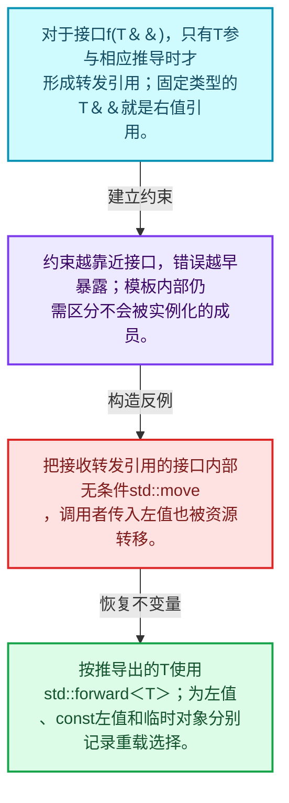
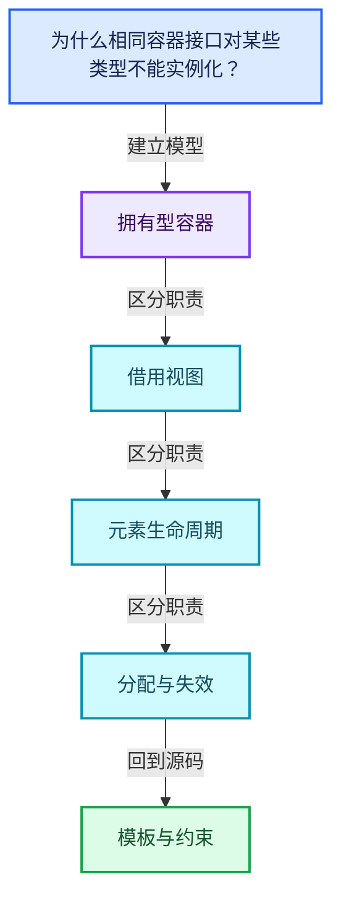
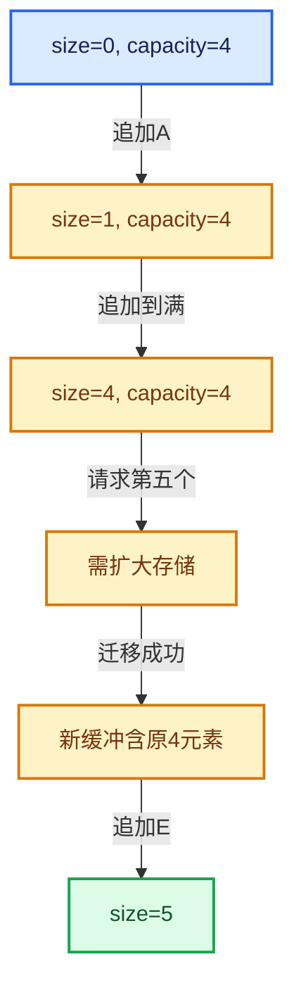

# 01-02 模板与约束

[方向导航](README.md) · [总目录](../README.md) · [覆盖索引](../%E6%BA%90%E7%A0%81%E7%89%88%E6%9C%AC%E4%B8%8E%E8%A6%86%E7%9B%96%E7%B4%A2%E5%BC%95.md)

> 阅读顺序：问题与数据模型 → 语法与类型 → 源码逐行 → 调用线索 → 历史与取舍 → 推演和练习。

- 基准 HEAD：`cbda6b96c26c0dee3c3b5cbb93960c4ac06a6b30`。
- 记录日期：2026-10-14。
- 教学示例状态：正文中的推演不是本机性能实测；已运行练习见验收报告。

## 一、从问题到设计

为什么相同容器接口对某些类型不能实例化？

模板推导决定类型，约束限制可用操作；NonCopyable和NonMovable通过删除特殊成员把接口约定变成编译错误。

本篇把语法、数据语义和系统取舍连接起来。先证明对象存活，再讨论索引；先区分借用与拥有，再讨论复制移动。

### 本篇独立模型与设计推理

对于接口f(T&&)，只有T参与相应推导时才形成转发引用；固定类型的T&&就是右值引用。

设计取舍：约束越靠近接口，错误越早暴露；模板内部仍需区分不会被实例化的成员。

最小反例：把接收转发引用的接口内部无条件std::move，调用者传入左值也被资源转移。

推导与处理：按推导出的T使用std::forward<T>；为左值、const左值和临时对象分别记录重载选择。



### 源码范围与相邻篇章

| 文件 | 本篇逐行范围 | 基准SHA-256 |
|---|---|---|
| [source/blender/blenlib/BLI_utility_mixins.hh](../../../../../source/blender/blenlib/BLI_utility_mixins.hh) | L1—L43 | `1e4250c4893e77a9286fed2872b9990925d08461e28aace72550b4c37beb9cae` |

同一主讲文件可能分多篇覆盖；超出本篇范围的符号通过覆盖索引定位。空行与纯注释保留在源码摘录中，逐行表解释有效语句与语法边界；许可证头统一保留。

前篇：[对象生命周期与值类别](01-%E5%AF%B9%E8%B1%A1%E7%94%9F%E5%91%BD%E5%91%A8%E6%9C%9F%E4%B8%8E%E5%80%BC%E7%B1%BB%E5%88%AB.md).

后篇：[内存工具与分配器接口](03-%E5%86%85%E5%AD%98%E5%B7%A5%E5%85%B7%E4%B8%8E%E5%88%86%E9%85%8D%E5%99%A8%E6%8E%A5%E5%8F%A3.md).

## 二、类型、数据与阅读地图



这是概念依赖图，边表示阅读关系，不声称是运行时调用顺序。

### 直接编译依赖


箭头只表示头文件包含关系；完整调用线索见后面的符号定位表。

## 三、关键词、语法与类型角色

### 只读限定 const

const约束当前访问路径可做的修改。const指针、指向const的指针、const视图对象、const元素是不同位置的限定；其他别名可能仍可修改原对象。

具体检查：分别写T* const、const T*与const T* const，并画出不可修改的层次。

## 四、真实源码与逐行讲解

源码块保持原行内容，原始行号由小节标题及逐行表给出。表中的调用定位是静态阅读辅助；重载、模板实例化、宏展开和虚调用需结合完整声明，不能仅凭词法出现证明动态调用。

### BLI_utility_mixins.hh：L1—L43

<!-- source:source/blender/blenlib/BLI_utility_mixins.hh:1:43 -->

```cpp
/* SPDX-FileCopyrightText: 2023 Blender Authors
 *
 * SPDX-License-Identifier: GPL-2.0-or-later */

/** \file
 * \ingroup bli
 */

#pragma once

namespace blender {

/**
 * A type that inherits from NonCopyable cannot be copied anymore.
 */
class NonCopyable {
 public:
  /* Disable copy construction and assignment. */
  NonCopyable(const NonCopyable &other) = delete;
  NonCopyable &operator=(const NonCopyable &other) = delete;

  /* Explicitly enable default construction, move construction and move assignment. */
  NonCopyable() = default;
  NonCopyable(NonCopyable &&other) = default;
  NonCopyable &operator=(NonCopyable &&other) = default;
};

/**
 * A type that inherits from NonMovable cannot be moved anymore.
 */
class NonMovable {
 public:
  /* Disable move construction and assignment. */
  NonMovable(NonMovable &&other) = delete;
  NonMovable &operator=(NonMovable &&other) = delete;

  /* Explicitly enable default construction, copy construction and copy assignment. */
  NonMovable() = default;
  NonMovable(const NonMovable &other) = default;
  NonMovable &operator=(const NonMovable &other) = default;
};

}  // namespace blender
```

| 原始行 | 语义、约束与检查 |
|---|---|
| L9 | 防止同一头文件在一个翻译单元中重复展开；不控制多个源文件之间的链接或对象寿命。 |
| L11 | 把后续声明放入 blender 命名空间，影响名称查找和符号归属，不创建运行时对象。 |
| L16 | 声明或定义类型 `class NonCopyable`。结合继承、访问权限和成员布局确认接口与拥有关系；前向声明本身没有完整对象布局。 |
| L17 | 切换成员访问权限为 public；它是编译期接口边界，不是线程同步或内存保护。 |
| L19 | 显式禁止接口：`NonCopyable(const NonCopyable &other) = delete;`。调用会在编译期被拒绝，常用于禁止复制或移动；这里没有释放对象或删除文件的运行时动作。 |
| L20 | 显式禁止接口：`NonCopyable &operator=(const NonCopyable &other) = delete;`。调用会在编译期被拒绝，常用于禁止复制或移动；这里没有释放对象或删除文件的运行时动作。 |
| L23 | 显式采用编译器生成的特殊成员行为：`NonCopyable() = default;`。成员和基类的性质决定该操作是否可用、是否被删除及异常约定，不表示运行时给对象赋值为default。 |
| L24 | 显式采用编译器生成的特殊成员行为：`NonCopyable(NonCopyable &&other) = default;`。成员和基类的性质决定该操作是否可用、是否被删除及异常约定，不表示运行时给对象赋值为default。 |
| L25 | 显式采用编译器生成的特殊成员行为：`NonCopyable &operator=(NonCopyable &&other) = default;`。成员和基类的性质决定该操作是否可用、是否被删除及异常约定，不表示运行时给对象赋值为default。 |
| L26 | 结束当前语法单元。局部自动对象在离开其作用域时按规则销毁；这不等于所有被引用的外部数据也被释放。 |
| L31 | 声明或定义类型 `class NonMovable`。结合继承、访问权限和成员布局确认接口与拥有关系；前向声明本身没有完整对象布局。 |
| L32 | 切换成员访问权限为 public；它是编译期接口边界，不是线程同步或内存保护。 |
| L34 | 显式禁止接口：`NonMovable(NonMovable &&other) = delete;`。调用会在编译期被拒绝，常用于禁止复制或移动；这里没有释放对象或删除文件的运行时动作。 |
| L35 | 显式禁止接口：`NonMovable &operator=(NonMovable &&other) = delete;`。调用会在编译期被拒绝，常用于禁止复制或移动；这里没有释放对象或删除文件的运行时动作。 |
| L38 | 显式采用编译器生成的特殊成员行为：`NonMovable() = default;`。成员和基类的性质决定该操作是否可用、是否被删除及异常约定，不表示运行时给对象赋值为default。 |
| L39 | 显式采用编译器生成的特殊成员行为：`NonMovable(const NonMovable &other) = default;`。成员和基类的性质决定该操作是否可用、是否被删除及异常约定，不表示运行时给对象赋值为default。 |
| L40 | 显式采用编译器生成的特殊成员行为：`NonMovable &operator=(const NonMovable &other) = default;`。成员和基类的性质决定该操作是否可用、是否被删除及异常约定，不表示运行时给对象赋值为default。 |
| L41 | 结束当前语法单元。局部自动对象在离开其作用域时按规则销毁；这不等于所有被引用的外部数据也被释放。 |
| L43 | 结束当前语法单元。局部自动对象在离开其作用域时按规则销毁；这不等于所有被引用的外部数据也被释放。 |

## 五、接口定位、调用线索与生命周期

### 本篇声明与实现入口

| 源码位置 | 实际声明片段 |
|---|---|
| [BLI_utility_mixins.hh:L16](../../../../../source/blender/blenlib/BLI_utility_mixins.hh#L16) | `class NonCopyable` |
| [BLI_utility_mixins.hh:L19](../../../../../source/blender/blenlib/BLI_utility_mixins.hh#L19) | `NonCopyable(const NonCopyable &other) = delete;` |
| [BLI_utility_mixins.hh:L23](../../../../../source/blender/blenlib/BLI_utility_mixins.hh#L23) | `NonCopyable() = default;` |
| [BLI_utility_mixins.hh:L24](../../../../../source/blender/blenlib/BLI_utility_mixins.hh#L24) | `NonCopyable(NonCopyable &&other) = default;` |
| [BLI_utility_mixins.hh:L31](../../../../../source/blender/blenlib/BLI_utility_mixins.hh#L31) | `class NonMovable` |
| [BLI_utility_mixins.hh:L34](../../../../../source/blender/blenlib/BLI_utility_mixins.hh#L34) | `NonMovable(NonMovable &&other) = delete;` |
| [BLI_utility_mixins.hh:L38](../../../../../source/blender/blenlib/BLI_utility_mixins.hh#L38) | `NonMovable() = default;` |
| [BLI_utility_mixins.hh:L39](../../../../../source/blender/blenlib/BLI_utility_mixins.hh#L39) | `NonMovable(const NonMovable &other) = default;` |

### 同名符号出现位置

以下表提供跨文件阅读入口，包含声明、调用或测试使用；没有经过完整C++名称解析，不把它命名为已证明的运行时调用图。

| 符号 | 位置 | 文本证据 |
|---|---|---|
| 本段无跨主讲文件的同名入口 | — | 沿直接include与所在类接口继续定位 |

### 生命周期推理图


这是审查生命周期的通用模型。具体类是否拥有数据由本篇成员、构造、析构和调用者一起证明；任何箭头都不自动代表shared_ptr。

## 六、把代码放进具体数据中推演

本方向的共同数值模型如下。本篇的专门检查是：设计只能移动的元素类型，比较按值、const引用、转发引用三个调用接口。

| 步骤 | 数据或状态 | 为什么需要这一步 |
|---|---|---|
| 初始 | size=0, capacity=4 | 只有存储，没有可读取的T元素 |
| 追加A | size=1, capacity=4 | 在第0个位置构造A |
| 追加到满 | size=4, capacity=4 | 四个位置均已构造 |
| 请求第五个 | 需扩大存储 | 旧地址仍需被正确管理 |
| 迁移成功 | 新缓冲含原4元素 | 提交新指针并释放旧存储 |
| 追加E | size=5 | 只在成功构造后扩大有效区间 |



图是教学推演模型；精确分支与状态更新以本篇摘录及调用契约为准。

### 本篇独立练习与参考思路

设计只能移动的元素类型，比较按值、const引用、转发引用三个调用接口。

参考思路：模板推导决定类型，约束限制可用操作；NonCopyable和NonMovable通过删除特殊成员把接口约定变成编译错误。

将输入、预期结果和资源责任分成三张清单。先用最直接的实现给出可核对的答案，再替换成对应源码使用的表示；比较结果不变的条件，而不是只比较接口名字。

验收依据：构造成功次数减析构次数应等于当前存活对象数；异常之后资源计数应回到合法状态。

## 七、复杂度、设计取舍与其他基础库

对比std::vector、std::array、std::span与LLVM SmallVector、ArrayRef时，分别比较拥有关系、内嵌存储、大小是否属于类型和失效条件。不要根据同名方法推断完全相同契约。

本篇的具体取舍：模板推导决定类型，约束限制可用操作；NonCopyable和NonMovable通过删除特殊成员把接口约定变成编译错误。

| 观察维度 | 从源码取得证据的方法 | 本篇要避免的误判 |
|---|---|---|
| 时间 | 对循环次数、分派次数和重建频率分别计数 | 看到单次常数操作就断定整个操作序列是常数成本 |
| 内存 | 区分对象本体、容量存储、间接资源和共享控制块 | 用sizeof代替总内存 |
| 安全 | 沿构造、失败回滚、销毁与失效逐路径检查 | 把断言或非空指针当作完整安全证明 |
| 并发 | 逐字段确认锁、发布顺序和借用寿命 | 把引用计数线程安全等同数据读写线程安全 |

相关一手资料：

- [C++公开工作草案](https://eel.is/c++draft/)：持续更新的工作草案；语言与标准库语义以相应章节为准。
- [LLVM Programmer’s Manual](https://llvm.org/docs/ProgrammersManual.html)：在线版，2026-10-14查阅；仅比较设计思路，不保证与本地LLVM版本一致。

资料用于核对契约和进一步阅读；这里没有声称外部库与Blender实现相同，也没有把上游性能数字当作本机实测。

## 八、历史提交与设计演化

本篇主要讲当前接口或辅助实现，方向导航给出相关架构演化提交；没有把不涉及本篇文件的提交硬写成该实现的引入证据。

## 九、反例、测试入口与掌握标准

需要实际构造的反例：

- 空输入或没有结果需求：确认接口允许的空状态与不允许访问的操作。
- 边界位置和退化结构：把长度为1、末尾位置、重复值或深链代入真实分支。
- 生命周期结束或修改之后：检查保存的指针、引用、结果视图是否仍有效。
- 与本篇核心不变量相冲突的输入：设计只能移动的元素类型，比较按值、const引用、转发引用三个调用接口。

### 可运行的教学参考程序

[reference_exercises.cc](../_tools/reference_exercises.cc)包含独立于Blender的C++20参考检查：视图、简化SmallVector、异常回滚、哈希碰撞与删除、偏移数组、拓扑映射、共享缓存、表达式、惰性分支、闭包和暴力最近邻。

参考程序有意省略生产实现的完整能力。例如SmallVector禁止复制移动容器，不支持只能移动的元素，并禁止append参数别名到自身元素；TinyMap固定8槽，不提供增长。程序通过不能替代Blender实现测试。实际运行结果、编译器与命令见验收报告。

掌握标准：离开源码解释“为什么相同容器接口对某些类型不能实例化？”；独立完成上述练习；能指出一个会破坏拥有型容器相关约束的最小反例，并用具体代码行说明检查或修复应放在哪里。
