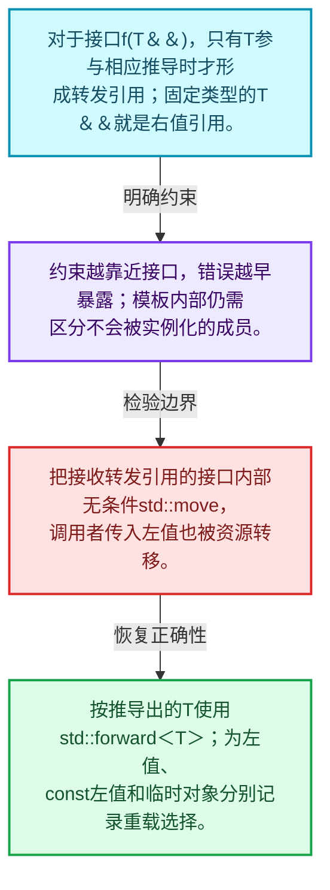
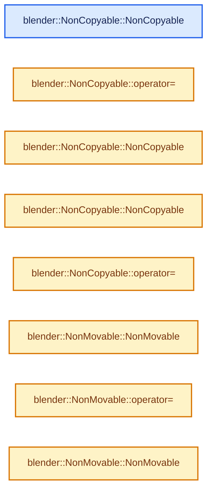
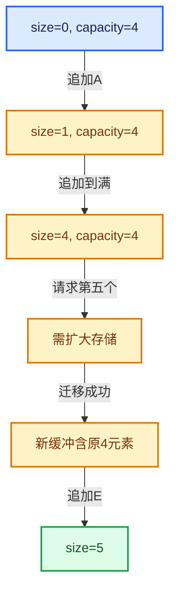

# 01-02 模板与约束

[方向导航](README.md) · [总目录](../README.md) · [实现索引](../00-课程指南/02-源码与提交索引/符号依赖与实现索引.md)

## 从问题到实现

为什么相同容器接口对某些类型不能实例化？

模板推导决定类型，约束限制可用操作；NonCopyable和NonMovable通过删除特殊成员把接口约定变成编译错误。

**数据模型**

对于接口f(T&&)，只有T参与相应推导时才形成转发引用；固定类型的T&&就是右值引用。

**设计取舍**

约束越靠近接口，错误越早暴露；模板内部仍需区分不会被实例化的成员。

**最小反例**

把接收转发引用的接口内部无条件std::move，调用者传入左值也被资源转移。

**推导**

按推导出的T使用std::forward<T>；为左值、const左值和临时对象分别记录重载选择。

## 阅读地图与执行推演








图中的数值推演是本方向的教学模型；实际函数之间的调用边与概念分析边分别标注，不能把概念关系当作运行时调度顺序。

## 完整源码单元与就地讲解

中文讲解直接放在相关代码旁，复杂机制在代码下展开。原文折叠区保留基准行号；不需要在行号表和函数之间来回查找。类布局可分段展示，函数实现不按固定行数切开。

### 类型布局、声明与编译条件 · BLI_utility_mixins.hh L1—L18

<a id="t-69de1dbf5bbe"></a>

<!-- annotated:7ed026539ea971 -->

```cpp
/* SPDX-FileCopyrightText: 2023 Blender Authors
 *
 * SPDX-License-Identifier: GPL-2.0-or-later */

/** \file
 * \ingroup bli
 */

#pragma once

namespace blender {

/**
 * A type that inherits from NonCopyable cannot be copied anymore.
 */
class NonCopyable {
 public:
  /* Disable copy construction and assignment. */
```

<details>
<summary>核对原始源码：source/blender/blenlib/BLI_utility_mixins.hh · L1—L18</summary>

<!-- original:7ed026539ea971:source/blender/blenlib/BLI_utility_mixins.hh:1:18 -->

```cpp
/* SPDX-FileCopyrightText: 2023 Blender Authors
 *
 * SPDX-License-Identifier: GPL-2.0-or-later */

/** \file
 * \ingroup bli
 */

#pragma once

namespace blender {

/**
 * A type that inherits from NonCopyable cannot be copied anymore.
 */
class NonCopyable {
 public:
  /* Disable copy construction and assignment. */
```

</details>

<a id="f-9abdbafa96508887"></a>

### `blender::NonCopyable::NonCopyable`

实现位置：[source/blender/blenlib/BLI_utility_mixins.hh](../../../../../source/blender/blenlib/BLI_utility_mixins.hh) · L19—L19。

接口参数：

- `const NonCopyable &other`

**教学注释版**

<!-- annotated:11b5749cbc6d7b -->

```cpp
  NonCopyable(const NonCopyable &other) = delete;
```

<details>
<summary>核对原始源码：source/blender/blenlib/BLI_utility_mixins.hh · L19—L19</summary>

<!-- original:11b5749cbc6d7b:source/blender/blenlib/BLI_utility_mixins.hh:19:19 -->

```cpp
  NonCopyable(const NonCopyable &other) = delete;
```

</details>

**继续追踪实现**

本实现没有需要继续展开的显式调用；检查返回表达式、对象转换和调用者前置条件。

<a id="f-d3f04ceb006ce221"></a>

### `blender::NonCopyable::operator=`

实现位置：[source/blender/blenlib/BLI_utility_mixins.hh](../../../../../source/blender/blenlib/BLI_utility_mixins.hh) · L20—L20。

接口参数：

- `const NonCopyable &other`

**教学注释版**

<!-- annotated:0bcc6d1e27e348 -->

```cpp
  NonCopyable &operator=(const NonCopyable &other) = delete;
```

<details>
<summary>核对原始源码：source/blender/blenlib/BLI_utility_mixins.hh · L20—L20</summary>

<!-- original:0bcc6d1e27e348:source/blender/blenlib/BLI_utility_mixins.hh:20:20 -->

```cpp
  NonCopyable &operator=(const NonCopyable &other) = delete;
```

</details>

**继续追踪实现**

本实现没有需要继续展开的显式调用；检查返回表达式、对象转换和调用者前置条件。

### 类型布局、声明与编译条件 · BLI_utility_mixins.hh L21—L22

<!-- annotated:90e95287f6d0e9 -->

```cpp

  /* Explicitly enable default construction, move construction and move assignment. */
```

<details>
<summary>核对原始源码：source/blender/blenlib/BLI_utility_mixins.hh · L21—L22</summary>

<!-- original:90e95287f6d0e9:source/blender/blenlib/BLI_utility_mixins.hh:21:22 -->

```cpp

  /* Explicitly enable default construction, move construction and move assignment. */
```

</details>

<a id="f-52302918f6d25b92"></a>

### `blender::NonCopyable::NonCopyable`

实现位置：[source/blender/blenlib/BLI_utility_mixins.hh](../../../../../source/blender/blenlib/BLI_utility_mixins.hh) · L23—L23。

**教学注释版**

<!-- annotated:06ce57e8a23fee -->

```cpp
  NonCopyable() = default;
```

<details>
<summary>核对原始源码：source/blender/blenlib/BLI_utility_mixins.hh · L23—L23</summary>

<!-- original:06ce57e8a23fee:source/blender/blenlib/BLI_utility_mixins.hh:23:23 -->

```cpp
  NonCopyable() = default;
```

</details>

**继续追踪实现**

本实现没有需要继续展开的显式调用；检查返回表达式、对象转换和调用者前置条件。

<a id="f-8501db0dae9f24ad"></a>

### `blender::NonCopyable::NonCopyable`

实现位置：[source/blender/blenlib/BLI_utility_mixins.hh](../../../../../source/blender/blenlib/BLI_utility_mixins.hh) · L24—L24。

接口参数：

- `NonCopyable &&other`

**教学注释版**

<!-- annotated:b57c6ed369572d -->

```cpp
  NonCopyable(NonCopyable &&other) = default;
```

<details>
<summary>核对原始源码：source/blender/blenlib/BLI_utility_mixins.hh · L24—L24</summary>

<!-- original:b57c6ed369572d:source/blender/blenlib/BLI_utility_mixins.hh:24:24 -->

```cpp
  NonCopyable(NonCopyable &&other) = default;
```

</details>

**继续追踪实现**

本实现没有需要继续展开的显式调用；检查返回表达式、对象转换和调用者前置条件。

<a id="f-c96c7852ba671878"></a>

### `blender::NonCopyable::operator=`

实现位置：[source/blender/blenlib/BLI_utility_mixins.hh](../../../../../source/blender/blenlib/BLI_utility_mixins.hh) · L25—L25。

接口参数：

- `NonCopyable &&other`

**教学注释版**

<!-- annotated:66c9cc004b0fbe -->

```cpp
  NonCopyable &operator=(NonCopyable &&other) = default;
```

<details>
<summary>核对原始源码：source/blender/blenlib/BLI_utility_mixins.hh · L25—L25</summary>

<!-- original:66c9cc004b0fbe:source/blender/blenlib/BLI_utility_mixins.hh:25:25 -->

```cpp
  NonCopyable &operator=(NonCopyable &&other) = default;
```

</details>

**继续追踪实现**

本实现没有需要继续展开的显式调用；检查返回表达式、对象转换和调用者前置条件。

### 类型布局、声明与编译条件 · BLI_utility_mixins.hh L26—L33

<a id="t-5364957817de"></a>

<!-- annotated:65ed188b7305c3 -->

```cpp
};

/**
 * A type that inherits from NonMovable cannot be moved anymore.
 */
class NonMovable {
 public:
  /* Disable move construction and assignment. */
```

<details>
<summary>核对原始源码：source/blender/blenlib/BLI_utility_mixins.hh · L26—L33</summary>

<!-- original:65ed188b7305c3:source/blender/blenlib/BLI_utility_mixins.hh:26:33 -->

```cpp
};

/**
 * A type that inherits from NonMovable cannot be moved anymore.
 */
class NonMovable {
 public:
  /* Disable move construction and assignment. */
```

</details>

<a id="f-86feb2b1369738e7"></a>

### `blender::NonMovable::NonMovable`

实现位置：[source/blender/blenlib/BLI_utility_mixins.hh](../../../../../source/blender/blenlib/BLI_utility_mixins.hh) · L34—L34。

接口参数：

- `NonMovable &&other`

**教学注释版**

<!-- annotated:223de8fde8ac2e -->

```cpp
  NonMovable(NonMovable &&other) = delete;
```

<details>
<summary>核对原始源码：source/blender/blenlib/BLI_utility_mixins.hh · L34—L34</summary>

<!-- original:223de8fde8ac2e:source/blender/blenlib/BLI_utility_mixins.hh:34:34 -->

```cpp
  NonMovable(NonMovable &&other) = delete;
```

</details>

**继续追踪实现**

本实现没有需要继续展开的显式调用；检查返回表达式、对象转换和调用者前置条件。

<a id="f-6761b09b71c2506e"></a>

### `blender::NonMovable::operator=`

实现位置：[source/blender/blenlib/BLI_utility_mixins.hh](../../../../../source/blender/blenlib/BLI_utility_mixins.hh) · L35—L35。

接口参数：

- `NonMovable &&other`

**教学注释版**

<!-- annotated:81a37601ab3f82 -->

```cpp
  NonMovable &operator=(NonMovable &&other) = delete;
```

<details>
<summary>核对原始源码：source/blender/blenlib/BLI_utility_mixins.hh · L35—L35</summary>

<!-- original:81a37601ab3f82:source/blender/blenlib/BLI_utility_mixins.hh:35:35 -->

```cpp
  NonMovable &operator=(NonMovable &&other) = delete;
```

</details>

**继续追踪实现**

本实现没有需要继续展开的显式调用；检查返回表达式、对象转换和调用者前置条件。

### 类型布局、声明与编译条件 · BLI_utility_mixins.hh L36—L37

<!-- annotated:25c7419fd5d352 -->

```cpp

  /* Explicitly enable default construction, copy construction and copy assignment. */
```

<details>
<summary>核对原始源码：source/blender/blenlib/BLI_utility_mixins.hh · L36—L37</summary>

<!-- original:25c7419fd5d352:source/blender/blenlib/BLI_utility_mixins.hh:36:37 -->

```cpp

  /* Explicitly enable default construction, copy construction and copy assignment. */
```

</details>

<a id="f-10f338f65ef5ffb5"></a>

### `blender::NonMovable::NonMovable`

实现位置：[source/blender/blenlib/BLI_utility_mixins.hh](../../../../../source/blender/blenlib/BLI_utility_mixins.hh) · L38—L38。

**教学注释版**

<!-- annotated:91150e8090e5dd -->

```cpp
  NonMovable() = default;
```

<details>
<summary>核对原始源码：source/blender/blenlib/BLI_utility_mixins.hh · L38—L38</summary>

<!-- original:91150e8090e5dd:source/blender/blenlib/BLI_utility_mixins.hh:38:38 -->

```cpp
  NonMovable() = default;
```

</details>

**继续追踪实现**

本实现没有需要继续展开的显式调用；检查返回表达式、对象转换和调用者前置条件。

<a id="f-afb5005918d08146"></a>

### `blender::NonMovable::NonMovable`

实现位置：[source/blender/blenlib/BLI_utility_mixins.hh](../../../../../source/blender/blenlib/BLI_utility_mixins.hh) · L39—L39。

接口参数：

- `const NonMovable &other`

**教学注释版**

<!-- annotated:b0a8edb9ab0a2f -->

```cpp
  NonMovable(const NonMovable &other) = default;
```

<details>
<summary>核对原始源码：source/blender/blenlib/BLI_utility_mixins.hh · L39—L39</summary>

<!-- original:b0a8edb9ab0a2f:source/blender/blenlib/BLI_utility_mixins.hh:39:39 -->

```cpp
  NonMovable(const NonMovable &other) = default;
```

</details>

**继续追踪实现**

本实现没有需要继续展开的显式调用；检查返回表达式、对象转换和调用者前置条件。

<a id="f-2cd1f30034d8b934"></a>

### `blender::NonMovable::operator=`

实现位置：[source/blender/blenlib/BLI_utility_mixins.hh](../../../../../source/blender/blenlib/BLI_utility_mixins.hh) · L40—L40。

接口参数：

- `const NonMovable &other`

**教学注释版**

<!-- annotated:a7e99d767ba69e -->

```cpp
  NonMovable &operator=(const NonMovable &other) = default;
```

<details>
<summary>核对原始源码：source/blender/blenlib/BLI_utility_mixins.hh · L40—L40</summary>

<!-- original:a7e99d767ba69e:source/blender/blenlib/BLI_utility_mixins.hh:40:40 -->

```cpp
  NonMovable &operator=(const NonMovable &other) = default;
```

</details>

**继续追踪实现**

本实现没有需要继续展开的显式调用；检查返回表达式、对象转换和调用者前置条件。

### 类型布局、声明与编译条件 · BLI_utility_mixins.hh L41—L43

<!-- annotated:7f70d610211f87 -->

```cpp
};

}  // namespace blender
```

<details>
<summary>核对原始源码：source/blender/blenlib/BLI_utility_mixins.hh · L41—L43</summary>

<!-- original:7f70d610211f87:source/blender/blenlib/BLI_utility_mixins.hh:41:43 -->

```cpp
};

}  // namespace blender
```

</details>

## 语法与相关类型

### 只读限定 const

const约束当前访问路径可做的修改。const指针、指向const的指针、const视图对象、const元素是不同位置的限定；其他别名可能仍可修改原对象。

分别写T* const、const T*与const T* const，并画出不可修改的层次。

## 实现练习与验证

设计只能移动的元素类型，比较按值、const引用、转发引用三个调用接口。

参考推理：按推导出的T使用std::forward<T>；为左值、const左值和临时对象分别记录重载选择。

构造成功次数减析构次数应等于当前存活对象数；异常之后资源计数应回到合法状态。

## 历史、跨库比较与证据

对比std::vector、std::array、std::span与LLVM SmallVector、ArrayRef时，分别比较拥有关系、内嵌存储、大小是否属于类型和失效条件。不要根据同名方法推断完全相同契约。

[历史提交索引](../00-课程指南/02-源码与提交索引/历史提交与设计演化索引.md) · [源码基准](../00-课程指南/02-源码与提交索引/源码版本与覆盖索引.md) · [验收报告](../00-课程指南/03-验收报告/验收报告.md)
