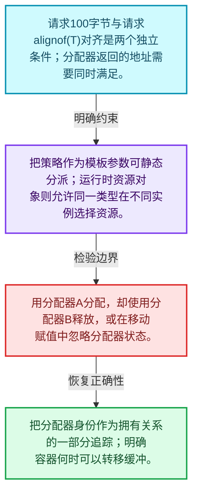
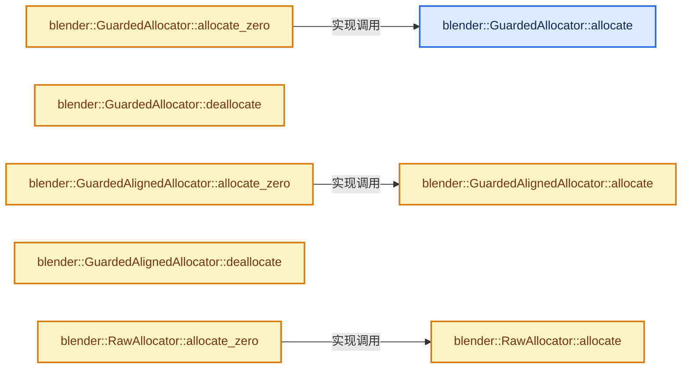
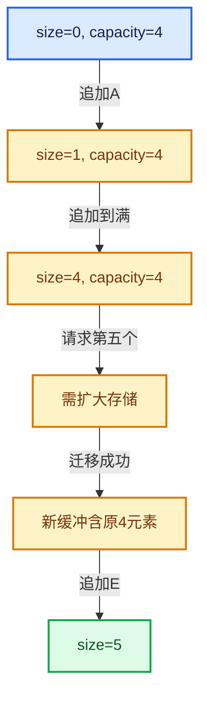

# 01-03 内存工具与分配器接口

[方向导航](README.md) · [总目录](../README.md) · [实现索引](../%E7%AC%A6%E5%8F%B7%E4%BE%9D%E8%B5%96%E4%B8%8E%E5%AE%9E%E7%8E%B0%E7%B4%A2%E5%BC%95.md)

## 从问题到实现

容器为什么把分配策略独立成类型参数？

分配器提供原始存储，容器仍承担对象生命周期；改变分配器不应偷偷改变元素构造语义。

**数据模型**

请求100字节与请求alignof(T)对齐是两个独立条件；分配器返回的地址需要同时满足。

**设计取舍**

把策略作为模板参数可静态分派；运行时资源对象则允许同一类型在不同实例选择资源。

**最小反例**

用分配器A分配，却使用分配器B释放，或在移动赋值中忽略分配器状态。

**推导**

把分配器身份作为拥有关系的一部分追踪；明确容器何时可以转移缓冲。

## 阅读地图与执行推演








图中的数值推演是本方向的教学模型；实际函数之间的调用边与概念分析边分别标注，不能把概念关系当作运行时调度顺序。

## 完整源码单元与就地讲解

中文讲解直接放在相关代码旁，复杂机制在代码下展开。原文折叠区保留基准行号；不需要在行号表和函数之间来回查找。类布局可分段展示，函数实现不按固定行数切开。

### 类型布局、声明与编译条件 · BLI_allocator.hh L1—L42

<a id="t-ec879061c26c"></a>

<!-- annotated:f8c6135aaa85ab -->

```cpp
/* SPDX-FileCopyrightText: 2023 Blender Authors
 *
 * SPDX-License-Identifier: GPL-2.0-or-later */
#pragma once

/** \file
 * \ingroup bli
 *
 * An `Allocator` can allocate and deallocate memory. It is used by containers such as
 * Vector. The allocators defined in this file do not work with standard library
 * containers such as std::vector.
 *
 * Every allocator has to implement two methods:
 *   void *allocate(size_t size, size_t alignment, const char *name);
 *   void deallocate(void *ptr);
 *
 * We don't use the std::allocator interface, because it does more than is really necessary for an
 * allocator and has some other quirks. It mixes the concepts of allocation and construction. It is
 * essentially forced to be a template, even though the allocator should not care about the type.
 * Also see http://www.open-std.org/jtc1/sc22/wg21/docs/papers/2007/n2271.html#std_allocator. Some
 * of these aspects have been improved in new versions of C++, so we might have to reevaluate the
 * strategy later on.
 *
 * The allocator interface dictated by this file is very simplistic, but for now that is all we
 * need. More complexity can be added when it seems necessary.
 */

#include <algorithm>
#include <cstdlib>

#include "MEM_guardedalloc.h"

#include "BLI_utildefines.hh"

namespace blender {

/**
 * Use Blender's guarded allocator (aka MEM_*). This should always be used except there is a
 * good reason not to use it.
 */
class GuardedAllocator {
 public:
```

<details>
<summary>核对原始源码：source/blender/blenlib/BLI_allocator.hh · L1—L42</summary>

<!-- original:f8c6135aaa85ab:source/blender/blenlib/BLI_allocator.hh:1:42 -->

```cpp
/* SPDX-FileCopyrightText: 2023 Blender Authors
 *
 * SPDX-License-Identifier: GPL-2.0-or-later */
#pragma once

/** \file
 * \ingroup bli
 *
 * An `Allocator` can allocate and deallocate memory. It is used by containers such as
 * Vector. The allocators defined in this file do not work with standard library
 * containers such as std::vector.
 *
 * Every allocator has to implement two methods:
 *   void *allocate(size_t size, size_t alignment, const char *name);
 *   void deallocate(void *ptr);
 *
 * We don't use the std::allocator interface, because it does more than is really necessary for an
 * allocator and has some other quirks. It mixes the concepts of allocation and construction. It is
 * essentially forced to be a template, even though the allocator should not care about the type.
 * Also see http://www.open-std.org/jtc1/sc22/wg21/docs/papers/2007/n2271.html#std_allocator. Some
 * of these aspects have been improved in new versions of C++, so we might have to reevaluate the
 * strategy later on.
 *
 * The allocator interface dictated by this file is very simplistic, but for now that is all we
 * need. More complexity can be added when it seems necessary.
 */

#include <algorithm>
#include <cstdlib>

#include "MEM_guardedalloc.h"

#include "BLI_utildefines.hh"

namespace blender {

/**
 * Use Blender's guarded allocator (aka MEM_*). This should always be used except there is a
 * good reason not to use it.
 */
class GuardedAllocator {
 public:
```

</details>

<a id="f-a57239e6d3bd10d9"></a>

### `blender::GuardedAllocator::allocate`

分配器接口只准备原始存储，元素构造由容器负责。

实现位置：[source/blender/blenlib/BLI_allocator.hh](../../../../../source/blender/blenlib/BLI_allocator.hh) · L43—L48。

接口参数：

- `size_t size`
- `size_t alignment`
- `const char *name`

**教学注释版**

<!-- annotated:24613836311acc -->

```cpp
  void *allocate(size_t size, size_t alignment, const char *name)
  {
    /* Should we use MEM_new_uninitialized, when alignment is small? If yes, how small must
     * alignment be? */
    // [讲解] 默认GuardedAllocator使用Blender MEM入口，继续追踪函数指针选择的实际后端。
    return MEM_new_uninitialized_aligned(size, alignment, name);
  }
```

<details>
<summary>核对原始源码：source/blender/blenlib/BLI_allocator.hh · L43—L48</summary>

<!-- original:24613836311acc:source/blender/blenlib/BLI_allocator.hh:43:48 -->

```cpp
  void *allocate(size_t size, size_t alignment, const char *name)
  {
    /* Should we use MEM_new_uninitialized, when alignment is small? If yes, how small must
     * alignment be? */
    return MEM_new_uninitialized_aligned(size, alignment, name);
  }
```

</details>

**机制与执行推导**

GuardedAllocator默认把大小、对齐和来源名称交给MEM_new_uninitialized_aligned。

GuardedAlignedAllocator和RawAllocator具有不同额外约束与后端，必须结合当前类确认，不能只看allocate这个同名函数。

Vector的Allocator是模板参数，所以调用静态地取决于实例化类型，不是每次都由一个虚函数选择。

**结果出口**

- `return MEM_new_uninitialized_aligned(size, alignment, name);`

**继续追踪实现**

- `MEM_new_uninitialized_aligned` → [MEM_new_uninitialized_aligned · L134](../03-%E5%86%85%E5%AD%98%E5%88%86%E9%85%8D%E4%B8%8E%E8%BF%90%E8%A1%8C%E6%97%B6%E7%B1%BB%E5%9E%8B/%E4%BE%9D%E8%B5%96-mallocn-afdcd4.md#f-9f3d21bd7da93c68)。

<a id="f-ba4b11000deea5e5"></a>

### `blender::GuardedAllocator::allocate_zero`

实现位置：[source/blender/blenlib/BLI_allocator.hh](../../../../../source/blender/blenlib/BLI_allocator.hh) · L49—L58。

接口参数：

- `size_t size`
- `size_t alignment`
- `const char *name`

**教学注释版**

<!-- annotated:9a24f6aa631247 -->

```cpp
  void *allocate_zero(size_t size, size_t alignment, const char *name)
  {
    if (alignment > MEM_MIN_CPP_ALIGNMENT) {
      /* There is no version of calloc with a specific alignment argument. */
      // [讲解] this->allocate：分配器接口只准备原始存储，元素构造由容器负责。
      void *ptr = this->allocate(size, alignment, name);
      // [讲解] memset：填充字节，不调用T构造函数，也不保证任意类型的全零表示是合法或期望值。
      memset(ptr, 0, size);
      return ptr;
    }
    return MEM_new_zeroed(size, name);
  }
```

<details>
<summary>核对原始源码：source/blender/blenlib/BLI_allocator.hh · L49—L58</summary>

<!-- original:9a24f6aa631247:source/blender/blenlib/BLI_allocator.hh:49:58 -->

```cpp
  void *allocate_zero(size_t size, size_t alignment, const char *name)
  {
    if (alignment > MEM_MIN_CPP_ALIGNMENT) {
      /* There is no version of calloc with a specific alignment argument. */
      void *ptr = this->allocate(size, alignment, name);
      memset(ptr, 0, size);
      return ptr;
    }
    return MEM_new_zeroed(size, name);
  }
```

</details>

**结果出口**

- `return ptr;`
- `return MEM_new_zeroed(size, name);`

**继续追踪实现**

- `this->allocate` → [blender::GuardedAllocator::allocate · L43](03-%E5%86%85%E5%AD%98%E5%B7%A5%E5%85%B7%E4%B8%8E%E5%88%86%E9%85%8D%E5%99%A8%E6%8E%A5%E5%8F%A3.md#f-a57239e6d3bd10d9)。
- `memset` → [外部契约](https://eel.is/c++draft/cstring.syn)：填充字节，不调用T构造函数，也不保证任意类型的全零表示是合法或期望值。
- `MEM_new_zeroed` → [MEM_new_zeroed · L550](../03-%E5%86%85%E5%AD%98%E5%88%86%E9%85%8D%E4%B8%8E%E8%BF%90%E8%A1%8C%E6%97%B6%E7%B1%BB%E5%9E%8B/%E4%BE%9D%E8%B5%96-MEM_guardedalloc-b54eca.md#f-eeb1e2a7f57dd231)；[MEM_new_zeroed · L114](../03-%E5%86%85%E5%AD%98%E5%88%86%E9%85%8D%E4%B8%8E%E8%BF%90%E8%A1%8C%E6%97%B6%E7%B1%BB%E5%9E%8B/%E4%BE%9D%E8%B5%96-mallocn-afdcd4.md#f-e04cf01c64c8b180)。同名重载需按实参类型选择。

<!-- annotated:9068709d02a200 -->

```cpp

```

<details>
<summary>核对原始源码：source/blender/blenlib/BLI_allocator.hh · L59—L59</summary>

<!-- original:9068709d02a200:source/blender/blenlib/BLI_allocator.hh:59:59 -->

```cpp

```

</details>

<a id="f-c1586978e7959acb"></a>

### `blender::GuardedAllocator::deallocate`

归还分配器负责的存储；调用者应先结束其中非平凡元素寿命。

实现位置：[source/blender/blenlib/BLI_allocator.hh](../../../../../source/blender/blenlib/BLI_allocator.hh) · L60—L63。

接口参数：

- `void *ptr`

**教学注释版**

<!-- annotated:e119892e7535d3 -->

```cpp
  void deallocate(void *ptr)
  {
    // [讲解] 使用与MEM原始存储分配匹配的释放入口；不是对任意T自动调用析构。
    MEM_delete_void(ptr);
  }
```

<details>
<summary>核对原始源码：source/blender/blenlib/BLI_allocator.hh · L60—L63</summary>

<!-- original:e119892e7535d3:source/blender/blenlib/BLI_allocator.hh:60:63 -->

```cpp
  void deallocate(void *ptr)
  {
    MEM_delete_void(ptr);
  }
```

</details>

**机制与执行推导**

GuardedAllocator把原始指针交给MEM_delete_void。Vector已经通过destruct_n或relocate处理元素，MEM接口此处处理的是存储块与分配元信息。

**继续追踪实现**

- `MEM_delete_void` → [MEM_delete_void · L647](../03-%E5%86%85%E5%AD%98%E5%88%86%E9%85%8D%E4%B8%8E%E8%BF%90%E8%A1%8C%E6%97%B6%E7%B1%BB%E5%9E%8B/%E4%BE%9D%E8%B5%96-MEM_guardedalloc-b54eca.md#f-642896c7c62ff8b9)；[MEM_delete_void · L109](../03-%E5%86%85%E5%AD%98%E5%88%86%E9%85%8D%E4%B8%8E%E8%BF%90%E8%A1%8C%E6%97%B6%E7%B1%BB%E5%9E%8B/%E4%BE%9D%E8%B5%96-mallocn-afdcd4.md#f-9a07b26421f2bee6)。同名重载需按实参类型选择。

### 类型布局、声明与编译条件 · BLI_allocator.hh L64—L74

<a id="t-1a6b551339be"></a>

`GuardedAlignedAllocator`在这里声明的数据成员：

- `size_t min_alignment`

<!-- annotated:bb011889050a3f -->

```cpp
};

/**
 * Like #GuardedAllocator, but makes sure each allocation has a minimum alignment. One use case is
 * reusing an allocation between multiple types that have different alignment requirements. The
 * default alignment template parameter should be large enough for any type in practice.
 */
template<size_t Alignment = 64ul> class GuardedAlignedAllocator {
 public:
  static constexpr size_t min_alignment = Alignment;

```

<details>
<summary>核对原始源码：source/blender/blenlib/BLI_allocator.hh · L64—L74</summary>

<!-- original:bb011889050a3f:source/blender/blenlib/BLI_allocator.hh:64:74 -->

```cpp
};

/**
 * Like #GuardedAllocator, but makes sure each allocation has a minimum alignment. One use case is
 * reusing an allocation between multiple types that have different alignment requirements. The
 * default alignment template parameter should be large enough for any type in practice.
 */
template<size_t Alignment = 64ul> class GuardedAlignedAllocator {
 public:
  static constexpr size_t min_alignment = Alignment;

```

</details>

<a id="f-ddfb0ce826a2afee"></a>

### `blender::GuardedAlignedAllocator::allocate`

分配器接口只准备原始存储，元素构造由容器负责。

实现位置：[source/blender/blenlib/BLI_allocator.hh](../../../../../source/blender/blenlib/BLI_allocator.hh) · L75—L78。

接口参数：

- `size_t size`
- `size_t alignment`
- `const char *name`

**教学注释版**

<!-- annotated:3bd235655ea2ea -->

```cpp
  void *allocate(size_t size, size_t alignment, const char *name)
  {
    // [讲解] MEM_new_uninitialized_aligned：把公开MEM分配接口转交给当前选择的对齐分配后端。
    return MEM_new_uninitialized_aligned(size, std::max(alignment, min_alignment), name);
  }
```

<details>
<summary>核对原始源码：source/blender/blenlib/BLI_allocator.hh · L75—L78</summary>

<!-- original:3bd235655ea2ea:source/blender/blenlib/BLI_allocator.hh:75:78 -->

```cpp
  void *allocate(size_t size, size_t alignment, const char *name)
  {
    return MEM_new_uninitialized_aligned(size, std::max(alignment, min_alignment), name);
  }
```

</details>

**机制与执行推导**

GuardedAllocator默认把大小、对齐和来源名称交给MEM_new_uninitialized_aligned。

GuardedAlignedAllocator和RawAllocator具有不同额外约束与后端，必须结合当前类确认，不能只看allocate这个同名函数。

Vector的Allocator是模板参数，所以调用静态地取决于实例化类型，不是每次都由一个虚函数选择。

**结果出口**

- `return MEM_new_uninitialized_aligned(size, std::max(alignment, min_alignment), name);`

**继续追踪实现**

- `MEM_new_uninitialized_aligned` → [MEM_new_uninitialized_aligned · L134](../03-%E5%86%85%E5%AD%98%E5%88%86%E9%85%8D%E4%B8%8E%E8%BF%90%E8%A1%8C%E6%97%B6%E7%B1%BB%E5%9E%8B/%E4%BE%9D%E8%B5%96-mallocn-afdcd4.md#f-9f3d21bd7da93c68)。
- `std::max` → [外部契约](https://eel.is/c++draft/alg.min.max)：按比较关系选取较大值。本讲解中的增长公式同时满足最低请求和几何增长；若保存返回引用，还需注意实参寿命。

<a id="f-74210c2fb8df75bf"></a>

### `blender::GuardedAlignedAllocator::allocate_zero`

实现位置：[source/blender/blenlib/BLI_allocator.hh](../../../../../source/blender/blenlib/BLI_allocator.hh) · L79—L88。

接口参数：

- `size_t size`
- `size_t alignment`
- `const char *name`

**教学注释版**

<!-- annotated:af0ca3e65a0b0f -->

```cpp
  void *allocate_zero(size_t size, size_t alignment, const char *name)
  {
    // [讲解] std::max：按比较关系选取较大值。本讲解中的增长公式同时满足最低请求和几何增长；若保存返回引用，还需注意实参寿命。
    if (std::max(alignment, Alignment) > MEM_MIN_CPP_ALIGNMENT) {
      /* There is no version of calloc with a specific alignment argument. */
      // [讲解] this->allocate：分配器接口只准备原始存储，元素构造由容器负责。
      void *ptr = this->allocate(size, alignment, name);
      // [讲解] memset：填充字节，不调用T构造函数，也不保证任意类型的全零表示是合法或期望值。
      memset(ptr, 0, size);
      return ptr;
    }
    return MEM_new_zeroed(size, name);
  }
```

<details>
<summary>核对原始源码：source/blender/blenlib/BLI_allocator.hh · L79—L88</summary>

<!-- original:af0ca3e65a0b0f:source/blender/blenlib/BLI_allocator.hh:79:88 -->

```cpp
  void *allocate_zero(size_t size, size_t alignment, const char *name)
  {
    if (std::max(alignment, Alignment) > MEM_MIN_CPP_ALIGNMENT) {
      /* There is no version of calloc with a specific alignment argument. */
      void *ptr = this->allocate(size, alignment, name);
      memset(ptr, 0, size);
      return ptr;
    }
    return MEM_new_zeroed(size, name);
  }
```

</details>

**结果出口**

- `return ptr;`
- `return MEM_new_zeroed(size, name);`

**继续追踪实现**

- `std::max` → [外部契约](https://eel.is/c++draft/alg.min.max)：按比较关系选取较大值。本讲解中的增长公式同时满足最低请求和几何增长；若保存返回引用，还需注意实参寿命。
- `this->allocate` → [blender::GuardedAlignedAllocator::allocate · L75](03-%E5%86%85%E5%AD%98%E5%B7%A5%E5%85%B7%E4%B8%8E%E5%88%86%E9%85%8D%E5%99%A8%E6%8E%A5%E5%8F%A3.md#f-ddfb0ce826a2afee)。
- `memset` → [外部契约](https://eel.is/c++draft/cstring.syn)：填充字节，不调用T构造函数，也不保证任意类型的全零表示是合法或期望值。
- `MEM_new_zeroed` → [MEM_new_zeroed · L550](../03-%E5%86%85%E5%AD%98%E5%88%86%E9%85%8D%E4%B8%8E%E8%BF%90%E8%A1%8C%E6%97%B6%E7%B1%BB%E5%9E%8B/%E4%BE%9D%E8%B5%96-MEM_guardedalloc-b54eca.md#f-eeb1e2a7f57dd231)；[MEM_new_zeroed · L114](../03-%E5%86%85%E5%AD%98%E5%88%86%E9%85%8D%E4%B8%8E%E8%BF%90%E8%A1%8C%E6%97%B6%E7%B1%BB%E5%9E%8B/%E4%BE%9D%E8%B5%96-mallocn-afdcd4.md#f-e04cf01c64c8b180)。同名重载需按实参类型选择。

<!-- annotated:ee47485f90aeb4 -->

```cpp

```

<details>
<summary>核对原始源码：source/blender/blenlib/BLI_allocator.hh · L89—L89</summary>

<!-- original:ee47485f90aeb4:source/blender/blenlib/BLI_allocator.hh:89:89 -->

```cpp

```

</details>

<a id="f-9b77734460f186e0"></a>

### `blender::GuardedAlignedAllocator::deallocate`

归还分配器负责的存储；调用者应先结束其中非平凡元素寿命。

实现位置：[source/blender/blenlib/BLI_allocator.hh](../../../../../source/blender/blenlib/BLI_allocator.hh) · L90—L93。

接口参数：

- `void *ptr`

**教学注释版**

<!-- annotated:9b6d8b910d6f48 -->

```cpp
  void deallocate(void *ptr)
  {
    // [讲解] 使用与MEM原始存储分配匹配的释放入口；不是对任意T自动调用析构。
    MEM_delete_void(ptr);
  }
```

<details>
<summary>核对原始源码：source/blender/blenlib/BLI_allocator.hh · L90—L93</summary>

<!-- original:9b6d8b910d6f48:source/blender/blenlib/BLI_allocator.hh:90:93 -->

```cpp
  void deallocate(void *ptr)
  {
    MEM_delete_void(ptr);
  }
```

</details>

**机制与执行推导**

GuardedAllocator把原始指针交给MEM_delete_void。Vector已经通过destruct_n或relocate处理元素，MEM接口此处处理的是存储块与分配元信息。

**继续追踪实现**

- `MEM_delete_void` → [MEM_delete_void · L647](../03-%E5%86%85%E5%AD%98%E5%88%86%E9%85%8D%E4%B8%8E%E8%BF%90%E8%A1%8C%E6%97%B6%E7%B1%BB%E5%9E%8B/%E4%BE%9D%E8%B5%96-MEM_guardedalloc-b54eca.md#f-642896c7c62ff8b9)；[MEM_delete_void · L109](../03-%E5%86%85%E5%AD%98%E5%88%86%E9%85%8D%E4%B8%8E%E8%BF%90%E8%A1%8C%E6%97%B6%E7%B1%BB%E5%9E%8B/%E4%BE%9D%E8%B5%96-mallocn-afdcd4.md#f-9a07b26421f2bee6)。同名重载需按实参类型选择。

### 类型布局、声明与编译条件 · BLI_allocator.hh L94—L107

<a id="t-d9026b0319b7"></a>

<a id="t-722c2cc2e13d"></a>

`MemHead`在这里声明的数据成员：

- `int offset`

<!-- annotated:66d9fff0ff4f88 -->

```cpp
};

/**
 * This is a wrapper around malloc/free. Only use this when the GuardedAllocator cannot be
 * used. This can be the case when the allocated memory might live longer than Blender's
 * allocator. For example, when the memory is owned by a static variable.
 */
class RawAllocator {
 private:
  struct MemHead {
    int offset;
  };

 public:
```

<details>
<summary>核对原始源码：source/blender/blenlib/BLI_allocator.hh · L94—L107</summary>

<!-- original:66d9fff0ff4f88:source/blender/blenlib/BLI_allocator.hh:94:107 -->

```cpp
};

/**
 * This is a wrapper around malloc/free. Only use this when the GuardedAllocator cannot be
 * used. This can be the case when the allocated memory might live longer than Blender's
 * allocator. For example, when the memory is owned by a static variable.
 */
class RawAllocator {
 private:
  struct MemHead {
    int offset;
  };

 public:
```

</details>

<a id="f-557f7d891fdff07f"></a>

### `blender::RawAllocator::allocate`

分配器接口只准备原始存储，元素构造由容器负责。

实现位置：[source/blender/blenlib/BLI_allocator.hh](../../../../../source/blender/blenlib/BLI_allocator.hh) · L108—L118。

接口参数：

- `size_t size`
- `size_t alignment`
- `const char *`

**教学注释版**

<!-- annotated:aa0cbc40580167 -->

```cpp
  void *allocate(size_t size, size_t alignment, const char * /*name*/)
  {
    BLI_assert(is_power_of_2(int(alignment)));
    // [讲解] malloc：取得原始存储，失败可返回空指针；不构造C++对象。必须与匹配释放接口及对象寿命管理结合。
    void *ptr = malloc(size + alignment + sizeof(MemHead));
    void *used_ptr = reinterpret_cast<void *>(
        uintptr_t(POINTER_OFFSET(ptr, alignment + sizeof(MemHead))) & ~(uintptr_t(alignment) - 1));
    int offset = int(intptr_t(used_ptr) - intptr_t(ptr));
    BLI_assert(offset >= int(sizeof(MemHead)));
    (static_cast<MemHead *>(used_ptr) - 1)->offset = offset;
    return used_ptr;
  }
```

<details>
<summary>核对原始源码：source/blender/blenlib/BLI_allocator.hh · L108—L118</summary>

<!-- original:aa0cbc40580167:source/blender/blenlib/BLI_allocator.hh:108:118 -->

```cpp
  void *allocate(size_t size, size_t alignment, const char * /*name*/)
  {
    BLI_assert(is_power_of_2(int(alignment)));
    void *ptr = malloc(size + alignment + sizeof(MemHead));
    void *used_ptr = reinterpret_cast<void *>(
        uintptr_t(POINTER_OFFSET(ptr, alignment + sizeof(MemHead))) & ~(uintptr_t(alignment) - 1));
    int offset = int(intptr_t(used_ptr) - intptr_t(ptr));
    BLI_assert(offset >= int(sizeof(MemHead)));
    (static_cast<MemHead *>(used_ptr) - 1)->offset = offset;
    return used_ptr;
  }
```

</details>

**机制与执行推导**

GuardedAllocator默认把大小、对齐和来源名称交给MEM_new_uninitialized_aligned。

GuardedAlignedAllocator和RawAllocator具有不同额外约束与后端，必须结合当前类确认，不能只看allocate这个同名函数。

Vector的Allocator是模板参数，所以调用静态地取决于实例化类型，不是每次都由一个虚函数选择。

**结果出口**

- `return used_ptr;`

**继续追踪实现**

- `BLI_assert` → [BLI_assert · L48](%E4%BE%9D%E8%B5%96-BLI_assert-cc98e8.md#m-57a88495704d)；[BLI_assert · L63](%E4%BE%9D%E8%B5%96-BLI_assert-cc98e8.md#m-d07050020cb5)。宏定义由构建条件选择。
- `is_power_of_2` → [blender::is_power_of_2 · L170](%E4%BE%9D%E8%B5%96-BLI_utildefines-293a0a.md#f-276f4f171955e1e9)。
- `malloc` → [外部契约](https://eel.is/c++draft/c.malloc)：取得原始存储，失败可返回空指针；不构造C++对象。必须与匹配释放接口及对象寿命管理结合。
- `POINTER_OFFSET` → [POINTER_OFFSET · L316](%E4%BE%9D%E8%B5%96-BLI_utildefines-293a0a.md#m-c812e199f26c)。宏定义由构建条件选择。

<a id="f-c9e893521059d691"></a>

### `blender::RawAllocator::allocate_zero`

实现位置：[source/blender/blenlib/BLI_allocator.hh](../../../../../source/blender/blenlib/BLI_allocator.hh) · L119—L124。

接口参数：

- `size_t size`
- `size_t alignment`
- `const char *name`

**教学注释版**

<!-- annotated:d476174cc304d7 -->

```cpp
  void *allocate_zero(size_t size, size_t alignment, const char *name)
  {
    // [讲解] this->allocate：分配器接口只准备原始存储，元素构造由容器负责。
    void *ptr = this->allocate(size, alignment, name);
    // [讲解] memset：填充字节，不调用T构造函数，也不保证任意类型的全零表示是合法或期望值。
    memset(ptr, 0, size);
    return ptr;
  }
```

<details>
<summary>核对原始源码：source/blender/blenlib/BLI_allocator.hh · L119—L124</summary>

<!-- original:d476174cc304d7:source/blender/blenlib/BLI_allocator.hh:119:124 -->

```cpp
  void *allocate_zero(size_t size, size_t alignment, const char *name)
  {
    void *ptr = this->allocate(size, alignment, name);
    memset(ptr, 0, size);
    return ptr;
  }
```

</details>

**结果出口**

- `return ptr;`

**继续追踪实现**

- `this->allocate` → [blender::RawAllocator::allocate · L108](03-%E5%86%85%E5%AD%98%E5%B7%A5%E5%85%B7%E4%B8%8E%E5%88%86%E9%85%8D%E5%99%A8%E6%8E%A5%E5%8F%A3.md#f-557f7d891fdff07f)。
- `memset` → [外部契约](https://eel.is/c++draft/cstring.syn)：填充字节，不调用T构造函数，也不保证任意类型的全零表示是合法或期望值。

<!-- annotated:c2a472be547bbf -->

```cpp

```

<details>
<summary>核对原始源码：source/blender/blenlib/BLI_allocator.hh · L125—L125</summary>

<!-- original:c2a472be547bbf:source/blender/blenlib/BLI_allocator.hh:125:125 -->

```cpp

```

</details>

<a id="f-31aae8b6d94cfd98"></a>

### `blender::RawAllocator::deallocate`

归还分配器负责的存储；调用者应先结束其中非平凡元素寿命。

实现位置：[source/blender/blenlib/BLI_allocator.hh](../../../../../source/blender/blenlib/BLI_allocator.hh) · L126—L132。

接口参数：

- `void *ptr`

**教学注释版**

<!-- annotated:492ea9abed1ac8 -->

```cpp
  void deallocate(void *ptr)
  {
    MemHead *head = static_cast<MemHead *>(ptr) - 1;
    int offset = -head->offset;
    void *actual_pointer = POINTER_OFFSET(ptr, offset);
    // [讲解] free：归还相匹配的C分配存储，不自动执行C++析构；不可用于Windows的_aligned_malloc结果。
    free(actual_pointer);
  }
```

<details>
<summary>核对原始源码：source/blender/blenlib/BLI_allocator.hh · L126—L132</summary>

<!-- original:492ea9abed1ac8:source/blender/blenlib/BLI_allocator.hh:126:132 -->

```cpp
  void deallocate(void *ptr)
  {
    MemHead *head = static_cast<MemHead *>(ptr) - 1;
    int offset = -head->offset;
    void *actual_pointer = POINTER_OFFSET(ptr, offset);
    free(actual_pointer);
  }
```

</details>

**机制与执行推导**

GuardedAllocator把原始指针交给MEM_delete_void。Vector已经通过destruct_n或relocate处理元素，MEM接口此处处理的是存储块与分配元信息。

**继续追踪实现**

- `POINTER_OFFSET` → [POINTER_OFFSET · L316](%E4%BE%9D%E8%B5%96-BLI_utildefines-293a0a.md#m-c812e199f26c)。宏定义由构建条件选择。
- `free` → [外部契约](https://eel.is/c++draft/c.malloc)：归还相匹配的C分配存储，不自动执行C++析构；不可用于Windows的_aligned_malloc结果。

### 类型布局、声明与编译条件 · BLI_allocator.hh L133—L135

<!-- annotated:d3be626ed6b382 -->

```cpp
};

}  // namespace blender
```

<details>
<summary>核对原始源码：source/blender/blenlib/BLI_allocator.hh · L133—L135</summary>

<!-- original:d3be626ed6b382:source/blender/blenlib/BLI_allocator.hh:133:135 -->

```cpp
};

}  // namespace blender
```

</details>

## 语法与相关类型

### 模板 template

模板把类型或常量作为生成实现的参数。读声明时先列出类型参数、非类型参数和默认值，再看使用者实际实例化了什么。模板声明本身不意味着每种T都支持其全部成员。

把T替换为int、string、只能移动的类型，分别检查每个被调用操作是否成立。

### 常量求值 constexpr

constexpr声明允许相应实体参与常量求值，但constexpr函数仍可以在运行时执行。是否常量求值由调用场景和表达式合法性共同决定。

比较constexpr变量初始化和从运行时输入调用同一函数。

### 只读限定 const

const约束当前访问路径可做的修改。const指针、指向const的指针、const视图对象、const元素是不同位置的限定；其他别名可能仍可修改原对象。

分别写T* const、const T*与const T* const，并画出不可修改的层次。

### 显式静态转换 static_cast

static_cast表达编译期允许的转换，不会自动验证运行时真实类型、指针寿命或索引边界。由void指针恢复T指针时，调用者仍须保证实际存储中确有合法T对象。

标出转换前后的类型以及正确性依据来自哪里。

### 表示层转换 reinterpret_cast

reinterpret_cast不能自动开始任意对象的生命周期，也不能豁免对齐和别名规则。读这类代码需要追溯原始分配与实际构造操作。

分别检查大小、对齐、生命周期和可访问类型，四项不能互相替代。

### 对象表示 sizeof

sizeof给出对象表示大小，不是其引用的所有堆内存总量。sizeof视图很小并不说明底层数组很小。

分别统计容器对象、容量字节和元素拥有的间接资源。

### 构造与new表达式

普通new可能分配并构造；placement new在给定地址构造，存储由其他机制提供。失败回滚应区分两类责任。

追踪地址来自哪里、构造何时成功、由谁析构、由谁释放。

### 内部断言 assert

断言表达开发者预期成立的内部契约，发布构建可能关闭。它不能替代对不可信输入的完整错误处理，也不保证后续操作被运行时保护。

对每条断言构造违反条件的输入，区分调用者错误与应向用户报告的错误。

### 类型别名 using

类型别名为已有类型建立名字，不创建运行期对象。它常把模板内部使用的类型统一暴露给泛型调用者。

展开别名直到基础类型，区分类型别名和变量声明。

## 实现练习与验证

记录分配与释放次数，区分增长次数和元素数量，检查对齐与释放来源配对。

参考推理：把分配器身份作为拥有关系的一部分追踪；明确容器何时可以转移缓冲。

构造成功次数减析构次数应等于当前存活对象数；异常之后资源计数应回到合法状态。

## 历史、跨库比较与证据

对比std::vector、std::array、std::span与LLVM SmallVector、ArrayRef时，分别比较拥有关系、内嵌存储、大小是否属于类型和失效条件。不要根据同名方法推断完全相同契约。

[历史提交索引](../%E5%8E%86%E5%8F%B2%E6%8F%90%E4%BA%A4%E4%B8%8E%E8%AE%BE%E8%AE%A1%E6%BC%94%E5%8C%96%E7%B4%A2%E5%BC%95.md) · [源码基准](../%E6%BA%90%E7%A0%81%E7%89%88%E6%9C%AC%E4%B8%8E%E8%A6%86%E7%9B%96%E7%B4%A2%E5%BC%95.md) · [验收报告](../%E9%AA%8C%E6%94%B6%E6%8A%A5%E5%91%8A.md)
