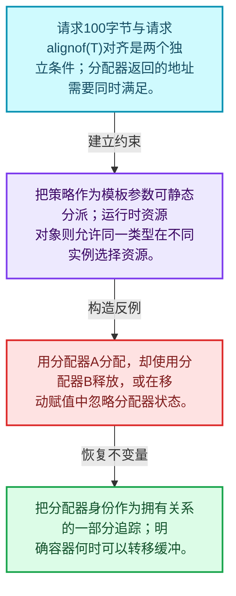
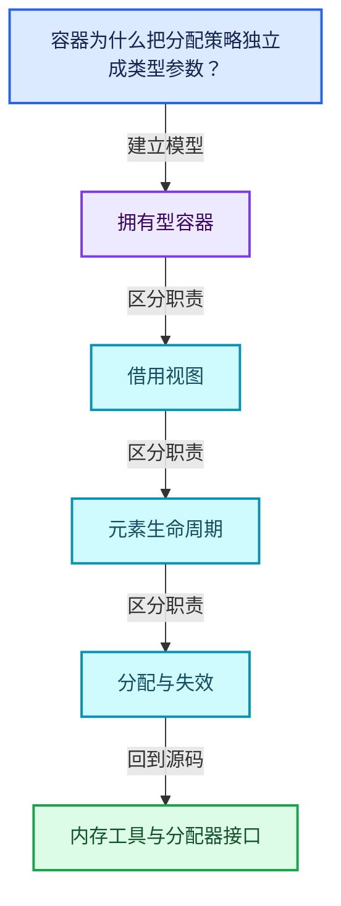
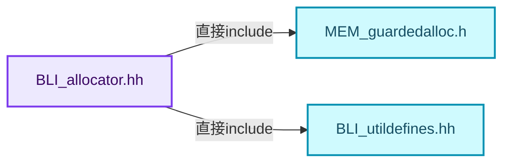
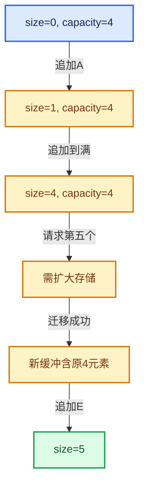

# 01-03 内存工具与分配器接口

[方向导航](README.md) · [总目录](../README.md) · [覆盖索引](../%E6%BA%90%E7%A0%81%E7%89%88%E6%9C%AC%E4%B8%8E%E8%A6%86%E7%9B%96%E7%B4%A2%E5%BC%95.md)

> 阅读顺序：问题与数据模型 → 语法与类型 → 源码逐行 → 调用线索 → 历史与取舍 → 推演和练习。

- 基准 HEAD：`cbda6b96c26c0dee3c3b5cbb93960c4ac06a6b30`。
- 记录日期：2026-10-14。
- 教学示例状态：正文中的推演不是本机性能实测；已运行练习见验收报告。

## 一、从问题到设计

容器为什么把分配策略独立成类型参数？

分配器提供原始存储，容器仍承担对象生命周期；改变分配器不应偷偷改变元素构造语义。

本篇把语法、数据语义和系统取舍连接起来。先证明对象存活，再讨论索引；先区分借用与拥有，再讨论复制移动。

### 本篇独立模型与设计推理

请求100字节与请求alignof(T)对齐是两个独立条件；分配器返回的地址需要同时满足。

设计取舍：把策略作为模板参数可静态分派；运行时资源对象则允许同一类型在不同实例选择资源。

最小反例：用分配器A分配，却使用分配器B释放，或在移动赋值中忽略分配器状态。

推导与处理：把分配器身份作为拥有关系的一部分追踪；明确容器何时可以转移缓冲。



### 源码范围与相邻篇章

| 文件 | 本篇逐行范围 | 基准SHA-256 |
|---|---|---|
| [source/blender/blenlib/BLI_allocator.hh](../../../../../source/blender/blenlib/BLI_allocator.hh) | L1—L135 | `b5a9e06bdd9183865ecf656bfce3207a937fa85978362987067d2b1fb185262d` |

同一主讲文件可能分多篇覆盖；超出本篇范围的符号通过覆盖索引定位。空行与纯注释保留在源码摘录中，逐行表解释有效语句与语法边界；许可证头统一保留。

前篇：[模板与约束](02-%E6%A8%A1%E6%9D%BF%E4%B8%8E%E7%BA%A6%E6%9D%9F.md).

后篇：[IndexRange连续整数区间](04-IndexRange%E8%BF%9E%E7%BB%AD%E6%95%B4%E6%95%B0%E5%8C%BA%E9%97%B4.md).

## 二、类型、数据与阅读地图



这是概念依赖图，边表示阅读关系，不声称是运行时调用顺序。

### 直接编译依赖



箭头只表示头文件包含关系；完整调用线索见后面的符号定位表。

## 三、关键词、语法与类型角色

### 模板 template

模板把类型或常量作为生成实现的参数。读声明时先列出类型参数、非类型参数和默认值，再看使用者实际实例化了什么。模板声明本身不意味着每种T都支持其全部成员。

具体检查：把T替换为int、string、只能移动的类型，分别检查每个被调用操作是否成立。

### 常量求值 constexpr

constexpr声明允许相应实体参与常量求值，但constexpr函数仍可以在运行时执行。是否常量求值由调用场景和表达式合法性共同决定。

具体检查：比较constexpr变量初始化和从运行时输入调用同一函数。

### 只读限定 const

const约束当前访问路径可做的修改。const指针、指向const的指针、const视图对象、const元素是不同位置的限定；其他别名可能仍可修改原对象。

具体检查：分别写T* const、const T*与const T* const，并画出不可修改的层次。

### 显式静态转换 static_cast

static_cast表达编译期允许的转换，不会自动验证运行时真实类型、指针寿命或索引边界。由void指针恢复T指针时，调用者仍须保证实际存储中确有合法T对象。

具体检查：标出转换前后的类型以及正确性依据来自哪里。

### 表示层转换 reinterpret_cast

reinterpret_cast不能自动开始任意对象的生命周期，也不能豁免对齐和别名规则。读这类代码需要追溯原始分配与实际构造操作。

具体检查：分别检查大小、对齐、生命周期和可访问类型，四项不能互相替代。

### 对象表示 sizeof

sizeof给出对象表示大小，不是其引用的所有堆内存总量。sizeof视图很小并不说明底层数组很小。

具体检查：分别统计容器对象、容量字节和元素拥有的间接资源。

### 构造与new表达式

普通new可能分配并构造；placement new在给定地址构造，存储由其他机制提供。失败回滚应区分两类责任。

具体检查：追踪地址来自哪里、构造何时成功、由谁析构、由谁释放。

### 内部断言 assert

断言表达开发者预期成立的内部契约，发布构建可能关闭。它不能替代对不可信输入的完整错误处理，也不保证后续操作被运行时保护。

具体检查：对每条断言构造违反条件的输入，区分调用者错误与应向用户报告的错误。

### 类型别名 using

类型别名为已有类型建立名字，不创建运行期对象。它常把模板内部使用的类型统一暴露给泛型调用者。

具体检查：展开别名直到基础类型，区分类型别名和变量声明。

## 四、真实源码与逐行讲解

源码块保持原行内容，原始行号由小节标题及逐行表给出。表中的调用定位是静态阅读辅助；重载、模板实例化、宏展开和虚调用需结合完整声明，不能仅凭词法出现证明动态调用。

### BLI_allocator.hh：L1—L48

<!-- source:source/blender/blenlib/BLI_allocator.hh:1:48 -->

```cpp
/* SPDX-FileCopyrightText: 2023 Blender Authors
 *
 * SPDX-License-Identifier: GPL-2.0-or-later */
#pragma once

/** \file
 * \ingroup bli
 *
 * An `Allocator` can allocate and deallocate memory. It is used by containers such as
 * Vector. The allocators defined in this file do not work with standard library
 * containers such as std::vector.
 *
 * Every allocator has to implement two methods:
 *   void *allocate(size_t size, size_t alignment, const char *name);
 *   void deallocate(void *ptr);
 *
 * We don't use the std::allocator interface, because it does more than is really necessary for an
 * allocator and has some other quirks. It mixes the concepts of allocation and construction. It is
 * essentially forced to be a template, even though the allocator should not care about the type.
 * Also see http://www.open-std.org/jtc1/sc22/wg21/docs/papers/2007/n2271.html#std_allocator. Some
 * of these aspects have been improved in new versions of C++, so we might have to reevaluate the
 * strategy later on.
 *
 * The allocator interface dictated by this file is very simplistic, but for now that is all we
 * need. More complexity can be added when it seems necessary.
 */

#include <algorithm>
#include <cstdlib>

#include "MEM_guardedalloc.h"

#include "BLI_utildefines.hh"

namespace blender {

/**
 * Use Blender's guarded allocator (aka MEM_*). This should always be used except there is a
 * good reason not to use it.
 */
class GuardedAllocator {
 public:
  void *allocate(size_t size, size_t alignment, const char *name)
  {
    /* Should we use MEM_new_uninitialized, when alignment is small? If yes, how small must
     * alignment be? */
    return MEM_new_uninitialized_aligned(size, alignment, name);
  }
```

| 原始行 | 语义、约束与检查 |
|---|---|
| L4 | 防止同一头文件在一个翻译单元中重复展开；不控制多个源文件之间的链接或对象寿命。 |
| L28 | 引入编译依赖 <algorithm>；这是声明可见性关系，不表示运行时一定调用该文件的所有接口。 |
| L29 | 引入编译依赖 <cstdlib>；这是声明可见性关系，不表示运行时一定调用该文件的所有接口。 |
| L31 | 引入编译依赖 "MEM_guardedalloc.h"；这是声明可见性关系，不表示运行时一定调用该文件的所有接口。 |
| L33 | 引入编译依赖 "BLI_utildefines.hh"；这是声明可见性关系，不表示运行时一定调用该文件的所有接口。 |
| L35 | 把后续声明放入 blender 命名空间，影响名称查找和符号归属，不创建运行时对象。 |
| L41 | 声明或定义类型 `class GuardedAllocator`。结合继承、访问权限和成员布局确认接口与拥有关系；前向声明本身没有完整对象布局。 |
| L42 | 切换成员访问权限为 public；它是编译期接口边界，不是线程同步或内存保护。 |
| L43 | 出现调用或函数声明 `allocate`，对应表达式为 `void *allocate(size_t size, size_t alignment, const char *name)`。参数求值、返回类型与重载需结合前后完整语句；静态文本引用不能证明动态目标。 |
| L44 | 连接上一行的声明或控制结构与其语句块；后续行在这个作用域中执行或声明。 |
| L47 | 返回表达式 `MEM_new_uninitialized_aligned(size, alignment, name)`。 |
| L48 | 结束当前语法单元。局部自动对象在离开其作用域时按规则销毁；这不等于所有被引用的外部数据也被释放。 |

### BLI_allocator.hh：L49—L94

<!-- source:source/blender/blenlib/BLI_allocator.hh:49:94 -->

```cpp
  void *allocate_zero(size_t size, size_t alignment, const char *name)
  {
    if (alignment > MEM_MIN_CPP_ALIGNMENT) {
      /* There is no version of calloc with a specific alignment argument. */
      void *ptr = this->allocate(size, alignment, name);
      memset(ptr, 0, size);
      return ptr;
    }
    return MEM_new_zeroed(size, name);
  }

  void deallocate(void *ptr)
  {
    MEM_delete_void(ptr);
  }
};

/**
 * Like #GuardedAllocator, but makes sure each allocation has a minimum alignment. One use case is
 * reusing an allocation between multiple types that have different alignment requirements. The
 * default alignment template parameter should be large enough for any type in practice.
 */
template<size_t Alignment = 64ul> class GuardedAlignedAllocator {
 public:
  static constexpr size_t min_alignment = Alignment;

  void *allocate(size_t size, size_t alignment, const char *name)
  {
    return MEM_new_uninitialized_aligned(size, std::max(alignment, min_alignment), name);
  }
  void *allocate_zero(size_t size, size_t alignment, const char *name)
  {
    if (std::max(alignment, Alignment) > MEM_MIN_CPP_ALIGNMENT) {
      /* There is no version of calloc with a specific alignment argument. */
      void *ptr = this->allocate(size, alignment, name);
      memset(ptr, 0, size);
      return ptr;
    }
    return MEM_new_zeroed(size, name);
  }

  void deallocate(void *ptr)
  {
    MEM_delete_void(ptr);
  }
};
```

本段语义重点：

- `std::max`：取较大值，在容量计算中常用于同时满足请求量和增长策略。

| 原始行 | 语义、约束与检查 |
|---|---|
| L49 | 出现调用或函数声明 `allocate_zero`，对应表达式为 `void *allocate_zero(size_t size, size_t alignment, const char *name)`。参数求值、返回类型与重载需结合前后完整语句；静态文本引用不能证明动态目标。 |
| L50 | 连接上一行的声明或控制结构与其语句块；后续行在这个作用域中执行或声明。 |
| L51 | 判断 `alignment > MEM_MIN_CPP_ALIGNMENT`，成立时进入本分支，否则继续后续路径。 |
| L53 | 把右侧 `this->allocate(size, alignment, name)` 用于初始化或更新左侧 `void *ptr`。声明初始化与已有对象赋值应按上下文区分；有资源的类型会调用相应特殊成员。 |
| L54 | 出现调用或函数声明 `memset`，对应表达式为 `memset(ptr, 0, size);`。参数求值、返回类型与重载需结合前后完整语句；静态文本引用不能证明动态目标。 |
| L55 | 返回表达式 `ptr`。 |
| L56 | 结束当前语法单元。局部自动对象在离开其作用域时按规则销毁；这不等于所有被引用的外部数据也被释放。 |
| L57 | 返回表达式 `MEM_new_zeroed(size, name)`。 |
| L58 | 结束当前语法单元。局部自动对象在离开其作用域时按规则销毁；这不等于所有被引用的外部数据也被释放。 |
| L60 | 出现调用或函数声明 `deallocate`，对应表达式为 `void deallocate(void *ptr)`。参数求值、返回类型与重载需结合前后完整语句；静态文本引用不能证明动态目标。 |
| L61 | 连接上一行的声明或控制结构与其语句块；后续行在这个作用域中执行或声明。 |
| L62 | 出现调用或函数声明 `MEM_delete_void`，对应表达式为 `MEM_delete_void(ptr);`。参数求值、返回类型与重载需结合前后完整语句；静态文本引用不能证明动态目标。 |
| L63 | 结束当前语法单元。局部自动对象在离开其作用域时按规则销毁；这不等于所有被引用的外部数据也被释放。 |
| L64 | 结束当前语法单元。局部自动对象在离开其作用域时按规则销毁；这不等于所有被引用的外部数据也被释放。 |
| L71 | 声明模板参数 `template<size_t Alignment = 64ul> class GuardedAlignedAllocator {`。类型参数决定生成操作的类型，非类型参数可决定内嵌容量或编译期分支。 |
| L72 | 切换成员访问权限为 public；它是编译期接口边界，不是线程同步或内存保护。 |
| L73 | 把右侧 `Alignment` 用于初始化或更新左侧 `static constexpr size_t min_alignment`。声明初始化与已有对象赋值应按上下文区分；有资源的类型会调用相应特殊成员。 |
| L75 | 出现调用或函数声明 `allocate`，对应表达式为 `void *allocate(size_t size, size_t alignment, const char *name)`。参数求值、返回类型与重载需结合前后完整语句；静态文本引用不能证明动态目标。 |
| L76 | 连接上一行的声明或控制结构与其语句块；后续行在这个作用域中执行或声明。 |
| L77 | 本行使用 `std::max`：取较大值，在容量计算中常用于同时满足请求量和增长策略。 |
| L78 | 结束当前语法单元。局部自动对象在离开其作用域时按规则销毁；这不等于所有被引用的外部数据也被释放。 |
| L79 | 出现调用或函数声明 `allocate_zero`，对应表达式为 `void *allocate_zero(size_t size, size_t alignment, const char *name)`。参数求值、返回类型与重载需结合前后完整语句；静态文本引用不能证明动态目标。 |
| L80 | 连接上一行的声明或控制结构与其语句块；后续行在这个作用域中执行或声明。 |
| L81 | 本行使用 `std::max`：取较大值，在容量计算中常用于同时满足请求量和增长策略。 |
| L83 | 把右侧 `this->allocate(size, alignment, name)` 用于初始化或更新左侧 `void *ptr`。声明初始化与已有对象赋值应按上下文区分；有资源的类型会调用相应特殊成员。 |
| L84 | 出现调用或函数声明 `memset`，对应表达式为 `memset(ptr, 0, size);`。参数求值、返回类型与重载需结合前后完整语句；静态文本引用不能证明动态目标。 |
| L85 | 返回表达式 `ptr`。 |
| L86 | 结束当前语法单元。局部自动对象在离开其作用域时按规则销毁；这不等于所有被引用的外部数据也被释放。 |
| L87 | 返回表达式 `MEM_new_zeroed(size, name)`。 |
| L88 | 结束当前语法单元。局部自动对象在离开其作用域时按规则销毁；这不等于所有被引用的外部数据也被释放。 |
| L90 | 出现调用或函数声明 `deallocate`，对应表达式为 `void deallocate(void *ptr)`。参数求值、返回类型与重载需结合前后完整语句；静态文本引用不能证明动态目标。 |
| L91 | 连接上一行的声明或控制结构与其语句块；后续行在这个作用域中执行或声明。 |
| L92 | 出现调用或函数声明 `MEM_delete_void`，对应表达式为 `MEM_delete_void(ptr);`。参数求值、返回类型与重载需结合前后完整语句；静态文本引用不能证明动态目标。 |
| L93 | 结束当前语法单元。局部自动对象在离开其作用域时按规则销毁；这不等于所有被引用的外部数据也被释放。 |
| L94 | 结束当前语法单元。局部自动对象在离开其作用域时按规则销毁；这不等于所有被引用的外部数据也被释放。 |

### BLI_allocator.hh：L95—L135

<!-- source:source/blender/blenlib/BLI_allocator.hh:95:135 -->

```cpp

/**
 * This is a wrapper around malloc/free. Only use this when the GuardedAllocator cannot be
 * used. This can be the case when the allocated memory might live longer than Blender's
 * allocator. For example, when the memory is owned by a static variable.
 */
class RawAllocator {
 private:
  struct MemHead {
    int offset;
  };

 public:
  void *allocate(size_t size, size_t alignment, const char * /*name*/)
  {
    BLI_assert(is_power_of_2(int(alignment)));
    void *ptr = malloc(size + alignment + sizeof(MemHead));
    void *used_ptr = reinterpret_cast<void *>(
        uintptr_t(POINTER_OFFSET(ptr, alignment + sizeof(MemHead))) & ~(uintptr_t(alignment) - 1));
    int offset = int(intptr_t(used_ptr) - intptr_t(ptr));
    BLI_assert(offset >= int(sizeof(MemHead)));
    (static_cast<MemHead *>(used_ptr) - 1)->offset = offset;
    return used_ptr;
  }
  void *allocate_zero(size_t size, size_t alignment, const char *name)
  {
    void *ptr = this->allocate(size, alignment, name);
    memset(ptr, 0, size);
    return ptr;
  }

  void deallocate(void *ptr)
  {
    MemHead *head = static_cast<MemHead *>(ptr) - 1;
    int offset = -head->offset;
    void *actual_pointer = POINTER_OFFSET(ptr, offset);
    free(actual_pointer);
  }
};

}  // namespace blender
```

| 原始行 | 语义、约束与检查 |
|---|---|
| L101 | 声明或定义类型 `class RawAllocator`。结合继承、访问权限和成员布局确认接口与拥有关系；前向声明本身没有完整对象布局。 |
| L102 | 切换成员访问权限为 private；它是编译期接口边界，不是线程同步或内存保护。 |
| L103 | 声明或定义类型 `struct MemHead`。结合继承、访问权限和成员布局确认接口与拥有关系；前向声明本身没有完整对象布局。 |
| L104 | 声明成员、局部对象或完成语句 `int offset`。若为指针或引用，它本身不说明拥有；若为值对象，其构造析构由所在作用域或外层对象管理。 |
| L105 | 结束当前语法单元。局部自动对象在离开其作用域时按规则销毁；这不等于所有被引用的外部数据也被释放。 |
| L107 | 切换成员访问权限为 public；它是编译期接口边界，不是线程同步或内存保护。 |
| L108 | 出现调用或函数声明 `allocate`，对应表达式为 `void *allocate(size_t size, size_t alignment, const char * )`。参数求值、返回类型与重载需结合前后完整语句；静态文本引用不能证明动态目标。 |
| L109 | 连接上一行的声明或控制结构与其语句块；后续行在这个作用域中执行或声明。 |
| L110 | 断言约束 `BLI_assert(is_power_of_2(int(alignment)));`。条件是后续访问的内部前置条件；发布构建可能不执行，不能把断言当作输入修复。 |
| L111 | 把右侧 `malloc(size + alignment + sizeof(MemHead))` 用于初始化或更新左侧 `void *ptr`。声明初始化与已有对象赋值应按上下文区分；有资源的类型会调用相应特殊成员。 |
| L112 | 把右侧 `reinterpret_cast<void *>(` 用于初始化或更新左侧 `void *used_ptr`。声明初始化与已有对象赋值应按上下文区分；有资源的类型会调用相应特殊成员。 |
| L113 | 涉及析构接口或显式析构：`uintptr_t(POINTER_OFFSET(ptr, alignment + sizeof(MemHead))) & ~(uintptr_t(alignment) - 1));`。检查目标对象已成功构造，且资源不会在另一条清理路径再次销毁。 |
| L114 | 把右侧 `int(intptr_t(used_ptr) - intptr_t(ptr))` 用于初始化或更新左侧 `int offset`。声明初始化与已有对象赋值应按上下文区分；有资源的类型会调用相应特殊成员。 |
| L115 | 断言约束 `BLI_assert(offset >= int(sizeof(MemHead)));`。条件是后续访问的内部前置条件；发布构建可能不执行，不能把断言当作输入修复。 |
| L116 | 把右侧 `offset` 用于初始化或更新左侧 `(static_cast<MemHead *>(used_ptr) - 1)->offset`。声明初始化与已有对象赋值应按上下文区分；有资源的类型会调用相应特殊成员。 |
| L117 | 返回表达式 `used_ptr`。结合函数声明检查返回值是否借用原存储，借用值不会自动延长其寿命。 |
| L118 | 结束当前语法单元。局部自动对象在离开其作用域时按规则销毁；这不等于所有被引用的外部数据也被释放。 |
| L119 | 出现调用或函数声明 `allocate_zero`，对应表达式为 `void *allocate_zero(size_t size, size_t alignment, const char *name)`。参数求值、返回类型与重载需结合前后完整语句；静态文本引用不能证明动态目标。 |
| L120 | 连接上一行的声明或控制结构与其语句块；后续行在这个作用域中执行或声明。 |
| L121 | 把右侧 `this->allocate(size, alignment, name)` 用于初始化或更新左侧 `void *ptr`。声明初始化与已有对象赋值应按上下文区分；有资源的类型会调用相应特殊成员。 |
| L122 | 出现调用或函数声明 `memset`，对应表达式为 `memset(ptr, 0, size);`。参数求值、返回类型与重载需结合前后完整语句；静态文本引用不能证明动态目标。 |
| L123 | 返回表达式 `ptr`。 |
| L124 | 结束当前语法单元。局部自动对象在离开其作用域时按规则销毁；这不等于所有被引用的外部数据也被释放。 |
| L126 | 出现调用或函数声明 `deallocate`，对应表达式为 `void deallocate(void *ptr)`。参数求值、返回类型与重载需结合前后完整语句；静态文本引用不能证明动态目标。 |
| L127 | 连接上一行的声明或控制结构与其语句块；后续行在这个作用域中执行或声明。 |
| L128 | 把右侧 `static_cast<MemHead *>(ptr) - 1` 用于初始化或更新左侧 `MemHead *head`。声明初始化与已有对象赋值应按上下文区分；有资源的类型会调用相应特殊成员。 |
| L129 | 把右侧 `-head->offset` 用于初始化或更新左侧 `int offset`。声明初始化与已有对象赋值应按上下文区分；有资源的类型会调用相应特殊成员。 |
| L130 | 把右侧 `POINTER_OFFSET(ptr, offset)` 用于初始化或更新左侧 `void *actual_pointer`。声明初始化与已有对象赋值应按上下文区分；有资源的类型会调用相应特殊成员。 |
| L131 | 出现调用或函数声明 `free`，对应表达式为 `free(actual_pointer);`。参数求值、返回类型与重载需结合前后完整语句；静态文本引用不能证明动态目标。 |
| L132 | 结束当前语法单元。局部自动对象在离开其作用域时按规则销毁；这不等于所有被引用的外部数据也被释放。 |
| L133 | 结束当前语法单元。局部自动对象在离开其作用域时按规则销毁；这不等于所有被引用的外部数据也被释放。 |
| L135 | 结束当前语法单元。局部自动对象在离开其作用域时按规则销毁；这不等于所有被引用的外部数据也被释放。 |

## 五、接口定位、调用线索与生命周期

### 本篇声明与实现入口

| 源码位置 | 实际声明片段 |
|---|---|
| [BLI_allocator.hh:L41](../../../../../source/blender/blenlib/BLI_allocator.hh#L41) | `class GuardedAllocator` |
| [BLI_allocator.hh:L43](../../../../../source/blender/blenlib/BLI_allocator.hh#L43) | `void *allocate(size_t size, size_t alignment, const char *name)` |
| [BLI_allocator.hh:L49](../../../../../source/blender/blenlib/BLI_allocator.hh#L49) | `void *allocate_zero(size_t size, size_t alignment, const char *name)` |
| [BLI_allocator.hh:L60](../../../../../source/blender/blenlib/BLI_allocator.hh#L60) | `void deallocate(void *ptr)` |
| [BLI_allocator.hh:L62](../../../../../source/blender/blenlib/BLI_allocator.hh#L62) | `MEM_delete_void(ptr);` |
| [BLI_allocator.hh:L71](../../../../../source/blender/blenlib/BLI_allocator.hh#L71) | `template<size_t Alignment = 64ul> class GuardedAlignedAllocator` |
| [BLI_allocator.hh:L75](../../../../../source/blender/blenlib/BLI_allocator.hh#L75) | `void *allocate(size_t size, size_t alignment, const char *name)` |
| [BLI_allocator.hh:L79](../../../../../source/blender/blenlib/BLI_allocator.hh#L79) | `void *allocate_zero(size_t size, size_t alignment, const char *name)` |
| [BLI_allocator.hh:L90](../../../../../source/blender/blenlib/BLI_allocator.hh#L90) | `void deallocate(void *ptr)` |
| [BLI_allocator.hh:L92](../../../../../source/blender/blenlib/BLI_allocator.hh#L92) | `MEM_delete_void(ptr);` |
| [BLI_allocator.hh:L101](../../../../../source/blender/blenlib/BLI_allocator.hh#L101) | `class RawAllocator` |
| [BLI_allocator.hh:L103](../../../../../source/blender/blenlib/BLI_allocator.hh#L103) | `struct MemHead` |
| [BLI_allocator.hh:L108](../../../../../source/blender/blenlib/BLI_allocator.hh#L108) | `void *allocate(size_t size, size_t alignment, const char * /*name*/)` |
| [BLI_allocator.hh:L119](../../../../../source/blender/blenlib/BLI_allocator.hh#L119) | `void *allocate_zero(size_t size, size_t alignment, const char *name)` |
| [BLI_allocator.hh:L126](../../../../../source/blender/blenlib/BLI_allocator.hh#L126) | `void deallocate(void *ptr)` |

### 同名符号出现位置

以下表提供跨文件阅读入口，包含声明、调用或测试使用；没有经过完整C++名称解析，不把它命名为已证明的运行时调用图。

| 符号 | 位置 | 文本证据 |
|---|---|---|
| `allocate` | [BLI_any.hh:L306](../../../../../source/blender/blenlib/BLI_any.hh#L306) | `template<typename T> void *allocate()` |
| `allocate` | [BLI_array.hh:L468](../../../../../source/blender/blenlib/BLI_array.hh#L468) | `return this->allocate(size, zero);` |
| `allocate` | [BLI_array.hh:L471](../../../../../source/blender/blenlib/BLI_array.hh#L471) | `T *allocate(int64_t size, const bool zero)` |
| `allocate_zero` | [BLI_array.hh:L474](../../../../../source/blender/blenlib/BLI_array.hh#L474) | `return static_cast<T *>(allocator_.allocate_zero(size_t(size) * sizeof(T), alignof(T), AT));` |
| `deallocate` | [BLI_array.hh:L482](../../../../../source/blender/blenlib/BLI_array.hh#L482) | `allocator_.deallocate(ptr);` |
| `deallocate` | [BLI_bit_vector.hh:L171](../../../../../source/blender/blenlib/BLI_bit_vector.hh#L171) | `allocator_.deallocate(data_);` |
| `deallocate` | [BLI_bit_vector.hh:L334](../../../../../source/blender/blenlib/BLI_bit_vector.hh#L334) | `allocator_.deallocate(data_);` |
| `MEM_delete_void` | [generic_virtual_array.cc:L250](../../../../../source/blender/blenlib/intern/generic_virtual_array.cc#L250) | `MEM_delete_void(const_cast<void *>(value_));` |
| `MEM_delete_void` | [generic_virtual_array.cc:L361](../../../../../source/blender/blenlib/intern/generic_virtual_array.cc#L361) | `MEM_delete_void(owned_data_);` |
| `MEM_delete_void` | [generic_virtual_array.cc:L439](../../../../../source/blender/blenlib/intern/generic_virtual_array.cc#L439) | `MEM_delete_void(owned_data_);` |

### 生命周期推理图


这是审查生命周期的通用模型。具体类是否拥有数据由本篇成员、构造、析构和调用者一起证明；任何箭头都不自动代表shared_ptr。

## 六、把代码放进具体数据中推演

本方向的共同数值模型如下。本篇的专门检查是：记录分配与释放次数，区分增长次数和元素数量，检查对齐与释放来源配对。

| 步骤 | 数据或状态 | 为什么需要这一步 |
|---|---|---|
| 初始 | size=0, capacity=4 | 只有存储，没有可读取的T元素 |
| 追加A | size=1, capacity=4 | 在第0个位置构造A |
| 追加到满 | size=4, capacity=4 | 四个位置均已构造 |
| 请求第五个 | 需扩大存储 | 旧地址仍需被正确管理 |
| 迁移成功 | 新缓冲含原4元素 | 提交新指针并释放旧存储 |
| 追加E | size=5 | 只在成功构造后扩大有效区间 |



图是教学推演模型；精确分支与状态更新以本篇摘录及调用契约为准。

### 本篇独立练习与参考思路

记录分配与释放次数，区分增长次数和元素数量，检查对齐与释放来源配对。

参考思路：分配器提供原始存储，容器仍承担对象生命周期；改变分配器不应偷偷改变元素构造语义。

将输入、预期结果和资源责任分成三张清单。先用最直接的实现给出可核对的答案，再替换成对应源码使用的表示；比较结果不变的条件，而不是只比较接口名字。

验收依据：构造成功次数减析构次数应等于当前存活对象数；异常之后资源计数应回到合法状态。

## 七、复杂度、设计取舍与其他基础库

对比std::vector、std::array、std::span与LLVM SmallVector、ArrayRef时，分别比较拥有关系、内嵌存储、大小是否属于类型和失效条件。不要根据同名方法推断完全相同契约。

本篇的具体取舍：分配器提供原始存储，容器仍承担对象生命周期；改变分配器不应偷偷改变元素构造语义。

| 观察维度 | 从源码取得证据的方法 | 本篇要避免的误判 |
|---|---|---|
| 时间 | 对循环次数、分派次数和重建频率分别计数 | 看到单次常数操作就断定整个操作序列是常数成本 |
| 内存 | 区分对象本体、容量存储、间接资源和共享控制块 | 用sizeof代替总内存 |
| 安全 | 沿构造、失败回滚、销毁与失效逐路径检查 | 把断言或非空指针当作完整安全证明 |
| 并发 | 逐字段确认锁、发布顺序和借用寿命 | 把引用计数线程安全等同数据读写线程安全 |

相关一手资料：

- [C++公开工作草案](https://eel.is/c++draft/)：持续更新的工作草案；语言与标准库语义以相应章节为准。
- [LLVM Programmer’s Manual](https://llvm.org/docs/ProgrammersManual.html)：在线版，2026-10-14查阅；仅比较设计思路，不保证与本地LLVM版本一致。

资料用于核对契约和进一步阅读；这里没有声称外部库与Blender实现相同，也没有把上游性能数字当作本机实测。

## 八、历史提交与设计演化

本篇主要讲当前接口或辅助实现，方向导航给出相关架构演化提交；没有把不涉及本篇文件的提交硬写成该实现的引入证据。

## 九、反例、测试入口与掌握标准

需要实际构造的反例：

- 空输入或没有结果需求：确认接口允许的空状态与不允许访问的操作。
- 边界位置和退化结构：把长度为1、末尾位置、重复值或深链代入真实分支。
- 生命周期结束或修改之后：检查保存的指针、引用、结果视图是否仍有效。
- 与本篇核心不变量相冲突的输入：记录分配与释放次数，区分增长次数和元素数量，检查对齐与释放来源配对。

### 可运行的教学参考程序

[reference_exercises.cc](../_tools/reference_exercises.cc)包含独立于Blender的C++20参考检查：视图、简化SmallVector、异常回滚、哈希碰撞与删除、偏移数组、拓扑映射、共享缓存、表达式、惰性分支、闭包和暴力最近邻。

参考程序有意省略生产实现的完整能力。例如SmallVector禁止复制移动容器，不支持只能移动的元素，并禁止append参数别名到自身元素；TinyMap固定8槽，不提供增长。程序通过不能替代Blender实现测试。实际运行结果、编译器与命令见验收报告。

掌握标准：离开源码解释“容器为什么把分配策略独立成类型参数？”；独立完成上述练习；能指出一个会破坏拥有型容器相关约束的最小反例，并用具体代码行说明检查或修复应放在哪里。
