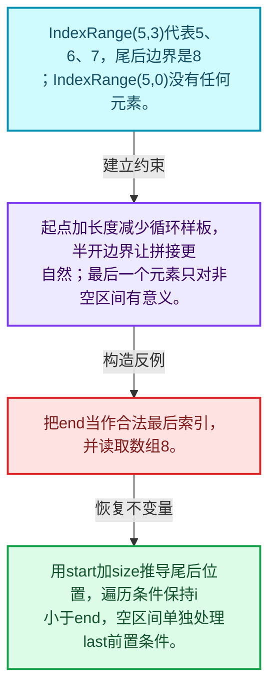
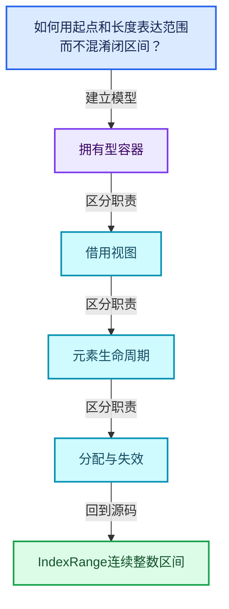
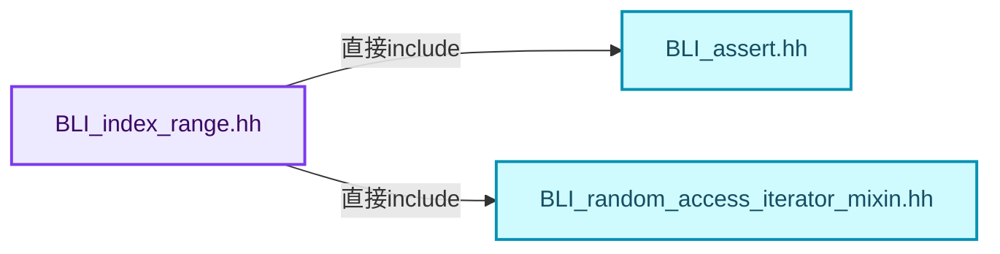
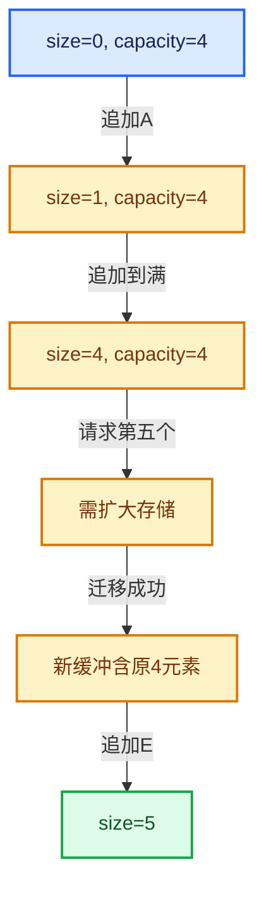

# 01-04 IndexRange连续整数区间

[方向导航](README.md) · [总目录](../README.md) · [覆盖索引](../%E6%BA%90%E7%A0%81%E7%89%88%E6%9C%AC%E4%B8%8E%E8%A6%86%E7%9B%96%E7%B4%A2%E5%BC%95.md)

> 阅读顺序：问题与数据模型 → 语法与类型 → 源码逐行 → 调用线索 → 历史与取舍 → 推演和练习。

- 基准 HEAD：`cbda6b96c26c0dee3c3b5cbb93960c4ac06a6b30`。
- 记录日期：2026-10-14。
- 教学示例状态：正文中的推演不是本机性能实测；已运行练习见验收报告。

## 一、从问题到设计

如何用起点和长度表达范围而不混淆闭区间？

半开区间让大小等于end减begin；空区间合法，但first和last等操作各自仍有前置条件。

本篇把语法、数据语义和系统取舍连接起来。先证明对象存活，再讨论索引；先区分借用与拥有，再讨论复制移动。

### 本篇独立模型与设计推理

IndexRange(5,3)代表5、6、7，尾后边界是8；IndexRange(5,0)没有任何元素。

设计取舍：起点加长度减少循环样板，半开边界让拼接更自然；最后一个元素只对非空区间有意义。

最小反例：把end当作合法最后索引，并读取数组8。

推导与处理：用start加size推导尾后位置，遍历条件保持i小于end，空区间单独处理last前置条件。



### 源码范围与相邻篇章

| 文件 | 本篇逐行范围 | 基准SHA-256 |
|---|---|---|
| [source/blender/blenlib/BLI_index_range.hh](../../../../../source/blender/blenlib/BLI_index_range.hh) | L1—L373 | `178ee8b8136bac97cf4eba3e159ad87f7fd5ec4428a8ab3c1cf39fc1af26963e` |

同一主讲文件可能分多篇覆盖；超出本篇范围的符号通过覆盖索引定位。空行与纯注释保留在源码摘录中，逐行表解释有效语句与语法边界；许可证头统一保留。

前篇：[内存工具与分配器接口](03-%E5%86%85%E5%AD%98%E5%B7%A5%E5%85%B7%E4%B8%8E%E5%88%86%E9%85%8D%E5%99%A8%E6%8E%A5%E5%8F%A3.md).

后篇：[Span只读连续视图](05-Span%E5%8F%AA%E8%AF%BB%E8%BF%9E%E7%BB%AD%E8%A7%86%E5%9B%BE.md).

## 二、类型、数据与阅读地图



这是概念依赖图，边表示阅读关系，不声称是运行时调用顺序。

### 直接编译依赖



箭头只表示头文件包含关系；完整调用线索见后面的符号定位表。

## 三、关键词、语法与类型角色

### 模板 template

模板把类型或常量作为生成实现的参数。读声明时先列出类型参数、非类型参数和默认值，再看使用者实际实例化了什么。模板声明本身不意味着每种T都支持其全部成员。

具体检查：把T替换为int、string、只能移动的类型，分别检查每个被调用操作是否成立。

### 依赖名称 typename

typename既可引入类型模板参数，也可告诉编译器某个依赖名称是类型。它不创建运行时对象；解析期确认语法类别与实例化期检查具体类型是不同阶段。

具体检查：区分typename T::value_type和T::size()，前者标记类型，后者是表达式。

### 常量求值 constexpr

constexpr声明允许相应实体参与常量求值，但constexpr函数仍可以在运行时执行。是否常量求值由调用场景和表达式合法性共同决定。

具体检查：比较constexpr变量初始化和从运行时输入调用同一函数。

### 只读限定 const

const约束当前访问路径可做的修改。const指针、指向const的指针、const视图对象、const元素是不同位置的限定；其他别名可能仍可修改原对象。

具体检查：分别写T* const、const T*与const T* const，并画出不可修改的层次。

### 构造与new表达式

普通new可能分配并构造；placement new在给定地址构造，存储由其他机制提供。失败回滚应区分两类责任。

具体检查：追踪地址来自哪里、构造何时成功、由谁析构、由谁释放。

### 内部断言 assert

断言表达开发者预期成立的内部契约，发布构建可能关闭。它不能替代对不可信输入的完整错误处理，也不保证后续操作被运行时保护。

具体检查：对每条断言构造违反条件的输入，区分调用者错误与应向用户报告的错误。

### 受控访问 friend

friend授予指定函数或类访问非公开成员的权限，并不意味着继承，也不自动扩展到友元的派生类。

具体检查：解释执行器为何需要访问包装器的内部映射，同时检查边界是否仍清楚。

### 类型别名 using

类型别名为已有类型建立名字，不创建运行期对象。它常把模板内部使用的类型统一暴露给泛型调用者。

具体检查：展开别名直到基础类型，区分类型别名和变量声明。

## 四、真实源码与逐行讲解

源码块保持原行内容，原始行号由小节标题及逐行表给出。表中的调用定位是静态阅读辅助；重载、模板实例化、宏展开和虚调用需结合完整声明，不能仅凭词法出现证明动态调用。

### BLI_index_range.hh：L1—L48

<!-- source:source/blender/blenlib/BLI_index_range.hh:1:48 -->

```cpp
/* SPDX-FileCopyrightText: 2023 Blender Authors
 *
 * SPDX-License-Identifier: GPL-2.0-or-later */

#pragma once

/** \file
 * \ingroup bli
 *
 * A `IndexRange` wraps an interval of non-negative integers. It can be used to reference
 * consecutive elements in an array. Furthermore, it can make for loops more convenient and less
 * error prone, especially when using nested loops.
 *
 * I'd argue that the second loop is more readable and less error prone than the first one. That is
 * not necessarily always the case, but often it is.
 *
 * \code{.cc}
 *  for (int64_t i = 0; i < 10; i++) {
 *    for (int64_t j = 0; j < 20; j++) {
 *       for (int64_t k = 0; k < 30; k++) {
 *
 *  for (int64_t i : IndexRange(10)) {
 *    for (int64_t j : IndexRange(20)) {
 *      for (int64_t k : IndexRange(30)) {
 * \endcode
 *
 * Some containers like Vector have an index_range() method. This will return the
 * IndexRange that contains all indices that can be used to access the container. This is
 * particularly useful when you want to iterate over the indices and the elements (much like
 * Python's enumerate(), just worse). Again, I think the second example here is better:
 *
 * \code{.cc}
 *  for (int64_t i = 0; i < my_vector_with_a_long_name.size(); i++) {
 *    do_something(i, my_vector_with_a_long_name[i]);
 *
 *  for (int64_t i : my_vector_with_a_long_name.index_range()) {
 *    do_something(i, my_vector_with_a_long_name[i]);
 * \endcode
 *
 * Ideally this could be could be even closer to Python's enumerate(). We might get that in the
 * future with newer C++ versions.
 */

#include <algorithm>
#include <iosfwd>

#include "BLI_assert.hh"
#include "BLI_random_access_iterator_mixin.hh"
```

| 原始行 | 语义、约束与检查 |
|---|---|
| L5 | 防止同一头文件在一个翻译单元中重复展开；不控制多个源文件之间的链接或对象寿命。 |
| L44 | 引入编译依赖 <algorithm>；这是声明可见性关系，不表示运行时一定调用该文件的所有接口。 |
| L45 | 引入编译依赖 <iosfwd>；这是声明可见性关系，不表示运行时一定调用该文件的所有接口。 |
| L47 | 引入编译依赖 "BLI_assert.hh"；这是声明可见性关系，不表示运行时一定调用该文件的所有接口。 |
| L48 | 引入编译依赖 "BLI_random_access_iterator_mixin.hh"；这是声明可见性关系，不表示运行时一定调用该文件的所有接口。 |

### BLI_index_range.hh：L49—L96

<!-- source:source/blender/blenlib/BLI_index_range.hh:49:96 -->

```cpp

namespace blender {

template<typename T> class Span;

class IndexRange {
 private:
  int64_t start_ = 0;
  int64_t size_ = 0;

 public:
  constexpr IndexRange() = default;

  constexpr explicit IndexRange(int64_t size) : size_(size)
  {
    BLI_assert(size >= 0);
  }

  constexpr IndexRange(const int64_t start, const int64_t size) : start_(start), size_(size)
  {
    BLI_assert(start >= 0);
    BLI_assert(size >= 0);
  }

  constexpr static IndexRange from_begin_size(const int64_t begin, const int64_t size)
  {
    return IndexRange(begin, size);
  }

  constexpr static IndexRange from_begin_end(const int64_t begin, const int64_t end)
  {
    return IndexRange(begin, end - begin);
  }

  constexpr static IndexRange from_begin_end_inclusive(const int64_t begin, const int64_t last)
  {
    return IndexRange(begin, last - begin + 1);
  }

  constexpr static IndexRange from_end_size(const int64_t end, const int64_t size)
  {
    return IndexRange(end - size, size);
  }

  constexpr static IndexRange from_single(const int64_t index)
  {
    return IndexRange(index, 1);
  }
```

本段语义重点：

- `size_`：该对象记录的元素数或长度，不能直接当作容量。

| 原始行 | 语义、约束与检查 |
|---|---|
| L50 | 把后续声明放入 blender 命名空间，影响名称查找和符号归属，不创建运行时对象。 |
| L52 | 声明模板参数 `template<typename T> class Span;`。类型参数决定生成操作的类型，非类型参数可决定内嵌容量或编译期分支。 |
| L54 | 声明或定义类型 `class IndexRange`。结合继承、访问权限和成员布局确认接口与拥有关系；前向声明本身没有完整对象布局。 |
| L55 | 切换成员访问权限为 private；它是编译期接口边界，不是线程同步或内存保护。 |
| L56 | 把右侧 `0` 用于初始化或更新左侧 `int64_t start_`。声明初始化与已有对象赋值应按上下文区分；有资源的类型会调用相应特殊成员。 |
| L57 | 建立或更新 `size_`：该对象记录的元素数或长度，不能直接当作容量。本行的具体值关系为 `int64_t size_ = 0`；对照更新前后相应范围或状态是否一致。 |
| L59 | 切换成员访问权限为 public；它是编译期接口边界，不是线程同步或内存保护。 |
| L60 | 显式采用编译器生成的特殊成员行为：`constexpr IndexRange() = default;`。成员和基类的性质决定该操作是否可用、是否被删除及异常约定，不表示运行时给对象赋值为default。 |
| L62 | 本行涉及 `size_`：该对象记录的元素数或长度，不能直接当作容量。按此语义解读 `constexpr explicit IndexRange(int64_t size) : size_(size)`，不要把地址、数量或状态混用。 |
| L63 | 连接上一行的声明或控制结构与其语句块；后续行在这个作用域中执行或声明。 |
| L64 | 断言约束 `BLI_assert(size >= 0);`。条件是后续访问的内部前置条件；发布构建可能不执行，不能把断言当作输入修复。 |
| L65 | 结束当前语法单元。局部自动对象在离开其作用域时按规则销毁；这不等于所有被引用的外部数据也被释放。 |
| L67 | 本行涉及 `size_`：该对象记录的元素数或长度，不能直接当作容量。按此语义解读 `constexpr IndexRange(const int64_t start, const int64_t size) : start_(start), size_(size)`，不要把地址、数量或状态混用。 |
| L68 | 连接上一行的声明或控制结构与其语句块；后续行在这个作用域中执行或声明。 |
| L69 | 断言约束 `BLI_assert(start >= 0);`。条件是后续访问的内部前置条件；发布构建可能不执行，不能把断言当作输入修复。 |
| L70 | 断言约束 `BLI_assert(size >= 0);`。条件是后续访问的内部前置条件；发布构建可能不执行，不能把断言当作输入修复。 |
| L71 | 结束当前语法单元。局部自动对象在离开其作用域时按规则销毁；这不等于所有被引用的外部数据也被释放。 |
| L73 | 出现调用或函数声明 `from_begin_size`，对应表达式为 `constexpr static IndexRange from_begin_size(const int64_t begin, const int64_t size)`。参数求值、返回类型与重载需结合前后完整语句；静态文本引用不能证明动态目标。 |
| L74 | 连接上一行的声明或控制结构与其语句块；后续行在这个作用域中执行或声明。 |
| L75 | 返回表达式 `IndexRange(begin, size)`。 |
| L76 | 结束当前语法单元。局部自动对象在离开其作用域时按规则销毁；这不等于所有被引用的外部数据也被释放。 |
| L78 | 出现调用或函数声明 `from_begin_end`，对应表达式为 `constexpr static IndexRange from_begin_end(const int64_t begin, const int64_t end)`。参数求值、返回类型与重载需结合前后完整语句；静态文本引用不能证明动态目标。 |
| L79 | 连接上一行的声明或控制结构与其语句块；后续行在这个作用域中执行或声明。 |
| L80 | 返回表达式 `IndexRange(begin, end - begin)`。 |
| L81 | 结束当前语法单元。局部自动对象在离开其作用域时按规则销毁；这不等于所有被引用的外部数据也被释放。 |
| L83 | 出现调用或函数声明 `from_begin_end_inclusive`，对应表达式为 `constexpr static IndexRange from_begin_end_inclusive(const int64_t begin, const int64_t last)`。参数求值、返回类型与重载需结合前后完整语句；静态文本引用不能证明动态目标。 |
| L84 | 连接上一行的声明或控制结构与其语句块；后续行在这个作用域中执行或声明。 |
| L85 | 返回表达式 `IndexRange(begin, last - begin + 1)`。 |
| L86 | 结束当前语法单元。局部自动对象在离开其作用域时按规则销毁；这不等于所有被引用的外部数据也被释放。 |
| L88 | 出现调用或函数声明 `from_end_size`，对应表达式为 `constexpr static IndexRange from_end_size(const int64_t end, const int64_t size)`。参数求值、返回类型与重载需结合前后完整语句；静态文本引用不能证明动态目标。 |
| L89 | 连接上一行的声明或控制结构与其语句块；后续行在这个作用域中执行或声明。 |
| L90 | 返回表达式 `IndexRange(end - size, size)`。 |
| L91 | 结束当前语法单元。局部自动对象在离开其作用域时按规则销毁；这不等于所有被引用的外部数据也被释放。 |
| L93 | 出现调用或函数声明 `from_single`，对应表达式为 `constexpr static IndexRange from_single(const int64_t index)`。参数求值、返回类型与重载需结合前后完整语句；静态文本引用不能证明动态目标。 |
| L94 | 连接上一行的声明或控制结构与其语句块；后续行在这个作用域中执行或声明。 |
| L95 | 返回表达式 `IndexRange(index, 1)`。 |
| L96 | 结束当前语法单元。局部自动对象在离开其作用域时按规则销毁；这不等于所有被引用的外部数据也被释放。 |

### BLI_index_range.hh：L97—L147

<!-- source:source/blender/blenlib/BLI_index_range.hh:97:147 -->

```cpp

  class Iterator : public iterator::RandomAccessIteratorMixin<Iterator> {
   public:
    using value_type = int64_t;
    using pointer = const int64_t *;
    using reference = int64_t;

   private:
    int64_t current_;

   public:
    constexpr explicit Iterator(int64_t current) : current_(current) {}

    constexpr int64_t operator*() const
    {
      return current_;
    }

    const int64_t &iter_prop() const
    {
      return current_;
    }
  };

  constexpr Iterator begin() const
  {
    return Iterator(start_);
  }

  constexpr Iterator end() const
  {
    return Iterator(start_ + size_);
  }

  /**
   * Access an element in the range.
   */
  constexpr int64_t operator[](int64_t index) const
  {
    BLI_assert(index >= 0);
    BLI_assert(index < this->size());
    return start_ + index;
  }

  /**
   * Two ranges compare equal when they contain the same numbers.
   */
  constexpr friend bool operator==(IndexRange a, IndexRange b)
  {
    return (a.size_ == b.size_) && (a.start_ == b.start_ || a.size_ == 0);
  }
```

本段语义重点：

- `size_`：该对象记录的元素数或长度，不能直接当作容量。

| 原始行 | 语义、约束与检查 |
|---|---|
| L98 | 声明或定义类型 `class Iterator : public iterator::RandomAccessIteratorMixin<Iterator>`。结合继承、访问权限和成员布局确认接口与拥有关系；前向声明本身没有完整对象布局。 |
| L99 | 切换成员访问权限为 public；它是编译期接口边界，不是线程同步或内存保护。 |
| L100 | 定义类型别名 `using value_type = int64_t`，为模板接口或内部实现统一命名；本行不分配该类型对象。 |
| L101 | 定义类型别名 `using pointer = const int64_t *`，为模板接口或内部实现统一命名；本行不分配该类型对象。 |
| L102 | 定义类型别名 `using reference = int64_t`，为模板接口或内部实现统一命名；本行不分配该类型对象。 |
| L104 | 切换成员访问权限为 private；它是编译期接口边界，不是线程同步或内存保护。 |
| L105 | 声明成员、局部对象或完成语句 `int64_t current_`。若为指针或引用，它本身不说明拥有；若为值对象，其构造析构由所在作用域或外层对象管理。 |
| L107 | 切换成员访问权限为 public；它是编译期接口边界，不是线程同步或内存保护。 |
| L108 | 出现调用或函数声明 `Iterator`，对应表达式为 `constexpr explicit Iterator(int64_t current) : current_(current) {}`。参数求值、返回类型与重载需结合前后完整语句；静态文本引用不能证明动态目标。 |
| L110 | 运算符重载声明、定义或显式调用：`constexpr int64_t operator*() const`。结合参数和返回类型判断是赋值、索引、比较还是转换；operator=声明中的等号不是在给名为operator的变量赋值。 |
| L111 | 连接上一行的声明或控制结构与其语句块；后续行在这个作用域中执行或声明。 |
| L112 | 返回表达式 `current_`。 |
| L113 | 结束当前语法单元。局部自动对象在离开其作用域时按规则销毁；这不等于所有被引用的外部数据也被释放。 |
| L115 | 出现调用或函数声明 `iter_prop`，对应表达式为 `const int64_t &iter_prop() const`。参数求值、返回类型与重载需结合前后完整语句；静态文本引用不能证明动态目标。 |
| L116 | 连接上一行的声明或控制结构与其语句块；后续行在这个作用域中执行或声明。 |
| L117 | 返回表达式 `current_`。 |
| L118 | 结束当前语法单元。局部自动对象在离开其作用域时按规则销毁；这不等于所有被引用的外部数据也被释放。 |
| L119 | 结束当前语法单元。局部自动对象在离开其作用域时按规则销毁；这不等于所有被引用的外部数据也被释放。 |
| L121 | 出现调用或函数声明 `begin`，对应表达式为 `constexpr Iterator begin() const`。参数求值、返回类型与重载需结合前后完整语句；静态文本引用不能证明动态目标。 |
| L122 | 连接上一行的声明或控制结构与其语句块；后续行在这个作用域中执行或声明。 |
| L123 | 返回表达式 `Iterator(start_)`。 |
| L124 | 结束当前语法单元。局部自动对象在离开其作用域时按规则销毁；这不等于所有被引用的外部数据也被释放。 |
| L126 | 出现调用或函数声明 `end`，对应表达式为 `constexpr Iterator end() const`。参数求值、返回类型与重载需结合前后完整语句；静态文本引用不能证明动态目标。 |
| L127 | 连接上一行的声明或控制结构与其语句块；后续行在这个作用域中执行或声明。 |
| L128 | 返回表达式 `Iterator(start_ + size_)`。 |
| L129 | 结束当前语法单元。局部自动对象在离开其作用域时按规则销毁；这不等于所有被引用的外部数据也被释放。 |
| L134 | 运算符重载声明、定义或显式调用：`constexpr int64_t operator[](int64_t index) const`。结合参数和返回类型判断是赋值、索引、比较还是转换；operator=声明中的等号不是在给名为operator的变量赋值。 |
| L135 | 连接上一行的声明或控制结构与其语句块；后续行在这个作用域中执行或声明。 |
| L136 | 断言约束 `BLI_assert(index >= 0);`。条件是后续访问的内部前置条件；发布构建可能不执行，不能把断言当作输入修复。 |
| L137 | 断言约束 `BLI_assert(index < this->size());`。条件是后续访问的内部前置条件；发布构建可能不执行，不能把断言当作输入修复。 |
| L138 | 返回表达式 `start_ + index`。 |
| L139 | 结束当前语法单元。局部自动对象在离开其作用域时按规则销毁；这不等于所有被引用的外部数据也被释放。 |
| L144 | 运算符重载声明、定义或显式调用：`constexpr friend bool operator==(IndexRange a, IndexRange b)`。结合参数和返回类型判断是赋值、索引、比较还是转换；operator=声明中的等号不是在给名为operator的变量赋值。 |
| L145 | 连接上一行的声明或控制结构与其语句块；后续行在这个作用域中执行或声明。 |
| L146 | 返回表达式 `(a.size_ == b.size_) && (a.start_ == b.start_ &#124;&#124; a.size_ == 0)`。 |
| L147 | 结束当前语法单元。局部自动对象在离开其作用域时按规则销毁；这不等于所有被引用的外部数据也被释放。 |

### BLI_index_range.hh：L148—L198

<!-- source:source/blender/blenlib/BLI_index_range.hh:148:198 -->

```cpp
  constexpr friend bool operator!=(IndexRange a, IndexRange b)
  {
    return !(a == b);
  }

  /**
   * Get the amount of numbers in the range.
   */
  constexpr int64_t size() const
  {
    return size_;
  }

  constexpr IndexRange index_range() const
  {
    return IndexRange(size_);
  }

  /**
   * Returns true if the size is zero.
   */
  constexpr bool is_empty() const
  {
    return size_ == 0;
  }

  /**
   * Creates a new index range with the same beginning but a different end.
   */
  constexpr IndexRange with_new_end(const int64_t new_end) const
  {
    return IndexRange::from_begin_end(start_, new_end);
  }

  /**
   * Create a new range starting at the end of the current one.
   */
  constexpr IndexRange after(int64_t n) const
  {
    BLI_assert(n >= 0);
    return IndexRange(start_ + size_, n);
  }

  /**
   * Create a new range that ends at the start of the current one.
   */
  constexpr IndexRange before(int64_t n) const
  {
    BLI_assert(n >= 0);
    return IndexRange(start_ - n, n);
  }
```

本段语义重点：

- `size_`：该对象记录的元素数或长度，不能直接当作容量。

| 原始行 | 语义、约束与检查 |
|---|---|
| L148 | 运算符重载声明、定义或显式调用：`constexpr friend bool operator!=(IndexRange a, IndexRange b)`。结合参数和返回类型判断是赋值、索引、比较还是转换；operator=声明中的等号不是在给名为operator的变量赋值。 |
| L149 | 连接上一行的声明或控制结构与其语句块；后续行在这个作用域中执行或声明。 |
| L150 | 返回表达式 `!(a == b)`。 |
| L151 | 结束当前语法单元。局部自动对象在离开其作用域时按规则销毁；这不等于所有被引用的外部数据也被释放。 |
| L156 | 出现调用或函数声明 `size`，对应表达式为 `constexpr int64_t size() const`。参数求值、返回类型与重载需结合前后完整语句；静态文本引用不能证明动态目标。 |
| L157 | 连接上一行的声明或控制结构与其语句块；后续行在这个作用域中执行或声明。 |
| L158 | 返回表达式 `size_`。 |
| L159 | 结束当前语法单元。局部自动对象在离开其作用域时按规则销毁；这不等于所有被引用的外部数据也被释放。 |
| L161 | 出现调用或函数声明 `index_range`，对应表达式为 `constexpr IndexRange index_range() const`。参数求值、返回类型与重载需结合前后完整语句；静态文本引用不能证明动态目标。 |
| L162 | 连接上一行的声明或控制结构与其语句块；后续行在这个作用域中执行或声明。 |
| L163 | 返回表达式 `IndexRange(size_)`。 |
| L164 | 结束当前语法单元。局部自动对象在离开其作用域时按规则销毁；这不等于所有被引用的外部数据也被释放。 |
| L169 | 出现调用或函数声明 `is_empty`，对应表达式为 `constexpr bool is_empty() const`。参数求值、返回类型与重载需结合前后完整语句；静态文本引用不能证明动态目标。 |
| L170 | 连接上一行的声明或控制结构与其语句块；后续行在这个作用域中执行或声明。 |
| L171 | 返回表达式 `size_ == 0`。 |
| L172 | 结束当前语法单元。局部自动对象在离开其作用域时按规则销毁；这不等于所有被引用的外部数据也被释放。 |
| L177 | 出现调用或函数声明 `with_new_end`，对应表达式为 `constexpr IndexRange with_new_end(const int64_t new_end) const`。参数求值、返回类型与重载需结合前后完整语句；静态文本引用不能证明动态目标。 |
| L178 | 连接上一行的声明或控制结构与其语句块；后续行在这个作用域中执行或声明。 |
| L179 | 返回表达式 `IndexRange::from_begin_end(start_, new_end)`。 |
| L180 | 结束当前语法单元。局部自动对象在离开其作用域时按规则销毁；这不等于所有被引用的外部数据也被释放。 |
| L185 | 出现调用或函数声明 `after`，对应表达式为 `constexpr IndexRange after(int64_t n) const`。参数求值、返回类型与重载需结合前后完整语句；静态文本引用不能证明动态目标。 |
| L186 | 连接上一行的声明或控制结构与其语句块；后续行在这个作用域中执行或声明。 |
| L187 | 断言约束 `BLI_assert(n >= 0);`。条件是后续访问的内部前置条件；发布构建可能不执行，不能把断言当作输入修复。 |
| L188 | 返回表达式 `IndexRange(start_ + size_, n)`。 |
| L189 | 结束当前语法单元。局部自动对象在离开其作用域时按规则销毁；这不等于所有被引用的外部数据也被释放。 |
| L194 | 出现调用或函数声明 `before`，对应表达式为 `constexpr IndexRange before(int64_t n) const`。参数求值、返回类型与重载需结合前后完整语句；静态文本引用不能证明动态目标。 |
| L195 | 连接上一行的声明或控制结构与其语句块；后续行在这个作用域中执行或声明。 |
| L196 | 断言约束 `BLI_assert(n >= 0);`。条件是后续访问的内部前置条件；发布构建可能不执行，不能把断言当作输入修复。 |
| L197 | 返回表达式 `IndexRange(start_ - n, n)`。 |
| L198 | 结束当前语法单元。局部自动对象在离开其作用域时按规则销毁；这不等于所有被引用的外部数据也被释放。 |

### BLI_index_range.hh：L199—L246

<!-- source:source/blender/blenlib/BLI_index_range.hh:199:246 -->

```cpp

  /**
   * Get the first element in the range.
   * Asserts when the range is empty.
   */
  constexpr int64_t first() const
  {
    BLI_assert(this->size() > 0);
    return start_;
  }

  /**
   * Get the nth last element in the range.
   * Asserts when the range is empty or when n is negative.
   */
  constexpr int64_t last(const int64_t n = 0) const
  {
    BLI_assert(n >= 0);
    BLI_assert(n < size_);
    BLI_assert(this->size() > 0);
    return start_ + size_ - 1 - n;
  }

  /**
   * Get the element one before the beginning. The returned value is undefined when the range is
   * empty, and the range must start after zero already.
   */
  constexpr int64_t one_before_start() const
  {
    BLI_assert(start_ > 0);
    return start_ - 1;
  }

  /**
   * Get the element one after the end. The returned value is undefined when the range is empty.
   */
  constexpr int64_t one_after_last() const
  {
    return start_ + size_;
  }

  /**
   * Get the first element in the range. The returned value is undefined when the range is empty.
   */
  constexpr int64_t start() const
  {
    return start_;
  }
```

本段语义重点：

- `size_`：该对象记录的元素数或长度，不能直接当作容量。

| 原始行 | 语义、约束与检查 |
|---|---|
| L204 | 出现调用或函数声明 `first`，对应表达式为 `constexpr int64_t first() const`。参数求值、返回类型与重载需结合前后完整语句；静态文本引用不能证明动态目标。 |
| L205 | 连接上一行的声明或控制结构与其语句块；后续行在这个作用域中执行或声明。 |
| L206 | 断言约束 `BLI_assert(this->size() > 0);`。条件是后续访问的内部前置条件；发布构建可能不执行，不能把断言当作输入修复。 |
| L207 | 返回表达式 `start_`。 |
| L208 | 结束当前语法单元。局部自动对象在离开其作用域时按规则销毁；这不等于所有被引用的外部数据也被释放。 |
| L214 | 把右侧 `0) const` 用于初始化或更新左侧 `constexpr int64_t last(const int64_t n`。声明初始化与已有对象赋值应按上下文区分；有资源的类型会调用相应特殊成员。 |
| L215 | 连接上一行的声明或控制结构与其语句块；后续行在这个作用域中执行或声明。 |
| L216 | 断言约束 `BLI_assert(n >= 0);`。条件是后续访问的内部前置条件；发布构建可能不执行，不能把断言当作输入修复。 |
| L217 | 断言约束 `BLI_assert(n < size_);`。条件是后续访问的内部前置条件；发布构建可能不执行，不能把断言当作输入修复。 |
| L218 | 断言约束 `BLI_assert(this->size() > 0);`。条件是后续访问的内部前置条件；发布构建可能不执行，不能把断言当作输入修复。 |
| L219 | 返回表达式 `start_ + size_ - 1 - n`。 |
| L220 | 结束当前语法单元。局部自动对象在离开其作用域时按规则销毁；这不等于所有被引用的外部数据也被释放。 |
| L226 | 出现调用或函数声明 `one_before_start`，对应表达式为 `constexpr int64_t one_before_start() const`。参数求值、返回类型与重载需结合前后完整语句；静态文本引用不能证明动态目标。 |
| L227 | 连接上一行的声明或控制结构与其语句块；后续行在这个作用域中执行或声明。 |
| L228 | 断言约束 `BLI_assert(start_ > 0);`。条件是后续访问的内部前置条件；发布构建可能不执行，不能把断言当作输入修复。 |
| L229 | 返回表达式 `start_ - 1`。 |
| L230 | 结束当前语法单元。局部自动对象在离开其作用域时按规则销毁；这不等于所有被引用的外部数据也被释放。 |
| L235 | 出现调用或函数声明 `one_after_last`，对应表达式为 `constexpr int64_t one_after_last() const`。参数求值、返回类型与重载需结合前后完整语句；静态文本引用不能证明动态目标。 |
| L236 | 连接上一行的声明或控制结构与其语句块；后续行在这个作用域中执行或声明。 |
| L237 | 返回表达式 `start_ + size_`。 |
| L238 | 结束当前语法单元。局部自动对象在离开其作用域时按规则销毁；这不等于所有被引用的外部数据也被释放。 |
| L243 | 出现调用或函数声明 `start`，对应表达式为 `constexpr int64_t start() const`。参数求值、返回类型与重载需结合前后完整语句；静态文本引用不能证明动态目标。 |
| L244 | 连接上一行的声明或控制结构与其语句块；后续行在这个作用域中执行或声明。 |
| L245 | 返回表达式 `start_`。 |
| L246 | 结束当前语法单元。局部自动对象在离开其作用域时按规则销毁；这不等于所有被引用的外部数据也被释放。 |

### BLI_index_range.hh：L247—L300

<!-- source:source/blender/blenlib/BLI_index_range.hh:247:300 -->

```cpp

  /**
   * Returns true when the range contains a certain number, otherwise false.
   */
  constexpr bool contains(int64_t value) const
  {
    return value >= start_ && value < start_ + size_;
  }

  /**
   * Returns true when all indices in the given range are also in the current range.
   */
  constexpr bool contains(const IndexRange range) const
  {
    if (range.is_empty()) {
      return true;
    }
    if (range.start_ < start_) {
      return false;
    }
    if (range.start_ + range.size_ > start_ + size_) {
      return false;
    }
    return true;
  }

  /**
   * Returns a new range, that contains a sub-interval of the current one.
   */
  constexpr IndexRange slice(int64_t start, int64_t size) const
  {
    BLI_assert(start >= 0);
    BLI_assert(size >= 0);
    int64_t new_start = start_ + start;
    BLI_assert(new_start + size <= start_ + size_ || size == 0);
    return IndexRange(new_start, size);
  }
  constexpr IndexRange slice(IndexRange range) const
  {
    return this->slice(range.start(), range.size());
  }

  /**
   * Returns a new IndexRange that contains the intersection of the current one with the given
   * range. Returns empty range if there are no overlapping indices. The returned range is always
   * a valid slice of this range.
   */
  constexpr IndexRange intersect(IndexRange other) const
  {
    const int64_t old_end = start_ + size_;
    const int64_t new_start = std::min(old_end, std::max(start_, other.start_));
    const int64_t new_end = std::max(new_start, std::min(old_end, other.start_ + other.size_));
    return IndexRange(new_start, new_end - new_start);
  }
```

本段语义重点：

- `std::max`：取较大值，在容量计算中常用于同时满足请求量和增长策略。
- `std::min`：取较小值，常用于截断范围；还要检查负值、溢出和空范围。
- `size_`：该对象记录的元素数或长度，不能直接当作容量。

| 原始行 | 语义、约束与检查 |
|---|---|
| L251 | 出现调用或函数声明 `contains`，对应表达式为 `constexpr bool contains(int64_t value) const`。参数求值、返回类型与重载需结合前后完整语句；静态文本引用不能证明动态目标。 |
| L252 | 连接上一行的声明或控制结构与其语句块；后续行在这个作用域中执行或声明。 |
| L253 | 返回表达式 `value >= start_ && value < start_ + size_`。 |
| L254 | 结束当前语法单元。局部自动对象在离开其作用域时按规则销毁；这不等于所有被引用的外部数据也被释放。 |
| L259 | 出现调用或函数声明 `contains`，对应表达式为 `constexpr bool contains(const IndexRange range) const`。参数求值、返回类型与重载需结合前后完整语句；静态文本引用不能证明动态目标。 |
| L260 | 连接上一行的声明或控制结构与其语句块；后续行在这个作用域中执行或声明。 |
| L261 | 判断 `range.is_empty()`，成立时进入本分支，否则继续后续路径。 |
| L262 | 返回表达式 `true`。这是本路径的布尔结果，具体成功、存在或状态含义由函数接口规定。 |
| L263 | 结束当前语法单元。局部自动对象在离开其作用域时按规则销毁；这不等于所有被引用的外部数据也被释放。 |
| L264 | 判断 `range.start_ < start_`，成立时进入本分支，否则继续后续路径。 |
| L265 | 返回表达式 `false`。这是本路径的布尔结果，具体成功、存在或状态含义由函数接口规定。 |
| L266 | 结束当前语法单元。局部自动对象在离开其作用域时按规则销毁；这不等于所有被引用的外部数据也被释放。 |
| L267 | 判断 `range.start_ + range.size_ > start_ + size_`，成立时进入本分支，否则继续后续路径。该边界影响可访问元素或可用容量，两者要按各变量的定义区分。 |
| L268 | 返回表达式 `false`。这是本路径的布尔结果，具体成功、存在或状态含义由函数接口规定。 |
| L269 | 结束当前语法单元。局部自动对象在离开其作用域时按规则销毁；这不等于所有被引用的外部数据也被释放。 |
| L270 | 返回表达式 `true`。这是本路径的布尔结果，具体成功、存在或状态含义由函数接口规定。 |
| L271 | 结束当前语法单元。局部自动对象在离开其作用域时按规则销毁；这不等于所有被引用的外部数据也被释放。 |
| L276 | 出现调用或函数声明 `slice`，对应表达式为 `constexpr IndexRange slice(int64_t start, int64_t size) const`。参数求值、返回类型与重载需结合前后完整语句；静态文本引用不能证明动态目标。 |
| L277 | 连接上一行的声明或控制结构与其语句块；后续行在这个作用域中执行或声明。 |
| L278 | 断言约束 `BLI_assert(start >= 0);`。条件是后续访问的内部前置条件；发布构建可能不执行，不能把断言当作输入修复。 |
| L279 | 断言约束 `BLI_assert(size >= 0);`。条件是后续访问的内部前置条件；发布构建可能不执行，不能把断言当作输入修复。 |
| L280 | 把右侧 `start_ + start` 用于初始化或更新左侧 `int64_t new_start`。声明初始化与已有对象赋值应按上下文区分；有资源的类型会调用相应特殊成员。 |
| L281 | 断言约束 `BLI_assert(new_start + size <= start_ + size_ &#124;&#124; size == 0);`。条件是后续访问的内部前置条件；发布构建可能不执行，不能把断言当作输入修复。 |
| L282 | 返回表达式 `IndexRange(new_start, size)`。 |
| L283 | 结束当前语法单元。局部自动对象在离开其作用域时按规则销毁；这不等于所有被引用的外部数据也被释放。 |
| L284 | 出现调用或函数声明 `slice`，对应表达式为 `constexpr IndexRange slice(IndexRange range) const`。参数求值、返回类型与重载需结合前后完整语句；静态文本引用不能证明动态目标。 |
| L285 | 连接上一行的声明或控制结构与其语句块；后续行在这个作用域中执行或声明。 |
| L286 | 返回表达式 `this->slice(range.start(), range.size())`。 |
| L287 | 结束当前语法单元。局部自动对象在离开其作用域时按规则销毁；这不等于所有被引用的外部数据也被释放。 |
| L294 | 出现调用或函数声明 `intersect`，对应表达式为 `constexpr IndexRange intersect(IndexRange other) const`。参数求值、返回类型与重载需结合前后完整语句；静态文本引用不能证明动态目标。 |
| L295 | 连接上一行的声明或控制结构与其语句块；后续行在这个作用域中执行或声明。 |
| L296 | 建立或更新 `size_`：该对象记录的元素数或长度，不能直接当作容量。本行的具体值关系为 `const int64_t old_end = start_ + size_`；对照更新前后相应范围或状态是否一致。 |
| L297 | 本行使用 `std::max`：取较大值，在容量计算中常用于同时满足请求量和增长策略。 |
| L298 | 本行使用 `std::max`：取较大值，在容量计算中常用于同时满足请求量和增长策略。 |
| L299 | 返回表达式 `IndexRange(new_start, new_end - new_start)`。 |
| L300 | 结束当前语法单元。局部自动对象在离开其作用域时按规则销毁；这不等于所有被引用的外部数据也被释放。 |

### BLI_index_range.hh：L301—L344

<!-- source:source/blender/blenlib/BLI_index_range.hh:301:344 -->

```cpp

  /**
   * Returns a new IndexRange with n elements removed from the beginning of the range.
   * This invokes undefined behavior when n is negative.
   */
  constexpr IndexRange drop_front(int64_t n) const
  {
    BLI_assert(n >= 0);
    const int64_t new_size = std::max<int64_t>(0, size_ - n);
    return IndexRange(start_ + n, new_size);
  }

  /**
   * Returns a new IndexRange with n elements removed from the end of the range.
   * This invokes undefined behavior when n is negative.
   */
  constexpr IndexRange drop_back(int64_t n) const
  {
    BLI_assert(n >= 0);
    const int64_t new_size = std::max<int64_t>(0, size_ - n);
    return IndexRange(start_, new_size);
  }

  /**
   * Returns a new IndexRange that only contains the first n elements. This invokes undefined
   * behavior when n is negative.
   */
  constexpr IndexRange take_front(int64_t n) const
  {
    BLI_assert(n >= 0);
    const int64_t new_size = std::min<int64_t>(size_, n);
    return IndexRange(start_, new_size);
  }

  /**
   * Returns a new IndexRange that only contains the last n elements. This invokes undefined
   * behavior when n is negative.
   */
  constexpr IndexRange take_back(int64_t n) const
  {
    BLI_assert(n >= 0);
    const int64_t new_size = std::min<int64_t>(size_, n);
    return IndexRange(start_ + size_ - new_size, new_size);
  }
```

本段语义重点：

- `std::max`：取较大值，在容量计算中常用于同时满足请求量和增长策略。
- `std::min`：取较小值，常用于截断范围；还要检查负值、溢出和空范围。
- `size_`：该对象记录的元素数或长度，不能直接当作容量。

| 原始行 | 语义、约束与检查 |
|---|---|
| L306 | 出现调用或函数声明 `drop_front`，对应表达式为 `constexpr IndexRange drop_front(int64_t n) const`。参数求值、返回类型与重载需结合前后完整语句；静态文本引用不能证明动态目标。 |
| L307 | 连接上一行的声明或控制结构与其语句块；后续行在这个作用域中执行或声明。 |
| L308 | 断言约束 `BLI_assert(n >= 0);`。条件是后续访问的内部前置条件；发布构建可能不执行，不能把断言当作输入修复。 |
| L309 | 本行使用 `std::max`：取较大值，在容量计算中常用于同时满足请求量和增长策略。 |
| L310 | 返回表达式 `IndexRange(start_ + n, new_size)`。 |
| L311 | 结束当前语法单元。局部自动对象在离开其作用域时按规则销毁；这不等于所有被引用的外部数据也被释放。 |
| L317 | 出现调用或函数声明 `drop_back`，对应表达式为 `constexpr IndexRange drop_back(int64_t n) const`。参数求值、返回类型与重载需结合前后完整语句；静态文本引用不能证明动态目标。 |
| L318 | 连接上一行的声明或控制结构与其语句块；后续行在这个作用域中执行或声明。 |
| L319 | 断言约束 `BLI_assert(n >= 0);`。条件是后续访问的内部前置条件；发布构建可能不执行，不能把断言当作输入修复。 |
| L320 | 本行使用 `std::max`：取较大值，在容量计算中常用于同时满足请求量和增长策略。 |
| L321 | 返回表达式 `IndexRange(start_, new_size)`。 |
| L322 | 结束当前语法单元。局部自动对象在离开其作用域时按规则销毁；这不等于所有被引用的外部数据也被释放。 |
| L328 | 出现调用或函数声明 `take_front`，对应表达式为 `constexpr IndexRange take_front(int64_t n) const`。参数求值、返回类型与重载需结合前后完整语句；静态文本引用不能证明动态目标。 |
| L329 | 连接上一行的声明或控制结构与其语句块；后续行在这个作用域中执行或声明。 |
| L330 | 断言约束 `BLI_assert(n >= 0);`。条件是后续访问的内部前置条件；发布构建可能不执行，不能把断言当作输入修复。 |
| L331 | 本行使用 `std::min`：取较小值，常用于截断范围；还要检查负值、溢出和空范围。 |
| L332 | 返回表达式 `IndexRange(start_, new_size)`。 |
| L333 | 结束当前语法单元。局部自动对象在离开其作用域时按规则销毁；这不等于所有被引用的外部数据也被释放。 |
| L339 | 出现调用或函数声明 `take_back`，对应表达式为 `constexpr IndexRange take_back(int64_t n) const`。参数求值、返回类型与重载需结合前后完整语句；静态文本引用不能证明动态目标。 |
| L340 | 连接上一行的声明或控制结构与其语句块；后续行在这个作用域中执行或声明。 |
| L341 | 断言约束 `BLI_assert(n >= 0);`。条件是后续访问的内部前置条件；发布构建可能不执行，不能把断言当作输入修复。 |
| L342 | 本行使用 `std::min`：取较小值，常用于截断范围；还要检查负值、溢出和空范围。 |
| L343 | 返回表达式 `IndexRange(start_ + size_ - new_size, new_size)`。 |
| L344 | 结束当前语法单元。局部自动对象在离开其作用域时按规则销毁；这不等于所有被引用的外部数据也被释放。 |

### BLI_index_range.hh：L345—L373

<!-- source:source/blender/blenlib/BLI_index_range.hh:345:373 -->

```cpp

  /**
   * Move the range forward or backward within the larger array. The amount may be negative,
   * but its absolute value cannot be greater than the existing start of the range.
   */
  constexpr IndexRange shift(int64_t n) const
  {
    return IndexRange(start_ + n, size_);
  }

  friend std::ostream &operator<<(std::ostream &stream, IndexRange range);
};

struct AlignedIndexRanges {
  IndexRange prefix;
  IndexRange aligned;
  IndexRange suffix;
};

/**
 * Split a range into three parts so that the boundaries of the middle part are aligned to some
 * power of two.
 *
 * This can be used when an algorithm can be optimized on aligned indices/memory. The algorithm
 * then needs a slow path for the beginning and end, and a fast path for the aligned elements.
 */
AlignedIndexRanges split_index_range_by_alignment(const IndexRange range, const int64_t alignment);

}  // namespace blender
```

本段语义重点：

- `size_`：该对象记录的元素数或长度，不能直接当作容量。

| 原始行 | 语义、约束与检查 |
|---|---|
| L350 | 出现调用或函数声明 `shift`，对应表达式为 `constexpr IndexRange shift(int64_t n) const`。参数求值、返回类型与重载需结合前后完整语句；静态文本引用不能证明动态目标。 |
| L351 | 连接上一行的声明或控制结构与其语句块；后续行在这个作用域中执行或声明。 |
| L352 | 返回表达式 `IndexRange(start_ + n, size_)`。 |
| L353 | 结束当前语法单元。局部自动对象在离开其作用域时按规则销毁；这不等于所有被引用的外部数据也被释放。 |
| L355 | 运算符重载声明、定义或显式调用：`friend std::ostream &operator<<(std::ostream &stream, IndexRange range);`。结合参数和返回类型判断是赋值、索引、比较还是转换；operator=声明中的等号不是在给名为operator的变量赋值。 |
| L356 | 结束当前语法单元。局部自动对象在离开其作用域时按规则销毁；这不等于所有被引用的外部数据也被释放。 |
| L358 | 声明或定义类型 `struct AlignedIndexRanges`。结合继承、访问权限和成员布局确认接口与拥有关系；前向声明本身没有完整对象布局。 |
| L359 | 声明成员、局部对象或完成语句 `IndexRange prefix`。若为指针或引用，它本身不说明拥有；若为值对象，其构造析构由所在作用域或外层对象管理。 |
| L360 | 声明成员、局部对象或完成语句 `IndexRange aligned`。若为指针或引用，它本身不说明拥有；若为值对象，其构造析构由所在作用域或外层对象管理。 |
| L361 | 声明成员、局部对象或完成语句 `IndexRange suffix`。若为指针或引用，它本身不说明拥有；若为值对象，其构造析构由所在作用域或外层对象管理。 |
| L362 | 结束当前语法单元。局部自动对象在离开其作用域时按规则销毁；这不等于所有被引用的外部数据也被释放。 |
| L371 | 出现调用或函数声明 `split_index_range_by_alignment`，对应表达式为 `AlignedIndexRanges split_index_range_by_alignment(const IndexRange range, const int64_t alignment);`。参数求值、返回类型与重载需结合前后完整语句；静态文本引用不能证明动态目标。 |
| L373 | 结束当前语法单元。局部自动对象在离开其作用域时按规则销毁；这不等于所有被引用的外部数据也被释放。 |

## 五、接口定位、调用线索与生命周期

### 本篇声明与实现入口

| 源码位置 | 实际声明片段 |
|---|---|
| [BLI_index_range.hh:L52](../../../../../source/blender/blenlib/BLI_index_range.hh#L52) | `template<typename T> class Span;` |
| [BLI_index_range.hh:L54](../../../../../source/blender/blenlib/BLI_index_range.hh#L54) | `class IndexRange` |
| [BLI_index_range.hh:L60](../../../../../source/blender/blenlib/BLI_index_range.hh#L60) | `constexpr IndexRange() = default;` |
| [BLI_index_range.hh:L62](../../../../../source/blender/blenlib/BLI_index_range.hh#L62) | `constexpr explicit IndexRange(int64_t size) : size_(size)` |
| [BLI_index_range.hh:L67](../../../../../source/blender/blenlib/BLI_index_range.hh#L67) | `constexpr IndexRange(const int64_t start, const int64_t size) : start_(start), size_(size)` |
| [BLI_index_range.hh:L73](../../../../../source/blender/blenlib/BLI_index_range.hh#L73) | `constexpr static IndexRange from_begin_size(const int64_t begin, const int64_t size)` |
| [BLI_index_range.hh:L78](../../../../../source/blender/blenlib/BLI_index_range.hh#L78) | `constexpr static IndexRange from_begin_end(const int64_t begin, const int64_t end)` |
| [BLI_index_range.hh:L83](../../../../../source/blender/blenlib/BLI_index_range.hh#L83) | `constexpr static IndexRange from_begin_end_inclusive(const int64_t begin, const int64_t last)` |
| [BLI_index_range.hh:L88](../../../../../source/blender/blenlib/BLI_index_range.hh#L88) | `constexpr static IndexRange from_end_size(const int64_t end, const int64_t size)` |
| [BLI_index_range.hh:L93](../../../../../source/blender/blenlib/BLI_index_range.hh#L93) | `constexpr static IndexRange from_single(const int64_t index)` |
| [BLI_index_range.hh:L98](../../../../../source/blender/blenlib/BLI_index_range.hh#L98) | `class Iterator : public iterator::RandomAccessIteratorMixin<Iterator>` |
| [BLI_index_range.hh:L108](../../../../../source/blender/blenlib/BLI_index_range.hh#L108) | `constexpr explicit Iterator(int64_t current) : current_(current) {}` |
| [BLI_index_range.hh:L115](../../../../../source/blender/blenlib/BLI_index_range.hh#L115) | `const int64_t &iter_prop() const` |
| [BLI_index_range.hh:L121](../../../../../source/blender/blenlib/BLI_index_range.hh#L121) | `constexpr Iterator begin() const` |
| [BLI_index_range.hh:L126](../../../../../source/blender/blenlib/BLI_index_range.hh#L126) | `constexpr Iterator end() const` |
| [BLI_index_range.hh:L156](../../../../../source/blender/blenlib/BLI_index_range.hh#L156) | `constexpr int64_t size() const` |
| [BLI_index_range.hh:L161](../../../../../source/blender/blenlib/BLI_index_range.hh#L161) | `constexpr IndexRange index_range() const` |
| [BLI_index_range.hh:L169](../../../../../source/blender/blenlib/BLI_index_range.hh#L169) | `constexpr bool is_empty() const` |
| [BLI_index_range.hh:L177](../../../../../source/blender/blenlib/BLI_index_range.hh#L177) | `constexpr IndexRange with_new_end(const int64_t new_end) const` |
| [BLI_index_range.hh:L185](../../../../../source/blender/blenlib/BLI_index_range.hh#L185) | `constexpr IndexRange after(int64_t n) const` |
| [BLI_index_range.hh:L194](../../../../../source/blender/blenlib/BLI_index_range.hh#L194) | `constexpr IndexRange before(int64_t n) const` |
| [BLI_index_range.hh:L204](../../../../../source/blender/blenlib/BLI_index_range.hh#L204) | `constexpr int64_t first() const` |
| [BLI_index_range.hh:L214](../../../../../source/blender/blenlib/BLI_index_range.hh#L214) | `constexpr int64_t last(const int64_t n = 0) const` |
| [BLI_index_range.hh:L226](../../../../../source/blender/blenlib/BLI_index_range.hh#L226) | `constexpr int64_t one_before_start() const` |
| [BLI_index_range.hh:L235](../../../../../source/blender/blenlib/BLI_index_range.hh#L235) | `constexpr int64_t one_after_last() const` |
| [BLI_index_range.hh:L243](../../../../../source/blender/blenlib/BLI_index_range.hh#L243) | `constexpr int64_t start() const` |
| [BLI_index_range.hh:L251](../../../../../source/blender/blenlib/BLI_index_range.hh#L251) | `constexpr bool contains(int64_t value) const` |
| [BLI_index_range.hh:L259](../../../../../source/blender/blenlib/BLI_index_range.hh#L259) | `constexpr bool contains(const IndexRange range) const` |
| [BLI_index_range.hh:L276](../../../../../source/blender/blenlib/BLI_index_range.hh#L276) | `constexpr IndexRange slice(int64_t start, int64_t size) const` |
| [BLI_index_range.hh:L284](../../../../../source/blender/blenlib/BLI_index_range.hh#L284) | `constexpr IndexRange slice(IndexRange range) const` |
| [BLI_index_range.hh:L294](../../../../../source/blender/blenlib/BLI_index_range.hh#L294) | `constexpr IndexRange intersect(IndexRange other) const` |
| [BLI_index_range.hh:L306](../../../../../source/blender/blenlib/BLI_index_range.hh#L306) | `constexpr IndexRange drop_front(int64_t n) const` |
| [BLI_index_range.hh:L317](../../../../../source/blender/blenlib/BLI_index_range.hh#L317) | `constexpr IndexRange drop_back(int64_t n) const` |
| [BLI_index_range.hh:L328](../../../../../source/blender/blenlib/BLI_index_range.hh#L328) | `constexpr IndexRange take_front(int64_t n) const` |
| [BLI_index_range.hh:L339](../../../../../source/blender/blenlib/BLI_index_range.hh#L339) | `constexpr IndexRange take_back(int64_t n) const` |
| [BLI_index_range.hh:L350](../../../../../source/blender/blenlib/BLI_index_range.hh#L350) | `constexpr IndexRange shift(int64_t n) const` |
| [BLI_index_range.hh:L358](../../../../../source/blender/blenlib/BLI_index_range.hh#L358) | `struct AlignedIndexRanges` |
| [BLI_index_range.hh:L371](../../../../../source/blender/blenlib/BLI_index_range.hh#L371) | `AlignedIndexRanges split_index_range_by_alignment(const IndexRange range, const int64_t alignment);` |

### 同名符号出现位置

以下表提供跨文件阅读入口，包含声明、调用或测试使用；没有经过完整C++名称解析，不把它命名为已证明的运行时调用图。

| 符号 | 位置 | 文本证据 |
|---|---|---|
| `IndexRange` | [BKE_curves.hh:L1021](../../../../../source/blender/blenkernel/BKE_curves.hh#L1021) | `return IndexRange(this->points_num());` |
| `IndexRange` | [BKE_curves.hh:L1025](../../../../../source/blender/blenkernel/BKE_curves.hh#L1025) | `return IndexRange(this->curves_num());` |
| `IndexRange` | [BKE_mesh.hh:L364](../../../../../source/blender/blenkernel/BKE_mesh.hh#L364) | `return IndexRange(start_triangle, face_triangles_num(face.size()));` |
| `from_begin_size` | [index_mask_expression.cc:L163](../../../../../source/blender/blenlib/intern/index_mask_expression.cc#L163) | `{CoarseSegment::Type::Full, IndexRange::from_begin_size(prev_boundary_index, size)});` |
| `from_begin_end` | [BLI_bit_vector.hh:L295](../../../../../source/blender/blenlib/BLI_bit_vector.hh#L295) | `MutableBitSpan(data_, IndexRange::from_begin_end(old_size_in_bits, new_size_in_bits))` |
| `from_begin_end` | [BLI_offset_indices.hh:L88](../../../../../source/blender/blenlib/BLI_offset_indices.hh#L88) | `return IndexRange::from_begin_end(begin, end);` |
| `from_begin_end` | [BLI_offset_indices.hh:L95](../../../../../source/blender/blenlib/BLI_offset_indices.hh#L95) | `return IndexRange::from_begin_end(begin, end);` |
| `from_begin_end_inclusive` | [BLI_index_mask.hh:L765](../../../../../source/blender/blenlib/BLI_index_mask.hh#L765) | `return IndexRange::from_begin_end_inclusive(first, last);` |
| `from_begin_end_inclusive` | [index_mask.cc:L246](../../../../../source/blender/blenlib/intern/index_mask.cc#L246) | `const IndexRange range = IndexRange::from_begin_end_inclusive(group_first, group_last);` |
| `from_begin_end_inclusive` | [index_mask.cc:L495](../../../../../source/blender/blenlib/intern/index_mask.cc#L495) | `const IndexRange slice = IndexRange::from_begin_end_inclusive(universe_segment[0],` |
| `from_end_size` | [BLI_array_utils.hh:L417](../../../../../source/blender/blenlib/BLI_array_utils.hh#L417) | `ranges.append(IndexRange::from_end_size(i, length));` |
| `from_end_size` | [BLI_array_utils.hh:L425](../../../../../source/blender/blenlib/BLI_array_utils.hh#L425) | `ranges.append(IndexRange::from_end_size(span.size(), length));` |
| `from_single` | [BKE_attribute.hh:L651](../../../../../source/blender/blenkernel/BKE_attribute.hh#L651) | `return {VArray<T>::from_single(default_value, this->domain_size(domain)), domain};` |
| `from_single` | [geometry_fields.cc:L443](../../../../../source/blender/blenkernel/intern/geometry_fields.cc#L443) | `return GVArray::from_single(cpp_type, domain_size, value);` |
| `from_single` | [geometry_fields.cc:L467](../../../../../source/blender/blenkernel/intern/geometry_fields.cc#L467) | `return VArray<bool>::from_single(exists, domain_size);` |
| `Iterator` | [BKE_attribute_storage.hh:L235](../../../../../source/blender/blenkernel/BKE_attribute_storage.hh#L235) | `explicit Iterator(It it) : it_(it) {}` |
| `Iterator` | [BKE_attribute_storage.hh:L319](../../../../../source/blender/blenkernel/BKE_attribute_storage.hh#L319) | `return Iterator(this->runtime->attributes.begin());` |
| `Iterator` | [BKE_attribute_storage.hh:L324](../../../../../source/blender/blenkernel/BKE_attribute_storage.hh#L324) | `return Iterator(this->runtime->attributes.end());` |
| `iter_prop` | [BKE_attribute_storage.hh:L242](../../../../../source/blender/blenkernel/BKE_attribute_storage.hh#L242) | `const It &iter_prop() const` |
| `iter_prop` | [BKE_attribute_storage.hh:L265](../../../../../source/blender/blenkernel/BKE_attribute_storage.hh#L265) | `const It &iter_prop() const` |
| `begin` | [BKE_attribute_storage.hh:L271](../../../../../source/blender/blenkernel/BKE_attribute_storage.hh#L271) | `Iterator begin() const;` |
| `begin` | [BKE_attribute_storage.hh:L274](../../../../../source/blender/blenkernel/BKE_attribute_storage.hh#L274) | `MutableIterator begin();` |
| `begin` | [BKE_attribute_storage.hh:L317](../../../../../source/blender/blenkernel/BKE_attribute_storage.hh#L317) | `inline AttributeStorage::Iterator AttributeStorage::begin() const` |
| `end` | [BKE_attribute_storage.hh:L272](../../../../../source/blender/blenkernel/BKE_attribute_storage.hh#L272) | `Iterator end() const;` |
| `end` | [BKE_attribute_storage.hh:L275](../../../../../source/blender/blenkernel/BKE_attribute_storage.hh#L275) | `MutableIterator end();` |
| `end` | [BKE_attribute_storage.hh:L322](../../../../../source/blender/blenkernel/BKE_attribute_storage.hh#L322) | `inline AttributeStorage::Iterator AttributeStorage::end() const` |
| `size` | [BKE_curves.hh:L599](../../../../../source/blender/blenkernel/BKE_curves.hh#L599) | `return {curve_index + points.start(), points.size() + 1};` |
| `size` | [BKE_curves.hh:L1085](../../../../../source/blender/blenkernel/BKE_curves.hh#L1085) | `return {start, curves::segments_num(points.size(), cyclic)};` |
| `size` | [BKE_mesh.hh:L308](../../../../../source/blender/blenkernel/BKE_mesh.hh#L308) | `return corner - 1 + (corner == face.start()) * face.size();` |
| `index_range` | [bvhutils.cc:L492](../../../../../source/blender/blenkernel/intern/bvhutils.cc#L492) | `for (const int i : faces.index_range()) {` |
| `index_range` | [bvhutils.cc:L514](../../../../../source/blender/blenkernel/intern/bvhutils.cc#L514) | `for (const int tri : corner_tris.index_range()) {` |
| `index_range` | [bvhutils.cc:L589](../../../../../source/blender/blenkernel/intern/bvhutils.cc#L589) | `for (const int i : edges.index_range()) {` |

### 生命周期推理图


这是审查生命周期的通用模型。具体类是否拥有数据由本篇成员、构造、析构和调用者一起证明；任何箭头都不自动代表shared_ptr。

## 六、把代码放进具体数据中推演

本方向的共同数值模型如下。本篇的专门检查是：推演起点5长度3、起点5长度0，验证切片、包含判断和最后一个元素的区别。

| 步骤 | 数据或状态 | 为什么需要这一步 |
|---|---|---|
| 初始 | size=0, capacity=4 | 只有存储，没有可读取的T元素 |
| 追加A | size=1, capacity=4 | 在第0个位置构造A |
| 追加到满 | size=4, capacity=4 | 四个位置均已构造 |
| 请求第五个 | 需扩大存储 | 旧地址仍需被正确管理 |
| 迁移成功 | 新缓冲含原4元素 | 提交新指针并释放旧存储 |
| 追加E | size=5 | 只在成功构造后扩大有效区间 |



图是教学推演模型；精确分支与状态更新以本篇摘录及调用契约为准。

### 本篇独立练习与参考思路

推演起点5长度3、起点5长度0，验证切片、包含判断和最后一个元素的区别。

参考思路：半开区间让大小等于end减begin；空区间合法，但first和last等操作各自仍有前置条件。

将输入、预期结果和资源责任分成三张清单。先用最直接的实现给出可核对的答案，再替换成对应源码使用的表示；比较结果不变的条件，而不是只比较接口名字。

验收依据：构造成功次数减析构次数应等于当前存活对象数；异常之后资源计数应回到合法状态。

## 七、复杂度、设计取舍与其他基础库

对比std::vector、std::array、std::span与LLVM SmallVector、ArrayRef时，分别比较拥有关系、内嵌存储、大小是否属于类型和失效条件。不要根据同名方法推断完全相同契约。

本篇的具体取舍：半开区间让大小等于end减begin；空区间合法，但first和last等操作各自仍有前置条件。

| 观察维度 | 从源码取得证据的方法 | 本篇要避免的误判 |
|---|---|---|
| 时间 | 对循环次数、分派次数和重建频率分别计数 | 看到单次常数操作就断定整个操作序列是常数成本 |
| 内存 | 区分对象本体、容量存储、间接资源和共享控制块 | 用sizeof代替总内存 |
| 安全 | 沿构造、失败回滚、销毁与失效逐路径检查 | 把断言或非空指针当作完整安全证明 |
| 并发 | 逐字段确认锁、发布顺序和借用寿命 | 把引用计数线程安全等同数据读写线程安全 |

相关一手资料：

- [C++公开工作草案](https://eel.is/c++draft/)：持续更新的工作草案；语言与标准库语义以相应章节为准。
- [LLVM Programmer’s Manual](https://llvm.org/docs/ProgrammersManual.html)：在线版，2026-10-14查阅；仅比较设计思路，不保证与本地LLVM版本一致。

资料用于核对契约和进一步阅读；这里没有声称外部库与Blender实现相同，也没有把上游性能数字当作本机实测。

## 八、历史提交与设计演化

### 2020-06-09 · Jacques Lucke

[BLI: rename ArrayRef to Span](https://projects.blender.org/blender/blender/commit/f7c0f1b8b83ac475755b633abf59cf9f447b2d49)

完整哈希：`f7c0f1b8b83ac475755b633abf59cf9f447b2d49`。提交标题与作者日期来自本地Git对象。

提交说明原文（历史证据，不能直接作为当前API说明）：

```text
BLI: rename ArrayRef to Span

This also renames `MutableArrayRef` to `MutableSpan`.
The name "Span" works better, because `std::span` will provide
similar functionality in C++20. Furthermore, a shorter, more
concise name for a common data structure is nice.
```

阅读任务：先根据说明复述旧问题，提出一个自己的修复方案，再对照diff。结合本篇重点“如何用起点和长度表达范围而不混淆闭区间？”判断方案改变的是表示、接口、生命周期还是调度。

## 九、反例、测试入口与掌握标准

仓库测试入口：

- [BLI_index_range_test.cc](../../../../../source/blender/blenlib/tests/BLI_index_range_test.cc)：阅读输入、断言与覆盖边界；本篇不把“存在测试”写成“本轮已运行”。

需要实际构造的反例：

- 空输入或没有结果需求：确认接口允许的空状态与不允许访问的操作。
- 边界位置和退化结构：把长度为1、末尾位置、重复值或深链代入真实分支。
- 生命周期结束或修改之后：检查保存的指针、引用、结果视图是否仍有效。
- 与本篇核心不变量相冲突的输入：推演起点5长度3、起点5长度0，验证切片、包含判断和最后一个元素的区别。

### 可运行的教学参考程序

[reference_exercises.cc](../_tools/reference_exercises.cc)包含独立于Blender的C++20参考检查：视图、简化SmallVector、异常回滚、哈希碰撞与删除、偏移数组、拓扑映射、共享缓存、表达式、惰性分支、闭包和暴力最近邻。

参考程序有意省略生产实现的完整能力。例如SmallVector禁止复制移动容器，不支持只能移动的元素，并禁止append参数别名到自身元素；TinyMap固定8槽，不提供增长。程序通过不能替代Blender实现测试。实际运行结果、编译器与命令见验收报告。

掌握标准：离开源码解释“如何用起点和长度表达范围而不混淆闭区间？”；独立完成上述练习；能指出一个会破坏拥有型容器相关约束的最小反例，并用具体代码行说明检查或修复应放在哪里。
