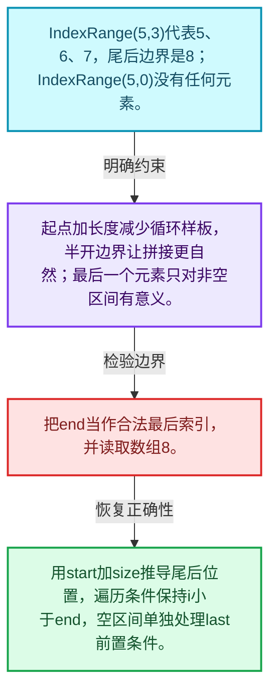
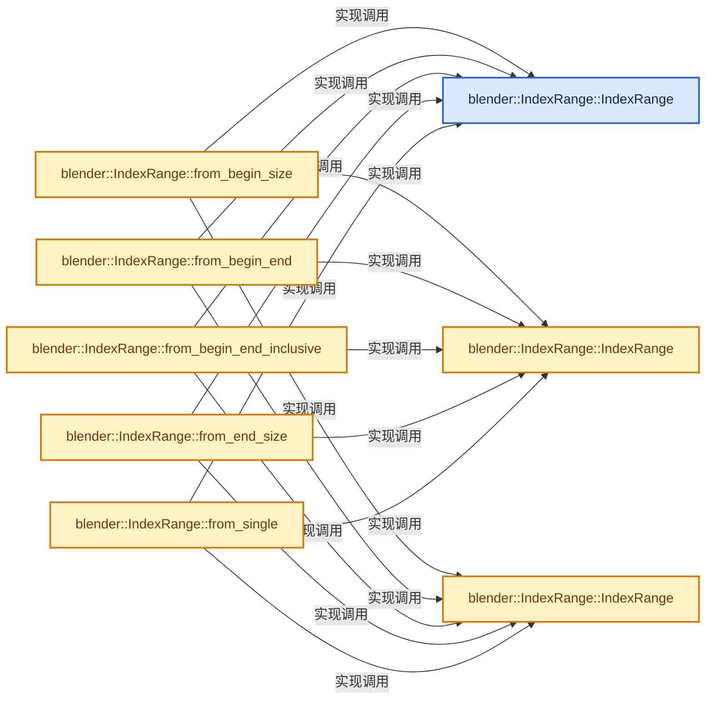
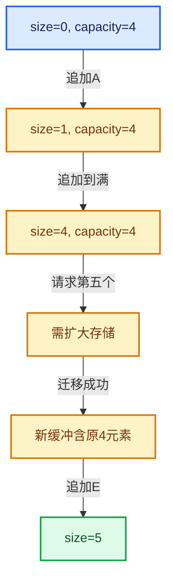

# 01-04 IndexRange连续整数区间

[方向导航](README.md) · [总目录](../README.md) · [实现索引](../%E7%AC%A6%E5%8F%B7%E4%BE%9D%E8%B5%96%E4%B8%8E%E5%AE%9E%E7%8E%B0%E7%B4%A2%E5%BC%95.md)

## 从问题到实现

如何用起点和长度表达范围而不混淆闭区间？

半开区间让大小等于end减begin；空区间合法，但first和last等操作各自仍有前置条件。

**数据模型**

IndexRange(5,3)代表5、6、7，尾后边界是8；IndexRange(5,0)没有任何元素。

**设计取舍**

起点加长度减少循环样板，半开边界让拼接更自然；最后一个元素只对非空区间有意义。

**最小反例**

把end当作合法最后索引，并读取数组8。

**推导**

用start加size推导尾后位置，遍历条件保持i小于end，空区间单独处理last前置条件。

## 阅读地图与执行推演








图中的数值推演是本方向的教学模型；实际函数之间的调用边与概念分析边分别标注，不能把概念关系当作运行时调度顺序。

## 完整源码单元与就地讲解

中文讲解直接放在相关代码旁，复杂机制在代码下展开。原文折叠区保留基准行号；不需要在行号表和函数之间来回查找。类布局可分段展示，函数实现不按固定行数切开。

### 类型布局、声明与编译条件 · BLI_index_range.hh L1—L59

<a id="t-86091874a1c0"></a>

<a id="t-caa3466d6776"></a>

`IndexRange`在这里声明的数据成员：

- `int64_t start_`
- `int64_t size_`

<!-- annotated:c6577071d1a866 -->

```cpp
/* SPDX-FileCopyrightText: 2023 Blender Authors
 *
 * SPDX-License-Identifier: GPL-2.0-or-later */

#pragma once

/** \file
 * \ingroup bli
 *
 * A `IndexRange` wraps an interval of non-negative integers. It can be used to reference
 * consecutive elements in an array. Furthermore, it can make for loops more convenient and less
 * error prone, especially when using nested loops.
 *
 * I'd argue that the second loop is more readable and less error prone than the first one. That is
 * not necessarily always the case, but often it is.
 *
 * \code{.cc}
 *  for (int64_t i = 0; i < 10; i++) {
 *    for (int64_t j = 0; j < 20; j++) {
 *       for (int64_t k = 0; k < 30; k++) {
 *
 *  for (int64_t i : IndexRange(10)) {
 *    for (int64_t j : IndexRange(20)) {
 *      for (int64_t k : IndexRange(30)) {
 * \endcode
 *
 * Some containers like Vector have an index_range() method. This will return the
 * IndexRange that contains all indices that can be used to access the container. This is
 * particularly useful when you want to iterate over the indices and the elements (much like
 * Python's enumerate(), just worse). Again, I think the second example here is better:
 *
 * \code{.cc}
 *  for (int64_t i = 0; i < my_vector_with_a_long_name.size(); i++) {
 *    do_something(i, my_vector_with_a_long_name[i]);
 *
 *  for (int64_t i : my_vector_with_a_long_name.index_range()) {
 *    do_something(i, my_vector_with_a_long_name[i]);
 * \endcode
 *
 * Ideally this could be could be even closer to Python's enumerate(). We might get that in the
 * future with newer C++ versions.
 */

#include <algorithm>
#include <iosfwd>

#include "BLI_assert.hh"
#include "BLI_random_access_iterator_mixin.hh"

namespace blender {

template<typename T> class Span;

class IndexRange {
 private:
  int64_t start_ = 0;
  int64_t size_ = 0;

 public:
```

<details>
<summary>核对原始源码：source/blender/blenlib/BLI_index_range.hh · L1—L59</summary>

<!-- original:c6577071d1a866:source/blender/blenlib/BLI_index_range.hh:1:59 -->

```cpp
/* SPDX-FileCopyrightText: 2023 Blender Authors
 *
 * SPDX-License-Identifier: GPL-2.0-or-later */

#pragma once

/** \file
 * \ingroup bli
 *
 * A `IndexRange` wraps an interval of non-negative integers. It can be used to reference
 * consecutive elements in an array. Furthermore, it can make for loops more convenient and less
 * error prone, especially when using nested loops.
 *
 * I'd argue that the second loop is more readable and less error prone than the first one. That is
 * not necessarily always the case, but often it is.
 *
 * \code{.cc}
 *  for (int64_t i = 0; i < 10; i++) {
 *    for (int64_t j = 0; j < 20; j++) {
 *       for (int64_t k = 0; k < 30; k++) {
 *
 *  for (int64_t i : IndexRange(10)) {
 *    for (int64_t j : IndexRange(20)) {
 *      for (int64_t k : IndexRange(30)) {
 * \endcode
 *
 * Some containers like Vector have an index_range() method. This will return the
 * IndexRange that contains all indices that can be used to access the container. This is
 * particularly useful when you want to iterate over the indices and the elements (much like
 * Python's enumerate(), just worse). Again, I think the second example here is better:
 *
 * \code{.cc}
 *  for (int64_t i = 0; i < my_vector_with_a_long_name.size(); i++) {
 *    do_something(i, my_vector_with_a_long_name[i]);
 *
 *  for (int64_t i : my_vector_with_a_long_name.index_range()) {
 *    do_something(i, my_vector_with_a_long_name[i]);
 * \endcode
 *
 * Ideally this could be could be even closer to Python's enumerate(). We might get that in the
 * future with newer C++ versions.
 */

#include <algorithm>
#include <iosfwd>

#include "BLI_assert.hh"
#include "BLI_random_access_iterator_mixin.hh"

namespace blender {

template<typename T> class Span;

class IndexRange {
 private:
  int64_t start_ = 0;
  int64_t size_ = 0;

 public:
```

</details>

<a id="f-137c81a537a5d604"></a>

### `blender::IndexRange::IndexRange`

实现位置：[source/blender/blenlib/BLI_index_range.hh](../../../../../source/blender/blenlib/BLI_index_range.hh) · L60—L60。

**教学注释版**

<!-- annotated:a541d4eb31d81a -->

```cpp
  constexpr IndexRange() = default;
```

<details>
<summary>核对原始源码：source/blender/blenlib/BLI_index_range.hh · L60—L60</summary>

<!-- original:a541d4eb31d81a:source/blender/blenlib/BLI_index_range.hh:60:60 -->

```cpp
  constexpr IndexRange() = default;
```

</details>

**继续追踪实现**

本实现没有需要继续展开的显式调用；检查返回表达式、对象转换和调用者前置条件。

<!-- annotated:fc678cdc765c07 -->

```cpp

```

<details>
<summary>核对原始源码：source/blender/blenlib/BLI_index_range.hh · L61—L61</summary>

<!-- original:fc678cdc765c07:source/blender/blenlib/BLI_index_range.hh:61:61 -->

```cpp

```

</details>

<a id="f-e7f519dcc417d983"></a>

### `blender::IndexRange::IndexRange`

实现位置：[source/blender/blenlib/BLI_index_range.hh](../../../../../source/blender/blenlib/BLI_index_range.hh) · L62—L65。

接口参数：

- `int64_t size`

**教学注释版**

<!-- annotated:027aa6fe0bda36 -->

```cpp
  constexpr explicit IndexRange(int64_t size) : size_(size)
  {
    BLI_assert(size >= 0);
  }
```

<details>
<summary>核对原始源码：source/blender/blenlib/BLI_index_range.hh · L62—L65</summary>

<!-- original:027aa6fe0bda36:source/blender/blenlib/BLI_index_range.hh:62:65 -->

```cpp
  constexpr explicit IndexRange(int64_t size) : size_(size)
  {
    BLI_assert(size >= 0);
  }
```

</details>

**继续追踪实现**

- `BLI_assert` → [BLI_assert · L48](%E4%BE%9D%E8%B5%96-BLI_assert-cc98e8.md#m-57a88495704d)；[BLI_assert · L63](%E4%BE%9D%E8%B5%96-BLI_assert-cc98e8.md#m-d07050020cb5)。宏定义由构建条件选择。

<!-- annotated:e502acb8980eff -->

```cpp

```

<details>
<summary>核对原始源码：source/blender/blenlib/BLI_index_range.hh · L66—L66</summary>

<!-- original:e502acb8980eff:source/blender/blenlib/BLI_index_range.hh:66:66 -->

```cpp

```

</details>

<a id="f-2d5ea7e20125ee16"></a>

### `blender::IndexRange::IndexRange`

实现位置：[source/blender/blenlib/BLI_index_range.hh](../../../../../source/blender/blenlib/BLI_index_range.hh) · L67—L71。

接口参数：

- `const int64_t start`
- `const int64_t size`

**教学注释版**

<!-- annotated:244c3bf35282a3 -->

```cpp
  constexpr IndexRange(const int64_t start, const int64_t size) : start_(start), size_(size)
  {
    BLI_assert(start >= 0);
    BLI_assert(size >= 0);
  }
```

<details>
<summary>核对原始源码：source/blender/blenlib/BLI_index_range.hh · L67—L71</summary>

<!-- original:244c3bf35282a3:source/blender/blenlib/BLI_index_range.hh:67:71 -->

```cpp
  constexpr IndexRange(const int64_t start, const int64_t size) : start_(start), size_(size)
  {
    BLI_assert(start >= 0);
    BLI_assert(size >= 0);
  }
```

</details>

**继续追踪实现**

- `BLI_assert` → [BLI_assert · L48](%E4%BE%9D%E8%B5%96-BLI_assert-cc98e8.md#m-57a88495704d)；[BLI_assert · L63](%E4%BE%9D%E8%B5%96-BLI_assert-cc98e8.md#m-d07050020cb5)。宏定义由构建条件选择。

<!-- annotated:2f03e74cbf767a -->

```cpp

```

<details>
<summary>核对原始源码：source/blender/blenlib/BLI_index_range.hh · L72—L72</summary>

<!-- original:2f03e74cbf767a:source/blender/blenlib/BLI_index_range.hh:72:72 -->

```cpp

```

</details>

<a id="f-392d3c73c80f255d"></a>

### `blender::IndexRange::from_begin_size`

实现位置：[source/blender/blenlib/BLI_index_range.hh](../../../../../source/blender/blenlib/BLI_index_range.hh) · L73—L76。

接口参数：

- `const int64_t begin`
- `const int64_t size`

**教学注释版**

<!-- annotated:7416084da4dd71 -->

```cpp
  constexpr static IndexRange from_begin_size(const int64_t begin, const int64_t size)
  {
    return IndexRange(begin, size);
  }
```

<details>
<summary>核对原始源码：source/blender/blenlib/BLI_index_range.hh · L73—L76</summary>

<!-- original:7416084da4dd71:source/blender/blenlib/BLI_index_range.hh:73:76 -->

```cpp
  constexpr static IndexRange from_begin_size(const int64_t begin, const int64_t size)
  {
    return IndexRange(begin, size);
  }
```

</details>

**结果出口**

- `return IndexRange(begin, size);`

**继续追踪实现**

- `IndexRange` → [blender::IndexRange::IndexRange · L60](04-IndexRange%E8%BF%9E%E7%BB%AD%E6%95%B4%E6%95%B0%E5%8C%BA%E9%97%B4.md#f-137c81a537a5d604)；[blender::IndexRange::IndexRange · L62](04-IndexRange%E8%BF%9E%E7%BB%AD%E6%95%B4%E6%95%B0%E5%8C%BA%E9%97%B4.md#f-e7f519dcc417d983)；[blender::IndexRange::IndexRange · L67](04-IndexRange%E8%BF%9E%E7%BB%AD%E6%95%B4%E6%95%B0%E5%8C%BA%E9%97%B4.md#f-2d5ea7e20125ee16)。同名重载需按实参类型选择。

<!-- annotated:698dcd8d7cb628 -->

```cpp

```

<details>
<summary>核对原始源码：source/blender/blenlib/BLI_index_range.hh · L77—L77</summary>

<!-- original:698dcd8d7cb628:source/blender/blenlib/BLI_index_range.hh:77:77 -->

```cpp

```

</details>

<a id="f-a523839fb9650253"></a>

### `blender::IndexRange::from_begin_end`

实现位置：[source/blender/blenlib/BLI_index_range.hh](../../../../../source/blender/blenlib/BLI_index_range.hh) · L78—L81。

接口参数：

- `const int64_t begin`
- `const int64_t end`

**教学注释版**

<!-- annotated:56cd0d9fd3dbac -->

```cpp
  constexpr static IndexRange from_begin_end(const int64_t begin, const int64_t end)
  {
    return IndexRange(begin, end - begin);
  }
```

<details>
<summary>核对原始源码：source/blender/blenlib/BLI_index_range.hh · L78—L81</summary>

<!-- original:56cd0d9fd3dbac:source/blender/blenlib/BLI_index_range.hh:78:81 -->

```cpp
  constexpr static IndexRange from_begin_end(const int64_t begin, const int64_t end)
  {
    return IndexRange(begin, end - begin);
  }
```

</details>

**结果出口**

- `return IndexRange(begin, end - begin);`

**继续追踪实现**

- `IndexRange` → [blender::IndexRange::IndexRange · L60](04-IndexRange%E8%BF%9E%E7%BB%AD%E6%95%B4%E6%95%B0%E5%8C%BA%E9%97%B4.md#f-137c81a537a5d604)；[blender::IndexRange::IndexRange · L62](04-IndexRange%E8%BF%9E%E7%BB%AD%E6%95%B4%E6%95%B0%E5%8C%BA%E9%97%B4.md#f-e7f519dcc417d983)；[blender::IndexRange::IndexRange · L67](04-IndexRange%E8%BF%9E%E7%BB%AD%E6%95%B4%E6%95%B0%E5%8C%BA%E9%97%B4.md#f-2d5ea7e20125ee16)。同名重载需按实参类型选择。

<!-- annotated:73430192e86e67 -->

```cpp

```

<details>
<summary>核对原始源码：source/blender/blenlib/BLI_index_range.hh · L82—L82</summary>

<!-- original:73430192e86e67:source/blender/blenlib/BLI_index_range.hh:82:82 -->

```cpp

```

</details>

<a id="f-66cc5b933b552ea1"></a>

### `blender::IndexRange::from_begin_end_inclusive`

实现位置：[source/blender/blenlib/BLI_index_range.hh](../../../../../source/blender/blenlib/BLI_index_range.hh) · L83—L86。

接口参数：

- `const int64_t begin`
- `const int64_t last`

**教学注释版**

<!-- annotated:0096f3b4152e66 -->

```cpp
  constexpr static IndexRange from_begin_end_inclusive(const int64_t begin, const int64_t last)
  {
    return IndexRange(begin, last - begin + 1);
  }
```

<details>
<summary>核对原始源码：source/blender/blenlib/BLI_index_range.hh · L83—L86</summary>

<!-- original:0096f3b4152e66:source/blender/blenlib/BLI_index_range.hh:83:86 -->

```cpp
  constexpr static IndexRange from_begin_end_inclusive(const int64_t begin, const int64_t last)
  {
    return IndexRange(begin, last - begin + 1);
  }
```

</details>

**结果出口**

- `return IndexRange(begin, last - begin + 1);`

**继续追踪实现**

- `IndexRange` → [blender::IndexRange::IndexRange · L60](04-IndexRange%E8%BF%9E%E7%BB%AD%E6%95%B4%E6%95%B0%E5%8C%BA%E9%97%B4.md#f-137c81a537a5d604)；[blender::IndexRange::IndexRange · L62](04-IndexRange%E8%BF%9E%E7%BB%AD%E6%95%B4%E6%95%B0%E5%8C%BA%E9%97%B4.md#f-e7f519dcc417d983)；[blender::IndexRange::IndexRange · L67](04-IndexRange%E8%BF%9E%E7%BB%AD%E6%95%B4%E6%95%B0%E5%8C%BA%E9%97%B4.md#f-2d5ea7e20125ee16)。同名重载需按实参类型选择。

<!-- annotated:b74dcfc1f7b37a -->

```cpp

```

<details>
<summary>核对原始源码：source/blender/blenlib/BLI_index_range.hh · L87—L87</summary>

<!-- original:b74dcfc1f7b37a:source/blender/blenlib/BLI_index_range.hh:87:87 -->

```cpp

```

</details>

<a id="f-14a2146987e7c92d"></a>

### `blender::IndexRange::from_end_size`

实现位置：[source/blender/blenlib/BLI_index_range.hh](../../../../../source/blender/blenlib/BLI_index_range.hh) · L88—L91。

接口参数：

- `const int64_t end`
- `const int64_t size`

**教学注释版**

<!-- annotated:0e571d1cfa331a -->

```cpp
  constexpr static IndexRange from_end_size(const int64_t end, const int64_t size)
  {
    return IndexRange(end - size, size);
  }
```

<details>
<summary>核对原始源码：source/blender/blenlib/BLI_index_range.hh · L88—L91</summary>

<!-- original:0e571d1cfa331a:source/blender/blenlib/BLI_index_range.hh:88:91 -->

```cpp
  constexpr static IndexRange from_end_size(const int64_t end, const int64_t size)
  {
    return IndexRange(end - size, size);
  }
```

</details>

**结果出口**

- `return IndexRange(end - size, size);`

**继续追踪实现**

- `IndexRange` → [blender::IndexRange::IndexRange · L60](04-IndexRange%E8%BF%9E%E7%BB%AD%E6%95%B4%E6%95%B0%E5%8C%BA%E9%97%B4.md#f-137c81a537a5d604)；[blender::IndexRange::IndexRange · L62](04-IndexRange%E8%BF%9E%E7%BB%AD%E6%95%B4%E6%95%B0%E5%8C%BA%E9%97%B4.md#f-e7f519dcc417d983)；[blender::IndexRange::IndexRange · L67](04-IndexRange%E8%BF%9E%E7%BB%AD%E6%95%B4%E6%95%B0%E5%8C%BA%E9%97%B4.md#f-2d5ea7e20125ee16)。同名重载需按实参类型选择。

<!-- annotated:bc156823ccd5c1 -->

```cpp

```

<details>
<summary>核对原始源码：source/blender/blenlib/BLI_index_range.hh · L92—L92</summary>

<!-- original:bc156823ccd5c1:source/blender/blenlib/BLI_index_range.hh:92:92 -->

```cpp

```

</details>

<a id="f-c53911354f78d5b0"></a>

### `blender::IndexRange::from_single`

实现位置：[source/blender/blenlib/BLI_index_range.hh](../../../../../source/blender/blenlib/BLI_index_range.hh) · L93—L96。

接口参数：

- `const int64_t index`

**教学注释版**

<!-- annotated:7dbcf01b1d50e1 -->

```cpp
  constexpr static IndexRange from_single(const int64_t index)
  {
    return IndexRange(index, 1);
  }
```

<details>
<summary>核对原始源码：source/blender/blenlib/BLI_index_range.hh · L93—L96</summary>

<!-- original:7dbcf01b1d50e1:source/blender/blenlib/BLI_index_range.hh:93:96 -->

```cpp
  constexpr static IndexRange from_single(const int64_t index)
  {
    return IndexRange(index, 1);
  }
```

</details>

**结果出口**

- `return IndexRange(index, 1);`

**继续追踪实现**

- `IndexRange` → [blender::IndexRange::IndexRange · L60](04-IndexRange%E8%BF%9E%E7%BB%AD%E6%95%B4%E6%95%B0%E5%8C%BA%E9%97%B4.md#f-137c81a537a5d604)；[blender::IndexRange::IndexRange · L62](04-IndexRange%E8%BF%9E%E7%BB%AD%E6%95%B4%E6%95%B0%E5%8C%BA%E9%97%B4.md#f-e7f519dcc417d983)；[blender::IndexRange::IndexRange · L67](04-IndexRange%E8%BF%9E%E7%BB%AD%E6%95%B4%E6%95%B0%E5%8C%BA%E9%97%B4.md#f-2d5ea7e20125ee16)。同名重载需按实参类型选择。

### 类型布局、声明与编译条件 · BLI_index_range.hh L97—L107

<a id="t-c336819199b1"></a>

`Iterator`在这里声明的数据成员：

- `int64_t current_`

<!-- annotated:1dc091b2a496c4 -->

```cpp

  class Iterator : public iterator::RandomAccessIteratorMixin<Iterator> {
   public:
    using value_type = int64_t;
    using pointer = const int64_t *;
    using reference = int64_t;

   private:
    int64_t current_;

   public:
```

<details>
<summary>核对原始源码：source/blender/blenlib/BLI_index_range.hh · L97—L107</summary>

<!-- original:1dc091b2a496c4:source/blender/blenlib/BLI_index_range.hh:97:107 -->

```cpp

  class Iterator : public iterator::RandomAccessIteratorMixin<Iterator> {
   public:
    using value_type = int64_t;
    using pointer = const int64_t *;
    using reference = int64_t;

   private:
    int64_t current_;

   public:
```

</details>

<a id="f-27f6725fdde0e062"></a>

### `blender::IndexRange::Iterator::Iterator`

实现位置：[source/blender/blenlib/BLI_index_range.hh](../../../../../source/blender/blenlib/BLI_index_range.hh) · L108—L108。

接口参数：

- `int64_t current`

**教学注释版**

<!-- annotated:ec6a15a8ae081a -->

```cpp
    constexpr explicit Iterator(int64_t current) : current_(current) {}
```

<details>
<summary>核对原始源码：source/blender/blenlib/BLI_index_range.hh · L108—L108</summary>

<!-- original:ec6a15a8ae081a:source/blender/blenlib/BLI_index_range.hh:108:108 -->

```cpp
    constexpr explicit Iterator(int64_t current) : current_(current) {}
```

</details>

**继续追踪实现**

本实现没有需要继续展开的显式调用；检查返回表达式、对象转换和调用者前置条件。

<!-- annotated:d31888dbdda1f1 -->

```cpp

```

<details>
<summary>核对原始源码：source/blender/blenlib/BLI_index_range.hh · L109—L109</summary>

<!-- original:d31888dbdda1f1:source/blender/blenlib/BLI_index_range.hh:109:109 -->

```cpp

```

</details>

<a id="f-c5f5c826cbb273d8"></a>

### `blender::IndexRange::Iterator::operator*`

实现位置：[source/blender/blenlib/BLI_index_range.hh](../../../../../source/blender/blenlib/BLI_index_range.hh) · L110—L113。

**教学注释版**

<!-- annotated:aa591934325ef5 -->

```cpp
    constexpr int64_t operator*() const
    {
      return current_;
    }
```

<details>
<summary>核对原始源码：source/blender/blenlib/BLI_index_range.hh · L110—L113</summary>

<!-- original:aa591934325ef5:source/blender/blenlib/BLI_index_range.hh:110:113 -->

```cpp
    constexpr int64_t operator*() const
    {
      return current_;
    }
```

</details>

**结果出口**

- `return current_;`

**继续追踪实现**

本实现没有需要继续展开的显式调用；检查返回表达式、对象转换和调用者前置条件。

<!-- annotated:61bd82e47724fa -->

```cpp

```

<details>
<summary>核对原始源码：source/blender/blenlib/BLI_index_range.hh · L114—L114</summary>

<!-- original:61bd82e47724fa:source/blender/blenlib/BLI_index_range.hh:114:114 -->

```cpp

```

</details>

<a id="f-fee52fe271750873"></a>

### `blender::IndexRange::Iterator::iter_prop`

实现位置：[source/blender/blenlib/BLI_index_range.hh](../../../../../source/blender/blenlib/BLI_index_range.hh) · L115—L118。

**教学注释版**

<!-- annotated:f9b7ec1d0dbb59 -->

```cpp
    const int64_t &iter_prop() const
    {
      return current_;
    }
```

<details>
<summary>核对原始源码：source/blender/blenlib/BLI_index_range.hh · L115—L118</summary>

<!-- original:f9b7ec1d0dbb59:source/blender/blenlib/BLI_index_range.hh:115:118 -->

```cpp
    const int64_t &iter_prop() const
    {
      return current_;
    }
```

</details>

**结果出口**

- `return current_;`

**继续追踪实现**

本实现没有需要继续展开的显式调用；检查返回表达式、对象转换和调用者前置条件。

### 类型布局、声明与编译条件 · BLI_index_range.hh L119—L120

<!-- annotated:a5264141277317 -->

```cpp
  };

```

<details>
<summary>核对原始源码：source/blender/blenlib/BLI_index_range.hh · L119—L120</summary>

<!-- original:a5264141277317:source/blender/blenlib/BLI_index_range.hh:119:120 -->

```cpp
  };

```

</details>

<a id="f-1ea3c945dec55d0a"></a>

### `blender::IndexRange::begin`

实现位置：[source/blender/blenlib/BLI_index_range.hh](../../../../../source/blender/blenlib/BLI_index_range.hh) · L121—L124。

**教学注释版**

<!-- annotated:bd2436598d4c87 -->

```cpp
  constexpr Iterator begin() const
  {
    return Iterator(start_);
  }
```

<details>
<summary>核对原始源码：source/blender/blenlib/BLI_index_range.hh · L121—L124</summary>

<!-- original:bd2436598d4c87:source/blender/blenlib/BLI_index_range.hh:121:124 -->

```cpp
  constexpr Iterator begin() const
  {
    return Iterator(start_);
  }
```

</details>

**结果出口**

- `return Iterator(start_);`

**继续追踪实现**

- `Iterator` → [blender::IndexRange::Iterator::Iterator · L108](04-IndexRange%E8%BF%9E%E7%BB%AD%E6%95%B4%E6%95%B0%E5%8C%BA%E9%97%B4.md#f-27f6725fdde0e062)。

<!-- annotated:bad899c9fc291f -->

```cpp

```

<details>
<summary>核对原始源码：source/blender/blenlib/BLI_index_range.hh · L125—L125</summary>

<!-- original:bad899c9fc291f:source/blender/blenlib/BLI_index_range.hh:125:125 -->

```cpp

```

</details>

<a id="f-119dd529d7090e64"></a>

### `blender::IndexRange::end`

实现位置：[source/blender/blenlib/BLI_index_range.hh](../../../../../source/blender/blenlib/BLI_index_range.hh) · L126—L129。

**教学注释版**

<!-- annotated:18a51a7e26fcd4 -->

```cpp
  constexpr Iterator end() const
  {
    return Iterator(start_ + size_);
  }
```

<details>
<summary>核对原始源码：source/blender/blenlib/BLI_index_range.hh · L126—L129</summary>

<!-- original:18a51a7e26fcd4:source/blender/blenlib/BLI_index_range.hh:126:129 -->

```cpp
  constexpr Iterator end() const
  {
    return Iterator(start_ + size_);
  }
```

</details>

**结果出口**

- `return Iterator(start_ + size_);`

**继续追踪实现**

- `Iterator` → [blender::IndexRange::Iterator::Iterator · L108](04-IndexRange%E8%BF%9E%E7%BB%AD%E6%95%B4%E6%95%B0%E5%8C%BA%E9%97%B4.md#f-27f6725fdde0e062)。

### 类型布局、声明与编译条件 · BLI_index_range.hh L130—L133

<!-- annotated:c035ead09635f5 -->

```cpp

  /**
   * Access an element in the range.
   */
```

<details>
<summary>核对原始源码：source/blender/blenlib/BLI_index_range.hh · L130—L133</summary>

<!-- original:c035ead09635f5:source/blender/blenlib/BLI_index_range.hh:130:133 -->

```cpp

  /**
   * Access an element in the range.
   */
```

</details>

<a id="f-7369b205de195454"></a>

### `blender::IndexRange::operator[]`

把分组编号映射成相邻偏移定义的区间。

实现位置：[source/blender/blenlib/BLI_index_range.hh](../../../../../source/blender/blenlib/BLI_index_range.hh) · L134—L139。

接口参数：

- `int64_t index`

**教学注释版**

<!-- annotated:98a0dc607bf962 -->

```cpp
  constexpr int64_t operator[](int64_t index) const
  {
    BLI_assert(index >= 0);
    // [讲解] this->size：读取连续区间或分组的边界信息。
    BLI_assert(index < this->size());
    return start_ + index;
  }
```

<details>
<summary>核对原始源码：source/blender/blenlib/BLI_index_range.hh · L134—L139</summary>

<!-- original:98a0dc607bf962:source/blender/blenlib/BLI_index_range.hh:134:139 -->

```cpp
  constexpr int64_t operator[](int64_t index) const
  {
    BLI_assert(index >= 0);
    BLI_assert(index < this->size());
    return start_ + index;
  }
```

</details>

**接口与不变量**

offset[i+1]减offset[i]得到组长度，允许空组；编号和组内元素索引不要混用。

**结果出口**

- `return start_ + index;`

**继续追踪实现**

- `BLI_assert` → [BLI_assert · L48](%E4%BE%9D%E8%B5%96-BLI_assert-cc98e8.md#m-57a88495704d)；[BLI_assert · L63](%E4%BE%9D%E8%B5%96-BLI_assert-cc98e8.md#m-d07050020cb5)。宏定义由构建条件选择。
- `this->size` → [blender::IndexRange::size · L156](04-IndexRange%E8%BF%9E%E7%BB%AD%E6%95%B4%E6%95%B0%E5%8C%BA%E9%97%B4.md#f-05f66c3ebb2fdfec)。

### 类型布局、声明与编译条件 · BLI_index_range.hh L140—L143

<!-- annotated:4d07fe994883f6 -->

```cpp

  /**
   * Two ranges compare equal when they contain the same numbers.
   */
```

<details>
<summary>核对原始源码：source/blender/blenlib/BLI_index_range.hh · L140—L143</summary>

<!-- original:4d07fe994883f6:source/blender/blenlib/BLI_index_range.hh:140:143 -->

```cpp

  /**
   * Two ranges compare equal when they contain the same numbers.
   */
```

</details>

<a id="f-65eebc6a24647e81"></a>

### `blender::IndexRange::operator==`

实现位置：[source/blender/blenlib/BLI_index_range.hh](../../../../../source/blender/blenlib/BLI_index_range.hh) · L144—L147。

接口参数：

- `IndexRange a`
- `IndexRange b`

**教学注释版**

<!-- annotated:2d0442d9799ceb -->

```cpp
  constexpr friend bool operator==(IndexRange a, IndexRange b)
  {
    return (a.size_ == b.size_) && (a.start_ == b.start_ || a.size_ == 0);
  }
```

<details>
<summary>核对原始源码：source/blender/blenlib/BLI_index_range.hh · L144—L147</summary>

<!-- original:2d0442d9799ceb:source/blender/blenlib/BLI_index_range.hh:144:147 -->

```cpp
  constexpr friend bool operator==(IndexRange a, IndexRange b)
  {
    return (a.size_ == b.size_) && (a.start_ == b.start_ || a.size_ == 0);
  }
```

</details>

**结果出口**

- `return (a.size_ == b.size_) && (a.start_ == b.start_ || a.size_ == 0);`

**继续追踪实现**

本实现没有需要继续展开的显式调用；检查返回表达式、对象转换和调用者前置条件。

<a id="f-9d6d8d6ebe05411a"></a>

### `blender::IndexRange::operator!=`

实现位置：[source/blender/blenlib/BLI_index_range.hh](../../../../../source/blender/blenlib/BLI_index_range.hh) · L148—L151。

接口参数：

- `IndexRange a`
- `IndexRange b`

**教学注释版**

<!-- annotated:cdc4cb3cc22a81 -->

```cpp
  constexpr friend bool operator!=(IndexRange a, IndexRange b)
  {
    return !(a == b);
  }
```

<details>
<summary>核对原始源码：source/blender/blenlib/BLI_index_range.hh · L148—L151</summary>

<!-- original:cdc4cb3cc22a81:source/blender/blenlib/BLI_index_range.hh:148:151 -->

```cpp
  constexpr friend bool operator!=(IndexRange a, IndexRange b)
  {
    return !(a == b);
  }
```

</details>

**结果出口**

- `return !(a == b);`

**继续追踪实现**

本实现没有需要继续展开的显式调用；检查返回表达式、对象转换和调用者前置条件。

### 类型布局、声明与编译条件 · BLI_index_range.hh L152—L155

<!-- annotated:0fa627872d270b -->

```cpp

  /**
   * Get the amount of numbers in the range.
   */
```

<details>
<summary>核对原始源码：source/blender/blenlib/BLI_index_range.hh · L152—L155</summary>

<!-- original:0fa627872d270b:source/blender/blenlib/BLI_index_range.hh:152:155 -->

```cpp

  /**
   * Get the amount of numbers in the range.
   */
```

</details>

<a id="f-05f66c3ebb2fdfec"></a>

### `blender::IndexRange::size`

读取连续区间或分组的边界信息。

实现位置：[source/blender/blenlib/BLI_index_range.hh](../../../../../source/blender/blenlib/BLI_index_range.hh) · L156—L159。

**教学注释版**

<!-- annotated:465ee0fc00d073 -->

```cpp
  constexpr int64_t size() const
  {
    return size_;
  }
```

<details>
<summary>核对原始源码：source/blender/blenlib/BLI_index_range.hh · L156—L159</summary>

<!-- original:465ee0fc00d073:source/blender/blenlib/BLI_index_range.hh:156:159 -->

```cpp
  constexpr int64_t size() const
  {
    return size_;
  }
```

</details>

**接口与不变量**

尾后边界不是最后元素；OffsetIndices组数与底层边界数组长度差一个末边界。

**结果出口**

- `return size_;`

**继续追踪实现**

本实现没有需要继续展开的显式调用；检查返回表达式、对象转换和调用者前置条件。

<!-- annotated:2e26d12b1d255e -->

```cpp

```

<details>
<summary>核对原始源码：source/blender/blenlib/BLI_index_range.hh · L160—L160</summary>

<!-- original:2e26d12b1d255e:source/blender/blenlib/BLI_index_range.hh:160:160 -->

```cpp

```

</details>

<a id="f-fd83072b4b81bce5"></a>

### `blender::IndexRange::index_range`

实现位置：[source/blender/blenlib/BLI_index_range.hh](../../../../../source/blender/blenlib/BLI_index_range.hh) · L161—L164。

**教学注释版**

<!-- annotated:0dcb253dc47475 -->

```cpp
  constexpr IndexRange index_range() const
  {
    return IndexRange(size_);
  }
```

<details>
<summary>核对原始源码：source/blender/blenlib/BLI_index_range.hh · L161—L164</summary>

<!-- original:0dcb253dc47475:source/blender/blenlib/BLI_index_range.hh:161:164 -->

```cpp
  constexpr IndexRange index_range() const
  {
    return IndexRange(size_);
  }
```

</details>

**结果出口**

- `return IndexRange(size_);`

**继续追踪实现**

- `IndexRange` → [blender::IndexRange::IndexRange · L60](04-IndexRange%E8%BF%9E%E7%BB%AD%E6%95%B4%E6%95%B0%E5%8C%BA%E9%97%B4.md#f-137c81a537a5d604)；[blender::IndexRange::IndexRange · L62](04-IndexRange%E8%BF%9E%E7%BB%AD%E6%95%B4%E6%95%B0%E5%8C%BA%E9%97%B4.md#f-e7f519dcc417d983)；[blender::IndexRange::IndexRange · L67](04-IndexRange%E8%BF%9E%E7%BB%AD%E6%95%B4%E6%95%B0%E5%8C%BA%E9%97%B4.md#f-2d5ea7e20125ee16)。同名重载需按实参类型选择。

### 类型布局、声明与编译条件 · BLI_index_range.hh L165—L168

<!-- annotated:58b0a0e06e9f02 -->

```cpp

  /**
   * Returns true if the size is zero.
   */
```

<details>
<summary>核对原始源码：source/blender/blenlib/BLI_index_range.hh · L165—L168</summary>

<!-- original:58b0a0e06e9f02:source/blender/blenlib/BLI_index_range.hh:165:168 -->

```cpp

  /**
   * Returns true if the size is zero.
   */
```

</details>

<a id="f-9501e070be01ff71"></a>

### `blender::IndexRange::is_empty`

读取连续区间或分组的边界信息。

实现位置：[source/blender/blenlib/BLI_index_range.hh](../../../../../source/blender/blenlib/BLI_index_range.hh) · L169—L172。

**教学注释版**

<!-- annotated:47bcbc44702da0 -->

```cpp
  constexpr bool is_empty() const
  {
    return size_ == 0;
  }
```

<details>
<summary>核对原始源码：source/blender/blenlib/BLI_index_range.hh · L169—L172</summary>

<!-- original:47bcbc44702da0:source/blender/blenlib/BLI_index_range.hh:169:172 -->

```cpp
  constexpr bool is_empty() const
  {
    return size_ == 0;
  }
```

</details>

**接口与不变量**

尾后边界不是最后元素；OffsetIndices组数与底层边界数组长度差一个末边界。

**结果出口**

- `return size_ == 0;`

**继续追踪实现**

本实现没有需要继续展开的显式调用；检查返回表达式、对象转换和调用者前置条件。

### 类型布局、声明与编译条件 · BLI_index_range.hh L173—L176

<!-- annotated:a7c60014cad5e4 -->

```cpp

  /**
   * Creates a new index range with the same beginning but a different end.
   */
```

<details>
<summary>核对原始源码：source/blender/blenlib/BLI_index_range.hh · L173—L176</summary>

<!-- original:a7c60014cad5e4:source/blender/blenlib/BLI_index_range.hh:173:176 -->

```cpp

  /**
   * Creates a new index range with the same beginning but a different end.
   */
```

</details>

<a id="f-834d1751c4701574"></a>

### `blender::IndexRange::with_new_end`

实现位置：[source/blender/blenlib/BLI_index_range.hh](../../../../../source/blender/blenlib/BLI_index_range.hh) · L177—L180。

接口参数：

- `const int64_t new_end`

**教学注释版**

<!-- annotated:7386efc99c9a8f -->

```cpp
  constexpr IndexRange with_new_end(const int64_t new_end) const
  {
    return IndexRange::from_begin_end(start_, new_end);
  }
```

<details>
<summary>核对原始源码：source/blender/blenlib/BLI_index_range.hh · L177—L180</summary>

<!-- original:7386efc99c9a8f:source/blender/blenlib/BLI_index_range.hh:177:180 -->

```cpp
  constexpr IndexRange with_new_end(const int64_t new_end) const
  {
    return IndexRange::from_begin_end(start_, new_end);
  }
```

</details>

**结果出口**

- `return IndexRange::from_begin_end(start_, new_end);`

**继续追踪实现**

- `IndexRange::from_begin_end` → [blender::IndexRange::from_begin_end · L78](04-IndexRange%E8%BF%9E%E7%BB%AD%E6%95%B4%E6%95%B0%E5%8C%BA%E9%97%B4.md#f-a523839fb9650253)。

### 类型布局、声明与编译条件 · BLI_index_range.hh L181—L184

<!-- annotated:f7832d3649bafe -->

```cpp

  /**
   * Create a new range starting at the end of the current one.
   */
```

<details>
<summary>核对原始源码：source/blender/blenlib/BLI_index_range.hh · L181—L184</summary>

<!-- original:f7832d3649bafe:source/blender/blenlib/BLI_index_range.hh:181:184 -->

```cpp

  /**
   * Create a new range starting at the end of the current one.
   */
```

</details>

<a id="f-33b01201b3ef9092"></a>

### `blender::IndexRange::after`

实现位置：[source/blender/blenlib/BLI_index_range.hh](../../../../../source/blender/blenlib/BLI_index_range.hh) · L185—L189。

接口参数：

- `int64_t n`

**教学注释版**

<!-- annotated:4149fed84d3698 -->

```cpp
  constexpr IndexRange after(int64_t n) const
  {
    BLI_assert(n >= 0);
    return IndexRange(start_ + size_, n);
  }
```

<details>
<summary>核对原始源码：source/blender/blenlib/BLI_index_range.hh · L185—L189</summary>

<!-- original:4149fed84d3698:source/blender/blenlib/BLI_index_range.hh:185:189 -->

```cpp
  constexpr IndexRange after(int64_t n) const
  {
    BLI_assert(n >= 0);
    return IndexRange(start_ + size_, n);
  }
```

</details>

**结果出口**

- `return IndexRange(start_ + size_, n);`

**继续追踪实现**

- `BLI_assert` → [BLI_assert · L48](%E4%BE%9D%E8%B5%96-BLI_assert-cc98e8.md#m-57a88495704d)；[BLI_assert · L63](%E4%BE%9D%E8%B5%96-BLI_assert-cc98e8.md#m-d07050020cb5)。宏定义由构建条件选择。
- `IndexRange` → [blender::IndexRange::IndexRange · L60](04-IndexRange%E8%BF%9E%E7%BB%AD%E6%95%B4%E6%95%B0%E5%8C%BA%E9%97%B4.md#f-137c81a537a5d604)；[blender::IndexRange::IndexRange · L62](04-IndexRange%E8%BF%9E%E7%BB%AD%E6%95%B4%E6%95%B0%E5%8C%BA%E9%97%B4.md#f-e7f519dcc417d983)；[blender::IndexRange::IndexRange · L67](04-IndexRange%E8%BF%9E%E7%BB%AD%E6%95%B4%E6%95%B0%E5%8C%BA%E9%97%B4.md#f-2d5ea7e20125ee16)。同名重载需按实参类型选择。

### 类型布局、声明与编译条件 · BLI_index_range.hh L190—L193

<!-- annotated:eb3e59d228cbb5 -->

```cpp

  /**
   * Create a new range that ends at the start of the current one.
   */
```

<details>
<summary>核对原始源码：source/blender/blenlib/BLI_index_range.hh · L190—L193</summary>

<!-- original:eb3e59d228cbb5:source/blender/blenlib/BLI_index_range.hh:190:193 -->

```cpp

  /**
   * Create a new range that ends at the start of the current one.
   */
```

</details>

<a id="f-4b046e8c0c80c95a"></a>

### `blender::IndexRange::before`

实现位置：[source/blender/blenlib/BLI_index_range.hh](../../../../../source/blender/blenlib/BLI_index_range.hh) · L194—L198。

接口参数：

- `int64_t n`

**教学注释版**

<!-- annotated:526717a086e609 -->

```cpp
  constexpr IndexRange before(int64_t n) const
  {
    BLI_assert(n >= 0);
    return IndexRange(start_ - n, n);
  }
```

<details>
<summary>核对原始源码：source/blender/blenlib/BLI_index_range.hh · L194—L198</summary>

<!-- original:526717a086e609:source/blender/blenlib/BLI_index_range.hh:194:198 -->

```cpp
  constexpr IndexRange before(int64_t n) const
  {
    BLI_assert(n >= 0);
    return IndexRange(start_ - n, n);
  }
```

</details>

**结果出口**

- `return IndexRange(start_ - n, n);`

**继续追踪实现**

- `BLI_assert` → [BLI_assert · L48](%E4%BE%9D%E8%B5%96-BLI_assert-cc98e8.md#m-57a88495704d)；[BLI_assert · L63](%E4%BE%9D%E8%B5%96-BLI_assert-cc98e8.md#m-d07050020cb5)。宏定义由构建条件选择。
- `IndexRange` → [blender::IndexRange::IndexRange · L60](04-IndexRange%E8%BF%9E%E7%BB%AD%E6%95%B4%E6%95%B0%E5%8C%BA%E9%97%B4.md#f-137c81a537a5d604)；[blender::IndexRange::IndexRange · L62](04-IndexRange%E8%BF%9E%E7%BB%AD%E6%95%B4%E6%95%B0%E5%8C%BA%E9%97%B4.md#f-e7f519dcc417d983)；[blender::IndexRange::IndexRange · L67](04-IndexRange%E8%BF%9E%E7%BB%AD%E6%95%B4%E6%95%B0%E5%8C%BA%E9%97%B4.md#f-2d5ea7e20125ee16)。同名重载需按实参类型选择。

### 类型布局、声明与编译条件 · BLI_index_range.hh L199—L203

<!-- annotated:b75a4e446b8968 -->

```cpp

  /**
   * Get the first element in the range.
   * Asserts when the range is empty.
   */
```

<details>
<summary>核对原始源码：source/blender/blenlib/BLI_index_range.hh · L199—L203</summary>

<!-- original:b75a4e446b8968:source/blender/blenlib/BLI_index_range.hh:199:203 -->

```cpp

  /**
   * Get the first element in the range.
   * Asserts when the range is empty.
   */
```

</details>

<a id="f-ab443c94e531befa"></a>

### `blender::IndexRange::first`

读取范围两端的有效索引或值。

实现位置：[source/blender/blenlib/BLI_index_range.hh](../../../../../source/blender/blenlib/BLI_index_range.hh) · L204—L208。

**教学注释版**

<!-- annotated:7402929e004f34 -->

```cpp
  constexpr int64_t first() const
  {
    // [讲解] this->size：读取连续区间或分组的边界信息。
    BLI_assert(this->size() > 0);
    return start_;
  }
```

<details>
<summary>核对原始源码：source/blender/blenlib/BLI_index_range.hh · L204—L208</summary>

<!-- original:7402929e004f34:source/blender/blenlib/BLI_index_range.hh:204:208 -->

```cpp
  constexpr int64_t first() const
  {
    BLI_assert(this->size() > 0);
    return start_;
  }
```

</details>

**接口与不变量**

空范围不具备普通首末元素，调用者需要先满足非空约定。

**结果出口**

- `return start_;`

**继续追踪实现**

- `BLI_assert` → [BLI_assert · L48](%E4%BE%9D%E8%B5%96-BLI_assert-cc98e8.md#m-57a88495704d)；[BLI_assert · L63](%E4%BE%9D%E8%B5%96-BLI_assert-cc98e8.md#m-d07050020cb5)。宏定义由构建条件选择。
- `this->size` → [blender::IndexRange::size · L156](04-IndexRange%E8%BF%9E%E7%BB%AD%E6%95%B4%E6%95%B0%E5%8C%BA%E9%97%B4.md#f-05f66c3ebb2fdfec)。

### 类型布局、声明与编译条件 · BLI_index_range.hh L209—L213

<!-- annotated:458792804f2022 -->

```cpp

  /**
   * Get the nth last element in the range.
   * Asserts when the range is empty or when n is negative.
   */
```

<details>
<summary>核对原始源码：source/blender/blenlib/BLI_index_range.hh · L209—L213</summary>

<!-- original:458792804f2022:source/blender/blenlib/BLI_index_range.hh:209:213 -->

```cpp

  /**
   * Get the nth last element in the range.
   * Asserts when the range is empty or when n is negative.
   */
```

</details>

<a id="f-66896c6351a40de1"></a>

### `blender::IndexRange::last`

读取范围两端的有效索引或值。

实现位置：[source/blender/blenlib/BLI_index_range.hh](../../../../../source/blender/blenlib/BLI_index_range.hh) · L214—L220。

接口参数：

- `const int64_t n = 0`

**教学注释版**

<!-- annotated:328a267ef53028 -->

```cpp
  constexpr int64_t last(const int64_t n = 0) const
  {
    BLI_assert(n >= 0);
    BLI_assert(n < size_);
    // [讲解] this->size：读取连续区间或分组的边界信息。
    BLI_assert(this->size() > 0);
    return start_ + size_ - 1 - n;
  }
```

<details>
<summary>核对原始源码：source/blender/blenlib/BLI_index_range.hh · L214—L220</summary>

<!-- original:328a267ef53028:source/blender/blenlib/BLI_index_range.hh:214:220 -->

```cpp
  constexpr int64_t last(const int64_t n = 0) const
  {
    BLI_assert(n >= 0);
    BLI_assert(n < size_);
    BLI_assert(this->size() > 0);
    return start_ + size_ - 1 - n;
  }
```

</details>

**接口与不变量**

空范围不具备普通首末元素，调用者需要先满足非空约定。

**结果出口**

- `return start_ + size_ - 1 - n;`

**继续追踪实现**

- `BLI_assert` → [BLI_assert · L48](%E4%BE%9D%E8%B5%96-BLI_assert-cc98e8.md#m-57a88495704d)；[BLI_assert · L63](%E4%BE%9D%E8%B5%96-BLI_assert-cc98e8.md#m-d07050020cb5)。宏定义由构建条件选择。
- `this->size` → [blender::IndexRange::size · L156](04-IndexRange%E8%BF%9E%E7%BB%AD%E6%95%B4%E6%95%B0%E5%8C%BA%E9%97%B4.md#f-05f66c3ebb2fdfec)。

### 类型布局、声明与编译条件 · BLI_index_range.hh L221—L225

<!-- annotated:3ea1937d4c8c76 -->

```cpp

  /**
   * Get the element one before the beginning. The returned value is undefined when the range is
   * empty, and the range must start after zero already.
   */
```

<details>
<summary>核对原始源码：source/blender/blenlib/BLI_index_range.hh · L221—L225</summary>

<!-- original:3ea1937d4c8c76:source/blender/blenlib/BLI_index_range.hh:221:225 -->

```cpp

  /**
   * Get the element one before the beginning. The returned value is undefined when the range is
   * empty, and the range must start after zero already.
   */
```

</details>

<a id="f-d0a8ffd393a2929e"></a>

### `blender::IndexRange::one_before_start`

实现位置：[source/blender/blenlib/BLI_index_range.hh](../../../../../source/blender/blenlib/BLI_index_range.hh) · L226—L230。

**教学注释版**

<!-- annotated:9742f02dd14a7c -->

```cpp
  constexpr int64_t one_before_start() const
  {
    BLI_assert(start_ > 0);
    return start_ - 1;
  }
```

<details>
<summary>核对原始源码：source/blender/blenlib/BLI_index_range.hh · L226—L230</summary>

<!-- original:9742f02dd14a7c:source/blender/blenlib/BLI_index_range.hh:226:230 -->

```cpp
  constexpr int64_t one_before_start() const
  {
    BLI_assert(start_ > 0);
    return start_ - 1;
  }
```

</details>

**结果出口**

- `return start_ - 1;`

**继续追踪实现**

- `BLI_assert` → [BLI_assert · L48](%E4%BE%9D%E8%B5%96-BLI_assert-cc98e8.md#m-57a88495704d)；[BLI_assert · L63](%E4%BE%9D%E8%B5%96-BLI_assert-cc98e8.md#m-d07050020cb5)。宏定义由构建条件选择。

### 类型布局、声明与编译条件 · BLI_index_range.hh L231—L234

<!-- annotated:f59c5556c1cd6f -->

```cpp

  /**
   * Get the element one after the end. The returned value is undefined when the range is empty.
   */
```

<details>
<summary>核对原始源码：source/blender/blenlib/BLI_index_range.hh · L231—L234</summary>

<!-- original:f59c5556c1cd6f:source/blender/blenlib/BLI_index_range.hh:231:234 -->

```cpp

  /**
   * Get the element one after the end. The returned value is undefined when the range is empty.
   */
```

</details>

<a id="f-ed04bec9c731fc86"></a>

### `blender::IndexRange::one_after_last`

读取连续区间或分组的边界信息。

实现位置：[source/blender/blenlib/BLI_index_range.hh](../../../../../source/blender/blenlib/BLI_index_range.hh) · L235—L238。

**教学注释版**

<!-- annotated:bbe107c2353835 -->

```cpp
  constexpr int64_t one_after_last() const
  {
    return start_ + size_;
  }
```

<details>
<summary>核对原始源码：source/blender/blenlib/BLI_index_range.hh · L235—L238</summary>

<!-- original:bbe107c2353835:source/blender/blenlib/BLI_index_range.hh:235:238 -->

```cpp
  constexpr int64_t one_after_last() const
  {
    return start_ + size_;
  }
```

</details>

**接口与不变量**

尾后边界不是最后元素；OffsetIndices组数与底层边界数组长度差一个末边界。

**结果出口**

- `return start_ + size_;`

**继续追踪实现**

本实现没有需要继续展开的显式调用；检查返回表达式、对象转换和调用者前置条件。

### 类型布局、声明与编译条件 · BLI_index_range.hh L239—L242

<!-- annotated:550d63172e10d9 -->

```cpp

  /**
   * Get the first element in the range. The returned value is undefined when the range is empty.
   */
```

<details>
<summary>核对原始源码：source/blender/blenlib/BLI_index_range.hh · L239—L242</summary>

<!-- original:550d63172e10d9:source/blender/blenlib/BLI_index_range.hh:239:242 -->

```cpp

  /**
   * Get the first element in the range. The returned value is undefined when the range is empty.
   */
```

</details>

<a id="f-99d2195bd9cfd1f0"></a>

### `blender::IndexRange::start`

读取连续区间或分组的边界信息。

实现位置：[source/blender/blenlib/BLI_index_range.hh](../../../../../source/blender/blenlib/BLI_index_range.hh) · L243—L246。

**教学注释版**

<!-- annotated:e12261f9546894 -->

```cpp
  constexpr int64_t start() const
  {
    return start_;
  }
```

<details>
<summary>核对原始源码：source/blender/blenlib/BLI_index_range.hh · L243—L246</summary>

<!-- original:e12261f9546894:source/blender/blenlib/BLI_index_range.hh:243:246 -->

```cpp
  constexpr int64_t start() const
  {
    return start_;
  }
```

</details>

**接口与不变量**

尾后边界不是最后元素；OffsetIndices组数与底层边界数组长度差一个末边界。

**结果出口**

- `return start_;`

**继续追踪实现**

本实现没有需要继续展开的显式调用；检查返回表达式、对象转换和调用者前置条件。

### 类型布局、声明与编译条件 · BLI_index_range.hh L247—L250

<!-- annotated:c4eaaec15132b9 -->

```cpp

  /**
   * Returns true when the range contains a certain number, otherwise false.
   */
```

<details>
<summary>核对原始源码：source/blender/blenlib/BLI_index_range.hh · L247—L250</summary>

<!-- original:c4eaaec15132b9:source/blender/blenlib/BLI_index_range.hh:247:250 -->

```cpp

  /**
   * Returns true when the range contains a certain number, otherwise false.
   */
```

</details>

<a id="f-1a01eaa28eaecd5c"></a>

### `blender::IndexRange::contains`

实现位置：[source/blender/blenlib/BLI_index_range.hh](../../../../../source/blender/blenlib/BLI_index_range.hh) · L251—L254。

接口参数：

- `int64_t value`

**教学注释版**

<!-- annotated:1cc271505da1b0 -->

```cpp
  constexpr bool contains(int64_t value) const
  {
    return value >= start_ && value < start_ + size_;
  }
```

<details>
<summary>核对原始源码：source/blender/blenlib/BLI_index_range.hh · L251—L254</summary>

<!-- original:1cc271505da1b0:source/blender/blenlib/BLI_index_range.hh:251:254 -->

```cpp
  constexpr bool contains(int64_t value) const
  {
    return value >= start_ && value < start_ + size_;
  }
```

</details>

**结果出口**

- `return value >= start_ && value < start_ + size_;`

**继续追踪实现**

本实现没有需要继续展开的显式调用；检查返回表达式、对象转换和调用者前置条件。

### 类型布局、声明与编译条件 · BLI_index_range.hh L255—L258

<!-- annotated:efae11ee89ecf2 -->

```cpp

  /**
   * Returns true when all indices in the given range are also in the current range.
   */
```

<details>
<summary>核对原始源码：source/blender/blenlib/BLI_index_range.hh · L255—L258</summary>

<!-- original:efae11ee89ecf2:source/blender/blenlib/BLI_index_range.hh:255:258 -->

```cpp

  /**
   * Returns true when all indices in the given range are also in the current range.
   */
```

</details>

<a id="f-8eb195a52f17a51f"></a>

### `blender::IndexRange::contains`

实现位置：[source/blender/blenlib/BLI_index_range.hh](../../../../../source/blender/blenlib/BLI_index_range.hh) · L259—L271。

接口参数：

- `const IndexRange range`

**教学注释版**

<!-- annotated:2fa90ab593db09 -->

```cpp
  constexpr bool contains(const IndexRange range) const
  {
    // [讲解] range.is_empty：读取连续区间或分组的边界信息。
    if (range.is_empty()) {
      return true;
    }
    if (range.start_ < start_) {
      return false;
    }
    if (range.start_ + range.size_ > start_ + size_) {
      return false;
    }
    return true;
  }
```

<details>
<summary>核对原始源码：source/blender/blenlib/BLI_index_range.hh · L259—L271</summary>

<!-- original:2fa90ab593db09:source/blender/blenlib/BLI_index_range.hh:259:271 -->

```cpp
  constexpr bool contains(const IndexRange range) const
  {
    if (range.is_empty()) {
      return true;
    }
    if (range.start_ < start_) {
      return false;
    }
    if (range.start_ + range.size_ > start_ + size_) {
      return false;
    }
    return true;
  }
```

</details>

**结果出口**

- `return true;`
- `return false;`

**继续追踪实现**

- `range.is_empty` → [blender::IndexRange::is_empty · L169](04-IndexRange%E8%BF%9E%E7%BB%AD%E6%95%B4%E6%95%B0%E5%8C%BA%E9%97%B4.md#f-9501e070be01ff71)。

### 类型布局、声明与编译条件 · BLI_index_range.hh L272—L275

<!-- annotated:8962ac451d6799 -->

```cpp

  /**
   * Returns a new range, that contains a sub-interval of the current one.
   */
```

<details>
<summary>核对原始源码：source/blender/blenlib/BLI_index_range.hh · L272—L275</summary>

<!-- original:8962ac451d6799:source/blender/blenlib/BLI_index_range.hh:272:275 -->

```cpp

  /**
   * Returns a new range, that contains a sub-interval of the current one.
   */
```

</details>

<a id="f-6249bf624e38d609"></a>

### `blender::IndexRange::slice`

从已有范围生成子范围。

实现位置：[source/blender/blenlib/BLI_index_range.hh](../../../../../source/blender/blenlib/BLI_index_range.hh) · L276—L283。

接口参数：

- `int64_t start`
- `int64_t size`

**教学注释版**

<!-- annotated:b1caae8caccb8e -->

```cpp
  constexpr IndexRange slice(int64_t start, int64_t size) const
  {
    BLI_assert(start >= 0);
    BLI_assert(size >= 0);
    int64_t new_start = start_ + start;
    BLI_assert(new_start + size <= start_ + size_ || size == 0);
    return IndexRange(new_start, size);
  }
```

<details>
<summary>核对原始源码：source/blender/blenlib/BLI_index_range.hh · L276—L283</summary>

<!-- original:b1caae8caccb8e:source/blender/blenlib/BLI_index_range.hh:276:283 -->

```cpp
  constexpr IndexRange slice(int64_t start, int64_t size) const
  {
    BLI_assert(start >= 0);
    BLI_assert(size >= 0);
    int64_t new_start = start_ + start;
    BLI_assert(new_start + size <= start_ + size_ || size == 0);
    return IndexRange(new_start, size);
  }
```

</details>

**接口与不变量**

保留原坐标空间的索引，不自动把子范围归一化为零起点。

**结果出口**

- `return IndexRange(new_start, size);`

**继续追踪实现**

- `BLI_assert` → [BLI_assert · L48](%E4%BE%9D%E8%B5%96-BLI_assert-cc98e8.md#m-57a88495704d)；[BLI_assert · L63](%E4%BE%9D%E8%B5%96-BLI_assert-cc98e8.md#m-d07050020cb5)。宏定义由构建条件选择。
- `IndexRange` → [blender::IndexRange::IndexRange · L60](04-IndexRange%E8%BF%9E%E7%BB%AD%E6%95%B4%E6%95%B0%E5%8C%BA%E9%97%B4.md#f-137c81a537a5d604)；[blender::IndexRange::IndexRange · L62](04-IndexRange%E8%BF%9E%E7%BB%AD%E6%95%B4%E6%95%B0%E5%8C%BA%E9%97%B4.md#f-e7f519dcc417d983)；[blender::IndexRange::IndexRange · L67](04-IndexRange%E8%BF%9E%E7%BB%AD%E6%95%B4%E6%95%B0%E5%8C%BA%E9%97%B4.md#f-2d5ea7e20125ee16)。同名重载需按实参类型选择。

<a id="f-eb80885fefc31b6f"></a>

### `blender::IndexRange::slice`

从已有范围生成子范围。

实现位置：[source/blender/blenlib/BLI_index_range.hh](../../../../../source/blender/blenlib/BLI_index_range.hh) · L284—L287。

接口参数：

- `IndexRange range`

**教学注释版**

<!-- annotated:c05bc856162405 -->

```cpp
  constexpr IndexRange slice(IndexRange range) const
  {
    // [讲解] this->slice：从已有范围生成子范围。
    return this->slice(range.start(), range.size());
  }
```

<details>
<summary>核对原始源码：source/blender/blenlib/BLI_index_range.hh · L284—L287</summary>

<!-- original:c05bc856162405:source/blender/blenlib/BLI_index_range.hh:284:287 -->

```cpp
  constexpr IndexRange slice(IndexRange range) const
  {
    return this->slice(range.start(), range.size());
  }
```

</details>

**接口与不变量**

保留原坐标空间的索引，不自动把子范围归一化为零起点。

**结果出口**

- `return this->slice(range.start(), range.size());`

**继续追踪实现**

- `this->slice` → [blender::IndexRange::slice · L276](04-IndexRange%E8%BF%9E%E7%BB%AD%E6%95%B4%E6%95%B0%E5%8C%BA%E9%97%B4.md#f-6249bf624e38d609)；[blender::IndexRange::slice · L284](04-IndexRange%E8%BF%9E%E7%BB%AD%E6%95%B4%E6%95%B0%E5%8C%BA%E9%97%B4.md#f-eb80885fefc31b6f)。同名重载需按实参类型选择。
- `range.start` → [blender::IndexRange::start · L243](04-IndexRange%E8%BF%9E%E7%BB%AD%E6%95%B4%E6%95%B0%E5%8C%BA%E9%97%B4.md#f-99d2195bd9cfd1f0)。
- `range.size` → [blender::IndexRange::size · L156](04-IndexRange%E8%BF%9E%E7%BB%AD%E6%95%B4%E6%95%B0%E5%8C%BA%E9%97%B4.md#f-05f66c3ebb2fdfec)。

### 类型布局、声明与编译条件 · BLI_index_range.hh L288—L293

<!-- annotated:c7d7b018c90212 -->

```cpp

  /**
   * Returns a new IndexRange that contains the intersection of the current one with the given
   * range. Returns empty range if there are no overlapping indices. The returned range is always
   * a valid slice of this range.
   */
```

<details>
<summary>核对原始源码：source/blender/blenlib/BLI_index_range.hh · L288—L293</summary>

<!-- original:c7d7b018c90212:source/blender/blenlib/BLI_index_range.hh:288:293 -->

```cpp

  /**
   * Returns a new IndexRange that contains the intersection of the current one with the given
   * range. Returns empty range if there are no overlapping indices. The returned range is always
   * a valid slice of this range.
   */
```

</details>

<a id="f-be538eb451fe039b"></a>

### `blender::IndexRange::intersect`

实现位置：[source/blender/blenlib/BLI_index_range.hh](../../../../../source/blender/blenlib/BLI_index_range.hh) · L294—L300。

接口参数：

- `IndexRange other`

**教学注释版**

<!-- annotated:b6807e7724eecf -->

```cpp
  constexpr IndexRange intersect(IndexRange other) const
  {
    const int64_t old_end = start_ + size_;
    // [讲解] std::min：按比较关系选取较小值；截断范围时还需先满足非负和可表示范围，min本身不会证明边界安全。
    const int64_t new_start = std::min(old_end, std::max(start_, other.start_));
    // [讲解] std::max：按比较关系选取较大值。本讲解中的增长公式同时满足最低请求和几何增长；若保存返回引用，还需注意实参寿命。
    const int64_t new_end = std::max(new_start, std::min(old_end, other.start_ + other.size_));
    return IndexRange(new_start, new_end - new_start);
  }
```

<details>
<summary>核对原始源码：source/blender/blenlib/BLI_index_range.hh · L294—L300</summary>

<!-- original:b6807e7724eecf:source/blender/blenlib/BLI_index_range.hh:294:300 -->

```cpp
  constexpr IndexRange intersect(IndexRange other) const
  {
    const int64_t old_end = start_ + size_;
    const int64_t new_start = std::min(old_end, std::max(start_, other.start_));
    const int64_t new_end = std::max(new_start, std::min(old_end, other.start_ + other.size_));
    return IndexRange(new_start, new_end - new_start);
  }
```

</details>

**结果出口**

- `return IndexRange(new_start, new_end - new_start);`

**继续追踪实现**

- `std::min` → [外部契约](https://eel.is/c++draft/alg.min.max)：按比较关系选取较小值；截断范围时还需先满足非负和可表示范围，min本身不会证明边界安全。
- `std::max` → [外部契约](https://eel.is/c++draft/alg.min.max)：按比较关系选取较大值。本讲解中的增长公式同时满足最低请求和几何增长；若保存返回引用，还需注意实参寿命。
- `IndexRange` → [blender::IndexRange::IndexRange · L60](04-IndexRange%E8%BF%9E%E7%BB%AD%E6%95%B4%E6%95%B0%E5%8C%BA%E9%97%B4.md#f-137c81a537a5d604)；[blender::IndexRange::IndexRange · L62](04-IndexRange%E8%BF%9E%E7%BB%AD%E6%95%B4%E6%95%B0%E5%8C%BA%E9%97%B4.md#f-e7f519dcc417d983)；[blender::IndexRange::IndexRange · L67](04-IndexRange%E8%BF%9E%E7%BB%AD%E6%95%B4%E6%95%B0%E5%8C%BA%E9%97%B4.md#f-2d5ea7e20125ee16)。同名重载需按实参类型选择。

### 类型布局、声明与编译条件 · BLI_index_range.hh L301—L305

<!-- annotated:548718c590d3bb -->

```cpp

  /**
   * Returns a new IndexRange with n elements removed from the beginning of the range.
   * This invokes undefined behavior when n is negative.
   */
```

<details>
<summary>核对原始源码：source/blender/blenlib/BLI_index_range.hh · L301—L305</summary>

<!-- original:548718c590d3bb:source/blender/blenlib/BLI_index_range.hh:301:305 -->

```cpp

  /**
   * Returns a new IndexRange with n elements removed from the beginning of the range.
   * This invokes undefined behavior when n is negative.
   */
```

</details>

<a id="f-ef3101407d982c90"></a>

### `blender::IndexRange::drop_front`

实现位置：[source/blender/blenlib/BLI_index_range.hh](../../../../../source/blender/blenlib/BLI_index_range.hh) · L306—L311。

接口参数：

- `int64_t n`

**教学注释版**

<!-- annotated:c640969f0a9999 -->

```cpp
  constexpr IndexRange drop_front(int64_t n) const
  {
    BLI_assert(n >= 0);
    // [讲解] std::max<int64_t>：按比较关系选取较大值。本讲解中的增长公式同时满足最低请求和几何增长；若保存返回引用，还需注意实参寿命。
    const int64_t new_size = std::max<int64_t>(0, size_ - n);
    return IndexRange(start_ + n, new_size);
  }
```

<details>
<summary>核对原始源码：source/blender/blenlib/BLI_index_range.hh · L306—L311</summary>

<!-- original:c640969f0a9999:source/blender/blenlib/BLI_index_range.hh:306:311 -->

```cpp
  constexpr IndexRange drop_front(int64_t n) const
  {
    BLI_assert(n >= 0);
    const int64_t new_size = std::max<int64_t>(0, size_ - n);
    return IndexRange(start_ + n, new_size);
  }
```

</details>

**结果出口**

- `return IndexRange(start_ + n, new_size);`

**继续追踪实现**

- `BLI_assert` → [BLI_assert · L48](%E4%BE%9D%E8%B5%96-BLI_assert-cc98e8.md#m-57a88495704d)；[BLI_assert · L63](%E4%BE%9D%E8%B5%96-BLI_assert-cc98e8.md#m-d07050020cb5)。宏定义由构建条件选择。
- `std::max<int64_t>` → [外部契约](https://eel.is/c++draft/alg.min.max)：按比较关系选取较大值。本讲解中的增长公式同时满足最低请求和几何增长；若保存返回引用，还需注意实参寿命。
- `IndexRange` → [blender::IndexRange::IndexRange · L60](04-IndexRange%E8%BF%9E%E7%BB%AD%E6%95%B4%E6%95%B0%E5%8C%BA%E9%97%B4.md#f-137c81a537a5d604)；[blender::IndexRange::IndexRange · L62](04-IndexRange%E8%BF%9E%E7%BB%AD%E6%95%B4%E6%95%B0%E5%8C%BA%E9%97%B4.md#f-e7f519dcc417d983)；[blender::IndexRange::IndexRange · L67](04-IndexRange%E8%BF%9E%E7%BB%AD%E6%95%B4%E6%95%B0%E5%8C%BA%E9%97%B4.md#f-2d5ea7e20125ee16)。同名重载需按实参类型选择。

### 类型布局、声明与编译条件 · BLI_index_range.hh L312—L316

<!-- annotated:b709ab9d4598ee -->

```cpp

  /**
   * Returns a new IndexRange with n elements removed from the end of the range.
   * This invokes undefined behavior when n is negative.
   */
```

<details>
<summary>核对原始源码：source/blender/blenlib/BLI_index_range.hh · L312—L316</summary>

<!-- original:b709ab9d4598ee:source/blender/blenlib/BLI_index_range.hh:312:316 -->

```cpp

  /**
   * Returns a new IndexRange with n elements removed from the end of the range.
   * This invokes undefined behavior when n is negative.
   */
```

</details>

<a id="f-be17c307e5b14575"></a>

### `blender::IndexRange::drop_back`

实现位置：[source/blender/blenlib/BLI_index_range.hh](../../../../../source/blender/blenlib/BLI_index_range.hh) · L317—L322。

接口参数：

- `int64_t n`

**教学注释版**

<!-- annotated:7098f3e1445e10 -->

```cpp
  constexpr IndexRange drop_back(int64_t n) const
  {
    BLI_assert(n >= 0);
    // [讲解] std::max<int64_t>：按比较关系选取较大值。本讲解中的增长公式同时满足最低请求和几何增长；若保存返回引用，还需注意实参寿命。
    const int64_t new_size = std::max<int64_t>(0, size_ - n);
    return IndexRange(start_, new_size);
  }
```

<details>
<summary>核对原始源码：source/blender/blenlib/BLI_index_range.hh · L317—L322</summary>

<!-- original:7098f3e1445e10:source/blender/blenlib/BLI_index_range.hh:317:322 -->

```cpp
  constexpr IndexRange drop_back(int64_t n) const
  {
    BLI_assert(n >= 0);
    const int64_t new_size = std::max<int64_t>(0, size_ - n);
    return IndexRange(start_, new_size);
  }
```

</details>

**结果出口**

- `return IndexRange(start_, new_size);`

**继续追踪实现**

- `BLI_assert` → [BLI_assert · L48](%E4%BE%9D%E8%B5%96-BLI_assert-cc98e8.md#m-57a88495704d)；[BLI_assert · L63](%E4%BE%9D%E8%B5%96-BLI_assert-cc98e8.md#m-d07050020cb5)。宏定义由构建条件选择。
- `std::max<int64_t>` → [外部契约](https://eel.is/c++draft/alg.min.max)：按比较关系选取较大值。本讲解中的增长公式同时满足最低请求和几何增长；若保存返回引用，还需注意实参寿命。
- `IndexRange` → [blender::IndexRange::IndexRange · L60](04-IndexRange%E8%BF%9E%E7%BB%AD%E6%95%B4%E6%95%B0%E5%8C%BA%E9%97%B4.md#f-137c81a537a5d604)；[blender::IndexRange::IndexRange · L62](04-IndexRange%E8%BF%9E%E7%BB%AD%E6%95%B4%E6%95%B0%E5%8C%BA%E9%97%B4.md#f-e7f519dcc417d983)；[blender::IndexRange::IndexRange · L67](04-IndexRange%E8%BF%9E%E7%BB%AD%E6%95%B4%E6%95%B0%E5%8C%BA%E9%97%B4.md#f-2d5ea7e20125ee16)。同名重载需按实参类型选择。

### 类型布局、声明与编译条件 · BLI_index_range.hh L323—L327

<!-- annotated:2593f4e851ac0d -->

```cpp

  /**
   * Returns a new IndexRange that only contains the first n elements. This invokes undefined
   * behavior when n is negative.
   */
```

<details>
<summary>核对原始源码：source/blender/blenlib/BLI_index_range.hh · L323—L327</summary>

<!-- original:2593f4e851ac0d:source/blender/blenlib/BLI_index_range.hh:323:327 -->

```cpp

  /**
   * Returns a new IndexRange that only contains the first n elements. This invokes undefined
   * behavior when n is negative.
   */
```

</details>

<a id="f-63ad1817cc7169c5"></a>

### `blender::IndexRange::take_front`

实现位置：[source/blender/blenlib/BLI_index_range.hh](../../../../../source/blender/blenlib/BLI_index_range.hh) · L328—L333。

接口参数：

- `int64_t n`

**教学注释版**

<!-- annotated:a079954dd14a63 -->

```cpp
  constexpr IndexRange take_front(int64_t n) const
  {
    BLI_assert(n >= 0);
    // [讲解] std::min<int64_t>：按比较关系选取较小值；截断范围时还需先满足非负和可表示范围，min本身不会证明边界安全。
    const int64_t new_size = std::min<int64_t>(size_, n);
    return IndexRange(start_, new_size);
  }
```

<details>
<summary>核对原始源码：source/blender/blenlib/BLI_index_range.hh · L328—L333</summary>

<!-- original:a079954dd14a63:source/blender/blenlib/BLI_index_range.hh:328:333 -->

```cpp
  constexpr IndexRange take_front(int64_t n) const
  {
    BLI_assert(n >= 0);
    const int64_t new_size = std::min<int64_t>(size_, n);
    return IndexRange(start_, new_size);
  }
```

</details>

**结果出口**

- `return IndexRange(start_, new_size);`

**继续追踪实现**

- `BLI_assert` → [BLI_assert · L48](%E4%BE%9D%E8%B5%96-BLI_assert-cc98e8.md#m-57a88495704d)；[BLI_assert · L63](%E4%BE%9D%E8%B5%96-BLI_assert-cc98e8.md#m-d07050020cb5)。宏定义由构建条件选择。
- `std::min<int64_t>` → [外部契约](https://eel.is/c++draft/alg.min.max)：按比较关系选取较小值；截断范围时还需先满足非负和可表示范围，min本身不会证明边界安全。
- `IndexRange` → [blender::IndexRange::IndexRange · L60](04-IndexRange%E8%BF%9E%E7%BB%AD%E6%95%B4%E6%95%B0%E5%8C%BA%E9%97%B4.md#f-137c81a537a5d604)；[blender::IndexRange::IndexRange · L62](04-IndexRange%E8%BF%9E%E7%BB%AD%E6%95%B4%E6%95%B0%E5%8C%BA%E9%97%B4.md#f-e7f519dcc417d983)；[blender::IndexRange::IndexRange · L67](04-IndexRange%E8%BF%9E%E7%BB%AD%E6%95%B4%E6%95%B0%E5%8C%BA%E9%97%B4.md#f-2d5ea7e20125ee16)。同名重载需按实参类型选择。

### 类型布局、声明与编译条件 · BLI_index_range.hh L334—L338

<!-- annotated:948e9146f5cb62 -->

```cpp

  /**
   * Returns a new IndexRange that only contains the last n elements. This invokes undefined
   * behavior when n is negative.
   */
```

<details>
<summary>核对原始源码：source/blender/blenlib/BLI_index_range.hh · L334—L338</summary>

<!-- original:948e9146f5cb62:source/blender/blenlib/BLI_index_range.hh:334:338 -->

```cpp

  /**
   * Returns a new IndexRange that only contains the last n elements. This invokes undefined
   * behavior when n is negative.
   */
```

</details>

<a id="f-90cb4525591ba822"></a>

### `blender::IndexRange::take_back`

实现位置：[source/blender/blenlib/BLI_index_range.hh](../../../../../source/blender/blenlib/BLI_index_range.hh) · L339—L344。

接口参数：

- `int64_t n`

**教学注释版**

<!-- annotated:79afaff9bf45b2 -->

```cpp
  constexpr IndexRange take_back(int64_t n) const
  {
    BLI_assert(n >= 0);
    // [讲解] std::min<int64_t>：按比较关系选取较小值；截断范围时还需先满足非负和可表示范围，min本身不会证明边界安全。
    const int64_t new_size = std::min<int64_t>(size_, n);
    return IndexRange(start_ + size_ - new_size, new_size);
  }
```

<details>
<summary>核对原始源码：source/blender/blenlib/BLI_index_range.hh · L339—L344</summary>

<!-- original:79afaff9bf45b2:source/blender/blenlib/BLI_index_range.hh:339:344 -->

```cpp
  constexpr IndexRange take_back(int64_t n) const
  {
    BLI_assert(n >= 0);
    const int64_t new_size = std::min<int64_t>(size_, n);
    return IndexRange(start_ + size_ - new_size, new_size);
  }
```

</details>

**结果出口**

- `return IndexRange(start_ + size_ - new_size, new_size);`

**继续追踪实现**

- `BLI_assert` → [BLI_assert · L48](%E4%BE%9D%E8%B5%96-BLI_assert-cc98e8.md#m-57a88495704d)；[BLI_assert · L63](%E4%BE%9D%E8%B5%96-BLI_assert-cc98e8.md#m-d07050020cb5)。宏定义由构建条件选择。
- `std::min<int64_t>` → [外部契约](https://eel.is/c++draft/alg.min.max)：按比较关系选取较小值；截断范围时还需先满足非负和可表示范围，min本身不会证明边界安全。
- `IndexRange` → [blender::IndexRange::IndexRange · L60](04-IndexRange%E8%BF%9E%E7%BB%AD%E6%95%B4%E6%95%B0%E5%8C%BA%E9%97%B4.md#f-137c81a537a5d604)；[blender::IndexRange::IndexRange · L62](04-IndexRange%E8%BF%9E%E7%BB%AD%E6%95%B4%E6%95%B0%E5%8C%BA%E9%97%B4.md#f-e7f519dcc417d983)；[blender::IndexRange::IndexRange · L67](04-IndexRange%E8%BF%9E%E7%BB%AD%E6%95%B4%E6%95%B0%E5%8C%BA%E9%97%B4.md#f-2d5ea7e20125ee16)。同名重载需按实参类型选择。

### 类型布局、声明与编译条件 · BLI_index_range.hh L345—L349

<!-- annotated:3c84aafa8a78a6 -->

```cpp

  /**
   * Move the range forward or backward within the larger array. The amount may be negative,
   * but its absolute value cannot be greater than the existing start of the range.
   */
```

<details>
<summary>核对原始源码：source/blender/blenlib/BLI_index_range.hh · L345—L349</summary>

<!-- original:3c84aafa8a78a6:source/blender/blenlib/BLI_index_range.hh:345:349 -->

```cpp

  /**
   * Move the range forward or backward within the larger array. The amount may be negative,
   * but its absolute value cannot be greater than the existing start of the range.
   */
```

</details>

<a id="f-76db8d7d4d67215c"></a>

### `blender::IndexRange::shift`

实现位置：[source/blender/blenlib/BLI_index_range.hh](../../../../../source/blender/blenlib/BLI_index_range.hh) · L350—L353。

接口参数：

- `int64_t n`

**教学注释版**

<!-- annotated:319bf8a9c9526a -->

```cpp
  constexpr IndexRange shift(int64_t n) const
  {
    return IndexRange(start_ + n, size_);
  }
```

<details>
<summary>核对原始源码：source/blender/blenlib/BLI_index_range.hh · L350—L353</summary>

<!-- original:319bf8a9c9526a:source/blender/blenlib/BLI_index_range.hh:350:353 -->

```cpp
  constexpr IndexRange shift(int64_t n) const
  {
    return IndexRange(start_ + n, size_);
  }
```

</details>

**结果出口**

- `return IndexRange(start_ + n, size_);`

**继续追踪实现**

- `IndexRange` → [blender::IndexRange::IndexRange · L60](04-IndexRange%E8%BF%9E%E7%BB%AD%E6%95%B4%E6%95%B0%E5%8C%BA%E9%97%B4.md#f-137c81a537a5d604)；[blender::IndexRange::IndexRange · L62](04-IndexRange%E8%BF%9E%E7%BB%AD%E6%95%B4%E6%95%B0%E5%8C%BA%E9%97%B4.md#f-e7f519dcc417d983)；[blender::IndexRange::IndexRange · L67](04-IndexRange%E8%BF%9E%E7%BB%AD%E6%95%B4%E6%95%B0%E5%8C%BA%E9%97%B4.md#f-2d5ea7e20125ee16)。同名重载需按实参类型选择。

### 类型布局、声明与编译条件 · BLI_index_range.hh L354—L373

<a id="t-8496a001273f"></a>

`AlignedIndexRanges`在这里声明的数据成员：

- `IndexRange prefix`
- `IndexRange aligned`
- `IndexRange suffix`

<!-- annotated:52c951f7fc455f -->

```cpp

  friend std::ostream &operator<<(std::ostream &stream, IndexRange range);
};

struct AlignedIndexRanges {
  IndexRange prefix;
  IndexRange aligned;
  IndexRange suffix;
};

/**
 * Split a range into three parts so that the boundaries of the middle part are aligned to some
 * power of two.
 *
 * This can be used when an algorithm can be optimized on aligned indices/memory. The algorithm
 * then needs a slow path for the beginning and end, and a fast path for the aligned elements.
 */
AlignedIndexRanges split_index_range_by_alignment(const IndexRange range, const int64_t alignment);

}  // namespace blender
```

<details>
<summary>核对原始源码：source/blender/blenlib/BLI_index_range.hh · L354—L373</summary>

<!-- original:52c951f7fc455f:source/blender/blenlib/BLI_index_range.hh:354:373 -->

```cpp

  friend std::ostream &operator<<(std::ostream &stream, IndexRange range);
};

struct AlignedIndexRanges {
  IndexRange prefix;
  IndexRange aligned;
  IndexRange suffix;
};

/**
 * Split a range into three parts so that the boundaries of the middle part are aligned to some
 * power of two.
 *
 * This can be used when an algorithm can be optimized on aligned indices/memory. The algorithm
 * then needs a slow path for the beginning and end, and a fast path for the aligned elements.
 */
AlignedIndexRanges split_index_range_by_alignment(const IndexRange range, const int64_t alignment);

}  // namespace blender
```

</details>

## 语法与相关类型

### 模板 template

模板把类型或常量作为生成实现的参数。读声明时先列出类型参数、非类型参数和默认值，再看使用者实际实例化了什么。模板声明本身不意味着每种T都支持其全部成员。

把T替换为int、string、只能移动的类型，分别检查每个被调用操作是否成立。

### 依赖名称 typename

typename既可引入类型模板参数，也可告诉编译器某个依赖名称是类型。它不创建运行时对象；解析期确认语法类别与实例化期检查具体类型是不同阶段。

区分typename T::value_type和T::size()，前者标记类型，后者是表达式。

### 常量求值 constexpr

constexpr声明允许相应实体参与常量求值，但constexpr函数仍可以在运行时执行。是否常量求值由调用场景和表达式合法性共同决定。

比较constexpr变量初始化和从运行时输入调用同一函数。

### 只读限定 const

const约束当前访问路径可做的修改。const指针、指向const的指针、const视图对象、const元素是不同位置的限定；其他别名可能仍可修改原对象。

分别写T* const、const T*与const T* const，并画出不可修改的层次。

### 构造与new表达式

普通new可能分配并构造；placement new在给定地址构造，存储由其他机制提供。失败回滚应区分两类责任。

追踪地址来自哪里、构造何时成功、由谁析构、由谁释放。

### 内部断言 assert

断言表达开发者预期成立的内部契约，发布构建可能关闭。它不能替代对不可信输入的完整错误处理，也不保证后续操作被运行时保护。

对每条断言构造违反条件的输入，区分调用者错误与应向用户报告的错误。

### 受控访问 friend

friend授予指定函数或类访问非公开成员的权限，并不意味着继承，也不自动扩展到友元的派生类。

解释执行器为何需要访问包装器的内部映射，同时检查边界是否仍清楚。

### 类型别名 using

类型别名为已有类型建立名字，不创建运行期对象。它常把模板内部使用的类型统一暴露给泛型调用者。

展开别名直到基础类型，区分类型别名和变量声明。

## 实现练习与验证

推演起点5长度3、起点5长度0，验证切片、包含判断和最后一个元素的区别。

参考推理：用start加size推导尾后位置，遍历条件保持i小于end，空区间单独处理last前置条件。

构造成功次数减析构次数应等于当前存活对象数；异常之后资源计数应回到合法状态。

## 历史、跨库比较与证据

对比std::vector、std::array、std::span与LLVM SmallVector、ArrayRef时，分别比较拥有关系、内嵌存储、大小是否属于类型和失效条件。不要根据同名方法推断完全相同契约。

[历史提交索引](../%E5%8E%86%E5%8F%B2%E6%8F%90%E4%BA%A4%E4%B8%8E%E8%AE%BE%E8%AE%A1%E6%BC%94%E5%8C%96%E7%B4%A2%E5%BC%95.md) · [源码基准](../%E6%BA%90%E7%A0%81%E7%89%88%E6%9C%AC%E4%B8%8E%E8%A6%86%E7%9B%96%E7%B4%A2%E5%BC%95.md) · [验收报告](../%E9%AA%8C%E6%94%B6%E6%8A%A5%E5%91%8A.md)
