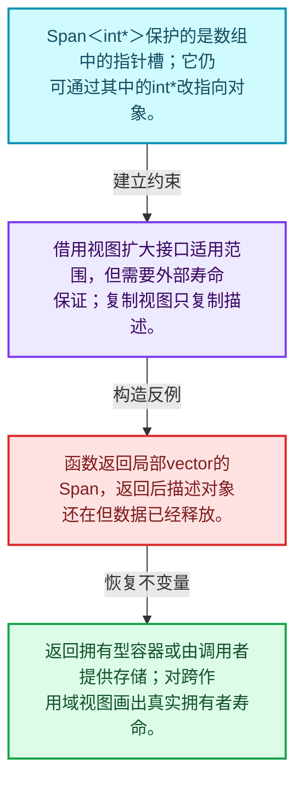
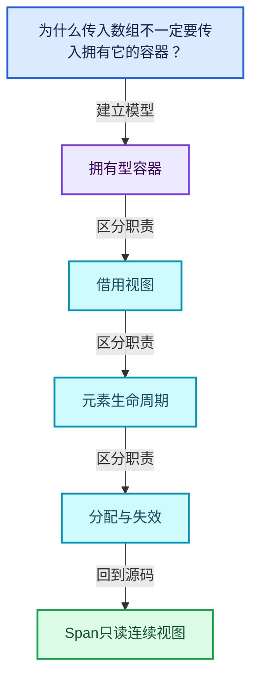
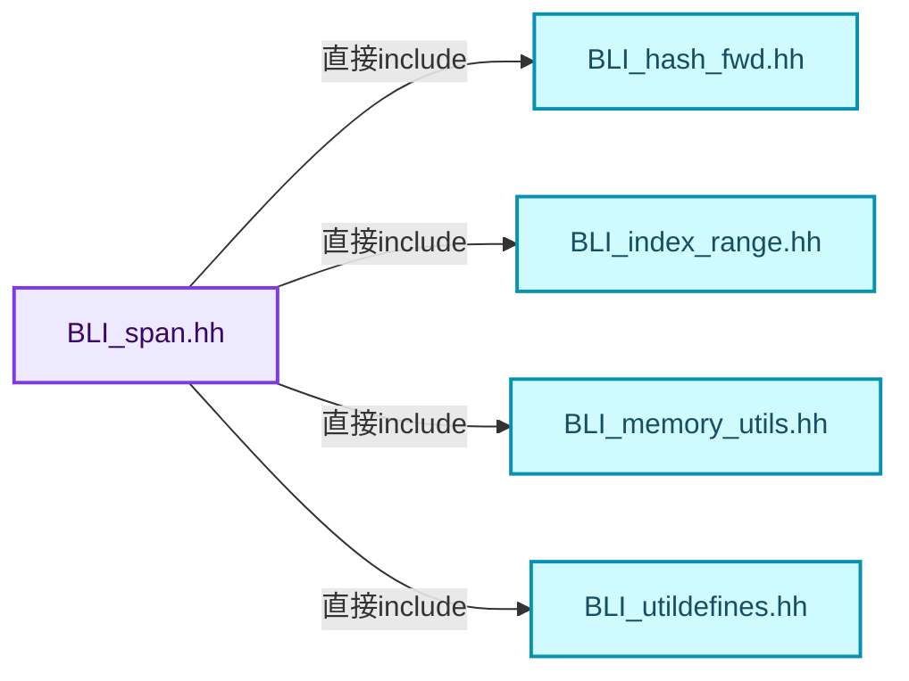
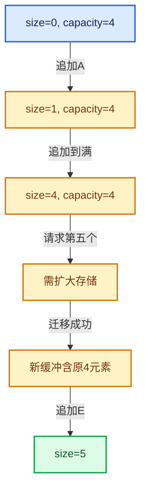

# 01-05 Span只读连续视图

[方向导航](README.md) · [总目录](../README.md) · [覆盖索引](../%E6%BA%90%E7%A0%81%E7%89%88%E6%9C%AC%E4%B8%8E%E8%A6%86%E7%9B%96%E7%B4%A2%E5%BC%95.md)

> 阅读顺序：问题与数据模型 → 语法与类型 → 源码逐行 → 调用线索 → 历史与取舍 → 推演和练习。

- 基准 HEAD：`cbda6b96c26c0dee3c3b5cbb93960c4ac06a6b30`。
- 记录日期：2026-10-14。
- 教学示例状态：正文中的推演不是本机性能实测；已运行练习见验收报告。

## 一、从问题到设计

为什么传入数组不一定要传入拥有它的容器？

Span描述地址和长度，不管理元素寿命；只读元素并不意味着底层数据永远不会被其他别名修改。

本篇把语法、数据语义和系统取舍连接起来。先证明对象存活，再讨论索引；先区分借用与拥有，再讨论复制移动。

### 本篇独立模型与设计推理

Span<int*>保护的是数组中的指针槽；它仍可通过其中的int*改指向对象。

设计取舍：借用视图扩大接口适用范围，但需要外部寿命保证；复制视图只复制描述。

最小反例：函数返回局部vector的Span，返回后描述对象还在但数据已经释放。

推导与处理：返回拥有型容器或由调用者提供存储；对跨作用域视图画出真实拥有者寿命。



### 源码范围与相邻篇章

| 文件 | 本篇逐行范围 | 基准SHA-256 |
|---|---|---|
| [source/blender/blenlib/BLI_span.hh](../../../../../source/blender/blenlib/BLI_span.hh) | L1—L446 | `28120d187d6d21b50bd0d0c22141102d194b400fee9882d817fc78b97786a1d1` |

同一主讲文件可能分多篇覆盖；超出本篇范围的符号通过覆盖索引定位。空行与纯注释保留在源码摘录中，逐行表解释有效语句与语法边界；许可证头统一保留。

前篇：[IndexRange连续整数区间](04-IndexRange%E8%BF%9E%E7%BB%AD%E6%95%B4%E6%95%B0%E5%8C%BA%E9%97%B4.md).

后篇：[MutableSpan可写视图](06-MutableSpan%E5%8F%AF%E5%86%99%E8%A7%86%E5%9B%BE.md).

## 二、类型、数据与阅读地图



这是概念依赖图，边表示阅读关系，不声称是运行时调用顺序。

### 直接编译依赖



箭头只表示头文件包含关系；完整调用线索见后面的符号定位表。

## 三、关键词、语法与类型角色

### 模板 template

模板把类型或常量作为生成实现的参数。读声明时先列出类型参数、非类型参数和默认值，再看使用者实际实例化了什么。模板声明本身不意味着每种T都支持其全部成员。

具体检查：把T替换为int、string、只能移动的类型，分别检查每个被调用操作是否成立。

### 依赖名称 typename

typename既可引入类型模板参数，也可告诉编译器某个依赖名称是类型。它不创建运行时对象；解析期确认语法类别与实例化期检查具体类型是不同阶段。

具体检查：区分typename T::value_type和T::size()，前者标记类型，后者是表达式。

### 约束 requires

requires表达式或requires子句限制模板参与重载的条件。它提供编译期可用性检查，不是运行时if，不能指望输入到达程序后再被这一机制验证。

具体检查：构造满足和不满足约束的两个类型，观察候选被排除而不是在函数内返回错误。

### 常量求值 constexpr

constexpr声明允许相应实体参与常量求值，但constexpr函数仍可以在运行时执行。是否常量求值由调用场景和表达式合法性共同决定。

具体检查：比较constexpr变量初始化和从运行时输入调用同一函数。

### 只读限定 const

const约束当前访问路径可做的修改。const指针、指向const的指针、const视图对象、const元素是不同位置的限定；其他别名可能仍可修改原对象。

具体检查：分别写T* const、const T*与const T* const，并画出不可修改的层次。

### 异常边界 try与catch

try定义异常传播的局部边界。失败路径需要销毁已经成功构造的部分并释放相应存储；未构造的对象不能被析构。

具体检查：在第k次构造失败，列出已经存在的对象集合与待释放缓冲。

### 显式静态转换 static_cast

static_cast表达编译期允许的转换，不会自动验证运行时真实类型、指针寿命或索引边界。由void指针恢复T指针时，调用者仍须保证实际存储中确有合法T对象。

具体检查：标出转换前后的类型以及正确性依据来自哪里。

### 表示层转换 reinterpret_cast

reinterpret_cast不能自动开始任意对象的生命周期，也不能豁免对齐和别名规则。读这类代码需要追溯原始分配与实际构造操作。

具体检查：分别检查大小、对齐、生命周期和可访问类型，四项不能互相替代。

### 对象表示 sizeof

sizeof给出对象表示大小，不是其引用的所有堆内存总量。sizeof视图很小并不说明底层数组很小。

具体检查：分别统计容器对象、容量字节和元素拥有的间接资源。

### 构造与new表达式

普通new可能分配并构造；placement new在给定地址构造，存储由其他机制提供。失败回滚应区分两类责任。

具体检查：追踪地址来自哪里、构造何时成功、由谁析构、由谁释放。

### 内部断言 assert

断言表达开发者预期成立的内部契约，发布构建可能关闭。它不能替代对不可信输入的完整错误处理，也不保证后续操作被运行时保护。

具体检查：对每条断言构造违反条件的输入，区分调用者错误与应向用户报告的错误。

### 标准连续视图 span

标准span可以具有静态或动态extent；元素是否可写取决于T。Blender Span<int>的只读行为更接近std::span<const int>。

具体检查：特别区分Span<int*>中指针槽位只读与指向int是否可写。

### 受控访问 friend

friend授予指定函数或类访问非公开成员的权限，并不意味着继承，也不自动扩展到友元的派生类。

具体检查：解释执行器为何需要访问包装器的内部映射，同时检查边界是否仍清楚。

### 类型别名 using

类型别名为已有类型建立名字，不创建运行期对象。它常把模板内部使用的类型统一暴露给泛型调用者。

具体检查：展开别名直到基础类型，区分类型别名和变量声明。

### Span的六种const组合

| 标准库写法 | Blender对应 | 可修改什么 |
|---|---|---|
| std::span<int> | MutableSpan<int> | 元素值 |
| std::span<const int> | Span<int> | 不能经此视图改元素 |
| std::span<int *> | MutableSpan<int *> | 指针槽和指向的int |
| std::span<const int *> | MutableSpan<const int *> | 指针槽，不能经指针改int |
| std::span<int * const> | Span<int *> | 不能改指针槽，可以改指向的int |
| std::span<const int * const> | Span<const int *> | 两层都不能经此路径修改 |

在`const T *data_`中把T替换成`int *`后，得到的是`int * const *`，不是`const int **`。
模板替换应整体替换T，再判断const绑定位置。
因此“Span只读”准确地描述数组元素槽位，通过元素指针指向的另一个对象不一定只读。

### 为什么不把initializer_list保存到长期Span

直接调用`consume({1,2,3})`时，底层临时数组可覆盖该完整表达式中的同步调用。
把相同列表先转换成保存的Span，不会因为Span还活着就延长数组寿命。
不要通过解引用悬空指针做演示；用生命周期图指出完整表达式结束的时刻即可。

### 切片的具体推演

原数组为`[10,20,30,40,50]`，`slice(1,3)`返回起点为第二个元素、长度为3的视图。
视图大小为3，不会复制20、30、40。
读取视图索引0对应原数组索引1，读取视图索引2对应原数组索引3。
边界检查必须使用视图自己的长度，同时确保原数组寿命覆盖视图使用。
`slice_safe`的截断行为与`slice`的前置条件不同，不能因为名字含safe就推断任意指针算术都合法。

## 四、真实源码与逐行讲解

源码块保持原行内容，原始行号由小节标题及逐行表给出。表中的调用定位是静态阅读辅助；重载、模板实例化、宏展开和虚调用需结合完整声明，不能仅凭词法出现证明动态调用。

### BLI_span.hh：L1—L59

<!-- source:source/blender/blenlib/BLI_span.hh:1:59 -->

```cpp
/* SPDX-FileCopyrightText: 2023 Blender Authors
 *
 * SPDX-License-Identifier: GPL-2.0-or-later */

#pragma once

/** \file
 * \ingroup bli
 *
 * An `Span<T>` references an array that is owned by someone else. It is just a
 * pointer and a size. Since the memory is not owned, Span should not be used to transfer
 * ownership. The array cannot be modified through the Span. However, if T is a non-const
 * pointer, the pointed-to elements can be modified.
 *
 * There is also `MutableSpan<T>`. It is mostly the same as Span, but allows the
 * array to be modified.
 *
 * A (Mutable)Span can refer to data owned by many different data structures including
 * Vector, Array, VectorSet, std::vector, std::array, std::string,
 * std::initializer_list and c-style array.
 *
 * `Span` is very similar to `std::span` (C++20). However, there are a few differences:
 * - `Span` is const by default. This is to avoid making things mutable when they don't
 *   have to be. To get a non-const span, you need to use `MutableSpan`. Below is a list
 *   of const-behavior-equivalent pairs of data structures:
 *   - std::span<int>                <==>  MutableSpan<int>
 *   - std::span<const int>          <==>  Span<int>
 *   - std::span<int *>              <==>  MutableSpan<int *>
 *   - std::span<const int *>        <==>  MutableSpan<const int *>
 *   - std::span<int * const>        <==>  Span<int *>
 *   - std::span<const int * const>  <==>  Span<const int *>
 * - `Span` always has a dynamic extent, while `std::span` can have a size that is
 *   determined at compile time. I did not have a use case for that yet. If we need it, we can
 *   decide to add this functionality to `Span` or introduce a new type like
 *   `FixedSpan<T, N>`.
 *
 * `Span<T>` should be your default choice when you have to pass a read-only array
 * into a function. It is better than passing a `const Vector &`, because e.g. then the function
 * only works for vectors and not arrays. Using Span as function parameter makes it usable in more
 * contexts, better expresses the intent and does not sacrifice performance. It is also better than
 * passing a raw pointer and size separately, because it is more convenient and safe.
 *
 * `MutableSpan<T>` can be used when a function is supposed to return an array, the
 * size of which is known before the function is called. One advantage of this approach is that the
 * caller is responsible for allocation and deallocation. Furthermore, the function can focus on
 * its task, without having to worry about memory allocation. Alternatively, a function could
 * return an Array or Vector.
 *
 * NOTE: When a function has a MutableSpan<T> output parameter and T is not a trivial type,
 * then the function has to specify whether the referenced array is expected to be initialized or
 * not.
 *
 * Since the arrays are only referenced, it is generally unsafe to store a Span. When you
 * store one, you should know who owns the memory.
 *
 * Instances of Span and MutableSpan are small and should be passed by value.
 */

#include <algorithm>
```

| 原始行 | 语义、约束与检查 |
|---|---|
| L5 | 防止同一头文件在一个翻译单元中重复展开；不控制多个源文件之间的链接或对象寿命。 |
| L59 | 引入编译依赖 <algorithm>；这是声明可见性关系，不表示运行时一定调用该文件的所有接口。 |

### BLI_span.hh：L60—L105

<!-- source:source/blender/blenlib/BLI_span.hh:60:105 -->

```cpp
#include <array>
#include <vector>

#include "BLI_hash_fwd.hh"
#include "BLI_index_range.hh"
#include "BLI_memory_utils.hh"
#include "BLI_utildefines.hh"

namespace blender {

/**
 * References an array of type T that is owned by someone else. The data in the array cannot be
 * modified.
 */
template<typename T> class Span {
 public:
  using value_type = T;
  using pointer = T *;
  using const_pointer = const T *;
  using reference = T &;
  using const_reference = const T &;
  using iterator = const T *;
  using size_type = int64_t;

 protected:
  const T *data_ = nullptr;
  int64_t size_ = 0;

 public:
  /**
   * Create a reference to an empty array.
   */
  constexpr Span() = default;

  constexpr Span(const T *start, int64_t size) : data_(start), size_(size)
  {
    BLI_assert(size >= 0);
  }

  template<typename U>
  constexpr Span(const U *start, int64_t size)
    requires(is_span_convertible_pointer_v<U, T>)
      : data_(static_cast<const T *>(start)), size_(size)
  {
    BLI_assert(size >= 0);
  }
```

本段语义重点：

- `data_`：数据或实现的存储入口；是否拥有应按该类声明和析构判定。
- `size_`：该对象记录的元素数或长度，不能直接当作容量。

| 原始行 | 语义、约束与检查 |
|---|---|
| L60 | 引入编译依赖 <array>；这是声明可见性关系，不表示运行时一定调用该文件的所有接口。 |
| L61 | 引入编译依赖 <vector>；这是声明可见性关系，不表示运行时一定调用该文件的所有接口。 |
| L63 | 引入编译依赖 "BLI_hash_fwd.hh"；这是声明可见性关系，不表示运行时一定调用该文件的所有接口。 |
| L64 | 引入编译依赖 "BLI_index_range.hh"；这是声明可见性关系，不表示运行时一定调用该文件的所有接口。 |
| L65 | 引入编译依赖 "BLI_memory_utils.hh"；这是声明可见性关系，不表示运行时一定调用该文件的所有接口。 |
| L66 | 引入编译依赖 "BLI_utildefines.hh"；这是声明可见性关系，不表示运行时一定调用该文件的所有接口。 |
| L68 | 把后续声明放入 blender 命名空间，影响名称查找和符号归属，不创建运行时对象。 |
| L74 | 声明模板参数 `template<typename T> class Span {`。类型参数决定生成操作的类型，非类型参数可决定内嵌容量或编译期分支。 |
| L75 | 切换成员访问权限为 public；它是编译期接口边界，不是线程同步或内存保护。 |
| L76 | 定义类型别名 `using value_type = T`，为模板接口或内部实现统一命名；本行不分配该类型对象。 |
| L77 | 定义类型别名 `using pointer = T *`，为模板接口或内部实现统一命名；本行不分配该类型对象。 |
| L78 | 定义类型别名 `using const_pointer = const T *`，为模板接口或内部实现统一命名；本行不分配该类型对象。 |
| L79 | 定义类型别名 `using reference = T &`，为模板接口或内部实现统一命名；本行不分配该类型对象。 |
| L80 | 定义类型别名 `using const_reference = const T &`，为模板接口或内部实现统一命名；本行不分配该类型对象。 |
| L81 | 定义类型别名 `using iterator = const T *`，为模板接口或内部实现统一命名；本行不分配该类型对象。 |
| L82 | 定义类型别名 `using size_type = int64_t`，为模板接口或内部实现统一命名；本行不分配该类型对象。 |
| L84 | 切换成员访问权限为 protected；它是编译期接口边界，不是线程同步或内存保护。 |
| L85 | 建立或更新 `data_`：数据或实现的存储入口；是否拥有应按该类声明和析构判定。本行的具体值关系为 `const T *data_ = nullptr`；对照更新前后相应范围或状态是否一致。 |
| L86 | 建立或更新 `size_`：该对象记录的元素数或长度，不能直接当作容量。本行的具体值关系为 `int64_t size_ = 0`；对照更新前后相应范围或状态是否一致。 |
| L88 | 切换成员访问权限为 public；它是编译期接口边界，不是线程同步或内存保护。 |
| L92 | 显式采用编译器生成的特殊成员行为：`constexpr Span() = default;`。成员和基类的性质决定该操作是否可用、是否被删除及异常约定，不表示运行时给对象赋值为default。 |
| L94 | 本行涉及 `data_`：数据或实现的存储入口；是否拥有应按该类声明和析构判定。按此语义解读 `constexpr Span(const T *start, int64_t size) : data_(start), size_(size)`，不要把地址、数量或状态混用。 |
| L95 | 连接上一行的声明或控制结构与其语句块；后续行在这个作用域中执行或声明。 |
| L96 | 断言约束 `BLI_assert(size >= 0);`。条件是后续访问的内部前置条件；发布构建可能不执行，不能把断言当作输入修复。 |
| L97 | 结束当前语法单元。局部自动对象在离开其作用域时按规则销毁；这不等于所有被引用的外部数据也被释放。 |
| L99 | 声明模板参数 `template<typename U>`。类型参数决定生成操作的类型，非类型参数可决定内嵌容量或编译期分支。 |
| L100 | 出现调用或函数声明 `Span`，对应表达式为 `constexpr Span(const U *start, int64_t size)`。参数求值、返回类型与重载需结合前后完整语句；静态文本引用不能证明动态目标。 |
| L101 | 约束模板可用性：`requires(is_span_convertible_pointer_v<U, T>)`。条件在编译期检查，不替代运行期的地址、长度和类型一致性验证。 |
| L102 | 本行涉及 `data_`：数据或实现的存储入口；是否拥有应按该类声明和析构判定。按此语义解读 `: data_(static_cast<const T *>(start)), size_(size)`，不要把地址、数量或状态混用。 |
| L103 | 连接上一行的声明或控制结构与其语句块；后续行在这个作用域中执行或声明。 |
| L104 | 断言约束 `BLI_assert(size >= 0);`。条件是后续访问的内部前置条件；发布构建可能不执行，不能把断言当作输入修复。 |
| L105 | 结束当前语法单元。局部自动对象在离开其作用域时按规则销毁；这不等于所有被引用的外部数据也被释放。 |

### BLI_span.hh：L106—L152

<!-- source:source/blender/blenlib/BLI_span.hh:106:152 -->

```cpp

  /**
   * Reference an initializer_list. Note that the data in the initializer_list is only valid until
   * the expression containing it is fully computed.
   *
   * Do:
   *  call_function_with_array({1, 2, 3, 4});
   *
   * Don't:
   *  Span<int> span = {1, 2, 3, 4};
   *  call_function_with_array(span);
   */
  constexpr Span(const std::initializer_list<T> &list) : Span(list.begin(), int64_t(list.size()))
  {
  }

  constexpr Span(const std::vector<T> &vector) : Span(vector.data(), int64_t(vector.size())) {}

  template<std::size_t N> constexpr Span(const std::array<T, N> &array) : Span(array.data(), N) {}

  /**
   * Support implicit conversions like the one below:
   *   Span<T *> -> Span<const T *>
   */
  template<typename U>
  constexpr Span(Span<U> span)
    requires(is_span_convertible_pointer_v<U, T>)
      : data_(static_cast<const T *>(span.data())), size_(span.size())
  {
  }

  /**
   * Returns a contiguous part of the array. This invokes undefined behavior when the start or size
   * is negative.
   */
  constexpr Span slice(int64_t start, int64_t size) const
  {
    BLI_assert(start >= 0);
    BLI_assert(size >= 0);
    BLI_assert(start + size <= size_ || size == 0);
    return Span(data_ + start, size);
  }

  constexpr Span slice(IndexRange range) const
  {
    return this->slice(range.start(), range.size());
  }
```

本段语义重点：

- `data_`：数据或实现的存储入口；是否拥有应按该类声明和析构判定。
- `size_`：该对象记录的元素数或长度，不能直接当作容量。

| 原始行 | 语义、约束与检查 |
|---|---|
| L118 | 出现调用或函数声明 `Span`，对应表达式为 `constexpr Span(const std::initializer_list<T> &list) : Span(list.begin(), int64_t(list.size()))`。参数求值、返回类型与重载需结合前后完整语句；静态文本引用不能证明动态目标。 |
| L119 | 连接上一行的声明或控制结构与其语句块；后续行在这个作用域中执行或声明。 |
| L120 | 结束当前语法单元。局部自动对象在离开其作用域时按规则销毁；这不等于所有被引用的外部数据也被释放。 |
| L122 | 出现调用或函数声明 `Span`，对应表达式为 `constexpr Span(const std::vector<T> &vector) : Span(vector.data(), int64_t(vector.size())) {}`。参数求值、返回类型与重载需结合前后完整语句；静态文本引用不能证明动态目标。 |
| L124 | 声明模板参数 `template<std::size_t N> constexpr Span(const std::array<T, N> &array) : Span(array.data(), N) {}`。类型参数决定生成操作的类型，非类型参数可决定内嵌容量或编译期分支。 |
| L130 | 声明模板参数 `template<typename U>`。类型参数决定生成操作的类型，非类型参数可决定内嵌容量或编译期分支。 |
| L131 | 出现调用或函数声明 `Span`，对应表达式为 `constexpr Span(Span<U> span)`。参数求值、返回类型与重载需结合前后完整语句；静态文本引用不能证明动态目标。 |
| L132 | 约束模板可用性：`requires(is_span_convertible_pointer_v<U, T>)`。条件在编译期检查，不替代运行期的地址、长度和类型一致性验证。 |
| L133 | 本行涉及 `data_`：数据或实现的存储入口；是否拥有应按该类声明和析构判定。按此语义解读 `: data_(static_cast<const T *>(span.data())), size_(span.size())`，不要把地址、数量或状态混用。 |
| L134 | 连接上一行的声明或控制结构与其语句块；后续行在这个作用域中执行或声明。 |
| L135 | 结束当前语法单元。局部自动对象在离开其作用域时按规则销毁；这不等于所有被引用的外部数据也被释放。 |
| L141 | 出现调用或函数声明 `slice`，对应表达式为 `constexpr Span slice(int64_t start, int64_t size) const`。参数求值、返回类型与重载需结合前后完整语句；静态文本引用不能证明动态目标。 |
| L142 | 连接上一行的声明或控制结构与其语句块；后续行在这个作用域中执行或声明。 |
| L143 | 断言约束 `BLI_assert(start >= 0);`。条件是后续访问的内部前置条件；发布构建可能不执行，不能把断言当作输入修复。 |
| L144 | 断言约束 `BLI_assert(size >= 0);`。条件是后续访问的内部前置条件；发布构建可能不执行，不能把断言当作输入修复。 |
| L145 | 断言约束 `BLI_assert(start + size <= size_ &#124;&#124; size == 0);`。条件是后续访问的内部前置条件；发布构建可能不执行，不能把断言当作输入修复。 |
| L146 | 返回表达式 `Span(data_ + start, size)`。 |
| L147 | 结束当前语法单元。局部自动对象在离开其作用域时按规则销毁；这不等于所有被引用的外部数据也被释放。 |
| L149 | 出现调用或函数声明 `slice`，对应表达式为 `constexpr Span slice(IndexRange range) const`。参数求值、返回类型与重载需结合前后完整语句；静态文本引用不能证明动态目标。 |
| L150 | 连接上一行的声明或控制结构与其语句块；后续行在这个作用域中执行或声明。 |
| L151 | 返回表达式 `this->slice(range.start(), range.size())`。 |
| L152 | 结束当前语法单元。局部自动对象在离开其作用域时按规则销毁；这不等于所有被引用的外部数据也被释放。 |

### BLI_span.hh：L153—L202

<!-- source:source/blender/blenlib/BLI_span.hh:153:202 -->

```cpp

  /**
   * Returns a contiguous part of the array. This invokes undefined behavior when the start or size
   * is negative. Clamps the size of the new span so it fits in the current one.
   */
  constexpr Span slice_safe(const int64_t start, const int64_t size) const
  {
    BLI_assert(start >= 0);
    BLI_assert(size >= 0);
    const int64_t new_size = std::max<int64_t>(0, std::min(size, size_ - start));
    return Span(data_ ? data_ + start : nullptr, new_size);
  }

  constexpr Span slice_safe(IndexRange range) const
  {
    return this->slice_safe(range.start(), range.size());
  }

  /**
   * Returns a new Span with n elements removed from the beginning. This invokes undefined
   * behavior when n is negative.
   */
  constexpr Span drop_front(int64_t n) const
  {
    BLI_assert(n >= 0);
    const int64_t new_size = std::max<int64_t>(0, size_ - n);
    return Span(data_ + n, new_size);
  }

  /**
   * Returns a new Span with n elements removed from the end. This invokes undefined behavior when
   * n is negative.
   */
  constexpr Span drop_back(int64_t n) const
  {
    BLI_assert(n >= 0);
    const int64_t new_size = std::max<int64_t>(0, size_ - n);
    return Span(data_, new_size);
  }

  /**
   * Returns a new Span that only contains the first n elements. This invokes undefined
   * behavior when n is negative.
   */
  constexpr Span take_front(int64_t n) const
  {
    BLI_assert(n >= 0);
    const int64_t new_size = std::min<int64_t>(size_, n);
    return Span(data_, new_size);
  }
```

本段语义重点：

- `std::max`：取较大值，在容量计算中常用于同时满足请求量和增长策略。
- `std::min`：取较小值，常用于截断范围；还要检查负值、溢出和空范围。
- `data_`：数据或实现的存储入口；是否拥有应按该类声明和析构判定。
- `size_`：该对象记录的元素数或长度，不能直接当作容量。

| 原始行 | 语义、约束与检查 |
|---|---|
| L158 | 出现调用或函数声明 `slice_safe`，对应表达式为 `constexpr Span slice_safe(const int64_t start, const int64_t size) const`。参数求值、返回类型与重载需结合前后完整语句；静态文本引用不能证明动态目标。 |
| L159 | 连接上一行的声明或控制结构与其语句块；后续行在这个作用域中执行或声明。 |
| L160 | 断言约束 `BLI_assert(start >= 0);`。条件是后续访问的内部前置条件；发布构建可能不执行，不能把断言当作输入修复。 |
| L161 | 断言约束 `BLI_assert(size >= 0);`。条件是后续访问的内部前置条件；发布构建可能不执行，不能把断言当作输入修复。 |
| L162 | 本行使用 `std::max`：取较大值，在容量计算中常用于同时满足请求量和增长策略。 |
| L163 | 返回表达式 `Span(data_ ? data_ + start : nullptr, new_size)`。 |
| L164 | 结束当前语法单元。局部自动对象在离开其作用域时按规则销毁；这不等于所有被引用的外部数据也被释放。 |
| L166 | 出现调用或函数声明 `slice_safe`，对应表达式为 `constexpr Span slice_safe(IndexRange range) const`。参数求值、返回类型与重载需结合前后完整语句；静态文本引用不能证明动态目标。 |
| L167 | 连接上一行的声明或控制结构与其语句块；后续行在这个作用域中执行或声明。 |
| L168 | 返回表达式 `this->slice_safe(range.start(), range.size())`。 |
| L169 | 结束当前语法单元。局部自动对象在离开其作用域时按规则销毁；这不等于所有被引用的外部数据也被释放。 |
| L175 | 出现调用或函数声明 `drop_front`，对应表达式为 `constexpr Span drop_front(int64_t n) const`。参数求值、返回类型与重载需结合前后完整语句；静态文本引用不能证明动态目标。 |
| L176 | 连接上一行的声明或控制结构与其语句块；后续行在这个作用域中执行或声明。 |
| L177 | 断言约束 `BLI_assert(n >= 0);`。条件是后续访问的内部前置条件；发布构建可能不执行，不能把断言当作输入修复。 |
| L178 | 本行使用 `std::max`：取较大值，在容量计算中常用于同时满足请求量和增长策略。 |
| L179 | 返回表达式 `Span(data_ + n, new_size)`。 |
| L180 | 结束当前语法单元。局部自动对象在离开其作用域时按规则销毁；这不等于所有被引用的外部数据也被释放。 |
| L186 | 出现调用或函数声明 `drop_back`，对应表达式为 `constexpr Span drop_back(int64_t n) const`。参数求值、返回类型与重载需结合前后完整语句；静态文本引用不能证明动态目标。 |
| L187 | 连接上一行的声明或控制结构与其语句块；后续行在这个作用域中执行或声明。 |
| L188 | 断言约束 `BLI_assert(n >= 0);`。条件是后续访问的内部前置条件；发布构建可能不执行，不能把断言当作输入修复。 |
| L189 | 本行使用 `std::max`：取较大值，在容量计算中常用于同时满足请求量和增长策略。 |
| L190 | 返回表达式 `Span(data_, new_size)`。 |
| L191 | 结束当前语法单元。局部自动对象在离开其作用域时按规则销毁；这不等于所有被引用的外部数据也被释放。 |
| L197 | 出现调用或函数声明 `take_front`，对应表达式为 `constexpr Span take_front(int64_t n) const`。参数求值、返回类型与重载需结合前后完整语句；静态文本引用不能证明动态目标。 |
| L198 | 连接上一行的声明或控制结构与其语句块；后续行在这个作用域中执行或声明。 |
| L199 | 断言约束 `BLI_assert(n >= 0);`。条件是后续访问的内部前置条件；发布构建可能不执行，不能把断言当作输入修复。 |
| L200 | 本行使用 `std::min`：取较小值，常用于截断范围；还要检查负值、溢出和空范围。 |
| L201 | 返回表达式 `Span(data_, new_size)`。 |
| L202 | 结束当前语法单元。局部自动对象在离开其作用域时按规则销毁；这不等于所有被引用的外部数据也被释放。 |

### BLI_span.hh：L203—L251

<!-- source:source/blender/blenlib/BLI_span.hh:203:251 -->

```cpp

  /**
   * Returns a new Span that only contains the last n elements. This invokes undefined
   * behavior when n is negative.
   */
  constexpr Span take_back(int64_t n) const
  {
    BLI_assert(n >= 0);
    const int64_t new_size = std::min<int64_t>(size_, n);
    return Span(data_ + size_ - new_size, new_size);
  }

  /**
   * Returns the pointer to the beginning of the referenced array. This may be nullptr when the
   * size is zero.
   */
  constexpr const T *data() const
  {
    return data_;
  }

  constexpr const T *begin() const
  {
    return data_;
  }
  constexpr const T *end() const
  {
    return data_ + size_;
  }

  constexpr std::reverse_iterator<const T *> rbegin() const
  {
    return std::reverse_iterator<const T *>(this->end());
  }
  constexpr std::reverse_iterator<const T *> rend() const
  {
    return std::reverse_iterator<const T *>(this->begin());
  }

  /**
   * Access an element in the array. This invokes undefined behavior when the index is out of
   * bounds.
   */
  constexpr const T &operator[](int64_t index) const
  {
    BLI_assert(index >= 0);
    BLI_assert(index < size_);
    return data_[index];
  }
```

本段语义重点：

- `std::min`：取较小值，常用于截断范围；还要检查负值、溢出和空范围。
- `data_`：数据或实现的存储入口；是否拥有应按该类声明和析构判定。
- `size_`：该对象记录的元素数或长度，不能直接当作容量。

| 原始行 | 语义、约束与检查 |
|---|---|
| L208 | 出现调用或函数声明 `take_back`，对应表达式为 `constexpr Span take_back(int64_t n) const`。参数求值、返回类型与重载需结合前后完整语句；静态文本引用不能证明动态目标。 |
| L209 | 连接上一行的声明或控制结构与其语句块；后续行在这个作用域中执行或声明。 |
| L210 | 断言约束 `BLI_assert(n >= 0);`。条件是后续访问的内部前置条件；发布构建可能不执行，不能把断言当作输入修复。 |
| L211 | 本行使用 `std::min`：取较小值，常用于截断范围；还要检查负值、溢出和空范围。 |
| L212 | 返回表达式 `Span(data_ + size_ - new_size, new_size)`。 |
| L213 | 结束当前语法单元。局部自动对象在离开其作用域时按规则销毁；这不等于所有被引用的外部数据也被释放。 |
| L219 | 出现调用或函数声明 `data`，对应表达式为 `constexpr const T *data() const`。参数求值、返回类型与重载需结合前后完整语句；静态文本引用不能证明动态目标。 |
| L220 | 连接上一行的声明或控制结构与其语句块；后续行在这个作用域中执行或声明。 |
| L221 | 返回表达式 `data_`。 |
| L222 | 结束当前语法单元。局部自动对象在离开其作用域时按规则销毁；这不等于所有被引用的外部数据也被释放。 |
| L224 | 出现调用或函数声明 `begin`，对应表达式为 `constexpr const T *begin() const`。参数求值、返回类型与重载需结合前后完整语句；静态文本引用不能证明动态目标。 |
| L225 | 连接上一行的声明或控制结构与其语句块；后续行在这个作用域中执行或声明。 |
| L226 | 返回表达式 `data_`。 |
| L227 | 结束当前语法单元。局部自动对象在离开其作用域时按规则销毁；这不等于所有被引用的外部数据也被释放。 |
| L228 | 出现调用或函数声明 `end`，对应表达式为 `constexpr const T *end() const`。参数求值、返回类型与重载需结合前后完整语句；静态文本引用不能证明动态目标。 |
| L229 | 连接上一行的声明或控制结构与其语句块；后续行在这个作用域中执行或声明。 |
| L230 | 返回表达式 `data_ + size_`。 |
| L231 | 结束当前语法单元。局部自动对象在离开其作用域时按规则销毁；这不等于所有被引用的外部数据也被释放。 |
| L233 | 出现调用或函数声明 `rbegin`，对应表达式为 `constexpr std::reverse_iterator<const T *> rbegin() const`。参数求值、返回类型与重载需结合前后完整语句；静态文本引用不能证明动态目标。 |
| L234 | 连接上一行的声明或控制结构与其语句块；后续行在这个作用域中执行或声明。 |
| L235 | 返回表达式 `std::reverse_iterator<const T *>(this->end())`。 |
| L236 | 结束当前语法单元。局部自动对象在离开其作用域时按规则销毁；这不等于所有被引用的外部数据也被释放。 |
| L237 | 出现调用或函数声明 `rend`，对应表达式为 `constexpr std::reverse_iterator<const T *> rend() const`。参数求值、返回类型与重载需结合前后完整语句；静态文本引用不能证明动态目标。 |
| L238 | 连接上一行的声明或控制结构与其语句块；后续行在这个作用域中执行或声明。 |
| L239 | 返回表达式 `std::reverse_iterator<const T *>(this->begin())`。 |
| L240 | 结束当前语法单元。局部自动对象在离开其作用域时按规则销毁；这不等于所有被引用的外部数据也被释放。 |
| L246 | 运算符重载声明、定义或显式调用：`constexpr const T &operator[](int64_t index) const`。结合参数和返回类型判断是赋值、索引、比较还是转换；operator=声明中的等号不是在给名为operator的变量赋值。 |
| L247 | 连接上一行的声明或控制结构与其语句块；后续行在这个作用域中执行或声明。 |
| L248 | 断言约束 `BLI_assert(index >= 0);`。条件是后续访问的内部前置条件；发布构建可能不执行，不能把断言当作输入修复。 |
| L249 | 断言约束 `BLI_assert(index < size_);`。条件是后续访问的内部前置条件；发布构建可能不执行，不能把断言当作输入修复。 |
| L250 | 返回表达式 `data_[index]`。 |
| L251 | 结束当前语法单元。局部自动对象在离开其作用域时按规则销毁；这不等于所有被引用的外部数据也被释放。 |

### BLI_span.hh：L252—L298

<!-- source:source/blender/blenlib/BLI_span.hh:252:298 -->

```cpp

  /**
   * Returns the number of elements in the referenced array.
   */
  constexpr int64_t size() const
  {
    return size_;
  }

  /**
   * Returns true if the size is zero.
   */
  constexpr bool is_empty() const
  {
    return size_ == 0;
  }

  /**
   * Returns the number of bytes referenced by this Span.
   */
  constexpr int64_t size_in_bytes() const
  {
    return sizeof(T) * size_;
  }

  /**
   * Does a linear search to see of the value is in the array.
   * Returns true if it is, otherwise false.
   */
  constexpr bool contains(const T &value) const
  {
    for (const T &element : *this) {
      if (element == value) {
        return true;
      }
    }
    return false;
  }

  /**
   * Does a constant time check to see if the pointer points to a value in the referenced array.
   * Return true if it is, otherwise false.
   */
  constexpr bool contains_ptr(const T *ptr) const
  {
    return (this->begin() <= ptr) && (ptr < this->end());
  }
```

本段语义重点：

- `size_`：该对象记录的元素数或长度，不能直接当作容量。

| 原始行 | 语义、约束与检查 |
|---|---|
| L256 | 出现调用或函数声明 `size`，对应表达式为 `constexpr int64_t size() const`。参数求值、返回类型与重载需结合前后完整语句；静态文本引用不能证明动态目标。 |
| L257 | 连接上一行的声明或控制结构与其语句块；后续行在这个作用域中执行或声明。 |
| L258 | 返回表达式 `size_`。 |
| L259 | 结束当前语法单元。局部自动对象在离开其作用域时按规则销毁；这不等于所有被引用的外部数据也被释放。 |
| L264 | 出现调用或函数声明 `is_empty`，对应表达式为 `constexpr bool is_empty() const`。参数求值、返回类型与重载需结合前后完整语句；静态文本引用不能证明动态目标。 |
| L265 | 连接上一行的声明或控制结构与其语句块；后续行在这个作用域中执行或声明。 |
| L266 | 返回表达式 `size_ == 0`。 |
| L267 | 结束当前语法单元。局部自动对象在离开其作用域时按规则销毁；这不等于所有被引用的外部数据也被释放。 |
| L272 | 出现调用或函数声明 `size_in_bytes`，对应表达式为 `constexpr int64_t size_in_bytes() const`。参数求值、返回类型与重载需结合前后完整语句；静态文本引用不能证明动态目标。 |
| L273 | 连接上一行的声明或控制结构与其语句块；后续行在这个作用域中执行或声明。 |
| L274 | 返回表达式 `sizeof(T) * size_`。 |
| L275 | 结束当前语法单元。局部自动对象在离开其作用域时按规则销毁；这不等于所有被引用的外部数据也被释放。 |
| L281 | 出现调用或函数声明 `contains`，对应表达式为 `constexpr bool contains(const T &value) const`。参数求值、返回类型与重载需结合前后完整语句；静态文本引用不能证明动态目标。 |
| L282 | 连接上一行的声明或控制结构与其语句块；后续行在这个作用域中执行或声明。 |
| L283 | 按 `for (const T &element : *this)` 指定的范围或条件重复执行。对照循环变量与真实元素编号；循环内调用成本乘以实际迭代次数。 |
| L284 | 判断 `element == value`，成立时进入本分支，否则继续后续路径。 |
| L285 | 返回表达式 `true`。这是本路径的布尔结果，具体成功、存在或状态含义由函数接口规定。 |
| L286 | 结束当前语法单元。局部自动对象在离开其作用域时按规则销毁；这不等于所有被引用的外部数据也被释放。 |
| L287 | 结束当前语法单元。局部自动对象在离开其作用域时按规则销毁；这不等于所有被引用的外部数据也被释放。 |
| L288 | 返回表达式 `false`。这是本路径的布尔结果，具体成功、存在或状态含义由函数接口规定。 |
| L289 | 结束当前语法单元。局部自动对象在离开其作用域时按规则销毁；这不等于所有被引用的外部数据也被释放。 |
| L295 | 出现调用或函数声明 `contains_ptr`，对应表达式为 `constexpr bool contains_ptr(const T *ptr) const`。参数求值、返回类型与重载需结合前后完整语句；静态文本引用不能证明动态目标。 |
| L296 | 连接上一行的声明或控制结构与其语句块；后续行在这个作用域中执行或声明。 |
| L297 | 返回表达式 `(this->begin() <= ptr) && (ptr < this->end())`。 |
| L298 | 结束当前语法单元。局部自动对象在离开其作用域时按规则销毁；这不等于所有被引用的外部数据也被释放。 |

### BLI_span.hh：L299—L355

<!-- source:source/blender/blenlib/BLI_span.hh:299:355 -->

```cpp

  /**
   * Does a linear search to count how often the value is in the array.
   * Returns the number of occurrences.
   */
  constexpr int64_t count(const T &value) const
  {
    int64_t counter = 0;
    for (const T &element : *this) {
      if (element == value) {
        counter++;
      }
    }
    return counter;
  }

  /**
   * Return a reference to the first element in the array. This invokes undefined behavior when the
   * array is empty.
   */
  constexpr const T &first() const
  {
    BLI_assert(size_ > 0);
    return data_[0];
  }

  /**
   * Returns a reference to the nth last element. This invokes undefined behavior when the span is
   * too short.
   */
  constexpr const T &last(const int64_t n = 0) const
  {
    BLI_assert(n >= 0);
    BLI_assert(n < size_);
    return data_[size_ - 1 - n];
  }

  /**
   * Check if the array contains duplicates. Does a linear search for every element. So the total
   * running time is O(n^2). Only use this for small arrays.
   */
  constexpr bool has_duplicates__linear_search() const
  {
    /* The size should really be smaller than that. If it is not, the calling code should be
     * changed. */
    BLI_assert(size_ < 1000);

    for (int64_t i = 0; i < size_; i++) {
      const T &value = data_[i];
      for (int64_t j = i + 1; j < size_; j++) {
        if (value == data_[j]) {
          return true;
        }
      }
    }
    return false;
  }
```

本段语义重点：

- `data_`：数据或实现的存储入口；是否拥有应按该类声明和析构判定。
- `size_`：该对象记录的元素数或长度，不能直接当作容量。

| 原始行 | 语义、约束与检查 |
|---|---|
| L304 | 出现调用或函数声明 `count`，对应表达式为 `constexpr int64_t count(const T &value) const`。参数求值、返回类型与重载需结合前后完整语句；静态文本引用不能证明动态目标。 |
| L305 | 连接上一行的声明或控制结构与其语句块；后续行在这个作用域中执行或声明。 |
| L306 | 把右侧 `0` 用于初始化或更新左侧 `int64_t counter`。声明初始化与已有对象赋值应按上下文区分；有资源的类型会调用相应特殊成员。 |
| L307 | 按 `for (const T &element : *this)` 指定的范围或条件重复执行。对照循环变量与真实元素编号；循环内调用成本乘以实际迭代次数。 |
| L308 | 判断 `element == value`，成立时进入本分支，否则继续后续路径。 |
| L309 | 递增或递减现有状态：`counter++;`。这改变计数或游标；检查边界、计数单位，以及并发访问是否有相应保护。 |
| L310 | 结束当前语法单元。局部自动对象在离开其作用域时按规则销毁；这不等于所有被引用的外部数据也被释放。 |
| L311 | 结束当前语法单元。局部自动对象在离开其作用域时按规则销毁；这不等于所有被引用的外部数据也被释放。 |
| L312 | 返回表达式 `counter`。 |
| L313 | 结束当前语法单元。局部自动对象在离开其作用域时按规则销毁；这不等于所有被引用的外部数据也被释放。 |
| L319 | 出现调用或函数声明 `first`，对应表达式为 `constexpr const T &first() const`。参数求值、返回类型与重载需结合前后完整语句；静态文本引用不能证明动态目标。 |
| L320 | 连接上一行的声明或控制结构与其语句块；后续行在这个作用域中执行或声明。 |
| L321 | 断言约束 `BLI_assert(size_ > 0);`。条件是后续访问的内部前置条件；发布构建可能不执行，不能把断言当作输入修复。 |
| L322 | 返回表达式 `data_[0]`。 |
| L323 | 结束当前语法单元。局部自动对象在离开其作用域时按规则销毁；这不等于所有被引用的外部数据也被释放。 |
| L329 | 把右侧 `0) const` 用于初始化或更新左侧 `constexpr const T &last(const int64_t n`。声明初始化与已有对象赋值应按上下文区分；有资源的类型会调用相应特殊成员。 |
| L330 | 连接上一行的声明或控制结构与其语句块；后续行在这个作用域中执行或声明。 |
| L331 | 断言约束 `BLI_assert(n >= 0);`。条件是后续访问的内部前置条件；发布构建可能不执行，不能把断言当作输入修复。 |
| L332 | 断言约束 `BLI_assert(n < size_);`。条件是后续访问的内部前置条件；发布构建可能不执行，不能把断言当作输入修复。 |
| L333 | 返回表达式 `data_[size_ - 1 - n]`。 |
| L334 | 结束当前语法单元。局部自动对象在离开其作用域时按规则销毁；这不等于所有被引用的外部数据也被释放。 |
| L340 | 出现调用或函数声明 `has_duplicates__linear_search`，对应表达式为 `constexpr bool has_duplicates__linear_search() const`。参数求值、返回类型与重载需结合前后完整语句；静态文本引用不能证明动态目标。 |
| L341 | 连接上一行的声明或控制结构与其语句块；后续行在这个作用域中执行或声明。 |
| L344 | 断言约束 `BLI_assert(size_ < 1000);`。条件是后续访问的内部前置条件；发布构建可能不执行，不能把断言当作输入修复。 |
| L346 | 纯虚接口声明：`for (int64_t i = 0; i < size_; i++) {`。等号零标记抽象接口，需要按继承约定提供覆写；不表示执行函数并把结果设为零。 |
| L347 | 建立或更新 `data_`：数据或实现的存储入口；是否拥有应按该类声明和析构判定。本行的具体值关系为 `const T &value = data_[i]`；对照更新前后相应范围或状态是否一致。 |
| L348 | 按 `for (int64_t j = i + 1; j < size_; j++)` 指定的范围或条件重复执行。对照循环变量与真实元素编号；循环内调用成本乘以实际迭代次数。 |
| L349 | 判断 `value == data_[j]`，成立时进入本分支，否则继续后续路径。 |
| L350 | 返回表达式 `true`。这是本路径的布尔结果，具体成功、存在或状态含义由函数接口规定。 |
| L351 | 结束当前语法单元。局部自动对象在离开其作用域时按规则销毁；这不等于所有被引用的外部数据也被释放。 |
| L352 | 结束当前语法单元。局部自动对象在离开其作用域时按规则销毁；这不等于所有被引用的外部数据也被释放。 |
| L353 | 结束当前语法单元。局部自动对象在离开其作用域时按规则销毁；这不等于所有被引用的外部数据也被释放。 |
| L354 | 返回表达式 `false`。这是本路径的布尔结果，具体成功、存在或状态含义由函数接口规定。 |
| L355 | 结束当前语法单元。局部自动对象在离开其作用域时按规则销毁；这不等于所有被引用的外部数据也被释放。 |

### BLI_span.hh：L356—L399

<!-- source:source/blender/blenlib/BLI_span.hh:356:399 -->

```cpp

  /**
   * Returns true when this and the other array have an element in common. This should only be
   * called on small arrays, because it has a running time of O(n*m) where n and m are the sizes of
   * the arrays.
   */
  constexpr bool intersects__linear_search(Span other) const
  {
    /* The size should really be smaller than that. If it is not, the calling code should be
     * changed. */
    BLI_assert(size_ < 1000);

    for (int64_t i = 0; i < size_; i++) {
      const T &value = data_[i];
      if (other.contains(value)) {
        return true;
      }
    }
    return false;
  }

  /**
   * Returns the index of the first occurrence of the given value. This invokes undefined behavior
   * when the value is not in the array.
   */
  constexpr int64_t first_index(const T &search_value) const
  {
    const int64_t index = this->first_index_try(search_value);
    BLI_assert(index >= 0);
    return index;
  }

  /**
   * Returns the index of the first occurrence of the given value or -1 if it does not exist.
   */
  constexpr int64_t first_index_try(const T &search_value) const
  {
    for (int64_t i = 0; i < size_; i++) {
      if (data_[i] == search_value) {
        return i;
      }
    }
    return -1;
  }
```

本段语义重点：

- `data_`：数据或实现的存储入口；是否拥有应按该类声明和析构判定。
- `size_`：该对象记录的元素数或长度，不能直接当作容量。

| 原始行 | 语义、约束与检查 |
|---|---|
| L362 | 出现调用或函数声明 `intersects__linear_search`，对应表达式为 `constexpr bool intersects__linear_search(Span other) const`。参数求值、返回类型与重载需结合前后完整语句；静态文本引用不能证明动态目标。 |
| L363 | 连接上一行的声明或控制结构与其语句块；后续行在这个作用域中执行或声明。 |
| L366 | 断言约束 `BLI_assert(size_ < 1000);`。条件是后续访问的内部前置条件；发布构建可能不执行，不能把断言当作输入修复。 |
| L368 | 纯虚接口声明：`for (int64_t i = 0; i < size_; i++) {`。等号零标记抽象接口，需要按继承约定提供覆写；不表示执行函数并把结果设为零。 |
| L369 | 建立或更新 `data_`：数据或实现的存储入口；是否拥有应按该类声明和析构判定。本行的具体值关系为 `const T &value = data_[i]`；对照更新前后相应范围或状态是否一致。 |
| L370 | 判断 `other.contains(value)`，成立时进入本分支，否则继续后续路径。 |
| L371 | 返回表达式 `true`。这是本路径的布尔结果，具体成功、存在或状态含义由函数接口规定。 |
| L372 | 结束当前语法单元。局部自动对象在离开其作用域时按规则销毁；这不等于所有被引用的外部数据也被释放。 |
| L373 | 结束当前语法单元。局部自动对象在离开其作用域时按规则销毁；这不等于所有被引用的外部数据也被释放。 |
| L374 | 返回表达式 `false`。这是本路径的布尔结果，具体成功、存在或状态含义由函数接口规定。 |
| L375 | 结束当前语法单元。局部自动对象在离开其作用域时按规则销毁；这不等于所有被引用的外部数据也被释放。 |
| L381 | 出现调用或函数声明 `first_index`，对应表达式为 `constexpr int64_t first_index(const T &search_value) const`。参数求值、返回类型与重载需结合前后完整语句；静态文本引用不能证明动态目标。 |
| L382 | 连接上一行的声明或控制结构与其语句块；后续行在这个作用域中执行或声明。 |
| L383 | 把右侧 `this->first_index_try(search_value)` 用于初始化或更新左侧 `const int64_t index`。声明初始化与已有对象赋值应按上下文区分；有资源的类型会调用相应特殊成员。 |
| L384 | 断言约束 `BLI_assert(index >= 0);`。条件是后续访问的内部前置条件；发布构建可能不执行，不能把断言当作输入修复。 |
| L385 | 返回表达式 `index`。 |
| L386 | 结束当前语法单元。局部自动对象在离开其作用域时按规则销毁；这不等于所有被引用的外部数据也被释放。 |
| L391 | 出现调用或函数声明 `first_index_try`，对应表达式为 `constexpr int64_t first_index_try(const T &search_value) const`。参数求值、返回类型与重载需结合前后完整语句；静态文本引用不能证明动态目标。 |
| L392 | 连接上一行的声明或控制结构与其语句块；后续行在这个作用域中执行或声明。 |
| L393 | 纯虚接口声明：`for (int64_t i = 0; i < size_; i++) {`。等号零标记抽象接口，需要按继承约定提供覆写；不表示执行函数并把结果设为零。 |
| L394 | 判断 `data_[i] == search_value`，成立时进入本分支，否则继续后续路径。 |
| L395 | 返回表达式 `i`。 |
| L396 | 结束当前语法单元。局部自动对象在离开其作用域时按规则销毁；这不等于所有被引用的外部数据也被释放。 |
| L397 | 结束当前语法单元。局部自动对象在离开其作用域时按规则销毁；这不等于所有被引用的外部数据也被释放。 |
| L398 | 返回表达式 `-1`。 |
| L399 | 结束当前语法单元。局部自动对象在离开其作用域时按规则销毁；这不等于所有被引用的外部数据也被释放。 |

### BLI_span.hh：L400—L446

<!-- source:source/blender/blenlib/BLI_span.hh:400:446 -->

```cpp

  /**
   * Utility to make it more convenient to iterate over all indices that can be used with this
   * array.
   */
  constexpr IndexRange index_range() const
  {
    return IndexRange(size_);
  }

  constexpr uint64_t hash() const
  {
    uint64_t hash = 0;
    for (const T &value : *this) {
      hash = hash * 33 ^ get_default_hash(value);
    }
    return hash;
  }

  /**
   * Returns a new Span to the same underlying memory buffer. No conversions are done.
   */
  template<typename NewT> Span<NewT> constexpr cast() const
  {
    BLI_assert((size_ * sizeof(T)) % sizeof(NewT) == 0);
    int64_t new_size = size_ * sizeof(T) / sizeof(NewT);
    return Span<NewT>(reinterpret_cast<const NewT *>(data_), new_size);
  }

  friend bool operator==(const Span<T> a, const Span<T> b)
  {
    if (a.size() != b.size()) {
      return false;
    }
    return std::equal(a.begin(), a.end(), b.begin());
  }

  friend bool operator!=(const Span<T> a, const Span<T> b)
  {
    return !(a == b);
  }
};

/**
 * Mostly the same as Span, except that one can change the array elements through a
 * MutableSpan.
 */
```

本段语义重点：

- `data_`：数据或实现的存储入口；是否拥有应按该类声明和析构判定。
- `size_`：该对象记录的元素数或长度，不能直接当作容量。

| 原始行 | 语义、约束与检查 |
|---|---|
| L405 | 出现调用或函数声明 `index_range`，对应表达式为 `constexpr IndexRange index_range() const`。参数求值、返回类型与重载需结合前后完整语句；静态文本引用不能证明动态目标。 |
| L406 | 连接上一行的声明或控制结构与其语句块；后续行在这个作用域中执行或声明。 |
| L407 | 返回表达式 `IndexRange(size_)`。 |
| L408 | 结束当前语法单元。局部自动对象在离开其作用域时按规则销毁；这不等于所有被引用的外部数据也被释放。 |
| L410 | 出现调用或函数声明 `hash`，对应表达式为 `constexpr uint64_t hash() const`。参数求值、返回类型与重载需结合前后完整语句；静态文本引用不能证明动态目标。 |
| L411 | 连接上一行的声明或控制结构与其语句块；后续行在这个作用域中执行或声明。 |
| L412 | 把右侧 `0` 用于初始化或更新左侧 `uint64_t hash`。声明初始化与已有对象赋值应按上下文区分；有资源的类型会调用相应特殊成员。 |
| L413 | 按 `for (const T &value : *this)` 指定的范围或条件重复执行。对照循环变量与真实元素编号；循环内调用成本乘以实际迭代次数。 |
| L414 | 把右侧 `hash * 33 ^ get_default_hash(value)` 用于初始化或更新左侧 `hash`。声明初始化与已有对象赋值应按上下文区分；有资源的类型会调用相应特殊成员。 |
| L415 | 结束当前语法单元。局部自动对象在离开其作用域时按规则销毁；这不等于所有被引用的外部数据也被释放。 |
| L416 | 返回表达式 `hash`。 |
| L417 | 结束当前语法单元。局部自动对象在离开其作用域时按规则销毁；这不等于所有被引用的外部数据也被释放。 |
| L422 | 声明模板参数 `template<typename NewT> Span<NewT> constexpr cast() const`。类型参数决定生成操作的类型，非类型参数可决定内嵌容量或编译期分支。 |
| L423 | 连接上一行的声明或控制结构与其语句块；后续行在这个作用域中执行或声明。 |
| L424 | 断言约束 `BLI_assert((size_ * sizeof(T)) % sizeof(NewT) == 0);`。条件是后续访问的内部前置条件；发布构建可能不执行，不能把断言当作输入修复。 |
| L425 | 建立或更新 `size_`：该对象记录的元素数或长度，不能直接当作容量。本行的具体值关系为 `int64_t new_size = size_ * sizeof(T) / sizeof(NewT)`；对照更新前后相应范围或状态是否一致。 |
| L426 | 返回表达式 `Span<NewT>(reinterpret_cast<const NewT *>(data_), new_size)`。结合函数声明检查返回值是否借用原存储，借用值不会自动延长其寿命。 |
| L427 | 结束当前语法单元。局部自动对象在离开其作用域时按规则销毁；这不等于所有被引用的外部数据也被释放。 |
| L429 | 运算符重载声明、定义或显式调用：`friend bool operator==(const Span<T> a, const Span<T> b)`。结合参数和返回类型判断是赋值、索引、比较还是转换；operator=声明中的等号不是在给名为operator的变量赋值。 |
| L430 | 连接上一行的声明或控制结构与其语句块；后续行在这个作用域中执行或声明。 |
| L431 | 判断 `a.size() != b.size()`，成立时进入本分支，否则继续后续路径。该边界影响可访问元素或可用容量，两者要按各变量的定义区分。 |
| L432 | 返回表达式 `false`。这是本路径的布尔结果，具体成功、存在或状态含义由函数接口规定。 |
| L433 | 结束当前语法单元。局部自动对象在离开其作用域时按规则销毁；这不等于所有被引用的外部数据也被释放。 |
| L434 | 返回表达式 `std::equal(a.begin(), a.end(), b.begin())`。 |
| L435 | 结束当前语法单元。局部自动对象在离开其作用域时按规则销毁；这不等于所有被引用的外部数据也被释放。 |
| L437 | 运算符重载声明、定义或显式调用：`friend bool operator!=(const Span<T> a, const Span<T> b)`。结合参数和返回类型判断是赋值、索引、比较还是转换；operator=声明中的等号不是在给名为operator的变量赋值。 |
| L438 | 连接上一行的声明或控制结构与其语句块；后续行在这个作用域中执行或声明。 |
| L439 | 返回表达式 `!(a == b)`。 |
| L440 | 结束当前语法单元。局部自动对象在离开其作用域时按规则销毁；这不等于所有被引用的外部数据也被释放。 |
| L441 | 结束当前语法单元。局部自动对象在离开其作用域时按规则销毁；这不等于所有被引用的外部数据也被释放。 |

## 五、接口定位、调用线索与生命周期

### 本篇声明与实现入口

| 源码位置 | 实际声明片段 |
|---|---|
| [BLI_span.hh:L74](../../../../../source/blender/blenlib/BLI_span.hh#L74) | `template<typename T> class Span` |
| [BLI_span.hh:L92](../../../../../source/blender/blenlib/BLI_span.hh#L92) | `constexpr Span() = default;` |
| [BLI_span.hh:L94](../../../../../source/blender/blenlib/BLI_span.hh#L94) | `constexpr Span(const T *start, int64_t size) : data_(start), size_(size)` |
| [BLI_span.hh:L100](../../../../../source/blender/blenlib/BLI_span.hh#L100) | `constexpr Span(const U *start, int64_t size)` |
| [BLI_span.hh:L102](../../../../../source/blender/blenlib/BLI_span.hh#L102) | `: data_(static_cast<const T *>(start)), size_(size)` |
| [BLI_span.hh:L118](../../../../../source/blender/blenlib/BLI_span.hh#L118) | `constexpr Span(const std::initializer_list<T> &list) : Span(list.begin(), int64_t(list.size()))` |
| [BLI_span.hh:L122](../../../../../source/blender/blenlib/BLI_span.hh#L122) | `constexpr Span(const std::vector<T> &vector) : Span(vector.data(), int64_t(vector.size())) {}` |
| [BLI_span.hh:L124](../../../../../source/blender/blenlib/BLI_span.hh#L124) | `template<std::size_t N> constexpr Span(const std::array<T, N> &array) : Span(array.data(), N) {}` |
| [BLI_span.hh:L131](../../../../../source/blender/blenlib/BLI_span.hh#L131) | `constexpr Span(Span<U> span)` |
| [BLI_span.hh:L133](../../../../../source/blender/blenlib/BLI_span.hh#L133) | `: data_(static_cast<const T *>(span.data())), size_(span.size())` |
| [BLI_span.hh:L141](../../../../../source/blender/blenlib/BLI_span.hh#L141) | `constexpr Span slice(int64_t start, int64_t size) const` |
| [BLI_span.hh:L149](../../../../../source/blender/blenlib/BLI_span.hh#L149) | `constexpr Span slice(IndexRange range) const` |
| [BLI_span.hh:L158](../../../../../source/blender/blenlib/BLI_span.hh#L158) | `constexpr Span slice_safe(const int64_t start, const int64_t size) const` |
| [BLI_span.hh:L166](../../../../../source/blender/blenlib/BLI_span.hh#L166) | `constexpr Span slice_safe(IndexRange range) const` |
| [BLI_span.hh:L175](../../../../../source/blender/blenlib/BLI_span.hh#L175) | `constexpr Span drop_front(int64_t n) const` |
| [BLI_span.hh:L186](../../../../../source/blender/blenlib/BLI_span.hh#L186) | `constexpr Span drop_back(int64_t n) const` |
| [BLI_span.hh:L197](../../../../../source/blender/blenlib/BLI_span.hh#L197) | `constexpr Span take_front(int64_t n) const` |
| [BLI_span.hh:L208](../../../../../source/blender/blenlib/BLI_span.hh#L208) | `constexpr Span take_back(int64_t n) const` |
| [BLI_span.hh:L219](../../../../../source/blender/blenlib/BLI_span.hh#L219) | `constexpr const T *data() const` |
| [BLI_span.hh:L224](../../../../../source/blender/blenlib/BLI_span.hh#L224) | `constexpr const T *begin() const` |
| [BLI_span.hh:L228](../../../../../source/blender/blenlib/BLI_span.hh#L228) | `constexpr const T *end() const` |
| [BLI_span.hh:L233](../../../../../source/blender/blenlib/BLI_span.hh#L233) | `constexpr std::reverse_iterator<const T *> rbegin() const` |
| [BLI_span.hh:L237](../../../../../source/blender/blenlib/BLI_span.hh#L237) | `constexpr std::reverse_iterator<const T *> rend() const` |
| [BLI_span.hh:L256](../../../../../source/blender/blenlib/BLI_span.hh#L256) | `constexpr int64_t size() const` |
| [BLI_span.hh:L264](../../../../../source/blender/blenlib/BLI_span.hh#L264) | `constexpr bool is_empty() const` |
| [BLI_span.hh:L272](../../../../../source/blender/blenlib/BLI_span.hh#L272) | `constexpr int64_t size_in_bytes() const` |
| [BLI_span.hh:L281](../../../../../source/blender/blenlib/BLI_span.hh#L281) | `constexpr bool contains(const T &value) const` |
| [BLI_span.hh:L295](../../../../../source/blender/blenlib/BLI_span.hh#L295) | `constexpr bool contains_ptr(const T *ptr) const` |
| [BLI_span.hh:L304](../../../../../source/blender/blenlib/BLI_span.hh#L304) | `constexpr int64_t count(const T &value) const` |
| [BLI_span.hh:L319](../../../../../source/blender/blenlib/BLI_span.hh#L319) | `constexpr const T &first() const` |
| [BLI_span.hh:L329](../../../../../source/blender/blenlib/BLI_span.hh#L329) | `constexpr const T &last(const int64_t n = 0) const` |
| [BLI_span.hh:L340](../../../../../source/blender/blenlib/BLI_span.hh#L340) | `constexpr bool has_duplicates__linear_search() const` |
| [BLI_span.hh:L362](../../../../../source/blender/blenlib/BLI_span.hh#L362) | `constexpr bool intersects__linear_search(Span other) const` |
| [BLI_span.hh:L381](../../../../../source/blender/blenlib/BLI_span.hh#L381) | `constexpr int64_t first_index(const T &search_value) const` |
| [BLI_span.hh:L391](../../../../../source/blender/blenlib/BLI_span.hh#L391) | `constexpr int64_t first_index_try(const T &search_value) const` |
| [BLI_span.hh:L405](../../../../../source/blender/blenlib/BLI_span.hh#L405) | `constexpr IndexRange index_range() const` |
| [BLI_span.hh:L410](../../../../../source/blender/blenlib/BLI_span.hh#L410) | `constexpr uint64_t hash() const` |
| [BLI_span.hh:L422](../../../../../source/blender/blenlib/BLI_span.hh#L422) | `template<typename NewT> Span<NewT> constexpr cast() const` |

### 同名符号出现位置

以下表提供跨文件阅读入口，包含声明、调用或测试使用；没有经过完整C++名称解析，不把它命名为已证明的运行时调用图。

| 符号 | 位置 | 文本证据 |
|---|---|---|
| `Span` | [BKE_geometry_set.hh:L466](../../../../../source/blender/blenkernel/BKE_geometry_set.hh#L466) | `return Span(a.components_) == Span(b.components_) && a.name_ == b.name_ &&` |
| `Span` | [BKE_geometry_set.hh:L473](../../../../../source/blender/blenkernel/BKE_geometry_set.hh#L473) | `return get_default_hash(Span(components_), name_, bundle_.get());` |
| `Span` | [geometry_fields.cc:L485](../../../../../source/blender/blenkernel/intern/geometry_fields.cc#L485) | `hash.data.extend(Span(name_.data(), name_.size()).cast<std::byte>());` |
| `data_` | [BLI_bit_span.hh:L29](../../../../../source/blender/blenlib/BLI_bit_span.hh#L29) | `BitIteratorBase(const BitInt *data, const int64_t bit_index) : data_(data), bit_index_(bit_index)` |
| `data_` | [BLI_bit_span.hh:L74](../../../../../source/blender/blenlib/BLI_bit_span.hh#L74) | `explicit OneBitIterator(BitInt data) : data_(data)` |
| `data_` | [BLI_bit_span.hh:L106](../../../../../source/blender/blenlib/BLI_bit_span.hh#L106) | `OneBitIteratorRange(BitInt data) : data_(data) {}` |
| `slice` | [BKE_curves.hh:L1076](../../../../../source/blender/blenkernel/BKE_curves.hh#L1076) | `return offsets.slice(range);` |
| `slice` | [BKE_curves.hh:L1092](../../../../../source/blender/blenkernel/BKE_curves.hh#L1092) | `return this->runtime->evaluated_length_cache.data().as_span().slice(range);` |
| `slice` | [BKE_mesh.hh:L331](../../../../../source/blender/blenkernel/BKE_mesh.hh#L331) | `return face[corner_verts.slice(face).first_index(vert)];` |
| `slice_safe` | [BLI_array_utils.hh:L124](../../../../../source/blender/blenlib/BLI_array_utils.hh#L124) | `const Span<T> chunk = data.slice_safe(start, chunk_size);` |
| `slice_safe` | [index_mask.cc:L347](../../../../../source/blender/blenlib/intern/index_mask.cc#L347) | `const Span<T> indices_slice = indices.slice_safe(start, max_segment_size);` |
| `slice_safe` | [offset_indices.cc:L237](../../../../../source/blender/blenlib/intern/offset_indices.cc#L237) | `for (const int group : group_indices.slice_safe(chunk * chunk_size, chunk_size)) {` |
| `drop_front` | [mesh.cc:L790](../../../../../source/blender/blenkernel/intern/mesh.cc#L790) | `face_indices.drop_front(split),` |
| `drop_front` | [mesh.cc:L1732](../../../../../source/blender/blenkernel/intern/mesh.cc#L1732) | `result.as_mutable_span().drop_front(positions.size()).fill(float3(0));` |
| `drop_front` | [mesh_normals.cc:L1337](../../../../../source/blender/blenkernel/intern/mesh_normals.cc#L1337) | `BLI_assert(local_corner_visited.as_span().drop_front(start_local_corner).contains(false));` |
| `drop_back` | [node_tree_reference_lifetimes.cc:L616](../../../../../source/blender/blenkernel/intern/node_tree_reference_lifetimes.cc#L616) | `const Span<const bNodeSocket *> sockets = group_output_node->input_sockets().drop_back(1);` |
| `drop_back` | [node_tree_reference_lifetimes.cc:L667](../../../../../source/blender/blenkernel/intern/node_tree_reference_lifetimes.cc#L667) | `const Span<const bNodeSocket *> sockets = output_node.input_sockets().drop_back(1);` |
| `drop_back` | [node_tree_reference_lifetimes.cc:L933](../../../../../source/blender/blenkernel/intern/node_tree_reference_lifetimes.cc#L933) | `group_output_node->input_sockets().drop_back(1))` |
| `take_front` | [mesh.cc:L782](../../../../../source/blender/blenkernel/intern/mesh.cc#L782) | `face_indices.take_front(split),` |
| `take_front` | [mesh.cc:L1048](../../../../../source/blender/blenkernel/intern/mesh.cc#L1048) | `face_offsets.take_front(face_sizes.size()).copy_from(face_sizes);` |
| `take_front` | [mesh.cc:L1731](../../../../../source/blender/blenkernel/intern/mesh.cc#L1731) | `result.as_mutable_span().take_front(positions.size()).copy_from(positions);` |
| `take_back` | [BLI_bit_span.hh:L183](../../../../../source/blender/blenlib/BLI_bit_span.hh#L183) | `BitSpan take_back(const int64_t n) const` |
| `take_back` | [BLI_bit_span.hh:L185](../../../../../source/blender/blenlib/BLI_bit_span.hh#L185) | `return {data_, bit_range_.take_back(n)};` |
| `take_back` | [BLI_bit_span.hh:L335](../../../../../source/blender/blenlib/BLI_bit_span.hh#L335) | `MutableBitSpan take_back(const int64_t n) const` |
| `data` | [BKE_attribute.hh:L133](../../../../../source/blender/blenkernel/BKE_attribute.hh#L133) | `: AttributeInit(Type::Shared), data(data), sharing_info(&sharing_info)` |
| `data` | [BKE_attribute_storage.hh:L112](../../../../../source/blender/blenkernel/BKE_attribute_storage.hh#L112) | `const DataVariant &data() const;` |
| `data` | [BKE_attribute_storage.hh:L296](../../../../../source/blender/blenkernel/BKE_attribute_storage.hh#L296) | `inline const Attribute::DataVariant &Attribute::data() const` |
| `begin` | [BKE_attribute_storage.hh:L271](../../../../../source/blender/blenkernel/BKE_attribute_storage.hh#L271) | `Iterator begin() const;` |
| `begin` | [BKE_attribute_storage.hh:L274](../../../../../source/blender/blenkernel/BKE_attribute_storage.hh#L274) | `MutableIterator begin();` |
| `begin` | [BKE_attribute_storage.hh:L317](../../../../../source/blender/blenkernel/BKE_attribute_storage.hh#L317) | `inline AttributeStorage::Iterator AttributeStorage::begin() const` |

### 生命周期推理图


这是审查生命周期的通用模型。具体类是否拥有数据由本篇成员、构造、析构和调用者一起证明；任何箭头都不自动代表shared_ptr。

## 六、把代码放进具体数据中推演

本方向的共同数值模型如下。本篇的专门检查是：从Vector取Span，扩容后重新取视图，对比地址并解释旧视图失效，禁止实际解引用悬空地址。

| 步骤 | 数据或状态 | 为什么需要这一步 |
|---|---|---|
| 初始 | size=0, capacity=4 | 只有存储，没有可读取的T元素 |
| 追加A | size=1, capacity=4 | 在第0个位置构造A |
| 追加到满 | size=4, capacity=4 | 四个位置均已构造 |
| 请求第五个 | 需扩大存储 | 旧地址仍需被正确管理 |
| 迁移成功 | 新缓冲含原4元素 | 提交新指针并释放旧存储 |
| 追加E | size=5 | 只在成功构造后扩大有效区间 |



图是教学推演模型；精确分支与状态更新以本篇摘录及调用契约为准。

### 本篇独立练习与参考思路

从Vector取Span，扩容后重新取视图，对比地址并解释旧视图失效，禁止实际解引用悬空地址。

参考思路：Span描述地址和长度，不管理元素寿命；只读元素并不意味着底层数据永远不会被其他别名修改。

将输入、预期结果和资源责任分成三张清单。先用最直接的实现给出可核对的答案，再替换成对应源码使用的表示；比较结果不变的条件，而不是只比较接口名字。

验收依据：构造成功次数减析构次数应等于当前存活对象数；异常之后资源计数应回到合法状态。

## 七、复杂度、设计取舍与其他基础库

对比std::vector、std::array、std::span与LLVM SmallVector、ArrayRef时，分别比较拥有关系、内嵌存储、大小是否属于类型和失效条件。不要根据同名方法推断完全相同契约。

本篇的具体取舍：Span描述地址和长度，不管理元素寿命；只读元素并不意味着底层数据永远不会被其他别名修改。

| 观察维度 | 从源码取得证据的方法 | 本篇要避免的误判 |
|---|---|---|
| 时间 | 对循环次数、分派次数和重建频率分别计数 | 看到单次常数操作就断定整个操作序列是常数成本 |
| 内存 | 区分对象本体、容量存储、间接资源和共享控制块 | 用sizeof代替总内存 |
| 安全 | 沿构造、失败回滚、销毁与失效逐路径检查 | 把断言或非空指针当作完整安全证明 |
| 并发 | 逐字段确认锁、发布顺序和借用寿命 | 把引用计数线程安全等同数据读写线程安全 |

相关一手资料：

- [C++公开工作草案](https://eel.is/c++draft/)：持续更新的工作草案；语言与标准库语义以相应章节为准。
- [LLVM Programmer’s Manual](https://llvm.org/docs/ProgrammersManual.html)：在线版，2026-10-14查阅；仅比较设计思路，不保证与本地LLVM版本一致。

资料用于核对契约和进一步阅读；这里没有声称外部库与Blender实现相同，也没有把上游性能数字当作本机实测。

## 八、历史提交与设计演化

### 2020-06-09 · Jacques Lucke

[BLI: rename ArrayRef to Span](https://projects.blender.org/blender/blender/commit/f7c0f1b8b83ac475755b633abf59cf9f447b2d49)

完整哈希：`f7c0f1b8b83ac475755b633abf59cf9f447b2d49`。提交标题与作者日期来自本地Git对象。

提交说明原文（历史证据，不能直接作为当前API说明）：

```text
BLI: rename ArrayRef to Span

This also renames `MutableArrayRef` to `MutableSpan`.
The name "Span" works better, because `std::span` will provide
similar functionality in C++20. Furthermore, a shorter, more
concise name for a common data structure is nice.
```

阅读任务：先根据说明复述旧问题，提出一个自己的修复方案，再对照diff。结合本篇重点“为什么传入数组不一定要传入拥有它的容器？”判断方案改变的是表示、接口、生命周期还是调度。

## 九、反例、测试入口与掌握标准

仓库测试入口：

- [BLI_span_test.cc](../../../../../source/blender/blenlib/tests/BLI_span_test.cc)：阅读输入、断言与覆盖边界；本篇不把“存在测试”写成“本轮已运行”。

需要实际构造的反例：

- 空输入或没有结果需求：确认接口允许的空状态与不允许访问的操作。
- 边界位置和退化结构：把长度为1、末尾位置、重复值或深链代入真实分支。
- 生命周期结束或修改之后：检查保存的指针、引用、结果视图是否仍有效。
- 与本篇核心不变量相冲突的输入：从Vector取Span，扩容后重新取视图，对比地址并解释旧视图失效，禁止实际解引用悬空地址。

### 可运行的教学参考程序

[reference_exercises.cc](../_tools/reference_exercises.cc)包含独立于Blender的C++20参考检查：视图、简化SmallVector、异常回滚、哈希碰撞与删除、偏移数组、拓扑映射、共享缓存、表达式、惰性分支、闭包和暴力最近邻。

参考程序有意省略生产实现的完整能力。例如SmallVector禁止复制移动容器，不支持只能移动的元素，并禁止append参数别名到自身元素；TinyMap固定8槽，不提供增长。程序通过不能替代Blender实现测试。实际运行结果、编译器与命令见验收报告。

掌握标准：离开源码解释“为什么传入数组不一定要传入拥有它的容器？”；独立完成上述练习；能指出一个会破坏拥有型容器相关约束的最小反例，并用具体代码行说明检查或修复应放在哪里。
