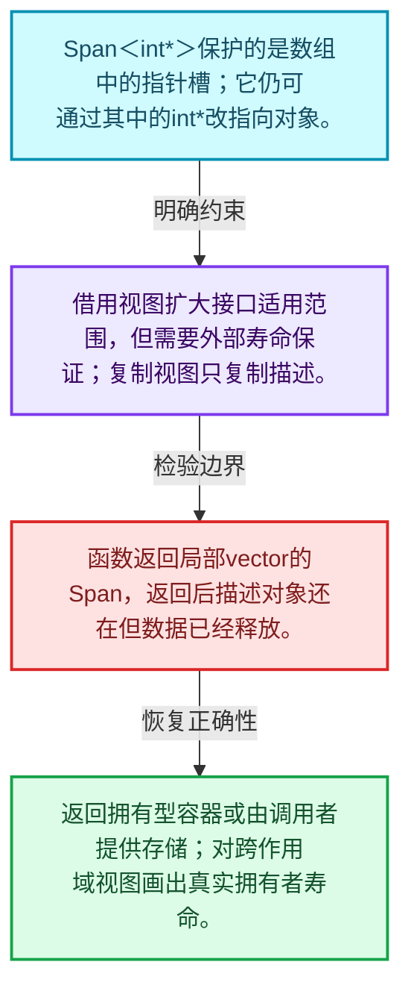
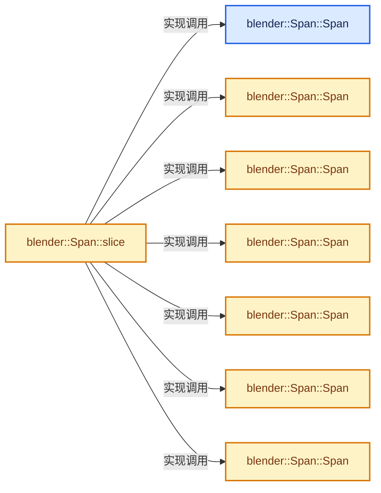
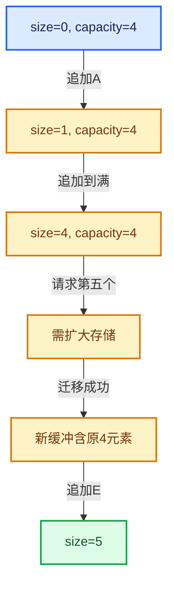

# 01-05 Span只读连续视图

[方向导航](README.md) · [总目录](../README.md) · [实现索引](../00-课程指南/02-源码与提交索引/符号依赖与实现索引.md)

## 从问题到实现

为什么传入数组不一定要传入拥有它的容器？

Span描述地址和长度，不管理元素寿命；只读元素并不意味着底层数据永远不会被其他别名修改。

**数据模型**

Span<int*>保护的是数组中的指针槽；它仍可通过其中的int*改指向对象。

**设计取舍**

借用视图扩大接口适用范围，但需要外部寿命保证；复制视图只复制描述。

**最小反例**

函数返回局部vector的Span，返回后描述对象还在但数据已经释放。

**推导**

返回拥有型容器或由调用者提供存储；对跨作用域视图画出真实拥有者寿命。

## 阅读地图与执行推演








图中的数值推演是本方向的教学模型；实际函数之间的调用边与概念分析边分别标注，不能把概念关系当作运行时调度顺序。

## 完整源码单元与就地讲解

中文讲解直接放在相关代码旁，复杂机制在代码下展开。原文折叠区保留基准行号；不需要在行号表和函数之间来回查找。类布局可分段展示，函数实现不按固定行数切开。

### 类型布局、声明与编译条件 · BLI_span.hh L1—L91

<a id="t-8765a8e0c1d5"></a>

`Span`在这里声明的数据成员：

- `T data_`
- `int64_t size_`

<!-- annotated:c3abdf486d2219 -->

```cpp
/* SPDX-FileCopyrightText: 2023 Blender Authors
 *
 * SPDX-License-Identifier: GPL-2.0-or-later */

#pragma once

/** \file
 * \ingroup bli
 *
 * An `Span<T>` references an array that is owned by someone else. It is just a
 * pointer and a size. Since the memory is not owned, Span should not be used to transfer
 * ownership. The array cannot be modified through the Span. However, if T is a non-const
 * pointer, the pointed-to elements can be modified.
 *
 * There is also `MutableSpan<T>`. It is mostly the same as Span, but allows the
 * array to be modified.
 *
 * A (Mutable)Span can refer to data owned by many different data structures including
 * Vector, Array, VectorSet, std::vector, std::array, std::string,
 * std::initializer_list and c-style array.
 *
 * `Span` is very similar to `std::span` (C++20). However, there are a few differences:
 * - `Span` is const by default. This is to avoid making things mutable when they don't
 *   have to be. To get a non-const span, you need to use `MutableSpan`. Below is a list
 *   of const-behavior-equivalent pairs of data structures:
 *   - std::span<int>                <==>  MutableSpan<int>
 *   - std::span<const int>          <==>  Span<int>
 *   - std::span<int *>              <==>  MutableSpan<int *>
 *   - std::span<const int *>        <==>  MutableSpan<const int *>
 *   - std::span<int * const>        <==>  Span<int *>
 *   - std::span<const int * const>  <==>  Span<const int *>
 * - `Span` always has a dynamic extent, while `std::span` can have a size that is
 *   determined at compile time. I did not have a use case for that yet. If we need it, we can
 *   decide to add this functionality to `Span` or introduce a new type like
 *   `FixedSpan<T, N>`.
 *
 * `Span<T>` should be your default choice when you have to pass a read-only array
 * into a function. It is better than passing a `const Vector &`, because e.g. then the function
 * only works for vectors and not arrays. Using Span as function parameter makes it usable in more
 * contexts, better expresses the intent and does not sacrifice performance. It is also better than
 * passing a raw pointer and size separately, because it is more convenient and safe.
 *
 * `MutableSpan<T>` can be used when a function is supposed to return an array, the
 * size of which is known before the function is called. One advantage of this approach is that the
 * caller is responsible for allocation and deallocation. Furthermore, the function can focus on
 * its task, without having to worry about memory allocation. Alternatively, a function could
 * return an Array or Vector.
 *
 * NOTE: When a function has a MutableSpan<T> output parameter and T is not a trivial type,
 * then the function has to specify whether the referenced array is expected to be initialized or
 * not.
 *
 * Since the arrays are only referenced, it is generally unsafe to store a Span. When you
 * store one, you should know who owns the memory.
 *
 * Instances of Span and MutableSpan are small and should be passed by value.
 */

#include <algorithm>
#include <array>
#include <vector>

#include "BLI_hash_fwd.hh"
#include "BLI_index_range.hh"
#include "BLI_memory_utils.hh"
#include "BLI_utildefines.hh"

namespace blender {

/**
 * References an array of type T that is owned by someone else. The data in the array cannot be
 * modified.
 */
template<typename T> class Span {
 public:
  using value_type = T;
  using pointer = T *;
  using const_pointer = const T *;
  using reference = T &;
  using const_reference = const T &;
  using iterator = const T *;
  using size_type = int64_t;

 protected:
  const T *data_ = nullptr;
  int64_t size_ = 0;

 public:
  /**
   * Create a reference to an empty array.
   */
```

<details>
<summary>核对原始源码：source/blender/blenlib/BLI_span.hh · L1—L91</summary>

<!-- original:c3abdf486d2219:source/blender/blenlib/BLI_span.hh:1:91 -->

```cpp
/* SPDX-FileCopyrightText: 2023 Blender Authors
 *
 * SPDX-License-Identifier: GPL-2.0-or-later */

#pragma once

/** \file
 * \ingroup bli
 *
 * An `Span<T>` references an array that is owned by someone else. It is just a
 * pointer and a size. Since the memory is not owned, Span should not be used to transfer
 * ownership. The array cannot be modified through the Span. However, if T is a non-const
 * pointer, the pointed-to elements can be modified.
 *
 * There is also `MutableSpan<T>`. It is mostly the same as Span, but allows the
 * array to be modified.
 *
 * A (Mutable)Span can refer to data owned by many different data structures including
 * Vector, Array, VectorSet, std::vector, std::array, std::string,
 * std::initializer_list and c-style array.
 *
 * `Span` is very similar to `std::span` (C++20). However, there are a few differences:
 * - `Span` is const by default. This is to avoid making things mutable when they don't
 *   have to be. To get a non-const span, you need to use `MutableSpan`. Below is a list
 *   of const-behavior-equivalent pairs of data structures:
 *   - std::span<int>                <==>  MutableSpan<int>
 *   - std::span<const int>          <==>  Span<int>
 *   - std::span<int *>              <==>  MutableSpan<int *>
 *   - std::span<const int *>        <==>  MutableSpan<const int *>
 *   - std::span<int * const>        <==>  Span<int *>
 *   - std::span<const int * const>  <==>  Span<const int *>
 * - `Span` always has a dynamic extent, while `std::span` can have a size that is
 *   determined at compile time. I did not have a use case for that yet. If we need it, we can
 *   decide to add this functionality to `Span` or introduce a new type like
 *   `FixedSpan<T, N>`.
 *
 * `Span<T>` should be your default choice when you have to pass a read-only array
 * into a function. It is better than passing a `const Vector &`, because e.g. then the function
 * only works for vectors and not arrays. Using Span as function parameter makes it usable in more
 * contexts, better expresses the intent and does not sacrifice performance. It is also better than
 * passing a raw pointer and size separately, because it is more convenient and safe.
 *
 * `MutableSpan<T>` can be used when a function is supposed to return an array, the
 * size of which is known before the function is called. One advantage of this approach is that the
 * caller is responsible for allocation and deallocation. Furthermore, the function can focus on
 * its task, without having to worry about memory allocation. Alternatively, a function could
 * return an Array or Vector.
 *
 * NOTE: When a function has a MutableSpan<T> output parameter and T is not a trivial type,
 * then the function has to specify whether the referenced array is expected to be initialized or
 * not.
 *
 * Since the arrays are only referenced, it is generally unsafe to store a Span. When you
 * store one, you should know who owns the memory.
 *
 * Instances of Span and MutableSpan are small and should be passed by value.
 */

#include <algorithm>
#include <array>
#include <vector>

#include "BLI_hash_fwd.hh"
#include "BLI_index_range.hh"
#include "BLI_memory_utils.hh"
#include "BLI_utildefines.hh"

namespace blender {

/**
 * References an array of type T that is owned by someone else. The data in the array cannot be
 * modified.
 */
template<typename T> class Span {
 public:
  using value_type = T;
  using pointer = T *;
  using const_pointer = const T *;
  using reference = T &;
  using const_reference = const T &;
  using iterator = const T *;
  using size_type = int64_t;

 protected:
  const T *data_ = nullptr;
  int64_t size_ = 0;

 public:
  /**
   * Create a reference to an empty array.
   */
```

</details>

<a id="f-e40cbae1aae23eb8"></a>

### `blender::Span::Span`

实现位置：[source/blender/blenlib/BLI_span.hh](../../../../../source/blender/blenlib/BLI_span.hh) · L92—L92。

**教学注释版**

<!-- annotated:a93e52567e9768 -->

```cpp
  constexpr Span() = default;
```

<details>
<summary>核对原始源码：source/blender/blenlib/BLI_span.hh · L92—L92</summary>

<!-- original:a93e52567e9768:source/blender/blenlib/BLI_span.hh:92:92 -->

```cpp
  constexpr Span() = default;
```

</details>

**继续追踪实现**

本实现没有需要继续展开的显式调用；检查返回表达式、对象转换和调用者前置条件。

<!-- annotated:42111001c6faca -->

```cpp

```

<details>
<summary>核对原始源码：source/blender/blenlib/BLI_span.hh · L93—L93</summary>

<!-- original:42111001c6faca:source/blender/blenlib/BLI_span.hh:93:93 -->

```cpp

```

</details>

<a id="f-8e13b31cdc54dc44"></a>

### `blender::Span::Span`

实现位置：[source/blender/blenlib/BLI_span.hh](../../../../../source/blender/blenlib/BLI_span.hh) · L94—L97。

接口参数：

- `const T *start`
- `int64_t size`

**教学注释版**

<!-- annotated:16f909bdf5d1eb -->

```cpp
  constexpr Span(const T *start, int64_t size) : data_(start), size_(size)
  {
    BLI_assert(size >= 0);
  }
```

<details>
<summary>核对原始源码：source/blender/blenlib/BLI_span.hh · L94—L97</summary>

<!-- original:16f909bdf5d1eb:source/blender/blenlib/BLI_span.hh:94:97 -->

```cpp
  constexpr Span(const T *start, int64_t size) : data_(start), size_(size)
  {
    BLI_assert(size >= 0);
  }
```

</details>

**继续追踪实现**

- `BLI_assert` → [BLI_assert · L48](../90-实现依赖专题/01-BLI基础库/BLI_assert.hh.md#m-57a88495704d)；[BLI_assert · L63](../90-实现依赖专题/01-BLI基础库/BLI_assert.hh.md#m-d07050020cb5)。宏定义由构建条件选择。

<!-- annotated:a0820d00717a37 -->

```cpp

```

<details>
<summary>核对原始源码：source/blender/blenlib/BLI_span.hh · L98—L98</summary>

<!-- original:a0820d00717a37:source/blender/blenlib/BLI_span.hh:98:98 -->

```cpp

```

</details>

<a id="f-e3f5617e03851c03"></a>

### `blender::Span::Span`

实现位置：[source/blender/blenlib/BLI_span.hh](../../../../../source/blender/blenlib/BLI_span.hh) · L99—L105。

接口参数：

- `const U *start`
- `int64_t size`

**教学注释版**

<!-- annotated:fdbd7955949593 -->

```cpp
  template<typename U>
  constexpr Span(const U *start, int64_t size)
    requires(is_span_convertible_pointer_v<U, T>)
      : data_(static_cast<const T *>(start)), size_(size)
  {
    BLI_assert(size >= 0);
  }
```

<details>
<summary>核对原始源码：source/blender/blenlib/BLI_span.hh · L99—L105</summary>

<!-- original:fdbd7955949593:source/blender/blenlib/BLI_span.hh:99:105 -->

```cpp
  template<typename U>
  constexpr Span(const U *start, int64_t size)
    requires(is_span_convertible_pointer_v<U, T>)
      : data_(static_cast<const T *>(start)), size_(size)
  {
    BLI_assert(size >= 0);
  }
```

</details>

**继续追踪实现**

- `BLI_assert` → [BLI_assert · L48](../90-实现依赖专题/01-BLI基础库/BLI_assert.hh.md#m-57a88495704d)；[BLI_assert · L63](../90-实现依赖专题/01-BLI基础库/BLI_assert.hh.md#m-d07050020cb5)。宏定义由构建条件选择。

### 类型布局、声明与编译条件 · BLI_span.hh L106—L117

<!-- annotated:52475ec5a81f25 -->

```cpp

  /**
   * Reference an initializer_list. Note that the data in the initializer_list is only valid until
   * the expression containing it is fully computed.
   *
   * Do:
   *  call_function_with_array({1, 2, 3, 4});
   *
   * Don't:
   *  Span<int> span = {1, 2, 3, 4};
   *  call_function_with_array(span);
   */
```

<details>
<summary>核对原始源码：source/blender/blenlib/BLI_span.hh · L106—L117</summary>

<!-- original:52475ec5a81f25:source/blender/blenlib/BLI_span.hh:106:117 -->

```cpp

  /**
   * Reference an initializer_list. Note that the data in the initializer_list is only valid until
   * the expression containing it is fully computed.
   *
   * Do:
   *  call_function_with_array({1, 2, 3, 4});
   *
   * Don't:
   *  Span<int> span = {1, 2, 3, 4};
   *  call_function_with_array(span);
   */
```

</details>

<a id="f-6dbccc3a78910bb7"></a>

### `blender::Span::Span`

实现位置：[source/blender/blenlib/BLI_span.hh](../../../../../source/blender/blenlib/BLI_span.hh) · L118—L120。

接口参数：

- `const std::initializer_list<T> &list`

**教学注释版**

<!-- annotated:d64fa20e90627d -->

```cpp
  constexpr Span(const std::initializer_list<T> &list) : Span(list.begin(), int64_t(list.size()))
  {
  }
```

<details>
<summary>核对原始源码：source/blender/blenlib/BLI_span.hh · L118—L120</summary>

<!-- original:d64fa20e90627d:source/blender/blenlib/BLI_span.hh:118:120 -->

```cpp
  constexpr Span(const std::initializer_list<T> &list) : Span(list.begin(), int64_t(list.size()))
  {
  }
```

</details>

**继续追踪实现**

本实现没有需要继续展开的显式调用；检查返回表达式、对象转换和调用者前置条件。

<!-- annotated:f47521ca28c801 -->

```cpp

```

<details>
<summary>核对原始源码：source/blender/blenlib/BLI_span.hh · L121—L121</summary>

<!-- original:f47521ca28c801:source/blender/blenlib/BLI_span.hh:121:121 -->

```cpp

```

</details>

<a id="f-0692c02d691e68a6"></a>

### `blender::Span::Span`

实现位置：[source/blender/blenlib/BLI_span.hh](../../../../../source/blender/blenlib/BLI_span.hh) · L122—L122。

接口参数：

- `const std::vector<T> &vector`

**教学注释版**

<!-- annotated:6028c4ce31daf9 -->

```cpp
  constexpr Span(const std::vector<T> &vector) : Span(vector.data(), int64_t(vector.size())) {}
```

<details>
<summary>核对原始源码：source/blender/blenlib/BLI_span.hh · L122—L122</summary>

<!-- original:6028c4ce31daf9:source/blender/blenlib/BLI_span.hh:122:122 -->

```cpp
  constexpr Span(const std::vector<T> &vector) : Span(vector.data(), int64_t(vector.size())) {}
```

</details>

**继续追踪实现**

本实现没有需要继续展开的显式调用；检查返回表达式、对象转换和调用者前置条件。

<!-- annotated:86697f1e9ef087 -->

```cpp

```

<details>
<summary>核对原始源码：source/blender/blenlib/BLI_span.hh · L123—L123</summary>

<!-- original:86697f1e9ef087:source/blender/blenlib/BLI_span.hh:123:123 -->

```cpp

```

</details>

<a id="f-45073fe4b3cefa46"></a>

### `blender::Span::Span`

实现位置：[source/blender/blenlib/BLI_span.hh](../../../../../source/blender/blenlib/BLI_span.hh) · L124—L124。

接口参数：

- `const std::array<T, N> &array`

**教学注释版**

<!-- annotated:6f380caa4d2ed2 -->

```cpp
  template<std::size_t N> constexpr Span(const std::array<T, N> &array) : Span(array.data(), N) {}
```

<details>
<summary>核对原始源码：source/blender/blenlib/BLI_span.hh · L124—L124</summary>

<!-- original:6f380caa4d2ed2:source/blender/blenlib/BLI_span.hh:124:124 -->

```cpp
  template<std::size_t N> constexpr Span(const std::array<T, N> &array) : Span(array.data(), N) {}
```

</details>

**继续追踪实现**

本实现没有需要继续展开的显式调用；检查返回表达式、对象转换和调用者前置条件。

### 类型布局、声明与编译条件 · BLI_span.hh L125—L129

<!-- annotated:0e95f2ed7c72a2 -->

```cpp

  /**
   * Support implicit conversions like the one below:
   *   Span<T *> -> Span<const T *>
   */
```

<details>
<summary>核对原始源码：source/blender/blenlib/BLI_span.hh · L125—L129</summary>

<!-- original:0e95f2ed7c72a2:source/blender/blenlib/BLI_span.hh:125:129 -->

```cpp

  /**
   * Support implicit conversions like the one below:
   *   Span<T *> -> Span<const T *>
   */
```

</details>

<a id="f-b2e1b3c3e3349048"></a>

### `blender::Span::Span`

实现位置：[source/blender/blenlib/BLI_span.hh](../../../../../source/blender/blenlib/BLI_span.hh) · L130—L135。

接口参数：

- `Span<U> span`

**教学注释版**

<!-- annotated:5bbb82ba6a4b9b -->

```cpp
  template<typename U>
  constexpr Span(Span<U> span)
    requires(is_span_convertible_pointer_v<U, T>)
      : data_(static_cast<const T *>(span.data())), size_(span.size())
  {
  }
```

<details>
<summary>核对原始源码：source/blender/blenlib/BLI_span.hh · L130—L135</summary>

<!-- original:5bbb82ba6a4b9b:source/blender/blenlib/BLI_span.hh:130:135 -->

```cpp
  template<typename U>
  constexpr Span(Span<U> span)
    requires(is_span_convertible_pointer_v<U, T>)
      : data_(static_cast<const T *>(span.data())), size_(span.size())
  {
  }
```

</details>

**继续追踪实现**

本实现没有需要继续展开的显式调用；检查返回表达式、对象转换和调用者前置条件。

### 类型布局、声明与编译条件 · BLI_span.hh L136—L140

<!-- annotated:619dfb307e12ef -->

```cpp

  /**
   * Returns a contiguous part of the array. This invokes undefined behavior when the start or size
   * is negative.
   */
```

<details>
<summary>核对原始源码：source/blender/blenlib/BLI_span.hh · L136—L140</summary>

<!-- original:619dfb307e12ef:source/blender/blenlib/BLI_span.hh:136:140 -->

```cpp

  /**
   * Returns a contiguous part of the array. This invokes undefined behavior when the start or size
   * is negative.
   */
```

</details>

<a id="f-380a0e8fdcbd53cc"></a>

### `blender::Span::slice`

建立原连续范围的子视图。

实现位置：[source/blender/blenlib/BLI_span.hh](../../../../../source/blender/blenlib/BLI_span.hh) · L141—L147。

接口参数：

- `int64_t start`
- `int64_t size`

**教学注释版**

<!-- annotated:9998764eb4ad74 -->

```cpp
  constexpr Span slice(int64_t start, int64_t size) const
  {
    BLI_assert(start >= 0);
    BLI_assert(size >= 0);
    BLI_assert(start + size <= size_ || size == 0);
    return Span(data_ + start, size);
  }
```

<details>
<summary>核对原始源码：source/blender/blenlib/BLI_span.hh · L141—L147</summary>

<!-- original:9998764eb4ad74:source/blender/blenlib/BLI_span.hh:141:147 -->

```cpp
  constexpr Span slice(int64_t start, int64_t size) const
  {
    BLI_assert(start >= 0);
    BLI_assert(size >= 0);
    BLI_assert(start + size <= size_ || size == 0);
    return Span(data_ + start, size);
  }
```

</details>

**接口与不变量**

子视图只调整地址和长度，不复制元素；普通slice的前置条件与safe版本截断行为应分开阅读。

**结果出口**

- `return Span(data_ + start, size);`

**继续追踪实现**

- `BLI_assert` → [BLI_assert · L48](../90-实现依赖专题/01-BLI基础库/BLI_assert.hh.md#m-57a88495704d)；[BLI_assert · L63](../90-实现依赖专题/01-BLI基础库/BLI_assert.hh.md#m-d07050020cb5)。宏定义由构建条件选择。
- `Span` → [blender::Span::Span · L92](05-Span只读连续视图.md#f-e40cbae1aae23eb8)；[blender::Span::Span · L94](05-Span只读连续视图.md#f-8e13b31cdc54dc44)；[blender::Span::Span · L99](05-Span只读连续视图.md#f-e3f5617e03851c03)；[blender::Span::Span · L118](05-Span只读连续视图.md#f-6dbccc3a78910bb7)；[blender::Span::Span · L122](05-Span只读连续视图.md#f-0692c02d691e68a6)；[blender::Span::Span · L124](05-Span只读连续视图.md#f-45073fe4b3cefa46)；[blender::Span::Span · L130](05-Span只读连续视图.md#f-b2e1b3c3e3349048)。同名重载需按实参类型选择。

<!-- annotated:10bac87ce4fc09 -->

```cpp

```

<details>
<summary>核对原始源码：source/blender/blenlib/BLI_span.hh · L148—L148</summary>

<!-- original:10bac87ce4fc09:source/blender/blenlib/BLI_span.hh:148:148 -->

```cpp

```

</details>

<a id="f-9b9c15e78dd54eec"></a>

### `blender::Span::slice`

建立原连续范围的子视图。

实现位置：[source/blender/blenlib/BLI_span.hh](../../../../../source/blender/blenlib/BLI_span.hh) · L149—L152。

接口参数：

- `IndexRange range`

**教学注释版**

<!-- annotated:33a278bf27eb1e -->

```cpp
  constexpr Span slice(IndexRange range) const
  {
    // [讲解] this->slice：建立原连续范围的子视图。
    return this->slice(range.start(), range.size());
  }
```

<details>
<summary>核对原始源码：source/blender/blenlib/BLI_span.hh · L149—L152</summary>

<!-- original:33a278bf27eb1e:source/blender/blenlib/BLI_span.hh:149:152 -->

```cpp
  constexpr Span slice(IndexRange range) const
  {
    return this->slice(range.start(), range.size());
  }
```

</details>

**接口与不变量**

子视图只调整地址和长度，不复制元素；普通slice的前置条件与safe版本截断行为应分开阅读。

**结果出口**

- `return this->slice(range.start(), range.size());`

**继续追踪实现**

- `this->slice` → [blender::Span::slice · L141](05-Span只读连续视图.md#f-380a0e8fdcbd53cc)；[blender::Span::slice · L149](05-Span只读连续视图.md#f-9b9c15e78dd54eec)。同名重载需按实参类型选择。
- `range.start` → [blender::IndexRange::start · L243](04-IndexRange连续整数区间.md#f-99d2195bd9cfd1f0)。
- `range.size` → [blender::IndexRange::size · L156](04-IndexRange连续整数区间.md#f-05f66c3ebb2fdfec)。

### 类型布局、声明与编译条件 · BLI_span.hh L153—L157

<!-- annotated:78cc48efa5af3d -->

```cpp

  /**
   * Returns a contiguous part of the array. This invokes undefined behavior when the start or size
   * is negative. Clamps the size of the new span so it fits in the current one.
   */
```

<details>
<summary>核对原始源码：source/blender/blenlib/BLI_span.hh · L153—L157</summary>

<!-- original:78cc48efa5af3d:source/blender/blenlib/BLI_span.hh:153:157 -->

```cpp

  /**
   * Returns a contiguous part of the array. This invokes undefined behavior when the start or size
   * is negative. Clamps the size of the new span so it fits in the current one.
   */
```

</details>

<a id="f-5ffbda70864e9d0b"></a>

### `blender::Span::slice_safe`

建立原连续范围的子视图。

实现位置：[source/blender/blenlib/BLI_span.hh](../../../../../source/blender/blenlib/BLI_span.hh) · L158—L164。

接口参数：

- `const int64_t start`
- `const int64_t size`

**教学注释版**

<!-- annotated:4ce7a07b42f777 -->

```cpp
  constexpr Span slice_safe(const int64_t start, const int64_t size) const
  {
    BLI_assert(start >= 0);
    BLI_assert(size >= 0);
    // [讲解] std::max<int64_t>：按比较关系选取较大值。本讲解中的增长公式同时满足最低请求和几何增长；若保存返回引用，还需注意实参寿命。
    const int64_t new_size = std::max<int64_t>(0, std::min(size, size_ - start));
    return Span(data_ ? data_ + start : nullptr, new_size);
  }
```

<details>
<summary>核对原始源码：source/blender/blenlib/BLI_span.hh · L158—L164</summary>

<!-- original:4ce7a07b42f777:source/blender/blenlib/BLI_span.hh:158:164 -->

```cpp
  constexpr Span slice_safe(const int64_t start, const int64_t size) const
  {
    BLI_assert(start >= 0);
    BLI_assert(size >= 0);
    const int64_t new_size = std::max<int64_t>(0, std::min(size, size_ - start));
    return Span(data_ ? data_ + start : nullptr, new_size);
  }
```

</details>

**接口与不变量**

子视图只调整地址和长度，不复制元素；普通slice的前置条件与safe版本截断行为应分开阅读。

**结果出口**

- `return Span(data_ ? data_ + start : nullptr, new_size);`

**继续追踪实现**

- `BLI_assert` → [BLI_assert · L48](../90-实现依赖专题/01-BLI基础库/BLI_assert.hh.md#m-57a88495704d)；[BLI_assert · L63](../90-实现依赖专题/01-BLI基础库/BLI_assert.hh.md#m-d07050020cb5)。宏定义由构建条件选择。
- `std::max<int64_t>` → [外部契约](https://eel.is/c++draft/alg.min.max)：按比较关系选取较大值。本讲解中的增长公式同时满足最低请求和几何增长；若保存返回引用，还需注意实参寿命。
- `std::min` → [外部契约](https://eel.is/c++draft/alg.min.max)：按比较关系选取较小值；截断范围时还需先满足非负和可表示范围，min本身不会证明边界安全。
- `Span` → [blender::Span::Span · L92](05-Span只读连续视图.md#f-e40cbae1aae23eb8)；[blender::Span::Span · L94](05-Span只读连续视图.md#f-8e13b31cdc54dc44)；[blender::Span::Span · L99](05-Span只读连续视图.md#f-e3f5617e03851c03)；[blender::Span::Span · L118](05-Span只读连续视图.md#f-6dbccc3a78910bb7)；[blender::Span::Span · L122](05-Span只读连续视图.md#f-0692c02d691e68a6)；[blender::Span::Span · L124](05-Span只读连续视图.md#f-45073fe4b3cefa46)；[blender::Span::Span · L130](05-Span只读连续视图.md#f-b2e1b3c3e3349048)。同名重载需按实参类型选择。

<!-- annotated:971f62ce377980 -->

```cpp

```

<details>
<summary>核对原始源码：source/blender/blenlib/BLI_span.hh · L165—L165</summary>

<!-- original:971f62ce377980:source/blender/blenlib/BLI_span.hh:165:165 -->

```cpp

```

</details>

<a id="f-8438e78e505b5ff4"></a>

### `blender::Span::slice_safe`

建立原连续范围的子视图。

实现位置：[source/blender/blenlib/BLI_span.hh](../../../../../source/blender/blenlib/BLI_span.hh) · L166—L169。

接口参数：

- `IndexRange range`

**教学注释版**

<!-- annotated:daae548bdddf55 -->

```cpp
  constexpr Span slice_safe(IndexRange range) const
  {
    // [讲解] this->slice_safe：建立原连续范围的子视图。
    return this->slice_safe(range.start(), range.size());
  }
```

<details>
<summary>核对原始源码：source/blender/blenlib/BLI_span.hh · L166—L169</summary>

<!-- original:daae548bdddf55:source/blender/blenlib/BLI_span.hh:166:169 -->

```cpp
  constexpr Span slice_safe(IndexRange range) const
  {
    return this->slice_safe(range.start(), range.size());
  }
```

</details>

**接口与不变量**

子视图只调整地址和长度，不复制元素；普通slice的前置条件与safe版本截断行为应分开阅读。

**结果出口**

- `return this->slice_safe(range.start(), range.size());`

**继续追踪实现**

- `this->slice_safe` → [blender::Span::slice_safe · L158](05-Span只读连续视图.md#f-5ffbda70864e9d0b)；[blender::Span::slice_safe · L166](05-Span只读连续视图.md#f-8438e78e505b5ff4)。同名重载需按实参类型选择。
- `range.start` → [blender::IndexRange::start · L243](04-IndexRange连续整数区间.md#f-99d2195bd9cfd1f0)。
- `range.size` → [blender::IndexRange::size · L156](04-IndexRange连续整数区间.md#f-05f66c3ebb2fdfec)。

### 类型布局、声明与编译条件 · BLI_span.hh L170—L174

<!-- annotated:c51cfe9a44f89d -->

```cpp

  /**
   * Returns a new Span with n elements removed from the beginning. This invokes undefined
   * behavior when n is negative.
   */
```

<details>
<summary>核对原始源码：source/blender/blenlib/BLI_span.hh · L170—L174</summary>

<!-- original:c51cfe9a44f89d:source/blender/blenlib/BLI_span.hh:170:174 -->

```cpp

  /**
   * Returns a new Span with n elements removed from the beginning. This invokes undefined
   * behavior when n is negative.
   */
```

</details>

<a id="f-932897accbde3413"></a>

### `blender::Span::drop_front`

从两端裁去或选取一定数量元素形成新视图。

实现位置：[source/blender/blenlib/BLI_span.hh](../../../../../source/blender/blenlib/BLI_span.hh) · L175—L180。

接口参数：

- `int64_t n`

**教学注释版**

<!-- annotated:3c58e78e120d3c -->

```cpp
  constexpr Span drop_front(int64_t n) const
  {
    BLI_assert(n >= 0);
    // [讲解] std::max<int64_t>：按比较关系选取较大值。本讲解中的增长公式同时满足最低请求和几何增长；若保存返回引用，还需注意实参寿命。
    const int64_t new_size = std::max<int64_t>(0, size_ - n);
    return Span(data_ + n, new_size);
  }
```

<details>
<summary>核对原始源码：source/blender/blenlib/BLI_span.hh · L175—L180</summary>

<!-- original:3c58e78e120d3c:source/blender/blenlib/BLI_span.hh:175:180 -->

```cpp
  constexpr Span drop_front(int64_t n) const
  {
    BLI_assert(n >= 0);
    const int64_t new_size = std::max<int64_t>(0, size_ - n);
    return Span(data_ + n, new_size);
  }
```

</details>

**接口与不变量**

所有视图仍借用同一拥有者；参数合法范围按实际实现检查，不把空结果当作任意地址运算都安全。

**结果出口**

- `return Span(data_ + n, new_size);`

**继续追踪实现**

- `BLI_assert` → [BLI_assert · L48](../90-实现依赖专题/01-BLI基础库/BLI_assert.hh.md#m-57a88495704d)；[BLI_assert · L63](../90-实现依赖专题/01-BLI基础库/BLI_assert.hh.md#m-d07050020cb5)。宏定义由构建条件选择。
- `std::max<int64_t>` → [外部契约](https://eel.is/c++draft/alg.min.max)：按比较关系选取较大值。本讲解中的增长公式同时满足最低请求和几何增长；若保存返回引用，还需注意实参寿命。
- `Span` → [blender::Span::Span · L92](05-Span只读连续视图.md#f-e40cbae1aae23eb8)；[blender::Span::Span · L94](05-Span只读连续视图.md#f-8e13b31cdc54dc44)；[blender::Span::Span · L99](05-Span只读连续视图.md#f-e3f5617e03851c03)；[blender::Span::Span · L118](05-Span只读连续视图.md#f-6dbccc3a78910bb7)；[blender::Span::Span · L122](05-Span只读连续视图.md#f-0692c02d691e68a6)；[blender::Span::Span · L124](05-Span只读连续视图.md#f-45073fe4b3cefa46)；[blender::Span::Span · L130](05-Span只读连续视图.md#f-b2e1b3c3e3349048)。同名重载需按实参类型选择。

### 类型布局、声明与编译条件 · BLI_span.hh L181—L185

<!-- annotated:3dad896933a82a -->

```cpp

  /**
   * Returns a new Span with n elements removed from the end. This invokes undefined behavior when
   * n is negative.
   */
```

<details>
<summary>核对原始源码：source/blender/blenlib/BLI_span.hh · L181—L185</summary>

<!-- original:3dad896933a82a:source/blender/blenlib/BLI_span.hh:181:185 -->

```cpp

  /**
   * Returns a new Span with n elements removed from the end. This invokes undefined behavior when
   * n is negative.
   */
```

</details>

<a id="f-fbabd5706815d493"></a>

### `blender::Span::drop_back`

从两端裁去或选取一定数量元素形成新视图。

实现位置：[source/blender/blenlib/BLI_span.hh](../../../../../source/blender/blenlib/BLI_span.hh) · L186—L191。

接口参数：

- `int64_t n`

**教学注释版**

<!-- annotated:c6a86da60c61fa -->

```cpp
  constexpr Span drop_back(int64_t n) const
  {
    BLI_assert(n >= 0);
    // [讲解] std::max<int64_t>：按比较关系选取较大值。本讲解中的增长公式同时满足最低请求和几何增长；若保存返回引用，还需注意实参寿命。
    const int64_t new_size = std::max<int64_t>(0, size_ - n);
    return Span(data_, new_size);
  }
```

<details>
<summary>核对原始源码：source/blender/blenlib/BLI_span.hh · L186—L191</summary>

<!-- original:c6a86da60c61fa:source/blender/blenlib/BLI_span.hh:186:191 -->

```cpp
  constexpr Span drop_back(int64_t n) const
  {
    BLI_assert(n >= 0);
    const int64_t new_size = std::max<int64_t>(0, size_ - n);
    return Span(data_, new_size);
  }
```

</details>

**接口与不变量**

所有视图仍借用同一拥有者；参数合法范围按实际实现检查，不把空结果当作任意地址运算都安全。

**结果出口**

- `return Span(data_, new_size);`

**继续追踪实现**

- `BLI_assert` → [BLI_assert · L48](../90-实现依赖专题/01-BLI基础库/BLI_assert.hh.md#m-57a88495704d)；[BLI_assert · L63](../90-实现依赖专题/01-BLI基础库/BLI_assert.hh.md#m-d07050020cb5)。宏定义由构建条件选择。
- `std::max<int64_t>` → [外部契约](https://eel.is/c++draft/alg.min.max)：按比较关系选取较大值。本讲解中的增长公式同时满足最低请求和几何增长；若保存返回引用，还需注意实参寿命。
- `Span` → [blender::Span::Span · L92](05-Span只读连续视图.md#f-e40cbae1aae23eb8)；[blender::Span::Span · L94](05-Span只读连续视图.md#f-8e13b31cdc54dc44)；[blender::Span::Span · L99](05-Span只读连续视图.md#f-e3f5617e03851c03)；[blender::Span::Span · L118](05-Span只读连续视图.md#f-6dbccc3a78910bb7)；[blender::Span::Span · L122](05-Span只读连续视图.md#f-0692c02d691e68a6)；[blender::Span::Span · L124](05-Span只读连续视图.md#f-45073fe4b3cefa46)；[blender::Span::Span · L130](05-Span只读连续视图.md#f-b2e1b3c3e3349048)。同名重载需按实参类型选择。

### 类型布局、声明与编译条件 · BLI_span.hh L192—L196

<!-- annotated:a15528fdb82969 -->

```cpp

  /**
   * Returns a new Span that only contains the first n elements. This invokes undefined
   * behavior when n is negative.
   */
```

<details>
<summary>核对原始源码：source/blender/blenlib/BLI_span.hh · L192—L196</summary>

<!-- original:a15528fdb82969:source/blender/blenlib/BLI_span.hh:192:196 -->

```cpp

  /**
   * Returns a new Span that only contains the first n elements. This invokes undefined
   * behavior when n is negative.
   */
```

</details>

<a id="f-1556b8b4aac9d42f"></a>

### `blender::Span::take_front`

从两端裁去或选取一定数量元素形成新视图。

实现位置：[source/blender/blenlib/BLI_span.hh](../../../../../source/blender/blenlib/BLI_span.hh) · L197—L202。

接口参数：

- `int64_t n`

**教学注释版**

<!-- annotated:576441feb2176c -->

```cpp
  constexpr Span take_front(int64_t n) const
  {
    BLI_assert(n >= 0);
    // [讲解] std::min<int64_t>：按比较关系选取较小值；截断范围时还需先满足非负和可表示范围，min本身不会证明边界安全。
    const int64_t new_size = std::min<int64_t>(size_, n);
    return Span(data_, new_size);
  }
```

<details>
<summary>核对原始源码：source/blender/blenlib/BLI_span.hh · L197—L202</summary>

<!-- original:576441feb2176c:source/blender/blenlib/BLI_span.hh:197:202 -->

```cpp
  constexpr Span take_front(int64_t n) const
  {
    BLI_assert(n >= 0);
    const int64_t new_size = std::min<int64_t>(size_, n);
    return Span(data_, new_size);
  }
```

</details>

**接口与不变量**

所有视图仍借用同一拥有者；参数合法范围按实际实现检查，不把空结果当作任意地址运算都安全。

**结果出口**

- `return Span(data_, new_size);`

**继续追踪实现**

- `BLI_assert` → [BLI_assert · L48](../90-实现依赖专题/01-BLI基础库/BLI_assert.hh.md#m-57a88495704d)；[BLI_assert · L63](../90-实现依赖专题/01-BLI基础库/BLI_assert.hh.md#m-d07050020cb5)。宏定义由构建条件选择。
- `std::min<int64_t>` → [外部契约](https://eel.is/c++draft/alg.min.max)：按比较关系选取较小值；截断范围时还需先满足非负和可表示范围，min本身不会证明边界安全。
- `Span` → [blender::Span::Span · L92](05-Span只读连续视图.md#f-e40cbae1aae23eb8)；[blender::Span::Span · L94](05-Span只读连续视图.md#f-8e13b31cdc54dc44)；[blender::Span::Span · L99](05-Span只读连续视图.md#f-e3f5617e03851c03)；[blender::Span::Span · L118](05-Span只读连续视图.md#f-6dbccc3a78910bb7)；[blender::Span::Span · L122](05-Span只读连续视图.md#f-0692c02d691e68a6)；[blender::Span::Span · L124](05-Span只读连续视图.md#f-45073fe4b3cefa46)；[blender::Span::Span · L130](05-Span只读连续视图.md#f-b2e1b3c3e3349048)。同名重载需按实参类型选择。

### 类型布局、声明与编译条件 · BLI_span.hh L203—L207

<!-- annotated:fac34562b0f00b -->

```cpp

  /**
   * Returns a new Span that only contains the last n elements. This invokes undefined
   * behavior when n is negative.
   */
```

<details>
<summary>核对原始源码：source/blender/blenlib/BLI_span.hh · L203—L207</summary>

<!-- original:fac34562b0f00b:source/blender/blenlib/BLI_span.hh:203:207 -->

```cpp

  /**
   * Returns a new Span that only contains the last n elements. This invokes undefined
   * behavior when n is negative.
   */
```

</details>

<a id="f-6767e3f6b257ca29"></a>

### `blender::Span::take_back`

从两端裁去或选取一定数量元素形成新视图。

实现位置：[source/blender/blenlib/BLI_span.hh](../../../../../source/blender/blenlib/BLI_span.hh) · L208—L213。

接口参数：

- `int64_t n`

**教学注释版**

<!-- annotated:76b15ffcff1276 -->

```cpp
  constexpr Span take_back(int64_t n) const
  {
    BLI_assert(n >= 0);
    // [讲解] std::min<int64_t>：按比较关系选取较小值；截断范围时还需先满足非负和可表示范围，min本身不会证明边界安全。
    const int64_t new_size = std::min<int64_t>(size_, n);
    return Span(data_ + size_ - new_size, new_size);
  }
```

<details>
<summary>核对原始源码：source/blender/blenlib/BLI_span.hh · L208—L213</summary>

<!-- original:76b15ffcff1276:source/blender/blenlib/BLI_span.hh:208:213 -->

```cpp
  constexpr Span take_back(int64_t n) const
  {
    BLI_assert(n >= 0);
    const int64_t new_size = std::min<int64_t>(size_, n);
    return Span(data_ + size_ - new_size, new_size);
  }
```

</details>

**接口与不变量**

所有视图仍借用同一拥有者；参数合法范围按实际实现检查，不把空结果当作任意地址运算都安全。

**结果出口**

- `return Span(data_ + size_ - new_size, new_size);`

**继续追踪实现**

- `BLI_assert` → [BLI_assert · L48](../90-实现依赖专题/01-BLI基础库/BLI_assert.hh.md#m-57a88495704d)；[BLI_assert · L63](../90-实现依赖专题/01-BLI基础库/BLI_assert.hh.md#m-d07050020cb5)。宏定义由构建条件选择。
- `std::min<int64_t>` → [外部契约](https://eel.is/c++draft/alg.min.max)：按比较关系选取较小值；截断范围时还需先满足非负和可表示范围，min本身不会证明边界安全。
- `Span` → [blender::Span::Span · L92](05-Span只读连续视图.md#f-e40cbae1aae23eb8)；[blender::Span::Span · L94](05-Span只读连续视图.md#f-8e13b31cdc54dc44)；[blender::Span::Span · L99](05-Span只读连续视图.md#f-e3f5617e03851c03)；[blender::Span::Span · L118](05-Span只读连续视图.md#f-6dbccc3a78910bb7)；[blender::Span::Span · L122](05-Span只读连续视图.md#f-0692c02d691e68a6)；[blender::Span::Span · L124](05-Span只读连续视图.md#f-45073fe4b3cefa46)；[blender::Span::Span · L130](05-Span只读连续视图.md#f-b2e1b3c3e3349048)。同名重载需按实参类型选择。

### 类型布局、声明与编译条件 · BLI_span.hh L214—L218

<!-- annotated:17885efc0d919b -->

```cpp

  /**
   * Returns the pointer to the beginning of the referenced array. This may be nullptr when the
   * size is zero.
   */
```

<details>
<summary>核对原始源码：source/blender/blenlib/BLI_span.hh · L214—L218</summary>

<!-- original:17885efc0d919b:source/blender/blenlib/BLI_span.hh:214:218 -->

```cpp

  /**
   * Returns the pointer to the beginning of the referenced array. This may be nullptr when the
   * size is zero.
   */
```

</details>

<a id="f-10c5889198935800"></a>

### `blender::Span::data`

返回借用范围的地址。

实现位置：[source/blender/blenlib/BLI_span.hh](../../../../../source/blender/blenlib/BLI_span.hh) · L219—L222。

**教学注释版**

<!-- annotated:9539b1aa2f5a26 -->

```cpp
  constexpr const T *data() const
  {
    return data_;
  }
```

<details>
<summary>核对原始源码：source/blender/blenlib/BLI_span.hh · L219—L222</summary>

<!-- original:9539b1aa2f5a26:source/blender/blenlib/BLI_span.hh:219:222 -->

```cpp
  constexpr const T *data() const
  {
    return data_;
  }
```

</details>

**接口与不变量**

复制指针或视图不延长底层数组寿命，尾后位置只用于范围边界。

**结果出口**

- `return data_;`

**继续追踪实现**

本实现没有需要继续展开的显式调用；检查返回表达式、对象转换和调用者前置条件。

<!-- annotated:cf7eef0cfd9175 -->

```cpp

```

<details>
<summary>核对原始源码：source/blender/blenlib/BLI_span.hh · L223—L223</summary>

<!-- original:cf7eef0cfd9175:source/blender/blenlib/BLI_span.hh:223:223 -->

```cpp

```

</details>

<a id="f-415883b512284f46"></a>

### `blender::Span::begin`

返回借用范围的地址。

实现位置：[source/blender/blenlib/BLI_span.hh](../../../../../source/blender/blenlib/BLI_span.hh) · L224—L227。

**教学注释版**

<!-- annotated:da763c5e4e2624 -->

```cpp
  constexpr const T *begin() const
  {
    return data_;
  }
```

<details>
<summary>核对原始源码：source/blender/blenlib/BLI_span.hh · L224—L227</summary>

<!-- original:da763c5e4e2624:source/blender/blenlib/BLI_span.hh:224:227 -->

```cpp
  constexpr const T *begin() const
  {
    return data_;
  }
```

</details>

**接口与不变量**

复制指针或视图不延长底层数组寿命，尾后位置只用于范围边界。

**结果出口**

- `return data_;`

**继续追踪实现**

本实现没有需要继续展开的显式调用；检查返回表达式、对象转换和调用者前置条件。

<a id="f-a7d8b9e494c291a7"></a>

### `blender::Span::end`

返回借用范围的地址。

实现位置：[source/blender/blenlib/BLI_span.hh](../../../../../source/blender/blenlib/BLI_span.hh) · L228—L231。

**教学注释版**

<!-- annotated:c0e515bee5fbd1 -->

```cpp
  constexpr const T *end() const
  {
    return data_ + size_;
  }
```

<details>
<summary>核对原始源码：source/blender/blenlib/BLI_span.hh · L228—L231</summary>

<!-- original:c0e515bee5fbd1:source/blender/blenlib/BLI_span.hh:228:231 -->

```cpp
  constexpr const T *end() const
  {
    return data_ + size_;
  }
```

</details>

**接口与不变量**

复制指针或视图不延长底层数组寿命，尾后位置只用于范围边界。

**结果出口**

- `return data_ + size_;`

**继续追踪实现**

本实现没有需要继续展开的显式调用；检查返回表达式、对象转换和调用者前置条件。

<!-- annotated:ff6717bcf53f78 -->

```cpp

```

<details>
<summary>核对原始源码：source/blender/blenlib/BLI_span.hh · L232—L232</summary>

<!-- original:ff6717bcf53f78:source/blender/blenlib/BLI_span.hh:232:232 -->

```cpp

```

</details>

<a id="f-491ff42545304e78"></a>

### `blender::Span::rbegin`

实现位置：[source/blender/blenlib/BLI_span.hh](../../../../../source/blender/blenlib/BLI_span.hh) · L233—L236。

**教学注释版**

<!-- annotated:cd7b1b9a4cda87 -->

```cpp
  constexpr std::reverse_iterator<const T *> rbegin() const
  {
    // [讲解] this->end：返回借用范围的地址。
    return std::reverse_iterator<const T *>(this->end());
  }
```

<details>
<summary>核对原始源码：source/blender/blenlib/BLI_span.hh · L233—L236</summary>

<!-- original:cd7b1b9a4cda87:source/blender/blenlib/BLI_span.hh:233:236 -->

```cpp
  constexpr std::reverse_iterator<const T *> rbegin() const
  {
    return std::reverse_iterator<const T *>(this->end());
  }
```

</details>

**结果出口**

- `return std::reverse_iterator<const T *>(this->end());`

**继续追踪实现**

- `std::reverse_iterator<const T *>` → [外部契约](https://eel.is/c++draft/)：这个边界按实际表达式及所属类型核对参数、返回值、寿命与失败行为。这里提供接口入口，不声称已解释该第三方版本的内部实现。
- `this->end` → [blender::Span::end · L228](05-Span只读连续视图.md#f-a7d8b9e494c291a7)。

<a id="f-cb6fb4c63c153082"></a>

### `blender::Span::rend`

实现位置：[source/blender/blenlib/BLI_span.hh](../../../../../source/blender/blenlib/BLI_span.hh) · L237—L240。

**教学注释版**

<!-- annotated:89c10c6a2b8e1b -->

```cpp
  constexpr std::reverse_iterator<const T *> rend() const
  {
    // [讲解] this->begin：返回借用范围的地址。
    return std::reverse_iterator<const T *>(this->begin());
  }
```

<details>
<summary>核对原始源码：source/blender/blenlib/BLI_span.hh · L237—L240</summary>

<!-- original:89c10c6a2b8e1b:source/blender/blenlib/BLI_span.hh:237:240 -->

```cpp
  constexpr std::reverse_iterator<const T *> rend() const
  {
    return std::reverse_iterator<const T *>(this->begin());
  }
```

</details>

**结果出口**

- `return std::reverse_iterator<const T *>(this->begin());`

**继续追踪实现**

- `std::reverse_iterator<const T *>` → [外部契约](https://eel.is/c++draft/)：这个边界按实际表达式及所属类型核对参数、返回值、寿命与失败行为。这里提供接口入口，不声称已解释该第三方版本的内部实现。
- `this->begin` → [blender::Span::begin · L224](05-Span只读连续视图.md#f-415883b512284f46)。

### 类型布局、声明与编译条件 · BLI_span.hh L241—L245

<!-- annotated:1015b2900bb637 -->

```cpp

  /**
   * Access an element in the array. This invokes undefined behavior when the index is out of
   * bounds.
   */
```

<details>
<summary>核对原始源码：source/blender/blenlib/BLI_span.hh · L241—L245</summary>

<!-- original:1015b2900bb637:source/blender/blenlib/BLI_span.hh:241:245 -->

```cpp

  /**
   * Access an element in the array. This invokes undefined behavior when the index is out of
   * bounds.
   */
```

</details>

<a id="f-3c6e7880d4bca267"></a>

### `blender::Span::operator[]`

按视图边界访问元素。

实现位置：[source/blender/blenlib/BLI_span.hh](../../../../../source/blender/blenlib/BLI_span.hh) · L246—L251。

接口参数：

- `int64_t index`

**教学注释版**

<!-- annotated:703cbe2c151c60 -->

```cpp
  constexpr const T &operator[](int64_t index) const
  {
    BLI_assert(index >= 0);
    BLI_assert(index < size_);
    return data_[index];
  }
```

<details>
<summary>核对原始源码：source/blender/blenlib/BLI_span.hh · L246—L251</summary>

<!-- original:703cbe2c151c60:source/blender/blenlib/BLI_span.hh:246:251 -->

```cpp
  constexpr const T &operator[](int64_t index) const
  {
    BLI_assert(index >= 0);
    BLI_assert(index < size_);
    return data_[index];
  }
```

</details>

**接口与不变量**

索引以当前视图为基准，切片局部索引与原数组索引不同；const约束作用在哪一层取决于T。

**结果出口**

- `return data_[index];`

**继续追踪实现**

- `BLI_assert` → [BLI_assert · L48](../90-实现依赖专题/01-BLI基础库/BLI_assert.hh.md#m-57a88495704d)；[BLI_assert · L63](../90-实现依赖专题/01-BLI基础库/BLI_assert.hh.md#m-d07050020cb5)。宏定义由构建条件选择。

### 类型布局、声明与编译条件 · BLI_span.hh L252—L255

<!-- annotated:a5985ca4fc0c3e -->

```cpp

  /**
   * Returns the number of elements in the referenced array.
   */
```

<details>
<summary>核对原始源码：source/blender/blenlib/BLI_span.hh · L252—L255</summary>

<!-- original:a5985ca4fc0c3e:source/blender/blenlib/BLI_span.hh:252:255 -->

```cpp

  /**
   * Returns the number of elements in the referenced array.
   */
```

</details>

<a id="f-5f80fa006089c998"></a>

### `blender::Span::size`

查询视图长度或生成对应有效索引区间。

实现位置：[source/blender/blenlib/BLI_span.hh](../../../../../source/blender/blenlib/BLI_span.hh) · L256—L259。

**教学注释版**

<!-- annotated:9d39fb45b18652 -->

```cpp
  constexpr int64_t size() const
  {
    return size_;
  }
```

<details>
<summary>核对原始源码：source/blender/blenlib/BLI_span.hh · L256—L259</summary>

<!-- original:9d39fb45b18652:source/blender/blenlib/BLI_span.hh:256:259 -->

```cpp
  constexpr int64_t size() const
  {
    return size_;
  }
```

</details>

**接口与不变量**

长度描述逻辑范围，不表达底层存储由谁拥有，也不保证别名不会修改数据。

**结果出口**

- `return size_;`

**继续追踪实现**

本实现没有需要继续展开的显式调用；检查返回表达式、对象转换和调用者前置条件。

### 类型布局、声明与编译条件 · BLI_span.hh L260—L263

<!-- annotated:b3f4d582a39044 -->

```cpp

  /**
   * Returns true if the size is zero.
   */
```

<details>
<summary>核对原始源码：source/blender/blenlib/BLI_span.hh · L260—L263</summary>

<!-- original:b3f4d582a39044:source/blender/blenlib/BLI_span.hh:260:263 -->

```cpp

  /**
   * Returns true if the size is zero.
   */
```

</details>

<a id="f-8cc1d7ba8feb50e6"></a>

### `blender::Span::is_empty`

查询视图长度或生成对应有效索引区间。

实现位置：[source/blender/blenlib/BLI_span.hh](../../../../../source/blender/blenlib/BLI_span.hh) · L264—L267。

**教学注释版**

<!-- annotated:7265cf153e68e9 -->

```cpp
  constexpr bool is_empty() const
  {
    return size_ == 0;
  }
```

<details>
<summary>核对原始源码：source/blender/blenlib/BLI_span.hh · L264—L267</summary>

<!-- original:7265cf153e68e9:source/blender/blenlib/BLI_span.hh:264:267 -->

```cpp
  constexpr bool is_empty() const
  {
    return size_ == 0;
  }
```

</details>

**接口与不变量**

长度描述逻辑范围，不表达底层存储由谁拥有，也不保证别名不会修改数据。

**结果出口**

- `return size_ == 0;`

**继续追踪实现**

本实现没有需要继续展开的显式调用；检查返回表达式、对象转换和调用者前置条件。

### 类型布局、声明与编译条件 · BLI_span.hh L268—L271

<!-- annotated:5981e3e2c58433 -->

```cpp

  /**
   * Returns the number of bytes referenced by this Span.
   */
```

<details>
<summary>核对原始源码：source/blender/blenlib/BLI_span.hh · L268—L271</summary>

<!-- original:5981e3e2c58433:source/blender/blenlib/BLI_span.hh:268:271 -->

```cpp

  /**
   * Returns the number of bytes referenced by this Span.
   */
```

</details>

<a id="f-1369fbdcc037fcaf"></a>

### `blender::Span::size_in_bytes`

实现位置：[source/blender/blenlib/BLI_span.hh](../../../../../source/blender/blenlib/BLI_span.hh) · L272—L275。

**教学注释版**

<!-- annotated:3e7d9e87a5384a -->

```cpp
  constexpr int64_t size_in_bytes() const
  {
    return sizeof(T) * size_;
  }
```

<details>
<summary>核对原始源码：source/blender/blenlib/BLI_span.hh · L272—L275</summary>

<!-- original:3e7d9e87a5384a:source/blender/blenlib/BLI_span.hh:272:275 -->

```cpp
  constexpr int64_t size_in_bytes() const
  {
    return sizeof(T) * size_;
  }
```

</details>

**结果出口**

- `return sizeof(T) * size_;`

**继续追踪实现**

本实现没有需要继续展开的显式调用；检查返回表达式、对象转换和调用者前置条件。

### 类型布局、声明与编译条件 · BLI_span.hh L276—L280

<!-- annotated:6c871717637f8a -->

```cpp

  /**
   * Does a linear search to see of the value is in the array.
   * Returns true if it is, otherwise false.
   */
```

<details>
<summary>核对原始源码：source/blender/blenlib/BLI_span.hh · L276—L280</summary>

<!-- original:6c871717637f8a:source/blender/blenlib/BLI_span.hh:276:280 -->

```cpp

  /**
   * Does a linear search to see of the value is in the array.
   * Returns true if it is, otherwise false.
   */
```

</details>

<a id="f-7caee498c984f2c0"></a>

### `blender::Span::contains`

实现位置：[source/blender/blenlib/BLI_span.hh](../../../../../source/blender/blenlib/BLI_span.hh) · L281—L289。

接口参数：

- `const T &value`

**教学注释版**

<!-- annotated:94cf9fbc89c18c -->

```cpp
  constexpr bool contains(const T &value) const
  {
    for (const T &element : *this) {
      if (element == value) {
        return true;
      }
    }
    return false;
  }
```

<details>
<summary>核对原始源码：source/blender/blenlib/BLI_span.hh · L281—L289</summary>

<!-- original:94cf9fbc89c18c:source/blender/blenlib/BLI_span.hh:281:289 -->

```cpp
  constexpr bool contains(const T &value) const
  {
    for (const T &element : *this) {
      if (element == value) {
        return true;
      }
    }
    return false;
  }
```

</details>

**结果出口**

- `return true;`
- `return false;`

**继续追踪实现**

本实现没有需要继续展开的显式调用；检查返回表达式、对象转换和调用者前置条件。

### 类型布局、声明与编译条件 · BLI_span.hh L290—L294

<!-- annotated:757311c379a777 -->

```cpp

  /**
   * Does a constant time check to see if the pointer points to a value in the referenced array.
   * Return true if it is, otherwise false.
   */
```

<details>
<summary>核对原始源码：source/blender/blenlib/BLI_span.hh · L290—L294</summary>

<!-- original:757311c379a777:source/blender/blenlib/BLI_span.hh:290:294 -->

```cpp

  /**
   * Does a constant time check to see if the pointer points to a value in the referenced array.
   * Return true if it is, otherwise false.
   */
```

</details>

<a id="f-f4b5c58b844fb9c7"></a>

### `blender::Span::contains_ptr`

实现位置：[source/blender/blenlib/BLI_span.hh](../../../../../source/blender/blenlib/BLI_span.hh) · L295—L298。

接口参数：

- `const T *ptr`

**教学注释版**

<!-- annotated:1e02a0bd7ba6eb -->

```cpp
  constexpr bool contains_ptr(const T *ptr) const
  {
    // [讲解] this->begin：返回借用范围的地址。
    return (this->begin() <= ptr) && (ptr < this->end());
  }
```

<details>
<summary>核对原始源码：source/blender/blenlib/BLI_span.hh · L295—L298</summary>

<!-- original:1e02a0bd7ba6eb:source/blender/blenlib/BLI_span.hh:295:298 -->

```cpp
  constexpr bool contains_ptr(const T *ptr) const
  {
    return (this->begin() <= ptr) && (ptr < this->end());
  }
```

</details>

**结果出口**

- `return (this->begin() <= ptr) && (ptr < this->end());`

**继续追踪实现**

- `this->begin` → [blender::Span::begin · L224](05-Span只读连续视图.md#f-415883b512284f46)。
- `this->end` → [blender::Span::end · L228](05-Span只读连续视图.md#f-a7d8b9e494c291a7)。

### 类型布局、声明与编译条件 · BLI_span.hh L299—L303

<!-- annotated:b3fd916542fa9c -->

```cpp

  /**
   * Does a linear search to count how often the value is in the array.
   * Returns the number of occurrences.
   */
```

<details>
<summary>核对原始源码：source/blender/blenlib/BLI_span.hh · L299—L303</summary>

<!-- original:b3fd916542fa9c:source/blender/blenlib/BLI_span.hh:299:303 -->

```cpp

  /**
   * Does a linear search to count how often the value is in the array.
   * Returns the number of occurrences.
   */
```

</details>

<a id="f-998e4abcd2436f81"></a>

### `blender::Span::count`

实现位置：[source/blender/blenlib/BLI_span.hh](../../../../../source/blender/blenlib/BLI_span.hh) · L304—L313。

接口参数：

- `const T &value`

**教学注释版**

<!-- annotated:4bd70a921c2366 -->

```cpp
  constexpr int64_t count(const T &value) const
  {
    int64_t counter = 0;
    for (const T &element : *this) {
      if (element == value) {
        counter++;
      }
    }
    return counter;
  }
```

<details>
<summary>核对原始源码：source/blender/blenlib/BLI_span.hh · L304—L313</summary>

<!-- original:4bd70a921c2366:source/blender/blenlib/BLI_span.hh:304:313 -->

```cpp
  constexpr int64_t count(const T &value) const
  {
    int64_t counter = 0;
    for (const T &element : *this) {
      if (element == value) {
        counter++;
      }
    }
    return counter;
  }
```

</details>

**结果出口**

- `return counter;`

**继续追踪实现**

本实现没有需要继续展开的显式调用；检查返回表达式、对象转换和调用者前置条件。

### 类型布局、声明与编译条件 · BLI_span.hh L314—L318

<!-- annotated:3ed5d8f1eeefe8 -->

```cpp

  /**
   * Return a reference to the first element in the array. This invokes undefined behavior when the
   * array is empty.
   */
```

<details>
<summary>核对原始源码：source/blender/blenlib/BLI_span.hh · L314—L318</summary>

<!-- original:3ed5d8f1eeefe8:source/blender/blenlib/BLI_span.hh:314:318 -->

```cpp

  /**
   * Return a reference to the first element in the array. This invokes undefined behavior when the
   * array is empty.
   */
```

</details>

<a id="f-d8c9bcc3e9757248"></a>

### `blender::Span::first`

按视图边界访问元素。

实现位置：[source/blender/blenlib/BLI_span.hh](../../../../../source/blender/blenlib/BLI_span.hh) · L319—L323。

**教学注释版**

<!-- annotated:0ca758fd0faf01 -->

```cpp
  constexpr const T &first() const
  {
    BLI_assert(size_ > 0);
    return data_[0];
  }
```

<details>
<summary>核对原始源码：source/blender/blenlib/BLI_span.hh · L319—L323</summary>

<!-- original:0ca758fd0faf01:source/blender/blenlib/BLI_span.hh:319:323 -->

```cpp
  constexpr const T &first() const
  {
    BLI_assert(size_ > 0);
    return data_[0];
  }
```

</details>

**接口与不变量**

索引以当前视图为基准，切片局部索引与原数组索引不同；const约束作用在哪一层取决于T。

**结果出口**

- `return data_[0];`

**继续追踪实现**

- `BLI_assert` → [BLI_assert · L48](../90-实现依赖专题/01-BLI基础库/BLI_assert.hh.md#m-57a88495704d)；[BLI_assert · L63](../90-实现依赖专题/01-BLI基础库/BLI_assert.hh.md#m-d07050020cb5)。宏定义由构建条件选择。

### 类型布局、声明与编译条件 · BLI_span.hh L324—L328

<!-- annotated:2583afb062990f -->

```cpp

  /**
   * Returns a reference to the nth last element. This invokes undefined behavior when the span is
   * too short.
   */
```

<details>
<summary>核对原始源码：source/blender/blenlib/BLI_span.hh · L324—L328</summary>

<!-- original:2583afb062990f:source/blender/blenlib/BLI_span.hh:324:328 -->

```cpp

  /**
   * Returns a reference to the nth last element. This invokes undefined behavior when the span is
   * too short.
   */
```

</details>

<a id="f-a92146c285596891"></a>

### `blender::Span::last`

按视图边界访问元素。

实现位置：[source/blender/blenlib/BLI_span.hh](../../../../../source/blender/blenlib/BLI_span.hh) · L329—L334。

接口参数：

- `const int64_t n = 0`

**教学注释版**

<!-- annotated:9da13c425d677b -->

```cpp
  constexpr const T &last(const int64_t n = 0) const
  {
    BLI_assert(n >= 0);
    BLI_assert(n < size_);
    return data_[size_ - 1 - n];
  }
```

<details>
<summary>核对原始源码：source/blender/blenlib/BLI_span.hh · L329—L334</summary>

<!-- original:9da13c425d677b:source/blender/blenlib/BLI_span.hh:329:334 -->

```cpp
  constexpr const T &last(const int64_t n = 0) const
  {
    BLI_assert(n >= 0);
    BLI_assert(n < size_);
    return data_[size_ - 1 - n];
  }
```

</details>

**接口与不变量**

索引以当前视图为基准，切片局部索引与原数组索引不同；const约束作用在哪一层取决于T。

**结果出口**

- `return data_[size_ - 1 - n];`

**继续追踪实现**

- `BLI_assert` → [BLI_assert · L48](../90-实现依赖专题/01-BLI基础库/BLI_assert.hh.md#m-57a88495704d)；[BLI_assert · L63](../90-实现依赖专题/01-BLI基础库/BLI_assert.hh.md#m-d07050020cb5)。宏定义由构建条件选择。

### 类型布局、声明与编译条件 · BLI_span.hh L335—L339

<!-- annotated:8426d338748cad -->

```cpp

  /**
   * Check if the array contains duplicates. Does a linear search for every element. So the total
   * running time is O(n^2). Only use this for small arrays.
   */
```

<details>
<summary>核对原始源码：source/blender/blenlib/BLI_span.hh · L335—L339</summary>

<!-- original:8426d338748cad:source/blender/blenlib/BLI_span.hh:335:339 -->

```cpp

  /**
   * Check if the array contains duplicates. Does a linear search for every element. So the total
   * running time is O(n^2). Only use this for small arrays.
   */
```

</details>

<a id="f-e8294f87972ebf36"></a>

### `blender::Span::has_duplicates__linear_search`

实现位置：[source/blender/blenlib/BLI_span.hh](../../../../../source/blender/blenlib/BLI_span.hh) · L340—L355。

**教学注释版**

<!-- annotated:b4e99bbed1f72c -->

```cpp
  constexpr bool has_duplicates__linear_search() const
  {
    /* The size should really be smaller than that. If it is not, the calling code should be
     * changed. */
    BLI_assert(size_ < 1000);

    for (int64_t i = 0; i < size_; i++) {
      const T &value = data_[i];
      for (int64_t j = i + 1; j < size_; j++) {
        if (value == data_[j]) {
          return true;
        }
      }
    }
    return false;
  }
```

<details>
<summary>核对原始源码：source/blender/blenlib/BLI_span.hh · L340—L355</summary>

<!-- original:b4e99bbed1f72c:source/blender/blenlib/BLI_span.hh:340:355 -->

```cpp
  constexpr bool has_duplicates__linear_search() const
  {
    /* The size should really be smaller than that. If it is not, the calling code should be
     * changed. */
    BLI_assert(size_ < 1000);

    for (int64_t i = 0; i < size_; i++) {
      const T &value = data_[i];
      for (int64_t j = i + 1; j < size_; j++) {
        if (value == data_[j]) {
          return true;
        }
      }
    }
    return false;
  }
```

</details>

**结果出口**

- `return true;`
- `return false;`

**继续追踪实现**

- `BLI_assert` → [BLI_assert · L48](../90-实现依赖专题/01-BLI基础库/BLI_assert.hh.md#m-57a88495704d)；[BLI_assert · L63](../90-实现依赖专题/01-BLI基础库/BLI_assert.hh.md#m-d07050020cb5)。宏定义由构建条件选择。

### 类型布局、声明与编译条件 · BLI_span.hh L356—L361

<!-- annotated:863542894319bc -->

```cpp

  /**
   * Returns true when this and the other array have an element in common. This should only be
   * called on small arrays, because it has a running time of O(n*m) where n and m are the sizes of
   * the arrays.
   */
```

<details>
<summary>核对原始源码：source/blender/blenlib/BLI_span.hh · L356—L361</summary>

<!-- original:863542894319bc:source/blender/blenlib/BLI_span.hh:356:361 -->

```cpp

  /**
   * Returns true when this and the other array have an element in common. This should only be
   * called on small arrays, because it has a running time of O(n*m) where n and m are the sizes of
   * the arrays.
   */
```

</details>

<a id="f-bbb38418f7af8be3"></a>

### `blender::Span::intersects__linear_search`

实现位置：[source/blender/blenlib/BLI_span.hh](../../../../../source/blender/blenlib/BLI_span.hh) · L362—L375。

接口参数：

- `Span other`

**教学注释版**

<!-- annotated:08d72a3c997387 -->

```cpp
  constexpr bool intersects__linear_search(Span other) const
  {
    /* The size should really be smaller than that. If it is not, the calling code should be
     * changed. */
    BLI_assert(size_ < 1000);

    for (int64_t i = 0; i < size_; i++) {
      const T &value = data_[i];
      if (other.contains(value)) {
        return true;
      }
    }
    return false;
  }
```

<details>
<summary>核对原始源码：source/blender/blenlib/BLI_span.hh · L362—L375</summary>

<!-- original:08d72a3c997387:source/blender/blenlib/BLI_span.hh:362:375 -->

```cpp
  constexpr bool intersects__linear_search(Span other) const
  {
    /* The size should really be smaller than that. If it is not, the calling code should be
     * changed. */
    BLI_assert(size_ < 1000);

    for (int64_t i = 0; i < size_; i++) {
      const T &value = data_[i];
      if (other.contains(value)) {
        return true;
      }
    }
    return false;
  }
```

</details>

**结果出口**

- `return true;`
- `return false;`

**继续追踪实现**

- `BLI_assert` → [BLI_assert · L48](../90-实现依赖专题/01-BLI基础库/BLI_assert.hh.md#m-57a88495704d)；[BLI_assert · L63](../90-实现依赖专题/01-BLI基础库/BLI_assert.hh.md#m-d07050020cb5)。宏定义由构建条件选择。
- `other.contains` → [blender::Span::contains · L281](05-Span只读连续视图.md#f-7caee498c984f2c0)。

### 类型布局、声明与编译条件 · BLI_span.hh L376—L380

<!-- annotated:8cac46a1db1745 -->

```cpp

  /**
   * Returns the index of the first occurrence of the given value. This invokes undefined behavior
   * when the value is not in the array.
   */
```

<details>
<summary>核对原始源码：source/blender/blenlib/BLI_span.hh · L376—L380</summary>

<!-- original:8cac46a1db1745:source/blender/blenlib/BLI_span.hh:376:380 -->

```cpp

  /**
   * Returns the index of the first occurrence of the given value. This invokes undefined behavior
   * when the value is not in the array.
   */
```

</details>

<a id="f-fb6b750e8096a830"></a>

### `blender::Span::first_index`

实现位置：[source/blender/blenlib/BLI_span.hh](../../../../../source/blender/blenlib/BLI_span.hh) · L381—L386。

接口参数：

- `const T &search_value`

**教学注释版**

<!-- annotated:86a063b198cbf9 -->

```cpp
  constexpr int64_t first_index(const T &search_value) const
  {
    const int64_t index = this->first_index_try(search_value);
    BLI_assert(index >= 0);
    return index;
  }
```

<details>
<summary>核对原始源码：source/blender/blenlib/BLI_span.hh · L381—L386</summary>

<!-- original:86a063b198cbf9:source/blender/blenlib/BLI_span.hh:381:386 -->

```cpp
  constexpr int64_t first_index(const T &search_value) const
  {
    const int64_t index = this->first_index_try(search_value);
    BLI_assert(index >= 0);
    return index;
  }
```

</details>

**结果出口**

- `return index;`

**继续追踪实现**

- `this->first_index_try` → [blender::Span::first_index_try · L391](05-Span只读连续视图.md#f-811ebd0e3e302c09)。
- `BLI_assert` → [BLI_assert · L48](../90-实现依赖专题/01-BLI基础库/BLI_assert.hh.md#m-57a88495704d)；[BLI_assert · L63](../90-实现依赖专题/01-BLI基础库/BLI_assert.hh.md#m-d07050020cb5)。宏定义由构建条件选择。

### 类型布局、声明与编译条件 · BLI_span.hh L387—L390

<!-- annotated:6218e8f59ef5b8 -->

```cpp

  /**
   * Returns the index of the first occurrence of the given value or -1 if it does not exist.
   */
```

<details>
<summary>核对原始源码：source/blender/blenlib/BLI_span.hh · L387—L390</summary>

<!-- original:6218e8f59ef5b8:source/blender/blenlib/BLI_span.hh:387:390 -->

```cpp

  /**
   * Returns the index of the first occurrence of the given value or -1 if it does not exist.
   */
```

</details>

<a id="f-811ebd0e3e302c09"></a>

### `blender::Span::first_index_try`

实现位置：[source/blender/blenlib/BLI_span.hh](../../../../../source/blender/blenlib/BLI_span.hh) · L391—L399。

接口参数：

- `const T &search_value`

**教学注释版**

<!-- annotated:53501ba522f1e4 -->

```cpp
  constexpr int64_t first_index_try(const T &search_value) const
  {
    for (int64_t i = 0; i < size_; i++) {
      if (data_[i] == search_value) {
        return i;
      }
    }
    return -1;
  }
```

<details>
<summary>核对原始源码：source/blender/blenlib/BLI_span.hh · L391—L399</summary>

<!-- original:53501ba522f1e4:source/blender/blenlib/BLI_span.hh:391:399 -->

```cpp
  constexpr int64_t first_index_try(const T &search_value) const
  {
    for (int64_t i = 0; i < size_; i++) {
      if (data_[i] == search_value) {
        return i;
      }
    }
    return -1;
  }
```

</details>

**结果出口**

- `return i;`
- `return -1;`

**继续追踪实现**

本实现没有需要继续展开的显式调用；检查返回表达式、对象转换和调用者前置条件。

### 类型布局、声明与编译条件 · BLI_span.hh L400—L404

<!-- annotated:523b3f30848d00 -->

```cpp

  /**
   * Utility to make it more convenient to iterate over all indices that can be used with this
   * array.
   */
```

<details>
<summary>核对原始源码：source/blender/blenlib/BLI_span.hh · L400—L404</summary>

<!-- original:523b3f30848d00:source/blender/blenlib/BLI_span.hh:400:404 -->

```cpp

  /**
   * Utility to make it more convenient to iterate over all indices that can be used with this
   * array.
   */
```

</details>

<a id="f-caaa9b06e13e53e0"></a>

### `blender::Span::index_range`

查询视图长度或生成对应有效索引区间。

实现位置：[source/blender/blenlib/BLI_span.hh](../../../../../source/blender/blenlib/BLI_span.hh) · L405—L408。

**教学注释版**

<!-- annotated:61df0d693d0e10 -->

```cpp
  constexpr IndexRange index_range() const
  {
    return IndexRange(size_);
  }
```

<details>
<summary>核对原始源码：source/blender/blenlib/BLI_span.hh · L405—L408</summary>

<!-- original:61df0d693d0e10:source/blender/blenlib/BLI_span.hh:405:408 -->

```cpp
  constexpr IndexRange index_range() const
  {
    return IndexRange(size_);
  }
```

</details>

**接口与不变量**

长度描述逻辑范围，不表达底层存储由谁拥有，也不保证别名不会修改数据。

**结果出口**

- `return IndexRange(size_);`

**继续追踪实现**

- `IndexRange` → [blender::IndexRange](../90-实现依赖专题/01-BLI基础库/BLI_index_range.hh.md#t-caa3466d6776)；[blender::gpu::shader::parser::IndexRange](../90-实现依赖专题/08-其他Blender模块/gpu/shader_tool/utils.hh.md#t-82d2bd4ea71c)；[blender::IndexRange](../90-实现依赖专题/08-其他Blender模块/makesdna/DNA_node_types.h.md#t-0448cc889d39)。

<!-- annotated:2e55227646af94 -->

```cpp

```

<details>
<summary>核对原始源码：source/blender/blenlib/BLI_span.hh · L409—L409</summary>

<!-- original:2e55227646af94:source/blender/blenlib/BLI_span.hh:409:409 -->

```cpp

```

</details>

<a id="f-cc1fde6844ea8d5b"></a>

### `blender::Span::hash`

实现位置：[source/blender/blenlib/BLI_span.hh](../../../../../source/blender/blenlib/BLI_span.hh) · L410—L417。

**教学注释版**

<!-- annotated:8ee069e7bcf924 -->

```cpp
  constexpr uint64_t hash() const
  {
    uint64_t hash = 0;
    for (const T &value : *this) {
      hash = hash * 33 ^ get_default_hash(value);
    }
    return hash;
  }
```

<details>
<summary>核对原始源码：source/blender/blenlib/BLI_span.hh · L410—L417</summary>

<!-- original:8ee069e7bcf924:source/blender/blenlib/BLI_span.hh:410:417 -->

```cpp
  constexpr uint64_t hash() const
  {
    uint64_t hash = 0;
    for (const T &value : *this) {
      hash = hash * 33 ^ get_default_hash(value);
    }
    return hash;
  }
```

</details>

**沿实际写入检查状态**

- `hash = hash * 33 ^ get_default_hash(value);`

**结果出口**

- `return hash;`

**继续追踪实现**

- `get_default_hash` → [blender::get_default_hash · L251](../02-哈希表与关联数据结构/01-哈希与相等契约.md#f-5f2c246aedf3dc0a)。

### 类型布局、声明与编译条件 · BLI_span.hh L418—L421

<!-- annotated:34eb301a7a6240 -->

```cpp

  /**
   * Returns a new Span to the same underlying memory buffer. No conversions are done.
   */
```

<details>
<summary>核对原始源码：source/blender/blenlib/BLI_span.hh · L418—L421</summary>

<!-- original:34eb301a7a6240:source/blender/blenlib/BLI_span.hh:418:421 -->

```cpp

  /**
   * Returns a new Span to the same underlying memory buffer. No conversions are done.
   */
```

</details>

<a id="f-e082d823028af8f6"></a>

### `blender::Span::cast`

按类型与布局约束重新解释视图。

实现位置：[source/blender/blenlib/BLI_span.hh](../../../../../source/blender/blenlib/BLI_span.hh) · L422—L427。

**教学注释版**

<!-- annotated:b0ee50fc812924 -->

```cpp
  template<typename NewT> Span<NewT> constexpr cast() const
  {
    BLI_assert((size_ * sizeof(T)) % sizeof(NewT) == 0);
    int64_t new_size = size_ * sizeof(T) / sizeof(NewT);
    return Span<NewT>(reinterpret_cast<const NewT *>(data_), new_size);
  }
```

<details>
<summary>核对原始源码：source/blender/blenlib/BLI_span.hh · L422—L427</summary>

<!-- original:b0ee50fc812924:source/blender/blenlib/BLI_span.hh:422:427 -->

```cpp
  template<typename NewT> Span<NewT> constexpr cast() const
  {
    BLI_assert((size_ * sizeof(T)) % sizeof(NewT) == 0);
    int64_t new_size = size_ * sizeof(T) / sizeof(NewT);
    return Span<NewT>(reinterpret_cast<const NewT *>(data_), new_size);
  }
```

</details>

**接口与不变量**

元素总字节、对齐和可访问类型必须满足契约；转换不是数值逐元素转换。

**结果出口**

- `return Span<NewT>(reinterpret_cast<const NewT *>(data_), new_size);`

**继续追踪实现**

- `BLI_assert` → [BLI_assert · L48](../90-实现依赖专题/01-BLI基础库/BLI_assert.hh.md#m-57a88495704d)；[BLI_assert · L63](../90-实现依赖专题/01-BLI基础库/BLI_assert.hh.md#m-d07050020cb5)。宏定义由构建条件选择。
- `Span<NewT>` → [blender::Span::Span · L92](05-Span只读连续视图.md#f-e40cbae1aae23eb8)；[blender::Span::Span · L94](05-Span只读连续视图.md#f-8e13b31cdc54dc44)；[blender::Span::Span · L99](05-Span只读连续视图.md#f-e3f5617e03851c03)；[blender::Span::Span · L118](05-Span只读连续视图.md#f-6dbccc3a78910bb7)；[blender::Span::Span · L122](05-Span只读连续视图.md#f-0692c02d691e68a6)；[blender::Span::Span · L124](05-Span只读连续视图.md#f-45073fe4b3cefa46)；[blender::Span::Span · L130](05-Span只读连续视图.md#f-b2e1b3c3e3349048)。同名重载需按实参类型选择。

<!-- annotated:da84d24752e1c0 -->

```cpp

```

<details>
<summary>核对原始源码：source/blender/blenlib/BLI_span.hh · L428—L428</summary>

<!-- original:da84d24752e1c0:source/blender/blenlib/BLI_span.hh:428:428 -->

```cpp

```

</details>

<a id="f-2cde38f377f549a5"></a>

### `blender::Span::operator==`

实现位置：[source/blender/blenlib/BLI_span.hh](../../../../../source/blender/blenlib/BLI_span.hh) · L429—L435。

接口参数：

- `const Span<T> a`
- `const Span<T> b`

**教学注释版**

<!-- annotated:0423295a92845b -->

```cpp
  friend bool operator==(const Span<T> a, const Span<T> b)
  {
    // [讲解] a.size：查询视图长度或生成对应有效索引区间。
    if (a.size() != b.size()) {
      return false;
    }
    // [讲解] a.begin：返回借用范围的地址。
    return std::equal(a.begin(), a.end(), b.begin());
  }
```

<details>
<summary>核对原始源码：source/blender/blenlib/BLI_span.hh · L429—L435</summary>

<!-- original:0423295a92845b:source/blender/blenlib/BLI_span.hh:429:435 -->

```cpp
  friend bool operator==(const Span<T> a, const Span<T> b)
  {
    if (a.size() != b.size()) {
      return false;
    }
    return std::equal(a.begin(), a.end(), b.begin());
  }
```

</details>

**结果出口**

- `return false;`
- `return std::equal(a.begin(), a.end(), b.begin());`

**继续追踪实现**

- `a.size` → [blender::Span::size · L256](05-Span只读连续视图.md#f-5f80fa006089c998)。
- `b.size` → [blender::Span::size · L256](05-Span只读连续视图.md#f-5f80fa006089c998)。
- `std::equal` → [外部契约](https://eel.is/c++draft/)：这个边界按实际表达式及所属类型核对参数、返回值、寿命与失败行为。这里提供接口入口，不声称已解释该第三方版本的内部实现。
- `a.begin` → [blender::Span::begin · L224](05-Span只读连续视图.md#f-415883b512284f46)。
- `a.end` → [blender::Span::end · L228](05-Span只读连续视图.md#f-a7d8b9e494c291a7)。
- `b.begin` → [blender::Span::begin · L224](05-Span只读连续视图.md#f-415883b512284f46)。

<!-- annotated:3a3dd740ba5d01 -->

```cpp

```

<details>
<summary>核对原始源码：source/blender/blenlib/BLI_span.hh · L436—L436</summary>

<!-- original:3a3dd740ba5d01:source/blender/blenlib/BLI_span.hh:436:436 -->

```cpp

```

</details>

<a id="f-8ff6c8c81db2f3ae"></a>

### `blender::Span::operator!=`

实现位置：[source/blender/blenlib/BLI_span.hh](../../../../../source/blender/blenlib/BLI_span.hh) · L437—L440。

接口参数：

- `const Span<T> a`
- `const Span<T> b`

**教学注释版**

<!-- annotated:d8183c8c4642e9 -->

```cpp
  friend bool operator!=(const Span<T> a, const Span<T> b)
  {
    return !(a == b);
  }
```

<details>
<summary>核对原始源码：source/blender/blenlib/BLI_span.hh · L437—L440</summary>

<!-- original:d8183c8c4642e9:source/blender/blenlib/BLI_span.hh:437:440 -->

```cpp
  friend bool operator!=(const Span<T> a, const Span<T> b)
  {
    return !(a == b);
  }
```

</details>

**结果出口**

- `return !(a == b);`

**继续追踪实现**

本实现没有需要继续展开的显式调用；检查返回表达式、对象转换和调用者前置条件。

### 类型布局、声明与编译条件 · BLI_span.hh L441—L461

<a id="t-8524083c6ffe"></a>

`MutableSpan`在这里声明的数据成员：

- `T data_`
- `int64_t size_`

<!-- annotated:49530232d0618a -->

```cpp
};

/**
 * Mostly the same as Span, except that one can change the array elements through a
 * MutableSpan.
 */
template<typename T> class MutableSpan {
 public:
  using value_type = T;
  using pointer = T *;
  using const_pointer = const T *;
  using reference = T &;
  using const_reference = const T &;
  using iterator = T *;
  using size_type = int64_t;

 protected:
  T *data_ = nullptr;
  int64_t size_ = 0;

 public:
```

<details>
<summary>核对原始源码：source/blender/blenlib/BLI_span.hh · L441—L461</summary>

<!-- original:49530232d0618a:source/blender/blenlib/BLI_span.hh:441:461 -->

```cpp
};

/**
 * Mostly the same as Span, except that one can change the array elements through a
 * MutableSpan.
 */
template<typename T> class MutableSpan {
 public:
  using value_type = T;
  using pointer = T *;
  using const_pointer = const T *;
  using reference = T &;
  using const_reference = const T &;
  using iterator = T *;
  using size_type = int64_t;

 protected:
  T *data_ = nullptr;
  int64_t size_ = 0;

 public:
```

</details>

## 语法与相关类型

### 模板 template

模板把类型或常量作为生成实现的参数。读声明时先列出类型参数、非类型参数和默认值，再看使用者实际实例化了什么。模板声明本身不意味着每种T都支持其全部成员。

把T替换为int、string、只能移动的类型，分别检查每个被调用操作是否成立。

### 依赖名称 typename

typename既可引入类型模板参数，也可告诉编译器某个依赖名称是类型。它不创建运行时对象；解析期确认语法类别与实例化期检查具体类型是不同阶段。

区分typename T::value_type和T::size()，前者标记类型，后者是表达式。

### 约束 requires

requires表达式或requires子句限制模板参与重载的条件。它提供编译期可用性检查，不是运行时if，不能指望输入到达程序后再被这一机制验证。

构造满足和不满足约束的两个类型，观察候选被排除而不是在函数内返回错误。

### 常量求值 constexpr

constexpr声明允许相应实体参与常量求值，但constexpr函数仍可以在运行时执行。是否常量求值由调用场景和表达式合法性共同决定。

比较constexpr变量初始化和从运行时输入调用同一函数。

### 只读限定 const

const约束当前访问路径可做的修改。const指针、指向const的指针、const视图对象、const元素是不同位置的限定；其他别名可能仍可修改原对象。

分别写T* const、const T*与const T* const，并画出不可修改的层次。

### 异常边界 try与catch

try定义异常传播的局部边界。失败路径需要销毁已经成功构造的部分并释放相应存储；未构造的对象不能被析构。

在第k次构造失败，列出已经存在的对象集合与待释放缓冲。

### 显式静态转换 static_cast

static_cast表达编译期允许的转换，不会自动验证运行时真实类型、指针寿命或索引边界。由void指针恢复T指针时，调用者仍须保证实际存储中确有合法T对象。

标出转换前后的类型以及正确性依据来自哪里。

### 表示层转换 reinterpret_cast

reinterpret_cast不能自动开始任意对象的生命周期，也不能豁免对齐和别名规则。读这类代码需要追溯原始分配与实际构造操作。

分别检查大小、对齐、生命周期和可访问类型，四项不能互相替代。

### 对象表示 sizeof

sizeof给出对象表示大小，不是其引用的所有堆内存总量。sizeof视图很小并不说明底层数组很小。

分别统计容器对象、容量字节和元素拥有的间接资源。

### 构造与new表达式

普通new可能分配并构造；placement new在给定地址构造，存储由其他机制提供。失败回滚应区分两类责任。

追踪地址来自哪里、构造何时成功、由谁析构、由谁释放。

### 内部断言 assert

断言表达开发者预期成立的内部契约，发布构建可能关闭。它不能替代对不可信输入的完整错误处理，也不保证后续操作被运行时保护。

对每条断言构造违反条件的输入，区分调用者错误与应向用户报告的错误。

### 标准连续视图 span

标准span可以具有静态或动态extent；元素是否可写取决于T。Blender Span<int>的只读行为更接近std::span<const int>。

特别区分Span<int*>中指针槽位只读与指向int是否可写。

### 受控访问 friend

friend授予指定函数或类访问非公开成员的权限，并不意味着继承，也不自动扩展到友元的派生类。

解释执行器为何需要访问包装器的内部映射，同时检查边界是否仍清楚。

### 类型别名 using

类型别名为已有类型建立名字，不创建运行期对象。它常把模板内部使用的类型统一暴露给泛型调用者。

展开别名直到基础类型，区分类型别名和变量声明。

## 实现练习与验证

从Vector取Span，扩容后重新取视图，对比地址并解释旧视图失效，禁止实际解引用悬空地址。

参考推理：返回拥有型容器或由调用者提供存储；对跨作用域视图画出真实拥有者寿命。

构造成功次数减析构次数应等于当前存活对象数；异常之后资源计数应回到合法状态。

## 历史、跨库比较与证据

对比std::vector、std::array、std::span与LLVM SmallVector、ArrayRef时，分别比较拥有关系、内嵌存储、大小是否属于类型和失效条件。不要根据同名方法推断完全相同契约。

[历史提交索引](../00-课程指南/02-源码与提交索引/历史提交与设计演化索引.md) · [源码基准](../00-课程指南/02-源码与提交索引/源码版本与覆盖索引.md) · [验收报告](../00-课程指南/03-验收报告/验收报告.md)
