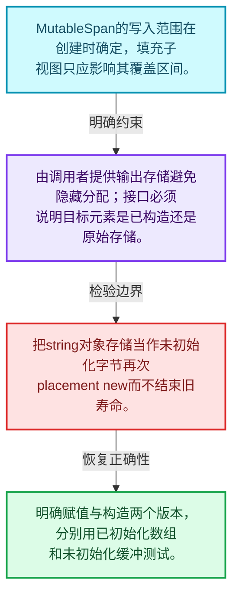
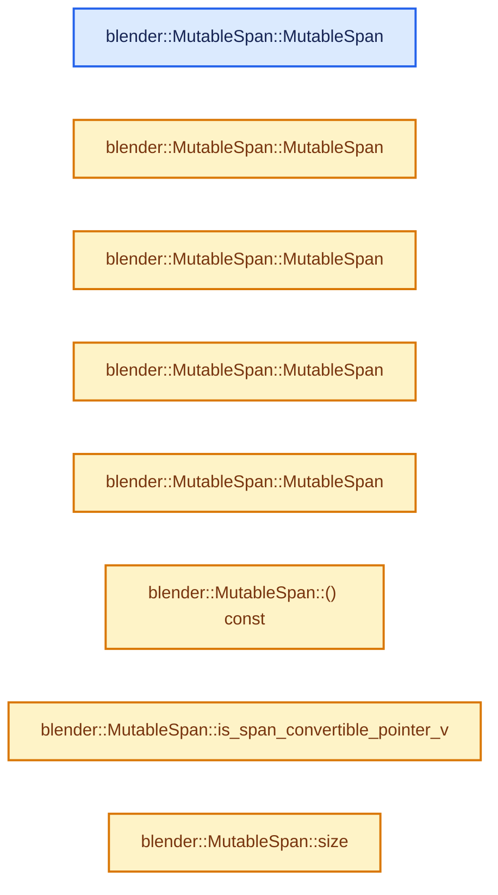
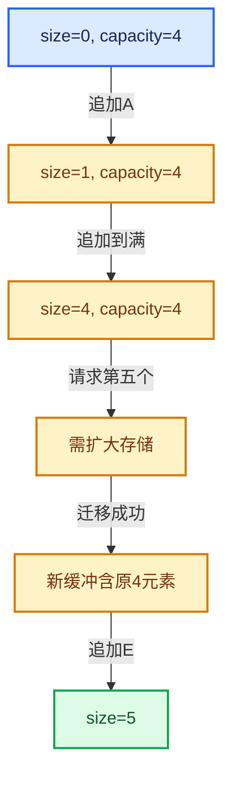

# 01-06 MutableSpan可写视图

[方向导航](README.md) · [总目录](../README.md) · [实现索引](../%E7%AC%A6%E5%8F%B7%E4%BE%9D%E8%B5%96%E4%B8%8E%E5%AE%9E%E7%8E%B0%E7%B4%A2%E5%BC%95.md)

## 从问题到实现

可写视图怎样保留所有权边界？

MutableSpan允许修改已有元素，但不能改变底层容器大小；视图对象const与元素const是不同层次。

**数据模型**

MutableSpan的写入范围在创建时确定，填充子视图只应影响其覆盖区间。

**设计取舍**

由调用者提供输出存储避免隐藏分配；接口必须说明目标元素是已构造还是原始存储。

**最小反例**

把string对象存储当作未初始化字节再次placement new而不结束旧寿命。

**推导**

明确赋值与构造两个版本，分别用已初始化数组和未初始化缓冲测试。

## 阅读地图与执行推演








图中的数值推演是本方向的教学模型；实际函数之间的调用边与概念分析边分别标注，不能把概念关系当作运行时调度顺序。

## 完整源码单元与就地讲解

中文讲解直接放在相关代码旁，复杂机制在代码下展开。原文折叠区保留基准行号；不需要在行号表和函数之间来回查找。类布局可分段展示，函数实现不按固定行数切开。

<a id="f-0f07034aaffc3384"></a>

### `blender::MutableSpan::MutableSpan`

实现位置：[source/blender/blenlib/BLI_span.hh](../../../../../source/blender/blenlib/BLI_span.hh) · L462—L462。

**教学注释版**

<!-- annotated:586c1107a0b559 -->

```cpp
  constexpr MutableSpan() = default;
```

<details>
<summary>核对原始源码：source/blender/blenlib/BLI_span.hh · L462—L462</summary>

<!-- original:586c1107a0b559:source/blender/blenlib/BLI_span.hh:462:462 -->

```cpp
  constexpr MutableSpan() = default;
```

</details>

**继续追踪实现**

本实现没有需要继续展开的显式调用；检查返回表达式、对象转换和调用者前置条件。

<!-- annotated:f828fddbcd6b0a -->

```cpp

```

<details>
<summary>核对原始源码：source/blender/blenlib/BLI_span.hh · L463—L463</summary>

<!-- original:f828fddbcd6b0a:source/blender/blenlib/BLI_span.hh:463:463 -->

```cpp

```

</details>

<a id="f-39977234ad0ce192"></a>

### `blender::MutableSpan::MutableSpan`

实现位置：[source/blender/blenlib/BLI_span.hh](../../../../../source/blender/blenlib/BLI_span.hh) · L464—L464。

接口参数：

- `T *start`
- `const int64_t size`

**教学注释版**

<!-- annotated:104395c81d1b11 -->

```cpp
  constexpr MutableSpan(T *start, const int64_t size) : data_(start), size_(size) {}
```

<details>
<summary>核对原始源码：source/blender/blenlib/BLI_span.hh · L464—L464</summary>

<!-- original:104395c81d1b11:source/blender/blenlib/BLI_span.hh:464:464 -->

```cpp
  constexpr MutableSpan(T *start, const int64_t size) : data_(start), size_(size) {}
```

</details>

**继续追踪实现**

本实现没有需要继续展开的显式调用；检查返回表达式、对象转换和调用者前置条件。

<!-- annotated:5ace2b8b8f314f -->

```cpp

```

<details>
<summary>核对原始源码：source/blender/blenlib/BLI_span.hh · L465—L465</summary>

<!-- original:5ace2b8b8f314f:source/blender/blenlib/BLI_span.hh:465:465 -->

```cpp

```

</details>

<a id="f-ee249b5042dd38aa"></a>

### `blender::MutableSpan::MutableSpan`

实现位置：[source/blender/blenlib/BLI_span.hh](../../../../../source/blender/blenlib/BLI_span.hh) · L466—L466。

接口参数：

- `std::vector<T> &vector`

**教学注释版**

<!-- annotated:a63266918a6f2c -->

```cpp
  constexpr MutableSpan(std::vector<T> &vector) : MutableSpan(vector.data(), vector.size()) {}
```

<details>
<summary>核对原始源码：source/blender/blenlib/BLI_span.hh · L466—L466</summary>

<!-- original:a63266918a6f2c:source/blender/blenlib/BLI_span.hh:466:466 -->

```cpp
  constexpr MutableSpan(std::vector<T> &vector) : MutableSpan(vector.data(), vector.size()) {}
```

</details>

**继续追踪实现**

本实现没有需要继续展开的显式调用；检查返回表达式、对象转换和调用者前置条件。

<!-- annotated:a5bfb809674c92 -->

```cpp

```

<details>
<summary>核对原始源码：source/blender/blenlib/BLI_span.hh · L467—L467</summary>

<!-- original:a5bfb809674c92:source/blender/blenlib/BLI_span.hh:467:467 -->

```cpp

```

</details>

<a id="f-479c5f85921e531f"></a>

### `blender::MutableSpan::MutableSpan`

实现位置：[source/blender/blenlib/BLI_span.hh](../../../../../source/blender/blenlib/BLI_span.hh) · L468—L471。

接口参数：

- `std::array<T, N> &array`

**教学注释版**

<!-- annotated:7c247268dbb9cb -->

```cpp
  template<std::size_t N>
  constexpr MutableSpan(std::array<T, N> &array) : MutableSpan(array.data(), N)
  {
  }
```

<details>
<summary>核对原始源码：source/blender/blenlib/BLI_span.hh · L468—L471</summary>

<!-- original:7c247268dbb9cb:source/blender/blenlib/BLI_span.hh:468:471 -->

```cpp
  template<std::size_t N>
  constexpr MutableSpan(std::array<T, N> &array) : MutableSpan(array.data(), N)
  {
  }
```

</details>

**继续追踪实现**

本实现没有需要继续展开的显式调用；检查返回表达式、对象转换和调用者前置条件。

### 类型布局、声明与编译条件 · BLI_span.hh L472—L476

<!-- annotated:339bed6e197189 -->

```cpp

  /**
   * Support implicit conversions like the one below:
   *   MutableSpan<T *> -> MutableSpan<const T *>
   */
```

<details>
<summary>核对原始源码：source/blender/blenlib/BLI_span.hh · L472—L476</summary>

<!-- original:339bed6e197189:source/blender/blenlib/BLI_span.hh:472:476 -->

```cpp

  /**
   * Support implicit conversions like the one below:
   *   MutableSpan<T *> -> MutableSpan<const T *>
   */
```

</details>

<a id="f-afcce5325e6f19e0"></a>

### `blender::MutableSpan::MutableSpan`

实现位置：[source/blender/blenlib/BLI_span.hh](../../../../../source/blender/blenlib/BLI_span.hh) · L477—L482。

接口参数：

- `MutableSpan<U> span`

**教学注释版**

<!-- annotated:53ed706c5ef9af -->

```cpp
  template<typename U>
  constexpr MutableSpan(MutableSpan<U> span)
    requires(is_span_convertible_pointer_v<U, T>)
      : data_(static_cast<T *>(span.data())), size_(span.size())
  {
  }
```

<details>
<summary>核对原始源码：source/blender/blenlib/BLI_span.hh · L477—L482</summary>

<!-- original:53ed706c5ef9af:source/blender/blenlib/BLI_span.hh:477:482 -->

```cpp
  template<typename U>
  constexpr MutableSpan(MutableSpan<U> span)
    requires(is_span_convertible_pointer_v<U, T>)
      : data_(static_cast<T *>(span.data())), size_(span.size())
  {
  }
```

</details>

**继续追踪实现**

本实现没有需要继续展开的显式调用；检查返回表达式、对象转换和调用者前置条件。

<!-- annotated:4e55c84ed9fa17 -->

```cpp

```

<details>
<summary>核对原始源码：source/blender/blenlib/BLI_span.hh · L483—L483</summary>

<!-- original:4e55c84ed9fa17:source/blender/blenlib/BLI_span.hh:483:483 -->

```cpp

```

</details>

<a id="f-375a7bfe1a463fa0"></a>

### `blender::MutableSpan::() const`

实现位置：[source/blender/blenlib/BLI_span.hh](../../../../../source/blender/blenlib/BLI_span.hh) · L484—L487。

**教学注释版**

<!-- annotated:8a4ff48125dc17 -->

```cpp
  constexpr operator Span<T>() const
  {
    return Span<T>(data_, size_);
  }
```

<details>
<summary>核对原始源码：source/blender/blenlib/BLI_span.hh · L484—L487</summary>

<!-- original:8a4ff48125dc17:source/blender/blenlib/BLI_span.hh:484:487 -->

```cpp
  constexpr operator Span<T>() const
  {
    return Span<T>(data_, size_);
  }
```

</details>

**结果出口**

- `return Span<T>(data_, size_);`

**继续追踪实现**

- `Span<T>` → [blender::Span::Span · L92](05-Span%E5%8F%AA%E8%AF%BB%E8%BF%9E%E7%BB%AD%E8%A7%86%E5%9B%BE.md#f-e40cbae1aae23eb8)；[blender::Span::Span · L94](05-Span%E5%8F%AA%E8%AF%BB%E8%BF%9E%E7%BB%AD%E8%A7%86%E5%9B%BE.md#f-8e13b31cdc54dc44)；[blender::Span::Span · L99](05-Span%E5%8F%AA%E8%AF%BB%E8%BF%9E%E7%BB%AD%E8%A7%86%E5%9B%BE.md#f-e3f5617e03851c03)；[blender::Span::Span · L118](05-Span%E5%8F%AA%E8%AF%BB%E8%BF%9E%E7%BB%AD%E8%A7%86%E5%9B%BE.md#f-6dbccc3a78910bb7)；[blender::Span::Span · L122](05-Span%E5%8F%AA%E8%AF%BB%E8%BF%9E%E7%BB%AD%E8%A7%86%E5%9B%BE.md#f-0692c02d691e68a6)；[blender::Span::Span · L124](05-Span%E5%8F%AA%E8%AF%BB%E8%BF%9E%E7%BB%AD%E8%A7%86%E5%9B%BE.md#f-45073fe4b3cefa46)；[blender::Span::Span · L130](05-Span%E5%8F%AA%E8%AF%BB%E8%BF%9E%E7%BB%AD%E8%A7%86%E5%9B%BE.md#f-b2e1b3c3e3349048)。同名重载需按实参类型选择。

<!-- annotated:c551b71d24d058 -->

```cpp

```

<details>
<summary>核对原始源码：source/blender/blenlib/BLI_span.hh · L488—L488</summary>

<!-- original:c551b71d24d058:source/blender/blenlib/BLI_span.hh:488:488 -->

```cpp

```

</details>

<a id="f-0943740a633bd96c"></a>

### `blender::MutableSpan::is_span_convertible_pointer_v`

实现位置：[source/blender/blenlib/BLI_span.hh](../../../../../source/blender/blenlib/BLI_span.hh) · L489—L494。

**教学注释版**

<!-- annotated:0f4abdba5a7b3f -->

```cpp
  template<typename U>
  constexpr operator Span<U>() const
    requires(is_span_convertible_pointer_v<T, U>)
  {
    return Span<U>(static_cast<const U *>(data_), size_);
  }
```

<details>
<summary>核对原始源码：source/blender/blenlib/BLI_span.hh · L489—L494</summary>

<!-- original:0f4abdba5a7b3f:source/blender/blenlib/BLI_span.hh:489:494 -->

```cpp
  template<typename U>
  constexpr operator Span<U>() const
    requires(is_span_convertible_pointer_v<T, U>)
  {
    return Span<U>(static_cast<const U *>(data_), size_);
  }
```

</details>

**结果出口**

- `return Span<U>(static_cast<const U *>(data_), size_);`

**继续追踪实现**

- `Span<U>` → [blender::Span::Span · L92](05-Span%E5%8F%AA%E8%AF%BB%E8%BF%9E%E7%BB%AD%E8%A7%86%E5%9B%BE.md#f-e40cbae1aae23eb8)；[blender::Span::Span · L94](05-Span%E5%8F%AA%E8%AF%BB%E8%BF%9E%E7%BB%AD%E8%A7%86%E5%9B%BE.md#f-8e13b31cdc54dc44)；[blender::Span::Span · L99](05-Span%E5%8F%AA%E8%AF%BB%E8%BF%9E%E7%BB%AD%E8%A7%86%E5%9B%BE.md#f-e3f5617e03851c03)；[blender::Span::Span · L118](05-Span%E5%8F%AA%E8%AF%BB%E8%BF%9E%E7%BB%AD%E8%A7%86%E5%9B%BE.md#f-6dbccc3a78910bb7)；[blender::Span::Span · L122](05-Span%E5%8F%AA%E8%AF%BB%E8%BF%9E%E7%BB%AD%E8%A7%86%E5%9B%BE.md#f-0692c02d691e68a6)；[blender::Span::Span · L124](05-Span%E5%8F%AA%E8%AF%BB%E8%BF%9E%E7%BB%AD%E8%A7%86%E5%9B%BE.md#f-45073fe4b3cefa46)；[blender::Span::Span · L130](05-Span%E5%8F%AA%E8%AF%BB%E8%BF%9E%E7%BB%AD%E8%A7%86%E5%9B%BE.md#f-b2e1b3c3e3349048)。同名重载需按实参类型选择。

### 类型布局、声明与编译条件 · BLI_span.hh L495—L498

<!-- annotated:437cdea2ad64db -->

```cpp

  /**
   * Returns the number of elements in the array.
   */
```

<details>
<summary>核对原始源码：source/blender/blenlib/BLI_span.hh · L495—L498</summary>

<!-- original:437cdea2ad64db:source/blender/blenlib/BLI_span.hh:495:498 -->

```cpp

  /**
   * Returns the number of elements in the array.
   */
```

</details>

<a id="f-1de6a66839c304a8"></a>

### `blender::MutableSpan::size`

查询视图长度或生成对应有效索引区间。

实现位置：[source/blender/blenlib/BLI_span.hh](../../../../../source/blender/blenlib/BLI_span.hh) · L499—L502。

**教学注释版**

<!-- annotated:aac60b4b4ad9ad -->

```cpp
  constexpr int64_t size() const
  {
    return size_;
  }
```

<details>
<summary>核对原始源码：source/blender/blenlib/BLI_span.hh · L499—L502</summary>

<!-- original:aac60b4b4ad9ad:source/blender/blenlib/BLI_span.hh:499:502 -->

```cpp
  constexpr int64_t size() const
  {
    return size_;
  }
```

</details>

**接口与不变量**

长度描述逻辑范围，不表达底层存储由谁拥有，也不保证别名不会修改数据。

**结果出口**

- `return size_;`

**继续追踪实现**

本实现没有需要继续展开的显式调用；检查返回表达式、对象转换和调用者前置条件。

### 类型布局、声明与编译条件 · BLI_span.hh L503—L506

<!-- annotated:281b85be2e2e62 -->

```cpp

  /**
   * Returns the number of bytes referenced by this Span.
   */
```

<details>
<summary>核对原始源码：source/blender/blenlib/BLI_span.hh · L503—L506</summary>

<!-- original:281b85be2e2e62:source/blender/blenlib/BLI_span.hh:503:506 -->

```cpp

  /**
   * Returns the number of bytes referenced by this Span.
   */
```

</details>

<a id="f-2e42823b970a8406"></a>

### `blender::MutableSpan::size_in_bytes`

实现位置：[source/blender/blenlib/BLI_span.hh](../../../../../source/blender/blenlib/BLI_span.hh) · L507—L510。

**教学注释版**

<!-- annotated:2a74f7f005a7da -->

```cpp
  constexpr int64_t size_in_bytes() const
  {
    return sizeof(T) * size_;
  }
```

<details>
<summary>核对原始源码：source/blender/blenlib/BLI_span.hh · L507—L510</summary>

<!-- original:2a74f7f005a7da:source/blender/blenlib/BLI_span.hh:507:510 -->

```cpp
  constexpr int64_t size_in_bytes() const
  {
    return sizeof(T) * size_;
  }
```

</details>

**结果出口**

- `return sizeof(T) * size_;`

**继续追踪实现**

本实现没有需要继续展开的显式调用；检查返回表达式、对象转换和调用者前置条件。

### 类型布局、声明与编译条件 · BLI_span.hh L511—L514

<!-- annotated:59d005a109c1e4 -->

```cpp

  /**
   * Returns true if the size is zero.
   */
```

<details>
<summary>核对原始源码：source/blender/blenlib/BLI_span.hh · L511—L514</summary>

<!-- original:59d005a109c1e4:source/blender/blenlib/BLI_span.hh:511:514 -->

```cpp

  /**
   * Returns true if the size is zero.
   */
```

</details>

<a id="f-be88df1422757437"></a>

### `blender::MutableSpan::is_empty`

查询视图长度或生成对应有效索引区间。

实现位置：[source/blender/blenlib/BLI_span.hh](../../../../../source/blender/blenlib/BLI_span.hh) · L515—L518。

**教学注释版**

<!-- annotated:e19e62ce4c8a36 -->

```cpp
  constexpr bool is_empty() const
  {
    return size_ == 0;
  }
```

<details>
<summary>核对原始源码：source/blender/blenlib/BLI_span.hh · L515—L518</summary>

<!-- original:e19e62ce4c8a36:source/blender/blenlib/BLI_span.hh:515:518 -->

```cpp
  constexpr bool is_empty() const
  {
    return size_ == 0;
  }
```

</details>

**接口与不变量**

长度描述逻辑范围，不表达底层存储由谁拥有，也不保证别名不会修改数据。

**结果出口**

- `return size_ == 0;`

**继续追踪实现**

本实现没有需要继续展开的显式调用；检查返回表达式、对象转换和调用者前置条件。

### 类型布局、声明与编译条件 · BLI_span.hh L519—L522

<!-- annotated:e86cd00cf3e351 -->

```cpp

  /**
   * Replace all elements in the referenced array with the given value.
   */
```

<details>
<summary>核对原始源码：source/blender/blenlib/BLI_span.hh · L519—L522</summary>

<!-- original:e86cd00cf3e351:source/blender/blenlib/BLI_span.hh:519:522 -->

```cpp

  /**
   * Replace all elements in the referenced array with the given value.
   */
```

</details>

<a id="f-8daedd52c727ec26"></a>

### `blender::MutableSpan::fill`

修改已有目标元素，不改变底层容器长度。

实现位置：[source/blender/blenlib/BLI_span.hh](../../../../../source/blender/blenlib/BLI_span.hh) · L523—L526。

接口参数：

- `const T &value`

**教学注释版**

<!-- annotated:636bea6d3a8da9 -->

```cpp
  constexpr void fill(const T &value) const
  {
    initialized_fill_n(data_, size_, value);
  }
```

<details>
<summary>核对原始源码：source/blender/blenlib/BLI_span.hh · L523—L526</summary>

<!-- original:636bea6d3a8da9:source/blender/blenlib/BLI_span.hh:523:526 -->

```cpp
  constexpr void fill(const T &value) const
  {
    initialized_fill_n(data_, size_, value);
  }
```

</details>

**接口与不变量**

目标对象初始化状态、输入长度及重叠规则都需由具体实现确认。

**继续追踪实现**

- `initialized_fill_n` → [blender::initialized_fill_n · L86](01-%E5%AF%B9%E8%B1%A1%E7%94%9F%E5%91%BD%E5%91%A8%E6%9C%9F%E4%B8%8E%E5%80%BC%E7%B1%BB%E5%88%AB.md#f-4af3bf5ccfdcee6c)。

### 类型布局、声明与编译条件 · BLI_span.hh L527—L531

<!-- annotated:c66cbad34ed7b1 -->

```cpp

  /**
   * Replace a subset of all elements with the given value. This invokes undefined behavior when
   * one of the indices is out of bounds.
   */
```

<details>
<summary>核对原始源码：source/blender/blenlib/BLI_span.hh · L527—L531</summary>

<!-- original:c66cbad34ed7b1:source/blender/blenlib/BLI_span.hh:527:531 -->

```cpp

  /**
   * Replace a subset of all elements with the given value. This invokes undefined behavior when
   * one of the indices is out of bounds.
   */
```

</details>

<a id="f-2237396727062a71"></a>

### `blender::MutableSpan::fill_indices`

实现位置：[source/blender/blenlib/BLI_span.hh](../../../../../source/blender/blenlib/BLI_span.hh) · L532—L539。

接口参数：

- `Span<IndexT> indices`
- `const T &value`

**教学注释版**

<!-- annotated:3ee295266cbd7c -->

```cpp
  template<typename IndexT> constexpr void fill_indices(Span<IndexT> indices, const T &value) const
  {
    static_assert(std::is_integral_v<IndexT>);
    for (IndexT i : indices) {
      BLI_assert(i < size_);
      data_[i] = value;
    }
  }
```

<details>
<summary>核对原始源码：source/blender/blenlib/BLI_span.hh · L532—L539</summary>

<!-- original:3ee295266cbd7c:source/blender/blenlib/BLI_span.hh:532:539 -->

```cpp
  template<typename IndexT> constexpr void fill_indices(Span<IndexT> indices, const T &value) const
  {
    static_assert(std::is_integral_v<IndexT>);
    for (IndexT i : indices) {
      BLI_assert(i < size_);
      data_[i] = value;
    }
  }
```

</details>

**沿实际写入检查状态**

- `data_[i] = value;`

**继续追踪实现**

- `BLI_assert` → [BLI_assert · L48](%E4%BE%9D%E8%B5%96-BLI_assert-cc98e8.md#m-57a88495704d)；[BLI_assert · L63](%E4%BE%9D%E8%B5%96-BLI_assert-cc98e8.md#m-d07050020cb5)。宏定义由构建条件选择。

### 类型布局、声明与编译条件 · BLI_span.hh L540—L544

<!-- annotated:b3ca9bb6e16465 -->

```cpp

  /**
   * Returns a pointer to the beginning of the referenced array. This may be nullptr, when the size
   * is zero.
   */
```

<details>
<summary>核对原始源码：source/blender/blenlib/BLI_span.hh · L540—L544</summary>

<!-- original:b3ca9bb6e16465:source/blender/blenlib/BLI_span.hh:540:544 -->

```cpp

  /**
   * Returns a pointer to the beginning of the referenced array. This may be nullptr, when the size
   * is zero.
   */
```

</details>

<a id="f-eb45a6e4d8211efd"></a>

### `blender::MutableSpan::data`

返回借用范围的地址。

实现位置：[source/blender/blenlib/BLI_span.hh](../../../../../source/blender/blenlib/BLI_span.hh) · L545—L548。

**教学注释版**

<!-- annotated:403ac4c89a2f19 -->

```cpp
  constexpr T *data() const
  {
    return data_;
  }
```

<details>
<summary>核对原始源码：source/blender/blenlib/BLI_span.hh · L545—L548</summary>

<!-- original:403ac4c89a2f19:source/blender/blenlib/BLI_span.hh:545:548 -->

```cpp
  constexpr T *data() const
  {
    return data_;
  }
```

</details>

**接口与不变量**

复制指针或视图不延长底层数组寿命，尾后位置只用于范围边界。

**结果出口**

- `return data_;`

**继续追踪实现**

本实现没有需要继续展开的显式调用；检查返回表达式、对象转换和调用者前置条件。

<!-- annotated:c9b3cc33d6ff2e -->

```cpp

```

<details>
<summary>核对原始源码：source/blender/blenlib/BLI_span.hh · L549—L549</summary>

<!-- original:c9b3cc33d6ff2e:source/blender/blenlib/BLI_span.hh:549:549 -->

```cpp

```

</details>

<a id="f-02a6b28889d59da1"></a>

### `blender::MutableSpan::begin`

返回借用范围的地址。

实现位置：[source/blender/blenlib/BLI_span.hh](../../../../../source/blender/blenlib/BLI_span.hh) · L550—L553。

**教学注释版**

<!-- annotated:b39256d6df223d -->

```cpp
  constexpr T *begin() const
  {
    return data_;
  }
```

<details>
<summary>核对原始源码：source/blender/blenlib/BLI_span.hh · L550—L553</summary>

<!-- original:b39256d6df223d:source/blender/blenlib/BLI_span.hh:550:553 -->

```cpp
  constexpr T *begin() const
  {
    return data_;
  }
```

</details>

**接口与不变量**

复制指针或视图不延长底层数组寿命，尾后位置只用于范围边界。

**结果出口**

- `return data_;`

**继续追踪实现**

本实现没有需要继续展开的显式调用；检查返回表达式、对象转换和调用者前置条件。

<a id="f-4bf60034b9ddbc44"></a>

### `blender::MutableSpan::end`

返回借用范围的地址。

实现位置：[source/blender/blenlib/BLI_span.hh](../../../../../source/blender/blenlib/BLI_span.hh) · L554—L557。

**教学注释版**

<!-- annotated:29eb6e66c1b4ee -->

```cpp
  constexpr T *end() const
  {
    return data_ + size_;
  }
```

<details>
<summary>核对原始源码：source/blender/blenlib/BLI_span.hh · L554—L557</summary>

<!-- original:29eb6e66c1b4ee:source/blender/blenlib/BLI_span.hh:554:557 -->

```cpp
  constexpr T *end() const
  {
    return data_ + size_;
  }
```

</details>

**接口与不变量**

复制指针或视图不延长底层数组寿命，尾后位置只用于范围边界。

**结果出口**

- `return data_ + size_;`

**继续追踪实现**

本实现没有需要继续展开的显式调用；检查返回表达式、对象转换和调用者前置条件。

<!-- annotated:1230fbc94cdd5b -->

```cpp

```

<details>
<summary>核对原始源码：source/blender/blenlib/BLI_span.hh · L558—L558</summary>

<!-- original:1230fbc94cdd5b:source/blender/blenlib/BLI_span.hh:558:558 -->

```cpp

```

</details>

<a id="f-458240dd97e75d71"></a>

### `blender::MutableSpan::rbegin`

实现位置：[source/blender/blenlib/BLI_span.hh](../../../../../source/blender/blenlib/BLI_span.hh) · L559—L562。

**教学注释版**

<!-- annotated:6dfac238c5b761 -->

```cpp
  constexpr std::reverse_iterator<T *> rbegin() const
  {
    // [讲解] this->end：返回借用范围的地址。
    return std::reverse_iterator<T *>(this->end());
  }
```

<details>
<summary>核对原始源码：source/blender/blenlib/BLI_span.hh · L559—L562</summary>

<!-- original:6dfac238c5b761:source/blender/blenlib/BLI_span.hh:559:562 -->

```cpp
  constexpr std::reverse_iterator<T *> rbegin() const
  {
    return std::reverse_iterator<T *>(this->end());
  }
```

</details>

**结果出口**

- `return std::reverse_iterator<T *>(this->end());`

**继续追踪实现**

- `std::reverse_iterator<T *>` → [外部契约](https://eel.is/c++draft/)：这个边界按实际表达式及所属类型核对参数、返回值、寿命与失败行为。这里提供接口入口，不声称已解释该第三方版本的内部实现。
- `this->end` → [blender::MutableSpan::end · L554](06-MutableSpan%E5%8F%AF%E5%86%99%E8%A7%86%E5%9B%BE.md#f-4bf60034b9ddbc44)。

<a id="f-fb016849ac8f1ed3"></a>

### `blender::MutableSpan::rend`

实现位置：[source/blender/blenlib/BLI_span.hh](../../../../../source/blender/blenlib/BLI_span.hh) · L563—L566。

**教学注释版**

<!-- annotated:b568ba3f57dfa2 -->

```cpp
  constexpr std::reverse_iterator<T *> rend() const
  {
    // [讲解] this->begin：返回借用范围的地址。
    return std::reverse_iterator<T *>(this->begin());
  }
```

<details>
<summary>核对原始源码：source/blender/blenlib/BLI_span.hh · L563—L566</summary>

<!-- original:b568ba3f57dfa2:source/blender/blenlib/BLI_span.hh:563:566 -->

```cpp
  constexpr std::reverse_iterator<T *> rend() const
  {
    return std::reverse_iterator<T *>(this->begin());
  }
```

</details>

**结果出口**

- `return std::reverse_iterator<T *>(this->begin());`

**继续追踪实现**

- `std::reverse_iterator<T *>` → [外部契约](https://eel.is/c++draft/)：这个边界按实际表达式及所属类型核对参数、返回值、寿命与失败行为。这里提供接口入口，不声称已解释该第三方版本的内部实现。
- `this->begin` → [blender::MutableSpan::begin · L550](06-MutableSpan%E5%8F%AF%E5%86%99%E8%A7%86%E5%9B%BE.md#f-02a6b28889d59da1)。

<!-- annotated:7cfc44fa7b49c5 -->

```cpp

```

<details>
<summary>核对原始源码：source/blender/blenlib/BLI_span.hh · L567—L567</summary>

<!-- original:7cfc44fa7b49c5:source/blender/blenlib/BLI_span.hh:567:567 -->

```cpp

```

</details>

<a id="f-161cfdfebf149994"></a>

### `blender::MutableSpan::operator[]`

按视图边界访问元素。

实现位置：[source/blender/blenlib/BLI_span.hh](../../../../../source/blender/blenlib/BLI_span.hh) · L568—L573。

接口参数：

- `const int64_t index`

**教学注释版**

<!-- annotated:367d2409bb6dc8 -->

```cpp
  constexpr T &operator[](const int64_t index) const
  {
    BLI_assert(index >= 0);
    BLI_assert(index < size_);
    return data_[index];
  }
```

<details>
<summary>核对原始源码：source/blender/blenlib/BLI_span.hh · L568—L573</summary>

<!-- original:367d2409bb6dc8:source/blender/blenlib/BLI_span.hh:568:573 -->

```cpp
  constexpr T &operator[](const int64_t index) const
  {
    BLI_assert(index >= 0);
    BLI_assert(index < size_);
    return data_[index];
  }
```

</details>

**接口与不变量**

索引以当前视图为基准，切片局部索引与原数组索引不同；const约束作用在哪一层取决于T。

**结果出口**

- `return data_[index];`

**继续追踪实现**

- `BLI_assert` → [BLI_assert · L48](%E4%BE%9D%E8%B5%96-BLI_assert-cc98e8.md#m-57a88495704d)；[BLI_assert · L63](%E4%BE%9D%E8%B5%96-BLI_assert-cc98e8.md#m-d07050020cb5)。宏定义由构建条件选择。

### 类型布局、声明与编译条件 · BLI_span.hh L574—L578

<!-- annotated:29e43ca4667d78 -->

```cpp

  /**
   * Returns a contiguous part of the array. This invokes undefined behavior when the start or size
   * is negative.
   */
```

<details>
<summary>核对原始源码：source/blender/blenlib/BLI_span.hh · L574—L578</summary>

<!-- original:29e43ca4667d78:source/blender/blenlib/BLI_span.hh:574:578 -->

```cpp

  /**
   * Returns a contiguous part of the array. This invokes undefined behavior when the start or size
   * is negative.
   */
```

</details>

<a id="f-6808b4aefbf58808"></a>

### `blender::MutableSpan::slice`

建立原连续范围的子视图。

实现位置：[source/blender/blenlib/BLI_span.hh](../../../../../source/blender/blenlib/BLI_span.hh) · L579—L585。

接口参数：

- `const int64_t start`
- `const int64_t size`

**教学注释版**

<!-- annotated:1c2d8afa4f88d0 -->

```cpp
  constexpr MutableSpan slice(const int64_t start, const int64_t size) const
  {
    BLI_assert(start >= 0);
    BLI_assert(size >= 0);
    BLI_assert(start + size <= size_ || size == 0);
    return MutableSpan(data_ + start, size);
  }
```

<details>
<summary>核对原始源码：source/blender/blenlib/BLI_span.hh · L579—L585</summary>

<!-- original:1c2d8afa4f88d0:source/blender/blenlib/BLI_span.hh:579:585 -->

```cpp
  constexpr MutableSpan slice(const int64_t start, const int64_t size) const
  {
    BLI_assert(start >= 0);
    BLI_assert(size >= 0);
    BLI_assert(start + size <= size_ || size == 0);
    return MutableSpan(data_ + start, size);
  }
```

</details>

**接口与不变量**

子视图只调整地址和长度，不复制元素；普通slice的前置条件与safe版本截断行为应分开阅读。

**结果出口**

- `return MutableSpan(data_ + start, size);`

**继续追踪实现**

- `BLI_assert` → [BLI_assert · L48](%E4%BE%9D%E8%B5%96-BLI_assert-cc98e8.md#m-57a88495704d)；[BLI_assert · L63](%E4%BE%9D%E8%B5%96-BLI_assert-cc98e8.md#m-d07050020cb5)。宏定义由构建条件选择。
- `MutableSpan` → [blender::MutableSpan::MutableSpan · L462](06-MutableSpan%E5%8F%AF%E5%86%99%E8%A7%86%E5%9B%BE.md#f-0f07034aaffc3384)；[blender::MutableSpan::MutableSpan · L464](06-MutableSpan%E5%8F%AF%E5%86%99%E8%A7%86%E5%9B%BE.md#f-39977234ad0ce192)；[blender::MutableSpan::MutableSpan · L466](06-MutableSpan%E5%8F%AF%E5%86%99%E8%A7%86%E5%9B%BE.md#f-ee249b5042dd38aa)；[blender::MutableSpan::MutableSpan · L468](06-MutableSpan%E5%8F%AF%E5%86%99%E8%A7%86%E5%9B%BE.md#f-479c5f85921e531f)；[blender::MutableSpan::MutableSpan · L477](06-MutableSpan%E5%8F%AF%E5%86%99%E8%A7%86%E5%9B%BE.md#f-afcce5325e6f19e0)。同名重载需按实参类型选择。

<!-- annotated:d9941d693155d9 -->

```cpp

```

<details>
<summary>核对原始源码：source/blender/blenlib/BLI_span.hh · L586—L586</summary>

<!-- original:d9941d693155d9:source/blender/blenlib/BLI_span.hh:586:586 -->

```cpp

```

</details>

<a id="f-c05b010821861e4f"></a>

### `blender::MutableSpan::slice`

建立原连续范围的子视图。

实现位置：[source/blender/blenlib/BLI_span.hh](../../../../../source/blender/blenlib/BLI_span.hh) · L587—L590。

接口参数：

- `IndexRange range`

**教学注释版**

<!-- annotated:68ee839d7d3cae -->

```cpp
  constexpr MutableSpan slice(IndexRange range) const
  {
    // [讲解] this->slice：建立原连续范围的子视图。
    return this->slice(range.start(), range.size());
  }
```

<details>
<summary>核对原始源码：source/blender/blenlib/BLI_span.hh · L587—L590</summary>

<!-- original:68ee839d7d3cae:source/blender/blenlib/BLI_span.hh:587:590 -->

```cpp
  constexpr MutableSpan slice(IndexRange range) const
  {
    return this->slice(range.start(), range.size());
  }
```

</details>

**接口与不变量**

子视图只调整地址和长度，不复制元素；普通slice的前置条件与safe版本截断行为应分开阅读。

**结果出口**

- `return this->slice(range.start(), range.size());`

**继续追踪实现**

- `this->slice` → [blender::MutableSpan::slice · L579](06-MutableSpan%E5%8F%AF%E5%86%99%E8%A7%86%E5%9B%BE.md#f-6808b4aefbf58808)；[blender::MutableSpan::slice · L587](06-MutableSpan%E5%8F%AF%E5%86%99%E8%A7%86%E5%9B%BE.md#f-c05b010821861e4f)。同名重载需按实参类型选择。
- `range.start` → [blender::IndexRange::start · L243](04-IndexRange%E8%BF%9E%E7%BB%AD%E6%95%B4%E6%95%B0%E5%8C%BA%E9%97%B4.md#f-99d2195bd9cfd1f0)。
- `range.size` → [blender::IndexRange::size · L156](04-IndexRange%E8%BF%9E%E7%BB%AD%E6%95%B4%E6%95%B0%E5%8C%BA%E9%97%B4.md#f-05f66c3ebb2fdfec)。

### 类型布局、声明与编译条件 · BLI_span.hh L591—L595

<!-- annotated:f5e8162dbe89f0 -->

```cpp

  /**
   * Returns a contiguous part of the array. This invokes undefined behavior when the start or size
   * is negative. Clamps the size of the new span so it fits in the current one.
   */
```

<details>
<summary>核对原始源码：source/blender/blenlib/BLI_span.hh · L591—L595</summary>

<!-- original:f5e8162dbe89f0:source/blender/blenlib/BLI_span.hh:591:595 -->

```cpp

  /**
   * Returns a contiguous part of the array. This invokes undefined behavior when the start or size
   * is negative. Clamps the size of the new span so it fits in the current one.
   */
```

</details>

<a id="f-c09a735aa425b0c9"></a>

### `blender::MutableSpan::slice_safe`

建立原连续范围的子视图。

实现位置：[source/blender/blenlib/BLI_span.hh](../../../../../source/blender/blenlib/BLI_span.hh) · L596—L602。

接口参数：

- `const int64_t start`
- `const int64_t size`

**教学注释版**

<!-- annotated:447236a4a390a3 -->

```cpp
  constexpr MutableSpan slice_safe(const int64_t start, const int64_t size) const
  {
    BLI_assert(start >= 0);
    BLI_assert(size >= 0);
    // [讲解] std::max<int64_t>：按比较关系选取较大值。本讲解中的增长公式同时满足最低请求和几何增长；若保存返回引用，还需注意实参寿命。
    const int64_t new_size = std::max<int64_t>(0, std::min(size, size_ - start));
    return MutableSpan(data_ + start, new_size);
  }
```

<details>
<summary>核对原始源码：source/blender/blenlib/BLI_span.hh · L596—L602</summary>

<!-- original:447236a4a390a3:source/blender/blenlib/BLI_span.hh:596:602 -->

```cpp
  constexpr MutableSpan slice_safe(const int64_t start, const int64_t size) const
  {
    BLI_assert(start >= 0);
    BLI_assert(size >= 0);
    const int64_t new_size = std::max<int64_t>(0, std::min(size, size_ - start));
    return MutableSpan(data_ + start, new_size);
  }
```

</details>

**接口与不变量**

子视图只调整地址和长度，不复制元素；普通slice的前置条件与safe版本截断行为应分开阅读。

**结果出口**

- `return MutableSpan(data_ + start, new_size);`

**继续追踪实现**

- `BLI_assert` → [BLI_assert · L48](%E4%BE%9D%E8%B5%96-BLI_assert-cc98e8.md#m-57a88495704d)；[BLI_assert · L63](%E4%BE%9D%E8%B5%96-BLI_assert-cc98e8.md#m-d07050020cb5)。宏定义由构建条件选择。
- `std::max<int64_t>` → [外部契约](https://eel.is/c++draft/alg.min.max)：按比较关系选取较大值。本讲解中的增长公式同时满足最低请求和几何增长；若保存返回引用，还需注意实参寿命。
- `std::min` → [外部契约](https://eel.is/c++draft/alg.min.max)：按比较关系选取较小值；截断范围时还需先满足非负和可表示范围，min本身不会证明边界安全。
- `MutableSpan` → [blender::MutableSpan::MutableSpan · L462](06-MutableSpan%E5%8F%AF%E5%86%99%E8%A7%86%E5%9B%BE.md#f-0f07034aaffc3384)；[blender::MutableSpan::MutableSpan · L464](06-MutableSpan%E5%8F%AF%E5%86%99%E8%A7%86%E5%9B%BE.md#f-39977234ad0ce192)；[blender::MutableSpan::MutableSpan · L466](06-MutableSpan%E5%8F%AF%E5%86%99%E8%A7%86%E5%9B%BE.md#f-ee249b5042dd38aa)；[blender::MutableSpan::MutableSpan · L468](06-MutableSpan%E5%8F%AF%E5%86%99%E8%A7%86%E5%9B%BE.md#f-479c5f85921e531f)；[blender::MutableSpan::MutableSpan · L477](06-MutableSpan%E5%8F%AF%E5%86%99%E8%A7%86%E5%9B%BE.md#f-afcce5325e6f19e0)。同名重载需按实参类型选择。

<!-- annotated:cc5abc44b3c3f7 -->

```cpp

```

<details>
<summary>核对原始源码：source/blender/blenlib/BLI_span.hh · L603—L603</summary>

<!-- original:cc5abc44b3c3f7:source/blender/blenlib/BLI_span.hh:603:603 -->

```cpp

```

</details>

<a id="f-a9e8d564e75d5b49"></a>

### `blender::MutableSpan::slice_safe`

建立原连续范围的子视图。

实现位置：[source/blender/blenlib/BLI_span.hh](../../../../../source/blender/blenlib/BLI_span.hh) · L604—L607。

接口参数：

- `IndexRange range`

**教学注释版**

<!-- annotated:01fb29936f7440 -->

```cpp
  constexpr MutableSpan slice_safe(IndexRange range) const
  {
    // [讲解] this->slice_safe：建立原连续范围的子视图。
    return this->slice_safe(range.start(), range.size());
  }
```

<details>
<summary>核对原始源码：source/blender/blenlib/BLI_span.hh · L604—L607</summary>

<!-- original:01fb29936f7440:source/blender/blenlib/BLI_span.hh:604:607 -->

```cpp
  constexpr MutableSpan slice_safe(IndexRange range) const
  {
    return this->slice_safe(range.start(), range.size());
  }
```

</details>

**接口与不变量**

子视图只调整地址和长度，不复制元素；普通slice的前置条件与safe版本截断行为应分开阅读。

**结果出口**

- `return this->slice_safe(range.start(), range.size());`

**继续追踪实现**

- `this->slice_safe` → [blender::MutableSpan::slice_safe · L596](06-MutableSpan%E5%8F%AF%E5%86%99%E8%A7%86%E5%9B%BE.md#f-c09a735aa425b0c9)；[blender::MutableSpan::slice_safe · L604](06-MutableSpan%E5%8F%AF%E5%86%99%E8%A7%86%E5%9B%BE.md#f-a9e8d564e75d5b49)。同名重载需按实参类型选择。
- `range.start` → [blender::IndexRange::start · L243](04-IndexRange%E8%BF%9E%E7%BB%AD%E6%95%B4%E6%95%B0%E5%8C%BA%E9%97%B4.md#f-99d2195bd9cfd1f0)。
- `range.size` → [blender::IndexRange::size · L156](04-IndexRange%E8%BF%9E%E7%BB%AD%E6%95%B4%E6%95%B0%E5%8C%BA%E9%97%B4.md#f-05f66c3ebb2fdfec)。

### 类型布局、声明与编译条件 · BLI_span.hh L608—L612

<!-- annotated:483fd253864ad6 -->

```cpp

  /**
   * Returns a new MutableSpan with n elements removed from the beginning. This invokes
   * undefined behavior when n is negative.
   */
```

<details>
<summary>核对原始源码：source/blender/blenlib/BLI_span.hh · L608—L612</summary>

<!-- original:483fd253864ad6:source/blender/blenlib/BLI_span.hh:608:612 -->

```cpp

  /**
   * Returns a new MutableSpan with n elements removed from the beginning. This invokes
   * undefined behavior when n is negative.
   */
```

</details>

<a id="f-3ed1464d2e0d1608"></a>

### `blender::MutableSpan::drop_front`

从两端裁去或选取一定数量元素形成新视图。

实现位置：[source/blender/blenlib/BLI_span.hh](../../../../../source/blender/blenlib/BLI_span.hh) · L613—L618。

接口参数：

- `const int64_t n`

**教学注释版**

<!-- annotated:502bc0e78807b5 -->

```cpp
  constexpr MutableSpan drop_front(const int64_t n) const
  {
    BLI_assert(n >= 0);
    // [讲解] std::max<int64_t>：按比较关系选取较大值。本讲解中的增长公式同时满足最低请求和几何增长；若保存返回引用，还需注意实参寿命。
    const int64_t new_size = std::max<int64_t>(0, size_ - n);
    return MutableSpan(data_ + n, new_size);
  }
```

<details>
<summary>核对原始源码：source/blender/blenlib/BLI_span.hh · L613—L618</summary>

<!-- original:502bc0e78807b5:source/blender/blenlib/BLI_span.hh:613:618 -->

```cpp
  constexpr MutableSpan drop_front(const int64_t n) const
  {
    BLI_assert(n >= 0);
    const int64_t new_size = std::max<int64_t>(0, size_ - n);
    return MutableSpan(data_ + n, new_size);
  }
```

</details>

**接口与不变量**

所有视图仍借用同一拥有者；参数合法范围按实际实现检查，不把空结果当作任意地址运算都安全。

**结果出口**

- `return MutableSpan(data_ + n, new_size);`

**继续追踪实现**

- `BLI_assert` → [BLI_assert · L48](%E4%BE%9D%E8%B5%96-BLI_assert-cc98e8.md#m-57a88495704d)；[BLI_assert · L63](%E4%BE%9D%E8%B5%96-BLI_assert-cc98e8.md#m-d07050020cb5)。宏定义由构建条件选择。
- `std::max<int64_t>` → [外部契约](https://eel.is/c++draft/alg.min.max)：按比较关系选取较大值。本讲解中的增长公式同时满足最低请求和几何增长；若保存返回引用，还需注意实参寿命。
- `MutableSpan` → [blender::MutableSpan::MutableSpan · L462](06-MutableSpan%E5%8F%AF%E5%86%99%E8%A7%86%E5%9B%BE.md#f-0f07034aaffc3384)；[blender::MutableSpan::MutableSpan · L464](06-MutableSpan%E5%8F%AF%E5%86%99%E8%A7%86%E5%9B%BE.md#f-39977234ad0ce192)；[blender::MutableSpan::MutableSpan · L466](06-MutableSpan%E5%8F%AF%E5%86%99%E8%A7%86%E5%9B%BE.md#f-ee249b5042dd38aa)；[blender::MutableSpan::MutableSpan · L468](06-MutableSpan%E5%8F%AF%E5%86%99%E8%A7%86%E5%9B%BE.md#f-479c5f85921e531f)；[blender::MutableSpan::MutableSpan · L477](06-MutableSpan%E5%8F%AF%E5%86%99%E8%A7%86%E5%9B%BE.md#f-afcce5325e6f19e0)。同名重载需按实参类型选择。

### 类型布局、声明与编译条件 · BLI_span.hh L619—L623

<!-- annotated:f9975184b6e9d1 -->

```cpp

  /**
   * Returns a new MutableSpan with n elements removed from the end. This invokes undefined
   * behavior when n is negative.
   */
```

<details>
<summary>核对原始源码：source/blender/blenlib/BLI_span.hh · L619—L623</summary>

<!-- original:f9975184b6e9d1:source/blender/blenlib/BLI_span.hh:619:623 -->

```cpp

  /**
   * Returns a new MutableSpan with n elements removed from the end. This invokes undefined
   * behavior when n is negative.
   */
```

</details>

<a id="f-d675bc737c0ae11c"></a>

### `blender::MutableSpan::drop_back`

从两端裁去或选取一定数量元素形成新视图。

实现位置：[source/blender/blenlib/BLI_span.hh](../../../../../source/blender/blenlib/BLI_span.hh) · L624—L629。

接口参数：

- `const int64_t n`

**教学注释版**

<!-- annotated:e2c5c6568cc0ad -->

```cpp
  constexpr MutableSpan drop_back(const int64_t n) const
  {
    BLI_assert(n >= 0);
    // [讲解] std::max<int64_t>：按比较关系选取较大值。本讲解中的增长公式同时满足最低请求和几何增长；若保存返回引用，还需注意实参寿命。
    const int64_t new_size = std::max<int64_t>(0, size_ - n);
    return MutableSpan(data_, new_size);
  }
```

<details>
<summary>核对原始源码：source/blender/blenlib/BLI_span.hh · L624—L629</summary>

<!-- original:e2c5c6568cc0ad:source/blender/blenlib/BLI_span.hh:624:629 -->

```cpp
  constexpr MutableSpan drop_back(const int64_t n) const
  {
    BLI_assert(n >= 0);
    const int64_t new_size = std::max<int64_t>(0, size_ - n);
    return MutableSpan(data_, new_size);
  }
```

</details>

**接口与不变量**

所有视图仍借用同一拥有者；参数合法范围按实际实现检查，不把空结果当作任意地址运算都安全。

**结果出口**

- `return MutableSpan(data_, new_size);`

**继续追踪实现**

- `BLI_assert` → [BLI_assert · L48](%E4%BE%9D%E8%B5%96-BLI_assert-cc98e8.md#m-57a88495704d)；[BLI_assert · L63](%E4%BE%9D%E8%B5%96-BLI_assert-cc98e8.md#m-d07050020cb5)。宏定义由构建条件选择。
- `std::max<int64_t>` → [外部契约](https://eel.is/c++draft/alg.min.max)：按比较关系选取较大值。本讲解中的增长公式同时满足最低请求和几何增长；若保存返回引用，还需注意实参寿命。
- `MutableSpan` → [blender::MutableSpan::MutableSpan · L462](06-MutableSpan%E5%8F%AF%E5%86%99%E8%A7%86%E5%9B%BE.md#f-0f07034aaffc3384)；[blender::MutableSpan::MutableSpan · L464](06-MutableSpan%E5%8F%AF%E5%86%99%E8%A7%86%E5%9B%BE.md#f-39977234ad0ce192)；[blender::MutableSpan::MutableSpan · L466](06-MutableSpan%E5%8F%AF%E5%86%99%E8%A7%86%E5%9B%BE.md#f-ee249b5042dd38aa)；[blender::MutableSpan::MutableSpan · L468](06-MutableSpan%E5%8F%AF%E5%86%99%E8%A7%86%E5%9B%BE.md#f-479c5f85921e531f)；[blender::MutableSpan::MutableSpan · L477](06-MutableSpan%E5%8F%AF%E5%86%99%E8%A7%86%E5%9B%BE.md#f-afcce5325e6f19e0)。同名重载需按实参类型选择。

### 类型布局、声明与编译条件 · BLI_span.hh L630—L634

<!-- annotated:c1ddeffcb6da68 -->

```cpp

  /**
   * Returns a new MutableSpan that only contains the first n elements. This invokes undefined
   * behavior when n is negative.
   */
```

<details>
<summary>核对原始源码：source/blender/blenlib/BLI_span.hh · L630—L634</summary>

<!-- original:c1ddeffcb6da68:source/blender/blenlib/BLI_span.hh:630:634 -->

```cpp

  /**
   * Returns a new MutableSpan that only contains the first n elements. This invokes undefined
   * behavior when n is negative.
   */
```

</details>

<a id="f-0a0235d84ddc265d"></a>

### `blender::MutableSpan::take_front`

从两端裁去或选取一定数量元素形成新视图。

实现位置：[source/blender/blenlib/BLI_span.hh](../../../../../source/blender/blenlib/BLI_span.hh) · L635—L640。

接口参数：

- `const int64_t n`

**教学注释版**

<!-- annotated:c5412c1502c579 -->

```cpp
  constexpr MutableSpan take_front(const int64_t n) const
  {
    BLI_assert(n >= 0);
    // [讲解] std::min<int64_t>：按比较关系选取较小值；截断范围时还需先满足非负和可表示范围，min本身不会证明边界安全。
    const int64_t new_size = std::min<int64_t>(size_, n);
    return MutableSpan(data_, new_size);
  }
```

<details>
<summary>核对原始源码：source/blender/blenlib/BLI_span.hh · L635—L640</summary>

<!-- original:c5412c1502c579:source/blender/blenlib/BLI_span.hh:635:640 -->

```cpp
  constexpr MutableSpan take_front(const int64_t n) const
  {
    BLI_assert(n >= 0);
    const int64_t new_size = std::min<int64_t>(size_, n);
    return MutableSpan(data_, new_size);
  }
```

</details>

**接口与不变量**

所有视图仍借用同一拥有者；参数合法范围按实际实现检查，不把空结果当作任意地址运算都安全。

**结果出口**

- `return MutableSpan(data_, new_size);`

**继续追踪实现**

- `BLI_assert` → [BLI_assert · L48](%E4%BE%9D%E8%B5%96-BLI_assert-cc98e8.md#m-57a88495704d)；[BLI_assert · L63](%E4%BE%9D%E8%B5%96-BLI_assert-cc98e8.md#m-d07050020cb5)。宏定义由构建条件选择。
- `std::min<int64_t>` → [外部契约](https://eel.is/c++draft/alg.min.max)：按比较关系选取较小值；截断范围时还需先满足非负和可表示范围，min本身不会证明边界安全。
- `MutableSpan` → [blender::MutableSpan::MutableSpan · L462](06-MutableSpan%E5%8F%AF%E5%86%99%E8%A7%86%E5%9B%BE.md#f-0f07034aaffc3384)；[blender::MutableSpan::MutableSpan · L464](06-MutableSpan%E5%8F%AF%E5%86%99%E8%A7%86%E5%9B%BE.md#f-39977234ad0ce192)；[blender::MutableSpan::MutableSpan · L466](06-MutableSpan%E5%8F%AF%E5%86%99%E8%A7%86%E5%9B%BE.md#f-ee249b5042dd38aa)；[blender::MutableSpan::MutableSpan · L468](06-MutableSpan%E5%8F%AF%E5%86%99%E8%A7%86%E5%9B%BE.md#f-479c5f85921e531f)；[blender::MutableSpan::MutableSpan · L477](06-MutableSpan%E5%8F%AF%E5%86%99%E8%A7%86%E5%9B%BE.md#f-afcce5325e6f19e0)。同名重载需按实参类型选择。

### 类型布局、声明与编译条件 · BLI_span.hh L641—L645

<!-- annotated:21b1c45bdfbe9a -->

```cpp

  /**
   * Return a new MutableSpan that only contains the last n elements. This invokes undefined
   * behavior when n is negative.
   */
```

<details>
<summary>核对原始源码：source/blender/blenlib/BLI_span.hh · L641—L645</summary>

<!-- original:21b1c45bdfbe9a:source/blender/blenlib/BLI_span.hh:641:645 -->

```cpp

  /**
   * Return a new MutableSpan that only contains the last n elements. This invokes undefined
   * behavior when n is negative.
   */
```

</details>

<a id="f-3fce5fbbe328c130"></a>

### `blender::MutableSpan::take_back`

从两端裁去或选取一定数量元素形成新视图。

实现位置：[source/blender/blenlib/BLI_span.hh](../../../../../source/blender/blenlib/BLI_span.hh) · L646—L651。

接口参数：

- `const int64_t n`

**教学注释版**

<!-- annotated:a79622d06c03da -->

```cpp
  constexpr MutableSpan take_back(const int64_t n) const
  {
    BLI_assert(n >= 0);
    // [讲解] std::min<int64_t>：按比较关系选取较小值；截断范围时还需先满足非负和可表示范围，min本身不会证明边界安全。
    const int64_t new_size = std::min<int64_t>(size_, n);
    return MutableSpan(data_ + size_ - new_size, new_size);
  }
```

<details>
<summary>核对原始源码：source/blender/blenlib/BLI_span.hh · L646—L651</summary>

<!-- original:a79622d06c03da:source/blender/blenlib/BLI_span.hh:646:651 -->

```cpp
  constexpr MutableSpan take_back(const int64_t n) const
  {
    BLI_assert(n >= 0);
    const int64_t new_size = std::min<int64_t>(size_, n);
    return MutableSpan(data_ + size_ - new_size, new_size);
  }
```

</details>

**接口与不变量**

所有视图仍借用同一拥有者；参数合法范围按实际实现检查，不把空结果当作任意地址运算都安全。

**结果出口**

- `return MutableSpan(data_ + size_ - new_size, new_size);`

**继续追踪实现**

- `BLI_assert` → [BLI_assert · L48](%E4%BE%9D%E8%B5%96-BLI_assert-cc98e8.md#m-57a88495704d)；[BLI_assert · L63](%E4%BE%9D%E8%B5%96-BLI_assert-cc98e8.md#m-d07050020cb5)。宏定义由构建条件选择。
- `std::min<int64_t>` → [外部契约](https://eel.is/c++draft/alg.min.max)：按比较关系选取较小值；截断范围时还需先满足非负和可表示范围，min本身不会证明边界安全。
- `MutableSpan` → [blender::MutableSpan::MutableSpan · L462](06-MutableSpan%E5%8F%AF%E5%86%99%E8%A7%86%E5%9B%BE.md#f-0f07034aaffc3384)；[blender::MutableSpan::MutableSpan · L464](06-MutableSpan%E5%8F%AF%E5%86%99%E8%A7%86%E5%9B%BE.md#f-39977234ad0ce192)；[blender::MutableSpan::MutableSpan · L466](06-MutableSpan%E5%8F%AF%E5%86%99%E8%A7%86%E5%9B%BE.md#f-ee249b5042dd38aa)；[blender::MutableSpan::MutableSpan · L468](06-MutableSpan%E5%8F%AF%E5%86%99%E8%A7%86%E5%9B%BE.md#f-479c5f85921e531f)；[blender::MutableSpan::MutableSpan · L477](06-MutableSpan%E5%8F%AF%E5%86%99%E8%A7%86%E5%9B%BE.md#f-afcce5325e6f19e0)。同名重载需按实参类型选择。

### 类型布局、声明与编译条件 · BLI_span.hh L652—L655

<!-- annotated:d31c3ef4a0fc18 -->

```cpp

  /**
   * Reverse the data in the MutableSpan.
   */
```

<details>
<summary>核对原始源码：source/blender/blenlib/BLI_span.hh · L652—L655</summary>

<!-- original:d31c3ef4a0fc18:source/blender/blenlib/BLI_span.hh:652:655 -->

```cpp

  /**
   * Reverse the data in the MutableSpan.
   */
```

</details>

<a id="f-2b346f2468d4245c"></a>

### `blender::MutableSpan::reverse`

实现位置：[source/blender/blenlib/BLI_span.hh](../../../../../source/blender/blenlib/BLI_span.hh) · L656—L661。

**教学注释版**

<!-- annotated:65635fbb3bb524 -->

```cpp
  constexpr void reverse() const
  {
    for (const int i : IndexRange(size_ / 2)) {
      std::swap(data_[size_ - 1 - i], data_[i]);
    }
  }
```

<details>
<summary>核对原始源码：source/blender/blenlib/BLI_span.hh · L656—L661</summary>

<!-- original:65635fbb3bb524:source/blender/blenlib/BLI_span.hh:656:661 -->

```cpp
  constexpr void reverse() const
  {
    for (const int i : IndexRange(size_ / 2)) {
      std::swap(data_[size_ - 1 - i], data_[i]);
    }
  }
```

</details>

**继续追踪实现**

- `IndexRange` → [blender::IndexRange](%E4%BE%9D%E8%B5%96-BLI_index_range-7d7cc5.md#t-caa3466d6776)；[blender::gpu::shader::parser::IndexRange](../05-%E5%87%A0%E4%BD%95%E5%AD%98%E5%82%A8%E4%B8%8E%E6%8B%93%E6%89%91%E6%98%A0%E5%B0%84/%E4%BE%9D%E8%B5%96-utils-06433d.md#t-82d2bd4ea71c)；[blender::IndexRange](../05-%E5%87%A0%E4%BD%95%E5%AD%98%E5%82%A8%E4%B8%8E%E6%8B%93%E6%89%91%E6%98%A0%E5%B0%84/%E4%BE%9D%E8%B5%96-DNA_node_types-6708b9.md#t-0448cc889d39)。
- `std::swap` → [外部契约](https://eel.is/c++draft/)：这个边界按实际表达式及所属类型核对参数、返回值、寿命与失败行为。这里提供接口入口，不声称已解释该第三方版本的内部实现。

### 类型布局、声明与编译条件 · BLI_span.hh L662—L666

<!-- annotated:46e31a0981ee45 -->

```cpp

  /**
   * Returns an (immutable) Span that references the same array. This is usually not needed,
   * due to implicit conversions. However, sometimes automatic type deduction needs some help.
   */
```

<details>
<summary>核对原始源码：source/blender/blenlib/BLI_span.hh · L662—L666</summary>

<!-- original:46e31a0981ee45:source/blender/blenlib/BLI_span.hh:662:666 -->

```cpp

  /**
   * Returns an (immutable) Span that references the same array. This is usually not needed,
   * due to implicit conversions. However, sometimes automatic type deduction needs some help.
   */
```

</details>

<a id="f-d0c35de0cfb9761e"></a>

### `blender::MutableSpan::as_span`

实现位置：[source/blender/blenlib/BLI_span.hh](../../../../../source/blender/blenlib/BLI_span.hh) · L667—L670。

**教学注释版**

<!-- annotated:1f6bab89289be9 -->

```cpp
  constexpr Span<T> as_span() const
  {
    return Span<T>(data_, size_);
  }
```

<details>
<summary>核对原始源码：source/blender/blenlib/BLI_span.hh · L667—L670</summary>

<!-- original:1f6bab89289be9:source/blender/blenlib/BLI_span.hh:667:670 -->

```cpp
  constexpr Span<T> as_span() const
  {
    return Span<T>(data_, size_);
  }
```

</details>

**结果出口**

- `return Span<T>(data_, size_);`

**继续追踪实现**

- `Span<T>` → [blender::Span::Span · L92](05-Span%E5%8F%AA%E8%AF%BB%E8%BF%9E%E7%BB%AD%E8%A7%86%E5%9B%BE.md#f-e40cbae1aae23eb8)；[blender::Span::Span · L94](05-Span%E5%8F%AA%E8%AF%BB%E8%BF%9E%E7%BB%AD%E8%A7%86%E5%9B%BE.md#f-8e13b31cdc54dc44)；[blender::Span::Span · L99](05-Span%E5%8F%AA%E8%AF%BB%E8%BF%9E%E7%BB%AD%E8%A7%86%E5%9B%BE.md#f-e3f5617e03851c03)；[blender::Span::Span · L118](05-Span%E5%8F%AA%E8%AF%BB%E8%BF%9E%E7%BB%AD%E8%A7%86%E5%9B%BE.md#f-6dbccc3a78910bb7)；[blender::Span::Span · L122](05-Span%E5%8F%AA%E8%AF%BB%E8%BF%9E%E7%BB%AD%E8%A7%86%E5%9B%BE.md#f-0692c02d691e68a6)；[blender::Span::Span · L124](05-Span%E5%8F%AA%E8%AF%BB%E8%BF%9E%E7%BB%AD%E8%A7%86%E5%9B%BE.md#f-45073fe4b3cefa46)；[blender::Span::Span · L130](05-Span%E5%8F%AA%E8%AF%BB%E8%BF%9E%E7%BB%AD%E8%A7%86%E5%9B%BE.md#f-b2e1b3c3e3349048)。同名重载需按实参类型选择。

### 类型布局、声明与编译条件 · BLI_span.hh L671—L675

<!-- annotated:b931566747d428 -->

```cpp

  /**
   * Utility to make it more convenient to iterate over all indices that can be used with this
   * array.
   */
```

<details>
<summary>核对原始源码：source/blender/blenlib/BLI_span.hh · L671—L675</summary>

<!-- original:b931566747d428:source/blender/blenlib/BLI_span.hh:671:675 -->

```cpp

  /**
   * Utility to make it more convenient to iterate over all indices that can be used with this
   * array.
   */
```

</details>

<a id="f-f9a9d59a69ca64b5"></a>

### `blender::MutableSpan::index_range`

查询视图长度或生成对应有效索引区间。

实现位置：[source/blender/blenlib/BLI_span.hh](../../../../../source/blender/blenlib/BLI_span.hh) · L676—L679。

**教学注释版**

<!-- annotated:35a019dfc2d0db -->

```cpp
  constexpr IndexRange index_range() const
  {
    return IndexRange(size_);
  }
```

<details>
<summary>核对原始源码：source/blender/blenlib/BLI_span.hh · L676—L679</summary>

<!-- original:35a019dfc2d0db:source/blender/blenlib/BLI_span.hh:676:679 -->

```cpp
  constexpr IndexRange index_range() const
  {
    return IndexRange(size_);
  }
```

</details>

**接口与不变量**

长度描述逻辑范围，不表达底层存储由谁拥有，也不保证别名不会修改数据。

**结果出口**

- `return IndexRange(size_);`

**继续追踪实现**

- `IndexRange` → [blender::IndexRange](%E4%BE%9D%E8%B5%96-BLI_index_range-7d7cc5.md#t-caa3466d6776)；[blender::gpu::shader::parser::IndexRange](../05-%E5%87%A0%E4%BD%95%E5%AD%98%E5%82%A8%E4%B8%8E%E6%8B%93%E6%89%91%E6%98%A0%E5%B0%84/%E4%BE%9D%E8%B5%96-utils-06433d.md#t-82d2bd4ea71c)；[blender::IndexRange](../05-%E5%87%A0%E4%BD%95%E5%AD%98%E5%82%A8%E4%B8%8E%E6%8B%93%E6%89%91%E6%98%A0%E5%B0%84/%E4%BE%9D%E8%B5%96-DNA_node_types-6708b9.md#t-0448cc889d39)。

### 类型布局、声明与编译条件 · BLI_span.hh L680—L684

<!-- annotated:2568a6bbdaa9e7 -->

```cpp

  /**
   * Return a reference to the first element in the array. This invokes undefined behavior when the
   * array is empty.
   */
```

<details>
<summary>核对原始源码：source/blender/blenlib/BLI_span.hh · L680—L684</summary>

<!-- original:2568a6bbdaa9e7:source/blender/blenlib/BLI_span.hh:680:684 -->

```cpp

  /**
   * Return a reference to the first element in the array. This invokes undefined behavior when the
   * array is empty.
   */
```

</details>

<a id="f-3126bab9f43cee1c"></a>

### `blender::MutableSpan::first`

按视图边界访问元素。

实现位置：[source/blender/blenlib/BLI_span.hh](../../../../../source/blender/blenlib/BLI_span.hh) · L685—L689。

**教学注释版**

<!-- annotated:54389dcca6d99b -->

```cpp
  constexpr T &first() const
  {
    BLI_assert(size_ > 0);
    return data_[0];
  }
```

<details>
<summary>核对原始源码：source/blender/blenlib/BLI_span.hh · L685—L689</summary>

<!-- original:54389dcca6d99b:source/blender/blenlib/BLI_span.hh:685:689 -->

```cpp
  constexpr T &first() const
  {
    BLI_assert(size_ > 0);
    return data_[0];
  }
```

</details>

**接口与不变量**

索引以当前视图为基准，切片局部索引与原数组索引不同；const约束作用在哪一层取决于T。

**结果出口**

- `return data_[0];`

**继续追踪实现**

- `BLI_assert` → [BLI_assert · L48](%E4%BE%9D%E8%B5%96-BLI_assert-cc98e8.md#m-57a88495704d)；[BLI_assert · L63](%E4%BE%9D%E8%B5%96-BLI_assert-cc98e8.md#m-d07050020cb5)。宏定义由构建条件选择。

### 类型布局、声明与编译条件 · BLI_span.hh L690—L694

<!-- annotated:f598c93a200571 -->

```cpp

  /**
   * Returns a reference to the nth last element. This invokes undefined behavior when the span is
   * too short.
   */
```

<details>
<summary>核对原始源码：source/blender/blenlib/BLI_span.hh · L690—L694</summary>

<!-- original:f598c93a200571:source/blender/blenlib/BLI_span.hh:690:694 -->

```cpp

  /**
   * Returns a reference to the nth last element. This invokes undefined behavior when the span is
   * too short.
   */
```

</details>

<a id="f-73191eeabe29aab7"></a>

### `blender::MutableSpan::last`

按视图边界访问元素。

实现位置：[source/blender/blenlib/BLI_span.hh](../../../../../source/blender/blenlib/BLI_span.hh) · L695—L700。

接口参数：

- `const int64_t n = 0`

**教学注释版**

<!-- annotated:c41eda478df91e -->

```cpp
  constexpr T &last(const int64_t n = 0) const
  {
    BLI_assert(n >= 0);
    BLI_assert(n < size_);
    return data_[size_ - 1 - n];
  }
```

<details>
<summary>核对原始源码：source/blender/blenlib/BLI_span.hh · L695—L700</summary>

<!-- original:c41eda478df91e:source/blender/blenlib/BLI_span.hh:695:700 -->

```cpp
  constexpr T &last(const int64_t n = 0) const
  {
    BLI_assert(n >= 0);
    BLI_assert(n < size_);
    return data_[size_ - 1 - n];
  }
```

</details>

**接口与不变量**

索引以当前视图为基准，切片局部索引与原数组索引不同；const约束作用在哪一层取决于T。

**结果出口**

- `return data_[size_ - 1 - n];`

**继续追踪实现**

- `BLI_assert` → [BLI_assert · L48](%E4%BE%9D%E8%B5%96-BLI_assert-cc98e8.md#m-57a88495704d)；[BLI_assert · L63](%E4%BE%9D%E8%B5%96-BLI_assert-cc98e8.md#m-d07050020cb5)。宏定义由构建条件选择。

### 类型布局、声明与编译条件 · BLI_span.hh L701—L705

<!-- annotated:8e904ced285b37 -->

```cpp

  /**
   * Does a linear search to count how often the value is in the array.
   * Returns the number of occurrences.
   */
```

<details>
<summary>核对原始源码：source/blender/blenlib/BLI_span.hh · L701—L705</summary>

<!-- original:8e904ced285b37:source/blender/blenlib/BLI_span.hh:701:705 -->

```cpp

  /**
   * Does a linear search to count how often the value is in the array.
   * Returns the number of occurrences.
   */
```

</details>

<a id="f-3eb034c11d9c0c24"></a>

### `blender::MutableSpan::count`

实现位置：[source/blender/blenlib/BLI_span.hh](../../../../../source/blender/blenlib/BLI_span.hh) · L706—L715。

接口参数：

- `const T &value`

**教学注释版**

<!-- annotated:a8f8a33358d48f -->

```cpp
  constexpr int64_t count(const T &value) const
  {
    int64_t counter = 0;
    for (const T &element : *this) {
      if (element == value) {
        counter++;
      }
    }
    return counter;
  }
```

<details>
<summary>核对原始源码：source/blender/blenlib/BLI_span.hh · L706—L715</summary>

<!-- original:a8f8a33358d48f:source/blender/blenlib/BLI_span.hh:706:715 -->

```cpp
  constexpr int64_t count(const T &value) const
  {
    int64_t counter = 0;
    for (const T &element : *this) {
      if (element == value) {
        counter++;
      }
    }
    return counter;
  }
```

</details>

**结果出口**

- `return counter;`

**继续追踪实现**

本实现没有需要继续展开的显式调用；检查返回表达式、对象转换和调用者前置条件。

### 类型布局、声明与编译条件 · BLI_span.hh L716—L720

<!-- annotated:6aecaafa13c867 -->

```cpp

  /**
   * Does a linear search to see of the value is in the array.
   * Returns true if it is, otherwise false.
   */
```

<details>
<summary>核对原始源码：source/blender/blenlib/BLI_span.hh · L716—L720</summary>

<!-- original:6aecaafa13c867:source/blender/blenlib/BLI_span.hh:716:720 -->

```cpp

  /**
   * Does a linear search to see of the value is in the array.
   * Returns true if it is, otherwise false.
   */
```

</details>

<a id="f-6c4a9f3c2e01f236"></a>

### `blender::MutableSpan::contains`

实现位置：[source/blender/blenlib/BLI_span.hh](../../../../../source/blender/blenlib/BLI_span.hh) · L721—L729。

接口参数：

- `const T &value`

**教学注释版**

<!-- annotated:1382514d440403 -->

```cpp
  constexpr bool contains(const T &value) const
  {
    for (const T &element : *this) {
      if (element == value) {
        return true;
      }
    }
    return false;
  }
```

<details>
<summary>核对原始源码：source/blender/blenlib/BLI_span.hh · L721—L729</summary>

<!-- original:1382514d440403:source/blender/blenlib/BLI_span.hh:721:729 -->

```cpp
  constexpr bool contains(const T &value) const
  {
    for (const T &element : *this) {
      if (element == value) {
        return true;
      }
    }
    return false;
  }
```

</details>

**结果出口**

- `return true;`
- `return false;`

**继续追踪实现**

本实现没有需要继续展开的显式调用；检查返回表达式、对象转换和调用者前置条件。

### 类型布局、声明与编译条件 · BLI_span.hh L730—L734

<!-- annotated:a692234677dcbc -->

```cpp

  /**
   * Does a constant time check to see if the pointer points to a value in the referenced array.
   * Return true if it is, otherwise false.
   */
```

<details>
<summary>核对原始源码：source/blender/blenlib/BLI_span.hh · L730—L734</summary>

<!-- original:a692234677dcbc:source/blender/blenlib/BLI_span.hh:730:734 -->

```cpp

  /**
   * Does a constant time check to see if the pointer points to a value in the referenced array.
   * Return true if it is, otherwise false.
   */
```

</details>

<a id="f-9d678de90ce1a5b3"></a>

### `blender::MutableSpan::contains_ptr`

实现位置：[source/blender/blenlib/BLI_span.hh](../../../../../source/blender/blenlib/BLI_span.hh) · L735—L738。

接口参数：

- `const T *ptr`

**教学注释版**

<!-- annotated:75af364a0b7e8d -->

```cpp
  constexpr bool contains_ptr(const T *ptr) const
  {
    // [讲解] this->begin：返回借用范围的地址。
    return (this->begin() <= ptr) && (ptr < this->end());
  }
```

<details>
<summary>核对原始源码：source/blender/blenlib/BLI_span.hh · L735—L738</summary>

<!-- original:75af364a0b7e8d:source/blender/blenlib/BLI_span.hh:735:738 -->

```cpp
  constexpr bool contains_ptr(const T *ptr) const
  {
    return (this->begin() <= ptr) && (ptr < this->end());
  }
```

</details>

**结果出口**

- `return (this->begin() <= ptr) && (ptr < this->end());`

**继续追踪实现**

- `this->begin` → [blender::MutableSpan::begin · L550](06-MutableSpan%E5%8F%AF%E5%86%99%E8%A7%86%E5%9B%BE.md#f-02a6b28889d59da1)。
- `this->end` → [blender::MutableSpan::end · L554](06-MutableSpan%E5%8F%AF%E5%86%99%E8%A7%86%E5%9B%BE.md#f-4bf60034b9ddbc44)。

### 类型布局、声明与编译条件 · BLI_span.hh L739—L744

<!-- annotated:35d57b3af71881 -->

```cpp

  /**
   * Copy all values from another span into this span. This invokes undefined behavior when the
   * destination contains uninitialized data and T is not trivially copy constructible.
   * The size of both spans is expected to be the same.
   */
```

<details>
<summary>核对原始源码：source/blender/blenlib/BLI_span.hh · L739—L744</summary>

<!-- original:35d57b3af71881:source/blender/blenlib/BLI_span.hh:739:744 -->

```cpp

  /**
   * Copy all values from another span into this span. This invokes undefined behavior when the
   * destination contains uninitialized data and T is not trivially copy constructible.
   * The size of both spans is expected to be the same.
   */
```

</details>

<a id="f-e4f099b1497adddb"></a>

### `blender::MutableSpan::copy_from`

修改已有目标元素，不改变底层容器长度。

实现位置：[source/blender/blenlib/BLI_span.hh](../../../../../source/blender/blenlib/BLI_span.hh) · L745—L749。

接口参数：

- `Span<T> values`

**教学注释版**

<!-- annotated:68dfb4c6ca5fc6 -->

```cpp
  constexpr void copy_from(Span<T> values) const
  {
    // [讲解] values.size：查询视图长度或生成对应有效索引区间。
    BLI_assert(size_ == values.size());
    // [讲解] values.data：返回借用范围的地址。
    initialized_copy_n(values.data(), size_, data_);
  }
```

<details>
<summary>核对原始源码：source/blender/blenlib/BLI_span.hh · L745—L749</summary>

<!-- original:68dfb4c6ca5fc6:source/blender/blenlib/BLI_span.hh:745:749 -->

```cpp
  constexpr void copy_from(Span<T> values) const
  {
    BLI_assert(size_ == values.size());
    initialized_copy_n(values.data(), size_, data_);
  }
```

</details>

**接口与不变量**

目标对象初始化状态、输入长度及重叠规则都需由具体实现确认。

**继续追踪实现**

- `BLI_assert` → [BLI_assert · L48](%E4%BE%9D%E8%B5%96-BLI_assert-cc98e8.md#m-57a88495704d)；[BLI_assert · L63](%E4%BE%9D%E8%B5%96-BLI_assert-cc98e8.md#m-d07050020cb5)。宏定义由构建条件选择。
- `values.size` → [blender::Span::size · L256](05-Span%E5%8F%AA%E8%AF%BB%E8%BF%9E%E7%BB%AD%E8%A7%86%E5%9B%BE.md#f-5f80fa006089c998)。
- `initialized_copy_n` → [blender::initialized_copy_n · L48](01-%E5%AF%B9%E8%B1%A1%E7%94%9F%E5%91%BD%E5%91%A8%E6%9C%9F%E4%B8%8E%E5%80%BC%E7%B1%BB%E5%88%AB.md#f-7e8b9229298df6c5)。
- `values.data` → [blender::Span::data · L219](05-Span%E5%8F%AA%E8%AF%BB%E8%BF%9E%E7%BB%AD%E8%A7%86%E5%9B%BE.md#f-10c5889198935800)。

### 类型布局、声明与编译条件 · BLI_span.hh L750—L754

<!-- annotated:2bfa1888c9d4f3 -->

```cpp

  /**
   * Returns a new span to the same underlying memory buffer. No conversions are done.
   * The caller is responsible for making sure that the type cast is valid.
   */
```

<details>
<summary>核对原始源码：source/blender/blenlib/BLI_span.hh · L750—L754</summary>

<!-- original:2bfa1888c9d4f3:source/blender/blenlib/BLI_span.hh:750:754 -->

```cpp

  /**
   * Returns a new span to the same underlying memory buffer. No conversions are done.
   * The caller is responsible for making sure that the type cast is valid.
   */
```

</details>

<a id="f-360354e608371779"></a>

### `blender::MutableSpan::cast`

按类型与布局约束重新解释视图。

实现位置：[source/blender/blenlib/BLI_span.hh](../../../../../source/blender/blenlib/BLI_span.hh) · L755—L760。

**教学注释版**

<!-- annotated:611525ba26e31f -->

```cpp
  template<typename NewT> constexpr MutableSpan<NewT> cast() const
  {
    BLI_assert((size_ * sizeof(T)) % sizeof(NewT) == 0);
    int64_t new_size = size_ * sizeof(T) / sizeof(NewT);
    return MutableSpan<NewT>(reinterpret_cast<NewT *>(data_), new_size);
  }
```

<details>
<summary>核对原始源码：source/blender/blenlib/BLI_span.hh · L755—L760</summary>

<!-- original:611525ba26e31f:source/blender/blenlib/BLI_span.hh:755:760 -->

```cpp
  template<typename NewT> constexpr MutableSpan<NewT> cast() const
  {
    BLI_assert((size_ * sizeof(T)) % sizeof(NewT) == 0);
    int64_t new_size = size_ * sizeof(T) / sizeof(NewT);
    return MutableSpan<NewT>(reinterpret_cast<NewT *>(data_), new_size);
  }
```

</details>

**接口与不变量**

元素总字节、对齐和可访问类型必须满足契约；转换不是数值逐元素转换。

**结果出口**

- `return MutableSpan<NewT>(reinterpret_cast<NewT *>(data_), new_size);`

**继续追踪实现**

- `BLI_assert` → [BLI_assert · L48](%E4%BE%9D%E8%B5%96-BLI_assert-cc98e8.md#m-57a88495704d)；[BLI_assert · L63](%E4%BE%9D%E8%B5%96-BLI_assert-cc98e8.md#m-d07050020cb5)。宏定义由构建条件选择。
- `MutableSpan<NewT>` → [blender::MutableSpan::MutableSpan · L462](06-MutableSpan%E5%8F%AF%E5%86%99%E8%A7%86%E5%9B%BE.md#f-0f07034aaffc3384)；[blender::MutableSpan::MutableSpan · L464](06-MutableSpan%E5%8F%AF%E5%86%99%E8%A7%86%E5%9B%BE.md#f-39977234ad0ce192)；[blender::MutableSpan::MutableSpan · L466](06-MutableSpan%E5%8F%AF%E5%86%99%E8%A7%86%E5%9B%BE.md#f-ee249b5042dd38aa)；[blender::MutableSpan::MutableSpan · L468](06-MutableSpan%E5%8F%AF%E5%86%99%E8%A7%86%E5%9B%BE.md#f-479c5f85921e531f)；[blender::MutableSpan::MutableSpan · L477](06-MutableSpan%E5%8F%AF%E5%86%99%E8%A7%86%E5%9B%BE.md#f-afcce5325e6f19e0)。同名重载需按实参类型选择。

### 类型布局、声明与编译条件 · BLI_span.hh L761—L763

<!-- annotated:bbf97968eb5d25 -->

```cpp
};

}  // namespace blender
```

<details>
<summary>核对原始源码：source/blender/blenlib/BLI_span.hh · L761—L763</summary>

<!-- original:bbf97968eb5d25:source/blender/blenlib/BLI_span.hh:761:763 -->

```cpp
};

}  // namespace blender
```

</details>

## 语法与相关类型

### 模板 template

模板把类型或常量作为生成实现的参数。读声明时先列出类型参数、非类型参数和默认值，再看使用者实际实例化了什么。模板声明本身不意味着每种T都支持其全部成员。

把T替换为int、string、只能移动的类型，分别检查每个被调用操作是否成立。

### 依赖名称 typename

typename既可引入类型模板参数，也可告诉编译器某个依赖名称是类型。它不创建运行时对象；解析期确认语法类别与实例化期检查具体类型是不同阶段。

区分typename T::value_type和T::size()，前者标记类型，后者是表达式。

### 约束 requires

requires表达式或requires子句限制模板参与重载的条件。它提供编译期可用性检查，不是运行时if，不能指望输入到达程序后再被这一机制验证。

构造满足和不满足约束的两个类型，观察候选被排除而不是在函数内返回错误。

### 常量求值 constexpr

constexpr声明允许相应实体参与常量求值，但constexpr函数仍可以在运行时执行。是否常量求值由调用场景和表达式合法性共同决定。

比较constexpr变量初始化和从运行时输入调用同一函数。

### 只读限定 const

const约束当前访问路径可做的修改。const指针、指向const的指针、const视图对象、const元素是不同位置的限定；其他别名可能仍可修改原对象。

分别写T* const、const T*与const T* const，并画出不可修改的层次。

### 显式静态转换 static_cast

static_cast表达编译期允许的转换，不会自动验证运行时真实类型、指针寿命或索引边界。由void指针恢复T指针时，调用者仍须保证实际存储中确有合法T对象。

标出转换前后的类型以及正确性依据来自哪里。

### 表示层转换 reinterpret_cast

reinterpret_cast不能自动开始任意对象的生命周期，也不能豁免对齐和别名规则。读这类代码需要追溯原始分配与实际构造操作。

分别检查大小、对齐、生命周期和可访问类型，四项不能互相替代。

### 对象表示 sizeof

sizeof给出对象表示大小，不是其引用的所有堆内存总量。sizeof视图很小并不说明底层数组很小。

分别统计容器对象、容量字节和元素拥有的间接资源。

### 构造与new表达式

普通new可能分配并构造；placement new在给定地址构造，存储由其他机制提供。失败回滚应区分两类责任。

追踪地址来自哪里、构造何时成功、由谁析构、由谁释放。

### 内部断言 assert

断言表达开发者预期成立的内部契约，发布构建可能关闭。它不能替代对不可信输入的完整错误处理，也不保证后续操作被运行时保护。

对每条断言构造违反条件的输入，区分调用者错误与应向用户报告的错误。

## 实现练习与验证

对数组切片后填充，列出变化的索引，验证相邻未覆盖区域保持原值。

参考推理：明确赋值与构造两个版本，分别用已初始化数组和未初始化缓冲测试。

构造成功次数减析构次数应等于当前存活对象数；异常之后资源计数应回到合法状态。

## 历史、跨库比较与证据

对比std::vector、std::array、std::span与LLVM SmallVector、ArrayRef时，分别比较拥有关系、内嵌存储、大小是否属于类型和失效条件。不要根据同名方法推断完全相同契约。

[历史提交索引](../%E5%8E%86%E5%8F%B2%E6%8F%90%E4%BA%A4%E4%B8%8E%E8%AE%BE%E8%AE%A1%E6%BC%94%E5%8C%96%E7%B4%A2%E5%BC%95.md) · [源码基准](../%E6%BA%90%E7%A0%81%E7%89%88%E6%9C%AC%E4%B8%8E%E8%A6%86%E7%9B%96%E7%B4%A2%E5%BC%95.md) · [验收报告](../%E9%AA%8C%E6%94%B6%E6%8A%A5%E5%91%8A.md)
