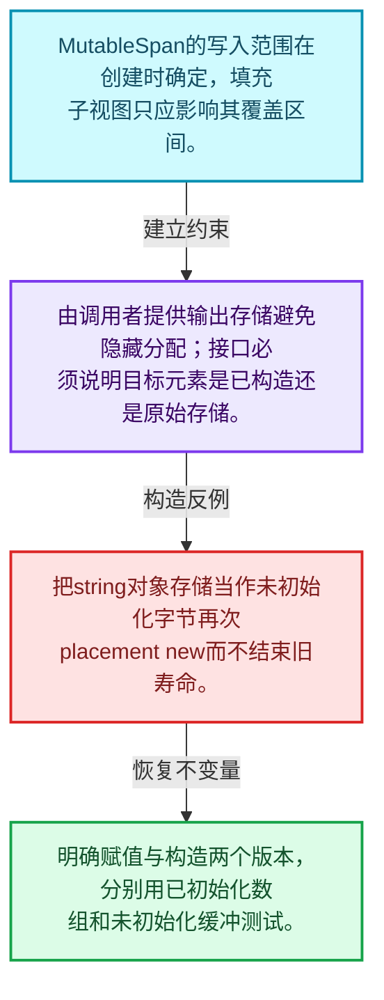
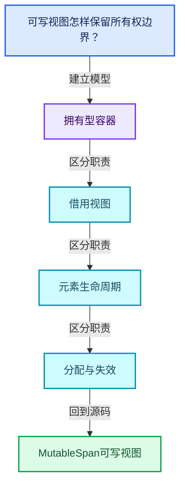
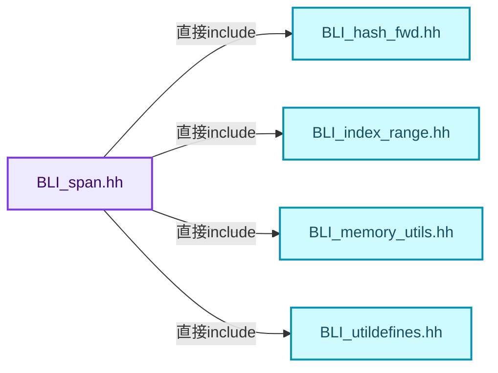
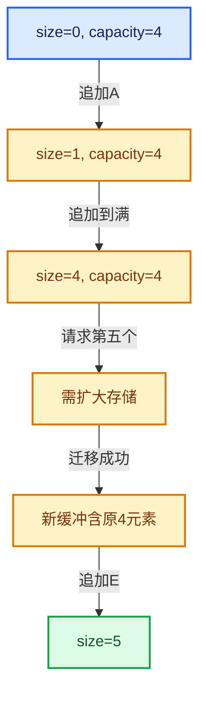

# 01-06 MutableSpan可写视图

[方向导航](README.md) · [总目录](../README.md) · [覆盖索引](../%E6%BA%90%E7%A0%81%E7%89%88%E6%9C%AC%E4%B8%8E%E8%A6%86%E7%9B%96%E7%B4%A2%E5%BC%95.md)

> 阅读顺序：问题与数据模型 → 语法与类型 → 源码逐行 → 调用线索 → 历史与取舍 → 推演和练习。

- 基准 HEAD：`cbda6b96c26c0dee3c3b5cbb93960c4ac06a6b30`。
- 记录日期：2026-10-14。
- 教学示例状态：正文中的推演不是本机性能实测；已运行练习见验收报告。

## 一、从问题到设计

可写视图怎样保留所有权边界？

MutableSpan允许修改已有元素，但不能改变底层容器大小；视图对象const与元素const是不同层次。

本篇把语法、数据语义和系统取舍连接起来。先证明对象存活，再讨论索引；先区分借用与拥有，再讨论复制移动。

### 本篇独立模型与设计推理

MutableSpan的写入范围在创建时确定，填充子视图只应影响其覆盖区间。

设计取舍：由调用者提供输出存储避免隐藏分配；接口必须说明目标元素是已构造还是原始存储。

最小反例：把string对象存储当作未初始化字节再次placement new而不结束旧寿命。

推导与处理：明确赋值与构造两个版本，分别用已初始化数组和未初始化缓冲测试。



### 源码范围与相邻篇章

| 文件 | 本篇逐行范围 | 基准SHA-256 |
|---|---|---|
| [source/blender/blenlib/BLI_span.hh](../../../../../source/blender/blenlib/BLI_span.hh) | L447—L763 | `28120d187d6d21b50bd0d0c22141102d194b400fee9882d817fc78b97786a1d1` |

同一主讲文件可能分多篇覆盖；超出本篇范围的符号通过覆盖索引定位。空行与纯注释保留在源码摘录中，逐行表解释有效语句与语法边界；许可证头统一保留。

前篇：[Span只读连续视图](05-Span%E5%8F%AA%E8%AF%BB%E8%BF%9E%E7%BB%AD%E8%A7%86%E5%9B%BE.md).

后篇：[Array构造与存储](07-Array%E6%9E%84%E9%80%A0%E4%B8%8E%E5%AD%98%E5%82%A8.md).

## 二、类型、数据与阅读地图



这是概念依赖图，边表示阅读关系，不声称是运行时调用顺序。

### 直接编译依赖



箭头只表示头文件包含关系；完整调用线索见后面的符号定位表。

## 三、关键词、语法与类型角色

### 模板 template

模板把类型或常量作为生成实现的参数。读声明时先列出类型参数、非类型参数和默认值，再看使用者实际实例化了什么。模板声明本身不意味着每种T都支持其全部成员。

具体检查：把T替换为int、string、只能移动的类型，分别检查每个被调用操作是否成立。

### 依赖名称 typename

typename既可引入类型模板参数，也可告诉编译器某个依赖名称是类型。它不创建运行时对象；解析期确认语法类别与实例化期检查具体类型是不同阶段。

具体检查：区分typename T::value_type和T::size()，前者标记类型，后者是表达式。

### 约束 requires

requires表达式或requires子句限制模板参与重载的条件。它提供编译期可用性检查，不是运行时if，不能指望输入到达程序后再被这一机制验证。

具体检查：构造满足和不满足约束的两个类型，观察候选被排除而不是在函数内返回错误。

### 常量求值 constexpr

constexpr声明允许相应实体参与常量求值，但constexpr函数仍可以在运行时执行。是否常量求值由调用场景和表达式合法性共同决定。

具体检查：比较constexpr变量初始化和从运行时输入调用同一函数。

### 只读限定 const

const约束当前访问路径可做的修改。const指针、指向const的指针、const视图对象、const元素是不同位置的限定；其他别名可能仍可修改原对象。

具体检查：分别写T* const、const T*与const T* const，并画出不可修改的层次。

### 显式静态转换 static_cast

static_cast表达编译期允许的转换，不会自动验证运行时真实类型、指针寿命或索引边界。由void指针恢复T指针时，调用者仍须保证实际存储中确有合法T对象。

具体检查：标出转换前后的类型以及正确性依据来自哪里。

### 表示层转换 reinterpret_cast

reinterpret_cast不能自动开始任意对象的生命周期，也不能豁免对齐和别名规则。读这类代码需要追溯原始分配与实际构造操作。

具体检查：分别检查大小、对齐、生命周期和可访问类型，四项不能互相替代。

### 对象表示 sizeof

sizeof给出对象表示大小，不是其引用的所有堆内存总量。sizeof视图很小并不说明底层数组很小。

具体检查：分别统计容器对象、容量字节和元素拥有的间接资源。

### 构造与new表达式

普通new可能分配并构造；placement new在给定地址构造，存储由其他机制提供。失败回滚应区分两类责任。

具体检查：追踪地址来自哪里、构造何时成功、由谁析构、由谁释放。

### 内部断言 assert

断言表达开发者预期成立的内部契约，发布构建可能关闭。它不能替代对不可信输入的完整错误处理，也不保证后续操作被运行时保护。

具体检查：对每条断言构造违反条件的输入，区分调用者错误与应向用户报告的错误。

### 类型别名 using

类型别名为已有类型建立名字，不创建运行期对象。它常把模板内部使用的类型统一暴露给泛型调用者。

具体检查：展开别名直到基础类型，区分类型别名和变量声明。

## 四、真实源码与逐行讲解

源码块保持原行内容，原始行号由小节标题及逐行表给出。表中的调用定位是静态阅读辅助；重载、模板实例化、宏展开和虚调用需结合完整声明，不能仅凭词法出现证明动态调用。

### BLI_span.hh：L447—L494

<!-- source:source/blender/blenlib/BLI_span.hh:447:494 -->

```cpp
template<typename T> class MutableSpan {
 public:
  using value_type = T;
  using pointer = T *;
  using const_pointer = const T *;
  using reference = T &;
  using const_reference = const T &;
  using iterator = T *;
  using size_type = int64_t;

 protected:
  T *data_ = nullptr;
  int64_t size_ = 0;

 public:
  constexpr MutableSpan() = default;

  constexpr MutableSpan(T *start, const int64_t size) : data_(start), size_(size) {}

  constexpr MutableSpan(std::vector<T> &vector) : MutableSpan(vector.data(), vector.size()) {}

  template<std::size_t N>
  constexpr MutableSpan(std::array<T, N> &array) : MutableSpan(array.data(), N)
  {
  }

  /**
   * Support implicit conversions like the one below:
   *   MutableSpan<T *> -> MutableSpan<const T *>
   */
  template<typename U>
  constexpr MutableSpan(MutableSpan<U> span)
    requires(is_span_convertible_pointer_v<U, T>)
      : data_(static_cast<T *>(span.data())), size_(span.size())
  {
  }

  constexpr operator Span<T>() const
  {
    return Span<T>(data_, size_);
  }

  template<typename U>
  constexpr operator Span<U>() const
    requires(is_span_convertible_pointer_v<T, U>)
  {
    return Span<U>(static_cast<const U *>(data_), size_);
  }
```

本段语义重点：

- `data_`：数据或实现的存储入口；是否拥有应按该类声明和析构判定。
- `size_`：该对象记录的元素数或长度，不能直接当作容量。

| 原始行 | 语义、约束与检查 |
|---|---|
| L447 | 声明模板参数 `template<typename T> class MutableSpan {`。类型参数决定生成操作的类型，非类型参数可决定内嵌容量或编译期分支。 |
| L448 | 切换成员访问权限为 public；它是编译期接口边界，不是线程同步或内存保护。 |
| L449 | 定义类型别名 `using value_type = T`，为模板接口或内部实现统一命名；本行不分配该类型对象。 |
| L450 | 定义类型别名 `using pointer = T *`，为模板接口或内部实现统一命名；本行不分配该类型对象。 |
| L451 | 定义类型别名 `using const_pointer = const T *`，为模板接口或内部实现统一命名；本行不分配该类型对象。 |
| L452 | 定义类型别名 `using reference = T &`，为模板接口或内部实现统一命名；本行不分配该类型对象。 |
| L453 | 定义类型别名 `using const_reference = const T &`，为模板接口或内部实现统一命名；本行不分配该类型对象。 |
| L454 | 定义类型别名 `using iterator = T *`，为模板接口或内部实现统一命名；本行不分配该类型对象。 |
| L455 | 定义类型别名 `using size_type = int64_t`，为模板接口或内部实现统一命名；本行不分配该类型对象。 |
| L457 | 切换成员访问权限为 protected；它是编译期接口边界，不是线程同步或内存保护。 |
| L458 | 建立或更新 `data_`：数据或实现的存储入口；是否拥有应按该类声明和析构判定。本行的具体值关系为 `T *data_ = nullptr`；对照更新前后相应范围或状态是否一致。 |
| L459 | 建立或更新 `size_`：该对象记录的元素数或长度，不能直接当作容量。本行的具体值关系为 `int64_t size_ = 0`；对照更新前后相应范围或状态是否一致。 |
| L461 | 切换成员访问权限为 public；它是编译期接口边界，不是线程同步或内存保护。 |
| L462 | 显式采用编译器生成的特殊成员行为：`constexpr MutableSpan() = default;`。成员和基类的性质决定该操作是否可用、是否被删除及异常约定，不表示运行时给对象赋值为default。 |
| L464 | 本行涉及 `data_`：数据或实现的存储入口；是否拥有应按该类声明和析构判定。按此语义解读 `constexpr MutableSpan(T *start, const int64_t size) : data_(start), size_(size) {}`，不要把地址、数量或状态混用。 |
| L466 | 出现调用或函数声明 `MutableSpan`，对应表达式为 `constexpr MutableSpan(std::vector<T> &vector) : MutableSpan(vector.data(), vector.size()) {}`。参数求值、返回类型与重载需结合前后完整语句；静态文本引用不能证明动态目标。 |
| L468 | 声明模板参数 `template<std::size_t N>`。类型参数决定生成操作的类型，非类型参数可决定内嵌容量或编译期分支。 |
| L469 | 出现调用或函数声明 `MutableSpan`，对应表达式为 `constexpr MutableSpan(std::array<T, N> &array) : MutableSpan(array.data(), N)`。参数求值、返回类型与重载需结合前后完整语句；静态文本引用不能证明动态目标。 |
| L470 | 连接上一行的声明或控制结构与其语句块；后续行在这个作用域中执行或声明。 |
| L471 | 结束当前语法单元。局部自动对象在离开其作用域时按规则销毁；这不等于所有被引用的外部数据也被释放。 |
| L477 | 声明模板参数 `template<typename U>`。类型参数决定生成操作的类型，非类型参数可决定内嵌容量或编译期分支。 |
| L478 | 出现调用或函数声明 `MutableSpan`，对应表达式为 `constexpr MutableSpan(MutableSpan<U> span)`。参数求值、返回类型与重载需结合前后完整语句；静态文本引用不能证明动态目标。 |
| L479 | 约束模板可用性：`requires(is_span_convertible_pointer_v<U, T>)`。条件在编译期检查，不替代运行期的地址、长度和类型一致性验证。 |
| L480 | 本行涉及 `data_`：数据或实现的存储入口；是否拥有应按该类声明和析构判定。按此语义解读 `: data_(static_cast<T *>(span.data())), size_(span.size())`，不要把地址、数量或状态混用。 |
| L481 | 连接上一行的声明或控制结构与其语句块；后续行在这个作用域中执行或声明。 |
| L482 | 结束当前语法单元。局部自动对象在离开其作用域时按规则销毁；这不等于所有被引用的外部数据也被释放。 |
| L484 | 运算符重载声明、定义或显式调用：`constexpr operator Span<T>() const`。结合参数和返回类型判断是赋值、索引、比较还是转换；operator=声明中的等号不是在给名为operator的变量赋值。 |
| L485 | 连接上一行的声明或控制结构与其语句块；后续行在这个作用域中执行或声明。 |
| L486 | 返回表达式 `Span<T>(data_, size_)`。 |
| L487 | 结束当前语法单元。局部自动对象在离开其作用域时按规则销毁；这不等于所有被引用的外部数据也被释放。 |
| L489 | 声明模板参数 `template<typename U>`。类型参数决定生成操作的类型，非类型参数可决定内嵌容量或编译期分支。 |
| L490 | 运算符重载声明、定义或显式调用：`constexpr operator Span<U>() const`。结合参数和返回类型判断是赋值、索引、比较还是转换；operator=声明中的等号不是在给名为operator的变量赋值。 |
| L491 | 约束模板可用性：`requires(is_span_convertible_pointer_v<T, U>)`。条件在编译期检查，不替代运行期的地址、长度和类型一致性验证。 |
| L492 | 连接上一行的声明或控制结构与其语句块；后续行在这个作用域中执行或声明。 |
| L493 | 返回表达式 `Span<U>(static_cast<const U *>(data_), size_)`。 |
| L494 | 结束当前语法单元。局部自动对象在离开其作用域时按规则销毁；这不等于所有被引用的外部数据也被释放。 |

### BLI_span.hh：L495—L539

<!-- source:source/blender/blenlib/BLI_span.hh:495:539 -->

```cpp

  /**
   * Returns the number of elements in the array.
   */
  constexpr int64_t size() const
  {
    return size_;
  }

  /**
   * Returns the number of bytes referenced by this Span.
   */
  constexpr int64_t size_in_bytes() const
  {
    return sizeof(T) * size_;
  }

  /**
   * Returns true if the size is zero.
   */
  constexpr bool is_empty() const
  {
    return size_ == 0;
  }

  /**
   * Replace all elements in the referenced array with the given value.
   */
  constexpr void fill(const T &value) const
  {
    initialized_fill_n(data_, size_, value);
  }

  /**
   * Replace a subset of all elements with the given value. This invokes undefined behavior when
   * one of the indices is out of bounds.
   */
  template<typename IndexT> constexpr void fill_indices(Span<IndexT> indices, const T &value) const
  {
    static_assert(std::is_integral_v<IndexT>);
    for (IndexT i : indices) {
      BLI_assert(i < size_);
      data_[i] = value;
    }
  }
```

本段语义重点：

- `data_`：数据或实现的存储入口；是否拥有应按该类声明和析构判定。
- `size_`：该对象记录的元素数或长度，不能直接当作容量。

| 原始行 | 语义、约束与检查 |
|---|---|
| L499 | 出现调用或函数声明 `size`，对应表达式为 `constexpr int64_t size() const`。参数求值、返回类型与重载需结合前后完整语句；静态文本引用不能证明动态目标。 |
| L500 | 连接上一行的声明或控制结构与其语句块；后续行在这个作用域中执行或声明。 |
| L501 | 返回表达式 `size_`。 |
| L502 | 结束当前语法单元。局部自动对象在离开其作用域时按规则销毁；这不等于所有被引用的外部数据也被释放。 |
| L507 | 出现调用或函数声明 `size_in_bytes`，对应表达式为 `constexpr int64_t size_in_bytes() const`。参数求值、返回类型与重载需结合前后完整语句；静态文本引用不能证明动态目标。 |
| L508 | 连接上一行的声明或控制结构与其语句块；后续行在这个作用域中执行或声明。 |
| L509 | 返回表达式 `sizeof(T) * size_`。 |
| L510 | 结束当前语法单元。局部自动对象在离开其作用域时按规则销毁；这不等于所有被引用的外部数据也被释放。 |
| L515 | 出现调用或函数声明 `is_empty`，对应表达式为 `constexpr bool is_empty() const`。参数求值、返回类型与重载需结合前后完整语句；静态文本引用不能证明动态目标。 |
| L516 | 连接上一行的声明或控制结构与其语句块；后续行在这个作用域中执行或声明。 |
| L517 | 返回表达式 `size_ == 0`。 |
| L518 | 结束当前语法单元。局部自动对象在离开其作用域时按规则销毁；这不等于所有被引用的外部数据也被释放。 |
| L523 | 出现调用或函数声明 `fill`，对应表达式为 `constexpr void fill(const T &value) const`。参数求值、返回类型与重载需结合前后完整语句；静态文本引用不能证明动态目标。 |
| L524 | 连接上一行的声明或控制结构与其语句块；后续行在这个作用域中执行或声明。 |
| L525 | 本行涉及 `data_`：数据或实现的存储入口；是否拥有应按该类声明和析构判定。按此语义解读 `initialized_fill_n(data_, size_, value)`，不要把地址、数量或状态混用。 |
| L526 | 结束当前语法单元。局部自动对象在离开其作用域时按规则销毁；这不等于所有被引用的外部数据也被释放。 |
| L532 | 声明模板参数 `template<typename IndexT> constexpr void fill_indices(Span<IndexT> indices, const T &value) const`。类型参数决定生成操作的类型，非类型参数可决定内嵌容量或编译期分支。 |
| L533 | 连接上一行的声明或控制结构与其语句块；后续行在这个作用域中执行或声明。 |
| L534 | 在编译期检查 `static_assert(std::is_integral_v<IndexT>);`；条件失败导致编译错误，不存在运行时错误恢复路径。 |
| L535 | 按 `for (IndexT i : indices)` 指定的范围或条件重复执行。对照循环变量与真实元素编号；循环内调用成本乘以实际迭代次数。 |
| L536 | 断言约束 `BLI_assert(i < size_);`。条件是后续访问的内部前置条件；发布构建可能不执行，不能把断言当作输入修复。 |
| L537 | 建立或更新 `data_`：数据或实现的存储入口；是否拥有应按该类声明和析构判定。本行的具体值关系为 `data_[i] = value`；对照更新前后相应范围或状态是否一致。 |
| L538 | 结束当前语法单元。局部自动对象在离开其作用域时按规则销毁；这不等于所有被引用的外部数据也被释放。 |
| L539 | 结束当前语法单元。局部自动对象在离开其作用域时按规则销毁；这不等于所有被引用的外部数据也被释放。 |

### BLI_span.hh：L540—L585

<!-- source:source/blender/blenlib/BLI_span.hh:540:585 -->

```cpp

  /**
   * Returns a pointer to the beginning of the referenced array. This may be nullptr, when the size
   * is zero.
   */
  constexpr T *data() const
  {
    return data_;
  }

  constexpr T *begin() const
  {
    return data_;
  }
  constexpr T *end() const
  {
    return data_ + size_;
  }

  constexpr std::reverse_iterator<T *> rbegin() const
  {
    return std::reverse_iterator<T *>(this->end());
  }
  constexpr std::reverse_iterator<T *> rend() const
  {
    return std::reverse_iterator<T *>(this->begin());
  }

  constexpr T &operator[](const int64_t index) const
  {
    BLI_assert(index >= 0);
    BLI_assert(index < size_);
    return data_[index];
  }

  /**
   * Returns a contiguous part of the array. This invokes undefined behavior when the start or size
   * is negative.
   */
  constexpr MutableSpan slice(const int64_t start, const int64_t size) const
  {
    BLI_assert(start >= 0);
    BLI_assert(size >= 0);
    BLI_assert(start + size <= size_ || size == 0);
    return MutableSpan(data_ + start, size);
  }
```

本段语义重点：

- `data_`：数据或实现的存储入口；是否拥有应按该类声明和析构判定。
- `size_`：该对象记录的元素数或长度，不能直接当作容量。

| 原始行 | 语义、约束与检查 |
|---|---|
| L545 | 出现调用或函数声明 `data`，对应表达式为 `constexpr T *data() const`。参数求值、返回类型与重载需结合前后完整语句；静态文本引用不能证明动态目标。 |
| L546 | 连接上一行的声明或控制结构与其语句块；后续行在这个作用域中执行或声明。 |
| L547 | 返回表达式 `data_`。 |
| L548 | 结束当前语法单元。局部自动对象在离开其作用域时按规则销毁；这不等于所有被引用的外部数据也被释放。 |
| L550 | 出现调用或函数声明 `begin`，对应表达式为 `constexpr T *begin() const`。参数求值、返回类型与重载需结合前后完整语句；静态文本引用不能证明动态目标。 |
| L551 | 连接上一行的声明或控制结构与其语句块；后续行在这个作用域中执行或声明。 |
| L552 | 返回表达式 `data_`。 |
| L553 | 结束当前语法单元。局部自动对象在离开其作用域时按规则销毁；这不等于所有被引用的外部数据也被释放。 |
| L554 | 出现调用或函数声明 `end`，对应表达式为 `constexpr T *end() const`。参数求值、返回类型与重载需结合前后完整语句；静态文本引用不能证明动态目标。 |
| L555 | 连接上一行的声明或控制结构与其语句块；后续行在这个作用域中执行或声明。 |
| L556 | 返回表达式 `data_ + size_`。 |
| L557 | 结束当前语法单元。局部自动对象在离开其作用域时按规则销毁；这不等于所有被引用的外部数据也被释放。 |
| L559 | 出现调用或函数声明 `rbegin`，对应表达式为 `constexpr std::reverse_iterator<T *> rbegin() const`。参数求值、返回类型与重载需结合前后完整语句；静态文本引用不能证明动态目标。 |
| L560 | 连接上一行的声明或控制结构与其语句块；后续行在这个作用域中执行或声明。 |
| L561 | 返回表达式 `std::reverse_iterator<T *>(this->end())`。 |
| L562 | 结束当前语法单元。局部自动对象在离开其作用域时按规则销毁；这不等于所有被引用的外部数据也被释放。 |
| L563 | 出现调用或函数声明 `rend`，对应表达式为 `constexpr std::reverse_iterator<T *> rend() const`。参数求值、返回类型与重载需结合前后完整语句；静态文本引用不能证明动态目标。 |
| L564 | 连接上一行的声明或控制结构与其语句块；后续行在这个作用域中执行或声明。 |
| L565 | 返回表达式 `std::reverse_iterator<T *>(this->begin())`。 |
| L566 | 结束当前语法单元。局部自动对象在离开其作用域时按规则销毁；这不等于所有被引用的外部数据也被释放。 |
| L568 | 运算符重载声明、定义或显式调用：`constexpr T &operator[](const int64_t index) const`。结合参数和返回类型判断是赋值、索引、比较还是转换；operator=声明中的等号不是在给名为operator的变量赋值。 |
| L569 | 连接上一行的声明或控制结构与其语句块；后续行在这个作用域中执行或声明。 |
| L570 | 断言约束 `BLI_assert(index >= 0);`。条件是后续访问的内部前置条件；发布构建可能不执行，不能把断言当作输入修复。 |
| L571 | 断言约束 `BLI_assert(index < size_);`。条件是后续访问的内部前置条件；发布构建可能不执行，不能把断言当作输入修复。 |
| L572 | 返回表达式 `data_[index]`。 |
| L573 | 结束当前语法单元。局部自动对象在离开其作用域时按规则销毁；这不等于所有被引用的外部数据也被释放。 |
| L579 | 出现调用或函数声明 `slice`，对应表达式为 `constexpr MutableSpan slice(const int64_t start, const int64_t size) const`。参数求值、返回类型与重载需结合前后完整语句；静态文本引用不能证明动态目标。 |
| L580 | 连接上一行的声明或控制结构与其语句块；后续行在这个作用域中执行或声明。 |
| L581 | 断言约束 `BLI_assert(start >= 0);`。条件是后续访问的内部前置条件；发布构建可能不执行，不能把断言当作输入修复。 |
| L582 | 断言约束 `BLI_assert(size >= 0);`。条件是后续访问的内部前置条件；发布构建可能不执行，不能把断言当作输入修复。 |
| L583 | 断言约束 `BLI_assert(start + size <= size_ &#124;&#124; size == 0);`。条件是后续访问的内部前置条件；发布构建可能不执行，不能把断言当作输入修复。 |
| L584 | 返回表达式 `MutableSpan(data_ + start, size)`。 |
| L585 | 结束当前语法单元。局部自动对象在离开其作用域时按规则销毁；这不等于所有被引用的外部数据也被释放。 |

### BLI_span.hh：L586—L629

<!-- source:source/blender/blenlib/BLI_span.hh:586:629 -->

```cpp

  constexpr MutableSpan slice(IndexRange range) const
  {
    return this->slice(range.start(), range.size());
  }

  /**
   * Returns a contiguous part of the array. This invokes undefined behavior when the start or size
   * is negative. Clamps the size of the new span so it fits in the current one.
   */
  constexpr MutableSpan slice_safe(const int64_t start, const int64_t size) const
  {
    BLI_assert(start >= 0);
    BLI_assert(size >= 0);
    const int64_t new_size = std::max<int64_t>(0, std::min(size, size_ - start));
    return MutableSpan(data_ + start, new_size);
  }

  constexpr MutableSpan slice_safe(IndexRange range) const
  {
    return this->slice_safe(range.start(), range.size());
  }

  /**
   * Returns a new MutableSpan with n elements removed from the beginning. This invokes
   * undefined behavior when n is negative.
   */
  constexpr MutableSpan drop_front(const int64_t n) const
  {
    BLI_assert(n >= 0);
    const int64_t new_size = std::max<int64_t>(0, size_ - n);
    return MutableSpan(data_ + n, new_size);
  }

  /**
   * Returns a new MutableSpan with n elements removed from the end. This invokes undefined
   * behavior when n is negative.
   */
  constexpr MutableSpan drop_back(const int64_t n) const
  {
    BLI_assert(n >= 0);
    const int64_t new_size = std::max<int64_t>(0, size_ - n);
    return MutableSpan(data_, new_size);
  }
```

本段语义重点：

- `std::max`：取较大值，在容量计算中常用于同时满足请求量和增长策略。
- `std::min`：取较小值，常用于截断范围；还要检查负值、溢出和空范围。
- `data_`：数据或实现的存储入口；是否拥有应按该类声明和析构判定。
- `size_`：该对象记录的元素数或长度，不能直接当作容量。

| 原始行 | 语义、约束与检查 |
|---|---|
| L587 | 出现调用或函数声明 `slice`，对应表达式为 `constexpr MutableSpan slice(IndexRange range) const`。参数求值、返回类型与重载需结合前后完整语句；静态文本引用不能证明动态目标。 |
| L588 | 连接上一行的声明或控制结构与其语句块；后续行在这个作用域中执行或声明。 |
| L589 | 返回表达式 `this->slice(range.start(), range.size())`。 |
| L590 | 结束当前语法单元。局部自动对象在离开其作用域时按规则销毁；这不等于所有被引用的外部数据也被释放。 |
| L596 | 出现调用或函数声明 `slice_safe`，对应表达式为 `constexpr MutableSpan slice_safe(const int64_t start, const int64_t size) const`。参数求值、返回类型与重载需结合前后完整语句；静态文本引用不能证明动态目标。 |
| L597 | 连接上一行的声明或控制结构与其语句块；后续行在这个作用域中执行或声明。 |
| L598 | 断言约束 `BLI_assert(start >= 0);`。条件是后续访问的内部前置条件；发布构建可能不执行，不能把断言当作输入修复。 |
| L599 | 断言约束 `BLI_assert(size >= 0);`。条件是后续访问的内部前置条件；发布构建可能不执行，不能把断言当作输入修复。 |
| L600 | 本行使用 `std::max`：取较大值，在容量计算中常用于同时满足请求量和增长策略。 |
| L601 | 返回表达式 `MutableSpan(data_ + start, new_size)`。 |
| L602 | 结束当前语法单元。局部自动对象在离开其作用域时按规则销毁；这不等于所有被引用的外部数据也被释放。 |
| L604 | 出现调用或函数声明 `slice_safe`，对应表达式为 `constexpr MutableSpan slice_safe(IndexRange range) const`。参数求值、返回类型与重载需结合前后完整语句；静态文本引用不能证明动态目标。 |
| L605 | 连接上一行的声明或控制结构与其语句块；后续行在这个作用域中执行或声明。 |
| L606 | 返回表达式 `this->slice_safe(range.start(), range.size())`。 |
| L607 | 结束当前语法单元。局部自动对象在离开其作用域时按规则销毁；这不等于所有被引用的外部数据也被释放。 |
| L613 | 出现调用或函数声明 `drop_front`，对应表达式为 `constexpr MutableSpan drop_front(const int64_t n) const`。参数求值、返回类型与重载需结合前后完整语句；静态文本引用不能证明动态目标。 |
| L614 | 连接上一行的声明或控制结构与其语句块；后续行在这个作用域中执行或声明。 |
| L615 | 断言约束 `BLI_assert(n >= 0);`。条件是后续访问的内部前置条件；发布构建可能不执行，不能把断言当作输入修复。 |
| L616 | 本行使用 `std::max`：取较大值，在容量计算中常用于同时满足请求量和增长策略。 |
| L617 | 返回表达式 `MutableSpan(data_ + n, new_size)`。 |
| L618 | 结束当前语法单元。局部自动对象在离开其作用域时按规则销毁；这不等于所有被引用的外部数据也被释放。 |
| L624 | 出现调用或函数声明 `drop_back`，对应表达式为 `constexpr MutableSpan drop_back(const int64_t n) const`。参数求值、返回类型与重载需结合前后完整语句；静态文本引用不能证明动态目标。 |
| L625 | 连接上一行的声明或控制结构与其语句块；后续行在这个作用域中执行或声明。 |
| L626 | 断言约束 `BLI_assert(n >= 0);`。条件是后续访问的内部前置条件；发布构建可能不执行，不能把断言当作输入修复。 |
| L627 | 本行使用 `std::max`：取较大值，在容量计算中常用于同时满足请求量和增长策略。 |
| L628 | 返回表达式 `MutableSpan(data_, new_size)`。 |
| L629 | 结束当前语法单元。局部自动对象在离开其作用域时按规则销毁；这不等于所有被引用的外部数据也被释放。 |

### BLI_span.hh：L630—L679

<!-- source:source/blender/blenlib/BLI_span.hh:630:679 -->

```cpp

  /**
   * Returns a new MutableSpan that only contains the first n elements. This invokes undefined
   * behavior when n is negative.
   */
  constexpr MutableSpan take_front(const int64_t n) const
  {
    BLI_assert(n >= 0);
    const int64_t new_size = std::min<int64_t>(size_, n);
    return MutableSpan(data_, new_size);
  }

  /**
   * Return a new MutableSpan that only contains the last n elements. This invokes undefined
   * behavior when n is negative.
   */
  constexpr MutableSpan take_back(const int64_t n) const
  {
    BLI_assert(n >= 0);
    const int64_t new_size = std::min<int64_t>(size_, n);
    return MutableSpan(data_ + size_ - new_size, new_size);
  }

  /**
   * Reverse the data in the MutableSpan.
   */
  constexpr void reverse() const
  {
    for (const int i : IndexRange(size_ / 2)) {
      std::swap(data_[size_ - 1 - i], data_[i]);
    }
  }

  /**
   * Returns an (immutable) Span that references the same array. This is usually not needed,
   * due to implicit conversions. However, sometimes automatic type deduction needs some help.
   */
  constexpr Span<T> as_span() const
  {
    return Span<T>(data_, size_);
  }

  /**
   * Utility to make it more convenient to iterate over all indices that can be used with this
   * array.
   */
  constexpr IndexRange index_range() const
  {
    return IndexRange(size_);
  }
```

本段语义重点：

- `std::min`：取较小值，常用于截断范围；还要检查负值、溢出和空范围。
- `data_`：数据或实现的存储入口；是否拥有应按该类声明和析构判定。
- `size_`：该对象记录的元素数或长度，不能直接当作容量。

| 原始行 | 语义、约束与检查 |
|---|---|
| L635 | 出现调用或函数声明 `take_front`，对应表达式为 `constexpr MutableSpan take_front(const int64_t n) const`。参数求值、返回类型与重载需结合前后完整语句；静态文本引用不能证明动态目标。 |
| L636 | 连接上一行的声明或控制结构与其语句块；后续行在这个作用域中执行或声明。 |
| L637 | 断言约束 `BLI_assert(n >= 0);`。条件是后续访问的内部前置条件；发布构建可能不执行，不能把断言当作输入修复。 |
| L638 | 本行使用 `std::min`：取较小值，常用于截断范围；还要检查负值、溢出和空范围。 |
| L639 | 返回表达式 `MutableSpan(data_, new_size)`。 |
| L640 | 结束当前语法单元。局部自动对象在离开其作用域时按规则销毁；这不等于所有被引用的外部数据也被释放。 |
| L646 | 出现调用或函数声明 `take_back`，对应表达式为 `constexpr MutableSpan take_back(const int64_t n) const`。参数求值、返回类型与重载需结合前后完整语句；静态文本引用不能证明动态目标。 |
| L647 | 连接上一行的声明或控制结构与其语句块；后续行在这个作用域中执行或声明。 |
| L648 | 断言约束 `BLI_assert(n >= 0);`。条件是后续访问的内部前置条件；发布构建可能不执行，不能把断言当作输入修复。 |
| L649 | 本行使用 `std::min`：取较小值，常用于截断范围；还要检查负值、溢出和空范围。 |
| L650 | 返回表达式 `MutableSpan(data_ + size_ - new_size, new_size)`。 |
| L651 | 结束当前语法单元。局部自动对象在离开其作用域时按规则销毁；这不等于所有被引用的外部数据也被释放。 |
| L656 | 出现调用或函数声明 `reverse`，对应表达式为 `constexpr void reverse() const`。参数求值、返回类型与重载需结合前后完整语句；静态文本引用不能证明动态目标。 |
| L657 | 连接上一行的声明或控制结构与其语句块；后续行在这个作用域中执行或声明。 |
| L658 | 按 `for (const int i : IndexRange(size_ / 2))` 指定的范围或条件重复执行。对照循环变量与真实元素编号；循环内调用成本乘以实际迭代次数。 |
| L659 | 本行涉及 `data_`：数据或实现的存储入口；是否拥有应按该类声明和析构判定。按此语义解读 `std::swap(data_[size_ - 1 - i], data_[i])`，不要把地址、数量或状态混用。 |
| L660 | 结束当前语法单元。局部自动对象在离开其作用域时按规则销毁；这不等于所有被引用的外部数据也被释放。 |
| L661 | 结束当前语法单元。局部自动对象在离开其作用域时按规则销毁；这不等于所有被引用的外部数据也被释放。 |
| L667 | 出现调用或函数声明 `as_span`，对应表达式为 `constexpr Span<T> as_span() const`。参数求值、返回类型与重载需结合前后完整语句；静态文本引用不能证明动态目标。 |
| L668 | 连接上一行的声明或控制结构与其语句块；后续行在这个作用域中执行或声明。 |
| L669 | 返回表达式 `Span<T>(data_, size_)`。 |
| L670 | 结束当前语法单元。局部自动对象在离开其作用域时按规则销毁；这不等于所有被引用的外部数据也被释放。 |
| L676 | 出现调用或函数声明 `index_range`，对应表达式为 `constexpr IndexRange index_range() const`。参数求值、返回类型与重载需结合前后完整语句；静态文本引用不能证明动态目标。 |
| L677 | 连接上一行的声明或控制结构与其语句块；后续行在这个作用域中执行或声明。 |
| L678 | 返回表达式 `IndexRange(size_)`。 |
| L679 | 结束当前语法单元。局部自动对象在离开其作用域时按规则销毁；这不等于所有被引用的外部数据也被释放。 |

### BLI_span.hh：L680—L729

<!-- source:source/blender/blenlib/BLI_span.hh:680:729 -->

```cpp

  /**
   * Return a reference to the first element in the array. This invokes undefined behavior when the
   * array is empty.
   */
  constexpr T &first() const
  {
    BLI_assert(size_ > 0);
    return data_[0];
  }

  /**
   * Returns a reference to the nth last element. This invokes undefined behavior when the span is
   * too short.
   */
  constexpr T &last(const int64_t n = 0) const
  {
    BLI_assert(n >= 0);
    BLI_assert(n < size_);
    return data_[size_ - 1 - n];
  }

  /**
   * Does a linear search to count how often the value is in the array.
   * Returns the number of occurrences.
   */
  constexpr int64_t count(const T &value) const
  {
    int64_t counter = 0;
    for (const T &element : *this) {
      if (element == value) {
        counter++;
      }
    }
    return counter;
  }

  /**
   * Does a linear search to see of the value is in the array.
   * Returns true if it is, otherwise false.
   */
  constexpr bool contains(const T &value) const
  {
    for (const T &element : *this) {
      if (element == value) {
        return true;
      }
    }
    return false;
  }
```

本段语义重点：

- `data_`：数据或实现的存储入口；是否拥有应按该类声明和析构判定。
- `size_`：该对象记录的元素数或长度，不能直接当作容量。

| 原始行 | 语义、约束与检查 |
|---|---|
| L685 | 出现调用或函数声明 `first`，对应表达式为 `constexpr T &first() const`。参数求值、返回类型与重载需结合前后完整语句；静态文本引用不能证明动态目标。 |
| L686 | 连接上一行的声明或控制结构与其语句块；后续行在这个作用域中执行或声明。 |
| L687 | 断言约束 `BLI_assert(size_ > 0);`。条件是后续访问的内部前置条件；发布构建可能不执行，不能把断言当作输入修复。 |
| L688 | 返回表达式 `data_[0]`。 |
| L689 | 结束当前语法单元。局部自动对象在离开其作用域时按规则销毁；这不等于所有被引用的外部数据也被释放。 |
| L695 | 把右侧 `0) const` 用于初始化或更新左侧 `constexpr T &last(const int64_t n`。声明初始化与已有对象赋值应按上下文区分；有资源的类型会调用相应特殊成员。 |
| L696 | 连接上一行的声明或控制结构与其语句块；后续行在这个作用域中执行或声明。 |
| L697 | 断言约束 `BLI_assert(n >= 0);`。条件是后续访问的内部前置条件；发布构建可能不执行，不能把断言当作输入修复。 |
| L698 | 断言约束 `BLI_assert(n < size_);`。条件是后续访问的内部前置条件；发布构建可能不执行，不能把断言当作输入修复。 |
| L699 | 返回表达式 `data_[size_ - 1 - n]`。 |
| L700 | 结束当前语法单元。局部自动对象在离开其作用域时按规则销毁；这不等于所有被引用的外部数据也被释放。 |
| L706 | 出现调用或函数声明 `count`，对应表达式为 `constexpr int64_t count(const T &value) const`。参数求值、返回类型与重载需结合前后完整语句；静态文本引用不能证明动态目标。 |
| L707 | 连接上一行的声明或控制结构与其语句块；后续行在这个作用域中执行或声明。 |
| L708 | 把右侧 `0` 用于初始化或更新左侧 `int64_t counter`。声明初始化与已有对象赋值应按上下文区分；有资源的类型会调用相应特殊成员。 |
| L709 | 按 `for (const T &element : *this)` 指定的范围或条件重复执行。对照循环变量与真实元素编号；循环内调用成本乘以实际迭代次数。 |
| L710 | 判断 `element == value`，成立时进入本分支，否则继续后续路径。 |
| L711 | 递增或递减现有状态：`counter++;`。这改变计数或游标；检查边界、计数单位，以及并发访问是否有相应保护。 |
| L712 | 结束当前语法单元。局部自动对象在离开其作用域时按规则销毁；这不等于所有被引用的外部数据也被释放。 |
| L713 | 结束当前语法单元。局部自动对象在离开其作用域时按规则销毁；这不等于所有被引用的外部数据也被释放。 |
| L714 | 返回表达式 `counter`。 |
| L715 | 结束当前语法单元。局部自动对象在离开其作用域时按规则销毁；这不等于所有被引用的外部数据也被释放。 |
| L721 | 出现调用或函数声明 `contains`，对应表达式为 `constexpr bool contains(const T &value) const`。参数求值、返回类型与重载需结合前后完整语句；静态文本引用不能证明动态目标。 |
| L722 | 连接上一行的声明或控制结构与其语句块；后续行在这个作用域中执行或声明。 |
| L723 | 按 `for (const T &element : *this)` 指定的范围或条件重复执行。对照循环变量与真实元素编号；循环内调用成本乘以实际迭代次数。 |
| L724 | 判断 `element == value`，成立时进入本分支，否则继续后续路径。 |
| L725 | 返回表达式 `true`。这是本路径的布尔结果，具体成功、存在或状态含义由函数接口规定。 |
| L726 | 结束当前语法单元。局部自动对象在离开其作用域时按规则销毁；这不等于所有被引用的外部数据也被释放。 |
| L727 | 结束当前语法单元。局部自动对象在离开其作用域时按规则销毁；这不等于所有被引用的外部数据也被释放。 |
| L728 | 返回表达式 `false`。这是本路径的布尔结果，具体成功、存在或状态含义由函数接口规定。 |
| L729 | 结束当前语法单元。局部自动对象在离开其作用域时按规则销毁；这不等于所有被引用的外部数据也被释放。 |

### BLI_span.hh：L730—L763

<!-- source:source/blender/blenlib/BLI_span.hh:730:763 -->

```cpp

  /**
   * Does a constant time check to see if the pointer points to a value in the referenced array.
   * Return true if it is, otherwise false.
   */
  constexpr bool contains_ptr(const T *ptr) const
  {
    return (this->begin() <= ptr) && (ptr < this->end());
  }

  /**
   * Copy all values from another span into this span. This invokes undefined behavior when the
   * destination contains uninitialized data and T is not trivially copy constructible.
   * The size of both spans is expected to be the same.
   */
  constexpr void copy_from(Span<T> values) const
  {
    BLI_assert(size_ == values.size());
    initialized_copy_n(values.data(), size_, data_);
  }

  /**
   * Returns a new span to the same underlying memory buffer. No conversions are done.
   * The caller is responsible for making sure that the type cast is valid.
   */
  template<typename NewT> constexpr MutableSpan<NewT> cast() const
  {
    BLI_assert((size_ * sizeof(T)) % sizeof(NewT) == 0);
    int64_t new_size = size_ * sizeof(T) / sizeof(NewT);
    return MutableSpan<NewT>(reinterpret_cast<NewT *>(data_), new_size);
  }
};

}  // namespace blender
```

本段语义重点：

- `data_`：数据或实现的存储入口；是否拥有应按该类声明和析构判定。
- `size_`：该对象记录的元素数或长度，不能直接当作容量。

| 原始行 | 语义、约束与检查 |
|---|---|
| L735 | 出现调用或函数声明 `contains_ptr`，对应表达式为 `constexpr bool contains_ptr(const T *ptr) const`。参数求值、返回类型与重载需结合前后完整语句；静态文本引用不能证明动态目标。 |
| L736 | 连接上一行的声明或控制结构与其语句块；后续行在这个作用域中执行或声明。 |
| L737 | 返回表达式 `(this->begin() <= ptr) && (ptr < this->end())`。 |
| L738 | 结束当前语法单元。局部自动对象在离开其作用域时按规则销毁；这不等于所有被引用的外部数据也被释放。 |
| L745 | 出现调用或函数声明 `copy_from`，对应表达式为 `constexpr void copy_from(Span<T> values) const`。参数求值、返回类型与重载需结合前后完整语句；静态文本引用不能证明动态目标。 |
| L746 | 连接上一行的声明或控制结构与其语句块；后续行在这个作用域中执行或声明。 |
| L747 | 断言约束 `BLI_assert(size_ == values.size());`。条件是后续访问的内部前置条件；发布构建可能不执行，不能把断言当作输入修复。 |
| L748 | 本行涉及 `data_`：数据或实现的存储入口；是否拥有应按该类声明和析构判定。按此语义解读 `initialized_copy_n(values.data(), size_, data_)`，不要把地址、数量或状态混用。 |
| L749 | 结束当前语法单元。局部自动对象在离开其作用域时按规则销毁；这不等于所有被引用的外部数据也被释放。 |
| L755 | 声明模板参数 `template<typename NewT> constexpr MutableSpan<NewT> cast() const`。类型参数决定生成操作的类型，非类型参数可决定内嵌容量或编译期分支。 |
| L756 | 连接上一行的声明或控制结构与其语句块；后续行在这个作用域中执行或声明。 |
| L757 | 断言约束 `BLI_assert((size_ * sizeof(T)) % sizeof(NewT) == 0);`。条件是后续访问的内部前置条件；发布构建可能不执行，不能把断言当作输入修复。 |
| L758 | 建立或更新 `size_`：该对象记录的元素数或长度，不能直接当作容量。本行的具体值关系为 `int64_t new_size = size_ * sizeof(T) / sizeof(NewT)`；对照更新前后相应范围或状态是否一致。 |
| L759 | 返回表达式 `MutableSpan<NewT>(reinterpret_cast<NewT *>(data_), new_size)`。结合函数声明检查返回值是否借用原存储，借用值不会自动延长其寿命。 |
| L760 | 结束当前语法单元。局部自动对象在离开其作用域时按规则销毁；这不等于所有被引用的外部数据也被释放。 |
| L761 | 结束当前语法单元。局部自动对象在离开其作用域时按规则销毁；这不等于所有被引用的外部数据也被释放。 |
| L763 | 结束当前语法单元。局部自动对象在离开其作用域时按规则销毁；这不等于所有被引用的外部数据也被释放。 |

## 五、接口定位、调用线索与生命周期

### 本篇声明与实现入口

| 源码位置 | 实际声明片段 |
|---|---|
| [BLI_span.hh:L447](../../../../../source/blender/blenlib/BLI_span.hh#L447) | `template<typename T> class MutableSpan` |
| [BLI_span.hh:L462](../../../../../source/blender/blenlib/BLI_span.hh#L462) | `constexpr MutableSpan() = default;` |
| [BLI_span.hh:L464](../../../../../source/blender/blenlib/BLI_span.hh#L464) | `constexpr MutableSpan(T *start, const int64_t size) : data_(start), size_(size) {}` |
| [BLI_span.hh:L466](../../../../../source/blender/blenlib/BLI_span.hh#L466) | `constexpr MutableSpan(std::vector<T> &vector) : MutableSpan(vector.data(), vector.size()) {}` |
| [BLI_span.hh:L469](../../../../../source/blender/blenlib/BLI_span.hh#L469) | `constexpr MutableSpan(std::array<T, N> &array) : MutableSpan(array.data(), N)` |
| [BLI_span.hh:L478](../../../../../source/blender/blenlib/BLI_span.hh#L478) | `constexpr MutableSpan(MutableSpan<U> span)` |
| [BLI_span.hh:L480](../../../../../source/blender/blenlib/BLI_span.hh#L480) | `: data_(static_cast<T *>(span.data())), size_(span.size())` |
| [BLI_span.hh:L499](../../../../../source/blender/blenlib/BLI_span.hh#L499) | `constexpr int64_t size() const` |
| [BLI_span.hh:L507](../../../../../source/blender/blenlib/BLI_span.hh#L507) | `constexpr int64_t size_in_bytes() const` |
| [BLI_span.hh:L515](../../../../../source/blender/blenlib/BLI_span.hh#L515) | `constexpr bool is_empty() const` |
| [BLI_span.hh:L523](../../../../../source/blender/blenlib/BLI_span.hh#L523) | `constexpr void fill(const T &value) const` |
| [BLI_span.hh:L532](../../../../../source/blender/blenlib/BLI_span.hh#L532) | `template<typename IndexT> constexpr void fill_indices(Span<IndexT> indices, const T &value) const` |
| [BLI_span.hh:L545](../../../../../source/blender/blenlib/BLI_span.hh#L545) | `constexpr T *data() const` |
| [BLI_span.hh:L550](../../../../../source/blender/blenlib/BLI_span.hh#L550) | `constexpr T *begin() const` |
| [BLI_span.hh:L554](../../../../../source/blender/blenlib/BLI_span.hh#L554) | `constexpr T *end() const` |
| [BLI_span.hh:L559](../../../../../source/blender/blenlib/BLI_span.hh#L559) | `constexpr std::reverse_iterator<T *> rbegin() const` |
| [BLI_span.hh:L563](../../../../../source/blender/blenlib/BLI_span.hh#L563) | `constexpr std::reverse_iterator<T *> rend() const` |
| [BLI_span.hh:L579](../../../../../source/blender/blenlib/BLI_span.hh#L579) | `constexpr MutableSpan slice(const int64_t start, const int64_t size) const` |
| [BLI_span.hh:L587](../../../../../source/blender/blenlib/BLI_span.hh#L587) | `constexpr MutableSpan slice(IndexRange range) const` |
| [BLI_span.hh:L596](../../../../../source/blender/blenlib/BLI_span.hh#L596) | `constexpr MutableSpan slice_safe(const int64_t start, const int64_t size) const` |
| [BLI_span.hh:L604](../../../../../source/blender/blenlib/BLI_span.hh#L604) | `constexpr MutableSpan slice_safe(IndexRange range) const` |
| [BLI_span.hh:L613](../../../../../source/blender/blenlib/BLI_span.hh#L613) | `constexpr MutableSpan drop_front(const int64_t n) const` |
| [BLI_span.hh:L624](../../../../../source/blender/blenlib/BLI_span.hh#L624) | `constexpr MutableSpan drop_back(const int64_t n) const` |
| [BLI_span.hh:L635](../../../../../source/blender/blenlib/BLI_span.hh#L635) | `constexpr MutableSpan take_front(const int64_t n) const` |
| [BLI_span.hh:L646](../../../../../source/blender/blenlib/BLI_span.hh#L646) | `constexpr MutableSpan take_back(const int64_t n) const` |
| [BLI_span.hh:L656](../../../../../source/blender/blenlib/BLI_span.hh#L656) | `constexpr void reverse() const` |
| [BLI_span.hh:L667](../../../../../source/blender/blenlib/BLI_span.hh#L667) | `constexpr Span<T> as_span() const` |
| [BLI_span.hh:L676](../../../../../source/blender/blenlib/BLI_span.hh#L676) | `constexpr IndexRange index_range() const` |
| [BLI_span.hh:L685](../../../../../source/blender/blenlib/BLI_span.hh#L685) | `constexpr T &first() const` |
| [BLI_span.hh:L695](../../../../../source/blender/blenlib/BLI_span.hh#L695) | `constexpr T &last(const int64_t n = 0) const` |
| [BLI_span.hh:L706](../../../../../source/blender/blenlib/BLI_span.hh#L706) | `constexpr int64_t count(const T &value) const` |
| [BLI_span.hh:L721](../../../../../source/blender/blenlib/BLI_span.hh#L721) | `constexpr bool contains(const T &value) const` |
| [BLI_span.hh:L735](../../../../../source/blender/blenlib/BLI_span.hh#L735) | `constexpr bool contains_ptr(const T *ptr) const` |
| [BLI_span.hh:L745](../../../../../source/blender/blenlib/BLI_span.hh#L745) | `constexpr void copy_from(Span<T> values) const` |
| [BLI_span.hh:L755](../../../../../source/blender/blenlib/BLI_span.hh#L755) | `template<typename NewT> constexpr MutableSpan<NewT> cast() const` |

### 同名符号出现位置

以下表提供跨文件阅读入口，包含声明、调用或测试使用；没有经过完整C++名称解析，不把它命名为已证明的运行时调用图。

| 符号 | 位置 | 文本证据 |
|---|---|---|
| `MutableSpan` | [mesh.cc:L1776](../../../../../source/blender/blenkernel/intern/mesh.cc#L1776) | `MutableSpan(data, mesh->verts_num).copy_from(orcodata);` |
| `MutableSpan` | [mesh.cc:L2097](../../../../../source/blender/blenkernel/intern/mesh.cc#L2097) | `math::transform_points(transform, MutableSpan(static_cast<float3 *>(kb.data), kb.totelem));` |
| `data_` | [BLI_bit_span.hh:L29](../../../../../source/blender/blenlib/BLI_bit_span.hh#L29) | `BitIteratorBase(const BitInt *data, const int64_t bit_index) : data_(data), bit_index_(bit_index)` |
| `data_` | [BLI_bit_span.hh:L74](../../../../../source/blender/blenlib/BLI_bit_span.hh#L74) | `explicit OneBitIterator(BitInt data) : data_(data)` |
| `data_` | [BLI_bit_span.hh:L106](../../../../../source/blender/blenlib/BLI_bit_span.hh#L106) | `OneBitIteratorRange(BitInt data) : data_(data) {}` |
| `size` | [BKE_curves.hh:L599](../../../../../source/blender/blenkernel/BKE_curves.hh#L599) | `return {curve_index + points.start(), points.size() + 1};` |
| `size` | [BKE_curves.hh:L1085](../../../../../source/blender/blenkernel/BKE_curves.hh#L1085) | `return {start, curves::segments_num(points.size(), cyclic)};` |
| `size` | [BKE_mesh.hh:L308](../../../../../source/blender/blenkernel/BKE_mesh.hh#L308) | `return corner - 1 + (corner == face.start()) * face.size();` |
| `size_in_bytes` | [mesh.cc:L1290](../../../../../source/blender/blenkernel/intern/mesh.cc#L1290) | `this->face_offsets().size_in_bytes());` |
| `size_in_bytes` | [BLI_generic_span.hh:L76](../../../../../source/blender/blenlib/BLI_generic_span.hh#L76) | `int64_t size_in_bytes() const` |
| `size_in_bytes` | [BLI_generic_span.hh:L203](../../../../../source/blender/blenlib/BLI_generic_span.hh#L203) | `int64_t size_in_bytes() const` |
| `is_empty` | [BKE_attribute.hh:L780](../../../../../source/blender/blenkernel/BKE_attribute.hh#L780) | `if (name.is_empty()) {` |
| `is_empty` | [BKE_attribute.hh:L798](../../../../../source/blender/blenkernel/BKE_attribute.hh#L798) | `if (name.is_empty()) {` |
| `is_empty` | [BKE_curves.hh:L185](../../../../../source/blender/blenkernel/BKE_curves.hh#L185) | `bool is_empty() const;` |
| `fill` | [mesh.cc:L1186](../../../../../source/blender/blenkernel/intern/mesh.cc#L1186) | `mesh->face_offsets_for_write().fill(-1);` |
| `fill` | [mesh.cc:L1732](../../../../../source/blender/blenkernel/intern/mesh.cc#L1732) | `result.as_mutable_span().drop_front(positions.size()).fill(float3(0));` |
| `fill` | [mesh_normals.cc:L1305](../../../../../source/blender/blenkernel/intern/mesh_normals.cc#L1305) | `local_corner_visited.fill(false);` |
| `fill_indices` | [mesh_normals.cc:L1335](../../../../../source/blender/blenkernel/intern/mesh_normals.cc#L1335) | `local_corner_visited.as_mutable_span().fill_indices(corners_in_fan.as_span(), true);` |
| `fill_indices` | [mesh_normals.cc:L1380](../../../../../source/blender/blenkernel/intern/mesh_normals.cc#L1380) | `r_fan_spaces->corner_space_indices.as_mutable_span().fill_indices(` |
| `fill_indices` | [mesh_normals.cc:L1595](../../../../../source/blender/blenkernel/intern/mesh_normals.cc#L1595) | `r_clnors_data.fill_indices(fan_corners, clnor_data_tmp);` |
| `data` | [BKE_attribute.hh:L133](../../../../../source/blender/blenkernel/BKE_attribute.hh#L133) | `: AttributeInit(Type::Shared), data(data), sharing_info(&sharing_info)` |
| `data` | [BKE_attribute_storage.hh:L112](../../../../../source/blender/blenkernel/BKE_attribute_storage.hh#L112) | `const DataVariant &data() const;` |
| `data` | [BKE_attribute_storage.hh:L296](../../../../../source/blender/blenkernel/BKE_attribute_storage.hh#L296) | `inline const Attribute::DataVariant &Attribute::data() const` |
| `begin` | [BKE_attribute_storage.hh:L271](../../../../../source/blender/blenkernel/BKE_attribute_storage.hh#L271) | `Iterator begin() const;` |
| `begin` | [BKE_attribute_storage.hh:L274](../../../../../source/blender/blenkernel/BKE_attribute_storage.hh#L274) | `MutableIterator begin();` |
| `begin` | [BKE_attribute_storage.hh:L317](../../../../../source/blender/blenkernel/BKE_attribute_storage.hh#L317) | `inline AttributeStorage::Iterator AttributeStorage::begin() const` |
| `end` | [BKE_attribute_storage.hh:L272](../../../../../source/blender/blenkernel/BKE_attribute_storage.hh#L272) | `Iterator end() const;` |
| `end` | [BKE_attribute_storage.hh:L275](../../../../../source/blender/blenkernel/BKE_attribute_storage.hh#L275) | `MutableIterator end();` |
| `end` | [BKE_attribute_storage.hh:L322](../../../../../source/blender/blenkernel/BKE_attribute_storage.hh#L322) | `inline AttributeStorage::Iterator AttributeStorage::end() const` |
| `rbegin` | [BLI_array.hh:L350](../../../../../source/blender/blenlib/BLI_array.hh#L350) | `std::reverse_iterator<T *> rbegin()` |
| `rbegin` | [BLI_array.hh:L359](../../../../../source/blender/blenlib/BLI_array.hh#L359) | `std::reverse_iterator<const T *> rbegin() const` |
| `rbegin` | [BLI_vector.hh:L985](../../../../../source/blender/blenlib/BLI_vector.hh#L985) | `std::reverse_iterator<T *> rbegin()` |

### 生命周期推理图


这是审查生命周期的通用模型。具体类是否拥有数据由本篇成员、构造、析构和调用者一起证明；任何箭头都不自动代表shared_ptr。

## 六、把代码放进具体数据中推演

本方向的共同数值模型如下。本篇的专门检查是：对数组切片后填充，列出变化的索引，验证相邻未覆盖区域保持原值。

| 步骤 | 数据或状态 | 为什么需要这一步 |
|---|---|---|
| 初始 | size=0, capacity=4 | 只有存储，没有可读取的T元素 |
| 追加A | size=1, capacity=4 | 在第0个位置构造A |
| 追加到满 | size=4, capacity=4 | 四个位置均已构造 |
| 请求第五个 | 需扩大存储 | 旧地址仍需被正确管理 |
| 迁移成功 | 新缓冲含原4元素 | 提交新指针并释放旧存储 |
| 追加E | size=5 | 只在成功构造后扩大有效区间 |



图是教学推演模型；精确分支与状态更新以本篇摘录及调用契约为准。

### 本篇独立练习与参考思路

对数组切片后填充，列出变化的索引，验证相邻未覆盖区域保持原值。

参考思路：MutableSpan允许修改已有元素，但不能改变底层容器大小；视图对象const与元素const是不同层次。

将输入、预期结果和资源责任分成三张清单。先用最直接的实现给出可核对的答案，再替换成对应源码使用的表示；比较结果不变的条件，而不是只比较接口名字。

验收依据：构造成功次数减析构次数应等于当前存活对象数；异常之后资源计数应回到合法状态。

## 七、复杂度、设计取舍与其他基础库

对比std::vector、std::array、std::span与LLVM SmallVector、ArrayRef时，分别比较拥有关系、内嵌存储、大小是否属于类型和失效条件。不要根据同名方法推断完全相同契约。

本篇的具体取舍：MutableSpan允许修改已有元素，但不能改变底层容器大小；视图对象const与元素const是不同层次。

| 观察维度 | 从源码取得证据的方法 | 本篇要避免的误判 |
|---|---|---|
| 时间 | 对循环次数、分派次数和重建频率分别计数 | 看到单次常数操作就断定整个操作序列是常数成本 |
| 内存 | 区分对象本体、容量存储、间接资源和共享控制块 | 用sizeof代替总内存 |
| 安全 | 沿构造、失败回滚、销毁与失效逐路径检查 | 把断言或非空指针当作完整安全证明 |
| 并发 | 逐字段确认锁、发布顺序和借用寿命 | 把引用计数线程安全等同数据读写线程安全 |

相关一手资料：

- [C++公开工作草案](https://eel.is/c++draft/)：持续更新的工作草案；语言与标准库语义以相应章节为准。
- [LLVM Programmer’s Manual](https://llvm.org/docs/ProgrammersManual.html)：在线版，2026-10-14查阅；仅比较设计思路，不保证与本地LLVM版本一致。

资料用于核对契约和进一步阅读；这里没有声称外部库与Blender实现相同，也没有把上游性能数字当作本机实测。

## 八、历史提交与设计演化

### 2020-06-09 · Jacques Lucke

[BLI: rename ArrayRef to Span](https://projects.blender.org/blender/blender/commit/f7c0f1b8b83ac475755b633abf59cf9f447b2d49)

完整哈希：`f7c0f1b8b83ac475755b633abf59cf9f447b2d49`。提交标题与作者日期来自本地Git对象。

提交说明原文（历史证据，不能直接作为当前API说明）：

```text
BLI: rename ArrayRef to Span

This also renames `MutableArrayRef` to `MutableSpan`.
The name "Span" works better, because `std::span` will provide
similar functionality in C++20. Furthermore, a shorter, more
concise name for a common data structure is nice.
```

阅读任务：先根据说明复述旧问题，提出一个自己的修复方案，再对照diff。结合本篇重点“可写视图怎样保留所有权边界？”判断方案改变的是表示、接口、生命周期还是调度。

## 九、反例、测试入口与掌握标准

仓库测试入口：

- [BLI_span_test.cc](../../../../../source/blender/blenlib/tests/BLI_span_test.cc)：阅读输入、断言与覆盖边界；本篇不把“存在测试”写成“本轮已运行”。

需要实际构造的反例：

- 空输入或没有结果需求：确认接口允许的空状态与不允许访问的操作。
- 边界位置和退化结构：把长度为1、末尾位置、重复值或深链代入真实分支。
- 生命周期结束或修改之后：检查保存的指针、引用、结果视图是否仍有效。
- 与本篇核心不变量相冲突的输入：对数组切片后填充，列出变化的索引，验证相邻未覆盖区域保持原值。

### 可运行的教学参考程序

[reference_exercises.cc](../_tools/reference_exercises.cc)包含独立于Blender的C++20参考检查：视图、简化SmallVector、异常回滚、哈希碰撞与删除、偏移数组、拓扑映射、共享缓存、表达式、惰性分支、闭包和暴力最近邻。

参考程序有意省略生产实现的完整能力。例如SmallVector禁止复制移动容器，不支持只能移动的元素，并禁止append参数别名到自身元素；TinyMap固定8槽，不提供增长。程序通过不能替代Blender实现测试。实际运行结果、编译器与命令见验收报告。

掌握标准：离开源码解释“可写视图怎样保留所有权边界？”；独立完成上述练习；能指出一个会破坏拥有型容器相关约束的最小反例，并用具体代码行说明检查或修复应放在哪里。
