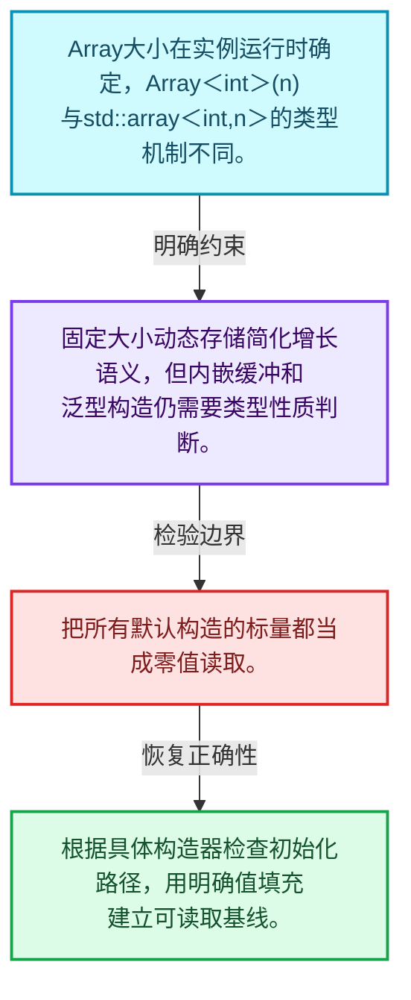
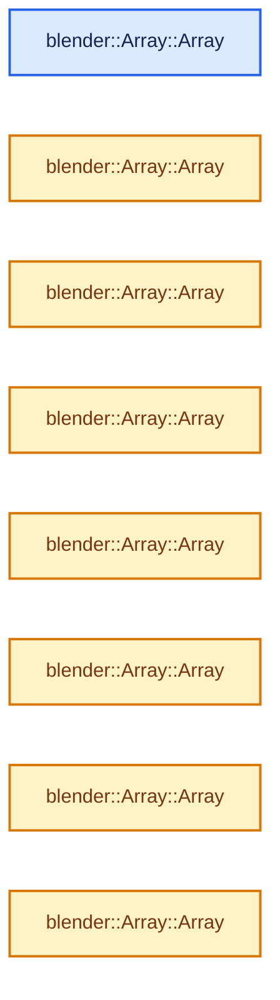
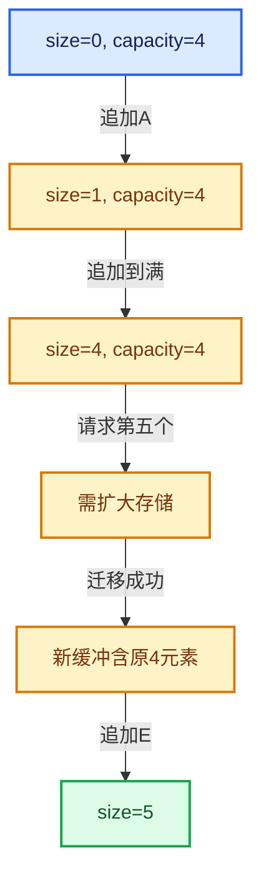

# 01-07 Array构造与存储

[方向导航](README.md) · [总目录](../README.md) · [实现索引](../00-课程指南/02-源码与提交索引/符号依赖与实现索引.md)

## 从问题到实现

固定大小动态数组为什么还需要复杂构造逻辑？

元素数不作为类型参数，存储可能使用内嵌缓冲；初始化方式决定基本类型是否有可读取的值。

**数据模型**

Array大小在实例运行时确定，Array<int>(n)与std::array<int,n>的类型机制不同。

**设计取舍**

固定大小动态存储简化增长语义，但内嵌缓冲和泛型构造仍需要类型性质判断。

**最小反例**

把所有默认构造的标量都当成零值读取。

**推导**

根据具体构造器检查初始化路径，用明确值填充建立可读取基线。

## 阅读地图与执行推演








图中的数值推演是本方向的教学模型；实际函数之间的调用边与概念分析边分别标注，不能把概念关系当作运行时调度顺序。

## 完整源码单元与就地讲解

中文讲解直接放在相关代码旁，复杂机制在代码下展开。原文折叠区保留基准行号；不需要在行号表和函数之间来回查找。类布局可分段展示，函数实现不按固定行数切开。

### 类型布局、声明与编译条件 · BLI_array.hh L1—L77

<a id="t-315585e5b785"></a>

`Array`在这里声明的数据成员：

- `T data_`
- `int64_t size_`
- `BLI_NO_UNIQUE_ADDRESS allocator_`
- `BLI_NO_UNIQUE_ADDRESS TypedBuffer`

<!-- annotated:583e29b540a9ed -->

```cpp
/* SPDX-FileCopyrightText: 2023 Blender Authors
 *
 * SPDX-License-Identifier: GPL-2.0-or-later */

#pragma once

/** \file
 * \ingroup bli
 *
 * A `Array<T>` is a container for a fixed size array the size of which is NOT known at
 * compile time.
 *
 * If the size is known at compile time, `std::array<T, N>` should be used instead.
 *
 * Array should usually be used instead of Vector whenever the number of elements
 * is known at construction time. Note however, that Array will default construct all
 * elements when initialized with the size-constructor. For trivial types, this does nothing. In
 * all other cases, this adds overhead.
 *
 * A main benefit of using Array over Vector is that it expresses the intent of the developer
 * better. It indicates that the size of the data structure is not expected to change. Furthermore,
 * you can be more certain that an array does not over-allocate.
 *
 * Array supports small object optimization to improve performance when the size turns out
 * to be small at run-time.
 */

#include "BLI_allocator.hh"
#include "BLI_index_range.hh"
#include "BLI_memory_utils.hh"
#include "BLI_span.hh"
#include "BLI_utildefines.hh"

namespace blender {

template<
    /**
     * The type of the values stored in the array.
     */
    typename T,
    /**
     * The number of values that can be stored in the array, without doing a heap allocation.
     */
    int64_t InlineBufferCapacity = default_inline_buffer_capacity(sizeof(T)),
    /**
     * The allocator used by this array. Should rarely be changed, except when you don't want that
     * MEM_* functions are used internally.
     */
    typename Allocator = GuardedAllocator>
class Array {
 public:
  using value_type = T;
  using pointer = T *;
  using const_pointer = const T *;
  using reference = T &;
  using const_reference = const T &;
  using iterator = T *;
  using const_iterator = const T *;
  using size_type = int64_t;

 private:
  /** The beginning of the array. It might point into the inline buffer. */
  T *data_;

  /** Number of elements in the array. */
  int64_t size_;

  /** Used for allocations when the inline buffer is too small. */
  BLI_NO_UNIQUE_ADDRESS Allocator allocator_;

  /** A placeholder buffer that will remain uninitialized until it is used. */
  BLI_NO_UNIQUE_ADDRESS TypedBuffer<T, InlineBufferCapacity> inline_buffer_;

 public:
  /**
   * By default an empty array is created.
   */
```

<details>
<summary>核对原始源码：source/blender/blenlib/BLI_array.hh · L1—L77</summary>

<!-- original:583e29b540a9ed:source/blender/blenlib/BLI_array.hh:1:77 -->

```cpp
/* SPDX-FileCopyrightText: 2023 Blender Authors
 *
 * SPDX-License-Identifier: GPL-2.0-or-later */

#pragma once

/** \file
 * \ingroup bli
 *
 * A `Array<T>` is a container for a fixed size array the size of which is NOT known at
 * compile time.
 *
 * If the size is known at compile time, `std::array<T, N>` should be used instead.
 *
 * Array should usually be used instead of Vector whenever the number of elements
 * is known at construction time. Note however, that Array will default construct all
 * elements when initialized with the size-constructor. For trivial types, this does nothing. In
 * all other cases, this adds overhead.
 *
 * A main benefit of using Array over Vector is that it expresses the intent of the developer
 * better. It indicates that the size of the data structure is not expected to change. Furthermore,
 * you can be more certain that an array does not over-allocate.
 *
 * Array supports small object optimization to improve performance when the size turns out
 * to be small at run-time.
 */

#include "BLI_allocator.hh"
#include "BLI_index_range.hh"
#include "BLI_memory_utils.hh"
#include "BLI_span.hh"
#include "BLI_utildefines.hh"

namespace blender {

template<
    /**
     * The type of the values stored in the array.
     */
    typename T,
    /**
     * The number of values that can be stored in the array, without doing a heap allocation.
     */
    int64_t InlineBufferCapacity = default_inline_buffer_capacity(sizeof(T)),
    /**
     * The allocator used by this array. Should rarely be changed, except when you don't want that
     * MEM_* functions are used internally.
     */
    typename Allocator = GuardedAllocator>
class Array {
 public:
  using value_type = T;
  using pointer = T *;
  using const_pointer = const T *;
  using reference = T &;
  using const_reference = const T &;
  using iterator = T *;
  using const_iterator = const T *;
  using size_type = int64_t;

 private:
  /** The beginning of the array. It might point into the inline buffer. */
  T *data_;

  /** Number of elements in the array. */
  int64_t size_;

  /** Used for allocations when the inline buffer is too small. */
  BLI_NO_UNIQUE_ADDRESS Allocator allocator_;

  /** A placeholder buffer that will remain uninitialized until it is used. */
  BLI_NO_UNIQUE_ADDRESS TypedBuffer<T, InlineBufferCapacity> inline_buffer_;

 public:
  /**
   * By default an empty array is created.
   */
```

</details>

<a id="f-001fd5eb3c658238"></a>

### `blender::Array::Array`

实现位置：[source/blender/blenlib/BLI_array.hh](../../../../../source/blender/blenlib/BLI_array.hh) · L78—L82。

接口参数：

- `Allocator allocator = {}`

**教学注释版**

<!-- annotated:eda1f298bd11f4 -->

```cpp
  Array(Allocator allocator = {}) noexcept : allocator_(allocator)
  {
    data_ = inline_buffer_;
    size_ = 0;
  }
```

<details>
<summary>核对原始源码：source/blender/blenlib/BLI_array.hh · L78—L82</summary>

<!-- original:eda1f298bd11f4:source/blender/blenlib/BLI_array.hh:78:82 -->

```cpp
  Array(Allocator allocator = {}) noexcept : allocator_(allocator)
  {
    data_ = inline_buffer_;
    size_ = 0;
  }
```

</details>

**沿实际写入检查状态**

- `data_ = inline_buffer_;`
- `size_ = 0;`

**继续追踪实现**

本实现没有需要继续展开的显式调用；检查返回表达式、对象转换和调用者前置条件。

<!-- annotated:ba49014b9e2128 -->

```cpp

```

<details>
<summary>核对原始源码：source/blender/blenlib/BLI_array.hh · L83—L83</summary>

<!-- original:ba49014b9e2128:source/blender/blenlib/BLI_array.hh:83:83 -->

```cpp

```

</details>

<a id="f-674e2f10361a462b"></a>

### `blender::Array::Array`

实现位置：[source/blender/blenlib/BLI_array.hh](../../../../../source/blender/blenlib/BLI_array.hh) · L84—L84。

接口参数：

- `NoExceptConstructor`
- `Allocator allocator = {}`

**教学注释版**

<!-- annotated:e9f41c44ce5b09 -->

```cpp
  Array(NoExceptConstructor, Allocator allocator = {}) noexcept : Array(allocator) {}
```

<details>
<summary>核对原始源码：source/blender/blenlib/BLI_array.hh · L84—L84</summary>

<!-- original:e9f41c44ce5b09:source/blender/blenlib/BLI_array.hh:84:84 -->

```cpp
  Array(NoExceptConstructor, Allocator allocator = {}) noexcept : Array(allocator) {}
```

</details>

**继续追踪实现**

本实现没有需要继续展开的显式调用；检查返回表达式、对象转换和调用者前置条件。

### 类型布局、声明与编译条件 · BLI_array.hh L85—L88

<!-- annotated:fd03e24b89781a -->

```cpp

  /**
   * Create a new array that contains copies of all values.
   */
```

<details>
<summary>核对原始源码：source/blender/blenlib/BLI_array.hh · L85—L88</summary>

<!-- original:fd03e24b89781a:source/blender/blenlib/BLI_array.hh:85:88 -->

```cpp

  /**
   * Create a new array that contains copies of all values.
   */
```

</details>

<a id="f-aa1e5908a9b67557"></a>

### `blender::Array::Array`

实现位置：[source/blender/blenlib/BLI_array.hh](../../../../../source/blender/blenlib/BLI_array.hh) · L89—L98。

接口参数：

- `Span<U> values`
- `Allocator allocator = {}`

**教学注释版**

<!-- annotated:2861d796b42ff4 -->

```cpp
  template<typename U>
  Array(Span<U> values, Allocator allocator = {})
    requires(std::is_convertible_v<U, T>)
      : Array(NoExceptConstructor(), allocator)
  {
    // [讲解] values.size：查询视图长度或生成对应有效索引区间。
    const int64_t size = values.size();
    data_ = this->get_buffer_for_size(size);
    // [讲解] values.data：返回借用范围的地址。
    uninitialized_convert_n<U, T>(values.data(), size, data_);
    size_ = size;
  }
```

<details>
<summary>核对原始源码：source/blender/blenlib/BLI_array.hh · L89—L98</summary>

<!-- original:2861d796b42ff4:source/blender/blenlib/BLI_array.hh:89:98 -->

```cpp
  template<typename U>
  Array(Span<U> values, Allocator allocator = {})
    requires(std::is_convertible_v<U, T>)
      : Array(NoExceptConstructor(), allocator)
  {
    const int64_t size = values.size();
    data_ = this->get_buffer_for_size(size);
    uninitialized_convert_n<U, T>(values.data(), size, data_);
    size_ = size;
  }
```

</details>

**沿实际写入检查状态**

- `data_ = this->get_buffer_for_size(size);`
- `size_ = size;`

**继续追踪实现**

- `values.size` → [blender::Span::size · L256](05-Span只读连续视图.md#f-5f80fa006089c998)。
- `this->get_buffer_for_size` → [blender::Array::get_buffer_for_size · L458](08-Array复制移动与销毁.md#f-1b659c0da810061b)。
- `uninitialized_convert_n<U, T>` → [blender::uninitialized_convert_n · L58](01-对象生命周期与值类别.md#f-c9f2d65f10e2b002)。
- `values.data` → [blender::Span::data · L219](05-Span只读连续视图.md#f-10c5889198935800)。

### 类型布局、声明与编译条件 · BLI_array.hh L99—L102

<!-- annotated:2f872cfbee55ac -->

```cpp

  /**
   * Create a new array that contains copies of all values.
   */
```

<details>
<summary>核对原始源码：source/blender/blenlib/BLI_array.hh · L99—L102</summary>

<!-- original:2f872cfbee55ac:source/blender/blenlib/BLI_array.hh:99:102 -->

```cpp

  /**
   * Create a new array that contains copies of all values.
   */
```

</details>

<a id="f-b141be39084346f3"></a>

### `blender::Array::Array`

实现位置：[source/blender/blenlib/BLI_array.hh](../../../../../source/blender/blenlib/BLI_array.hh) · L103—L108。

接口参数：

- `const std::initializer_list<U> &values`
- `Allocator allocator = {}`

**教学注释版**

<!-- annotated:fca8ea50067343 -->

```cpp
  template<typename U>
  Array(const std::initializer_list<U> &values, Allocator allocator = {})
    requires(std::is_convertible_v<U, T>)
      : Array(Span<U>(values), allocator)
  {
  }
```

<details>
<summary>核对原始源码：source/blender/blenlib/BLI_array.hh · L103—L108</summary>

<!-- original:fca8ea50067343:source/blender/blenlib/BLI_array.hh:103:108 -->

```cpp
  template<typename U>
  Array(const std::initializer_list<U> &values, Allocator allocator = {})
    requires(std::is_convertible_v<U, T>)
      : Array(Span<U>(values), allocator)
  {
  }
```

</details>

**继续追踪实现**

本实现没有需要继续展开的显式调用；检查返回表达式、对象转换和调用者前置条件。

<!-- annotated:5e3a14bbd7723f -->

```cpp

```

<details>
<summary>核对原始源码：source/blender/blenlib/BLI_array.hh · L109—L109</summary>

<!-- original:5e3a14bbd7723f:source/blender/blenlib/BLI_array.hh:109:109 -->

```cpp

```

</details>

<a id="f-452e276f39e81a2a"></a>

### `blender::Array::Array`

实现位置：[source/blender/blenlib/BLI_array.hh](../../../../../source/blender/blenlib/BLI_array.hh) · L110—L113。

接口参数：

- `const std::initializer_list<T> &values`
- `Allocator allocator = {}`

**教学注释版**

<!-- annotated:01a0309f64ae37 -->

```cpp
  Array(const std::initializer_list<T> &values, Allocator allocator = {})
      : Array(Span<T>(values), allocator)
  {
  }
```

<details>
<summary>核对原始源码：source/blender/blenlib/BLI_array.hh · L110—L113</summary>

<!-- original:01a0309f64ae37:source/blender/blenlib/BLI_array.hh:110:113 -->

```cpp
  Array(const std::initializer_list<T> &values, Allocator allocator = {})
      : Array(Span<T>(values), allocator)
  {
  }
```

</details>

**继续追踪实现**

本实现没有需要继续展开的显式调用；检查返回表达式、对象转换和调用者前置条件。

### 类型布局、声明与编译条件 · BLI_array.hh L114—L122

<!-- annotated:29b6c137f086a9 -->

```cpp

  /**
   * Create a new array with the given size. All values will be default constructed. For trivial
   * types like int, default construction does nothing.
   *
   * We might want another version of this in the future, that does not do default construction
   * even for non-trivial types. This should not be the default though, because one can easily mess
   * up when dealing with uninitialized memory.
   */
```

<details>
<summary>核对原始源码：source/blender/blenlib/BLI_array.hh · L114—L122</summary>

<!-- original:29b6c137f086a9:source/blender/blenlib/BLI_array.hh:114:122 -->

```cpp

  /**
   * Create a new array with the given size. All values will be default constructed. For trivial
   * types like int, default construction does nothing.
   *
   * We might want another version of this in the future, that does not do default construction
   * even for non-trivial types. This should not be the default though, because one can easily mess
   * up when dealing with uninitialized memory.
   */
```

</details>

<a id="f-646aa58152ec44f6"></a>

### `blender::Array::Array`

实现位置：[source/blender/blenlib/BLI_array.hh](../../../../../source/blender/blenlib/BLI_array.hh) · L123—L129。

接口参数：

- `int64_t size`
- `Allocator allocator = {}`

**教学注释版**

<!-- annotated:991fda29d7b61b -->

```cpp
  explicit Array(int64_t size, Allocator allocator = {}) : Array(NoExceptConstructor(), allocator)
  {
    BLI_assert(size >= 0);
    data_ = this->get_buffer_for_size(size);
    default_construct_n(data_, size);
    size_ = size;
  }
```

<details>
<summary>核对原始源码：source/blender/blenlib/BLI_array.hh · L123—L129</summary>

<!-- original:991fda29d7b61b:source/blender/blenlib/BLI_array.hh:123:129 -->

```cpp
  explicit Array(int64_t size, Allocator allocator = {}) : Array(NoExceptConstructor(), allocator)
  {
    BLI_assert(size >= 0);
    data_ = this->get_buffer_for_size(size);
    default_construct_n(data_, size);
    size_ = size;
  }
```

</details>

**沿实际写入检查状态**

- `data_ = this->get_buffer_for_size(size);`
- `size_ = size;`

**继续追踪实现**

- `BLI_assert` → [BLI_assert · L48](../90-实现依赖专题/01-BLI基础库/BLI_assert.hh.md#m-57a88495704d)；[BLI_assert · L63](../90-实现依赖专题/01-BLI基础库/BLI_assert.hh.md#m-d07050020cb5)。宏定义由构建条件选择。
- `this->get_buffer_for_size` → [blender::Array::get_buffer_for_size · L458](08-Array复制移动与销毁.md#f-1b659c0da810061b)。
- `default_construct_n` → [调用协议](../00-课程指南/01-路线与规范/模板宏与动态分派协议.md)：函数指针、局部可调用对象或未展开的宏；必须结合调用者环境。调用位置L127。

### 类型布局、声明与编译条件 · BLI_array.hh L130—L134

<!-- annotated:be6f5b80d2deac -->

```cpp

  /**
   * Create a new array with the given size. All values will be initialized by copying the given
   * default.
   */
```

<details>
<summary>核对原始源码：source/blender/blenlib/BLI_array.hh · L130—L134</summary>

<!-- original:be6f5b80d2deac:source/blender/blenlib/BLI_array.hh:130:134 -->

```cpp

  /**
   * Create a new array with the given size. All values will be initialized by copying the given
   * default.
   */
```

</details>

<a id="f-0a9de4a549125f99"></a>

### `blender::Array::Array`

实现位置：[source/blender/blenlib/BLI_array.hh](../../../../../source/blender/blenlib/BLI_array.hh) · L135—L154。

接口参数：

- `int64_t size`
- `const T &value`
- `Allocator allocator = {}`

**教学注释版**

<!-- annotated:8111a290a5798e -->

```cpp
  Array(int64_t size, const T &value, Allocator allocator = {})
      : Array(NoExceptConstructor(), allocator)
  {
    BLI_assert(size >= 0);
    if (std::is_trivially_copyable_v<T> && value_is_zero_memory(value)) {
      data_ = this->get_buffer_for_size(size, true);
    }
    else {
      data_ = this->get_buffer_for_size(size);
#if defined(__GNUC__) && !defined(__clang__)
#  pragma GCC diagnostic push
#  pragma GCC diagnostic ignored "-Warray-bounds"
#endif
      // [讲解] uninitialized_fill_n：从同一个value复制构造目标n个T。
      uninitialized_fill_n(data_, size, value);
#if defined(__GNUC__) && !defined(__clang__)
#  pragma GCC diagnostic pop
#endif
    }
    size_ = size;
  }
```

<details>
<summary>核对原始源码：source/blender/blenlib/BLI_array.hh · L135—L154</summary>

<!-- original:8111a290a5798e:source/blender/blenlib/BLI_array.hh:135:154 -->

```cpp
  Array(int64_t size, const T &value, Allocator allocator = {})
      : Array(NoExceptConstructor(), allocator)
  {
    BLI_assert(size >= 0);
    if (std::is_trivially_copyable_v<T> && value_is_zero_memory(value)) {
      data_ = this->get_buffer_for_size(size, true);
    }
    else {
      data_ = this->get_buffer_for_size(size);
#if defined(__GNUC__) && !defined(__clang__)
#  pragma GCC diagnostic push
#  pragma GCC diagnostic ignored "-Warray-bounds"
#endif
      uninitialized_fill_n(data_, size, value);
#if defined(__GNUC__) && !defined(__clang__)
#  pragma GCC diagnostic pop
#endif
    }
    size_ = size;
  }
```

</details>

**沿实际写入检查状态**

- `data_ = this->get_buffer_for_size(size, true);`
- `data_ = this->get_buffer_for_size(size);`
- `size_ = size;`

**继续追踪实现**

- `BLI_assert` → [BLI_assert · L48](../90-实现依赖专题/01-BLI基础库/BLI_assert.hh.md#m-57a88495704d)；[BLI_assert · L63](../90-实现依赖专题/01-BLI基础库/BLI_assert.hh.md#m-d07050020cb5)。宏定义由构建条件选择。
- `value_is_zero_memory` → [调用协议](../00-课程指南/01-路线与规范/模板宏与动态分派协议.md)：函数指针、局部可调用对象或未展开的宏；必须结合调用者环境。调用位置L139。
- `this->get_buffer_for_size` → [blender::Array::get_buffer_for_size · L458](08-Array复制移动与销毁.md#f-1b659c0da810061b)。
- `uninitialized_fill_n` → [blender::uninitialized_fill_n · L91](01-对象生命周期与值类别.md#f-020ca78eff5f9227)。

### 类型布局、声明与编译条件 · BLI_array.hh L155—L167

<!-- annotated:5810e92646a0d2 -->

```cpp

  /**
   * Create a new array with uninitialized elements. The caller is responsible for constructing the
   * elements. Moving, copying or destructing an Array with uninitialized elements invokes
   * undefined behavior.
   *
   * This should be used very rarely. Note, that the normal size-constructor also does not
   * initialize the elements when T is trivially constructible. Therefore, it only makes sense to
   * use this with non trivially constructible types.
   *
   * Usage:
   *  Array<std::string> my_strings(10, NoInitialization());
   */
```

<details>
<summary>核对原始源码：source/blender/blenlib/BLI_array.hh · L155—L167</summary>

<!-- original:5810e92646a0d2:source/blender/blenlib/BLI_array.hh:155:167 -->

```cpp

  /**
   * Create a new array with uninitialized elements. The caller is responsible for constructing the
   * elements. Moving, copying or destructing an Array with uninitialized elements invokes
   * undefined behavior.
   *
   * This should be used very rarely. Note, that the normal size-constructor also does not
   * initialize the elements when T is trivially constructible. Therefore, it only makes sense to
   * use this with non trivially constructible types.
   *
   * Usage:
   *  Array<std::string> my_strings(10, NoInitialization());
   */
```

</details>

<a id="f-31f001eb92069e9d"></a>

### `blender::Array::Array`

实现位置：[source/blender/blenlib/BLI_array.hh](../../../../../source/blender/blenlib/BLI_array.hh) · L168—L174。

接口参数：

- `int64_t size`
- `NoInitialization`
- `Allocator allocator = {}`

**教学注释版**

<!-- annotated:72f401967f634b -->

```cpp
  Array(int64_t size, NoInitialization, Allocator allocator = {})
      : Array(NoExceptConstructor(), allocator)
  {
    BLI_assert(size >= 0);
    data_ = this->get_buffer_for_size(size);
    size_ = size;
  }
```

<details>
<summary>核对原始源码：source/blender/blenlib/BLI_array.hh · L168—L174</summary>

<!-- original:72f401967f634b:source/blender/blenlib/BLI_array.hh:168:174 -->

```cpp
  Array(int64_t size, NoInitialization, Allocator allocator = {})
      : Array(NoExceptConstructor(), allocator)
  {
    BLI_assert(size >= 0);
    data_ = this->get_buffer_for_size(size);
    size_ = size;
  }
```

</details>

**沿实际写入检查状态**

- `data_ = this->get_buffer_for_size(size);`
- `size_ = size;`

**继续追踪实现**

- `BLI_assert` → [BLI_assert · L48](../90-实现依赖专题/01-BLI基础库/BLI_assert.hh.md#m-57a88495704d)；[BLI_assert · L63](../90-实现依赖专题/01-BLI基础库/BLI_assert.hh.md#m-d07050020cb5)。宏定义由构建条件选择。
- `this->get_buffer_for_size` → [blender::Array::get_buffer_for_size · L458](08-Array复制移动与销毁.md#f-1b659c0da810061b)。

<!-- annotated:624e9134480d48 -->

```cpp

```

<details>
<summary>核对原始源码：source/blender/blenlib/BLI_array.hh · L175—L175</summary>

<!-- original:624e9134480d48:source/blender/blenlib/BLI_array.hh:175:175 -->

```cpp

```

</details>

<a id="f-cf8148f06fc6747a"></a>

### `blender::Array::Array`

实现位置：[source/blender/blenlib/BLI_array.hh](../../../../../source/blender/blenlib/BLI_array.hh) · L176—L176。

接口参数：

- `const Array &other`

**教学注释版**

<!-- annotated:52cf04c3a6a240 -->

```cpp
  Array(const Array &other) : Array(other.as_span(), other.allocator_) {}
```

<details>
<summary>核对原始源码：source/blender/blenlib/BLI_array.hh · L176—L176</summary>

<!-- original:52cf04c3a6a240:source/blender/blenlib/BLI_array.hh:176:176 -->

```cpp
  Array(const Array &other) : Array(other.as_span(), other.allocator_) {}
```

</details>

**继续追踪实现**

本实现没有需要继续展开的显式调用；检查返回表达式、对象转换和调用者前置条件。

<!-- annotated:8d1729c1fd8343 -->

```cpp

```

<details>
<summary>核对原始源码：source/blender/blenlib/BLI_array.hh · L177—L177</summary>

<!-- original:8d1729c1fd8343:source/blender/blenlib/BLI_array.hh:177:177 -->

```cpp

```

</details>

<a id="f-2ddca2fb9dd964b3"></a>

### `blender::Array::Array`

实现位置：[source/blender/blenlib/BLI_array.hh](../../../../../source/blender/blenlib/BLI_array.hh) · L178—L198。

接口参数：

- `Array &&other`

**教学注释版**

<!-- annotated:b84926eaa75f23 -->

```cpp
  Array(Array &&other) noexcept(std::is_nothrow_move_constructible_v<T>)
      : Array(NoExceptConstructor(), other.allocator_)
  {
    if (other.data_ == other.inline_buffer_) {
#if defined(__GNUC__) && !defined(__clang__)
#  pragma GCC diagnostic push
#  pragma GCC diagnostic ignored "-Warray-bounds"
#endif
      // [讲解] uninitialized_relocate_n：在目标原始存储建立对象，再结束源对象寿命。
      uninitialized_relocate_n(other.data_, other.size_, data_);
#if defined(__GNUC__) && !defined(__clang__)
#  pragma GCC diagnostic pop
#endif
    }
    else {
      data_ = other.data_;
    }
    size_ = other.size_;

    other.data_ = other.inline_buffer_;
    other.size_ = 0;
  }
```

<details>
<summary>核对原始源码：source/blender/blenlib/BLI_array.hh · L178—L198</summary>

<!-- original:b84926eaa75f23:source/blender/blenlib/BLI_array.hh:178:198 -->

```cpp
  Array(Array &&other) noexcept(std::is_nothrow_move_constructible_v<T>)
      : Array(NoExceptConstructor(), other.allocator_)
  {
    if (other.data_ == other.inline_buffer_) {
#if defined(__GNUC__) && !defined(__clang__)
#  pragma GCC diagnostic push
#  pragma GCC diagnostic ignored "-Warray-bounds"
#endif
      uninitialized_relocate_n(other.data_, other.size_, data_);
#if defined(__GNUC__) && !defined(__clang__)
#  pragma GCC diagnostic pop
#endif
    }
    else {
      data_ = other.data_;
    }
    size_ = other.size_;

    other.data_ = other.inline_buffer_;
    other.size_ = 0;
  }
```

</details>

**沿实际写入检查状态**

- `data_ = other.data_;`
- `size_ = other.size_;`
- `other.data_ = other.inline_buffer_;`
- `other.size_ = 0;`

**继续追踪实现**

- `uninitialized_relocate_n` → [blender::uninitialized_relocate_n · L80](01-对象生命周期与值类别.md#f-9de0365b9a47fd68)。

<!-- annotated:6f5d6731f0bc45 -->

```cpp

```

<details>
<summary>核对原始源码：source/blender/blenlib/BLI_array.hh · L199—L199</summary>

<!-- original:6f5d6731f0bc45:source/blender/blenlib/BLI_array.hh:199:199 -->

```cpp

```

</details>

<a id="f-d3e841adf490c602"></a>

### `blender::Array::~Array`

实现位置：[source/blender/blenlib/BLI_array.hh](../../../../../source/blender/blenlib/BLI_array.hh) · L200—L204。

**教学注释版**

<!-- annotated:083c8654b2c836 -->

```cpp
  ~Array()
  {
    destruct_n(data_, size_);
    this->deallocate_if_not_inline(data_);
  }
```

<details>
<summary>核对原始源码：source/blender/blenlib/BLI_array.hh · L200—L204</summary>

<!-- original:083c8654b2c836:source/blender/blenlib/BLI_array.hh:200:204 -->

```cpp
  ~Array()
  {
    destruct_n(data_, size_);
    this->deallocate_if_not_inline(data_);
  }
```

</details>

**继续追踪实现**

- `destruct_n` → [调用协议](../00-课程指南/01-路线与规范/模板宏与动态分派协议.md)：函数指针、局部可调用对象或未展开的宏；必须结合调用者环境。调用位置L202。
- `this->deallocate_if_not_inline` → [blender::Array::deallocate_if_not_inline · L479](08-Array复制移动与销毁.md#f-0357a7b58bbc84fa)。

<!-- annotated:888896b60ccf55 -->

```cpp

```

<details>
<summary>核对原始源码：source/blender/blenlib/BLI_array.hh · L205—L205</summary>

<!-- original:888896b60ccf55:source/blender/blenlib/BLI_array.hh:205:205 -->

```cpp

```

</details>

<a id="f-b79d193528d32d2c"></a>

### `blender::Array::operator=`

实现位置：[source/blender/blenlib/BLI_array.hh](../../../../../source/blender/blenlib/BLI_array.hh) · L206—L209。

接口参数：

- `const Array &other`

**教学注释版**

<!-- annotated:bdadaeddcf8ba8 -->

```cpp
  Array &operator=(const Array &other)
  {
    return copy_assign_container(*this, other);
  }
```

<details>
<summary>核对原始源码：source/blender/blenlib/BLI_array.hh · L206—L209</summary>

<!-- original:bdadaeddcf8ba8:source/blender/blenlib/BLI_array.hh:206:209 -->

```cpp
  Array &operator=(const Array &other)
  {
    return copy_assign_container(*this, other);
  }
```

</details>

**结果出口**

- `return copy_assign_container(*this, other);`

**继续追踪实现**

- `copy_assign_container` → [blender::copy_assign_container · L284](../03-内存分配与运行时类型/01-对齐与未初始化存储.md#f-546a45b4d8b5ab44)。

<!-- annotated:4f52fadd65ab12 -->

```cpp

```

<details>
<summary>核对原始源码：source/blender/blenlib/BLI_array.hh · L210—L210</summary>

<!-- original:4f52fadd65ab12:source/blender/blenlib/BLI_array.hh:210:210 -->

```cpp

```

</details>

<a id="f-19d9166b03bfbe17"></a>

### `blender::Array::operator=`

实现位置：[source/blender/blenlib/BLI_array.hh](../../../../../source/blender/blenlib/BLI_array.hh) · L211—L214。

接口参数：

- `Array &&other`

**教学注释版**

<!-- annotated:b3063604db30ef -->

```cpp
  Array &operator=(Array &&other) noexcept(std::is_nothrow_move_constructible_v<T>)
  {
    // [讲解] std::move：把表达式转换成可供移动重载选择的值类别；不保证真的移动，不结束源对象寿命，对const值可能选择复制。
    return move_assign_container(*this, std::move(other));
  }
```

<details>
<summary>核对原始源码：source/blender/blenlib/BLI_array.hh · L211—L214</summary>

<!-- original:b3063604db30ef:source/blender/blenlib/BLI_array.hh:211:214 -->

```cpp
  Array &operator=(Array &&other) noexcept(std::is_nothrow_move_constructible_v<T>)
  {
    return move_assign_container(*this, std::move(other));
  }
```

</details>

**结果出口**

- `return move_assign_container(*this, std::move(other));`

**继续追踪实现**

- `move_assign_container` → [blender::move_assign_container · L300](../03-内存分配与运行时类型/01-对齐与未初始化存储.md#f-5144b56be86e6f42)。
- `std::move` → [外部契约](https://eel.is/c++draft/utility.forward)：把表达式转换成可供移动重载选择的值类别；不保证真的移动，不结束源对象寿命，对const值可能选择复制。

<!-- annotated:1b3eaeea59b04b -->

```cpp

```

<details>
<summary>核对原始源码：source/blender/blenlib/BLI_array.hh · L215—L215</summary>

<!-- original:1b3eaeea59b04b:source/blender/blenlib/BLI_array.hh:215:215 -->

```cpp

```

</details>

<a id="f-bcb35665b16fe75d"></a>

### `blender::Array::operator[]`

实现位置：[source/blender/blenlib/BLI_array.hh](../../../../../source/blender/blenlib/BLI_array.hh) · L216—L221。

接口参数：

- `int64_t index`

**教学注释版**

<!-- annotated:aa467810638473 -->

```cpp
  T &operator[](int64_t index)
  {
    BLI_assert(index >= 0);
    BLI_assert(index < size_);
    return data_[index];
  }
```

<details>
<summary>核对原始源码：source/blender/blenlib/BLI_array.hh · L216—L221</summary>

<!-- original:aa467810638473:source/blender/blenlib/BLI_array.hh:216:221 -->

```cpp
  T &operator[](int64_t index)
  {
    BLI_assert(index >= 0);
    BLI_assert(index < size_);
    return data_[index];
  }
```

</details>

**结果出口**

- `return data_[index];`

**继续追踪实现**

- `BLI_assert` → [BLI_assert · L48](../90-实现依赖专题/01-BLI基础库/BLI_assert.hh.md#m-57a88495704d)；[BLI_assert · L63](../90-实现依赖专题/01-BLI基础库/BLI_assert.hh.md#m-d07050020cb5)。宏定义由构建条件选择。

<!-- annotated:ca884b3bbc48f9 -->

```cpp

```

<details>
<summary>核对原始源码：source/blender/blenlib/BLI_array.hh · L222—L222</summary>

<!-- original:ca884b3bbc48f9:source/blender/blenlib/BLI_array.hh:222:222 -->

```cpp

```

</details>

<a id="f-025ff30c2ce36b46"></a>

### `blender::Array::operator[]`

实现位置：[source/blender/blenlib/BLI_array.hh](../../../../../source/blender/blenlib/BLI_array.hh) · L223—L228。

接口参数：

- `int64_t index`

**教学注释版**

<!-- annotated:ccbdc00331e94d -->

```cpp
  const T &operator[](int64_t index) const
  {
    BLI_assert(index >= 0);
    BLI_assert(index < size_);
    return data_[index];
  }
```

<details>
<summary>核对原始源码：source/blender/blenlib/BLI_array.hh · L223—L228</summary>

<!-- original:ccbdc00331e94d:source/blender/blenlib/BLI_array.hh:223:228 -->

```cpp
  const T &operator[](int64_t index) const
  {
    BLI_assert(index >= 0);
    BLI_assert(index < size_);
    return data_[index];
  }
```

</details>

**结果出口**

- `return data_[index];`

**继续追踪实现**

- `BLI_assert` → [BLI_assert · L48](../90-实现依赖专题/01-BLI基础库/BLI_assert.hh.md#m-57a88495704d)；[BLI_assert · L63](../90-实现依赖专题/01-BLI基础库/BLI_assert.hh.md#m-d07050020cb5)。宏定义由构建条件选择。

<!-- annotated:c238e757c1539b -->

```cpp

```

<details>
<summary>核对原始源码：source/blender/blenlib/BLI_array.hh · L229—L229</summary>

<!-- original:c238e757c1539b:source/blender/blenlib/BLI_array.hh:229:229 -->

```cpp

```

</details>

<a id="f-8b41b5ce990b7e0c"></a>

### `blender::Array::() const`

实现位置：[source/blender/blenlib/BLI_array.hh](../../../../../source/blender/blenlib/BLI_array.hh) · L230—L233。

**教学注释版**

<!-- annotated:7d7cd6ae16cfc5 -->

```cpp
  operator Span<T>() const
  {
    return Span<T>(data_, size_);
  }
```

<details>
<summary>核对原始源码：source/blender/blenlib/BLI_array.hh · L230—L233</summary>

<!-- original:7d7cd6ae16cfc5:source/blender/blenlib/BLI_array.hh:230:233 -->

```cpp
  operator Span<T>() const
  {
    return Span<T>(data_, size_);
  }
```

</details>

**结果出口**

- `return Span<T>(data_, size_);`

**继续追踪实现**

- `Span<T>` → [blender::Span](../90-实现依赖专题/01-BLI基础库/BLI_span.hh.md#t-8765a8e0c1d5)；[blender::Span](../90-实现依赖专题/01-BLI基础库/BLI_index_range.hh.md#t-86091874a1c0)；[blender::Span](../90-实现依赖专题/08-其他Blender模块/makesdna/DNA_pointcloud_types.h.md#t-112aa6ed842c)；[blender::Span](../90-实现依赖专题/08-其他Blender模块/makesdna/DNA_node_types.h.md#t-49ec6fbb9b69)；[blender::Span](../90-实现依赖专题/08-其他Blender模块/makesdna/DNA_mesh_types.h.md#t-184fd48fb638)；[blender::Span](../90-实现依赖专题/08-其他Blender模块/makesdna/DNA_anim_types.h.md#t-d841071994c2)；[blender::Span](../90-实现依赖专题/08-其他Blender模块/makesrna/RNA_path_fwd.hh.md#t-4dbb08969e41)。

<!-- annotated:f7967041a70b9f -->

```cpp

```

<details>
<summary>核对原始源码：source/blender/blenlib/BLI_array.hh · L234—L234</summary>

<!-- original:f7967041a70b9f:source/blender/blenlib/BLI_array.hh:234:234 -->

```cpp

```

</details>

<a id="f-070ad15abdf8efa3"></a>

### `blender::Array::()`

实现位置：[source/blender/blenlib/BLI_array.hh](../../../../../source/blender/blenlib/BLI_array.hh) · L235—L238。

**教学注释版**

<!-- annotated:a8f24e6e776f43 -->

```cpp
  operator MutableSpan<T>()
  {
    return MutableSpan<T>(data_, size_);
  }
```

<details>
<summary>核对原始源码：source/blender/blenlib/BLI_array.hh · L235—L238</summary>

<!-- original:a8f24e6e776f43:source/blender/blenlib/BLI_array.hh:235:238 -->

```cpp
  operator MutableSpan<T>()
  {
    return MutableSpan<T>(data_, size_);
  }
```

</details>

**结果出口**

- `return MutableSpan<T>(data_, size_);`

**继续追踪实现**

- `MutableSpan<T>` → [blender::MutableSpan::MutableSpan · L462](06-MutableSpan可写视图.md#f-0f07034aaffc3384)；[blender::MutableSpan::MutableSpan · L464](06-MutableSpan可写视图.md#f-39977234ad0ce192)；[blender::MutableSpan::MutableSpan · L466](06-MutableSpan可写视图.md#f-ee249b5042dd38aa)；[blender::MutableSpan::MutableSpan · L468](06-MutableSpan可写视图.md#f-479c5f85921e531f)；[blender::MutableSpan::MutableSpan · L477](06-MutableSpan可写视图.md#f-afcce5325e6f19e0)。同名重载需按实参类型选择。

<!-- annotated:e31f4f016d1528 -->

```cpp

```

<details>
<summary>核对原始源码：source/blender/blenlib/BLI_array.hh · L239—L239</summary>

<!-- original:e31f4f016d1528:source/blender/blenlib/BLI_array.hh:239:239 -->

```cpp

```

</details>

<a id="f-028d3115f029cad0"></a>

### `blender::Array::is_span_convertible_pointer_v`

实现位置：[source/blender/blenlib/BLI_array.hh](../../../../../source/blender/blenlib/BLI_array.hh) · L240—L245。

**教学注释版**

<!-- annotated:8223012b02380d -->

```cpp
  template<typename U>
  operator Span<U>() const
    requires(is_span_convertible_pointer_v<T, U>)
  {
    return Span<U>(data_, size_);
  }
```

<details>
<summary>核对原始源码：source/blender/blenlib/BLI_array.hh · L240—L245</summary>

<!-- original:8223012b02380d:source/blender/blenlib/BLI_array.hh:240:245 -->

```cpp
  template<typename U>
  operator Span<U>() const
    requires(is_span_convertible_pointer_v<T, U>)
  {
    return Span<U>(data_, size_);
  }
```

</details>

**结果出口**

- `return Span<U>(data_, size_);`

**继续追踪实现**

- `Span<U>` → [blender::Span](../90-实现依赖专题/01-BLI基础库/BLI_span.hh.md#t-8765a8e0c1d5)；[blender::Span](../90-实现依赖专题/01-BLI基础库/BLI_index_range.hh.md#t-86091874a1c0)；[blender::Span](../90-实现依赖专题/08-其他Blender模块/makesdna/DNA_pointcloud_types.h.md#t-112aa6ed842c)；[blender::Span](../90-实现依赖专题/08-其他Blender模块/makesdna/DNA_node_types.h.md#t-49ec6fbb9b69)；[blender::Span](../90-实现依赖专题/08-其他Blender模块/makesdna/DNA_mesh_types.h.md#t-184fd48fb638)；[blender::Span](../90-实现依赖专题/08-其他Blender模块/makesdna/DNA_anim_types.h.md#t-d841071994c2)；[blender::Span](../90-实现依赖专题/08-其他Blender模块/makesrna/RNA_path_fwd.hh.md#t-4dbb08969e41)。

## 语法与相关类型

### 模板 template

模板把类型或常量作为生成实现的参数。读声明时先列出类型参数、非类型参数和默认值，再看使用者实际实例化了什么。模板声明本身不意味着每种T都支持其全部成员。

把T替换为int、string、只能移动的类型，分别检查每个被调用操作是否成立。

### 依赖名称 typename

typename既可引入类型模板参数，也可告诉编译器某个依赖名称是类型。它不创建运行时对象；解析期确认语法类别与实例化期检查具体类型是不同阶段。

区分typename T::value_type和T::size()，前者标记类型，后者是表达式。

### 约束 requires

requires表达式或requires子句限制模板参与重载的条件。它提供编译期可用性检查，不是运行时if，不能指望输入到达程序后再被这一机制验证。

构造满足和不满足约束的两个类型，观察候选被排除而不是在函数内返回错误。

### 只读限定 const

const约束当前访问路径可做的修改。const指针、指向const的指针、const视图对象、const元素是不同位置的限定；其他别名可能仍可修改原对象。

分别写T* const、const T*与const T* const，并画出不可修改的层次。

### 移动转换 std::move

std::move把表达式转换为可供移动重载选择的值类别，实际资源转移发生在被选中的构造或赋值中。对const对象move可能仍调用复制，对视图move也不会获得底层数据所有权。

记录移动构造调用次数，不用变量名或std::move的出现次数替代测量。

### 异常约定 noexcept

noexcept表达式可以依赖类型特征。违反不抛异常约定会终止程序；它不是自动捕获异常，也不是资源回滚代码。

找出声明的条件与实际可能抛出的分配、构造操作是否一致。

### 对象表示 sizeof

sizeof给出对象表示大小，不是其引用的所有堆内存总量。sizeof视图很小并不说明底层数组很小。

分别统计容器对象、容量字节和元素拥有的间接资源。

### 构造与new表达式

普通new可能分配并构造；placement new在给定地址构造，存储由其他机制提供。失败回滚应区分两类责任。

追踪地址来自哪里、构造何时成功、由谁析构、由谁释放。

### 内部断言 assert

断言表达开发者预期成立的内部契约，发布构建可能关闭。它不能替代对不可信输入的完整错误处理，也不保证后续操作被运行时保护。

对每条断言构造违反条件的输入，区分调用者错误与应向用户报告的错误。

### 类型别名 using

类型别名为已有类型建立名字，不创建运行期对象。它常把模板内部使用的类型统一暴露给泛型调用者。

展开别名直到基础类型，区分类型别名和变量声明。

## 实现练习与验证

对int和string分别检查默认构造、值填充和从Span复制，避免读取未初始化标量。

参考推理：根据具体构造器检查初始化路径，用明确值填充建立可读取基线。

构造成功次数减析构次数应等于当前存活对象数；异常之后资源计数应回到合法状态。

## 历史、跨库比较与证据

对比std::vector、std::array、std::span与LLVM SmallVector、ArrayRef时，分别比较拥有关系、内嵌存储、大小是否属于类型和失效条件。不要根据同名方法推断完全相同契约。

[历史提交索引](../00-课程指南/02-源码与提交索引/历史提交与设计演化索引.md) · [源码基准](../00-课程指南/02-源码与提交索引/源码版本与覆盖索引.md) · [验收报告](../00-课程指南/03-验收报告/验收报告.md)
