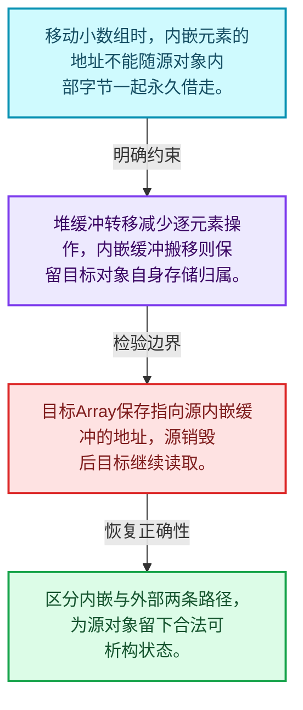
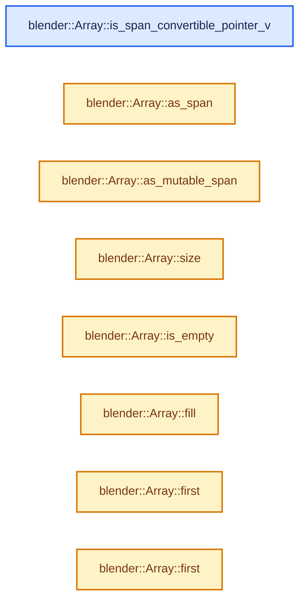
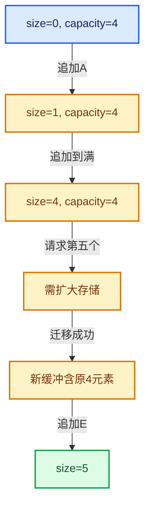

# 01-08 Array复制移动与销毁

[方向导航](README.md) · [总目录](../README.md) · [实现索引](../%E7%AC%A6%E5%8F%B7%E4%BE%9D%E8%B5%96%E4%B8%8E%E5%AE%9E%E7%8E%B0%E7%B4%A2%E5%BC%95.md)

## 从问题到实现

复制和移动在内嵌存储下有什么不同？

拥有外部缓冲时可转移存储，内嵌对象的地址属于原对象，通常需要逐元素搬移；源对象仍须可析构。

**数据模型**

移动小数组时，内嵌元素的地址不能随源对象内部字节一起永久借走。

**设计取舍**

堆缓冲转移减少逐元素操作，内嵌缓冲搬移则保留目标对象自身存储归属。

**最小反例**

目标Array保存指向源内嵌缓冲的地址，源销毁后目标继续读取。

**推导**

区分内嵌与外部两条路径，为源对象留下合法可析构状态。

## 阅读地图与执行推演








图中的数值推演是本方向的教学模型；实际函数之间的调用边与概念分析边分别标注，不能把概念关系当作运行时调度顺序。

## 完整源码单元与就地讲解

中文讲解直接放在相关代码旁，复杂机制在代码下展开。原文折叠区保留基准行号；不需要在行号表和函数之间来回查找。类布局可分段展示，函数实现不按固定行数切开。

<!-- annotated:2d6c43c0b46066 -->

```cpp

```

<details>
<summary>核对原始源码：source/blender/blenlib/BLI_array.hh · L246—L246</summary>

<!-- original:2d6c43c0b46066:source/blender/blenlib/BLI_array.hh:246:246 -->

```cpp

```

</details>

<a id="f-65fb5d195f4b28d6"></a>

### `blender::Array::is_span_convertible_pointer_v`

实现位置：[source/blender/blenlib/BLI_array.hh](../../../../../source/blender/blenlib/BLI_array.hh) · L247—L252。

**教学注释版**

<!-- annotated:21a0cdde884529 -->

```cpp
  template<typename U>
  operator MutableSpan<U>()
    requires(is_span_convertible_pointer_v<T, U>)
  {
    return MutableSpan<U>(data_, size_);
  }
```

<details>
<summary>核对原始源码：source/blender/blenlib/BLI_array.hh · L247—L252</summary>

<!-- original:21a0cdde884529:source/blender/blenlib/BLI_array.hh:247:252 -->

```cpp
  template<typename U>
  operator MutableSpan<U>()
    requires(is_span_convertible_pointer_v<T, U>)
  {
    return MutableSpan<U>(data_, size_);
  }
```

</details>

**结果出口**

- `return MutableSpan<U>(data_, size_);`

**继续追踪实现**

- `MutableSpan<U>` → [blender::MutableSpan::MutableSpan · L462](06-MutableSpan%E5%8F%AF%E5%86%99%E8%A7%86%E5%9B%BE.md#f-0f07034aaffc3384)；[blender::MutableSpan::MutableSpan · L464](06-MutableSpan%E5%8F%AF%E5%86%99%E8%A7%86%E5%9B%BE.md#f-39977234ad0ce192)；[blender::MutableSpan::MutableSpan · L466](06-MutableSpan%E5%8F%AF%E5%86%99%E8%A7%86%E5%9B%BE.md#f-ee249b5042dd38aa)；[blender::MutableSpan::MutableSpan · L468](06-MutableSpan%E5%8F%AF%E5%86%99%E8%A7%86%E5%9B%BE.md#f-479c5f85921e531f)；[blender::MutableSpan::MutableSpan · L477](06-MutableSpan%E5%8F%AF%E5%86%99%E8%A7%86%E5%9B%BE.md#f-afcce5325e6f19e0)。同名重载需按实参类型选择。

<!-- annotated:3915d613fd01a4 -->

```cpp

```

<details>
<summary>核对原始源码：source/blender/blenlib/BLI_array.hh · L253—L253</summary>

<!-- original:3915d613fd01a4:source/blender/blenlib/BLI_array.hh:253:253 -->

```cpp

```

</details>

<a id="f-05fc77056a242032"></a>

### `blender::Array::as_span`

提供数组的借用访问入口。

实现位置：[source/blender/blenlib/BLI_array.hh](../../../../../source/blender/blenlib/BLI_array.hh) · L254—L257。

**教学注释版**

<!-- annotated:a8afb50506a693 -->

```cpp
  Span<T> as_span() const
  {
    return *this;
  }
```

<details>
<summary>核对原始源码：source/blender/blenlib/BLI_array.hh · L254—L257</summary>

<!-- original:a8afb50506a693:source/blender/blenlib/BLI_array.hh:254:257 -->

```cpp
  Span<T> as_span() const
  {
    return *this;
  }
```

</details>

**接口与不变量**

返回视图或地址不会接管存储；Array销毁、重建或移动后需重新检查有效性。

**结果出口**

- `return *this;`

**继续追踪实现**

本实现没有需要继续展开的显式调用；检查返回表达式、对象转换和调用者前置条件。

<!-- annotated:ef61a470d18773 -->

```cpp

```

<details>
<summary>核对原始源码：source/blender/blenlib/BLI_array.hh · L258—L258</summary>

<!-- original:ef61a470d18773:source/blender/blenlib/BLI_array.hh:258:258 -->

```cpp

```

</details>

<a id="f-4e91de9f1337c144"></a>

### `blender::Array::as_mutable_span`

提供数组的借用访问入口。

实现位置：[source/blender/blenlib/BLI_array.hh](../../../../../source/blender/blenlib/BLI_array.hh) · L259—L262。

**教学注释版**

<!-- annotated:90bb51067cb7e9 -->

```cpp
  MutableSpan<T> as_mutable_span()
  {
    return *this;
  }
```

<details>
<summary>核对原始源码：source/blender/blenlib/BLI_array.hh · L259—L262</summary>

<!-- original:90bb51067cb7e9:source/blender/blenlib/BLI_array.hh:259:262 -->

```cpp
  MutableSpan<T> as_mutable_span()
  {
    return *this;
  }
```

</details>

**接口与不变量**

返回视图或地址不会接管存储；Array销毁、重建或移动后需重新检查有效性。

**结果出口**

- `return *this;`

**继续追踪实现**

本实现没有需要继续展开的显式调用；检查返回表达式、对象转换和调用者前置条件。

### 类型布局、声明与编译条件 · BLI_array.hh L263—L266

<!-- annotated:f73bf86ae3814e -->

```cpp

  /**
   * Returns the number of elements in the array.
   */
```

<details>
<summary>核对原始源码：source/blender/blenlib/BLI_array.hh · L263—L266</summary>

<!-- original:f73bf86ae3814e:source/blender/blenlib/BLI_array.hh:263:266 -->

```cpp

  /**
   * Returns the number of elements in the array.
   */
```

</details>

<a id="f-c13f1b5a44f423b2"></a>

### `blender::Array::size`

查询固定有效长度及其索引范围。

实现位置：[source/blender/blenlib/BLI_array.hh](../../../../../source/blender/blenlib/BLI_array.hh) · L267—L270。

**教学注释版**

<!-- annotated:8b87524212703f -->

```cpp
  int64_t size() const
  {
    return size_;
  }
```

<details>
<summary>核对原始源码：source/blender/blenlib/BLI_array.hh · L267—L270</summary>

<!-- original:8b87524212703f:source/blender/blenlib/BLI_array.hh:267:270 -->

```cpp
  int64_t size() const
  {
    return size_;
  }
```

</details>

**接口与不变量**

Array实例大小在运行时确定，不同长度通常仍属于相同模板类型。

**结果出口**

- `return size_;`

**继续追踪实现**

本实现没有需要继续展开的显式调用；检查返回表达式、对象转换和调用者前置条件。

### 类型布局、声明与编译条件 · BLI_array.hh L271—L274

<!-- annotated:c3323b6a03a823 -->

```cpp

  /**
   * Returns true when the number of elements in the array is zero.
   */
```

<details>
<summary>核对原始源码：source/blender/blenlib/BLI_array.hh · L271—L274</summary>

<!-- original:c3323b6a03a823:source/blender/blenlib/BLI_array.hh:271:274 -->

```cpp

  /**
   * Returns true when the number of elements in the array is zero.
   */
```

</details>

<a id="f-5eba6dba0f0e521b"></a>

### `blender::Array::is_empty`

查询固定有效长度及其索引范围。

实现位置：[source/blender/blenlib/BLI_array.hh](../../../../../source/blender/blenlib/BLI_array.hh) · L275—L278。

**教学注释版**

<!-- annotated:d3f40f98b07d68 -->

```cpp
  bool is_empty() const
  {
    return size_ == 0;
  }
```

<details>
<summary>核对原始源码：source/blender/blenlib/BLI_array.hh · L275—L278</summary>

<!-- original:d3f40f98b07d68:source/blender/blenlib/BLI_array.hh:275:278 -->

```cpp
  bool is_empty() const
  {
    return size_ == 0;
  }
```

</details>

**接口与不变量**

Array实例大小在运行时确定，不同长度通常仍属于相同模板类型。

**结果出口**

- `return size_ == 0;`

**继续追踪实现**

本实现没有需要继续展开的显式调用；检查返回表达式、对象转换和调用者前置条件。

### 类型布局、声明与编译条件 · BLI_array.hh L279—L282

<!-- annotated:ec5e4e99d7d25d -->

```cpp

  /**
   * Copies the given value to every element in the array.
   */
```

<details>
<summary>核对原始源码：source/blender/blenlib/BLI_array.hh · L279—L282</summary>

<!-- original:ec5e4e99d7d25d:source/blender/blenlib/BLI_array.hh:279:282 -->

```cpp

  /**
   * Copies the given value to every element in the array.
   */
```

</details>

<a id="f-7c4a16a0c445ca41"></a>

### `blender::Array::fill`

对现有元素赋同一个值。

实现位置：[source/blender/blenlib/BLI_array.hh](../../../../../source/blender/blenlib/BLI_array.hh) · L283—L286。

接口参数：

- `const T &value`

**教学注释版**

<!-- annotated:3bae5759c528a8 -->

```cpp
  void fill(const T &value) const
  {
    initialized_fill_n(data_, size_, value);
  }
```

<details>
<summary>核对原始源码：source/blender/blenlib/BLI_array.hh · L283—L286</summary>

<!-- original:3bae5759c528a8:source/blender/blenlib/BLI_array.hh:283:286 -->

```cpp
  void fill(const T &value) const
  {
    initialized_fill_n(data_, size_, value);
  }
```

</details>

**接口与不变量**

这是赋值路径，不是对尚未初始化存储进行构造。

**继续追踪实现**

- `initialized_fill_n` → [blender::initialized_fill_n · L86](01-%E5%AF%B9%E8%B1%A1%E7%94%9F%E5%91%BD%E5%91%A8%E6%9C%9F%E4%B8%8E%E5%80%BC%E7%B1%BB%E5%88%AB.md#f-4af3bf5ccfdcee6c)。

### 类型布局、声明与编译条件 · BLI_array.hh L287—L291

<!-- annotated:8347a165aee515 -->

```cpp

  /**
   * Return a reference to the first element in the array.
   * This invokes undefined behavior when the array is empty.
   */
```

<details>
<summary>核对原始源码：source/blender/blenlib/BLI_array.hh · L287—L291</summary>

<!-- original:8347a165aee515:source/blender/blenlib/BLI_array.hh:287:291 -->

```cpp

  /**
   * Return a reference to the first element in the array.
   * This invokes undefined behavior when the array is empty.
   */
```

</details>

<a id="f-6342670317ce2cd2"></a>

### `blender::Array::first`

实现位置：[source/blender/blenlib/BLI_array.hh](../../../../../source/blender/blenlib/BLI_array.hh) · L292—L296。

**教学注释版**

<!-- annotated:a396eb3a79ccb5 -->

```cpp
  const T &first() const
  {
    BLI_assert(size_ > 0);
    return *data_;
  }
```

<details>
<summary>核对原始源码：source/blender/blenlib/BLI_array.hh · L292—L296</summary>

<!-- original:a396eb3a79ccb5:source/blender/blenlib/BLI_array.hh:292:296 -->

```cpp
  const T &first() const
  {
    BLI_assert(size_ > 0);
    return *data_;
  }
```

</details>

**结果出口**

- `return *data_;`

**继续追踪实现**

- `BLI_assert` → [BLI_assert · L48](%E4%BE%9D%E8%B5%96-BLI_assert-cc98e8.md#m-57a88495704d)；[BLI_assert · L63](%E4%BE%9D%E8%B5%96-BLI_assert-cc98e8.md#m-d07050020cb5)。宏定义由构建条件选择。

<a id="f-40adec4f230b5792"></a>

### `blender::Array::first`

实现位置：[source/blender/blenlib/BLI_array.hh](../../../../../source/blender/blenlib/BLI_array.hh) · L297—L301。

**教学注释版**

<!-- annotated:f2fb9d13404384 -->

```cpp
  T &first()
  {
    BLI_assert(size_ > 0);
    return *data_;
  }
```

<details>
<summary>核对原始源码：source/blender/blenlib/BLI_array.hh · L297—L301</summary>

<!-- original:f2fb9d13404384:source/blender/blenlib/BLI_array.hh:297:301 -->

```cpp
  T &first()
  {
    BLI_assert(size_ > 0);
    return *data_;
  }
```

</details>

**结果出口**

- `return *data_;`

**继续追踪实现**

- `BLI_assert` → [BLI_assert · L48](%E4%BE%9D%E8%B5%96-BLI_assert-cc98e8.md#m-57a88495704d)；[BLI_assert · L63](%E4%BE%9D%E8%B5%96-BLI_assert-cc98e8.md#m-d07050020cb5)。宏定义由构建条件选择。

### 类型布局、声明与编译条件 · BLI_array.hh L302—L306

<!-- annotated:824df99dda9ea8 -->

```cpp

  /**
   * Return a reference to the nth last element.
   * This invokes undefined behavior when the array is too short.
   */
```

<details>
<summary>核对原始源码：source/blender/blenlib/BLI_array.hh · L302—L306</summary>

<!-- original:824df99dda9ea8:source/blender/blenlib/BLI_array.hh:302:306 -->

```cpp

  /**
   * Return a reference to the nth last element.
   * This invokes undefined behavior when the array is too short.
   */
```

</details>

<a id="f-022e4eec5e52edfe"></a>

### `blender::Array::last`

实现位置：[source/blender/blenlib/BLI_array.hh](../../../../../source/blender/blenlib/BLI_array.hh) · L307—L312。

接口参数：

- `const int64_t n = 0`

**教学注释版**

<!-- annotated:dbe5bf7914869a -->

```cpp
  const T &last(const int64_t n = 0) const
  {
    BLI_assert(n >= 0);
    BLI_assert(n < size_);
    return *(data_ + size_ - 1 - n);
  }
```

<details>
<summary>核对原始源码：source/blender/blenlib/BLI_array.hh · L307—L312</summary>

<!-- original:dbe5bf7914869a:source/blender/blenlib/BLI_array.hh:307:312 -->

```cpp
  const T &last(const int64_t n = 0) const
  {
    BLI_assert(n >= 0);
    BLI_assert(n < size_);
    return *(data_ + size_ - 1 - n);
  }
```

</details>

**结果出口**

- `return *(data_ + size_ - 1 - n);`

**继续追踪实现**

- `BLI_assert` → [BLI_assert · L48](%E4%BE%9D%E8%B5%96-BLI_assert-cc98e8.md#m-57a88495704d)；[BLI_assert · L63](%E4%BE%9D%E8%B5%96-BLI_assert-cc98e8.md#m-d07050020cb5)。宏定义由构建条件选择。

<a id="f-5026b1478e15b195"></a>

### `blender::Array::last`

实现位置：[source/blender/blenlib/BLI_array.hh](../../../../../source/blender/blenlib/BLI_array.hh) · L313—L318。

接口参数：

- `const int64_t n = 0`

**教学注释版**

<!-- annotated:4656c61dc99a51 -->

```cpp
  T &last(const int64_t n = 0)
  {
    BLI_assert(n >= 0);
    BLI_assert(n < size_);
    return *(data_ + size_ - 1 - n);
  }
```

<details>
<summary>核对原始源码：source/blender/blenlib/BLI_array.hh · L313—L318</summary>

<!-- original:4656c61dc99a51:source/blender/blenlib/BLI_array.hh:313:318 -->

```cpp
  T &last(const int64_t n = 0)
  {
    BLI_assert(n >= 0);
    BLI_assert(n < size_);
    return *(data_ + size_ - 1 - n);
  }
```

</details>

**结果出口**

- `return *(data_ + size_ - 1 - n);`

**继续追踪实现**

- `BLI_assert` → [BLI_assert · L48](%E4%BE%9D%E8%B5%96-BLI_assert-cc98e8.md#m-57a88495704d)；[BLI_assert · L63](%E4%BE%9D%E8%B5%96-BLI_assert-cc98e8.md#m-d07050020cb5)。宏定义由构建条件选择。

### 类型布局、声明与编译条件 · BLI_array.hh L319—L322

<!-- annotated:42823b13c76d12 -->

```cpp

  /**
   * Get a pointer to the beginning of the array.
   */
```

<details>
<summary>核对原始源码：source/blender/blenlib/BLI_array.hh · L319—L322</summary>

<!-- original:42823b13c76d12:source/blender/blenlib/BLI_array.hh:319:322 -->

```cpp

  /**
   * Get a pointer to the beginning of the array.
   */
```

</details>

<a id="f-95648c799002f4ba"></a>

### `blender::Array::data`

提供数组的借用访问入口。

实现位置：[source/blender/blenlib/BLI_array.hh](../../../../../source/blender/blenlib/BLI_array.hh) · L323—L326。

**教学注释版**

<!-- annotated:753c3f9a42a4e0 -->

```cpp
  const T *data() const
  {
    return data_;
  }
```

<details>
<summary>核对原始源码：source/blender/blenlib/BLI_array.hh · L323—L326</summary>

<!-- original:753c3f9a42a4e0:source/blender/blenlib/BLI_array.hh:323:326 -->

```cpp
  const T *data() const
  {
    return data_;
  }
```

</details>

**接口与不变量**

返回视图或地址不会接管存储；Array销毁、重建或移动后需重新检查有效性。

**结果出口**

- `return data_;`

**继续追踪实现**

本实现没有需要继续展开的显式调用；检查返回表达式、对象转换和调用者前置条件。

<a id="f-50c18301f8c40f9e"></a>

### `blender::Array::data`

提供数组的借用访问入口。

实现位置：[source/blender/blenlib/BLI_array.hh](../../../../../source/blender/blenlib/BLI_array.hh) · L327—L330。

**教学注释版**

<!-- annotated:4b8b21da05c0ee -->

```cpp
  T *data()
  {
    return data_;
  }
```

<details>
<summary>核对原始源码：source/blender/blenlib/BLI_array.hh · L327—L330</summary>

<!-- original:4b8b21da05c0ee:source/blender/blenlib/BLI_array.hh:327:330 -->

```cpp
  T *data()
  {
    return data_;
  }
```

</details>

**接口与不变量**

返回视图或地址不会接管存储；Array销毁、重建或移动后需重新检查有效性。

**结果出口**

- `return data_;`

**继续追踪实现**

本实现没有需要继续展开的显式调用；检查返回表达式、对象转换和调用者前置条件。

<!-- annotated:ff156e4ff658df -->

```cpp

```

<details>
<summary>核对原始源码：source/blender/blenlib/BLI_array.hh · L331—L331</summary>

<!-- original:ff156e4ff658df:source/blender/blenlib/BLI_array.hh:331:331 -->

```cpp

```

</details>

<a id="f-c8883b490929edac"></a>

### `blender::Array::begin`

提供数组的借用访问入口。

实现位置：[source/blender/blenlib/BLI_array.hh](../../../../../source/blender/blenlib/BLI_array.hh) · L332—L335。

**教学注释版**

<!-- annotated:8625f10b437fd1 -->

```cpp
  const T *begin() const
  {
    return data_;
  }
```

<details>
<summary>核对原始源码：source/blender/blenlib/BLI_array.hh · L332—L335</summary>

<!-- original:8625f10b437fd1:source/blender/blenlib/BLI_array.hh:332:335 -->

```cpp
  const T *begin() const
  {
    return data_;
  }
```

</details>

**接口与不变量**

返回视图或地址不会接管存储；Array销毁、重建或移动后需重新检查有效性。

**结果出口**

- `return data_;`

**继续追踪实现**

本实现没有需要继续展开的显式调用；检查返回表达式、对象转换和调用者前置条件。

<a id="f-3b7a7433862ab426"></a>

### `blender::Array::end`

提供数组的借用访问入口。

实现位置：[source/blender/blenlib/BLI_array.hh](../../../../../source/blender/blenlib/BLI_array.hh) · L336—L339。

**教学注释版**

<!-- annotated:b362b8ba3db680 -->

```cpp
  const T *end() const
  {
    return data_ + size_;
  }
```

<details>
<summary>核对原始源码：source/blender/blenlib/BLI_array.hh · L336—L339</summary>

<!-- original:b362b8ba3db680:source/blender/blenlib/BLI_array.hh:336:339 -->

```cpp
  const T *end() const
  {
    return data_ + size_;
  }
```

</details>

**接口与不变量**

返回视图或地址不会接管存储；Array销毁、重建或移动后需重新检查有效性。

**结果出口**

- `return data_ + size_;`

**继续追踪实现**

本实现没有需要继续展开的显式调用；检查返回表达式、对象转换和调用者前置条件。

<!-- annotated:ccd4f17d1150c1 -->

```cpp

```

<details>
<summary>核对原始源码：source/blender/blenlib/BLI_array.hh · L340—L340</summary>

<!-- original:ccd4f17d1150c1:source/blender/blenlib/BLI_array.hh:340:340 -->

```cpp

```

</details>

<a id="f-62d7e9ae6a7826e8"></a>

### `blender::Array::begin`

提供数组的借用访问入口。

实现位置：[source/blender/blenlib/BLI_array.hh](../../../../../source/blender/blenlib/BLI_array.hh) · L341—L344。

**教学注释版**

<!-- annotated:ee5904378bf723 -->

```cpp
  T *begin()
  {
    return data_;
  }
```

<details>
<summary>核对原始源码：source/blender/blenlib/BLI_array.hh · L341—L344</summary>

<!-- original:ee5904378bf723:source/blender/blenlib/BLI_array.hh:341:344 -->

```cpp
  T *begin()
  {
    return data_;
  }
```

</details>

**接口与不变量**

返回视图或地址不会接管存储；Array销毁、重建或移动后需重新检查有效性。

**结果出口**

- `return data_;`

**继续追踪实现**

本实现没有需要继续展开的显式调用；检查返回表达式、对象转换和调用者前置条件。

<a id="f-c97b06b19f45e8ec"></a>

### `blender::Array::end`

提供数组的借用访问入口。

实现位置：[source/blender/blenlib/BLI_array.hh](../../../../../source/blender/blenlib/BLI_array.hh) · L345—L348。

**教学注释版**

<!-- annotated:f40df5b3a5707e -->

```cpp
  T *end()
  {
    return data_ + size_;
  }
```

<details>
<summary>核对原始源码：source/blender/blenlib/BLI_array.hh · L345—L348</summary>

<!-- original:f40df5b3a5707e:source/blender/blenlib/BLI_array.hh:345:348 -->

```cpp
  T *end()
  {
    return data_ + size_;
  }
```

</details>

**接口与不变量**

返回视图或地址不会接管存储；Array销毁、重建或移动后需重新检查有效性。

**结果出口**

- `return data_ + size_;`

**继续追踪实现**

本实现没有需要继续展开的显式调用；检查返回表达式、对象转换和调用者前置条件。

<!-- annotated:9efbd39f0dafc2 -->

```cpp

```

<details>
<summary>核对原始源码：source/blender/blenlib/BLI_array.hh · L349—L349</summary>

<!-- original:9efbd39f0dafc2:source/blender/blenlib/BLI_array.hh:349:349 -->

```cpp

```

</details>

<a id="f-6f4f21355f79b2a2"></a>

### `blender::Array::rbegin`

实现位置：[source/blender/blenlib/BLI_array.hh](../../../../../source/blender/blenlib/BLI_array.hh) · L350—L353。

**教学注释版**

<!-- annotated:a7b92466504fde -->

```cpp
  std::reverse_iterator<T *> rbegin()
  {
    // [讲解] this->end：提供数组的借用访问入口。
    return std::reverse_iterator<T *>(this->end());
  }
```

<details>
<summary>核对原始源码：source/blender/blenlib/BLI_array.hh · L350—L353</summary>

<!-- original:a7b92466504fde:source/blender/blenlib/BLI_array.hh:350:353 -->

```cpp
  std::reverse_iterator<T *> rbegin()
  {
    return std::reverse_iterator<T *>(this->end());
  }
```

</details>

**结果出口**

- `return std::reverse_iterator<T *>(this->end());`

**继续追踪实现**

- `std::reverse_iterator<T *>` → [外部契约](https://eel.is/c++draft/)：这个边界按实际表达式及所属类型核对参数、返回值、寿命与失败行为。这里提供接口入口，不声称已解释该第三方版本的内部实现。
- `this->end` → [blender::Array::end · L336](08-Array%E5%A4%8D%E5%88%B6%E7%A7%BB%E5%8A%A8%E4%B8%8E%E9%94%80%E6%AF%81.md#f-3b7a7433862ab426)；[blender::Array::end · L345](08-Array%E5%A4%8D%E5%88%B6%E7%A7%BB%E5%8A%A8%E4%B8%8E%E9%94%80%E6%AF%81.md#f-c97b06b19f45e8ec)。同名重载需按实参类型选择。

<a id="f-66651c57a5258fd7"></a>

### `blender::Array::rend`

实现位置：[source/blender/blenlib/BLI_array.hh](../../../../../source/blender/blenlib/BLI_array.hh) · L354—L357。

**教学注释版**

<!-- annotated:c9ab5b0379bd04 -->

```cpp
  std::reverse_iterator<T *> rend()
  {
    // [讲解] this->begin：提供数组的借用访问入口。
    return std::reverse_iterator<T *>(this->begin());
  }
```

<details>
<summary>核对原始源码：source/blender/blenlib/BLI_array.hh · L354—L357</summary>

<!-- original:c9ab5b0379bd04:source/blender/blenlib/BLI_array.hh:354:357 -->

```cpp
  std::reverse_iterator<T *> rend()
  {
    return std::reverse_iterator<T *>(this->begin());
  }
```

</details>

**结果出口**

- `return std::reverse_iterator<T *>(this->begin());`

**继续追踪实现**

- `std::reverse_iterator<T *>` → [外部契约](https://eel.is/c++draft/)：这个边界按实际表达式及所属类型核对参数、返回值、寿命与失败行为。这里提供接口入口，不声称已解释该第三方版本的内部实现。
- `this->begin` → [blender::Array::begin · L332](08-Array%E5%A4%8D%E5%88%B6%E7%A7%BB%E5%8A%A8%E4%B8%8E%E9%94%80%E6%AF%81.md#f-c8883b490929edac)；[blender::Array::begin · L341](08-Array%E5%A4%8D%E5%88%B6%E7%A7%BB%E5%8A%A8%E4%B8%8E%E9%94%80%E6%AF%81.md#f-62d7e9ae6a7826e8)。同名重载需按实参类型选择。

<!-- annotated:df25e1854e2e15 -->

```cpp

```

<details>
<summary>核对原始源码：source/blender/blenlib/BLI_array.hh · L358—L358</summary>

<!-- original:df25e1854e2e15:source/blender/blenlib/BLI_array.hh:358:358 -->

```cpp

```

</details>

<a id="f-e269dd9623e68a66"></a>

### `blender::Array::rbegin`

实现位置：[source/blender/blenlib/BLI_array.hh](../../../../../source/blender/blenlib/BLI_array.hh) · L359—L362。

**教学注释版**

<!-- annotated:8d0585bc968815 -->

```cpp
  std::reverse_iterator<const T *> rbegin() const
  {
    // [讲解] this->end：提供数组的借用访问入口。
    return std::reverse_iterator<T *>(this->end());
  }
```

<details>
<summary>核对原始源码：source/blender/blenlib/BLI_array.hh · L359—L362</summary>

<!-- original:8d0585bc968815:source/blender/blenlib/BLI_array.hh:359:362 -->

```cpp
  std::reverse_iterator<const T *> rbegin() const
  {
    return std::reverse_iterator<T *>(this->end());
  }
```

</details>

**结果出口**

- `return std::reverse_iterator<T *>(this->end());`

**继续追踪实现**

- `std::reverse_iterator<T *>` → [外部契约](https://eel.is/c++draft/)：这个边界按实际表达式及所属类型核对参数、返回值、寿命与失败行为。这里提供接口入口，不声称已解释该第三方版本的内部实现。
- `this->end` → [blender::Array::end · L336](08-Array%E5%A4%8D%E5%88%B6%E7%A7%BB%E5%8A%A8%E4%B8%8E%E9%94%80%E6%AF%81.md#f-3b7a7433862ab426)；[blender::Array::end · L345](08-Array%E5%A4%8D%E5%88%B6%E7%A7%BB%E5%8A%A8%E4%B8%8E%E9%94%80%E6%AF%81.md#f-c97b06b19f45e8ec)。同名重载需按实参类型选择。

<a id="f-32621a3b4d01a137"></a>

### `blender::Array::rend`

实现位置：[source/blender/blenlib/BLI_array.hh](../../../../../source/blender/blenlib/BLI_array.hh) · L363—L366。

**教学注释版**

<!-- annotated:888b9cd3727096 -->

```cpp
  std::reverse_iterator<const T *> rend() const
  {
    // [讲解] this->begin：提供数组的借用访问入口。
    return std::reverse_iterator<T *>(this->begin());
  }
```

<details>
<summary>核对原始源码：source/blender/blenlib/BLI_array.hh · L363—L366</summary>

<!-- original:888b9cd3727096:source/blender/blenlib/BLI_array.hh:363:366 -->

```cpp
  std::reverse_iterator<const T *> rend() const
  {
    return std::reverse_iterator<T *>(this->begin());
  }
```

</details>

**结果出口**

- `return std::reverse_iterator<T *>(this->begin());`

**继续追踪实现**

- `std::reverse_iterator<T *>` → [外部契约](https://eel.is/c++draft/)：这个边界按实际表达式及所属类型核对参数、返回值、寿命与失败行为。这里提供接口入口，不声称已解释该第三方版本的内部实现。
- `this->begin` → [blender::Array::begin · L332](08-Array%E5%A4%8D%E5%88%B6%E7%A7%BB%E5%8A%A8%E4%B8%8E%E9%94%80%E6%AF%81.md#f-c8883b490929edac)；[blender::Array::begin · L341](08-Array%E5%A4%8D%E5%88%B6%E7%A7%BB%E5%8A%A8%E4%B8%8E%E9%94%80%E6%AF%81.md#f-62d7e9ae6a7826e8)。同名重载需按实参类型选择。

### 类型布局、声明与编译条件 · BLI_array.hh L367—L370

<!-- annotated:d09869f6c90ab0 -->

```cpp

  /**
   * Get an index range containing all valid indices for this array.
   */
```

<details>
<summary>核对原始源码：source/blender/blenlib/BLI_array.hh · L367—L370</summary>

<!-- original:d09869f6c90ab0:source/blender/blenlib/BLI_array.hh:367:370 -->

```cpp

  /**
   * Get an index range containing all valid indices for this array.
   */
```

</details>

<a id="f-50a09e14742887a0"></a>

### `blender::Array::index_range`

查询固定有效长度及其索引范围。

实现位置：[source/blender/blenlib/BLI_array.hh](../../../../../source/blender/blenlib/BLI_array.hh) · L371—L374。

**教学注释版**

<!-- annotated:88d7c96783fa25 -->

```cpp
  IndexRange index_range() const
  {
    return IndexRange(size_);
  }
```

<details>
<summary>核对原始源码：source/blender/blenlib/BLI_array.hh · L371—L374</summary>

<!-- original:88d7c96783fa25:source/blender/blenlib/BLI_array.hh:371:374 -->

```cpp
  IndexRange index_range() const
  {
    return IndexRange(size_);
  }
```

</details>

**接口与不变量**

Array实例大小在运行时确定，不同长度通常仍属于相同模板类型。

**结果出口**

- `return IndexRange(size_);`

**继续追踪实现**

- `IndexRange` → [blender::IndexRange](%E4%BE%9D%E8%B5%96-BLI_index_range-7d7cc5.md#t-caa3466d6776)；[blender::gpu::shader::parser::IndexRange](../05-%E5%87%A0%E4%BD%95%E5%AD%98%E5%82%A8%E4%B8%8E%E6%8B%93%E6%89%91%E6%98%A0%E5%B0%84/%E4%BE%9D%E8%B5%96-utils-06433d.md#t-82d2bd4ea71c)；[blender::IndexRange](../05-%E5%87%A0%E4%BD%95%E5%AD%98%E5%82%A8%E4%B8%8E%E6%8B%93%E6%89%91%E6%98%A0%E5%B0%84/%E4%BE%9D%E8%B5%96-DNA_node_types-6708b9.md#t-0448cc889d39)。

<!-- annotated:1a0eb3c940ce68 -->

```cpp

```

<details>
<summary>核对原始源码：source/blender/blenlib/BLI_array.hh · L375—L375</summary>

<!-- original:1a0eb3c940ce68:source/blender/blenlib/BLI_array.hh:375:375 -->

```cpp

```

</details>

<a id="f-374526d122c54433"></a>

### `blender::Array::hash`

实现位置：[source/blender/blenlib/BLI_array.hh](../../../../../source/blender/blenlib/BLI_array.hh) · L376—L379。

**教学注释版**

<!-- annotated:40f07f14932c8c -->

```cpp
  uint64_t hash() const
  {
    // [讲解] this->as_span：提供数组的借用访问入口。
    return this->as_span().hash();
  }
```

<details>
<summary>核对原始源码：source/blender/blenlib/BLI_array.hh · L376—L379</summary>

<!-- original:40f07f14932c8c:source/blender/blenlib/BLI_array.hh:376:379 -->

```cpp
  uint64_t hash() const
  {
    return this->as_span().hash();
  }
```

</details>

**结果出口**

- `return this->as_span().hash();`

**继续追踪实现**

- `this->as_span().hash` → [调用协议](../%E6%A8%A1%E6%9D%BF%E5%AE%8F%E4%B8%8E%E5%8A%A8%E6%80%81%E5%88%86%E6%B4%BE%E5%8D%8F%E8%AE%AE.md)：接收对象类型依赖auto、返回值或模板实例；不按同名猜测目标。调用位置L378。
- `this->as_span` → [blender::Array::as_span · L254](08-Array%E5%A4%8D%E5%88%B6%E7%A7%BB%E5%8A%A8%E4%B8%8E%E9%94%80%E6%AF%81.md#f-05fc77056a242032)。

<!-- annotated:e9f88118404dd5 -->

```cpp

```

<details>
<summary>核对原始源码：source/blender/blenlib/BLI_array.hh · L380—L380</summary>

<!-- original:e9f88118404dd5:source/blender/blenlib/BLI_array.hh:380:380 -->

```cpp

```

</details>

<a id="f-2b4df78037774351"></a>

### `blender::Array::hash_as`

实现位置：[source/blender/blenlib/BLI_array.hh](../../../../../source/blender/blenlib/BLI_array.hh) · L381—L384。

接口参数：

- `const Span<T> values`

**教学注释版**

<!-- annotated:47a00f96c0dc96 -->

```cpp
  static uint64_t hash_as(const Span<T> values)
  {
    return values.hash();
  }
```

<details>
<summary>核对原始源码：source/blender/blenlib/BLI_array.hh · L381—L384</summary>

<!-- original:47a00f96c0dc96:source/blender/blenlib/BLI_array.hh:381:384 -->

```cpp
  static uint64_t hash_as(const Span<T> values)
  {
    return values.hash();
  }
```

</details>

**结果出口**

- `return values.hash();`

**继续追踪实现**

- `values.hash` → [blender::Span::hash · L410](05-Span%E5%8F%AA%E8%AF%BB%E8%BF%9E%E7%BB%AD%E8%A7%86%E5%9B%BE.md#f-cc1fde6844ea8d5b)。

<!-- annotated:d7087ec35eb66d -->

```cpp

```

<details>
<summary>核对原始源码：source/blender/blenlib/BLI_array.hh · L385—L385</summary>

<!-- original:d7087ec35eb66d:source/blender/blenlib/BLI_array.hh:385:385 -->

```cpp

```

</details>

<a id="f-73bb63acaebcfe74"></a>

### `blender::Array::operator==`

实现位置：[source/blender/blenlib/BLI_array.hh](../../../../../source/blender/blenlib/BLI_array.hh) · L386—L389。

接口参数：

- `const Array &a`
- `const Array &b`

**教学注释版**

<!-- annotated:b6bbc2a1509bf3 -->

```cpp
  friend bool operator==(const Array &a, const Array &b)
  {
    // [讲解] a.as_span：提供数组的借用访问入口。
    return a.as_span() == b.as_span();
  }
```

<details>
<summary>核对原始源码：source/blender/blenlib/BLI_array.hh · L386—L389</summary>

<!-- original:b6bbc2a1509bf3:source/blender/blenlib/BLI_array.hh:386:389 -->

```cpp
  friend bool operator==(const Array &a, const Array &b)
  {
    return a.as_span() == b.as_span();
  }
```

</details>

**结果出口**

- `return a.as_span() == b.as_span();`

**继续追踪实现**

- `a.as_span` → [blender::Array::as_span · L254](08-Array%E5%A4%8D%E5%88%B6%E7%A7%BB%E5%8A%A8%E4%B8%8E%E9%94%80%E6%AF%81.md#f-05fc77056a242032)。
- `b.as_span` → [blender::Array::as_span · L254](08-Array%E5%A4%8D%E5%88%B6%E7%A7%BB%E5%8A%A8%E4%B8%8E%E9%94%80%E6%AF%81.md#f-05fc77056a242032)。

<!-- annotated:c676867ac16f03 -->

```cpp

```

<details>
<summary>核对原始源码：source/blender/blenlib/BLI_array.hh · L390—L390</summary>

<!-- original:c676867ac16f03:source/blender/blenlib/BLI_array.hh:390:390 -->

```cpp

```

</details>

<a id="f-011b2970f5f36938"></a>

### `blender::Array::operator!=`

实现位置：[source/blender/blenlib/BLI_array.hh](../../../../../source/blender/blenlib/BLI_array.hh) · L391—L394。

接口参数：

- `const Array &a`
- `const Array &b`

**教学注释版**

<!-- annotated:829befdeecb258 -->

```cpp
  friend bool operator!=(const Array &a, const Array &b)
  {
    return !(a == b);
  }
```

<details>
<summary>核对原始源码：source/blender/blenlib/BLI_array.hh · L391—L394</summary>

<!-- original:829befdeecb258:source/blender/blenlib/BLI_array.hh:391:394 -->

```cpp
  friend bool operator!=(const Array &a, const Array &b)
  {
    return !(a == b);
  }
```

</details>

**结果出口**

- `return !(a == b);`

**继续追踪实现**

本实现没有需要继续展开的显式调用；检查返回表达式、对象转换和调用者前置条件。

### 类型布局、声明与编译条件 · BLI_array.hh L395—L399

<!-- annotated:05d098db1c151e -->

```cpp

  /**
   * Sets the size to zero. This should only be used when you have manually destructed all elements
   * in the array beforehand. Use with care.
   */
```

<details>
<summary>核对原始源码：source/blender/blenlib/BLI_array.hh · L395—L399</summary>

<!-- original:05d098db1c151e:source/blender/blenlib/BLI_array.hh:395:399 -->

```cpp

  /**
   * Sets the size to zero. This should only be used when you have manually destructed all elements
   * in the array beforehand. Use with care.
   */
```

</details>

<a id="f-de66bc47730bf4e6"></a>

### `blender::Array::clear_without_destruct`

实现位置：[source/blender/blenlib/BLI_array.hh](../../../../../source/blender/blenlib/BLI_array.hh) · L400—L403。

**教学注释版**

<!-- annotated:385da809ef575f -->

```cpp
  void clear_without_destruct()
  {
    size_ = 0;
  }
```

<details>
<summary>核对原始源码：source/blender/blenlib/BLI_array.hh · L400—L403</summary>

<!-- original:385da809ef575f:source/blender/blenlib/BLI_array.hh:400:403 -->

```cpp
  void clear_without_destruct()
  {
    size_ = 0;
  }
```

</details>

**沿实际写入检查状态**

- `size_ = 0;`

**继续追踪实现**

本实现没有需要继续展开的显式调用；检查返回表达式、对象转换和调用者前置条件。

### 类型布局、声明与编译条件 · BLI_array.hh L404—L407

<!-- annotated:5e5b9f85d077c2 -->

```cpp

  /**
   * Access the allocator used by this array.
   */
```

<details>
<summary>核对原始源码：source/blender/blenlib/BLI_array.hh · L404—L407</summary>

<!-- original:5e5b9f85d077c2:source/blender/blenlib/BLI_array.hh:404:407 -->

```cpp

  /**
   * Access the allocator used by this array.
   */
```

</details>

<a id="f-0686876763af3305"></a>

### `blender::Array::allocator`

实现位置：[source/blender/blenlib/BLI_array.hh](../../../../../source/blender/blenlib/BLI_array.hh) · L408—L411。

**教学注释版**

<!-- annotated:b23edd681a295c -->

```cpp
  Allocator &allocator()
  {
    return allocator_;
  }
```

<details>
<summary>核对原始源码：source/blender/blenlib/BLI_array.hh · L408—L411</summary>

<!-- original:b23edd681a295c:source/blender/blenlib/BLI_array.hh:408:411 -->

```cpp
  Allocator &allocator()
  {
    return allocator_;
  }
```

</details>

**结果出口**

- `return allocator_;`

**继续追踪实现**

本实现没有需要继续展开的显式调用；检查返回表达式、对象转换和调用者前置条件。

<a id="f-402e2f7848b96665"></a>

### `blender::Array::allocator`

实现位置：[source/blender/blenlib/BLI_array.hh](../../../../../source/blender/blenlib/BLI_array.hh) · L412—L415。

**教学注释版**

<!-- annotated:49bac84cf24548 -->

```cpp
  const Allocator &allocator() const
  {
    return allocator_;
  }
```

<details>
<summary>核对原始源码：source/blender/blenlib/BLI_array.hh · L412—L415</summary>

<!-- original:49bac84cf24548:source/blender/blenlib/BLI_array.hh:412:415 -->

```cpp
  const Allocator &allocator() const
  {
    return allocator_;
  }
```

</details>

**结果出口**

- `return allocator_;`

**继续追踪实现**

本实现没有需要继续展开的显式调用；检查返回表达式、对象转换和调用者前置条件。

### 类型布局、声明与编译条件 · BLI_array.hh L416—L420

<!-- annotated:b29dff92665fd5 -->

```cpp

  /**
   * Get the value of the InlineBufferCapacity template argument. This is the number of elements
   * that can be stored without doing an allocation.
   */
```

<details>
<summary>核对原始源码：source/blender/blenlib/BLI_array.hh · L416—L420</summary>

<!-- original:b29dff92665fd5:source/blender/blenlib/BLI_array.hh:416:420 -->

```cpp

  /**
   * Get the value of the InlineBufferCapacity template argument. This is the number of elements
   * that can be stored without doing an allocation.
   */
```

</details>

<a id="f-bbe69b0556f92519"></a>

### `blender::Array::inline_buffer_capacity`

实现位置：[source/blender/blenlib/BLI_array.hh](../../../../../source/blender/blenlib/BLI_array.hh) · L421—L424。

**教学注释版**

<!-- annotated:88608407385491 -->

```cpp
  static int64_t inline_buffer_capacity()
  {
    return InlineBufferCapacity;
  }
```

<details>
<summary>核对原始源码：source/blender/blenlib/BLI_array.hh · L421—L424</summary>

<!-- original:88608407385491:source/blender/blenlib/BLI_array.hh:421:424 -->

```cpp
  static int64_t inline_buffer_capacity()
  {
    return InlineBufferCapacity;
  }
```

</details>

**结果出口**

- `return InlineBufferCapacity;`

**继续追踪实现**

本实现没有需要继续展开的显式调用；检查返回表达式、对象转换和调用者前置条件。

### 类型布局、声明与编译条件 · BLI_array.hh L425—L429

<!-- annotated:788d3f2704e692 -->

```cpp

  /**
   * Destruct values and create a new array of the given size. The values in the new array are
   * default constructed.
   */
```

<details>
<summary>核对原始源码：source/blender/blenlib/BLI_array.hh · L425—L429</summary>

<!-- original:788d3f2704e692:source/blender/blenlib/BLI_array.hh:425:429 -->

```cpp

  /**
   * Destruct values and create a new array of the given size. The values in the new array are
   * default constructed.
   */
```

</details>

<a id="f-3414f619e246b688"></a>

### `blender::Array::reinitialize`

以新长度重建数组。

实现位置：[source/blender/blenlib/BLI_array.hh](../../../../../source/blender/blenlib/BLI_array.hh) · L430—L455。

接口参数：

- `const int64_t new_size`

**教学注释版**

<!-- annotated:e510d353716295 -->

```cpp
  void reinitialize(const int64_t new_size)
  {
    BLI_assert(new_size >= 0);
    int64_t old_size = size_;

    destruct_n(data_, size_);
    size_ = 0;

    if (new_size <= old_size) {
      default_construct_n(data_, new_size);
    }
    else {
      T *new_data = this->get_buffer_for_size(new_size, false);
      try {
        default_construct_n(new_data, new_size);
      }
      catch (...) {
        this->deallocate_if_not_inline(new_data);
        throw;
      }
      this->deallocate_if_not_inline(data_);
      data_ = new_data;
    }

    size_ = new_size;
  }
```

<details>
<summary>核对原始源码：source/blender/blenlib/BLI_array.hh · L430—L455</summary>

<!-- original:e510d353716295:source/blender/blenlib/BLI_array.hh:430:455 -->

```cpp
  void reinitialize(const int64_t new_size)
  {
    BLI_assert(new_size >= 0);
    int64_t old_size = size_;

    destruct_n(data_, size_);
    size_ = 0;

    if (new_size <= old_size) {
      default_construct_n(data_, new_size);
    }
    else {
      T *new_data = this->get_buffer_for_size(new_size, false);
      try {
        default_construct_n(new_data, new_size);
      }
      catch (...) {
        this->deallocate_if_not_inline(new_data);
        throw;
      }
      this->deallocate_if_not_inline(data_);
      data_ = new_data;
    }

    size_ = new_size;
  }
```

</details>

**接口与不变量**

这不是保留旧前缀的容器resize；内嵌和外部缓冲具有不同存储归属。

**沿实际写入检查状态**

- `size_ = 0;`
- `data_ = new_data;`
- `size_ = new_size;`

**继续追踪实现**

- `BLI_assert` → [BLI_assert · L48](%E4%BE%9D%E8%B5%96-BLI_assert-cc98e8.md#m-57a88495704d)；[BLI_assert · L63](%E4%BE%9D%E8%B5%96-BLI_assert-cc98e8.md#m-d07050020cb5)。宏定义由构建条件选择。
- `destruct_n` → [调用协议](../%E6%A8%A1%E6%9D%BF%E5%AE%8F%E4%B8%8E%E5%8A%A8%E6%80%81%E5%88%86%E6%B4%BE%E5%8D%8F%E8%AE%AE.md)：函数指针、局部可调用对象或未展开的宏；必须结合调用者环境。调用位置L435。
- `default_construct_n` → [调用协议](../%E6%A8%A1%E6%9D%BF%E5%AE%8F%E4%B8%8E%E5%8A%A8%E6%80%81%E5%88%86%E6%B4%BE%E5%8D%8F%E8%AE%AE.md)：函数指针、局部可调用对象或未展开的宏；必须结合调用者环境。调用位置L439。
- `this->get_buffer_for_size` → [blender::Array::get_buffer_for_size · L458](08-Array%E5%A4%8D%E5%88%B6%E7%A7%BB%E5%8A%A8%E4%B8%8E%E9%94%80%E6%AF%81.md#f-1b659c0da810061b)。
- `this->deallocate_if_not_inline` → [blender::Array::deallocate_if_not_inline · L479](08-Array%E5%A4%8D%E5%88%B6%E7%A7%BB%E5%8A%A8%E4%B8%8E%E9%94%80%E6%AF%81.md#f-0357a7b58bbc84fa)。

### 类型布局、声明与编译条件 · BLI_array.hh L456—L457

<!-- annotated:786a418b98c1f5 -->

```cpp

 private:
```

<details>
<summary>核对原始源码：source/blender/blenlib/BLI_array.hh · L456—L457</summary>

<!-- original:786a418b98c1f5:source/blender/blenlib/BLI_array.hh:456:457 -->

```cpp

 private:
```

</details>

<a id="f-1b659c0da810061b"></a>

### `blender::Array::get_buffer_for_size`

实现位置：[source/blender/blenlib/BLI_array.hh](../../../../../source/blender/blenlib/BLI_array.hh) · L458—L469。

接口参数：

- `int64_t size`
- `const bool zero = false`

**教学注释版**

<!-- annotated:df5fc20a576f0b -->

```cpp
  T *get_buffer_for_size(int64_t size, const bool zero = false)
  {
    if (size <= InlineBufferCapacity) {
      if (zero) {
        if constexpr (InlineBufferCapacity > 0) {
          // [讲解] memset：填充字节，不调用T构造函数，也不保证任意类型的全零表示是合法或期望值。
          memset(static_cast<void *>(inline_buffer_), 0, size * sizeof(T));
        }
      }
      return inline_buffer_;
    }
    return this->allocate(size, zero);
  }
```

<details>
<summary>核对原始源码：source/blender/blenlib/BLI_array.hh · L458—L469</summary>

<!-- original:df5fc20a576f0b:source/blender/blenlib/BLI_array.hh:458:469 -->

```cpp
  T *get_buffer_for_size(int64_t size, const bool zero = false)
  {
    if (size <= InlineBufferCapacity) {
      if (zero) {
        if constexpr (InlineBufferCapacity > 0) {
          memset(static_cast<void *>(inline_buffer_), 0, size * sizeof(T));
        }
      }
      return inline_buffer_;
    }
    return this->allocate(size, zero);
  }
```

</details>

**结果出口**

- `return inline_buffer_;`
- `return this->allocate(size, zero);`

**继续追踪实现**

- `memset` → [外部契约](https://eel.is/c++draft/cstring.syn)：填充字节，不调用T构造函数，也不保证任意类型的全零表示是合法或期望值。
- `this->allocate` → [blender::Array::allocate · L471](08-Array%E5%A4%8D%E5%88%B6%E7%A7%BB%E5%8A%A8%E4%B8%8E%E9%94%80%E6%AF%81.md#f-e04fa41f1de70295)。

<!-- annotated:d31e3c41b99777 -->

```cpp

```

<details>
<summary>核对原始源码：source/blender/blenlib/BLI_array.hh · L470—L470</summary>

<!-- original:d31e3c41b99777:source/blender/blenlib/BLI_array.hh:470:470 -->

```cpp

```

</details>

<a id="f-e04fa41f1de70295"></a>

### `blender::Array::allocate`

实现位置：[source/blender/blenlib/BLI_array.hh](../../../../../source/blender/blenlib/BLI_array.hh) · L471—L477。

接口参数：

- `int64_t size`
- `const bool zero`

**教学注释版**

<!-- annotated:6013fd49c87184 -->

```cpp
  T *allocate(int64_t size, const bool zero)
  {
    if (zero) {
      return static_cast<T *>(allocator_.allocate_zero(size_t(size) * sizeof(T), alignof(T), AT));
    }
    // [讲解] allocator_.allocate：分配器接口只准备原始存储，元素构造由容器负责。
    return static_cast<T *>(allocator_.allocate(size_t(size) * sizeof(T), alignof(T), AT));
  }
```

<details>
<summary>核对原始源码：source/blender/blenlib/BLI_array.hh · L471—L477</summary>

<!-- original:6013fd49c87184:source/blender/blenlib/BLI_array.hh:471:477 -->

```cpp
  T *allocate(int64_t size, const bool zero)
  {
    if (zero) {
      return static_cast<T *>(allocator_.allocate_zero(size_t(size) * sizeof(T), alignof(T), AT));
    }
    return static_cast<T *>(allocator_.allocate(size_t(size) * sizeof(T), alignof(T), AT));
  }
```

</details>

**结果出口**

- `return static_cast<T *>(allocator_.allocate_zero(size_t(size) * sizeof(T), alignof(T), AT));`
- `return static_cast<T *>(allocator_.allocate(size_t(size) * sizeof(T), alignof(T), AT));`

**继续追踪实现**

- `allocator_.allocate_zero` → [blender::GuardedAllocator::allocate_zero · L49](03-%E5%86%85%E5%AD%98%E5%B7%A5%E5%85%B7%E4%B8%8E%E5%88%86%E9%85%8D%E5%99%A8%E6%8E%A5%E5%8F%A3.md#f-ba4b11000deea5e5)。
- `allocator_.allocate` → [blender::GuardedAllocator::allocate · L43](03-%E5%86%85%E5%AD%98%E5%B7%A5%E5%85%B7%E4%B8%8E%E5%88%86%E9%85%8D%E5%99%A8%E6%8E%A5%E5%8F%A3.md#f-a57239e6d3bd10d9)。

<!-- annotated:e3b72bfcabd610 -->

```cpp

```

<details>
<summary>核对原始源码：source/blender/blenlib/BLI_array.hh · L478—L478</summary>

<!-- original:e3b72bfcabd610:source/blender/blenlib/BLI_array.hh:478:478 -->

```cpp

```

</details>

<a id="f-0357a7b58bbc84fa"></a>

### `blender::Array::deallocate_if_not_inline`

实现位置：[source/blender/blenlib/BLI_array.hh](../../../../../source/blender/blenlib/BLI_array.hh) · L479—L484。

接口参数：

- `T *ptr`

**教学注释版**

<!-- annotated:8482be54a6a006 -->

```cpp
  void deallocate_if_not_inline(T *ptr)
  {
    if (ptr != inline_buffer_) {
      // [讲解] allocator_.deallocate：归还分配器负责的存储；调用者应先结束其中非平凡元素寿命。
      allocator_.deallocate(ptr);
    }
  }
```

<details>
<summary>核对原始源码：source/blender/blenlib/BLI_array.hh · L479—L484</summary>

<!-- original:8482be54a6a006:source/blender/blenlib/BLI_array.hh:479:484 -->

```cpp
  void deallocate_if_not_inline(T *ptr)
  {
    if (ptr != inline_buffer_) {
      allocator_.deallocate(ptr);
    }
  }
```

</details>

**继续追踪实现**

- `allocator_.deallocate` → [blender::GuardedAllocator::deallocate · L60](03-%E5%86%85%E5%AD%98%E5%B7%A5%E5%85%B7%E4%B8%8E%E5%88%86%E9%85%8D%E5%99%A8%E6%8E%A5%E5%8F%A3.md#f-c1586978e7959acb)。

### 类型布局、声明与编译条件 · BLI_array.hh L485—L487

<!-- annotated:e8c66d759c9122 -->

```cpp
};

}  // namespace blender
```

<details>
<summary>核对原始源码：source/blender/blenlib/BLI_array.hh · L485—L487</summary>

<!-- original:e8c66d759c9122:source/blender/blenlib/BLI_array.hh:485:487 -->

```cpp
};

}  // namespace blender
```

</details>

## 语法与相关类型

### 模板 template

模板把类型或常量作为生成实现的参数。读声明时先列出类型参数、非类型参数和默认值，再看使用者实际实例化了什么。模板声明本身不意味着每种T都支持其全部成员。

把T替换为int、string、只能移动的类型，分别检查每个被调用操作是否成立。

### 依赖名称 typename

typename既可引入类型模板参数，也可告诉编译器某个依赖名称是类型。它不创建运行时对象；解析期确认语法类别与实例化期检查具体类型是不同阶段。

区分typename T::value_type和T::size()，前者标记类型，后者是表达式。

### 约束 requires

requires表达式或requires子句限制模板参与重载的条件。它提供编译期可用性检查，不是运行时if，不能指望输入到达程序后再被这一机制验证。

构造满足和不满足约束的两个类型，观察候选被排除而不是在函数内返回错误。

### 常量求值 constexpr

constexpr声明允许相应实体参与常量求值，但constexpr函数仍可以在运行时执行。是否常量求值由调用场景和表达式合法性共同决定。

比较constexpr变量初始化和从运行时输入调用同一函数。

### 只读限定 const

const约束当前访问路径可做的修改。const指针、指向const的指针、const视图对象、const元素是不同位置的限定；其他别名可能仍可修改原对象。

分别写T* const、const T*与const T* const，并画出不可修改的层次。

### 异常边界 try与catch

try定义异常传播的局部边界。失败路径需要销毁已经成功构造的部分并释放相应存储；未构造的对象不能被析构。

在第k次构造失败，列出已经存在的对象集合与待释放缓冲。

### 显式静态转换 static_cast

static_cast表达编译期允许的转换，不会自动验证运行时真实类型、指针寿命或索引边界。由void指针恢复T指针时，调用者仍须保证实际存储中确有合法T对象。

标出转换前后的类型以及正确性依据来自哪里。

### 对齐 alignof

alignof得到类型要求的地址对齐。分配足够字节后仍需把地址对齐到相应边界，内嵌缓冲也一样。

对齐a为2的幂时可推导向上取整，但仍要考虑溢出与边界。

### 对象表示 sizeof

sizeof给出对象表示大小，不是其引用的所有堆内存总量。sizeof视图很小并不说明底层数组很小。

分别统计容器对象、容量字节和元素拥有的间接资源。

### 构造与new表达式

普通new可能分配并构造；placement new在给定地址构造，存储由其他机制提供。失败回滚应区分两类责任。

追踪地址来自哪里、构造何时成功、由谁析构、由谁释放。

### 内部断言 assert

断言表达开发者预期成立的内部契约，发布构建可能关闭。它不能替代对不可信输入的完整错误处理，也不保证后续操作被运行时保护。

对每条断言构造违反条件的输入，区分调用者错误与应向用户报告的错误。

### 编译期分支 if constexpr

条件在实例化时决定被保留的分支，这常用于不同类型的合法操作选择。它与运行时if有不同的实例化检查规则。

找出每个分支依赖哪些类型特征，再使用满足与不满足条件的类型。

### 受控访问 friend

friend授予指定函数或类访问非公开成员的权限，并不意味着继承，也不自动扩展到友元的派生类。

解释执行器为何需要访问包装器的内部映射，同时检查边界是否仍清楚。

## 实现练习与验证

分别使用小数组和超出内嵌容量的数组，记录移动次数并检查源与目标的生命周期。

参考推理：区分内嵌与外部两条路径，为源对象留下合法可析构状态。

构造成功次数减析构次数应等于当前存活对象数；异常之后资源计数应回到合法状态。

## 历史、跨库比较与证据

对比std::vector、std::array、std::span与LLVM SmallVector、ArrayRef时，分别比较拥有关系、内嵌存储、大小是否属于类型和失效条件。不要根据同名方法推断完全相同契约。

[历史提交索引](../%E5%8E%86%E5%8F%B2%E6%8F%90%E4%BA%A4%E4%B8%8E%E8%AE%BE%E8%AE%A1%E6%BC%94%E5%8C%96%E7%B4%A2%E5%BC%95.md) · [源码基准](../%E6%BA%90%E7%A0%81%E7%89%88%E6%9C%AC%E4%B8%8E%E8%A6%86%E7%9B%96%E7%B4%A2%E5%BC%95.md) · [验收报告](../%E9%AA%8C%E6%94%B6%E6%8A%A5%E5%91%8A.md)
