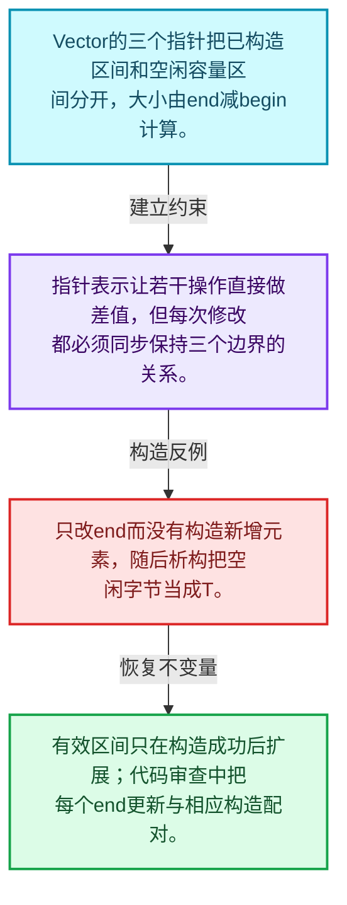
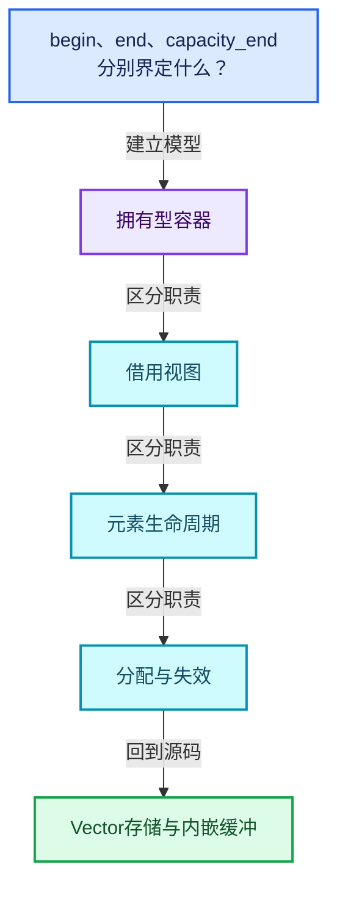
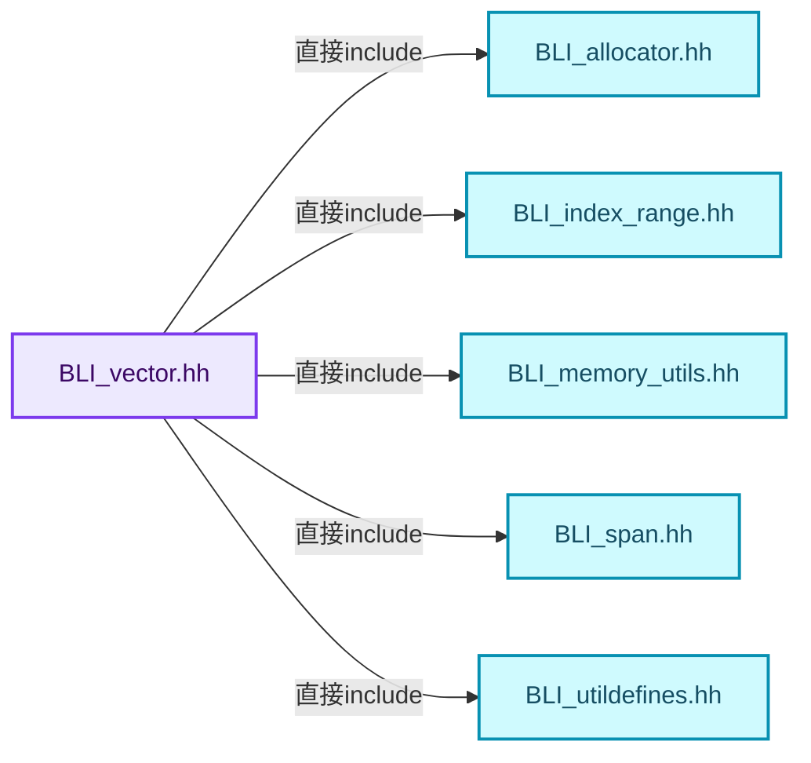
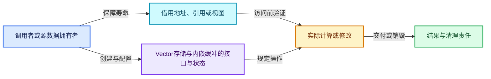
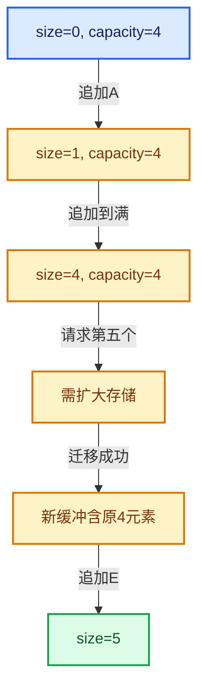

# 01-09 Vector存储与内嵌缓冲

[方向导航](README.md) · [总目录](../README.md) · [覆盖索引](../%E6%BA%90%E7%A0%81%E7%89%88%E6%9C%AC%E4%B8%8E%E8%A6%86%E7%9B%96%E7%B4%A2%E5%BC%95.md)

> 阅读顺序：问题与数据模型 → 语法与类型 → 源码逐行 → 调用线索 → 历史与取舍 → 推演和练习。

- 基准 HEAD：`cbda6b96c26c0dee3c3b5cbb93960c4ac06a6b30`。
- 记录日期：2026-10-14。
- 教学示例状态：正文中的推演不是本机性能实测；已运行练习见验收报告。

## 一、从问题到设计

begin、end、capacity_end分别界定什么？

已构造区间与可用存储区间分开，size与capacity不是同一件事；内嵌存储避免小规模堆分配。

本篇把语法、数据语义和系统取舍连接起来。先证明对象存活，再讨论索引；先区分借用与拥有，再讨论复制移动。

### 本篇独立模型与设计推理

Vector的三个指针把已构造区间和空闲容量区间分开，大小由end减begin计算。

设计取舍：指针表示让若干操作直接做差值，但每次修改都必须同步保持三个边界的关系。

最小反例：只改end而没有构造新增元素，随后析构把空闲字节当成T。

推导与处理：有效区间只在构造成功后扩展；代码审查中把每个end更新与相应构造配对。



### 源码范围与相邻篇章

| 文件 | 本篇逐行范围 | 基准SHA-256 |
|---|---|---|
| [source/blender/blenlib/BLI_vector.hh](../../../../../source/blender/blenlib/BLI_vector.hh) | L1—L139 | `6867b6ba34200e7e0a14495d93a9bef1645c5ef599e1f29ccdddc7c21e500485` |

同一主讲文件可能分多篇覆盖；超出本篇范围的符号通过覆盖索引定位。空行与纯注释保留在源码摘录中，逐行表解释有效语句与语法边界；许可证头统一保留。

前篇：[Array复制移动与销毁](08-Array%E5%A4%8D%E5%88%B6%E7%A7%BB%E5%8A%A8%E4%B8%8E%E9%94%80%E6%AF%81.md).

后篇：[Vector扩容与增长](10-Vector%E6%89%A9%E5%AE%B9%E4%B8%8E%E5%A2%9E%E9%95%BF.md).

## 二、类型、数据与阅读地图



这是概念依赖图，边表示阅读关系，不声称是运行时调用顺序。

### 直接编译依赖



箭头只表示头文件包含关系；完整调用线索见后面的符号定位表。

## 三、关键词、语法与类型角色

### 模板 template

模板把类型或常量作为生成实现的参数。读声明时先列出类型参数、非类型参数和默认值，再看使用者实际实例化了什么。模板声明本身不意味着每种T都支持其全部成员。

具体检查：把T替换为int、string、只能移动的类型，分别检查每个被调用操作是否成立。

### 依赖名称 typename

typename既可引入类型模板参数，也可告诉编译器某个依赖名称是类型。它不创建运行时对象；解析期确认语法类别与实例化期检查具体类型是不同阶段。

具体检查：区分typename T::value_type和T::size()，前者标记类型，后者是表达式。

### 常量求值 constexpr

constexpr声明允许相应实体参与常量求值，但constexpr函数仍可以在运行时执行。是否常量求值由调用场景和表达式合法性共同决定。

具体检查：比较constexpr变量初始化和从运行时输入调用同一函数。

### 只读限定 const

const约束当前访问路径可做的修改。const指针、指向const的指针、const视图对象、const元素是不同位置的限定；其他别名可能仍可修改原对象。

具体检查：分别写T* const、const T*与const T* const，并画出不可修改的层次。

### 对象表示 sizeof

sizeof给出对象表示大小，不是其引用的所有堆内存总量。sizeof视图很小并不说明底层数组很小。

具体检查：分别统计容器对象、容量字节和元素拥有的间接资源。

### 编译期分支 if constexpr

条件在实例化时决定被保留的分支，这常用于不同类型的合法操作选择。它与运行时if有不同的实例化检查规则。

具体检查：找出每个分支依赖哪些类型特征，再使用满足与不满足条件的类型。

### 受控访问 friend

friend授予指定函数或类访问非公开成员的权限，并不意味着继承，也不自动扩展到友元的派生类。

具体检查：解释执行器为何需要访问包装器的内部映射，同时检查边界是否仍清楚。

### 类型别名 using

类型别名为已有类型建立名字，不创建运行期对象。它常把模板内部使用的类型统一暴露给泛型调用者。

具体检查：展开别名直到基础类型，区分类型别名和变量声明。

## 四、真实源码与逐行讲解

源码块保持原行内容，原始行号由小节标题及逐行表给出。表中的调用定位是静态阅读辅助；重载、模板实例化、宏展开和虚调用需结合完整声明，不能仅凭词法出现证明动态调用。

### BLI_vector.hh：L1—L51

<!-- source:source/blender/blenlib/BLI_vector.hh:1:51 -->

```cpp
/* SPDX-FileCopyrightText: 2023 Blender Authors
 *
 * SPDX-License-Identifier: GPL-2.0-or-later */

#pragma once

/** \file
 * \ingroup bli
 *
 * A `Vector<T>` is a dynamically growing contiguous array for values of type T. It is
 * designed to be a more convenient and efficient replacement for `std::vector`. Note that the term
 * "vector" has nothing to do with a vector from computer graphics here.
 *
 * A vector supports efficient insertion and removal at the end (O(1) amortized). Removal in other
 * places takes O(n) time, because all elements afterwards have to be moved. If the order of
 * elements is not important, `remove_and_reorder` can be used instead of `remove` for better
 * performance.
 *
 * The improved efficiency is mainly achieved by supporting small buffer optimization. As long as
 * the number of elements in the vector does not become larger than InlineBufferCapacity, no memory
 * allocation is done. As a consequence, iterators are invalidated when a Vector is moved
 * (iterators of std::vector remain valid when the vector is moved).
 *
 * `Vector` should be your default choice for a vector data structure in Blender.
 */

#include <algorithm>

#include "BLI_allocator.hh"
#include "BLI_index_range.hh"
#include "BLI_memory_utils.hh"
#include "BLI_span.hh"
#include "BLI_utildefines.hh"

namespace blender {

namespace internal {
void vector_print_stats(const char *name,
                        const void *address,
                        int64_t size,
                        int64_t capacity,
                        int64_t inlineCapacity,
                        int64_t memorySize);
}

/**
 * This is used in #Vector::from_raw and #Vector::release to transfer ownership of the underlying
 * data-array into and out of the #Vector. Note that this struct does not do any memory management.
 */
template<typename T, typename Allocator> struct VectorData {
  T *data = nullptr;
```

| 原始行 | 语义、约束与检查 |
|---|---|
| L5 | 防止同一头文件在一个翻译单元中重复展开；不控制多个源文件之间的链接或对象寿命。 |
| L27 | 引入编译依赖 <algorithm>；这是声明可见性关系，不表示运行时一定调用该文件的所有接口。 |
| L29 | 引入编译依赖 "BLI_allocator.hh"；这是声明可见性关系，不表示运行时一定调用该文件的所有接口。 |
| L30 | 引入编译依赖 "BLI_index_range.hh"；这是声明可见性关系，不表示运行时一定调用该文件的所有接口。 |
| L31 | 引入编译依赖 "BLI_memory_utils.hh"；这是声明可见性关系，不表示运行时一定调用该文件的所有接口。 |
| L32 | 引入编译依赖 "BLI_span.hh"；这是声明可见性关系，不表示运行时一定调用该文件的所有接口。 |
| L33 | 引入编译依赖 "BLI_utildefines.hh"；这是声明可见性关系，不表示运行时一定调用该文件的所有接口。 |
| L35 | 把后续声明放入 blender 命名空间，影响名称查找和符号归属，不创建运行时对象。 |
| L37 | 把后续声明放入 internal 命名空间，影响名称查找和符号归属，不创建运行时对象。 |
| L38 | 出现调用或函数声明 `vector_print_stats`，对应表达式为 `void vector_print_stats(const char *name,`。参数求值、返回类型与重载需结合前后完整语句；静态文本引用不能证明动态目标。 |
| L39 | 本行是连续声明或表达式的一部分：`const void *address,`。与本段前后行合读；逗号、括号和限定符决定它属于参数、初始化列表还是实际计算。 |
| L40 | 本行是连续声明或表达式的一部分：`int64_t size,`。与本段前后行合读；逗号、括号和限定符决定它属于参数、初始化列表还是实际计算。 |
| L41 | 本行是连续声明或表达式的一部分：`int64_t capacity,`。与本段前后行合读；逗号、括号和限定符决定它属于参数、初始化列表还是实际计算。 |
| L42 | 本行是连续声明或表达式的一部分：`int64_t inlineCapacity,`。与本段前后行合读；逗号、括号和限定符决定它属于参数、初始化列表还是实际计算。 |
| L43 | 声明成员、局部对象或完成语句 `int64_t memorySize)`。若为指针或引用，它本身不说明拥有；若为值对象，其构造析构由所在作用域或外层对象管理。 |
| L44 | 结束当前语法单元。局部自动对象在离开其作用域时按规则销毁；这不等于所有被引用的外部数据也被释放。 |
| L50 | 声明模板参数 `template<typename T, typename Allocator> struct VectorData {`。类型参数决定生成操作的类型，非类型参数可决定内嵌容量或编译期分支。 |
| L51 | 把右侧 `nullptr` 用于初始化或更新左侧 `T *data`。声明初始化与已有对象赋值应按上下文区分；有资源的类型会调用相应特殊成员。 |

### BLI_vector.hh：L52—L100

<!-- source:source/blender/blenlib/BLI_vector.hh:52:100 -->

```cpp
  int64_t size = 0;
  int64_t capacity = 0;
  BLI_NO_UNIQUE_ADDRESS Allocator allocator;
};

template<
    /**
     * Type of the values stored in this vector. It has to be movable.
     */
    typename T,
    /**
     * The number of values that can be stored in this vector, without doing a heap allocation.
     * Sometimes it makes sense to increase this value a lot. The memory in the inline buffer is
     * not initialized when it is not needed.
     *
     * When T is large, the small buffer optimization is disabled by default to avoid large
     * unexpected allocations on the stack. It can still be enabled explicitly though.
     */
    int64_t InlineBufferCapacity = default_inline_buffer_capacity(sizeof(T)),
    /**
     * The allocator used by this vector. Should rarely be changed, except when you don't want that
     * MEM_* is used internally.
     */
    typename Allocator = GuardedAllocator>
class Vector {
 public:
  using value_type = T;
  using pointer = T *;
  using const_pointer = const T *;
  using reference = T &;
  using const_reference = const T &;
  using iterator = T *;
  using const_iterator = const T *;
  using size_type = int64_t;
  using allocator_type = Allocator;

 private:
  /**
   * Use pointers instead of storing the size explicitly. This reduces the number of instructions
   * in `append`.
   *
   * The pointers might point to the memory in the inline buffer.
   */
  T *begin_;
  T *end_;
  T *capacity_end_;

  /** Used for allocations when the inline buffer is too small. */
  BLI_NO_UNIQUE_ADDRESS Allocator allocator_;
```

本段语义重点：

- `begin_`：起点字段；在Vector中与end_界定已构造区间，其他类应按自己的声明确认含义。
- `end_`：尾后位置字段；在Vector中界定已构造区间，尾后位置不是最后一个元素。
- `capacity_end_`：已分配存储的尾后位置，和end_之间通常尚未构造对象。
- `allocator_`：提供存储的分配策略对象，释放必须与分配策略匹配。

| 原始行 | 语义、约束与检查 |
|---|---|
| L52 | 把右侧 `0` 用于初始化或更新左侧 `int64_t size`。声明初始化与已有对象赋值应按上下文区分；有资源的类型会调用相应特殊成员。 |
| L53 | 把右侧 `0` 用于初始化或更新左侧 `int64_t capacity`。声明初始化与已有对象赋值应按上下文区分；有资源的类型会调用相应特殊成员。 |
| L54 | 声明成员、局部对象或完成语句 `BLI_NO_UNIQUE_ADDRESS Allocator allocator`。若为指针或引用，它本身不说明拥有；若为值对象，其构造析构由所在作用域或外层对象管理。 |
| L55 | 结束当前语法单元。局部自动对象在离开其作用域时按规则销毁；这不等于所有被引用的外部数据也被释放。 |
| L57 | 声明模板参数 `template<`。类型参数决定生成操作的类型，非类型参数可决定内嵌容量或编译期分支。 |
| L61 | 本行是连续声明或表达式的一部分：`typename T,`。与本段前后行合读；逗号、括号和限定符决定它属于参数、初始化列表还是实际计算。 |
| L70 | 显式采用编译器生成的特殊成员行为：`int64_t InlineBufferCapacity = default_inline_buffer_capacity(sizeof(T)),`。成员和基类的性质决定该操作是否可用、是否被删除及异常约定，不表示运行时给对象赋值为default。 |
| L75 | 把右侧 `GuardedAllocator>` 用于初始化或更新左侧 `typename Allocator`。声明初始化与已有对象赋值应按上下文区分；有资源的类型会调用相应特殊成员。 |
| L76 | 声明或定义类型 `class Vector`。结合继承、访问权限和成员布局确认接口与拥有关系；前向声明本身没有完整对象布局。 |
| L77 | 切换成员访问权限为 public；它是编译期接口边界，不是线程同步或内存保护。 |
| L78 | 定义类型别名 `using value_type = T`，为模板接口或内部实现统一命名；本行不分配该类型对象。 |
| L79 | 定义类型别名 `using pointer = T *`，为模板接口或内部实现统一命名；本行不分配该类型对象。 |
| L80 | 定义类型别名 `using const_pointer = const T *`，为模板接口或内部实现统一命名；本行不分配该类型对象。 |
| L81 | 定义类型别名 `using reference = T &`，为模板接口或内部实现统一命名；本行不分配该类型对象。 |
| L82 | 定义类型别名 `using const_reference = const T &`，为模板接口或内部实现统一命名；本行不分配该类型对象。 |
| L83 | 定义类型别名 `using iterator = T *`，为模板接口或内部实现统一命名；本行不分配该类型对象。 |
| L84 | 定义类型别名 `using const_iterator = const T *`，为模板接口或内部实现统一命名；本行不分配该类型对象。 |
| L85 | 定义类型别名 `using size_type = int64_t`，为模板接口或内部实现统一命名；本行不分配该类型对象。 |
| L86 | 定义类型别名 `using allocator_type = Allocator`，为模板接口或内部实现统一命名；本行不分配该类型对象。 |
| L88 | 切换成员访问权限为 private；它是编译期接口边界，不是线程同步或内存保护。 |
| L95 | 本行涉及 `begin_`：起点字段；在Vector中与end_界定已构造区间，其他类应按自己的声明确认含义。按此语义解读 `T *begin_`，不要把地址、数量或状态混用。 |
| L96 | 本行涉及 `end_`：尾后位置字段；在Vector中界定已构造区间，尾后位置不是最后一个元素。按此语义解读 `T *end_`，不要把地址、数量或状态混用。 |
| L97 | 本行涉及 `capacity_end_`：已分配存储的尾后位置，和end_之间通常尚未构造对象。按此语义解读 `T *capacity_end_`，不要把地址、数量或状态混用。 |
| L100 | 本行涉及 `allocator_`：提供存储的分配策略对象，释放必须与分配策略匹配。按此语义解读 `BLI_NO_UNIQUE_ADDRESS Allocator allocator_`，不要把地址、数量或状态混用。 |

### BLI_vector.hh：L101—L139

<!-- source:source/blender/blenlib/BLI_vector.hh:101:139 -->

```cpp

  /** A placeholder buffer that will remain uninitialized until it is used. */
  BLI_NO_UNIQUE_ADDRESS TypedBuffer<T, InlineBufferCapacity> inline_buffer_;

  /**
   * Store the size of the vector explicitly in debug builds. Otherwise you'd always have to call
   * the `size` function or do the math to compute it from the pointers manually. This is rather
   * annoying. Knowing the size of a vector is often quite essential when debugging some code.
   */
#ifndef NDEBUG
  int64_t debug_size_;
#  define UPDATE_VECTOR_SIZE(ptr) (ptr)->debug_size_ = int64_t((ptr)->end_ - (ptr)->begin_)
#else
#  define UPDATE_VECTOR_SIZE(ptr) ((void)0)
#endif

  /**
   * Be a friend with other vector instantiations. This is necessary to implement some memory
   * management logic.
   */
  template<typename OtherT, int64_t OtherInlineBufferCapacity, typename OtherAllocator>
  friend class Vector;

  /** Required in case `T` is an incomplete type. */
  static constexpr bool is_nothrow_move_constructible()
  {
    if constexpr (InlineBufferCapacity == 0) {
      return true;
    }
    else {
      return std::is_nothrow_move_constructible_v<T>;
    }
  }

 public:
  /**
   * Create an empty vector.
   * This does not do any memory allocation.
   */
```

本段语义重点：

- `begin_`：起点字段；在Vector中与end_界定已构造区间，其他类应按自己的声明确认含义。
- `end_`：尾后位置字段；在Vector中界定已构造区间，尾后位置不是最后一个元素。
- `inline_buffer_`：容器对象内部的缓冲区，不能像堆缓冲那样直接交给另一个对象。

| 原始行 | 语义、约束与检查 |
|---|---|
| L103 | 本行涉及 `inline_buffer_`：容器对象内部的缓冲区，不能像堆缓冲那样直接交给另一个对象。按此语义解读 `BLI_NO_UNIQUE_ADDRESS TypedBuffer<T, InlineBufferCapacity> inline_buffer_`，不要把地址、数量或状态混用。 |
| L110 | 预处理阶段处理 #ifndef NDEBUG。它决定哪些代码进入编译，不是运行时分支；阅读行为时必须结合实际构建宏。 |
| L111 | 声明成员、局部对象或完成语句 `int64_t debug_size_`。若为指针或引用，它本身不说明拥有；若为值对象，其构造析构由所在作用域或外层对象管理。 |
| L112 | 建立或更新 `begin_`：起点字段；在Vector中与end_界定已构造区间，其他类应按自己的声明确认含义。本行的具体值关系为 `#  define UPDATE_VECTOR_SIZE(ptr) (ptr)->debug_size_ = int64_t((ptr)->end_ - (ptr)->begin_)`；对照更新前后相应范围或状态是否一致。 |
| L113 | 预处理阶段处理 #else。它决定哪些代码进入编译，不是运行时分支；阅读行为时必须结合实际构建宏。 |
| L114 | 出现调用或函数声明 `UPDATE_VECTOR_SIZE`，对应表达式为 `#  define UPDATE_VECTOR_SIZE(ptr) ((void)0)`。参数求值、返回类型与重载需结合前后完整语句；静态文本引用不能证明动态目标。 |
| L115 | 预处理阶段处理 #endif。它决定哪些代码进入编译，不是运行时分支；阅读行为时必须结合实际构建宏。 |
| L121 | 声明模板参数 `template<typename OtherT, int64_t OtherInlineBufferCapacity, typename OtherAllocator>`。类型参数决定生成操作的类型，非类型参数可决定内嵌容量或编译期分支。 |
| L122 | 声明成员、局部对象或完成语句 `friend class Vector`。若为指针或引用，它本身不说明拥有；若为值对象，其构造析构由所在作用域或外层对象管理。 |
| L125 | 出现调用或函数声明 `is_nothrow_move_constructible`，对应表达式为 `static constexpr bool is_nothrow_move_constructible()`。参数求值、返回类型与重载需结合前后完整语句；静态文本引用不能证明动态目标。 |
| L126 | 连接上一行的声明或控制结构与其语句块；后续行在这个作用域中执行或声明。 |
| L127 | 编译期条件分支 `if constexpr (InlineBufferCapacity == 0)`。按实例化类型选择相应实现；被舍弃分支和运行期if具有不同检查规则，不能当作运行时输入验证。 |
| L128 | 返回表达式 `true`。这是本路径的布尔结果，具体成功、存在或状态含义由函数接口规定。 |
| L129 | 结束当前语法单元。局部自动对象在离开其作用域时按规则销毁；这不等于所有被引用的外部数据也被释放。 |
| L130 | 处理前一条件不成立的互补路径。比较两条路径最后是否恢复同一不变量，以及是否产生不同的资源责任。 |
| L131 | 返回表达式 `std::is_nothrow_move_constructible_v<T>`。 |
| L132 | 结束当前语法单元。局部自动对象在离开其作用域时按规则销毁；这不等于所有被引用的外部数据也被释放。 |
| L133 | 结束当前语法单元。局部自动对象在离开其作用域时按规则销毁；这不等于所有被引用的外部数据也被释放。 |
| L135 | 切换成员访问权限为 public；它是编译期接口边界，不是线程同步或内存保护。 |

## 五、接口定位、调用线索与生命周期

### 本篇声明与实现入口

| 源码位置 | 实际声明片段 |
|---|---|
| [BLI_vector.hh:L38](../../../../../source/blender/blenlib/BLI_vector.hh#L38) | `void vector_print_stats(const char *name,` |
| [BLI_vector.hh:L50](../../../../../source/blender/blenlib/BLI_vector.hh#L50) | `template<typename T, typename Allocator> struct VectorData` |
| [BLI_vector.hh:L76](../../../../../source/blender/blenlib/BLI_vector.hh#L76) | `class Vector` |
| [BLI_vector.hh:L125](../../../../../source/blender/blenlib/BLI_vector.hh#L125) | `static constexpr bool is_nothrow_move_constructible()` |

### 同名符号出现位置

以下表提供跨文件阅读入口，包含声明、调用或测试使用；没有经过完整C++名称解析，不把它命名为已证明的运行时调用图。

| 符号 | 位置 | 文本证据 |
|---|---|---|
| 本段无跨主讲文件的同名入口 | — | 沿直接include与所在类接口继续定位 |

### 生命周期推理图



这是审查生命周期的通用模型。具体类是否拥有数据由本篇成员、构造、析构和调用者一起证明；任何箭头都不自动代表shared_ptr。

## 六、把代码放进具体数据中推演

本方向的共同数值模型如下。本篇的专门检查是：画出size为2容量为4的存储，标明哪些位置可以读取，哪些位置只存在原始存储。

| 步骤 | 数据或状态 | 为什么需要这一步 |
|---|---|---|
| 初始 | size=0, capacity=4 | 只有存储，没有可读取的T元素 |
| 追加A | size=1, capacity=4 | 在第0个位置构造A |
| 追加到满 | size=4, capacity=4 | 四个位置均已构造 |
| 请求第五个 | 需扩大存储 | 旧地址仍需被正确管理 |
| 迁移成功 | 新缓冲含原4元素 | 提交新指针并释放旧存储 |
| 追加E | size=5 | 只在成功构造后扩大有效区间 |



图是教学推演模型；精确分支与状态更新以本篇摘录及调用契约为准。

### 本篇独立练习与参考思路

画出size为2容量为4的存储，标明哪些位置可以读取，哪些位置只存在原始存储。

参考思路：已构造区间与可用存储区间分开，size与capacity不是同一件事；内嵌存储避免小规模堆分配。

将输入、预期结果和资源责任分成三张清单。先用最直接的实现给出可核对的答案，再替换成对应源码使用的表示；比较结果不变的条件，而不是只比较接口名字。

验收依据：构造成功次数减析构次数应等于当前存活对象数；异常之后资源计数应回到合法状态。

## 七、复杂度、设计取舍与其他基础库

对比std::vector、std::array、std::span与LLVM SmallVector、ArrayRef时，分别比较拥有关系、内嵌存储、大小是否属于类型和失效条件。不要根据同名方法推断完全相同契约。

本篇的具体取舍：已构造区间与可用存储区间分开，size与capacity不是同一件事；内嵌存储避免小规模堆分配。

| 观察维度 | 从源码取得证据的方法 | 本篇要避免的误判 |
|---|---|---|
| 时间 | 对循环次数、分派次数和重建频率分别计数 | 看到单次常数操作就断定整个操作序列是常数成本 |
| 内存 | 区分对象本体、容量存储、间接资源和共享控制块 | 用sizeof代替总内存 |
| 安全 | 沿构造、失败回滚、销毁与失效逐路径检查 | 把断言或非空指针当作完整安全证明 |
| 并发 | 逐字段确认锁、发布顺序和借用寿命 | 把引用计数线程安全等同数据读写线程安全 |

相关一手资料：

- [C++公开工作草案](https://eel.is/c++draft/)：持续更新的工作草案；语言与标准库语义以相应章节为准。
- [LLVM Programmer’s Manual](https://llvm.org/docs/ProgrammersManual.html)：在线版，2026-10-14查阅；仅比较设计思路，不保证与本地LLVM版本一致。

资料用于核对契约和进一步阅读；这里没有声称外部库与Blender实现相同，也没有把上游性能数字当作本机实测。

## 八、历史提交与设计演化

### 2020-08-19 · Jacques Lucke

[BLI: improve exception safety of Vector, Array and Stack](https://projects.blender.org/blender/blender/commit/2aff45146f1464ba8899368ad004522cb6a1a98c)

完整哈希：`2aff45146f1464ba8899368ad004522cb6a1a98c`。提交标题与作者日期来自本地Git对象。

提交说明原文（历史证据，不能直接作为当前API说明）：

```text
BLI: improve exception safety of Vector, Array and Stack

Using C++ exceptions in Blender is difficult, due to the large
number of C functions in the call stack. However, C++ data
structures in blenlib should at least try to be exception safe,
so that they can be used if someone wants to use exceptions
in some isolated area.

This patch improves the exception safety of the Vector, Array
and Stack data structure. This is mainly achieved by reordering
some lines and doing some explicit exception handling.
I don't expect performance of common operations to be affected
by this change.

The three containers are supposed to provide at least the
basic exception guarantee for most methods (except for e.g.
`*_unchecked` methods). So, resources should not leak when
the contained type throws an exception.

I also added new unit tests that test the exception handling
in various cases.
```

阅读任务：先根据说明复述旧问题，提出一个自己的修复方案，再对照diff。结合本篇重点“begin、end、capacity_end分别界定什么？”判断方案改变的是表示、接口、生命周期还是调度。

### 2020-06-09 · Jacques Lucke

[BLI: rename ArrayRef to Span](https://projects.blender.org/blender/blender/commit/f7c0f1b8b83ac475755b633abf59cf9f447b2d49)

完整哈希：`f7c0f1b8b83ac475755b633abf59cf9f447b2d49`。提交标题与作者日期来自本地Git对象。

提交说明原文（历史证据，不能直接作为当前API说明）：

```text
BLI: rename ArrayRef to Span

This also renames `MutableArrayRef` to `MutableSpan`.
The name "Span" works better, because `std::span` will provide
similar functionality in C++20. Furthermore, a shorter, more
concise name for a common data structure is nice.
```

阅读任务：先根据说明复述旧问题，提出一个自己的修复方案，再对照diff。结合本篇重点“begin、end、capacity_end分别界定什么？”判断方案改变的是表示、接口、生命周期还是调度。

## 九、反例、测试入口与掌握标准

仓库测试入口：

- [BLI_vector_test.cc](../../../../../source/blender/blenlib/tests/BLI_vector_test.cc)：阅读输入、断言与覆盖边界；本篇不把“存在测试”写成“本轮已运行”。

需要实际构造的反例：

- 空输入或没有结果需求：确认接口允许的空状态与不允许访问的操作。
- 边界位置和退化结构：把长度为1、末尾位置、重复值或深链代入真实分支。
- 生命周期结束或修改之后：检查保存的指针、引用、结果视图是否仍有效。
- 与本篇核心不变量相冲突的输入：画出size为2容量为4的存储，标明哪些位置可以读取，哪些位置只存在原始存储。

### 可运行的教学参考程序

[reference_exercises.cc](../_tools/reference_exercises.cc)包含独立于Blender的C++20参考检查：视图、简化SmallVector、异常回滚、哈希碰撞与删除、偏移数组、拓扑映射、共享缓存、表达式、惰性分支、闭包和暴力最近邻。

参考程序有意省略生产实现的完整能力。例如SmallVector禁止复制移动容器，不支持只能移动的元素，并禁止append参数别名到自身元素；TinyMap固定8槽，不提供增长。程序通过不能替代Blender实现测试。实际运行结果、编译器与命令见验收报告。

掌握标准：离开源码解释“begin、end、capacity_end分别界定什么？”；独立完成上述练习；能指出一个会破坏拥有型容器相关约束的最小反例，并用具体代码行说明检查或修复应放在哪里。
