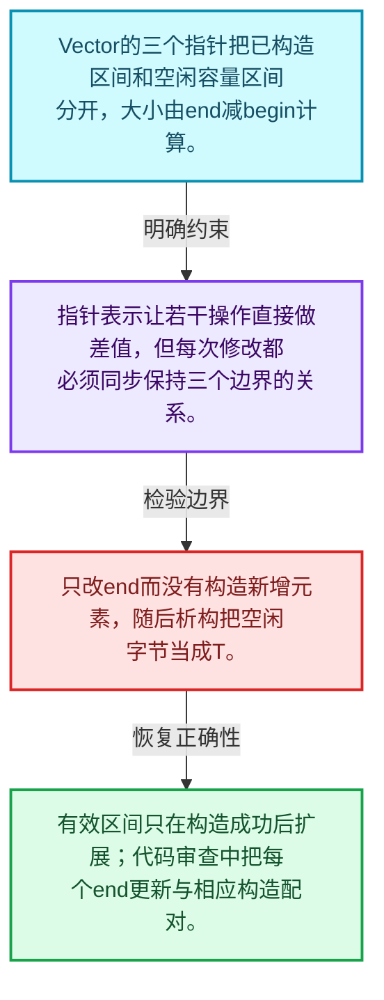
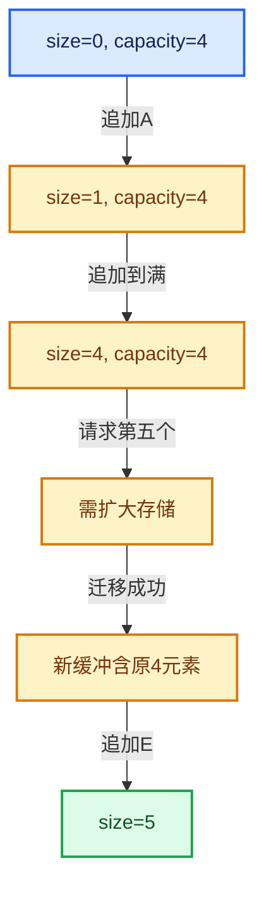

# 01-09 Vector存储与内嵌缓冲

[方向导航](README.md) · [总目录](../README.md) · [实现索引](../00-课程指南/02-源码与提交索引/符号依赖与实现索引.md)

## 从问题到实现

begin、end、capacity_end分别界定什么？

已构造区间与可用存储区间分开，size与capacity不是同一件事；内嵌存储避免小规模堆分配。

**数据模型**

Vector的三个指针把已构造区间和空闲容量区间分开，大小由end减begin计算。

**设计取舍**

指针表示让若干操作直接做差值，但每次修改都必须同步保持三个边界的关系。

**最小反例**

只改end而没有构造新增元素，随后析构把空闲字节当成T。

**推导**

有效区间只在构造成功后扩展；代码审查中把每个end更新与相应构造配对。

## 阅读地图与执行推演






图中的数值推演是本方向的教学模型；实际函数之间的调用边与概念分析边分别标注，不能把概念关系当作运行时调度顺序。

## 完整源码单元与就地讲解

中文讲解直接放在相关代码旁，复杂机制在代码下展开。原文折叠区保留基准行号；不需要在行号表和函数之间来回查找。类布局可分段展示，函数实现不按固定行数切开。

### 类型布局、声明与编译条件 · BLI_vector.hh L1—L124

<a id="t-6e1ce76e770b"></a>

`VectorData`在这里声明的数据成员：

- `T data`
- `int64_t size`
- `int64_t capacity`
- `BLI_NO_UNIQUE_ADDRESS Allocator`

<a id="t-14451f176559"></a>

`Vector`在这里声明的数据成员：

- `T begin_`：切换数据起点；检查旧对象寿命与旧存储释放已经处理。
- `T end_`：提交有效元素尾后位置；它决定size，不是容量。
- `T capacity_end_`：提交容量尾后边界，必须与当前缓冲起点和容量一致。
- `BLI_NO_UNIQUE_ADDRESS allocator_`
- `BLI_NO_UNIQUE_ADDRESS TypedBuffer`
- `int64_t debug_size_`

<!-- annotated:7b10ae9e22892c -->

```cpp
/* SPDX-FileCopyrightText: 2023 Blender Authors
 *
 * SPDX-License-Identifier: GPL-2.0-or-later */

#pragma once

/** \file
 * \ingroup bli
 *
 * A `Vector<T>` is a dynamically growing contiguous array for values of type T. It is
 * designed to be a more convenient and efficient replacement for `std::vector`. Note that the term
 * "vector" has nothing to do with a vector from computer graphics here.
 *
 * A vector supports efficient insertion and removal at the end (O(1) amortized). Removal in other
 * places takes O(n) time, because all elements afterwards have to be moved. If the order of
 * elements is not important, `remove_and_reorder` can be used instead of `remove` for better
 * performance.
 *
 * The improved efficiency is mainly achieved by supporting small buffer optimization. As long as
 * the number of elements in the vector does not become larger than InlineBufferCapacity, no memory
 * allocation is done. As a consequence, iterators are invalidated when a Vector is moved
 * (iterators of std::vector remain valid when the vector is moved).
 *
 * `Vector` should be your default choice for a vector data structure in Blender.
 */

#include <algorithm>

#include "BLI_allocator.hh"
#include "BLI_index_range.hh"
#include "BLI_memory_utils.hh"
#include "BLI_span.hh"
#include "BLI_utildefines.hh"

namespace blender {

namespace internal {
void vector_print_stats(const char *name,
                        const void *address,
                        int64_t size,
                        int64_t capacity,
                        int64_t inlineCapacity,
                        int64_t memorySize);
}

/**
 * This is used in #Vector::from_raw and #Vector::release to transfer ownership of the underlying
 * data-array into and out of the #Vector. Note that this struct does not do any memory management.
 */
template<typename T, typename Allocator> struct VectorData {
  T *data = nullptr;
  int64_t size = 0;
  int64_t capacity = 0;
  BLI_NO_UNIQUE_ADDRESS Allocator allocator;
};

template<
    /**
     * Type of the values stored in this vector. It has to be movable.
     */
    typename T,
    /**
     * The number of values that can be stored in this vector, without doing a heap allocation.
     * Sometimes it makes sense to increase this value a lot. The memory in the inline buffer is
     * not initialized when it is not needed.
     *
     * When T is large, the small buffer optimization is disabled by default to avoid large
     * unexpected allocations on the stack. It can still be enabled explicitly though.
     */
    int64_t InlineBufferCapacity = default_inline_buffer_capacity(sizeof(T)),
    /**
     * The allocator used by this vector. Should rarely be changed, except when you don't want that
     * MEM_* is used internally.
     */
    typename Allocator = GuardedAllocator>
class Vector {
 public:
  using value_type = T;
  using pointer = T *;
  using const_pointer = const T *;
  using reference = T &;
  using const_reference = const T &;
  using iterator = T *;
  using const_iterator = const T *;
  using size_type = int64_t;
  using allocator_type = Allocator;

 private:
  /**
   * Use pointers instead of storing the size explicitly. This reduces the number of instructions
   * in `append`.
   *
   * The pointers might point to the memory in the inline buffer.
   */
  T *begin_;
  T *end_;
  T *capacity_end_;

  /** Used for allocations when the inline buffer is too small. */
  BLI_NO_UNIQUE_ADDRESS Allocator allocator_;

  /** A placeholder buffer that will remain uninitialized until it is used. */
  BLI_NO_UNIQUE_ADDRESS TypedBuffer<T, InlineBufferCapacity> inline_buffer_;

  /**
   * Store the size of the vector explicitly in debug builds. Otherwise you'd always have to call
   * the `size` function or do the math to compute it from the pointers manually. This is rather
   * annoying. Knowing the size of a vector is often quite essential when debugging some code.
   */
#ifndef NDEBUG
  int64_t debug_size_;
#  define UPDATE_VECTOR_SIZE(ptr) (ptr)->debug_size_ = int64_t((ptr)->end_ - (ptr)->begin_)
#else
#  define UPDATE_VECTOR_SIZE(ptr) ((void)0)
#endif

  /**
   * Be a friend with other vector instantiations. This is necessary to implement some memory
   * management logic.
   */
  template<typename OtherT, int64_t OtherInlineBufferCapacity, typename OtherAllocator>
  friend class Vector;

  /** Required in case `T` is an incomplete type. */
```

<details>
<summary>核对原始源码：source/blender/blenlib/BLI_vector.hh · L1—L124</summary>

<!-- original:7b10ae9e22892c:source/blender/blenlib/BLI_vector.hh:1:124 -->

```cpp
/* SPDX-FileCopyrightText: 2023 Blender Authors
 *
 * SPDX-License-Identifier: GPL-2.0-or-later */

#pragma once

/** \file
 * \ingroup bli
 *
 * A `Vector<T>` is a dynamically growing contiguous array for values of type T. It is
 * designed to be a more convenient and efficient replacement for `std::vector`. Note that the term
 * "vector" has nothing to do with a vector from computer graphics here.
 *
 * A vector supports efficient insertion and removal at the end (O(1) amortized). Removal in other
 * places takes O(n) time, because all elements afterwards have to be moved. If the order of
 * elements is not important, `remove_and_reorder` can be used instead of `remove` for better
 * performance.
 *
 * The improved efficiency is mainly achieved by supporting small buffer optimization. As long as
 * the number of elements in the vector does not become larger than InlineBufferCapacity, no memory
 * allocation is done. As a consequence, iterators are invalidated when a Vector is moved
 * (iterators of std::vector remain valid when the vector is moved).
 *
 * `Vector` should be your default choice for a vector data structure in Blender.
 */

#include <algorithm>

#include "BLI_allocator.hh"
#include "BLI_index_range.hh"
#include "BLI_memory_utils.hh"
#include "BLI_span.hh"
#include "BLI_utildefines.hh"

namespace blender {

namespace internal {
void vector_print_stats(const char *name,
                        const void *address,
                        int64_t size,
                        int64_t capacity,
                        int64_t inlineCapacity,
                        int64_t memorySize);
}

/**
 * This is used in #Vector::from_raw and #Vector::release to transfer ownership of the underlying
 * data-array into and out of the #Vector. Note that this struct does not do any memory management.
 */
template<typename T, typename Allocator> struct VectorData {
  T *data = nullptr;
  int64_t size = 0;
  int64_t capacity = 0;
  BLI_NO_UNIQUE_ADDRESS Allocator allocator;
};

template<
    /**
     * Type of the values stored in this vector. It has to be movable.
     */
    typename T,
    /**
     * The number of values that can be stored in this vector, without doing a heap allocation.
     * Sometimes it makes sense to increase this value a lot. The memory in the inline buffer is
     * not initialized when it is not needed.
     *
     * When T is large, the small buffer optimization is disabled by default to avoid large
     * unexpected allocations on the stack. It can still be enabled explicitly though.
     */
    int64_t InlineBufferCapacity = default_inline_buffer_capacity(sizeof(T)),
    /**
     * The allocator used by this vector. Should rarely be changed, except when you don't want that
     * MEM_* is used internally.
     */
    typename Allocator = GuardedAllocator>
class Vector {
 public:
  using value_type = T;
  using pointer = T *;
  using const_pointer = const T *;
  using reference = T &;
  using const_reference = const T &;
  using iterator = T *;
  using const_iterator = const T *;
  using size_type = int64_t;
  using allocator_type = Allocator;

 private:
  /**
   * Use pointers instead of storing the size explicitly. This reduces the number of instructions
   * in `append`.
   *
   * The pointers might point to the memory in the inline buffer.
   */
  T *begin_;
  T *end_;
  T *capacity_end_;

  /** Used for allocations when the inline buffer is too small. */
  BLI_NO_UNIQUE_ADDRESS Allocator allocator_;

  /** A placeholder buffer that will remain uninitialized until it is used. */
  BLI_NO_UNIQUE_ADDRESS TypedBuffer<T, InlineBufferCapacity> inline_buffer_;

  /**
   * Store the size of the vector explicitly in debug builds. Otherwise you'd always have to call
   * the `size` function or do the math to compute it from the pointers manually. This is rather
   * annoying. Knowing the size of a vector is often quite essential when debugging some code.
   */
#ifndef NDEBUG
  int64_t debug_size_;
#  define UPDATE_VECTOR_SIZE(ptr) (ptr)->debug_size_ = int64_t((ptr)->end_ - (ptr)->begin_)
#else
#  define UPDATE_VECTOR_SIZE(ptr) ((void)0)
#endif

  /**
   * Be a friend with other vector instantiations. This is necessary to implement some memory
   * management logic.
   */
  template<typename OtherT, int64_t OtherInlineBufferCapacity, typename OtherAllocator>
  friend class Vector;

  /** Required in case `T` is an incomplete type. */
```

</details>

<a id="f-7cf894b15eff302e"></a>

### `blender::Vector::is_nothrow_move_constructible`

实现位置：[source/blender/blenlib/BLI_vector.hh](../../../../../source/blender/blenlib/BLI_vector.hh) · L125—L133。

**教学注释版**

<!-- annotated:4f40fa9d3af697 -->

```cpp
  static constexpr bool is_nothrow_move_constructible()
  {
    if constexpr (InlineBufferCapacity == 0) {
      return true;
    }
    else {
      return std::is_nothrow_move_constructible_v<T>;
    }
  }
```

<details>
<summary>核对原始源码：source/blender/blenlib/BLI_vector.hh · L125—L133</summary>

<!-- original:4f40fa9d3af697:source/blender/blenlib/BLI_vector.hh:125:133 -->

```cpp
  static constexpr bool is_nothrow_move_constructible()
  {
    if constexpr (InlineBufferCapacity == 0) {
      return true;
    }
    else {
      return std::is_nothrow_move_constructible_v<T>;
    }
  }
```

</details>

**结果出口**

- `return true;`
- `return std::is_nothrow_move_constructible_v<T>;`

**继续追踪实现**

本实现没有需要继续展开的显式调用；检查返回表达式、对象转换和调用者前置条件。

### 类型布局、声明与编译条件 · BLI_vector.hh L134—L139

<!-- annotated:df9f820b8c5be3 -->

```cpp

 public:
  /**
   * Create an empty vector.
   * This does not do any memory allocation.
   */
```

<details>
<summary>核对原始源码：source/blender/blenlib/BLI_vector.hh · L134—L139</summary>

<!-- original:df9f820b8c5be3:source/blender/blenlib/BLI_vector.hh:134:139 -->

```cpp

 public:
  /**
   * Create an empty vector.
   * This does not do any memory allocation.
   */
```

</details>

## 语法与相关类型

### 模板 template

模板把类型或常量作为生成实现的参数。读声明时先列出类型参数、非类型参数和默认值，再看使用者实际实例化了什么。模板声明本身不意味着每种T都支持其全部成员。

把T替换为int、string、只能移动的类型，分别检查每个被调用操作是否成立。

### 依赖名称 typename

typename既可引入类型模板参数，也可告诉编译器某个依赖名称是类型。它不创建运行时对象；解析期确认语法类别与实例化期检查具体类型是不同阶段。

区分typename T::value_type和T::size()，前者标记类型，后者是表达式。

### 常量求值 constexpr

constexpr声明允许相应实体参与常量求值，但constexpr函数仍可以在运行时执行。是否常量求值由调用场景和表达式合法性共同决定。

比较constexpr变量初始化和从运行时输入调用同一函数。

### 只读限定 const

const约束当前访问路径可做的修改。const指针、指向const的指针、const视图对象、const元素是不同位置的限定；其他别名可能仍可修改原对象。

分别写T* const、const T*与const T* const，并画出不可修改的层次。

### 对象表示 sizeof

sizeof给出对象表示大小，不是其引用的所有堆内存总量。sizeof视图很小并不说明底层数组很小。

分别统计容器对象、容量字节和元素拥有的间接资源。

### 编译期分支 if constexpr

条件在实例化时决定被保留的分支，这常用于不同类型的合法操作选择。它与运行时if有不同的实例化检查规则。

找出每个分支依赖哪些类型特征，再使用满足与不满足条件的类型。

### 受控访问 friend

friend授予指定函数或类访问非公开成员的权限，并不意味着继承，也不自动扩展到友元的派生类。

解释执行器为何需要访问包装器的内部映射，同时检查边界是否仍清楚。

### 类型别名 using

类型别名为已有类型建立名字，不创建运行期对象。它常把模板内部使用的类型统一暴露给泛型调用者。

展开别名直到基础类型，区分类型别名和变量声明。

## 实现练习与验证

画出size为2容量为4的存储，标明哪些位置可以读取，哪些位置只存在原始存储。

参考推理：有效区间只在构造成功后扩展；代码审查中把每个end更新与相应构造配对。

构造成功次数减析构次数应等于当前存活对象数；异常之后资源计数应回到合法状态。

## 历史、跨库比较与证据

对比std::vector、std::array、std::span与LLVM SmallVector、ArrayRef时，分别比较拥有关系、内嵌存储、大小是否属于类型和失效条件。不要根据同名方法推断完全相同契约。

[历史提交索引](../00-课程指南/02-源码与提交索引/历史提交与设计演化索引.md) · [源码基准](../00-课程指南/02-源码与提交索引/源码版本与覆盖索引.md) · [验收报告](../00-课程指南/03-验收报告/验收报告.md)
