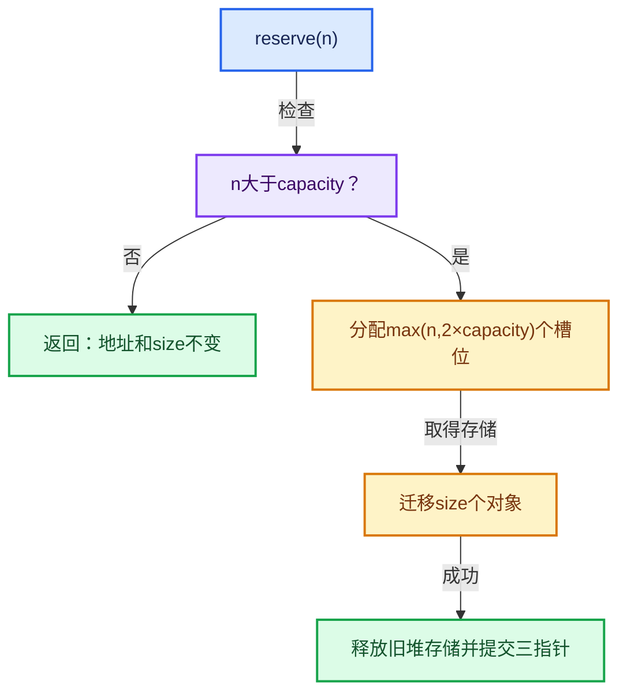
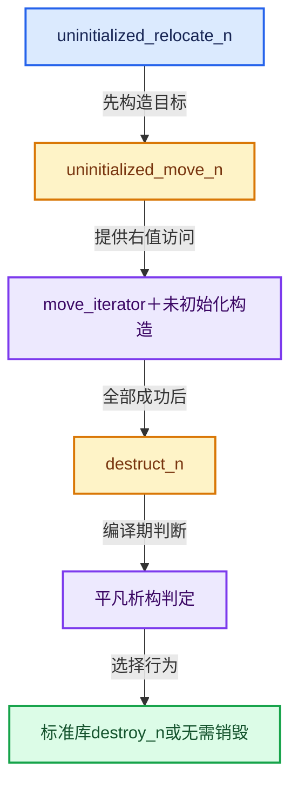
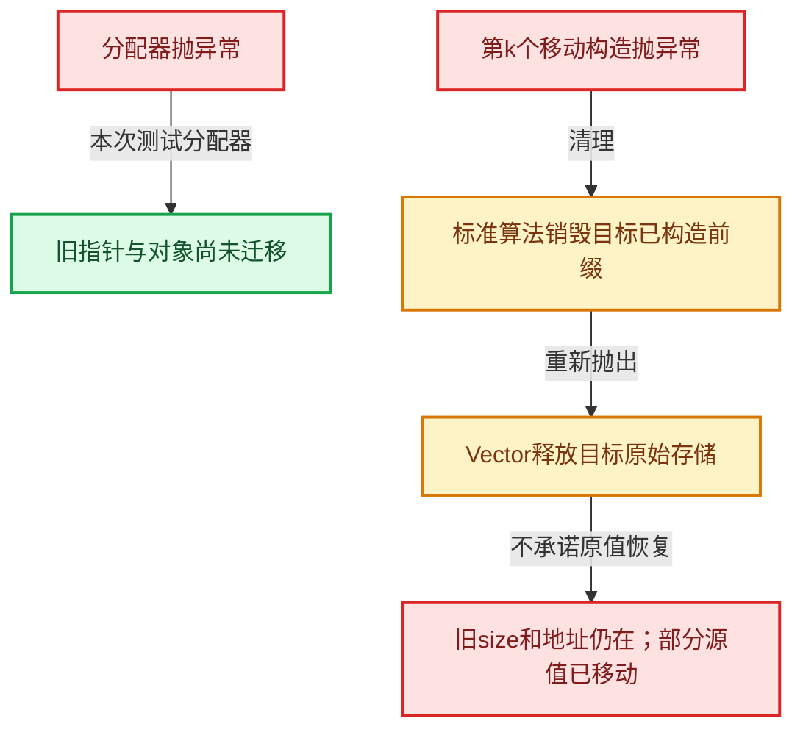

# 01-10 Vector扩容与增长

[方向导航](README.md) · [总目录](../README.md) · [实现索引](../00-课程指南/02-源码与提交索引/符号依赖与实现索引.md)

## 从问题到实现

reserve为什么不能被理解成增加元素？

reserve改变容量保障，不应使未构造位置变成元素；扩容必须在新存储建立对象后安全提交新状态。

**数据模型**

容量4、大小4、请求5时，当前增长策略可选择至少8个位置；迁移的有效元素仍只有4。

**设计取舍**

几何增长换取摊还线性总迁移量，但会保留多余容量；reserve适用于已知规模。

**最小反例**

每追加一次都重新分配刚好多1的位置，总迁移数量形成1到N的和。

**推导**

比较容量倍增与精确增长的总操作计数，而不只测一次追加。

## 本篇专用阅读顺序与依赖链

先读reserve和realloc_to_at_least，再沿迁移工具进入标准库契约；最后比较resize、reinitialize与两种clear。这里列出跨篇精确入口，避免把全文中的operator[]等辅助接口误当成扩容主链。

- [`mallocn.cc::aligned_malloc` · L77](../90-实现依赖专题/07-Intern运行时与平台/guardedalloc/intern/mallocn.cc.md#f-48812794cdf34f28)
- [`mallocn.cc::aligned_free` · L99](../90-实现依赖专题/07-Intern运行时与平台/guardedalloc/intern/mallocn.cc.md#f-9dceace8dd60fe03)
- [`mallocn.cc::MEM_delete_void` · L109](../90-实现依赖专题/07-Intern运行时与平台/guardedalloc/intern/mallocn.cc.md#f-9a07b26421f2bee6)
- [`mallocn.cc::MEM_new_uninitialized_aligned` · L134](../90-实现依赖专题/07-Intern运行时与平台/guardedalloc/intern/mallocn.cc.md#f-9f3d21bd7da93c68)
- [`BLI_allocator.hh::allocate` · L43](03-内存工具与分配器接口.md#f-a57239e6d3bd10d9)
- [`BLI_allocator.hh::deallocate` · L60](03-内存工具与分配器接口.md#f-c1586978e7959acb)
- [`BLI_vector.hh::reserve` · L405](10-Vector扩容与增长.md#f-4cf9c0f00e01102e)
- [`BLI_vector.hh::resize` · L418](10-Vector扩容与增长.md#f-059312cabb8abe3a)
- [`BLI_vector.hh::resize` · L439](10-Vector扩容与增长.md#f-ab8f94924ebe2d12)
- [`BLI_vector.hh::reinitialize` · L458](10-Vector扩容与增长.md#f-9249cd61747c1405)
- [`BLI_vector.hh::clear` · L468](10-Vector扩容与增长.md#f-d051bebff5275a43)
- [`BLI_vector.hh::clear_and_shrink` · L479](10-Vector扩容与增长.md#f-bc6dd407df52ad34)
- [`BLI_vector.hh::size` · L780](11-Vector插入删除与重排.md#f-714773731767349c)
- [`BLI_vector.hh::capacity` · L1007](12-Vector异常安全与边界.md#f-1a73aecfff2e3366)
- [`BLI_vector.hh::is_inline` · L1108](12-Vector异常安全与边界.md#f-6bbcba0fedd158a9)
- [`BLI_vector.hh::ensure_space_for_one` · L1114](10-Vector扩容与增长.md#f-eafa5315534c2edf)
- [`BLI_vector.hh::realloc_to_at_least` · L1121](10-Vector扩容与增长.md#f-9189de35f17e7c08)
- [`BLI_memory_utils.hh::destruct_n` · L34](01-对象生命周期与值类别.md#f-cb5bcdbd0ee77885)
- [`BLI_memory_utils.hh::default_construct_n` · L43](01-对象生命周期与值类别.md#f-7fba5f8c23635f17)
- [`BLI_memory_utils.hh::uninitialized_move_n` · L69](01-对象生命周期与值类别.md#f-fc5f51bf717c3b5a)
- [`BLI_memory_utils.hh::uninitialized_relocate_n` · L80](01-对象生命周期与值类别.md#f-9de0365b9a47fd68)
- [`BLI_memory_utils.hh::uninitialized_fill_n` · L91](01-对象生命周期与值类别.md#f-020ca78eff5f9227)

`begin_`是存储起点，`end_`是已构造元素的尾后边界，`capacity_end_`是可用存储的尾后边界。只有前两个指针之间存在Vector负责销毁的T对象。

## 内存、调用与异常路径

```mermaid
flowchart LR
  V["size=3，capacity=8"]:::input
  S["resize(1)：销毁尾部2个对象"]:::compute
  C["clear：销毁剩余对象，保留8槽位"]:::data
  R["clear_and_shrink：释放堆存储"]:::compute
  I["size=0，恢复内嵌容量"]:::result
  V -->|"缩小"| S
  S -->|"清空"| C
  C -->|"释放"| R
  R -->|"重置三指针"| I
  classDef input fill:#DBEAFE,stroke:#2563EB,color:#172554,stroke-width:2px;
  classDef data fill:#CFFAFE,stroke:#0891B2,color:#164E63,stroke-width:2px;
  classDef abstraction fill:#EDE9FE,stroke:#7C3AED,color:#3B0764,stroke-width:2px;
  classDef compute fill:#FEF3C7,stroke:#D97706,color:#78350F,stroke-width:2px;
  classDef result fill:#DCFCE7,stroke:#16A34A,color:#14532D,stroke-width:2px;
  classDef error fill:#FEE2E2,stroke:#DC2626,color:#7F1D1D,stroke-width:2px;
```










## 完整源码单元与就地讲解

中文讲解直接放在相关代码旁，复杂机制在代码下展开。原文折叠区保留基准行号；不需要在行号表和函数之间来回查找。类布局可分段展示，函数实现不按固定行数切开。

<a id="f-57bef91be0a315ba"></a>

### `blender::Vector::operator[]`

实现位置：[source/blender/blenlib/BLI_vector.hh](../../../../../source/blender/blenlib/BLI_vector.hh) · L352—L357。

接口参数：

- `int64_t index`

**教学注释版**

<!-- annotated:6a678f307f644a -->

```cpp
  const T &operator[](int64_t index) const
  {
    BLI_assert(index >= 0);
    // [讲解] this->size：用end_减begin_得到活元素数量。
    BLI_assert(index < this->size());
    return begin_[index];
  }
```

<details>
<summary>核对原始源码：source/blender/blenlib/BLI_vector.hh · L352—L357</summary>

<!-- original:6a678f307f644a:source/blender/blenlib/BLI_vector.hh:352:357 -->

```cpp
  const T &operator[](int64_t index) const
  {
    BLI_assert(index >= 0);
    BLI_assert(index < this->size());
    return begin_[index];
  }
```

</details>

**结果出口**

- `return begin_[index];`

**继续追踪实现**

- `BLI_assert` → [BLI_assert · L48](../90-实现依赖专题/01-BLI基础库/BLI_assert.hh.md#m-57a88495704d)；[BLI_assert · L63](../90-实现依赖专题/01-BLI基础库/BLI_assert.hh.md#m-d07050020cb5)。宏定义由构建条件选择。
- `this->size` → [blender::Vector::size · L780](11-Vector插入删除与重排.md#f-714773731767349c)。

<!-- annotated:056601de7954d0 -->

```cpp

```

<details>
<summary>核对原始源码：source/blender/blenlib/BLI_vector.hh · L358—L358</summary>

<!-- original:056601de7954d0:source/blender/blenlib/BLI_vector.hh:358:358 -->

```cpp

```

</details>

<a id="f-2799dcbf5e803bba"></a>

### `blender::Vector::operator[]`

实现位置：[source/blender/blenlib/BLI_vector.hh](../../../../../source/blender/blenlib/BLI_vector.hh) · L359—L364。

接口参数：

- `int64_t index`

**教学注释版**

<!-- annotated:645f80f0ee6bf3 -->

```cpp
  T &operator[](int64_t index)
  {
    BLI_assert(index >= 0);
    // [讲解] this->size：用end_减begin_得到活元素数量。
    BLI_assert(index < this->size());
    return begin_[index];
  }
```

<details>
<summary>核对原始源码：source/blender/blenlib/BLI_vector.hh · L359—L364</summary>

<!-- original:645f80f0ee6bf3:source/blender/blenlib/BLI_vector.hh:359:364 -->

```cpp
  T &operator[](int64_t index)
  {
    BLI_assert(index >= 0);
    BLI_assert(index < this->size());
    return begin_[index];
  }
```

</details>

**结果出口**

- `return begin_[index];`

**继续追踪实现**

- `BLI_assert` → [BLI_assert · L48](../90-实现依赖专题/01-BLI基础库/BLI_assert.hh.md#m-57a88495704d)；[BLI_assert · L63](../90-实现依赖专题/01-BLI基础库/BLI_assert.hh.md#m-d07050020cb5)。宏定义由构建条件选择。
- `this->size` → [blender::Vector::size · L780](11-Vector插入删除与重排.md#f-714773731767349c)。

<!-- annotated:0a76bd52b07000 -->

```cpp

```

<details>
<summary>核对原始源码：source/blender/blenlib/BLI_vector.hh · L365—L365</summary>

<!-- original:0a76bd52b07000:source/blender/blenlib/BLI_vector.hh:365:365 -->

```cpp

```

</details>

<a id="f-6242156c039749d9"></a>

### `blender::Vector::() const`

实现位置：[source/blender/blenlib/BLI_vector.hh](../../../../../source/blender/blenlib/BLI_vector.hh) · L366—L369。

**教学注释版**

<!-- annotated:465a08f47d27d8 -->

```cpp
  operator Span<T>() const
  {
    // [讲解] this->size：用end_减begin_得到活元素数量。
    return Span<T>(begin_, this->size());
  }
```

<details>
<summary>核对原始源码：source/blender/blenlib/BLI_vector.hh · L366—L369</summary>

<!-- original:465a08f47d27d8:source/blender/blenlib/BLI_vector.hh:366:369 -->

```cpp
  operator Span<T>() const
  {
    return Span<T>(begin_, this->size());
  }
```

</details>

**结果出口**

- `return Span<T>(begin_, this->size());`

**继续追踪实现**

- `Span<T>` → [blender::Span](../90-实现依赖专题/01-BLI基础库/BLI_span.hh.md#t-8765a8e0c1d5)；[blender::Span](../90-实现依赖专题/01-BLI基础库/BLI_index_range.hh.md#t-86091874a1c0)；[blender::Span](../90-实现依赖专题/08-其他Blender模块/makesdna/DNA_pointcloud_types.h.md#t-112aa6ed842c)；[blender::Span](../90-实现依赖专题/08-其他Blender模块/makesdna/DNA_node_types.h.md#t-49ec6fbb9b69)；[blender::Span](../90-实现依赖专题/08-其他Blender模块/makesdna/DNA_mesh_types.h.md#t-184fd48fb638)；[blender::Span](../90-实现依赖专题/08-其他Blender模块/makesdna/DNA_anim_types.h.md#t-d841071994c2)；[blender::Span](../90-实现依赖专题/08-其他Blender模块/makesrna/RNA_path_fwd.hh.md#t-4dbb08969e41)。
- `this->size` → [blender::Vector::size · L780](11-Vector插入删除与重排.md#f-714773731767349c)。

<!-- annotated:a5a46c0da27be2 -->

```cpp

```

<details>
<summary>核对原始源码：source/blender/blenlib/BLI_vector.hh · L370—L370</summary>

<!-- original:a5a46c0da27be2:source/blender/blenlib/BLI_vector.hh:370:370 -->

```cpp

```

</details>

<a id="f-cc55237b756cff1f"></a>

### `blender::Vector::()`

实现位置：[source/blender/blenlib/BLI_vector.hh](../../../../../source/blender/blenlib/BLI_vector.hh) · L371—L374。

**教学注释版**

<!-- annotated:10011dabe81b49 -->

```cpp
  operator MutableSpan<T>()
  {
    // [讲解] this->size：用end_减begin_得到活元素数量。
    return MutableSpan<T>(begin_, this->size());
  }
```

<details>
<summary>核对原始源码：source/blender/blenlib/BLI_vector.hh · L371—L374</summary>

<!-- original:10011dabe81b49:source/blender/blenlib/BLI_vector.hh:371:374 -->

```cpp
  operator MutableSpan<T>()
  {
    return MutableSpan<T>(begin_, this->size());
  }
```

</details>

**结果出口**

- `return MutableSpan<T>(begin_, this->size());`

**继续追踪实现**

- `MutableSpan<T>` → [blender::MutableSpan::MutableSpan · L462](06-MutableSpan可写视图.md#f-0f07034aaffc3384)；[blender::MutableSpan::MutableSpan · L464](06-MutableSpan可写视图.md#f-39977234ad0ce192)；[blender::MutableSpan::MutableSpan · L466](06-MutableSpan可写视图.md#f-ee249b5042dd38aa)；[blender::MutableSpan::MutableSpan · L468](06-MutableSpan可写视图.md#f-479c5f85921e531f)；[blender::MutableSpan::MutableSpan · L477](06-MutableSpan可写视图.md#f-afcce5325e6f19e0)。同名重载需按实参类型选择。
- `this->size` → [blender::Vector::size · L780](11-Vector插入删除与重排.md#f-714773731767349c)。

<!-- annotated:17f0712b416213 -->

```cpp

```

<details>
<summary>核对原始源码：source/blender/blenlib/BLI_vector.hh · L375—L375</summary>

<!-- original:17f0712b416213:source/blender/blenlib/BLI_vector.hh:375:375 -->

```cpp

```

</details>

<a id="f-500582cbfe82b04e"></a>

### `blender::Vector::is_span_convertible_pointer_v`

实现位置：[source/blender/blenlib/BLI_vector.hh](../../../../../source/blender/blenlib/BLI_vector.hh) · L376—L381。

**教学注释版**

<!-- annotated:dd5bead34ba330 -->

```cpp
  template<typename U>
  operator Span<U>() const
    requires(is_span_convertible_pointer_v<T, U>)
  {
    // [讲解] this->size：用end_减begin_得到活元素数量。
    return Span<U>(begin_, this->size());
  }
```

<details>
<summary>核对原始源码：source/blender/blenlib/BLI_vector.hh · L376—L381</summary>

<!-- original:dd5bead34ba330:source/blender/blenlib/BLI_vector.hh:376:381 -->

```cpp
  template<typename U>
  operator Span<U>() const
    requires(is_span_convertible_pointer_v<T, U>)
  {
    return Span<U>(begin_, this->size());
  }
```

</details>

**结果出口**

- `return Span<U>(begin_, this->size());`

**继续追踪实现**

- `Span<U>` → [blender::Span](../90-实现依赖专题/01-BLI基础库/BLI_span.hh.md#t-8765a8e0c1d5)；[blender::Span](../90-实现依赖专题/01-BLI基础库/BLI_index_range.hh.md#t-86091874a1c0)；[blender::Span](../90-实现依赖专题/08-其他Blender模块/makesdna/DNA_pointcloud_types.h.md#t-112aa6ed842c)；[blender::Span](../90-实现依赖专题/08-其他Blender模块/makesdna/DNA_node_types.h.md#t-49ec6fbb9b69)；[blender::Span](../90-实现依赖专题/08-其他Blender模块/makesdna/DNA_mesh_types.h.md#t-184fd48fb638)；[blender::Span](../90-实现依赖专题/08-其他Blender模块/makesdna/DNA_anim_types.h.md#t-d841071994c2)；[blender::Span](../90-实现依赖专题/08-其他Blender模块/makesrna/RNA_path_fwd.hh.md#t-4dbb08969e41)。
- `this->size` → [blender::Vector::size · L780](11-Vector插入删除与重排.md#f-714773731767349c)。

<!-- annotated:5237e93017c662 -->

```cpp

```

<details>
<summary>核对原始源码：source/blender/blenlib/BLI_vector.hh · L382—L382</summary>

<!-- original:5237e93017c662:source/blender/blenlib/BLI_vector.hh:382:382 -->

```cpp

```

</details>

<a id="f-2ac8fbdcf3763d04"></a>

### `blender::Vector::is_span_convertible_pointer_v`

实现位置：[source/blender/blenlib/BLI_vector.hh](../../../../../source/blender/blenlib/BLI_vector.hh) · L383—L388。

**教学注释版**

<!-- annotated:b0d58a88fbe0a5 -->

```cpp
  template<typename U>
  operator MutableSpan<U>()
    requires(is_span_convertible_pointer_v<T, U>)
  {
    // [讲解] this->size：用end_减begin_得到活元素数量。
    return MutableSpan<U>(begin_, this->size());
  }
```

<details>
<summary>核对原始源码：source/blender/blenlib/BLI_vector.hh · L383—L388</summary>

<!-- original:b0d58a88fbe0a5:source/blender/blenlib/BLI_vector.hh:383:388 -->

```cpp
  template<typename U>
  operator MutableSpan<U>()
    requires(is_span_convertible_pointer_v<T, U>)
  {
    return MutableSpan<U>(begin_, this->size());
  }
```

</details>

**结果出口**

- `return MutableSpan<U>(begin_, this->size());`

**继续追踪实现**

- `MutableSpan<U>` → [blender::MutableSpan::MutableSpan · L462](06-MutableSpan可写视图.md#f-0f07034aaffc3384)；[blender::MutableSpan::MutableSpan · L464](06-MutableSpan可写视图.md#f-39977234ad0ce192)；[blender::MutableSpan::MutableSpan · L466](06-MutableSpan可写视图.md#f-ee249b5042dd38aa)；[blender::MutableSpan::MutableSpan · L468](06-MutableSpan可写视图.md#f-479c5f85921e531f)；[blender::MutableSpan::MutableSpan · L477](06-MutableSpan可写视图.md#f-afcce5325e6f19e0)。同名重载需按实参类型选择。
- `this->size` → [blender::Vector::size · L780](11-Vector插入删除与重排.md#f-714773731767349c)。

<!-- annotated:036792ae947483 -->

```cpp

```

<details>
<summary>核对原始源码：source/blender/blenlib/BLI_vector.hh · L389—L389</summary>

<!-- original:036792ae947483:source/blender/blenlib/BLI_vector.hh:389:389 -->

```cpp

```

</details>

<a id="f-e2eed03cefcdd2ff"></a>

### `blender::Vector::as_span`

构造对当前有效元素区间的借用视图。

实现位置：[source/blender/blenlib/BLI_vector.hh](../../../../../source/blender/blenlib/BLI_vector.hh) · L390—L393。

**教学注释版**

<!-- annotated:af3ec1b150c1aa -->

```cpp
  Span<T> as_span() const
  {
    return *this;
  }
```

<details>
<summary>核对原始源码：source/blender/blenlib/BLI_vector.hh · L390—L393</summary>

<!-- original:af3ec1b150c1aa:source/blender/blenlib/BLI_vector.hh:390:393 -->

```cpp
  Span<T> as_span() const
  {
    return *this;
  }
```

</details>

**接口与不变量**

视图不拥有Vector；扩容、删除、销毁和部分移动操作会影响其有效性。

**结果出口**

- `return *this;`

**继续追踪实现**

本实现没有需要继续展开的显式调用；检查返回表达式、对象转换和调用者前置条件。

<!-- annotated:4ab173ff431081 -->

```cpp

```

<details>
<summary>核对原始源码：source/blender/blenlib/BLI_vector.hh · L394—L394</summary>

<!-- original:4ab173ff431081:source/blender/blenlib/BLI_vector.hh:394:394 -->

```cpp

```

</details>

<a id="f-98b7994c0b2e3bae"></a>

### `blender::Vector::as_mutable_span`

构造对当前有效元素区间的借用视图。

实现位置：[source/blender/blenlib/BLI_vector.hh](../../../../../source/blender/blenlib/BLI_vector.hh) · L395—L398。

**教学注释版**

<!-- annotated:736f7e17c593ed -->

```cpp
  MutableSpan<T> as_mutable_span()
  {
    return *this;
  }
```

<details>
<summary>核对原始源码：source/blender/blenlib/BLI_vector.hh · L395—L398</summary>

<!-- original:736f7e17c593ed:source/blender/blenlib/BLI_vector.hh:395:398 -->

```cpp
  MutableSpan<T> as_mutable_span()
  {
    return *this;
  }
```

</details>

**接口与不变量**

视图不拥有Vector；扩容、删除、销毁和部分移动操作会影响其有效性。

**结果出口**

- `return *this;`

**继续追踪实现**

本实现没有需要继续展开的显式调用；检查返回表达式、对象转换和调用者前置条件。

### 类型布局、声明与编译条件 · BLI_vector.hh L399—L404

<!-- annotated:fb688f2b9f7cbf -->

```cpp

  /**
   * Make sure that enough memory is allocated to hold min_capacity elements.
   * This won't necessarily make an allocation when min_capacity is small.
   * The actual size of the vector does not change.
   */
```

<details>
<summary>核对原始源码：source/blender/blenlib/BLI_vector.hh · L399—L404</summary>

<!-- original:fb688f2b9f7cbf:source/blender/blenlib/BLI_vector.hh:399:404 -->

```cpp

  /**
   * Make sure that enough memory is allocated to hold min_capacity elements.
   * This won't necessarily make an allocation when min_capacity is small.
   * The actual size of the vector does not change.
   */
```

</details>

<a id="f-4cf9c0f00e01102e"></a>

### `blender::Vector::reserve`

确保可容纳至少min_capacity个元素；当前size和已有元素值不因容量请求本身而增加。

实现位置：[source/blender/blenlib/BLI_vector.hh](../../../../../source/blender/blenlib/BLI_vector.hh) · L405—L410。

接口参数：

- `const int64_t min_capacity`

**教学注释版**

<!-- annotated:c5c67389fed180 -->

```cpp
  // [讲解] 参数是最低容量要求，不是新的元素数量。
  void reserve(const int64_t min_capacity)
  {
    // [讲解] 只有请求超过现有容量才增长；相等也直接返回。
    if (min_capacity > this->capacity()) {
      // [讲解] 进入下方完整展开的增长实现；成功后size保持原值，原地址可能失效。
      this->realloc_to_at_least(min_capacity);
    }
  }
```

<details>
<summary>核对原始源码：source/blender/blenlib/BLI_vector.hh · L405—L410</summary>

<!-- original:c5c67389fed180:source/blender/blenlib/BLI_vector.hh:405:410 -->

```cpp
  void reserve(const int64_t min_capacity)
  {
    if (min_capacity > this->capacity()) {
      this->realloc_to_at_least(min_capacity);
    }
  }
```

</details>

**机制与执行推导**

设size=3、capacity=8。reserve(5)无需分配，三个边界指针均不变，已有视图不会因这次调用失效。

若reserve(12)，增长函数负责选择容量、迁移3个对象，再提交新边界。请求12不代表构造12个T。

本函数没有检查min_capacity非负；负请求落在已有容量足够的路径。不要把resize的非负断言移植成这里已经存在的保证。

时间分两种：容量足够时为常数；不足时还包含分配与迁移现有size个元素的成本。

**继续追踪实现**

- `this->capacity` → [blender::Vector::capacity · L1007](12-Vector异常安全与边界.md#f-1a73aecfff2e3366)。
- `this->realloc_to_at_least` → [blender::Vector::realloc_to_at_least · L1121](10-Vector扩容与增长.md#f-9189de35f17e7c08)。

### 类型布局、声明与编译条件 · BLI_vector.hh L411—L417

<!-- annotated:cad7eb7a84fca8 -->

```cpp

  /**
   * Change the size of the vector so that it contains new_size elements.
   * If new_size is smaller than the old size, the elements at the end of the vector are
   * destructed. If new_size is larger than the old size, the new elements at the end are default
   * constructed. If T is trivially constructible, the memory is not touched by this function.
   */
```

<details>
<summary>核对原始源码：source/blender/blenlib/BLI_vector.hh · L411—L417</summary>

<!-- original:cad7eb7a84fca8:source/blender/blenlib/BLI_vector.hh:411:417 -->

```cpp

  /**
   * Change the size of the vector so that it contains new_size elements.
   * If new_size is smaller than the old size, the elements at the end of the vector are
   * destructed. If new_size is larger than the old size, the new elements at the end are default
   * constructed. If T is trivially constructible, the memory is not touched by this function.
   */
```

</details>

<a id="f-059312cabb8abe3a"></a>

### `blender::Vector::resize`

把有效元素数调整为new_size。增长路径构造新元素，缩小路径销毁尾部对象，最后才提交新的end_。

实现位置：[source/blender/blenlib/BLI_vector.hh](../../../../../source/blender/blenlib/BLI_vector.hh) · L418—L431。

接口参数：

- `const int64_t new_size`

**教学注释版**

<!-- annotated:73eb4357ddcf19 -->

```cpp
  void resize(const int64_t new_size)
  {
    // [讲解] 有效元素数不能为负；这是内部调用契约，不是负数输入的修复代码。
    BLI_assert(new_size >= 0);
    // [讲解] 保存旧有效长度，供计算新增或移除的尾部区间。
    const int64_t old_size = this->size();
    // [讲解] 只在增长时需要准备额外存储并构造对象。
    if (new_size > old_size) {
      // [讲解] 先保证容量；它不会替我们构造新增元素。
      this->reserve(new_size);
      // [讲解] 在尚无对象的尾部构造差额个T；int的默认初始化不承诺零值。
      default_construct_n(begin_ + old_size, new_size - old_size);
    }
    else {
      // [讲解] 销毁不再属于Vector的尾部对象；不释放整块容量存储。
      destruct_n(begin_ + new_size, old_size - new_size);
    }
    // [讲解] 这里更新的是end_：只有对象构造/销毁完成后，才提交新的有效区间。
    end_ = begin_ + new_size;
    // [讲解] 同步调试镜像；发布构建中该宏不承担真实长度存储。
    UPDATE_VECTOR_SIZE(this);
  }
```

<details>
<summary>核对原始源码：source/blender/blenlib/BLI_vector.hh · L418—L431</summary>

<!-- original:73eb4357ddcf19:source/blender/blenlib/BLI_vector.hh:418:431 -->

```cpp
  void resize(const int64_t new_size)
  {
    BLI_assert(new_size >= 0);
    const int64_t old_size = this->size();
    if (new_size > old_size) {
      this->reserve(new_size);
      default_construct_n(begin_ + old_size, new_size - old_size);
    }
    else {
      destruct_n(begin_ + new_size, old_size - new_size);
    }
    end_ = begin_ + new_size;
    UPDATE_VECTOR_SIZE(this);
  }
```

</details>

**机制与执行推导**

两个重载区别在新增元素怎样构造：一个默认初始化，另一个从value复制构造。它们都不是简单改变一个整数。

设原size=3、capacity=8。resize(5)只构造区间[3,5)；不需要迁移原三个对象。

resize(2)析构区间[2,3)，容量仍是8。new_size等于old_size时进入else，但析构数量为0。

新增对象构造失败时，标准未初始化算法清理已构造的新对象；end_尚未提交。但如果reserve之前成功重分配，容量和地址可能已经变化，所以不能无条件说失败后完全不变。

默认初始化int不等于填零。value重载只复制新增元素，不覆盖原有元素。

value若引用本Vector内部元素，还要单独检查reserve导致的引用失效；不能将普通外部value案例的推理扩大为任意别名输入。

**沿实际写入检查状态**

- `end_ = begin_ + new_size;`：提交有效元素尾后位置；它决定size，不是容量。

**继续追踪实现**

- `BLI_assert` → [BLI_assert · L48](../90-实现依赖专题/01-BLI基础库/BLI_assert.hh.md#m-57a88495704d)；[BLI_assert · L63](../90-实现依赖专题/01-BLI基础库/BLI_assert.hh.md#m-d07050020cb5)。宏定义由构建条件选择。
- `this->size` → [blender::Vector::size · L780](11-Vector插入删除与重排.md#f-714773731767349c)。
- `this->reserve` → [blender::Vector::reserve · L405](10-Vector扩容与增长.md#f-4cf9c0f00e01102e)。
- `default_construct_n` → [调用协议](../00-课程指南/01-路线与规范/模板宏与动态分派协议.md)：函数指针、局部可调用对象或未展开的宏；必须结合调用者环境。调用位置L424。
- `destruct_n` → [调用协议](../00-课程指南/01-路线与规范/模板宏与动态分派协议.md)：函数指针、局部可调用对象或未展开的宏；必须结合调用者环境。调用位置L427。
- `UPDATE_VECTOR_SIZE` → [UPDATE_VECTOR_SIZE · L112](../90-实现依赖专题/01-BLI基础库/BLI_vector.hh.md#m-85858f378a28)；[UPDATE_VECTOR_SIZE · L114](../90-实现依赖专题/01-BLI基础库/BLI_vector.hh.md#m-fe457862705a)。宏定义由构建条件选择。

### 类型布局、声明与编译条件 · BLI_vector.hh L432—L438

<!-- annotated:294dc06ab78b08 -->

```cpp

  /**
   * Change the size of the vector so that it contains new_size elements.
   * If new_size is smaller than the old size, the elements at the end of the vector are
   * destructed. If new_size is larger than the old size, the new elements will be copy constructed
   * from the given value.
   */
```

<details>
<summary>核对原始源码：source/blender/blenlib/BLI_vector.hh · L432—L438</summary>

<!-- original:294dc06ab78b08:source/blender/blenlib/BLI_vector.hh:432:438 -->

```cpp

  /**
   * Change the size of the vector so that it contains new_size elements.
   * If new_size is smaller than the old size, the elements at the end of the vector are
   * destructed. If new_size is larger than the old size, the new elements will be copy constructed
   * from the given value.
   */
```

</details>

<a id="f-ab8f94924ebe2d12"></a>

### `blender::Vector::resize`

把有效元素数调整为new_size。增长路径构造新元素，缩小路径销毁尾部对象，最后才提交新的end_。

实现位置：[source/blender/blenlib/BLI_vector.hh](../../../../../source/blender/blenlib/BLI_vector.hh) · L439—L452。

接口参数：

- `const int64_t new_size`
- `const T &value`

**教学注释版**

<!-- annotated:bc42d8dbc08e5b -->

```cpp
  void resize(const int64_t new_size, const T &value)
  {
    // [讲解] 有效元素数不能为负；这是内部调用契约，不是负数输入的修复代码。
    BLI_assert(new_size >= 0);
    // [讲解] 保存旧有效长度，供计算新增或移除的尾部区间。
    const int64_t old_size = this->size();
    // [讲解] 只在增长时需要准备额外存储并构造对象。
    if (new_size > old_size) {
      // [讲解] 先保证容量；它不会替我们构造新增元素。
      this->reserve(new_size);
      // [讲解] 在新增尾部从value复制构造；原来的[0,old_size)保持原值。
      uninitialized_fill_n(begin_ + old_size, new_size - old_size, value);
    }
    else {
      // [讲解] 销毁不再属于Vector的尾部对象；不释放整块容量存储。
      destruct_n(begin_ + new_size, old_size - new_size);
    }
    // [讲解] 这里更新的是end_：只有对象构造/销毁完成后，才提交新的有效区间。
    end_ = begin_ + new_size;
    // [讲解] 同步调试镜像；发布构建中该宏不承担真实长度存储。
    UPDATE_VECTOR_SIZE(this);
  }
```

<details>
<summary>核对原始源码：source/blender/blenlib/BLI_vector.hh · L439—L452</summary>

<!-- original:bc42d8dbc08e5b:source/blender/blenlib/BLI_vector.hh:439:452 -->

```cpp
  void resize(const int64_t new_size, const T &value)
  {
    BLI_assert(new_size >= 0);
    const int64_t old_size = this->size();
    if (new_size > old_size) {
      this->reserve(new_size);
      uninitialized_fill_n(begin_ + old_size, new_size - old_size, value);
    }
    else {
      destruct_n(begin_ + new_size, old_size - new_size);
    }
    end_ = begin_ + new_size;
    UPDATE_VECTOR_SIZE(this);
  }
```

</details>

**机制与执行推导**

两个重载区别在新增元素怎样构造：一个默认初始化，另一个从value复制构造。它们都不是简单改变一个整数。

设原size=3、capacity=8。resize(5)只构造区间[3,5)；不需要迁移原三个对象。

resize(2)析构区间[2,3)，容量仍是8。new_size等于old_size时进入else，但析构数量为0。

新增对象构造失败时，标准未初始化算法清理已构造的新对象；end_尚未提交。但如果reserve之前成功重分配，容量和地址可能已经变化，所以不能无条件说失败后完全不变。

默认初始化int不等于填零。value重载只复制新增元素，不覆盖原有元素。

value若引用本Vector内部元素，还要单独检查reserve导致的引用失效；不能将普通外部value案例的推理扩大为任意别名输入。

**沿实际写入检查状态**

- `end_ = begin_ + new_size;`：提交有效元素尾后位置；它决定size，不是容量。

**继续追踪实现**

- `BLI_assert` → [BLI_assert · L48](../90-实现依赖专题/01-BLI基础库/BLI_assert.hh.md#m-57a88495704d)；[BLI_assert · L63](../90-实现依赖专题/01-BLI基础库/BLI_assert.hh.md#m-d07050020cb5)。宏定义由构建条件选择。
- `this->size` → [blender::Vector::size · L780](11-Vector插入删除与重排.md#f-714773731767349c)。
- `this->reserve` → [blender::Vector::reserve · L405](10-Vector扩容与增长.md#f-4cf9c0f00e01102e)。
- `uninitialized_fill_n` → [blender::uninitialized_fill_n · L91](01-对象生命周期与值类别.md#f-020ca78eff5f9227)。
- `destruct_n` → [调用协议](../00-课程指南/01-路线与规范/模板宏与动态分派协议.md)：函数指针、局部可调用对象或未展开的宏；必须结合调用者环境。调用位置L448。
- `UPDATE_VECTOR_SIZE` → [UPDATE_VECTOR_SIZE · L112](../90-实现依赖专题/01-BLI基础库/BLI_vector.hh.md#m-85858f378a28)；[UPDATE_VECTOR_SIZE · L114](../90-实现依赖专题/01-BLI基础库/BLI_vector.hh.md#m-fe457862705a)。宏定义由构建条件选择。

### 类型布局、声明与编译条件 · BLI_vector.hh L453—L457

<!-- annotated:816d51d8cbfcbf -->

```cpp

  /**
   * Reset the size of the vector so that it contains new_size elements.
   * All existing elements are destructed, and not copied if the data must be reallocated.
   */
```

<details>
<summary>核对原始源码：source/blender/blenlib/BLI_vector.hh · L453—L457</summary>

<!-- original:816d51d8cbfcbf:source/blender/blenlib/BLI_vector.hh:453:457 -->

```cpp

  /**
   * Reset the size of the vector so that it contains new_size elements.
   * All existing elements are destructed, and not copied if the data must be reallocated.
   */
```

</details>

<a id="f-9249cd61747c1405"></a>

### `blender::Vector::reinitialize`

先销毁全部旧元素，再按新长度重新构造；旧元素不参与扩容迁移。

实现位置：[source/blender/blenlib/BLI_vector.hh](../../../../../source/blender/blenlib/BLI_vector.hh) · L458—L462。

接口参数：

- `const int64_t new_size`

**教学注释版**

<!-- annotated:404f542c1b817d -->

```cpp
  void reinitialize(const int64_t new_size)
  {
    // [讲解] 结束全部旧元素寿命，保留可复用容量。
    this->clear();
    // [讲解] 在空Vector上建立新的有效元素；没有旧值要保留或搬移。
    this->resize(new_size);
  }
```

<details>
<summary>核对原始源码：source/blender/blenlib/BLI_vector.hh · L458—L462</summary>

<!-- original:404f542c1b817d:source/blender/blenlib/BLI_vector.hh:458:462 -->

```cpp
  void reinitialize(const int64_t new_size)
  {
    this->clear();
    this->resize(new_size);
  }
```

</details>

**机制与执行推导**

与resize相比，reinitialize不保留原前缀。原有string无论新长度变大还是变小都会先析构。

clear不释放容量，因此已有缓冲足够时可以复用存储。若新长度更大，后续resize扩容时迁移的旧有效元素数已为0。

clear已经改变状态，后续构造失败不会恢复旧元素；接口不具有“失败保持旧值”的含义。

**继续追踪实现**

- `this->clear` → [blender::Vector::clear · L468](10-Vector扩容与增长.md#f-d051bebff5275a43)。
- `this->resize` → [blender::Vector::resize · L418](10-Vector扩容与增长.md#f-059312cabb8abe3a)；[blender::Vector::resize · L439](10-Vector扩容与增长.md#f-ab8f94924ebe2d12)。同名重载需按实参类型选择。

### 类型布局、声明与编译条件 · BLI_vector.hh L463—L467

<!-- annotated:a9da866831feb5 -->

```cpp

  /**
   * Afterwards the vector has 0 elements, but will still have
   * memory to be refilled again.
   */
```

<details>
<summary>核对原始源码：source/blender/blenlib/BLI_vector.hh · L463—L467</summary>

<!-- original:a9da866831feb5:source/blender/blenlib/BLI_vector.hh:463:467 -->

```cpp

  /**
   * Afterwards the vector has 0 elements, but will still have
   * memory to be refilled again.
   */
```

</details>

<a id="f-d051bebff5275a43"></a>

### `blender::Vector::clear`

销毁所有有效元素，把size变为0，但保留原分配或内嵌容量。

实现位置：[source/blender/blenlib/BLI_vector.hh](../../../../../source/blender/blenlib/BLI_vector.hh) · L468—L473。

**教学注释版**

<!-- annotated:8f83d42328ff9c -->

```cpp
  void clear()
  {
    // [讲解] 只析构[begin_,end_)中的活对象；空闲容量从来不应被析构。
    destruct_n(begin_, this->size());
    // [讲解] 把有效区间置空，容量边界保持不变。
    end_ = begin_;
    // [讲解] 更新debug_size_，让调试器中的镜像与真实指针差保持一致。
    UPDATE_VECTOR_SIZE(this);
  }
```

<details>
<summary>核对原始源码：source/blender/blenlib/BLI_vector.hh · L468—L473</summary>

<!-- original:8f83d42328ff9c:source/blender/blenlib/BLI_vector.hh:468:473 -->

```cpp
  void clear()
  {
    destruct_n(begin_, this->size());
    end_ = begin_;
    UPDATE_VECTOR_SIZE(this);
  }
```

</details>

**机制与执行推导**

clear之后begin_与capacity_end_仍描述原存储。end_回到begin_，只说明没有T对象属于有效区间。

旧元素的引用不能继续访问，即使其地址所处的字节存储尚未释放。

下次append可以复用容量，却必须重新构造T。保留容量和保留元素是两回事。

**沿实际写入检查状态**

- `end_ = begin_;`：提交有效元素尾后位置；它决定size，不是容量。

**继续追踪实现**

- `destruct_n` → [调用协议](../00-课程指南/01-路线与规范/模板宏与动态分派协议.md)：函数指针、局部可调用对象或未展开的宏；必须结合调用者环境。调用位置L470。
- `this->size` → [blender::Vector::size · L780](11-Vector插入删除与重排.md#f-714773731767349c)。
- `UPDATE_VECTOR_SIZE` → [UPDATE_VECTOR_SIZE · L112](../90-实现依赖专题/01-BLI基础库/BLI_vector.hh.md#m-85858f378a28)；[UPDATE_VECTOR_SIZE · L114](../90-实现依赖专题/01-BLI基础库/BLI_vector.hh.md#m-fe457862705a)。宏定义由构建条件选择。

### 类型布局、声明与编译条件 · BLI_vector.hh L474—L478

<!-- annotated:64f7f4cb7aa8ad -->

```cpp

  /**
   * Afterwards the vector has 0 elements and any allocated memory
   * will be freed.
   */
```

<details>
<summary>核对原始源码：source/blender/blenlib/BLI_vector.hh · L474—L478</summary>

<!-- original:64f7f4cb7aa8ad:source/blender/blenlib/BLI_vector.hh:474:478 -->

```cpp

  /**
   * Afterwards the vector has 0 elements and any allocated memory
   * will be freed.
   */
```

</details>

<a id="f-bc6dd407df52ad34"></a>

### `blender::Vector::clear_and_shrink`

销毁全部元素，释放外部缓冲，并恢复到空的内嵌存储状态。

实现位置：[source/blender/blenlib/BLI_vector.hh](../../../../../source/blender/blenlib/BLI_vector.hh) · L479—L490。

**教学注释版**

<!-- annotated:3c3e1d364f69e4 -->

```cpp
  void clear_and_shrink()
  {
    // [讲解] 先调用活对象析构，让资源在原存储仍存在时得到释放。
    destruct_n(begin_, this->size());
    // [讲解] 只有外部分配的缓冲可以交还allocator_；内嵌缓冲不能单独释放。
    if (!this->is_inline()) {
      // [讲解] 归还原缓冲存储；元素析构已在前一步完成。
      allocator_.deallocate(begin_);
    }

    // [讲解] 回到本Vector对象内部的缓冲地址。
    begin_ = inline_buffer_;
    // [讲解] 没有有效元素。
    end_ = begin_;
    // [讲解] 恢复该实例的内嵌容量，而非一律设成零。
    capacity_end_ = begin_ + InlineBufferCapacity;
    UPDATE_VECTOR_SIZE(this);
  }
```

<details>
<summary>核对原始源码：source/blender/blenlib/BLI_vector.hh · L479—L490</summary>

<!-- original:3c3e1d364f69e4:source/blender/blenlib/BLI_vector.hh:479:490 -->

```cpp
  void clear_and_shrink()
  {
    destruct_n(begin_, this->size());
    if (!this->is_inline()) {
      allocator_.deallocate(begin_);
    }

    begin_ = inline_buffer_;
    end_ = begin_;
    capacity_end_ = begin_ + InlineBufferCapacity;
    UPDATE_VECTOR_SIZE(this);
  }
```

</details>

**机制与执行推导**

释放对象内嵌缓冲是不合法的，因为那块存储属于Vector对象本体。所以释放前检查is_inline。

恢复后的capacity为InlineBufferCapacity，不一定是0；如果该模板参数为0，才是零容量的特殊实例。

这里没有把旧元素缩到一块较小堆数组，而是直接舍弃所有旧元素和外部缓冲。

**沿实际写入检查状态**

- `begin_ = inline_buffer_;`：切换数据起点；检查旧对象寿命与旧存储释放已经处理。
- `end_ = begin_;`：提交有效元素尾后位置；它决定size，不是容量。
- `capacity_end_ = begin_ + InlineBufferCapacity;`：提交容量尾后边界，必须与当前缓冲起点和容量一致。

**继续追踪实现**

- `destruct_n` → [调用协议](../00-课程指南/01-路线与规范/模板宏与动态分派协议.md)：函数指针、局部可调用对象或未展开的宏；必须结合调用者环境。调用位置L481。
- `this->size` → [blender::Vector::size · L780](11-Vector插入删除与重排.md#f-714773731767349c)。
- `this->is_inline` → [blender::Vector::is_inline · L1108](12-Vector异常安全与边界.md#f-6bbcba0fedd158a9)。
- `allocator_.deallocate` → [blender::GuardedAllocator::deallocate · L60](03-内存工具与分配器接口.md#f-c1586978e7959acb)。
- `UPDATE_VECTOR_SIZE` → [UPDATE_VECTOR_SIZE · L112](../90-实现依赖专题/01-BLI基础库/BLI_vector.hh.md#m-85858f378a28)；[UPDATE_VECTOR_SIZE · L114](../90-实现依赖专题/01-BLI基础库/BLI_vector.hh.md#m-fe457862705a)。宏定义由构建条件选择。

### 类型布局、声明与编译条件 · BLI_vector.hh L491—L497

<!-- annotated:7e685cf67ca3c5 -->

```cpp

  /**
   * Insert a new element at the end of the vector.
   * This might cause a reallocation with the capacity is exceeded.
   *
   * This is similar to std::vector::push_back.
   */
```

<details>
<summary>核对原始源码：source/blender/blenlib/BLI_vector.hh · L491—L497</summary>

<!-- original:7e685cf67ca3c5:source/blender/blenlib/BLI_vector.hh:491:497 -->

```cpp

  /**
   * Insert a new element at the end of the vector.
   * This might cause a reallocation with the capacity is exceeded.
   *
   * This is similar to std::vector::push_back.
   */
```

</details>

<a id="f-eafa5315534c2edf"></a>

### `blender::Vector::ensure_space_for_one`

追加前保证至少一个空闲槽位；本函数本身不构造追加的元素。

实现位置：[source/blender/blenlib/BLI_vector.hh](../../../../../source/blender/blenlib/BLI_vector.hh) · L1114—L1119。

**教学注释版**

<!-- annotated:a084b943dddb44 -->

```cpp
  void ensure_space_for_one()
  {
    // [讲解] 有效尾后位置已经到达容量边界，无法直接追加。
    if (end_ >= capacity_end_) [[unlikely]] {
      // [讲解] 请求至少多一个位置；增长策略可以分配比size+1更多的容量。
      this->realloc_to_at_least(this->size() + 1);
    }
  }
```

<details>
<summary>核对原始源码：source/blender/blenlib/BLI_vector.hh · L1114—L1119</summary>

<!-- original:a084b943dddb44:source/blender/blenlib/BLI_vector.hh:1114:1119 -->

```cpp
  void ensure_space_for_one()
  {
    if (end_ >= capacity_end_) [[unlikely]] {
      this->realloc_to_at_least(this->size() + 1);
    }
  }
```

</details>

**机制与执行推导**

当end_小于capacity_end_时，现有尾部就有可用存储；否则请求size+1。

[[unlikely]]是分支预测提示，不改变条件与正确性，也不是排除这一分支。

ensure完成后，调用者仍负责构造新元素并在成功后推进end_。

**继续追踪实现**

- `this->realloc_to_at_least` → [blender::Vector::realloc_to_at_least · L1121](10-Vector扩容与增长.md#f-9189de35f17e7c08)。
- `this->size` → [blender::Vector::size · L780](11-Vector插入删除与重排.md#f-714773731767349c)。

<!-- annotated:9652e7372515d0 -->

```cpp

```

<details>
<summary>核对原始源码：source/blender/blenlib/BLI_vector.hh · L1120—L1120</summary>

<!-- original:9652e7372515d0:source/blender/blenlib/BLI_vector.hh:1120:1120 -->

```cpp

```

</details>

<a id="f-9189de35f17e7c08"></a>

### `blender::Vector::realloc_to_at_least`

执行容量增长：选容量、分配、迁移、释放旧存储，最后一次性提交三个边界。

实现位置：[source/blender/blenlib/BLI_vector.hh](../../../../../source/blender/blenlib/BLI_vector.hh) · L1121—L1151。

接口参数：

- `const int64_t min_capacity`

**教学注释版**

<!-- annotated:61533a3859e036 -->

```cpp
  BLI_NOINLINE void realloc_to_at_least(const int64_t min_capacity)
  {
    // [讲解] 已有容量足够时不做任何迁移；这个检查也保护直接调用该私有函数的路径。
    if (this->capacity() >= min_capacity) {
      return;
    }

    /* At least double the size of the previous allocation. Otherwise consecutive calls to grow can
     * cause a reallocation every time even though min_capacity only increments. */
    // [讲解] 使用几何增长，给未来追加留下余量，而不是每次恰好多一个位置。
    const int64_t min_new_capacity = this->capacity() * 2;

    // [讲解] 同时满足本次请求与增长策略；很大的reserve请求可以直接超过两倍。
    const int64_t new_capacity = std::max(min_capacity, min_new_capacity);
    // [讲解] 记住真实活元素数；迁移不处理尚未构造的容量尾部。
    const int64_t size = this->size();

    T *new_array = static_cast<T *>(
        // [讲解] 按T大小计算字节数，按T对齐分配，AT提供源码位置名称；还没有构造T。
        allocator_.allocate(size_t(new_capacity) * sizeof(T), alignof(T), AT));
    try {
      // [讲解] 迁移活对象；目标构造全部成功后，工具函数才结束源对象寿命。
      uninitialized_relocate_n(begin_, size, new_array);
    }
    // [讲解] 这里只能捕获异常，无法捕获返回nullptr或进程终止式失败。
    catch (...) {
      // [讲解] 清理新存储；目标前缀对象的清理由未初始化构造算法在抛出前承担。
      allocator_.deallocate(new_array);
      // [讲解] 继续传播原异常，旧边界尚未提交，但部分源值可能已经被移动。
      throw;
    }

    // [讲解] 成功迁移后仅释放旧外部缓冲；旧内嵌缓冲仍属于Vector对象。
    if (!this->is_inline()) {
      // [讲解] 源对象寿命已由relocate结束，此处只归还外部字节存储。
      allocator_.deallocate(begin_);
    }

    // [讲解] 从这里开始提交新状态：存储起点切换到新缓冲。
    begin_ = new_array;
    // [讲解] 新有效区间仍只有原size个对象；reserve并未新增元素。
    end_ = begin_ + size;
    // [讲解] 新容量尾后边界使用new_capacity，与有效元素尾后边界区分。
    capacity_end_ = begin_ + new_capacity;
  }
```

<details>
<summary>核对原始源码：source/blender/blenlib/BLI_vector.hh · L1121—L1151</summary>

<!-- original:61533a3859e036:source/blender/blenlib/BLI_vector.hh:1121:1151 -->

```cpp
  BLI_NOINLINE void realloc_to_at_least(const int64_t min_capacity)
  {
    if (this->capacity() >= min_capacity) {
      return;
    }

    /* At least double the size of the previous allocation. Otherwise consecutive calls to grow can
     * cause a reallocation every time even though min_capacity only increments. */
    const int64_t min_new_capacity = this->capacity() * 2;

    const int64_t new_capacity = std::max(min_capacity, min_new_capacity);
    const int64_t size = this->size();

    T *new_array = static_cast<T *>(
        allocator_.allocate(size_t(new_capacity) * sizeof(T), alignof(T), AT));
    try {
      uninitialized_relocate_n(begin_, size, new_array);
    }
    catch (...) {
      allocator_.deallocate(new_array);
      throw;
    }

    if (!this->is_inline()) {
      allocator_.deallocate(begin_);
    }

    begin_ = new_array;
    end_ = begin_ + size;
    capacity_end_ = begin_ + new_capacity;
  }
```

</details>

**机制与执行推导**

增长公式是max(min_capacity, 2*old_capacity)。它避免连续追加时每次只多分配一个位置；容量为0时由min_capacity推动首次增长。

迁移数量取旧size，而不是旧capacity。空闲容量只有存储，没有可搬移的活对象。

uninitialized_relocate_n先移动构造所有目标对象，全部成功后才析构源对象。若第k个移动构造抛异常，标准库清理已构造的目标前缀，源码不会执行随后源区间的destruct_n。

这时旧对象仍存活，但此前成功移动的对象值可能已经改变。catch只释放新字节缓冲并重抛，不能把已移动源值变回原样。

成功后旧元素的寿命已结束；若旧缓冲在堆上，才归还分配器。最后把新缓冲中的原size个对象纳入Vector。

默认GuardedAllocator的MEM底层分配函数可能报告错误并返回空地址，本函数没有显式空地址检查。因此不能凭这个catch宣称它对所有分配失败都提供std::bad_alloc式恢复；自定义抛异常分配器的失败路径应另行分析。

析构函数抛异常不属于本讲解假设的常规容器使用场景。大容量乘法、增长算术和请求值也须满足可表示范围。

**沿实际写入检查状态**

- `begin_ = new_array;`：切换数据起点；检查旧对象寿命与旧存储释放已经处理。
- `end_ = begin_ + size;`：提交有效元素尾后位置；它决定size，不是容量。
- `capacity_end_ = begin_ + new_capacity;`：提交容量尾后边界，必须与当前缓冲起点和容量一致。

**继续追踪实现**

- `this->capacity` → [blender::Vector::capacity · L1007](12-Vector异常安全与边界.md#f-1a73aecfff2e3366)。
- `std::max` → [外部契约](https://eel.is/c++draft/alg.min.max)：按比较关系选取较大值。本讲解中的增长公式同时满足最低请求和几何增长；若保存返回引用，还需注意实参寿命。
- `this->size` → [blender::Vector::size · L780](11-Vector插入删除与重排.md#f-714773731767349c)。
- `allocator_.allocate` → [blender::GuardedAllocator::allocate · L43](03-内存工具与分配器接口.md#f-a57239e6d3bd10d9)。
- `uninitialized_relocate_n` → [blender::uninitialized_relocate_n · L80](01-对象生命周期与值类别.md#f-9de0365b9a47fd68)。
- `allocator_.deallocate` → [blender::GuardedAllocator::deallocate · L60](03-内存工具与分配器接口.md#f-c1586978e7959acb)。
- `this->is_inline` → [blender::Vector::is_inline · L1108](12-Vector异常安全与边界.md#f-6bbcba0fedd158a9)。

### 类型布局、声明与编译条件 · BLI_vector.hh L1152—L1167

<!-- annotated:2a1643c83c422f -->

```cpp
};

#undef UPDATE_VECTOR_SIZE

/**
 * Same as a normal Vector, but does not use Blender's guarded allocator. This is useful when
 * allocating memory with static storage duration.
 */
template<typename T, int64_t InlineBufferCapacity = default_inline_buffer_capacity(sizeof(T))>
using RawVector = Vector<T, InlineBufferCapacity, RawAllocator>;

template<typename T> static constexpr bool is_Vector_v = false;
template<typename T, int64_t InlineBufferCapacity, typename Allocator>
static constexpr bool is_Vector_v<Vector<T, InlineBufferCapacity, Allocator>> = true;

}  // namespace blender
```

<details>
<summary>核对原始源码：source/blender/blenlib/BLI_vector.hh · L1152—L1167</summary>

<!-- original:2a1643c83c422f:source/blender/blenlib/BLI_vector.hh:1152:1167 -->

```cpp
};

#undef UPDATE_VECTOR_SIZE

/**
 * Same as a normal Vector, but does not use Blender's guarded allocator. This is useful when
 * allocating memory with static storage duration.
 */
template<typename T, int64_t InlineBufferCapacity = default_inline_buffer_capacity(sizeof(T))>
using RawVector = Vector<T, InlineBufferCapacity, RawAllocator>;

template<typename T> static constexpr bool is_Vector_v = false;
template<typename T, int64_t InlineBufferCapacity, typename Allocator>
static constexpr bool is_Vector_v<Vector<T, InlineBufferCapacity, Allocator>> = true;

}  // namespace blender
```

</details>

## 语法与相关类型

### 模板 template

模板把类型或常量作为生成实现的参数。读声明时先列出类型参数、非类型参数和默认值，再看使用者实际实例化了什么。模板声明本身不意味着每种T都支持其全部成员。

把T替换为int、string、只能移动的类型，分别检查每个被调用操作是否成立。

### 依赖名称 typename

typename既可引入类型模板参数，也可告诉编译器某个依赖名称是类型。它不创建运行时对象；解析期确认语法类别与实例化期检查具体类型是不同阶段。

区分typename T::value_type和T::size()，前者标记类型，后者是表达式。

### 约束 requires

requires表达式或requires子句限制模板参与重载的条件。它提供编译期可用性检查，不是运行时if，不能指望输入到达程序后再被这一机制验证。

构造满足和不满足约束的两个类型，观察候选被排除而不是在函数内返回错误。

### 常量求值 constexpr

constexpr声明允许相应实体参与常量求值，但constexpr函数仍可以在运行时执行。是否常量求值由调用场景和表达式合法性共同决定。

比较constexpr变量初始化和从运行时输入调用同一函数。

### 只读限定 const

const约束当前访问路径可做的修改。const指针、指向const的指针、const视图对象、const元素是不同位置的限定；其他别名可能仍可修改原对象。

分别写T* const、const T*与const T* const，并画出不可修改的层次。

### 异常边界 try与catch

try定义异常传播的局部边界。失败路径需要销毁已经成功构造的部分并释放相应存储；未构造的对象不能被析构。

在第k次构造失败，列出已经存在的对象集合与待释放缓冲。

### 显式静态转换 static_cast

static_cast表达编译期允许的转换，不会自动验证运行时真实类型、指针寿命或索引边界。由void指针恢复T指针时，调用者仍须保证实际存储中确有合法T对象。

标出转换前后的类型以及正确性依据来自哪里。

### 对齐 alignof

alignof得到类型要求的地址对齐。分配足够字节后仍需把地址对齐到相应边界，内嵌缓冲也一样。

对齐a为2的幂时可推导向上取整，但仍要考虑溢出与边界。

### 对象表示 sizeof

sizeof给出对象表示大小，不是其引用的所有堆内存总量。sizeof视图很小并不说明底层数组很小。

分别统计容器对象、容量字节和元素拥有的间接资源。

### 构造与new表达式

普通new可能分配并构造；placement new在给定地址构造，存储由其他机制提供。失败回滚应区分两类责任。

追踪地址来自哪里、构造何时成功、由谁析构、由谁释放。

### 内部断言 assert

断言表达开发者预期成立的内部契约，发布构建可能关闭。它不能替代对不可信输入的完整错误处理，也不保证后续操作被运行时保护。

对每条断言构造违反条件的输入，区分调用者错误与应向用户报告的错误。

### 类型别名 using

类型别名为已有类型建立名字，不创建运行期对象。它常把模板内部使用的类型统一暴露给泛型调用者。

展开别名直到基础类型，区分类型别名和变量声明。

## 实现练习与验证

逐次追加并记录capacity，分别比较预留容量和每次刚好扩容的总移动次数。

参考推理：比较容量倍增与精确增长的总操作计数，而不只测一次追加。

构造成功次数减析构次数应等于当前存活对象数；异常之后资源计数应回到合法状态。

## 历史、跨库比较与证据

对比std::vector、std::array、std::span与LLVM SmallVector、ArrayRef时，分别比较拥有关系、内嵌存储、大小是否属于类型和失效条件。不要根据同名方法推断完全相同契约。

[历史提交索引](../00-课程指南/02-源码与提交索引/历史提交与设计演化索引.md) · [源码基准](../00-课程指南/02-源码与提交索引/源码版本与覆盖索引.md) · [验收报告](../00-课程指南/03-验收报告/验收报告.md)

## 已运行的真实头文件验证

2026-10-14，GCC 14.2.0，C++20，NDEBUG，直接包含本仓库BLI_vector.hh，使用TestAllocator和Tracked对象验证9组状态：容量足够、扩容成功、分配器抛异常、迁移中途抛异常、缩小、clear、clear_and_shrink、值填充resize与reinitialize。输出：`Actual Blender Vector: 9 state and exception scenarios passed.`

[完整测试代码](../_tools/vector_revision_test.cc)。失败注入使用测试分配器，不代表默认MEM后端抛bad_alloc；默认后端返回空指针的路径依据实现讲解，未以非法内存访问方式运行验证。测试没有读取默认初始化的int值，也没有验证所有T或并发调用。
