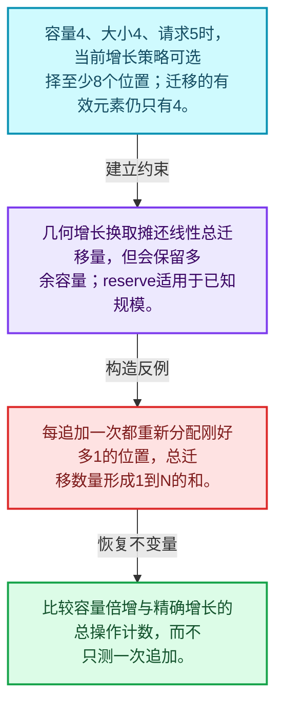
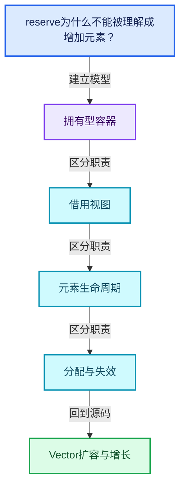
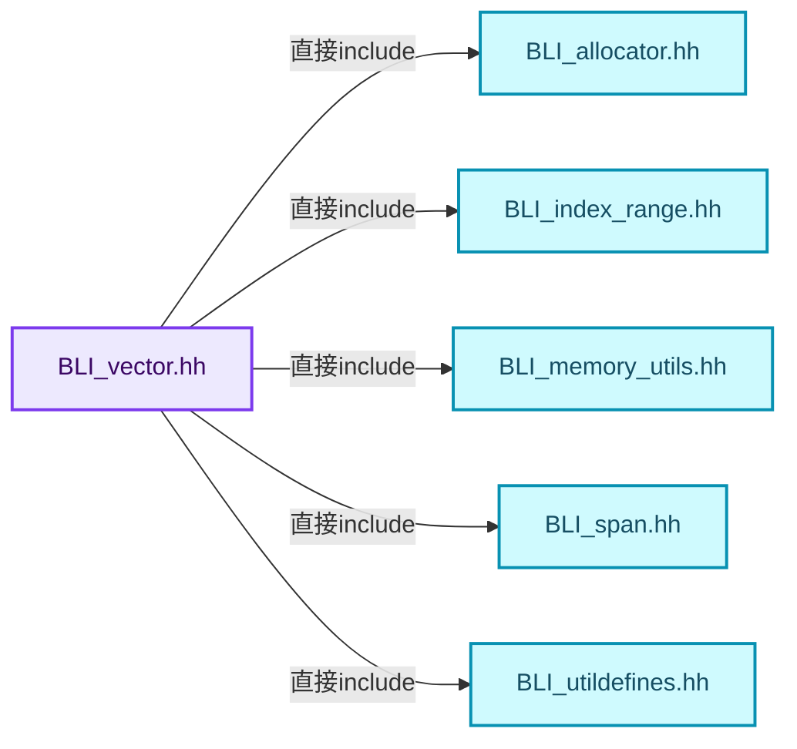
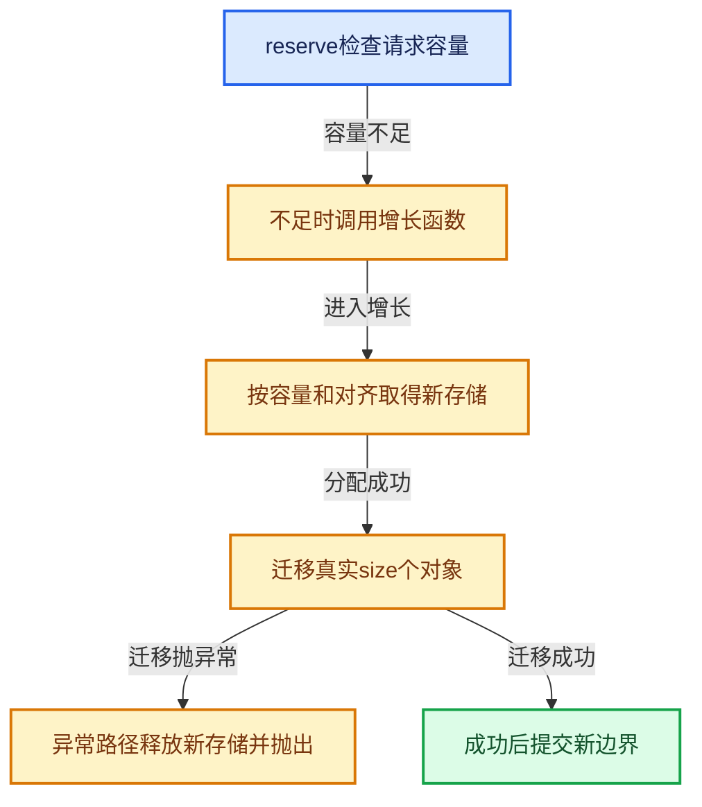
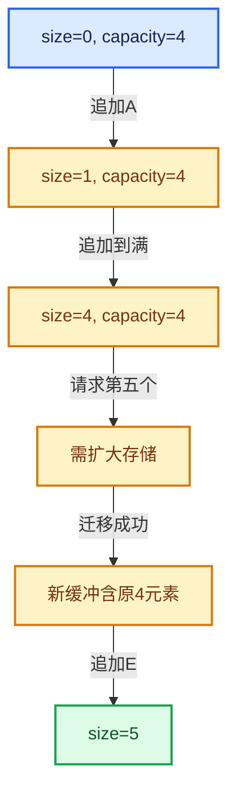

# 01-10 Vector扩容与增长

[方向导航](README.md) · [总目录](../README.md) · [覆盖索引](../%E6%BA%90%E7%A0%81%E7%89%88%E6%9C%AC%E4%B8%8E%E8%A6%86%E7%9B%96%E7%B4%A2%E5%BC%95.md)

> 阅读顺序：问题与数据模型 → 语法与类型 → 源码逐行 → 调用线索 → 历史与取舍 → 推演和练习。

- 基准 HEAD：`cbda6b96c26c0dee3c3b5cbb93960c4ac06a6b30`。
- 记录日期：2026-10-14。
- 教学示例状态：正文中的推演不是本机性能实测；已运行练习见验收报告。

## 一、从问题到设计

reserve为什么不能被理解成增加元素？

reserve改变容量保障，不应使未构造位置变成元素；扩容必须在新存储建立对象后安全提交新状态。

本篇把语法、数据语义和系统取舍连接起来。先证明对象存活，再讨论索引；先区分借用与拥有，再讨论复制移动。

### 本篇独立模型与设计推理

容量4、大小4、请求5时，当前增长策略可选择至少8个位置；迁移的有效元素仍只有4。

设计取舍：几何增长换取摊还线性总迁移量，但会保留多余容量；reserve适用于已知规模。

最小反例：每追加一次都重新分配刚好多1的位置，总迁移数量形成1到N的和。

推导与处理：比较容量倍增与精确增长的总操作计数，而不只测一次追加。



### 源码范围与相邻篇章

| 文件 | 本篇逐行范围 | 基准SHA-256 |
|---|---|---|
| [source/blender/blenlib/BLI_vector.hh](../../../../../source/blender/blenlib/BLI_vector.hh) | L352—L497 | `6867b6ba34200e7e0a14495d93a9bef1645c5ef599e1f29ccdddc7c21e500485` |
| [source/blender/blenlib/BLI_vector.hh](../../../../../source/blender/blenlib/BLI_vector.hh) | L1113—L1153 | `6867b6ba34200e7e0a14495d93a9bef1645c5ef599e1f29ccdddc7c21e500485` |

同一主讲文件可能分多篇覆盖；超出本篇范围的符号通过覆盖索引定位。空行与纯注释保留在源码摘录中，逐行表解释有效语句与语法边界；许可证头统一保留。

前篇：[Vector存储与内嵌缓冲](09-Vector%E5%AD%98%E5%82%A8%E4%B8%8E%E5%86%85%E5%B5%8C%E7%BC%93%E5%86%B2.md).

后篇：[Vector插入删除与重排](11-Vector%E6%8F%92%E5%85%A5%E5%88%A0%E9%99%A4%E4%B8%8E%E9%87%8D%E6%8E%92.md).

## 二、类型、数据与阅读地图



这是概念依赖图，边表示阅读关系，不声称是运行时调用顺序。

### 直接编译依赖



箭头只表示头文件包含关系；完整调用线索见后面的符号定位表。

## 三、关键词、语法与类型角色

### 模板 template

模板把类型或常量作为生成实现的参数。读声明时先列出类型参数、非类型参数和默认值，再看使用者实际实例化了什么。模板声明本身不意味着每种T都支持其全部成员。

具体检查：把T替换为int、string、只能移动的类型，分别检查每个被调用操作是否成立。

### 依赖名称 typename

typename既可引入类型模板参数，也可告诉编译器某个依赖名称是类型。它不创建运行时对象；解析期确认语法类别与实例化期检查具体类型是不同阶段。

具体检查：区分typename T::value_type和T::size()，前者标记类型，后者是表达式。

### 约束 requires

requires表达式或requires子句限制模板参与重载的条件。它提供编译期可用性检查，不是运行时if，不能指望输入到达程序后再被这一机制验证。

具体检查：构造满足和不满足约束的两个类型，观察候选被排除而不是在函数内返回错误。

### 只读限定 const

const约束当前访问路径可做的修改。const指针、指向const的指针、const视图对象、const元素是不同位置的限定；其他别名可能仍可修改原对象。

具体检查：分别写T* const、const T*与const T* const，并画出不可修改的层次。

### 异常边界 try与catch

try定义异常传播的局部边界。失败路径需要销毁已经成功构造的部分并释放相应存储；未构造的对象不能被析构。

具体检查：在第k次构造失败，列出已经存在的对象集合与待释放缓冲。

### 显式静态转换 static_cast

static_cast表达编译期允许的转换，不会自动验证运行时真实类型、指针寿命或索引边界。由void指针恢复T指针时，调用者仍须保证实际存储中确有合法T对象。

具体检查：标出转换前后的类型以及正确性依据来自哪里。

### 对齐 alignof

alignof得到类型要求的地址对齐。分配足够字节后仍需把地址对齐到相应边界，内嵌缓冲也一样。

具体检查：对齐a为2的幂时可推导向上取整，但仍要考虑溢出与边界。

### 对象表示 sizeof

sizeof给出对象表示大小，不是其引用的所有堆内存总量。sizeof视图很小并不说明底层数组很小。

具体检查：分别统计容器对象、容量字节和元素拥有的间接资源。

### 构造与new表达式

普通new可能分配并构造；placement new在给定地址构造，存储由其他机制提供。失败回滚应区分两类责任。

具体检查：追踪地址来自哪里、构造何时成功、由谁析构、由谁释放。

### 内部断言 assert

断言表达开发者预期成立的内部契约，发布构建可能关闭。它不能替代对不可信输入的完整错误处理，也不保证后续操作被运行时保护。

具体检查：对每条断言构造违反条件的输入，区分调用者错误与应向用户报告的错误。

### 容量增长的实际失败路径

当前Vector私有增长函数先检查已有容量，再选择请求容量与两倍旧容量的较大值。
分配新缓冲之后进入`uninitialized_relocate_n`，失败时释放新缓冲并继续抛出。
成功之后只有旧缓冲不是内嵌存储才调用allocator释放。
最后更新begin、end、capacity_end，让已构造长度继续保持原size。
这个顺序不能简化成“先释放旧数据，再创建新数据”，否则异常时失去源对象。
具体基本保证与源元素状态仍需结合memory_utils中的重定位实现及T的移动性质分析。

## 四、真实源码与逐行讲解

源码块保持原行内容，原始行号由小节标题及逐行表给出。表中的调用定位是静态阅读辅助；重载、模板实例化、宏展开和虚调用需结合完整声明，不能仅凭词法出现证明动态调用。

### BLI_vector.hh：L352—L398

<!-- source:source/blender/blenlib/BLI_vector.hh:352:398 -->

```cpp
  const T &operator[](int64_t index) const
  {
    BLI_assert(index >= 0);
    BLI_assert(index < this->size());
    return begin_[index];
  }

  T &operator[](int64_t index)
  {
    BLI_assert(index >= 0);
    BLI_assert(index < this->size());
    return begin_[index];
  }

  operator Span<T>() const
  {
    return Span<T>(begin_, this->size());
  }

  operator MutableSpan<T>()
  {
    return MutableSpan<T>(begin_, this->size());
  }

  template<typename U>
  operator Span<U>() const
    requires(is_span_convertible_pointer_v<T, U>)
  {
    return Span<U>(begin_, this->size());
  }

  template<typename U>
  operator MutableSpan<U>()
    requires(is_span_convertible_pointer_v<T, U>)
  {
    return MutableSpan<U>(begin_, this->size());
  }

  Span<T> as_span() const
  {
    return *this;
  }

  MutableSpan<T> as_mutable_span()
  {
    return *this;
  }
```

本段语义重点：

- `begin_`：起点字段；在Vector中与end_界定已构造区间，其他类应按自己的声明确认含义。

| 原始行 | 语义、约束与检查 |
|---|---|
| L352 | 运算符重载声明、定义或显式调用：`const T &operator[](int64_t index) const`。结合参数和返回类型判断是赋值、索引、比较还是转换；operator=声明中的等号不是在给名为operator的变量赋值。 |
| L353 | 连接上一行的声明或控制结构与其语句块；后续行在这个作用域中执行或声明。 |
| L354 | 断言约束 `BLI_assert(index >= 0);`。条件是后续访问的内部前置条件；发布构建可能不执行，不能把断言当作输入修复。 |
| L355 | 断言约束 `BLI_assert(index < this->size());`。条件是后续访问的内部前置条件；发布构建可能不执行，不能把断言当作输入修复。 |
| L356 | 返回表达式 `begin_[index]`。 |
| L357 | 结束当前语法单元。局部自动对象在离开其作用域时按规则销毁；这不等于所有被引用的外部数据也被释放。 |
| L359 | 运算符重载声明、定义或显式调用：`T &operator[](int64_t index)`。结合参数和返回类型判断是赋值、索引、比较还是转换；operator=声明中的等号不是在给名为operator的变量赋值。 |
| L360 | 连接上一行的声明或控制结构与其语句块；后续行在这个作用域中执行或声明。 |
| L361 | 断言约束 `BLI_assert(index >= 0);`。条件是后续访问的内部前置条件；发布构建可能不执行，不能把断言当作输入修复。 |
| L362 | 断言约束 `BLI_assert(index < this->size());`。条件是后续访问的内部前置条件；发布构建可能不执行，不能把断言当作输入修复。 |
| L363 | 返回表达式 `begin_[index]`。 |
| L364 | 结束当前语法单元。局部自动对象在离开其作用域时按规则销毁；这不等于所有被引用的外部数据也被释放。 |
| L366 | 运算符重载声明、定义或显式调用：`operator Span<T>() const`。结合参数和返回类型判断是赋值、索引、比较还是转换；operator=声明中的等号不是在给名为operator的变量赋值。 |
| L367 | 连接上一行的声明或控制结构与其语句块；后续行在这个作用域中执行或声明。 |
| L368 | 返回表达式 `Span<T>(begin_, this->size())`。 |
| L369 | 结束当前语法单元。局部自动对象在离开其作用域时按规则销毁；这不等于所有被引用的外部数据也被释放。 |
| L371 | 运算符重载声明、定义或显式调用：`operator MutableSpan<T>()`。结合参数和返回类型判断是赋值、索引、比较还是转换；operator=声明中的等号不是在给名为operator的变量赋值。 |
| L372 | 连接上一行的声明或控制结构与其语句块；后续行在这个作用域中执行或声明。 |
| L373 | 返回表达式 `MutableSpan<T>(begin_, this->size())`。 |
| L374 | 结束当前语法单元。局部自动对象在离开其作用域时按规则销毁；这不等于所有被引用的外部数据也被释放。 |
| L376 | 声明模板参数 `template<typename U>`。类型参数决定生成操作的类型，非类型参数可决定内嵌容量或编译期分支。 |
| L377 | 运算符重载声明、定义或显式调用：`operator Span<U>() const`。结合参数和返回类型判断是赋值、索引、比较还是转换；operator=声明中的等号不是在给名为operator的变量赋值。 |
| L378 | 约束模板可用性：`requires(is_span_convertible_pointer_v<T, U>)`。条件在编译期检查，不替代运行期的地址、长度和类型一致性验证。 |
| L379 | 连接上一行的声明或控制结构与其语句块；后续行在这个作用域中执行或声明。 |
| L380 | 返回表达式 `Span<U>(begin_, this->size())`。 |
| L381 | 结束当前语法单元。局部自动对象在离开其作用域时按规则销毁；这不等于所有被引用的外部数据也被释放。 |
| L383 | 声明模板参数 `template<typename U>`。类型参数决定生成操作的类型，非类型参数可决定内嵌容量或编译期分支。 |
| L384 | 运算符重载声明、定义或显式调用：`operator MutableSpan<U>()`。结合参数和返回类型判断是赋值、索引、比较还是转换；operator=声明中的等号不是在给名为operator的变量赋值。 |
| L385 | 约束模板可用性：`requires(is_span_convertible_pointer_v<T, U>)`。条件在编译期检查，不替代运行期的地址、长度和类型一致性验证。 |
| L386 | 连接上一行的声明或控制结构与其语句块；后续行在这个作用域中执行或声明。 |
| L387 | 返回表达式 `MutableSpan<U>(begin_, this->size())`。 |
| L388 | 结束当前语法单元。局部自动对象在离开其作用域时按规则销毁；这不等于所有被引用的外部数据也被释放。 |
| L390 | 出现调用或函数声明 `as_span`，对应表达式为 `Span<T> as_span() const`。参数求值、返回类型与重载需结合前后完整语句；静态文本引用不能证明动态目标。 |
| L391 | 连接上一行的声明或控制结构与其语句块；后续行在这个作用域中执行或声明。 |
| L392 | 返回表达式 `*this`。返回当前对象；返回类型决定它是引用还是值，不能仅凭表达式假定复制。 |
| L393 | 结束当前语法单元。局部自动对象在离开其作用域时按规则销毁；这不等于所有被引用的外部数据也被释放。 |
| L395 | 出现调用或函数声明 `as_mutable_span`，对应表达式为 `MutableSpan<T> as_mutable_span()`。参数求值、返回类型与重载需结合前后完整语句；静态文本引用不能证明动态目标。 |
| L396 | 连接上一行的声明或控制结构与其语句块；后续行在这个作用域中执行或声明。 |
| L397 | 返回表达式 `*this`。返回当前对象；返回类型决定它是引用还是值，不能仅凭表达式假定复制。 |
| L398 | 结束当前语法单元。局部自动对象在离开其作用域时按规则销毁；这不等于所有被引用的外部数据也被释放。 |

### BLI_vector.hh：L399—L452

<!-- source:source/blender/blenlib/BLI_vector.hh:399:452 -->

```cpp

  /**
   * Make sure that enough memory is allocated to hold min_capacity elements.
   * This won't necessarily make an allocation when min_capacity is small.
   * The actual size of the vector does not change.
   */
  void reserve(const int64_t min_capacity)
  {
    if (min_capacity > this->capacity()) {
      this->realloc_to_at_least(min_capacity);
    }
  }

  /**
   * Change the size of the vector so that it contains new_size elements.
   * If new_size is smaller than the old size, the elements at the end of the vector are
   * destructed. If new_size is larger than the old size, the new elements at the end are default
   * constructed. If T is trivially constructible, the memory is not touched by this function.
   */
  void resize(const int64_t new_size)
  {
    BLI_assert(new_size >= 0);
    const int64_t old_size = this->size();
    if (new_size > old_size) {
      this->reserve(new_size);
      default_construct_n(begin_ + old_size, new_size - old_size);
    }
    else {
      destruct_n(begin_ + new_size, old_size - new_size);
    }
    end_ = begin_ + new_size;
    UPDATE_VECTOR_SIZE(this);
  }

  /**
   * Change the size of the vector so that it contains new_size elements.
   * If new_size is smaller than the old size, the elements at the end of the vector are
   * destructed. If new_size is larger than the old size, the new elements will be copy constructed
   * from the given value.
   */
  void resize(const int64_t new_size, const T &value)
  {
    BLI_assert(new_size >= 0);
    const int64_t old_size = this->size();
    if (new_size > old_size) {
      this->reserve(new_size);
      uninitialized_fill_n(begin_ + old_size, new_size - old_size, value);
    }
    else {
      destruct_n(begin_ + new_size, old_size - new_size);
    }
    end_ = begin_ + new_size;
    UPDATE_VECTOR_SIZE(this);
  }
```

本段语义重点：

- `destruct_n`：对已构造的元素区间执行析构；计数必须对应真实存活对象，释放原始内存是另一操作。
- `default_construct_n`：为目标区间建立默认构造对象；基本类型默认初始化未必给出可读取的零。
- `realloc_to_at_least`：进入Vector容量增长路径；检查迁移失败回滚和旧视图失效。
- `begin_`：起点字段；在Vector中与end_界定已构造区间，其他类应按自己的声明确认含义。
- `end_`：尾后位置字段；在Vector中界定已构造区间，尾后位置不是最后一个元素。

| 原始行 | 语义、约束与检查 |
|---|---|
| L405 | 出现调用或函数声明 `reserve`，对应表达式为 `void reserve(const int64_t min_capacity)`。参数求值、返回类型与重载需结合前后完整语句；静态文本引用不能证明动态目标。 |
| L406 | 连接上一行的声明或控制结构与其语句块；后续行在这个作用域中执行或声明。 |
| L407 | 判断 `min_capacity > this->capacity()`，成立时进入本分支，否则继续后续路径。该边界影响可访问元素或可用容量，两者要按各变量的定义区分。 |
| L408 | 本行使用 `realloc_to_at_least`：进入Vector容量增长路径；检查迁移失败回滚和旧视图失效。 |
| L409 | 结束当前语法单元。局部自动对象在离开其作用域时按规则销毁；这不等于所有被引用的外部数据也被释放。 |
| L410 | 结束当前语法单元。局部自动对象在离开其作用域时按规则销毁；这不等于所有被引用的外部数据也被释放。 |
| L418 | 出现调用或函数声明 `resize`，对应表达式为 `void resize(const int64_t new_size)`。参数求值、返回类型与重载需结合前后完整语句；静态文本引用不能证明动态目标。 |
| L419 | 连接上一行的声明或控制结构与其语句块；后续行在这个作用域中执行或声明。 |
| L420 | 断言约束 `BLI_assert(new_size >= 0);`。条件是后续访问的内部前置条件；发布构建可能不执行，不能把断言当作输入修复。 |
| L421 | 把右侧 `this->size()` 用于初始化或更新左侧 `const int64_t old_size`。声明初始化与已有对象赋值应按上下文区分；有资源的类型会调用相应特殊成员。 |
| L422 | 判断 `new_size > old_size`，成立时进入本分支，否则继续后续路径。该边界影响可访问元素或可用容量，两者要按各变量的定义区分。 |
| L423 | 出现调用或函数声明 `reserve`，对应表达式为 `this->reserve(new_size);`。参数求值、返回类型与重载需结合前后完整语句；静态文本引用不能证明动态目标。 |
| L424 | 本行使用 `default_construct_n`：为目标区间建立默认构造对象；基本类型默认初始化未必给出可读取的零。 |
| L425 | 结束当前语法单元。局部自动对象在离开其作用域时按规则销毁；这不等于所有被引用的外部数据也被释放。 |
| L426 | 处理前一条件不成立的互补路径。比较两条路径最后是否恢复同一不变量，以及是否产生不同的资源责任。 |
| L427 | 本行使用 `destruct_n`：对已构造的元素区间执行析构；计数必须对应真实存活对象，释放原始内存是另一操作。 |
| L428 | 结束当前语法单元。局部自动对象在离开其作用域时按规则销毁；这不等于所有被引用的外部数据也被释放。 |
| L429 | 建立或更新 `begin_`：起点字段；在Vector中与end_界定已构造区间，其他类应按自己的声明确认含义。本行的具体值关系为 `end_ = begin_ + new_size`；对照更新前后相应范围或状态是否一致。 |
| L430 | 出现调用或函数声明 `UPDATE_VECTOR_SIZE`，对应表达式为 `UPDATE_VECTOR_SIZE(this);`。参数求值、返回类型与重载需结合前后完整语句；静态文本引用不能证明动态目标。 |
| L431 | 结束当前语法单元。局部自动对象在离开其作用域时按规则销毁；这不等于所有被引用的外部数据也被释放。 |
| L439 | 出现调用或函数声明 `resize`，对应表达式为 `void resize(const int64_t new_size, const T &value)`。参数求值、返回类型与重载需结合前后完整语句；静态文本引用不能证明动态目标。 |
| L440 | 连接上一行的声明或控制结构与其语句块；后续行在这个作用域中执行或声明。 |
| L441 | 断言约束 `BLI_assert(new_size >= 0);`。条件是后续访问的内部前置条件；发布构建可能不执行，不能把断言当作输入修复。 |
| L442 | 把右侧 `this->size()` 用于初始化或更新左侧 `const int64_t old_size`。声明初始化与已有对象赋值应按上下文区分；有资源的类型会调用相应特殊成员。 |
| L443 | 判断 `new_size > old_size`，成立时进入本分支，否则继续后续路径。该边界影响可访问元素或可用容量，两者要按各变量的定义区分。 |
| L444 | 出现调用或函数声明 `reserve`，对应表达式为 `this->reserve(new_size);`。参数求值、返回类型与重载需结合前后完整语句；静态文本引用不能证明动态目标。 |
| L445 | 本行涉及 `begin_`：起点字段；在Vector中与end_界定已构造区间，其他类应按自己的声明确认含义。按此语义解读 `uninitialized_fill_n(begin_ + old_size, new_size - old_size, value)`，不要把地址、数量或状态混用。 |
| L446 | 结束当前语法单元。局部自动对象在离开其作用域时按规则销毁；这不等于所有被引用的外部数据也被释放。 |
| L447 | 处理前一条件不成立的互补路径。比较两条路径最后是否恢复同一不变量，以及是否产生不同的资源责任。 |
| L448 | 本行使用 `destruct_n`：对已构造的元素区间执行析构；计数必须对应真实存活对象，释放原始内存是另一操作。 |
| L449 | 结束当前语法单元。局部自动对象在离开其作用域时按规则销毁；这不等于所有被引用的外部数据也被释放。 |
| L450 | 建立或更新 `begin_`：起点字段；在Vector中与end_界定已构造区间，其他类应按自己的声明确认含义。本行的具体值关系为 `end_ = begin_ + new_size`；对照更新前后相应范围或状态是否一致。 |
| L451 | 出现调用或函数声明 `UPDATE_VECTOR_SIZE`，对应表达式为 `UPDATE_VECTOR_SIZE(this);`。参数求值、返回类型与重载需结合前后完整语句；静态文本引用不能证明动态目标。 |
| L452 | 结束当前语法单元。局部自动对象在离开其作用域时按规则销毁；这不等于所有被引用的外部数据也被释放。 |

### BLI_vector.hh：L453—L497

<!-- source:source/blender/blenlib/BLI_vector.hh:453:497 -->

```cpp

  /**
   * Reset the size of the vector so that it contains new_size elements.
   * All existing elements are destructed, and not copied if the data must be reallocated.
   */
  void reinitialize(const int64_t new_size)
  {
    this->clear();
    this->resize(new_size);
  }

  /**
   * Afterwards the vector has 0 elements, but will still have
   * memory to be refilled again.
   */
  void clear()
  {
    destruct_n(begin_, this->size());
    end_ = begin_;
    UPDATE_VECTOR_SIZE(this);
  }

  /**
   * Afterwards the vector has 0 elements and any allocated memory
   * will be freed.
   */
  void clear_and_shrink()
  {
    destruct_n(begin_, this->size());
    if (!this->is_inline()) {
      allocator_.deallocate(begin_);
    }

    begin_ = inline_buffer_;
    end_ = begin_;
    capacity_end_ = begin_ + InlineBufferCapacity;
    UPDATE_VECTOR_SIZE(this);
  }

  /**
   * Insert a new element at the end of the vector.
   * This might cause a reallocation with the capacity is exceeded.
   *
   * This is similar to std::vector::push_back.
   */
```

本段语义重点：

- `destruct_n`：对已构造的元素区间执行析构；计数必须对应真实存活对象，释放原始内存是另一操作。
- `begin_`：起点字段；在Vector中与end_界定已构造区间，其他类应按自己的声明确认含义。
- `end_`：尾后位置字段；在Vector中界定已构造区间，尾后位置不是最后一个元素。
- `capacity_end_`：已分配存储的尾后位置，和end_之间通常尚未构造对象。
- `allocator_`：提供存储的分配策略对象，释放必须与分配策略匹配。

| 原始行 | 语义、约束与检查 |
|---|---|
| L458 | 出现调用或函数声明 `reinitialize`，对应表达式为 `void reinitialize(const int64_t new_size)`。参数求值、返回类型与重载需结合前后完整语句；静态文本引用不能证明动态目标。 |
| L459 | 连接上一行的声明或控制结构与其语句块；后续行在这个作用域中执行或声明。 |
| L460 | 出现调用或函数声明 `clear`，对应表达式为 `this->clear();`。参数求值、返回类型与重载需结合前后完整语句；静态文本引用不能证明动态目标。 |
| L461 | 出现调用或函数声明 `resize`，对应表达式为 `this->resize(new_size);`。参数求值、返回类型与重载需结合前后完整语句；静态文本引用不能证明动态目标。 |
| L462 | 结束当前语法单元。局部自动对象在离开其作用域时按规则销毁；这不等于所有被引用的外部数据也被释放。 |
| L468 | 出现调用或函数声明 `clear`，对应表达式为 `void clear()`。参数求值、返回类型与重载需结合前后完整语句；静态文本引用不能证明动态目标。 |
| L469 | 连接上一行的声明或控制结构与其语句块；后续行在这个作用域中执行或声明。 |
| L470 | 本行使用 `destruct_n`：对已构造的元素区间执行析构；计数必须对应真实存活对象，释放原始内存是另一操作。 |
| L471 | 建立或更新 `begin_`：起点字段；在Vector中与end_界定已构造区间，其他类应按自己的声明确认含义。本行的具体值关系为 `end_ = begin_`；对照更新前后相应范围或状态是否一致。 |
| L472 | 出现调用或函数声明 `UPDATE_VECTOR_SIZE`，对应表达式为 `UPDATE_VECTOR_SIZE(this);`。参数求值、返回类型与重载需结合前后完整语句；静态文本引用不能证明动态目标。 |
| L473 | 结束当前语法单元。局部自动对象在离开其作用域时按规则销毁；这不等于所有被引用的外部数据也被释放。 |
| L479 | 出现调用或函数声明 `clear_and_shrink`，对应表达式为 `void clear_and_shrink()`。参数求值、返回类型与重载需结合前后完整语句；静态文本引用不能证明动态目标。 |
| L480 | 连接上一行的声明或控制结构与其语句块；后续行在这个作用域中执行或声明。 |
| L481 | 本行使用 `destruct_n`：对已构造的元素区间执行析构；计数必须对应真实存活对象，释放原始内存是另一操作。 |
| L482 | 判断 `!this->is_inline()`，成立时进入本分支，否则继续后续路径。 |
| L483 | 本行涉及 `begin_`：起点字段；在Vector中与end_界定已构造区间，其他类应按自己的声明确认含义。按此语义解读 `allocator_.deallocate(begin_)`，不要把地址、数量或状态混用。 |
| L484 | 结束当前语法单元。局部自动对象在离开其作用域时按规则销毁；这不等于所有被引用的外部数据也被释放。 |
| L486 | 建立或更新 `begin_`：起点字段；在Vector中与end_界定已构造区间，其他类应按自己的声明确认含义。本行的具体值关系为 `begin_ = inline_buffer_`；对照更新前后相应范围或状态是否一致。 |
| L487 | 建立或更新 `begin_`：起点字段；在Vector中与end_界定已构造区间，其他类应按自己的声明确认含义。本行的具体值关系为 `end_ = begin_`；对照更新前后相应范围或状态是否一致。 |
| L488 | 建立或更新 `begin_`：起点字段；在Vector中与end_界定已构造区间，其他类应按自己的声明确认含义。本行的具体值关系为 `capacity_end_ = begin_ + InlineBufferCapacity`；对照更新前后相应范围或状态是否一致。 |
| L489 | 出现调用或函数声明 `UPDATE_VECTOR_SIZE`，对应表达式为 `UPDATE_VECTOR_SIZE(this);`。参数求值、返回类型与重载需结合前后完整语句；静态文本引用不能证明动态目标。 |
| L490 | 结束当前语法单元。局部自动对象在离开其作用域时按规则销毁；这不等于所有被引用的外部数据也被释放。 |

### BLI_vector.hh：L1113—L1153

<!-- source:source/blender/blenlib/BLI_vector.hh:1113:1153 -->

```cpp
 private:
  void ensure_space_for_one()
  {
    if (end_ >= capacity_end_) [[unlikely]] {
      this->realloc_to_at_least(this->size() + 1);
    }
  }

  BLI_NOINLINE void realloc_to_at_least(const int64_t min_capacity)
  {
    if (this->capacity() >= min_capacity) {
      return;
    }

    /* At least double the size of the previous allocation. Otherwise consecutive calls to grow can
     * cause a reallocation every time even though min_capacity only increments. */
    const int64_t min_new_capacity = this->capacity() * 2;

    const int64_t new_capacity = std::max(min_capacity, min_new_capacity);
    const int64_t size = this->size();

    T *new_array = static_cast<T *>(
        allocator_.allocate(size_t(new_capacity) * sizeof(T), alignof(T), AT));
    try {
      uninitialized_relocate_n(begin_, size, new_array);
    }
    catch (...) {
      allocator_.deallocate(new_array);
      throw;
    }

    if (!this->is_inline()) {
      allocator_.deallocate(begin_);
    }

    begin_ = new_array;
    end_ = begin_ + size;
    capacity_end_ = begin_ + new_capacity;
  }
};

```

本段语义重点：

- `uninitialized_relocate_n`：在目标原始存储建立n个对象，并结束源对象寿命；与仅移动构造不同，后续不能再次把源当作存活元素销毁。
- `realloc_to_at_least`：进入Vector容量增长路径；检查迁移失败回滚和旧视图失效。
- `ensure_space_for_one`：确保单次追加有可用存储，随后仍须真正构造元素。
- `std::max`：取较大值，在容量计算中常用于同时满足请求量和增长策略。
- `begin_`：起点字段；在Vector中与end_界定已构造区间，其他类应按自己的声明确认含义。

| 原始行 | 语义、约束与检查 |
|---|---|
| L1113 | 切换成员访问权限为 private；它是编译期接口边界，不是线程同步或内存保护。 |
| L1114 | 出现调用或函数声明 `ensure_space_for_one`，对应表达式为 `void ensure_space_for_one()`。参数求值、返回类型与重载需结合前后完整语句；静态文本引用不能证明动态目标。 |
| L1115 | 连接上一行的声明或控制结构与其语句块；后续行在这个作用域中执行或声明。 |
| L1116 | 判断 `end_ >= capacity_end_`，成立时进入本分支，否则继续后续路径。该边界影响可访问元素或可用容量，两者要按各变量的定义区分。 |
| L1117 | 本行使用 `realloc_to_at_least`：进入Vector容量增长路径；检查迁移失败回滚和旧视图失效。 |
| L1118 | 结束当前语法单元。局部自动对象在离开其作用域时按规则销毁；这不等于所有被引用的外部数据也被释放。 |
| L1119 | 结束当前语法单元。局部自动对象在离开其作用域时按规则销毁；这不等于所有被引用的外部数据也被释放。 |
| L1121 | 出现调用或函数声明 `realloc_to_at_least`，对应表达式为 `BLI_NOINLINE void realloc_to_at_least(const int64_t min_capacity)`。参数求值、返回类型与重载需结合前后完整语句；静态文本引用不能证明动态目标。 |
| L1122 | 连接上一行的声明或控制结构与其语句块；后续行在这个作用域中执行或声明。 |
| L1123 | 判断 `this->capacity() >= min_capacity`，成立时进入本分支，否则继续后续路径。该边界影响可访问元素或可用容量，两者要按各变量的定义区分。 |
| L1124 | 结束当前函数，本路径不再执行后续语句；局部对象按作用域规则清理。 |
| L1125 | 结束当前语法单元。局部自动对象在离开其作用域时按规则销毁；这不等于所有被引用的外部数据也被释放。 |
| L1129 | 把右侧 `this->capacity() * 2` 用于初始化或更新左侧 `const int64_t min_new_capacity`。声明初始化与已有对象赋值应按上下文区分；有资源的类型会调用相应特殊成员。 |
| L1131 | 本行使用 `std::max`：取较大值，在容量计算中常用于同时满足请求量和增长策略。 |
| L1132 | 把右侧 `this->size()` 用于初始化或更新左侧 `const int64_t size`。声明初始化与已有对象赋值应按上下文区分；有资源的类型会调用相应特殊成员。 |
| L1134 | 把右侧 `static_cast<T *>(` 用于初始化或更新左侧 `T *new_array`。声明初始化与已有对象赋值应按上下文区分；有资源的类型会调用相应特殊成员。 |
| L1135 | 本行涉及 `allocator_`：提供存储的分配策略对象，释放必须与分配策略匹配。按此语义解读 `allocator_.allocate(size_t(new_capacity) * sizeof(T), alignof(T), AT))`，不要把地址、数量或状态混用。 |
| L1136 | 开始可能抛异常的操作区间；下面catch负责局部回滚，需精确区分已经构造和尚未构造对象。 |
| L1137 | 本行使用 `uninitialized_relocate_n`：在目标原始存储建立n个对象，并结束源对象寿命；与仅移动构造不同，后续不能再次把源当作存活元素销毁。 |
| L1138 | 结束当前语法单元。局部自动对象在离开其作用域时按规则销毁；这不等于所有被引用的外部数据也被释放。 |
| L1139 | 进入异常清理路径；随后应释放本路径新取得的资源，同时遵守源对象已经发生的状态变化。 |
| L1140 | 本行涉及 `allocator_`：提供存储的分配策略对象，释放必须与分配策略匹配。按此语义解读 `allocator_.deallocate(new_array)`，不要把地址、数量或状态混用。 |
| L1141 | 继续传播异常或抛出新异常；在执行前必须完成本层负责的资源清理。 |
| L1142 | 结束当前语法单元。局部自动对象在离开其作用域时按规则销毁；这不等于所有被引用的外部数据也被释放。 |
| L1144 | 判断 `!this->is_inline()`，成立时进入本分支，否则继续后续路径。 |
| L1145 | 本行涉及 `begin_`：起点字段；在Vector中与end_界定已构造区间，其他类应按自己的声明确认含义。按此语义解读 `allocator_.deallocate(begin_)`，不要把地址、数量或状态混用。 |
| L1146 | 结束当前语法单元。局部自动对象在离开其作用域时按规则销毁；这不等于所有被引用的外部数据也被释放。 |
| L1148 | 建立或更新 `begin_`：起点字段；在Vector中与end_界定已构造区间，其他类应按自己的声明确认含义。本行的具体值关系为 `begin_ = new_array`；对照更新前后相应范围或状态是否一致。 |
| L1149 | 建立或更新 `begin_`：起点字段；在Vector中与end_界定已构造区间，其他类应按自己的声明确认含义。本行的具体值关系为 `end_ = begin_ + size`；对照更新前后相应范围或状态是否一致。 |
| L1150 | 建立或更新 `begin_`：起点字段；在Vector中与end_界定已构造区间，其他类应按自己的声明确认含义。本行的具体值关系为 `capacity_end_ = begin_ + new_capacity`；对照更新前后相应范围或状态是否一致。 |
| L1151 | 结束当前语法单元。局部自动对象在离开其作用域时按规则销毁；这不等于所有被引用的外部数据也被释放。 |
| L1152 | 结束当前语法单元。局部自动对象在离开其作用域时按规则销毁；这不等于所有被引用的外部数据也被释放。 |

## 五、接口定位、调用线索与生命周期

### Vector增长的成功路径与异常出口



边界更新在对象迁移成功之后。清理新缓冲不能替代对迁移工具内部部分对象的正确回滚分析；必须沿memory_utils继续阅读。

| 阶段 | 源码证据位置 | 实际语句定位 |
|---|---|---|
| reserve检查请求容量 | BLI_vector.hh [L405](../../../../../source/blender/blenlib/BLI_vector.hh#L405) | `void reserve(` |
| 不足时调用增长函数 | BLI_vector.hh [L408](../../../../../source/blender/blenlib/BLI_vector.hh#L408) | `this->realloc_to_at_least(min_capacity)` |
| 按容量和对齐取得新存储 | BLI_vector.hh [L1135](../../../../../source/blender/blenlib/BLI_vector.hh#L1135) | `allocator_.allocate(size_t(new_capacity)` |
| 迁移真实size个对象 | BLI_vector.hh [L1137](../../../../../source/blender/blenlib/BLI_vector.hh#L1137) | `uninitialized_relocate_n(begin_, size, new_array)` |
| 异常路径释放新存储并抛出 | BLI_vector.hh [L1140](../../../../../source/blender/blenlib/BLI_vector.hh#L1140) | `allocator_.deallocate(new_array)` |
| 成功后提交新边界 | BLI_vector.hh [L1148](../../../../../source/blender/blenlib/BLI_vector.hh#L1148) | `begin_ = new_array` |

图中的条件边必须与对应if、异常路径和提前返回合读；不把未展示分支当作不存在。

### 本篇声明与实现入口

| 源码位置 | 实际声明片段 |
|---|---|
| [BLI_vector.hh:L390](../../../../../source/blender/blenlib/BLI_vector.hh#L390) | `Span<T> as_span() const` |
| [BLI_vector.hh:L395](../../../../../source/blender/blenlib/BLI_vector.hh#L395) | `MutableSpan<T> as_mutable_span()` |
| [BLI_vector.hh:L405](../../../../../source/blender/blenlib/BLI_vector.hh#L405) | `void reserve(const int64_t min_capacity)` |
| [BLI_vector.hh:L418](../../../../../source/blender/blenlib/BLI_vector.hh#L418) | `void resize(const int64_t new_size)` |
| [BLI_vector.hh:L430](../../../../../source/blender/blenlib/BLI_vector.hh#L430) | `UPDATE_VECTOR_SIZE(this);` |
| [BLI_vector.hh:L439](../../../../../source/blender/blenlib/BLI_vector.hh#L439) | `void resize(const int64_t new_size, const T &value)` |
| [BLI_vector.hh:L451](../../../../../source/blender/blenlib/BLI_vector.hh#L451) | `UPDATE_VECTOR_SIZE(this);` |
| [BLI_vector.hh:L458](../../../../../source/blender/blenlib/BLI_vector.hh#L458) | `void reinitialize(const int64_t new_size)` |
| [BLI_vector.hh:L468](../../../../../source/blender/blenlib/BLI_vector.hh#L468) | `void clear()` |
| [BLI_vector.hh:L472](../../../../../source/blender/blenlib/BLI_vector.hh#L472) | `UPDATE_VECTOR_SIZE(this);` |
| [BLI_vector.hh:L479](../../../../../source/blender/blenlib/BLI_vector.hh#L479) | `void clear_and_shrink()` |
| [BLI_vector.hh:L489](../../../../../source/blender/blenlib/BLI_vector.hh#L489) | `UPDATE_VECTOR_SIZE(this);` |
| [BLI_vector.hh:L1114](../../../../../source/blender/blenlib/BLI_vector.hh#L1114) | `void ensure_space_for_one()` |
| [BLI_vector.hh:L1121](../../../../../source/blender/blenlib/BLI_vector.hh#L1121) | `BLI_NOINLINE void realloc_to_at_least(const int64_t min_capacity)` |

### 同名符号出现位置

以下表提供跨文件阅读入口，包含声明、调用或测试使用；没有经过完整C++名称解析，不把它命名为已证明的运行时调用图。

| 符号 | 位置 | 文本证据 |
|---|---|---|
| `as_span` | [BKE_curves.hh:L1092](../../../../../source/blender/blenkernel/BKE_curves.hh#L1092) | `return this->runtime->evaluated_length_cache.data().as_span().slice(range);` |
| `as_span` | [mesh.cc:L1009](../../../../../source/blender/blenkernel/intern/mesh.cc#L1009) | `attribute_data.copy_from(new_values.as_span());` |
| `as_span` | [mesh.cc:L1023](../../../../../source/blender/blenkernel/intern/mesh.cc#L1023) | `attribute_data.copy_from(new_values.as_span());` |
| `as_mutable_span` | [geometry_fields.cc:L810](../../../../../source/blender/blenkernel/intern/geometry_fields.cc#L810) | `value_evaluator.add_with_destination(src_field_, values.as_mutable_span());` |
| `as_mutable_span` | [mesh.cc:L1731](../../../../../source/blender/blenkernel/intern/mesh.cc#L1731) | `result.as_mutable_span().take_front(positions.size()).copy_from(positions);` |
| `as_mutable_span` | [mesh.cc:L1732](../../../../../source/blender/blenkernel/intern/mesh.cc#L1732) | `result.as_mutable_span().drop_front(positions.size()).fill(float3(0));` |
| `reserve` | [mesh.cc:L922](../../../../../source/blender/blenkernel/intern/mesh.cc#L922) | `new_vert_order.reserve(mesh.verts_num);` |
| `reserve` | [mesh.cc:L925](../../../../../source/blender/blenkernel/intern/mesh.cc#L925) | `new_face_order.reserve(mesh.faces_num);` |
| `reserve` | [mesh.cc:L930](../../../../../source/blender/blenkernel/intern/mesh.cc#L930) | `group_unique_offsets.reserve(local_groups.size() + 1);` |
| `resize` | [BKE_attribute_storage.hh:L195](../../../../../source/blender/blenkernel/BKE_attribute_storage.hh#L195) | `void resize(AttrDomain domain, int64_t new_size);` |
| `resize` | [BKE_curves.hh:L445](../../../../../source/blender/blenkernel/BKE_curves.hh#L445) | `void resize(int points_num, int curves_num);` |
| `resize` | [mesh.cc:L749](../../../../../source/blender/blenkernel/intern/mesh.cc#L749) | `groups.resize(groups.size() + 2);` |
| `reinitialize` | [mesh_mapping.cc:L286](../../../../../source/blender/blenkernel/intern/mesh_mapping.cc#L286) | `r_indices.reinitialize(offsets.total_size());` |
| `reinitialize` | [mesh_mapping.cc:L309](../../../../../source/blender/blenkernel/intern/mesh_mapping.cc#L309) | `r_indices.reinitialize(r_offsets.last());` |
| `reinitialize` | [mesh_mapping.cc:L345](../../../../../source/blender/blenkernel/intern/mesh_mapping.cc#L345) | `r_indices.reinitialize(r_offsets.last());` |
| `clear` | [BKE_geometry_set.hh:L112](../../../../../source/blender/blenkernel/BKE_geometry_set.hh#L112) | `virtual void clear() = 0;` |
| `clear` | [BKE_geometry_set.hh:L241](../../../../../source/blender/blenkernel/BKE_geometry_set.hh#L241) | `void clear();` |
| `clear` | [BKE_geometry_set.hh:L506](../../../../../source/blender/blenkernel/BKE_geometry_set.hh#L506) | `void clear() override;` |
| `clear_and_shrink` | [mesh_runtime.cc:L341](../../../../../source/blender/blenkernel/intern/mesh_runtime.cc#L341) | `mesh->runtime->subsurf_face_dot_tags.clear_and_shrink();` |
| `clear_and_shrink` | [mesh_runtime.cc:L342](../../../../../source/blender/blenkernel/intern/mesh_runtime.cc#L342) | `mesh->runtime->subsurf_optimal_display_edges.clear_and_shrink();` |
| `clear_and_shrink` | [mesh_runtime.cc:L374](../../../../../source/blender/blenkernel/intern/mesh_runtime.cc#L374) | `this->runtime->subsurf_face_dot_tags.clear_and_shrink();` |
| `ensure_space_for_one` | [BLI_bit_vector.hh:L256](../../../../../source/blender/blenlib/BLI_bit_vector.hh#L256) | `this->ensure_space_for_one();` |
| `ensure_space_for_one` | [BLI_bit_vector.hh:L340](../../../../../source/blender/blenlib/BLI_bit_vector.hh#L340) | `void ensure_space_for_one()` |
| `realloc_to_at_least` | [BLI_bit_vector.hh:L314](../../../../../source/blender/blenlib/BLI_bit_vector.hh#L314) | `this->realloc_to_at_least(new_capacity_in_bits);` |
| `realloc_to_at_least` | [BLI_bit_vector.hh:L343](../../../../../source/blender/blenlib/BLI_bit_vector.hh#L343) | `this->realloc_to_at_least(size_in_bits_ + 1);` |
| `realloc_to_at_least` | [BLI_bit_vector.hh:L347](../../../../../source/blender/blenlib/BLI_bit_vector.hh#L347) | `BLI_NOINLINE void realloc_to_at_least(const int64_t min_capacity_in_bits,` |

### 生命周期推理图


这是审查生命周期的通用模型。具体类是否拥有数据由本篇成员、构造、析构和调用者一起证明；任何箭头都不自动代表shared_ptr。

## 六、把代码放进具体数据中推演

本方向的共同数值模型如下。本篇的专门检查是：逐次追加并记录capacity，分别比较预留容量和每次刚好扩容的总移动次数。

| 步骤 | 数据或状态 | 为什么需要这一步 |
|---|---|---|
| 初始 | size=0, capacity=4 | 只有存储，没有可读取的T元素 |
| 追加A | size=1, capacity=4 | 在第0个位置构造A |
| 追加到满 | size=4, capacity=4 | 四个位置均已构造 |
| 请求第五个 | 需扩大存储 | 旧地址仍需被正确管理 |
| 迁移成功 | 新缓冲含原4元素 | 提交新指针并释放旧存储 |
| 追加E | size=5 | 只在成功构造后扩大有效区间 |



图是教学推演模型；精确分支与状态更新以本篇摘录及调用契约为准。

### 本篇独立练习与参考思路

逐次追加并记录capacity，分别比较预留容量和每次刚好扩容的总移动次数。

参考思路：reserve改变容量保障，不应使未构造位置变成元素；扩容必须在新存储建立对象后安全提交新状态。

将输入、预期结果和资源责任分成三张清单。先用最直接的实现给出可核对的答案，再替换成对应源码使用的表示；比较结果不变的条件，而不是只比较接口名字。

验收依据：构造成功次数减析构次数应等于当前存活对象数；异常之后资源计数应回到合法状态。

## 七、复杂度、设计取舍与其他基础库

对比std::vector、std::array、std::span与LLVM SmallVector、ArrayRef时，分别比较拥有关系、内嵌存储、大小是否属于类型和失效条件。不要根据同名方法推断完全相同契约。

本篇的具体取舍：reserve改变容量保障，不应使未构造位置变成元素；扩容必须在新存储建立对象后安全提交新状态。

| 观察维度 | 从源码取得证据的方法 | 本篇要避免的误判 |
|---|---|---|
| 时间 | 对循环次数、分派次数和重建频率分别计数 | 看到单次常数操作就断定整个操作序列是常数成本 |
| 内存 | 区分对象本体、容量存储、间接资源和共享控制块 | 用sizeof代替总内存 |
| 安全 | 沿构造、失败回滚、销毁与失效逐路径检查 | 把断言或非空指针当作完整安全证明 |
| 并发 | 逐字段确认锁、发布顺序和借用寿命 | 把引用计数线程安全等同数据读写线程安全 |

相关一手资料：

- [C++公开工作草案](https://eel.is/c++draft/)：持续更新的工作草案；语言与标准库语义以相应章节为准。
- [LLVM Programmer’s Manual](https://llvm.org/docs/ProgrammersManual.html)：在线版，2026-10-14查阅；仅比较设计思路，不保证与本地LLVM版本一致。

资料用于核对契约和进一步阅读；这里没有声称外部库与Blender实现相同，也没有把上游性能数字当作本机实测。

## 八、历史提交与设计演化

### 2020-08-19 · Jacques Lucke

[BLI: improve exception safety of Vector, Array and Stack](https://projects.blender.org/blender/blender/commit/2aff45146f1464ba8899368ad004522cb6a1a98c)

完整哈希：`2aff45146f1464ba8899368ad004522cb6a1a98c`。提交标题与作者日期来自本地Git对象。

提交说明原文（历史证据，不能直接作为当前API说明）：

```text
BLI: improve exception safety of Vector, Array and Stack

Using C++ exceptions in Blender is difficult, due to the large
number of C functions in the call stack. However, C++ data
structures in blenlib should at least try to be exception safe,
so that they can be used if someone wants to use exceptions
in some isolated area.

This patch improves the exception safety of the Vector, Array
and Stack data structure. This is mainly achieved by reordering
some lines and doing some explicit exception handling.
I don't expect performance of common operations to be affected
by this change.

The three containers are supposed to provide at least the
basic exception guarantee for most methods (except for e.g.
`*_unchecked` methods). So, resources should not leak when
the contained type throws an exception.

I also added new unit tests that test the exception handling
in various cases.
```

阅读任务：先根据说明复述旧问题，提出一个自己的修复方案，再对照diff。结合本篇重点“reserve为什么不能被理解成增加元素？”判断方案改变的是表示、接口、生命周期还是调度。

### 2020-06-09 · Jacques Lucke

[BLI: rename ArrayRef to Span](https://projects.blender.org/blender/blender/commit/f7c0f1b8b83ac475755b633abf59cf9f447b2d49)

完整哈希：`f7c0f1b8b83ac475755b633abf59cf9f447b2d49`。提交标题与作者日期来自本地Git对象。

提交说明原文（历史证据，不能直接作为当前API说明）：

```text
BLI: rename ArrayRef to Span

This also renames `MutableArrayRef` to `MutableSpan`.
The name "Span" works better, because `std::span` will provide
similar functionality in C++20. Furthermore, a shorter, more
concise name for a common data structure is nice.
```

阅读任务：先根据说明复述旧问题，提出一个自己的修复方案，再对照diff。结合本篇重点“reserve为什么不能被理解成增加元素？”判断方案改变的是表示、接口、生命周期还是调度。

## 九、反例、测试入口与掌握标准

仓库测试入口：

- [BLI_vector_test.cc](../../../../../source/blender/blenlib/tests/BLI_vector_test.cc)：阅读输入、断言与覆盖边界；本篇不把“存在测试”写成“本轮已运行”。

需要实际构造的反例：

- 空输入或没有结果需求：确认接口允许的空状态与不允许访问的操作。
- 边界位置和退化结构：把长度为1、末尾位置、重复值或深链代入真实分支。
- 生命周期结束或修改之后：检查保存的指针、引用、结果视图是否仍有效。
- 与本篇核心不变量相冲突的输入：逐次追加并记录capacity，分别比较预留容量和每次刚好扩容的总移动次数。

### 可运行的教学参考程序

[reference_exercises.cc](../_tools/reference_exercises.cc)包含独立于Blender的C++20参考检查：视图、简化SmallVector、异常回滚、哈希碰撞与删除、偏移数组、拓扑映射、共享缓存、表达式、惰性分支、闭包和暴力最近邻。

参考程序有意省略生产实现的完整能力。例如SmallVector禁止复制移动容器，不支持只能移动的元素，并禁止append参数别名到自身元素；TinyMap固定8槽，不提供增长。程序通过不能替代Blender实现测试。实际运行结果、编译器与命令见验收报告。

掌握标准：离开源码解释“reserve为什么不能被理解成增加元素？”；独立完成上述练习；能指出一个会破坏拥有型容器相关约束的最小反例，并用具体代码行说明检查或修复应放在哪里。
