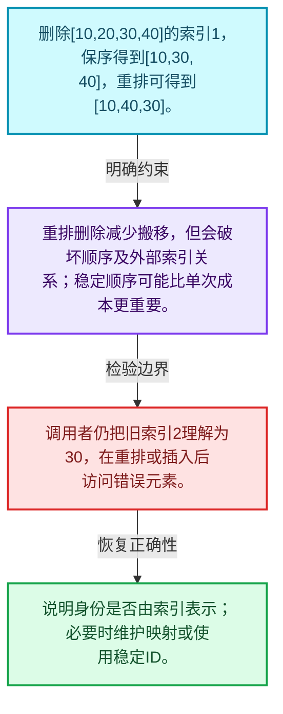
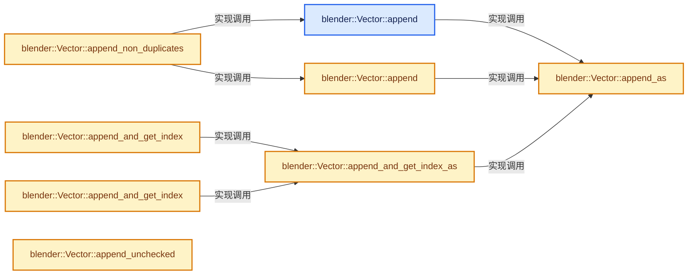
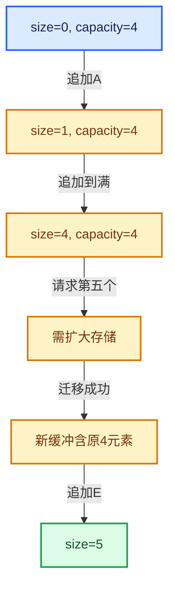

# 01-11 Vector插入删除与重排

[方向导航](README.md) · [总目录](../README.md) · [实现索引](../%E7%AC%A6%E5%8F%B7%E4%BE%9D%E8%B5%96%E4%B8%8E%E5%AE%9E%E7%8E%B0%E7%B4%A2%E5%BC%95.md)

## 从问题到实现

保序删除和末元素覆盖删除为什么成本不同？

保序操作要移动后缀；remove_and_reorder允许改变元素顺序以减少搬移，调用者必须接受语义差异。

**数据模型**

删除[10,20,30,40]的索引1，保序得到[10,30,40]，重排可得到[10,40,30]。

**设计取舍**

重排删除减少搬移，但会破坏顺序及外部索引关系；稳定顺序可能比单次成本更重要。

**最小反例**

调用者仍把旧索引2理解为30，在重排或插入后访问错误元素。

**推导**

说明身份是否由索引表示；必要时维护映射或使用稳定ID。

## 阅读地图与执行推演








图中的数值推演是本方向的教学模型；实际函数之间的调用边与概念分析边分别标注，不能把概念关系当作运行时调度顺序。

## 完整源码单元与就地讲解

中文讲解直接放在相关代码旁，复杂机制在代码下展开。原文折叠区保留基准行号；不需要在行号表和函数之间来回查找。类布局可分段展示，函数实现不按固定行数切开。

<a id="f-5bde268a69e443ec"></a>

### `blender::Vector::append`

在尾部建立新元素，必要时先扩大存储。

实现位置：[source/blender/blenlib/BLI_vector.hh](../../../../../source/blender/blenlib/BLI_vector.hh) · L498—L501。

接口参数：

- `const T &value`

**教学注释版**

<!-- annotated:b21248e6f1988b -->

```cpp
  void append(const T &value)
  {
    // [讲解] this->append_as：在尾部建立新元素，必要时先扩大存储。
    this->append_as(value);
  }
```

<details>
<summary>核对原始源码：source/blender/blenlib/BLI_vector.hh · L498—L501</summary>

<!-- original:b21248e6f1988b:source/blender/blenlib/BLI_vector.hh:498:501 -->

```cpp
  void append(const T &value)
  {
    this->append_as(value);
  }
```

</details>

**接口与不变量**

大小只应在构造成功后增加；参数若别名到自身存储，必须单独检查扩容期间是否失效。

**继续追踪实现**

- `this->append_as` → [blender::Vector::append_as · L507](11-Vector%E6%8F%92%E5%85%A5%E5%88%A0%E9%99%A4%E4%B8%8E%E9%87%8D%E6%8E%92.md#f-44d7aa103502cef2)。

<a id="f-591e0b15e6308532"></a>

### `blender::Vector::append`

在尾部建立新元素，必要时先扩大存储。

实现位置：[source/blender/blenlib/BLI_vector.hh](../../../../../source/blender/blenlib/BLI_vector.hh) · L502—L505。

接口参数：

- `T &&value`

**教学注释版**

<!-- annotated:76f351a33dde5c -->

```cpp
  void append(T &&value)
  {
    // [讲解] this->append_as：在尾部建立新元素，必要时先扩大存储。
    this->append_as(std::move(value));
  }
```

<details>
<summary>核对原始源码：source/blender/blenlib/BLI_vector.hh · L502—L505</summary>

<!-- original:76f351a33dde5c:source/blender/blenlib/BLI_vector.hh:502:505 -->

```cpp
  void append(T &&value)
  {
    this->append_as(std::move(value));
  }
```

</details>

**接口与不变量**

大小只应在构造成功后增加；参数若别名到自身存储，必须单独检查扩容期间是否失效。

**继续追踪实现**

- `this->append_as` → [blender::Vector::append_as · L507](11-Vector%E6%8F%92%E5%85%A5%E5%88%A0%E9%99%A4%E4%B8%8E%E9%87%8D%E6%8E%92.md#f-44d7aa103502cef2)。
- `std::move` → [外部契约](https://eel.is/c++draft/utility.forward)：把表达式转换成可供移动重载选择的值类别；不保证真的移动，不结束源对象寿命，对const值可能选择复制。

### 类型布局、声明与编译条件 · BLI_vector.hh L506—L506

<!-- annotated:b9eec4417c4896 -->

```cpp
  /* This is similar to `std::vector::emplace_back`. */
```

<details>
<summary>核对原始源码：source/blender/blenlib/BLI_vector.hh · L506—L506</summary>

<!-- original:b9eec4417c4896:source/blender/blenlib/BLI_vector.hh:506:506 -->

```cpp
  /* This is similar to `std::vector::emplace_back`. */
```

</details>

<a id="f-44d7aa103502cef2"></a>

### `blender::Vector::append_as`

在尾部建立新元素，必要时先扩大存储。

实现位置：[source/blender/blenlib/BLI_vector.hh](../../../../../source/blender/blenlib/BLI_vector.hh) · L507—L511。

**教学注释版**

<!-- annotated:7c6ebebd533743 -->

```cpp
  template<typename... ForwardValue> void append_as(ForwardValue &&...value)
  {
    // [讲解] this->ensure_space_for_one：追加前保证至少一个空闲槽位；本函数本身不构造追加的元素。
    this->ensure_space_for_one();
    // [讲解] std::forward<ForwardValue>：在转发引用中恢复调用者传入的值类别；依赖推导类型，不能与无条件move互换。
    this->append_unchecked_as(std::forward<ForwardValue>(value)...);
  }
```

<details>
<summary>核对原始源码：source/blender/blenlib/BLI_vector.hh · L507—L511</summary>

<!-- original:7c6ebebd533743:source/blender/blenlib/BLI_vector.hh:507:511 -->

```cpp
  template<typename... ForwardValue> void append_as(ForwardValue &&...value)
  {
    this->ensure_space_for_one();
    this->append_unchecked_as(std::forward<ForwardValue>(value)...);
  }
```

</details>

**接口与不变量**

大小只应在构造成功后增加；参数若别名到自身存储，必须单独检查扩容期间是否失效。

**继续追踪实现**

- `this->ensure_space_for_one` → [blender::Vector::ensure_space_for_one · L1114](10-Vector%E6%89%A9%E5%AE%B9%E4%B8%8E%E5%A2%9E%E9%95%BF.md#f-eafa5315534c2edf)。
- `this->append_unchecked_as` → [blender::Vector::append_unchecked_as · L557](11-Vector%E6%8F%92%E5%85%A5%E5%88%A0%E9%99%A4%E4%B8%8E%E9%87%8D%E6%8E%92.md#f-f0d43149aa607529)。
- `std::forward<ForwardValue>` → [外部契约](https://eel.is/c++draft/utility.forward)：在转发引用中恢复调用者传入的值类别；依赖推导类型，不能与无条件move互换。

### 类型布局、声明与编译条件 · BLI_vector.hh L512—L516

<!-- annotated:a6ce79b6412ded -->

```cpp

  /**
   * Append the value to the vector and return the index that can be used to access the newly
   * added value.
   */
```

<details>
<summary>核对原始源码：source/blender/blenlib/BLI_vector.hh · L512—L516</summary>

<!-- original:a6ce79b6412ded:source/blender/blenlib/BLI_vector.hh:512:516 -->

```cpp

  /**
   * Append the value to the vector and return the index that can be used to access the newly
   * added value.
   */
```

</details>

<a id="f-1de78b06c3aa90cd"></a>

### `blender::Vector::append_and_get_index`

在尾部建立新元素，必要时先扩大存储。

实现位置：[source/blender/blenlib/BLI_vector.hh](../../../../../source/blender/blenlib/BLI_vector.hh) · L517—L520。

接口参数：

- `const T &value`

**教学注释版**

<!-- annotated:6d7ca4c44f2062 -->

```cpp
  int64_t append_and_get_index(const T &value)
  {
    return this->append_and_get_index_as(value);
  }
```

<details>
<summary>核对原始源码：source/blender/blenlib/BLI_vector.hh · L517—L520</summary>

<!-- original:6d7ca4c44f2062:source/blender/blenlib/BLI_vector.hh:517:520 -->

```cpp
  int64_t append_and_get_index(const T &value)
  {
    return this->append_and_get_index_as(value);
  }
```

</details>

**接口与不变量**

大小只应在构造成功后增加；参数若别名到自身存储，必须单独检查扩容期间是否失效。

**结果出口**

- `return this->append_and_get_index_as(value);`

**继续追踪实现**

- `this->append_and_get_index_as` → [blender::Vector::append_and_get_index_as · L525](11-Vector%E6%8F%92%E5%85%A5%E5%88%A0%E9%99%A4%E4%B8%8E%E9%87%8D%E6%8E%92.md#f-c450f8d287116a44)。

<a id="f-91413faf22574850"></a>

### `blender::Vector::append_and_get_index`

在尾部建立新元素，必要时先扩大存储。

实现位置：[source/blender/blenlib/BLI_vector.hh](../../../../../source/blender/blenlib/BLI_vector.hh) · L521—L524。

接口参数：

- `T &&value`

**教学注释版**

<!-- annotated:f8ab52f9ee48dd -->

```cpp
  int64_t append_and_get_index(T &&value)
  {
    // [讲解] std::move：把表达式转换成可供移动重载选择的值类别；不保证真的移动，不结束源对象寿命，对const值可能选择复制。
    return this->append_and_get_index_as(std::move(value));
  }
```

<details>
<summary>核对原始源码：source/blender/blenlib/BLI_vector.hh · L521—L524</summary>

<!-- original:f8ab52f9ee48dd:source/blender/blenlib/BLI_vector.hh:521:524 -->

```cpp
  int64_t append_and_get_index(T &&value)
  {
    return this->append_and_get_index_as(std::move(value));
  }
```

</details>

**接口与不变量**

大小只应在构造成功后增加；参数若别名到自身存储，必须单独检查扩容期间是否失效。

**结果出口**

- `return this->append_and_get_index_as(std::move(value));`

**继续追踪实现**

- `this->append_and_get_index_as` → [blender::Vector::append_and_get_index_as · L525](11-Vector%E6%8F%92%E5%85%A5%E5%88%A0%E9%99%A4%E4%B8%8E%E9%87%8D%E6%8E%92.md#f-c450f8d287116a44)。
- `std::move` → [外部契约](https://eel.is/c++draft/utility.forward)：把表达式转换成可供移动重载选择的值类别；不保证真的移动，不结束源对象寿命，对const值可能选择复制。

<a id="f-c450f8d287116a44"></a>

### `blender::Vector::append_and_get_index_as`

实现位置：[source/blender/blenlib/BLI_vector.hh](../../../../../source/blender/blenlib/BLI_vector.hh) · L525—L530。

**教学注释版**

<!-- annotated:ea4cc0d46b15f0 -->

```cpp
  template<typename... ForwardValue> int64_t append_and_get_index_as(ForwardValue &&...value)
  {
    // [讲解] this->size：用end_减begin_得到活元素数量。
    const int64_t index = this->size();
    // [讲解] this->append_as：在尾部建立新元素，必要时先扩大存储。
    this->append_as(std::forward<ForwardValue>(value)...);
    return index;
  }
```

<details>
<summary>核对原始源码：source/blender/blenlib/BLI_vector.hh · L525—L530</summary>

<!-- original:ea4cc0d46b15f0:source/blender/blenlib/BLI_vector.hh:525:530 -->

```cpp
  template<typename... ForwardValue> int64_t append_and_get_index_as(ForwardValue &&...value)
  {
    const int64_t index = this->size();
    this->append_as(std::forward<ForwardValue>(value)...);
    return index;
  }
```

</details>

**结果出口**

- `return index;`

**继续追踪实现**

- `this->size` → [blender::Vector::size · L780](11-Vector%E6%8F%92%E5%85%A5%E5%88%A0%E9%99%A4%E4%B8%8E%E9%87%8D%E6%8E%92.md#f-714773731767349c)。
- `this->append_as` → [blender::Vector::append_as · L507](11-Vector%E6%8F%92%E5%85%A5%E5%88%A0%E9%99%A4%E4%B8%8E%E9%87%8D%E6%8E%92.md#f-44d7aa103502cef2)。
- `std::forward<ForwardValue>` → [外部契约](https://eel.is/c++draft/utility.forward)：在转发引用中恢复调用者传入的值类别；依赖推导类型，不能与无条件move互换。

### 类型布局、声明与编译条件 · BLI_vector.hh L531—L536

<!-- annotated:8c6dc1545f45d8 -->

```cpp

  /**
   * Append the value if it is not yet in the vector. This has to do a linear search to check if
   * the value is in the vector. Therefore, this should only be called when it is known that the
   * vector is small.
   */
```

<details>
<summary>核对原始源码：source/blender/blenlib/BLI_vector.hh · L531—L536</summary>

<!-- original:8c6dc1545f45d8:source/blender/blenlib/BLI_vector.hh:531:536 -->

```cpp

  /**
   * Append the value if it is not yet in the vector. This has to do a linear search to check if
   * the value is in the vector. Therefore, this should only be called when it is known that the
   * vector is small.
   */
```

</details>

<a id="f-7741238254851c96"></a>

### `blender::Vector::append_non_duplicates`

实现位置：[source/blender/blenlib/BLI_vector.hh](../../../../../source/blender/blenlib/BLI_vector.hh) · L537—L542。

接口参数：

- `const T &value`

**教学注释版**

<!-- annotated:334ee9eebd07c1 -->

```cpp
  void append_non_duplicates(const T &value)
  {
    // [讲解] this->contains：在有效元素中按相等关系查找。
    if (!this->contains(value)) {
      // [讲解] this->append：在尾部建立新元素，必要时先扩大存储。
      this->append(value);
    }
  }
```

<details>
<summary>核对原始源码：source/blender/blenlib/BLI_vector.hh · L537—L542</summary>

<!-- original:334ee9eebd07c1:source/blender/blenlib/BLI_vector.hh:537:542 -->

```cpp
  void append_non_duplicates(const T &value)
  {
    if (!this->contains(value)) {
      this->append(value);
    }
  }
```

</details>

**继续追踪实现**

- `this->contains` → [blender::Vector::contains · L938](12-Vector%E5%BC%82%E5%B8%B8%E5%AE%89%E5%85%A8%E4%B8%8E%E8%BE%B9%E7%95%8C.md#f-11ad8adb697ee04a)。
- `this->append` → [blender::Vector::append · L498](11-Vector%E6%8F%92%E5%85%A5%E5%88%A0%E9%99%A4%E4%B8%8E%E9%87%8D%E6%8E%92.md#f-5bde268a69e443ec)；[blender::Vector::append · L502](11-Vector%E6%8F%92%E5%85%A5%E5%88%A0%E9%99%A4%E4%B8%8E%E9%87%8D%E6%8E%92.md#f-591e0b15e6308532)。同名重载需按实参类型选择。

### 类型布局、声明与编译条件 · BLI_vector.hh L543—L548

<!-- annotated:ca69d19498a2d0 -->

```cpp

  /**
   * Append the value and assume that vector has enough memory reserved. This invokes undefined
   * behavior when not enough capacity has been reserved beforehand. Only use this in performance
   * critical code.
   */
```

<details>
<summary>核对原始源码：source/blender/blenlib/BLI_vector.hh · L543—L548</summary>

<!-- original:ca69d19498a2d0:source/blender/blenlib/BLI_vector.hh:543:548 -->

```cpp

  /**
   * Append the value and assume that vector has enough memory reserved. This invokes undefined
   * behavior when not enough capacity has been reserved beforehand. Only use this in performance
   * critical code.
   */
```

</details>

<a id="f-b24d60bc615a7ccd"></a>

### `blender::Vector::append_unchecked`

在调用者已保证容量足够的条件下扩展尾部。

实现位置：[source/blender/blenlib/BLI_vector.hh](../../../../../source/blender/blenlib/BLI_vector.hh) · L549—L552。

接口参数：

- `const T &value`

**教学注释版**

<!-- annotated:f023effcbdcae7 -->

```cpp
  void append_unchecked(const T &value)
  {
    this->append_unchecked_as(value);
  }
```

<details>
<summary>核对原始源码：source/blender/blenlib/BLI_vector.hh · L549—L552</summary>

<!-- original:f023effcbdcae7:source/blender/blenlib/BLI_vector.hh:549:552 -->

```cpp
  void append_unchecked(const T &value)
  {
    this->append_unchecked_as(value);
  }
```

</details>

**接口与不变量**

unchecked把检查责任交给调用者，并没有让不足容量变成合法输入。

**继续追踪实现**

- `this->append_unchecked_as` → [blender::Vector::append_unchecked_as · L557](11-Vector%E6%8F%92%E5%85%A5%E5%88%A0%E9%99%A4%E4%B8%8E%E9%87%8D%E6%8E%92.md#f-f0d43149aa607529)。

<a id="f-415919ea0bfd674a"></a>

### `blender::Vector::append_unchecked`

在调用者已保证容量足够的条件下扩展尾部。

实现位置：[source/blender/blenlib/BLI_vector.hh](../../../../../source/blender/blenlib/BLI_vector.hh) · L553—L556。

接口参数：

- `T &&value`

**教学注释版**

<!-- annotated:7ba0fcb3210058 -->

```cpp
  void append_unchecked(T &&value)
  {
    // [讲解] std::move：把表达式转换成可供移动重载选择的值类别；不保证真的移动，不结束源对象寿命，对const值可能选择复制。
    this->append_unchecked_as(std::move(value));
  }
```

<details>
<summary>核对原始源码：source/blender/blenlib/BLI_vector.hh · L553—L556</summary>

<!-- original:7ba0fcb3210058:source/blender/blenlib/BLI_vector.hh:553:556 -->

```cpp
  void append_unchecked(T &&value)
  {
    this->append_unchecked_as(std::move(value));
  }
```

</details>

**接口与不变量**

unchecked把检查责任交给调用者，并没有让不足容量变成合法输入。

**继续追踪实现**

- `this->append_unchecked_as` → [blender::Vector::append_unchecked_as · L557](11-Vector%E6%8F%92%E5%85%A5%E5%88%A0%E9%99%A4%E4%B8%8E%E9%87%8D%E6%8E%92.md#f-f0d43149aa607529)。
- `std::move` → [外部契约](https://eel.is/c++draft/utility.forward)：把表达式转换成可供移动重载选择的值类别；不保证真的移动，不结束源对象寿命，对const值可能选择复制。

<a id="f-f0d43149aa607529"></a>

### `blender::Vector::append_unchecked_as`

实现位置：[source/blender/blenlib/BLI_vector.hh](../../../../../source/blender/blenlib/BLI_vector.hh) · L557—L563。

**教学注释版**

<!-- annotated:5119a3b1b232b4 -->

```cpp
  template<typename... ForwardT> void append_unchecked_as(ForwardT &&...value)
  {
    BLI_assert(end_ < capacity_end_);
    // [讲解] std::forward<ForwardT>：在转发引用中恢复调用者传入的值类别；依赖推导类型，不能与无条件move互换。
    new (end_) T(std::forward<ForwardT>(value)...);
    end_++;
    UPDATE_VECTOR_SIZE(this);
  }
```

<details>
<summary>核对原始源码：source/blender/blenlib/BLI_vector.hh · L557—L563</summary>

<!-- original:5119a3b1b232b4:source/blender/blenlib/BLI_vector.hh:557:563 -->

```cpp
  template<typename... ForwardT> void append_unchecked_as(ForwardT &&...value)
  {
    BLI_assert(end_ < capacity_end_);
    new (end_) T(std::forward<ForwardT>(value)...);
    end_++;
    UPDATE_VECTOR_SIZE(this);
  }
```

</details>

**继续追踪实现**

- `BLI_assert` → [BLI_assert · L48](%E4%BE%9D%E8%B5%96-BLI_assert-cc98e8.md#m-57a88495704d)；[BLI_assert · L63](%E4%BE%9D%E8%B5%96-BLI_assert-cc98e8.md#m-d07050020cb5)。宏定义由构建条件选择。
- `std::forward<ForwardT>` → [外部契约](https://eel.is/c++draft/utility.forward)：在转发引用中恢复调用者传入的值类别；依赖推导类型，不能与无条件move互换。
- `UPDATE_VECTOR_SIZE` → [UPDATE_VECTOR_SIZE · L112](%E4%BE%9D%E8%B5%96-BLI_vector-c355b1.md#m-85858f378a28)；[UPDATE_VECTOR_SIZE · L114](%E4%BE%9D%E8%B5%96-BLI_vector-c355b1.md#m-fe457862705a)。宏定义由构建条件选择。

### 类型布局、声明与编译条件 · BLI_vector.hh L564—L568

<!-- annotated:1774152668dd1a -->

```cpp

  /**
   * Insert the same element n times at the end of the vector.
   * This might result in a reallocation internally.
   */
```

<details>
<summary>核对原始源码：source/blender/blenlib/BLI_vector.hh · L564—L568</summary>

<!-- original:1774152668dd1a:source/blender/blenlib/BLI_vector.hh:564:568 -->

```cpp

  /**
   * Insert the same element n times at the end of the vector.
   * This might result in a reallocation internally.
   */
```

</details>

<a id="f-8b696bc4bd1e57b2"></a>

### `blender::Vector::append_n_times`

实现位置：[source/blender/blenlib/BLI_vector.hh](../../../../../source/blender/blenlib/BLI_vector.hh) · L569—L575。

接口参数：

- `const T &value`
- `const int64_t n`

**教学注释版**

<!-- annotated:ece6592c7f249e -->

```cpp
  void append_n_times(const T &value, const int64_t n)
  {
    BLI_assert(n >= 0);
    // [讲解] this->reserve：确保可容纳至少min_capacity个元素；当前size和已有元素值不因容量请求本身而增加。
    this->reserve(this->size() + n);
    // [讲解] uninitialized_fill_n：从同一个value复制构造目标n个T。
    uninitialized_fill_n(end_, n, value);
    this->increase_size_by_unchecked(n);
  }
```

<details>
<summary>核对原始源码：source/blender/blenlib/BLI_vector.hh · L569—L575</summary>

<!-- original:ece6592c7f249e:source/blender/blenlib/BLI_vector.hh:569:575 -->

```cpp
  void append_n_times(const T &value, const int64_t n)
  {
    BLI_assert(n >= 0);
    this->reserve(this->size() + n);
    uninitialized_fill_n(end_, n, value);
    this->increase_size_by_unchecked(n);
  }
```

</details>

**继续追踪实现**

- `BLI_assert` → [BLI_assert · L48](%E4%BE%9D%E8%B5%96-BLI_assert-cc98e8.md#m-57a88495704d)；[BLI_assert · L63](%E4%BE%9D%E8%B5%96-BLI_assert-cc98e8.md#m-d07050020cb5)。宏定义由构建条件选择。
- `this->reserve` → [blender::Vector::reserve · L405](10-Vector%E6%89%A9%E5%AE%B9%E4%B8%8E%E5%A2%9E%E9%95%BF.md#f-4cf9c0f00e01102e)。
- `this->size` → [blender::Vector::size · L780](11-Vector%E6%8F%92%E5%85%A5%E5%88%A0%E9%99%A4%E4%B8%8E%E9%87%8D%E6%8E%92.md#f-714773731767349c)。
- `uninitialized_fill_n` → [blender::uninitialized_fill_n · L91](01-%E5%AF%B9%E8%B1%A1%E7%94%9F%E5%91%BD%E5%91%A8%E6%9C%9F%E4%B8%8E%E5%80%BC%E7%B1%BB%E5%88%AB.md#f-020ca78eff5f9227)。
- `this->increase_size_by_unchecked` → [blender::Vector::increase_size_by_unchecked · L583](11-Vector%E6%8F%92%E5%85%A5%E5%88%A0%E9%99%A4%E4%B8%8E%E9%87%8D%E6%8E%92.md#f-b53f66d936e54628)。

### 类型布局、声明与编译条件 · BLI_vector.hh L576—L582

<!-- annotated:3c6610be5d9f6e -->

```cpp

  /**
   * Enlarges the size of the internal buffer that is considered to be initialized.
   * This invokes undefined behavior when the new size is larger than the capacity.
   * The method can be useful when you want to call constructors in the vector yourself.
   * This should only be done in very rare cases and has to be justified every time.
   */
```

<details>
<summary>核对原始源码：source/blender/blenlib/BLI_vector.hh · L576—L582</summary>

<!-- original:3c6610be5d9f6e:source/blender/blenlib/BLI_vector.hh:576:582 -->

```cpp

  /**
   * Enlarges the size of the internal buffer that is considered to be initialized.
   * This invokes undefined behavior when the new size is larger than the capacity.
   * The method can be useful when you want to call constructors in the vector yourself.
   * This should only be done in very rare cases and has to be justified every time.
   */
```

</details>

<a id="f-b53f66d936e54628"></a>

### `blender::Vector::increase_size_by_unchecked`

实现位置：[source/blender/blenlib/BLI_vector.hh](../../../../../source/blender/blenlib/BLI_vector.hh) · L583—L588。

接口参数：

- `const int64_t n`

**教学注释版**

<!-- annotated:ac772569e3a58e -->

```cpp
  void increase_size_by_unchecked(const int64_t n) noexcept
  {
    BLI_assert(end_ + n <= capacity_end_);
    end_ += n;
    UPDATE_VECTOR_SIZE(this);
  }
```

<details>
<summary>核对原始源码：source/blender/blenlib/BLI_vector.hh · L583—L588</summary>

<!-- original:ac772569e3a58e:source/blender/blenlib/BLI_vector.hh:583:588 -->

```cpp
  void increase_size_by_unchecked(const int64_t n) noexcept
  {
    BLI_assert(end_ + n <= capacity_end_);
    end_ += n;
    UPDATE_VECTOR_SIZE(this);
  }
```

</details>

**沿实际写入检查状态**

- `end_ += n;`：提交有效元素尾后位置；它决定size，不是容量。

**继续追踪实现**

- `BLI_assert` → [BLI_assert · L48](%E4%BE%9D%E8%B5%96-BLI_assert-cc98e8.md#m-57a88495704d)；[BLI_assert · L63](%E4%BE%9D%E8%B5%96-BLI_assert-cc98e8.md#m-d07050020cb5)。宏定义由构建条件选择。
- `UPDATE_VECTOR_SIZE` → [UPDATE_VECTOR_SIZE · L112](%E4%BE%9D%E8%B5%96-BLI_vector-c355b1.md#m-85858f378a28)；[UPDATE_VECTOR_SIZE · L114](%E4%BE%9D%E8%B5%96-BLI_vector-c355b1.md#m-fe457862705a)。宏定义由构建条件选择。

### 类型布局、声明与编译条件 · BLI_vector.hh L589—L594

<!-- annotated:e5c5a911e2831e -->

```cpp

  /**
   * Copy the elements of another array to the end of this vector.
   *
   * This can be used to emulate parts of std::vector::insert.
   */
```

<details>
<summary>核对原始源码：source/blender/blenlib/BLI_vector.hh · L589—L594</summary>

<!-- original:e5c5a911e2831e:source/blender/blenlib/BLI_vector.hh:589:594 -->

```cpp

  /**
   * Copy the elements of another array to the end of this vector.
   *
   * This can be used to emulate parts of std::vector::insert.
   */
```

</details>

<a id="f-fe6fcb7d09beded9"></a>

### `blender::Vector::extend`

将一段来源元素加入尾部。

实现位置：[source/blender/blenlib/BLI_vector.hh](../../../../../source/blender/blenlib/BLI_vector.hh) · L595—L598。

接口参数：

- `Span<T> array`

**教学注释版**

<!-- annotated:2579c1a28f48bb -->

```cpp
  void extend(Span<T> array)
  {
    // [讲解] this->extend：将一段来源元素加入尾部。
    this->extend(array.data(), array.size());
  }
```

<details>
<summary>核对原始源码：source/blender/blenlib/BLI_vector.hh · L595—L598</summary>

<!-- original:2579c1a28f48bb:source/blender/blenlib/BLI_vector.hh:595:598 -->

```cpp
  void extend(Span<T> array)
  {
    this->extend(array.data(), array.size());
  }
```

</details>

**接口与不变量**

批量加入的数量和来源寿命必须有效，范围重叠与自扩展要按具体重载检查。

**继续追踪实现**

- `this->extend` → [blender::Vector::extend · L595](11-Vector%E6%8F%92%E5%85%A5%E5%88%A0%E9%99%A4%E4%B8%8E%E9%87%8D%E6%8E%92.md#f-fe6fcb7d09beded9)；[blender::Vector::extend · L599](11-Vector%E6%8F%92%E5%85%A5%E5%88%A0%E9%99%A4%E4%B8%8E%E9%87%8D%E6%8E%92.md#f-40095c219019e2f9)；[blender::Vector::extend · L613](11-Vector%E6%8F%92%E5%85%A5%E5%88%A0%E9%99%A4%E4%B8%8E%E9%87%8D%E6%8E%92.md#f-4d2e556cd7412fe4)；[blender::Vector::extend · L650](11-Vector%E6%8F%92%E5%85%A5%E5%88%A0%E9%99%A4%E4%B8%8E%E9%87%8D%E6%8E%92.md#f-ae44ad8b3f05b082)。同名重载需按实参类型选择。
- `array.data` → [blender::Span::data · L219](05-Span%E5%8F%AA%E8%AF%BB%E8%BF%9E%E7%BB%AD%E8%A7%86%E5%9B%BE.md#f-10c5889198935800)。
- `array.size` → [blender::Span::size · L256](05-Span%E5%8F%AA%E8%AF%BB%E8%BF%9E%E7%BB%AD%E8%A7%86%E5%9B%BE.md#f-5f80fa006089c998)。

<a id="f-40095c219019e2f9"></a>

### `blender::Vector::extend`

将一段来源元素加入尾部。

实现位置：[source/blender/blenlib/BLI_vector.hh](../../../../../source/blender/blenlib/BLI_vector.hh) · L599—L603。

接口参数：

- `const T *start`
- `int64_t amount`

**教学注释版**

<!-- annotated:f7a05713812d7e -->

```cpp
  void extend(const T *start, int64_t amount)
  {
    // [讲解] this->reserve：确保可容纳至少min_capacity个元素；当前size和已有元素值不因容量请求本身而增加。
    this->reserve(this->size() + amount);
    // [讲解] this->extend_unchecked：在调用者已保证容量足够的条件下扩展尾部。
    this->extend_unchecked(start, amount);
  }
```

<details>
<summary>核对原始源码：source/blender/blenlib/BLI_vector.hh · L599—L603</summary>

<!-- original:f7a05713812d7e:source/blender/blenlib/BLI_vector.hh:599:603 -->

```cpp
  void extend(const T *start, int64_t amount)
  {
    this->reserve(this->size() + amount);
    this->extend_unchecked(start, amount);
  }
```

</details>

**接口与不变量**

批量加入的数量和来源寿命必须有效，范围重叠与自扩展要按具体重载检查。

**继续追踪实现**

- `this->reserve` → [blender::Vector::reserve · L405](10-Vector%E6%89%A9%E5%AE%B9%E4%B8%8E%E5%A2%9E%E9%95%BF.md#f-4cf9c0f00e01102e)。
- `this->size` → [blender::Vector::size · L780](11-Vector%E6%8F%92%E5%85%A5%E5%88%A0%E9%99%A4%E4%B8%8E%E9%87%8D%E6%8E%92.md#f-714773731767349c)。
- `this->extend_unchecked` → [blender::Vector::extend_unchecked · L637](11-Vector%E6%8F%92%E5%85%A5%E5%88%A0%E9%99%A4%E4%B8%8E%E9%87%8D%E6%8E%92.md#f-2de7071f1c607c2b)；[blender::Vector::extend_unchecked · L641](11-Vector%E6%8F%92%E5%85%A5%E5%88%A0%E9%99%A4%E4%B8%8E%E9%87%8D%E6%8E%92.md#f-426341a2f8c84626)。同名重载需按实参类型选择。

### 类型布局、声明与编译条件 · BLI_vector.hh L604—L612

<!-- annotated:2081e50bcd9792 -->

```cpp

  /**
   * Moves the elements of another vector to the end of this vector.
   *
   * This may result in reallocation to fit other vector elements, other vector will keep it
   * buffer allocation, but it will become empty.
   * This can be used in vectors that manages resources, allowing acquiring resources from another
   * vector, preventing shared ownership of managed resources.
   */
```

<details>
<summary>核对原始源码：source/blender/blenlib/BLI_vector.hh · L604—L612</summary>

<!-- original:2081e50bcd9792:source/blender/blenlib/BLI_vector.hh:604:612 -->

```cpp

  /**
   * Moves the elements of another vector to the end of this vector.
   *
   * This may result in reallocation to fit other vector elements, other vector will keep it
   * buffer allocation, but it will become empty.
   * This can be used in vectors that manages resources, allowing acquiring resources from another
   * vector, preventing shared ownership of managed resources.
   */
```

</details>

<a id="f-4d2e556cd7412fe4"></a>

### `blender::Vector::extend`

将一段来源元素加入尾部。

实现位置：[source/blender/blenlib/BLI_vector.hh](../../../../../source/blender/blenlib/BLI_vector.hh) · L613—L619。

接口参数：

- `Vector<T, OtherInlineBufferCapacity, Allocator> &&other`

**教学注释版**

<!-- annotated:5d00fe39ad06d2 -->

```cpp
  template<int64_t OtherInlineBufferCapacity>
  void extend(Vector<T, OtherInlineBufferCapacity, Allocator> &&other)
  {
    BLI_assert(this != &other);
    // [讲解] this->extend：将一段来源元素加入尾部。
    this->extend(std::make_move_iterator(other.begin()), std::make_move_iterator(other.end()));
    // [讲解] other.clear：销毁所有有效元素，把size变为0，但保留原分配或内嵌容量。
    other.clear();
  }
```

<details>
<summary>核对原始源码：source/blender/blenlib/BLI_vector.hh · L613—L619</summary>

<!-- original:5d00fe39ad06d2:source/blender/blenlib/BLI_vector.hh:613:619 -->

```cpp
  template<int64_t OtherInlineBufferCapacity>
  void extend(Vector<T, OtherInlineBufferCapacity, Allocator> &&other)
  {
    BLI_assert(this != &other);
    this->extend(std::make_move_iterator(other.begin()), std::make_move_iterator(other.end()));
    other.clear();
  }
```

</details>

**接口与不变量**

批量加入的数量和来源寿命必须有效，范围重叠与自扩展要按具体重载检查。

**继续追踪实现**

- `BLI_assert` → [BLI_assert · L48](%E4%BE%9D%E8%B5%96-BLI_assert-cc98e8.md#m-57a88495704d)；[BLI_assert · L63](%E4%BE%9D%E8%B5%96-BLI_assert-cc98e8.md#m-d07050020cb5)。宏定义由构建条件选择。
- `this->extend` → [blender::Vector::extend · L595](11-Vector%E6%8F%92%E5%85%A5%E5%88%A0%E9%99%A4%E4%B8%8E%E9%87%8D%E6%8E%92.md#f-fe6fcb7d09beded9)；[blender::Vector::extend · L599](11-Vector%E6%8F%92%E5%85%A5%E5%88%A0%E9%99%A4%E4%B8%8E%E9%87%8D%E6%8E%92.md#f-40095c219019e2f9)；[blender::Vector::extend · L613](11-Vector%E6%8F%92%E5%85%A5%E5%88%A0%E9%99%A4%E4%B8%8E%E9%87%8D%E6%8E%92.md#f-4d2e556cd7412fe4)；[blender::Vector::extend · L650](11-Vector%E6%8F%92%E5%85%A5%E5%88%A0%E9%99%A4%E4%B8%8E%E9%87%8D%E6%8E%92.md#f-ae44ad8b3f05b082)。同名重载需按实参类型选择。
- `std::make_move_iterator` → [外部契约](https://eel.is/c++draft/move.iterators)：适配迭代器的解引用值类别，不单独转移资源。实际对象的构造函数决定是否以及如何移动。
- `other.begin` → [blender::Vector::begin · L967](12-Vector%E5%BC%82%E5%B8%B8%E5%AE%89%E5%85%A8%E4%B8%8E%E8%BE%B9%E7%95%8C.md#f-64fb75a6663b953c)；[blender::Vector::begin · L976](12-Vector%E5%BC%82%E5%B8%B8%E5%AE%89%E5%85%A8%E4%B8%8E%E8%BE%B9%E7%95%8C.md#f-7c6486a8b8e8f13f)。同名重载需按实参类型选择。
- `other.end` → [blender::Vector::end · L971](12-Vector%E5%BC%82%E5%B8%B8%E5%AE%89%E5%85%A8%E4%B8%8E%E8%BE%B9%E7%95%8C.md#f-8a6033745be8f712)；[blender::Vector::end · L980](12-Vector%E5%BC%82%E5%B8%B8%E5%AE%89%E5%85%A8%E4%B8%8E%E8%BE%B9%E7%95%8C.md#f-ebb3ada259887677)。同名重载需按实参类型选择。
- `other.clear` → [blender::Vector::clear · L468](10-Vector%E6%89%A9%E5%AE%B9%E4%B8%8E%E5%A2%9E%E9%95%BF.md#f-d051bebff5275a43)。

### 类型布局、声明与编译条件 · BLI_vector.hh L620—L625

<!-- annotated:fd7204b234763c -->

```cpp

  /**
   * Adds all elements from the array that are not already in the vector. This is an expensive
   * operation when the vector is large, but can be very cheap when it is known that the vector is
   * small.
   */
```

<details>
<summary>核对原始源码：source/blender/blenlib/BLI_vector.hh · L620—L625</summary>

<!-- original:fd7204b234763c:source/blender/blenlib/BLI_vector.hh:620:625 -->

```cpp

  /**
   * Adds all elements from the array that are not already in the vector. This is an expensive
   * operation when the vector is large, but can be very cheap when it is known that the vector is
   * small.
   */
```

</details>

<a id="f-7a2e99100b1e5c91"></a>

### `blender::Vector::extend_non_duplicates`

将一段来源元素加入尾部。

实现位置：[source/blender/blenlib/BLI_vector.hh](../../../../../source/blender/blenlib/BLI_vector.hh) · L626—L631。

接口参数：

- `Span<T> array`

**教学注释版**

<!-- annotated:47b1640adcc4b0 -->

```cpp
  void extend_non_duplicates(Span<T> array)
  {
    for (const T &value : array) {
      this->append_non_duplicates(value);
    }
  }
```

<details>
<summary>核对原始源码：source/blender/blenlib/BLI_vector.hh · L626—L631</summary>

<!-- original:47b1640adcc4b0:source/blender/blenlib/BLI_vector.hh:626:631 -->

```cpp
  void extend_non_duplicates(Span<T> array)
  {
    for (const T &value : array) {
      this->append_non_duplicates(value);
    }
  }
```

</details>

**接口与不变量**

批量加入的数量和来源寿命必须有效，范围重叠与自扩展要按具体重载检查。

**继续追踪实现**

- `this->append_non_duplicates` → [blender::Vector::append_non_duplicates · L537](11-Vector%E6%8F%92%E5%85%A5%E5%88%A0%E9%99%A4%E4%B8%8E%E9%87%8D%E6%8E%92.md#f-7741238254851c96)。

### 类型布局、声明与编译条件 · BLI_vector.hh L632—L636

<!-- annotated:059f73ab8c9714 -->

```cpp

  /**
   * Extend the vector without bounds checking. It is assumed that enough memory has been reserved
   * beforehand. Only use this in performance critical code.
   */
```

<details>
<summary>核对原始源码：source/blender/blenlib/BLI_vector.hh · L632—L636</summary>

<!-- original:059f73ab8c9714:source/blender/blenlib/BLI_vector.hh:632:636 -->

```cpp

  /**
   * Extend the vector without bounds checking. It is assumed that enough memory has been reserved
   * beforehand. Only use this in performance critical code.
   */
```

</details>

<a id="f-2de7071f1c607c2b"></a>

### `blender::Vector::extend_unchecked`

在调用者已保证容量足够的条件下扩展尾部。

实现位置：[source/blender/blenlib/BLI_vector.hh](../../../../../source/blender/blenlib/BLI_vector.hh) · L637—L640。

接口参数：

- `Span<T> array`

**教学注释版**

<!-- annotated:2d5cf9ab9fcf37 -->

```cpp
  void extend_unchecked(Span<T> array)
  {
    // [讲解] this->extend_unchecked：在调用者已保证容量足够的条件下扩展尾部。
    this->extend_unchecked(array.data(), array.size());
  }
```

<details>
<summary>核对原始源码：source/blender/blenlib/BLI_vector.hh · L637—L640</summary>

<!-- original:2d5cf9ab9fcf37:source/blender/blenlib/BLI_vector.hh:637:640 -->

```cpp
  void extend_unchecked(Span<T> array)
  {
    this->extend_unchecked(array.data(), array.size());
  }
```

</details>

**接口与不变量**

unchecked把检查责任交给调用者，并没有让不足容量变成合法输入。

**继续追踪实现**

- `this->extend_unchecked` → [blender::Vector::extend_unchecked · L637](11-Vector%E6%8F%92%E5%85%A5%E5%88%A0%E9%99%A4%E4%B8%8E%E9%87%8D%E6%8E%92.md#f-2de7071f1c607c2b)；[blender::Vector::extend_unchecked · L641](11-Vector%E6%8F%92%E5%85%A5%E5%88%A0%E9%99%A4%E4%B8%8E%E9%87%8D%E6%8E%92.md#f-426341a2f8c84626)。同名重载需按实参类型选择。
- `array.data` → [blender::Span::data · L219](05-Span%E5%8F%AA%E8%AF%BB%E8%BF%9E%E7%BB%AD%E8%A7%86%E5%9B%BE.md#f-10c5889198935800)。
- `array.size` → [blender::Span::size · L256](05-Span%E5%8F%AA%E8%AF%BB%E8%BF%9E%E7%BB%AD%E8%A7%86%E5%9B%BE.md#f-5f80fa006089c998)。

<a id="f-426341a2f8c84626"></a>

### `blender::Vector::extend_unchecked`

在调用者已保证容量足够的条件下扩展尾部。

实现位置：[source/blender/blenlib/BLI_vector.hh](../../../../../source/blender/blenlib/BLI_vector.hh) · L641—L648。

接口参数：

- `const T *start`
- `int64_t amount`

**教学注释版**

<!-- annotated:adf69adda44051 -->

```cpp
  void extend_unchecked(const T *start, int64_t amount)
  {
    BLI_assert(amount >= 0);
    BLI_assert(begin_ + amount <= capacity_end_);
    uninitialized_copy_n(start, amount, end_);
    end_ += amount;
    UPDATE_VECTOR_SIZE(this);
  }
```

<details>
<summary>核对原始源码：source/blender/blenlib/BLI_vector.hh · L641—L648</summary>

<!-- original:adf69adda44051:source/blender/blenlib/BLI_vector.hh:641:648 -->

```cpp
  void extend_unchecked(const T *start, int64_t amount)
  {
    BLI_assert(amount >= 0);
    BLI_assert(begin_ + amount <= capacity_end_);
    uninitialized_copy_n(start, amount, end_);
    end_ += amount;
    UPDATE_VECTOR_SIZE(this);
  }
```

</details>

**接口与不变量**

unchecked把检查责任交给调用者，并没有让不足容量变成合法输入。

**沿实际写入检查状态**

- `end_ += amount;`：提交有效元素尾后位置；它决定size，不是容量。

**继续追踪实现**

- `BLI_assert` → [BLI_assert · L48](%E4%BE%9D%E8%B5%96-BLI_assert-cc98e8.md#m-57a88495704d)；[BLI_assert · L63](%E4%BE%9D%E8%B5%96-BLI_assert-cc98e8.md#m-d07050020cb5)。宏定义由构建条件选择。
- `uninitialized_copy_n` → [blender::uninitialized_copy_n · L53](01-%E5%AF%B9%E8%B1%A1%E7%94%9F%E5%91%BD%E5%91%A8%E6%9C%9F%E4%B8%8E%E5%80%BC%E7%B1%BB%E5%88%AB.md#f-6cd63ebede164cd2)。
- `UPDATE_VECTOR_SIZE` → [UPDATE_VECTOR_SIZE · L112](%E4%BE%9D%E8%B5%96-BLI_vector-c355b1.md#m-85858f378a28)；[UPDATE_VECTOR_SIZE · L114](%E4%BE%9D%E8%B5%96-BLI_vector-c355b1.md#m-fe457862705a)。宏定义由构建条件选择。

<!-- annotated:c3a701fefeb9bd -->

```cpp

```

<details>
<summary>核对原始源码：source/blender/blenlib/BLI_vector.hh · L649—L649</summary>

<!-- original:c3a701fefeb9bd:source/blender/blenlib/BLI_vector.hh:649:649 -->

```cpp

```

</details>

<a id="f-ae44ad8b3f05b082"></a>

### `blender::Vector::extend`

将一段来源元素加入尾部。

实现位置：[source/blender/blenlib/BLI_vector.hh](../../../../../source/blender/blenlib/BLI_vector.hh) · L650—L653。

接口参数：

- `InputIt first`
- `InputIt last`

**教学注释版**

<!-- annotated:6990256ad6e4f0 -->

```cpp
  template<typename InputIt> void extend(InputIt first, InputIt last)
  {
    // [讲解] this->insert：在指定位置或开头插入元素。
    this->insert(this->end(), first, last);
  }
```

<details>
<summary>核对原始源码：source/blender/blenlib/BLI_vector.hh · L650—L653</summary>

<!-- original:6990256ad6e4f0:source/blender/blenlib/BLI_vector.hh:650:653 -->

```cpp
  template<typename InputIt> void extend(InputIt first, InputIt last)
  {
    this->insert(this->end(), first, last);
  }
```

</details>

**接口与不变量**

批量加入的数量和来源寿命必须有效，范围重叠与自扩展要按具体重载检查。

**继续追踪实现**

- `this->insert` → [blender::Vector::insert · L660](11-Vector%E6%8F%92%E5%85%A5%E5%88%A0%E9%99%A4%E4%B8%8E%E9%87%8D%E6%8E%92.md#f-dc44511e282a0e11)；[blender::Vector::insert · L664](11-Vector%E6%8F%92%E5%85%A5%E5%88%A0%E9%99%A4%E4%B8%8E%E9%87%8D%E6%8E%92.md#f-cc759c6bf2f684fd)；[blender::Vector::insert · L669](11-Vector%E6%8F%92%E5%85%A5%E5%88%A0%E9%99%A4%E4%B8%8E%E9%87%8D%E6%8E%92.md#f-aa84192ea68b9354)；[blender::Vector::insert · L673](11-Vector%E6%8F%92%E5%85%A5%E5%88%A0%E9%99%A4%E4%B8%8E%E9%87%8D%E6%8E%92.md#f-a0091ac806c762b7)；[blender::Vector::insert · L678](11-Vector%E6%8F%92%E5%85%A5%E5%88%A0%E9%99%A4%E4%B8%8E%E9%87%8D%E6%8E%92.md#f-1b9c3c520da8d7ea)。同名重载需按实参类型选择。
- `this->end` → [blender::Vector::end · L971](12-Vector%E5%BC%82%E5%B8%B8%E5%AE%89%E5%85%A8%E4%B8%8E%E8%BE%B9%E7%95%8C.md#f-8a6033745be8f712)；[blender::Vector::end · L980](12-Vector%E5%BC%82%E5%B8%B8%E5%AE%89%E5%85%A8%E4%B8%8E%E8%BE%B9%E7%95%8C.md#f-ebb3ada259887677)。同名重载需按实参类型选择。

### 类型布局、声明与编译条件 · BLI_vector.hh L654—L659

<!-- annotated:bb2001cb10e508 -->

```cpp

  /**
   * Insert elements into the vector at the specified position. This has a running time of O(n)
   * where n is the number of values that have to be moved. Undefined behavior is invoked when the
   * insert position is out of bounds.
   */
```

<details>
<summary>核对原始源码：source/blender/blenlib/BLI_vector.hh · L654—L659</summary>

<!-- original:bb2001cb10e508:source/blender/blenlib/BLI_vector.hh:654:659 -->

```cpp

  /**
   * Insert elements into the vector at the specified position. This has a running time of O(n)
   * where n is the number of values that have to be moved. Undefined behavior is invoked when the
   * insert position is out of bounds.
   */
```

</details>

<a id="f-dc44511e282a0e11"></a>

### `blender::Vector::insert`

在指定位置或开头插入元素。

实现位置：[source/blender/blenlib/BLI_vector.hh](../../../../../source/blender/blenlib/BLI_vector.hh) · L660—L663。

接口参数：

- `const int64_t insert_index`
- `const T &value`

**教学注释版**

<!-- annotated:ab2a6776ca2632 -->

```cpp
  void insert(const int64_t insert_index, const T &value)
  {
    // [讲解] this->insert：在指定位置或开头插入元素。
    this->insert(insert_index, Span<T>(&value, 1));
  }
```

<details>
<summary>核对原始源码：source/blender/blenlib/BLI_vector.hh · L660—L663</summary>

<!-- original:ab2a6776ca2632:source/blender/blenlib/BLI_vector.hh:660:663 -->

```cpp
  void insert(const int64_t insert_index, const T &value)
  {
    this->insert(insert_index, Span<T>(&value, 1));
  }
```

</details>

**接口与不变量**

保留后缀顺序需要搬移已有对象；搬移覆盖区间与新增构造区间不能混同。

**继续追踪实现**

- `this->insert` → [blender::Vector::insert · L660](11-Vector%E6%8F%92%E5%85%A5%E5%88%A0%E9%99%A4%E4%B8%8E%E9%87%8D%E6%8E%92.md#f-dc44511e282a0e11)；[blender::Vector::insert · L664](11-Vector%E6%8F%92%E5%85%A5%E5%88%A0%E9%99%A4%E4%B8%8E%E9%87%8D%E6%8E%92.md#f-cc759c6bf2f684fd)；[blender::Vector::insert · L669](11-Vector%E6%8F%92%E5%85%A5%E5%88%A0%E9%99%A4%E4%B8%8E%E9%87%8D%E6%8E%92.md#f-aa84192ea68b9354)；[blender::Vector::insert · L673](11-Vector%E6%8F%92%E5%85%A5%E5%88%A0%E9%99%A4%E4%B8%8E%E9%87%8D%E6%8E%92.md#f-a0091ac806c762b7)；[blender::Vector::insert · L678](11-Vector%E6%8F%92%E5%85%A5%E5%88%A0%E9%99%A4%E4%B8%8E%E9%87%8D%E6%8E%92.md#f-1b9c3c520da8d7ea)。同名重载需按实参类型选择。
- `Span<T>` → [blender::Span](%E4%BE%9D%E8%B5%96-BLI_span-6aa95f.md#t-8765a8e0c1d5)；[blender::Span](%E4%BE%9D%E8%B5%96-BLI_index_range-7d7cc5.md#t-86091874a1c0)；[blender::Span](../05-%E5%87%A0%E4%BD%95%E5%AD%98%E5%82%A8%E4%B8%8E%E6%8B%93%E6%89%91%E6%98%A0%E5%B0%84/%E4%BE%9D%E8%B5%96-DNA_pointcloud_types-cfb82c.md#t-112aa6ed842c)；[blender::Span](../05-%E5%87%A0%E4%BD%95%E5%AD%98%E5%82%A8%E4%B8%8E%E6%8B%93%E6%89%91%E6%98%A0%E5%B0%84/%E4%BE%9D%E8%B5%96-DNA_node_types-6708b9.md#t-49ec6fbb9b69)；[blender::Span](../05-%E5%87%A0%E4%BD%95%E5%AD%98%E5%82%A8%E4%B8%8E%E6%8B%93%E6%89%91%E6%98%A0%E5%B0%84/%E4%BE%9D%E8%B5%96-DNA_mesh_types-81f02e.md#t-184fd48fb638)；[blender::Span](../05-%E5%87%A0%E4%BD%95%E5%AD%98%E5%82%A8%E4%B8%8E%E6%8B%93%E6%89%91%E6%98%A0%E5%B0%84/%E4%BE%9D%E8%B5%96-DNA_anim_types-39c5d9.md#t-d841071994c2)；[blender::Span](../05-%E5%87%A0%E4%BD%95%E5%AD%98%E5%82%A8%E4%B8%8E%E6%8B%93%E6%89%91%E6%98%A0%E5%B0%84/%E4%BE%9D%E8%B5%96-RNA_path_fwd-79c989.md#t-4dbb08969e41)。

<a id="f-cc759c6bf2f684fd"></a>

### `blender::Vector::insert`

在指定位置或开头插入元素。

实现位置：[source/blender/blenlib/BLI_vector.hh](../../../../../source/blender/blenlib/BLI_vector.hh) · L664—L668。

接口参数：

- `const int64_t insert_index`
- `T &&value`

**教学注释版**

<!-- annotated:5e1b1abd3f6ec6 -->

```cpp
  void insert(const int64_t insert_index, T &&value)
  {
    // [讲解] this->insert：在指定位置或开头插入元素。
    this->insert(
        // [讲解] std::make_move_iterator：适配迭代器的解引用值类别，不单独转移资源。实际对象的构造函数决定是否以及如何移动。
        insert_index, std::make_move_iterator(&value), std::make_move_iterator(&value + 1));
  }
```

<details>
<summary>核对原始源码：source/blender/blenlib/BLI_vector.hh · L664—L668</summary>

<!-- original:5e1b1abd3f6ec6:source/blender/blenlib/BLI_vector.hh:664:668 -->

```cpp
  void insert(const int64_t insert_index, T &&value)
  {
    this->insert(
        insert_index, std::make_move_iterator(&value), std::make_move_iterator(&value + 1));
  }
```

</details>

**接口与不变量**

保留后缀顺序需要搬移已有对象；搬移覆盖区间与新增构造区间不能混同。

**继续追踪实现**

- `this->insert` → [blender::Vector::insert · L660](11-Vector%E6%8F%92%E5%85%A5%E5%88%A0%E9%99%A4%E4%B8%8E%E9%87%8D%E6%8E%92.md#f-dc44511e282a0e11)；[blender::Vector::insert · L664](11-Vector%E6%8F%92%E5%85%A5%E5%88%A0%E9%99%A4%E4%B8%8E%E9%87%8D%E6%8E%92.md#f-cc759c6bf2f684fd)；[blender::Vector::insert · L669](11-Vector%E6%8F%92%E5%85%A5%E5%88%A0%E9%99%A4%E4%B8%8E%E9%87%8D%E6%8E%92.md#f-aa84192ea68b9354)；[blender::Vector::insert · L673](11-Vector%E6%8F%92%E5%85%A5%E5%88%A0%E9%99%A4%E4%B8%8E%E9%87%8D%E6%8E%92.md#f-a0091ac806c762b7)；[blender::Vector::insert · L678](11-Vector%E6%8F%92%E5%85%A5%E5%88%A0%E9%99%A4%E4%B8%8E%E9%87%8D%E6%8E%92.md#f-1b9c3c520da8d7ea)。同名重载需按实参类型选择。
- `std::make_move_iterator` → [外部契约](https://eel.is/c++draft/move.iterators)：适配迭代器的解引用值类别，不单独转移资源。实际对象的构造函数决定是否以及如何移动。

<a id="f-aa84192ea68b9354"></a>

### `blender::Vector::insert`

在指定位置或开头插入元素。

实现位置：[source/blender/blenlib/BLI_vector.hh](../../../../../source/blender/blenlib/BLI_vector.hh) · L669—L672。

接口参数：

- `const int64_t insert_index`
- `Span<T> array`

**教学注释版**

<!-- annotated:829d88f8551d64 -->

```cpp
  void insert(const int64_t insert_index, Span<T> array)
  {
    // [讲解] this->insert：在指定位置或开头插入元素。
    this->insert(begin_ + insert_index, array.begin(), array.end());
  }
```

<details>
<summary>核对原始源码：source/blender/blenlib/BLI_vector.hh · L669—L672</summary>

<!-- original:829d88f8551d64:source/blender/blenlib/BLI_vector.hh:669:672 -->

```cpp
  void insert(const int64_t insert_index, Span<T> array)
  {
    this->insert(begin_ + insert_index, array.begin(), array.end());
  }
```

</details>

**接口与不变量**

保留后缀顺序需要搬移已有对象；搬移覆盖区间与新增构造区间不能混同。

**继续追踪实现**

- `this->insert` → [blender::Vector::insert · L660](11-Vector%E6%8F%92%E5%85%A5%E5%88%A0%E9%99%A4%E4%B8%8E%E9%87%8D%E6%8E%92.md#f-dc44511e282a0e11)；[blender::Vector::insert · L664](11-Vector%E6%8F%92%E5%85%A5%E5%88%A0%E9%99%A4%E4%B8%8E%E9%87%8D%E6%8E%92.md#f-cc759c6bf2f684fd)；[blender::Vector::insert · L669](11-Vector%E6%8F%92%E5%85%A5%E5%88%A0%E9%99%A4%E4%B8%8E%E9%87%8D%E6%8E%92.md#f-aa84192ea68b9354)；[blender::Vector::insert · L673](11-Vector%E6%8F%92%E5%85%A5%E5%88%A0%E9%99%A4%E4%B8%8E%E9%87%8D%E6%8E%92.md#f-a0091ac806c762b7)；[blender::Vector::insert · L678](11-Vector%E6%8F%92%E5%85%A5%E5%88%A0%E9%99%A4%E4%B8%8E%E9%87%8D%E6%8E%92.md#f-1b9c3c520da8d7ea)。同名重载需按实参类型选择。
- `array.begin` → [blender::Span::begin · L224](05-Span%E5%8F%AA%E8%AF%BB%E8%BF%9E%E7%BB%AD%E8%A7%86%E5%9B%BE.md#f-415883b512284f46)。
- `array.end` → [blender::Span::end · L228](05-Span%E5%8F%AA%E8%AF%BB%E8%BF%9E%E7%BB%AD%E8%A7%86%E5%9B%BE.md#f-a7d8b9e494c291a7)。

<a id="f-a0091ac806c762b7"></a>

### `blender::Vector::insert`

在指定位置或开头插入元素。

实现位置：[source/blender/blenlib/BLI_vector.hh](../../../../../source/blender/blenlib/BLI_vector.hh) · L673—L677。

接口参数：

- `const T *insert_position`
- `InputIt first`
- `InputIt last`

**教学注释版**

<!-- annotated:9583004501923a -->

```cpp
  template<typename InputIt> void insert(const T *insert_position, InputIt first, InputIt last)
  {
    const int64_t insert_index = insert_position - begin_;
    // [讲解] this->insert：在指定位置或开头插入元素。
    this->insert(insert_index, first, last);
  }
```

<details>
<summary>核对原始源码：source/blender/blenlib/BLI_vector.hh · L673—L677</summary>

<!-- original:9583004501923a:source/blender/blenlib/BLI_vector.hh:673:677 -->

```cpp
  template<typename InputIt> void insert(const T *insert_position, InputIt first, InputIt last)
  {
    const int64_t insert_index = insert_position - begin_;
    this->insert(insert_index, first, last);
  }
```

</details>

**接口与不变量**

保留后缀顺序需要搬移已有对象；搬移覆盖区间与新增构造区间不能混同。

**继续追踪实现**

- `this->insert` → [blender::Vector::insert · L660](11-Vector%E6%8F%92%E5%85%A5%E5%88%A0%E9%99%A4%E4%B8%8E%E9%87%8D%E6%8E%92.md#f-dc44511e282a0e11)；[blender::Vector::insert · L664](11-Vector%E6%8F%92%E5%85%A5%E5%88%A0%E9%99%A4%E4%B8%8E%E9%87%8D%E6%8E%92.md#f-cc759c6bf2f684fd)；[blender::Vector::insert · L669](11-Vector%E6%8F%92%E5%85%A5%E5%88%A0%E9%99%A4%E4%B8%8E%E9%87%8D%E6%8E%92.md#f-aa84192ea68b9354)；[blender::Vector::insert · L673](11-Vector%E6%8F%92%E5%85%A5%E5%88%A0%E9%99%A4%E4%B8%8E%E9%87%8D%E6%8E%92.md#f-a0091ac806c762b7)；[blender::Vector::insert · L678](11-Vector%E6%8F%92%E5%85%A5%E5%88%A0%E9%99%A4%E4%B8%8E%E9%87%8D%E6%8E%92.md#f-1b9c3c520da8d7ea)。同名重载需按实参类型选择。

<a id="f-1b9c3c520da8d7ea"></a>

### `blender::Vector::insert`

在指定位置或开头插入元素。

实现位置：[source/blender/blenlib/BLI_vector.hh](../../../../../source/blender/blenlib/BLI_vector.hh) · L678—L722。

接口参数：

- `const int64_t insert_index`
- `InputIt first`
- `InputIt last`

**教学注释版**

<!-- annotated:d29a22005fbd02 -->

```cpp
  template<typename InputIt> void insert(const int64_t insert_index, InputIt first, InputIt last)
  {
    BLI_assert(insert_index >= 0);
    // [讲解] this->size：用end_减begin_得到活元素数量。
    BLI_assert(insert_index <= this->size());

    const int64_t insert_amount = std::distance(first, last);
    const int64_t old_size = this->size();
    const int64_t new_size = old_size + insert_amount;
    const int64_t move_amount = old_size - insert_index;

    // [讲解] this->reserve：确保可容纳至少min_capacity个元素；当前size和已有元素值不因容量请求本身而增加。
    this->reserve(new_size);
    for (int64_t i = 0; i < move_amount; i++) {
      const int64_t src_index = insert_index + move_amount - i - 1;
      const int64_t dst_index = new_size - i - 1;
      try {
        // [讲解] std::move：把表达式转换成可供移动重载选择的值类别；不保证真的移动，不结束源对象寿命，对const值可能选择复制。
        new (static_cast<void *>(begin_ + dst_index)) T(std::move(begin_[src_index]));
      }
      catch (...) {
        /* Destruct all values that have been moved already. */
        destruct_n(begin_ + dst_index + 1, i);
        // [讲解] 提交有效元素尾后位置；它决定size，不是容量。
        end_ = begin_ + src_index + 1;
        UPDATE_VECTOR_SIZE(this);
        throw;
      }
      begin_[src_index].~T();
    }

    try {
      if constexpr (std::is_rvalue_reference_v<decltype(*first)>) {
        std::uninitialized_move_n(first, insert_amount, begin_ + insert_index);
      }
      else {
        // [讲解] std::uninitialized_copy_n：在目标原始存储复制构造n个对象；源若由move_iterator访问，构造重载可以采用移动。源与目标区间不得重叠。目标构造失败时清理已构造目标，不恢复已经移动的源值，也不释放外层分配的缓冲。
        std::uninitialized_copy_n(first, insert_amount, begin_ + insert_index);
      }
    }
    catch (...) {
      /* Destruct all values that have been moved. */
      destruct_n(begin_ + new_size - move_amount, move_amount);
      // [讲解] 提交有效元素尾后位置；它决定size，不是容量。
      end_ = begin_ + insert_index;
      UPDATE_VECTOR_SIZE(this);
      throw;
    }
    // [讲解] 提交有效元素尾后位置；它决定size，不是容量。
    end_ = begin_ + new_size;
    UPDATE_VECTOR_SIZE(this);
  }
```

<details>
<summary>核对原始源码：source/blender/blenlib/BLI_vector.hh · L678—L722</summary>

<!-- original:d29a22005fbd02:source/blender/blenlib/BLI_vector.hh:678:722 -->

```cpp
  template<typename InputIt> void insert(const int64_t insert_index, InputIt first, InputIt last)
  {
    BLI_assert(insert_index >= 0);
    BLI_assert(insert_index <= this->size());

    const int64_t insert_amount = std::distance(first, last);
    const int64_t old_size = this->size();
    const int64_t new_size = old_size + insert_amount;
    const int64_t move_amount = old_size - insert_index;

    this->reserve(new_size);
    for (int64_t i = 0; i < move_amount; i++) {
      const int64_t src_index = insert_index + move_amount - i - 1;
      const int64_t dst_index = new_size - i - 1;
      try {
        new (static_cast<void *>(begin_ + dst_index)) T(std::move(begin_[src_index]));
      }
      catch (...) {
        /* Destruct all values that have been moved already. */
        destruct_n(begin_ + dst_index + 1, i);
        end_ = begin_ + src_index + 1;
        UPDATE_VECTOR_SIZE(this);
        throw;
      }
      begin_[src_index].~T();
    }

    try {
      if constexpr (std::is_rvalue_reference_v<decltype(*first)>) {
        std::uninitialized_move_n(first, insert_amount, begin_ + insert_index);
      }
      else {
        std::uninitialized_copy_n(first, insert_amount, begin_ + insert_index);
      }
    }
    catch (...) {
      /* Destruct all values that have been moved. */
      destruct_n(begin_ + new_size - move_amount, move_amount);
      end_ = begin_ + insert_index;
      UPDATE_VECTOR_SIZE(this);
      throw;
    }
    end_ = begin_ + new_size;
    UPDATE_VECTOR_SIZE(this);
  }
```

</details>

**接口与不变量**

保留后缀顺序需要搬移已有对象；搬移覆盖区间与新增构造区间不能混同。

**沿实际写入检查状态**

- `end_ = begin_ + src_index + 1;`：提交有效元素尾后位置；它决定size，不是容量。
- `end_ = begin_ + insert_index;`：提交有效元素尾后位置；它决定size，不是容量。
- `end_ = begin_ + new_size;`：提交有效元素尾后位置；它决定size，不是容量。

**继续追踪实现**

- `BLI_assert` → [BLI_assert · L48](%E4%BE%9D%E8%B5%96-BLI_assert-cc98e8.md#m-57a88495704d)；[BLI_assert · L63](%E4%BE%9D%E8%B5%96-BLI_assert-cc98e8.md#m-d07050020cb5)。宏定义由构建条件选择。
- `this->size` → [blender::Vector::size · L780](11-Vector%E6%8F%92%E5%85%A5%E5%88%A0%E9%99%A4%E4%B8%8E%E9%87%8D%E6%8E%92.md#f-714773731767349c)。
- `std::distance` → [外部契约](https://eel.is/c++draft/)：这个边界按实际表达式及所属类型核对参数、返回值、寿命与失败行为。这里提供接口入口，不声称已解释该第三方版本的内部实现。
- `this->reserve` → [blender::Vector::reserve · L405](10-Vector%E6%89%A9%E5%AE%B9%E4%B8%8E%E5%A2%9E%E9%95%BF.md#f-4cf9c0f00e01102e)。
- `std::move` → [外部契约](https://eel.is/c++draft/utility.forward)：把表达式转换成可供移动重载选择的值类别；不保证真的移动，不结束源对象寿命，对const值可能选择复制。
- `destruct_n` → [调用协议](../%E6%A8%A1%E6%9D%BF%E5%AE%8F%E4%B8%8E%E5%8A%A8%E6%80%81%E5%88%86%E6%B4%BE%E5%8D%8F%E8%AE%AE.md)：函数指针、局部可调用对象或未展开的宏；必须结合调用者环境。调用位置L697。
- `UPDATE_VECTOR_SIZE` → [UPDATE_VECTOR_SIZE · L112](%E4%BE%9D%E8%B5%96-BLI_vector-c355b1.md#m-85858f378a28)；[UPDATE_VECTOR_SIZE · L114](%E4%BE%9D%E8%B5%96-BLI_vector-c355b1.md#m-fe457862705a)。宏定义由构建条件选择。
- `begin_[src_index].~T` → [调用协议](../%E6%A8%A1%E6%9D%BF%E5%AE%8F%E4%B8%8E%E5%8A%A8%E6%80%81%E5%88%86%E6%B4%BE%E5%8D%8F%E8%AE%AE.md)：接收对象类型依赖auto、返回值或模板实例；不按同名猜测目标。调用位置L702。
- `std::uninitialized_move_n` → [外部契约](https://eel.is/c++draft/)：这个边界按实际表达式及所属类型核对参数、返回值、寿命与失败行为。这里提供接口入口，不声称已解释该第三方版本的内部实现。
- `std::uninitialized_copy_n` → [外部契约](https://eel.is/c++draft/uninitialized.copy)：在目标原始存储复制构造n个对象；源若由move_iterator访问，构造重载可以采用移动。源与目标区间不得重叠。目标构造失败时清理已构造目标，不恢复已经移动的源值，也不释放外层分配的缓冲。

### 类型布局、声明与编译条件 · BLI_vector.hh L723—L727

<!-- annotated:fff4d9eaea5d36 -->

```cpp

  /**
   * Insert values at the beginning of the vector.
   * This has to move all the other elements, so it has a linear running time.
   */
```

<details>
<summary>核对原始源码：source/blender/blenlib/BLI_vector.hh · L723—L727</summary>

<!-- original:fff4d9eaea5d36:source/blender/blenlib/BLI_vector.hh:723:727 -->

```cpp

  /**
   * Insert values at the beginning of the vector.
   * This has to move all the other elements, so it has a linear running time.
   */
```

</details>

<a id="f-b76ad94949406774"></a>

### `blender::Vector::prepend`

在指定位置或开头插入元素。

实现位置：[source/blender/blenlib/BLI_vector.hh](../../../../../source/blender/blenlib/BLI_vector.hh) · L728—L731。

接口参数：

- `const T &value`

**教学注释版**

<!-- annotated:3701cd5c2cd656 -->

```cpp
  void prepend(const T &value)
  {
    // [讲解] this->insert：在指定位置或开头插入元素。
    this->insert(0, value);
  }
```

<details>
<summary>核对原始源码：source/blender/blenlib/BLI_vector.hh · L728—L731</summary>

<!-- original:3701cd5c2cd656:source/blender/blenlib/BLI_vector.hh:728:731 -->

```cpp
  void prepend(const T &value)
  {
    this->insert(0, value);
  }
```

</details>

**接口与不变量**

保留后缀顺序需要搬移已有对象；搬移覆盖区间与新增构造区间不能混同。

**继续追踪实现**

- `this->insert` → [blender::Vector::insert · L660](11-Vector%E6%8F%92%E5%85%A5%E5%88%A0%E9%99%A4%E4%B8%8E%E9%87%8D%E6%8E%92.md#f-dc44511e282a0e11)；[blender::Vector::insert · L664](11-Vector%E6%8F%92%E5%85%A5%E5%88%A0%E9%99%A4%E4%B8%8E%E9%87%8D%E6%8E%92.md#f-cc759c6bf2f684fd)；[blender::Vector::insert · L669](11-Vector%E6%8F%92%E5%85%A5%E5%88%A0%E9%99%A4%E4%B8%8E%E9%87%8D%E6%8E%92.md#f-aa84192ea68b9354)；[blender::Vector::insert · L673](11-Vector%E6%8F%92%E5%85%A5%E5%88%A0%E9%99%A4%E4%B8%8E%E9%87%8D%E6%8E%92.md#f-a0091ac806c762b7)；[blender::Vector::insert · L678](11-Vector%E6%8F%92%E5%85%A5%E5%88%A0%E9%99%A4%E4%B8%8E%E9%87%8D%E6%8E%92.md#f-1b9c3c520da8d7ea)。同名重载需按实参类型选择。

<a id="f-345922747528a638"></a>

### `blender::Vector::prepend`

在指定位置或开头插入元素。

实现位置：[source/blender/blenlib/BLI_vector.hh](../../../../../source/blender/blenlib/BLI_vector.hh) · L732—L735。

接口参数：

- `T &&value`

**教学注释版**

<!-- annotated:d4e5a124df2cdc -->

```cpp
  void prepend(T &&value)
  {
    // [讲解] this->insert：在指定位置或开头插入元素。
    this->insert(0, std::move(value));
  }
```

<details>
<summary>核对原始源码：source/blender/blenlib/BLI_vector.hh · L732—L735</summary>

<!-- original:d4e5a124df2cdc:source/blender/blenlib/BLI_vector.hh:732:735 -->

```cpp
  void prepend(T &&value)
  {
    this->insert(0, std::move(value));
  }
```

</details>

**接口与不变量**

保留后缀顺序需要搬移已有对象；搬移覆盖区间与新增构造区间不能混同。

**继续追踪实现**

- `this->insert` → [blender::Vector::insert · L660](11-Vector%E6%8F%92%E5%85%A5%E5%88%A0%E9%99%A4%E4%B8%8E%E9%87%8D%E6%8E%92.md#f-dc44511e282a0e11)；[blender::Vector::insert · L664](11-Vector%E6%8F%92%E5%85%A5%E5%88%A0%E9%99%A4%E4%B8%8E%E9%87%8D%E6%8E%92.md#f-cc759c6bf2f684fd)；[blender::Vector::insert · L669](11-Vector%E6%8F%92%E5%85%A5%E5%88%A0%E9%99%A4%E4%B8%8E%E9%87%8D%E6%8E%92.md#f-aa84192ea68b9354)；[blender::Vector::insert · L673](11-Vector%E6%8F%92%E5%85%A5%E5%88%A0%E9%99%A4%E4%B8%8E%E9%87%8D%E6%8E%92.md#f-a0091ac806c762b7)；[blender::Vector::insert · L678](11-Vector%E6%8F%92%E5%85%A5%E5%88%A0%E9%99%A4%E4%B8%8E%E9%87%8D%E6%8E%92.md#f-1b9c3c520da8d7ea)。同名重载需按实参类型选择。
- `std::move` → [外部契约](https://eel.is/c++draft/utility.forward)：把表达式转换成可供移动重载选择的值类别；不保证真的移动，不结束源对象寿命，对const值可能选择复制。

<a id="f-2db0a5bf574e2b8b"></a>

### `blender::Vector::prepend`

在指定位置或开头插入元素。

实现位置：[source/blender/blenlib/BLI_vector.hh](../../../../../source/blender/blenlib/BLI_vector.hh) · L736—L739。

接口参数：

- `Span<T> values`

**教学注释版**

<!-- annotated:46abab7fb32ea0 -->

```cpp
  void prepend(Span<T> values)
  {
    // [讲解] this->insert：在指定位置或开头插入元素。
    this->insert(0, values);
  }
```

<details>
<summary>核对原始源码：source/blender/blenlib/BLI_vector.hh · L736—L739</summary>

<!-- original:46abab7fb32ea0:source/blender/blenlib/BLI_vector.hh:736:739 -->

```cpp
  void prepend(Span<T> values)
  {
    this->insert(0, values);
  }
```

</details>

**接口与不变量**

保留后缀顺序需要搬移已有对象；搬移覆盖区间与新增构造区间不能混同。

**继续追踪实现**

- `this->insert` → [blender::Vector::insert · L660](11-Vector%E6%8F%92%E5%85%A5%E5%88%A0%E9%99%A4%E4%B8%8E%E9%87%8D%E6%8E%92.md#f-dc44511e282a0e11)；[blender::Vector::insert · L664](11-Vector%E6%8F%92%E5%85%A5%E5%88%A0%E9%99%A4%E4%B8%8E%E9%87%8D%E6%8E%92.md#f-cc759c6bf2f684fd)；[blender::Vector::insert · L669](11-Vector%E6%8F%92%E5%85%A5%E5%88%A0%E9%99%A4%E4%B8%8E%E9%87%8D%E6%8E%92.md#f-aa84192ea68b9354)；[blender::Vector::insert · L673](11-Vector%E6%8F%92%E5%85%A5%E5%88%A0%E9%99%A4%E4%B8%8E%E9%87%8D%E6%8E%92.md#f-a0091ac806c762b7)；[blender::Vector::insert · L678](11-Vector%E6%8F%92%E5%85%A5%E5%88%A0%E9%99%A4%E4%B8%8E%E9%87%8D%E6%8E%92.md#f-1b9c3c520da8d7ea)。同名重载需按实参类型选择。

<a id="f-40f488096ace08d7"></a>

### `blender::Vector::prepend`

在指定位置或开头插入元素。

实现位置：[source/blender/blenlib/BLI_vector.hh](../../../../../source/blender/blenlib/BLI_vector.hh) · L740—L743。

接口参数：

- `InputIt first`
- `InputIt last`

**教学注释版**

<!-- annotated:119005134d4018 -->

```cpp
  template<typename InputIt> void prepend(InputIt first, InputIt last)
  {
    // [讲解] this->insert：在指定位置或开头插入元素。
    this->insert(0, first, last);
  }
```

<details>
<summary>核对原始源码：source/blender/blenlib/BLI_vector.hh · L740—L743</summary>

<!-- original:119005134d4018:source/blender/blenlib/BLI_vector.hh:740:743 -->

```cpp
  template<typename InputIt> void prepend(InputIt first, InputIt last)
  {
    this->insert(0, first, last);
  }
```

</details>

**接口与不变量**

保留后缀顺序需要搬移已有对象；搬移覆盖区间与新增构造区间不能混同。

**继续追踪实现**

- `this->insert` → [blender::Vector::insert · L660](11-Vector%E6%8F%92%E5%85%A5%E5%88%A0%E9%99%A4%E4%B8%8E%E9%87%8D%E6%8E%92.md#f-dc44511e282a0e11)；[blender::Vector::insert · L664](11-Vector%E6%8F%92%E5%85%A5%E5%88%A0%E9%99%A4%E4%B8%8E%E9%87%8D%E6%8E%92.md#f-cc759c6bf2f684fd)；[blender::Vector::insert · L669](11-Vector%E6%8F%92%E5%85%A5%E5%88%A0%E9%99%A4%E4%B8%8E%E9%87%8D%E6%8E%92.md#f-aa84192ea68b9354)；[blender::Vector::insert · L673](11-Vector%E6%8F%92%E5%85%A5%E5%88%A0%E9%99%A4%E4%B8%8E%E9%87%8D%E6%8E%92.md#f-a0091ac806c762b7)；[blender::Vector::insert · L678](11-Vector%E6%8F%92%E5%85%A5%E5%88%A0%E9%99%A4%E4%B8%8E%E9%87%8D%E6%8E%92.md#f-1b9c3c520da8d7ea)。同名重载需按实参类型选择。

### 类型布局、声明与编译条件 · BLI_vector.hh L744—L748

<!-- annotated:76317e7e3c0bbf -->

```cpp

  /**
   * Return a reference to the nth last element.
   * This invokes undefined behavior when the vector is too short.
   */
```

<details>
<summary>核对原始源码：source/blender/blenlib/BLI_vector.hh · L744—L748</summary>

<!-- original:76317e7e3c0bbf:source/blender/blenlib/BLI_vector.hh:744:748 -->

```cpp

  /**
   * Return a reference to the nth last element.
   * This invokes undefined behavior when the vector is too short.
   */
```

</details>

<a id="f-d32e1fd895e766b4"></a>

### `blender::Vector::last`

访问有效范围首端或末端元素。

实现位置：[source/blender/blenlib/BLI_vector.hh](../../../../../source/blender/blenlib/BLI_vector.hh) · L749—L754。

接口参数：

- `const int64_t n = 0`

**教学注释版**

<!-- annotated:a0698a720e6970 -->

```cpp
  const T &last(const int64_t n = 0) const
  {
    BLI_assert(n >= 0);
    // [讲解] this->size：用end_减begin_得到活元素数量。
    BLI_assert(n < this->size());
    return *(end_ - 1 - n);
  }
```

<details>
<summary>核对原始源码：source/blender/blenlib/BLI_vector.hh · L749—L754</summary>

<!-- original:a0698a720e6970:source/blender/blenlib/BLI_vector.hh:749:754 -->

```cpp
  const T &last(const int64_t n = 0) const
  {
    BLI_assert(n >= 0);
    BLI_assert(n < this->size());
    return *(end_ - 1 - n);
  }
```

</details>

**接口与不变量**

容器必须非空，返回引用仍受后续修改和对象寿命限制。

**结果出口**

- `return *(end_ - 1 - n);`

**继续追踪实现**

- `BLI_assert` → [BLI_assert · L48](%E4%BE%9D%E8%B5%96-BLI_assert-cc98e8.md#m-57a88495704d)；[BLI_assert · L63](%E4%BE%9D%E8%B5%96-BLI_assert-cc98e8.md#m-d07050020cb5)。宏定义由构建条件选择。
- `this->size` → [blender::Vector::size · L780](11-Vector%E6%8F%92%E5%85%A5%E5%88%A0%E9%99%A4%E4%B8%8E%E9%87%8D%E6%8E%92.md#f-714773731767349c)。

<a id="f-66b262993c080d9d"></a>

### `blender::Vector::last`

访问有效范围首端或末端元素。

实现位置：[source/blender/blenlib/BLI_vector.hh](../../../../../source/blender/blenlib/BLI_vector.hh) · L755—L760。

接口参数：

- `const int64_t n = 0`

**教学注释版**

<!-- annotated:1680109546cab3 -->

```cpp
  T &last(const int64_t n = 0)
  {
    BLI_assert(n >= 0);
    // [讲解] this->size：用end_减begin_得到活元素数量。
    BLI_assert(n < this->size());
    return *(end_ - 1 - n);
  }
```

<details>
<summary>核对原始源码：source/blender/blenlib/BLI_vector.hh · L755—L760</summary>

<!-- original:1680109546cab3:source/blender/blenlib/BLI_vector.hh:755:760 -->

```cpp
  T &last(const int64_t n = 0)
  {
    BLI_assert(n >= 0);
    BLI_assert(n < this->size());
    return *(end_ - 1 - n);
  }
```

</details>

**接口与不变量**

容器必须非空，返回引用仍受后续修改和对象寿命限制。

**结果出口**

- `return *(end_ - 1 - n);`

**继续追踪实现**

- `BLI_assert` → [BLI_assert · L48](%E4%BE%9D%E8%B5%96-BLI_assert-cc98e8.md#m-57a88495704d)；[BLI_assert · L63](%E4%BE%9D%E8%B5%96-BLI_assert-cc98e8.md#m-d07050020cb5)。宏定义由构建条件选择。
- `this->size` → [blender::Vector::size · L780](11-Vector%E6%8F%92%E5%85%A5%E5%88%A0%E9%99%A4%E4%B8%8E%E9%87%8D%E6%8E%92.md#f-714773731767349c)。

### 类型布局、声明与编译条件 · BLI_vector.hh L761—L765

<!-- annotated:5df0415caa4b5e -->

```cpp

  /**
   * Return a reference to the first element in the vector.
   * This invokes undefined behavior when the vector is empty.
   */
```

<details>
<summary>核对原始源码：source/blender/blenlib/BLI_vector.hh · L761—L765</summary>

<!-- original:5df0415caa4b5e:source/blender/blenlib/BLI_vector.hh:761:765 -->

```cpp

  /**
   * Return a reference to the first element in the vector.
   * This invokes undefined behavior when the vector is empty.
   */
```

</details>

<a id="f-2dacb3f08535697d"></a>

### `blender::Vector::first`

访问有效范围首端或末端元素。

实现位置：[source/blender/blenlib/BLI_vector.hh](../../../../../source/blender/blenlib/BLI_vector.hh) · L766—L770。

**教学注释版**

<!-- annotated:e8351990c8319e -->

```cpp
  const T &first() const
  {
    // [讲解] this->size：用end_减begin_得到活元素数量。
    BLI_assert(this->size() > 0);
    return *begin_;
  }
```

<details>
<summary>核对原始源码：source/blender/blenlib/BLI_vector.hh · L766—L770</summary>

<!-- original:e8351990c8319e:source/blender/blenlib/BLI_vector.hh:766:770 -->

```cpp
  const T &first() const
  {
    BLI_assert(this->size() > 0);
    return *begin_;
  }
```

</details>

**接口与不变量**

容器必须非空，返回引用仍受后续修改和对象寿命限制。

**结果出口**

- `return *begin_;`

**继续追踪实现**

- `BLI_assert` → [BLI_assert · L48](%E4%BE%9D%E8%B5%96-BLI_assert-cc98e8.md#m-57a88495704d)；[BLI_assert · L63](%E4%BE%9D%E8%B5%96-BLI_assert-cc98e8.md#m-d07050020cb5)。宏定义由构建条件选择。
- `this->size` → [blender::Vector::size · L780](11-Vector%E6%8F%92%E5%85%A5%E5%88%A0%E9%99%A4%E4%B8%8E%E9%87%8D%E6%8E%92.md#f-714773731767349c)。

<a id="f-1d394fd9ab82bf04"></a>

### `blender::Vector::first`

访问有效范围首端或末端元素。

实现位置：[source/blender/blenlib/BLI_vector.hh](../../../../../source/blender/blenlib/BLI_vector.hh) · L771—L775。

**教学注释版**

<!-- annotated:3e4472a02cae9e -->

```cpp
  T &first()
  {
    // [讲解] this->size：用end_减begin_得到活元素数量。
    BLI_assert(this->size() > 0);
    return *begin_;
  }
```

<details>
<summary>核对原始源码：source/blender/blenlib/BLI_vector.hh · L771—L775</summary>

<!-- original:3e4472a02cae9e:source/blender/blenlib/BLI_vector.hh:771:775 -->

```cpp
  T &first()
  {
    BLI_assert(this->size() > 0);
    return *begin_;
  }
```

</details>

**接口与不变量**

容器必须非空，返回引用仍受后续修改和对象寿命限制。

**结果出口**

- `return *begin_;`

**继续追踪实现**

- `BLI_assert` → [BLI_assert · L48](%E4%BE%9D%E8%B5%96-BLI_assert-cc98e8.md#m-57a88495704d)；[BLI_assert · L63](%E4%BE%9D%E8%B5%96-BLI_assert-cc98e8.md#m-d07050020cb5)。宏定义由构建条件选择。
- `this->size` → [blender::Vector::size · L780](11-Vector%E6%8F%92%E5%85%A5%E5%88%A0%E9%99%A4%E4%B8%8E%E9%87%8D%E6%8E%92.md#f-714773731767349c)。

### 类型布局、声明与编译条件 · BLI_vector.hh L776—L779

<!-- annotated:36aa8533572eaf -->

```cpp

  /**
   * Return how many values are currently stored in the vector.
   */
```

<details>
<summary>核对原始源码：source/blender/blenlib/BLI_vector.hh · L776—L779</summary>

<!-- original:36aa8533572eaf:source/blender/blenlib/BLI_vector.hh:776:779 -->

```cpp

  /**
   * Return how many values are currently stored in the vector.
   */
```

</details>

<a id="f-714773731767349c"></a>

### `blender::Vector::size`

用end_减begin_得到活元素数量。

实现位置：[source/blender/blenlib/BLI_vector.hh](../../../../../source/blender/blenlib/BLI_vector.hh) · L780—L785。

**教学注释版**

<!-- annotated:b66dd8c8a3b16f -->

```cpp
  int64_t size() const
  {
    // [讲解] 计算有效元素数；不是capacity_end_减begin_。
    const int64_t current_size = int64_t(end_ - begin_);
    // [讲解] 核对调试镜像与真实边界一致；断言关闭时不会读取镜像字段。
    BLI_assert(debug_size_ == current_size);
    // [讲解] 返回元素数量，不复制任何元素，也不分配存储。
    return current_size;
  }
```

<details>
<summary>核对原始源码：source/blender/blenlib/BLI_vector.hh · L780—L785</summary>

<!-- original:b66dd8c8a3b16f:source/blender/blenlib/BLI_vector.hh:780:785 -->

```cpp
  int64_t size() const
  {
    const int64_t current_size = int64_t(end_ - begin_);
    BLI_assert(debug_size_ == current_size);
    return current_size;
  }
```

</details>

**机制与执行推导**

指针相减的单位是T元素，不是字节。debug_size_用于调试检查，真实长度仍由两个指针决定。改变end_才会改变该函数观察到的大小。

**结果出口**

- `return current_size;`

**继续追踪实现**

- `BLI_assert` → [BLI_assert · L48](%E4%BE%9D%E8%B5%96-BLI_assert-cc98e8.md#m-57a88495704d)；[BLI_assert · L63](%E4%BE%9D%E8%B5%96-BLI_assert-cc98e8.md#m-d07050020cb5)。宏定义由构建条件选择。

### 类型布局、声明与编译条件 · BLI_vector.hh L786—L791

<!-- annotated:4dd446ffb0795b -->

```cpp

  /**
   * Returns true when the vector contains no elements, otherwise false.
   *
   * This is the same as std::vector::empty.
   */
```

<details>
<summary>核对原始源码：source/blender/blenlib/BLI_vector.hh · L786—L791</summary>

<!-- original:4dd446ffb0795b:source/blender/blenlib/BLI_vector.hh:786:791 -->

```cpp

  /**
   * Returns true when the vector contains no elements, otherwise false.
   *
   * This is the same as std::vector::empty.
   */
```

</details>

<a id="f-937bbd9cb80bdcc8"></a>

### `blender::Vector::is_empty`

实现位置：[source/blender/blenlib/BLI_vector.hh](../../../../../source/blender/blenlib/BLI_vector.hh) · L792—L795。

**教学注释版**

<!-- annotated:0be5dc4918368e -->

```cpp
  bool is_empty() const
  {
    return begin_ == end_;
  }
```

<details>
<summary>核对原始源码：source/blender/blenlib/BLI_vector.hh · L792—L795</summary>

<!-- original:0be5dc4918368e:source/blender/blenlib/BLI_vector.hh:792:795 -->

```cpp
  bool is_empty() const
  {
    return begin_ == end_;
  }
```

</details>

**结果出口**

- `return begin_ == end_;`

**继续追踪实现**

本实现没有需要继续展开的显式调用；检查返回表达式、对象转换和调用者前置条件。

### 类型布局、声明与编译条件 · BLI_vector.hh L796—L800

<!-- annotated:cf3f4f10dd8a19 -->

```cpp

  /**
   * Destructs the last element and decreases the size by one. This invokes undefined behavior when
   * the vector is empty.
   */
```

<details>
<summary>核对原始源码：source/blender/blenlib/BLI_vector.hh · L796—L800</summary>

<!-- original:cf3f4f10dd8a19:source/blender/blenlib/BLI_vector.hh:796:800 -->

```cpp

  /**
   * Destructs the last element and decreases the size by one. This invokes undefined behavior when
   * the vector is empty.
   */
```

</details>

<a id="f-eb628db49318cc2d"></a>

### `blender::Vector::remove_last`

结束被移除元素寿命，并维护剩余有效区间。

实现位置：[source/blender/blenlib/BLI_vector.hh](../../../../../source/blender/blenlib/BLI_vector.hh) · L801—L807。

**教学注释版**

<!-- annotated:30cc01b665544f -->

```cpp
  void remove_last()
  {
    BLI_assert(!this->is_empty());
    end_--;
    end_->~T();
    UPDATE_VECTOR_SIZE(this);
  }
```

<details>
<summary>核对原始源码：source/blender/blenlib/BLI_vector.hh · L801—L807</summary>

<!-- original:30cc01b665544f:source/blender/blenlib/BLI_vector.hh:801:807 -->

```cpp
  void remove_last()
  {
    BLI_assert(!this->is_empty());
    end_--;
    end_->~T();
    UPDATE_VECTOR_SIZE(this);
  }
```

</details>

**接口与不变量**

中间保序删除需要处理后缀；末尾删除只缩短尾部，空容器前置条件仍需满足。

**继续追踪实现**

- `BLI_assert` → [BLI_assert · L48](%E4%BE%9D%E8%B5%96-BLI_assert-cc98e8.md#m-57a88495704d)；[BLI_assert · L63](%E4%BE%9D%E8%B5%96-BLI_assert-cc98e8.md#m-d07050020cb5)。宏定义由构建条件选择。
- `this->is_empty` → [blender::Vector::is_empty · L792](11-Vector%E6%8F%92%E5%85%A5%E5%88%A0%E9%99%A4%E4%B8%8E%E9%87%8D%E6%8E%92.md#f-937bbd9cb80bdcc8)。
- `end_->~T` → [调用协议](../%E6%A8%A1%E6%9D%BF%E5%AE%8F%E4%B8%8E%E5%8A%A8%E6%80%81%E5%88%86%E6%B4%BE%E5%8D%8F%E8%AE%AE.md)：T模板参数提供的操作协议。调用位置L805。
- `UPDATE_VECTOR_SIZE` → [UPDATE_VECTOR_SIZE · L112](%E4%BE%9D%E8%B5%96-BLI_vector-c355b1.md#m-85858f378a28)；[UPDATE_VECTOR_SIZE · L114](%E4%BE%9D%E8%B5%96-BLI_vector-c355b1.md#m-fe457862705a)。宏定义由构建条件选择。

### 类型布局、声明与编译条件 · BLI_vector.hh L808—L814

<!-- annotated:400a0a153b2cca -->

```cpp

  /**
   * Remove the last element from the vector and return it. This invokes undefined behavior when
   * the vector is empty.
   *
   * This is similar to std::vector::pop_back.
   */
```

<details>
<summary>核对原始源码：source/blender/blenlib/BLI_vector.hh · L808—L814</summary>

<!-- original:400a0a153b2cca:source/blender/blenlib/BLI_vector.hh:808:814 -->

```cpp

  /**
   * Remove the last element from the vector and return it. This invokes undefined behavior when
   * the vector is empty.
   *
   * This is similar to std::vector::pop_back.
   */
```

</details>

<a id="f-e001e773e04130ce"></a>

### `blender::Vector::pop_last`

取走最后一个值并移除末元素。

实现位置：[source/blender/blenlib/BLI_vector.hh](../../../../../source/blender/blenlib/BLI_vector.hh) · L815—L823。

**教学注释版**

<!-- annotated:8c41741ec9ad10 -->

```cpp
  T pop_last()
  {
    BLI_assert(!this->is_empty());
    // [讲解] std::move：把表达式转换成可供移动重载选择的值类别；不保证真的移动，不结束源对象寿命，对const值可能选择复制。
    T value = std::move(*(end_ - 1));
    end_--;
    end_->~T();
    UPDATE_VECTOR_SIZE(this);
    return value;
  }
```

<details>
<summary>核对原始源码：source/blender/blenlib/BLI_vector.hh · L815—L823</summary>

<!-- original:8c41741ec9ad10:source/blender/blenlib/BLI_vector.hh:815:823 -->

```cpp
  T pop_last()
  {
    BLI_assert(!this->is_empty());
    T value = std::move(*(end_ - 1));
    end_--;
    end_->~T();
    UPDATE_VECTOR_SIZE(this);
    return value;
  }
```

</details>

**接口与不变量**

返回值的构造与源元素销毁顺序共同决定异常及资源责任，不能把末元素引用带到删除之后。

**结果出口**

- `return value;`

**继续追踪实现**

- `BLI_assert` → [BLI_assert · L48](%E4%BE%9D%E8%B5%96-BLI_assert-cc98e8.md#m-57a88495704d)；[BLI_assert · L63](%E4%BE%9D%E8%B5%96-BLI_assert-cc98e8.md#m-d07050020cb5)。宏定义由构建条件选择。
- `this->is_empty` → [blender::Vector::is_empty · L792](11-Vector%E6%8F%92%E5%85%A5%E5%88%A0%E9%99%A4%E4%B8%8E%E9%87%8D%E6%8E%92.md#f-937bbd9cb80bdcc8)。
- `std::move` → [外部契约](https://eel.is/c++draft/utility.forward)：把表达式转换成可供移动重载选择的值类别；不保证真的移动，不结束源对象寿命，对const值可能选择复制。
- `end_->~T` → [调用协议](../%E6%A8%A1%E6%9D%BF%E5%AE%8F%E4%B8%8E%E5%8A%A8%E6%80%81%E5%88%86%E6%B4%BE%E5%8D%8F%E8%AE%AE.md)：T模板参数提供的操作协议。调用位置L820。
- `UPDATE_VECTOR_SIZE` → [UPDATE_VECTOR_SIZE · L112](%E4%BE%9D%E8%B5%96-BLI_vector-c355b1.md#m-85858f378a28)；[UPDATE_VECTOR_SIZE · L114](%E4%BE%9D%E8%B5%96-BLI_vector-c355b1.md#m-fe457862705a)。宏定义由构建条件选择。

### 类型布局、声明与编译条件 · BLI_vector.hh L824—L828

<!-- annotated:73ea22bd4f9763 -->

```cpp

  /**
   * Delete any element in the vector. The empty space will be filled by the previously last
   * element. This takes O(1) time.
   */
```

<details>
<summary>核对原始源码：source/blender/blenlib/BLI_vector.hh · L824—L828</summary>

<!-- original:73ea22bd4f9763:source/blender/blenlib/BLI_vector.hh:824:828 -->

```cpp

  /**
   * Delete any element in the vector. The empty space will be filled by the previously last
   * element. This takes O(1) time.
   */
```

</details>

<a id="f-d33bba972e915909"></a>

### `blender::Vector::remove_and_reorder`

允许用末尾元素填补空洞，以减少后缀搬移。

实现位置：[source/blender/blenlib/BLI_vector.hh](../../../../../source/blender/blenlib/BLI_vector.hh) · L829—L841。

接口参数：

- `const int64_t index`

**教学注释版**

<!-- annotated:cc8fd07adf6715 -->

```cpp
  void remove_and_reorder(const int64_t index)
  {
    BLI_assert(index >= 0);
    // [讲解] this->size：用end_减begin_得到活元素数量。
    BLI_assert(index < this->size());
    T *element_to_remove = begin_ + index;
    T *last_element = end_ - 1;
    if (element_to_remove < last_element) {
      // [讲解] std::move：把表达式转换成可供移动重载选择的值类别；不保证真的移动，不结束源对象寿命，对const值可能选择复制。
      *element_to_remove = std::move(*last_element);
    }
    // [讲解] 提交有效元素尾后位置；它决定size，不是容量。
    end_ = last_element;
    last_element->~T();
    UPDATE_VECTOR_SIZE(this);
  }
```

<details>
<summary>核对原始源码：source/blender/blenlib/BLI_vector.hh · L829—L841</summary>

<!-- original:cc8fd07adf6715:source/blender/blenlib/BLI_vector.hh:829:841 -->

```cpp
  void remove_and_reorder(const int64_t index)
  {
    BLI_assert(index >= 0);
    BLI_assert(index < this->size());
    T *element_to_remove = begin_ + index;
    T *last_element = end_ - 1;
    if (element_to_remove < last_element) {
      *element_to_remove = std::move(*last_element);
    }
    end_ = last_element;
    last_element->~T();
    UPDATE_VECTOR_SIZE(this);
  }
```

</details>

**接口与不变量**

操作可能改变顺序与外部索引对应，调用者不能依赖原索引身份。

**沿实际写入检查状态**

- `end_ = last_element;`：提交有效元素尾后位置；它决定size，不是容量。

**继续追踪实现**

- `BLI_assert` → [BLI_assert · L48](%E4%BE%9D%E8%B5%96-BLI_assert-cc98e8.md#m-57a88495704d)；[BLI_assert · L63](%E4%BE%9D%E8%B5%96-BLI_assert-cc98e8.md#m-d07050020cb5)。宏定义由构建条件选择。
- `this->size` → [blender::Vector::size · L780](11-Vector%E6%8F%92%E5%85%A5%E5%88%A0%E9%99%A4%E4%B8%8E%E9%87%8D%E6%8E%92.md#f-714773731767349c)。
- `std::move` → [外部契约](https://eel.is/c++draft/utility.forward)：把表达式转换成可供移动重载选择的值类别；不保证真的移动，不结束源对象寿命，对const值可能选择复制。
- `last_element->~T` → [调用协议](../%E6%A8%A1%E6%9D%BF%E5%AE%8F%E4%B8%8E%E5%8A%A8%E6%80%81%E5%88%86%E6%B4%BE%E5%8D%8F%E8%AE%AE.md)：T模板参数提供的操作协议。调用位置L839。
- `UPDATE_VECTOR_SIZE` → [UPDATE_VECTOR_SIZE · L112](%E4%BE%9D%E8%B5%96-BLI_vector-c355b1.md#m-85858f378a28)；[UPDATE_VECTOR_SIZE · L114](%E4%BE%9D%E8%B5%96-BLI_vector-c355b1.md#m-fe457862705a)。宏定义由构建条件选择。

### 类型布局、声明与编译条件 · BLI_vector.hh L842—L846

<!-- annotated:6dd7bd4ea53457 -->

```cpp

  /**
   * Finds the first occurrence of the value, removes it and copies the last element to the hole in
   * the vector. This takes O(n) time.
   */
```

<details>
<summary>核对原始源码：source/blender/blenlib/BLI_vector.hh · L842—L846</summary>

<!-- original:6dd7bd4ea53457:source/blender/blenlib/BLI_vector.hh:842:846 -->

```cpp

  /**
   * Finds the first occurrence of the value, removes it and copies the last element to the hole in
   * the vector. This takes O(n) time.
   */
```

</details>

<a id="f-9b94078deb4496a0"></a>

### `blender::Vector::remove_first_occurrence_and_reorder`

允许用末尾元素填补空洞，以减少后缀搬移。

实现位置：[source/blender/blenlib/BLI_vector.hh](../../../../../source/blender/blenlib/BLI_vector.hh) · L847—L851。

接口参数：

- `const T &value`

**教学注释版**

<!-- annotated:aa91b222944087 -->

```cpp
  void remove_first_occurrence_and_reorder(const T &value)
  {
    const int64_t index = this->first_index_of(value);
    // [讲解] this->remove_and_reorder：允许用末尾元素填补空洞，以减少后缀搬移。
    this->remove_and_reorder(index);
  }
```

<details>
<summary>核对原始源码：source/blender/blenlib/BLI_vector.hh · L847—L851</summary>

<!-- original:aa91b222944087:source/blender/blenlib/BLI_vector.hh:847:851 -->

```cpp
  void remove_first_occurrence_and_reorder(const T &value)
  {
    const int64_t index = this->first_index_of(value);
    this->remove_and_reorder(index);
  }
```

</details>

**接口与不变量**

操作可能改变顺序与外部索引对应，调用者不能依赖原索引身份。

**继续追踪实现**

- `this->first_index_of` → [blender::Vector::first_index_of · L927](11-Vector%E6%8F%92%E5%85%A5%E5%88%A0%E9%99%A4%E4%B8%8E%E9%87%8D%E6%8E%92.md#f-957f1fbe5a6868c8)。
- `this->remove_and_reorder` → [blender::Vector::remove_and_reorder · L829](11-Vector%E6%8F%92%E5%85%A5%E5%88%A0%E9%99%A4%E4%B8%8E%E9%87%8D%E6%8E%92.md#f-d33bba972e915909)。

### 类型布局、声明与编译条件 · BLI_vector.hh L852—L859

<!-- annotated:20d39f73edc582 -->

```cpp

  /**
   * Remove the element at the given index and move all values coming after it one towards the
   * front. This takes O(n) time. If the order is not important, remove_and_reorder should be used
   * instead.
   *
   * This is similar to std::vector::erase.
   */
```

<details>
<summary>核对原始源码：source/blender/blenlib/BLI_vector.hh · L852—L859</summary>

<!-- original:20d39f73edc582:source/blender/blenlib/BLI_vector.hh:852:859 -->

```cpp

  /**
   * Remove the element at the given index and move all values coming after it one towards the
   * front. This takes O(n) time. If the order is not important, remove_and_reorder should be used
   * instead.
   *
   * This is similar to std::vector::erase.
   */
```

</details>

<a id="f-d289325ebb7646a6"></a>

### `blender::Vector::remove`

结束被移除元素寿命，并维护剩余有效区间。

实现位置：[source/blender/blenlib/BLI_vector.hh](../../../../../source/blender/blenlib/BLI_vector.hh) · L860—L871。

接口参数：

- `const int64_t index`

**教学注释版**

<!-- annotated:7457bd6ece5b7c -->

```cpp
  void remove(const int64_t index)
  {
    BLI_assert(index >= 0);
    // [讲解] this->size：用end_减begin_得到活元素数量。
    BLI_assert(index < this->size());
    const int64_t last_index = this->size() - 1;
    for (int64_t i = index; i < last_index; i++) {
      // [讲解] std::move：把表达式转换成可供移动重载选择的值类别；不保证真的移动，不结束源对象寿命，对const值可能选择复制。
      begin_[i] = std::move(begin_[i + 1]);
    }
    begin_[last_index].~T();
    end_--;
    UPDATE_VECTOR_SIZE(this);
  }
```

<details>
<summary>核对原始源码：source/blender/blenlib/BLI_vector.hh · L860—L871</summary>

<!-- original:7457bd6ece5b7c:source/blender/blenlib/BLI_vector.hh:860:871 -->

```cpp
  void remove(const int64_t index)
  {
    BLI_assert(index >= 0);
    BLI_assert(index < this->size());
    const int64_t last_index = this->size() - 1;
    for (int64_t i = index; i < last_index; i++) {
      begin_[i] = std::move(begin_[i + 1]);
    }
    begin_[last_index].~T();
    end_--;
    UPDATE_VECTOR_SIZE(this);
  }
```

</details>

**接口与不变量**

中间保序删除需要处理后缀；末尾删除只缩短尾部，空容器前置条件仍需满足。

**沿实际写入检查状态**

- `begin_[i] = std::move(begin_[i + 1]);`：切换数据起点；检查旧对象寿命与旧存储释放已经处理。

**继续追踪实现**

- `BLI_assert` → [BLI_assert · L48](%E4%BE%9D%E8%B5%96-BLI_assert-cc98e8.md#m-57a88495704d)；[BLI_assert · L63](%E4%BE%9D%E8%B5%96-BLI_assert-cc98e8.md#m-d07050020cb5)。宏定义由构建条件选择。
- `this->size` → [blender::Vector::size · L780](11-Vector%E6%8F%92%E5%85%A5%E5%88%A0%E9%99%A4%E4%B8%8E%E9%87%8D%E6%8E%92.md#f-714773731767349c)。
- `std::move` → [外部契约](https://eel.is/c++draft/utility.forward)：把表达式转换成可供移动重载选择的值类别；不保证真的移动，不结束源对象寿命，对const值可能选择复制。
- `begin_[last_index].~T` → [调用协议](../%E6%A8%A1%E6%9D%BF%E5%AE%8F%E4%B8%8E%E5%8A%A8%E6%80%81%E5%88%86%E6%B4%BE%E5%8D%8F%E8%AE%AE.md)：接收对象类型依赖auto、返回值或模板实例；不按同名猜测目标。调用位置L868。
- `UPDATE_VECTOR_SIZE` → [UPDATE_VECTOR_SIZE · L112](%E4%BE%9D%E8%B5%96-BLI_vector-c355b1.md#m-85858f378a28)；[UPDATE_VECTOR_SIZE · L114](%E4%BE%9D%E8%B5%96-BLI_vector-c355b1.md#m-fe457862705a)。宏定义由构建条件选择。

### 类型布局、声明与编译条件 · BLI_vector.hh L872—L878

<!-- annotated:3eeeb29d03ecbf -->

```cpp

  /**
   * Remove a contiguous chunk of elements and move all values coming after it towards the front.
   * This takes O(n) time.
   *
   * This is similar to std::vector::erase.
   */
```

<details>
<summary>核对原始源码：source/blender/blenlib/BLI_vector.hh · L872—L878</summary>

<!-- original:3eeeb29d03ecbf:source/blender/blenlib/BLI_vector.hh:872:878 -->

```cpp

  /**
   * Remove a contiguous chunk of elements and move all values coming after it towards the front.
   * This takes O(n) time.
   *
   * This is similar to std::vector::erase.
   */
```

</details>

<a id="f-25b0f2d5f71c417f"></a>

### `blender::Vector::remove`

结束被移除元素寿命，并维护剩余有效区间。

实现位置：[source/blender/blenlib/BLI_vector.hh](../../../../../source/blender/blenlib/BLI_vector.hh) · L879—L892。

接口参数：

- `const int64_t start_index`
- `const int64_t amount`

**教学注释版**

<!-- annotated:3b3aba9df2d9e6 -->

```cpp
  void remove(const int64_t start_index, const int64_t amount)
  {
    // [讲解] this->size：用end_减begin_得到活元素数量。
    const int64_t old_size = this->size();
    BLI_assert(start_index >= 0);
    BLI_assert(amount >= 0);
    BLI_assert(start_index + amount <= old_size);
    const int64_t move_amount = old_size - start_index - amount;
    for (int64_t i = 0; i < move_amount; i++) {
      // [讲解] std::move：把表达式转换成可供移动重载选择的值类别；不保证真的移动，不结束源对象寿命，对const值可能选择复制。
      begin_[start_index + i] = std::move(begin_[start_index + amount + i]);
    }
    destruct_n(end_ - amount, amount);
    end_ -= amount;
    UPDATE_VECTOR_SIZE(this);
  }
```

<details>
<summary>核对原始源码：source/blender/blenlib/BLI_vector.hh · L879—L892</summary>

<!-- original:3b3aba9df2d9e6:source/blender/blenlib/BLI_vector.hh:879:892 -->

```cpp
  void remove(const int64_t start_index, const int64_t amount)
  {
    const int64_t old_size = this->size();
    BLI_assert(start_index >= 0);
    BLI_assert(amount >= 0);
    BLI_assert(start_index + amount <= old_size);
    const int64_t move_amount = old_size - start_index - amount;
    for (int64_t i = 0; i < move_amount; i++) {
      begin_[start_index + i] = std::move(begin_[start_index + amount + i]);
    }
    destruct_n(end_ - amount, amount);
    end_ -= amount;
    UPDATE_VECTOR_SIZE(this);
  }
```

</details>

**接口与不变量**

中间保序删除需要处理后缀；末尾删除只缩短尾部，空容器前置条件仍需满足。

**沿实际写入检查状态**

- `end_ -= amount;`：提交有效元素尾后位置；它决定size，不是容量。

**继续追踪实现**

- `this->size` → [blender::Vector::size · L780](11-Vector%E6%8F%92%E5%85%A5%E5%88%A0%E9%99%A4%E4%B8%8E%E9%87%8D%E6%8E%92.md#f-714773731767349c)。
- `BLI_assert` → [BLI_assert · L48](%E4%BE%9D%E8%B5%96-BLI_assert-cc98e8.md#m-57a88495704d)；[BLI_assert · L63](%E4%BE%9D%E8%B5%96-BLI_assert-cc98e8.md#m-d07050020cb5)。宏定义由构建条件选择。
- `std::move` → [外部契约](https://eel.is/c++draft/utility.forward)：把表达式转换成可供移动重载选择的值类别；不保证真的移动，不结束源对象寿命，对const值可能选择复制。
- `destruct_n` → [调用协议](../%E6%A8%A1%E6%9D%BF%E5%AE%8F%E4%B8%8E%E5%8A%A8%E6%80%81%E5%88%86%E6%B4%BE%E5%8D%8F%E8%AE%AE.md)：函数指针、局部可调用对象或未展开的宏；必须结合调用者环境。调用位置L889。
- `UPDATE_VECTOR_SIZE` → [UPDATE_VECTOR_SIZE · L112](%E4%BE%9D%E8%B5%96-BLI_vector-c355b1.md#m-85858f378a28)；[UPDATE_VECTOR_SIZE · L114](%E4%BE%9D%E8%B5%96-BLI_vector-c355b1.md#m-fe457862705a)。宏定义由构建条件选择。

### 类型布局、声明与编译条件 · BLI_vector.hh L893—L899

<!-- annotated:0aa9532803c111 -->

```cpp

  /**
   * Remove all values for which the given predicate is true and return the number of values
   * removed.
   *
   * This is similar to std::erase_if.
   */
```

<details>
<summary>核对原始源码：source/blender/blenlib/BLI_vector.hh · L893—L899</summary>

<!-- original:0aa9532803c111:source/blender/blenlib/BLI_vector.hh:893:899 -->

```cpp

  /**
   * Remove all values for which the given predicate is true and return the number of values
   * removed.
   *
   * This is similar to std::erase_if.
   */
```

</details>

<a id="f-3da7f50a7f2f34b7"></a>

### `blender::Vector::remove_if`

实现位置：[source/blender/blenlib/BLI_vector.hh](../../../../../source/blender/blenlib/BLI_vector.hh) · L900—L907。

接口参数：

- `Predicate &&predicate`

**教学注释版**

<!-- annotated:b95002dd39c1ba -->

```cpp
  template<typename Predicate> int64_t remove_if(Predicate &&predicate)
  {
    // [讲解] this->end：提供当前存储或有效范围的地址。
    const T *prev_end = this->end();
    // [讲解] 提交有效元素尾后位置；它决定size，不是容量。
    end_ = std::remove_if(this->begin(), this->end(), predicate);
    destruct_n(end_, prev_end - end_);
    UPDATE_VECTOR_SIZE(this);
    return int64_t(prev_end - end_);
  }
```

<details>
<summary>核对原始源码：source/blender/blenlib/BLI_vector.hh · L900—L907</summary>

<!-- original:b95002dd39c1ba:source/blender/blenlib/BLI_vector.hh:900:907 -->

```cpp
  template<typename Predicate> int64_t remove_if(Predicate &&predicate)
  {
    const T *prev_end = this->end();
    end_ = std::remove_if(this->begin(), this->end(), predicate);
    destruct_n(end_, prev_end - end_);
    UPDATE_VECTOR_SIZE(this);
    return int64_t(prev_end - end_);
  }
```

</details>

**沿实际写入检查状态**

- `end_ = std::remove_if(this->begin(), this->end(), predicate);`：提交有效元素尾后位置；它决定size，不是容量。

**结果出口**

- `return int64_t(prev_end - end_);`

**继续追踪实现**

- `this->end` → [blender::Vector::end · L971](12-Vector%E5%BC%82%E5%B8%B8%E5%AE%89%E5%85%A8%E4%B8%8E%E8%BE%B9%E7%95%8C.md#f-8a6033745be8f712)；[blender::Vector::end · L980](12-Vector%E5%BC%82%E5%B8%B8%E5%AE%89%E5%85%A8%E4%B8%8E%E8%BE%B9%E7%95%8C.md#f-ebb3ada259887677)。同名重载需按实参类型选择。
- `std::remove_if` → [外部契约](https://eel.is/c++draft/)：这个边界按实际表达式及所属类型核对参数、返回值、寿命与失败行为。这里提供接口入口，不声称已解释该第三方版本的内部实现。
- `this->begin` → [blender::Vector::begin · L967](12-Vector%E5%BC%82%E5%B8%B8%E5%AE%89%E5%85%A8%E4%B8%8E%E8%BE%B9%E7%95%8C.md#f-64fb75a6663b953c)；[blender::Vector::begin · L976](12-Vector%E5%BC%82%E5%B8%B8%E5%AE%89%E5%85%A8%E4%B8%8E%E8%BE%B9%E7%95%8C.md#f-7c6486a8b8e8f13f)。同名重载需按实参类型选择。
- `destruct_n` → [调用协议](../%E6%A8%A1%E6%9D%BF%E5%AE%8F%E4%B8%8E%E5%8A%A8%E6%80%81%E5%88%86%E6%B4%BE%E5%8D%8F%E8%AE%AE.md)：函数指针、局部可调用对象或未展开的宏；必须结合调用者环境。调用位置L904。
- `UPDATE_VECTOR_SIZE` → [UPDATE_VECTOR_SIZE · L112](%E4%BE%9D%E8%B5%96-BLI_vector-c355b1.md#m-85858f378a28)；[UPDATE_VECTOR_SIZE · L114](%E4%BE%9D%E8%B5%96-BLI_vector-c355b1.md#m-fe457862705a)。宏定义由构建条件选择。

### 类型布局、声明与编译条件 · BLI_vector.hh L908—L912

<!-- annotated:3967aa8e674e88 -->

```cpp

  /**
   * Do a linear search to find the value in the vector.
   * When found, return the first index, otherwise return -1.
   */
```

<details>
<summary>核对原始源码：source/blender/blenlib/BLI_vector.hh · L908—L912</summary>

<!-- original:3967aa8e674e88:source/blender/blenlib/BLI_vector.hh:908:912 -->

```cpp

  /**
   * Do a linear search to find the value in the vector.
   * When found, return the first index, otherwise return -1.
   */
```

</details>

<a id="f-0ce44a0b2bae5853"></a>

### `blender::Vector::first_index_of_try`

实现位置：[source/blender/blenlib/BLI_vector.hh](../../../../../source/blender/blenlib/BLI_vector.hh) · L913—L921。

接口参数：

- `const T &value`

**教学注释版**

<!-- annotated:ff5d9e6b6614c7 -->

```cpp
  int64_t first_index_of_try(const T &value) const
  {
    for (const T *current = begin_; current != end_; current++) {
      if (*current == value) {
        return int64_t(current - begin_);
      }
    }
    return -1;
  }
```

<details>
<summary>核对原始源码：source/blender/blenlib/BLI_vector.hh · L913—L921</summary>

<!-- original:ff5d9e6b6614c7:source/blender/blenlib/BLI_vector.hh:913:921 -->

```cpp
  int64_t first_index_of_try(const T &value) const
  {
    for (const T *current = begin_; current != end_; current++) {
      if (*current == value) {
        return int64_t(current - begin_);
      }
    }
    return -1;
  }
```

</details>

**结果出口**

- `return int64_t(current - begin_);`
- `return -1;`

**继续追踪实现**

本实现没有需要继续展开的显式调用；检查返回表达式、对象转换和调用者前置条件。

### 类型布局、声明与编译条件 · BLI_vector.hh L922—L926

<!-- annotated:90a9f902cb9377 -->

```cpp

  /**
   * Do a linear search to find the value in the vector and return the found index. This invokes
   * undefined behavior when the value is not in the vector.
   */
```

<details>
<summary>核对原始源码：source/blender/blenlib/BLI_vector.hh · L922—L926</summary>

<!-- original:90a9f902cb9377:source/blender/blenlib/BLI_vector.hh:922:926 -->

```cpp

  /**
   * Do a linear search to find the value in the vector and return the found index. This invokes
   * undefined behavior when the value is not in the vector.
   */
```

</details>

<a id="f-957f1fbe5a6868c8"></a>

### `blender::Vector::first_index_of`

实现位置：[source/blender/blenlib/BLI_vector.hh](../../../../../source/blender/blenlib/BLI_vector.hh) · L927—L932。

接口参数：

- `const T &value`

**教学注释版**

<!-- annotated:d1e92e5b6051bc -->

```cpp
  int64_t first_index_of(const T &value) const
  {
    const int64_t index = this->first_index_of_try(value);
    BLI_assert(index >= 0);
    return index;
  }
```

<details>
<summary>核对原始源码：source/blender/blenlib/BLI_vector.hh · L927—L932</summary>

<!-- original:d1e92e5b6051bc:source/blender/blenlib/BLI_vector.hh:927:932 -->

```cpp
  int64_t first_index_of(const T &value) const
  {
    const int64_t index = this->first_index_of_try(value);
    BLI_assert(index >= 0);
    return index;
  }
```

</details>

**结果出口**

- `return index;`

**继续追踪实现**

- `this->first_index_of_try` → [blender::Vector::first_index_of_try · L913](11-Vector%E6%8F%92%E5%85%A5%E5%88%A0%E9%99%A4%E4%B8%8E%E9%87%8D%E6%8E%92.md#f-0ce44a0b2bae5853)。
- `BLI_assert` → [BLI_assert · L48](%E4%BE%9D%E8%B5%96-BLI_assert-cc98e8.md#m-57a88495704d)；[BLI_assert · L63](%E4%BE%9D%E8%B5%96-BLI_assert-cc98e8.md#m-d07050020cb5)。宏定义由构建条件选择。

### 类型布局、声明与编译条件 · BLI_vector.hh L933—L937

<!-- annotated:bfb18de7882cc2 -->

```cpp

  /**
   * Do a linear search to see of the value is in the vector.
   * Return true when it exists, otherwise false.
   */
```

<details>
<summary>核对原始源码：source/blender/blenlib/BLI_vector.hh · L933—L937</summary>

<!-- original:bfb18de7882cc2:source/blender/blenlib/BLI_vector.hh:933:937 -->

```cpp

  /**
   * Do a linear search to see of the value is in the vector.
   * Return true when it exists, otherwise false.
   */
```

</details>

## 语法与相关类型

### 模板 template

模板把类型或常量作为生成实现的参数。读声明时先列出类型参数、非类型参数和默认值，再看使用者实际实例化了什么。模板声明本身不意味着每种T都支持其全部成员。

把T替换为int、string、只能移动的类型，分别检查每个被调用操作是否成立。

### 依赖名称 typename

typename既可引入类型模板参数，也可告诉编译器某个依赖名称是类型。它不创建运行时对象；解析期确认语法类别与实例化期检查具体类型是不同阶段。

区分typename T::value_type和T::size()，前者标记类型，后者是表达式。

### 常量求值 constexpr

constexpr声明允许相应实体参与常量求值，但constexpr函数仍可以在运行时执行。是否常量求值由调用场景和表达式合法性共同决定。

比较constexpr变量初始化和从运行时输入调用同一函数。

### 只读限定 const

const约束当前访问路径可做的修改。const指针、指向const的指针、const视图对象、const元素是不同位置的限定；其他别名可能仍可修改原对象。

分别写T* const、const T*与const T* const，并画出不可修改的层次。

### 移动转换 std::move

std::move把表达式转换为可供移动重载选择的值类别，实际资源转移发生在被选中的构造或赋值中。对const对象move可能仍调用复制，对视图move也不会获得底层数据所有权。

记录移动构造调用次数，不用变量名或std::move的出现次数替代测量。

### 完美转发 std::forward

std::forward在转发引用模板中恢复调用者原来的值类别。它依赖推导出的模板实参；无条件move会改变左值调用者的语义。

对同一接口分别传入左值、临时对象和const左值，记录实际重载。

### 异常约定 noexcept

noexcept表达式可以依赖类型特征。违反不抛异常约定会终止程序；它不是自动捕获异常，也不是资源回滚代码。

找出声明的条件与实际可能抛出的分配、构造操作是否一致。

### 异常边界 try与catch

try定义异常传播的局部边界。失败路径需要销毁已经成功构造的部分并释放相应存储；未构造的对象不能被析构。

在第k次构造失败，列出已经存在的对象集合与待释放缓冲。

### 显式静态转换 static_cast

static_cast表达编译期允许的转换，不会自动验证运行时真实类型、指针寿命或索引边界。由void指针恢复T指针时，调用者仍须保证实际存储中确有合法T对象。

标出转换前后的类型以及正确性依据来自哪里。

### 构造与new表达式

普通new可能分配并构造；placement new在给定地址构造，存储由其他机制提供。失败回滚应区分两类责任。

追踪地址来自哪里、构造何时成功、由谁析构、由谁释放。

### 内部断言 assert

断言表达开发者预期成立的内部契约，发布构建可能关闭。它不能替代对不可信输入的完整错误处理，也不保证后续操作被运行时保护。

对每条断言构造违反条件的输入，区分调用者错误与应向用户报告的错误。

### 编译期分支 if constexpr

条件在实例化时决定被保留的分支，这常用于不同类型的合法操作选择。它与运行时if有不同的实例化检查规则。

找出每个分支依赖哪些类型特征，再使用满足与不满足条件的类型。

## 实现练习与验证

在数组10、20、30、40中删除索引1，对比两种结果并检查外部索引映射是否失效。

参考推理：说明身份是否由索引表示；必要时维护映射或使用稳定ID。

构造成功次数减析构次数应等于当前存活对象数；异常之后资源计数应回到合法状态。

## 历史、跨库比较与证据

对比std::vector、std::array、std::span与LLVM SmallVector、ArrayRef时，分别比较拥有关系、内嵌存储、大小是否属于类型和失效条件。不要根据同名方法推断完全相同契约。

[历史提交索引](../%E5%8E%86%E5%8F%B2%E6%8F%90%E4%BA%A4%E4%B8%8E%E8%AE%BE%E8%AE%A1%E6%BC%94%E5%8C%96%E7%B4%A2%E5%BC%95.md) · [源码基准](../%E6%BA%90%E7%A0%81%E7%89%88%E6%9C%AC%E4%B8%8E%E8%A6%86%E7%9B%96%E7%B4%A2%E5%BC%95.md) · [验收报告](../%E9%AA%8C%E6%94%B6%E6%8A%A5%E5%91%8A.md)
