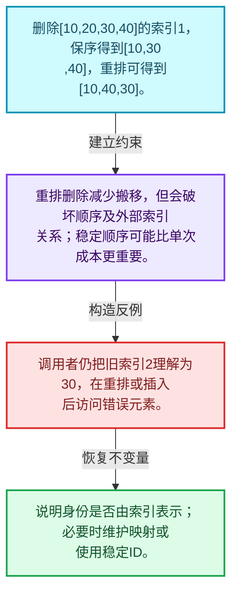
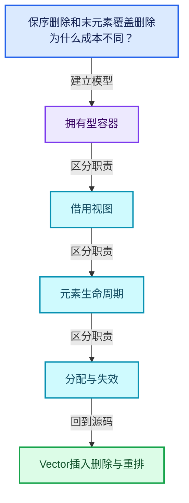
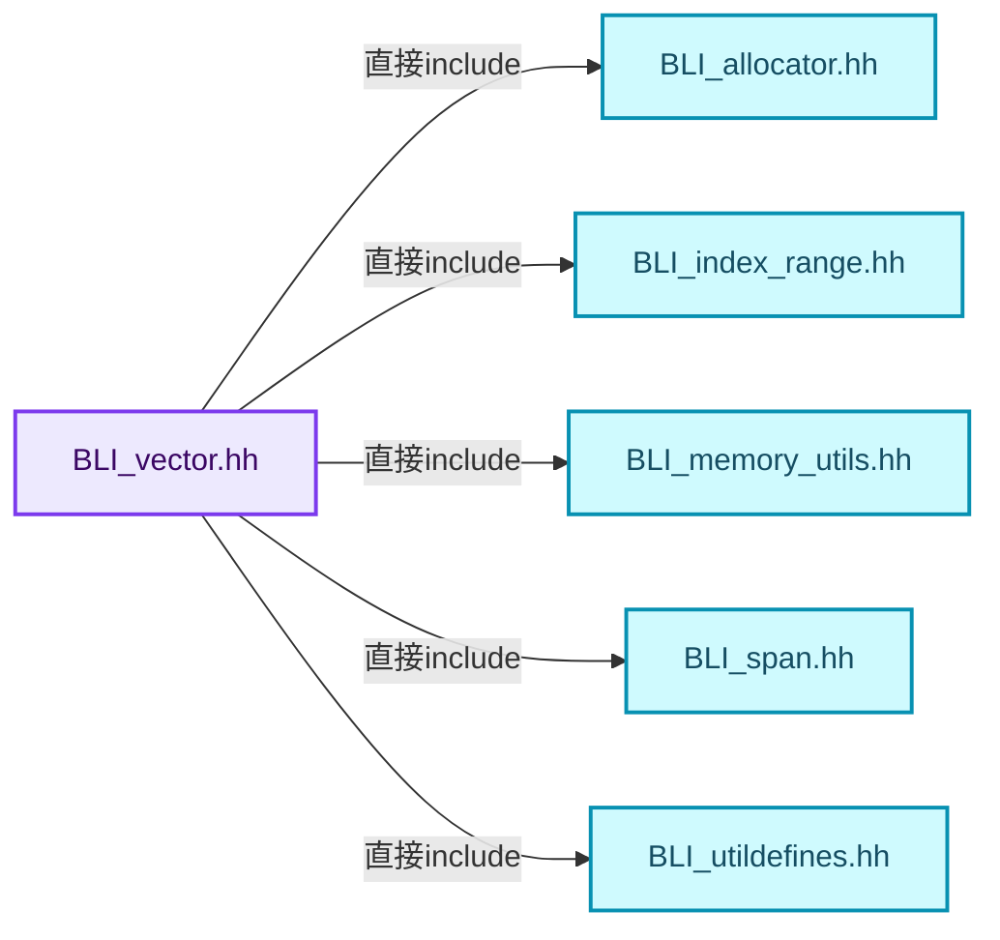
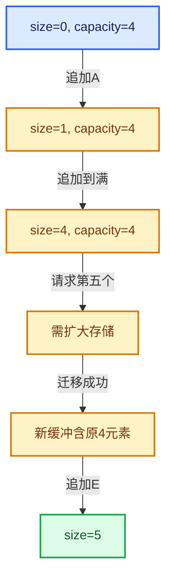

# 01-11 Vector插入删除与重排

[方向导航](README.md) · [总目录](../README.md) · [覆盖索引](../%E6%BA%90%E7%A0%81%E7%89%88%E6%9C%AC%E4%B8%8E%E8%A6%86%E7%9B%96%E7%B4%A2%E5%BC%95.md)

> 阅读顺序：问题与数据模型 → 语法与类型 → 源码逐行 → 调用线索 → 历史与取舍 → 推演和练习。

- 基准 HEAD：`cbda6b96c26c0dee3c3b5cbb93960c4ac06a6b30`。
- 记录日期：2026-10-14。
- 教学示例状态：正文中的推演不是本机性能实测；已运行练习见验收报告。

## 一、从问题到设计

保序删除和末元素覆盖删除为什么成本不同？

保序操作要移动后缀；remove_and_reorder允许改变元素顺序以减少搬移，调用者必须接受语义差异。

本篇把语法、数据语义和系统取舍连接起来。先证明对象存活，再讨论索引；先区分借用与拥有，再讨论复制移动。

### 本篇独立模型与设计推理

删除[10,20,30,40]的索引1，保序得到[10,30,40]，重排可得到[10,40,30]。

设计取舍：重排删除减少搬移，但会破坏顺序及外部索引关系；稳定顺序可能比单次成本更重要。

最小反例：调用者仍把旧索引2理解为30，在重排或插入后访问错误元素。

推导与处理：说明身份是否由索引表示；必要时维护映射或使用稳定ID。



### 源码范围与相邻篇章

| 文件 | 本篇逐行范围 | 基准SHA-256 |
|---|---|---|
| [source/blender/blenlib/BLI_vector.hh](../../../../../source/blender/blenlib/BLI_vector.hh) | L498—L937 | `6867b6ba34200e7e0a14495d93a9bef1645c5ef599e1f29ccdddc7c21e500485` |

同一主讲文件可能分多篇覆盖；超出本篇范围的符号通过覆盖索引定位。空行与纯注释保留在源码摘录中，逐行表解释有效语句与语法边界；许可证头统一保留。

前篇：[Vector扩容与增长](10-Vector%E6%89%A9%E5%AE%B9%E4%B8%8E%E5%A2%9E%E9%95%BF.md).

后篇：[Vector异常安全与边界](12-Vector%E5%BC%82%E5%B8%B8%E5%AE%89%E5%85%A8%E4%B8%8E%E8%BE%B9%E7%95%8C.md).

## 二、类型、数据与阅读地图



这是概念依赖图，边表示阅读关系，不声称是运行时调用顺序。

### 直接编译依赖



箭头只表示头文件包含关系；完整调用线索见后面的符号定位表。

## 三、关键词、语法与类型角色

### 模板 template

模板把类型或常量作为生成实现的参数。读声明时先列出类型参数、非类型参数和默认值，再看使用者实际实例化了什么。模板声明本身不意味着每种T都支持其全部成员。

具体检查：把T替换为int、string、只能移动的类型，分别检查每个被调用操作是否成立。

### 依赖名称 typename

typename既可引入类型模板参数，也可告诉编译器某个依赖名称是类型。它不创建运行时对象；解析期确认语法类别与实例化期检查具体类型是不同阶段。

具体检查：区分typename T::value_type和T::size()，前者标记类型，后者是表达式。

### 常量求值 constexpr

constexpr声明允许相应实体参与常量求值，但constexpr函数仍可以在运行时执行。是否常量求值由调用场景和表达式合法性共同决定。

具体检查：比较constexpr变量初始化和从运行时输入调用同一函数。

### 只读限定 const

const约束当前访问路径可做的修改。const指针、指向const的指针、const视图对象、const元素是不同位置的限定；其他别名可能仍可修改原对象。

具体检查：分别写T* const、const T*与const T* const，并画出不可修改的层次。

### 移动转换 std::move

std::move把表达式转换为可供移动重载选择的值类别，实际资源转移发生在被选中的构造或赋值中。对const对象move可能仍调用复制，对视图move也不会获得底层数据所有权。

具体检查：记录移动构造调用次数，不用变量名或std::move的出现次数替代测量。

### 完美转发 std::forward

std::forward在转发引用模板中恢复调用者原来的值类别。它依赖推导出的模板实参；无条件move会改变左值调用者的语义。

具体检查：对同一接口分别传入左值、临时对象和const左值，记录实际重载。

### 异常约定 noexcept

noexcept表达式可以依赖类型特征。违反不抛异常约定会终止程序；它不是自动捕获异常，也不是资源回滚代码。

具体检查：找出声明的条件与实际可能抛出的分配、构造操作是否一致。

### 异常边界 try与catch

try定义异常传播的局部边界。失败路径需要销毁已经成功构造的部分并释放相应存储；未构造的对象不能被析构。

具体检查：在第k次构造失败，列出已经存在的对象集合与待释放缓冲。

### 显式静态转换 static_cast

static_cast表达编译期允许的转换，不会自动验证运行时真实类型、指针寿命或索引边界。由void指针恢复T指针时，调用者仍须保证实际存储中确有合法T对象。

具体检查：标出转换前后的类型以及正确性依据来自哪里。

### 构造与new表达式

普通new可能分配并构造；placement new在给定地址构造，存储由其他机制提供。失败回滚应区分两类责任。

具体检查：追踪地址来自哪里、构造何时成功、由谁析构、由谁释放。

### 内部断言 assert

断言表达开发者预期成立的内部契约，发布构建可能关闭。它不能替代对不可信输入的完整错误处理，也不保证后续操作被运行时保护。

具体检查：对每条断言构造违反条件的输入，区分调用者错误与应向用户报告的错误。

### 编译期分支 if constexpr

条件在实例化时决定被保留的分支，这常用于不同类型的合法操作选择。它与运行时if有不同的实例化检查规则。

具体检查：找出每个分支依赖哪些类型特征，再使用满足与不满足条件的类型。

## 四、真实源码与逐行讲解

源码块保持原行内容，原始行号由小节标题及逐行表给出。表中的调用定位是静态阅读辅助；重载、模板实例化、宏展开和虚调用需结合完整声明，不能仅凭词法出现证明动态调用。

### BLI_vector.hh：L498—L542

<!-- source:source/blender/blenlib/BLI_vector.hh:498:542 -->

```cpp
  void append(const T &value)
  {
    this->append_as(value);
  }
  void append(T &&value)
  {
    this->append_as(std::move(value));
  }
  /* This is similar to `std::vector::emplace_back`. */
  template<typename... ForwardValue> void append_as(ForwardValue &&...value)
  {
    this->ensure_space_for_one();
    this->append_unchecked_as(std::forward<ForwardValue>(value)...);
  }

  /**
   * Append the value to the vector and return the index that can be used to access the newly
   * added value.
   */
  int64_t append_and_get_index(const T &value)
  {
    return this->append_and_get_index_as(value);
  }
  int64_t append_and_get_index(T &&value)
  {
    return this->append_and_get_index_as(std::move(value));
  }
  template<typename... ForwardValue> int64_t append_and_get_index_as(ForwardValue &&...value)
  {
    const int64_t index = this->size();
    this->append_as(std::forward<ForwardValue>(value)...);
    return index;
  }

  /**
   * Append the value if it is not yet in the vector. This has to do a linear search to check if
   * the value is in the vector. Therefore, this should only be called when it is known that the
   * vector is small.
   */
  void append_non_duplicates(const T &value)
  {
    if (!this->contains(value)) {
      this->append(value);
    }
  }
```

本段语义重点：

- `ensure_space_for_one`：确保单次追加有可用存储，随后仍须真正构造元素。

| 原始行 | 语义、约束与检查 |
|---|---|
| L498 | 出现调用或函数声明 `append`，对应表达式为 `void append(const T &value)`。参数求值、返回类型与重载需结合前后完整语句；静态文本引用不能证明动态目标。 |
| L499 | 连接上一行的声明或控制结构与其语句块；后续行在这个作用域中执行或声明。 |
| L500 | 出现调用或函数声明 `append_as`，对应表达式为 `this->append_as(value);`。参数求值、返回类型与重载需结合前后完整语句；静态文本引用不能证明动态目标。 |
| L501 | 结束当前语法单元。局部自动对象在离开其作用域时按规则销毁；这不等于所有被引用的外部数据也被释放。 |
| L502 | 出现调用或函数声明 `append`，对应表达式为 `void append(T &&value)`。参数求值、返回类型与重载需结合前后完整语句；静态文本引用不能证明动态目标。 |
| L503 | 连接上一行的声明或控制结构与其语句块；后续行在这个作用域中执行或声明。 |
| L504 | 出现调用或函数声明 `append_as`，对应表达式为 `this->append_as(std::move(value));`。参数求值、返回类型与重载需结合前后完整语句；静态文本引用不能证明动态目标。 |
| L505 | 结束当前语法单元。局部自动对象在离开其作用域时按规则销毁；这不等于所有被引用的外部数据也被释放。 |
| L507 | 声明模板参数 `template<typename... ForwardValue> void append_as(ForwardValue &&...value)`。类型参数决定生成操作的类型，非类型参数可决定内嵌容量或编译期分支。 |
| L508 | 连接上一行的声明或控制结构与其语句块；后续行在这个作用域中执行或声明。 |
| L509 | 本行使用 `ensure_space_for_one`：确保单次追加有可用存储，随后仍须真正构造元素。 |
| L510 | 出现调用或函数声明 `append_unchecked_as`，对应表达式为 `this->append_unchecked_as(std::forward<ForwardValue>(value)...);`。参数求值、返回类型与重载需结合前后完整语句；静态文本引用不能证明动态目标。 |
| L511 | 结束当前语法单元。局部自动对象在离开其作用域时按规则销毁；这不等于所有被引用的外部数据也被释放。 |
| L517 | 出现调用或函数声明 `append_and_get_index`，对应表达式为 `int64_t append_and_get_index(const T &value)`。参数求值、返回类型与重载需结合前后完整语句；静态文本引用不能证明动态目标。 |
| L518 | 连接上一行的声明或控制结构与其语句块；后续行在这个作用域中执行或声明。 |
| L519 | 返回表达式 `this->append_and_get_index_as(value)`。 |
| L520 | 结束当前语法单元。局部自动对象在离开其作用域时按规则销毁；这不等于所有被引用的外部数据也被释放。 |
| L521 | 出现调用或函数声明 `append_and_get_index`，对应表达式为 `int64_t append_and_get_index(T &&value)`。参数求值、返回类型与重载需结合前后完整语句；静态文本引用不能证明动态目标。 |
| L522 | 连接上一行的声明或控制结构与其语句块；后续行在这个作用域中执行或声明。 |
| L523 | 返回表达式 `this->append_and_get_index_as(std::move(value))`。 |
| L524 | 结束当前语法单元。局部自动对象在离开其作用域时按规则销毁；这不等于所有被引用的外部数据也被释放。 |
| L525 | 声明模板参数 `template<typename... ForwardValue> int64_t append_and_get_index_as(ForwardValue &&...value)`。类型参数决定生成操作的类型，非类型参数可决定内嵌容量或编译期分支。 |
| L526 | 连接上一行的声明或控制结构与其语句块；后续行在这个作用域中执行或声明。 |
| L527 | 把右侧 `this->size()` 用于初始化或更新左侧 `const int64_t index`。声明初始化与已有对象赋值应按上下文区分；有资源的类型会调用相应特殊成员。 |
| L528 | 出现调用或函数声明 `append_as`，对应表达式为 `this->append_as(std::forward<ForwardValue>(value)...);`。参数求值、返回类型与重载需结合前后完整语句；静态文本引用不能证明动态目标。 |
| L529 | 返回表达式 `index`。 |
| L530 | 结束当前语法单元。局部自动对象在离开其作用域时按规则销毁；这不等于所有被引用的外部数据也被释放。 |
| L537 | 出现调用或函数声明 `append_non_duplicates`，对应表达式为 `void append_non_duplicates(const T &value)`。参数求值、返回类型与重载需结合前后完整语句；静态文本引用不能证明动态目标。 |
| L538 | 连接上一行的声明或控制结构与其语句块；后续行在这个作用域中执行或声明。 |
| L539 | 判断 `!this->contains(value)`，成立时进入本分支，否则继续后续路径。 |
| L540 | 出现调用或函数声明 `append`，对应表达式为 `this->append(value);`。参数求值、返回类型与重载需结合前后完整语句；静态文本引用不能证明动态目标。 |
| L541 | 结束当前语法单元。局部自动对象在离开其作用域时按规则销毁；这不等于所有被引用的外部数据也被释放。 |
| L542 | 结束当前语法单元。局部自动对象在离开其作用域时按规则销毁；这不等于所有被引用的外部数据也被释放。 |

### BLI_vector.hh：L543—L588

<!-- source:source/blender/blenlib/BLI_vector.hh:543:588 -->

```cpp

  /**
   * Append the value and assume that vector has enough memory reserved. This invokes undefined
   * behavior when not enough capacity has been reserved beforehand. Only use this in performance
   * critical code.
   */
  void append_unchecked(const T &value)
  {
    this->append_unchecked_as(value);
  }
  void append_unchecked(T &&value)
  {
    this->append_unchecked_as(std::move(value));
  }
  template<typename... ForwardT> void append_unchecked_as(ForwardT &&...value)
  {
    BLI_assert(end_ < capacity_end_);
    new (end_) T(std::forward<ForwardT>(value)...);
    end_++;
    UPDATE_VECTOR_SIZE(this);
  }

  /**
   * Insert the same element n times at the end of the vector.
   * This might result in a reallocation internally.
   */
  void append_n_times(const T &value, const int64_t n)
  {
    BLI_assert(n >= 0);
    this->reserve(this->size() + n);
    uninitialized_fill_n(end_, n, value);
    this->increase_size_by_unchecked(n);
  }

  /**
   * Enlarges the size of the internal buffer that is considered to be initialized.
   * This invokes undefined behavior when the new size is larger than the capacity.
   * The method can be useful when you want to call constructors in the vector yourself.
   * This should only be done in very rare cases and has to be justified every time.
   */
  void increase_size_by_unchecked(const int64_t n) noexcept
  {
    BLI_assert(end_ + n <= capacity_end_);
    end_ += n;
    UPDATE_VECTOR_SIZE(this);
  }
```

本段语义重点：

- `end_`：尾后位置字段；在Vector中界定已构造区间，尾后位置不是最后一个元素。
- `capacity_end_`：已分配存储的尾后位置，和end_之间通常尚未构造对象。

| 原始行 | 语义、约束与检查 |
|---|---|
| L549 | 出现调用或函数声明 `append_unchecked`，对应表达式为 `void append_unchecked(const T &value)`。参数求值、返回类型与重载需结合前后完整语句；静态文本引用不能证明动态目标。 |
| L550 | 连接上一行的声明或控制结构与其语句块；后续行在这个作用域中执行或声明。 |
| L551 | 出现调用或函数声明 `append_unchecked_as`，对应表达式为 `this->append_unchecked_as(value);`。参数求值、返回类型与重载需结合前后完整语句；静态文本引用不能证明动态目标。 |
| L552 | 结束当前语法单元。局部自动对象在离开其作用域时按规则销毁；这不等于所有被引用的外部数据也被释放。 |
| L553 | 出现调用或函数声明 `append_unchecked`，对应表达式为 `void append_unchecked(T &&value)`。参数求值、返回类型与重载需结合前后完整语句；静态文本引用不能证明动态目标。 |
| L554 | 连接上一行的声明或控制结构与其语句块；后续行在这个作用域中执行或声明。 |
| L555 | 出现调用或函数声明 `append_unchecked_as`，对应表达式为 `this->append_unchecked_as(std::move(value));`。参数求值、返回类型与重载需结合前后完整语句；静态文本引用不能证明动态目标。 |
| L556 | 结束当前语法单元。局部自动对象在离开其作用域时按规则销毁；这不等于所有被引用的外部数据也被释放。 |
| L557 | 声明模板参数 `template<typename... ForwardT> void append_unchecked_as(ForwardT &&...value)`。类型参数决定生成操作的类型，非类型参数可决定内嵌容量或编译期分支。 |
| L558 | 连接上一行的声明或控制结构与其语句块；后续行在这个作用域中执行或声明。 |
| L559 | 断言约束 `BLI_assert(end_ < capacity_end_);`。条件是后续访问的内部前置条件；发布构建可能不执行，不能把断言当作输入修复。 |
| L560 | 本行涉及 `end_`：尾后位置字段；在Vector中界定已构造区间，尾后位置不是最后一个元素。按此语义解读 `new (end_) T(std::forward<ForwardT>(value)...)`，不要把地址、数量或状态混用。 |
| L561 | 递增或递减现有状态：`end_++;`。这改变计数或游标；检查边界、计数单位，以及并发访问是否有相应保护。 |
| L562 | 出现调用或函数声明 `UPDATE_VECTOR_SIZE`，对应表达式为 `UPDATE_VECTOR_SIZE(this);`。参数求值、返回类型与重载需结合前后完整语句；静态文本引用不能证明动态目标。 |
| L563 | 结束当前语法单元。局部自动对象在离开其作用域时按规则销毁；这不等于所有被引用的外部数据也被释放。 |
| L569 | 出现调用或函数声明 `append_n_times`，对应表达式为 `void append_n_times(const T &value, const int64_t n)`。参数求值、返回类型与重载需结合前后完整语句；静态文本引用不能证明动态目标。 |
| L570 | 连接上一行的声明或控制结构与其语句块；后续行在这个作用域中执行或声明。 |
| L571 | 断言约束 `BLI_assert(n >= 0);`。条件是后续访问的内部前置条件；发布构建可能不执行，不能把断言当作输入修复。 |
| L572 | 出现调用或函数声明 `reserve`，对应表达式为 `this->reserve(this->size() + n);`。参数求值、返回类型与重载需结合前后完整语句；静态文本引用不能证明动态目标。 |
| L573 | 本行涉及 `end_`：尾后位置字段；在Vector中界定已构造区间，尾后位置不是最后一个元素。按此语义解读 `uninitialized_fill_n(end_, n, value)`，不要把地址、数量或状态混用。 |
| L574 | 出现调用或函数声明 `increase_size_by_unchecked`，对应表达式为 `this->increase_size_by_unchecked(n);`。参数求值、返回类型与重载需结合前后完整语句；静态文本引用不能证明动态目标。 |
| L575 | 结束当前语法单元。局部自动对象在离开其作用域时按规则销毁；这不等于所有被引用的外部数据也被释放。 |
| L583 | 出现调用或函数声明 `increase_size_by_unchecked`，对应表达式为 `void increase_size_by_unchecked(const int64_t n) noexcept`。参数求值、返回类型与重载需结合前后完整语句；静态文本引用不能证明动态目标。 |
| L584 | 连接上一行的声明或控制结构与其语句块；后续行在这个作用域中执行或声明。 |
| L585 | 断言约束 `BLI_assert(end_ + n <= capacity_end_);`。条件是后续访问的内部前置条件；发布构建可能不执行，不能把断言当作输入修复。 |
| L586 | 复合更新 `end_ += n`：读取左侧现有值，与右侧按`+=`对应操作组合后写回。检查数值边界、位掩码或共享状态保护；它不是新对象的构造。 |
| L587 | 出现调用或函数声明 `UPDATE_VECTOR_SIZE`，对应表达式为 `UPDATE_VECTOR_SIZE(this);`。参数求值、返回类型与重载需结合前后完整语句；静态文本引用不能证明动态目标。 |
| L588 | 结束当前语法单元。局部自动对象在离开其作用域时按规则销毁；这不等于所有被引用的外部数据也被释放。 |

### BLI_vector.hh：L589—L640

<!-- source:source/blender/blenlib/BLI_vector.hh:589:640 -->

```cpp

  /**
   * Copy the elements of another array to the end of this vector.
   *
   * This can be used to emulate parts of std::vector::insert.
   */
  void extend(Span<T> array)
  {
    this->extend(array.data(), array.size());
  }
  void extend(const T *start, int64_t amount)
  {
    this->reserve(this->size() + amount);
    this->extend_unchecked(start, amount);
  }

  /**
   * Moves the elements of another vector to the end of this vector.
   *
   * This may result in reallocation to fit other vector elements, other vector will keep it
   * buffer allocation, but it will become empty.
   * This can be used in vectors that manages resources, allowing acquiring resources from another
   * vector, preventing shared ownership of managed resources.
   */
  template<int64_t OtherInlineBufferCapacity>
  void extend(Vector<T, OtherInlineBufferCapacity, Allocator> &&other)
  {
    BLI_assert(this != &other);
    this->extend(std::make_move_iterator(other.begin()), std::make_move_iterator(other.end()));
    other.clear();
  }

  /**
   * Adds all elements from the array that are not already in the vector. This is an expensive
   * operation when the vector is large, but can be very cheap when it is known that the vector is
   * small.
   */
  void extend_non_duplicates(Span<T> array)
  {
    for (const T &value : array) {
      this->append_non_duplicates(value);
    }
  }

  /**
   * Extend the vector without bounds checking. It is assumed that enough memory has been reserved
   * beforehand. Only use this in performance critical code.
   */
  void extend_unchecked(Span<T> array)
  {
    this->extend_unchecked(array.data(), array.size());
  }
```

| 原始行 | 语义、约束与检查 |
|---|---|
| L595 | 出现调用或函数声明 `extend`，对应表达式为 `void extend(Span<T> array)`。参数求值、返回类型与重载需结合前后完整语句；静态文本引用不能证明动态目标。 |
| L596 | 连接上一行的声明或控制结构与其语句块；后续行在这个作用域中执行或声明。 |
| L597 | 出现调用或函数声明 `extend`，对应表达式为 `this->extend(array.data(), array.size());`。参数求值、返回类型与重载需结合前后完整语句；静态文本引用不能证明动态目标。 |
| L598 | 结束当前语法单元。局部自动对象在离开其作用域时按规则销毁；这不等于所有被引用的外部数据也被释放。 |
| L599 | 出现调用或函数声明 `extend`，对应表达式为 `void extend(const T *start, int64_t amount)`。参数求值、返回类型与重载需结合前后完整语句；静态文本引用不能证明动态目标。 |
| L600 | 连接上一行的声明或控制结构与其语句块；后续行在这个作用域中执行或声明。 |
| L601 | 出现调用或函数声明 `reserve`，对应表达式为 `this->reserve(this->size() + amount);`。参数求值、返回类型与重载需结合前后完整语句；静态文本引用不能证明动态目标。 |
| L602 | 出现调用或函数声明 `extend_unchecked`，对应表达式为 `this->extend_unchecked(start, amount);`。参数求值、返回类型与重载需结合前后完整语句；静态文本引用不能证明动态目标。 |
| L603 | 结束当前语法单元。局部自动对象在离开其作用域时按规则销毁；这不等于所有被引用的外部数据也被释放。 |
| L613 | 声明模板参数 `template<int64_t OtherInlineBufferCapacity>`。类型参数决定生成操作的类型，非类型参数可决定内嵌容量或编译期分支。 |
| L614 | 出现调用或函数声明 `extend`，对应表达式为 `void extend(Vector<T, OtherInlineBufferCapacity, Allocator> &&other)`。参数求值、返回类型与重载需结合前后完整语句；静态文本引用不能证明动态目标。 |
| L615 | 连接上一行的声明或控制结构与其语句块；后续行在这个作用域中执行或声明。 |
| L616 | 断言约束 `BLI_assert(this != &other);`。条件是后续访问的内部前置条件；发布构建可能不执行，不能把断言当作输入修复。 |
| L617 | 出现调用或函数声明 `extend`，对应表达式为 `this->extend(std::make_move_iterator(other.begin()), std::make_move_iterator(other.end()));`。参数求值、返回类型与重载需结合前后完整语句；静态文本引用不能证明动态目标。 |
| L618 | 出现调用或函数声明 `clear`，对应表达式为 `other.clear();`。参数求值、返回类型与重载需结合前后完整语句；静态文本引用不能证明动态目标。 |
| L619 | 结束当前语法单元。局部自动对象在离开其作用域时按规则销毁；这不等于所有被引用的外部数据也被释放。 |
| L626 | 出现调用或函数声明 `extend_non_duplicates`，对应表达式为 `void extend_non_duplicates(Span<T> array)`。参数求值、返回类型与重载需结合前后完整语句；静态文本引用不能证明动态目标。 |
| L627 | 连接上一行的声明或控制结构与其语句块；后续行在这个作用域中执行或声明。 |
| L628 | 按 `for (const T &value : array)` 指定的范围或条件重复执行。对照循环变量与真实元素编号；循环内调用成本乘以实际迭代次数。 |
| L629 | 出现调用或函数声明 `append_non_duplicates`，对应表达式为 `this->append_non_duplicates(value);`。参数求值、返回类型与重载需结合前后完整语句；静态文本引用不能证明动态目标。 |
| L630 | 结束当前语法单元。局部自动对象在离开其作用域时按规则销毁；这不等于所有被引用的外部数据也被释放。 |
| L631 | 结束当前语法单元。局部自动对象在离开其作用域时按规则销毁；这不等于所有被引用的外部数据也被释放。 |
| L637 | 出现调用或函数声明 `extend_unchecked`，对应表达式为 `void extend_unchecked(Span<T> array)`。参数求值、返回类型与重载需结合前后完整语句；静态文本引用不能证明动态目标。 |
| L638 | 连接上一行的声明或控制结构与其语句块；后续行在这个作用域中执行或声明。 |
| L639 | 出现调用或函数声明 `extend_unchecked`，对应表达式为 `this->extend_unchecked(array.data(), array.size());`。参数求值、返回类型与重载需结合前后完整语句；静态文本引用不能证明动态目标。 |
| L640 | 结束当前语法单元。局部自动对象在离开其作用域时按规则销毁；这不等于所有被引用的外部数据也被释放。 |

### BLI_vector.hh：L641—L677

<!-- source:source/blender/blenlib/BLI_vector.hh:641:677 -->

```cpp
  void extend_unchecked(const T *start, int64_t amount)
  {
    BLI_assert(amount >= 0);
    BLI_assert(begin_ + amount <= capacity_end_);
    uninitialized_copy_n(start, amount, end_);
    end_ += amount;
    UPDATE_VECTOR_SIZE(this);
  }

  template<typename InputIt> void extend(InputIt first, InputIt last)
  {
    this->insert(this->end(), first, last);
  }

  /**
   * Insert elements into the vector at the specified position. This has a running time of O(n)
   * where n is the number of values that have to be moved. Undefined behavior is invoked when the
   * insert position is out of bounds.
   */
  void insert(const int64_t insert_index, const T &value)
  {
    this->insert(insert_index, Span<T>(&value, 1));
  }
  void insert(const int64_t insert_index, T &&value)
  {
    this->insert(
        insert_index, std::make_move_iterator(&value), std::make_move_iterator(&value + 1));
  }
  void insert(const int64_t insert_index, Span<T> array)
  {
    this->insert(begin_ + insert_index, array.begin(), array.end());
  }
  template<typename InputIt> void insert(const T *insert_position, InputIt first, InputIt last)
  {
    const int64_t insert_index = insert_position - begin_;
    this->insert(insert_index, first, last);
  }
```

本段语义重点：

- `uninitialized_copy_n`：把源值复制构造到未初始化的目标区间；目标已有对象时不能直接用此操作替代赋值。
- `begin_`：起点字段；在Vector中与end_界定已构造区间，其他类应按自己的声明确认含义。
- `end_`：尾后位置字段；在Vector中界定已构造区间，尾后位置不是最后一个元素。
- `capacity_end_`：已分配存储的尾后位置，和end_之间通常尚未构造对象。

| 原始行 | 语义、约束与检查 |
|---|---|
| L641 | 出现调用或函数声明 `extend_unchecked`，对应表达式为 `void extend_unchecked(const T *start, int64_t amount)`。参数求值、返回类型与重载需结合前后完整语句；静态文本引用不能证明动态目标。 |
| L642 | 连接上一行的声明或控制结构与其语句块；后续行在这个作用域中执行或声明。 |
| L643 | 断言约束 `BLI_assert(amount >= 0);`。条件是后续访问的内部前置条件；发布构建可能不执行，不能把断言当作输入修复。 |
| L644 | 断言约束 `BLI_assert(begin_ + amount <= capacity_end_);`。条件是后续访问的内部前置条件；发布构建可能不执行，不能把断言当作输入修复。 |
| L645 | 本行使用 `uninitialized_copy_n`：把源值复制构造到未初始化的目标区间；目标已有对象时不能直接用此操作替代赋值。 |
| L646 | 复合更新 `end_ += amount`：读取左侧现有值，与右侧按`+=`对应操作组合后写回。检查数值边界、位掩码或共享状态保护；它不是新对象的构造。 |
| L647 | 出现调用或函数声明 `UPDATE_VECTOR_SIZE`，对应表达式为 `UPDATE_VECTOR_SIZE(this);`。参数求值、返回类型与重载需结合前后完整语句；静态文本引用不能证明动态目标。 |
| L648 | 结束当前语法单元。局部自动对象在离开其作用域时按规则销毁；这不等于所有被引用的外部数据也被释放。 |
| L650 | 声明模板参数 `template<typename InputIt> void extend(InputIt first, InputIt last)`。类型参数决定生成操作的类型，非类型参数可决定内嵌容量或编译期分支。 |
| L651 | 连接上一行的声明或控制结构与其语句块；后续行在这个作用域中执行或声明。 |
| L652 | 出现调用或函数声明 `insert`，对应表达式为 `this->insert(this->end(), first, last);`。参数求值、返回类型与重载需结合前后完整语句；静态文本引用不能证明动态目标。 |
| L653 | 结束当前语法单元。局部自动对象在离开其作用域时按规则销毁；这不等于所有被引用的外部数据也被释放。 |
| L660 | 出现调用或函数声明 `insert`，对应表达式为 `void insert(const int64_t insert_index, const T &value)`。参数求值、返回类型与重载需结合前后完整语句；静态文本引用不能证明动态目标。 |
| L661 | 连接上一行的声明或控制结构与其语句块；后续行在这个作用域中执行或声明。 |
| L662 | 出现调用或函数声明 `insert`，对应表达式为 `this->insert(insert_index, Span<T>(&value, 1));`。参数求值、返回类型与重载需结合前后完整语句；静态文本引用不能证明动态目标。 |
| L663 | 结束当前语法单元。局部自动对象在离开其作用域时按规则销毁；这不等于所有被引用的外部数据也被释放。 |
| L664 | 出现调用或函数声明 `insert`，对应表达式为 `void insert(const int64_t insert_index, T &&value)`。参数求值、返回类型与重载需结合前后完整语句；静态文本引用不能证明动态目标。 |
| L665 | 连接上一行的声明或控制结构与其语句块；后续行在这个作用域中执行或声明。 |
| L666 | 出现调用或函数声明 `insert`，对应表达式为 `this->insert(`。参数求值、返回类型与重载需结合前后完整语句；静态文本引用不能证明动态目标。 |
| L667 | 出现调用或函数声明 `std::make_move_iterator`，对应表达式为 `insert_index, std::make_move_iterator(&value), std::make_move_iterator(&value + 1));`。参数求值、返回类型与重载需结合前后完整语句；静态文本引用不能证明动态目标。 |
| L668 | 结束当前语法单元。局部自动对象在离开其作用域时按规则销毁；这不等于所有被引用的外部数据也被释放。 |
| L669 | 出现调用或函数声明 `insert`，对应表达式为 `void insert(const int64_t insert_index, Span<T> array)`。参数求值、返回类型与重载需结合前后完整语句；静态文本引用不能证明动态目标。 |
| L670 | 连接上一行的声明或控制结构与其语句块；后续行在这个作用域中执行或声明。 |
| L671 | 本行涉及 `begin_`：起点字段；在Vector中与end_界定已构造区间，其他类应按自己的声明确认含义。按此语义解读 `this->insert(begin_ + insert_index, array.begin(), array.end())`，不要把地址、数量或状态混用。 |
| L672 | 结束当前语法单元。局部自动对象在离开其作用域时按规则销毁；这不等于所有被引用的外部数据也被释放。 |
| L673 | 声明模板参数 `template<typename InputIt> void insert(const T *insert_position, InputIt first, InputIt last)`。类型参数决定生成操作的类型，非类型参数可决定内嵌容量或编译期分支。 |
| L674 | 连接上一行的声明或控制结构与其语句块；后续行在这个作用域中执行或声明。 |
| L675 | 建立或更新 `begin_`：起点字段；在Vector中与end_界定已构造区间，其他类应按自己的声明确认含义。本行的具体值关系为 `const int64_t insert_index = insert_position - begin_`；对照更新前后相应范围或状态是否一致。 |
| L676 | 出现调用或函数声明 `insert`，对应表达式为 `this->insert(insert_index, first, last);`。参数求值、返回类型与重载需结合前后完整语句；静态文本引用不能证明动态目标。 |
| L677 | 结束当前语法单元。局部自动对象在离开其作用域时按规则销毁；这不等于所有被引用的外部数据也被释放。 |

### BLI_vector.hh：L678—L722

<!-- source:source/blender/blenlib/BLI_vector.hh:678:722 -->

```cpp
  template<typename InputIt> void insert(const int64_t insert_index, InputIt first, InputIt last)
  {
    BLI_assert(insert_index >= 0);
    BLI_assert(insert_index <= this->size());

    const int64_t insert_amount = std::distance(first, last);
    const int64_t old_size = this->size();
    const int64_t new_size = old_size + insert_amount;
    const int64_t move_amount = old_size - insert_index;

    this->reserve(new_size);
    for (int64_t i = 0; i < move_amount; i++) {
      const int64_t src_index = insert_index + move_amount - i - 1;
      const int64_t dst_index = new_size - i - 1;
      try {
        new (static_cast<void *>(begin_ + dst_index)) T(std::move(begin_[src_index]));
      }
      catch (...) {
        /* Destruct all values that have been moved already. */
        destruct_n(begin_ + dst_index + 1, i);
        end_ = begin_ + src_index + 1;
        UPDATE_VECTOR_SIZE(this);
        throw;
      }
      begin_[src_index].~T();
    }

    try {
      if constexpr (std::is_rvalue_reference_v<decltype(*first)>) {
        std::uninitialized_move_n(first, insert_amount, begin_ + insert_index);
      }
      else {
        std::uninitialized_copy_n(first, insert_amount, begin_ + insert_index);
      }
    }
    catch (...) {
      /* Destruct all values that have been moved. */
      destruct_n(begin_ + new_size - move_amount, move_amount);
      end_ = begin_ + insert_index;
      UPDATE_VECTOR_SIZE(this);
      throw;
    }
    end_ = begin_ + new_size;
    UPDATE_VECTOR_SIZE(this);
  }
```

本段语义重点：

- `uninitialized_copy_n`：把源值复制构造到未初始化的目标区间；目标已有对象时不能直接用此操作替代赋值。
- `uninitialized_move_n`：在目标存储移动构造元素；源对象是否另行销毁应查调用约定，不能与重定位自动等同。
- `destruct_n`：对已构造的元素区间执行析构；计数必须对应真实存活对象，释放原始内存是另一操作。
- `begin_`：起点字段；在Vector中与end_界定已构造区间，其他类应按自己的声明确认含义。
- `end_`：尾后位置字段；在Vector中界定已构造区间，尾后位置不是最后一个元素。

| 原始行 | 语义、约束与检查 |
|---|---|
| L678 | 声明模板参数 `template<typename InputIt> void insert(const int64_t insert_index, InputIt first, InputIt last)`。类型参数决定生成操作的类型，非类型参数可决定内嵌容量或编译期分支。 |
| L679 | 连接上一行的声明或控制结构与其语句块；后续行在这个作用域中执行或声明。 |
| L680 | 断言约束 `BLI_assert(insert_index >= 0);`。条件是后续访问的内部前置条件；发布构建可能不执行，不能把断言当作输入修复。 |
| L681 | 断言约束 `BLI_assert(insert_index <= this->size());`。条件是后续访问的内部前置条件；发布构建可能不执行，不能把断言当作输入修复。 |
| L683 | 把右侧 `std::distance(first, last)` 用于初始化或更新左侧 `const int64_t insert_amount`。声明初始化与已有对象赋值应按上下文区分；有资源的类型会调用相应特殊成员。 |
| L684 | 把右侧 `this->size()` 用于初始化或更新左侧 `const int64_t old_size`。声明初始化与已有对象赋值应按上下文区分；有资源的类型会调用相应特殊成员。 |
| L685 | 把右侧 `old_size + insert_amount` 用于初始化或更新左侧 `const int64_t new_size`。声明初始化与已有对象赋值应按上下文区分；有资源的类型会调用相应特殊成员。 |
| L686 | 把右侧 `old_size - insert_index` 用于初始化或更新左侧 `const int64_t move_amount`。声明初始化与已有对象赋值应按上下文区分；有资源的类型会调用相应特殊成员。 |
| L688 | 出现调用或函数声明 `reserve`，对应表达式为 `this->reserve(new_size);`。参数求值、返回类型与重载需结合前后完整语句；静态文本引用不能证明动态目标。 |
| L689 | 纯虚接口声明：`for (int64_t i = 0; i < move_amount; i++) {`。等号零标记抽象接口，需要按继承约定提供覆写；不表示执行函数并把结果设为零。 |
| L690 | 把右侧 `insert_index + move_amount - i - 1` 用于初始化或更新左侧 `const int64_t src_index`。声明初始化与已有对象赋值应按上下文区分；有资源的类型会调用相应特殊成员。 |
| L691 | 把右侧 `new_size - i - 1` 用于初始化或更新左侧 `const int64_t dst_index`。声明初始化与已有对象赋值应按上下文区分；有资源的类型会调用相应特殊成员。 |
| L692 | 开始可能抛异常的操作区间；下面catch负责局部回滚，需精确区分已经构造和尚未构造对象。 |
| L693 | 本行涉及 `begin_`：起点字段；在Vector中与end_界定已构造区间，其他类应按自己的声明确认含义。按此语义解读 `new (static_cast<void *>(begin_ + dst_index)) T(std::move(begin_[src_index]))`，不要把地址、数量或状态混用。 |
| L694 | 结束当前语法单元。局部自动对象在离开其作用域时按规则销毁；这不等于所有被引用的外部数据也被释放。 |
| L695 | 进入异常清理路径；随后应释放本路径新取得的资源，同时遵守源对象已经发生的状态变化。 |
| L697 | 本行使用 `destruct_n`：对已构造的元素区间执行析构；计数必须对应真实存活对象，释放原始内存是另一操作。 |
| L698 | 建立或更新 `begin_`：起点字段；在Vector中与end_界定已构造区间，其他类应按自己的声明确认含义。本行的具体值关系为 `end_ = begin_ + src_index + 1`；对照更新前后相应范围或状态是否一致。 |
| L699 | 出现调用或函数声明 `UPDATE_VECTOR_SIZE`，对应表达式为 `UPDATE_VECTOR_SIZE(this);`。参数求值、返回类型与重载需结合前后完整语句；静态文本引用不能证明动态目标。 |
| L700 | 继续传播异常或抛出新异常；在执行前必须完成本层负责的资源清理。 |
| L701 | 结束当前语法单元。局部自动对象在离开其作用域时按规则销毁；这不等于所有被引用的外部数据也被释放。 |
| L702 | 涉及析构接口或显式析构：`begin_[src_index].~T();`。检查目标对象已成功构造，且资源不会在另一条清理路径再次销毁。 |
| L703 | 结束当前语法单元。局部自动对象在离开其作用域时按规则销毁；这不等于所有被引用的外部数据也被释放。 |
| L705 | 开始可能抛异常的操作区间；下面catch负责局部回滚，需精确区分已经构造和尚未构造对象。 |
| L706 | 编译期条件分支 `if constexpr (std::is_rvalue_reference_v<decltype(*first)>)`。按实例化类型选择相应实现；被舍弃分支和运行期if具有不同检查规则，不能当作运行时输入验证。 |
| L707 | 本行使用 `uninitialized_move_n`：在目标存储移动构造元素；源对象是否另行销毁应查调用约定，不能与重定位自动等同。 |
| L708 | 结束当前语法单元。局部自动对象在离开其作用域时按规则销毁；这不等于所有被引用的外部数据也被释放。 |
| L709 | 处理前一条件不成立的互补路径。比较两条路径最后是否恢复同一不变量，以及是否产生不同的资源责任。 |
| L710 | 本行使用 `uninitialized_copy_n`：把源值复制构造到未初始化的目标区间；目标已有对象时不能直接用此操作替代赋值。 |
| L711 | 结束当前语法单元。局部自动对象在离开其作用域时按规则销毁；这不等于所有被引用的外部数据也被释放。 |
| L712 | 结束当前语法单元。局部自动对象在离开其作用域时按规则销毁；这不等于所有被引用的外部数据也被释放。 |
| L713 | 进入异常清理路径；随后应释放本路径新取得的资源，同时遵守源对象已经发生的状态变化。 |
| L715 | 本行使用 `destruct_n`：对已构造的元素区间执行析构；计数必须对应真实存活对象，释放原始内存是另一操作。 |
| L716 | 建立或更新 `begin_`：起点字段；在Vector中与end_界定已构造区间，其他类应按自己的声明确认含义。本行的具体值关系为 `end_ = begin_ + insert_index`；对照更新前后相应范围或状态是否一致。 |
| L717 | 出现调用或函数声明 `UPDATE_VECTOR_SIZE`，对应表达式为 `UPDATE_VECTOR_SIZE(this);`。参数求值、返回类型与重载需结合前后完整语句；静态文本引用不能证明动态目标。 |
| L718 | 继续传播异常或抛出新异常；在执行前必须完成本层负责的资源清理。 |
| L719 | 结束当前语法单元。局部自动对象在离开其作用域时按规则销毁；这不等于所有被引用的外部数据也被释放。 |
| L720 | 建立或更新 `begin_`：起点字段；在Vector中与end_界定已构造区间，其他类应按自己的声明确认含义。本行的具体值关系为 `end_ = begin_ + new_size`；对照更新前后相应范围或状态是否一致。 |
| L721 | 出现调用或函数声明 `UPDATE_VECTOR_SIZE`，对应表达式为 `UPDATE_VECTOR_SIZE(this);`。参数求值、返回类型与重载需结合前后完整语句；静态文本引用不能证明动态目标。 |
| L722 | 结束当前语法单元。局部自动对象在离开其作用域时按规则销毁；这不等于所有被引用的外部数据也被释放。 |

### BLI_vector.hh：L723—L770

<!-- source:source/blender/blenlib/BLI_vector.hh:723:770 -->

```cpp

  /**
   * Insert values at the beginning of the vector.
   * This has to move all the other elements, so it has a linear running time.
   */
  void prepend(const T &value)
  {
    this->insert(0, value);
  }
  void prepend(T &&value)
  {
    this->insert(0, std::move(value));
  }
  void prepend(Span<T> values)
  {
    this->insert(0, values);
  }
  template<typename InputIt> void prepend(InputIt first, InputIt last)
  {
    this->insert(0, first, last);
  }

  /**
   * Return a reference to the nth last element.
   * This invokes undefined behavior when the vector is too short.
   */
  const T &last(const int64_t n = 0) const
  {
    BLI_assert(n >= 0);
    BLI_assert(n < this->size());
    return *(end_ - 1 - n);
  }
  T &last(const int64_t n = 0)
  {
    BLI_assert(n >= 0);
    BLI_assert(n < this->size());
    return *(end_ - 1 - n);
  }

  /**
   * Return a reference to the first element in the vector.
   * This invokes undefined behavior when the vector is empty.
   */
  const T &first() const
  {
    BLI_assert(this->size() > 0);
    return *begin_;
  }
```

本段语义重点：

- `begin_`：起点字段；在Vector中与end_界定已构造区间，其他类应按自己的声明确认含义。
- `end_`：尾后位置字段；在Vector中界定已构造区间，尾后位置不是最后一个元素。

| 原始行 | 语义、约束与检查 |
|---|---|
| L728 | 出现调用或函数声明 `prepend`，对应表达式为 `void prepend(const T &value)`。参数求值、返回类型与重载需结合前后完整语句；静态文本引用不能证明动态目标。 |
| L729 | 连接上一行的声明或控制结构与其语句块；后续行在这个作用域中执行或声明。 |
| L730 | 出现调用或函数声明 `insert`，对应表达式为 `this->insert(0, value);`。参数求值、返回类型与重载需结合前后完整语句；静态文本引用不能证明动态目标。 |
| L731 | 结束当前语法单元。局部自动对象在离开其作用域时按规则销毁；这不等于所有被引用的外部数据也被释放。 |
| L732 | 出现调用或函数声明 `prepend`，对应表达式为 `void prepend(T &&value)`。参数求值、返回类型与重载需结合前后完整语句；静态文本引用不能证明动态目标。 |
| L733 | 连接上一行的声明或控制结构与其语句块；后续行在这个作用域中执行或声明。 |
| L734 | 出现调用或函数声明 `insert`，对应表达式为 `this->insert(0, std::move(value));`。参数求值、返回类型与重载需结合前后完整语句；静态文本引用不能证明动态目标。 |
| L735 | 结束当前语法单元。局部自动对象在离开其作用域时按规则销毁；这不等于所有被引用的外部数据也被释放。 |
| L736 | 出现调用或函数声明 `prepend`，对应表达式为 `void prepend(Span<T> values)`。参数求值、返回类型与重载需结合前后完整语句；静态文本引用不能证明动态目标。 |
| L737 | 连接上一行的声明或控制结构与其语句块；后续行在这个作用域中执行或声明。 |
| L738 | 出现调用或函数声明 `insert`，对应表达式为 `this->insert(0, values);`。参数求值、返回类型与重载需结合前后完整语句；静态文本引用不能证明动态目标。 |
| L739 | 结束当前语法单元。局部自动对象在离开其作用域时按规则销毁；这不等于所有被引用的外部数据也被释放。 |
| L740 | 声明模板参数 `template<typename InputIt> void prepend(InputIt first, InputIt last)`。类型参数决定生成操作的类型，非类型参数可决定内嵌容量或编译期分支。 |
| L741 | 连接上一行的声明或控制结构与其语句块；后续行在这个作用域中执行或声明。 |
| L742 | 出现调用或函数声明 `insert`，对应表达式为 `this->insert(0, first, last);`。参数求值、返回类型与重载需结合前后完整语句；静态文本引用不能证明动态目标。 |
| L743 | 结束当前语法单元。局部自动对象在离开其作用域时按规则销毁；这不等于所有被引用的外部数据也被释放。 |
| L749 | 把右侧 `0) const` 用于初始化或更新左侧 `const T &last(const int64_t n`。声明初始化与已有对象赋值应按上下文区分；有资源的类型会调用相应特殊成员。 |
| L750 | 连接上一行的声明或控制结构与其语句块；后续行在这个作用域中执行或声明。 |
| L751 | 断言约束 `BLI_assert(n >= 0);`。条件是后续访问的内部前置条件；发布构建可能不执行，不能把断言当作输入修复。 |
| L752 | 断言约束 `BLI_assert(n < this->size());`。条件是后续访问的内部前置条件；发布构建可能不执行，不能把断言当作输入修复。 |
| L753 | 返回表达式 `*(end_ - 1 - n)`。 |
| L754 | 结束当前语法单元。局部自动对象在离开其作用域时按规则销毁；这不等于所有被引用的外部数据也被释放。 |
| L755 | 把右侧 `0)` 用于初始化或更新左侧 `T &last(const int64_t n`。声明初始化与已有对象赋值应按上下文区分；有资源的类型会调用相应特殊成员。 |
| L756 | 连接上一行的声明或控制结构与其语句块；后续行在这个作用域中执行或声明。 |
| L757 | 断言约束 `BLI_assert(n >= 0);`。条件是后续访问的内部前置条件；发布构建可能不执行，不能把断言当作输入修复。 |
| L758 | 断言约束 `BLI_assert(n < this->size());`。条件是后续访问的内部前置条件；发布构建可能不执行，不能把断言当作输入修复。 |
| L759 | 返回表达式 `*(end_ - 1 - n)`。 |
| L760 | 结束当前语法单元。局部自动对象在离开其作用域时按规则销毁；这不等于所有被引用的外部数据也被释放。 |
| L766 | 出现调用或函数声明 `first`，对应表达式为 `const T &first() const`。参数求值、返回类型与重载需结合前后完整语句；静态文本引用不能证明动态目标。 |
| L767 | 连接上一行的声明或控制结构与其语句块；后续行在这个作用域中执行或声明。 |
| L768 | 断言约束 `BLI_assert(this->size() > 0);`。条件是后续访问的内部前置条件；发布构建可能不执行，不能把断言当作输入修复。 |
| L769 | 返回表达式 `*begin_`。 |
| L770 | 结束当前语法单元。局部自动对象在离开其作用域时按规则销毁；这不等于所有被引用的外部数据也被释放。 |

### BLI_vector.hh：L771—L823

<!-- source:source/blender/blenlib/BLI_vector.hh:771:823 -->

```cpp
  T &first()
  {
    BLI_assert(this->size() > 0);
    return *begin_;
  }

  /**
   * Return how many values are currently stored in the vector.
   */
  int64_t size() const
  {
    const int64_t current_size = int64_t(end_ - begin_);
    BLI_assert(debug_size_ == current_size);
    return current_size;
  }

  /**
   * Returns true when the vector contains no elements, otherwise false.
   *
   * This is the same as std::vector::empty.
   */
  bool is_empty() const
  {
    return begin_ == end_;
  }

  /**
   * Destructs the last element and decreases the size by one. This invokes undefined behavior when
   * the vector is empty.
   */
  void remove_last()
  {
    BLI_assert(!this->is_empty());
    end_--;
    end_->~T();
    UPDATE_VECTOR_SIZE(this);
  }

  /**
   * Remove the last element from the vector and return it. This invokes undefined behavior when
   * the vector is empty.
   *
   * This is similar to std::vector::pop_back.
   */
  T pop_last()
  {
    BLI_assert(!this->is_empty());
    T value = std::move(*(end_ - 1));
    end_--;
    end_->~T();
    UPDATE_VECTOR_SIZE(this);
    return value;
  }
```

本段语义重点：

- `begin_`：起点字段；在Vector中与end_界定已构造区间，其他类应按自己的声明确认含义。
- `end_`：尾后位置字段；在Vector中界定已构造区间，尾后位置不是最后一个元素。

| 原始行 | 语义、约束与检查 |
|---|---|
| L771 | 出现调用或函数声明 `first`，对应表达式为 `T &first()`。参数求值、返回类型与重载需结合前后完整语句；静态文本引用不能证明动态目标。 |
| L772 | 连接上一行的声明或控制结构与其语句块；后续行在这个作用域中执行或声明。 |
| L773 | 断言约束 `BLI_assert(this->size() > 0);`。条件是后续访问的内部前置条件；发布构建可能不执行，不能把断言当作输入修复。 |
| L774 | 返回表达式 `*begin_`。 |
| L775 | 结束当前语法单元。局部自动对象在离开其作用域时按规则销毁；这不等于所有被引用的外部数据也被释放。 |
| L780 | 出现调用或函数声明 `size`，对应表达式为 `int64_t size() const`。参数求值、返回类型与重载需结合前后完整语句；静态文本引用不能证明动态目标。 |
| L781 | 连接上一行的声明或控制结构与其语句块；后续行在这个作用域中执行或声明。 |
| L782 | 建立或更新 `begin_`：起点字段；在Vector中与end_界定已构造区间，其他类应按自己的声明确认含义。本行的具体值关系为 `const int64_t current_size = int64_t(end_ - begin_)`；对照更新前后相应范围或状态是否一致。 |
| L783 | 断言约束 `BLI_assert(debug_size_ == current_size);`。条件是后续访问的内部前置条件；发布构建可能不执行，不能把断言当作输入修复。 |
| L784 | 返回表达式 `current_size`。 |
| L785 | 结束当前语法单元。局部自动对象在离开其作用域时按规则销毁；这不等于所有被引用的外部数据也被释放。 |
| L792 | 出现调用或函数声明 `is_empty`，对应表达式为 `bool is_empty() const`。参数求值、返回类型与重载需结合前后完整语句；静态文本引用不能证明动态目标。 |
| L793 | 连接上一行的声明或控制结构与其语句块；后续行在这个作用域中执行或声明。 |
| L794 | 返回表达式 `begin_ == end_`。 |
| L795 | 结束当前语法单元。局部自动对象在离开其作用域时按规则销毁；这不等于所有被引用的外部数据也被释放。 |
| L801 | 出现调用或函数声明 `remove_last`，对应表达式为 `void remove_last()`。参数求值、返回类型与重载需结合前后完整语句；静态文本引用不能证明动态目标。 |
| L802 | 连接上一行的声明或控制结构与其语句块；后续行在这个作用域中执行或声明。 |
| L803 | 断言约束 `BLI_assert(!this->is_empty());`。条件是后续访问的内部前置条件；发布构建可能不执行，不能把断言当作输入修复。 |
| L804 | 递增或递减现有状态：`end_--;`。这改变计数或游标；检查边界、计数单位，以及并发访问是否有相应保护。 |
| L805 | 涉及析构接口或显式析构：`end_->~T();`。检查目标对象已成功构造，且资源不会在另一条清理路径再次销毁。 |
| L806 | 出现调用或函数声明 `UPDATE_VECTOR_SIZE`，对应表达式为 `UPDATE_VECTOR_SIZE(this);`。参数求值、返回类型与重载需结合前后完整语句；静态文本引用不能证明动态目标。 |
| L807 | 结束当前语法单元。局部自动对象在离开其作用域时按规则销毁；这不等于所有被引用的外部数据也被释放。 |
| L815 | 出现调用或函数声明 `pop_last`，对应表达式为 `T pop_last()`。参数求值、返回类型与重载需结合前后完整语句；静态文本引用不能证明动态目标。 |
| L816 | 连接上一行的声明或控制结构与其语句块；后续行在这个作用域中执行或声明。 |
| L817 | 断言约束 `BLI_assert(!this->is_empty());`。条件是后续访问的内部前置条件；发布构建可能不执行，不能把断言当作输入修复。 |
| L818 | 建立或更新 `end_`：尾后位置字段；在Vector中界定已构造区间，尾后位置不是最后一个元素。本行的具体值关系为 `T value = std::move(*(end_ - 1))`；对照更新前后相应范围或状态是否一致。 |
| L819 | 递增或递减现有状态：`end_--;`。这改变计数或游标；检查边界、计数单位，以及并发访问是否有相应保护。 |
| L820 | 涉及析构接口或显式析构：`end_->~T();`。检查目标对象已成功构造，且资源不会在另一条清理路径再次销毁。 |
| L821 | 出现调用或函数声明 `UPDATE_VECTOR_SIZE`，对应表达式为 `UPDATE_VECTOR_SIZE(this);`。参数求值、返回类型与重载需结合前后完整语句；静态文本引用不能证明动态目标。 |
| L822 | 返回表达式 `value`。 |
| L823 | 结束当前语法单元。局部自动对象在离开其作用域时按规则销毁；这不等于所有被引用的外部数据也被释放。 |

### BLI_vector.hh：L824—L871

<!-- source:source/blender/blenlib/BLI_vector.hh:824:871 -->

```cpp

  /**
   * Delete any element in the vector. The empty space will be filled by the previously last
   * element. This takes O(1) time.
   */
  void remove_and_reorder(const int64_t index)
  {
    BLI_assert(index >= 0);
    BLI_assert(index < this->size());
    T *element_to_remove = begin_ + index;
    T *last_element = end_ - 1;
    if (element_to_remove < last_element) {
      *element_to_remove = std::move(*last_element);
    }
    end_ = last_element;
    last_element->~T();
    UPDATE_VECTOR_SIZE(this);
  }

  /**
   * Finds the first occurrence of the value, removes it and copies the last element to the hole in
   * the vector. This takes O(n) time.
   */
  void remove_first_occurrence_and_reorder(const T &value)
  {
    const int64_t index = this->first_index_of(value);
    this->remove_and_reorder(index);
  }

  /**
   * Remove the element at the given index and move all values coming after it one towards the
   * front. This takes O(n) time. If the order is not important, remove_and_reorder should be used
   * instead.
   *
   * This is similar to std::vector::erase.
   */
  void remove(const int64_t index)
  {
    BLI_assert(index >= 0);
    BLI_assert(index < this->size());
    const int64_t last_index = this->size() - 1;
    for (int64_t i = index; i < last_index; i++) {
      begin_[i] = std::move(begin_[i + 1]);
    }
    begin_[last_index].~T();
    end_--;
    UPDATE_VECTOR_SIZE(this);
  }
```

本段语义重点：

- `remove_and_reorder`：允许改变顺序的删除路径；外部保存的元素索引可能需要更新。
- `begin_`：起点字段；在Vector中与end_界定已构造区间，其他类应按自己的声明确认含义。
- `end_`：尾后位置字段；在Vector中界定已构造区间，尾后位置不是最后一个元素。

| 原始行 | 语义、约束与检查 |
|---|---|
| L829 | 出现调用或函数声明 `remove_and_reorder`，对应表达式为 `void remove_and_reorder(const int64_t index)`。参数求值、返回类型与重载需结合前后完整语句；静态文本引用不能证明动态目标。 |
| L830 | 连接上一行的声明或控制结构与其语句块；后续行在这个作用域中执行或声明。 |
| L831 | 断言约束 `BLI_assert(index >= 0);`。条件是后续访问的内部前置条件；发布构建可能不执行，不能把断言当作输入修复。 |
| L832 | 断言约束 `BLI_assert(index < this->size());`。条件是后续访问的内部前置条件；发布构建可能不执行，不能把断言当作输入修复。 |
| L833 | 建立或更新 `begin_`：起点字段；在Vector中与end_界定已构造区间，其他类应按自己的声明确认含义。本行的具体值关系为 `T *element_to_remove = begin_ + index`；对照更新前后相应范围或状态是否一致。 |
| L834 | 建立或更新 `end_`：尾后位置字段；在Vector中界定已构造区间，尾后位置不是最后一个元素。本行的具体值关系为 `T *last_element = end_ - 1`；对照更新前后相应范围或状态是否一致。 |
| L835 | 判断 `element_to_remove < last_element`，成立时进入本分支，否则继续后续路径。 |
| L836 | 把右侧 `std::move(*last_element)` 用于初始化或更新左侧 `*element_to_remove`。声明初始化与已有对象赋值应按上下文区分；有资源的类型会调用相应特殊成员。 |
| L837 | 结束当前语法单元。局部自动对象在离开其作用域时按规则销毁；这不等于所有被引用的外部数据也被释放。 |
| L838 | 建立或更新 `end_`：尾后位置字段；在Vector中界定已构造区间，尾后位置不是最后一个元素。本行的具体值关系为 `end_ = last_element`；对照更新前后相应范围或状态是否一致。 |
| L839 | 涉及析构接口或显式析构：`last_element->~T();`。检查目标对象已成功构造，且资源不会在另一条清理路径再次销毁。 |
| L840 | 出现调用或函数声明 `UPDATE_VECTOR_SIZE`，对应表达式为 `UPDATE_VECTOR_SIZE(this);`。参数求值、返回类型与重载需结合前后完整语句；静态文本引用不能证明动态目标。 |
| L841 | 结束当前语法单元。局部自动对象在离开其作用域时按规则销毁；这不等于所有被引用的外部数据也被释放。 |
| L847 | 出现调用或函数声明 `remove_first_occurrence_and_reorder`，对应表达式为 `void remove_first_occurrence_and_reorder(const T &value)`。参数求值、返回类型与重载需结合前后完整语句；静态文本引用不能证明动态目标。 |
| L848 | 连接上一行的声明或控制结构与其语句块；后续行在这个作用域中执行或声明。 |
| L849 | 把右侧 `this->first_index_of(value)` 用于初始化或更新左侧 `const int64_t index`。声明初始化与已有对象赋值应按上下文区分；有资源的类型会调用相应特殊成员。 |
| L850 | 本行使用 `remove_and_reorder`：允许改变顺序的删除路径；外部保存的元素索引可能需要更新。 |
| L851 | 结束当前语法单元。局部自动对象在离开其作用域时按规则销毁；这不等于所有被引用的外部数据也被释放。 |
| L860 | 出现调用或函数声明 `remove`，对应表达式为 `void remove(const int64_t index)`。参数求值、返回类型与重载需结合前后完整语句；静态文本引用不能证明动态目标。 |
| L861 | 连接上一行的声明或控制结构与其语句块；后续行在这个作用域中执行或声明。 |
| L862 | 断言约束 `BLI_assert(index >= 0);`。条件是后续访问的内部前置条件；发布构建可能不执行，不能把断言当作输入修复。 |
| L863 | 断言约束 `BLI_assert(index < this->size());`。条件是后续访问的内部前置条件；发布构建可能不执行，不能把断言当作输入修复。 |
| L864 | 把右侧 `this->size() - 1` 用于初始化或更新左侧 `const int64_t last_index`。声明初始化与已有对象赋值应按上下文区分；有资源的类型会调用相应特殊成员。 |
| L865 | 按 `for (int64_t i = index; i < last_index; i++)` 指定的范围或条件重复执行。对照循环变量与真实元素编号；循环内调用成本乘以实际迭代次数。 |
| L866 | 建立或更新 `begin_`：起点字段；在Vector中与end_界定已构造区间，其他类应按自己的声明确认含义。本行的具体值关系为 `begin_[i] = std::move(begin_[i + 1])`；对照更新前后相应范围或状态是否一致。 |
| L867 | 结束当前语法单元。局部自动对象在离开其作用域时按规则销毁；这不等于所有被引用的外部数据也被释放。 |
| L868 | 涉及析构接口或显式析构：`begin_[last_index].~T();`。检查目标对象已成功构造，且资源不会在另一条清理路径再次销毁。 |
| L869 | 递增或递减现有状态：`end_--;`。这改变计数或游标；检查边界、计数单位，以及并发访问是否有相应保护。 |
| L870 | 出现调用或函数声明 `UPDATE_VECTOR_SIZE`，对应表达式为 `UPDATE_VECTOR_SIZE(this);`。参数求值、返回类型与重载需结合前后完整语句；静态文本引用不能证明动态目标。 |
| L871 | 结束当前语法单元。局部自动对象在离开其作用域时按规则销毁；这不等于所有被引用的外部数据也被释放。 |

### BLI_vector.hh：L872—L921

<!-- source:source/blender/blenlib/BLI_vector.hh:872:921 -->

```cpp

  /**
   * Remove a contiguous chunk of elements and move all values coming after it towards the front.
   * This takes O(n) time.
   *
   * This is similar to std::vector::erase.
   */
  void remove(const int64_t start_index, const int64_t amount)
  {
    const int64_t old_size = this->size();
    BLI_assert(start_index >= 0);
    BLI_assert(amount >= 0);
    BLI_assert(start_index + amount <= old_size);
    const int64_t move_amount = old_size - start_index - amount;
    for (int64_t i = 0; i < move_amount; i++) {
      begin_[start_index + i] = std::move(begin_[start_index + amount + i]);
    }
    destruct_n(end_ - amount, amount);
    end_ -= amount;
    UPDATE_VECTOR_SIZE(this);
  }

  /**
   * Remove all values for which the given predicate is true and return the number of values
   * removed.
   *
   * This is similar to std::erase_if.
   */
  template<typename Predicate> int64_t remove_if(Predicate &&predicate)
  {
    const T *prev_end = this->end();
    end_ = std::remove_if(this->begin(), this->end(), predicate);
    destruct_n(end_, prev_end - end_);
    UPDATE_VECTOR_SIZE(this);
    return int64_t(prev_end - end_);
  }

  /**
   * Do a linear search to find the value in the vector.
   * When found, return the first index, otherwise return -1.
   */
  int64_t first_index_of_try(const T &value) const
  {
    for (const T *current = begin_; current != end_; current++) {
      if (*current == value) {
        return int64_t(current - begin_);
      }
    }
    return -1;
  }
```

本段语义重点：

- `destruct_n`：对已构造的元素区间执行析构；计数必须对应真实存活对象，释放原始内存是另一操作。
- `begin_`：起点字段；在Vector中与end_界定已构造区间，其他类应按自己的声明确认含义。
- `end_`：尾后位置字段；在Vector中界定已构造区间，尾后位置不是最后一个元素。

| 原始行 | 语义、约束与检查 |
|---|---|
| L879 | 出现调用或函数声明 `remove`，对应表达式为 `void remove(const int64_t start_index, const int64_t amount)`。参数求值、返回类型与重载需结合前后完整语句；静态文本引用不能证明动态目标。 |
| L880 | 连接上一行的声明或控制结构与其语句块；后续行在这个作用域中执行或声明。 |
| L881 | 把右侧 `this->size()` 用于初始化或更新左侧 `const int64_t old_size`。声明初始化与已有对象赋值应按上下文区分；有资源的类型会调用相应特殊成员。 |
| L882 | 断言约束 `BLI_assert(start_index >= 0);`。条件是后续访问的内部前置条件；发布构建可能不执行，不能把断言当作输入修复。 |
| L883 | 断言约束 `BLI_assert(amount >= 0);`。条件是后续访问的内部前置条件；发布构建可能不执行，不能把断言当作输入修复。 |
| L884 | 断言约束 `BLI_assert(start_index + amount <= old_size);`。条件是后续访问的内部前置条件；发布构建可能不执行，不能把断言当作输入修复。 |
| L885 | 把右侧 `old_size - start_index - amount` 用于初始化或更新左侧 `const int64_t move_amount`。声明初始化与已有对象赋值应按上下文区分；有资源的类型会调用相应特殊成员。 |
| L886 | 纯虚接口声明：`for (int64_t i = 0; i < move_amount; i++) {`。等号零标记抽象接口，需要按继承约定提供覆写；不表示执行函数并把结果设为零。 |
| L887 | 建立或更新 `begin_`：起点字段；在Vector中与end_界定已构造区间，其他类应按自己的声明确认含义。本行的具体值关系为 `begin_[start_index + i] = std::move(begin_[start_index + amount + i])`；对照更新前后相应范围或状态是否一致。 |
| L888 | 结束当前语法单元。局部自动对象在离开其作用域时按规则销毁；这不等于所有被引用的外部数据也被释放。 |
| L889 | 本行使用 `destruct_n`：对已构造的元素区间执行析构；计数必须对应真实存活对象，释放原始内存是另一操作。 |
| L890 | 复合更新 `end_ -= amount`：读取左侧现有值，与右侧按`-=`对应操作组合后写回。检查数值边界、位掩码或共享状态保护；它不是新对象的构造。 |
| L891 | 出现调用或函数声明 `UPDATE_VECTOR_SIZE`，对应表达式为 `UPDATE_VECTOR_SIZE(this);`。参数求值、返回类型与重载需结合前后完整语句；静态文本引用不能证明动态目标。 |
| L892 | 结束当前语法单元。局部自动对象在离开其作用域时按规则销毁；这不等于所有被引用的外部数据也被释放。 |
| L900 | 声明模板参数 `template<typename Predicate> int64_t remove_if(Predicate &&predicate)`。类型参数决定生成操作的类型，非类型参数可决定内嵌容量或编译期分支。 |
| L901 | 连接上一行的声明或控制结构与其语句块；后续行在这个作用域中执行或声明。 |
| L902 | 把右侧 `this->end()` 用于初始化或更新左侧 `const T *prev_end`。声明初始化与已有对象赋值应按上下文区分；有资源的类型会调用相应特殊成员。 |
| L903 | 建立或更新 `end_`：尾后位置字段；在Vector中界定已构造区间，尾后位置不是最后一个元素。本行的具体值关系为 `end_ = std::remove_if(this->begin(), this->end(), predicate)`；对照更新前后相应范围或状态是否一致。 |
| L904 | 本行使用 `destruct_n`：对已构造的元素区间执行析构；计数必须对应真实存活对象，释放原始内存是另一操作。 |
| L905 | 出现调用或函数声明 `UPDATE_VECTOR_SIZE`，对应表达式为 `UPDATE_VECTOR_SIZE(this);`。参数求值、返回类型与重载需结合前后完整语句；静态文本引用不能证明动态目标。 |
| L906 | 返回表达式 `int64_t(prev_end - end_)`。 |
| L907 | 结束当前语法单元。局部自动对象在离开其作用域时按规则销毁；这不等于所有被引用的外部数据也被释放。 |
| L913 | 出现调用或函数声明 `first_index_of_try`，对应表达式为 `int64_t first_index_of_try(const T &value) const`。参数求值、返回类型与重载需结合前后完整语句；静态文本引用不能证明动态目标。 |
| L914 | 连接上一行的声明或控制结构与其语句块；后续行在这个作用域中执行或声明。 |
| L915 | 按 `for (const T *current = begin_; current != end_; current++)` 指定的范围或条件重复执行。对照循环变量与真实元素编号；循环内调用成本乘以实际迭代次数。 |
| L916 | 判断 `*current == value`，成立时进入本分支，否则继续后续路径。 |
| L917 | 返回表达式 `int64_t(current - begin_)`。结合函数声明检查返回值是否借用原存储，借用值不会自动延长其寿命。 |
| L918 | 结束当前语法单元。局部自动对象在离开其作用域时按规则销毁；这不等于所有被引用的外部数据也被释放。 |
| L919 | 结束当前语法单元。局部自动对象在离开其作用域时按规则销毁；这不等于所有被引用的外部数据也被释放。 |
| L920 | 返回表达式 `-1`。 |
| L921 | 结束当前语法单元。局部自动对象在离开其作用域时按规则销毁；这不等于所有被引用的外部数据也被释放。 |

### BLI_vector.hh：L922—L937

<!-- source:source/blender/blenlib/BLI_vector.hh:922:937 -->

```cpp

  /**
   * Do a linear search to find the value in the vector and return the found index. This invokes
   * undefined behavior when the value is not in the vector.
   */
  int64_t first_index_of(const T &value) const
  {
    const int64_t index = this->first_index_of_try(value);
    BLI_assert(index >= 0);
    return index;
  }

  /**
   * Do a linear search to see of the value is in the vector.
   * Return true when it exists, otherwise false.
   */
```

| 原始行 | 语义、约束与检查 |
|---|---|
| L927 | 出现调用或函数声明 `first_index_of`，对应表达式为 `int64_t first_index_of(const T &value) const`。参数求值、返回类型与重载需结合前后完整语句；静态文本引用不能证明动态目标。 |
| L928 | 连接上一行的声明或控制结构与其语句块；后续行在这个作用域中执行或声明。 |
| L929 | 把右侧 `this->first_index_of_try(value)` 用于初始化或更新左侧 `const int64_t index`。声明初始化与已有对象赋值应按上下文区分；有资源的类型会调用相应特殊成员。 |
| L930 | 断言约束 `BLI_assert(index >= 0);`。条件是后续访问的内部前置条件；发布构建可能不执行，不能把断言当作输入修复。 |
| L931 | 返回表达式 `index`。 |
| L932 | 结束当前语法单元。局部自动对象在离开其作用域时按规则销毁；这不等于所有被引用的外部数据也被释放。 |

## 五、接口定位、调用线索与生命周期

### 本篇声明与实现入口

| 源码位置 | 实际声明片段 |
|---|---|
| [BLI_vector.hh:L498](../../../../../source/blender/blenlib/BLI_vector.hh#L498) | `void append(const T &value)` |
| [BLI_vector.hh:L502](../../../../../source/blender/blenlib/BLI_vector.hh#L502) | `void append(T &&value)` |
| [BLI_vector.hh:L517](../../../../../source/blender/blenlib/BLI_vector.hh#L517) | `int64_t append_and_get_index(const T &value)` |
| [BLI_vector.hh:L521](../../../../../source/blender/blenlib/BLI_vector.hh#L521) | `int64_t append_and_get_index(T &&value)` |
| [BLI_vector.hh:L537](../../../../../source/blender/blenlib/BLI_vector.hh#L537) | `void append_non_duplicates(const T &value)` |
| [BLI_vector.hh:L549](../../../../../source/blender/blenlib/BLI_vector.hh#L549) | `void append_unchecked(const T &value)` |
| [BLI_vector.hh:L553](../../../../../source/blender/blenlib/BLI_vector.hh#L553) | `void append_unchecked(T &&value)` |
| [BLI_vector.hh:L562](../../../../../source/blender/blenlib/BLI_vector.hh#L562) | `UPDATE_VECTOR_SIZE(this);` |
| [BLI_vector.hh:L569](../../../../../source/blender/blenlib/BLI_vector.hh#L569) | `void append_n_times(const T &value, const int64_t n)` |
| [BLI_vector.hh:L583](../../../../../source/blender/blenlib/BLI_vector.hh#L583) | `void increase_size_by_unchecked(const int64_t n) noexcept` |
| [BLI_vector.hh:L587](../../../../../source/blender/blenlib/BLI_vector.hh#L587) | `UPDATE_VECTOR_SIZE(this);` |
| [BLI_vector.hh:L595](../../../../../source/blender/blenlib/BLI_vector.hh#L595) | `void extend(Span<T> array)` |
| [BLI_vector.hh:L599](../../../../../source/blender/blenlib/BLI_vector.hh#L599) | `void extend(const T *start, int64_t amount)` |
| [BLI_vector.hh:L614](../../../../../source/blender/blenlib/BLI_vector.hh#L614) | `void extend(Vector<T, OtherInlineBufferCapacity, Allocator> &&other)` |
| [BLI_vector.hh:L626](../../../../../source/blender/blenlib/BLI_vector.hh#L626) | `void extend_non_duplicates(Span<T> array)` |
| [BLI_vector.hh:L637](../../../../../source/blender/blenlib/BLI_vector.hh#L637) | `void extend_unchecked(Span<T> array)` |
| [BLI_vector.hh:L641](../../../../../source/blender/blenlib/BLI_vector.hh#L641) | `void extend_unchecked(const T *start, int64_t amount)` |
| [BLI_vector.hh:L647](../../../../../source/blender/blenlib/BLI_vector.hh#L647) | `UPDATE_VECTOR_SIZE(this);` |
| [BLI_vector.hh:L650](../../../../../source/blender/blenlib/BLI_vector.hh#L650) | `template<typename InputIt> void extend(InputIt first, InputIt last)` |
| [BLI_vector.hh:L660](../../../../../source/blender/blenlib/BLI_vector.hh#L660) | `void insert(const int64_t insert_index, const T &value)` |
| [BLI_vector.hh:L664](../../../../../source/blender/blenlib/BLI_vector.hh#L664) | `void insert(const int64_t insert_index, T &&value)` |
| [BLI_vector.hh:L669](../../../../../source/blender/blenlib/BLI_vector.hh#L669) | `void insert(const int64_t insert_index, Span<T> array)` |
| [BLI_vector.hh:L673](../../../../../source/blender/blenlib/BLI_vector.hh#L673) | `template<typename InputIt> void insert(const T *insert_position, InputIt first, InputIt last)` |
| [BLI_vector.hh:L678](../../../../../source/blender/blenlib/BLI_vector.hh#L678) | `template<typename InputIt> void insert(const int64_t insert_index, InputIt first, InputIt last)` |
| [BLI_vector.hh:L699](../../../../../source/blender/blenlib/BLI_vector.hh#L699) | `UPDATE_VECTOR_SIZE(this);` |
| [BLI_vector.hh:L717](../../../../../source/blender/blenlib/BLI_vector.hh#L717) | `UPDATE_VECTOR_SIZE(this);` |
| [BLI_vector.hh:L721](../../../../../source/blender/blenlib/BLI_vector.hh#L721) | `UPDATE_VECTOR_SIZE(this);` |
| [BLI_vector.hh:L728](../../../../../source/blender/blenlib/BLI_vector.hh#L728) | `void prepend(const T &value)` |
| [BLI_vector.hh:L732](../../../../../source/blender/blenlib/BLI_vector.hh#L732) | `void prepend(T &&value)` |
| [BLI_vector.hh:L736](../../../../../source/blender/blenlib/BLI_vector.hh#L736) | `void prepend(Span<T> values)` |
| [BLI_vector.hh:L740](../../../../../source/blender/blenlib/BLI_vector.hh#L740) | `template<typename InputIt> void prepend(InputIt first, InputIt last)` |
| [BLI_vector.hh:L749](../../../../../source/blender/blenlib/BLI_vector.hh#L749) | `const T &last(const int64_t n = 0) const` |
| [BLI_vector.hh:L755](../../../../../source/blender/blenlib/BLI_vector.hh#L755) | `T &last(const int64_t n = 0)` |
| [BLI_vector.hh:L766](../../../../../source/blender/blenlib/BLI_vector.hh#L766) | `const T &first() const` |
| [BLI_vector.hh:L771](../../../../../source/blender/blenlib/BLI_vector.hh#L771) | `T &first()` |
| [BLI_vector.hh:L780](../../../../../source/blender/blenlib/BLI_vector.hh#L780) | `int64_t size() const` |
| [BLI_vector.hh:L792](../../../../../source/blender/blenlib/BLI_vector.hh#L792) | `bool is_empty() const` |
| [BLI_vector.hh:L801](../../../../../source/blender/blenlib/BLI_vector.hh#L801) | `void remove_last()` |
| [BLI_vector.hh:L806](../../../../../source/blender/blenlib/BLI_vector.hh#L806) | `UPDATE_VECTOR_SIZE(this);` |
| [BLI_vector.hh:L815](../../../../../source/blender/blenlib/BLI_vector.hh#L815) | `T pop_last()` |
| [BLI_vector.hh:L821](../../../../../source/blender/blenlib/BLI_vector.hh#L821) | `UPDATE_VECTOR_SIZE(this);` |
| [BLI_vector.hh:L829](../../../../../source/blender/blenlib/BLI_vector.hh#L829) | `void remove_and_reorder(const int64_t index)` |
| [BLI_vector.hh:L840](../../../../../source/blender/blenlib/BLI_vector.hh#L840) | `UPDATE_VECTOR_SIZE(this);` |
| [BLI_vector.hh:L847](../../../../../source/blender/blenlib/BLI_vector.hh#L847) | `void remove_first_occurrence_and_reorder(const T &value)` |
| [BLI_vector.hh:L860](../../../../../source/blender/blenlib/BLI_vector.hh#L860) | `void remove(const int64_t index)` |
| [BLI_vector.hh:L870](../../../../../source/blender/blenlib/BLI_vector.hh#L870) | `UPDATE_VECTOR_SIZE(this);` |
| [BLI_vector.hh:L879](../../../../../source/blender/blenlib/BLI_vector.hh#L879) | `void remove(const int64_t start_index, const int64_t amount)` |
| [BLI_vector.hh:L891](../../../../../source/blender/blenlib/BLI_vector.hh#L891) | `UPDATE_VECTOR_SIZE(this);` |
| [BLI_vector.hh:L900](../../../../../source/blender/blenlib/BLI_vector.hh#L900) | `template<typename Predicate> int64_t remove_if(Predicate &&predicate)` |
| [BLI_vector.hh:L905](../../../../../source/blender/blenlib/BLI_vector.hh#L905) | `UPDATE_VECTOR_SIZE(this);` |
| [BLI_vector.hh:L913](../../../../../source/blender/blenlib/BLI_vector.hh#L913) | `int64_t first_index_of_try(const T &value) const` |
| [BLI_vector.hh:L927](../../../../../source/blender/blenlib/BLI_vector.hh#L927) | `int64_t first_index_of(const T &value) const` |

### 同名符号出现位置

以下表提供跨文件阅读入口，包含声明、调用或测试使用；没有经过完整C++名称解析，不把它命名为已证明的运行时调用图。

| 符号 | 位置 | 文本证据 |
|---|---|---|
| `append` | [geometry_fields.cc:L1072](../../../../../source/blender/blenkernel/intern/geometry_fields.cc#L1072) | `results_to_store.append({input_index, evaluator_index});` |
| `append` | [geometry_fields.cc:L1088](../../../../../source/blender/blenkernel/intern/geometry_fields.cc#L1088) | `results_to_add.append({input_index, AddResult::Array{ImplicitSharingPtr(data)}});` |
| `append` | [geometry_fields.cc:L1093](../../../../../source/blender/blenkernel/intern/geometry_fields.cc#L1093) | `results_to_add.append({input_index, AddResult::Single{value}});` |
| `append_and_get_index` | [node_tree_reference_lifetimes.cc:L264](../../../../../source/blender/blenkernel/intern/node_tree_reference_lifetimes.cc#L264) | `reference_sets.append_and_get_index({ReferenceSetType::GroupOutputData, output_i}));` |
| `append_and_get_index` | [node_tree_reference_lifetimes.cc:L329](../../../../../source/blender/blenkernel/intern/node_tree_reference_lifetimes.cc#L329) | `reference_sets.append_and_get_index({ReferenceSetType::ClosureOutputData, &socket}));` |
| `append_and_get_index` | [FN_field_evaluation.hh:L114](../../../../../source/blender/functions/FN_field_evaluation.hh#L114) | `const int field_index = fields_to_evaluate_.append_and_get_index(std::move(field));` |
| `append_non_duplicates` | [geometry_set.cc:L736](../../../../../source/blender/blenkernel/intern/geometry_set.cc#L736) | `r_types.append_non_duplicates(component->type());` |
| `append_non_duplicates` | [node_tree_reference_lifetimes.cc:L892](../../../../../source/blender/blenkernel/intern/node_tree_reference_lifetimes.cc#L892) | `tree_relations.data_propagations.append_non_duplicates({input_i, reference_set.index});` |
| `append_non_duplicates` | [node_tree_reference_lifetimes.cc:L896](../../../../../source/blender/blenkernel/intern/node_tree_reference_lifetimes.cc#L896) | `tree_relations.use_relations.append_non_duplicates({reference_set.index, input_i});` |
| `append_unchecked` | [mesh_normals.cc:L1207](../../../../../source/blender/blenkernel/intern/mesh_normals.cc#L1207) | `fan_edge_dirs.append_unchecked(edge_dirs[info.local_edge_next]);` |
| `append_unchecked` | [mesh_normals.cc:L1210](../../../../../source/blender/blenkernel/intern/mesh_normals.cc#L1210) | `fan_edge_dirs.append_unchecked(edge_dirs[local_edge_last]);` |
| `append_unchecked` | [index_mask_expression.cc:L573](../../../../../source/blender/blenlib/intern/index_mask_expression.cc#L573) | `indices_vec.append_unchecked(int16_t(i));` |
| `append_n_times` | [BLI_hash_tables.hh:L262](../../../../../source/blender/blenlib/BLI_hash_tables.hh#L262) | `keys_by_collision_count_.append_n_times(0,` |
| `extend` | [geometry_fields.cc:L485](../../../../../source/blender/blenkernel/intern/geometry_fields.cc#L485) | `hash.data.extend(Span(name_.data(), name_.size()).cast<std::byte>());` |
| `extend` | [geometry_fields.cc:L505](../../../../../source/blender/blenkernel/intern/geometry_fields.cc#L505) | `hash.data.extend(Span(name_.data(), name_.size()).cast<std::byte>());` |
| `extend` | [geometry_fields.cc:L617](../../../../../source/blender/blenkernel/intern/geometry_fields.cc#L617) | `hash.data.extend(Span(layer_name_.data(), layer_name_.size()).cast<std::byte>());` |
| `insert` | [BKE_curves.hh:L717](../../../../../source/blender/blenkernel/BKE_curves.hh#L717) | `Insertion insert(const float3 &point_prev,` |
| `last` | [BKE_curves.hh:L1102](../../../../../source/blender/blenkernel/BKE_curves.hh#L1102) | `return lengths.last();` |
| `last` | [BKE_mesh.hh:L317](../../../../../source/blender/blenkernel/BKE_mesh.hh#L317) | `if (corner == face.last()) {` |
| `last` | [mesh_mapping.cc:L309](../../../../../source/blender/blenkernel/intern/mesh_mapping.cc#L309) | `r_indices.reinitialize(r_offsets.last());` |
| `first` | [mesh_normals.cc:L1170](../../../../../source/blender/blenkernel/intern/mesh_normals.cc#L1170) | `return face_normals[corner_infos[local_corners_in_fan.first()].face];` |
| `first` | [mesh_normals.cc:L1199](../../../../../source/blender/blenkernel/intern/mesh_normals.cc#L1199) | `const int local_edge_first = corner_infos[local_corners_in_fan.first()].local_edge_next;` |
| `first` | [node_tree_reference_lifetimes.cc:L383](../../../../../source/blender/blenkernel/intern/node_tree_reference_lifetimes.cc#L383) | `BitVector<> found(sources.first()->group_size(), false);` |
| `size` | [BKE_curves.hh:L599](../../../../../source/blender/blenkernel/BKE_curves.hh#L599) | `return {curve_index + points.start(), points.size() + 1};` |
| `size` | [BKE_curves.hh:L1085](../../../../../source/blender/blenkernel/BKE_curves.hh#L1085) | `return {start, curves::segments_num(points.size(), cyclic)};` |
| `size` | [BKE_mesh.hh:L308](../../../../../source/blender/blenkernel/BKE_mesh.hh#L308) | `return corner - 1 + (corner == face.start()) * face.size();` |
| `is_empty` | [BKE_attribute.hh:L780](../../../../../source/blender/blenkernel/BKE_attribute.hh#L780) | `if (name.is_empty()) {` |
| `is_empty` | [BKE_attribute.hh:L798](../../../../../source/blender/blenkernel/BKE_attribute.hh#L798) | `if (name.is_empty()) {` |
| `is_empty` | [BKE_curves.hh:L185](../../../../../source/blender/blenkernel/BKE_curves.hh#L185) | `bool is_empty() const;` |
| `pop_last` | [field.cc:L234](../../../../../source/blender/functions/intern/field.cc#L234) | `FieldOperationPtr op = remaining.pop_last();` |
| `pop_last` | [lazy_function_graph_executor_generic.hh:L245](../../../../../source/blender/functions/intern/lazy_function_graph_executor_generic.hh#L245) | `return this->priority_.pop_last();` |
| `pop_last` | [lazy_function_graph_executor_generic.hh:L248](../../../../../source/blender/functions/intern/lazy_function_graph_executor_generic.hh#L248) | `return this->normal_.pop_last();` |

### 生命周期推理图


这是审查生命周期的通用模型。具体类是否拥有数据由本篇成员、构造、析构和调用者一起证明；任何箭头都不自动代表shared_ptr。

## 六、把代码放进具体数据中推演

本方向的共同数值模型如下。本篇的专门检查是：在数组10、20、30、40中删除索引1，对比两种结果并检查外部索引映射是否失效。

| 步骤 | 数据或状态 | 为什么需要这一步 |
|---|---|---|
| 初始 | size=0, capacity=4 | 只有存储，没有可读取的T元素 |
| 追加A | size=1, capacity=4 | 在第0个位置构造A |
| 追加到满 | size=4, capacity=4 | 四个位置均已构造 |
| 请求第五个 | 需扩大存储 | 旧地址仍需被正确管理 |
| 迁移成功 | 新缓冲含原4元素 | 提交新指针并释放旧存储 |
| 追加E | size=5 | 只在成功构造后扩大有效区间 |



图是教学推演模型；精确分支与状态更新以本篇摘录及调用契约为准。

### 本篇独立练习与参考思路

在数组10、20、30、40中删除索引1，对比两种结果并检查外部索引映射是否失效。

参考思路：保序操作要移动后缀；remove_and_reorder允许改变元素顺序以减少搬移，调用者必须接受语义差异。

将输入、预期结果和资源责任分成三张清单。先用最直接的实现给出可核对的答案，再替换成对应源码使用的表示；比较结果不变的条件，而不是只比较接口名字。

验收依据：构造成功次数减析构次数应等于当前存活对象数；异常之后资源计数应回到合法状态。

## 七、复杂度、设计取舍与其他基础库

对比std::vector、std::array、std::span与LLVM SmallVector、ArrayRef时，分别比较拥有关系、内嵌存储、大小是否属于类型和失效条件。不要根据同名方法推断完全相同契约。

本篇的具体取舍：保序操作要移动后缀；remove_and_reorder允许改变元素顺序以减少搬移，调用者必须接受语义差异。

| 观察维度 | 从源码取得证据的方法 | 本篇要避免的误判 |
|---|---|---|
| 时间 | 对循环次数、分派次数和重建频率分别计数 | 看到单次常数操作就断定整个操作序列是常数成本 |
| 内存 | 区分对象本体、容量存储、间接资源和共享控制块 | 用sizeof代替总内存 |
| 安全 | 沿构造、失败回滚、销毁与失效逐路径检查 | 把断言或非空指针当作完整安全证明 |
| 并发 | 逐字段确认锁、发布顺序和借用寿命 | 把引用计数线程安全等同数据读写线程安全 |

相关一手资料：

- [C++公开工作草案](https://eel.is/c++draft/)：持续更新的工作草案；语言与标准库语义以相应章节为准。
- [LLVM Programmer’s Manual](https://llvm.org/docs/ProgrammersManual.html)：在线版，2026-10-14查阅；仅比较设计思路，不保证与本地LLVM版本一致。

资料用于核对契约和进一步阅读；这里没有声称外部库与Blender实现相同，也没有把上游性能数字当作本机实测。

## 八、历史提交与设计演化

### 2020-08-19 · Jacques Lucke

[BLI: improve exception safety of Vector, Array and Stack](https://projects.blender.org/blender/blender/commit/2aff45146f1464ba8899368ad004522cb6a1a98c)

完整哈希：`2aff45146f1464ba8899368ad004522cb6a1a98c`。提交标题与作者日期来自本地Git对象。

提交说明原文（历史证据，不能直接作为当前API说明）：

```text
BLI: improve exception safety of Vector, Array and Stack

Using C++ exceptions in Blender is difficult, due to the large
number of C functions in the call stack. However, C++ data
structures in blenlib should at least try to be exception safe,
so that they can be used if someone wants to use exceptions
in some isolated area.

This patch improves the exception safety of the Vector, Array
and Stack data structure. This is mainly achieved by reordering
some lines and doing some explicit exception handling.
I don't expect performance of common operations to be affected
by this change.

The three containers are supposed to provide at least the
basic exception guarantee for most methods (except for e.g.
`*_unchecked` methods). So, resources should not leak when
the contained type throws an exception.

I also added new unit tests that test the exception handling
in various cases.
```

阅读任务：先根据说明复述旧问题，提出一个自己的修复方案，再对照diff。结合本篇重点“保序删除和末元素覆盖删除为什么成本不同？”判断方案改变的是表示、接口、生命周期还是调度。

### 2020-06-09 · Jacques Lucke

[BLI: rename ArrayRef to Span](https://projects.blender.org/blender/blender/commit/f7c0f1b8b83ac475755b633abf59cf9f447b2d49)

完整哈希：`f7c0f1b8b83ac475755b633abf59cf9f447b2d49`。提交标题与作者日期来自本地Git对象。

提交说明原文（历史证据，不能直接作为当前API说明）：

```text
BLI: rename ArrayRef to Span

This also renames `MutableArrayRef` to `MutableSpan`.
The name "Span" works better, because `std::span` will provide
similar functionality in C++20. Furthermore, a shorter, more
concise name for a common data structure is nice.
```

阅读任务：先根据说明复述旧问题，提出一个自己的修复方案，再对照diff。结合本篇重点“保序删除和末元素覆盖删除为什么成本不同？”判断方案改变的是表示、接口、生命周期还是调度。

## 九、反例、测试入口与掌握标准

仓库测试入口：

- [BLI_vector_test.cc](../../../../../source/blender/blenlib/tests/BLI_vector_test.cc)：阅读输入、断言与覆盖边界；本篇不把“存在测试”写成“本轮已运行”。

需要实际构造的反例：

- 空输入或没有结果需求：确认接口允许的空状态与不允许访问的操作。
- 边界位置和退化结构：把长度为1、末尾位置、重复值或深链代入真实分支。
- 生命周期结束或修改之后：检查保存的指针、引用、结果视图是否仍有效。
- 与本篇核心不变量相冲突的输入：在数组10、20、30、40中删除索引1，对比两种结果并检查外部索引映射是否失效。

### 可运行的教学参考程序

[reference_exercises.cc](../_tools/reference_exercises.cc)包含独立于Blender的C++20参考检查：视图、简化SmallVector、异常回滚、哈希碰撞与删除、偏移数组、拓扑映射、共享缓存、表达式、惰性分支、闭包和暴力最近邻。

参考程序有意省略生产实现的完整能力。例如SmallVector禁止复制移动容器，不支持只能移动的元素，并禁止append参数别名到自身元素；TinyMap固定8槽，不提供增长。程序通过不能替代Blender实现测试。实际运行结果、编译器与命令见验收报告。

掌握标准：离开源码解释“保序删除和末元素覆盖删除为什么成本不同？”；独立完成上述练习；能指出一个会破坏拥有型容器相关约束的最小反例，并用具体代码行说明检查或修复应放在哪里。
