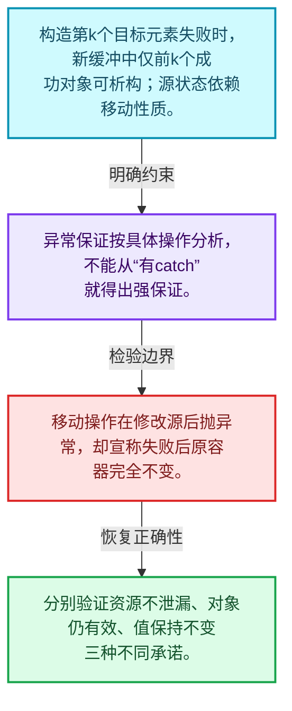
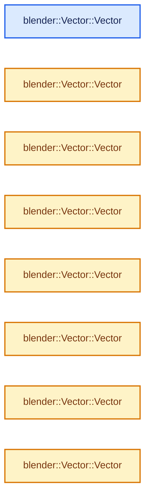
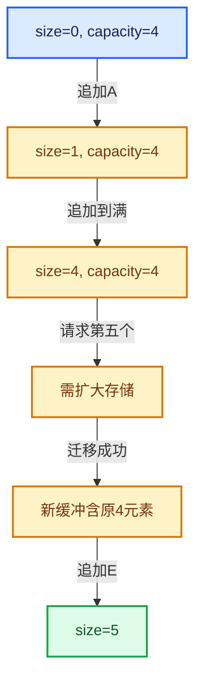

# 01-12 Vector异常安全与边界

[方向导航](README.md) · [总目录](../README.md) · [实现索引](../%E7%AC%A6%E5%8F%B7%E4%BE%9D%E8%B5%96%E4%B8%8E%E5%AE%9E%E7%8E%B0%E7%B4%A2%E5%BC%95.md)

## 从问题到实现

元素构造抛异常时如何避免泄漏和半成品状态？

基本保证要求资源不泄漏且对象仍有效，强保证还要求失败不改变可观察状态；不同操作不能混为一谈。

**数据模型**

构造第k个目标元素失败时，新缓冲中仅前k个成功对象可析构；源状态依赖移动性质。

**设计取舍**

异常保证按具体操作分析，不能从“有catch”就得出强保证。

**最小反例**

移动操作在修改源后抛异常，却宣称失败后原容器完全不变。

**推导**

分别验证资源不泄漏、对象仍有效、值保持不变三种不同承诺。

## 阅读地图与执行推演








图中的数值推演是本方向的教学模型；实际函数之间的调用边与概念分析边分别标注，不能把概念关系当作运行时调度顺序。

## 完整源码单元与就地讲解

中文讲解直接放在相关代码旁，复杂机制在代码下展开。原文折叠区保留基准行号；不需要在行号表和函数之间来回查找。类布局可分段展示，函数实现不按固定行数切开。

<a id="f-ab20dffca18ad8b4"></a>

### `blender::Vector::Vector`

实现位置：[source/blender/blenlib/BLI_vector.hh](../../../../../source/blender/blenlib/BLI_vector.hh) · L140—L146。

接口参数：

- `Allocator allocator = {}`

**教学注释版**

<!-- annotated:63baf7cca37496 -->

```cpp
  Vector(Allocator allocator = {}) noexcept : allocator_(allocator)
  {
    // [讲解] 切换数据起点；检查旧对象寿命与旧存储释放已经处理。
    begin_ = inline_buffer_;
    // [讲解] 提交有效元素尾后位置；它决定size，不是容量。
    end_ = begin_;
    // [讲解] 提交容量尾后边界，必须与当前缓冲起点和容量一致。
    capacity_end_ = begin_ + InlineBufferCapacity;
    UPDATE_VECTOR_SIZE(this);
  }
```

<details>
<summary>核对原始源码：source/blender/blenlib/BLI_vector.hh · L140—L146</summary>

<!-- original:63baf7cca37496:source/blender/blenlib/BLI_vector.hh:140:146 -->

```cpp
  Vector(Allocator allocator = {}) noexcept : allocator_(allocator)
  {
    begin_ = inline_buffer_;
    end_ = begin_;
    capacity_end_ = begin_ + InlineBufferCapacity;
    UPDATE_VECTOR_SIZE(this);
  }
```

</details>

**沿实际写入检查状态**

- `begin_ = inline_buffer_;`：切换数据起点；检查旧对象寿命与旧存储释放已经处理。
- `end_ = begin_;`：提交有效元素尾后位置；它决定size，不是容量。
- `capacity_end_ = begin_ + InlineBufferCapacity;`：提交容量尾后边界，必须与当前缓冲起点和容量一致。

**继续追踪实现**

- `UPDATE_VECTOR_SIZE` → [UPDATE_VECTOR_SIZE · L112](%E4%BE%9D%E8%B5%96-BLI_vector-c355b1.md#m-85858f378a28)；[UPDATE_VECTOR_SIZE · L114](%E4%BE%9D%E8%B5%96-BLI_vector-c355b1.md#m-fe457862705a)。宏定义由构建条件选择。

<!-- annotated:1b266a4983868e -->

```cpp

```

<details>
<summary>核对原始源码：source/blender/blenlib/BLI_vector.hh · L147—L147</summary>

<!-- original:1b266a4983868e:source/blender/blenlib/BLI_vector.hh:147:147 -->

```cpp

```

</details>

<a id="f-5206291d80a18329"></a>

### `blender::Vector::Vector`

实现位置：[source/blender/blenlib/BLI_vector.hh](../../../../../source/blender/blenlib/BLI_vector.hh) · L148—L148。

接口参数：

- `NoExceptConstructor`
- `Allocator allocator = {}`

**教学注释版**

<!-- annotated:f1136115bdac6d -->

```cpp
  Vector(NoExceptConstructor, Allocator allocator = {}) noexcept : Vector(allocator) {}
```

<details>
<summary>核对原始源码：source/blender/blenlib/BLI_vector.hh · L148—L148</summary>

<!-- original:f1136115bdac6d:source/blender/blenlib/BLI_vector.hh:148:148 -->

```cpp
  Vector(NoExceptConstructor, Allocator allocator = {}) noexcept : Vector(allocator) {}
```

</details>

**继续追踪实现**

本实现没有需要继续展开的显式调用；检查返回表达式、对象转换和调用者前置条件。

### 类型布局、声明与编译条件 · BLI_vector.hh L149—L154

<!-- annotated:5a4b47d7ab60a6 -->

```cpp

  /**
   * Create a vector with a specific size.
   * The elements will be default constructed.
   * If T is trivially constructible, the elements in the vector are not touched.
   */
```

<details>
<summary>核对原始源码：source/blender/blenlib/BLI_vector.hh · L149—L154</summary>

<!-- original:5a4b47d7ab60a6:source/blender/blenlib/BLI_vector.hh:149:154 -->

```cpp

  /**
   * Create a vector with a specific size.
   * The elements will be default constructed.
   * If T is trivially constructible, the elements in the vector are not touched.
   */
```

</details>

<a id="f-cc29c46f5c02ab6d"></a>

### `blender::Vector::Vector`

实现位置：[source/blender/blenlib/BLI_vector.hh](../../../../../source/blender/blenlib/BLI_vector.hh) · L155—L159。

接口参数：

- `int64_t size`
- `Allocator allocator = {}`

**教学注释版**

<!-- annotated:f1501688989e4e -->

```cpp
  explicit Vector(int64_t size, Allocator allocator = {})
      : Vector(NoExceptConstructor(), allocator)
  {
    // [讲解] this->resize：把有效元素数调整为new_size。增长路径构造新元素，缩小路径销毁尾部对象，最后才提交新的end_。
    this->resize(size);
  }
```

<details>
<summary>核对原始源码：source/blender/blenlib/BLI_vector.hh · L155—L159</summary>

<!-- original:f1501688989e4e:source/blender/blenlib/BLI_vector.hh:155:159 -->

```cpp
  explicit Vector(int64_t size, Allocator allocator = {})
      : Vector(NoExceptConstructor(), allocator)
  {
    this->resize(size);
  }
```

</details>

**继续追踪实现**

- `this->resize` → [blender::Vector::resize · L418](10-Vector%E6%89%A9%E5%AE%B9%E4%B8%8E%E5%A2%9E%E9%95%BF.md#f-059312cabb8abe3a)；[blender::Vector::resize · L439](10-Vector%E6%89%A9%E5%AE%B9%E4%B8%8E%E5%A2%9E%E9%95%BF.md#f-ab8f94924ebe2d12)。同名重载需按实参类型选择。

### 类型布局、声明与编译条件 · BLI_vector.hh L160—L163

<!-- annotated:24bcab37c650cc -->

```cpp

  /**
   * Create a vector filled with a specific value.
   */
```

<details>
<summary>核对原始源码：source/blender/blenlib/BLI_vector.hh · L160—L163</summary>

<!-- original:24bcab37c650cc:source/blender/blenlib/BLI_vector.hh:160:163 -->

```cpp

  /**
   * Create a vector filled with a specific value.
   */
```

</details>

<a id="f-a9d10aa4291b7089"></a>

### `blender::Vector::Vector`

实现位置：[source/blender/blenlib/BLI_vector.hh](../../../../../source/blender/blenlib/BLI_vector.hh) · L164—L168。

接口参数：

- `int64_t size`
- `const T &value`
- `Allocator allocator = {}`

**教学注释版**

<!-- annotated:2153a1d6c4b917 -->

```cpp
  Vector(int64_t size, const T &value, Allocator allocator = {})
      : Vector(NoExceptConstructor(), allocator)
  {
    // [讲解] this->resize：把有效元素数调整为new_size。增长路径构造新元素，缩小路径销毁尾部对象，最后才提交新的end_。
    this->resize(size, value);
  }
```

<details>
<summary>核对原始源码：source/blender/blenlib/BLI_vector.hh · L164—L168</summary>

<!-- original:2153a1d6c4b917:source/blender/blenlib/BLI_vector.hh:164:168 -->

```cpp
  Vector(int64_t size, const T &value, Allocator allocator = {})
      : Vector(NoExceptConstructor(), allocator)
  {
    this->resize(size, value);
  }
```

</details>

**继续追踪实现**

- `this->resize` → [blender::Vector::resize · L418](10-Vector%E6%89%A9%E5%AE%B9%E4%B8%8E%E5%A2%9E%E9%95%BF.md#f-059312cabb8abe3a)；[blender::Vector::resize · L439](10-Vector%E6%89%A9%E5%AE%B9%E4%B8%8E%E5%A2%9E%E9%95%BF.md#f-ab8f94924ebe2d12)。同名重载需按实参类型选择。

### 类型布局、声明与编译条件 · BLI_vector.hh L169—L172

<!-- annotated:3e8b8a36b503cf -->

```cpp

  /**
   * Create a vector from a span. The values in the vector are copy constructed.
   */
```

<details>
<summary>核对原始源码：source/blender/blenlib/BLI_vector.hh · L169—L172</summary>

<!-- original:3e8b8a36b503cf:source/blender/blenlib/BLI_vector.hh:169:172 -->

```cpp

  /**
   * Create a vector from a span. The values in the vector are copy constructed.
   */
```

</details>

<a id="f-935f899213b6ce94"></a>

### `blender::Vector::Vector`

实现位置：[source/blender/blenlib/BLI_vector.hh](../../../../../source/blender/blenlib/BLI_vector.hh) · L173—L182。

接口参数：

- `Span<U> values`
- `Allocator allocator = {}`

**教学注释版**

<!-- annotated:486c49628b2c5f -->

```cpp
  template<typename U>
  Vector(Span<U> values, Allocator allocator = {})
    requires(std::is_convertible_v<U, T>)
      : Vector(NoExceptConstructor(), allocator)
  {
    // [讲解] values.size：查询视图长度或生成对应有效索引区间。
    const int64_t size = values.size();
    // [讲解] this->reserve：确保可容纳至少min_capacity个元素；当前size和已有元素值不因容量请求本身而增加。
    this->reserve(size);
    // [讲解] values.data：返回借用范围的地址。
    uninitialized_convert_n<U, T>(values.data(), size, begin_);
    this->increase_size_by_unchecked(size);
  }
```

<details>
<summary>核对原始源码：source/blender/blenlib/BLI_vector.hh · L173—L182</summary>

<!-- original:486c49628b2c5f:source/blender/blenlib/BLI_vector.hh:173:182 -->

```cpp
  template<typename U>
  Vector(Span<U> values, Allocator allocator = {})
    requires(std::is_convertible_v<U, T>)
      : Vector(NoExceptConstructor(), allocator)
  {
    const int64_t size = values.size();
    this->reserve(size);
    uninitialized_convert_n<U, T>(values.data(), size, begin_);
    this->increase_size_by_unchecked(size);
  }
```

</details>

**继续追踪实现**

- `values.size` → [blender::Span::size · L256](05-Span%E5%8F%AA%E8%AF%BB%E8%BF%9E%E7%BB%AD%E8%A7%86%E5%9B%BE.md#f-5f80fa006089c998)。
- `this->reserve` → [blender::Vector::reserve · L405](10-Vector%E6%89%A9%E5%AE%B9%E4%B8%8E%E5%A2%9E%E9%95%BF.md#f-4cf9c0f00e01102e)。
- `uninitialized_convert_n<U, T>` → [blender::uninitialized_convert_n · L58](01-%E5%AF%B9%E8%B1%A1%E7%94%9F%E5%91%BD%E5%91%A8%E6%9C%9F%E4%B8%8E%E5%80%BC%E7%B1%BB%E5%88%AB.md#f-c9f2d65f10e2b002)。
- `values.data` → [blender::Span::data · L219](05-Span%E5%8F%AA%E8%AF%BB%E8%BF%9E%E7%BB%AD%E8%A7%86%E5%9B%BE.md#f-10c5889198935800)。
- `this->increase_size_by_unchecked` → [blender::Vector::increase_size_by_unchecked · L583](11-Vector%E6%8F%92%E5%85%A5%E5%88%A0%E9%99%A4%E4%B8%8E%E9%87%8D%E6%8E%92.md#f-b53f66d936e54628)。

<!-- annotated:5f10fb06ae15e0 -->

```cpp

```

<details>
<summary>核对原始源码：source/blender/blenlib/BLI_vector.hh · L183—L183</summary>

<!-- original:5f10fb06ae15e0:source/blender/blenlib/BLI_vector.hh:183:183 -->

```cpp

```

</details>

<a id="f-f0b5338edc8805e1"></a>

### `blender::Vector::Vector`

实现位置：[source/blender/blenlib/BLI_vector.hh](../../../../../source/blender/blenlib/BLI_vector.hh) · L184—L189。

接口参数：

- `MutableSpan<U> values`
- `Allocator allocator = {}`

**教学注释版**

<!-- annotated:af67f88ec7457d -->

```cpp
  template<typename U>
  explicit Vector(MutableSpan<U> values, Allocator allocator = {})
    requires(std::is_convertible_v<U, T>)
      : Vector(values.as_span(), allocator)
  {
  }
```

<details>
<summary>核对原始源码：source/blender/blenlib/BLI_vector.hh · L184—L189</summary>

<!-- original:af67f88ec7457d:source/blender/blenlib/BLI_vector.hh:184:189 -->

```cpp
  template<typename U>
  explicit Vector(MutableSpan<U> values, Allocator allocator = {})
    requires(std::is_convertible_v<U, T>)
      : Vector(values.as_span(), allocator)
  {
  }
```

</details>

**继续追踪实现**

本实现没有需要继续展开的显式调用；检查返回表达式、对象转换和调用者前置条件。

### 类型布局、声明与编译条件 · BLI_vector.hh L190—L196

<!-- annotated:8e40f480010ae9 -->

```cpp

  /**
   * Create a vector that contains copies of the values in the initialized list.
   *
   * This allows you to write code like:
   * Vector<int> vec = {3, 4, 5};
   */
```

<details>
<summary>核对原始源码：source/blender/blenlib/BLI_vector.hh · L190—L196</summary>

<!-- original:8e40f480010ae9:source/blender/blenlib/BLI_vector.hh:190:196 -->

```cpp

  /**
   * Create a vector that contains copies of the values in the initialized list.
   *
   * This allows you to write code like:
   * Vector<int> vec = {3, 4, 5};
   */
```

</details>

<a id="f-3084fd15b4638b21"></a>

### `blender::Vector::Vector`

实现位置：[source/blender/blenlib/BLI_vector.hh](../../../../../source/blender/blenlib/BLI_vector.hh) · L197—L202。

接口参数：

- `const std::initializer_list<U> &values`

**教学注释版**

<!-- annotated:d5746acef0549b -->

```cpp
  template<typename U>
  Vector(const std::initializer_list<U> &values)
    requires(std::is_convertible_v<U, T>)
      : Vector(Span<U>(values))
  {
  }
```

<details>
<summary>核对原始源码：source/blender/blenlib/BLI_vector.hh · L197—L202</summary>

<!-- original:d5746acef0549b:source/blender/blenlib/BLI_vector.hh:197:202 -->

```cpp
  template<typename U>
  Vector(const std::initializer_list<U> &values)
    requires(std::is_convertible_v<U, T>)
      : Vector(Span<U>(values))
  {
  }
```

</details>

**继续追踪实现**

本实现没有需要继续展开的显式调用；检查返回表达式、对象转换和调用者前置条件。

<!-- annotated:369252058c6b6f -->

```cpp

```

<details>
<summary>核对原始源码：source/blender/blenlib/BLI_vector.hh · L203—L203</summary>

<!-- original:369252058c6b6f:source/blender/blenlib/BLI_vector.hh:203:203 -->

```cpp

```

</details>

<a id="f-3cc8029c12867b7d"></a>

### `blender::Vector::Vector`

实现位置：[source/blender/blenlib/BLI_vector.hh](../../../../../source/blender/blenlib/BLI_vector.hh) · L204—L204。

接口参数：

- `const std::initializer_list<T> &values`

**教学注释版**

<!-- annotated:3634595c88b8e6 -->

```cpp
  Vector(const std::initializer_list<T> &values) : Vector(Span<T>(values)) {}
```

<details>
<summary>核对原始源码：source/blender/blenlib/BLI_vector.hh · L204—L204</summary>

<!-- original:3634595c88b8e6:source/blender/blenlib/BLI_vector.hh:204:204 -->

```cpp
  Vector(const std::initializer_list<T> &values) : Vector(Span<T>(values)) {}
```

</details>

**继续追踪实现**

本实现没有需要继续展开的显式调用；检查返回表达式、对象转换和调用者前置条件。

<!-- annotated:c215363e5f1640 -->

```cpp

```

<details>
<summary>核对原始源码：source/blender/blenlib/BLI_vector.hh · L205—L205</summary>

<!-- original:c215363e5f1640:source/blender/blenlib/BLI_vector.hh:205:205 -->

```cpp

```

</details>

<a id="f-95a96a4e20e3631c"></a>

### `blender::Vector::Vector`

实现位置：[source/blender/blenlib/BLI_vector.hh](../../../../../source/blender/blenlib/BLI_vector.hh) · L206—L211。

接口参数：

- `const std::array<U, N> &values`

**教学注释版**

<!-- annotated:9d11fc40365071 -->

```cpp
  template<typename U, size_t N>
  Vector(const std::array<U, N> &values)
    requires(std::is_convertible_v<U, T>)
      : Vector(Span(values))
  {
  }
```

<details>
<summary>核对原始源码：source/blender/blenlib/BLI_vector.hh · L206—L211</summary>

<!-- original:9d11fc40365071:source/blender/blenlib/BLI_vector.hh:206:211 -->

```cpp
  template<typename U, size_t N>
  Vector(const std::array<U, N> &values)
    requires(std::is_convertible_v<U, T>)
      : Vector(Span(values))
  {
  }
```

</details>

**继续追踪实现**

本实现没有需要继续展开的显式调用；检查返回表达式、对象转换和调用者前置条件。

<!-- annotated:ec42297738d4fd -->

```cpp

```

<details>
<summary>核对原始源码：source/blender/blenlib/BLI_vector.hh · L212—L212</summary>

<!-- original:ec42297738d4fd:source/blender/blenlib/BLI_vector.hh:212:212 -->

```cpp

```

</details>

<a id="f-5e04fad7dcd1d026"></a>

### `blender::Vector::Vector`

实现位置：[source/blender/blenlib/BLI_vector.hh](../../../../../source/blender/blenlib/BLI_vector.hh) · L213—L223。

接口参数：

- `InputIt first`
- `InputIt last`
- `Allocator allocator = {}`

**教学注释版**

<!-- annotated:64d928fe15794f -->

```cpp
  template<typename InputIt>
  Vector(InputIt first, InputIt last, Allocator allocator = {})
      /* This constructor should not be called with e.g. Vector(3, 10), because that is
       * expected to produce the vector (10, 10, 10). */
    requires(!std::is_convertible_v<InputIt, int>)
      : Vector(NoExceptConstructor(), allocator)
  {
    for (InputIt current = first; current != last; ++current) {
      // [讲解] this->append：在尾部建立新元素，必要时先扩大存储。
      this->append(*current);
    }
  }
```

<details>
<summary>核对原始源码：source/blender/blenlib/BLI_vector.hh · L213—L223</summary>

<!-- original:64d928fe15794f:source/blender/blenlib/BLI_vector.hh:213:223 -->

```cpp
  template<typename InputIt>
  Vector(InputIt first, InputIt last, Allocator allocator = {})
      /* This constructor should not be called with e.g. Vector(3, 10), because that is
       * expected to produce the vector (10, 10, 10). */
    requires(!std::is_convertible_v<InputIt, int>)
      : Vector(NoExceptConstructor(), allocator)
  {
    for (InputIt current = first; current != last; ++current) {
      this->append(*current);
    }
  }
```

</details>

**继续追踪实现**

- `this->append` → [blender::Vector::append · L498](11-Vector%E6%8F%92%E5%85%A5%E5%88%A0%E9%99%A4%E4%B8%8E%E9%87%8D%E6%8E%92.md#f-5bde268a69e443ec)；[blender::Vector::append · L502](11-Vector%E6%8F%92%E5%85%A5%E5%88%A0%E9%99%A4%E4%B8%8E%E9%87%8D%E6%8E%92.md#f-591e0b15e6308532)。同名重载需按实参类型选择。

### 类型布局、声明与编译条件 · BLI_vector.hh L224—L228

<!-- annotated:25c3d250832fd1 -->

```cpp

  /**
   * Create a copy of another vector. The other vector will not be changed. If the other vector has
   * less than InlineBufferCapacity elements, no allocation will be made.
   */
```

<details>
<summary>核对原始源码：source/blender/blenlib/BLI_vector.hh · L224—L228</summary>

<!-- original:25c3d250832fd1:source/blender/blenlib/BLI_vector.hh:224:228 -->

```cpp

  /**
   * Create a copy of another vector. The other vector will not be changed. If the other vector has
   * less than InlineBufferCapacity elements, no allocation will be made.
   */
```

</details>

<a id="f-9c6019eebde38e3d"></a>

### `blender::Vector::Vector`

实现位置：[source/blender/blenlib/BLI_vector.hh](../../../../../source/blender/blenlib/BLI_vector.hh) · L229—L229。

接口参数：

- `const Vector &other`

**教学注释版**

<!-- annotated:4149006610e975 -->

```cpp
  Vector(const Vector &other) : Vector(other.as_span(), other.allocator_) {}
```

<details>
<summary>核对原始源码：source/blender/blenlib/BLI_vector.hh · L229—L229</summary>

<!-- original:4149006610e975:source/blender/blenlib/BLI_vector.hh:229:229 -->

```cpp
  Vector(const Vector &other) : Vector(other.as_span(), other.allocator_) {}
```

</details>

**继续追踪实现**

本实现没有需要继续展开的显式调用；检查返回表达式、对象转换和调用者前置条件。

### 类型布局、声明与编译条件 · BLI_vector.hh L230—L234

<!-- annotated:58ae8945351073 -->

```cpp

  /**
   * Create a copy of a vector with a different InlineBufferCapacity. This needs to be handled
   * separately, so that the other one is a valid copy constructor.
   */
```

<details>
<summary>核对原始源码：source/blender/blenlib/BLI_vector.hh · L230—L234</summary>

<!-- original:58ae8945351073:source/blender/blenlib/BLI_vector.hh:230:234 -->

```cpp

  /**
   * Create a copy of a vector with a different InlineBufferCapacity. This needs to be handled
   * separately, so that the other one is a valid copy constructor.
   */
```

</details>

<a id="f-f2eccc710679297d"></a>

### `blender::Vector::Vector`

实现位置：[source/blender/blenlib/BLI_vector.hh](../../../../../source/blender/blenlib/BLI_vector.hh) · L235—L239。

接口参数：

- `const Vector<T, OtherInlineBufferCapacity, Allocator> &other`

**教学注释版**

<!-- annotated:b0f1c1c01c0689 -->

```cpp
  template<int64_t OtherInlineBufferCapacity>
  Vector(const Vector<T, OtherInlineBufferCapacity, Allocator> &other)
      : Vector(other.as_span(), other.allocator_)
  {
  }
```

<details>
<summary>核对原始源码：source/blender/blenlib/BLI_vector.hh · L235—L239</summary>

<!-- original:b0f1c1c01c0689:source/blender/blenlib/BLI_vector.hh:235:239 -->

```cpp
  template<int64_t OtherInlineBufferCapacity>
  Vector(const Vector<T, OtherInlineBufferCapacity, Allocator> &other)
      : Vector(other.as_span(), other.allocator_)
  {
  }
```

</details>

**继续追踪实现**

本实现没有需要继续展开的显式调用；检查返回表达式、对象转换和调用者前置条件。

### 类型布局、声明与编译条件 · BLI_vector.hh L240—L244

<!-- annotated:fac2e1c627d88c -->

```cpp

  /**
   * Steal the elements from another vector. This does not do an allocation. The other vector will
   * have zero elements afterwards.
   */
```

<details>
<summary>核对原始源码：source/blender/blenlib/BLI_vector.hh · L240—L244</summary>

<!-- original:fac2e1c627d88c:source/blender/blenlib/BLI_vector.hh:240:244 -->

```cpp

  /**
   * Steal the elements from another vector. This does not do an allocation. The other vector will
   * have zero elements afterwards.
   */
```

</details>

<a id="f-b182708a81ce8fa3"></a>

### `blender::Vector::Vector`

实现位置：[source/blender/blenlib/BLI_vector.hh](../../../../../source/blender/blenlib/BLI_vector.hh) · L245—L307。

接口参数：

- `Vector<T, OtherInlineBufferCapacity, Allocator> &&other`

**教学注释版**

<!-- annotated:fb0df29a419fa3 -->

```cpp
  template<int64_t OtherInlineBufferCapacity>
  Vector(Vector<T, OtherInlineBufferCapacity, Allocator> &&other) noexcept(
      is_nothrow_move_constructible())
      : Vector(NoExceptConstructor(), other.allocator_)
  {
    // [讲解] other.is_inline：判断当前数据起点是否就是本对象内部缓冲。
    if (other.is_inline()) {
      // [讲解] other.size：用end_减begin_得到活元素数量。
      const int64_t size = other.size();

      /* Optimize the case by copying the full inline buffer. */
      constexpr bool other_is_same_type = std::is_same_v<Vector, std::decay_t<decltype(other)>>;
      constexpr size_t max_full_copy_size = 32;
      if constexpr (other_is_same_type && std::is_trivial_v<T> &&
                    sizeof(inline_buffer_) <= max_full_copy_size)
      {
        /* This check is technically optional. However, benchmarking shows that skipping work
         * for empty vectors (which is a common case) is worth the extra check even in the case
         * when the vector is not empty. */
        if (size > 0) {
          /* Copy the full inline buffer instead of only the used parts. This may copy
           * uninitialized values but allows producing more optimal code than when the copy size
           * would depend on a dynamic value. */
          // [讲解] memcpy：复制字节，源与目标不应重叠。类型生命周期、对齐和可复制表示须由调用者证明，不是任意对象的复制构造。
          memcpy(inline_buffer_, other.inline_buffer_, sizeof(inline_buffer_));
          this->increase_size_by_unchecked(size);
          /* Reset other vector. */
          other.end_ = other.inline_buffer_;
        }
      }
      else {
        /* This first check is not strictly necessary, but improves performance because it can be
         * done at compile time and makes the size check at run-time unnecessary. */
        if (OtherInlineBufferCapacity <= InlineBufferCapacity || size <= InlineBufferCapacity) {
          /* Copy between inline buffers. */
          // [讲解] uninitialized_relocate_n：在目标原始存储建立对象，再结束源对象寿命。
          uninitialized_relocate_n(other.begin_, size, begin_);
          // [讲解] 提交有效元素尾后位置；它决定size，不是容量。
          end_ = begin_ + size;
        }
        else {
          /* Copy from inline buffer to newly allocated buffer. */
          const int64_t capacity = size;
          // [讲解] 切换数据起点；检查旧对象寿命与旧存储释放已经处理。
          begin_ = static_cast<T *>(
              // [讲解] allocator_.allocate：分配器接口只准备原始存储，元素构造由容器负责。
              allocator_.allocate(sizeof(T) * size_t(capacity), alignof(T), AT));
          // [讲解] 提交容量尾后边界，必须与当前缓冲起点和容量一致。
          capacity_end_ = begin_ + capacity;
          uninitialized_relocate_n(other.begin_, size, begin_);
          // [讲解] 提交有效元素尾后位置；它决定size，不是容量。
          end_ = begin_ + size;
        }
        /* Reset other vector. */
        other.end_ = other.inline_buffer_;
      }
    }
    else {
      /* Steal the pointer. */
      // [讲解] 切换数据起点；检查旧对象寿命与旧存储释放已经处理。
      begin_ = other.begin_;
      // [讲解] 提交有效元素尾后位置；它决定size，不是容量。
      end_ = other.end_;
      // [讲解] 提交容量尾后边界，必须与当前缓冲起点和容量一致。
      capacity_end_ = other.capacity_end_;

      /* Reset other vector. */
      other.begin_ = other.inline_buffer_;
      other.end_ = other.inline_buffer_;
      other.capacity_end_ = other.inline_buffer_ + OtherInlineBufferCapacity;
    }

    UPDATE_VECTOR_SIZE(this);
    UPDATE_VECTOR_SIZE(&other);
  }
```

<details>
<summary>核对原始源码：source/blender/blenlib/BLI_vector.hh · L245—L307</summary>

<!-- original:fb0df29a419fa3:source/blender/blenlib/BLI_vector.hh:245:307 -->

```cpp
  template<int64_t OtherInlineBufferCapacity>
  Vector(Vector<T, OtherInlineBufferCapacity, Allocator> &&other) noexcept(
      is_nothrow_move_constructible())
      : Vector(NoExceptConstructor(), other.allocator_)
  {
    if (other.is_inline()) {
      const int64_t size = other.size();

      /* Optimize the case by copying the full inline buffer. */
      constexpr bool other_is_same_type = std::is_same_v<Vector, std::decay_t<decltype(other)>>;
      constexpr size_t max_full_copy_size = 32;
      if constexpr (other_is_same_type && std::is_trivial_v<T> &&
                    sizeof(inline_buffer_) <= max_full_copy_size)
      {
        /* This check is technically optional. However, benchmarking shows that skipping work
         * for empty vectors (which is a common case) is worth the extra check even in the case
         * when the vector is not empty. */
        if (size > 0) {
          /* Copy the full inline buffer instead of only the used parts. This may copy
           * uninitialized values but allows producing more optimal code than when the copy size
           * would depend on a dynamic value. */
          memcpy(inline_buffer_, other.inline_buffer_, sizeof(inline_buffer_));
          this->increase_size_by_unchecked(size);
          /* Reset other vector. */
          other.end_ = other.inline_buffer_;
        }
      }
      else {
        /* This first check is not strictly necessary, but improves performance because it can be
         * done at compile time and makes the size check at run-time unnecessary. */
        if (OtherInlineBufferCapacity <= InlineBufferCapacity || size <= InlineBufferCapacity) {
          /* Copy between inline buffers. */
          uninitialized_relocate_n(other.begin_, size, begin_);
          end_ = begin_ + size;
        }
        else {
          /* Copy from inline buffer to newly allocated buffer. */
          const int64_t capacity = size;
          begin_ = static_cast<T *>(
              allocator_.allocate(sizeof(T) * size_t(capacity), alignof(T), AT));
          capacity_end_ = begin_ + capacity;
          uninitialized_relocate_n(other.begin_, size, begin_);
          end_ = begin_ + size;
        }
        /* Reset other vector. */
        other.end_ = other.inline_buffer_;
      }
    }
    else {
      /* Steal the pointer. */
      begin_ = other.begin_;
      end_ = other.end_;
      capacity_end_ = other.capacity_end_;

      /* Reset other vector. */
      other.begin_ = other.inline_buffer_;
      other.end_ = other.inline_buffer_;
      other.capacity_end_ = other.inline_buffer_ + OtherInlineBufferCapacity;
    }

    UPDATE_VECTOR_SIZE(this);
    UPDATE_VECTOR_SIZE(&other);
  }
```

</details>

**沿实际写入检查状态**

- `other.end_ = other.inline_buffer_;`
- `end_ = begin_ + size;`：提交有效元素尾后位置；它决定size，不是容量。
- `begin_ = static_cast<T *>(`：切换数据起点；检查旧对象寿命与旧存储释放已经处理。
- `capacity_end_ = begin_ + capacity;`：提交容量尾后边界，必须与当前缓冲起点和容量一致。
- `begin_ = other.begin_;`：切换数据起点；检查旧对象寿命与旧存储释放已经处理。
- `end_ = other.end_;`：提交有效元素尾后位置；它决定size，不是容量。
- `capacity_end_ = other.capacity_end_;`：提交容量尾后边界，必须与当前缓冲起点和容量一致。
- `other.begin_ = other.inline_buffer_;`
- `other.capacity_end_ = other.inline_buffer_ + OtherInlineBufferCapacity;`

**继续追踪实现**

- `other.is_inline` → [blender::Vector::is_inline · L1108](12-Vector%E5%BC%82%E5%B8%B8%E5%AE%89%E5%85%A8%E4%B8%8E%E8%BE%B9%E7%95%8C.md#f-6bbcba0fedd158a9)。
- `other.size` → [blender::Vector::size · L780](11-Vector%E6%8F%92%E5%85%A5%E5%88%A0%E9%99%A4%E4%B8%8E%E9%87%8D%E6%8E%92.md#f-714773731767349c)。
- `memcpy` → [外部契约](https://eel.is/c++draft/cstring.syn)：复制字节，源与目标不应重叠。类型生命周期、对齐和可复制表示须由调用者证明，不是任意对象的复制构造。
- `this->increase_size_by_unchecked` → [blender::Vector::increase_size_by_unchecked · L583](11-Vector%E6%8F%92%E5%85%A5%E5%88%A0%E9%99%A4%E4%B8%8E%E9%87%8D%E6%8E%92.md#f-b53f66d936e54628)。
- `uninitialized_relocate_n` → [blender::uninitialized_relocate_n · L80](01-%E5%AF%B9%E8%B1%A1%E7%94%9F%E5%91%BD%E5%91%A8%E6%9C%9F%E4%B8%8E%E5%80%BC%E7%B1%BB%E5%88%AB.md#f-9de0365b9a47fd68)。
- `allocator_.allocate` → [blender::GuardedAllocator::allocate · L43](03-%E5%86%85%E5%AD%98%E5%B7%A5%E5%85%B7%E4%B8%8E%E5%88%86%E9%85%8D%E5%99%A8%E6%8E%A5%E5%8F%A3.md#f-a57239e6d3bd10d9)。
- `UPDATE_VECTOR_SIZE` → [UPDATE_VECTOR_SIZE · L112](%E4%BE%9D%E8%B5%96-BLI_vector-c355b1.md#m-85858f378a28)；[UPDATE_VECTOR_SIZE · L114](%E4%BE%9D%E8%B5%96-BLI_vector-c355b1.md#m-fe457862705a)。宏定义由构建条件选择。

### 类型布局、声明与编译条件 · BLI_vector.hh L308—L313

<!-- annotated:28451122d5c917 -->

```cpp

  /**
   * Initializes the #Vector from an existing buffer. The #Vector takes ownership of the buffer.
   * The caller is responsible to make sure that the buffer has been allocated with the same
   * allocator that the #Vector will use to deallocate it.
   */
```

<details>
<summary>核对原始源码：source/blender/blenlib/BLI_vector.hh · L308—L313</summary>

<!-- original:28451122d5c917:source/blender/blenlib/BLI_vector.hh:308:313 -->

```cpp

  /**
   * Initializes the #Vector from an existing buffer. The #Vector takes ownership of the buffer.
   * The caller is responsible to make sure that the buffer has been allocated with the same
   * allocator that the #Vector will use to deallocate it.
   */
```

</details>

<a id="f-827ffc9f66c8b8e2"></a>

### `blender::Vector::Vector`

实现位置：[source/blender/blenlib/BLI_vector.hh](../../../../../source/blender/blenlib/BLI_vector.hh) · L314—L328。

接口参数：

- `const VectorData<T, Allocator> &data`

**教学注释版**

<!-- annotated:7c106d186875f6 -->

```cpp
  Vector(const VectorData<T, Allocator> &data) : Vector(data.allocator)
  {
    BLI_assert(data.capacity == 0 || data.data != nullptr);
    BLI_assert(data.size >= 0);
    BLI_assert(data.size <= data.capacity);
    /* Don't use the passed in buffer if it is null. Use the inline-buffer instead which is already
     * initialized by the constructor call above. */
    if (data.data != nullptr) {
      /* Take ownership of the array. */
      // [讲解] 切换数据起点；检查旧对象寿命与旧存储释放已经处理。
      begin_ = data.data;
      // [讲解] 提交有效元素尾后位置；它决定size，不是容量。
      end_ = data.data + data.size;
      // [讲解] 提交容量尾后边界，必须与当前缓冲起点和容量一致。
      capacity_end_ = data.data + data.capacity;
      UPDATE_VECTOR_SIZE(this);
    }
  }
```

<details>
<summary>核对原始源码：source/blender/blenlib/BLI_vector.hh · L314—L328</summary>

<!-- original:7c106d186875f6:source/blender/blenlib/BLI_vector.hh:314:328 -->

```cpp
  Vector(const VectorData<T, Allocator> &data) : Vector(data.allocator)
  {
    BLI_assert(data.capacity == 0 || data.data != nullptr);
    BLI_assert(data.size >= 0);
    BLI_assert(data.size <= data.capacity);
    /* Don't use the passed in buffer if it is null. Use the inline-buffer instead which is already
     * initialized by the constructor call above. */
    if (data.data != nullptr) {
      /* Take ownership of the array. */
      begin_ = data.data;
      end_ = data.data + data.size;
      capacity_end_ = data.data + data.capacity;
      UPDATE_VECTOR_SIZE(this);
    }
  }
```

</details>

**沿实际写入检查状态**

- `begin_ = data.data;`：切换数据起点；检查旧对象寿命与旧存储释放已经处理。
- `end_ = data.data + data.size;`：提交有效元素尾后位置；它决定size，不是容量。
- `capacity_end_ = data.data + data.capacity;`：提交容量尾后边界，必须与当前缓冲起点和容量一致。

**继续追踪实现**

- `BLI_assert` → [BLI_assert · L48](%E4%BE%9D%E8%B5%96-BLI_assert-cc98e8.md#m-57a88495704d)；[BLI_assert · L63](%E4%BE%9D%E8%B5%96-BLI_assert-cc98e8.md#m-d07050020cb5)。宏定义由构建条件选择。
- `UPDATE_VECTOR_SIZE` → [UPDATE_VECTOR_SIZE · L112](%E4%BE%9D%E8%B5%96-BLI_vector-c355b1.md#m-85858f378a28)；[UPDATE_VECTOR_SIZE · L114](%E4%BE%9D%E8%B5%96-BLI_vector-c355b1.md#m-fe457862705a)。宏定义由构建条件选择。

<!-- annotated:02deb963403e5f -->

```cpp

```

<details>
<summary>核对原始源码：source/blender/blenlib/BLI_vector.hh · L329—L329</summary>

<!-- original:02deb963403e5f:source/blender/blenlib/BLI_vector.hh:329:329 -->

```cpp

```

</details>

<a id="f-5bb542e876703c53"></a>

### `blender::Vector::~Vector`

实现位置：[source/blender/blenlib/BLI_vector.hh](../../../../../source/blender/blenlib/BLI_vector.hh) · L330—L336。

**教学注释版**

<!-- annotated:b15fa745b3d11d -->

```cpp
  ~Vector()
  {
    // [讲解] this->size：用end_减begin_得到活元素数量。
    destruct_n(begin_, this->size());
    // [讲解] this->is_inline：判断当前数据起点是否就是本对象内部缓冲。
    if (!this->is_inline()) {
      // [讲解] allocator_.deallocate：归还分配器负责的存储；调用者应先结束其中非平凡元素寿命。
      allocator_.deallocate(begin_);
    }
  }
```

<details>
<summary>核对原始源码：source/blender/blenlib/BLI_vector.hh · L330—L336</summary>

<!-- original:b15fa745b3d11d:source/blender/blenlib/BLI_vector.hh:330:336 -->

```cpp
  ~Vector()
  {
    destruct_n(begin_, this->size());
    if (!this->is_inline()) {
      allocator_.deallocate(begin_);
    }
  }
```

</details>

**继续追踪实现**

- `destruct_n` → [调用协议](../%E6%A8%A1%E6%9D%BF%E5%AE%8F%E4%B8%8E%E5%8A%A8%E6%80%81%E5%88%86%E6%B4%BE%E5%8D%8F%E8%AE%AE.md)：函数指针、局部可调用对象或未展开的宏；必须结合调用者环境。调用位置L332。
- `this->size` → [blender::Vector::size · L780](11-Vector%E6%8F%92%E5%85%A5%E5%88%A0%E9%99%A4%E4%B8%8E%E9%87%8D%E6%8E%92.md#f-714773731767349c)。
- `this->is_inline` → [blender::Vector::is_inline · L1108](12-Vector%E5%BC%82%E5%B8%B8%E5%AE%89%E5%85%A8%E4%B8%8E%E8%BE%B9%E7%95%8C.md#f-6bbcba0fedd158a9)。
- `allocator_.deallocate` → [blender::GuardedAllocator::deallocate · L60](03-%E5%86%85%E5%AD%98%E5%B7%A5%E5%85%B7%E4%B8%8E%E5%88%86%E9%85%8D%E5%99%A8%E6%8E%A5%E5%8F%A3.md#f-c1586978e7959acb)。

<!-- annotated:2bb9a1882e06d1 -->

```cpp

```

<details>
<summary>核对原始源码：source/blender/blenlib/BLI_vector.hh · L337—L337</summary>

<!-- original:2bb9a1882e06d1:source/blender/blenlib/BLI_vector.hh:337:337 -->

```cpp

```

</details>

<a id="f-8a670c4671e6afbf"></a>

### `blender::Vector::operator=`

实现位置：[source/blender/blenlib/BLI_vector.hh](../../../../../source/blender/blenlib/BLI_vector.hh) · L338—L341。

接口参数：

- `const Vector &other`

**教学注释版**

<!-- annotated:896aef371b5f10 -->

```cpp
  Vector &operator=(const Vector &other)
  {
    return copy_assign_container(*this, other);
  }
```

<details>
<summary>核对原始源码：source/blender/blenlib/BLI_vector.hh · L338—L341</summary>

<!-- original:896aef371b5f10:source/blender/blenlib/BLI_vector.hh:338:341 -->

```cpp
  Vector &operator=(const Vector &other)
  {
    return copy_assign_container(*this, other);
  }
```

</details>

**结果出口**

- `return copy_assign_container(*this, other);`

**继续追踪实现**

- `copy_assign_container` → [blender::copy_assign_container · L284](../03-%E5%86%85%E5%AD%98%E5%88%86%E9%85%8D%E4%B8%8E%E8%BF%90%E8%A1%8C%E6%97%B6%E7%B1%BB%E5%9E%8B/01-%E5%AF%B9%E9%BD%90%E4%B8%8E%E6%9C%AA%E5%88%9D%E5%A7%8B%E5%8C%96%E5%AD%98%E5%82%A8.md#f-546a45b4d8b5ab44)。

<!-- annotated:61e488181ceb4a -->

```cpp

```

<details>
<summary>核对原始源码：source/blender/blenlib/BLI_vector.hh · L342—L342</summary>

<!-- original:61e488181ceb4a:source/blender/blenlib/BLI_vector.hh:342:342 -->

```cpp

```

</details>

<a id="f-3bb029958591f4cd"></a>

### `blender::Vector::operator=`

实现位置：[source/blender/blenlib/BLI_vector.hh](../../../../../source/blender/blenlib/BLI_vector.hh) · L343—L346。

接口参数：

- `Vector &&other`

**教学注释版**

<!-- annotated:d3d352f2c9a917 -->

```cpp
  Vector &operator=(Vector &&other)
  {
    // [讲解] std::move：把表达式转换成可供移动重载选择的值类别；不保证真的移动，不结束源对象寿命，对const值可能选择复制。
    return move_assign_container(*this, std::move(other));
  }
```

<details>
<summary>核对原始源码：source/blender/blenlib/BLI_vector.hh · L343—L346</summary>

<!-- original:d3d352f2c9a917:source/blender/blenlib/BLI_vector.hh:343:346 -->

```cpp
  Vector &operator=(Vector &&other)
  {
    return move_assign_container(*this, std::move(other));
  }
```

</details>

**结果出口**

- `return move_assign_container(*this, std::move(other));`

**继续追踪实现**

- `move_assign_container` → [blender::move_assign_container · L300](../03-%E5%86%85%E5%AD%98%E5%88%86%E9%85%8D%E4%B8%8E%E8%BF%90%E8%A1%8C%E6%97%B6%E7%B1%BB%E5%9E%8B/01-%E5%AF%B9%E9%BD%90%E4%B8%8E%E6%9C%AA%E5%88%9D%E5%A7%8B%E5%8C%96%E5%AD%98%E5%82%A8.md#f-5144b56be86e6f42)。
- `std::move` → [外部契约](https://eel.is/c++draft/utility.forward)：把表达式转换成可供移动重载选择的值类别；不保证真的移动，不结束源对象寿命，对const值可能选择复制。

### 类型布局、声明与编译条件 · BLI_vector.hh L347—L351

<!-- annotated:74060c9e03c2ab -->

```cpp

  /**
   * Get the value at the given index. This invokes undefined behavior when the index is out of
   * bounds.
   */
```

<details>
<summary>核对原始源码：source/blender/blenlib/BLI_vector.hh · L347—L351</summary>

<!-- original:74060c9e03c2ab:source/blender/blenlib/BLI_vector.hh:347:351 -->

```cpp

  /**
   * Get the value at the given index. This invokes undefined behavior when the index is out of
   * bounds.
   */
```

</details>

<a id="f-11ad8adb697ee04a"></a>

### `blender::Vector::contains`

在有效元素中按相等关系查找。

实现位置：[source/blender/blenlib/BLI_vector.hh](../../../../../source/blender/blenlib/BLI_vector.hh) · L938—L941。

接口参数：

- `const T &value`

**教学注释版**

<!-- annotated:03002799c1b83f -->

```cpp
  bool contains(const T &value) const
  {
    return this->first_index_of_try(value) != -1;
  }
```

<details>
<summary>核对原始源码：source/blender/blenlib/BLI_vector.hh · L938—L941</summary>

<!-- original:03002799c1b83f:source/blender/blenlib/BLI_vector.hh:938:941 -->

```cpp
  bool contains(const T &value) const
  {
    return this->first_index_of_try(value) != -1;
  }
```

</details>

**接口与不变量**

线性查找的成本随元素数量增长；相等运算本身也可能有成本。

**结果出口**

- `return this->first_index_of_try(value) != -1;`

**继续追踪实现**

- `this->first_index_of_try` → [blender::Vector::first_index_of_try · L913](11-Vector%E6%8F%92%E5%85%A5%E5%88%A0%E9%99%A4%E4%B8%8E%E9%87%8D%E6%8E%92.md#f-0ce44a0b2bae5853)。

### 类型布局、声明与编译条件 · BLI_vector.hh L942—L945

<!-- annotated:31c008f30bec1e -->

```cpp

  /**
   * Copies the given value to every element in the vector.
   */
```

<details>
<summary>核对原始源码：source/blender/blenlib/BLI_vector.hh · L942—L945</summary>

<!-- original:31c008f30bec1e:source/blender/blenlib/BLI_vector.hh:942:945 -->

```cpp

  /**
   * Copies the given value to every element in the vector.
   */
```

</details>

<a id="f-da02b30aee138d05"></a>

### `blender::Vector::fill`

实现位置：[source/blender/blenlib/BLI_vector.hh](../../../../../source/blender/blenlib/BLI_vector.hh) · L946—L949。

接口参数：

- `const T &value`

**教学注释版**

<!-- annotated:f0b0fc9a60d04c -->

```cpp
  void fill(const T &value) const
  {
    // [讲解] this->size：用end_减begin_得到活元素数量。
    initialized_fill_n(begin_, this->size(), value);
  }
```

<details>
<summary>核对原始源码：source/blender/blenlib/BLI_vector.hh · L946—L949</summary>

<!-- original:f0b0fc9a60d04c:source/blender/blenlib/BLI_vector.hh:946:949 -->

```cpp
  void fill(const T &value) const
  {
    initialized_fill_n(begin_, this->size(), value);
  }
```

</details>

**继续追踪实现**

- `initialized_fill_n` → [blender::initialized_fill_n · L86](01-%E5%AF%B9%E8%B1%A1%E7%94%9F%E5%91%BD%E5%91%A8%E6%9C%9F%E4%B8%8E%E5%80%BC%E7%B1%BB%E5%88%AB.md#f-4af3bf5ccfdcee6c)。
- `this->size` → [blender::Vector::size · L780](11-Vector%E6%8F%92%E5%85%A5%E5%88%A0%E9%99%A4%E4%B8%8E%E9%87%8D%E6%8E%92.md#f-714773731767349c)。

### 类型布局、声明与编译条件 · BLI_vector.hh L950—L953

<!-- annotated:be87d7f1852489 -->

```cpp

  /**
   * Get access to the underlying array.
   */
```

<details>
<summary>核对原始源码：source/blender/blenlib/BLI_vector.hh · L950—L953</summary>

<!-- original:be87d7f1852489:source/blender/blenlib/BLI_vector.hh:950:953 -->

```cpp

  /**
   * Get access to the underlying array.
   */
```

</details>

<a id="f-6e441591404715bc"></a>

### `blender::Vector::data`

提供当前存储或有效范围的地址。

实现位置：[source/blender/blenlib/BLI_vector.hh](../../../../../source/blender/blenlib/BLI_vector.hh) · L954—L957。

**教学注释版**

<!-- annotated:ffddbde2c4152b -->

```cpp
  T *data()
  {
    return begin_;
  }
```

<details>
<summary>核对原始源码：source/blender/blenlib/BLI_vector.hh · L954—L957</summary>

<!-- original:ffddbde2c4152b:source/blender/blenlib/BLI_vector.hh:954:957 -->

```cpp
  T *data()
  {
    return begin_;
  }
```

</details>

**接口与不变量**

地址不会延长元素寿命；end是尾后位置，不可作为普通元素解引用。

**结果出口**

- `return begin_;`

**继续追踪实现**

本实现没有需要继续展开的显式调用；检查返回表达式、对象转换和调用者前置条件。

### 类型布局、声明与编译条件 · BLI_vector.hh L958—L961

<!-- annotated:6ed7a3e82e59d3 -->

```cpp

  /**
   * Get access to the underlying array.
   */
```

<details>
<summary>核对原始源码：source/blender/blenlib/BLI_vector.hh · L958—L961</summary>

<!-- original:6ed7a3e82e59d3:source/blender/blenlib/BLI_vector.hh:958:961 -->

```cpp

  /**
   * Get access to the underlying array.
   */
```

</details>

<a id="f-4bc78d4954c1021a"></a>

### `blender::Vector::data`

提供当前存储或有效范围的地址。

实现位置：[source/blender/blenlib/BLI_vector.hh](../../../../../source/blender/blenlib/BLI_vector.hh) · L962—L965。

**教学注释版**

<!-- annotated:0d29b7e008863e -->

```cpp
  const T *data() const
  {
    return begin_;
  }
```

<details>
<summary>核对原始源码：source/blender/blenlib/BLI_vector.hh · L962—L965</summary>

<!-- original:0d29b7e008863e:source/blender/blenlib/BLI_vector.hh:962:965 -->

```cpp
  const T *data() const
  {
    return begin_;
  }
```

</details>

**接口与不变量**

地址不会延长元素寿命；end是尾后位置，不可作为普通元素解引用。

**结果出口**

- `return begin_;`

**继续追踪实现**

本实现没有需要继续展开的显式调用；检查返回表达式、对象转换和调用者前置条件。

<!-- annotated:be7b08ea6d8683 -->

```cpp

```

<details>
<summary>核对原始源码：source/blender/blenlib/BLI_vector.hh · L966—L966</summary>

<!-- original:be7b08ea6d8683:source/blender/blenlib/BLI_vector.hh:966:966 -->

```cpp

```

</details>

<a id="f-64fb75a6663b953c"></a>

### `blender::Vector::begin`

提供当前存储或有效范围的地址。

实现位置：[source/blender/blenlib/BLI_vector.hh](../../../../../source/blender/blenlib/BLI_vector.hh) · L967—L970。

**教学注释版**

<!-- annotated:2e12fa93c7ebad -->

```cpp
  T *begin()
  {
    return begin_;
  }
```

<details>
<summary>核对原始源码：source/blender/blenlib/BLI_vector.hh · L967—L970</summary>

<!-- original:2e12fa93c7ebad:source/blender/blenlib/BLI_vector.hh:967:970 -->

```cpp
  T *begin()
  {
    return begin_;
  }
```

</details>

**接口与不变量**

地址不会延长元素寿命；end是尾后位置，不可作为普通元素解引用。

**结果出口**

- `return begin_;`

**继续追踪实现**

本实现没有需要继续展开的显式调用；检查返回表达式、对象转换和调用者前置条件。

<a id="f-8a6033745be8f712"></a>

### `blender::Vector::end`

提供当前存储或有效范围的地址。

实现位置：[source/blender/blenlib/BLI_vector.hh](../../../../../source/blender/blenlib/BLI_vector.hh) · L971—L974。

**教学注释版**

<!-- annotated:abd18f0fa5bf9f -->

```cpp
  T *end()
  {
    return end_;
  }
```

<details>
<summary>核对原始源码：source/blender/blenlib/BLI_vector.hh · L971—L974</summary>

<!-- original:abd18f0fa5bf9f:source/blender/blenlib/BLI_vector.hh:971:974 -->

```cpp
  T *end()
  {
    return end_;
  }
```

</details>

**接口与不变量**

地址不会延长元素寿命；end是尾后位置，不可作为普通元素解引用。

**结果出口**

- `return end_;`

**继续追踪实现**

本实现没有需要继续展开的显式调用；检查返回表达式、对象转换和调用者前置条件。

<!-- annotated:d4e6ea3bce81a1 -->

```cpp

```

<details>
<summary>核对原始源码：source/blender/blenlib/BLI_vector.hh · L975—L975</summary>

<!-- original:d4e6ea3bce81a1:source/blender/blenlib/BLI_vector.hh:975:975 -->

```cpp

```

</details>

<a id="f-7c6486a8b8e8f13f"></a>

### `blender::Vector::begin`

提供当前存储或有效范围的地址。

实现位置：[source/blender/blenlib/BLI_vector.hh](../../../../../source/blender/blenlib/BLI_vector.hh) · L976—L979。

**教学注释版**

<!-- annotated:f4c01d5f037e17 -->

```cpp
  const T *begin() const
  {
    return begin_;
  }
```

<details>
<summary>核对原始源码：source/blender/blenlib/BLI_vector.hh · L976—L979</summary>

<!-- original:f4c01d5f037e17:source/blender/blenlib/BLI_vector.hh:976:979 -->

```cpp
  const T *begin() const
  {
    return begin_;
  }
```

</details>

**接口与不变量**

地址不会延长元素寿命；end是尾后位置，不可作为普通元素解引用。

**结果出口**

- `return begin_;`

**继续追踪实现**

本实现没有需要继续展开的显式调用；检查返回表达式、对象转换和调用者前置条件。

<a id="f-ebb3ada259887677"></a>

### `blender::Vector::end`

提供当前存储或有效范围的地址。

实现位置：[source/blender/blenlib/BLI_vector.hh](../../../../../source/blender/blenlib/BLI_vector.hh) · L980—L983。

**教学注释版**

<!-- annotated:9dbf7cb60e12c5 -->

```cpp
  const T *end() const
  {
    return end_;
  }
```

<details>
<summary>核对原始源码：source/blender/blenlib/BLI_vector.hh · L980—L983</summary>

<!-- original:9dbf7cb60e12c5:source/blender/blenlib/BLI_vector.hh:980:983 -->

```cpp
  const T *end() const
  {
    return end_;
  }
```

</details>

**接口与不变量**

地址不会延长元素寿命；end是尾后位置，不可作为普通元素解引用。

**结果出口**

- `return end_;`

**继续追踪实现**

本实现没有需要继续展开的显式调用；检查返回表达式、对象转换和调用者前置条件。

<!-- annotated:257521c06eb338 -->

```cpp

```

<details>
<summary>核对原始源码：source/blender/blenlib/BLI_vector.hh · L984—L984</summary>

<!-- original:257521c06eb338:source/blender/blenlib/BLI_vector.hh:984:984 -->

```cpp

```

</details>

<a id="f-f1e523162dc4431e"></a>

### `blender::Vector::rbegin`

实现位置：[source/blender/blenlib/BLI_vector.hh](../../../../../source/blender/blenlib/BLI_vector.hh) · L985—L988。

**教学注释版**

<!-- annotated:d2d1af978ad3f4 -->

```cpp
  std::reverse_iterator<T *> rbegin()
  {
    // [讲解] this->end：提供当前存储或有效范围的地址。
    return std::reverse_iterator<T *>(this->end());
  }
```

<details>
<summary>核对原始源码：source/blender/blenlib/BLI_vector.hh · L985—L988</summary>

<!-- original:d2d1af978ad3f4:source/blender/blenlib/BLI_vector.hh:985:988 -->

```cpp
  std::reverse_iterator<T *> rbegin()
  {
    return std::reverse_iterator<T *>(this->end());
  }
```

</details>

**结果出口**

- `return std::reverse_iterator<T *>(this->end());`

**继续追踪实现**

- `std::reverse_iterator<T *>` → [外部契约](https://eel.is/c++draft/)：这个边界按实际表达式及所属类型核对参数、返回值、寿命与失败行为。这里提供接口入口，不声称已解释该第三方版本的内部实现。
- `this->end` → [blender::Vector::end · L971](12-Vector%E5%BC%82%E5%B8%B8%E5%AE%89%E5%85%A8%E4%B8%8E%E8%BE%B9%E7%95%8C.md#f-8a6033745be8f712)；[blender::Vector::end · L980](12-Vector%E5%BC%82%E5%B8%B8%E5%AE%89%E5%85%A8%E4%B8%8E%E8%BE%B9%E7%95%8C.md#f-ebb3ada259887677)。同名重载需按实参类型选择。

<a id="f-8470d766978ae8ff"></a>

### `blender::Vector::rend`

实现位置：[source/blender/blenlib/BLI_vector.hh](../../../../../source/blender/blenlib/BLI_vector.hh) · L989—L992。

**教学注释版**

<!-- annotated:e5b0d401e1b09c -->

```cpp
  std::reverse_iterator<T *> rend()
  {
    // [讲解] this->begin：提供当前存储或有效范围的地址。
    return std::reverse_iterator<T *>(this->begin());
  }
```

<details>
<summary>核对原始源码：source/blender/blenlib/BLI_vector.hh · L989—L992</summary>

<!-- original:e5b0d401e1b09c:source/blender/blenlib/BLI_vector.hh:989:992 -->

```cpp
  std::reverse_iterator<T *> rend()
  {
    return std::reverse_iterator<T *>(this->begin());
  }
```

</details>

**结果出口**

- `return std::reverse_iterator<T *>(this->begin());`

**继续追踪实现**

- `std::reverse_iterator<T *>` → [外部契约](https://eel.is/c++draft/)：这个边界按实际表达式及所属类型核对参数、返回值、寿命与失败行为。这里提供接口入口，不声称已解释该第三方版本的内部实现。
- `this->begin` → [blender::Vector::begin · L967](12-Vector%E5%BC%82%E5%B8%B8%E5%AE%89%E5%85%A8%E4%B8%8E%E8%BE%B9%E7%95%8C.md#f-64fb75a6663b953c)；[blender::Vector::begin · L976](12-Vector%E5%BC%82%E5%B8%B8%E5%AE%89%E5%85%A8%E4%B8%8E%E8%BE%B9%E7%95%8C.md#f-7c6486a8b8e8f13f)。同名重载需按实参类型选择。

<!-- annotated:05ec0bd6fc93e6 -->

```cpp

```

<details>
<summary>核对原始源码：source/blender/blenlib/BLI_vector.hh · L993—L993</summary>

<!-- original:05ec0bd6fc93e6:source/blender/blenlib/BLI_vector.hh:993:993 -->

```cpp

```

</details>

<a id="f-1081c5a8dbe3da6d"></a>

### `blender::Vector::rbegin`

实现位置：[source/blender/blenlib/BLI_vector.hh](../../../../../source/blender/blenlib/BLI_vector.hh) · L994—L997。

**教学注释版**

<!-- annotated:cbdddc2d983844 -->

```cpp
  std::reverse_iterator<const T *> rbegin() const
  {
    // [讲解] this->end：提供当前存储或有效范围的地址。
    return std::reverse_iterator<const T *>(this->end());
  }
```

<details>
<summary>核对原始源码：source/blender/blenlib/BLI_vector.hh · L994—L997</summary>

<!-- original:cbdddc2d983844:source/blender/blenlib/BLI_vector.hh:994:997 -->

```cpp
  std::reverse_iterator<const T *> rbegin() const
  {
    return std::reverse_iterator<const T *>(this->end());
  }
```

</details>

**结果出口**

- `return std::reverse_iterator<const T *>(this->end());`

**继续追踪实现**

- `std::reverse_iterator<const T *>` → [外部契约](https://eel.is/c++draft/)：这个边界按实际表达式及所属类型核对参数、返回值、寿命与失败行为。这里提供接口入口，不声称已解释该第三方版本的内部实现。
- `this->end` → [blender::Vector::end · L971](12-Vector%E5%BC%82%E5%B8%B8%E5%AE%89%E5%85%A8%E4%B8%8E%E8%BE%B9%E7%95%8C.md#f-8a6033745be8f712)；[blender::Vector::end · L980](12-Vector%E5%BC%82%E5%B8%B8%E5%AE%89%E5%85%A8%E4%B8%8E%E8%BE%B9%E7%95%8C.md#f-ebb3ada259887677)。同名重载需按实参类型选择。

<a id="f-e92566e309ba3774"></a>

### `blender::Vector::rend`

实现位置：[source/blender/blenlib/BLI_vector.hh](../../../../../source/blender/blenlib/BLI_vector.hh) · L998—L1001。

**教学注释版**

<!-- annotated:ae4fa8a27079ee -->

```cpp
  std::reverse_iterator<const T *> rend() const
  {
    // [讲解] this->begin：提供当前存储或有效范围的地址。
    return std::reverse_iterator<const T *>(this->begin());
  }
```

<details>
<summary>核对原始源码：source/blender/blenlib/BLI_vector.hh · L998—L1001</summary>

<!-- original:ae4fa8a27079ee:source/blender/blenlib/BLI_vector.hh:998:1001 -->

```cpp
  std::reverse_iterator<const T *> rend() const
  {
    return std::reverse_iterator<const T *>(this->begin());
  }
```

</details>

**结果出口**

- `return std::reverse_iterator<const T *>(this->begin());`

**继续追踪实现**

- `std::reverse_iterator<const T *>` → [外部契约](https://eel.is/c++draft/)：这个边界按实际表达式及所属类型核对参数、返回值、寿命与失败行为。这里提供接口入口，不声称已解释该第三方版本的内部实现。
- `this->begin` → [blender::Vector::begin · L967](12-Vector%E5%BC%82%E5%B8%B8%E5%AE%89%E5%85%A8%E4%B8%8E%E8%BE%B9%E7%95%8C.md#f-64fb75a6663b953c)；[blender::Vector::begin · L976](12-Vector%E5%BC%82%E5%B8%B8%E5%AE%89%E5%85%A8%E4%B8%8E%E8%BE%B9%E7%95%8C.md#f-7c6486a8b8e8f13f)。同名重载需按实参类型选择。

### 类型布局、声明与编译条件 · BLI_vector.hh L1002—L1006

<!-- annotated:3b86887131f224 -->

```cpp

  /**
   * Get the current capacity of the vector, i.e. the maximum number of elements the vector can
   * hold, before it has to reallocate.
   */
```

<details>
<summary>核对原始源码：source/blender/blenlib/BLI_vector.hh · L1002—L1006</summary>

<!-- original:3b86887131f224:source/blender/blenlib/BLI_vector.hh:1002:1006 -->

```cpp

  /**
   * Get the current capacity of the vector, i.e. the maximum number of elements the vector can
   * hold, before it has to reallocate.
   */
```

</details>

<a id="f-1a73aecfff2e3366"></a>

### `blender::Vector::capacity`

用capacity_end_减begin_得到当前可容纳的元素数量。

实现位置：[source/blender/blenlib/BLI_vector.hh](../../../../../source/blender/blenlib/BLI_vector.hh) · L1007—L1010。

**教学注释版**

<!-- annotated:8f335d63b629b2 -->

```cpp
  int64_t capacity() const
  {
    // [讲解] 容量尾后位置减起点；差值已经以T为单位，无需再除sizeof(T)。
    return int64_t(capacity_end_ - begin_);
  }
```

<details>
<summary>核对原始源码：source/blender/blenlib/BLI_vector.hh · L1007—L1010</summary>

<!-- original:8f335d63b629b2:source/blender/blenlib/BLI_vector.hh:1007:1010 -->

```cpp
  int64_t capacity() const
  {
    return int64_t(capacity_end_ - begin_);
  }
```

</details>

**机制与执行推导**

capacity描述存储上限。size=3、capacity=8表示3个活对象和5个尚未属于有效区间的位置。它不要求后5个位置已构造T。

**结果出口**

- `return int64_t(capacity_end_ - begin_);`

**继续追踪实现**

本实现没有需要继续展开的显式调用；检查返回表达式、对象转换和调用者前置条件。

<!-- annotated:00bceb9422b5bc -->

```cpp

```

<details>
<summary>核对原始源码：source/blender/blenlib/BLI_vector.hh · L1011—L1011</summary>

<!-- original:00bceb9422b5bc:source/blender/blenlib/BLI_vector.hh:1011:1011 -->

```cpp

```

</details>

<a id="f-8100f4f00d21e24a"></a>

### `blender::Vector::is_at_capacity`

实现位置：[source/blender/blenlib/BLI_vector.hh](../../../../../source/blender/blenlib/BLI_vector.hh) · L1012—L1015。

**教学注释版**

<!-- annotated:145ee1c562c669 -->

```cpp
  bool is_at_capacity() const
  {
    return end_ == capacity_end_;
  }
```

<details>
<summary>核对原始源码：source/blender/blenlib/BLI_vector.hh · L1012—L1015</summary>

<!-- original:145ee1c562c669:source/blender/blenlib/BLI_vector.hh:1012:1015 -->

```cpp
  bool is_at_capacity() const
  {
    return end_ == capacity_end_;
  }
```

</details>

**结果出口**

- `return end_ == capacity_end_;`

**继续追踪实现**

本实现没有需要继续展开的显式调用；检查返回表达式、对象转换和调用者前置条件。

### 类型布局、声明与编译条件 · BLI_vector.hh L1016—L1025

<!-- annotated:0139e9c129e726 -->

```cpp

  /**
   * Get an index range that makes looping over all indices more convenient and less error prone.
   * Obviously, this should only be used when you actually need the index in the loop.
   *
   * Example:
   *  for (int64_t i : myvector.index_range()) {
   *    do_something(i, my_vector[i]);
   *  }
   */
```

<details>
<summary>核对原始源码：source/blender/blenlib/BLI_vector.hh · L1016—L1025</summary>

<!-- original:0139e9c129e726:source/blender/blenlib/BLI_vector.hh:1016:1025 -->

```cpp

  /**
   * Get an index range that makes looping over all indices more convenient and less error prone.
   * Obviously, this should only be used when you actually need the index in the loop.
   *
   * Example:
   *  for (int64_t i : myvector.index_range()) {
   *    do_something(i, my_vector[i]);
   *  }
   */
```

</details>

<a id="f-ac29cf36ef185ab9"></a>

### `blender::Vector::index_range`

实现位置：[source/blender/blenlib/BLI_vector.hh](../../../../../source/blender/blenlib/BLI_vector.hh) · L1026—L1029。

**教学注释版**

<!-- annotated:8ead48ff56fe26 -->

```cpp
  IndexRange index_range() const
  {
    // [讲解] this->size：用end_减begin_得到活元素数量。
    return IndexRange(this->size());
  }
```

<details>
<summary>核对原始源码：source/blender/blenlib/BLI_vector.hh · L1026—L1029</summary>

<!-- original:8ead48ff56fe26:source/blender/blenlib/BLI_vector.hh:1026:1029 -->

```cpp
  IndexRange index_range() const
  {
    return IndexRange(this->size());
  }
```

</details>

**结果出口**

- `return IndexRange(this->size());`

**继续追踪实现**

- `IndexRange` → [blender::IndexRange](%E4%BE%9D%E8%B5%96-BLI_index_range-7d7cc5.md#t-caa3466d6776)；[blender::gpu::shader::parser::IndexRange](../05-%E5%87%A0%E4%BD%95%E5%AD%98%E5%82%A8%E4%B8%8E%E6%8B%93%E6%89%91%E6%98%A0%E5%B0%84/%E4%BE%9D%E8%B5%96-utils-06433d.md#t-82d2bd4ea71c)；[blender::IndexRange](../05-%E5%87%A0%E4%BD%95%E5%AD%98%E5%82%A8%E4%B8%8E%E6%8B%93%E6%89%91%E6%98%A0%E5%B0%84/%E4%BE%9D%E8%B5%96-DNA_node_types-6708b9.md#t-0448cc889d39)。
- `this->size` → [blender::Vector::size · L780](11-Vector%E6%8F%92%E5%85%A5%E5%88%A0%E9%99%A4%E4%B8%8E%E9%87%8D%E6%8E%92.md#f-714773731767349c)。

<!-- annotated:a8956429fe6b9f -->

```cpp

```

<details>
<summary>核对原始源码：source/blender/blenlib/BLI_vector.hh · L1030—L1030</summary>

<!-- original:a8956429fe6b9f:source/blender/blenlib/BLI_vector.hh:1030:1030 -->

```cpp

```

</details>

<a id="f-339596212b3a522b"></a>

### `blender::Vector::hash`

实现位置：[source/blender/blenlib/BLI_vector.hh](../../../../../source/blender/blenlib/BLI_vector.hh) · L1031—L1034。

**教学注释版**

<!-- annotated:a7dc724753dc9e -->

```cpp
  uint64_t hash() const
  {
    // [讲解] this->as_span：构造对当前有效元素区间的借用视图。
    return this->as_span().hash();
  }
```

<details>
<summary>核对原始源码：source/blender/blenlib/BLI_vector.hh · L1031—L1034</summary>

<!-- original:a7dc724753dc9e:source/blender/blenlib/BLI_vector.hh:1031:1034 -->

```cpp
  uint64_t hash() const
  {
    return this->as_span().hash();
  }
```

</details>

**结果出口**

- `return this->as_span().hash();`

**继续追踪实现**

- `this->as_span().hash` → [调用协议](../%E6%A8%A1%E6%9D%BF%E5%AE%8F%E4%B8%8E%E5%8A%A8%E6%80%81%E5%88%86%E6%B4%BE%E5%8D%8F%E8%AE%AE.md)：接收对象类型依赖auto、返回值或模板实例；不按同名猜测目标。调用位置L1033。
- `this->as_span` → [blender::Vector::as_span · L390](10-Vector%E6%89%A9%E5%AE%B9%E4%B8%8E%E5%A2%9E%E9%95%BF.md#f-e2eed03cefcdd2ff)。

<!-- annotated:29b8d57cb80249 -->

```cpp

```

<details>
<summary>核对原始源码：source/blender/blenlib/BLI_vector.hh · L1035—L1035</summary>

<!-- original:29b8d57cb80249:source/blender/blenlib/BLI_vector.hh:1035:1035 -->

```cpp

```

</details>

<a id="f-d8f0d24dab0befb9"></a>

### `blender::Vector::hash_as`

实现位置：[source/blender/blenlib/BLI_vector.hh](../../../../../source/blender/blenlib/BLI_vector.hh) · L1036—L1039。

接口参数：

- `const Span<T> values`

**教学注释版**

<!-- annotated:b2ccb033ac65cc -->

```cpp
  static uint64_t hash_as(const Span<T> values)
  {
    return values.hash();
  }
```

<details>
<summary>核对原始源码：source/blender/blenlib/BLI_vector.hh · L1036—L1039</summary>

<!-- original:b2ccb033ac65cc:source/blender/blenlib/BLI_vector.hh:1036:1039 -->

```cpp
  static uint64_t hash_as(const Span<T> values)
  {
    return values.hash();
  }
```

</details>

**结果出口**

- `return values.hash();`

**继续追踪实现**

- `values.hash` → [blender::Span::hash · L410](05-Span%E5%8F%AA%E8%AF%BB%E8%BF%9E%E7%BB%AD%E8%A7%86%E5%9B%BE.md#f-cc1fde6844ea8d5b)。

<!-- annotated:193a35ccf94fd1 -->

```cpp

```

<details>
<summary>核对原始源码：source/blender/blenlib/BLI_vector.hh · L1040—L1040</summary>

<!-- original:193a35ccf94fd1:source/blender/blenlib/BLI_vector.hh:1040:1040 -->

```cpp

```

</details>

<a id="f-2a81db2985856401"></a>

### `blender::Vector::operator==`

实现位置：[source/blender/blenlib/BLI_vector.hh](../../../../../source/blender/blenlib/BLI_vector.hh) · L1041—L1044。

接口参数：

- `const Vector &a`
- `const Vector &b`

**教学注释版**

<!-- annotated:a6ea9f2ce7168e -->

```cpp
  friend bool operator==(const Vector &a, const Vector &b)
  {
    // [讲解] a.as_span：构造对当前有效元素区间的借用视图。
    return a.as_span() == b.as_span();
  }
```

<details>
<summary>核对原始源码：source/blender/blenlib/BLI_vector.hh · L1041—L1044</summary>

<!-- original:a6ea9f2ce7168e:source/blender/blenlib/BLI_vector.hh:1041:1044 -->

```cpp
  friend bool operator==(const Vector &a, const Vector &b)
  {
    return a.as_span() == b.as_span();
  }
```

</details>

**结果出口**

- `return a.as_span() == b.as_span();`

**继续追踪实现**

- `a.as_span` → [blender::Vector::as_span · L390](10-Vector%E6%89%A9%E5%AE%B9%E4%B8%8E%E5%A2%9E%E9%95%BF.md#f-e2eed03cefcdd2ff)。
- `b.as_span` → [blender::Vector::as_span · L390](10-Vector%E6%89%A9%E5%AE%B9%E4%B8%8E%E5%A2%9E%E9%95%BF.md#f-e2eed03cefcdd2ff)。

<!-- annotated:d1475968f4d761 -->

```cpp

```

<details>
<summary>核对原始源码：source/blender/blenlib/BLI_vector.hh · L1045—L1045</summary>

<!-- original:d1475968f4d761:source/blender/blenlib/BLI_vector.hh:1045:1045 -->

```cpp

```

</details>

<a id="f-7136161a0ba80d49"></a>

### `blender::Vector::operator!=`

实现位置：[source/blender/blenlib/BLI_vector.hh](../../../../../source/blender/blenlib/BLI_vector.hh) · L1046—L1049。

接口参数：

- `const Vector &a`
- `const Vector &b`

**教学注释版**

<!-- annotated:f4857ada179090 -->

```cpp
  friend bool operator!=(const Vector &a, const Vector &b)
  {
    return !(a == b);
  }
```

<details>
<summary>核对原始源码：source/blender/blenlib/BLI_vector.hh · L1046—L1049</summary>

<!-- original:f4857ada179090:source/blender/blenlib/BLI_vector.hh:1046:1049 -->

```cpp
  friend bool operator!=(const Vector &a, const Vector &b)
  {
    return !(a == b);
  }
```

</details>

**结果出口**

- `return !(a == b);`

**继续追踪实现**

本实现没有需要继续展开的显式调用；检查返回表达式、对象转换和调用者前置条件。

### 类型布局、声明与编译条件 · BLI_vector.hh L1050—L1059

<!-- annotated:3000b72f3dcb5f -->

```cpp

  /**
   * Release the underlying memory buffer from the #Vector. The caller is responsible for freeing
   * the pointer if it is non-null.
   *
   * If the values were stored in the inline-buffer, the values are copied to a newly allocated
   * array first. The caller does not have to any special handling in this case.
   *
   * The #Vector will be empty afterwards.
   */
```

<details>
<summary>核对原始源码：source/blender/blenlib/BLI_vector.hh · L1050—L1059</summary>

<!-- original:3000b72f3dcb5f:source/blender/blenlib/BLI_vector.hh:1050:1059 -->

```cpp

  /**
   * Release the underlying memory buffer from the #Vector. The caller is responsible for freeing
   * the pointer if it is non-null.
   *
   * If the values were stored in the inline-buffer, the values are copied to a newly allocated
   * array first. The caller does not have to any special handling in this case.
   *
   * The #Vector will be empty afterwards.
   */
```

</details>

<a id="f-beccf028a70f67dd"></a>

### `blender::Vector::release`

把底层数据及管理信息交出给调用者。

实现位置：[source/blender/blenlib/BLI_vector.hh](../../../../../source/blender/blenlib/BLI_vector.hh) · L1060—L1097。

**教学注释版**

<!-- annotated:024ad3804830b3 -->

```cpp
  VectorData<T, Allocator> release()
  {
    // [讲解] this->is_inline：判断当前数据起点是否就是本对象内部缓冲。
    if (this->is_inline()) {
      if (this->is_empty()) {
        /* No need to make an allocation that does not contain any data. */
        return {};
      }
      /* Make an new allocation, because it's not possible to transfer ownership of the inline
       * buffer to the caller. */
      // [讲解] this->size：用end_减begin_得到活元素数量。
      const int64_t size = this->size();
      T *data = static_cast<T *>(
          // [讲解] allocator_.allocate：分配器接口只准备原始存储，元素构造由容器负责。
          allocator_.allocate(size_t(size) * sizeof(T), alignof(T), __func__));
      try {
        // [讲解] uninitialized_relocate_n：在目标原始存储建立对象，再结束源对象寿命。
        uninitialized_relocate_n(begin_, size, data);
      }
      catch (...) {
        // [讲解] allocator_.deallocate：归还分配器负责的存储；调用者应先结束其中非平凡元素寿命。
        allocator_.deallocate(data);
        throw;
      }
      // [讲解] 切换数据起点；检查旧对象寿命与旧存储释放已经处理。
      begin_ = data;
      // [讲解] 提交有效元素尾后位置；它决定size，不是容量。
      end_ = begin_ + size;
      // [讲解] 提交容量尾后边界，必须与当前缓冲起点和容量一致。
      capacity_end_ = end_;
    }

    VectorData<T, Allocator> data;
    data.data = begin_;
    data.size = end_ - begin_;
    data.capacity = capacity_end_ - begin_;
    data.allocator = allocator_;

    /* Reset #Vector to use empty inline buffer again. */
    // [讲解] 切换数据起点；检查旧对象寿命与旧存储释放已经处理。
    begin_ = inline_buffer_;
    // [讲解] 提交有效元素尾后位置；它决定size，不是容量。
    end_ = begin_;
    // [讲解] 提交容量尾后边界，必须与当前缓冲起点和容量一致。
    capacity_end_ = begin_ + InlineBufferCapacity;
    UPDATE_VECTOR_SIZE(this);

    return data;
  }
```

<details>
<summary>核对原始源码：source/blender/blenlib/BLI_vector.hh · L1060—L1097</summary>

<!-- original:024ad3804830b3:source/blender/blenlib/BLI_vector.hh:1060:1097 -->

```cpp
  VectorData<T, Allocator> release()
  {
    if (this->is_inline()) {
      if (this->is_empty()) {
        /* No need to make an allocation that does not contain any data. */
        return {};
      }
      /* Make an new allocation, because it's not possible to transfer ownership of the inline
       * buffer to the caller. */
      const int64_t size = this->size();
      T *data = static_cast<T *>(
          allocator_.allocate(size_t(size) * sizeof(T), alignof(T), __func__));
      try {
        uninitialized_relocate_n(begin_, size, data);
      }
      catch (...) {
        allocator_.deallocate(data);
        throw;
      }
      begin_ = data;
      end_ = begin_ + size;
      capacity_end_ = end_;
    }

    VectorData<T, Allocator> data;
    data.data = begin_;
    data.size = end_ - begin_;
    data.capacity = capacity_end_ - begin_;
    data.allocator = allocator_;

    /* Reset #Vector to use empty inline buffer again. */
    begin_ = inline_buffer_;
    end_ = begin_;
    capacity_end_ = begin_ + InlineBufferCapacity;
    UPDATE_VECTOR_SIZE(this);

    return data;
  }
```

</details>

**接口与不变量**

返回的VectorData不自动承担完整RAII清理，接收者必须接管相应释放责任。

**沿实际写入检查状态**

- `begin_ = data;`：切换数据起点；检查旧对象寿命与旧存储释放已经处理。
- `end_ = begin_ + size;`：提交有效元素尾后位置；它决定size，不是容量。
- `capacity_end_ = end_;`：提交容量尾后边界，必须与当前缓冲起点和容量一致。
- `data.data = begin_;`
- `data.size = end_ - begin_;`
- `data.capacity = capacity_end_ - begin_;`
- `data.allocator = allocator_;`
- `begin_ = inline_buffer_;`：切换数据起点；检查旧对象寿命与旧存储释放已经处理。
- `end_ = begin_;`：提交有效元素尾后位置；它决定size，不是容量。
- `capacity_end_ = begin_ + InlineBufferCapacity;`：提交容量尾后边界，必须与当前缓冲起点和容量一致。

**结果出口**

- `return {};`
- `return data;`

**继续追踪实现**

- `this->is_inline` → [blender::Vector::is_inline · L1108](12-Vector%E5%BC%82%E5%B8%B8%E5%AE%89%E5%85%A8%E4%B8%8E%E8%BE%B9%E7%95%8C.md#f-6bbcba0fedd158a9)。
- `this->is_empty` → [blender::Vector::is_empty · L792](11-Vector%E6%8F%92%E5%85%A5%E5%88%A0%E9%99%A4%E4%B8%8E%E9%87%8D%E6%8E%92.md#f-937bbd9cb80bdcc8)。
- `this->size` → [blender::Vector::size · L780](11-Vector%E6%8F%92%E5%85%A5%E5%88%A0%E9%99%A4%E4%B8%8E%E9%87%8D%E6%8E%92.md#f-714773731767349c)。
- `allocator_.allocate` → [blender::GuardedAllocator::allocate · L43](03-%E5%86%85%E5%AD%98%E5%B7%A5%E5%85%B7%E4%B8%8E%E5%88%86%E9%85%8D%E5%99%A8%E6%8E%A5%E5%8F%A3.md#f-a57239e6d3bd10d9)。
- `uninitialized_relocate_n` → [blender::uninitialized_relocate_n · L80](01-%E5%AF%B9%E8%B1%A1%E7%94%9F%E5%91%BD%E5%91%A8%E6%9C%9F%E4%B8%8E%E5%80%BC%E7%B1%BB%E5%88%AB.md#f-9de0365b9a47fd68)。
- `allocator_.deallocate` → [blender::GuardedAllocator::deallocate · L60](03-%E5%86%85%E5%AD%98%E5%B7%A5%E5%85%B7%E4%B8%8E%E5%88%86%E9%85%8D%E5%99%A8%E6%8E%A5%E5%8F%A3.md#f-c1586978e7959acb)。
- `UPDATE_VECTOR_SIZE` → [UPDATE_VECTOR_SIZE · L112](%E4%BE%9D%E8%B5%96-BLI_vector-c355b1.md#m-85858f378a28)；[UPDATE_VECTOR_SIZE · L114](%E4%BE%9D%E8%B5%96-BLI_vector-c355b1.md#m-fe457862705a)。宏定义由构建条件选择。

### 类型布局、声明与编译条件 · BLI_vector.hh L1098—L1101

<!-- annotated:748b5810b2de41 -->

```cpp

  /**
   * Print some debug information about the vector.
   */
```

<details>
<summary>核对原始源码：source/blender/blenlib/BLI_vector.hh · L1098—L1101</summary>

<!-- original:748b5810b2de41:source/blender/blenlib/BLI_vector.hh:1098:1101 -->

```cpp

  /**
   * Print some debug information about the vector.
   */
```

</details>

<a id="f-49028d362a4125fe"></a>

### `blender::Vector::print_stats`

实现位置：[source/blender/blenlib/BLI_vector.hh](../../../../../source/blender/blenlib/BLI_vector.hh) · L1102—L1106。

接口参数：

- `const char *name`

**教学注释版**

<!-- annotated:04f63aaf1f632d -->

```cpp
  void print_stats(const char *name) const
  {
    internal::vector_print_stats(
        // [讲解] this->size：用end_减begin_得到活元素数量。
        name, this, this->size(), capacity_end_ - begin_, InlineBufferCapacity, sizeof(*this));
  }
```

<details>
<summary>核对原始源码：source/blender/blenlib/BLI_vector.hh · L1102—L1106</summary>

<!-- original:04f63aaf1f632d:source/blender/blenlib/BLI_vector.hh:1102:1106 -->

```cpp
  void print_stats(const char *name) const
  {
    internal::vector_print_stats(
        name, this, this->size(), capacity_end_ - begin_, InlineBufferCapacity, sizeof(*this));
  }
```

</details>

**继续追踪实现**

- `internal::vector_print_stats` → [blender::internal::vector_print_stats · L16](%E4%BE%9D%E8%B5%96-vector-ee93db.md#f-5d2f397fb7bc8b49)。
- `this->size` → [blender::Vector::size · L780](11-Vector%E6%8F%92%E5%85%A5%E5%88%A0%E9%99%A4%E4%B8%8E%E9%87%8D%E6%8E%92.md#f-714773731767349c)。

<!-- annotated:ff6c2ac694a3cb -->

```cpp

```

<details>
<summary>核对原始源码：source/blender/blenlib/BLI_vector.hh · L1107—L1107</summary>

<!-- original:ff6c2ac694a3cb:source/blender/blenlib/BLI_vector.hh:1107:1107 -->

```cpp

```

</details>

<a id="f-6bbcba0fedd158a9"></a>

### `blender::Vector::is_inline`

判断当前数据起点是否就是本对象内部缓冲。

实现位置：[source/blender/blenlib/BLI_vector.hh](../../../../../source/blender/blenlib/BLI_vector.hh) · L1108—L1111。

**教学注释版**

<!-- annotated:a2deb061e4b409 -->

```cpp
  bool is_inline() const
  {
    // [讲解] 通过TypedBuffer的地址转换比较当前起点，决定释放或移动时采用哪条路径。
    return begin_ == inline_buffer_;
  }
```

<details>
<summary>核对原始源码：source/blender/blenlib/BLI_vector.hh · L1108—L1111</summary>

<!-- original:a2deb061e4b409:source/blender/blenlib/BLI_vector.hh:1108:1111 -->

```cpp
  bool is_inline() const
  {
    return begin_ == inline_buffer_;
  }
```

</details>

**机制与执行推导**

内嵌存储不由allocator单独分配，不能交还分配器。TypedBuffer的指针转换提供对齐缓冲地址；比较地址本身不会构造T。

**结果出口**

- `return begin_ == inline_buffer_;`

**继续追踪实现**

本实现没有需要继续展开的显式调用；检查返回表达式、对象转换和调用者前置条件。

### 类型布局、声明与编译条件 · BLI_vector.hh L1112—L1113

<!-- annotated:a77d27c028f9f7 -->

```cpp

 private:
```

<details>
<summary>核对原始源码：source/blender/blenlib/BLI_vector.hh · L1112—L1113</summary>

<!-- original:a77d27c028f9f7:source/blender/blenlib/BLI_vector.hh:1112:1113 -->

```cpp

 private:
```

</details>

## 语法与相关类型

### 模板 template

模板把类型或常量作为生成实现的参数。读声明时先列出类型参数、非类型参数和默认值，再看使用者实际实例化了什么。模板声明本身不意味着每种T都支持其全部成员。

把T替换为int、string、只能移动的类型，分别检查每个被调用操作是否成立。

### 依赖名称 typename

typename既可引入类型模板参数，也可告诉编译器某个依赖名称是类型。它不创建运行时对象；解析期确认语法类别与实例化期检查具体类型是不同阶段。

区分typename T::value_type和T::size()，前者标记类型，后者是表达式。

### 约束 requires

requires表达式或requires子句限制模板参与重载的条件。它提供编译期可用性检查，不是运行时if，不能指望输入到达程序后再被这一机制验证。

构造满足和不满足约束的两个类型，观察候选被排除而不是在函数内返回错误。

### 常量求值 constexpr

constexpr声明允许相应实体参与常量求值，但constexpr函数仍可以在运行时执行。是否常量求值由调用场景和表达式合法性共同决定。

比较constexpr变量初始化和从运行时输入调用同一函数。

### 只读限定 const

const约束当前访问路径可做的修改。const指针、指向const的指针、const视图对象、const元素是不同位置的限定；其他别名可能仍可修改原对象。

分别写T* const、const T*与const T* const，并画出不可修改的层次。

### 移动转换 std::move

std::move把表达式转换为可供移动重载选择的值类别，实际资源转移发生在被选中的构造或赋值中。对const对象move可能仍调用复制，对视图move也不会获得底层数据所有权。

记录移动构造调用次数，不用变量名或std::move的出现次数替代测量。

### 异常约定 noexcept

noexcept表达式可以依赖类型特征。违反不抛异常约定会终止程序；它不是自动捕获异常，也不是资源回滚代码。

找出声明的条件与实际可能抛出的分配、构造操作是否一致。

### 异常边界 try与catch

try定义异常传播的局部边界。失败路径需要销毁已经成功构造的部分并释放相应存储；未构造的对象不能被析构。

在第k次构造失败，列出已经存在的对象集合与待释放缓冲。

### 显式静态转换 static_cast

static_cast表达编译期允许的转换，不会自动验证运行时真实类型、指针寿命或索引边界。由void指针恢复T指针时，调用者仍须保证实际存储中确有合法T对象。

标出转换前后的类型以及正确性依据来自哪里。

### 对齐 alignof

alignof得到类型要求的地址对齐。分配足够字节后仍需把地址对齐到相应边界，内嵌缓冲也一样。

对齐a为2的幂时可推导向上取整，但仍要考虑溢出与边界。

### 对象表示 sizeof

sizeof给出对象表示大小，不是其引用的所有堆内存总量。sizeof视图很小并不说明底层数组很小。

分别统计容器对象、容量字节和元素拥有的间接资源。

### 构造与new表达式

普通new可能分配并构造；placement new在给定地址构造，存储由其他机制提供。失败回滚应区分两类责任。

追踪地址来自哪里、构造何时成功、由谁析构、由谁释放。

### 内部断言 assert

断言表达开发者预期成立的内部契约，发布构建可能关闭。它不能替代对不可信输入的完整错误处理，也不保证后续操作被运行时保护。

对每条断言构造违反条件的输入，区分调用者错误与应向用户报告的错误。

### 编译期分支 if constexpr

条件在实例化时决定被保留的分支，这常用于不同类型的合法操作选择。它与运行时if有不同的实例化检查规则。

找出每个分支依赖哪些类型特征，再使用满足与不满足条件的类型。

### 受控访问 friend

friend授予指定函数或类访问非公开成员的权限，并不意味着继承，也不自动扩展到友元的派生类。

解释执行器为何需要访问包装器的内部映射，同时检查边界是否仍清楚。

## 实现练习与验证

在第k次复制抛出异常，逐个k检查存活对象计数、容器有效性和已有元素状态。

参考推理：分别验证资源不泄漏、对象仍有效、值保持不变三种不同承诺。

构造成功次数减析构次数应等于当前存活对象数；异常之后资源计数应回到合法状态。

## 历史、跨库比较与证据

对比std::vector、std::array、std::span与LLVM SmallVector、ArrayRef时，分别比较拥有关系、内嵌存储、大小是否属于类型和失效条件。不要根据同名方法推断完全相同契约。

[历史提交索引](../%E5%8E%86%E5%8F%B2%E6%8F%90%E4%BA%A4%E4%B8%8E%E8%AE%BE%E8%AE%A1%E6%BC%94%E5%8C%96%E7%B4%A2%E5%BC%95.md) · [源码基准](../%E6%BA%90%E7%A0%81%E7%89%88%E6%9C%AC%E4%B8%8E%E8%A6%86%E7%9B%96%E7%B4%A2%E5%BC%95.md) · [验收报告](../%E9%AA%8C%E6%94%B6%E6%8A%A5%E5%91%8A.md)
