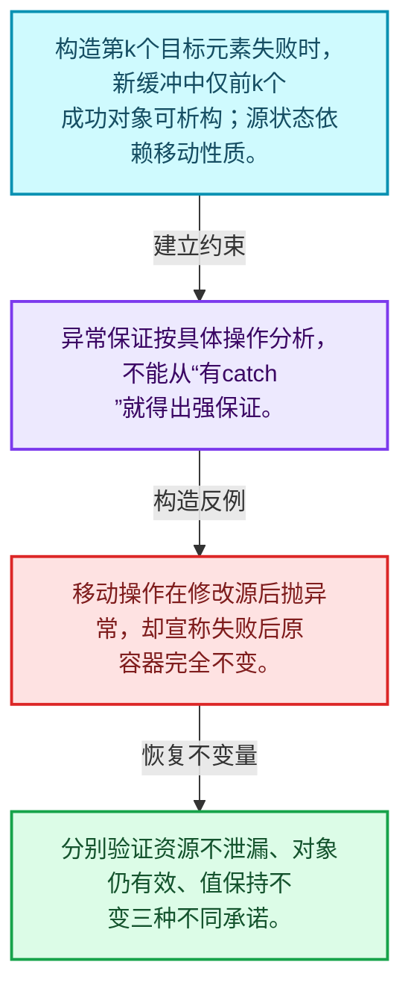
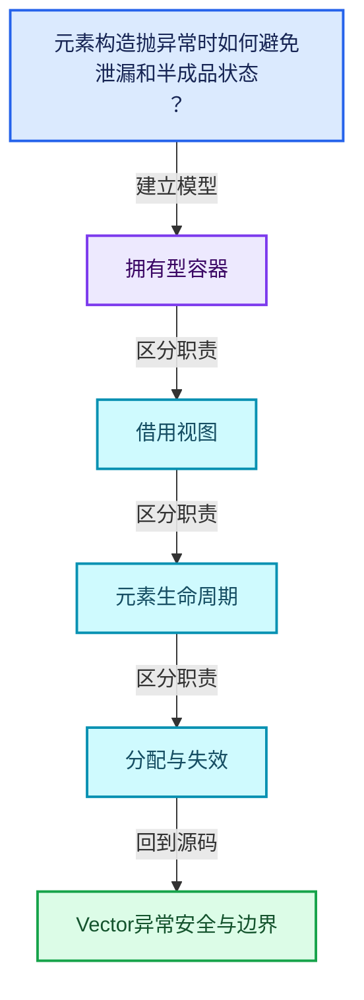
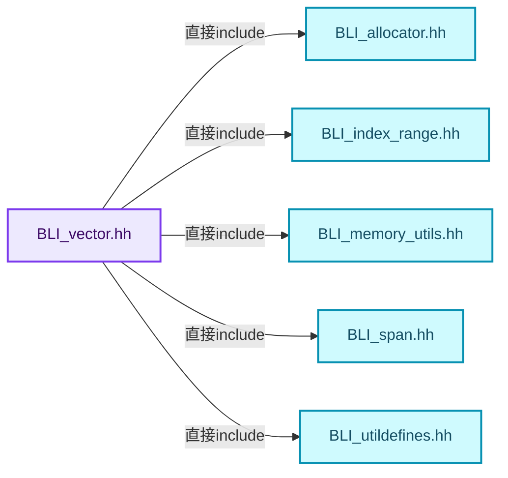
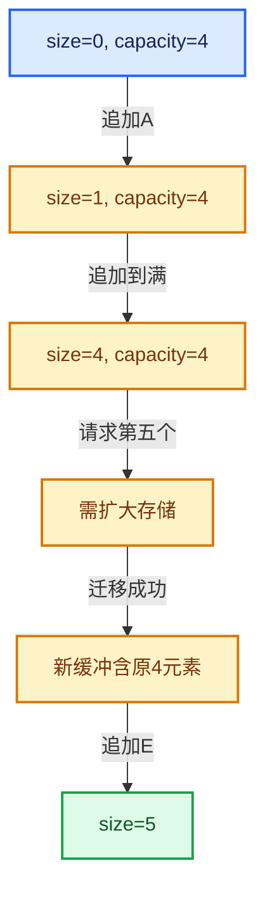

# 01-12 Vector异常安全与边界

[方向导航](README.md) · [总目录](../README.md) · [覆盖索引](../%E6%BA%90%E7%A0%81%E7%89%88%E6%9C%AC%E4%B8%8E%E8%A6%86%E7%9B%96%E7%B4%A2%E5%BC%95.md)

> 阅读顺序：问题与数据模型 → 语法与类型 → 源码逐行 → 调用线索 → 历史与取舍 → 推演和练习。

- 基准 HEAD：`cbda6b96c26c0dee3c3b5cbb93960c4ac06a6b30`。
- 记录日期：2026-10-14。
- 教学示例状态：正文中的推演不是本机性能实测；已运行练习见验收报告。

## 一、从问题到设计

元素构造抛异常时如何避免泄漏和半成品状态？

基本保证要求资源不泄漏且对象仍有效，强保证还要求失败不改变可观察状态；不同操作不能混为一谈。

本篇把语法、数据语义和系统取舍连接起来。先证明对象存活，再讨论索引；先区分借用与拥有，再讨论复制移动。

### 本篇独立模型与设计推理

构造第k个目标元素失败时，新缓冲中仅前k个成功对象可析构；源状态依赖移动性质。

设计取舍：异常保证按具体操作分析，不能从“有catch”就得出强保证。

最小反例：移动操作在修改源后抛异常，却宣称失败后原容器完全不变。

推导与处理：分别验证资源不泄漏、对象仍有效、值保持不变三种不同承诺。



### 源码范围与相邻篇章

| 文件 | 本篇逐行范围 | 基准SHA-256 |
|---|---|---|
| [source/blender/blenlib/BLI_vector.hh](../../../../../source/blender/blenlib/BLI_vector.hh) | L140—L351 | `6867b6ba34200e7e0a14495d93a9bef1645c5ef599e1f29ccdddc7c21e500485` |
| [source/blender/blenlib/BLI_vector.hh](../../../../../source/blender/blenlib/BLI_vector.hh) | L938—L1112 | `6867b6ba34200e7e0a14495d93a9bef1645c5ef599e1f29ccdddc7c21e500485` |
| [source/blender/blenlib/BLI_vector.hh](../../../../../source/blender/blenlib/BLI_vector.hh) | L1154—L1167 | `6867b6ba34200e7e0a14495d93a9bef1645c5ef599e1f29ccdddc7c21e500485` |

同一主讲文件可能分多篇覆盖；超出本篇范围的符号通过覆盖索引定位。空行与纯注释保留在源码摘录中，逐行表解释有效语句与语法边界；许可证头统一保留。

前篇：[Vector插入删除与重排](11-Vector%E6%8F%92%E5%85%A5%E5%88%A0%E9%99%A4%E4%B8%8E%E9%87%8D%E6%8E%92.md).

后篇：[Stack与栈接口](13-Stack%E4%B8%8E%E6%A0%88%E6%8E%A5%E5%8F%A3.md).

## 二、类型、数据与阅读地图



这是概念依赖图，边表示阅读关系，不声称是运行时调用顺序。

### 直接编译依赖



箭头只表示头文件包含关系；完整调用线索见后面的符号定位表。

## 三、关键词、语法与类型角色

### 模板 template

模板把类型或常量作为生成实现的参数。读声明时先列出类型参数、非类型参数和默认值，再看使用者实际实例化了什么。模板声明本身不意味着每种T都支持其全部成员。

具体检查：把T替换为int、string、只能移动的类型，分别检查每个被调用操作是否成立。

### 依赖名称 typename

typename既可引入类型模板参数，也可告诉编译器某个依赖名称是类型。它不创建运行时对象；解析期确认语法类别与实例化期检查具体类型是不同阶段。

具体检查：区分typename T::value_type和T::size()，前者标记类型，后者是表达式。

### 约束 requires

requires表达式或requires子句限制模板参与重载的条件。它提供编译期可用性检查，不是运行时if，不能指望输入到达程序后再被这一机制验证。

具体检查：构造满足和不满足约束的两个类型，观察候选被排除而不是在函数内返回错误。

### 常量求值 constexpr

constexpr声明允许相应实体参与常量求值，但constexpr函数仍可以在运行时执行。是否常量求值由调用场景和表达式合法性共同决定。

具体检查：比较constexpr变量初始化和从运行时输入调用同一函数。

### 只读限定 const

const约束当前访问路径可做的修改。const指针、指向const的指针、const视图对象、const元素是不同位置的限定；其他别名可能仍可修改原对象。

具体检查：分别写T* const、const T*与const T* const，并画出不可修改的层次。

### 移动转换 std::move

std::move把表达式转换为可供移动重载选择的值类别，实际资源转移发生在被选中的构造或赋值中。对const对象move可能仍调用复制，对视图move也不会获得底层数据所有权。

具体检查：记录移动构造调用次数，不用变量名或std::move的出现次数替代测量。

### 异常约定 noexcept

noexcept表达式可以依赖类型特征。违反不抛异常约定会终止程序；它不是自动捕获异常，也不是资源回滚代码。

具体检查：找出声明的条件与实际可能抛出的分配、构造操作是否一致。

### 异常边界 try与catch

try定义异常传播的局部边界。失败路径需要销毁已经成功构造的部分并释放相应存储；未构造的对象不能被析构。

具体检查：在第k次构造失败，列出已经存在的对象集合与待释放缓冲。

### 显式静态转换 static_cast

static_cast表达编译期允许的转换，不会自动验证运行时真实类型、指针寿命或索引边界。由void指针恢复T指针时，调用者仍须保证实际存储中确有合法T对象。

具体检查：标出转换前后的类型以及正确性依据来自哪里。

### 对齐 alignof

alignof得到类型要求的地址对齐。分配足够字节后仍需把地址对齐到相应边界，内嵌缓冲也一样。

具体检查：对齐a为2的幂时可推导向上取整，但仍要考虑溢出与边界。

### 对象表示 sizeof

sizeof给出对象表示大小，不是其引用的所有堆内存总量。sizeof视图很小并不说明底层数组很小。

具体检查：分别统计容器对象、容量字节和元素拥有的间接资源。

### 构造与new表达式

普通new可能分配并构造；placement new在给定地址构造，存储由其他机制提供。失败回滚应区分两类责任。

具体检查：追踪地址来自哪里、构造何时成功、由谁析构、由谁释放。

### 内部断言 assert

断言表达开发者预期成立的内部契约，发布构建可能关闭。它不能替代对不可信输入的完整错误处理，也不保证后续操作被运行时保护。

具体检查：对每条断言构造违反条件的输入，区分调用者错误与应向用户报告的错误。

### 编译期分支 if constexpr

条件在实例化时决定被保留的分支，这常用于不同类型的合法操作选择。它与运行时if有不同的实例化检查规则。

具体检查：找出每个分支依赖哪些类型特征，再使用满足与不满足条件的类型。

### 受控访问 friend

friend授予指定函数或类访问非公开成员的权限，并不意味着继承，也不自动扩展到友元的派生类。

具体检查：解释执行器为何需要访问包装器的内部映射，同时检查边界是否仍清楚。

### 类型别名 using

类型别名为已有类型建立名字，不创建运行期对象。它常把模板内部使用的类型统一暴露给泛型调用者。

具体检查：展开别名直到基础类型，区分类型别名和变量声明。

## 四、真实源码与逐行讲解

源码块保持原行内容，原始行号由小节标题及逐行表给出。表中的调用定位是静态阅读辅助；重载、模板实例化、宏展开和虚调用需结合完整声明，不能仅凭词法出现证明动态调用。

### BLI_vector.hh：L140—L185

<!-- source:source/blender/blenlib/BLI_vector.hh:140:185 -->

```cpp
  Vector(Allocator allocator = {}) noexcept : allocator_(allocator)
  {
    begin_ = inline_buffer_;
    end_ = begin_;
    capacity_end_ = begin_ + InlineBufferCapacity;
    UPDATE_VECTOR_SIZE(this);
  }

  Vector(NoExceptConstructor, Allocator allocator = {}) noexcept : Vector(allocator) {}

  /**
   * Create a vector with a specific size.
   * The elements will be default constructed.
   * If T is trivially constructible, the elements in the vector are not touched.
   */
  explicit Vector(int64_t size, Allocator allocator = {})
      : Vector(NoExceptConstructor(), allocator)
  {
    this->resize(size);
  }

  /**
   * Create a vector filled with a specific value.
   */
  Vector(int64_t size, const T &value, Allocator allocator = {})
      : Vector(NoExceptConstructor(), allocator)
  {
    this->resize(size, value);
  }

  /**
   * Create a vector from a span. The values in the vector are copy constructed.
   */
  template<typename U>
  Vector(Span<U> values, Allocator allocator = {})
    requires(std::is_convertible_v<U, T>)
      : Vector(NoExceptConstructor(), allocator)
  {
    const int64_t size = values.size();
    this->reserve(size);
    uninitialized_convert_n<U, T>(values.data(), size, begin_);
    this->increase_size_by_unchecked(size);
  }

  template<typename U>
  explicit Vector(MutableSpan<U> values, Allocator allocator = {})
```

本段语义重点：

- `begin_`：起点字段；在Vector中与end_界定已构造区间，其他类应按自己的声明确认含义。
- `end_`：尾后位置字段；在Vector中界定已构造区间，尾后位置不是最后一个元素。
- `capacity_end_`：已分配存储的尾后位置，和end_之间通常尚未构造对象。
- `allocator_`：提供存储的分配策略对象，释放必须与分配策略匹配。
- `inline_buffer_`：容器对象内部的缓冲区，不能像堆缓冲那样直接交给另一个对象。

| 原始行 | 语义、约束与检查 |
|---|---|
| L140 | 建立或更新 `allocator_`：提供存储的分配策略对象，释放必须与分配策略匹配。本行的具体值关系为 `Vector(Allocator allocator = {}) noexcept : allocator_(allocator)`；对照更新前后相应范围或状态是否一致。 |
| L141 | 连接上一行的声明或控制结构与其语句块；后续行在这个作用域中执行或声明。 |
| L142 | 建立或更新 `begin_`：起点字段；在Vector中与end_界定已构造区间，其他类应按自己的声明确认含义。本行的具体值关系为 `begin_ = inline_buffer_`；对照更新前后相应范围或状态是否一致。 |
| L143 | 建立或更新 `begin_`：起点字段；在Vector中与end_界定已构造区间，其他类应按自己的声明确认含义。本行的具体值关系为 `end_ = begin_`；对照更新前后相应范围或状态是否一致。 |
| L144 | 建立或更新 `begin_`：起点字段；在Vector中与end_界定已构造区间，其他类应按自己的声明确认含义。本行的具体值关系为 `capacity_end_ = begin_ + InlineBufferCapacity`；对照更新前后相应范围或状态是否一致。 |
| L145 | 出现调用或函数声明 `UPDATE_VECTOR_SIZE`，对应表达式为 `UPDATE_VECTOR_SIZE(this);`。参数求值、返回类型与重载需结合前后完整语句；静态文本引用不能证明动态目标。 |
| L146 | 结束当前语法单元。局部自动对象在离开其作用域时按规则销毁；这不等于所有被引用的外部数据也被释放。 |
| L148 | 把右侧 `{}) noexcept : Vector(allocator) {}` 用于初始化或更新左侧 `Vector(NoExceptConstructor, Allocator allocator`。声明初始化与已有对象赋值应按上下文区分；有资源的类型会调用相应特殊成员。 |
| L155 | 把右侧 `{})` 用于初始化或更新左侧 `explicit Vector(int64_t size, Allocator allocator`。声明初始化与已有对象赋值应按上下文区分；有资源的类型会调用相应特殊成员。 |
| L156 | 出现调用或函数声明 `Vector`，对应表达式为 `: Vector(NoExceptConstructor(), allocator)`。参数求值、返回类型与重载需结合前后完整语句；静态文本引用不能证明动态目标。 |
| L157 | 连接上一行的声明或控制结构与其语句块；后续行在这个作用域中执行或声明。 |
| L158 | 出现调用或函数声明 `resize`，对应表达式为 `this->resize(size);`。参数求值、返回类型与重载需结合前后完整语句；静态文本引用不能证明动态目标。 |
| L159 | 结束当前语法单元。局部自动对象在离开其作用域时按规则销毁；这不等于所有被引用的外部数据也被释放。 |
| L164 | 把右侧 `{})` 用于初始化或更新左侧 `Vector(int64_t size, const T &value, Allocator allocator`。声明初始化与已有对象赋值应按上下文区分；有资源的类型会调用相应特殊成员。 |
| L165 | 出现调用或函数声明 `Vector`，对应表达式为 `: Vector(NoExceptConstructor(), allocator)`。参数求值、返回类型与重载需结合前后完整语句；静态文本引用不能证明动态目标。 |
| L166 | 连接上一行的声明或控制结构与其语句块；后续行在这个作用域中执行或声明。 |
| L167 | 出现调用或函数声明 `resize`，对应表达式为 `this->resize(size, value);`。参数求值、返回类型与重载需结合前后完整语句；静态文本引用不能证明动态目标。 |
| L168 | 结束当前语法单元。局部自动对象在离开其作用域时按规则销毁；这不等于所有被引用的外部数据也被释放。 |
| L173 | 声明模板参数 `template<typename U>`。类型参数决定生成操作的类型，非类型参数可决定内嵌容量或编译期分支。 |
| L174 | 把右侧 `{})` 用于初始化或更新左侧 `Vector(Span<U> values, Allocator allocator`。声明初始化与已有对象赋值应按上下文区分；有资源的类型会调用相应特殊成员。 |
| L175 | 约束模板可用性：`requires(std::is_convertible_v<U, T>)`。条件在编译期检查，不替代运行期的地址、长度和类型一致性验证。 |
| L176 | 出现调用或函数声明 `Vector`，对应表达式为 `: Vector(NoExceptConstructor(), allocator)`。参数求值、返回类型与重载需结合前后完整语句；静态文本引用不能证明动态目标。 |
| L177 | 连接上一行的声明或控制结构与其语句块；后续行在这个作用域中执行或声明。 |
| L178 | 把右侧 `values.size()` 用于初始化或更新左侧 `const int64_t size`。声明初始化与已有对象赋值应按上下文区分；有资源的类型会调用相应特殊成员。 |
| L179 | 出现调用或函数声明 `reserve`，对应表达式为 `this->reserve(size);`。参数求值、返回类型与重载需结合前后完整语句；静态文本引用不能证明动态目标。 |
| L180 | 本行涉及 `begin_`：起点字段；在Vector中与end_界定已构造区间，其他类应按自己的声明确认含义。按此语义解读 `uninitialized_convert_n<U, T>(values.data(), size, begin_)`，不要把地址、数量或状态混用。 |
| L181 | 出现调用或函数声明 `increase_size_by_unchecked`，对应表达式为 `this->increase_size_by_unchecked(size);`。参数求值、返回类型与重载需结合前后完整语句；静态文本引用不能证明动态目标。 |
| L182 | 结束当前语法单元。局部自动对象在离开其作用域时按规则销毁；这不等于所有被引用的外部数据也被释放。 |
| L184 | 声明模板参数 `template<typename U>`。类型参数决定生成操作的类型，非类型参数可决定内嵌容量或编译期分支。 |
| L185 | 把右侧 `{})` 用于初始化或更新左侧 `explicit Vector(MutableSpan<U> values, Allocator allocator`。声明初始化与已有对象赋值应按上下文区分；有资源的类型会调用相应特殊成员。 |

### BLI_vector.hh：L186—L229

<!-- source:source/blender/blenlib/BLI_vector.hh:186:229 -->

```cpp
    requires(std::is_convertible_v<U, T>)
      : Vector(values.as_span(), allocator)
  {
  }

  /**
   * Create a vector that contains copies of the values in the initialized list.
   *
   * This allows you to write code like:
   * Vector<int> vec = {3, 4, 5};
   */
  template<typename U>
  Vector(const std::initializer_list<U> &values)
    requires(std::is_convertible_v<U, T>)
      : Vector(Span<U>(values))
  {
  }

  Vector(const std::initializer_list<T> &values) : Vector(Span<T>(values)) {}

  template<typename U, size_t N>
  Vector(const std::array<U, N> &values)
    requires(std::is_convertible_v<U, T>)
      : Vector(Span(values))
  {
  }

  template<typename InputIt>
  Vector(InputIt first, InputIt last, Allocator allocator = {})
      /* This constructor should not be called with e.g. Vector(3, 10), because that is
       * expected to produce the vector (10, 10, 10). */
    requires(!std::is_convertible_v<InputIt, int>)
      : Vector(NoExceptConstructor(), allocator)
  {
    for (InputIt current = first; current != last; ++current) {
      this->append(*current);
    }
  }

  /**
   * Create a copy of another vector. The other vector will not be changed. If the other vector has
   * less than InlineBufferCapacity elements, no allocation will be made.
   */
  Vector(const Vector &other) : Vector(other.as_span(), other.allocator_) {}
```

本段语义重点：

- `allocator_`：提供存储的分配策略对象，释放必须与分配策略匹配。

| 原始行 | 语义、约束与检查 |
|---|---|
| L186 | 约束模板可用性：`requires(std::is_convertible_v<U, T>)`。条件在编译期检查，不替代运行期的地址、长度和类型一致性验证。 |
| L187 | 出现调用或函数声明 `Vector`，对应表达式为 `: Vector(values.as_span(), allocator)`。参数求值、返回类型与重载需结合前后完整语句；静态文本引用不能证明动态目标。 |
| L188 | 连接上一行的声明或控制结构与其语句块；后续行在这个作用域中执行或声明。 |
| L189 | 结束当前语法单元。局部自动对象在离开其作用域时按规则销毁；这不等于所有被引用的外部数据也被释放。 |
| L197 | 声明模板参数 `template<typename U>`。类型参数决定生成操作的类型，非类型参数可决定内嵌容量或编译期分支。 |
| L198 | 出现调用或函数声明 `Vector`，对应表达式为 `Vector(const std::initializer_list<U> &values)`。参数求值、返回类型与重载需结合前后完整语句；静态文本引用不能证明动态目标。 |
| L199 | 约束模板可用性：`requires(std::is_convertible_v<U, T>)`。条件在编译期检查，不替代运行期的地址、长度和类型一致性验证。 |
| L200 | 出现调用或函数声明 `Vector`，对应表达式为 `: Vector(Span<U>(values))`。参数求值、返回类型与重载需结合前后完整语句；静态文本引用不能证明动态目标。 |
| L201 | 连接上一行的声明或控制结构与其语句块；后续行在这个作用域中执行或声明。 |
| L202 | 结束当前语法单元。局部自动对象在离开其作用域时按规则销毁；这不等于所有被引用的外部数据也被释放。 |
| L204 | 出现调用或函数声明 `Vector`，对应表达式为 `Vector(const std::initializer_list<T> &values) : Vector(Span<T>(values)) {}`。参数求值、返回类型与重载需结合前后完整语句；静态文本引用不能证明动态目标。 |
| L206 | 声明模板参数 `template<typename U, size_t N>`。类型参数决定生成操作的类型，非类型参数可决定内嵌容量或编译期分支。 |
| L207 | 出现调用或函数声明 `Vector`，对应表达式为 `Vector(const std::array<U, N> &values)`。参数求值、返回类型与重载需结合前后完整语句；静态文本引用不能证明动态目标。 |
| L208 | 约束模板可用性：`requires(std::is_convertible_v<U, T>)`。条件在编译期检查，不替代运行期的地址、长度和类型一致性验证。 |
| L209 | 出现调用或函数声明 `Vector`，对应表达式为 `: Vector(Span(values))`。参数求值、返回类型与重载需结合前后完整语句；静态文本引用不能证明动态目标。 |
| L210 | 连接上一行的声明或控制结构与其语句块；后续行在这个作用域中执行或声明。 |
| L211 | 结束当前语法单元。局部自动对象在离开其作用域时按规则销毁；这不等于所有被引用的外部数据也被释放。 |
| L213 | 声明模板参数 `template<typename InputIt>`。类型参数决定生成操作的类型，非类型参数可决定内嵌容量或编译期分支。 |
| L214 | 把右侧 `{})` 用于初始化或更新左侧 `Vector(InputIt first, InputIt last, Allocator allocator`。声明初始化与已有对象赋值应按上下文区分；有资源的类型会调用相应特殊成员。 |
| L217 | 约束模板可用性：`requires(!std::is_convertible_v<InputIt, int>)`。条件在编译期检查，不替代运行期的地址、长度和类型一致性验证。 |
| L218 | 出现调用或函数声明 `Vector`，对应表达式为 `: Vector(NoExceptConstructor(), allocator)`。参数求值、返回类型与重载需结合前后完整语句；静态文本引用不能证明动态目标。 |
| L219 | 连接上一行的声明或控制结构与其语句块；后续行在这个作用域中执行或声明。 |
| L220 | 按 `for (InputIt current = first; current != last; ++current)` 指定的范围或条件重复执行。对照循环变量与真实元素编号；循环内调用成本乘以实际迭代次数。 |
| L221 | 出现调用或函数声明 `append`，对应表达式为 `this->append(*current);`。参数求值、返回类型与重载需结合前后完整语句；静态文本引用不能证明动态目标。 |
| L222 | 结束当前语法单元。局部自动对象在离开其作用域时按规则销毁；这不等于所有被引用的外部数据也被释放。 |
| L223 | 结束当前语法单元。局部自动对象在离开其作用域时按规则销毁；这不等于所有被引用的外部数据也被释放。 |
| L229 | 本行涉及 `allocator_`：提供存储的分配策略对象，释放必须与分配策略匹配。按此语义解读 `Vector(const Vector &other) : Vector(other.as_span(), other.allocator_) {}`，不要把地址、数量或状态混用。 |

### BLI_vector.hh：L230—L307

<!-- source:source/blender/blenlib/BLI_vector.hh:230:307 -->

```cpp

  /**
   * Create a copy of a vector with a different InlineBufferCapacity. This needs to be handled
   * separately, so that the other one is a valid copy constructor.
   */
  template<int64_t OtherInlineBufferCapacity>
  Vector(const Vector<T, OtherInlineBufferCapacity, Allocator> &other)
      : Vector(other.as_span(), other.allocator_)
  {
  }

  /**
   * Steal the elements from another vector. This does not do an allocation. The other vector will
   * have zero elements afterwards.
   */
  template<int64_t OtherInlineBufferCapacity>
  Vector(Vector<T, OtherInlineBufferCapacity, Allocator> &&other) noexcept(
      is_nothrow_move_constructible())
      : Vector(NoExceptConstructor(), other.allocator_)
  {
    if (other.is_inline()) {
      const int64_t size = other.size();

      /* Optimize the case by copying the full inline buffer. */
      constexpr bool other_is_same_type = std::is_same_v<Vector, std::decay_t<decltype(other)>>;
      constexpr size_t max_full_copy_size = 32;
      if constexpr (other_is_same_type && std::is_trivial_v<T> &&
                    sizeof(inline_buffer_) <= max_full_copy_size)
      {
        /* This check is technically optional. However, benchmarking shows that skipping work
         * for empty vectors (which is a common case) is worth the extra check even in the case
         * when the vector is not empty. */
        if (size > 0) {
          /* Copy the full inline buffer instead of only the used parts. This may copy
           * uninitialized values but allows producing more optimal code than when the copy size
           * would depend on a dynamic value. */
          memcpy(inline_buffer_, other.inline_buffer_, sizeof(inline_buffer_));
          this->increase_size_by_unchecked(size);
          /* Reset other vector. */
          other.end_ = other.inline_buffer_;
        }
      }
      else {
        /* This first check is not strictly necessary, but improves performance because it can be
         * done at compile time and makes the size check at run-time unnecessary. */
        if (OtherInlineBufferCapacity <= InlineBufferCapacity || size <= InlineBufferCapacity) {
          /* Copy between inline buffers. */
          uninitialized_relocate_n(other.begin_, size, begin_);
          end_ = begin_ + size;
        }
        else {
          /* Copy from inline buffer to newly allocated buffer. */
          const int64_t capacity = size;
          begin_ = static_cast<T *>(
              allocator_.allocate(sizeof(T) * size_t(capacity), alignof(T), AT));
          capacity_end_ = begin_ + capacity;
          uninitialized_relocate_n(other.begin_, size, begin_);
          end_ = begin_ + size;
        }
        /* Reset other vector. */
        other.end_ = other.inline_buffer_;
      }
    }
    else {
      /* Steal the pointer. */
      begin_ = other.begin_;
      end_ = other.end_;
      capacity_end_ = other.capacity_end_;

      /* Reset other vector. */
      other.begin_ = other.inline_buffer_;
      other.end_ = other.inline_buffer_;
      other.capacity_end_ = other.inline_buffer_ + OtherInlineBufferCapacity;
    }

    UPDATE_VECTOR_SIZE(this);
    UPDATE_VECTOR_SIZE(&other);
  }
```

本段语义重点：

- `uninitialized_relocate_n`：在目标原始存储建立n个对象，并结束源对象寿命；与仅移动构造不同，后续不能再次把源当作存活元素销毁。
- `memcpy`：按字节复制表示；必须由类型性质和生命周期规则证明可用，不能泛化到任意拥有资源对象。
- `begin_`：起点字段；在Vector中与end_界定已构造区间，其他类应按自己的声明确认含义。
- `end_`：尾后位置字段；在Vector中界定已构造区间，尾后位置不是最后一个元素。
- `capacity_end_`：已分配存储的尾后位置，和end_之间通常尚未构造对象。

| 原始行 | 语义、约束与检查 |
|---|---|
| L235 | 声明模板参数 `template<int64_t OtherInlineBufferCapacity>`。类型参数决定生成操作的类型，非类型参数可决定内嵌容量或编译期分支。 |
| L236 | 出现调用或函数声明 `Vector`，对应表达式为 `Vector(const Vector<T, OtherInlineBufferCapacity, Allocator> &other)`。参数求值、返回类型与重载需结合前后完整语句；静态文本引用不能证明动态目标。 |
| L237 | 本行涉及 `allocator_`：提供存储的分配策略对象，释放必须与分配策略匹配。按此语义解读 `: Vector(other.as_span(), other.allocator_)`，不要把地址、数量或状态混用。 |
| L238 | 连接上一行的声明或控制结构与其语句块；后续行在这个作用域中执行或声明。 |
| L239 | 结束当前语法单元。局部自动对象在离开其作用域时按规则销毁；这不等于所有被引用的外部数据也被释放。 |
| L245 | 声明模板参数 `template<int64_t OtherInlineBufferCapacity>`。类型参数决定生成操作的类型，非类型参数可决定内嵌容量或编译期分支。 |
| L246 | 出现调用或函数声明 `Vector`，对应表达式为 `Vector(Vector<T, OtherInlineBufferCapacity, Allocator> &&other) noexcept(`。参数求值、返回类型与重载需结合前后完整语句；静态文本引用不能证明动态目标。 |
| L247 | 出现调用或函数声明 `is_nothrow_move_constructible`，对应表达式为 `is_nothrow_move_constructible())`。参数求值、返回类型与重载需结合前后完整语句；静态文本引用不能证明动态目标。 |
| L248 | 本行涉及 `allocator_`：提供存储的分配策略对象，释放必须与分配策略匹配。按此语义解读 `: Vector(NoExceptConstructor(), other.allocator_)`，不要把地址、数量或状态混用。 |
| L249 | 连接上一行的声明或控制结构与其语句块；后续行在这个作用域中执行或声明。 |
| L250 | 判断 `other.is_inline()`，成立时进入本分支，否则继续后续路径。 |
| L251 | 把右侧 `other.size()` 用于初始化或更新左侧 `const int64_t size`。声明初始化与已有对象赋值应按上下文区分；有资源的类型会调用相应特殊成员。 |
| L254 | 把右侧 `std::is_same_v<Vector, std::decay_t<decltype(other)>>` 用于初始化或更新左侧 `constexpr bool other_is_same_type`。声明初始化与已有对象赋值应按上下文区分；有资源的类型会调用相应特殊成员。 |
| L255 | 把右侧 `32` 用于初始化或更新左侧 `constexpr size_t max_full_copy_size`。声明初始化与已有对象赋值应按上下文区分；有资源的类型会调用相应特殊成员。 |
| L256 | 编译期条件分支 `if constexpr (other_is_same_type && std::is_trivial_v<T> &&`。按实例化类型选择相应实现；被舍弃分支和运行期if具有不同检查规则，不能当作运行时输入验证。 |
| L257 | 本行涉及 `inline_buffer_`：容器对象内部的缓冲区，不能像堆缓冲那样直接交给另一个对象。按此语义解读 `sizeof(inline_buffer_) <= max_full_copy_size)`，不要把地址、数量或状态混用。 |
| L258 | 连接上一行的声明或控制结构与其语句块；后续行在这个作用域中执行或声明。 |
| L262 | 判断 `size > 0`，成立时进入本分支，否则继续后续路径。该边界影响可访问元素或可用容量，两者要按各变量的定义区分。 |
| L266 | 本行使用 `memcpy`：按字节复制表示；必须由类型性质和生命周期规则证明可用，不能泛化到任意拥有资源对象。 |
| L267 | 出现调用或函数声明 `increase_size_by_unchecked`，对应表达式为 `this->increase_size_by_unchecked(size);`。参数求值、返回类型与重载需结合前后完整语句；静态文本引用不能证明动态目标。 |
| L269 | 建立或更新 `end_`：尾后位置字段；在Vector中界定已构造区间，尾后位置不是最后一个元素。本行的具体值关系为 `other.end_ = other.inline_buffer_`；对照更新前后相应范围或状态是否一致。 |
| L270 | 结束当前语法单元。局部自动对象在离开其作用域时按规则销毁；这不等于所有被引用的外部数据也被释放。 |
| L271 | 结束当前语法单元。局部自动对象在离开其作用域时按规则销毁；这不等于所有被引用的外部数据也被释放。 |
| L272 | 处理前一条件不成立的互补路径。比较两条路径最后是否恢复同一不变量，以及是否产生不同的资源责任。 |
| L275 | 判断 `OtherInlineBufferCapacity <= InlineBufferCapacity &#124;&#124; size <= InlineBufferCapacity`，成立时进入本分支，否则继续后续路径。该边界影响可访问元素或可用容量，两者要按各变量的定义区分。 |
| L277 | 本行使用 `uninitialized_relocate_n`：在目标原始存储建立n个对象，并结束源对象寿命；与仅移动构造不同，后续不能再次把源当作存活元素销毁。 |
| L278 | 建立或更新 `begin_`：起点字段；在Vector中与end_界定已构造区间，其他类应按自己的声明确认含义。本行的具体值关系为 `end_ = begin_ + size`；对照更新前后相应范围或状态是否一致。 |
| L279 | 结束当前语法单元。局部自动对象在离开其作用域时按规则销毁；这不等于所有被引用的外部数据也被释放。 |
| L280 | 处理前一条件不成立的互补路径。比较两条路径最后是否恢复同一不变量，以及是否产生不同的资源责任。 |
| L282 | 把右侧 `size` 用于初始化或更新左侧 `const int64_t capacity`。声明初始化与已有对象赋值应按上下文区分；有资源的类型会调用相应特殊成员。 |
| L283 | 建立或更新 `begin_`：起点字段；在Vector中与end_界定已构造区间，其他类应按自己的声明确认含义。本行的具体值关系为 `begin_ = static_cast<T *>(`；对照更新前后相应范围或状态是否一致。 |
| L284 | 本行涉及 `allocator_`：提供存储的分配策略对象，释放必须与分配策略匹配。按此语义解读 `allocator_.allocate(sizeof(T) * size_t(capacity), alignof(T), AT))`，不要把地址、数量或状态混用。 |
| L285 | 建立或更新 `begin_`：起点字段；在Vector中与end_界定已构造区间，其他类应按自己的声明确认含义。本行的具体值关系为 `capacity_end_ = begin_ + capacity`；对照更新前后相应范围或状态是否一致。 |
| L286 | 本行使用 `uninitialized_relocate_n`：在目标原始存储建立n个对象，并结束源对象寿命；与仅移动构造不同，后续不能再次把源当作存活元素销毁。 |
| L287 | 建立或更新 `begin_`：起点字段；在Vector中与end_界定已构造区间，其他类应按自己的声明确认含义。本行的具体值关系为 `end_ = begin_ + size`；对照更新前后相应范围或状态是否一致。 |
| L288 | 结束当前语法单元。局部自动对象在离开其作用域时按规则销毁；这不等于所有被引用的外部数据也被释放。 |
| L290 | 建立或更新 `end_`：尾后位置字段；在Vector中界定已构造区间，尾后位置不是最后一个元素。本行的具体值关系为 `other.end_ = other.inline_buffer_`；对照更新前后相应范围或状态是否一致。 |
| L291 | 结束当前语法单元。局部自动对象在离开其作用域时按规则销毁；这不等于所有被引用的外部数据也被释放。 |
| L292 | 结束当前语法单元。局部自动对象在离开其作用域时按规则销毁；这不等于所有被引用的外部数据也被释放。 |
| L293 | 处理前一条件不成立的互补路径。比较两条路径最后是否恢复同一不变量，以及是否产生不同的资源责任。 |
| L295 | 建立或更新 `begin_`：起点字段；在Vector中与end_界定已构造区间，其他类应按自己的声明确认含义。本行的具体值关系为 `begin_ = other.begin_`；对照更新前后相应范围或状态是否一致。 |
| L296 | 建立或更新 `end_`：尾后位置字段；在Vector中界定已构造区间，尾后位置不是最后一个元素。本行的具体值关系为 `end_ = other.end_`；对照更新前后相应范围或状态是否一致。 |
| L297 | 建立或更新 `capacity_end_`：已分配存储的尾后位置，和end_之间通常尚未构造对象。本行的具体值关系为 `capacity_end_ = other.capacity_end_`；对照更新前后相应范围或状态是否一致。 |
| L300 | 建立或更新 `begin_`：起点字段；在Vector中与end_界定已构造区间，其他类应按自己的声明确认含义。本行的具体值关系为 `other.begin_ = other.inline_buffer_`；对照更新前后相应范围或状态是否一致。 |
| L301 | 建立或更新 `end_`：尾后位置字段；在Vector中界定已构造区间，尾后位置不是最后一个元素。本行的具体值关系为 `other.end_ = other.inline_buffer_`；对照更新前后相应范围或状态是否一致。 |
| L302 | 建立或更新 `capacity_end_`：已分配存储的尾后位置，和end_之间通常尚未构造对象。本行的具体值关系为 `other.capacity_end_ = other.inline_buffer_ + OtherInlineBufferCapacity`；对照更新前后相应范围或状态是否一致。 |
| L303 | 结束当前语法单元。局部自动对象在离开其作用域时按规则销毁；这不等于所有被引用的外部数据也被释放。 |
| L305 | 出现调用或函数声明 `UPDATE_VECTOR_SIZE`，对应表达式为 `UPDATE_VECTOR_SIZE(this);`。参数求值、返回类型与重载需结合前后完整语句；静态文本引用不能证明动态目标。 |
| L306 | 出现调用或函数声明 `UPDATE_VECTOR_SIZE`，对应表达式为 `UPDATE_VECTOR_SIZE(&other);`。参数求值、返回类型与重载需结合前后完整语句；静态文本引用不能证明动态目标。 |
| L307 | 结束当前语法单元。局部自动对象在离开其作用域时按规则销毁；这不等于所有被引用的外部数据也被释放。 |

### BLI_vector.hh：L308—L351

<!-- source:source/blender/blenlib/BLI_vector.hh:308:351 -->

```cpp

  /**
   * Initializes the #Vector from an existing buffer. The #Vector takes ownership of the buffer.
   * The caller is responsible to make sure that the buffer has been allocated with the same
   * allocator that the #Vector will use to deallocate it.
   */
  Vector(const VectorData<T, Allocator> &data) : Vector(data.allocator)
  {
    BLI_assert(data.capacity == 0 || data.data != nullptr);
    BLI_assert(data.size >= 0);
    BLI_assert(data.size <= data.capacity);
    /* Don't use the passed in buffer if it is null. Use the inline-buffer instead which is already
     * initialized by the constructor call above. */
    if (data.data != nullptr) {
      /* Take ownership of the array. */
      begin_ = data.data;
      end_ = data.data + data.size;
      capacity_end_ = data.data + data.capacity;
      UPDATE_VECTOR_SIZE(this);
    }
  }

  ~Vector()
  {
    destruct_n(begin_, this->size());
    if (!this->is_inline()) {
      allocator_.deallocate(begin_);
    }
  }

  Vector &operator=(const Vector &other)
  {
    return copy_assign_container(*this, other);
  }

  Vector &operator=(Vector &&other)
  {
    return move_assign_container(*this, std::move(other));
  }

  /**
   * Get the value at the given index. This invokes undefined behavior when the index is out of
   * bounds.
   */
```

本段语义重点：

- `destruct_n`：对已构造的元素区间执行析构；计数必须对应真实存活对象，释放原始内存是另一操作。
- `begin_`：起点字段；在Vector中与end_界定已构造区间，其他类应按自己的声明确认含义。
- `end_`：尾后位置字段；在Vector中界定已构造区间，尾后位置不是最后一个元素。
- `capacity_end_`：已分配存储的尾后位置，和end_之间通常尚未构造对象。
- `allocator_`：提供存储的分配策略对象，释放必须与分配策略匹配。

| 原始行 | 语义、约束与检查 |
|---|---|
| L314 | 出现调用或函数声明 `Vector`，对应表达式为 `Vector(const VectorData<T, Allocator> &data) : Vector(data.allocator)`。参数求值、返回类型与重载需结合前后完整语句；静态文本引用不能证明动态目标。 |
| L315 | 连接上一行的声明或控制结构与其语句块；后续行在这个作用域中执行或声明。 |
| L316 | 断言约束 `BLI_assert(data.capacity == 0 &#124;&#124; data.data != nullptr);`。条件是后续访问的内部前置条件；发布构建可能不执行，不能把断言当作输入修复。 |
| L317 | 断言约束 `BLI_assert(data.size >= 0);`。条件是后续访问的内部前置条件；发布构建可能不执行，不能把断言当作输入修复。 |
| L318 | 断言约束 `BLI_assert(data.size <= data.capacity);`。条件是后续访问的内部前置条件；发布构建可能不执行，不能把断言当作输入修复。 |
| L321 | 判断 `data.data != nullptr`，成立时进入本分支，否则继续后续路径。这里区分空地址与可用地址，但非空本身仍不能证明对象存活。 |
| L323 | 建立或更新 `begin_`：起点字段；在Vector中与end_界定已构造区间，其他类应按自己的声明确认含义。本行的具体值关系为 `begin_ = data.data`；对照更新前后相应范围或状态是否一致。 |
| L324 | 建立或更新 `end_`：尾后位置字段；在Vector中界定已构造区间，尾后位置不是最后一个元素。本行的具体值关系为 `end_ = data.data + data.size`；对照更新前后相应范围或状态是否一致。 |
| L325 | 建立或更新 `capacity_end_`：已分配存储的尾后位置，和end_之间通常尚未构造对象。本行的具体值关系为 `capacity_end_ = data.data + data.capacity`；对照更新前后相应范围或状态是否一致。 |
| L326 | 出现调用或函数声明 `UPDATE_VECTOR_SIZE`，对应表达式为 `UPDATE_VECTOR_SIZE(this);`。参数求值、返回类型与重载需结合前后完整语句；静态文本引用不能证明动态目标。 |
| L327 | 结束当前语法单元。局部自动对象在离开其作用域时按规则销毁；这不等于所有被引用的外部数据也被释放。 |
| L328 | 结束当前语法单元。局部自动对象在离开其作用域时按规则销毁；这不等于所有被引用的外部数据也被释放。 |
| L330 | 涉及析构接口或显式析构：`~Vector()`。检查目标对象已成功构造，且资源不会在另一条清理路径再次销毁。 |
| L331 | 连接上一行的声明或控制结构与其语句块；后续行在这个作用域中执行或声明。 |
| L332 | 本行使用 `destruct_n`：对已构造的元素区间执行析构；计数必须对应真实存活对象，释放原始内存是另一操作。 |
| L333 | 判断 `!this->is_inline()`，成立时进入本分支，否则继续后续路径。 |
| L334 | 本行涉及 `begin_`：起点字段；在Vector中与end_界定已构造区间，其他类应按自己的声明确认含义。按此语义解读 `allocator_.deallocate(begin_)`，不要把地址、数量或状态混用。 |
| L335 | 结束当前语法单元。局部自动对象在离开其作用域时按规则销毁；这不等于所有被引用的外部数据也被释放。 |
| L336 | 结束当前语法单元。局部自动对象在离开其作用域时按规则销毁；这不等于所有被引用的外部数据也被释放。 |
| L338 | 运算符重载声明、定义或显式调用：`Vector &operator=(const Vector &other)`。结合参数和返回类型判断是赋值、索引、比较还是转换；operator=声明中的等号不是在给名为operator的变量赋值。 |
| L339 | 连接上一行的声明或控制结构与其语句块；后续行在这个作用域中执行或声明。 |
| L340 | 返回表达式 `copy_assign_container(*this, other)`。 |
| L341 | 结束当前语法单元。局部自动对象在离开其作用域时按规则销毁；这不等于所有被引用的外部数据也被释放。 |
| L343 | 运算符重载声明、定义或显式调用：`Vector &operator=(Vector &&other)`。结合参数和返回类型判断是赋值、索引、比较还是转换；operator=声明中的等号不是在给名为operator的变量赋值。 |
| L344 | 连接上一行的声明或控制结构与其语句块；后续行在这个作用域中执行或声明。 |
| L345 | 返回表达式 `move_assign_container(*this, std::move(other))`。 |
| L346 | 结束当前语法单元。局部自动对象在离开其作用域时按规则销毁；这不等于所有被引用的外部数据也被释放。 |

### BLI_vector.hh：L938—L983

<!-- source:source/blender/blenlib/BLI_vector.hh:938:983 -->

```cpp
  bool contains(const T &value) const
  {
    return this->first_index_of_try(value) != -1;
  }

  /**
   * Copies the given value to every element in the vector.
   */
  void fill(const T &value) const
  {
    initialized_fill_n(begin_, this->size(), value);
  }

  /**
   * Get access to the underlying array.
   */
  T *data()
  {
    return begin_;
  }

  /**
   * Get access to the underlying array.
   */
  const T *data() const
  {
    return begin_;
  }

  T *begin()
  {
    return begin_;
  }
  T *end()
  {
    return end_;
  }

  const T *begin() const
  {
    return begin_;
  }
  const T *end() const
  {
    return end_;
  }
```

本段语义重点：

- `begin_`：起点字段；在Vector中与end_界定已构造区间，其他类应按自己的声明确认含义。
- `end_`：尾后位置字段；在Vector中界定已构造区间，尾后位置不是最后一个元素。

| 原始行 | 语义、约束与检查 |
|---|---|
| L938 | 出现调用或函数声明 `contains`，对应表达式为 `bool contains(const T &value) const`。参数求值、返回类型与重载需结合前后完整语句；静态文本引用不能证明动态目标。 |
| L939 | 连接上一行的声明或控制结构与其语句块；后续行在这个作用域中执行或声明。 |
| L940 | 返回表达式 `this->first_index_of_try(value) != -1`。 |
| L941 | 结束当前语法单元。局部自动对象在离开其作用域时按规则销毁；这不等于所有被引用的外部数据也被释放。 |
| L946 | 出现调用或函数声明 `fill`，对应表达式为 `void fill(const T &value) const`。参数求值、返回类型与重载需结合前后完整语句；静态文本引用不能证明动态目标。 |
| L947 | 连接上一行的声明或控制结构与其语句块；后续行在这个作用域中执行或声明。 |
| L948 | 本行涉及 `begin_`：起点字段；在Vector中与end_界定已构造区间，其他类应按自己的声明确认含义。按此语义解读 `initialized_fill_n(begin_, this->size(), value)`，不要把地址、数量或状态混用。 |
| L949 | 结束当前语法单元。局部自动对象在离开其作用域时按规则销毁；这不等于所有被引用的外部数据也被释放。 |
| L954 | 出现调用或函数声明 `data`，对应表达式为 `T *data()`。参数求值、返回类型与重载需结合前后完整语句；静态文本引用不能证明动态目标。 |
| L955 | 连接上一行的声明或控制结构与其语句块；后续行在这个作用域中执行或声明。 |
| L956 | 返回表达式 `begin_`。 |
| L957 | 结束当前语法单元。局部自动对象在离开其作用域时按规则销毁；这不等于所有被引用的外部数据也被释放。 |
| L962 | 出现调用或函数声明 `data`，对应表达式为 `const T *data() const`。参数求值、返回类型与重载需结合前后完整语句；静态文本引用不能证明动态目标。 |
| L963 | 连接上一行的声明或控制结构与其语句块；后续行在这个作用域中执行或声明。 |
| L964 | 返回表达式 `begin_`。 |
| L965 | 结束当前语法单元。局部自动对象在离开其作用域时按规则销毁；这不等于所有被引用的外部数据也被释放。 |
| L967 | 出现调用或函数声明 `begin`，对应表达式为 `T *begin()`。参数求值、返回类型与重载需结合前后完整语句；静态文本引用不能证明动态目标。 |
| L968 | 连接上一行的声明或控制结构与其语句块；后续行在这个作用域中执行或声明。 |
| L969 | 返回表达式 `begin_`。 |
| L970 | 结束当前语法单元。局部自动对象在离开其作用域时按规则销毁；这不等于所有被引用的外部数据也被释放。 |
| L971 | 出现调用或函数声明 `end`，对应表达式为 `T *end()`。参数求值、返回类型与重载需结合前后完整语句；静态文本引用不能证明动态目标。 |
| L972 | 连接上一行的声明或控制结构与其语句块；后续行在这个作用域中执行或声明。 |
| L973 | 返回表达式 `end_`。 |
| L974 | 结束当前语法单元。局部自动对象在离开其作用域时按规则销毁；这不等于所有被引用的外部数据也被释放。 |
| L976 | 出现调用或函数声明 `begin`，对应表达式为 `const T *begin() const`。参数求值、返回类型与重载需结合前后完整语句；静态文本引用不能证明动态目标。 |
| L977 | 连接上一行的声明或控制结构与其语句块；后续行在这个作用域中执行或声明。 |
| L978 | 返回表达式 `begin_`。 |
| L979 | 结束当前语法单元。局部自动对象在离开其作用域时按规则销毁；这不等于所有被引用的外部数据也被释放。 |
| L980 | 出现调用或函数声明 `end`，对应表达式为 `const T *end() const`。参数求值、返回类型与重载需结合前后完整语句；静态文本引用不能证明动态目标。 |
| L981 | 连接上一行的声明或控制结构与其语句块；后续行在这个作用域中执行或声明。 |
| L982 | 返回表达式 `end_`。 |
| L983 | 结束当前语法单元。局部自动对象在离开其作用域时按规则销毁；这不等于所有被引用的外部数据也被释放。 |

### BLI_vector.hh：L984—L1029

<!-- source:source/blender/blenlib/BLI_vector.hh:984:1029 -->

```cpp

  std::reverse_iterator<T *> rbegin()
  {
    return std::reverse_iterator<T *>(this->end());
  }
  std::reverse_iterator<T *> rend()
  {
    return std::reverse_iterator<T *>(this->begin());
  }

  std::reverse_iterator<const T *> rbegin() const
  {
    return std::reverse_iterator<const T *>(this->end());
  }
  std::reverse_iterator<const T *> rend() const
  {
    return std::reverse_iterator<const T *>(this->begin());
  }

  /**
   * Get the current capacity of the vector, i.e. the maximum number of elements the vector can
   * hold, before it has to reallocate.
   */
  int64_t capacity() const
  {
    return int64_t(capacity_end_ - begin_);
  }

  bool is_at_capacity() const
  {
    return end_ == capacity_end_;
  }

  /**
   * Get an index range that makes looping over all indices more convenient and less error prone.
   * Obviously, this should only be used when you actually need the index in the loop.
   *
   * Example:
   *  for (int64_t i : myvector.index_range()) {
   *    do_something(i, my_vector[i]);
   *  }
   */
  IndexRange index_range() const
  {
    return IndexRange(this->size());
  }
```

本段语义重点：

- `begin_`：起点字段；在Vector中与end_界定已构造区间，其他类应按自己的声明确认含义。
- `end_`：尾后位置字段；在Vector中界定已构造区间，尾后位置不是最后一个元素。
- `capacity_end_`：已分配存储的尾后位置，和end_之间通常尚未构造对象。

| 原始行 | 语义、约束与检查 |
|---|---|
| L985 | 出现调用或函数声明 `rbegin`，对应表达式为 `std::reverse_iterator<T *> rbegin()`。参数求值、返回类型与重载需结合前后完整语句；静态文本引用不能证明动态目标。 |
| L986 | 连接上一行的声明或控制结构与其语句块；后续行在这个作用域中执行或声明。 |
| L987 | 返回表达式 `std::reverse_iterator<T *>(this->end())`。 |
| L988 | 结束当前语法单元。局部自动对象在离开其作用域时按规则销毁；这不等于所有被引用的外部数据也被释放。 |
| L989 | 出现调用或函数声明 `rend`，对应表达式为 `std::reverse_iterator<T *> rend()`。参数求值、返回类型与重载需结合前后完整语句；静态文本引用不能证明动态目标。 |
| L990 | 连接上一行的声明或控制结构与其语句块；后续行在这个作用域中执行或声明。 |
| L991 | 返回表达式 `std::reverse_iterator<T *>(this->begin())`。 |
| L992 | 结束当前语法单元。局部自动对象在离开其作用域时按规则销毁；这不等于所有被引用的外部数据也被释放。 |
| L994 | 出现调用或函数声明 `rbegin`，对应表达式为 `std::reverse_iterator<const T *> rbegin() const`。参数求值、返回类型与重载需结合前后完整语句；静态文本引用不能证明动态目标。 |
| L995 | 连接上一行的声明或控制结构与其语句块；后续行在这个作用域中执行或声明。 |
| L996 | 返回表达式 `std::reverse_iterator<const T *>(this->end())`。 |
| L997 | 结束当前语法单元。局部自动对象在离开其作用域时按规则销毁；这不等于所有被引用的外部数据也被释放。 |
| L998 | 出现调用或函数声明 `rend`，对应表达式为 `std::reverse_iterator<const T *> rend() const`。参数求值、返回类型与重载需结合前后完整语句；静态文本引用不能证明动态目标。 |
| L999 | 连接上一行的声明或控制结构与其语句块；后续行在这个作用域中执行或声明。 |
| L1000 | 返回表达式 `std::reverse_iterator<const T *>(this->begin())`。 |
| L1001 | 结束当前语法单元。局部自动对象在离开其作用域时按规则销毁；这不等于所有被引用的外部数据也被释放。 |
| L1007 | 出现调用或函数声明 `capacity`，对应表达式为 `int64_t capacity() const`。参数求值、返回类型与重载需结合前后完整语句；静态文本引用不能证明动态目标。 |
| L1008 | 连接上一行的声明或控制结构与其语句块；后续行在这个作用域中执行或声明。 |
| L1009 | 返回表达式 `int64_t(capacity_end_ - begin_)`。 |
| L1010 | 结束当前语法单元。局部自动对象在离开其作用域时按规则销毁；这不等于所有被引用的外部数据也被释放。 |
| L1012 | 出现调用或函数声明 `is_at_capacity`，对应表达式为 `bool is_at_capacity() const`。参数求值、返回类型与重载需结合前后完整语句；静态文本引用不能证明动态目标。 |
| L1013 | 连接上一行的声明或控制结构与其语句块；后续行在这个作用域中执行或声明。 |
| L1014 | 返回表达式 `end_ == capacity_end_`。 |
| L1015 | 结束当前语法单元。局部自动对象在离开其作用域时按规则销毁；这不等于所有被引用的外部数据也被释放。 |
| L1026 | 出现调用或函数声明 `index_range`，对应表达式为 `IndexRange index_range() const`。参数求值、返回类型与重载需结合前后完整语句；静态文本引用不能证明动态目标。 |
| L1027 | 连接上一行的声明或控制结构与其语句块；后续行在这个作用域中执行或声明。 |
| L1028 | 返回表达式 `IndexRange(this->size())`。 |
| L1029 | 结束当前语法单元。局部自动对象在离开其作用域时按规则销毁；这不等于所有被引用的外部数据也被释放。 |

### BLI_vector.hh：L1030—L1097

<!-- source:source/blender/blenlib/BLI_vector.hh:1030:1097 -->

```cpp

  uint64_t hash() const
  {
    return this->as_span().hash();
  }

  static uint64_t hash_as(const Span<T> values)
  {
    return values.hash();
  }

  friend bool operator==(const Vector &a, const Vector &b)
  {
    return a.as_span() == b.as_span();
  }

  friend bool operator!=(const Vector &a, const Vector &b)
  {
    return !(a == b);
  }

  /**
   * Release the underlying memory buffer from the #Vector. The caller is responsible for freeing
   * the pointer if it is non-null.
   *
   * If the values were stored in the inline-buffer, the values are copied to a newly allocated
   * array first. The caller does not have to any special handling in this case.
   *
   * The #Vector will be empty afterwards.
   */
  VectorData<T, Allocator> release()
  {
    if (this->is_inline()) {
      if (this->is_empty()) {
        /* No need to make an allocation that does not contain any data. */
        return {};
      }
      /* Make an new allocation, because it's not possible to transfer ownership of the inline
       * buffer to the caller. */
      const int64_t size = this->size();
      T *data = static_cast<T *>(
          allocator_.allocate(size_t(size) * sizeof(T), alignof(T), __func__));
      try {
        uninitialized_relocate_n(begin_, size, data);
      }
      catch (...) {
        allocator_.deallocate(data);
        throw;
      }
      begin_ = data;
      end_ = begin_ + size;
      capacity_end_ = end_;
    }

    VectorData<T, Allocator> data;
    data.data = begin_;
    data.size = end_ - begin_;
    data.capacity = capacity_end_ - begin_;
    data.allocator = allocator_;

    /* Reset #Vector to use empty inline buffer again. */
    begin_ = inline_buffer_;
    end_ = begin_;
    capacity_end_ = begin_ + InlineBufferCapacity;
    UPDATE_VECTOR_SIZE(this);

    return data;
  }
```

本段语义重点：

- `uninitialized_relocate_n`：在目标原始存储建立n个对象，并结束源对象寿命；与仅移动构造不同，后续不能再次把源当作存活元素销毁。
- `begin_`：起点字段；在Vector中与end_界定已构造区间，其他类应按自己的声明确认含义。
- `end_`：尾后位置字段；在Vector中界定已构造区间，尾后位置不是最后一个元素。
- `capacity_end_`：已分配存储的尾后位置，和end_之间通常尚未构造对象。
- `allocator_`：提供存储的分配策略对象，释放必须与分配策略匹配。

| 原始行 | 语义、约束与检查 |
|---|---|
| L1031 | 出现调用或函数声明 `hash`，对应表达式为 `uint64_t hash() const`。参数求值、返回类型与重载需结合前后完整语句；静态文本引用不能证明动态目标。 |
| L1032 | 连接上一行的声明或控制结构与其语句块；后续行在这个作用域中执行或声明。 |
| L1033 | 返回表达式 `this->as_span().hash()`。 |
| L1034 | 结束当前语法单元。局部自动对象在离开其作用域时按规则销毁；这不等于所有被引用的外部数据也被释放。 |
| L1036 | 出现调用或函数声明 `hash_as`，对应表达式为 `static uint64_t hash_as(const Span<T> values)`。参数求值、返回类型与重载需结合前后完整语句；静态文本引用不能证明动态目标。 |
| L1037 | 连接上一行的声明或控制结构与其语句块；后续行在这个作用域中执行或声明。 |
| L1038 | 返回表达式 `values.hash()`。 |
| L1039 | 结束当前语法单元。局部自动对象在离开其作用域时按规则销毁；这不等于所有被引用的外部数据也被释放。 |
| L1041 | 运算符重载声明、定义或显式调用：`friend bool operator==(const Vector &a, const Vector &b)`。结合参数和返回类型判断是赋值、索引、比较还是转换；operator=声明中的等号不是在给名为operator的变量赋值。 |
| L1042 | 连接上一行的声明或控制结构与其语句块；后续行在这个作用域中执行或声明。 |
| L1043 | 返回表达式 `a.as_span() == b.as_span()`。 |
| L1044 | 结束当前语法单元。局部自动对象在离开其作用域时按规则销毁；这不等于所有被引用的外部数据也被释放。 |
| L1046 | 运算符重载声明、定义或显式调用：`friend bool operator!=(const Vector &a, const Vector &b)`。结合参数和返回类型判断是赋值、索引、比较还是转换；operator=声明中的等号不是在给名为operator的变量赋值。 |
| L1047 | 连接上一行的声明或控制结构与其语句块；后续行在这个作用域中执行或声明。 |
| L1048 | 返回表达式 `!(a == b)`。 |
| L1049 | 结束当前语法单元。局部自动对象在离开其作用域时按规则销毁；这不等于所有被引用的外部数据也被释放。 |
| L1060 | 出现调用或函数声明 `release`，对应表达式为 `VectorData<T, Allocator> release()`。参数求值、返回类型与重载需结合前后完整语句；静态文本引用不能证明动态目标。 |
| L1061 | 连接上一行的声明或控制结构与其语句块；后续行在这个作用域中执行或声明。 |
| L1062 | 判断 `this->is_inline()`，成立时进入本分支，否则继续后续路径。 |
| L1063 | 判断 `this->is_empty()`，成立时进入本分支，否则继续后续路径。 |
| L1065 | 返回表达式 `{}`。 |
| L1066 | 结束当前语法单元。局部自动对象在离开其作用域时按规则销毁；这不等于所有被引用的外部数据也被释放。 |
| L1069 | 把右侧 `this->size()` 用于初始化或更新左侧 `const int64_t size`。声明初始化与已有对象赋值应按上下文区分；有资源的类型会调用相应特殊成员。 |
| L1070 | 把右侧 `static_cast<T *>(` 用于初始化或更新左侧 `T *data`。声明初始化与已有对象赋值应按上下文区分；有资源的类型会调用相应特殊成员。 |
| L1071 | 本行涉及 `allocator_`：提供存储的分配策略对象，释放必须与分配策略匹配。按此语义解读 `allocator_.allocate(size_t(size) * sizeof(T), alignof(T), __func__))`，不要把地址、数量或状态混用。 |
| L1072 | 开始可能抛异常的操作区间；下面catch负责局部回滚，需精确区分已经构造和尚未构造对象。 |
| L1073 | 本行使用 `uninitialized_relocate_n`：在目标原始存储建立n个对象，并结束源对象寿命；与仅移动构造不同，后续不能再次把源当作存活元素销毁。 |
| L1074 | 结束当前语法单元。局部自动对象在离开其作用域时按规则销毁；这不等于所有被引用的外部数据也被释放。 |
| L1075 | 进入异常清理路径；随后应释放本路径新取得的资源，同时遵守源对象已经发生的状态变化。 |
| L1076 | 本行涉及 `allocator_`：提供存储的分配策略对象，释放必须与分配策略匹配。按此语义解读 `allocator_.deallocate(data)`，不要把地址、数量或状态混用。 |
| L1077 | 继续传播异常或抛出新异常；在执行前必须完成本层负责的资源清理。 |
| L1078 | 结束当前语法单元。局部自动对象在离开其作用域时按规则销毁；这不等于所有被引用的外部数据也被释放。 |
| L1079 | 建立或更新 `begin_`：起点字段；在Vector中与end_界定已构造区间，其他类应按自己的声明确认含义。本行的具体值关系为 `begin_ = data`；对照更新前后相应范围或状态是否一致。 |
| L1080 | 建立或更新 `begin_`：起点字段；在Vector中与end_界定已构造区间，其他类应按自己的声明确认含义。本行的具体值关系为 `end_ = begin_ + size`；对照更新前后相应范围或状态是否一致。 |
| L1081 | 建立或更新 `end_`：尾后位置字段；在Vector中界定已构造区间，尾后位置不是最后一个元素。本行的具体值关系为 `capacity_end_ = end_`；对照更新前后相应范围或状态是否一致。 |
| L1082 | 结束当前语法单元。局部自动对象在离开其作用域时按规则销毁；这不等于所有被引用的外部数据也被释放。 |
| L1084 | 声明成员、局部对象或完成语句 `VectorData<T, Allocator> data`。若为指针或引用，它本身不说明拥有；若为值对象，其构造析构由所在作用域或外层对象管理。 |
| L1085 | 建立或更新 `begin_`：起点字段；在Vector中与end_界定已构造区间，其他类应按自己的声明确认含义。本行的具体值关系为 `data.data = begin_`；对照更新前后相应范围或状态是否一致。 |
| L1086 | 建立或更新 `begin_`：起点字段；在Vector中与end_界定已构造区间，其他类应按自己的声明确认含义。本行的具体值关系为 `data.size = end_ - begin_`；对照更新前后相应范围或状态是否一致。 |
| L1087 | 建立或更新 `begin_`：起点字段；在Vector中与end_界定已构造区间，其他类应按自己的声明确认含义。本行的具体值关系为 `data.capacity = capacity_end_ - begin_`；对照更新前后相应范围或状态是否一致。 |
| L1088 | 建立或更新 `allocator_`：提供存储的分配策略对象，释放必须与分配策略匹配。本行的具体值关系为 `data.allocator = allocator_`；对照更新前后相应范围或状态是否一致。 |
| L1091 | 建立或更新 `begin_`：起点字段；在Vector中与end_界定已构造区间，其他类应按自己的声明确认含义。本行的具体值关系为 `begin_ = inline_buffer_`；对照更新前后相应范围或状态是否一致。 |
| L1092 | 建立或更新 `begin_`：起点字段；在Vector中与end_界定已构造区间，其他类应按自己的声明确认含义。本行的具体值关系为 `end_ = begin_`；对照更新前后相应范围或状态是否一致。 |
| L1093 | 建立或更新 `begin_`：起点字段；在Vector中与end_界定已构造区间，其他类应按自己的声明确认含义。本行的具体值关系为 `capacity_end_ = begin_ + InlineBufferCapacity`；对照更新前后相应范围或状态是否一致。 |
| L1094 | 出现调用或函数声明 `UPDATE_VECTOR_SIZE`，对应表达式为 `UPDATE_VECTOR_SIZE(this);`。参数求值、返回类型与重载需结合前后完整语句；静态文本引用不能证明动态目标。 |
| L1096 | 返回表达式 `data`。 |
| L1097 | 结束当前语法单元。局部自动对象在离开其作用域时按规则销毁；这不等于所有被引用的外部数据也被释放。 |

### BLI_vector.hh：L1098—L1112

<!-- source:source/blender/blenlib/BLI_vector.hh:1098:1112 -->

```cpp

  /**
   * Print some debug information about the vector.
   */
  void print_stats(const char *name) const
  {
    internal::vector_print_stats(
        name, this, this->size(), capacity_end_ - begin_, InlineBufferCapacity, sizeof(*this));
  }

  bool is_inline() const
  {
    return begin_ == inline_buffer_;
  }

```

本段语义重点：

- `begin_`：起点字段；在Vector中与end_界定已构造区间，其他类应按自己的声明确认含义。
- `capacity_end_`：已分配存储的尾后位置，和end_之间通常尚未构造对象。
- `inline_buffer_`：容器对象内部的缓冲区，不能像堆缓冲那样直接交给另一个对象。

| 原始行 | 语义、约束与检查 |
|---|---|
| L1102 | 出现调用或函数声明 `print_stats`，对应表达式为 `void print_stats(const char *name) const`。参数求值、返回类型与重载需结合前后完整语句；静态文本引用不能证明动态目标。 |
| L1103 | 连接上一行的声明或控制结构与其语句块；后续行在这个作用域中执行或声明。 |
| L1104 | 出现调用或函数声明 `internal::vector_print_stats`，对应表达式为 `internal::vector_print_stats(`。参数求值、返回类型与重载需结合前后完整语句；静态文本引用不能证明动态目标。 |
| L1105 | 本行涉及 `begin_`：起点字段；在Vector中与end_界定已构造区间，其他类应按自己的声明确认含义。按此语义解读 `name, this, this->size(), capacity_end_ - begin_, InlineBufferCapacity, sizeof(*this))`，不要把地址、数量或状态混用。 |
| L1106 | 结束当前语法单元。局部自动对象在离开其作用域时按规则销毁；这不等于所有被引用的外部数据也被释放。 |
| L1108 | 出现调用或函数声明 `is_inline`，对应表达式为 `bool is_inline() const`。参数求值、返回类型与重载需结合前后完整语句；静态文本引用不能证明动态目标。 |
| L1109 | 连接上一行的声明或控制结构与其语句块；后续行在这个作用域中执行或声明。 |
| L1110 | 返回表达式 `begin_ == inline_buffer_`。 |
| L1111 | 结束当前语法单元。局部自动对象在离开其作用域时按规则销毁；这不等于所有被引用的外部数据也被释放。 |

### BLI_vector.hh：L1154—L1167

<!-- source:source/blender/blenlib/BLI_vector.hh:1154:1167 -->

```cpp
#undef UPDATE_VECTOR_SIZE

/**
 * Same as a normal Vector, but does not use Blender's guarded allocator. This is useful when
 * allocating memory with static storage duration.
 */
template<typename T, int64_t InlineBufferCapacity = default_inline_buffer_capacity(sizeof(T))>
using RawVector = Vector<T, InlineBufferCapacity, RawAllocator>;

template<typename T> static constexpr bool is_Vector_v = false;
template<typename T, int64_t InlineBufferCapacity, typename Allocator>
static constexpr bool is_Vector_v<Vector<T, InlineBufferCapacity, Allocator>> = true;

}  // namespace blender
```

| 原始行 | 语义、约束与检查 |
|---|---|
| L1154 | 预处理阶段处理 #undef UPDATE_VECTOR_SIZE。它决定哪些代码进入编译，不是运行时分支；阅读行为时必须结合实际构建宏。 |
| L1160 | 显式采用编译器生成的特殊成员行为：`template<typename T, int64_t InlineBufferCapacity = default_inline_buffer_capacity(sizeof(T))>`。成员和基类的性质决定该操作是否可用、是否被删除及异常约定，不表示运行时给对象赋值为default。 |
| L1161 | 定义类型别名 `using RawVector = Vector<T, InlineBufferCapacity, RawAllocator>`，为模板接口或内部实现统一命名；本行不分配该类型对象。 |
| L1163 | 声明模板参数 `template<typename T> static constexpr bool is_Vector_v = false;`。类型参数决定生成操作的类型，非类型参数可决定内嵌容量或编译期分支。 |
| L1164 | 声明模板参数 `template<typename T, int64_t InlineBufferCapacity, typename Allocator>`。类型参数决定生成操作的类型，非类型参数可决定内嵌容量或编译期分支。 |
| L1165 | 把右侧 `true` 用于初始化或更新左侧 `static constexpr bool is_Vector_v<Vector<T, InlineBufferCapacity, Allocator>>`。声明初始化与已有对象赋值应按上下文区分；有资源的类型会调用相应特殊成员。 |
| L1167 | 结束当前语法单元。局部自动对象在离开其作用域时按规则销毁；这不等于所有被引用的外部数据也被释放。 |

## 五、接口定位、调用线索与生命周期

### 本篇声明与实现入口

| 源码位置 | 实际声明片段 |
|---|---|
| [BLI_vector.hh:L140](../../../../../source/blender/blenlib/BLI_vector.hh#L140) | `Vector(Allocator allocator = {}) noexcept : allocator_(allocator)` |
| [BLI_vector.hh:L145](../../../../../source/blender/blenlib/BLI_vector.hh#L145) | `UPDATE_VECTOR_SIZE(this);` |
| [BLI_vector.hh:L148](../../../../../source/blender/blenlib/BLI_vector.hh#L148) | `Vector(NoExceptConstructor, Allocator allocator = {}) noexcept : Vector(allocator) {}` |
| [BLI_vector.hh:L155](../../../../../source/blender/blenlib/BLI_vector.hh#L155) | `explicit Vector(int64_t size, Allocator allocator = {})` |
| [BLI_vector.hh:L156](../../../../../source/blender/blenlib/BLI_vector.hh#L156) | `: Vector(NoExceptConstructor(), allocator)` |
| [BLI_vector.hh:L164](../../../../../source/blender/blenlib/BLI_vector.hh#L164) | `Vector(int64_t size, const T &value, Allocator allocator = {})` |
| [BLI_vector.hh:L165](../../../../../source/blender/blenlib/BLI_vector.hh#L165) | `: Vector(NoExceptConstructor(), allocator)` |
| [BLI_vector.hh:L174](../../../../../source/blender/blenlib/BLI_vector.hh#L174) | `Vector(Span<U> values, Allocator allocator = {})` |
| [BLI_vector.hh:L176](../../../../../source/blender/blenlib/BLI_vector.hh#L176) | `: Vector(NoExceptConstructor(), allocator)` |
| [BLI_vector.hh:L185](../../../../../source/blender/blenlib/BLI_vector.hh#L185) | `explicit Vector(MutableSpan<U> values, Allocator allocator = {})` |
| [BLI_vector.hh:L187](../../../../../source/blender/blenlib/BLI_vector.hh#L187) | `: Vector(values.as_span(), allocator)` |
| [BLI_vector.hh:L198](../../../../../source/blender/blenlib/BLI_vector.hh#L198) | `Vector(const std::initializer_list<U> &values)` |
| [BLI_vector.hh:L200](../../../../../source/blender/blenlib/BLI_vector.hh#L200) | `: Vector(Span<U>(values))` |
| [BLI_vector.hh:L204](../../../../../source/blender/blenlib/BLI_vector.hh#L204) | `Vector(const std::initializer_list<T> &values) : Vector(Span<T>(values)) {}` |
| [BLI_vector.hh:L207](../../../../../source/blender/blenlib/BLI_vector.hh#L207) | `Vector(const std::array<U, N> &values)` |
| [BLI_vector.hh:L209](../../../../../source/blender/blenlib/BLI_vector.hh#L209) | `: Vector(Span(values))` |
| [BLI_vector.hh:L214](../../../../../source/blender/blenlib/BLI_vector.hh#L214) | `Vector(InputIt first, InputIt last, Allocator allocator = {})` |
| [BLI_vector.hh:L218](../../../../../source/blender/blenlib/BLI_vector.hh#L218) | `: Vector(NoExceptConstructor(), allocator)` |
| [BLI_vector.hh:L229](../../../../../source/blender/blenlib/BLI_vector.hh#L229) | `Vector(const Vector &other) : Vector(other.as_span(), other.allocator_) {}` |
| [BLI_vector.hh:L236](../../../../../source/blender/blenlib/BLI_vector.hh#L236) | `Vector(const Vector<T, OtherInlineBufferCapacity, Allocator> &other)` |
| [BLI_vector.hh:L237](../../../../../source/blender/blenlib/BLI_vector.hh#L237) | `: Vector(other.as_span(), other.allocator_)` |
| [BLI_vector.hh:L246](../../../../../source/blender/blenlib/BLI_vector.hh#L246) | `Vector(Vector<T, OtherInlineBufferCapacity, Allocator> &&other) noexcept(` |
| [BLI_vector.hh:L248](../../../../../source/blender/blenlib/BLI_vector.hh#L248) | `: Vector(NoExceptConstructor(), other.allocator_)` |
| [BLI_vector.hh:L305](../../../../../source/blender/blenlib/BLI_vector.hh#L305) | `UPDATE_VECTOR_SIZE(this);` |
| [BLI_vector.hh:L306](../../../../../source/blender/blenlib/BLI_vector.hh#L306) | `UPDATE_VECTOR_SIZE(&other);` |
| [BLI_vector.hh:L314](../../../../../source/blender/blenlib/BLI_vector.hh#L314) | `Vector(const VectorData<T, Allocator> &data) : Vector(data.allocator)` |
| [BLI_vector.hh:L326](../../../../../source/blender/blenlib/BLI_vector.hh#L326) | `UPDATE_VECTOR_SIZE(this);` |
| [BLI_vector.hh:L938](../../../../../source/blender/blenlib/BLI_vector.hh#L938) | `bool contains(const T &value) const` |
| [BLI_vector.hh:L946](../../../../../source/blender/blenlib/BLI_vector.hh#L946) | `void fill(const T &value) const` |
| [BLI_vector.hh:L954](../../../../../source/blender/blenlib/BLI_vector.hh#L954) | `T *data()` |
| [BLI_vector.hh:L962](../../../../../source/blender/blenlib/BLI_vector.hh#L962) | `const T *data() const` |
| [BLI_vector.hh:L967](../../../../../source/blender/blenlib/BLI_vector.hh#L967) | `T *begin()` |
| [BLI_vector.hh:L971](../../../../../source/blender/blenlib/BLI_vector.hh#L971) | `T *end()` |
| [BLI_vector.hh:L976](../../../../../source/blender/blenlib/BLI_vector.hh#L976) | `const T *begin() const` |
| [BLI_vector.hh:L980](../../../../../source/blender/blenlib/BLI_vector.hh#L980) | `const T *end() const` |
| [BLI_vector.hh:L985](../../../../../source/blender/blenlib/BLI_vector.hh#L985) | `std::reverse_iterator<T *> rbegin()` |
| [BLI_vector.hh:L989](../../../../../source/blender/blenlib/BLI_vector.hh#L989) | `std::reverse_iterator<T *> rend()` |
| [BLI_vector.hh:L994](../../../../../source/blender/blenlib/BLI_vector.hh#L994) | `std::reverse_iterator<const T *> rbegin() const` |
| [BLI_vector.hh:L998](../../../../../source/blender/blenlib/BLI_vector.hh#L998) | `std::reverse_iterator<const T *> rend() const` |
| [BLI_vector.hh:L1007](../../../../../source/blender/blenlib/BLI_vector.hh#L1007) | `int64_t capacity() const` |
| [BLI_vector.hh:L1012](../../../../../source/blender/blenlib/BLI_vector.hh#L1012) | `bool is_at_capacity() const` |
| [BLI_vector.hh:L1026](../../../../../source/blender/blenlib/BLI_vector.hh#L1026) | `IndexRange index_range() const` |
| [BLI_vector.hh:L1031](../../../../../source/blender/blenlib/BLI_vector.hh#L1031) | `uint64_t hash() const` |
| [BLI_vector.hh:L1036](../../../../../source/blender/blenlib/BLI_vector.hh#L1036) | `static uint64_t hash_as(const Span<T> values)` |
| [BLI_vector.hh:L1094](../../../../../source/blender/blenlib/BLI_vector.hh#L1094) | `UPDATE_VECTOR_SIZE(this);` |
| [BLI_vector.hh:L1102](../../../../../source/blender/blenlib/BLI_vector.hh#L1102) | `void print_stats(const char *name) const` |
| [BLI_vector.hh:L1108](../../../../../source/blender/blenlib/BLI_vector.hh#L1108) | `bool is_inline() const` |

### 同名符号出现位置

以下表提供跨文件阅读入口，包含声明、调用或测试使用；没有经过完整C++名称解析，不把它命名为已证明的运行时调用图。

| 符号 | 位置 | 文本证据 |
|---|---|---|
| `contains` | [BKE_attribute.hh:L525](../../../../../source/blender/blenkernel/BKE_attribute.hh#L525) | `bool contains(StringRef name) const` |
| `contains` | [BKE_attribute.hh:L777](../../../../../source/blender/blenkernel/BKE_attribute.hh#L777) | `if (this->contains(name)) {` |
| `contains` | [BKE_attribute.hh:L818](../../../../../source/blender/blenkernel/BKE_attribute.hh#L818) | `BLI_assert(this->contains(name));` |
| `fill` | [mesh.cc:L1186](../../../../../source/blender/blenkernel/intern/mesh.cc#L1186) | `mesh->face_offsets_for_write().fill(-1);` |
| `fill` | [mesh.cc:L1732](../../../../../source/blender/blenkernel/intern/mesh.cc#L1732) | `result.as_mutable_span().drop_front(positions.size()).fill(float3(0));` |
| `fill` | [mesh_normals.cc:L1305](../../../../../source/blender/blenkernel/intern/mesh_normals.cc#L1305) | `local_corner_visited.fill(false);` |
| `data` | [BKE_attribute.hh:L133](../../../../../source/blender/blenkernel/BKE_attribute.hh#L133) | `: AttributeInit(Type::Shared), data(data), sharing_info(&sharing_info)` |
| `data` | [BKE_attribute_storage.hh:L112](../../../../../source/blender/blenkernel/BKE_attribute_storage.hh#L112) | `const DataVariant &data() const;` |
| `data` | [BKE_attribute_storage.hh:L296](../../../../../source/blender/blenkernel/BKE_attribute_storage.hh#L296) | `inline const Attribute::DataVariant &Attribute::data() const` |
| `begin` | [BKE_attribute_storage.hh:L271](../../../../../source/blender/blenkernel/BKE_attribute_storage.hh#L271) | `Iterator begin() const;` |
| `begin` | [BKE_attribute_storage.hh:L274](../../../../../source/blender/blenkernel/BKE_attribute_storage.hh#L274) | `MutableIterator begin();` |
| `begin` | [BKE_attribute_storage.hh:L317](../../../../../source/blender/blenkernel/BKE_attribute_storage.hh#L317) | `inline AttributeStorage::Iterator AttributeStorage::begin() const` |
| `end` | [BKE_attribute_storage.hh:L272](../../../../../source/blender/blenkernel/BKE_attribute_storage.hh#L272) | `Iterator end() const;` |
| `end` | [BKE_attribute_storage.hh:L275](../../../../../source/blender/blenkernel/BKE_attribute_storage.hh#L275) | `MutableIterator end();` |
| `end` | [BKE_attribute_storage.hh:L322](../../../../../source/blender/blenkernel/BKE_attribute_storage.hh#L322) | `inline AttributeStorage::Iterator AttributeStorage::end() const` |
| `rbegin` | [BLI_array.hh:L350](../../../../../source/blender/blenlib/BLI_array.hh#L350) | `std::reverse_iterator<T *> rbegin()` |
| `rbegin` | [BLI_array.hh:L359](../../../../../source/blender/blenlib/BLI_array.hh#L359) | `std::reverse_iterator<const T *> rbegin() const` |
| `rbegin` | [BLI_span.hh:L233](../../../../../source/blender/blenlib/BLI_span.hh#L233) | `constexpr std::reverse_iterator<const T *> rbegin() const` |
| `rend` | [BLI_array.hh:L354](../../../../../source/blender/blenlib/BLI_array.hh#L354) | `std::reverse_iterator<T *> rend()` |
| `rend` | [BLI_array.hh:L363](../../../../../source/blender/blenlib/BLI_array.hh#L363) | `std::reverse_iterator<const T *> rend() const` |
| `rend` | [BLI_span.hh:L237](../../../../../source/blender/blenlib/BLI_span.hh#L237) | `constexpr std::reverse_iterator<const T *> rend() const` |
| `capacity` | [BLI_bit_vector.hh:L206](../../../../../source/blender/blenlib/BLI_bit_vector.hh#L206) | `int64_t capacity() const` |
| `capacity` | [BLI_hash_tables.hh:L253](../../../../../source/blender/blenlib/BLI_hash_tables.hh#L253) | `capacity_ = hash_table.capacity();` |
| `capacity` | [BLI_map.hh:L994](../../../../../source/blender/blenlib/BLI_map.hh#L994) | `int64_t capacity() const` |
| `index_range` | [bvhutils.cc:L492](../../../../../source/blender/blenkernel/intern/bvhutils.cc#L492) | `for (const int i : faces.index_range()) {` |
| `index_range` | [bvhutils.cc:L514](../../../../../source/blender/blenkernel/intern/bvhutils.cc#L514) | `for (const int tri : corner_tris.index_range()) {` |
| `index_range` | [bvhutils.cc:L589](../../../../../source/blender/blenkernel/intern/bvhutils.cc#L589) | `for (const int i : edges.index_range()) {` |
| `hash` | [BKE_geometry_set.hh:L470](../../../../../source/blender/blenkernel/BKE_geometry_set.hh#L470) | `uint64_t hash() const` |
| `hash` | [BLI_array.hh:L376](../../../../../source/blender/blenlib/BLI_array.hh#L376) | `uint64_t hash() const` |
| `hash` | [BLI_array.hh:L378](../../../../../source/blender/blenlib/BLI_array.hh#L378) | `return this->as_span().hash();` |

### 生命周期推理图


这是审查生命周期的通用模型。具体类是否拥有数据由本篇成员、构造、析构和调用者一起证明；任何箭头都不自动代表shared_ptr。

## 六、把代码放进具体数据中推演

本方向的共同数值模型如下。本篇的专门检查是：在第k次复制抛出异常，逐个k检查存活对象计数、容器有效性和已有元素状态。

| 步骤 | 数据或状态 | 为什么需要这一步 |
|---|---|---|
| 初始 | size=0, capacity=4 | 只有存储，没有可读取的T元素 |
| 追加A | size=1, capacity=4 | 在第0个位置构造A |
| 追加到满 | size=4, capacity=4 | 四个位置均已构造 |
| 请求第五个 | 需扩大存储 | 旧地址仍需被正确管理 |
| 迁移成功 | 新缓冲含原4元素 | 提交新指针并释放旧存储 |
| 追加E | size=5 | 只在成功构造后扩大有效区间 |



图是教学推演模型；精确分支与状态更新以本篇摘录及调用契约为准。

### 本篇独立练习与参考思路

在第k次复制抛出异常，逐个k检查存活对象计数、容器有效性和已有元素状态。

参考思路：基本保证要求资源不泄漏且对象仍有效，强保证还要求失败不改变可观察状态；不同操作不能混为一谈。

将输入、预期结果和资源责任分成三张清单。先用最直接的实现给出可核对的答案，再替换成对应源码使用的表示；比较结果不变的条件，而不是只比较接口名字。

验收依据：构造成功次数减析构次数应等于当前存活对象数；异常之后资源计数应回到合法状态。

## 七、复杂度、设计取舍与其他基础库

对比std::vector、std::array、std::span与LLVM SmallVector、ArrayRef时，分别比较拥有关系、内嵌存储、大小是否属于类型和失效条件。不要根据同名方法推断完全相同契约。

本篇的具体取舍：基本保证要求资源不泄漏且对象仍有效，强保证还要求失败不改变可观察状态；不同操作不能混为一谈。

| 观察维度 | 从源码取得证据的方法 | 本篇要避免的误判 |
|---|---|---|
| 时间 | 对循环次数、分派次数和重建频率分别计数 | 看到单次常数操作就断定整个操作序列是常数成本 |
| 内存 | 区分对象本体、容量存储、间接资源和共享控制块 | 用sizeof代替总内存 |
| 安全 | 沿构造、失败回滚、销毁与失效逐路径检查 | 把断言或非空指针当作完整安全证明 |
| 并发 | 逐字段确认锁、发布顺序和借用寿命 | 把引用计数线程安全等同数据读写线程安全 |

相关一手资料：

- [C++公开工作草案](https://eel.is/c++draft/)：持续更新的工作草案；语言与标准库语义以相应章节为准。
- [LLVM Programmer’s Manual](https://llvm.org/docs/ProgrammersManual.html)：在线版，2026-10-14查阅；仅比较设计思路，不保证与本地LLVM版本一致。

资料用于核对契约和进一步阅读；这里没有声称外部库与Blender实现相同，也没有把上游性能数字当作本机实测。

## 八、历史提交与设计演化

### 2020-08-19 · Jacques Lucke

[BLI: improve exception safety of Vector, Array and Stack](https://projects.blender.org/blender/blender/commit/2aff45146f1464ba8899368ad004522cb6a1a98c)

完整哈希：`2aff45146f1464ba8899368ad004522cb6a1a98c`。提交标题与作者日期来自本地Git对象。

提交说明原文（历史证据，不能直接作为当前API说明）：

```text
BLI: improve exception safety of Vector, Array and Stack

Using C++ exceptions in Blender is difficult, due to the large
number of C functions in the call stack. However, C++ data
structures in blenlib should at least try to be exception safe,
so that they can be used if someone wants to use exceptions
in some isolated area.

This patch improves the exception safety of the Vector, Array
and Stack data structure. This is mainly achieved by reordering
some lines and doing some explicit exception handling.
I don't expect performance of common operations to be affected
by this change.

The three containers are supposed to provide at least the
basic exception guarantee for most methods (except for e.g.
`*_unchecked` methods). So, resources should not leak when
the contained type throws an exception.

I also added new unit tests that test the exception handling
in various cases.
```

阅读任务：先根据说明复述旧问题，提出一个自己的修复方案，再对照diff。结合本篇重点“元素构造抛异常时如何避免泄漏和半成品状态？”判断方案改变的是表示、接口、生命周期还是调度。

### 2020-06-09 · Jacques Lucke

[BLI: rename ArrayRef to Span](https://projects.blender.org/blender/blender/commit/f7c0f1b8b83ac475755b633abf59cf9f447b2d49)

完整哈希：`f7c0f1b8b83ac475755b633abf59cf9f447b2d49`。提交标题与作者日期来自本地Git对象。

提交说明原文（历史证据，不能直接作为当前API说明）：

```text
BLI: rename ArrayRef to Span

This also renames `MutableArrayRef` to `MutableSpan`.
The name "Span" works better, because `std::span` will provide
similar functionality in C++20. Furthermore, a shorter, more
concise name for a common data structure is nice.
```

阅读任务：先根据说明复述旧问题，提出一个自己的修复方案，再对照diff。结合本篇重点“元素构造抛异常时如何避免泄漏和半成品状态？”判断方案改变的是表示、接口、生命周期还是调度。

## 九、反例、测试入口与掌握标准

仓库测试入口：

- [BLI_vector_test.cc](../../../../../source/blender/blenlib/tests/BLI_vector_test.cc)：阅读输入、断言与覆盖边界；本篇不把“存在测试”写成“本轮已运行”。

需要实际构造的反例：

- 空输入或没有结果需求：确认接口允许的空状态与不允许访问的操作。
- 边界位置和退化结构：把长度为1、末尾位置、重复值或深链代入真实分支。
- 生命周期结束或修改之后：检查保存的指针、引用、结果视图是否仍有效。
- 与本篇核心不变量相冲突的输入：在第k次复制抛出异常，逐个k检查存活对象计数、容器有效性和已有元素状态。

### 可运行的教学参考程序

[reference_exercises.cc](../_tools/reference_exercises.cc)包含独立于Blender的C++20参考检查：视图、简化SmallVector、异常回滚、哈希碰撞与删除、偏移数组、拓扑映射、共享缓存、表达式、惰性分支、闭包和暴力最近邻。

参考程序有意省略生产实现的完整能力。例如SmallVector禁止复制移动容器，不支持只能移动的元素，并禁止append参数别名到自身元素；TinyMap固定8槽，不提供增长。程序通过不能替代Blender实现测试。实际运行结果、编译器与命令见验收报告。

掌握标准：离开源码解释“元素构造抛异常时如何避免泄漏和半成品状态？”；独立完成上述练习；能指出一个会破坏拥有型容器相关约束的最小反例，并用具体代码行说明检查或修复应放在哪里。
