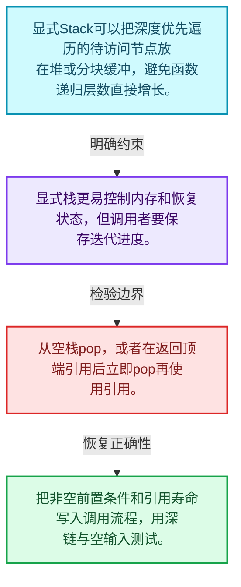
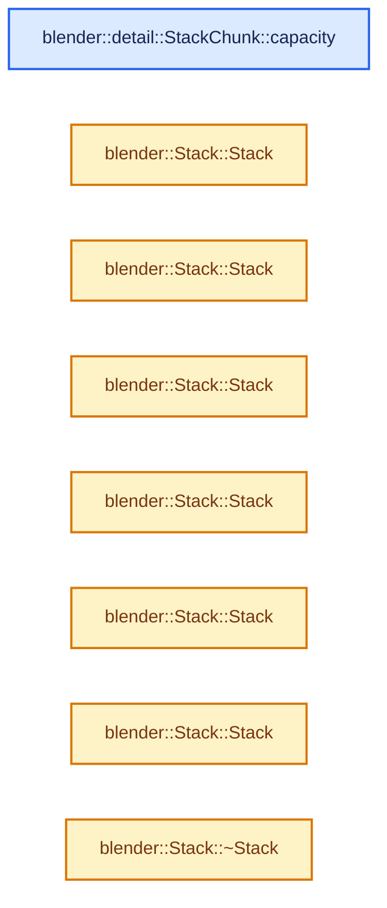
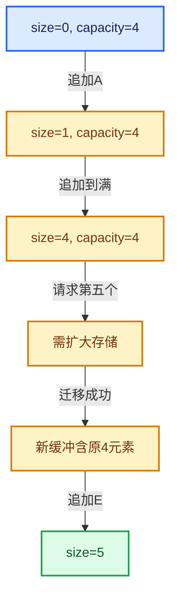

# 01-13 Stack与栈接口

[方向导航](README.md) · [总目录](../README.md) · [实现索引](../%E7%AC%A6%E5%8F%B7%E4%BE%9D%E8%B5%96%E4%B8%8E%E5%AE%9E%E7%8E%B0%E7%B4%A2%E5%BC%95.md)

## 从问题到实现

栈接口怎样减少调用者可表达的错误？

只暴露顶端操作可简化算法约束；底层存储优化不改变后进先出语义，空栈访问仍需检查前置条件。

**数据模型**

显式Stack可以把深度优先遍历的待访问节点放在堆或分块缓冲，避免函数递归层数直接增长。

**设计取舍**

显式栈更易控制内存和恢复状态，但调用者要保存迭代进度。

**最小反例**

从空栈pop，或者在返回顶端引用后立即pop再使用引用。

**推导**

把非空前置条件和引用寿命写入调用流程，用深链与空输入测试。

## 阅读地图与执行推演








图中的数值推演是本方向的教学模型；实际函数之间的调用边与概念分析边分别标注，不能把概念关系当作运行时调度顺序。

## 完整源码单元与就地讲解

中文讲解直接放在相关代码旁，复杂机制在代码下展开。原文折叠区保留基准行号；不需要在行号表和函数之间来回查找。类布局可分段展示，函数实现不按固定行数切开。

### 类型布局、声明与编译条件 · BLI_stack.hh L1—L50

<a id="t-0215fdb21108"></a>

`StackChunk`在这里声明的数据成员：

- `StackChunk below`
- `StackChunk above`
- `T begin`
- `T capacity_end`

<!-- annotated:ec64990729cdbd -->

```cpp
/* SPDX-FileCopyrightText: 2023 Blender Authors
 *
 * SPDX-License-Identifier: GPL-2.0-or-later */

#pragma once

/** \file
 * \ingroup bli
 *
 * A `Stack<T>` is a dynamically growing FILO (first-in, last-out) data structure. It is
 * designed to be a more convenient and efficient replacement for `std::stack`.
 *
 * The improved efficiency is mainly achieved by supporting small buffer optimization. As long as
 * the number of elements added to the stack stays below InlineBufferCapacity, no heap allocation
 * is done. Consequently, values stored in the stack have to be movable and they might be moved,
 * when the stack is moved.
 *
 * A Vector can be used to emulate a stack. However, this stack implementation is more efficient
 * when all you have to do is to push and pop elements. That is because a vector guarantees that
 * all elements are in a contiguous array. Therefore, it has to copy all elements to a new buffer
 * when it grows. This stack implementation does not have to copy all previously pushed elements
 * when it grows.
 *
 * Stack is implemented using a double linked list of chunks. Each chunk contains an array
 * of elements. The chunk size increases exponentially with every new chunk that is required. The
 * lowest chunk, i.e. the one that is used for the first few pushed elements, is embedded into the
 * stack.
 */

#include "BLI_allocator.hh"
#include "BLI_memory_utils.hh"
#include "BLI_span.hh"

namespace blender {

namespace detail {
/**
 * A StackChunk references a contiguous memory buffer. Multiple StackChunk instances are linked in
 * a double linked list.
 */
template<typename T> struct StackChunk {
  /** The below chunk contains the elements that have been pushed on the stack before. */
  StackChunk *below;
  /** The above chunk contains the elements that have been pushed on the stack afterwards. */
  StackChunk *above;
  /** Pointer to the first element of the referenced buffer. */
  T *begin;
  /** Pointer to one element past the end of the referenced buffer. */
  T *capacity_end;

```

<details>
<summary>核对原始源码：source/blender/blenlib/BLI_stack.hh · L1—L50</summary>

<!-- original:ec64990729cdbd:source/blender/blenlib/BLI_stack.hh:1:50 -->

```cpp
/* SPDX-FileCopyrightText: 2023 Blender Authors
 *
 * SPDX-License-Identifier: GPL-2.0-or-later */

#pragma once

/** \file
 * \ingroup bli
 *
 * A `Stack<T>` is a dynamically growing FILO (first-in, last-out) data structure. It is
 * designed to be a more convenient and efficient replacement for `std::stack`.
 *
 * The improved efficiency is mainly achieved by supporting small buffer optimization. As long as
 * the number of elements added to the stack stays below InlineBufferCapacity, no heap allocation
 * is done. Consequently, values stored in the stack have to be movable and they might be moved,
 * when the stack is moved.
 *
 * A Vector can be used to emulate a stack. However, this stack implementation is more efficient
 * when all you have to do is to push and pop elements. That is because a vector guarantees that
 * all elements are in a contiguous array. Therefore, it has to copy all elements to a new buffer
 * when it grows. This stack implementation does not have to copy all previously pushed elements
 * when it grows.
 *
 * Stack is implemented using a double linked list of chunks. Each chunk contains an array
 * of elements. The chunk size increases exponentially with every new chunk that is required. The
 * lowest chunk, i.e. the one that is used for the first few pushed elements, is embedded into the
 * stack.
 */

#include "BLI_allocator.hh"
#include "BLI_memory_utils.hh"
#include "BLI_span.hh"

namespace blender {

namespace detail {
/**
 * A StackChunk references a contiguous memory buffer. Multiple StackChunk instances are linked in
 * a double linked list.
 */
template<typename T> struct StackChunk {
  /** The below chunk contains the elements that have been pushed on the stack before. */
  StackChunk *below;
  /** The above chunk contains the elements that have been pushed on the stack afterwards. */
  StackChunk *above;
  /** Pointer to the first element of the referenced buffer. */
  T *begin;
  /** Pointer to one element past the end of the referenced buffer. */
  T *capacity_end;

```

</details>

<a id="f-5cb187442d401b1e"></a>

### `blender::detail::StackChunk::capacity`

实现位置：[source/blender/blenlib/BLI_stack.hh](../../../../../source/blender/blenlib/BLI_stack.hh) · L51—L54。

**教学注释版**

<!-- annotated:c5b0a40d4d8348 -->

```cpp
  int64_t capacity() const
  {
    return capacity_end - begin;
  }
```

<details>
<summary>核对原始源码：source/blender/blenlib/BLI_stack.hh · L51—L54</summary>

<!-- original:c5b0a40d4d8348:source/blender/blenlib/BLI_stack.hh:51:54 -->

```cpp
  int64_t capacity() const
  {
    return capacity_end - begin;
  }
```

</details>

**结果出口**

- `return capacity_end - begin;`

**继续追踪实现**

本实现没有需要继续展开的显式调用；检查返回表达式、对象转换和调用者前置条件。

### 类型布局、声明与编译条件 · BLI_stack.hh L55—L117

<a id="t-d7ec59339a59"></a>

`Stack`在这里声明的数据成员：

- `T top_`
- `Chunk top_chunk_`
- `int64_t size_`
- `BLI_NO_UNIQUE_ADDRESS TypedBuffer`
- `Chunk inline_chunk_`
- `BLI_NO_UNIQUE_ADDRESS allocator_`

<!-- annotated:99a9ada498653b -->

```cpp
};
}  // namespace detail

template<
    /** Type of the elements that are stored in the stack. */
    typename T,
    /**
     * The number of values that can be stored in this stack, without doing a heap allocation.
     * Sometimes it can make sense to increase this value a lot. The memory in the inline buffer is
     * not initialized when it is not needed.
     */
    int64_t InlineBufferCapacity = default_inline_buffer_capacity(sizeof(T)),
    /**
     * The allocator used by this stack. Should rarely be changed, except when you don't want that
     * MEM_* is used internally.
     */
    typename Allocator = GuardedAllocator>
class Stack {
 public:
  using value_type = T;
  using pointer = T *;
  using const_pointer = const T *;
  using reference = T &;
  using const_reference = const T &;
  using size_type = int64_t;

 private:
  using Chunk = ::blender::detail::StackChunk<T>;

  /**
   * Points to one element after top-most value in the stack.
   *
   * Invariant:
   *  If size_ == 0
   *    then: top_ == inline_chunk_.begin
   *    else: &peek() == top_ - 1;
   */
  T *top_;

  /** Points to the chunk that references the memory pointed to by top_. */
  Chunk *top_chunk_;

  /**
   * Number of elements in the entire stack. The sum of initialized element counts in the chunks.
   */
  int64_t size_;

  /** The buffer used to implement small object optimization. */
  BLI_NO_UNIQUE_ADDRESS TypedBuffer<T, InlineBufferCapacity> inline_buffer_;

  /**
   * A chunk referencing the inline buffer. This is always the bottom-most chunk.
   * So inline_chunk_.below == nullptr.
   */
  Chunk inline_chunk_;

  /** Used for allocations when the inline buffer is not large enough. */
  BLI_NO_UNIQUE_ADDRESS Allocator allocator_;

 public:
  /**
   * Initialize an empty stack. No heap allocation is done.
   */
```

<details>
<summary>核对原始源码：source/blender/blenlib/BLI_stack.hh · L55—L117</summary>

<!-- original:99a9ada498653b:source/blender/blenlib/BLI_stack.hh:55:117 -->

```cpp
};
}  // namespace detail

template<
    /** Type of the elements that are stored in the stack. */
    typename T,
    /**
     * The number of values that can be stored in this stack, without doing a heap allocation.
     * Sometimes it can make sense to increase this value a lot. The memory in the inline buffer is
     * not initialized when it is not needed.
     */
    int64_t InlineBufferCapacity = default_inline_buffer_capacity(sizeof(T)),
    /**
     * The allocator used by this stack. Should rarely be changed, except when you don't want that
     * MEM_* is used internally.
     */
    typename Allocator = GuardedAllocator>
class Stack {
 public:
  using value_type = T;
  using pointer = T *;
  using const_pointer = const T *;
  using reference = T &;
  using const_reference = const T &;
  using size_type = int64_t;

 private:
  using Chunk = ::blender::detail::StackChunk<T>;

  /**
   * Points to one element after top-most value in the stack.
   *
   * Invariant:
   *  If size_ == 0
   *    then: top_ == inline_chunk_.begin
   *    else: &peek() == top_ - 1;
   */
  T *top_;

  /** Points to the chunk that references the memory pointed to by top_. */
  Chunk *top_chunk_;

  /**
   * Number of elements in the entire stack. The sum of initialized element counts in the chunks.
   */
  int64_t size_;

  /** The buffer used to implement small object optimization. */
  BLI_NO_UNIQUE_ADDRESS TypedBuffer<T, InlineBufferCapacity> inline_buffer_;

  /**
   * A chunk referencing the inline buffer. This is always the bottom-most chunk.
   * So inline_chunk_.below == nullptr.
   */
  Chunk inline_chunk_;

  /** Used for allocations when the inline buffer is not large enough. */
  BLI_NO_UNIQUE_ADDRESS Allocator allocator_;

 public:
  /**
   * Initialize an empty stack. No heap allocation is done.
   */
```

</details>

<a id="f-a53ac7254247fa58"></a>

### `blender::Stack::Stack`

实现位置：[source/blender/blenlib/BLI_stack.hh](../../../../../source/blender/blenlib/BLI_stack.hh) · L118—L128。

接口参数：

- `Allocator allocator = {}`

**教学注释版**

<!-- annotated:4ff1332a114b6d -->

```cpp
  Stack(Allocator allocator = {}) noexcept : allocator_(allocator)
  {
    inline_chunk_.below = nullptr;
    inline_chunk_.above = nullptr;
    inline_chunk_.begin = inline_buffer_;
    inline_chunk_.capacity_end = inline_buffer_ + InlineBufferCapacity;

    top_ = inline_buffer_;
    top_chunk_ = &inline_chunk_;
    size_ = 0;
  }
```

<details>
<summary>核对原始源码：source/blender/blenlib/BLI_stack.hh · L118—L128</summary>

<!-- original:4ff1332a114b6d:source/blender/blenlib/BLI_stack.hh:118:128 -->

```cpp
  Stack(Allocator allocator = {}) noexcept : allocator_(allocator)
  {
    inline_chunk_.below = nullptr;
    inline_chunk_.above = nullptr;
    inline_chunk_.begin = inline_buffer_;
    inline_chunk_.capacity_end = inline_buffer_ + InlineBufferCapacity;

    top_ = inline_buffer_;
    top_chunk_ = &inline_chunk_;
    size_ = 0;
  }
```

</details>

**沿实际写入检查状态**

- `inline_chunk_.below = nullptr;`
- `inline_chunk_.above = nullptr;`
- `inline_chunk_.begin = inline_buffer_;`
- `inline_chunk_.capacity_end = inline_buffer_ + InlineBufferCapacity;`
- `top_ = inline_buffer_;`
- `top_chunk_ = &inline_chunk_;`
- `size_ = 0;`

**继续追踪实现**

本实现没有需要继续展开的显式调用；检查返回表达式、对象转换和调用者前置条件。

<!-- annotated:9a1a80a92c68ac -->

```cpp

```

<details>
<summary>核对原始源码：source/blender/blenlib/BLI_stack.hh · L129—L129</summary>

<!-- original:9a1a80a92c68ac:source/blender/blenlib/BLI_stack.hh:129:129 -->

```cpp

```

</details>

<a id="f-de2c9e9bc6b5b21f"></a>

### `blender::Stack::Stack`

实现位置：[source/blender/blenlib/BLI_stack.hh](../../../../../source/blender/blenlib/BLI_stack.hh) · L130—L130。

接口参数：

- `NoExceptConstructor`
- `Allocator allocator = {}`

**教学注释版**

<!-- annotated:6ec234cb51ef07 -->

```cpp
  Stack(NoExceptConstructor, Allocator allocator = {}) noexcept : Stack(allocator) {}
```

<details>
<summary>核对原始源码：source/blender/blenlib/BLI_stack.hh · L130—L130</summary>

<!-- original:6ec234cb51ef07:source/blender/blenlib/BLI_stack.hh:130:130 -->

```cpp
  Stack(NoExceptConstructor, Allocator allocator = {}) noexcept : Stack(allocator) {}
```

</details>

**继续追踪实现**

本实现没有需要继续展开的显式调用；检查返回表达式、对象转换和调用者前置条件。

### 类型布局、声明与编译条件 · BLI_stack.hh L131—L135

<!-- annotated:abbd0cdeae4fa8 -->

```cpp

  /**
   * Create a new stack that contains the given elements. The values are pushed to the stack in
   * the order they are in the array.
   */
```

<details>
<summary>核对原始源码：source/blender/blenlib/BLI_stack.hh · L131—L135</summary>

<!-- original:abbd0cdeae4fa8:source/blender/blenlib/BLI_stack.hh:131:135 -->

```cpp

  /**
   * Create a new stack that contains the given elements. The values are pushed to the stack in
   * the order they are in the array.
   */
```

</details>

<a id="f-37e20d939435a562"></a>

### `blender::Stack::Stack`

实现位置：[source/blender/blenlib/BLI_stack.hh](../../../../../source/blender/blenlib/BLI_stack.hh) · L136—L139。

接口参数：

- `Span<T> values`
- `Allocator allocator = {}`

**教学注释版**

<!-- annotated:22ae965163c1e2 -->

```cpp
  Stack(Span<T> values, Allocator allocator = {}) : Stack(NoExceptConstructor(), allocator)
  {
    this->push_multiple(values);
  }
```

<details>
<summary>核对原始源码：source/blender/blenlib/BLI_stack.hh · L136—L139</summary>

<!-- original:22ae965163c1e2:source/blender/blenlib/BLI_stack.hh:136:139 -->

```cpp
  Stack(Span<T> values, Allocator allocator = {}) : Stack(NoExceptConstructor(), allocator)
  {
    this->push_multiple(values);
  }
```

</details>

**继续追踪实现**

- `this->push_multiple` → [blender::Stack::push_multiple · L283](13-Stack%E4%B8%8E%E6%A0%88%E6%8E%A5%E5%8F%A3.md#f-a3eb47c7b48a626e)。

### 类型布局、声明与编译条件 · BLI_stack.hh L140—L149

<!-- annotated:979b9261923b4a -->

```cpp

  /**
   * Create a new stack that contains the given elements. The values are pushed to the stack in the
   * order they are in the array.
   *
   * Example:
   *  Stack<int> stack = {4, 5, 6};
   *  assert(stack.pop() == 6);
   *  assert(stack.pop() == 5);
   */
```

<details>
<summary>核对原始源码：source/blender/blenlib/BLI_stack.hh · L140—L149</summary>

<!-- original:979b9261923b4a:source/blender/blenlib/BLI_stack.hh:140:149 -->

```cpp

  /**
   * Create a new stack that contains the given elements. The values are pushed to the stack in the
   * order they are in the array.
   *
   * Example:
   *  Stack<int> stack = {4, 5, 6};
   *  assert(stack.pop() == 6);
   *  assert(stack.pop() == 5);
   */
```

</details>

<a id="f-8ab4663afe18405b"></a>

### `blender::Stack::Stack`

实现位置：[source/blender/blenlib/BLI_stack.hh](../../../../../source/blender/blenlib/BLI_stack.hh) · L150—L153。

接口参数：

- `const std::initializer_list<T> &values`
- `Allocator allocator = {}`

**教学注释版**

<!-- annotated:0a1704d890b5bd -->

```cpp
  Stack(const std::initializer_list<T> &values, Allocator allocator = {})
      : Stack(Span<T>(values), allocator)
  {
  }
```

<details>
<summary>核对原始源码：source/blender/blenlib/BLI_stack.hh · L150—L153</summary>

<!-- original:0a1704d890b5bd:source/blender/blenlib/BLI_stack.hh:150:153 -->

```cpp
  Stack(const std::initializer_list<T> &values, Allocator allocator = {})
      : Stack(Span<T>(values), allocator)
  {
  }
```

</details>

**继续追踪实现**

本实现没有需要继续展开的显式调用；检查返回表达式、对象转换和调用者前置条件。

<!-- annotated:0eb28dd17e1637 -->

```cpp

```

<details>
<summary>核对原始源码：source/blender/blenlib/BLI_stack.hh · L154—L154</summary>

<!-- original:0eb28dd17e1637:source/blender/blenlib/BLI_stack.hh:154:154 -->

```cpp

```

</details>

<a id="f-34fe58988571eade"></a>

### `blender::Stack::Stack`

实现位置：[source/blender/blenlib/BLI_stack.hh](../../../../../source/blender/blenlib/BLI_stack.hh) · L155—L162。

接口参数：

- `const Stack &other`

**教学注释版**

<!-- annotated:e17c6ae1261f0c -->

```cpp
  Stack(const Stack &other) : Stack(NoExceptConstructor(), other.allocator_)
  {
    for (const Chunk *chunk = &other.inline_chunk_; chunk; chunk = chunk->above) {
      const T *begin = chunk->begin;
      const T *end = (chunk == other.top_chunk_) ? other.top_ : chunk->capacity_end;
      this->push_multiple(Span<T>(begin, end - begin));
    }
  }
```

<details>
<summary>核对原始源码：source/blender/blenlib/BLI_stack.hh · L155—L162</summary>

<!-- original:e17c6ae1261f0c:source/blender/blenlib/BLI_stack.hh:155:162 -->

```cpp
  Stack(const Stack &other) : Stack(NoExceptConstructor(), other.allocator_)
  {
    for (const Chunk *chunk = &other.inline_chunk_; chunk; chunk = chunk->above) {
      const T *begin = chunk->begin;
      const T *end = (chunk == other.top_chunk_) ? other.top_ : chunk->capacity_end;
      this->push_multiple(Span<T>(begin, end - begin));
    }
  }
```

</details>

**继续追踪实现**

- `this->push_multiple` → [blender::Stack::push_multiple · L283](13-Stack%E4%B8%8E%E6%A0%88%E6%8E%A5%E5%8F%A3.md#f-a3eb47c7b48a626e)。
- `Span<T>` → [blender::Span](%E4%BE%9D%E8%B5%96-BLI_span-6aa95f.md#t-8765a8e0c1d5)；[blender::Span](%E4%BE%9D%E8%B5%96-BLI_index_range-7d7cc5.md#t-86091874a1c0)；[blender::Span](../05-%E5%87%A0%E4%BD%95%E5%AD%98%E5%82%A8%E4%B8%8E%E6%8B%93%E6%89%91%E6%98%A0%E5%B0%84/%E4%BE%9D%E8%B5%96-DNA_pointcloud_types-cfb82c.md#t-112aa6ed842c)；[blender::Span](../05-%E5%87%A0%E4%BD%95%E5%AD%98%E5%82%A8%E4%B8%8E%E6%8B%93%E6%89%91%E6%98%A0%E5%B0%84/%E4%BE%9D%E8%B5%96-DNA_node_types-6708b9.md#t-49ec6fbb9b69)；[blender::Span](../05-%E5%87%A0%E4%BD%95%E5%AD%98%E5%82%A8%E4%B8%8E%E6%8B%93%E6%89%91%E6%98%A0%E5%B0%84/%E4%BE%9D%E8%B5%96-DNA_mesh_types-81f02e.md#t-184fd48fb638)；[blender::Span](../05-%E5%87%A0%E4%BD%95%E5%AD%98%E5%82%A8%E4%B8%8E%E6%8B%93%E6%89%91%E6%98%A0%E5%B0%84/%E4%BE%9D%E8%B5%96-DNA_anim_types-39c5d9.md#t-d841071994c2)；[blender::Span](../05-%E5%87%A0%E4%BD%95%E5%AD%98%E5%82%A8%E4%B8%8E%E6%8B%93%E6%89%91%E6%98%A0%E5%B0%84/%E4%BE%9D%E8%B5%96-RNA_path_fwd-79c989.md#t-4dbb08969e41)。

<!-- annotated:fdd6488453521a -->

```cpp

```

<details>
<summary>核对原始源码：source/blender/blenlib/BLI_stack.hh · L163—L163</summary>

<!-- original:fdd6488453521a:source/blender/blenlib/BLI_stack.hh:163:163 -->

```cpp

```

</details>

<a id="f-691cd301833aca8a"></a>

### `blender::Stack::Stack`

实现位置：[source/blender/blenlib/BLI_stack.hh](../../../../../source/blender/blenlib/BLI_stack.hh) · L164—L190。

接口参数：

- `Stack &&other`

**教学注释版**

<!-- annotated:55e72076260b20 -->

```cpp
  Stack(Stack &&other) noexcept(std::is_nothrow_move_constructible_v<T>)
      : Stack(NoExceptConstructor(), other.allocator_)
  {
    // [讲解] uninitialized_relocate_n<T>：在目标原始存储建立对象，再结束源对象寿命。
    uninitialized_relocate_n<T>(
        // [讲解] std::min：按比较关系选取较小值；截断范围时还需先满足非负和可表示范围，min本身不会证明边界安全。
        other.inline_buffer_, std::min(other.size_, InlineBufferCapacity), inline_buffer_);

    inline_chunk_.above = other.inline_chunk_.above;
    size_ = other.size_;

    if (inline_chunk_.above != nullptr) {
      inline_chunk_.above->below = &inline_chunk_;
    }

    if (size_ <= InlineBufferCapacity) {
      top_chunk_ = &inline_chunk_;
      top_ = inline_buffer_ + size_;
    }
    else {
      top_chunk_ = other.top_chunk_;
      top_ = other.top_;
    }

    other.size_ = 0;
    other.inline_chunk_.above = nullptr;
    other.top_chunk_ = &other.inline_chunk_;
    other.top_ = other.top_chunk_->begin;
  }
```

<details>
<summary>核对原始源码：source/blender/blenlib/BLI_stack.hh · L164—L190</summary>

<!-- original:55e72076260b20:source/blender/blenlib/BLI_stack.hh:164:190 -->

```cpp
  Stack(Stack &&other) noexcept(std::is_nothrow_move_constructible_v<T>)
      : Stack(NoExceptConstructor(), other.allocator_)
  {
    uninitialized_relocate_n<T>(
        other.inline_buffer_, std::min(other.size_, InlineBufferCapacity), inline_buffer_);

    inline_chunk_.above = other.inline_chunk_.above;
    size_ = other.size_;

    if (inline_chunk_.above != nullptr) {
      inline_chunk_.above->below = &inline_chunk_;
    }

    if (size_ <= InlineBufferCapacity) {
      top_chunk_ = &inline_chunk_;
      top_ = inline_buffer_ + size_;
    }
    else {
      top_chunk_ = other.top_chunk_;
      top_ = other.top_;
    }

    other.size_ = 0;
    other.inline_chunk_.above = nullptr;
    other.top_chunk_ = &other.inline_chunk_;
    other.top_ = other.top_chunk_->begin;
  }
```

</details>

**沿实际写入检查状态**

- `inline_chunk_.above = other.inline_chunk_.above;`
- `size_ = other.size_;`
- `inline_chunk_.above->below = &inline_chunk_;`
- `top_chunk_ = &inline_chunk_;`
- `top_ = inline_buffer_ + size_;`
- `top_chunk_ = other.top_chunk_;`
- `top_ = other.top_;`
- `other.size_ = 0;`
- `other.inline_chunk_.above = nullptr;`
- `other.top_chunk_ = &other.inline_chunk_;`
- `other.top_ = other.top_chunk_->begin;`

**继续追踪实现**

- `uninitialized_relocate_n<T>` → [blender::uninitialized_relocate_n · L80](01-%E5%AF%B9%E8%B1%A1%E7%94%9F%E5%91%BD%E5%91%A8%E6%9C%9F%E4%B8%8E%E5%80%BC%E7%B1%BB%E5%88%AB.md#f-9de0365b9a47fd68)。
- `std::min` → [外部契约](https://eel.is/c++draft/alg.min.max)：按比较关系选取较小值；截断范围时还需先满足非负和可表示范围，min本身不会证明边界安全。

<!-- annotated:a6d8a73bd3ac3d -->

```cpp

```

<details>
<summary>核对原始源码：source/blender/blenlib/BLI_stack.hh · L191—L191</summary>

<!-- original:a6d8a73bd3ac3d:source/blender/blenlib/BLI_stack.hh:191:191 -->

```cpp

```

</details>

<a id="f-fb47e8384818f13f"></a>

### `blender::Stack::~Stack`

实现位置：[source/blender/blenlib/BLI_stack.hh](../../../../../source/blender/blenlib/BLI_stack.hh) · L192—L200。

**教学注释版**

<!-- annotated:c584c9c6db32c8 -->

```cpp
  ~Stack()
  {
    this->destruct_all_elements();
    Chunk *above_chunk;
    for (Chunk *chunk = inline_chunk_.above; chunk; chunk = above_chunk) {
      above_chunk = chunk->above;
      // [讲解] allocator_.deallocate：归还分配器负责的存储；调用者应先结束其中非平凡元素寿命。
      allocator_.deallocate(chunk);
    }
  }
```

<details>
<summary>核对原始源码：source/blender/blenlib/BLI_stack.hh · L192—L200</summary>

<!-- original:c584c9c6db32c8:source/blender/blenlib/BLI_stack.hh:192:200 -->

```cpp
  ~Stack()
  {
    this->destruct_all_elements();
    Chunk *above_chunk;
    for (Chunk *chunk = inline_chunk_.above; chunk; chunk = above_chunk) {
      above_chunk = chunk->above;
      allocator_.deallocate(chunk);
    }
  }
```

</details>

**沿实际写入检查状态**

- `above_chunk = chunk->above;`

**继续追踪实现**

- `this->destruct_all_elements` → [blender::Stack::destruct_all_elements · L397](13-Stack%E4%B8%8E%E6%A0%88%E6%8E%A5%E5%8F%A3.md#f-1ed7af3ee250c61e)。
- `allocator_.deallocate` → [blender::GuardedAllocator::deallocate · L60](03-%E5%86%85%E5%AD%98%E5%B7%A5%E5%85%B7%E4%B8%8E%E5%88%86%E9%85%8D%E5%99%A8%E6%8E%A5%E5%8F%A3.md#f-c1586978e7959acb)。

<!-- annotated:6e73981e8777d7 -->

```cpp

```

<details>
<summary>核对原始源码：source/blender/blenlib/BLI_stack.hh · L201—L201</summary>

<!-- original:6e73981e8777d7:source/blender/blenlib/BLI_stack.hh:201:201 -->

```cpp

```

</details>

<a id="f-0344869abf3c6a97"></a>

### `blender::Stack::operator=`

实现位置：[source/blender/blenlib/BLI_stack.hh](../../../../../source/blender/blenlib/BLI_stack.hh) · L202—L205。

接口参数：

- `const Stack &other`

**教学注释版**

<!-- annotated:e7afa41c30ad6f -->

```cpp
  Stack &operator=(const Stack &other)
  {
    return copy_assign_container(*this, other);
  }
```

<details>
<summary>核对原始源码：source/blender/blenlib/BLI_stack.hh · L202—L205</summary>

<!-- original:e7afa41c30ad6f:source/blender/blenlib/BLI_stack.hh:202:205 -->

```cpp
  Stack &operator=(const Stack &other)
  {
    return copy_assign_container(*this, other);
  }
```

</details>

**结果出口**

- `return copy_assign_container(*this, other);`

**继续追踪实现**

- `copy_assign_container` → [blender::copy_assign_container · L284](../03-%E5%86%85%E5%AD%98%E5%88%86%E9%85%8D%E4%B8%8E%E8%BF%90%E8%A1%8C%E6%97%B6%E7%B1%BB%E5%9E%8B/01-%E5%AF%B9%E9%BD%90%E4%B8%8E%E6%9C%AA%E5%88%9D%E5%A7%8B%E5%8C%96%E5%AD%98%E5%82%A8.md#f-546a45b4d8b5ab44)。

<!-- annotated:d228bc582c430e -->

```cpp

```

<details>
<summary>核对原始源码：source/blender/blenlib/BLI_stack.hh · L206—L206</summary>

<!-- original:d228bc582c430e:source/blender/blenlib/BLI_stack.hh:206:206 -->

```cpp

```

</details>

<a id="f-2278c8e3fb4b6a75"></a>

### `blender::Stack::operator=`

实现位置：[source/blender/blenlib/BLI_stack.hh](../../../../../source/blender/blenlib/BLI_stack.hh) · L207—L210。

接口参数：

- `Stack &&other`

**教学注释版**

<!-- annotated:c51d69e965bb51 -->

```cpp
  Stack &operator=(Stack &&other)
  {
    // [讲解] std::move：把表达式转换成可供移动重载选择的值类别；不保证真的移动，不结束源对象寿命，对const值可能选择复制。
    return move_assign_container(*this, std::move(other));
  }
```

<details>
<summary>核对原始源码：source/blender/blenlib/BLI_stack.hh · L207—L210</summary>

<!-- original:c51d69e965bb51:source/blender/blenlib/BLI_stack.hh:207:210 -->

```cpp
  Stack &operator=(Stack &&other)
  {
    return move_assign_container(*this, std::move(other));
  }
```

</details>

**结果出口**

- `return move_assign_container(*this, std::move(other));`

**继续追踪实现**

- `move_assign_container` → [blender::move_assign_container · L300](../03-%E5%86%85%E5%AD%98%E5%88%86%E9%85%8D%E4%B8%8E%E8%BF%90%E8%A1%8C%E6%97%B6%E7%B1%BB%E5%9E%8B/01-%E5%AF%B9%E9%BD%90%E4%B8%8E%E6%9C%AA%E5%88%9D%E5%A7%8B%E5%8C%96%E5%AD%98%E5%82%A8.md#f-5144b56be86e6f42)。
- `std::move` → [外部契约](https://eel.is/c++draft/utility.forward)：把表达式转换成可供移动重载选择的值类别；不保证真的移动，不结束源对象寿命，对const值可能选择复制。

### 类型布局、声明与编译条件 · BLI_stack.hh L211—L214

<!-- annotated:d97615cb5edfea -->

```cpp

  /**
   * Add a new element to the top of the stack.
   */
```

<details>
<summary>核对原始源码：source/blender/blenlib/BLI_stack.hh · L211—L214</summary>

<!-- original:d97615cb5edfea:source/blender/blenlib/BLI_stack.hh:211:214 -->

```cpp

  /**
   * Add a new element to the top of the stack.
   */
```

</details>

<a id="f-4e2f52822df4658e"></a>

### `blender::Stack::push`

实现位置：[source/blender/blenlib/BLI_stack.hh](../../../../../source/blender/blenlib/BLI_stack.hh) · L215—L218。

接口参数：

- `const T &value`

**教学注释版**

<!-- annotated:abb236819c0b30 -->

```cpp
  void push(const T &value)
  {
    this->push_as(value);
  }
```

<details>
<summary>核对原始源码：source/blender/blenlib/BLI_stack.hh · L215—L218</summary>

<!-- original:abb236819c0b30:source/blender/blenlib/BLI_stack.hh:215:218 -->

```cpp
  void push(const T &value)
  {
    this->push_as(value);
  }
```

</details>

**继续追踪实现**

- `this->push_as` → [blender::Stack::push_as · L224](13-Stack%E4%B8%8E%E6%A0%88%E6%8E%A5%E5%8F%A3.md#f-93b44dc312868c14)。

<a id="f-6eb0d6a78e38b4e8"></a>

### `blender::Stack::push`

实现位置：[source/blender/blenlib/BLI_stack.hh](../../../../../source/blender/blenlib/BLI_stack.hh) · L219—L222。

接口参数：

- `T &&value`

**教学注释版**

<!-- annotated:9823e6dfe1c5c8 -->

```cpp
  void push(T &&value)
  {
    // [讲解] std::move：把表达式转换成可供移动重载选择的值类别；不保证真的移动，不结束源对象寿命，对const值可能选择复制。
    this->push_as(std::move(value));
  }
```

<details>
<summary>核对原始源码：source/blender/blenlib/BLI_stack.hh · L219—L222</summary>

<!-- original:9823e6dfe1c5c8:source/blender/blenlib/BLI_stack.hh:219:222 -->

```cpp
  void push(T &&value)
  {
    this->push_as(std::move(value));
  }
```

</details>

**继续追踪实现**

- `this->push_as` → [blender::Stack::push_as · L224](13-Stack%E4%B8%8E%E6%A0%88%E6%8E%A5%E5%8F%A3.md#f-93b44dc312868c14)。
- `std::move` → [外部契约](https://eel.is/c++draft/utility.forward)：把表达式转换成可供移动重载选择的值类别；不保证真的移动，不结束源对象寿命，对const值可能选择复制。

### 类型布局、声明与编译条件 · BLI_stack.hh L223—L223

<!-- annotated:9760cbad221a4e -->

```cpp
  /* This is similar to `std::stack::emplace`. */
```

<details>
<summary>核对原始源码：source/blender/blenlib/BLI_stack.hh · L223—L223</summary>

<!-- original:9760cbad221a4e:source/blender/blenlib/BLI_stack.hh:223:223 -->

```cpp
  /* This is similar to `std::stack::emplace`. */
```

</details>

<a id="f-93b44dc312868c14"></a>

### `blender::Stack::push_as`

实现位置：[source/blender/blenlib/BLI_stack.hh](../../../../../source/blender/blenlib/BLI_stack.hh) · L224—L238。

**教学注释版**

<!-- annotated:b3b4930fb95d31 -->

```cpp
  template<typename... ForwardT> void push_as(ForwardT &&...value)
  {
    if (top_ == top_chunk_->capacity_end) {
      this->activate_next_chunk(1);
    }
    try {
      // [讲解] std::forward<ForwardT>：在转发引用中恢复调用者传入的值类别；依赖推导类型，不能与无条件move互换。
      new (top_) T(std::forward<ForwardT>(value)...);
      top_++;
      size_++;
    }
    catch (...) {
      this->move_top_pointer_back_to_below_chunk();
      throw;
    }
  }
```

<details>
<summary>核对原始源码：source/blender/blenlib/BLI_stack.hh · L224—L238</summary>

<!-- original:b3b4930fb95d31:source/blender/blenlib/BLI_stack.hh:224:238 -->

```cpp
  template<typename... ForwardT> void push_as(ForwardT &&...value)
  {
    if (top_ == top_chunk_->capacity_end) {
      this->activate_next_chunk(1);
    }
    try {
      new (top_) T(std::forward<ForwardT>(value)...);
      top_++;
      size_++;
    }
    catch (...) {
      this->move_top_pointer_back_to_below_chunk();
      throw;
    }
  }
```

</details>

**继续追踪实现**

- `this->activate_next_chunk` → [blender::Stack::activate_next_chunk · L360](13-Stack%E4%B8%8E%E6%A0%88%E6%8E%A5%E5%8F%A3.md#f-e784470426321e09)。
- `std::forward<ForwardT>` → [外部契约](https://eel.is/c++draft/utility.forward)：在转发引用中恢复调用者传入的值类别；依赖推导类型，不能与无条件move互换。
- `this->move_top_pointer_back_to_below_chunk` → [blender::Stack::move_top_pointer_back_to_below_chunk · L385](13-Stack%E4%B8%8E%E6%A0%88%E6%8E%A5%E5%8F%A3.md#f-572c361194d3579b)。

### 类型布局、声明与编译条件 · BLI_stack.hh L239—L243

<!-- annotated:dfdc4a4079f792 -->

```cpp

  /**
   * Remove and return the top-most element from the stack. This invokes undefined behavior when
   * the stack is empty.
   */
```

<details>
<summary>核对原始源码：source/blender/blenlib/BLI_stack.hh · L239—L243</summary>

<!-- original:dfdc4a4079f792:source/blender/blenlib/BLI_stack.hh:239:243 -->

```cpp

  /**
   * Remove and return the top-most element from the stack. This invokes undefined behavior when
   * the stack is empty.
   */
```

</details>

<a id="f-6ef6c36a2a0aa986"></a>

### `blender::Stack::pop`

实现位置：[source/blender/blenlib/BLI_stack.hh](../../../../../source/blender/blenlib/BLI_stack.hh) · L244—L259。

**教学注释版**

<!-- annotated:8b18d5474353de -->

```cpp
  T pop()
  {
    BLI_assert(size_ > 0);
    // [讲解] std::move：把表达式转换成可供移动重载选择的值类别；不保证真的移动，不结束源对象寿命，对const值可能选择复制。
    T value = std::move(*(top_ - 1));
    top_--;
    top_->~T();
    size_--;

    if (top_ == top_chunk_->begin) {
      if (top_chunk_->below != nullptr) {
        top_chunk_ = top_chunk_->below;
        top_ = top_chunk_->capacity_end;
      }
    }
    return value;
  }
```

<details>
<summary>核对原始源码：source/blender/blenlib/BLI_stack.hh · L244—L259</summary>

<!-- original:8b18d5474353de:source/blender/blenlib/BLI_stack.hh:244:259 -->

```cpp
  T pop()
  {
    BLI_assert(size_ > 0);
    T value = std::move(*(top_ - 1));
    top_--;
    top_->~T();
    size_--;

    if (top_ == top_chunk_->begin) {
      if (top_chunk_->below != nullptr) {
        top_chunk_ = top_chunk_->below;
        top_ = top_chunk_->capacity_end;
      }
    }
    return value;
  }
```

</details>

**沿实际写入检查状态**

- `top_chunk_ = top_chunk_->below;`
- `top_ = top_chunk_->capacity_end;`

**结果出口**

- `return value;`

**继续追踪实现**

- `BLI_assert` → [BLI_assert · L48](%E4%BE%9D%E8%B5%96-BLI_assert-cc98e8.md#m-57a88495704d)；[BLI_assert · L63](%E4%BE%9D%E8%B5%96-BLI_assert-cc98e8.md#m-d07050020cb5)。宏定义由构建条件选择。
- `std::move` → [外部契约](https://eel.is/c++draft/utility.forward)：把表达式转换成可供移动重载选择的值类别；不保证真的移动，不结束源对象寿命，对const值可能选择复制。
- `top_->~T` → [调用协议](../%E6%A8%A1%E6%9D%BF%E5%AE%8F%E4%B8%8E%E5%8A%A8%E6%80%81%E5%88%86%E6%B4%BE%E5%8D%8F%E8%AE%AE.md)：T模板参数提供的操作协议。调用位置L249。

### 类型布局、声明与编译条件 · BLI_stack.hh L260—L264

<!-- annotated:415a4fd54c2eeb -->

```cpp

  /**
   * Get a reference to the top-most element without removing it from the stack. This invokes
   * undefined behavior when the stack is empty.
   */
```

<details>
<summary>核对原始源码：source/blender/blenlib/BLI_stack.hh · L260—L264</summary>

<!-- original:415a4fd54c2eeb:source/blender/blenlib/BLI_stack.hh:260:264 -->

```cpp

  /**
   * Get a reference to the top-most element without removing it from the stack. This invokes
   * undefined behavior when the stack is empty.
   */
```

</details>

<a id="f-a3114651b0124209"></a>

### `blender::Stack::peek`

实现位置：[source/blender/blenlib/BLI_stack.hh](../../../../../source/blender/blenlib/BLI_stack.hh) · L265—L270。

**教学注释版**

<!-- annotated:49767df5bb7658 -->

```cpp
  T &peek()
  {
    BLI_assert(size_ > 0);
    BLI_assert(top_ > top_chunk_->begin);
    return *(top_ - 1);
  }
```

<details>
<summary>核对原始源码：source/blender/blenlib/BLI_stack.hh · L265—L270</summary>

<!-- original:49767df5bb7658:source/blender/blenlib/BLI_stack.hh:265:270 -->

```cpp
  T &peek()
  {
    BLI_assert(size_ > 0);
    BLI_assert(top_ > top_chunk_->begin);
    return *(top_ - 1);
  }
```

</details>

**结果出口**

- `return *(top_ - 1);`

**继续追踪实现**

- `BLI_assert` → [BLI_assert · L48](%E4%BE%9D%E8%B5%96-BLI_assert-cc98e8.md#m-57a88495704d)；[BLI_assert · L63](%E4%BE%9D%E8%B5%96-BLI_assert-cc98e8.md#m-d07050020cb5)。宏定义由构建条件选择。

<a id="f-2a790db47a49cdfc"></a>

### `blender::Stack::peek`

实现位置：[source/blender/blenlib/BLI_stack.hh](../../../../../source/blender/blenlib/BLI_stack.hh) · L271—L276。

**教学注释版**

<!-- annotated:27533f6db415ae -->

```cpp
  const T &peek() const
  {
    BLI_assert(size_ > 0);
    BLI_assert(top_ > top_chunk_->begin);
    return *(top_ - 1);
  }
```

<details>
<summary>核对原始源码：source/blender/blenlib/BLI_stack.hh · L271—L276</summary>

<!-- original:27533f6db415ae:source/blender/blenlib/BLI_stack.hh:271:276 -->

```cpp
  const T &peek() const
  {
    BLI_assert(size_ > 0);
    BLI_assert(top_ > top_chunk_->begin);
    return *(top_ - 1);
  }
```

</details>

**结果出口**

- `return *(top_ - 1);`

**继续追踪实现**

- `BLI_assert` → [BLI_assert · L48](%E4%BE%9D%E8%B5%96-BLI_assert-cc98e8.md#m-57a88495704d)；[BLI_assert · L63](%E4%BE%9D%E8%B5%96-BLI_assert-cc98e8.md#m-d07050020cb5)。宏定义由构建条件选择。

### 类型布局、声明与编译条件 · BLI_stack.hh L277—L282

<!-- annotated:5863c33e87ef50 -->

```cpp

  /**
   * Add multiple elements to the stack. The values are pushed in the order they are in the array.
   * This method is more efficient than pushing multiple elements individually and might cause less
   * heap allocations.
   */
```

<details>
<summary>核对原始源码：source/blender/blenlib/BLI_stack.hh · L277—L282</summary>

<!-- original:5863c33e87ef50:source/blender/blenlib/BLI_stack.hh:277:282 -->

```cpp

  /**
   * Add multiple elements to the stack. The values are pushed in the order they are in the array.
   * This method is more efficient than pushing multiple elements individually and might cause less
   * heap allocations.
   */
```

</details>

<a id="f-a3eb47c7b48a626e"></a>

### `blender::Stack::push_multiple`

实现位置：[source/blender/blenlib/BLI_stack.hh](../../../../../source/blender/blenlib/BLI_stack.hh) · L283—L305。

接口参数：

- `Span<T> values`

**教学注释版**

<!-- annotated:28b49d8b478108 -->

```cpp
  void push_multiple(Span<T> values)
  {
    Span<T> remaining_values = values;
    // [讲解] remaining_values.is_empty：查询视图长度或生成对应有效索引区间。
    while (!remaining_values.is_empty()) {
      if (top_ == top_chunk_->capacity_end) {
        // [讲解] remaining_values.size：查询视图长度或生成对应有效索引区间。
        this->activate_next_chunk(remaining_values.size());
      }

      const int64_t remaining_capacity = top_chunk_->capacity_end - top_;
      // [讲解] std::min：按比较关系选取较小值；截断范围时还需先满足非负和可表示范围，min本身不会证明边界安全。
      const int64_t amount = std::min(remaining_values.size(), remaining_capacity);
      try {
        // [讲解] remaining_values.data：返回借用范围的地址。
        uninitialized_copy_n(remaining_values.data(), amount, top_);
      }
      catch (...) {
        this->move_top_pointer_back_to_below_chunk();
        throw;
      }
      top_ += amount;
      size_ += amount;

      // [讲解] remaining_values.drop_front：从两端裁去或选取一定数量元素形成新视图。
      remaining_values = remaining_values.drop_front(amount);
    }
  }
```

<details>
<summary>核对原始源码：source/blender/blenlib/BLI_stack.hh · L283—L305</summary>

<!-- original:28b49d8b478108:source/blender/blenlib/BLI_stack.hh:283:305 -->

```cpp
  void push_multiple(Span<T> values)
  {
    Span<T> remaining_values = values;
    while (!remaining_values.is_empty()) {
      if (top_ == top_chunk_->capacity_end) {
        this->activate_next_chunk(remaining_values.size());
      }

      const int64_t remaining_capacity = top_chunk_->capacity_end - top_;
      const int64_t amount = std::min(remaining_values.size(), remaining_capacity);
      try {
        uninitialized_copy_n(remaining_values.data(), amount, top_);
      }
      catch (...) {
        this->move_top_pointer_back_to_below_chunk();
        throw;
      }
      top_ += amount;
      size_ += amount;

      remaining_values = remaining_values.drop_front(amount);
    }
  }
```

</details>

**沿实际写入检查状态**

- `top_ += amount;`
- `size_ += amount;`
- `remaining_values = remaining_values.drop_front(amount);`

**继续追踪实现**

- `remaining_values.is_empty` → [blender::Span::is_empty · L264](05-Span%E5%8F%AA%E8%AF%BB%E8%BF%9E%E7%BB%AD%E8%A7%86%E5%9B%BE.md#f-8cc1d7ba8feb50e6)。
- `this->activate_next_chunk` → [blender::Stack::activate_next_chunk · L360](13-Stack%E4%B8%8E%E6%A0%88%E6%8E%A5%E5%8F%A3.md#f-e784470426321e09)。
- `remaining_values.size` → [blender::Span::size · L256](05-Span%E5%8F%AA%E8%AF%BB%E8%BF%9E%E7%BB%AD%E8%A7%86%E5%9B%BE.md#f-5f80fa006089c998)。
- `std::min` → [外部契约](https://eel.is/c++draft/alg.min.max)：按比较关系选取较小值；截断范围时还需先满足非负和可表示范围，min本身不会证明边界安全。
- `uninitialized_copy_n` → [blender::uninitialized_copy_n · L53](01-%E5%AF%B9%E8%B1%A1%E7%94%9F%E5%91%BD%E5%91%A8%E6%9C%9F%E4%B8%8E%E5%80%BC%E7%B1%BB%E5%88%AB.md#f-6cd63ebede164cd2)。
- `remaining_values.data` → [blender::Span::data · L219](05-Span%E5%8F%AA%E8%AF%BB%E8%BF%9E%E7%BB%AD%E8%A7%86%E5%9B%BE.md#f-10c5889198935800)。
- `this->move_top_pointer_back_to_below_chunk` → [blender::Stack::move_top_pointer_back_to_below_chunk · L385](13-Stack%E4%B8%8E%E6%A0%88%E6%8E%A5%E5%8F%A3.md#f-572c361194d3579b)。
- `remaining_values.drop_front` → [blender::Span::drop_front · L175](05-Span%E5%8F%AA%E8%AF%BB%E8%BF%9E%E7%BB%AD%E8%A7%86%E5%9B%BE.md#f-932897accbde3413)。

### 类型布局、声明与编译条件 · BLI_stack.hh L306—L309

<!-- annotated:562720da40c31e -->

```cpp

  /**
   * Returns true when the size is zero.
   */
```

<details>
<summary>核对原始源码：source/blender/blenlib/BLI_stack.hh · L306—L309</summary>

<!-- original:562720da40c31e:source/blender/blenlib/BLI_stack.hh:306:309 -->

```cpp

  /**
   * Returns true when the size is zero.
   */
```

</details>

<a id="f-0dbc636232316093"></a>

### `blender::Stack::is_empty`

实现位置：[source/blender/blenlib/BLI_stack.hh](../../../../../source/blender/blenlib/BLI_stack.hh) · L310—L313。

**教学注释版**

<!-- annotated:f5bfa387befaa4 -->

```cpp
  bool is_empty() const
  {
    return size_ == 0;
  }
```

<details>
<summary>核对原始源码：source/blender/blenlib/BLI_stack.hh · L310—L313</summary>

<!-- original:f5bfa387befaa4:source/blender/blenlib/BLI_stack.hh:310:313 -->

```cpp
  bool is_empty() const
  {
    return size_ == 0;
  }
```

</details>

**结果出口**

- `return size_ == 0;`

**继续追踪实现**

本实现没有需要继续展开的显式调用；检查返回表达式、对象转换和调用者前置条件。

### 类型布局、声明与编译条件 · BLI_stack.hh L314—L317

<!-- annotated:5d9c5bf502fc6a -->

```cpp

  /**
   * Returns the number of elements in the stack.
   */
```

<details>
<summary>核对原始源码：source/blender/blenlib/BLI_stack.hh · L314—L317</summary>

<!-- original:5d9c5bf502fc6a:source/blender/blenlib/BLI_stack.hh:314:317 -->

```cpp

  /**
   * Returns the number of elements in the stack.
   */
```

</details>

<a id="f-76b3f559da913e8c"></a>

### `blender::Stack::size`

实现位置：[source/blender/blenlib/BLI_stack.hh](../../../../../source/blender/blenlib/BLI_stack.hh) · L318—L321。

**教学注释版**

<!-- annotated:975a202872c5d7 -->

```cpp
  int64_t size() const
  {
    return size_;
  }
```

<details>
<summary>核对原始源码：source/blender/blenlib/BLI_stack.hh · L318—L321</summary>

<!-- original:975a202872c5d7:source/blender/blenlib/BLI_stack.hh:318:321 -->

```cpp
  int64_t size() const
  {
    return size_;
  }
```

</details>

**结果出口**

- `return size_;`

**继续追踪实现**

本实现没有需要继续展开的显式调用；检查返回表达式、对象转换和调用者前置条件。

### 类型布局、声明与编译条件 · BLI_stack.hh L322—L326

<!-- annotated:a665d9c51c2e50 -->

```cpp

  /**
   * Removes all elements from the stack. The memory is not freed, so it is more efficient to reuse
   * the stack than to create a new one.
   */
```

<details>
<summary>核对原始源码：source/blender/blenlib/BLI_stack.hh · L322—L326</summary>

<!-- original:a665d9c51c2e50:source/blender/blenlib/BLI_stack.hh:322:326 -->

```cpp

  /**
   * Removes all elements from the stack. The memory is not freed, so it is more efficient to reuse
   * the stack than to create a new one.
   */
```

</details>

<a id="f-df36a73da6588828"></a>

### `blender::Stack::clear`

实现位置：[source/blender/blenlib/BLI_stack.hh](../../../../../source/blender/blenlib/BLI_stack.hh) · L327—L332。

**教学注释版**

<!-- annotated:1d85bb71c47743 -->

```cpp
  void clear()
  {
    this->destruct_all_elements();
    top_chunk_ = &inline_chunk_;
    top_ = top_chunk_->begin;
  }
```

<details>
<summary>核对原始源码：source/blender/blenlib/BLI_stack.hh · L327—L332</summary>

<!-- original:1d85bb71c47743:source/blender/blenlib/BLI_stack.hh:327:332 -->

```cpp
  void clear()
  {
    this->destruct_all_elements();
    top_chunk_ = &inline_chunk_;
    top_ = top_chunk_->begin;
  }
```

</details>

**沿实际写入检查状态**

- `top_chunk_ = &inline_chunk_;`
- `top_ = top_chunk_->begin;`

**继续追踪实现**

- `this->destruct_all_elements` → [blender::Stack::destruct_all_elements · L397](13-Stack%E4%B8%8E%E6%A0%88%E6%8E%A5%E5%8F%A3.md#f-1ed7af3ee250c61e)。

### 类型布局、声明与编译条件 · BLI_stack.hh L333—L336

<!-- annotated:eb9331711c5cc5 -->

```cpp

  /**
   * Removes all elements from the stack and frees any allocated memory.
   */
```

<details>
<summary>核对原始源码：source/blender/blenlib/BLI_stack.hh · L333—L336</summary>

<!-- original:eb9331711c5cc5:source/blender/blenlib/BLI_stack.hh:333:336 -->

```cpp

  /**
   * Removes all elements from the stack and frees any allocated memory.
   */
```

</details>

<a id="f-a8a3a714d8ca35ba"></a>

### `blender::Stack::clear_and_shrink`

实现位置：[source/blender/blenlib/BLI_stack.hh](../../../../../source/blender/blenlib/BLI_stack.hh) · L337—L341。

**教学注释版**

<!-- annotated:6af6a7fe18e2b3 -->

```cpp
  void clear_and_shrink()
  {
    std::destroy_at(this);
    new (this) Stack(NoExceptConstructor{});
  }
```

<details>
<summary>核对原始源码：source/blender/blenlib/BLI_stack.hh · L337—L341</summary>

<!-- original:6af6a7fe18e2b3:source/blender/blenlib/BLI_stack.hh:337:341 -->

```cpp
  void clear_and_shrink()
  {
    std::destroy_at(this);
    new (this) Stack(NoExceptConstructor{});
  }
```

</details>

**继续追踪实现**

- `std::destroy_at` → [外部契约](https://eel.is/c++draft/)：这个边界按实际表达式及所属类型核对参数、返回值、寿命与失败行为。这里提供接口入口，不声称已解释该第三方版本的内部实现。

### 类型布局、声明与编译条件 · BLI_stack.hh L342—L343

<!-- annotated:87ada139575086 -->

```cpp

  /* This should only be called by unit tests. */
```

<details>
<summary>核对原始源码：source/blender/blenlib/BLI_stack.hh · L342—L343</summary>

<!-- original:87ada139575086:source/blender/blenlib/BLI_stack.hh:342:343 -->

```cpp

  /* This should only be called by unit tests. */
```

</details>

<a id="f-72f645e17852c679"></a>

### `blender::Stack::is_invariant_maintained`

实现位置：[source/blender/blenlib/BLI_stack.hh](../../../../../source/blender/blenlib/BLI_stack.hh) · L344—L350。

**教学注释版**

<!-- annotated:020b4b0c017ff9 -->

```cpp
  bool is_invariant_maintained() const
  {
    if (size_ == 0) {
      return top_ == inline_chunk_.begin;
    }
    return top_ > top_chunk_->begin;
  }
```

<details>
<summary>核对原始源码：source/blender/blenlib/BLI_stack.hh · L344—L350</summary>

<!-- original:020b4b0c017ff9:source/blender/blenlib/BLI_stack.hh:344:350 -->

```cpp
  bool is_invariant_maintained() const
  {
    if (size_ == 0) {
      return top_ == inline_chunk_.begin;
    }
    return top_ > top_chunk_->begin;
  }
```

</details>

**结果出口**

- `return top_ == inline_chunk_.begin;`
- `return top_ > top_chunk_->begin;`

**继续追踪实现**

本实现没有需要继续展开的显式调用；检查返回表达式、对象转换和调用者前置条件。

### 类型布局、声明与编译条件 · BLI_stack.hh L351—L359

<!-- annotated:6dc160d390db58 -->

```cpp

 private:
  /**
   * Changes top_chunk_ to point to a new chunk that is above the current one. The new chunk might
   * be smaller than the given size_hint. This happens when a chunk that has been allocated before
   * is reused. The size of the new chunk will be at least one.
   *
   * This invokes undefined behavior when the currently active chunk is not full.
   */
```

<details>
<summary>核对原始源码：source/blender/blenlib/BLI_stack.hh · L351—L359</summary>

<!-- original:6dc160d390db58:source/blender/blenlib/BLI_stack.hh:351:359 -->

```cpp

 private:
  /**
   * Changes top_chunk_ to point to a new chunk that is above the current one. The new chunk might
   * be smaller than the given size_hint. This happens when a chunk that has been allocated before
   * is reused. The size of the new chunk will be at least one.
   *
   * This invokes undefined behavior when the currently active chunk is not full.
   */
```

</details>

<a id="f-e784470426321e09"></a>

### `blender::Stack::activate_next_chunk`

实现位置：[source/blender/blenlib/BLI_stack.hh](../../../../../source/blender/blenlib/BLI_stack.hh) · L360—L383。

接口参数：

- `const int64_t size_hint`

**教学注释版**

<!-- annotated:6931201cf25a98 -->

```cpp
  void activate_next_chunk(const int64_t size_hint)
  {
    BLI_assert(top_ == top_chunk_->capacity_end);
    if (top_chunk_->above == nullptr) {
      // [讲解] std::max：按比较关系选取较大值。本讲解中的增长公式同时满足最低请求和几何增长；若保存返回引用，还需注意实参寿命。
      const int64_t new_capacity = std::max(size_hint, top_chunk_->capacity() * 2 + 10);

      /* Do a single memory allocation for the Chunk and the array it references. */
      // [讲解] allocator_.allocate：分配器接口只准备原始存储，元素构造由容器负责。
      void *buffer = allocator_.allocate(
          sizeof(Chunk) + sizeof(T) * new_capacity + alignof(T), alignof(Chunk), AT);
      void *chunk_buffer = buffer;
      void *data_buffer = reinterpret_cast<void *>(
          (reinterpret_cast<uintptr_t>(buffer) + sizeof(Chunk) + alignof(T) - 1) &
          ~(alignof(T) - 1));

      Chunk *new_chunk = new (chunk_buffer) Chunk();
      new_chunk->begin = static_cast<T *>(data_buffer);
      new_chunk->capacity_end = new_chunk->begin + new_capacity;
      new_chunk->above = nullptr;
      new_chunk->below = top_chunk_;
      top_chunk_->above = new_chunk;
    }
    top_chunk_ = top_chunk_->above;
    top_ = top_chunk_->begin;
  }
```

<details>
<summary>核对原始源码：source/blender/blenlib/BLI_stack.hh · L360—L383</summary>

<!-- original:6931201cf25a98:source/blender/blenlib/BLI_stack.hh:360:383 -->

```cpp
  void activate_next_chunk(const int64_t size_hint)
  {
    BLI_assert(top_ == top_chunk_->capacity_end);
    if (top_chunk_->above == nullptr) {
      const int64_t new_capacity = std::max(size_hint, top_chunk_->capacity() * 2 + 10);

      /* Do a single memory allocation for the Chunk and the array it references. */
      void *buffer = allocator_.allocate(
          sizeof(Chunk) + sizeof(T) * new_capacity + alignof(T), alignof(Chunk), AT);
      void *chunk_buffer = buffer;
      void *data_buffer = reinterpret_cast<void *>(
          (reinterpret_cast<uintptr_t>(buffer) + sizeof(Chunk) + alignof(T) - 1) &
          ~(alignof(T) - 1));

      Chunk *new_chunk = new (chunk_buffer) Chunk();
      new_chunk->begin = static_cast<T *>(data_buffer);
      new_chunk->capacity_end = new_chunk->begin + new_capacity;
      new_chunk->above = nullptr;
      new_chunk->below = top_chunk_;
      top_chunk_->above = new_chunk;
    }
    top_chunk_ = top_chunk_->above;
    top_ = top_chunk_->begin;
  }
```

</details>

**沿实际写入检查状态**

- `new_chunk->begin = static_cast<T *>(data_buffer);`
- `new_chunk->capacity_end = new_chunk->begin + new_capacity;`
- `new_chunk->above = nullptr;`
- `new_chunk->below = top_chunk_;`
- `top_chunk_->above = new_chunk;`
- `top_chunk_ = top_chunk_->above;`
- `top_ = top_chunk_->begin;`

**继续追踪实现**

- `BLI_assert` → [BLI_assert · L48](%E4%BE%9D%E8%B5%96-BLI_assert-cc98e8.md#m-57a88495704d)；[BLI_assert · L63](%E4%BE%9D%E8%B5%96-BLI_assert-cc98e8.md#m-d07050020cb5)。宏定义由构建条件选择。
- `std::max` → [外部契约](https://eel.is/c++draft/alg.min.max)：按比较关系选取较大值。本讲解中的增长公式同时满足最低请求和几何增长；若保存返回引用，还需注意实参寿命。
- `top_chunk_->capacity` → [blender::detail::StackChunk::capacity · L51](13-Stack%E4%B8%8E%E6%A0%88%E6%8E%A5%E5%8F%A3.md#f-5cb187442d401b1e)。
- `allocator_.allocate` → [blender::GuardedAllocator::allocate · L43](03-%E5%86%85%E5%AD%98%E5%B7%A5%E5%85%B7%E4%B8%8E%E5%88%86%E9%85%8D%E5%99%A8%E6%8E%A5%E5%8F%A3.md#f-a57239e6d3bd10d9)。

<!-- annotated:c4a70bb3cb5f59 -->

```cpp

```

<details>
<summary>核对原始源码：source/blender/blenlib/BLI_stack.hh · L384—L384</summary>

<!-- original:c4a70bb3cb5f59:source/blender/blenlib/BLI_stack.hh:384:384 -->

```cpp

```

</details>

<a id="f-572c361194d3579b"></a>

### `blender::Stack::move_top_pointer_back_to_below_chunk`

实现位置：[source/blender/blenlib/BLI_stack.hh](../../../../../source/blender/blenlib/BLI_stack.hh) · L385—L395。

**教学注释版**

<!-- annotated:f09d9b16c2bcc9 -->

```cpp
  void move_top_pointer_back_to_below_chunk()
  {
    /* This makes sure that the invariant stays intact after a failed push. */
    if (size_ == 0) {
      top_ = inline_chunk_.begin;
    }
    else if (top_ == top_chunk_->begin) {
      top_chunk_ = top_chunk_->below;
      top_ = top_chunk_->capacity_end;
    }
  }
```

<details>
<summary>核对原始源码：source/blender/blenlib/BLI_stack.hh · L385—L395</summary>

<!-- original:f09d9b16c2bcc9:source/blender/blenlib/BLI_stack.hh:385:395 -->

```cpp
  void move_top_pointer_back_to_below_chunk()
  {
    /* This makes sure that the invariant stays intact after a failed push. */
    if (size_ == 0) {
      top_ = inline_chunk_.begin;
    }
    else if (top_ == top_chunk_->begin) {
      top_chunk_ = top_chunk_->below;
      top_ = top_chunk_->capacity_end;
    }
  }
```

</details>

**沿实际写入检查状态**

- `top_ = inline_chunk_.begin;`
- `top_chunk_ = top_chunk_->below;`
- `top_ = top_chunk_->capacity_end;`

**继续追踪实现**

本实现没有需要继续展开的显式调用；检查返回表达式、对象转换和调用者前置条件。

<!-- annotated:47e755c2104249 -->

```cpp

```

<details>
<summary>核对原始源码：source/blender/blenlib/BLI_stack.hh · L396—L396</summary>

<!-- original:47e755c2104249:source/blender/blenlib/BLI_stack.hh:396:396 -->

```cpp

```

</details>

<a id="f-1ed7af3ee250c61e"></a>

### `blender::Stack::destruct_all_elements`

实现位置：[source/blender/blenlib/BLI_stack.hh](../../../../../source/blender/blenlib/BLI_stack.hh) · L397—L407。

**教学注释版**

<!-- annotated:72a6966c1d4b6f -->

```cpp
  void destruct_all_elements()
  {
    for (T *value = top_chunk_->begin; value != top_; value++) {
      value->~T();
    }
    for (Chunk *chunk = top_chunk_->below; chunk; chunk = chunk->below) {
      for (T *value = chunk->begin; value != chunk->capacity_end; value++) {
        value->~T();
      }
    }
  }
```

<details>
<summary>核对原始源码：source/blender/blenlib/BLI_stack.hh · L397—L407</summary>

<!-- original:72a6966c1d4b6f:source/blender/blenlib/BLI_stack.hh:397:407 -->

```cpp
  void destruct_all_elements()
  {
    for (T *value = top_chunk_->begin; value != top_; value++) {
      value->~T();
    }
    for (Chunk *chunk = top_chunk_->below; chunk; chunk = chunk->below) {
      for (T *value = chunk->begin; value != chunk->capacity_end; value++) {
        value->~T();
      }
    }
  }
```

</details>

**继续追踪实现**

- `value->~T` → [调用协议](../%E6%A8%A1%E6%9D%BF%E5%AE%8F%E4%B8%8E%E5%8A%A8%E6%80%81%E5%88%86%E6%B4%BE%E5%8D%8F%E8%AE%AE.md)：T模板参数提供的操作协议。调用位置L400。

### 类型布局、声明与编译条件 · BLI_stack.hh L408—L417

<!-- annotated:064882f6f03412 -->

```cpp
};

/**
 * Same as a normal Stack, but does not use Blender's guarded allocator. This is useful when
 * allocating memory with static storage duration.
 */
template<typename T, int64_t InlineBufferCapacity = default_inline_buffer_capacity(sizeof(T))>
using RawStack = Stack<T, InlineBufferCapacity, RawAllocator>;

}  // namespace blender
```

<details>
<summary>核对原始源码：source/blender/blenlib/BLI_stack.hh · L408—L417</summary>

<!-- original:064882f6f03412:source/blender/blenlib/BLI_stack.hh:408:417 -->

```cpp
};

/**
 * Same as a normal Stack, but does not use Blender's guarded allocator. This is useful when
 * allocating memory with static storage duration.
 */
template<typename T, int64_t InlineBufferCapacity = default_inline_buffer_capacity(sizeof(T))>
using RawStack = Stack<T, InlineBufferCapacity, RawAllocator>;

}  // namespace blender
```

</details>

## 语法与相关类型

### 模板 template

模板把类型或常量作为生成实现的参数。读声明时先列出类型参数、非类型参数和默认值，再看使用者实际实例化了什么。模板声明本身不意味着每种T都支持其全部成员。

把T替换为int、string、只能移动的类型，分别检查每个被调用操作是否成立。

### 依赖名称 typename

typename既可引入类型模板参数，也可告诉编译器某个依赖名称是类型。它不创建运行时对象；解析期确认语法类别与实例化期检查具体类型是不同阶段。

区分typename T::value_type和T::size()，前者标记类型，后者是表达式。

### 只读限定 const

const约束当前访问路径可做的修改。const指针、指向const的指针、const视图对象、const元素是不同位置的限定；其他别名可能仍可修改原对象。

分别写T* const、const T*与const T* const，并画出不可修改的层次。

### 移动转换 std::move

std::move把表达式转换为可供移动重载选择的值类别，实际资源转移发生在被选中的构造或赋值中。对const对象move可能仍调用复制，对视图move也不会获得底层数据所有权。

记录移动构造调用次数，不用变量名或std::move的出现次数替代测量。

### 完美转发 std::forward

std::forward在转发引用模板中恢复调用者原来的值类别。它依赖推导出的模板实参；无条件move会改变左值调用者的语义。

对同一接口分别传入左值、临时对象和const左值，记录实际重载。

### 异常约定 noexcept

noexcept表达式可以依赖类型特征。违反不抛异常约定会终止程序；它不是自动捕获异常，也不是资源回滚代码。

找出声明的条件与实际可能抛出的分配、构造操作是否一致。

### 异常边界 try与catch

try定义异常传播的局部边界。失败路径需要销毁已经成功构造的部分并释放相应存储；未构造的对象不能被析构。

在第k次构造失败，列出已经存在的对象集合与待释放缓冲。

### 显式静态转换 static_cast

static_cast表达编译期允许的转换，不会自动验证运行时真实类型、指针寿命或索引边界。由void指针恢复T指针时，调用者仍须保证实际存储中确有合法T对象。

标出转换前后的类型以及正确性依据来自哪里。

### 表示层转换 reinterpret_cast

reinterpret_cast不能自动开始任意对象的生命周期，也不能豁免对齐和别名规则。读这类代码需要追溯原始分配与实际构造操作。

分别检查大小、对齐、生命周期和可访问类型，四项不能互相替代。

### 对齐 alignof

alignof得到类型要求的地址对齐。分配足够字节后仍需把地址对齐到相应边界，内嵌缓冲也一样。

对齐a为2的幂时可推导向上取整，但仍要考虑溢出与边界。

### 对象表示 sizeof

sizeof给出对象表示大小，不是其引用的所有堆内存总量。sizeof视图很小并不说明底层数组很小。

分别统计容器对象、容量字节和元素拥有的间接资源。

### 构造与new表达式

普通new可能分配并构造；placement new在给定地址构造，存储由其他机制提供。失败回滚应区分两类责任。

追踪地址来自哪里、构造何时成功、由谁析构、由谁释放。

### 内部断言 assert

断言表达开发者预期成立的内部契约，发布构建可能关闭。它不能替代对不可信输入的完整错误处理，也不保证后续操作被运行时保护。

对每条断言构造违反条件的输入，区分调用者错误与应向用户报告的错误。

### 类型别名 using

类型别名为已有类型建立名字，不创建运行期对象。它常把模板内部使用的类型统一暴露给泛型调用者。

展开别名直到基础类型，区分类型别名和变量声明。

## 实现练习与验证

用显式栈替代树遍历递归，并测量深链情况下调用栈和显式存储的差别。

参考推理：把非空前置条件和引用寿命写入调用流程，用深链与空输入测试。

构造成功次数减析构次数应等于当前存活对象数；异常之后资源计数应回到合法状态。

## 历史、跨库比较与证据

对比std::vector、std::array、std::span与LLVM SmallVector、ArrayRef时，分别比较拥有关系、内嵌存储、大小是否属于类型和失效条件。不要根据同名方法推断完全相同契约。

[历史提交索引](../%E5%8E%86%E5%8F%B2%E6%8F%90%E4%BA%A4%E4%B8%8E%E8%AE%BE%E8%AE%A1%E6%BC%94%E5%8C%96%E7%B4%A2%E5%BC%95.md) · [源码基准](../%E6%BA%90%E7%A0%81%E7%89%88%E6%9C%AC%E4%B8%8E%E8%A6%86%E7%9B%96%E7%B4%A2%E5%BC%95.md) · [验收报告](../%E9%AA%8C%E6%94%B6%E6%8A%A5%E5%91%8A.md)
