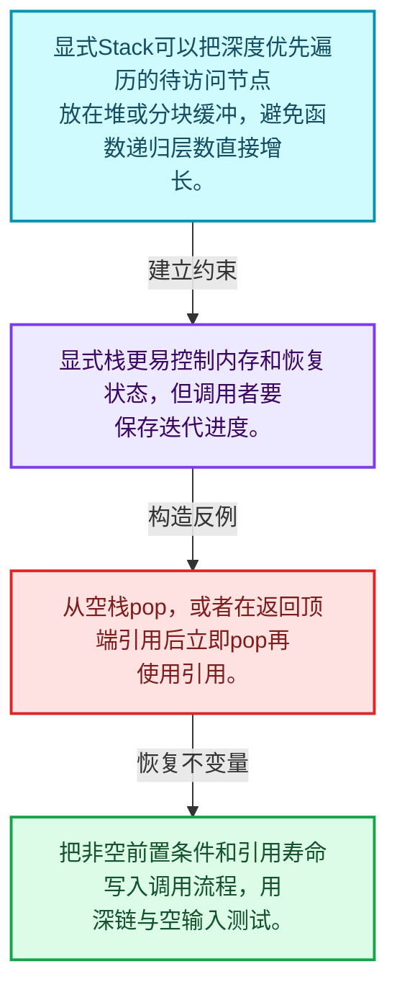
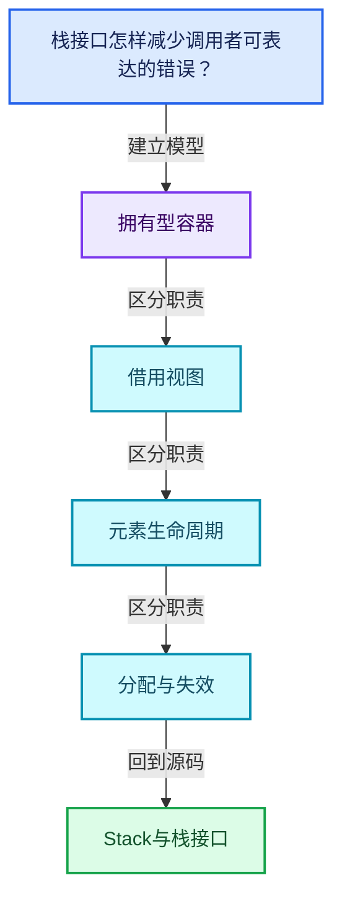
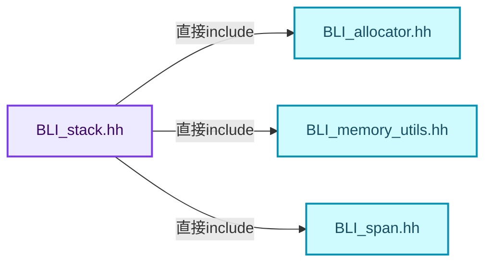
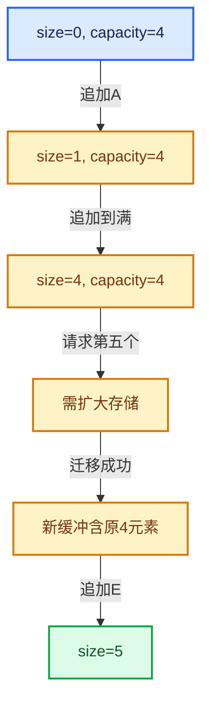

# 01-13 Stack与栈接口

[方向导航](README.md) · [总目录](../README.md) · [覆盖索引](../%E6%BA%90%E7%A0%81%E7%89%88%E6%9C%AC%E4%B8%8E%E8%A6%86%E7%9B%96%E7%B4%A2%E5%BC%95.md)

> 阅读顺序：问题与数据模型 → 语法与类型 → 源码逐行 → 调用线索 → 历史与取舍 → 推演和练习。

- 基准 HEAD：`cbda6b96c26c0dee3c3b5cbb93960c4ac06a6b30`。
- 记录日期：2026-10-14。
- 教学示例状态：正文中的推演不是本机性能实测；已运行练习见验收报告。

## 一、从问题到设计

栈接口怎样减少调用者可表达的错误？

只暴露顶端操作可简化算法约束；底层存储优化不改变后进先出语义，空栈访问仍需检查前置条件。

本篇把语法、数据语义和系统取舍连接起来。先证明对象存活，再讨论索引；先区分借用与拥有，再讨论复制移动。

### 本篇独立模型与设计推理

显式Stack可以把深度优先遍历的待访问节点放在堆或分块缓冲，避免函数递归层数直接增长。

设计取舍：显式栈更易控制内存和恢复状态，但调用者要保存迭代进度。

最小反例：从空栈pop，或者在返回顶端引用后立即pop再使用引用。

推导与处理：把非空前置条件和引用寿命写入调用流程，用深链与空输入测试。



### 源码范围与相邻篇章

| 文件 | 本篇逐行范围 | 基准SHA-256 |
|---|---|---|
| [source/blender/blenlib/BLI_stack.hh](../../../../../source/blender/blenlib/BLI_stack.hh) | L1—L417 | `f8465cbfd03e227d8a3003069709dc247c795adaac5e533ee012357d35b73b58` |

同一主讲文件可能分多篇覆盖；超出本篇范围的符号通过覆盖索引定位。空行与纯注释保留在源码摘录中，逐行表解释有效语句与语法边界；许可证头统一保留。

前篇：[Vector异常安全与边界](12-Vector%E5%BC%82%E5%B8%B8%E5%AE%89%E5%85%A8%E4%B8%8E%E8%BE%B9%E7%95%8C.md).

后篇：[VectorSet稳定索引与去重](14-VectorSet%E7%A8%B3%E5%AE%9A%E7%B4%A2%E5%BC%95%E4%B8%8E%E5%8E%BB%E9%87%8D.md).

## 二、类型、数据与阅读地图



这是概念依赖图，边表示阅读关系，不声称是运行时调用顺序。

### 直接编译依赖



箭头只表示头文件包含关系；完整调用线索见后面的符号定位表。

## 三、关键词、语法与类型角色

### 模板 template

模板把类型或常量作为生成实现的参数。读声明时先列出类型参数、非类型参数和默认值，再看使用者实际实例化了什么。模板声明本身不意味着每种T都支持其全部成员。

具体检查：把T替换为int、string、只能移动的类型，分别检查每个被调用操作是否成立。

### 依赖名称 typename

typename既可引入类型模板参数，也可告诉编译器某个依赖名称是类型。它不创建运行时对象；解析期确认语法类别与实例化期检查具体类型是不同阶段。

具体检查：区分typename T::value_type和T::size()，前者标记类型，后者是表达式。

### 只读限定 const

const约束当前访问路径可做的修改。const指针、指向const的指针、const视图对象、const元素是不同位置的限定；其他别名可能仍可修改原对象。

具体检查：分别写T* const、const T*与const T* const，并画出不可修改的层次。

### 移动转换 std::move

std::move把表达式转换为可供移动重载选择的值类别，实际资源转移发生在被选中的构造或赋值中。对const对象move可能仍调用复制，对视图move也不会获得底层数据所有权。

具体检查：记录移动构造调用次数，不用变量名或std::move的出现次数替代测量。

### 完美转发 std::forward

std::forward在转发引用模板中恢复调用者原来的值类别。它依赖推导出的模板实参；无条件move会改变左值调用者的语义。

具体检查：对同一接口分别传入左值、临时对象和const左值，记录实际重载。

### 异常约定 noexcept

noexcept表达式可以依赖类型特征。违反不抛异常约定会终止程序；它不是自动捕获异常，也不是资源回滚代码。

具体检查：找出声明的条件与实际可能抛出的分配、构造操作是否一致。

### 异常边界 try与catch

try定义异常传播的局部边界。失败路径需要销毁已经成功构造的部分并释放相应存储；未构造的对象不能被析构。

具体检查：在第k次构造失败，列出已经存在的对象集合与待释放缓冲。

### 显式静态转换 static_cast

static_cast表达编译期允许的转换，不会自动验证运行时真实类型、指针寿命或索引边界。由void指针恢复T指针时，调用者仍须保证实际存储中确有合法T对象。

具体检查：标出转换前后的类型以及正确性依据来自哪里。

### 表示层转换 reinterpret_cast

reinterpret_cast不能自动开始任意对象的生命周期，也不能豁免对齐和别名规则。读这类代码需要追溯原始分配与实际构造操作。

具体检查：分别检查大小、对齐、生命周期和可访问类型，四项不能互相替代。

### 对齐 alignof

alignof得到类型要求的地址对齐。分配足够字节后仍需把地址对齐到相应边界，内嵌缓冲也一样。

具体检查：对齐a为2的幂时可推导向上取整，但仍要考虑溢出与边界。

### 对象表示 sizeof

sizeof给出对象表示大小，不是其引用的所有堆内存总量。sizeof视图很小并不说明底层数组很小。

具体检查：分别统计容器对象、容量字节和元素拥有的间接资源。

### 构造与new表达式

普通new可能分配并构造；placement new在给定地址构造，存储由其他机制提供。失败回滚应区分两类责任。

具体检查：追踪地址来自哪里、构造何时成功、由谁析构、由谁释放。

### 内部断言 assert

断言表达开发者预期成立的内部契约，发布构建可能关闭。它不能替代对不可信输入的完整错误处理，也不保证后续操作被运行时保护。

具体检查：对每条断言构造违反条件的输入，区分调用者错误与应向用户报告的错误。

### 类型别名 using

类型别名为已有类型建立名字，不创建运行期对象。它常把模板内部使用的类型统一暴露给泛型调用者。

具体检查：展开别名直到基础类型，区分类型别名和变量声明。

## 四、真实源码与逐行讲解

源码块保持原行内容，原始行号由小节标题及逐行表给出。表中的调用定位是静态阅读辅助；重载、模板实例化、宏展开和虚调用需结合完整声明，不能仅凭词法出现证明动态调用。

### BLI_stack.hh：L1—L47

<!-- source:source/blender/blenlib/BLI_stack.hh:1:47 -->

```cpp
/* SPDX-FileCopyrightText: 2023 Blender Authors
 *
 * SPDX-License-Identifier: GPL-2.0-or-later */

#pragma once

/** \file
 * \ingroup bli
 *
 * A `Stack<T>` is a dynamically growing FILO (first-in, last-out) data structure. It is
 * designed to be a more convenient and efficient replacement for `std::stack`.
 *
 * The improved efficiency is mainly achieved by supporting small buffer optimization. As long as
 * the number of elements added to the stack stays below InlineBufferCapacity, no heap allocation
 * is done. Consequently, values stored in the stack have to be movable and they might be moved,
 * when the stack is moved.
 *
 * A Vector can be used to emulate a stack. However, this stack implementation is more efficient
 * when all you have to do is to push and pop elements. That is because a vector guarantees that
 * all elements are in a contiguous array. Therefore, it has to copy all elements to a new buffer
 * when it grows. This stack implementation does not have to copy all previously pushed elements
 * when it grows.
 *
 * Stack is implemented using a double linked list of chunks. Each chunk contains an array
 * of elements. The chunk size increases exponentially with every new chunk that is required. The
 * lowest chunk, i.e. the one that is used for the first few pushed elements, is embedded into the
 * stack.
 */

#include "BLI_allocator.hh"
#include "BLI_memory_utils.hh"
#include "BLI_span.hh"

namespace blender {

namespace detail {
/**
 * A StackChunk references a contiguous memory buffer. Multiple StackChunk instances are linked in
 * a double linked list.
 */
template<typename T> struct StackChunk {
  /** The below chunk contains the elements that have been pushed on the stack before. */
  StackChunk *below;
  /** The above chunk contains the elements that have been pushed on the stack afterwards. */
  StackChunk *above;
  /** Pointer to the first element of the referenced buffer. */
  T *begin;
```

| 原始行 | 语义、约束与检查 |
|---|---|
| L5 | 防止同一头文件在一个翻译单元中重复展开；不控制多个源文件之间的链接或对象寿命。 |
| L30 | 引入编译依赖 "BLI_allocator.hh"；这是声明可见性关系，不表示运行时一定调用该文件的所有接口。 |
| L31 | 引入编译依赖 "BLI_memory_utils.hh"；这是声明可见性关系，不表示运行时一定调用该文件的所有接口。 |
| L32 | 引入编译依赖 "BLI_span.hh"；这是声明可见性关系，不表示运行时一定调用该文件的所有接口。 |
| L34 | 把后续声明放入 blender 命名空间，影响名称查找和符号归属，不创建运行时对象。 |
| L36 | 把后续声明放入 detail 命名空间，影响名称查找和符号归属，不创建运行时对象。 |
| L41 | 声明模板参数 `template<typename T> struct StackChunk {`。类型参数决定生成操作的类型，非类型参数可决定内嵌容量或编译期分支。 |
| L43 | 声明成员、局部对象或完成语句 `StackChunk *below`。若为指针或引用，它本身不说明拥有；若为值对象，其构造析构由所在作用域或外层对象管理。 |
| L45 | 声明成员、局部对象或完成语句 `StackChunk *above`。若为指针或引用，它本身不说明拥有；若为值对象，其构造析构由所在作用域或外层对象管理。 |
| L47 | 声明成员、局部对象或完成语句 `T *begin`。若为指针或引用，它本身不说明拥有；若为值对象，其构造析构由所在作用域或外层对象管理。 |

### BLI_stack.hh：L48—L95

<!-- source:source/blender/blenlib/BLI_stack.hh:48:95 -->

```cpp
  /** Pointer to one element past the end of the referenced buffer. */
  T *capacity_end;

  int64_t capacity() const
  {
    return capacity_end - begin;
  }
};
}  // namespace detail

template<
    /** Type of the elements that are stored in the stack. */
    typename T,
    /**
     * The number of values that can be stored in this stack, without doing a heap allocation.
     * Sometimes it can make sense to increase this value a lot. The memory in the inline buffer is
     * not initialized when it is not needed.
     */
    int64_t InlineBufferCapacity = default_inline_buffer_capacity(sizeof(T)),
    /**
     * The allocator used by this stack. Should rarely be changed, except when you don't want that
     * MEM_* is used internally.
     */
    typename Allocator = GuardedAllocator>
class Stack {
 public:
  using value_type = T;
  using pointer = T *;
  using const_pointer = const T *;
  using reference = T &;
  using const_reference = const T &;
  using size_type = int64_t;

 private:
  using Chunk = ::blender::detail::StackChunk<T>;

  /**
   * Points to one element after top-most value in the stack.
   *
   * Invariant:
   *  If size_ == 0
   *    then: top_ == inline_chunk_.begin
   *    else: &peek() == top_ - 1;
   */
  T *top_;

  /** Points to the chunk that references the memory pointed to by top_. */
  Chunk *top_chunk_;
```

| 原始行 | 语义、约束与检查 |
|---|---|
| L49 | 声明成员、局部对象或完成语句 `T *capacity_end`。若为指针或引用，它本身不说明拥有；若为值对象，其构造析构由所在作用域或外层对象管理。 |
| L51 | 出现调用或函数声明 `capacity`，对应表达式为 `int64_t capacity() const`。参数求值、返回类型与重载需结合前后完整语句；静态文本引用不能证明动态目标。 |
| L52 | 连接上一行的声明或控制结构与其语句块；后续行在这个作用域中执行或声明。 |
| L53 | 返回表达式 `capacity_end - begin`。 |
| L54 | 结束当前语法单元。局部自动对象在离开其作用域时按规则销毁；这不等于所有被引用的外部数据也被释放。 |
| L55 | 结束当前语法单元。局部自动对象在离开其作用域时按规则销毁；这不等于所有被引用的外部数据也被释放。 |
| L56 | 结束当前语法单元。局部自动对象在离开其作用域时按规则销毁；这不等于所有被引用的外部数据也被释放。 |
| L58 | 声明模板参数 `template<`。类型参数决定生成操作的类型，非类型参数可决定内嵌容量或编译期分支。 |
| L60 | 本行是连续声明或表达式的一部分：`typename T,`。与本段前后行合读；逗号、括号和限定符决定它属于参数、初始化列表还是实际计算。 |
| L66 | 显式采用编译器生成的特殊成员行为：`int64_t InlineBufferCapacity = default_inline_buffer_capacity(sizeof(T)),`。成员和基类的性质决定该操作是否可用、是否被删除及异常约定，不表示运行时给对象赋值为default。 |
| L71 | 把右侧 `GuardedAllocator>` 用于初始化或更新左侧 `typename Allocator`。声明初始化与已有对象赋值应按上下文区分；有资源的类型会调用相应特殊成员。 |
| L72 | 声明或定义类型 `class Stack`。结合继承、访问权限和成员布局确认接口与拥有关系；前向声明本身没有完整对象布局。 |
| L73 | 切换成员访问权限为 public；它是编译期接口边界，不是线程同步或内存保护。 |
| L74 | 定义类型别名 `using value_type = T`，为模板接口或内部实现统一命名；本行不分配该类型对象。 |
| L75 | 定义类型别名 `using pointer = T *`，为模板接口或内部实现统一命名；本行不分配该类型对象。 |
| L76 | 定义类型别名 `using const_pointer = const T *`，为模板接口或内部实现统一命名；本行不分配该类型对象。 |
| L77 | 定义类型别名 `using reference = T &`，为模板接口或内部实现统一命名；本行不分配该类型对象。 |
| L78 | 定义类型别名 `using const_reference = const T &`，为模板接口或内部实现统一命名；本行不分配该类型对象。 |
| L79 | 定义类型别名 `using size_type = int64_t`，为模板接口或内部实现统一命名；本行不分配该类型对象。 |
| L81 | 切换成员访问权限为 private；它是编译期接口边界，不是线程同步或内存保护。 |
| L82 | 定义类型别名 `using Chunk = ::blender::detail::StackChunk<T>`，为模板接口或内部实现统一命名；本行不分配该类型对象。 |
| L92 | 声明成员、局部对象或完成语句 `T *top_`。若为指针或引用，它本身不说明拥有；若为值对象，其构造析构由所在作用域或外层对象管理。 |
| L95 | 声明成员、局部对象或完成语句 `Chunk *top_chunk_`。若为指针或引用，它本身不说明拥有；若为值对象，其构造析构由所在作用域或外层对象管理。 |

### BLI_stack.hh：L96—L139

<!-- source:source/blender/blenlib/BLI_stack.hh:96:139 -->

```cpp

  /**
   * Number of elements in the entire stack. The sum of initialized element counts in the chunks.
   */
  int64_t size_;

  /** The buffer used to implement small object optimization. */
  BLI_NO_UNIQUE_ADDRESS TypedBuffer<T, InlineBufferCapacity> inline_buffer_;

  /**
   * A chunk referencing the inline buffer. This is always the bottom-most chunk.
   * So inline_chunk_.below == nullptr.
   */
  Chunk inline_chunk_;

  /** Used for allocations when the inline buffer is not large enough. */
  BLI_NO_UNIQUE_ADDRESS Allocator allocator_;

 public:
  /**
   * Initialize an empty stack. No heap allocation is done.
   */
  Stack(Allocator allocator = {}) noexcept : allocator_(allocator)
  {
    inline_chunk_.below = nullptr;
    inline_chunk_.above = nullptr;
    inline_chunk_.begin = inline_buffer_;
    inline_chunk_.capacity_end = inline_buffer_ + InlineBufferCapacity;

    top_ = inline_buffer_;
    top_chunk_ = &inline_chunk_;
    size_ = 0;
  }

  Stack(NoExceptConstructor, Allocator allocator = {}) noexcept : Stack(allocator) {}

  /**
   * Create a new stack that contains the given elements. The values are pushed to the stack in
   * the order they are in the array.
   */
  Stack(Span<T> values, Allocator allocator = {}) : Stack(NoExceptConstructor(), allocator)
  {
    this->push_multiple(values);
  }
```

本段语义重点：

- `size_`：该对象记录的元素数或长度，不能直接当作容量。
- `allocator_`：提供存储的分配策略对象，释放必须与分配策略匹配。
- `inline_buffer_`：容器对象内部的缓冲区，不能像堆缓冲那样直接交给另一个对象。

| 原始行 | 语义、约束与检查 |
|---|---|
| L100 | 本行涉及 `size_`：该对象记录的元素数或长度，不能直接当作容量。按此语义解读 `int64_t size_`，不要把地址、数量或状态混用。 |
| L103 | 本行涉及 `inline_buffer_`：容器对象内部的缓冲区，不能像堆缓冲那样直接交给另一个对象。按此语义解读 `BLI_NO_UNIQUE_ADDRESS TypedBuffer<T, InlineBufferCapacity> inline_buffer_`，不要把地址、数量或状态混用。 |
| L109 | 声明成员、局部对象或完成语句 `Chunk inline_chunk_`。若为指针或引用，它本身不说明拥有；若为值对象，其构造析构由所在作用域或外层对象管理。 |
| L112 | 本行涉及 `allocator_`：提供存储的分配策略对象，释放必须与分配策略匹配。按此语义解读 `BLI_NO_UNIQUE_ADDRESS Allocator allocator_`，不要把地址、数量或状态混用。 |
| L114 | 切换成员访问权限为 public；它是编译期接口边界，不是线程同步或内存保护。 |
| L118 | 建立或更新 `allocator_`：提供存储的分配策略对象，释放必须与分配策略匹配。本行的具体值关系为 `Stack(Allocator allocator = {}) noexcept : allocator_(allocator)`；对照更新前后相应范围或状态是否一致。 |
| L119 | 连接上一行的声明或控制结构与其语句块；后续行在这个作用域中执行或声明。 |
| L120 | 把右侧 `nullptr` 用于初始化或更新左侧 `inline_chunk_.below`。声明初始化与已有对象赋值应按上下文区分；有资源的类型会调用相应特殊成员。 |
| L121 | 把右侧 `nullptr` 用于初始化或更新左侧 `inline_chunk_.above`。声明初始化与已有对象赋值应按上下文区分；有资源的类型会调用相应特殊成员。 |
| L122 | 建立或更新 `inline_buffer_`：容器对象内部的缓冲区，不能像堆缓冲那样直接交给另一个对象。本行的具体值关系为 `inline_chunk_.begin = inline_buffer_`；对照更新前后相应范围或状态是否一致。 |
| L123 | 建立或更新 `inline_buffer_`：容器对象内部的缓冲区，不能像堆缓冲那样直接交给另一个对象。本行的具体值关系为 `inline_chunk_.capacity_end = inline_buffer_ + InlineBufferCapacity`；对照更新前后相应范围或状态是否一致。 |
| L125 | 建立或更新 `inline_buffer_`：容器对象内部的缓冲区，不能像堆缓冲那样直接交给另一个对象。本行的具体值关系为 `top_ = inline_buffer_`；对照更新前后相应范围或状态是否一致。 |
| L126 | 把右侧 `&inline_chunk_` 用于初始化或更新左侧 `top_chunk_`。声明初始化与已有对象赋值应按上下文区分；有资源的类型会调用相应特殊成员。 |
| L127 | 建立或更新 `size_`：该对象记录的元素数或长度，不能直接当作容量。本行的具体值关系为 `size_ = 0`；对照更新前后相应范围或状态是否一致。 |
| L128 | 结束当前语法单元。局部自动对象在离开其作用域时按规则销毁；这不等于所有被引用的外部数据也被释放。 |
| L130 | 把右侧 `{}) noexcept : Stack(allocator) {}` 用于初始化或更新左侧 `Stack(NoExceptConstructor, Allocator allocator`。声明初始化与已有对象赋值应按上下文区分；有资源的类型会调用相应特殊成员。 |
| L136 | 把右侧 `{}) : Stack(NoExceptConstructor(), allocator)` 用于初始化或更新左侧 `Stack(Span<T> values, Allocator allocator`。声明初始化与已有对象赋值应按上下文区分；有资源的类型会调用相应特殊成员。 |
| L137 | 连接上一行的声明或控制结构与其语句块；后续行在这个作用域中执行或声明。 |
| L138 | 出现调用或函数声明 `push_multiple`，对应表达式为 `this->push_multiple(values);`。参数求值、返回类型与重载需结合前后完整语句；静态文本引用不能证明动态目标。 |
| L139 | 结束当前语法单元。局部自动对象在离开其作用域时按规则销毁；这不等于所有被引用的外部数据也被释放。 |

### BLI_stack.hh：L140—L190

<!-- source:source/blender/blenlib/BLI_stack.hh:140:190 -->

```cpp

  /**
   * Create a new stack that contains the given elements. The values are pushed to the stack in the
   * order they are in the array.
   *
   * Example:
   *  Stack<int> stack = {4, 5, 6};
   *  assert(stack.pop() == 6);
   *  assert(stack.pop() == 5);
   */
  Stack(const std::initializer_list<T> &values, Allocator allocator = {})
      : Stack(Span<T>(values), allocator)
  {
  }

  Stack(const Stack &other) : Stack(NoExceptConstructor(), other.allocator_)
  {
    for (const Chunk *chunk = &other.inline_chunk_; chunk; chunk = chunk->above) {
      const T *begin = chunk->begin;
      const T *end = (chunk == other.top_chunk_) ? other.top_ : chunk->capacity_end;
      this->push_multiple(Span<T>(begin, end - begin));
    }
  }

  Stack(Stack &&other) noexcept(std::is_nothrow_move_constructible_v<T>)
      : Stack(NoExceptConstructor(), other.allocator_)
  {
    uninitialized_relocate_n<T>(
        other.inline_buffer_, std::min(other.size_, InlineBufferCapacity), inline_buffer_);

    inline_chunk_.above = other.inline_chunk_.above;
    size_ = other.size_;

    if (inline_chunk_.above != nullptr) {
      inline_chunk_.above->below = &inline_chunk_;
    }

    if (size_ <= InlineBufferCapacity) {
      top_chunk_ = &inline_chunk_;
      top_ = inline_buffer_ + size_;
    }
    else {
      top_chunk_ = other.top_chunk_;
      top_ = other.top_;
    }

    other.size_ = 0;
    other.inline_chunk_.above = nullptr;
    other.top_chunk_ = &other.inline_chunk_;
    other.top_ = other.top_chunk_->begin;
  }
```

本段语义重点：

- `uninitialized_relocate_n`：在目标原始存储建立n个对象，并结束源对象寿命；与仅移动构造不同，后续不能再次把源当作存活元素销毁。
- `std::min`：取较小值，常用于截断范围；还要检查负值、溢出和空范围。
- `size_`：该对象记录的元素数或长度，不能直接当作容量。
- `allocator_`：提供存储的分配策略对象，释放必须与分配策略匹配。
- `inline_buffer_`：容器对象内部的缓冲区，不能像堆缓冲那样直接交给另一个对象。

| 原始行 | 语义、约束与检查 |
|---|---|
| L150 | 把右侧 `{})` 用于初始化或更新左侧 `Stack(const std::initializer_list<T> &values, Allocator allocator`。声明初始化与已有对象赋值应按上下文区分；有资源的类型会调用相应特殊成员。 |
| L151 | 出现调用或函数声明 `Stack`，对应表达式为 `: Stack(Span<T>(values), allocator)`。参数求值、返回类型与重载需结合前后完整语句；静态文本引用不能证明动态目标。 |
| L152 | 连接上一行的声明或控制结构与其语句块；后续行在这个作用域中执行或声明。 |
| L153 | 结束当前语法单元。局部自动对象在离开其作用域时按规则销毁；这不等于所有被引用的外部数据也被释放。 |
| L155 | 本行涉及 `allocator_`：提供存储的分配策略对象，释放必须与分配策略匹配。按此语义解读 `Stack(const Stack &other) : Stack(NoExceptConstructor(), other.allocator_)`，不要把地址、数量或状态混用。 |
| L156 | 连接上一行的声明或控制结构与其语句块；后续行在这个作用域中执行或声明。 |
| L157 | 按 `for (const Chunk *chunk = &other.inline_chunk_; chunk; chunk = chunk->above)` 指定的范围或条件重复执行。对照循环变量与真实元素编号；循环内调用成本乘以实际迭代次数。 |
| L158 | 把右侧 `chunk->begin` 用于初始化或更新左侧 `const T *begin`。声明初始化与已有对象赋值应按上下文区分；有资源的类型会调用相应特殊成员。 |
| L159 | 把右侧 `(chunk == other.top_chunk_) ? other.top_ : chunk->capacity_end` 用于初始化或更新左侧 `const T *end`。声明初始化与已有对象赋值应按上下文区分；有资源的类型会调用相应特殊成员。 |
| L160 | 出现调用或函数声明 `push_multiple`，对应表达式为 `this->push_multiple(Span<T>(begin, end - begin));`。参数求值、返回类型与重载需结合前后完整语句；静态文本引用不能证明动态目标。 |
| L161 | 结束当前语法单元。局部自动对象在离开其作用域时按规则销毁；这不等于所有被引用的外部数据也被释放。 |
| L162 | 结束当前语法单元。局部自动对象在离开其作用域时按规则销毁；这不等于所有被引用的外部数据也被释放。 |
| L164 | 出现调用或函数声明 `Stack`，对应表达式为 `Stack(Stack &&other) noexcept(std::is_nothrow_move_constructible_v<T>)`。参数求值、返回类型与重载需结合前后完整语句；静态文本引用不能证明动态目标。 |
| L165 | 本行涉及 `allocator_`：提供存储的分配策略对象，释放必须与分配策略匹配。按此语义解读 `: Stack(NoExceptConstructor(), other.allocator_)`，不要把地址、数量或状态混用。 |
| L166 | 连接上一行的声明或控制结构与其语句块；后续行在这个作用域中执行或声明。 |
| L167 | 本行使用 `uninitialized_relocate_n`：在目标原始存储建立n个对象，并结束源对象寿命；与仅移动构造不同，后续不能再次把源当作存活元素销毁。 |
| L168 | 本行使用 `std::min`：取较小值，常用于截断范围；还要检查负值、溢出和空范围。 |
| L170 | 把右侧 `other.inline_chunk_.above` 用于初始化或更新左侧 `inline_chunk_.above`。声明初始化与已有对象赋值应按上下文区分；有资源的类型会调用相应特殊成员。 |
| L171 | 建立或更新 `size_`：该对象记录的元素数或长度，不能直接当作容量。本行的具体值关系为 `size_ = other.size_`；对照更新前后相应范围或状态是否一致。 |
| L173 | 判断 `inline_chunk_.above != nullptr`，成立时进入本分支，否则继续后续路径。这里区分空地址与可用地址，但非空本身仍不能证明对象存活。 |
| L174 | 把右侧 `&inline_chunk_` 用于初始化或更新左侧 `inline_chunk_.above->below`。声明初始化与已有对象赋值应按上下文区分；有资源的类型会调用相应特殊成员。 |
| L175 | 结束当前语法单元。局部自动对象在离开其作用域时按规则销毁；这不等于所有被引用的外部数据也被释放。 |
| L177 | 判断 `size_ <= InlineBufferCapacity`，成立时进入本分支，否则继续后续路径。该边界影响可访问元素或可用容量，两者要按各变量的定义区分。 |
| L178 | 把右侧 `&inline_chunk_` 用于初始化或更新左侧 `top_chunk_`。声明初始化与已有对象赋值应按上下文区分；有资源的类型会调用相应特殊成员。 |
| L179 | 建立或更新 `size_`：该对象记录的元素数或长度，不能直接当作容量。本行的具体值关系为 `top_ = inline_buffer_ + size_`；对照更新前后相应范围或状态是否一致。 |
| L180 | 结束当前语法单元。局部自动对象在离开其作用域时按规则销毁；这不等于所有被引用的外部数据也被释放。 |
| L181 | 处理前一条件不成立的互补路径。比较两条路径最后是否恢复同一不变量，以及是否产生不同的资源责任。 |
| L182 | 把右侧 `other.top_chunk_` 用于初始化或更新左侧 `top_chunk_`。声明初始化与已有对象赋值应按上下文区分；有资源的类型会调用相应特殊成员。 |
| L183 | 把右侧 `other.top_` 用于初始化或更新左侧 `top_`。声明初始化与已有对象赋值应按上下文区分；有资源的类型会调用相应特殊成员。 |
| L184 | 结束当前语法单元。局部自动对象在离开其作用域时按规则销毁；这不等于所有被引用的外部数据也被释放。 |
| L186 | 建立或更新 `size_`：该对象记录的元素数或长度，不能直接当作容量。本行的具体值关系为 `other.size_ = 0`；对照更新前后相应范围或状态是否一致。 |
| L187 | 把右侧 `nullptr` 用于初始化或更新左侧 `other.inline_chunk_.above`。声明初始化与已有对象赋值应按上下文区分；有资源的类型会调用相应特殊成员。 |
| L188 | 把右侧 `&other.inline_chunk_` 用于初始化或更新左侧 `other.top_chunk_`。声明初始化与已有对象赋值应按上下文区分；有资源的类型会调用相应特殊成员。 |
| L189 | 把右侧 `other.top_chunk_->begin` 用于初始化或更新左侧 `other.top_`。声明初始化与已有对象赋值应按上下文区分；有资源的类型会调用相应特殊成员。 |
| L190 | 结束当前语法单元。局部自动对象在离开其作用域时按规则销毁；这不等于所有被引用的外部数据也被释放。 |

### BLI_stack.hh：L191—L238

<!-- source:source/blender/blenlib/BLI_stack.hh:191:238 -->

```cpp

  ~Stack()
  {
    this->destruct_all_elements();
    Chunk *above_chunk;
    for (Chunk *chunk = inline_chunk_.above; chunk; chunk = above_chunk) {
      above_chunk = chunk->above;
      allocator_.deallocate(chunk);
    }
  }

  Stack &operator=(const Stack &other)
  {
    return copy_assign_container(*this, other);
  }

  Stack &operator=(Stack &&other)
  {
    return move_assign_container(*this, std::move(other));
  }

  /**
   * Add a new element to the top of the stack.
   */
  void push(const T &value)
  {
    this->push_as(value);
  }
  void push(T &&value)
  {
    this->push_as(std::move(value));
  }
  /* This is similar to `std::stack::emplace`. */
  template<typename... ForwardT> void push_as(ForwardT &&...value)
  {
    if (top_ == top_chunk_->capacity_end) {
      this->activate_next_chunk(1);
    }
    try {
      new (top_) T(std::forward<ForwardT>(value)...);
      top_++;
      size_++;
    }
    catch (...) {
      this->move_top_pointer_back_to_below_chunk();
      throw;
    }
  }
```

本段语义重点：

- `size_`：该对象记录的元素数或长度，不能直接当作容量。
- `allocator_`：提供存储的分配策略对象，释放必须与分配策略匹配。

| 原始行 | 语义、约束与检查 |
|---|---|
| L192 | 涉及析构接口或显式析构：`~Stack()`。检查目标对象已成功构造，且资源不会在另一条清理路径再次销毁。 |
| L193 | 连接上一行的声明或控制结构与其语句块；后续行在这个作用域中执行或声明。 |
| L194 | 出现调用或函数声明 `destruct_all_elements`，对应表达式为 `this->destruct_all_elements();`。参数求值、返回类型与重载需结合前后完整语句；静态文本引用不能证明动态目标。 |
| L195 | 声明成员、局部对象或完成语句 `Chunk *above_chunk`。若为指针或引用，它本身不说明拥有；若为值对象，其构造析构由所在作用域或外层对象管理。 |
| L196 | 按 `for (Chunk *chunk = inline_chunk_.above; chunk; chunk = above_chunk)` 指定的范围或条件重复执行。对照循环变量与真实元素编号；循环内调用成本乘以实际迭代次数。 |
| L197 | 把右侧 `chunk->above` 用于初始化或更新左侧 `above_chunk`。声明初始化与已有对象赋值应按上下文区分；有资源的类型会调用相应特殊成员。 |
| L198 | 本行涉及 `allocator_`：提供存储的分配策略对象，释放必须与分配策略匹配。按此语义解读 `allocator_.deallocate(chunk)`，不要把地址、数量或状态混用。 |
| L199 | 结束当前语法单元。局部自动对象在离开其作用域时按规则销毁；这不等于所有被引用的外部数据也被释放。 |
| L200 | 结束当前语法单元。局部自动对象在离开其作用域时按规则销毁；这不等于所有被引用的外部数据也被释放。 |
| L202 | 运算符重载声明、定义或显式调用：`Stack &operator=(const Stack &other)`。结合参数和返回类型判断是赋值、索引、比较还是转换；operator=声明中的等号不是在给名为operator的变量赋值。 |
| L203 | 连接上一行的声明或控制结构与其语句块；后续行在这个作用域中执行或声明。 |
| L204 | 返回表达式 `copy_assign_container(*this, other)`。 |
| L205 | 结束当前语法单元。局部自动对象在离开其作用域时按规则销毁；这不等于所有被引用的外部数据也被释放。 |
| L207 | 运算符重载声明、定义或显式调用：`Stack &operator=(Stack &&other)`。结合参数和返回类型判断是赋值、索引、比较还是转换；operator=声明中的等号不是在给名为operator的变量赋值。 |
| L208 | 连接上一行的声明或控制结构与其语句块；后续行在这个作用域中执行或声明。 |
| L209 | 返回表达式 `move_assign_container(*this, std::move(other))`。 |
| L210 | 结束当前语法单元。局部自动对象在离开其作用域时按规则销毁；这不等于所有被引用的外部数据也被释放。 |
| L215 | 出现调用或函数声明 `push`，对应表达式为 `void push(const T &value)`。参数求值、返回类型与重载需结合前后完整语句；静态文本引用不能证明动态目标。 |
| L216 | 连接上一行的声明或控制结构与其语句块；后续行在这个作用域中执行或声明。 |
| L217 | 出现调用或函数声明 `push_as`，对应表达式为 `this->push_as(value);`。参数求值、返回类型与重载需结合前后完整语句；静态文本引用不能证明动态目标。 |
| L218 | 结束当前语法单元。局部自动对象在离开其作用域时按规则销毁；这不等于所有被引用的外部数据也被释放。 |
| L219 | 出现调用或函数声明 `push`，对应表达式为 `void push(T &&value)`。参数求值、返回类型与重载需结合前后完整语句；静态文本引用不能证明动态目标。 |
| L220 | 连接上一行的声明或控制结构与其语句块；后续行在这个作用域中执行或声明。 |
| L221 | 出现调用或函数声明 `push_as`，对应表达式为 `this->push_as(std::move(value));`。参数求值、返回类型与重载需结合前后完整语句；静态文本引用不能证明动态目标。 |
| L222 | 结束当前语法单元。局部自动对象在离开其作用域时按规则销毁；这不等于所有被引用的外部数据也被释放。 |
| L224 | 声明模板参数 `template<typename... ForwardT> void push_as(ForwardT &&...value)`。类型参数决定生成操作的类型，非类型参数可决定内嵌容量或编译期分支。 |
| L225 | 连接上一行的声明或控制结构与其语句块；后续行在这个作用域中执行或声明。 |
| L226 | 判断 `top_ == top_chunk_->capacity_end`，成立时进入本分支，否则继续后续路径。该边界影响可访问元素或可用容量，两者要按各变量的定义区分。 |
| L227 | 出现调用或函数声明 `activate_next_chunk`，对应表达式为 `this->activate_next_chunk(1);`。参数求值、返回类型与重载需结合前后完整语句；静态文本引用不能证明动态目标。 |
| L228 | 结束当前语法单元。局部自动对象在离开其作用域时按规则销毁；这不等于所有被引用的外部数据也被释放。 |
| L229 | 开始可能抛异常的操作区间；下面catch负责局部回滚，需精确区分已经构造和尚未构造对象。 |
| L230 | 出现调用或函数声明 `new`，对应表达式为 `new (top_) T(std::forward<ForwardT>(value)...);`。参数求值、返回类型与重载需结合前后完整语句；静态文本引用不能证明动态目标。 |
| L231 | 递增或递减现有状态：`top_++;`。这改变计数或游标；检查边界、计数单位，以及并发访问是否有相应保护。 |
| L232 | 递增或递减现有状态：`size_++;`。这改变计数或游标；检查边界、计数单位，以及并发访问是否有相应保护。 |
| L233 | 结束当前语法单元。局部自动对象在离开其作用域时按规则销毁；这不等于所有被引用的外部数据也被释放。 |
| L234 | 进入异常清理路径；随后应释放本路径新取得的资源，同时遵守源对象已经发生的状态变化。 |
| L235 | 出现调用或函数声明 `move_top_pointer_back_to_below_chunk`，对应表达式为 `this->move_top_pointer_back_to_below_chunk();`。参数求值、返回类型与重载需结合前后完整语句；静态文本引用不能证明动态目标。 |
| L236 | 继续传播异常或抛出新异常；在执行前必须完成本层负责的资源清理。 |
| L237 | 结束当前语法单元。局部自动对象在离开其作用域时按规则销毁；这不等于所有被引用的外部数据也被释放。 |
| L238 | 结束当前语法单元。局部自动对象在离开其作用域时按规则销毁；这不等于所有被引用的外部数据也被释放。 |

### BLI_stack.hh：L239—L276

<!-- source:source/blender/blenlib/BLI_stack.hh:239:276 -->

```cpp

  /**
   * Remove and return the top-most element from the stack. This invokes undefined behavior when
   * the stack is empty.
   */
  T pop()
  {
    BLI_assert(size_ > 0);
    T value = std::move(*(top_ - 1));
    top_--;
    top_->~T();
    size_--;

    if (top_ == top_chunk_->begin) {
      if (top_chunk_->below != nullptr) {
        top_chunk_ = top_chunk_->below;
        top_ = top_chunk_->capacity_end;
      }
    }
    return value;
  }

  /**
   * Get a reference to the top-most element without removing it from the stack. This invokes
   * undefined behavior when the stack is empty.
   */
  T &peek()
  {
    BLI_assert(size_ > 0);
    BLI_assert(top_ > top_chunk_->begin);
    return *(top_ - 1);
  }
  const T &peek() const
  {
    BLI_assert(size_ > 0);
    BLI_assert(top_ > top_chunk_->begin);
    return *(top_ - 1);
  }
```

本段语义重点：

- `size_`：该对象记录的元素数或长度，不能直接当作容量。

| 原始行 | 语义、约束与检查 |
|---|---|
| L244 | 出现调用或函数声明 `pop`，对应表达式为 `T pop()`。参数求值、返回类型与重载需结合前后完整语句；静态文本引用不能证明动态目标。 |
| L245 | 连接上一行的声明或控制结构与其语句块；后续行在这个作用域中执行或声明。 |
| L246 | 断言约束 `BLI_assert(size_ > 0);`。条件是后续访问的内部前置条件；发布构建可能不执行，不能把断言当作输入修复。 |
| L247 | 把右侧 `std::move(*(top_ - 1))` 用于初始化或更新左侧 `T value`。声明初始化与已有对象赋值应按上下文区分；有资源的类型会调用相应特殊成员。 |
| L248 | 递增或递减现有状态：`top_--;`。这改变计数或游标；检查边界、计数单位，以及并发访问是否有相应保护。 |
| L249 | 涉及析构接口或显式析构：`top_->~T();`。检查目标对象已成功构造，且资源不会在另一条清理路径再次销毁。 |
| L250 | 递增或递减现有状态：`size_--;`。这改变计数或游标；检查边界、计数单位，以及并发访问是否有相应保护。 |
| L252 | 判断 `top_ == top_chunk_->begin`，成立时进入本分支，否则继续后续路径。 |
| L253 | 判断 `top_chunk_->below != nullptr`，成立时进入本分支，否则继续后续路径。这里区分空地址与可用地址，但非空本身仍不能证明对象存活。 |
| L254 | 把右侧 `top_chunk_->below` 用于初始化或更新左侧 `top_chunk_`。声明初始化与已有对象赋值应按上下文区分；有资源的类型会调用相应特殊成员。 |
| L255 | 把右侧 `top_chunk_->capacity_end` 用于初始化或更新左侧 `top_`。声明初始化与已有对象赋值应按上下文区分；有资源的类型会调用相应特殊成员。 |
| L256 | 结束当前语法单元。局部自动对象在离开其作用域时按规则销毁；这不等于所有被引用的外部数据也被释放。 |
| L257 | 结束当前语法单元。局部自动对象在离开其作用域时按规则销毁；这不等于所有被引用的外部数据也被释放。 |
| L258 | 返回表达式 `value`。 |
| L259 | 结束当前语法单元。局部自动对象在离开其作用域时按规则销毁；这不等于所有被引用的外部数据也被释放。 |
| L265 | 出现调用或函数声明 `peek`，对应表达式为 `T &peek()`。参数求值、返回类型与重载需结合前后完整语句；静态文本引用不能证明动态目标。 |
| L266 | 连接上一行的声明或控制结构与其语句块；后续行在这个作用域中执行或声明。 |
| L267 | 断言约束 `BLI_assert(size_ > 0);`。条件是后续访问的内部前置条件；发布构建可能不执行，不能把断言当作输入修复。 |
| L268 | 断言约束 `BLI_assert(top_ > top_chunk_->begin);`。条件是后续访问的内部前置条件；发布构建可能不执行，不能把断言当作输入修复。 |
| L269 | 返回表达式 `*(top_ - 1)`。 |
| L270 | 结束当前语法单元。局部自动对象在离开其作用域时按规则销毁；这不等于所有被引用的外部数据也被释放。 |
| L271 | 出现调用或函数声明 `peek`，对应表达式为 `const T &peek() const`。参数求值、返回类型与重载需结合前后完整语句；静态文本引用不能证明动态目标。 |
| L272 | 连接上一行的声明或控制结构与其语句块；后续行在这个作用域中执行或声明。 |
| L273 | 断言约束 `BLI_assert(size_ > 0);`。条件是后续访问的内部前置条件；发布构建可能不执行，不能把断言当作输入修复。 |
| L274 | 断言约束 `BLI_assert(top_ > top_chunk_->begin);`。条件是后续访问的内部前置条件；发布构建可能不执行，不能把断言当作输入修复。 |
| L275 | 返回表达式 `*(top_ - 1)`。 |
| L276 | 结束当前语法单元。局部自动对象在离开其作用域时按规则销毁；这不等于所有被引用的外部数据也被释放。 |

### BLI_stack.hh：L277—L321

<!-- source:source/blender/blenlib/BLI_stack.hh:277:321 -->

```cpp

  /**
   * Add multiple elements to the stack. The values are pushed in the order they are in the array.
   * This method is more efficient than pushing multiple elements individually and might cause less
   * heap allocations.
   */
  void push_multiple(Span<T> values)
  {
    Span<T> remaining_values = values;
    while (!remaining_values.is_empty()) {
      if (top_ == top_chunk_->capacity_end) {
        this->activate_next_chunk(remaining_values.size());
      }

      const int64_t remaining_capacity = top_chunk_->capacity_end - top_;
      const int64_t amount = std::min(remaining_values.size(), remaining_capacity);
      try {
        uninitialized_copy_n(remaining_values.data(), amount, top_);
      }
      catch (...) {
        this->move_top_pointer_back_to_below_chunk();
        throw;
      }
      top_ += amount;
      size_ += amount;

      remaining_values = remaining_values.drop_front(amount);
    }
  }

  /**
   * Returns true when the size is zero.
   */
  bool is_empty() const
  {
    return size_ == 0;
  }

  /**
   * Returns the number of elements in the stack.
   */
  int64_t size() const
  {
    return size_;
  }
```

本段语义重点：

- `uninitialized_copy_n`：把源值复制构造到未初始化的目标区间；目标已有对象时不能直接用此操作替代赋值。
- `std::min`：取较小值，常用于截断范围；还要检查负值、溢出和空范围。
- `size_`：该对象记录的元素数或长度，不能直接当作容量。

| 原始行 | 语义、约束与检查 |
|---|---|
| L283 | 出现调用或函数声明 `push_multiple`，对应表达式为 `void push_multiple(Span<T> values)`。参数求值、返回类型与重载需结合前后完整语句；静态文本引用不能证明动态目标。 |
| L284 | 连接上一行的声明或控制结构与其语句块；后续行在这个作用域中执行或声明。 |
| L285 | 把右侧 `values` 用于初始化或更新左侧 `Span<T> remaining_values`。声明初始化与已有对象赋值应按上下文区分；有资源的类型会调用相应特殊成员。 |
| L286 | 按 `while (!remaining_values.is_empty())` 指定的范围或条件重复执行。对照循环变量与真实元素编号；循环内调用成本乘以实际迭代次数。 |
| L287 | 判断 `top_ == top_chunk_->capacity_end`，成立时进入本分支，否则继续后续路径。该边界影响可访问元素或可用容量，两者要按各变量的定义区分。 |
| L288 | 出现调用或函数声明 `activate_next_chunk`，对应表达式为 `this->activate_next_chunk(remaining_values.size());`。参数求值、返回类型与重载需结合前后完整语句；静态文本引用不能证明动态目标。 |
| L289 | 结束当前语法单元。局部自动对象在离开其作用域时按规则销毁；这不等于所有被引用的外部数据也被释放。 |
| L291 | 把右侧 `top_chunk_->capacity_end - top_` 用于初始化或更新左侧 `const int64_t remaining_capacity`。声明初始化与已有对象赋值应按上下文区分；有资源的类型会调用相应特殊成员。 |
| L292 | 本行使用 `std::min`：取较小值，常用于截断范围；还要检查负值、溢出和空范围。 |
| L293 | 开始可能抛异常的操作区间；下面catch负责局部回滚，需精确区分已经构造和尚未构造对象。 |
| L294 | 本行使用 `uninitialized_copy_n`：把源值复制构造到未初始化的目标区间；目标已有对象时不能直接用此操作替代赋值。 |
| L295 | 结束当前语法单元。局部自动对象在离开其作用域时按规则销毁；这不等于所有被引用的外部数据也被释放。 |
| L296 | 进入异常清理路径；随后应释放本路径新取得的资源，同时遵守源对象已经发生的状态变化。 |
| L297 | 出现调用或函数声明 `move_top_pointer_back_to_below_chunk`，对应表达式为 `this->move_top_pointer_back_to_below_chunk();`。参数求值、返回类型与重载需结合前后完整语句；静态文本引用不能证明动态目标。 |
| L298 | 继续传播异常或抛出新异常；在执行前必须完成本层负责的资源清理。 |
| L299 | 结束当前语法单元。局部自动对象在离开其作用域时按规则销毁；这不等于所有被引用的外部数据也被释放。 |
| L300 | 复合更新 `top_ += amount`：读取左侧现有值，与右侧按`+=`对应操作组合后写回。检查数值边界、位掩码或共享状态保护；它不是新对象的构造。 |
| L301 | 复合更新 `size_ += amount`：读取左侧现有值，与右侧按`+=`对应操作组合后写回。检查数值边界、位掩码或共享状态保护；它不是新对象的构造。 |
| L303 | 把右侧 `remaining_values.drop_front(amount)` 用于初始化或更新左侧 `remaining_values`。声明初始化与已有对象赋值应按上下文区分；有资源的类型会调用相应特殊成员。 |
| L304 | 结束当前语法单元。局部自动对象在离开其作用域时按规则销毁；这不等于所有被引用的外部数据也被释放。 |
| L305 | 结束当前语法单元。局部自动对象在离开其作用域时按规则销毁；这不等于所有被引用的外部数据也被释放。 |
| L310 | 出现调用或函数声明 `is_empty`，对应表达式为 `bool is_empty() const`。参数求值、返回类型与重载需结合前后完整语句；静态文本引用不能证明动态目标。 |
| L311 | 连接上一行的声明或控制结构与其语句块；后续行在这个作用域中执行或声明。 |
| L312 | 返回表达式 `size_ == 0`。 |
| L313 | 结束当前语法单元。局部自动对象在离开其作用域时按规则销毁；这不等于所有被引用的外部数据也被释放。 |
| L318 | 出现调用或函数声明 `size`，对应表达式为 `int64_t size() const`。参数求值、返回类型与重载需结合前后完整语句；静态文本引用不能证明动态目标。 |
| L319 | 连接上一行的声明或控制结构与其语句块；后续行在这个作用域中执行或声明。 |
| L320 | 返回表达式 `size_`。 |
| L321 | 结束当前语法单元。局部自动对象在离开其作用域时按规则销毁；这不等于所有被引用的外部数据也被释放。 |

### BLI_stack.hh：L322—L383

<!-- source:source/blender/blenlib/BLI_stack.hh:322:383 -->

```cpp

  /**
   * Removes all elements from the stack. The memory is not freed, so it is more efficient to reuse
   * the stack than to create a new one.
   */
  void clear()
  {
    this->destruct_all_elements();
    top_chunk_ = &inline_chunk_;
    top_ = top_chunk_->begin;
  }

  /**
   * Removes all elements from the stack and frees any allocated memory.
   */
  void clear_and_shrink()
  {
    std::destroy_at(this);
    new (this) Stack(NoExceptConstructor{});
  }

  /* This should only be called by unit tests. */
  bool is_invariant_maintained() const
  {
    if (size_ == 0) {
      return top_ == inline_chunk_.begin;
    }
    return top_ > top_chunk_->begin;
  }

 private:
  /**
   * Changes top_chunk_ to point to a new chunk that is above the current one. The new chunk might
   * be smaller than the given size_hint. This happens when a chunk that has been allocated before
   * is reused. The size of the new chunk will be at least one.
   *
   * This invokes undefined behavior when the currently active chunk is not full.
   */
  void activate_next_chunk(const int64_t size_hint)
  {
    BLI_assert(top_ == top_chunk_->capacity_end);
    if (top_chunk_->above == nullptr) {
      const int64_t new_capacity = std::max(size_hint, top_chunk_->capacity() * 2 + 10);

      /* Do a single memory allocation for the Chunk and the array it references. */
      void *buffer = allocator_.allocate(
          sizeof(Chunk) + sizeof(T) * new_capacity + alignof(T), alignof(Chunk), AT);
      void *chunk_buffer = buffer;
      void *data_buffer = reinterpret_cast<void *>(
          (reinterpret_cast<uintptr_t>(buffer) + sizeof(Chunk) + alignof(T) - 1) &
          ~(alignof(T) - 1));

      Chunk *new_chunk = new (chunk_buffer) Chunk();
      new_chunk->begin = static_cast<T *>(data_buffer);
      new_chunk->capacity_end = new_chunk->begin + new_capacity;
      new_chunk->above = nullptr;
      new_chunk->below = top_chunk_;
      top_chunk_->above = new_chunk;
    }
    top_chunk_ = top_chunk_->above;
    top_ = top_chunk_->begin;
  }
```

本段语义重点：

- `std::max`：取较大值，在容量计算中常用于同时满足请求量和增长策略。
- `size_`：该对象记录的元素数或长度，不能直接当作容量。
- `allocator_`：提供存储的分配策略对象，释放必须与分配策略匹配。

| 原始行 | 语义、约束与检查 |
|---|---|
| L327 | 出现调用或函数声明 `clear`，对应表达式为 `void clear()`。参数求值、返回类型与重载需结合前后完整语句；静态文本引用不能证明动态目标。 |
| L328 | 连接上一行的声明或控制结构与其语句块；后续行在这个作用域中执行或声明。 |
| L329 | 出现调用或函数声明 `destruct_all_elements`，对应表达式为 `this->destruct_all_elements();`。参数求值、返回类型与重载需结合前后完整语句；静态文本引用不能证明动态目标。 |
| L330 | 把右侧 `&inline_chunk_` 用于初始化或更新左侧 `top_chunk_`。声明初始化与已有对象赋值应按上下文区分；有资源的类型会调用相应特殊成员。 |
| L331 | 把右侧 `top_chunk_->begin` 用于初始化或更新左侧 `top_`。声明初始化与已有对象赋值应按上下文区分；有资源的类型会调用相应特殊成员。 |
| L332 | 结束当前语法单元。局部自动对象在离开其作用域时按规则销毁；这不等于所有被引用的外部数据也被释放。 |
| L337 | 出现调用或函数声明 `clear_and_shrink`，对应表达式为 `void clear_and_shrink()`。参数求值、返回类型与重载需结合前后完整语句；静态文本引用不能证明动态目标。 |
| L338 | 连接上一行的声明或控制结构与其语句块；后续行在这个作用域中执行或声明。 |
| L339 | 出现调用或函数声明 `std::destroy_at`，对应表达式为 `std::destroy_at(this);`。参数求值、返回类型与重载需结合前后完整语句；静态文本引用不能证明动态目标。 |
| L340 | 出现调用或函数声明 `new`，对应表达式为 `new (this) Stack(NoExceptConstructor{});`。参数求值、返回类型与重载需结合前后完整语句；静态文本引用不能证明动态目标。 |
| L341 | 结束当前语法单元。局部自动对象在离开其作用域时按规则销毁；这不等于所有被引用的外部数据也被释放。 |
| L344 | 出现调用或函数声明 `is_invariant_maintained`，对应表达式为 `bool is_invariant_maintained() const`。参数求值、返回类型与重载需结合前后完整语句；静态文本引用不能证明动态目标。 |
| L345 | 连接上一行的声明或控制结构与其语句块；后续行在这个作用域中执行或声明。 |
| L346 | 判断 `size_ == 0`，成立时进入本分支，否则继续后续路径。该边界影响可访问元素或可用容量，两者要按各变量的定义区分。 |
| L347 | 返回表达式 `top_ == inline_chunk_.begin`。 |
| L348 | 结束当前语法单元。局部自动对象在离开其作用域时按规则销毁；这不等于所有被引用的外部数据也被释放。 |
| L349 | 返回表达式 `top_ > top_chunk_->begin`。 |
| L350 | 结束当前语法单元。局部自动对象在离开其作用域时按规则销毁；这不等于所有被引用的外部数据也被释放。 |
| L352 | 切换成员访问权限为 private；它是编译期接口边界，不是线程同步或内存保护。 |
| L360 | 出现调用或函数声明 `activate_next_chunk`，对应表达式为 `void activate_next_chunk(const int64_t size_hint)`。参数求值、返回类型与重载需结合前后完整语句；静态文本引用不能证明动态目标。 |
| L361 | 连接上一行的声明或控制结构与其语句块；后续行在这个作用域中执行或声明。 |
| L362 | 断言约束 `BLI_assert(top_ == top_chunk_->capacity_end);`。条件是后续访问的内部前置条件；发布构建可能不执行，不能把断言当作输入修复。 |
| L363 | 判断 `top_chunk_->above == nullptr`，成立时进入本分支，否则继续后续路径。这里区分空地址与可用地址，但非空本身仍不能证明对象存活。 |
| L364 | 本行使用 `std::max`：取较大值，在容量计算中常用于同时满足请求量和增长策略。 |
| L367 | 建立或更新 `allocator_`：提供存储的分配策略对象，释放必须与分配策略匹配。本行的具体值关系为 `void *buffer = allocator_.allocate(`；对照更新前后相应范围或状态是否一致。 |
| L368 | 出现调用或函数声明 `sizeof`，对应表达式为 `sizeof(Chunk) + sizeof(T) * new_capacity + alignof(T), alignof(Chunk), AT);`。参数求值、返回类型与重载需结合前后完整语句；静态文本引用不能证明动态目标。 |
| L369 | 把右侧 `buffer` 用于初始化或更新左侧 `void *chunk_buffer`。声明初始化与已有对象赋值应按上下文区分；有资源的类型会调用相应特殊成员。 |
| L370 | 把右侧 `reinterpret_cast<void *>(` 用于初始化或更新左侧 `void *data_buffer`。声明初始化与已有对象赋值应按上下文区分；有资源的类型会调用相应特殊成员。 |
| L371 | 出现调用或函数声明 `reinterpret_cast`，对应表达式为 `(reinterpret_cast<uintptr_t>(buffer) + sizeof(Chunk) + alignof(T) - 1) &`。参数求值、返回类型与重载需结合前后完整语句；静态文本引用不能证明动态目标。 |
| L372 | 涉及析构接口或显式析构：`~(alignof(T) - 1));`。检查目标对象已成功构造，且资源不会在另一条清理路径再次销毁。 |
| L374 | 把右侧 `new (chunk_buffer) Chunk()` 用于初始化或更新左侧 `Chunk *new_chunk`。声明初始化与已有对象赋值应按上下文区分；有资源的类型会调用相应特殊成员。 |
| L375 | 把右侧 `static_cast<T *>(data_buffer)` 用于初始化或更新左侧 `new_chunk->begin`。声明初始化与已有对象赋值应按上下文区分；有资源的类型会调用相应特殊成员。 |
| L376 | 把右侧 `new_chunk->begin + new_capacity` 用于初始化或更新左侧 `new_chunk->capacity_end`。声明初始化与已有对象赋值应按上下文区分；有资源的类型会调用相应特殊成员。 |
| L377 | 把右侧 `nullptr` 用于初始化或更新左侧 `new_chunk->above`。声明初始化与已有对象赋值应按上下文区分；有资源的类型会调用相应特殊成员。 |
| L378 | 把右侧 `top_chunk_` 用于初始化或更新左侧 `new_chunk->below`。声明初始化与已有对象赋值应按上下文区分；有资源的类型会调用相应特殊成员。 |
| L379 | 把右侧 `new_chunk` 用于初始化或更新左侧 `top_chunk_->above`。声明初始化与已有对象赋值应按上下文区分；有资源的类型会调用相应特殊成员。 |
| L380 | 结束当前语法单元。局部自动对象在离开其作用域时按规则销毁；这不等于所有被引用的外部数据也被释放。 |
| L381 | 把右侧 `top_chunk_->above` 用于初始化或更新左侧 `top_chunk_`。声明初始化与已有对象赋值应按上下文区分；有资源的类型会调用相应特殊成员。 |
| L382 | 把右侧 `top_chunk_->begin` 用于初始化或更新左侧 `top_`。声明初始化与已有对象赋值应按上下文区分；有资源的类型会调用相应特殊成员。 |
| L383 | 结束当前语法单元。局部自动对象在离开其作用域时按规则销毁；这不等于所有被引用的外部数据也被释放。 |

### BLI_stack.hh：L384—L417

<!-- source:source/blender/blenlib/BLI_stack.hh:384:417 -->

```cpp

  void move_top_pointer_back_to_below_chunk()
  {
    /* This makes sure that the invariant stays intact after a failed push. */
    if (size_ == 0) {
      top_ = inline_chunk_.begin;
    }
    else if (top_ == top_chunk_->begin) {
      top_chunk_ = top_chunk_->below;
      top_ = top_chunk_->capacity_end;
    }
  }

  void destruct_all_elements()
  {
    for (T *value = top_chunk_->begin; value != top_; value++) {
      value->~T();
    }
    for (Chunk *chunk = top_chunk_->below; chunk; chunk = chunk->below) {
      for (T *value = chunk->begin; value != chunk->capacity_end; value++) {
        value->~T();
      }
    }
  }
};

/**
 * Same as a normal Stack, but does not use Blender's guarded allocator. This is useful when
 * allocating memory with static storage duration.
 */
template<typename T, int64_t InlineBufferCapacity = default_inline_buffer_capacity(sizeof(T))>
using RawStack = Stack<T, InlineBufferCapacity, RawAllocator>;

}  // namespace blender
```

本段语义重点：

- `size_`：该对象记录的元素数或长度，不能直接当作容量。

| 原始行 | 语义、约束与检查 |
|---|---|
| L385 | 出现调用或函数声明 `move_top_pointer_back_to_below_chunk`，对应表达式为 `void move_top_pointer_back_to_below_chunk()`。参数求值、返回类型与重载需结合前后完整语句；静态文本引用不能证明动态目标。 |
| L386 | 连接上一行的声明或控制结构与其语句块；后续行在这个作用域中执行或声明。 |
| L388 | 判断 `size_ == 0`，成立时进入本分支，否则继续后续路径。该边界影响可访问元素或可用容量，两者要按各变量的定义区分。 |
| L389 | 把右侧 `inline_chunk_.begin` 用于初始化或更新左侧 `top_`。声明初始化与已有对象赋值应按上下文区分；有资源的类型会调用相应特殊成员。 |
| L390 | 结束当前语法单元。局部自动对象在离开其作用域时按规则销毁；这不等于所有被引用的外部数据也被释放。 |
| L391 | 判断 `top_ == top_chunk_->begin`，成立时进入本分支，否则继续后续路径。 |
| L392 | 把右侧 `top_chunk_->below` 用于初始化或更新左侧 `top_chunk_`。声明初始化与已有对象赋值应按上下文区分；有资源的类型会调用相应特殊成员。 |
| L393 | 把右侧 `top_chunk_->capacity_end` 用于初始化或更新左侧 `top_`。声明初始化与已有对象赋值应按上下文区分；有资源的类型会调用相应特殊成员。 |
| L394 | 结束当前语法单元。局部自动对象在离开其作用域时按规则销毁；这不等于所有被引用的外部数据也被释放。 |
| L395 | 结束当前语法单元。局部自动对象在离开其作用域时按规则销毁；这不等于所有被引用的外部数据也被释放。 |
| L397 | 出现调用或函数声明 `destruct_all_elements`，对应表达式为 `void destruct_all_elements()`。参数求值、返回类型与重载需结合前后完整语句；静态文本引用不能证明动态目标。 |
| L398 | 连接上一行的声明或控制结构与其语句块；后续行在这个作用域中执行或声明。 |
| L399 | 按 `for (T *value = top_chunk_->begin; value != top_; value++)` 指定的范围或条件重复执行。对照循环变量与真实元素编号；循环内调用成本乘以实际迭代次数。 |
| L400 | 涉及析构接口或显式析构：`value->~T();`。检查目标对象已成功构造，且资源不会在另一条清理路径再次销毁。 |
| L401 | 结束当前语法单元。局部自动对象在离开其作用域时按规则销毁；这不等于所有被引用的外部数据也被释放。 |
| L402 | 按 `for (Chunk *chunk = top_chunk_->below; chunk; chunk = chunk->below)` 指定的范围或条件重复执行。对照循环变量与真实元素编号；循环内调用成本乘以实际迭代次数。 |
| L403 | 按 `for (T *value = chunk->begin; value != chunk->capacity_end; value++)` 指定的范围或条件重复执行。对照循环变量与真实元素编号；循环内调用成本乘以实际迭代次数。 |
| L404 | 涉及析构接口或显式析构：`value->~T();`。检查目标对象已成功构造，且资源不会在另一条清理路径再次销毁。 |
| L405 | 结束当前语法单元。局部自动对象在离开其作用域时按规则销毁；这不等于所有被引用的外部数据也被释放。 |
| L406 | 结束当前语法单元。局部自动对象在离开其作用域时按规则销毁；这不等于所有被引用的外部数据也被释放。 |
| L407 | 结束当前语法单元。局部自动对象在离开其作用域时按规则销毁；这不等于所有被引用的外部数据也被释放。 |
| L408 | 结束当前语法单元。局部自动对象在离开其作用域时按规则销毁；这不等于所有被引用的外部数据也被释放。 |
| L414 | 显式采用编译器生成的特殊成员行为：`template<typename T, int64_t InlineBufferCapacity = default_inline_buffer_capacity(sizeof(T))>`。成员和基类的性质决定该操作是否可用、是否被删除及异常约定，不表示运行时给对象赋值为default。 |
| L415 | 定义类型别名 `using RawStack = Stack<T, InlineBufferCapacity, RawAllocator>`，为模板接口或内部实现统一命名；本行不分配该类型对象。 |
| L417 | 结束当前语法单元。局部自动对象在离开其作用域时按规则销毁；这不等于所有被引用的外部数据也被释放。 |

## 五、接口定位、调用线索与生命周期

### 本篇声明与实现入口

| 源码位置 | 实际声明片段 |
|---|---|
| [BLI_stack.hh:L41](../../../../../source/blender/blenlib/BLI_stack.hh#L41) | `template<typename T> struct StackChunk` |
| [BLI_stack.hh:L51](../../../../../source/blender/blenlib/BLI_stack.hh#L51) | `int64_t capacity() const` |
| [BLI_stack.hh:L72](../../../../../source/blender/blenlib/BLI_stack.hh#L72) | `class Stack` |
| [BLI_stack.hh:L118](../../../../../source/blender/blenlib/BLI_stack.hh#L118) | `Stack(Allocator allocator = {}) noexcept : allocator_(allocator)` |
| [BLI_stack.hh:L130](../../../../../source/blender/blenlib/BLI_stack.hh#L130) | `Stack(NoExceptConstructor, Allocator allocator = {}) noexcept : Stack(allocator) {}` |
| [BLI_stack.hh:L136](../../../../../source/blender/blenlib/BLI_stack.hh#L136) | `Stack(Span<T> values, Allocator allocator = {}) : Stack(NoExceptConstructor(), allocator)` |
| [BLI_stack.hh:L150](../../../../../source/blender/blenlib/BLI_stack.hh#L150) | `Stack(const std::initializer_list<T> &values, Allocator allocator = {})` |
| [BLI_stack.hh:L151](../../../../../source/blender/blenlib/BLI_stack.hh#L151) | `: Stack(Span<T>(values), allocator)` |
| [BLI_stack.hh:L155](../../../../../source/blender/blenlib/BLI_stack.hh#L155) | `Stack(const Stack &other) : Stack(NoExceptConstructor(), other.allocator_)` |
| [BLI_stack.hh:L164](../../../../../source/blender/blenlib/BLI_stack.hh#L164) | `Stack(Stack &&other) noexcept(std::is_nothrow_move_constructible_v<T>)` |
| [BLI_stack.hh:L165](../../../../../source/blender/blenlib/BLI_stack.hh#L165) | `: Stack(NoExceptConstructor(), other.allocator_)` |
| [BLI_stack.hh:L215](../../../../../source/blender/blenlib/BLI_stack.hh#L215) | `void push(const T &value)` |
| [BLI_stack.hh:L219](../../../../../source/blender/blenlib/BLI_stack.hh#L219) | `void push(T &&value)` |
| [BLI_stack.hh:L244](../../../../../source/blender/blenlib/BLI_stack.hh#L244) | `T pop()` |
| [BLI_stack.hh:L265](../../../../../source/blender/blenlib/BLI_stack.hh#L265) | `T &peek()` |
| [BLI_stack.hh:L271](../../../../../source/blender/blenlib/BLI_stack.hh#L271) | `const T &peek() const` |
| [BLI_stack.hh:L283](../../../../../source/blender/blenlib/BLI_stack.hh#L283) | `void push_multiple(Span<T> values)` |
| [BLI_stack.hh:L310](../../../../../source/blender/blenlib/BLI_stack.hh#L310) | `bool is_empty() const` |
| [BLI_stack.hh:L318](../../../../../source/blender/blenlib/BLI_stack.hh#L318) | `int64_t size() const` |
| [BLI_stack.hh:L327](../../../../../source/blender/blenlib/BLI_stack.hh#L327) | `void clear()` |
| [BLI_stack.hh:L337](../../../../../source/blender/blenlib/BLI_stack.hh#L337) | `void clear_and_shrink()` |
| [BLI_stack.hh:L344](../../../../../source/blender/blenlib/BLI_stack.hh#L344) | `bool is_invariant_maintained() const` |
| [BLI_stack.hh:L360](../../../../../source/blender/blenlib/BLI_stack.hh#L360) | `void activate_next_chunk(const int64_t size_hint)` |
| [BLI_stack.hh:L385](../../../../../source/blender/blenlib/BLI_stack.hh#L385) | `void move_top_pointer_back_to_below_chunk()` |
| [BLI_stack.hh:L391](../../../../../source/blender/blenlib/BLI_stack.hh#L391) | `else if (top_ == top_chunk_->begin)` |
| [BLI_stack.hh:L397](../../../../../source/blender/blenlib/BLI_stack.hh#L397) | `void destruct_all_elements()` |

### 同名符号出现位置

以下表提供跨文件阅读入口，包含声明、调用或测试使用；没有经过完整C++名称解析，不把它命名为已证明的运行时调用图。

| 符号 | 位置 | 文本证据 |
|---|---|---|
| `capacity` | [BLI_bit_vector.hh:L206](../../../../../source/blender/blenlib/BLI_bit_vector.hh#L206) | `int64_t capacity() const` |
| `capacity` | [BLI_hash_tables.hh:L253](../../../../../source/blender/blenlib/BLI_hash_tables.hh#L253) | `capacity_ = hash_table.capacity();` |
| `capacity` | [BLI_map.hh:L994](../../../../../source/blender/blenlib/BLI_map.hh#L994) | `int64_t capacity() const` |
| `push` | [index_mask_expression.cc:L1015](../../../../../source/blender/blenlib/intern/index_mask_expression.cc#L1015) | `expr_stack.push(&root_expression);` |
| `push` | [index_mask_expression.cc:L1033](../../../../../source/blender/blenlib/intern/index_mask_expression.cc#L1033) | `expr_stack.push(term);` |
| `push` | [index_mask_expression.cc:L1081](../../../../../source/blender/blenlib/intern/index_mask_expression.cc#L1081) | `long_unknown_segments.push(segment.bounds);` |
| `pop` | [BLI_map.hh:L402](../../../../../source/blender/blenlib/BLI_map.hh#L402) | `Value pop(const Key &key)` |
| `pop` | [BLI_vector_set.hh:L470](../../../../../source/blender/blenlib/BLI_vector_set.hh#L470) | `Key pop()` |
| `pop` | [index_mask_expression.cc:L1021](../../../../../source/blender/blenlib/intern/index_mask_expression.cc#L1021) | `expr_stack.pop();` |
| `peek` | [index_mask_expression.cc:L1018](../../../../../source/blender/blenlib/intern/index_mask_expression.cc#L1018) | `const Expr &expression = *expr_stack.peek();` |
| `peek` | [field_evaluation.cc:L186](../../../../../source/blender/functions/intern/field_evaluation.cc#L186) | `FieldWithIndex &field_with_index = fields_to_check.peek();` |
| `peek` | [multi_function_procedure_executor.cc:L1147](../../../../../source/blender/functions/intern/multi_function_procedure_executor.cc#L1147) | `const NextInstructionInfo &peek() const` |
| `is_empty` | [BKE_attribute.hh:L780](../../../../../source/blender/blenkernel/BKE_attribute.hh#L780) | `if (name.is_empty()) {` |
| `is_empty` | [BKE_attribute.hh:L798](../../../../../source/blender/blenkernel/BKE_attribute.hh#L798) | `if (name.is_empty()) {` |
| `is_empty` | [BKE_curves.hh:L185](../../../../../source/blender/blenkernel/BKE_curves.hh#L185) | `bool is_empty() const;` |
| `size` | [BKE_curves.hh:L599](../../../../../source/blender/blenkernel/BKE_curves.hh#L599) | `return {curve_index + points.start(), points.size() + 1};` |
| `size` | [BKE_curves.hh:L1085](../../../../../source/blender/blenkernel/BKE_curves.hh#L1085) | `return {start, curves::segments_num(points.size(), cyclic)};` |
| `size` | [BKE_mesh.hh:L308](../../../../../source/blender/blenkernel/BKE_mesh.hh#L308) | `return corner - 1 + (corner == face.start()) * face.size();` |
| `clear` | [BKE_geometry_set.hh:L112](../../../../../source/blender/blenkernel/BKE_geometry_set.hh#L112) | `virtual void clear() = 0;` |
| `clear` | [BKE_geometry_set.hh:L241](../../../../../source/blender/blenkernel/BKE_geometry_set.hh#L241) | `void clear();` |
| `clear` | [BKE_geometry_set.hh:L506](../../../../../source/blender/blenkernel/BKE_geometry_set.hh#L506) | `void clear() override;` |
| `clear_and_shrink` | [mesh_runtime.cc:L341](../../../../../source/blender/blenkernel/intern/mesh_runtime.cc#L341) | `mesh->runtime->subsurf_face_dot_tags.clear_and_shrink();` |
| `clear_and_shrink` | [mesh_runtime.cc:L342](../../../../../source/blender/blenkernel/intern/mesh_runtime.cc#L342) | `mesh->runtime->subsurf_optimal_display_edges.clear_and_shrink();` |
| `clear_and_shrink` | [mesh_runtime.cc:L374](../../../../../source/blender/blenkernel/intern/mesh_runtime.cc#L374) | `this->runtime->subsurf_face_dot_tags.clear_and_shrink();` |

### 生命周期推理图


这是审查生命周期的通用模型。具体类是否拥有数据由本篇成员、构造、析构和调用者一起证明；任何箭头都不自动代表shared_ptr。

## 六、把代码放进具体数据中推演

本方向的共同数值模型如下。本篇的专门检查是：用显式栈替代树遍历递归，并测量深链情况下调用栈和显式存储的差别。

| 步骤 | 数据或状态 | 为什么需要这一步 |
|---|---|---|
| 初始 | size=0, capacity=4 | 只有存储，没有可读取的T元素 |
| 追加A | size=1, capacity=4 | 在第0个位置构造A |
| 追加到满 | size=4, capacity=4 | 四个位置均已构造 |
| 请求第五个 | 需扩大存储 | 旧地址仍需被正确管理 |
| 迁移成功 | 新缓冲含原4元素 | 提交新指针并释放旧存储 |
| 追加E | size=5 | 只在成功构造后扩大有效区间 |



图是教学推演模型；精确分支与状态更新以本篇摘录及调用契约为准。

### 本篇独立练习与参考思路

用显式栈替代树遍历递归，并测量深链情况下调用栈和显式存储的差别。

参考思路：只暴露顶端操作可简化算法约束；底层存储优化不改变后进先出语义，空栈访问仍需检查前置条件。

将输入、预期结果和资源责任分成三张清单。先用最直接的实现给出可核对的答案，再替换成对应源码使用的表示；比较结果不变的条件，而不是只比较接口名字。

验收依据：构造成功次数减析构次数应等于当前存活对象数；异常之后资源计数应回到合法状态。

## 七、复杂度、设计取舍与其他基础库

对比std::vector、std::array、std::span与LLVM SmallVector、ArrayRef时，分别比较拥有关系、内嵌存储、大小是否属于类型和失效条件。不要根据同名方法推断完全相同契约。

本篇的具体取舍：只暴露顶端操作可简化算法约束；底层存储优化不改变后进先出语义，空栈访问仍需检查前置条件。

| 观察维度 | 从源码取得证据的方法 | 本篇要避免的误判 |
|---|---|---|
| 时间 | 对循环次数、分派次数和重建频率分别计数 | 看到单次常数操作就断定整个操作序列是常数成本 |
| 内存 | 区分对象本体、容量存储、间接资源和共享控制块 | 用sizeof代替总内存 |
| 安全 | 沿构造、失败回滚、销毁与失效逐路径检查 | 把断言或非空指针当作完整安全证明 |
| 并发 | 逐字段确认锁、发布顺序和借用寿命 | 把引用计数线程安全等同数据读写线程安全 |

相关一手资料：

- [C++公开工作草案](https://eel.is/c++draft/)：持续更新的工作草案；语言与标准库语义以相应章节为准。
- [LLVM Programmer’s Manual](https://llvm.org/docs/ProgrammersManual.html)：在线版，2026-10-14查阅；仅比较设计思路，不保证与本地LLVM版本一致。

资料用于核对契约和进一步阅读；这里没有声称外部库与Blender实现相同，也没有把上游性能数字当作本机实测。

## 八、历史提交与设计演化

### 2020-08-19 · Jacques Lucke

[BLI: improve exception safety of Vector, Array and Stack](https://projects.blender.org/blender/blender/commit/2aff45146f1464ba8899368ad004522cb6a1a98c)

完整哈希：`2aff45146f1464ba8899368ad004522cb6a1a98c`。提交标题与作者日期来自本地Git对象。

提交说明原文（历史证据，不能直接作为当前API说明）：

```text
BLI: improve exception safety of Vector, Array and Stack

Using C++ exceptions in Blender is difficult, due to the large
number of C functions in the call stack. However, C++ data
structures in blenlib should at least try to be exception safe,
so that they can be used if someone wants to use exceptions
in some isolated area.

This patch improves the exception safety of the Vector, Array
and Stack data structure. This is mainly achieved by reordering
some lines and doing some explicit exception handling.
I don't expect performance of common operations to be affected
by this change.

The three containers are supposed to provide at least the
basic exception guarantee for most methods (except for e.g.
`*_unchecked` methods). So, resources should not leak when
the contained type throws an exception.

I also added new unit tests that test the exception handling
in various cases.
```

阅读任务：先根据说明复述旧问题，提出一个自己的修复方案，再对照diff。结合本篇重点“栈接口怎样减少调用者可表达的错误？”判断方案改变的是表示、接口、生命周期还是调度。

### 2020-06-09 · Jacques Lucke

[BLI: rename ArrayRef to Span](https://projects.blender.org/blender/blender/commit/f7c0f1b8b83ac475755b633abf59cf9f447b2d49)

完整哈希：`f7c0f1b8b83ac475755b633abf59cf9f447b2d49`。提交标题与作者日期来自本地Git对象。

提交说明原文（历史证据，不能直接作为当前API说明）：

```text
BLI: rename ArrayRef to Span

This also renames `MutableArrayRef` to `MutableSpan`.
The name "Span" works better, because `std::span` will provide
similar functionality in C++20. Furthermore, a shorter, more
concise name for a common data structure is nice.
```

阅读任务：先根据说明复述旧问题，提出一个自己的修复方案，再对照diff。结合本篇重点“栈接口怎样减少调用者可表达的错误？”判断方案改变的是表示、接口、生命周期还是调度。

## 九、反例、测试入口与掌握标准

仓库测试入口：

- [BLI_stack_test.cc](../../../../../source/blender/blenlib/tests/BLI_stack_test.cc)：阅读输入、断言与覆盖边界；本篇不把“存在测试”写成“本轮已运行”。

需要实际构造的反例：

- 空输入或没有结果需求：确认接口允许的空状态与不允许访问的操作。
- 边界位置和退化结构：把长度为1、末尾位置、重复值或深链代入真实分支。
- 生命周期结束或修改之后：检查保存的指针、引用、结果视图是否仍有效。
- 与本篇核心不变量相冲突的输入：用显式栈替代树遍历递归，并测量深链情况下调用栈和显式存储的差别。

### 可运行的教学参考程序

[reference_exercises.cc](../_tools/reference_exercises.cc)包含独立于Blender的C++20参考检查：视图、简化SmallVector、异常回滚、哈希碰撞与删除、偏移数组、拓扑映射、共享缓存、表达式、惰性分支、闭包和暴力最近邻。

参考程序有意省略生产实现的完整能力。例如SmallVector禁止复制移动容器，不支持只能移动的元素，并禁止append参数别名到自身元素；TinyMap固定8槽，不提供增长。程序通过不能替代Blender实现测试。实际运行结果、编译器与命令见验收报告。

掌握标准：离开源码解释“栈接口怎样减少调用者可表达的错误？”；独立完成上述练习；能指出一个会破坏拥有型容器相关约束的最小反例，并用具体代码行说明检查或修复应放在哪里。
