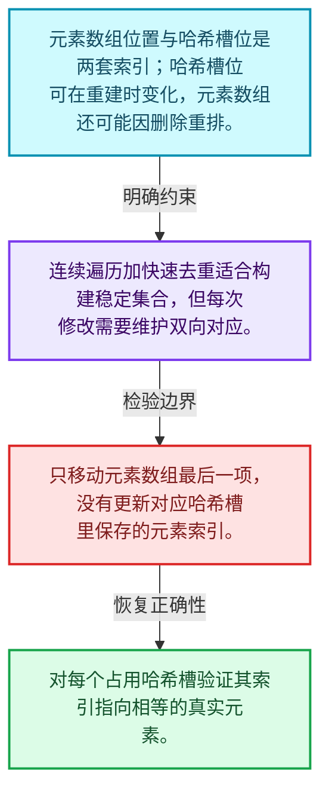
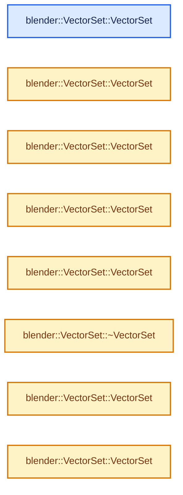
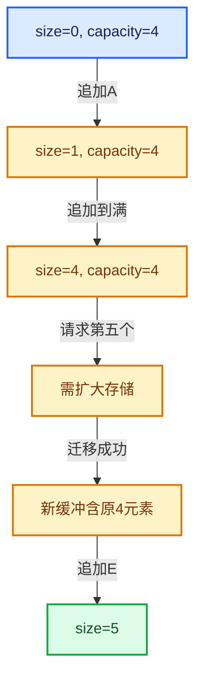

# 01-14 VectorSet稳定索引与去重

[方向导航](README.md) · [总目录](../README.md) · [实现索引](../00-课程指南/02-源码与提交索引/符号依赖与实现索引.md)

## 从问题到实现

能否同时保留连续元素和快速查找？

VectorSet结合元素数组和哈希索引；哈希表位置不等于元素索引，重排与删除必须同时维护两套关系。

**数据模型**

元素数组位置与哈希槽位是两套索引；哈希槽位可在重建时变化，元素数组还可能因删除重排。

**设计取舍**

连续遍历加快速去重适合构建稳定集合，但每次修改需要维护双向对应。

**最小反例**

只移动元素数组最后一项，没有更新对应哈希槽里保存的元素索引。

**推导**

对每个占用哈希槽验证其索引指向相等的真实元素。

## 阅读地图与执行推演








图中的数值推演是本方向的教学模型；实际函数之间的调用边与概念分析边分别标注，不能把概念关系当作运行时调度顺序。

## 完整源码单元与就地讲解

中文讲解直接放在相关代码旁，复杂机制在代码下展开。原文折叠区保留基准行号；不需要在行号表和函数之间来回查找。类布局可分段展示，函数实现不按固定行数切开。

### 类型布局、声明与编译条件 · BLI_vector_set.hh L1—L177

<a id="t-094ce19a80c5"></a>

`VectorSet`在这里声明的数据成员：

- `int64_t removed_slots_`
- `int64_t occupied_and_removed_slots_`
- `int64_t usable_slots_`
- `uint64_t slot_mask_`
- `BLI_NO_UNIQUE_ADDRESS hash_`
- `BLI_NO_UNIQUE_ADDRESS is_equal_`
- `LoadFactor max_load_factor_`
- `SlotArray slots_`
- `BLI_NO_UNIQUE_ADDRESS TypedBuffer`
- `Key keys_`

<!-- annotated:d89bab707e876f -->

```cpp
/* SPDX-FileCopyrightText: 2023 Blender Authors
 *
 * SPDX-License-Identifier: GPL-2.0-or-later */

#pragma once

/** \file
 * \ingroup bli
 *
 * A `VectorSet<Key>` is an ordered container for elements of type `Key`. It has the same
 * interface as `Set` with the following extensions:
 * - The insertion order of keys is maintained as long as no elements are removed.
 *   - Once elements are removed, the order of keys is only maintained for the elements added
 *     _before_ any removed element.
 * - The keys are stored in a contiguous array.
 *
 * All core operations (add, remove and contains) can be done in O(1) amortized expected time.
 *
 * Using a VectorSet instead of a normal Set can be beneficial in any of the following
 * circumstances:
 * - The insertion order is important.
 * - Iteration over all keys has to be fast.
 * - The keys in the set are supposed to be passed to a function that does not have to know that
 *   the keys are stored in a set. With a VectorSet, one can get a Span containing all keys
 *   without additional copies.
 *
 * VectorSet is implemented using open addressing in a slot array with a power-of-two
 * size. Other than in Set, a slot does not contain the key though. Instead it only
 * contains an index into an array of keys that is stored separately.
 *
 * Some noteworthy information:
 * - Key must be a movable type.
 * - Pointers to keys might be invalidated, when the vector set is changed or moved.
 * - The hash function can be customized. See BLI_hash.hh for details.
 * - The probing strategy can be customized. See BLI_probing_strategies.hh for details.
 * - The slot type can be customized. See BLI_vector_set_slots.hh for details.
 * - The methods `add_new` and `remove_contained` should be used instead of `add` and `remove`
 *   whenever appropriate. Assumptions and intention are described better this way.
 * - Using a range-for loop over a vector set, is as efficient as iterating over an array (because
 *   it is the same thing).
 * - Lookups can be performed using types other than Key without conversion. For that use the
 *   methods ending with `_as`. The template parameters Hash and IsEqual have to support the other
 *   key type. This can greatly improve performance when the strings are used as keys.
 * - The default constructor is cheap.
 * - The `print_stats` method can be used to get information about the distribution of keys and
 *   memory usage.
 */

#include "BLI_array.hh"
#include "BLI_hash.hh"
#include "BLI_hash_tables.hh"
#include "BLI_probing_strategies.hh"
#include "BLI_vector.hh"
#include "BLI_vector_set_slots.hh"

namespace blender {

template<
    /**
     * Type of the elements that are stored in this set. It has to be movable. Furthermore, the
     * hash and is-equal functions have to support it.
     */
    typename Key,
    /**
     * The number of values that can be stored in the container without a heap allocation.
     */
    int64_t InlineBufferCapacity = default_inline_buffer_capacity(sizeof(Key)),
    /**
     * The strategy used to deal with collisions. They are defined in BLI_probing_strategies.hh.
     */
    typename ProbingStrategy = DefaultProbingStrategy,
    /**
     * The hash function used to hash the keys. There is a default for many types. See BLI_hash.hh
     * for examples on how to define a custom hash function.
     */
    typename Hash = DefaultHash<Key>,
    /**
     * The equality operator used to compare keys. By default it will simply compare keys using the
     * `==` operator.
     */
    typename IsEqual = DefaultEquality<Key>,
    /**
     * This is what will actually be stored in the hash table array. At a minimum a slot has to be
     * able to hold an array index and information about whether the slot is empty, occupied or
     * removed. Using a non-standard slot type can improve performance for some types.
     * Also see BLI_vector_set_slots.hh.
     */
    typename Slot = typename DefaultVectorSetSlot<Key>::type,
    /**
     * The allocator used by this set. Should rarely be changed, except when you don't want that
     * MEM_* etc. is used internally.
     */
    typename Allocator = GuardedAllocator>
class VectorSet {
 public:
  using value_type = Key;
  using pointer = Key *;
  using const_pointer = const Key *;
  using reference = Key &;
  using const_reference = const Key &;
  using iterator = Key *;
  using const_iterator = const Key *;
  using size_type = int64_t;

 private:
  /**
   * Slots are either empty, occupied or removed. The number of occupied slots can be computed by
   * subtracting the removed slots from the occupied-and-removed slots.
   */
  int64_t removed_slots_;
  int64_t occupied_and_removed_slots_;

  /**
   * The maximum number of slots that can be used (either occupied or removed) until the set has to
   * grow. This is the total number of slots times the max load factor.
   */
  int64_t usable_slots_;

  /**
   * The number of slots minus one. This is a bit mask that can be used to turn any integer into a
   * valid slot index efficiently.
   */
  uint64_t slot_mask_;

  /** This is called to hash incoming keys. */
  BLI_NO_UNIQUE_ADDRESS Hash hash_;

  /** This is called to check equality of two keys. */
  BLI_NO_UNIQUE_ADDRESS IsEqual is_equal_;

/** The max load factor is 1/2 = 50% by default. */
#define LOAD_FACTOR 1, 2
  static constexpr LoadFactor max_load_factor_ = LoadFactor(LOAD_FACTOR);
  using SlotArray = Array<Slot, LoadFactor::compute_total_slots(4, LOAD_FACTOR), Allocator>;
#undef LOAD_FACTOR

  /**
   * This is the array that contains the actual slots. There is always at least one empty slot and
   * the size of the array is a power of two.
   */
  SlotArray slots_;

  /** A buffer for #keys_ that will remain uninitialized until it is used. */
  BLI_NO_UNIQUE_ADDRESS TypedBuffer<Key, InlineBufferCapacity> inline_buffer_;

  /**
   * Pointer to an array that contains all keys. The keys are sorted by insertion order as long as
   * no keys are removed. The first set->size() elements in this array are initialized. The
   * capacity of the array is usable_slots_.
   */
  Key *keys_;

  /** Iterate over a slot index sequence for a given hash. */
#define VECTOR_SET_SLOT_PROBING_BEGIN(HASH, R_SLOT) \
  SLOT_PROBING_BEGIN (ProbingStrategy, HASH, slot_mask_, SLOT_INDEX) \
    auto &R_SLOT = slots_[SLOT_INDEX];
#define VECTOR_SET_SLOT_PROBING_END() SLOT_PROBING_END()

  /**
   * Be a friend with other template instantiations. This is necessary to implement some memory
   * management logic.
   */
  template<typename Other,
           int64_t OtherInlineBufferCapacity,
           typename OtherProbingStrategy,
           typename OtherHash,
           typename OtherIsEqual,
           typename OtherSlot,
           typename OtherAllocator>
  friend class VectorSet;

 public:
  /**
   * Initialize an empty vector set. This is a cheap operation and won't do an allocation. This is
   * necessary to avoid a high cost when no elements are added at all. An optimized grow operation
   * is performed on the first insertion.
   */
```

<details>
<summary>核对原始源码：source/blender/blenlib/BLI_vector_set.hh · L1—L177</summary>

<!-- original:d89bab707e876f:source/blender/blenlib/BLI_vector_set.hh:1:177 -->

```cpp
/* SPDX-FileCopyrightText: 2023 Blender Authors
 *
 * SPDX-License-Identifier: GPL-2.0-or-later */

#pragma once

/** \file
 * \ingroup bli
 *
 * A `VectorSet<Key>` is an ordered container for elements of type `Key`. It has the same
 * interface as `Set` with the following extensions:
 * - The insertion order of keys is maintained as long as no elements are removed.
 *   - Once elements are removed, the order of keys is only maintained for the elements added
 *     _before_ any removed element.
 * - The keys are stored in a contiguous array.
 *
 * All core operations (add, remove and contains) can be done in O(1) amortized expected time.
 *
 * Using a VectorSet instead of a normal Set can be beneficial in any of the following
 * circumstances:
 * - The insertion order is important.
 * - Iteration over all keys has to be fast.
 * - The keys in the set are supposed to be passed to a function that does not have to know that
 *   the keys are stored in a set. With a VectorSet, one can get a Span containing all keys
 *   without additional copies.
 *
 * VectorSet is implemented using open addressing in a slot array with a power-of-two
 * size. Other than in Set, a slot does not contain the key though. Instead it only
 * contains an index into an array of keys that is stored separately.
 *
 * Some noteworthy information:
 * - Key must be a movable type.
 * - Pointers to keys might be invalidated, when the vector set is changed or moved.
 * - The hash function can be customized. See BLI_hash.hh for details.
 * - The probing strategy can be customized. See BLI_probing_strategies.hh for details.
 * - The slot type can be customized. See BLI_vector_set_slots.hh for details.
 * - The methods `add_new` and `remove_contained` should be used instead of `add` and `remove`
 *   whenever appropriate. Assumptions and intention are described better this way.
 * - Using a range-for loop over a vector set, is as efficient as iterating over an array (because
 *   it is the same thing).
 * - Lookups can be performed using types other than Key without conversion. For that use the
 *   methods ending with `_as`. The template parameters Hash and IsEqual have to support the other
 *   key type. This can greatly improve performance when the strings are used as keys.
 * - The default constructor is cheap.
 * - The `print_stats` method can be used to get information about the distribution of keys and
 *   memory usage.
 */

#include "BLI_array.hh"
#include "BLI_hash.hh"
#include "BLI_hash_tables.hh"
#include "BLI_probing_strategies.hh"
#include "BLI_vector.hh"
#include "BLI_vector_set_slots.hh"

namespace blender {

template<
    /**
     * Type of the elements that are stored in this set. It has to be movable. Furthermore, the
     * hash and is-equal functions have to support it.
     */
    typename Key,
    /**
     * The number of values that can be stored in the container without a heap allocation.
     */
    int64_t InlineBufferCapacity = default_inline_buffer_capacity(sizeof(Key)),
    /**
     * The strategy used to deal with collisions. They are defined in BLI_probing_strategies.hh.
     */
    typename ProbingStrategy = DefaultProbingStrategy,
    /**
     * The hash function used to hash the keys. There is a default for many types. See BLI_hash.hh
     * for examples on how to define a custom hash function.
     */
    typename Hash = DefaultHash<Key>,
    /**
     * The equality operator used to compare keys. By default it will simply compare keys using the
     * `==` operator.
     */
    typename IsEqual = DefaultEquality<Key>,
    /**
     * This is what will actually be stored in the hash table array. At a minimum a slot has to be
     * able to hold an array index and information about whether the slot is empty, occupied or
     * removed. Using a non-standard slot type can improve performance for some types.
     * Also see BLI_vector_set_slots.hh.
     */
    typename Slot = typename DefaultVectorSetSlot<Key>::type,
    /**
     * The allocator used by this set. Should rarely be changed, except when you don't want that
     * MEM_* etc. is used internally.
     */
    typename Allocator = GuardedAllocator>
class VectorSet {
 public:
  using value_type = Key;
  using pointer = Key *;
  using const_pointer = const Key *;
  using reference = Key &;
  using const_reference = const Key &;
  using iterator = Key *;
  using const_iterator = const Key *;
  using size_type = int64_t;

 private:
  /**
   * Slots are either empty, occupied or removed. The number of occupied slots can be computed by
   * subtracting the removed slots from the occupied-and-removed slots.
   */
  int64_t removed_slots_;
  int64_t occupied_and_removed_slots_;

  /**
   * The maximum number of slots that can be used (either occupied or removed) until the set has to
   * grow. This is the total number of slots times the max load factor.
   */
  int64_t usable_slots_;

  /**
   * The number of slots minus one. This is a bit mask that can be used to turn any integer into a
   * valid slot index efficiently.
   */
  uint64_t slot_mask_;

  /** This is called to hash incoming keys. */
  BLI_NO_UNIQUE_ADDRESS Hash hash_;

  /** This is called to check equality of two keys. */
  BLI_NO_UNIQUE_ADDRESS IsEqual is_equal_;

/** The max load factor is 1/2 = 50% by default. */
#define LOAD_FACTOR 1, 2
  static constexpr LoadFactor max_load_factor_ = LoadFactor(LOAD_FACTOR);
  using SlotArray = Array<Slot, LoadFactor::compute_total_slots(4, LOAD_FACTOR), Allocator>;
#undef LOAD_FACTOR

  /**
   * This is the array that contains the actual slots. There is always at least one empty slot and
   * the size of the array is a power of two.
   */
  SlotArray slots_;

  /** A buffer for #keys_ that will remain uninitialized until it is used. */
  BLI_NO_UNIQUE_ADDRESS TypedBuffer<Key, InlineBufferCapacity> inline_buffer_;

  /**
   * Pointer to an array that contains all keys. The keys are sorted by insertion order as long as
   * no keys are removed. The first set->size() elements in this array are initialized. The
   * capacity of the array is usable_slots_.
   */
  Key *keys_;

  /** Iterate over a slot index sequence for a given hash. */
#define VECTOR_SET_SLOT_PROBING_BEGIN(HASH, R_SLOT) \
  SLOT_PROBING_BEGIN (ProbingStrategy, HASH, slot_mask_, SLOT_INDEX) \
    auto &R_SLOT = slots_[SLOT_INDEX];
#define VECTOR_SET_SLOT_PROBING_END() SLOT_PROBING_END()

  /**
   * Be a friend with other template instantiations. This is necessary to implement some memory
   * management logic.
   */
  template<typename Other,
           int64_t OtherInlineBufferCapacity,
           typename OtherProbingStrategy,
           typename OtherHash,
           typename OtherIsEqual,
           typename OtherSlot,
           typename OtherAllocator>
  friend class VectorSet;

 public:
  /**
   * Initialize an empty vector set. This is a cheap operation and won't do an allocation. This is
   * necessary to avoid a high cost when no elements are added at all. An optimized grow operation
   * is performed on the first insertion.
   */
```

</details>

<a id="f-5dcfd2b16265d252"></a>

### `blender::VectorSet::VectorSet`

实现位置：[source/blender/blenlib/BLI_vector_set.hh](../../../../../source/blender/blenlib/BLI_vector_set.hh) · L178—L186。

接口参数：

- `Allocator allocator = {}`

**教学注释版**

<!-- annotated:5e647504796310 -->

```cpp
  VectorSet(Allocator allocator = {}) noexcept
      : removed_slots_(0),
        occupied_and_removed_slots_(0),
        usable_slots_(0),
        slot_mask_(0),
        slots_(1, allocator)
  {
    keys_ = inline_buffer_;
  }
```

<details>
<summary>核对原始源码：source/blender/blenlib/BLI_vector_set.hh · L178—L186</summary>

<!-- original:5e647504796310:source/blender/blenlib/BLI_vector_set.hh:178:186 -->

```cpp
  VectorSet(Allocator allocator = {}) noexcept
      : removed_slots_(0),
        occupied_and_removed_slots_(0),
        usable_slots_(0),
        slot_mask_(0),
        slots_(1, allocator)
  {
    keys_ = inline_buffer_;
  }
```

</details>

**沿实际写入检查状态**

- `keys_ = inline_buffer_;`

**继续追踪实现**

本实现没有需要继续展开的显式调用；检查返回表达式、对象转换和调用者前置条件。

<!-- annotated:b7103aeec095b1 -->

```cpp

```

<details>
<summary>核对原始源码：source/blender/blenlib/BLI_vector_set.hh · L187—L187</summary>

<!-- original:b7103aeec095b1:source/blender/blenlib/BLI_vector_set.hh:187:187 -->

```cpp

```

</details>

<a id="f-7dba7f74774a0655"></a>

### `blender::VectorSet::VectorSet`

实现位置：[source/blender/blenlib/BLI_vector_set.hh](../../../../../source/blender/blenlib/BLI_vector_set.hh) · L188—L192。

接口参数：

- `Hash hash`
- `IsEqual is_equal`

**教学注释版**

<!-- annotated:8f503086759b9f -->

```cpp
  VectorSet(Hash hash, IsEqual is_equal) : VectorSet()
  {
    // [讲解] std::move：把表达式转换成可供移动重载选择的值类别；不保证真的移动，不结束源对象寿命，对const值可能选择复制。
    hash_ = std::move(hash);
    is_equal_ = std::move(is_equal);
  }
```

<details>
<summary>核对原始源码：source/blender/blenlib/BLI_vector_set.hh · L188—L192</summary>

<!-- original:8f503086759b9f:source/blender/blenlib/BLI_vector_set.hh:188:192 -->

```cpp
  VectorSet(Hash hash, IsEqual is_equal) : VectorSet()
  {
    hash_ = std::move(hash);
    is_equal_ = std::move(is_equal);
  }
```

</details>

**沿实际写入检查状态**

- `hash_ = std::move(hash);`
- `is_equal_ = std::move(is_equal);`

**继续追踪实现**

- `std::move` → [外部契约](https://eel.is/c++draft/utility.forward)：把表达式转换成可供移动重载选择的值类别；不保证真的移动，不结束源对象寿命，对const值可能选择复制。

<!-- annotated:e249cfa6f01c19 -->

```cpp

```

<details>
<summary>核对原始源码：source/blender/blenlib/BLI_vector_set.hh · L193—L193</summary>

<!-- original:e249cfa6f01c19:source/blender/blenlib/BLI_vector_set.hh:193:193 -->

```cpp

```

</details>

<a id="f-9ee5250feacb126b"></a>

### `blender::VectorSet::VectorSet`

实现位置：[source/blender/blenlib/BLI_vector_set.hh](../../../../../source/blender/blenlib/BLI_vector_set.hh) · L194—L194。

接口参数：

- `NoExceptConstructor`
- `Allocator allocator = {}`

**教学注释版**

<!-- annotated:11edacd5b56766 -->

```cpp
  VectorSet(NoExceptConstructor, Allocator allocator = {}) : VectorSet(allocator) {}
```

<details>
<summary>核对原始源码：source/blender/blenlib/BLI_vector_set.hh · L194—L194</summary>

<!-- original:11edacd5b56766:source/blender/blenlib/BLI_vector_set.hh:194:194 -->

```cpp
  VectorSet(NoExceptConstructor, Allocator allocator = {}) : VectorSet(allocator) {}
```

</details>

**继续追踪实现**

本实现没有需要继续展开的显式调用；检查返回表达式、对象转换和调用者前置条件。

<!-- annotated:9d052e88c57a7d -->

```cpp

```

<details>
<summary>核对原始源码：source/blender/blenlib/BLI_vector_set.hh · L195—L195</summary>

<!-- original:9d052e88c57a7d:source/blender/blenlib/BLI_vector_set.hh:195:195 -->

```cpp

```

</details>

<a id="f-ea58e193b6c2468e"></a>

### `blender::VectorSet::VectorSet`

实现位置：[source/blender/blenlib/BLI_vector_set.hh](../../../../../source/blender/blenlib/BLI_vector_set.hh) · L196—L199。

接口参数：

- `Span<Key> keys`
- `Allocator allocator = {}`

**教学注释版**

<!-- annotated:ca4bb76886c06b -->

```cpp
  VectorSet(Span<Key> keys, Allocator allocator = {}) : VectorSet(NoExceptConstructor(), allocator)
  {
    this->add_multiple(keys);
  }
```

<details>
<summary>核对原始源码：source/blender/blenlib/BLI_vector_set.hh · L196—L199</summary>

<!-- original:ca4bb76886c06b:source/blender/blenlib/BLI_vector_set.hh:196:199 -->

```cpp
  VectorSet(Span<Key> keys, Allocator allocator = {}) : VectorSet(NoExceptConstructor(), allocator)
  {
    this->add_multiple(keys);
  }
```

</details>

**继续追踪实现**

- `this->add_multiple` → [blender::VectorSet::add_multiple · L394](14-VectorSet稳定索引与去重.md#f-911e364c3013b35e)。

### 类型布局、声明与编译条件 · BLI_vector_set.hh L200—L203

<!-- annotated:9ff715c65bda02 -->

```cpp

  /**
   * Construct a vector set that contains the given keys. Duplicates will be removed automatically.
   */
```

<details>
<summary>核对原始源码：source/blender/blenlib/BLI_vector_set.hh · L200—L203</summary>

<!-- original:9ff715c65bda02:source/blender/blenlib/BLI_vector_set.hh:200:203 -->

```cpp

  /**
   * Construct a vector set that contains the given keys. Duplicates will be removed automatically.
   */
```

</details>

<a id="f-2975ca22adb37cbb"></a>

### `blender::VectorSet::VectorSet`

实现位置：[source/blender/blenlib/BLI_vector_set.hh](../../../../../source/blender/blenlib/BLI_vector_set.hh) · L204—L207。

接口参数：

- `const std::initializer_list<Key> &keys`
- `Allocator allocator = {}`

**教学注释版**

<!-- annotated:33908608a8091d -->

```cpp
  VectorSet(const std::initializer_list<Key> &keys, Allocator allocator = {})
      : VectorSet(Span(keys), allocator)
  {
  }
```

<details>
<summary>核对原始源码：source/blender/blenlib/BLI_vector_set.hh · L204—L207</summary>

<!-- original:33908608a8091d:source/blender/blenlib/BLI_vector_set.hh:204:207 -->

```cpp
  VectorSet(const std::initializer_list<Key> &keys, Allocator allocator = {})
      : VectorSet(Span(keys), allocator)
  {
  }
```

</details>

**继续追踪实现**

本实现没有需要继续展开的显式调用；检查返回表达式、对象转换和调用者前置条件。

<!-- annotated:cb09e423a55d66 -->

```cpp

```

<details>
<summary>核对原始源码：source/blender/blenlib/BLI_vector_set.hh · L208—L208</summary>

<!-- original:cb09e423a55d66:source/blender/blenlib/BLI_vector_set.hh:208:208 -->

```cpp

```

</details>

<a id="f-9200961caf9a19e8"></a>

### `blender::VectorSet::~VectorSet`

实现位置：[source/blender/blenlib/BLI_vector_set.hh](../../../../../source/blender/blenlib/BLI_vector_set.hh) · L209—L215。

**教学注释版**

<!-- annotated:4ea39e534db83d -->

```cpp
  ~VectorSet()
  {
    // [讲解] this->size：查询活项数量或键是否存在。
    destruct_n(keys_, this->size());
    if (keys_ != inline_buffer_) {
      this->deallocate_keys_array(keys_);
    }
  }
```

<details>
<summary>核对原始源码：source/blender/blenlib/BLI_vector_set.hh · L209—L215</summary>

<!-- original:4ea39e534db83d:source/blender/blenlib/BLI_vector_set.hh:209:215 -->

```cpp
  ~VectorSet()
  {
    destruct_n(keys_, this->size());
    if (keys_ != inline_buffer_) {
      this->deallocate_keys_array(keys_);
    }
  }
```

</details>

**继续追踪实现**

- `destruct_n` → [调用协议](../00-课程指南/01-路线与规范/模板宏与动态分派协议.md)：函数指针、局部可调用对象或未展开的宏；必须结合调用者环境。调用位置L211。
- `this->size` → [blender::VectorSet::size · L611](14-VectorSet稳定索引与去重.md#f-f42667f4f31e3349)。
- `this->deallocate_keys_array` → [blender::VectorSet::deallocate_keys_array · L1105](14-VectorSet稳定索引与去重.md#f-909355f38a511e1a)。

<!-- annotated:df20369ec4ee8c -->

```cpp

```

<details>
<summary>核对原始源码：source/blender/blenlib/BLI_vector_set.hh · L216—L216</summary>

<!-- original:df20369ec4ee8c:source/blender/blenlib/BLI_vector_set.hh:216:216 -->

```cpp

```

</details>

<a id="f-2f6da5e69b89d9f6"></a>

### `blender::VectorSet::VectorSet`

实现位置：[source/blender/blenlib/BLI_vector_set.hh](../../../../../source/blender/blenlib/BLI_vector_set.hh) · L217—L242。

接口参数：

- `const VectorSet &other`

**教学注释版**

<!-- annotated:6767d6b1ea6de4 -->

```cpp
  VectorSet(const VectorSet &other) : slots_(other.slots_)
  {
    // [讲解] other.size：查询活项数量或键是否存在。
    if (other.size() <= InlineBufferCapacity) {
      usable_slots_ = other.size();
      keys_ = inline_buffer_;
    }
    else {
      keys_ = this->allocate_keys_array(other.usable_slots_);
      usable_slots_ = other.usable_slots_;
    }
    try {
      uninitialized_copy_n(other.keys_, other.size(), keys_);
    }
    catch (...) {
      if (keys_ != inline_buffer_) {
        this->deallocate_keys_array(keys_);
      }
      throw;
    }

    removed_slots_ = other.removed_slots_;
    occupied_and_removed_slots_ = other.occupied_and_removed_slots_;
    slot_mask_ = other.slot_mask_;
    hash_ = other.hash_;
    is_equal_ = other.is_equal_;
  }
```

<details>
<summary>核对原始源码：source/blender/blenlib/BLI_vector_set.hh · L217—L242</summary>

<!-- original:6767d6b1ea6de4:source/blender/blenlib/BLI_vector_set.hh:217:242 -->

```cpp
  VectorSet(const VectorSet &other) : slots_(other.slots_)
  {
    if (other.size() <= InlineBufferCapacity) {
      usable_slots_ = other.size();
      keys_ = inline_buffer_;
    }
    else {
      keys_ = this->allocate_keys_array(other.usable_slots_);
      usable_slots_ = other.usable_slots_;
    }
    try {
      uninitialized_copy_n(other.keys_, other.size(), keys_);
    }
    catch (...) {
      if (keys_ != inline_buffer_) {
        this->deallocate_keys_array(keys_);
      }
      throw;
    }

    removed_slots_ = other.removed_slots_;
    occupied_and_removed_slots_ = other.occupied_and_removed_slots_;
    slot_mask_ = other.slot_mask_;
    hash_ = other.hash_;
    is_equal_ = other.is_equal_;
  }
```

</details>

**沿实际写入检查状态**

- `usable_slots_ = other.size();`
- `keys_ = inline_buffer_;`
- `keys_ = this->allocate_keys_array(other.usable_slots_);`
- `usable_slots_ = other.usable_slots_;`
- `removed_slots_ = other.removed_slots_;`
- `occupied_and_removed_slots_ = other.occupied_and_removed_slots_;`
- `slot_mask_ = other.slot_mask_;`
- `hash_ = other.hash_;`
- `is_equal_ = other.is_equal_;`

**继续追踪实现**

- `other.size` → [blender::VectorSet::size · L611](14-VectorSet稳定索引与去重.md#f-f42667f4f31e3349)。
- `this->allocate_keys_array` → [blender::VectorSet::allocate_keys_array · L1099](14-VectorSet稳定索引与去重.md#f-802358992d1629aa)。
- `uninitialized_copy_n` → [blender::uninitialized_copy_n · L53](01-对象生命周期与值类别.md#f-6cd63ebede164cd2)。
- `this->deallocate_keys_array` → [blender::VectorSet::deallocate_keys_array · L1105](14-VectorSet稳定索引与去重.md#f-909355f38a511e1a)。

<!-- annotated:df922090d5c9b8 -->

```cpp

```

<details>
<summary>核对原始源码：source/blender/blenlib/BLI_vector_set.hh · L243—L243</summary>

<!-- original:df922090d5c9b8:source/blender/blenlib/BLI_vector_set.hh:243:243 -->

```cpp

```

</details>

<a id="f-517cc8fd2a936778"></a>

### `blender::VectorSet::VectorSet`

实现位置：[source/blender/blenlib/BLI_vector_set.hh](../../../../../source/blender/blenlib/BLI_vector_set.hh) · L244—L288。

接口参数：

- `VectorSet<Key, OtherInlineBufferCapacity, ProbingStrategy, Hash, IsEqual, Slot, Allocator>
           &&other`

**教学注释版**

<!-- annotated:b1a4aae7b0b317 -->

```cpp
  template<int64_t OtherInlineBufferCapacity>
  VectorSet(
      VectorSet<Key, OtherInlineBufferCapacity, ProbingStrategy, Hash, IsEqual, Slot, Allocator>
          &&other) noexcept
      : removed_slots_(other.removed_slots_),
        occupied_and_removed_slots_(other.occupied_and_removed_slots_),
        slot_mask_(other.slot_mask_),
        slots_(std::move(other.slots_))
  {
    if (other.is_inline()) {
      // [讲解] other.size：查询活项数量或键是否存在。
      const int64_t size = other.size();
      usable_slots_ = size;

      constexpr bool other_is_same_type = std::is_same_v<VectorSet, std::decay_t<decltype(other)>>;
      constexpr size_t max_full_copy_size = 32;
      if constexpr (other_is_same_type && std::is_trivial_v<Key> &&
                    sizeof(inline_buffer_) <= max_full_copy_size)
      {
        /* Optimize by copying the full inline buffer. Similar to #Vector move constructor. */
        keys_ = inline_buffer_;
        if (size > 0) {
          // [讲解] memcpy：复制字节，源与目标不应重叠。类型生命周期、对齐和可复制表示须由调用者证明，不是任意对象的复制构造。
          memcpy(inline_buffer_, other.inline_buffer_, sizeof(inline_buffer_));
        }
      }
      else {
        if (OtherInlineBufferCapacity <= InlineBufferCapacity || size <= InlineBufferCapacity) {
          keys_ = inline_buffer_;
        }
        else {
          keys_ = this->allocate_keys_array(size);
        }
        // [讲解] uninitialized_relocate_n：在目标原始存储建立对象，再结束源对象寿命。
        uninitialized_relocate_n(other.keys_, size, keys_);
      }
    }
    else {
      keys_ = other.keys_;
      usable_slots_ = other.usable_slots_;
    }
    other.removed_slots_ = 0;
    other.occupied_and_removed_slots_ = 0;
    other.usable_slots_ = 0;
    other.slot_mask_ = 0;
    other.slots_ = SlotArray(1);
    other.keys_ = other.inline_buffer_;
  }
```

<details>
<summary>核对原始源码：source/blender/blenlib/BLI_vector_set.hh · L244—L288</summary>

<!-- original:b1a4aae7b0b317:source/blender/blenlib/BLI_vector_set.hh:244:288 -->

```cpp
  template<int64_t OtherInlineBufferCapacity>
  VectorSet(
      VectorSet<Key, OtherInlineBufferCapacity, ProbingStrategy, Hash, IsEqual, Slot, Allocator>
          &&other) noexcept
      : removed_slots_(other.removed_slots_),
        occupied_and_removed_slots_(other.occupied_and_removed_slots_),
        slot_mask_(other.slot_mask_),
        slots_(std::move(other.slots_))
  {
    if (other.is_inline()) {
      const int64_t size = other.size();
      usable_slots_ = size;

      constexpr bool other_is_same_type = std::is_same_v<VectorSet, std::decay_t<decltype(other)>>;
      constexpr size_t max_full_copy_size = 32;
      if constexpr (other_is_same_type && std::is_trivial_v<Key> &&
                    sizeof(inline_buffer_) <= max_full_copy_size)
      {
        /* Optimize by copying the full inline buffer. Similar to #Vector move constructor. */
        keys_ = inline_buffer_;
        if (size > 0) {
          memcpy(inline_buffer_, other.inline_buffer_, sizeof(inline_buffer_));
        }
      }
      else {
        if (OtherInlineBufferCapacity <= InlineBufferCapacity || size <= InlineBufferCapacity) {
          keys_ = inline_buffer_;
        }
        else {
          keys_ = this->allocate_keys_array(size);
        }
        uninitialized_relocate_n(other.keys_, size, keys_);
      }
    }
    else {
      keys_ = other.keys_;
      usable_slots_ = other.usable_slots_;
    }
    other.removed_slots_ = 0;
    other.occupied_and_removed_slots_ = 0;
    other.usable_slots_ = 0;
    other.slot_mask_ = 0;
    other.slots_ = SlotArray(1);
    other.keys_ = other.inline_buffer_;
  }
```

</details>

**沿实际写入检查状态**

- `usable_slots_ = size;`
- `keys_ = inline_buffer_;`
- `keys_ = this->allocate_keys_array(size);`
- `keys_ = other.keys_;`
- `usable_slots_ = other.usable_slots_;`
- `other.removed_slots_ = 0;`
- `other.occupied_and_removed_slots_ = 0;`
- `other.usable_slots_ = 0;`
- `other.slot_mask_ = 0;`
- `other.slots_ = SlotArray(1);`
- `other.keys_ = other.inline_buffer_;`

**继续追踪实现**

- `other.is_inline` → [blender::VectorSet::is_inline · L603](14-VectorSet稳定索引与去重.md#f-bafc33380df75ae3)。
- `other.size` → [blender::VectorSet::size · L611](14-VectorSet稳定索引与去重.md#f-f42667f4f31e3349)。
- `memcpy` → [外部契约](https://eel.is/c++draft/cstring.syn)：复制字节，源与目标不应重叠。类型生命周期、对齐和可复制表示须由调用者证明，不是任意对象的复制构造。
- `this->allocate_keys_array` → [blender::VectorSet::allocate_keys_array · L1099](14-VectorSet稳定索引与去重.md#f-802358992d1629aa)。
- `uninitialized_relocate_n` → [blender::uninitialized_relocate_n · L80](01-对象生命周期与值类别.md#f-9de0365b9a47fd68)。
- `SlotArray` → [调用协议](../00-课程指南/01-路线与规范/模板宏与动态分派协议.md)：函数指针、局部可调用对象或未展开的宏；必须结合调用者环境。调用位置L286。

<!-- annotated:bc779cd5b4ae1b -->

```cpp

```

<details>
<summary>核对原始源码：source/blender/blenlib/BLI_vector_set.hh · L289—L289</summary>

<!-- original:bc779cd5b4ae1b:source/blender/blenlib/BLI_vector_set.hh:289:289 -->

```cpp

```

</details>

<a id="f-6291004a23b303e6"></a>

### `blender::VectorSet::operator=`

实现位置：[source/blender/blenlib/BLI_vector_set.hh](../../../../../source/blender/blenlib/BLI_vector_set.hh) · L290—L293。

接口参数：

- `const VectorSet &other`

**教学注释版**

<!-- annotated:8773f242c32233 -->

```cpp
  VectorSet &operator=(const VectorSet &other)
  {
    return copy_assign_container(*this, other);
  }
```

<details>
<summary>核对原始源码：source/blender/blenlib/BLI_vector_set.hh · L290—L293</summary>

<!-- original:8773f242c32233:source/blender/blenlib/BLI_vector_set.hh:290:293 -->

```cpp
  VectorSet &operator=(const VectorSet &other)
  {
    return copy_assign_container(*this, other);
  }
```

</details>

**结果出口**

- `return copy_assign_container(*this, other);`

**继续追踪实现**

- `copy_assign_container` → [blender::copy_assign_container · L284](../03-内存分配与运行时类型/01-对齐与未初始化存储.md#f-546a45b4d8b5ab44)。

<!-- annotated:db4f0a461dfa15 -->

```cpp

```

<details>
<summary>核对原始源码：source/blender/blenlib/BLI_vector_set.hh · L294—L294</summary>

<!-- original:db4f0a461dfa15:source/blender/blenlib/BLI_vector_set.hh:294:294 -->

```cpp

```

</details>

<a id="f-8d0a258820fac04b"></a>

### `blender::VectorSet::operator=`

实现位置：[source/blender/blenlib/BLI_vector_set.hh](../../../../../source/blender/blenlib/BLI_vector_set.hh) · L295—L298。

接口参数：

- `VectorSet &&other`

**教学注释版**

<!-- annotated:f0554a408fb0a3 -->

```cpp
  VectorSet &operator=(VectorSet &&other)
  {
    // [讲解] std::move：把表达式转换成可供移动重载选择的值类别；不保证真的移动，不结束源对象寿命，对const值可能选择复制。
    return move_assign_container(*this, std::move(other));
  }
```

<details>
<summary>核对原始源码：source/blender/blenlib/BLI_vector_set.hh · L295—L298</summary>

<!-- original:f0554a408fb0a3:source/blender/blenlib/BLI_vector_set.hh:295:298 -->

```cpp
  VectorSet &operator=(VectorSet &&other)
  {
    return move_assign_container(*this, std::move(other));
  }
```

</details>

**结果出口**

- `return move_assign_container(*this, std::move(other));`

**继续追踪实现**

- `move_assign_container` → [blender::move_assign_container · L300](../03-内存分配与运行时类型/01-对齐与未初始化存储.md#f-5144b56be86e6f42)。
- `std::move` → [外部契约](https://eel.is/c++draft/utility.forward)：把表达式转换成可供移动重载选择的值类别；不保证真的移动，不结束源对象寿命，对const值可能选择复制。

### 类型布局、声明与编译条件 · BLI_vector_set.hh L299—L302

<!-- annotated:5dd82ccc1f4423 -->

```cpp

  /**
   * Get the key stored at the given position in the vector.
   */
```

<details>
<summary>核对原始源码：source/blender/blenlib/BLI_vector_set.hh · L299—L302</summary>

<!-- original:5dd82ccc1f4423:source/blender/blenlib/BLI_vector_set.hh:299:302 -->

```cpp

  /**
   * Get the key stored at the given position in the vector.
   */
```

</details>

<a id="f-a8071b64877d2b53"></a>

### `blender::VectorSet::operator[]`

实现位置：[source/blender/blenlib/BLI_vector_set.hh](../../../../../source/blender/blenlib/BLI_vector_set.hh) · L303—L308。

接口参数：

- `const int64_t index`

**教学注释版**

<!-- annotated:d66ec3e3f38aeb -->

```cpp
  const Key &operator[](const int64_t index) const
  {
    BLI_assert(index >= 0);
    // [讲解] this->size：查询活项数量或键是否存在。
    BLI_assert(index <= this->size());
    return keys_[index];
  }
```

<details>
<summary>核对原始源码：source/blender/blenlib/BLI_vector_set.hh · L303—L308</summary>

<!-- original:d66ec3e3f38aeb:source/blender/blenlib/BLI_vector_set.hh:303:308 -->

```cpp
  const Key &operator[](const int64_t index) const
  {
    BLI_assert(index >= 0);
    BLI_assert(index <= this->size());
    return keys_[index];
  }
```

</details>

**结果出口**

- `return keys_[index];`

**继续追踪实现**

- `BLI_assert` → [BLI_assert · L48](../90-实现依赖专题/01-BLI基础库/BLI_assert.hh.md#m-57a88495704d)；[BLI_assert · L63](../90-实现依赖专题/01-BLI基础库/BLI_assert.hh.md#m-d07050020cb5)。宏定义由构建条件选择。
- `this->size` → [blender::VectorSet::size · L611](14-VectorSet稳定索引与去重.md#f-f42667f4f31e3349)。

<!-- annotated:d2fab8a4c744bf -->

```cpp

```

<details>
<summary>核对原始源码：source/blender/blenlib/BLI_vector_set.hh · L309—L309</summary>

<!-- original:d2fab8a4c744bf:source/blender/blenlib/BLI_vector_set.hh:309:309 -->

```cpp

```

</details>

<a id="f-ba3bfd9beb64de36"></a>

### `blender::VectorSet::() const`

实现位置：[source/blender/blenlib/BLI_vector_set.hh](../../../../../source/blender/blenlib/BLI_vector_set.hh) · L310—L313。

**教学注释版**

<!-- annotated:7478770aded141 -->

```cpp
  operator Span<Key>() const
  {
    // [讲解] this->size：查询活项数量或键是否存在。
    return Span<Key>(keys_, this->size());
  }
```

<details>
<summary>核对原始源码：source/blender/blenlib/BLI_vector_set.hh · L310—L313</summary>

<!-- original:7478770aded141:source/blender/blenlib/BLI_vector_set.hh:310:313 -->

```cpp
  operator Span<Key>() const
  {
    return Span<Key>(keys_, this->size());
  }
```

</details>

**结果出口**

- `return Span<Key>(keys_, this->size());`

**继续追踪实现**

- `Span<Key>` → [blender::Span](../90-实现依赖专题/01-BLI基础库/BLI_span.hh.md#t-8765a8e0c1d5)；[blender::Span](../90-实现依赖专题/01-BLI基础库/BLI_index_range.hh.md#t-86091874a1c0)；[blender::Span](../90-实现依赖专题/08-其他Blender模块/makesdna/DNA_pointcloud_types.h.md#t-112aa6ed842c)；[blender::Span](../90-实现依赖专题/08-其他Blender模块/makesdna/DNA_node_types.h.md#t-49ec6fbb9b69)；[blender::Span](../90-实现依赖专题/08-其他Blender模块/makesdna/DNA_mesh_types.h.md#t-184fd48fb638)；[blender::Span](../90-实现依赖专题/08-其他Blender模块/makesdna/DNA_anim_types.h.md#t-d841071994c2)；[blender::Span](../90-实现依赖专题/08-其他Blender模块/makesrna/RNA_path_fwd.hh.md#t-4dbb08969e41)。
- `this->size` → [blender::VectorSet::size · L611](14-VectorSet稳定索引与去重.md#f-f42667f4f31e3349)。

<!-- annotated:a1ebad222fc3bc -->

```cpp

```

<details>
<summary>核对原始源码：source/blender/blenlib/BLI_vector_set.hh · L314—L314</summary>

<!-- original:a1ebad222fc3bc:source/blender/blenlib/BLI_vector_set.hh:314:314 -->

```cpp

```

</details>

<a id="f-1fce6e8ed0a1ce78"></a>

### `blender::VectorSet::operator==`

实现位置：[source/blender/blenlib/BLI_vector_set.hh](../../../../../source/blender/blenlib/BLI_vector_set.hh) · L315—L318。

接口参数：

- `const VectorSet &a`
- `const VectorSet &b`

**教学注释版**

<!-- annotated:8dfb89fb5fe735 -->

```cpp
  friend bool operator==(const VectorSet &a, const VectorSet &b)
  {
    return a.as_span() == b.as_span();
  }
```

<details>
<summary>核对原始源码：source/blender/blenlib/BLI_vector_set.hh · L315—L318</summary>

<!-- original:8dfb89fb5fe735:source/blender/blenlib/BLI_vector_set.hh:315:318 -->

```cpp
  friend bool operator==(const VectorSet &a, const VectorSet &b)
  {
    return a.as_span() == b.as_span();
  }
```

</details>

**结果出口**

- `return a.as_span() == b.as_span();`

**继续追踪实现**

- `a.as_span` → [blender::VectorSet::as_span · L326](14-VectorSet稳定索引与去重.md#f-76ed81b1cfbe99ad)。
- `b.as_span` → [blender::VectorSet::as_span · L326](14-VectorSet稳定索引与去重.md#f-76ed81b1cfbe99ad)。

### 类型布局、声明与编译条件 · BLI_vector_set.hh L319—L325

<!-- annotated:735d35e98c6e5e -->

```cpp

  /**
   * Get a Span referencing the keys vector. The referenced memory buffer is only valid as
   * long as the vector set is not changed.
   *
   * The keys must not be changed, because this would change their hash value.
   */
```

<details>
<summary>核对原始源码：source/blender/blenlib/BLI_vector_set.hh · L319—L325</summary>

<!-- original:735d35e98c6e5e:source/blender/blenlib/BLI_vector_set.hh:319:325 -->

```cpp

  /**
   * Get a Span referencing the keys vector. The referenced memory buffer is only valid as
   * long as the vector set is not changed.
   *
   * The keys must not be changed, because this would change their hash value.
   */
```

</details>

<a id="f-76ed81b1cfbe99ad"></a>

### `blender::VectorSet::as_span`

实现位置：[source/blender/blenlib/BLI_vector_set.hh](../../../../../source/blender/blenlib/BLI_vector_set.hh) · L326—L329。

**教学注释版**

<!-- annotated:56bd06baf7a404 -->

```cpp
  Span<Key> as_span() const
  {
    return *this;
  }
```

<details>
<summary>核对原始源码：source/blender/blenlib/BLI_vector_set.hh · L326—L329</summary>

<!-- original:56bd06baf7a404:source/blender/blenlib/BLI_vector_set.hh:326:329 -->

```cpp
  Span<Key> as_span() const
  {
    return *this;
  }
```

</details>

**结果出口**

- `return *this;`

**继续追踪实现**

本实现没有需要继续展开的显式调用；检查返回表达式、对象转换和调用者前置条件。

### 类型布局、声明与编译条件 · BLI_vector_set.hh L330—L335

<!-- annotated:a31bc1bade44ce -->

```cpp

  /**
   * Add a new key to the vector set. This invokes undefined behavior when the key is in the set
   * already. When you know for certain that a key is not in the set yet, use this method for
   * better performance. This also expresses the intent better.
   */
```

<details>
<summary>核对原始源码：source/blender/blenlib/BLI_vector_set.hh · L330—L335</summary>

<!-- original:a31bc1bade44ce:source/blender/blenlib/BLI_vector_set.hh:330:335 -->

```cpp

  /**
   * Add a new key to the vector set. This invokes undefined behavior when the key is in the set
   * already. When you know for certain that a key is not in the set yet, use this method for
   * better performance. This also expresses the intent better.
   */
```

</details>

<a id="f-03989f7359a8636d"></a>

### `blender::VectorSet::add_new`

按哈希与相等关系加入键或键值。

实现位置：[source/blender/blenlib/BLI_vector_set.hh](../../../../../source/blender/blenlib/BLI_vector_set.hh) · L336—L339。

接口参数：

- `const Key &key`

**教学注释版**

<!-- annotated:56aec9491bf8dd -->

```cpp
  void add_new(const Key &key)
  {
    this->add_new__impl(key, hash_(key));
  }
```

<details>
<summary>核对原始源码：source/blender/blenlib/BLI_vector_set.hh · L336—L339</summary>

<!-- original:56aec9491bf8dd:source/blender/blenlib/BLI_vector_set.hh:336:339 -->

```cpp
  void add_new(const Key &key)
  {
    this->add_new__impl(key, hash_(key));
  }
```

</details>

**接口与不变量**

存在键与不存在键的接口承诺不同；add_new需要调用者保证键尚不存在。

**继续追踪实现**

- `this->add_new__impl` → [blender::VectorSet::add_new__impl · L879](14-VectorSet稳定索引与去重.md#f-c253f642df98f383)。
- `hash_` → [调用协议](../00-课程指南/01-路线与规范/模板宏与动态分派协议.md)：函数指针、局部可调用对象或未展开的宏；必须结合调用者环境。调用位置L338。

<a id="f-ef9174f041011a6b"></a>

### `blender::VectorSet::add_new`

按哈希与相等关系加入键或键值。

实现位置：[source/blender/blenlib/BLI_vector_set.hh](../../../../../source/blender/blenlib/BLI_vector_set.hh) · L340—L343。

接口参数：

- `Key &&key`

**教学注释版**

<!-- annotated:dfbd6d57d6d901 -->

```cpp
  void add_new(Key &&key)
  {
    // [讲解] std::move：把表达式转换成可供移动重载选择的值类别；不保证真的移动，不结束源对象寿命，对const值可能选择复制。
    this->add_new__impl(std::move(key), hash_(key));
  }
```

<details>
<summary>核对原始源码：source/blender/blenlib/BLI_vector_set.hh · L340—L343</summary>

<!-- original:dfbd6d57d6d901:source/blender/blenlib/BLI_vector_set.hh:340:343 -->

```cpp
  void add_new(Key &&key)
  {
    this->add_new__impl(std::move(key), hash_(key));
  }
```

</details>

**接口与不变量**

存在键与不存在键的接口承诺不同；add_new需要调用者保证键尚不存在。

**继续追踪实现**

- `this->add_new__impl` → [blender::VectorSet::add_new__impl · L879](14-VectorSet稳定索引与去重.md#f-c253f642df98f383)。
- `std::move` → [外部契约](https://eel.is/c++draft/utility.forward)：把表达式转换成可供移动重载选择的值类别；不保证真的移动，不结束源对象寿命，对const值可能选择复制。
- `hash_` → [调用协议](../00-课程指南/01-路线与规范/模板宏与动态分派协议.md)：函数指针、局部可调用对象或未展开的宏；必须结合调用者环境。调用位置L342。

### 类型布局、声明与编译条件 · BLI_vector_set.hh L344—L350

<!-- annotated:e46036fee9aed5 -->

```cpp

  /**
   * Add a key to the vector set. If the key exists in the set already, nothing is done. The return
   * value is true if the key was newly added.
   *
   * This is similar to std::unordered_set::insert.
   */
```

<details>
<summary>核对原始源码：source/blender/blenlib/BLI_vector_set.hh · L344—L350</summary>

<!-- original:e46036fee9aed5:source/blender/blenlib/BLI_vector_set.hh:344:350 -->

```cpp

  /**
   * Add a key to the vector set. If the key exists in the set already, nothing is done. The return
   * value is true if the key was newly added.
   *
   * This is similar to std::unordered_set::insert.
   */
```

</details>

<a id="f-96bfe2bf376d6298"></a>

### `blender::VectorSet::add`

按哈希与相等关系加入键或键值。

实现位置：[source/blender/blenlib/BLI_vector_set.hh](../../../../../source/blender/blenlib/BLI_vector_set.hh) · L351—L354。

接口参数：

- `const Key &key`

**教学注释版**

<!-- annotated:75c98ade6251ca -->

```cpp
  bool add(const Key &key)
  {
    // [讲解] this->add_as：按哈希与相等关系加入键或键值。
    return this->add_as(key);
  }
```

<details>
<summary>核对原始源码：source/blender/blenlib/BLI_vector_set.hh · L351—L354</summary>

<!-- original:75c98ade6251ca:source/blender/blenlib/BLI_vector_set.hh:351:354 -->

```cpp
  bool add(const Key &key)
  {
    return this->add_as(key);
  }
```

</details>

**接口与不变量**

存在键与不存在键的接口承诺不同；add_new需要调用者保证键尚不存在。

**结果出口**

- `return this->add_as(key);`

**继续追踪实现**

- `this->add_as` → [blender::VectorSet::add_as · L359](14-VectorSet稳定索引与去重.md#f-867376d1e0927f2f)。

<a id="f-c0474f6a0568033b"></a>

### `blender::VectorSet::add`

按哈希与相等关系加入键或键值。

实现位置：[source/blender/blenlib/BLI_vector_set.hh](../../../../../source/blender/blenlib/BLI_vector_set.hh) · L355—L358。

接口参数：

- `Key &&key`

**教学注释版**

<!-- annotated:9d8e28b3c6d904 -->

```cpp
  bool add(Key &&key)
  {
    // [讲解] this->add_as：按哈希与相等关系加入键或键值。
    return this->add_as(std::move(key));
  }
```

<details>
<summary>核对原始源码：source/blender/blenlib/BLI_vector_set.hh · L355—L358</summary>

<!-- original:9d8e28b3c6d904:source/blender/blenlib/BLI_vector_set.hh:355:358 -->

```cpp
  bool add(Key &&key)
  {
    return this->add_as(std::move(key));
  }
```

</details>

**接口与不变量**

存在键与不存在键的接口承诺不同；add_new需要调用者保证键尚不存在。

**结果出口**

- `return this->add_as(std::move(key));`

**继续追踪实现**

- `this->add_as` → [blender::VectorSet::add_as · L359](14-VectorSet稳定索引与去重.md#f-867376d1e0927f2f)。
- `std::move` → [外部契约](https://eel.is/c++draft/utility.forward)：把表达式转换成可供移动重载选择的值类别；不保证真的移动，不结束源对象寿命，对const值可能选择复制。

<a id="f-867376d1e0927f2f"></a>

### `blender::VectorSet::add_as`

按哈希与相等关系加入键或键值。

实现位置：[source/blender/blenlib/BLI_vector_set.hh](../../../../../source/blender/blenlib/BLI_vector_set.hh) · L359—L362。

接口参数：

- `ForwardKey &&key`

**教学注释版**

<!-- annotated:a07c61413c6005 -->

```cpp
  template<typename ForwardKey> bool add_as(ForwardKey &&key)
  {
    // [讲解] std::forward<ForwardKey>：在转发引用中恢复调用者传入的值类别；依赖推导类型，不能与无条件move互换。
    return this->add__impl(std::forward<ForwardKey>(key), hash_(key));
  }
```

<details>
<summary>核对原始源码：source/blender/blenlib/BLI_vector_set.hh · L359—L362</summary>

<!-- original:a07c61413c6005:source/blender/blenlib/BLI_vector_set.hh:359:362 -->

```cpp
  template<typename ForwardKey> bool add_as(ForwardKey &&key)
  {
    return this->add__impl(std::forward<ForwardKey>(key), hash_(key));
  }
```

</details>

**接口与不变量**

存在键与不存在键的接口承诺不同；add_new需要调用者保证键尚不存在。

**结果出口**

- `return this->add__impl(std::forward<ForwardKey>(key), hash_(key));`

**继续追踪实现**

- `this->add__impl` → [blender::VectorSet::add__impl · L900](14-VectorSet稳定索引与去重.md#f-63127658674c7b47)。
- `std::forward<ForwardKey>` → [外部契约](https://eel.is/c++draft/utility.forward)：在转发引用中恢复调用者传入的值类别；依赖推导类型，不能与无条件move互换。
- `hash_` → [调用协议](../00-课程指南/01-路线与规范/模板宏与动态分派协议.md)：函数指针、局部可调用对象或未展开的宏；必须结合调用者环境。调用位置L361。

### 类型布局、声明与编译条件 · BLI_vector_set.hh L363—L373

<!-- annotated:eaf7db9a4eacf5 -->

```cpp

  /**
   * Similar to #add but reinserts the key if it already exists. Using this only makes sense if the
   * key contains additional data besides what affects the hash.
   *
   * \note This is different from first removing and then adding the key again, because
   * #add_overwrite does not change the index where the value is stored. Removing an element can
   * change the order of elements.
   *
   * \return True if the key was newly added, false if it was already present and was overwritten.
   */
```

<details>
<summary>核对原始源码：source/blender/blenlib/BLI_vector_set.hh · L363—L373</summary>

<!-- original:eaf7db9a4eacf5:source/blender/blenlib/BLI_vector_set.hh:363:373 -->

```cpp

  /**
   * Similar to #add but reinserts the key if it already exists. Using this only makes sense if the
   * key contains additional data besides what affects the hash.
   *
   * \note This is different from first removing and then adding the key again, because
   * #add_overwrite does not change the index where the value is stored. Removing an element can
   * change the order of elements.
   *
   * \return True if the key was newly added, false if it was already present and was overwritten.
   */
```

</details>

<a id="f-5cf16792ccb8514a"></a>

### `blender::VectorSet::add_overwrite`

实现位置：[source/blender/blenlib/BLI_vector_set.hh](../../../../../source/blender/blenlib/BLI_vector_set.hh) · L374—L377。

接口参数：

- `const Key &key`

**教学注释版**

<!-- annotated:3efb6f481e78b6 -->

```cpp
  bool add_overwrite(const Key &key)
  {
    return this->add_overwrite_as(key);
  }
```

<details>
<summary>核对原始源码：source/blender/blenlib/BLI_vector_set.hh · L374—L377</summary>

<!-- original:3efb6f481e78b6:source/blender/blenlib/BLI_vector_set.hh:374:377 -->

```cpp
  bool add_overwrite(const Key &key)
  {
    return this->add_overwrite_as(key);
  }
```

</details>

**结果出口**

- `return this->add_overwrite_as(key);`

**继续追踪实现**

- `this->add_overwrite_as` → [blender::VectorSet::add_overwrite_as · L382](14-VectorSet稳定索引与去重.md#f-f87302184f0820f5)。

<a id="f-e434899875503db7"></a>

### `blender::VectorSet::add_overwrite`

实现位置：[source/blender/blenlib/BLI_vector_set.hh](../../../../../source/blender/blenlib/BLI_vector_set.hh) · L378—L381。

接口参数：

- `Key &&key`

**教学注释版**

<!-- annotated:70630ed2b935dc -->

```cpp
  bool add_overwrite(Key &&key)
  {
    // [讲解] std::move：把表达式转换成可供移动重载选择的值类别；不保证真的移动，不结束源对象寿命，对const值可能选择复制。
    return this->add_overwrite_as(std::move(key));
  }
```

<details>
<summary>核对原始源码：source/blender/blenlib/BLI_vector_set.hh · L378—L381</summary>

<!-- original:70630ed2b935dc:source/blender/blenlib/BLI_vector_set.hh:378:381 -->

```cpp
  bool add_overwrite(Key &&key)
  {
    return this->add_overwrite_as(std::move(key));
  }
```

</details>

**结果出口**

- `return this->add_overwrite_as(std::move(key));`

**继续追踪实现**

- `this->add_overwrite_as` → [blender::VectorSet::add_overwrite_as · L382](14-VectorSet稳定索引与去重.md#f-f87302184f0820f5)。
- `std::move` → [外部契约](https://eel.is/c++draft/utility.forward)：把表达式转换成可供移动重载选择的值类别；不保证真的移动，不结束源对象寿命，对const值可能选择复制。

<a id="f-f87302184f0820f5"></a>

### `blender::VectorSet::add_overwrite_as`

实现位置：[source/blender/blenlib/BLI_vector_set.hh](../../../../../source/blender/blenlib/BLI_vector_set.hh) · L382—L385。

接口参数：

- `ForwardKey &&key`

**教学注释版**

<!-- annotated:a3666999667fdf -->

```cpp
  template<typename ForwardKey> bool add_overwrite_as(ForwardKey &&key)
  {
    // [讲解] std::forward<ForwardKey>：在转发引用中恢复调用者传入的值类别；依赖推导类型，不能与无条件move互换。
    return this->add_overwrite__impl(std::forward<ForwardKey>(key), hash_(key));
  }
```

<details>
<summary>核对原始源码：source/blender/blenlib/BLI_vector_set.hh · L382—L385</summary>

<!-- original:a3666999667fdf:source/blender/blenlib/BLI_vector_set.hh:382:385 -->

```cpp
  template<typename ForwardKey> bool add_overwrite_as(ForwardKey &&key)
  {
    return this->add_overwrite__impl(std::forward<ForwardKey>(key), hash_(key));
  }
```

</details>

**结果出口**

- `return this->add_overwrite__impl(std::forward<ForwardKey>(key), hash_(key));`

**继续追踪实现**

- `this->add_overwrite__impl` → [blender::VectorSet::add_overwrite__impl · L922](14-VectorSet稳定索引与去重.md#f-60d9c2d278ec1cad)。
- `std::forward<ForwardKey>` → [外部契约](https://eel.is/c++draft/utility.forward)：在转发引用中恢复调用者传入的值类别；依赖推导类型，不能与无条件move互换。
- `hash_` → [调用协议](../00-课程指南/01-路线与规范/模板宏与动态分派协议.md)：函数指针、局部可调用对象或未展开的宏；必须结合调用者环境。调用位置L384。

### 类型布局、声明与编译条件 · BLI_vector_set.hh L386—L393

<!-- annotated:f6a10e647e22ef -->

```cpp

  /**
   * Convenience function to add many keys to the vector set at once. Duplicates are removed
   * automatically.
   *
   * We might be able to make this faster than sequentially adding all keys, but that is not
   * implemented yet.
   */
```

<details>
<summary>核对原始源码：source/blender/blenlib/BLI_vector_set.hh · L386—L393</summary>

<!-- original:f6a10e647e22ef:source/blender/blenlib/BLI_vector_set.hh:386:393 -->

```cpp

  /**
   * Convenience function to add many keys to the vector set at once. Duplicates are removed
   * automatically.
   *
   * We might be able to make this faster than sequentially adding all keys, but that is not
   * implemented yet.
   */
```

</details>

<a id="f-911e364c3013b35e"></a>

### `blender::VectorSet::add_multiple`

实现位置：[source/blender/blenlib/BLI_vector_set.hh](../../../../../source/blender/blenlib/BLI_vector_set.hh) · L394—L399。

接口参数：

- `Span<Key> keys`

**教学注释版**

<!-- annotated:4d01d09586afc6 -->

```cpp
  void add_multiple(Span<Key> keys)
  {
    for (const Key &key : keys) {
      // [讲解] this->add：按哈希与相等关系加入键或键值。
      this->add(key);
    }
  }
```

<details>
<summary>核对原始源码：source/blender/blenlib/BLI_vector_set.hh · L394—L399</summary>

<!-- original:4d01d09586afc6:source/blender/blenlib/BLI_vector_set.hh:394:399 -->

```cpp
  void add_multiple(Span<Key> keys)
  {
    for (const Key &key : keys) {
      this->add(key);
    }
  }
```

</details>

**继续追踪实现**

- `this->add` → [blender::VectorSet::add · L351](14-VectorSet稳定索引与去重.md#f-96bfe2bf376d6298)；[blender::VectorSet::add · L355](14-VectorSet稳定索引与去重.md#f-c0474f6a0568033b)。同名重载需按实参类型选择。

### 类型布局、声明与编译条件 · BLI_vector_set.hh L400—L405

<!-- annotated:eb6637d8328e1f -->

```cpp

  /**
   * Returns true if the key is in the vector set.
   *
   * This is similar to std::unordered_set::find() != std::unordered_set::end().
   */
```

<details>
<summary>核对原始源码：source/blender/blenlib/BLI_vector_set.hh · L400—L405</summary>

<!-- original:eb6637d8328e1f:source/blender/blenlib/BLI_vector_set.hh:400:405 -->

```cpp

  /**
   * Returns true if the key is in the vector set.
   *
   * This is similar to std::unordered_set::find() != std::unordered_set::end().
   */
```

</details>

<a id="f-c940dd79693ca442"></a>

### `blender::VectorSet::contains`

查询活项数量或键是否存在。

实现位置：[source/blender/blenlib/BLI_vector_set.hh](../../../../../source/blender/blenlib/BLI_vector_set.hh) · L406—L409。

接口参数：

- `const Key &key`

**教学注释版**

<!-- annotated:93fac9da890dfb -->

```cpp
  bool contains(const Key &key) const
  {
    // [讲解] this->contains_as：查询活项数量或键是否存在。
    return this->contains_as(key);
  }
```

<details>
<summary>核对原始源码：source/blender/blenlib/BLI_vector_set.hh · L406—L409</summary>

<!-- original:93fac9da890dfb:source/blender/blenlib/BLI_vector_set.hh:406:409 -->

```cpp
  bool contains(const Key &key) const
  {
    return this->contains_as(key);
  }
```

</details>

**接口与不变量**

活项数量与删除槽数量不同，探测成本不能只看size。

**结果出口**

- `return this->contains_as(key);`

**继续追踪实现**

- `this->contains_as` → [blender::VectorSet::contains_as · L410](14-VectorSet稳定索引与去重.md#f-a92a57eabddbbac3)。

<a id="f-a92a57eabddbbac3"></a>

### `blender::VectorSet::contains_as`

查询活项数量或键是否存在。

实现位置：[source/blender/blenlib/BLI_vector_set.hh](../../../../../source/blender/blenlib/BLI_vector_set.hh) · L410—L413。

接口参数：

- `const ForwardKey &key`

**教学注释版**

<!-- annotated:f30b540c9d98fe -->

```cpp
  template<typename ForwardKey> bool contains_as(const ForwardKey &key) const
  {
    return this->contains__impl(key, hash_(key));
  }
```

<details>
<summary>核对原始源码：source/blender/blenlib/BLI_vector_set.hh · L410—L413</summary>

<!-- original:f30b540c9d98fe:source/blender/blenlib/BLI_vector_set.hh:410:413 -->

```cpp
  template<typename ForwardKey> bool contains_as(const ForwardKey &key) const
  {
    return this->contains__impl(key, hash_(key));
  }
```

</details>

**接口与不变量**

活项数量与删除槽数量不同，探测成本不能只看size。

**结果出口**

- `return this->contains__impl(key, hash_(key));`

**继续追踪实现**

- `this->contains__impl` → [blender::VectorSet::contains__impl · L865](14-VectorSet稳定索引与去重.md#f-9309cfac0b39917e)。
- `hash_` → [调用协议](../00-课程指南/01-路线与规范/模板宏与动态分派协议.md)：函数指针、局部可调用对象或未展开的宏；必须结合调用者环境。调用位置L412。

### 类型布局、声明与编译条件 · BLI_vector_set.hh L414—L422

<!-- annotated:e8ab404acd81b5 -->

```cpp

  /**
   * Deletes the key from the set. Returns true when the key existed in the set and is now removed.
   *
   * This might change the order of elements in the vector. However, this will never affect the
   * order of any element added _before_ the removed one.
   *
   * This is similar to std::unordered_set::erase.
   */
```

<details>
<summary>核对原始源码：source/blender/blenlib/BLI_vector_set.hh · L414—L422</summary>

<!-- original:e8ab404acd81b5:source/blender/blenlib/BLI_vector_set.hh:414:422 -->

```cpp

  /**
   * Deletes the key from the set. Returns true when the key existed in the set and is now removed.
   *
   * This might change the order of elements in the vector. However, this will never affect the
   * order of any element added _before_ the removed one.
   *
   * This is similar to std::unordered_set::erase.
   */
```

</details>

<a id="f-f6a5925c9fe3f6d3"></a>

### `blender::VectorSet::remove`

移除占用项并维护探测状态。

实现位置：[source/blender/blenlib/BLI_vector_set.hh](../../../../../source/blender/blenlib/BLI_vector_set.hh) · L423—L426。

接口参数：

- `const Key &key`

**教学注释版**

<!-- annotated:07d6a7a30145d8 -->

```cpp
  bool remove(const Key &key)
  {
    // [讲解] this->remove_as：移除占用项并维护探测状态。
    return this->remove_as(key);
  }
```

<details>
<summary>核对原始源码：source/blender/blenlib/BLI_vector_set.hh · L423—L426</summary>

<!-- original:07d6a7a30145d8:source/blender/blenlib/BLI_vector_set.hh:423:426 -->

```cpp
  bool remove(const Key &key)
  {
    return this->remove_as(key);
  }
```

</details>

**接口与不变量**

对象销毁与留下删除槽标记是不同步骤，直接把碰撞链中间槽变成Empty可能截断后续查找。

**结果出口**

- `return this->remove_as(key);`

**继续追踪实现**

- `this->remove_as` → [blender::VectorSet::remove_as · L427](14-VectorSet稳定索引与去重.md#f-7ab1ff5e5a4c8ba6)。

<a id="f-7ab1ff5e5a4c8ba6"></a>

### `blender::VectorSet::remove_as`

移除占用项并维护探测状态。

实现位置：[source/blender/blenlib/BLI_vector_set.hh](../../../../../source/blender/blenlib/BLI_vector_set.hh) · L427—L430。

接口参数：

- `const ForwardKey &key`

**教学注释版**

<!-- annotated:f94d31d8410786 -->

```cpp
  template<typename ForwardKey> bool remove_as(const ForwardKey &key)
  {
    return this->remove__impl(key, hash_(key));
  }
```

<details>
<summary>核对原始源码：source/blender/blenlib/BLI_vector_set.hh · L427—L430</summary>

<!-- original:f94d31d8410786:source/blender/blenlib/BLI_vector_set.hh:427:430 -->

```cpp
  template<typename ForwardKey> bool remove_as(const ForwardKey &key)
  {
    return this->remove__impl(key, hash_(key));
  }
```

</details>

**接口与不变量**

对象销毁与留下删除槽标记是不同步骤，直接把碰撞链中间槽变成Empty可能截断后续查找。

**结果出口**

- `return this->remove__impl(key, hash_(key));`

**继续追踪实现**

- `this->remove__impl` → [blender::VectorSet::remove__impl · L1018](14-VectorSet稳定索引与去重.md#f-5b2e5fc7250db5d2)。
- `hash_` → [调用协议](../00-课程指南/01-路线与规范/模板宏与动态分派协议.md)：函数指针、局部可调用对象或未展开的宏；必须结合调用者环境。调用位置L429。

### 类型布局、声明与编译条件 · BLI_vector_set.hh L431—L435

<!-- annotated:92214212567ddb -->

```cpp

  /**
   * Deletes the key from the set. This invokes undefined behavior when the key is not in the set.
   * It might change the order of elements in the vector.
   */
```

<details>
<summary>核对原始源码：source/blender/blenlib/BLI_vector_set.hh · L431—L435</summary>

<!-- original:92214212567ddb:source/blender/blenlib/BLI_vector_set.hh:431:435 -->

```cpp

  /**
   * Deletes the key from the set. This invokes undefined behavior when the key is not in the set.
   * It might change the order of elements in the vector.
   */
```

</details>

<a id="f-9007ab1a2a37d370"></a>

### `blender::VectorSet::remove_contained`

移除占用项并维护探测状态。

实现位置：[source/blender/blenlib/BLI_vector_set.hh](../../../../../source/blender/blenlib/BLI_vector_set.hh) · L436—L439。

接口参数：

- `const Key &key`

**教学注释版**

<!-- annotated:a7976fb203a8cd -->

```cpp
  void remove_contained(const Key &key)
  {
    // [讲解] this->remove_contained_as：移除占用项并维护探测状态。
    this->remove_contained_as(key);
  }
```

<details>
<summary>核对原始源码：source/blender/blenlib/BLI_vector_set.hh · L436—L439</summary>

<!-- original:a7976fb203a8cd:source/blender/blenlib/BLI_vector_set.hh:436:439 -->

```cpp
  void remove_contained(const Key &key)
  {
    this->remove_contained_as(key);
  }
```

</details>

**接口与不变量**

对象销毁与留下删除槽标记是不同步骤，直接把碰撞链中间槽变成Empty可能截断后续查找。

**继续追踪实现**

- `this->remove_contained_as` → [blender::VectorSet::remove_contained_as · L440](14-VectorSet稳定索引与去重.md#f-1a20b5c93335cac9)。

<a id="f-1a20b5c93335cac9"></a>

### `blender::VectorSet::remove_contained_as`

移除占用项并维护探测状态。

实现位置：[source/blender/blenlib/BLI_vector_set.hh](../../../../../source/blender/blenlib/BLI_vector_set.hh) · L440—L443。

接口参数：

- `const ForwardKey &key`

**教学注释版**

<!-- annotated:c94b951a2f25e3 -->

```cpp
  template<typename ForwardKey> void remove_contained_as(const ForwardKey &key)
  {
    this->remove_contained__impl(key, hash_(key));
  }
```

<details>
<summary>核对原始源码：source/blender/blenlib/BLI_vector_set.hh · L440—L443</summary>

<!-- original:c94b951a2f25e3:source/blender/blenlib/BLI_vector_set.hh:440:443 -->

```cpp
  template<typename ForwardKey> void remove_contained_as(const ForwardKey &key)
  {
    this->remove_contained__impl(key, hash_(key));
  }
```

</details>

**接口与不变量**

对象销毁与留下删除槽标记是不同步骤，直接把碰撞链中间槽变成Empty可能截断后续查找。

**继续追踪实现**

- `this->remove_contained__impl` → [blender::VectorSet::remove_contained__impl · L1032](14-VectorSet稳定索引与去重.md#f-251c8f6a488ee4ba)。
- `hash_` → [调用协议](../00-课程指南/01-路线与规范/模板宏与动态分派协议.md)：函数指针、局部可调用对象或未展开的宏；必须结合调用者环境。调用位置L442。

### 类型布局、声明与编译条件 · BLI_vector_set.hh L444—L450

<!-- annotated:5d5fe3e2bbd1c3 -->

```cpp

  /**
   * Remove all values for which the given predicate is true and return the number or values
   * removed. This may change the order of elements in the vector.
   *
   * This is similar to std::erase_if.
   */
```

<details>
<summary>核对原始源码：source/blender/blenlib/BLI_vector_set.hh · L444—L450</summary>

<!-- original:5d5fe3e2bbd1c3:source/blender/blenlib/BLI_vector_set.hh:444:450 -->

```cpp

  /**
   * Remove all values for which the given predicate is true and return the number or values
   * removed. This may change the order of elements in the vector.
   *
   * This is similar to std::erase_if.
   */
```

</details>

<a id="f-c7917c3bb71e862a"></a>

### `blender::VectorSet::remove_if`

实现位置：[source/blender/blenlib/BLI_vector_set.hh](../../../../../source/blender/blenlib/BLI_vector_set.hh) · L451—L464。

接口参数：

- `Predicate &&predicate`

**教学注释版**

<!-- annotated:587ed0b39fb78f -->

```cpp
  template<typename Predicate> int64_t remove_if(Predicate &&predicate)
  {
    // [讲解] this->size：查询活项数量或键是否存在。
    const int64_t prev_size = this->size();
    for (Slot &slot : slots_) {
      if (slot.is_occupied()) {
        const int64_t index = slot.index();
        const Key &key = keys_[index];
        if (predicate(key)) {
          this->remove_key_internal(slot);
        }
      }
    }
    return prev_size - this->size();
  }
```

<details>
<summary>核对原始源码：source/blender/blenlib/BLI_vector_set.hh · L451—L464</summary>

<!-- original:587ed0b39fb78f:source/blender/blenlib/BLI_vector_set.hh:451:464 -->

```cpp
  template<typename Predicate> int64_t remove_if(Predicate &&predicate)
  {
    const int64_t prev_size = this->size();
    for (Slot &slot : slots_) {
      if (slot.is_occupied()) {
        const int64_t index = slot.index();
        const Key &key = keys_[index];
        if (predicate(key)) {
          this->remove_key_internal(slot);
        }
      }
    }
    return prev_size - this->size();
  }
```

</details>

**结果出口**

- `return prev_size - this->size();`

**继续追踪实现**

- `this->size` → [blender::VectorSet::size · L611](14-VectorSet稳定索引与去重.md#f-f42667f4f31e3349)。
- `slot.is_occupied` → [调用协议](../00-课程指南/01-路线与规范/模板宏与动态分派协议.md)：接收对象类型依赖auto、返回值或模板实例；不按同名猜测目标。调用位置L455。
- `slot.index` → [调用协议](../00-课程指南/01-路线与规范/模板宏与动态分派协议.md)：接收对象类型依赖auto、返回值或模板实例；不按同名猜测目标。调用位置L456。
- `predicate` → [调用协议](../00-课程指南/01-路线与规范/模板宏与动态分派协议.md)：局部可调用对象，须结合其初始化与捕获环境。调用位置L458。
- `this->remove_key_internal` → [blender::VectorSet::remove_key_internal · L1046](14-VectorSet稳定索引与去重.md#f-a2b67739e9907a9a)。

### 类型布局、声明与编译条件 · BLI_vector_set.hh L465—L469

<!-- annotated:776d4b74ca0463 -->

```cpp

  /**
   * Delete and return a key from the set. This will remove the last element in the vector. The
   * order of the remaining elements in the set is not changed.
   */
```

<details>
<summary>核对原始源码：source/blender/blenlib/BLI_vector_set.hh · L465—L469</summary>

<!-- original:776d4b74ca0463:source/blender/blenlib/BLI_vector_set.hh:465:469 -->

```cpp

  /**
   * Delete and return a key from the set. This will remove the last element in the vector. The
   * order of the remaining elements in the set is not changed.
   */
```

</details>

<a id="f-083fe96f8ae41e77"></a>

### `blender::VectorSet::pop`

移除占用项并维护探测状态。

实现位置：[source/blender/blenlib/BLI_vector_set.hh](../../../../../source/blender/blenlib/BLI_vector_set.hh) · L470—L473。

**教学注释版**

<!-- annotated:9d5642a3a95177 -->

```cpp
  Key pop()
  {
    return this->pop__impl();
  }
```

<details>
<summary>核对原始源码：source/blender/blenlib/BLI_vector_set.hh · L470—L473</summary>

<!-- original:9d5642a3a95177:source/blender/blenlib/BLI_vector_set.hh:470:473 -->

```cpp
  Key pop()
  {
    return this->pop__impl();
  }
```

</details>

**接口与不变量**

对象销毁与留下删除槽标记是不同步骤，直接把碰撞链中间槽变成Empty可能截断后续查找。

**结果出口**

- `return this->pop__impl();`

**继续追踪实现**

- `this->pop__impl` → [blender::VectorSet::pop__impl · L998](14-VectorSet稳定索引与去重.md#f-e816f0df588785fa)。

### 类型布局、声明与编译条件 · BLI_vector_set.hh L474—L478

<!-- annotated:b8c10c294fc3c8 -->

```cpp

  /**
   * Return the location of the key in the vector. It is assumed that the key is in the vector
   * set. If this is not necessarily the case, use `index_of_try`.
   */
```

<details>
<summary>核对原始源码：source/blender/blenlib/BLI_vector_set.hh · L474—L478</summary>

<!-- original:b8c10c294fc3c8:source/blender/blenlib/BLI_vector_set.hh:474:478 -->

```cpp

  /**
   * Return the location of the key in the vector. It is assumed that the key is in the vector
   * set. If this is not necessarily the case, use `index_of_try`.
   */
```

</details>

<a id="f-cdcdb1260c0182b5"></a>

### `blender::VectorSet::index_of`

实现位置：[source/blender/blenlib/BLI_vector_set.hh](../../../../../source/blender/blenlib/BLI_vector_set.hh) · L479—L482。

接口参数：

- `const Key &key`

**教学注释版**

<!-- annotated:67711cc7dc54b5 -->

```cpp
  int64_t index_of(const Key &key) const
  {
    return this->index_of_as(key);
  }
```

<details>
<summary>核对原始源码：source/blender/blenlib/BLI_vector_set.hh · L479—L482</summary>

<!-- original:67711cc7dc54b5:source/blender/blenlib/BLI_vector_set.hh:479:482 -->

```cpp
  int64_t index_of(const Key &key) const
  {
    return this->index_of_as(key);
  }
```

</details>

**结果出口**

- `return this->index_of_as(key);`

**继续追踪实现**

- `this->index_of_as` → [blender::VectorSet::index_of_as · L483](14-VectorSet稳定索引与去重.md#f-ef6b2f218e6bfa50)。

<a id="f-ef6b2f218e6bfa50"></a>

### `blender::VectorSet::index_of_as`

实现位置：[source/blender/blenlib/BLI_vector_set.hh](../../../../../source/blender/blenlib/BLI_vector_set.hh) · L483—L486。

接口参数：

- `const ForwardKey &key`

**教学注释版**

<!-- annotated:bd92b986953b1d -->

```cpp
  template<typename ForwardKey> int64_t index_of_as(const ForwardKey &key) const
  {
    return this->index_of__impl(key, hash_(key));
  }
```

<details>
<summary>核对原始源码：source/blender/blenlib/BLI_vector_set.hh · L483—L486</summary>

<!-- original:bd92b986953b1d:source/blender/blenlib/BLI_vector_set.hh:483:486 -->

```cpp
  template<typename ForwardKey> int64_t index_of_as(const ForwardKey &key) const
  {
    return this->index_of__impl(key, hash_(key));
  }
```

</details>

**结果出口**

- `return this->index_of__impl(key, hash_(key));`

**继续追踪实现**

- `this->index_of__impl` → [blender::VectorSet::index_of__impl · L948](14-VectorSet稳定索引与去重.md#f-258b74cfad3e0910)。
- `hash_` → [调用协议](../00-课程指南/01-路线与规范/模板宏与动态分派协议.md)：函数指针、局部可调用对象或未展开的宏；必须结合调用者环境。调用位置L485。

### 类型布局、声明与编译条件 · BLI_vector_set.hh L487—L491

<!-- annotated:088007e168bda9 -->

```cpp

  /**
   * Return the location of the key in the vector. If the key is not in the set, -1 is returned.
   * If you know for sure that the key is in the set, it is better to use `index_of` instead.
   */
```

<details>
<summary>核对原始源码：source/blender/blenlib/BLI_vector_set.hh · L487—L491</summary>

<!-- original:088007e168bda9:source/blender/blenlib/BLI_vector_set.hh:487:491 -->

```cpp

  /**
   * Return the location of the key in the vector. If the key is not in the set, -1 is returned.
   * If you know for sure that the key is in the set, it is better to use `index_of` instead.
   */
```

</details>

<a id="f-216c9238b6003f1a"></a>

### `blender::VectorSet::index_of_try`

实现位置：[source/blender/blenlib/BLI_vector_set.hh](../../../../../source/blender/blenlib/BLI_vector_set.hh) · L492—L495。

接口参数：

- `const Key &key`

**教学注释版**

<!-- annotated:48ebee1b6b8a16 -->

```cpp
  int64_t index_of_try(const Key &key) const
  {
    return this->index_of_try_as(key);
  }
```

<details>
<summary>核对原始源码：source/blender/blenlib/BLI_vector_set.hh · L492—L495</summary>

<!-- original:48ebee1b6b8a16:source/blender/blenlib/BLI_vector_set.hh:492:495 -->

```cpp
  int64_t index_of_try(const Key &key) const
  {
    return this->index_of_try_as(key);
  }
```

</details>

**结果出口**

- `return this->index_of_try_as(key);`

**继续追踪实现**

- `this->index_of_try_as` → [blender::VectorSet::index_of_try_as · L496](14-VectorSet稳定索引与去重.md#f-285bbcbc191f95f7)。

<a id="f-285bbcbc191f95f7"></a>

### `blender::VectorSet::index_of_try_as`

实现位置：[source/blender/blenlib/BLI_vector_set.hh](../../../../../source/blender/blenlib/BLI_vector_set.hh) · L496—L499。

接口参数：

- `const ForwardKey &key`

**教学注释版**

<!-- annotated:e8c502e120546a -->

```cpp
  template<typename ForwardKey> int64_t index_of_try_as(const ForwardKey &key) const
  {
    return this->index_of_try__impl(key, hash_(key));
  }
```

<details>
<summary>核对原始源码：source/blender/blenlib/BLI_vector_set.hh · L496—L499</summary>

<!-- original:e8c502e120546a:source/blender/blenlib/BLI_vector_set.hh:496:499 -->

```cpp
  template<typename ForwardKey> int64_t index_of_try_as(const ForwardKey &key) const
  {
    return this->index_of_try__impl(key, hash_(key));
  }
```

</details>

**结果出口**

- `return this->index_of_try__impl(key, hash_(key));`

**继续追踪实现**

- `this->index_of_try__impl` → [blender::VectorSet::index_of_try__impl · L961](14-VectorSet稳定索引与去重.md#f-bef61fedf126c26b)。
- `hash_` → [调用协议](../00-课程指南/01-路线与规范/模板宏与动态分派协议.md)：函数指针、局部可调用对象或未展开的宏；必须结合调用者环境。调用位置L498。

### 类型布局、声明与编译条件 · BLI_vector_set.hh L500—L504

<!-- annotated:7eeb3c464846c6 -->

```cpp

  /**
   * Return the index of the key in the vector. If the key is not in the set, add it and return its
   * index.
   */
```

<details>
<summary>核对原始源码：source/blender/blenlib/BLI_vector_set.hh · L500—L504</summary>

<!-- original:7eeb3c464846c6:source/blender/blenlib/BLI_vector_set.hh:500:504 -->

```cpp

  /**
   * Return the index of the key in the vector. If the key is not in the set, add it and return its
   * index.
   */
```

</details>

<a id="f-f2628fdd122b5270"></a>

### `blender::VectorSet::index_of_or_add`

实现位置：[source/blender/blenlib/BLI_vector_set.hh](../../../../../source/blender/blenlib/BLI_vector_set.hh) · L505—L508。

接口参数：

- `const Key &key`

**教学注释版**

<!-- annotated:cb83cad85a2592 -->

```cpp
  int64_t index_of_or_add(const Key &key)
  {
    return this->index_of_or_add_as(key);
  }
```

<details>
<summary>核对原始源码：source/blender/blenlib/BLI_vector_set.hh · L505—L508</summary>

<!-- original:cb83cad85a2592:source/blender/blenlib/BLI_vector_set.hh:505:508 -->

```cpp
  int64_t index_of_or_add(const Key &key)
  {
    return this->index_of_or_add_as(key);
  }
```

</details>

**结果出口**

- `return this->index_of_or_add_as(key);`

**继续追踪实现**

- `this->index_of_or_add_as` → [blender::VectorSet::index_of_or_add_as · L513](14-VectorSet稳定索引与去重.md#f-d4650cfa1aade2a7)。

<a id="f-7134ab7d140dfd6a"></a>

### `blender::VectorSet::index_of_or_add`

实现位置：[source/blender/blenlib/BLI_vector_set.hh](../../../../../source/blender/blenlib/BLI_vector_set.hh) · L509—L512。

接口参数：

- `Key &&key`

**教学注释版**

<!-- annotated:9cd782ee54cf01 -->

```cpp
  int64_t index_of_or_add(Key &&key)
  {
    // [讲解] std::move：把表达式转换成可供移动重载选择的值类别；不保证真的移动，不结束源对象寿命，对const值可能选择复制。
    return this->index_of_or_add_as(std::move(key));
  }
```

<details>
<summary>核对原始源码：source/blender/blenlib/BLI_vector_set.hh · L509—L512</summary>

<!-- original:9cd782ee54cf01:source/blender/blenlib/BLI_vector_set.hh:509:512 -->

```cpp
  int64_t index_of_or_add(Key &&key)
  {
    return this->index_of_or_add_as(std::move(key));
  }
```

</details>

**结果出口**

- `return this->index_of_or_add_as(std::move(key));`

**继续追踪实现**

- `this->index_of_or_add_as` → [blender::VectorSet::index_of_or_add_as · L513](14-VectorSet稳定索引与去重.md#f-d4650cfa1aade2a7)。
- `std::move` → [外部契约](https://eel.is/c++draft/utility.forward)：把表达式转换成可供移动重载选择的值类别；不保证真的移动，不结束源对象寿命，对const值可能选择复制。

<a id="f-d4650cfa1aade2a7"></a>

### `blender::VectorSet::index_of_or_add_as`

实现位置：[source/blender/blenlib/BLI_vector_set.hh](../../../../../source/blender/blenlib/BLI_vector_set.hh) · L513—L516。

接口参数：

- `ForwardKey &&key`

**教学注释版**

<!-- annotated:206c3aa7df7a5c -->

```cpp
  template<typename ForwardKey> int64_t index_of_or_add_as(ForwardKey &&key)
  {
    // [讲解] std::forward<ForwardKey>：在转发引用中恢复调用者传入的值类别；依赖推导类型，不能与无条件move互换。
    return this->index_of_or_add__impl(std::forward<ForwardKey>(key), hash_(key));
  }
```

<details>
<summary>核对原始源码：source/blender/blenlib/BLI_vector_set.hh · L513—L516</summary>

<!-- original:206c3aa7df7a5c:source/blender/blenlib/BLI_vector_set.hh:513:516 -->

```cpp
  template<typename ForwardKey> int64_t index_of_or_add_as(ForwardKey &&key)
  {
    return this->index_of_or_add__impl(std::forward<ForwardKey>(key), hash_(key));
  }
```

</details>

**结果出口**

- `return this->index_of_or_add__impl(std::forward<ForwardKey>(key), hash_(key));`

**继续追踪实现**

- `this->index_of_or_add__impl` → [blender::VectorSet::index_of_or_add__impl · L975](14-VectorSet稳定索引与去重.md#f-c136cdd2d71e9ac0)。
- `std::forward<ForwardKey>` → [外部契约](https://eel.is/c++draft/utility.forward)：在转发引用中恢复调用者传入的值类别；依赖推导类型，不能与无条件move互换。
- `hash_` → [调用协议](../00-课程指南/01-路线与规范/模板宏与动态分派协议.md)：函数指针、局部可调用对象或未展开的宏；必须结合调用者环境。调用位置L515。

### 类型布局、声明与编译条件 · BLI_vector_set.hh L517—L521

<!-- annotated:17774cbf34e3d7 -->

```cpp

  /**
   * Returns the key that is stored in the vector set that compares equal to the given key. This
   * invokes undefined behavior when the key is not in the set.
   */
```

<details>
<summary>核对原始源码：source/blender/blenlib/BLI_vector_set.hh · L517—L521</summary>

<!-- original:17774cbf34e3d7:source/blender/blenlib/BLI_vector_set.hh:517:521 -->

```cpp

  /**
   * Returns the key that is stored in the vector set that compares equal to the given key. This
   * invokes undefined behavior when the key is not in the set.
   */
```

</details>

<a id="f-20f42623b009067d"></a>

### `blender::VectorSet::lookup_key`

实现位置：[source/blender/blenlib/BLI_vector_set.hh](../../../../../source/blender/blenlib/BLI_vector_set.hh) · L522—L525。

接口参数：

- `const Key &key`

**教学注释版**

<!-- annotated:f20e5b3a257bcc -->

```cpp
  const Key &lookup_key(const Key &key) const
  {
    return this->lookup_key_as(key);
  }
```

<details>
<summary>核对原始源码：source/blender/blenlib/BLI_vector_set.hh · L522—L525</summary>

<!-- original:f20e5b3a257bcc:source/blender/blenlib/BLI_vector_set.hh:522:525 -->

```cpp
  const Key &lookup_key(const Key &key) const
  {
    return this->lookup_key_as(key);
  }
```

</details>

**结果出口**

- `return this->lookup_key_as(key);`

**继续追踪实现**

- `this->lookup_key_as` → [blender::VectorSet::lookup_key_as · L526](14-VectorSet稳定索引与去重.md#f-52f779df092b62f1)。

<a id="f-52f779df092b62f1"></a>

### `blender::VectorSet::lookup_key_as`

实现位置：[source/blender/blenlib/BLI_vector_set.hh](../../../../../source/blender/blenlib/BLI_vector_set.hh) · L526—L531。

接口参数：

- `const ForwardKey &key`

**教学注释版**

<!-- annotated:228ae093692a92 -->

```cpp
  template<typename ForwardKey> const Key &lookup_key_as(const ForwardKey &key) const
  {
    const Key *key_ptr = this->lookup_key_ptr_as(key);
    BLI_assert(key_ptr != nullptr);
    return *key_ptr;
  }
```

<details>
<summary>核对原始源码：source/blender/blenlib/BLI_vector_set.hh · L526—L531</summary>

<!-- original:228ae093692a92:source/blender/blenlib/BLI_vector_set.hh:526:531 -->

```cpp
  template<typename ForwardKey> const Key &lookup_key_as(const ForwardKey &key) const
  {
    const Key *key_ptr = this->lookup_key_ptr_as(key);
    BLI_assert(key_ptr != nullptr);
    return *key_ptr;
  }
```

</details>

**结果出口**

- `return *key_ptr;`

**继续追踪实现**

- `this->lookup_key_ptr_as` → [blender::VectorSet::lookup_key_ptr_as · L559](14-VectorSet稳定索引与去重.md#f-ad623973b7164fb6)。
- `BLI_assert` → [BLI_assert · L48](../90-实现依赖专题/01-BLI基础库/BLI_assert.hh.md#m-57a88495704d)；[BLI_assert · L63](../90-实现依赖专题/01-BLI基础库/BLI_assert.hh.md#m-d07050020cb5)。宏定义由构建条件选择。

### 类型布局、声明与编译条件 · BLI_vector_set.hh L532—L536

<!-- annotated:86fd34c3aeba1d -->

```cpp

  /**
   * Returns the key that compares equal to the given key. If the key is not in the set, the given
   * default value is returned instead.
   */
```

<details>
<summary>核对原始源码：source/blender/blenlib/BLI_vector_set.hh · L532—L536</summary>

<!-- original:86fd34c3aeba1d:source/blender/blenlib/BLI_vector_set.hh:532:536 -->

```cpp

  /**
   * Returns the key that compares equal to the given key. If the key is not in the set, the given
   * default value is returned instead.
   */
```

</details>

<a id="f-b711e0aa206d58e5"></a>

### `blender::VectorSet::lookup_key_default`

实现位置：[source/blender/blenlib/BLI_vector_set.hh](../../../../../source/blender/blenlib/BLI_vector_set.hh) · L537—L540。

接口参数：

- `const Key &key`
- `const Key &default_value`

**教学注释版**

<!-- annotated:4c0bef30cb9cb8 -->

```cpp
  Key lookup_key_default(const Key &key, const Key &default_value) const
  {
    return this->lookup_key_default_as(key, default_value);
  }
```

<details>
<summary>核对原始源码：source/blender/blenlib/BLI_vector_set.hh · L537—L540</summary>

<!-- original:4c0bef30cb9cb8:source/blender/blenlib/BLI_vector_set.hh:537:540 -->

```cpp
  Key lookup_key_default(const Key &key, const Key &default_value) const
  {
    return this->lookup_key_default_as(key, default_value);
  }
```

</details>

**结果出口**

- `return this->lookup_key_default_as(key, default_value);`

**继续追踪实现**

- `this->lookup_key_default_as` → [blender::VectorSet::lookup_key_default_as · L541](14-VectorSet稳定索引与去重.md#f-8e827b6a3df1eb0a)。

<a id="f-8e827b6a3df1eb0a"></a>

### `blender::VectorSet::lookup_key_default_as`

实现位置：[source/blender/blenlib/BLI_vector_set.hh](../../../../../source/blender/blenlib/BLI_vector_set.hh) · L541—L549。

接口参数：

- `const ForwardKey &key`

**教学注释版**

<!-- annotated:cc61e31d1a7be4 -->

```cpp
  template<typename ForwardKey, typename... ForwardDefault>
  Key lookup_key_default_as(const ForwardKey &key, ForwardDefault &&...default_key) const
  {
    const Key *ptr = this->lookup_key_ptr_as(key);
    if (ptr == nullptr) {
      // [讲解] std::forward<ForwardDefault>：在转发引用中恢复调用者传入的值类别；依赖推导类型，不能与无条件move互换。
      return Key(std::forward<ForwardDefault>(default_key)...);
    }
    return *ptr;
  }
```

<details>
<summary>核对原始源码：source/blender/blenlib/BLI_vector_set.hh · L541—L549</summary>

<!-- original:cc61e31d1a7be4:source/blender/blenlib/BLI_vector_set.hh:541:549 -->

```cpp
  template<typename ForwardKey, typename... ForwardDefault>
  Key lookup_key_default_as(const ForwardKey &key, ForwardDefault &&...default_key) const
  {
    const Key *ptr = this->lookup_key_ptr_as(key);
    if (ptr == nullptr) {
      return Key(std::forward<ForwardDefault>(default_key)...);
    }
    return *ptr;
  }
```

</details>

**结果出口**

- `return Key(std::forward<ForwardDefault>(default_key)...);`
- `return *ptr;`

**继续追踪实现**

- `this->lookup_key_ptr_as` → [blender::VectorSet::lookup_key_ptr_as · L559](14-VectorSet稳定索引与去重.md#f-ad623973b7164fb6)。
- `Key` → [blender::Key](../90-实现依赖专题/08-其他Blender模块/blenloader/intern/readfile.hh.md#t-f4374ee783d4)；[blender::seq::SourceImageCache::Key](../90-实现依赖专题/08-其他Blender模块/sequencer/intern/cache/source_image_cache.cc.md#t-81b679c7178a)；[blender::seq::FinalImageCache::Key](../90-实现依赖专题/08-其他Blender模块/sequencer/intern/cache/final_image_cache.cc.md#t-88289eb9b31b)；[blender::Key](../90-实现依赖专题/08-其他Blender模块/io/usd/intern/usd_blend_shape_utils.hh.md#t-e10ccb918663)；[blender::bke::bSoundFrequencySampler::Key](../90-实现依赖专题/02-BKE几何与数据/BKE_sound_sample.hh.md#t-5b79f7774b1a)；[blender::Key](../90-实现依赖专题/02-BKE几何与数据/BKE_main.hh.md#t-1784a0f20281)；[blender::Key](../90-实现依赖专题/02-BKE几何与数据/BKE_main.hh.md#t-348ab9627782)；[blender::Key](../90-实现依赖专题/02-BKE几何与数据/BKE_key.hh.md#t-1740ccb0acec)；[blender::Key](../90-实现依赖专题/08-其他Blender模块/io/fbx/importer/fbx_import_util.hh.md#t-fba4c46dc2d5)；[blender::Key](../90-实现依赖专题/08-其他Blender模块/makesdna/DNA_mesh_types.h.md#t-c07b09941a03)；[blender::Mesh::Key](../90-实现依赖专题/08-其他Blender模块/makesdna/DNA_mesh_types.h.md#t-5259e892f15f)；[blender::Key](../90-实现依赖专题/08-其他Blender模块/makesdna/DNA_lattice_types.h.md#t-53e9b345da62)；[blender::Lattice::Key](../90-实现依赖专题/08-其他Blender模块/makesdna/DNA_lattice_types.h.md#t-6372358baa3d)；[blender::Key](../90-实现依赖专题/08-其他Blender模块/makesdna/DNA_key_types.h.md#t-5af61269bbd5)；[blender::Key](../90-实现依赖专题/08-其他Blender模块/makesdna/DNA_curve_types.h.md#t-f9ebdb5e9abb)；[blender::Curve::Key](../90-实现依赖专题/08-其他Blender模块/makesdna/DNA_curve_types.h.md#t-e0bde3ada318)；[blender::Key](../90-实现依赖专题/08-其他Blender模块/editors/sculpt_paint/mesh/sculpt_intern.hh.md#t-31fd3bde696a)；[blender::Key](../90-实现依赖专题/06-Depsgraph依赖图/intern/builder/deg_builder_relations.h.md#t-ed0388dbfde1)；[blender::Key](../90-实现依赖专题/06-Depsgraph依赖图/intern/builder/deg_builder_nodes.h.md#t-46b0384127c0)。
- `std::forward<ForwardDefault>` → [外部契约](https://eel.is/c++draft/utility.forward)：在转发引用中恢复调用者传入的值类别；依赖推导类型，不能与无条件move互换。

### 类型布局、声明与编译条件 · BLI_vector_set.hh L550—L554

<!-- annotated:07bd4f18cdbf83 -->

```cpp

  /**
   * Returns a pointer to the key that is stored in the vector set that compares equal to the given
   * key. If the key is not in the set, null is returned.
   */
```

<details>
<summary>核对原始源码：source/blender/blenlib/BLI_vector_set.hh · L550—L554</summary>

<!-- original:07bd4f18cdbf83:source/blender/blenlib/BLI_vector_set.hh:550:554 -->

```cpp

  /**
   * Returns a pointer to the key that is stored in the vector set that compares equal to the given
   * key. If the key is not in the set, null is returned.
   */
```

</details>

<a id="f-9fc9cd5e28af59d8"></a>

### `blender::VectorSet::lookup_key_ptr`

实现位置：[source/blender/blenlib/BLI_vector_set.hh](../../../../../source/blender/blenlib/BLI_vector_set.hh) · L555—L558。

接口参数：

- `const Key &key`

**教学注释版**

<!-- annotated:a15fb2ab238797 -->

```cpp
  const Key *lookup_key_ptr(const Key &key) const
  {
    return this->lookup_key_ptr_as(key);
  }
```

<details>
<summary>核对原始源码：source/blender/blenlib/BLI_vector_set.hh · L555—L558</summary>

<!-- original:a15fb2ab238797:source/blender/blenlib/BLI_vector_set.hh:555:558 -->

```cpp
  const Key *lookup_key_ptr(const Key &key) const
  {
    return this->lookup_key_ptr_as(key);
  }
```

</details>

**结果出口**

- `return this->lookup_key_ptr_as(key);`

**继续追踪实现**

- `this->lookup_key_ptr_as` → [blender::VectorSet::lookup_key_ptr_as · L559](14-VectorSet稳定索引与去重.md#f-ad623973b7164fb6)。

<a id="f-ad623973b7164fb6"></a>

### `blender::VectorSet::lookup_key_ptr_as`

实现位置：[source/blender/blenlib/BLI_vector_set.hh](../../../../../source/blender/blenlib/BLI_vector_set.hh) · L559—L566。

接口参数：

- `const ForwardKey &key`

**教学注释版**

<!-- annotated:46d63801714626 -->

```cpp
  template<typename ForwardKey> const Key *lookup_key_ptr_as(const ForwardKey &key) const
  {
    const int64_t index = this->index_of_try__impl(key, hash_(key));
    if (index >= 0) {
      return keys_ + index;
    }
    return nullptr;
  }
```

<details>
<summary>核对原始源码：source/blender/blenlib/BLI_vector_set.hh · L559—L566</summary>

<!-- original:46d63801714626:source/blender/blenlib/BLI_vector_set.hh:559:566 -->

```cpp
  template<typename ForwardKey> const Key *lookup_key_ptr_as(const ForwardKey &key) const
  {
    const int64_t index = this->index_of_try__impl(key, hash_(key));
    if (index >= 0) {
      return keys_ + index;
    }
    return nullptr;
  }
```

</details>

**结果出口**

- `return keys_ + index;`
- `return nullptr;`

**继续追踪实现**

- `this->index_of_try__impl` → [blender::VectorSet::index_of_try__impl · L961](14-VectorSet稳定索引与去重.md#f-bef61fedf126c26b)。
- `hash_` → [调用协议](../00-课程指南/01-路线与规范/模板宏与动态分派协议.md)：函数指针、局部可调用对象或未展开的宏；必须结合调用者环境。调用位置L561。

### 类型布局、声明与编译条件 · BLI_vector_set.hh L567—L570

<!-- annotated:c0294f5042805c -->

```cpp

  /**
   * Get a pointer to the beginning of the array containing all keys.
   */
```

<details>
<summary>核对原始源码：source/blender/blenlib/BLI_vector_set.hh · L567—L570</summary>

<!-- original:c0294f5042805c:source/blender/blenlib/BLI_vector_set.hh:567:570 -->

```cpp

  /**
   * Get a pointer to the beginning of the array containing all keys.
   */
```

</details>

<a id="f-d57a57714f47727d"></a>

### `blender::VectorSet::data`

实现位置：[source/blender/blenlib/BLI_vector_set.hh](../../../../../source/blender/blenlib/BLI_vector_set.hh) · L571—L574。

**教学注释版**

<!-- annotated:671f66b40a4e67 -->

```cpp
  const Key *data() const
  {
    return keys_;
  }
```

<details>
<summary>核对原始源码：source/blender/blenlib/BLI_vector_set.hh · L571—L574</summary>

<!-- original:671f66b40a4e67:source/blender/blenlib/BLI_vector_set.hh:571:574 -->

```cpp
  const Key *data() const
  {
    return keys_;
  }
```

</details>

**结果出口**

- `return keys_;`

**继续追踪实现**

本实现没有需要继续展开的显式调用；检查返回表达式、对象转换和调用者前置条件。

<!-- annotated:9b3f556d4c065a -->

```cpp

```

<details>
<summary>核对原始源码：source/blender/blenlib/BLI_vector_set.hh · L575—L575</summary>

<!-- original:9b3f556d4c065a:source/blender/blenlib/BLI_vector_set.hh:575:575 -->

```cpp

```

</details>

<a id="f-42e02e05e3b89f75"></a>

### `blender::VectorSet::begin`

实现位置：[source/blender/blenlib/BLI_vector_set.hh](../../../../../source/blender/blenlib/BLI_vector_set.hh) · L576—L579。

**教学注释版**

<!-- annotated:301f14760a7f04 -->

```cpp
  const Key *begin() const
  {
    return keys_;
  }
```

<details>
<summary>核对原始源码：source/blender/blenlib/BLI_vector_set.hh · L576—L579</summary>

<!-- original:301f14760a7f04:source/blender/blenlib/BLI_vector_set.hh:576:579 -->

```cpp
  const Key *begin() const
  {
    return keys_;
  }
```

</details>

**结果出口**

- `return keys_;`

**继续追踪实现**

本实现没有需要继续展开的显式调用；检查返回表达式、对象转换和调用者前置条件。

<!-- annotated:183c7edd68f98a -->

```cpp

```

<details>
<summary>核对原始源码：source/blender/blenlib/BLI_vector_set.hh · L580—L580</summary>

<!-- original:183c7edd68f98a:source/blender/blenlib/BLI_vector_set.hh:580:580 -->

```cpp

```

</details>

<a id="f-986bb42f590f4d9e"></a>

### `blender::VectorSet::end`

实现位置：[source/blender/blenlib/BLI_vector_set.hh](../../../../../source/blender/blenlib/BLI_vector_set.hh) · L581—L584。

**教学注释版**

<!-- annotated:2217a0f2c0002a -->

```cpp
  const Key *end() const
  {
    // [讲解] this->size：查询活项数量或键是否存在。
    return keys_ + this->size();
  }
```

<details>
<summary>核对原始源码：source/blender/blenlib/BLI_vector_set.hh · L581—L584</summary>

<!-- original:2217a0f2c0002a:source/blender/blenlib/BLI_vector_set.hh:581:584 -->

```cpp
  const Key *end() const
  {
    return keys_ + this->size();
  }
```

</details>

**结果出口**

- `return keys_ + this->size();`

**继续追踪实现**

- `this->size` → [blender::VectorSet::size · L611](14-VectorSet稳定索引与去重.md#f-f42667f4f31e3349)。

### 类型布局、声明与编译条件 · BLI_vector_set.hh L585—L588

<!-- annotated:a86cfb50ff1b5e -->

```cpp

  /**
   * Get an index range containing all valid indices for this array.
   */
```

<details>
<summary>核对原始源码：source/blender/blenlib/BLI_vector_set.hh · L585—L588</summary>

<!-- original:a86cfb50ff1b5e:source/blender/blenlib/BLI_vector_set.hh:585:588 -->

```cpp

  /**
   * Get an index range containing all valid indices for this array.
   */
```

</details>

<a id="f-da5115bdc28bb390"></a>

### `blender::VectorSet::index_range`

实现位置：[source/blender/blenlib/BLI_vector_set.hh](../../../../../source/blender/blenlib/BLI_vector_set.hh) · L589—L592。

**教学注释版**

<!-- annotated:77038ab4dded8c -->

```cpp
  IndexRange index_range() const
  {
    // [讲解] this->size：查询活项数量或键是否存在。
    return IndexRange(this->size());
  }
```

<details>
<summary>核对原始源码：source/blender/blenlib/BLI_vector_set.hh · L589—L592</summary>

<!-- original:77038ab4dded8c:source/blender/blenlib/BLI_vector_set.hh:589:592 -->

```cpp
  IndexRange index_range() const
  {
    return IndexRange(this->size());
  }
```

</details>

**结果出口**

- `return IndexRange(this->size());`

**继续追踪实现**

- `IndexRange` → [blender::IndexRange](../90-实现依赖专题/01-BLI基础库/BLI_index_range.hh.md#t-caa3466d6776)；[blender::gpu::shader::parser::IndexRange](../90-实现依赖专题/08-其他Blender模块/gpu/shader_tool/utils.hh.md#t-82d2bd4ea71c)；[blender::IndexRange](../90-实现依赖专题/08-其他Blender模块/makesdna/DNA_node_types.h.md#t-0448cc889d39)。
- `this->size` → [blender::VectorSet::size · L611](14-VectorSet稳定索引与去重.md#f-f42667f4f31e3349)。

### 类型布局、声明与编译条件 · BLI_vector_set.hh L593—L596

<!-- annotated:03572acb99296b -->

```cpp

  /**
   * Print common statistics like size and collision count. This is useful for debugging purposes.
   */
```

<details>
<summary>核对原始源码：source/blender/blenlib/BLI_vector_set.hh · L593—L596</summary>

<!-- original:03572acb99296b:source/blender/blenlib/BLI_vector_set.hh:593:596 -->

```cpp

  /**
   * Print common statistics like size and collision count. This is useful for debugging purposes.
   */
```

</details>

<a id="f-173b8b2e1ccf19dc"></a>

### `blender::VectorSet::print_stats`

实现位置：[source/blender/blenlib/BLI_vector_set.hh](../../../../../source/blender/blenlib/BLI_vector_set.hh) · L597—L601。

接口参数：

- `const char *name`

**教学注释版**

<!-- annotated:b69e491d851013 -->

```cpp
  void print_stats(const char *name) const
  {
    HashTableStats stats(*this, this->as_span());
    stats.print(name);
  }
```

<details>
<summary>核对原始源码：source/blender/blenlib/BLI_vector_set.hh · L597—L601</summary>

<!-- original:b69e491d851013:source/blender/blenlib/BLI_vector_set.hh:597:601 -->

```cpp
  void print_stats(const char *name) const
  {
    HashTableStats stats(*this, this->as_span());
    stats.print(name);
  }
```

</details>

**继续追踪实现**

- `this->as_span` → [blender::VectorSet::as_span · L326](14-VectorSet稳定索引与去重.md#f-76ed81b1cfbe99ad)。
- `stats.print` → [blender::HashTableStats::print · L16](../90-实现依赖专题/01-BLI基础库/intern/hash_tables.cc.md#f-be761e16ade883cd)。

<!-- annotated:800b92ae0de9a7 -->

```cpp

```

<details>
<summary>核对原始源码：source/blender/blenlib/BLI_vector_set.hh · L602—L602</summary>

<!-- original:800b92ae0de9a7:source/blender/blenlib/BLI_vector_set.hh:602:602 -->

```cpp

```

</details>

<a id="f-bafc33380df75ae3"></a>

### `blender::VectorSet::is_inline`

实现位置：[source/blender/blenlib/BLI_vector_set.hh](../../../../../source/blender/blenlib/BLI_vector_set.hh) · L603—L606。

**教学注释版**

<!-- annotated:e03ff0a35ef905 -->

```cpp
  bool is_inline() const
  {
    return keys_ == inline_buffer_;
  }
```

<details>
<summary>核对原始源码：source/blender/blenlib/BLI_vector_set.hh · L603—L606</summary>

<!-- original:e03ff0a35ef905:source/blender/blenlib/BLI_vector_set.hh:603:606 -->

```cpp
  bool is_inline() const
  {
    return keys_ == inline_buffer_;
  }
```

</details>

**结果出口**

- `return keys_ == inline_buffer_;`

**继续追踪实现**

本实现没有需要继续展开的显式调用；检查返回表达式、对象转换和调用者前置条件。

### 类型布局、声明与编译条件 · BLI_vector_set.hh L607—L610

<!-- annotated:75622b8c5b7622 -->

```cpp

  /**
   * Returns the number of keys stored in the vector set.
   */
```

<details>
<summary>核对原始源码：source/blender/blenlib/BLI_vector_set.hh · L607—L610</summary>

<!-- original:75622b8c5b7622:source/blender/blenlib/BLI_vector_set.hh:607:610 -->

```cpp

  /**
   * Returns the number of keys stored in the vector set.
   */
```

</details>

<a id="f-f42667f4f31e3349"></a>

### `blender::VectorSet::size`

查询活项数量或键是否存在。

实现位置：[source/blender/blenlib/BLI_vector_set.hh](../../../../../source/blender/blenlib/BLI_vector_set.hh) · L611—L614。

**教学注释版**

<!-- annotated:3f85d10484485b -->

```cpp
  int64_t size() const
  {
    return occupied_and_removed_slots_ - removed_slots_;
  }
```

<details>
<summary>核对原始源码：source/blender/blenlib/BLI_vector_set.hh · L611—L614</summary>

<!-- original:3f85d10484485b:source/blender/blenlib/BLI_vector_set.hh:611:614 -->

```cpp
  int64_t size() const
  {
    return occupied_and_removed_slots_ - removed_slots_;
  }
```

</details>

**接口与不变量**

活项数量与删除槽数量不同，探测成本不能只看size。

**结果出口**

- `return occupied_and_removed_slots_ - removed_slots_;`

**继续追踪实现**

本实现没有需要继续展开的显式调用；检查返回表达式、对象转换和调用者前置条件。

### 类型布局、声明与编译条件 · BLI_vector_set.hh L615—L618

<!-- annotated:18d5cac8c754d5 -->

```cpp

  /**
   * Returns true if no keys are stored.
   */
```

<details>
<summary>核对原始源码：source/blender/blenlib/BLI_vector_set.hh · L615—L618</summary>

<!-- original:18d5cac8c754d5:source/blender/blenlib/BLI_vector_set.hh:615:618 -->

```cpp

  /**
   * Returns true if no keys are stored.
   */
```

</details>

<a id="f-0d62a24040f63dec"></a>

### `blender::VectorSet::is_empty`

查询活项数量或键是否存在。

实现位置：[source/blender/blenlib/BLI_vector_set.hh](../../../../../source/blender/blenlib/BLI_vector_set.hh) · L619—L622。

**教学注释版**

<!-- annotated:1dbac2774e8f3d -->

```cpp
  bool is_empty() const
  {
    return occupied_and_removed_slots_ == removed_slots_;
  }
```

<details>
<summary>核对原始源码：source/blender/blenlib/BLI_vector_set.hh · L619—L622</summary>

<!-- original:1dbac2774e8f3d:source/blender/blenlib/BLI_vector_set.hh:619:622 -->

```cpp
  bool is_empty() const
  {
    return occupied_and_removed_slots_ == removed_slots_;
  }
```

</details>

**接口与不变量**

活项数量与删除槽数量不同，探测成本不能只看size。

**结果出口**

- `return occupied_and_removed_slots_ == removed_slots_;`

**继续追踪实现**

本实现没有需要继续展开的显式调用；检查返回表达式、对象转换和调用者前置条件。

### 类型布局、声明与编译条件 · BLI_vector_set.hh L623—L626

<!-- annotated:3cd53139903e44 -->

```cpp

  /**
   * Returns the number of available slots. This is mostly for debugging purposes.
   */
```

<details>
<summary>核对原始源码：source/blender/blenlib/BLI_vector_set.hh · L623—L626</summary>

<!-- original:3cd53139903e44:source/blender/blenlib/BLI_vector_set.hh:623:626 -->

```cpp

  /**
   * Returns the number of available slots. This is mostly for debugging purposes.
   */
```

</details>

<a id="f-8d00675f3b610d4f"></a>

### `blender::VectorSet::capacity`

实现位置：[source/blender/blenlib/BLI_vector_set.hh](../../../../../source/blender/blenlib/BLI_vector_set.hh) · L627—L630。

**教学注释版**

<!-- annotated:aa306456a31349 -->

```cpp
  int64_t capacity() const
  {
    // [讲解] slots_.size：查询活项数量或键是否存在。
    return slots_.size();
  }
```

<details>
<summary>核对原始源码：source/blender/blenlib/BLI_vector_set.hh · L627—L630</summary>

<!-- original:aa306456a31349:source/blender/blenlib/BLI_vector_set.hh:627:630 -->

```cpp
  int64_t capacity() const
  {
    return slots_.size();
  }
```

</details>

**结果出口**

- `return slots_.size();`

**继续追踪实现**

- `slots_.size` → [blender::VectorSet::size · L611](14-VectorSet稳定索引与去重.md#f-f42667f4f31e3349)。

### 类型布局、声明与编译条件 · BLI_vector_set.hh L631—L634

<!-- annotated:ad0c5f5bc4d8d8 -->

```cpp

  /**
   * Returns the amount of removed slots in the set. This is mostly for debugging purposes.
   */
```

<details>
<summary>核对原始源码：source/blender/blenlib/BLI_vector_set.hh · L631—L634</summary>

<!-- original:ad0c5f5bc4d8d8:source/blender/blenlib/BLI_vector_set.hh:631:634 -->

```cpp

  /**
   * Returns the amount of removed slots in the set. This is mostly for debugging purposes.
   */
```

</details>

<a id="f-11bdb5d088ba8c1a"></a>

### `blender::VectorSet::removed_amount`

实现位置：[source/blender/blenlib/BLI_vector_set.hh](../../../../../source/blender/blenlib/BLI_vector_set.hh) · L635—L638。

**教学注释版**

<!-- annotated:92a490a737b887 -->

```cpp
  int64_t removed_amount() const
  {
    return removed_slots_;
  }
```

<details>
<summary>核对原始源码：source/blender/blenlib/BLI_vector_set.hh · L635—L638</summary>

<!-- original:92a490a737b887:source/blender/blenlib/BLI_vector_set.hh:635:638 -->

```cpp
  int64_t removed_amount() const
  {
    return removed_slots_;
  }
```

</details>

**结果出口**

- `return removed_slots_;`

**继续追踪实现**

本实现没有需要继续展开的显式调用；检查返回表达式、对象转换和调用者前置条件。

### 类型布局、声明与编译条件 · BLI_vector_set.hh L639—L642

<!-- annotated:1c28290697b07b -->

```cpp

  /**
   * Returns the bytes required per element. This is mostly for debugging purposes.
   */
```

<details>
<summary>核对原始源码：source/blender/blenlib/BLI_vector_set.hh · L639—L642</summary>

<!-- original:1c28290697b07b:source/blender/blenlib/BLI_vector_set.hh:639:642 -->

```cpp

  /**
   * Returns the bytes required per element. This is mostly for debugging purposes.
   */
```

</details>

<a id="f-6747d33965b5d403"></a>

### `blender::VectorSet::size_per_element`

实现位置：[source/blender/blenlib/BLI_vector_set.hh](../../../../../source/blender/blenlib/BLI_vector_set.hh) · L643—L646。

**教学注释版**

<!-- annotated:7060a7a4e644b4 -->

```cpp
  int64_t size_per_element() const
  {
    return sizeof(Slot) + sizeof(Key);
  }
```

<details>
<summary>核对原始源码：source/blender/blenlib/BLI_vector_set.hh · L643—L646</summary>

<!-- original:7060a7a4e644b4:source/blender/blenlib/BLI_vector_set.hh:643:646 -->

```cpp
  int64_t size_per_element() const
  {
    return sizeof(Slot) + sizeof(Key);
  }
```

</details>

**结果出口**

- `return sizeof(Slot) + sizeof(Key);`

**继续追踪实现**

本实现没有需要继续展开的显式调用；检查返回表达式、对象转换和调用者前置条件。

### 类型布局、声明与编译条件 · BLI_vector_set.hh L647—L651

<!-- annotated:0494995a1fa8b9 -->

```cpp

  /**
   * Returns the approximate memory requirements of the set in bytes. This is more correct for
   * larger sets.
   */
```

<details>
<summary>核对原始源码：source/blender/blenlib/BLI_vector_set.hh · L647—L651</summary>

<!-- original:0494995a1fa8b9:source/blender/blenlib/BLI_vector_set.hh:647:651 -->

```cpp

  /**
   * Returns the approximate memory requirements of the set in bytes. This is more correct for
   * larger sets.
   */
```

</details>

<a id="f-aaeb2992c9bb67c1"></a>

### `blender::VectorSet::size_in_bytes`

实现位置：[source/blender/blenlib/BLI_vector_set.hh](../../../../../source/blender/blenlib/BLI_vector_set.hh) · L652—L655。

**教学注释版**

<!-- annotated:f36851377eabc2 -->

```cpp
  int64_t size_in_bytes() const
  {
    // [讲解] slots_.size：查询活项数量或键是否存在。
    return int64_t(sizeof(Slot) * slots_.size() + sizeof(Key) * usable_slots_);
  }
```

<details>
<summary>核对原始源码：source/blender/blenlib/BLI_vector_set.hh · L652—L655</summary>

<!-- original:f36851377eabc2:source/blender/blenlib/BLI_vector_set.hh:652:655 -->

```cpp
  int64_t size_in_bytes() const
  {
    return int64_t(sizeof(Slot) * slots_.size() + sizeof(Key) * usable_slots_);
  }
```

</details>

**结果出口**

- `return int64_t(sizeof(Slot) * slots_.size() + sizeof(Key) * usable_slots_);`

**继续追踪实现**

- `slots_.size` → [blender::VectorSet::size · L611](14-VectorSet稳定索引与去重.md#f-f42667f4f31e3349)。

### 类型布局、声明与编译条件 · BLI_vector_set.hh L656—L659

<!-- annotated:c39263f451f294 -->

```cpp

  /**
   * Potentially resize the vector set such that it can hold n elements without doing another grow.
   */
```

<details>
<summary>核对原始源码：source/blender/blenlib/BLI_vector_set.hh · L656—L659</summary>

<!-- original:c39263f451f294:source/blender/blenlib/BLI_vector_set.hh:656:659 -->

```cpp

  /**
   * Potentially resize the vector set such that it can hold n elements without doing another grow.
   */
```

</details>

<a id="f-2315ad23ca588c20"></a>

### `blender::VectorSet::reserve`

重新组织槽位或准备容量。

实现位置：[source/blender/blenlib/BLI_vector_set.hh](../../../../../source/blender/blenlib/BLI_vector_set.hh) · L660—L665。

接口参数：

- `const int64_t n`

**教学注释版**

<!-- annotated:986fae7d541316 -->

```cpp
  void reserve(const int64_t n)
  {
    if (usable_slots_ < n) {
      // [讲解] this->realloc_and_reinsert：重新组织槽位或准备容量。
      this->realloc_and_reinsert(n);
    }
  }
```

<details>
<summary>核对原始源码：source/blender/blenlib/BLI_vector_set.hh · L660—L665</summary>

<!-- original:986fae7d541316:source/blender/blenlib/BLI_vector_set.hh:660:665 -->

```cpp
  void reserve(const int64_t n)
  {
    if (usable_slots_ < n) {
      this->realloc_and_reinsert(n);
    }
  }
```

</details>

**接口与不变量**

重建后需同步计数和寻址掩码，原键值地址或元素索引是否稳定按容器约定判断。

**继续追踪实现**

- `this->realloc_and_reinsert` → [blender::VectorSet::realloc_and_reinsert · L749](14-VectorSet稳定索引与去重.md#f-154b4bb42d30807e)。

### 类型布局、声明与编译条件 · BLI_vector_set.hh L666—L669

<!-- annotated:54e98c2e1af849 -->

```cpp

  /**
   * Remove all elements. Under some circumstances #clear_and_keep_capacity may be more efficient.
   */
```

<details>
<summary>核对原始源码：source/blender/blenlib/BLI_vector_set.hh · L666—L669</summary>

<!-- original:54e98c2e1af849:source/blender/blenlib/BLI_vector_set.hh:666:669 -->

```cpp

  /**
   * Remove all elements. Under some circumstances #clear_and_keep_capacity may be more efficient.
   */
```

</details>

<a id="f-e4faa0f2bc3037ea"></a>

### `blender::VectorSet::clear`

移除全部活项，并按接口决定是否归还存储。

实现位置：[source/blender/blenlib/BLI_vector_set.hh](../../../../../source/blender/blenlib/BLI_vector_set.hh) · L670—L674。

**教学注释版**

<!-- annotated:e7bed463b48ecd -->

```cpp
  void clear()
  {
    std::destroy_at(this);
    new (this) VectorSet(NoExceptConstructor{});
  }
```

<details>
<summary>核对原始源码：source/blender/blenlib/BLI_vector_set.hh · L670—L674</summary>

<!-- original:e7bed463b48ecd:source/blender/blenlib/BLI_vector_set.hh:670:674 -->

```cpp
  void clear()
  {
    std::destroy_at(this);
    new (this) VectorSet(NoExceptConstructor{});
  }
```

</details>

**接口与不变量**

只销毁真实占用槽中的对象；空槽和删除槽的旧值不能被再次析构。

**继续追踪实现**

- `std::destroy_at` → [外部契约](https://eel.is/c++draft/)：这个边界按实际表达式及所属类型核对参数、返回值、寿命与失败行为。这里提供接口入口，不声称已解释该第三方版本的内部实现。

### 类型布局、声明与编译条件 · BLI_vector_set.hh L675—L682

<!-- annotated:d14a5f028dec4e -->

```cpp

  /**
   * Remove all elements, but don't free the underlying memory.
   *
   * This can be more efficient than using #clear if approximately the same or more elements are
   * added again afterwards. If way fewer elements are added instead, the cost of maintaining a
   * large hash table can lead to very bad worst-case performance.
   */
```

<details>
<summary>核对原始源码：source/blender/blenlib/BLI_vector_set.hh · L675—L682</summary>

<!-- original:d14a5f028dec4e:source/blender/blenlib/BLI_vector_set.hh:675:682 -->

```cpp

  /**
   * Remove all elements, but don't free the underlying memory.
   *
   * This can be more efficient than using #clear if approximately the same or more elements are
   * added again afterwards. If way fewer elements are added instead, the cost of maintaining a
   * large hash table can lead to very bad worst-case performance.
   */
```

</details>

<a id="f-4c25eba520dbcd9f"></a>

### `blender::VectorSet::clear_and_keep_capacity`

实现位置：[source/blender/blenlib/BLI_vector_set.hh](../../../../../source/blender/blenlib/BLI_vector_set.hh) · L683—L693。

**教学注释版**

<!-- annotated:13671445af9071 -->

```cpp
  void clear_and_keep_capacity()
  {
    // [讲解] this->size：查询活项数量或键是否存在。
    destruct_n(keys_, this->size());
    for (Slot &slot : slots_) {
      slot.~Slot();
      new (&slot) Slot();
    }

    removed_slots_ = 0;
    occupied_and_removed_slots_ = 0;
  }
```

<details>
<summary>核对原始源码：source/blender/blenlib/BLI_vector_set.hh · L683—L693</summary>

<!-- original:13671445af9071:source/blender/blenlib/BLI_vector_set.hh:683:693 -->

```cpp
  void clear_and_keep_capacity()
  {
    destruct_n(keys_, this->size());
    for (Slot &slot : slots_) {
      slot.~Slot();
      new (&slot) Slot();
    }

    removed_slots_ = 0;
    occupied_and_removed_slots_ = 0;
  }
```

</details>

**沿实际写入检查状态**

- `removed_slots_ = 0;`
- `occupied_and_removed_slots_ = 0;`

**继续追踪实现**

- `destruct_n` → [调用协议](../00-课程指南/01-路线与规范/模板宏与动态分派协议.md)：函数指针、局部可调用对象或未展开的宏；必须结合调用者环境。调用位置L685。
- `this->size` → [blender::VectorSet::size · L611](14-VectorSet稳定索引与去重.md#f-f42667f4f31e3349)。
- `slot.~Slot` → [调用协议](../00-课程指南/01-路线与规范/模板宏与动态分派协议.md)：接收对象类型依赖auto、返回值或模板实例；不按同名猜测目标。调用位置L687。

### 类型布局、声明与编译条件 · BLI_vector_set.hh L694—L698

<!-- annotated:e017ba0767aded -->

```cpp

  /**
   * Get the number of collisions that the probing strategy has to go through to find the key or
   * determine that it is not in the set.
   */
```

<details>
<summary>核对原始源码：source/blender/blenlib/BLI_vector_set.hh · L694—L698</summary>

<!-- original:e017ba0767aded:source/blender/blenlib/BLI_vector_set.hh:694:698 -->

```cpp

  /**
   * Get the number of collisions that the probing strategy has to go through to find the key or
   * determine that it is not in the set.
   */
```

</details>

<a id="f-92f1c5fc284703a9"></a>

### `blender::VectorSet::count_collisions`

实现位置：[source/blender/blenlib/BLI_vector_set.hh](../../../../../source/blender/blenlib/BLI_vector_set.hh) · L699—L702。

接口参数：

- `const Key &key`

**教学注释版**

<!-- annotated:f2b8c3e7f95907 -->

```cpp
  int64_t count_collisions(const Key &key) const
  {
    return this->count_collisions__impl(key, hash_(key));
  }
```

<details>
<summary>核对原始源码：source/blender/blenlib/BLI_vector_set.hh · L699—L702</summary>

<!-- original:f2b8c3e7f95907:source/blender/blenlib/BLI_vector_set.hh:699:702 -->

```cpp
  int64_t count_collisions(const Key &key) const
  {
    return this->count_collisions__impl(key, hash_(key));
  }
```

</details>

**结果出口**

- `return this->count_collisions__impl(key, hash_(key));`

**继续追踪实现**

- `this->count_collisions__impl` → [blender::VectorSet::count_collisions__impl · L1074](14-VectorSet稳定索引与去重.md#f-a277d462ec35ca72)。
- `hash_` → [调用协议](../00-课程指南/01-路线与规范/模板宏与动态分派协议.md)：函数指针、局部可调用对象或未展开的宏；必须结合调用者环境。调用位置L701。

### 类型布局、声明与编译条件 · BLI_vector_set.hh L703—L714

<!-- annotated:fc2fe69b299451 -->

```cpp

  using VectorT = Vector<Key, default_inline_buffer_capacity(sizeof(Key)), Allocator>;

  /**
   * Extracts all inserted values as a #Vector. The values are removed from the #VectorSet. This
   * takes O(1) time.
   *
   * The caller does not need special handling for when the data is stored inline in the vector
   * set.
   *
   * One can use this to create a #Vector without duplicates efficiently.
   */
```

<details>
<summary>核对原始源码：source/blender/blenlib/BLI_vector_set.hh · L703—L714</summary>

<!-- original:fc2fe69b299451:source/blender/blenlib/BLI_vector_set.hh:703:714 -->

```cpp

  using VectorT = Vector<Key, default_inline_buffer_capacity(sizeof(Key)), Allocator>;

  /**
   * Extracts all inserted values as a #Vector. The values are removed from the #VectorSet. This
   * takes O(1) time.
   *
   * The caller does not need special handling for when the data is stored inline in the vector
   * set.
   *
   * One can use this to create a #Vector without duplicates efficiently.
   */
```

</details>

<a id="f-26ac9184814b0784"></a>

### `blender::VectorSet::extract_vector`

实现位置：[source/blender/blenlib/BLI_vector_set.hh](../../../../../source/blender/blenlib/BLI_vector_set.hh) · L715—L746。

**教学注释版**

<!-- annotated:d7c33b34219296 -->

```cpp
  VectorT extract_vector()
  {
    // [讲解] this->size：查询活项数量或键是否存在。
    const int64_t size = this->size();
    VectorData<Key, Allocator> data;
    if (this->is_inline()) {
      data.data = this->allocate_keys_array(size);
      data.size = size;
      data.capacity = size;
      try {
        // [讲解] uninitialized_relocate_n：在目标原始存储建立对象，再结束源对象寿命。
        uninitialized_relocate_n(keys_, size, data.data);
      }
      catch (...) {
        this->deallocate_keys_array(data.data);
        throw;
      }
    }
    else {
      data.data = keys_;
      data.size = size;
      data.capacity = usable_slots_;
    }

    /* Reset some values so that the destructor does not free the data that is moved to the
     * #Vector. */
    keys_ = inline_buffer_;
    occupied_and_removed_slots_ = 0;
    removed_slots_ = 0;
    std::destroy_at(this);
    new (this) VectorSet();

    return VectorT(data);
  }
```

<details>
<summary>核对原始源码：source/blender/blenlib/BLI_vector_set.hh · L715—L746</summary>

<!-- original:d7c33b34219296:source/blender/blenlib/BLI_vector_set.hh:715:746 -->

```cpp
  VectorT extract_vector()
  {
    const int64_t size = this->size();
    VectorData<Key, Allocator> data;
    if (this->is_inline()) {
      data.data = this->allocate_keys_array(size);
      data.size = size;
      data.capacity = size;
      try {
        uninitialized_relocate_n(keys_, size, data.data);
      }
      catch (...) {
        this->deallocate_keys_array(data.data);
        throw;
      }
    }
    else {
      data.data = keys_;
      data.size = size;
      data.capacity = usable_slots_;
    }

    /* Reset some values so that the destructor does not free the data that is moved to the
     * #Vector. */
    keys_ = inline_buffer_;
    occupied_and_removed_slots_ = 0;
    removed_slots_ = 0;
    std::destroy_at(this);
    new (this) VectorSet();

    return VectorT(data);
  }
```

</details>

**沿实际写入检查状态**

- `data.data = this->allocate_keys_array(size);`
- `data.size = size;`
- `data.capacity = size;`
- `data.data = keys_;`
- `data.capacity = usable_slots_;`
- `keys_ = inline_buffer_;`
- `occupied_and_removed_slots_ = 0;`
- `removed_slots_ = 0;`

**结果出口**

- `return VectorT(data);`

**继续追踪实现**

- `this->size` → [blender::VectorSet::size · L611](14-VectorSet稳定索引与去重.md#f-f42667f4f31e3349)。
- `this->is_inline` → [blender::VectorSet::is_inline · L603](14-VectorSet稳定索引与去重.md#f-bafc33380df75ae3)。
- `this->allocate_keys_array` → [blender::VectorSet::allocate_keys_array · L1099](14-VectorSet稳定索引与去重.md#f-802358992d1629aa)。
- `uninitialized_relocate_n` → [blender::uninitialized_relocate_n · L80](01-对象生命周期与值类别.md#f-9de0365b9a47fd68)。
- `this->deallocate_keys_array` → [blender::VectorSet::deallocate_keys_array · L1105](14-VectorSet稳定索引与去重.md#f-909355f38a511e1a)。
- `std::destroy_at` → [外部契约](https://eel.is/c++draft/)：这个边界按实际表达式及所属类型核对参数、返回值、寿命与失败行为。这里提供接口入口，不声称已解释该第三方版本的内部实现。
- `VectorT` → [调用协议](../00-课程指南/01-路线与规范/模板宏与动态分派协议.md)：函数指针、局部可调用对象或未展开的宏；必须结合调用者环境。调用位置L745。

### 类型布局、声明与编译条件 · BLI_vector_set.hh L747—L748

<!-- annotated:30a5e1babd35bf -->

```cpp

 private:
```

<details>
<summary>核对原始源码：source/blender/blenlib/BLI_vector_set.hh · L747—L748</summary>

<!-- original:30a5e1babd35bf:source/blender/blenlib/BLI_vector_set.hh:747:748 -->

```cpp

 private:
```

</details>

<a id="f-154b4bb42d30807e"></a>

### `blender::VectorSet::realloc_and_reinsert`

重新组织槽位或准备容量。

实现位置：[source/blender/blenlib/BLI_vector_set.hh](../../../../../source/blender/blenlib/BLI_vector_set.hh) · L749—L841。

接口参数：

- `int64_t min_usable_slots`

**教学注释版**

<!-- annotated:d3cb9eed776d90 -->

```cpp
  BLI_NOINLINE void realloc_and_reinsert(int64_t min_usable_slots)
  {
    /* Avoid rebuilding the hash table just to get rid of a few removed slots. In this case, also
     * increase the set size to avoid a bad edge case. */
    // [讲解] std::max：按比较关系选取较大值。本讲解中的增长公式同时满足最低请求和几何增长；若保存返回引用，还需注意实参寿命。
    min_usable_slots = std::max(min_usable_slots, this->size() * 2);

    int64_t total_slots, usable_slots;
    max_load_factor_.compute_total_and_usable_slots(
        SlotArray::inline_buffer_capacity(), min_usable_slots, &total_slots, &usable_slots);
    BLI_assert(total_slots >= 1);
    const uint64_t new_slot_mask = uint64_t(total_slots) - 1;

    /* Optimize the case when the set was empty beforehand. We can avoid some copies here. */
    // [讲解] this->size：查询活项数量或键是否存在。
    if (this->size() == 0) {
      try {
        slots_.reinitialize(total_slots);

        Key *new_keys;
        if (usable_slots <= InlineBufferCapacity) {
          new_keys = inline_buffer_;
        }
        else {
          new_keys = this->allocate_keys_array(usable_slots);
        }

        if (keys_ != inline_buffer_) {
          this->deallocate_keys_array(keys_);
        }

        keys_ = new_keys;
      }
      catch (...) {
        this->noexcept_reset();
        throw;
      }
      removed_slots_ = 0;
      occupied_and_removed_slots_ = 0;
      usable_slots_ = usable_slots;
      slot_mask_ = new_slot_mask;
      return;
    }

    SlotArray new_slots(total_slots);

    try {
      for (Slot &slot : slots_) {
        if (slot.is_occupied()) {
          this->add_after_grow(slot, new_slots, new_slot_mask);
          slot.remove();
        }
      }
      // [讲解] std::move：把表达式转换成可供移动重载选择的值类别；不保证真的移动，不结束源对象寿命，对const值可能选择复制。
      slots_ = std::move(new_slots);
    }
    catch (...) {
      this->noexcept_reset();
      throw;
    }

    /* Allocate the new keys array, or use the inline buffer if possible. */
    Key *new_keys;
    if (usable_slots <= InlineBufferCapacity) {
      new_keys = inline_buffer_;
    }
    else {
      new_keys = this->allocate_keys_array(usable_slots);
    }

    /* Copy the keys to the new array. When the inline buffer isn't used before and after the
     * reallocation (`new_keys` also references the inline buffer), no copying is necessary. */
    if (new_keys != keys_) {
      try {
        // [讲解] uninitialized_relocate_n：在目标原始存储建立对象，再结束源对象寿命。
        uninitialized_relocate_n(keys_, this->size(), new_keys);
      }
      catch (...) {
        if (new_keys != inline_buffer_) {
          this->deallocate_keys_array(new_keys);
        }
        this->noexcept_reset();
        throw;
      }
    }

    /* Free the old keys array. */
    if (keys_ != inline_buffer_) {
      this->deallocate_keys_array(keys_);
    }

    keys_ = new_keys;
    occupied_and_removed_slots_ -= removed_slots_;
    usable_slots_ = usable_slots;
    removed_slots_ = 0;
    slot_mask_ = new_slot_mask;
  }
```

<details>
<summary>核对原始源码：source/blender/blenlib/BLI_vector_set.hh · L749—L841</summary>

<!-- original:d3cb9eed776d90:source/blender/blenlib/BLI_vector_set.hh:749:841 -->

```cpp
  BLI_NOINLINE void realloc_and_reinsert(int64_t min_usable_slots)
  {
    /* Avoid rebuilding the hash table just to get rid of a few removed slots. In this case, also
     * increase the set size to avoid a bad edge case. */
    min_usable_slots = std::max(min_usable_slots, this->size() * 2);

    int64_t total_slots, usable_slots;
    max_load_factor_.compute_total_and_usable_slots(
        SlotArray::inline_buffer_capacity(), min_usable_slots, &total_slots, &usable_slots);
    BLI_assert(total_slots >= 1);
    const uint64_t new_slot_mask = uint64_t(total_slots) - 1;

    /* Optimize the case when the set was empty beforehand. We can avoid some copies here. */
    if (this->size() == 0) {
      try {
        slots_.reinitialize(total_slots);

        Key *new_keys;
        if (usable_slots <= InlineBufferCapacity) {
          new_keys = inline_buffer_;
        }
        else {
          new_keys = this->allocate_keys_array(usable_slots);
        }

        if (keys_ != inline_buffer_) {
          this->deallocate_keys_array(keys_);
        }

        keys_ = new_keys;
      }
      catch (...) {
        this->noexcept_reset();
        throw;
      }
      removed_slots_ = 0;
      occupied_and_removed_slots_ = 0;
      usable_slots_ = usable_slots;
      slot_mask_ = new_slot_mask;
      return;
    }

    SlotArray new_slots(total_slots);

    try {
      for (Slot &slot : slots_) {
        if (slot.is_occupied()) {
          this->add_after_grow(slot, new_slots, new_slot_mask);
          slot.remove();
        }
      }
      slots_ = std::move(new_slots);
    }
    catch (...) {
      this->noexcept_reset();
      throw;
    }

    /* Allocate the new keys array, or use the inline buffer if possible. */
    Key *new_keys;
    if (usable_slots <= InlineBufferCapacity) {
      new_keys = inline_buffer_;
    }
    else {
      new_keys = this->allocate_keys_array(usable_slots);
    }

    /* Copy the keys to the new array. When the inline buffer isn't used before and after the
     * reallocation (`new_keys` also references the inline buffer), no copying is necessary. */
    if (new_keys != keys_) {
      try {
        uninitialized_relocate_n(keys_, this->size(), new_keys);
      }
      catch (...) {
        if (new_keys != inline_buffer_) {
          this->deallocate_keys_array(new_keys);
        }
        this->noexcept_reset();
        throw;
      }
    }

    /* Free the old keys array. */
    if (keys_ != inline_buffer_) {
      this->deallocate_keys_array(keys_);
    }

    keys_ = new_keys;
    occupied_and_removed_slots_ -= removed_slots_;
    usable_slots_ = usable_slots;
    removed_slots_ = 0;
    slot_mask_ = new_slot_mask;
  }
```

</details>

**接口与不变量**

重建后需同步计数和寻址掩码，原键值地址或元素索引是否稳定按容器约定判断。

**沿实际写入检查状态**

- `min_usable_slots = std::max(min_usable_slots, this->size() * 2);`
- `new_keys = inline_buffer_;`
- `new_keys = this->allocate_keys_array(usable_slots);`
- `keys_ = new_keys;`
- `removed_slots_ = 0;`
- `occupied_and_removed_slots_ = 0;`
- `usable_slots_ = usable_slots;`
- `slot_mask_ = new_slot_mask;`
- `slots_ = std::move(new_slots);`
- `occupied_and_removed_slots_ -= removed_slots_;`

**继续追踪实现**

- `std::max` → [外部契约](https://eel.is/c++draft/alg.min.max)：按比较关系选取较大值。本讲解中的增长公式同时满足最低请求和几何增长；若保存返回引用，还需注意实参寿命。
- `this->size` → [blender::VectorSet::size · L611](14-VectorSet稳定索引与去重.md#f-f42667f4f31e3349)。
- `max_load_factor_.compute_total_and_usable_slots` → [blender::LoadFactor::compute_total_and_usable_slots · L85](../02-哈希表与关联数据结构/03-槽位状态与探测.md#f-23ebf500254e8be7)。
- `SlotArray::inline_buffer_capacity` → [blender::Array::inline_buffer_capacity · L421](08-Array复制移动与销毁.md#f-bbe69b0556f92519)。
- `BLI_assert` → [BLI_assert · L48](../90-实现依赖专题/01-BLI基础库/BLI_assert.hh.md#m-57a88495704d)；[BLI_assert · L63](../90-实现依赖专题/01-BLI基础库/BLI_assert.hh.md#m-d07050020cb5)。宏定义由构建条件选择。
- `slots_.reinitialize` → [调用协议](../00-课程指南/01-路线与规范/模板宏与动态分派协议.md)：由接收对象具体类型或运行时策略提供实现。调用位置L764。
- `this->allocate_keys_array` → [blender::VectorSet::allocate_keys_array · L1099](14-VectorSet稳定索引与去重.md#f-802358992d1629aa)。
- `this->deallocate_keys_array` → [blender::VectorSet::deallocate_keys_array · L1105](14-VectorSet稳定索引与去重.md#f-909355f38a511e1a)。
- `this->noexcept_reset` → [blender::VectorSet::noexcept_reset · L858](14-VectorSet稳定索引与去重.md#f-1288e4acf7c8092a)。
- `slot.is_occupied` → [调用协议](../00-课程指南/01-路线与规范/模板宏与动态分派协议.md)：接收对象类型依赖auto、返回值或模板实例；不按同名猜测目标。调用位置L795。
- `this->add_after_grow` → [blender::VectorSet::add_after_grow · L843](14-VectorSet稳定索引与去重.md#f-fa3c248e441c09f0)。
- `slot.remove` → [调用协议](../00-课程指南/01-路线与规范/模板宏与动态分派协议.md)：接收对象类型依赖auto、返回值或模板实例；不按同名猜测目标。调用位置L797。
- `std::move` → [外部契约](https://eel.is/c++draft/utility.forward)：把表达式转换成可供移动重载选择的值类别；不保证真的移动，不结束源对象寿命，对const值可能选择复制。
- `uninitialized_relocate_n` → [blender::uninitialized_relocate_n · L80](01-对象生命周期与值类别.md#f-9de0365b9a47fd68)。

<!-- annotated:4539ce311badc0 -->

```cpp

```

<details>
<summary>核对原始源码：source/blender/blenlib/BLI_vector_set.hh · L842—L842</summary>

<!-- original:4539ce311badc0:source/blender/blenlib/BLI_vector_set.hh:842:842 -->

```cpp

```

</details>

<a id="f-fa3c248e441c09f0"></a>

### `blender::VectorSet::add_after_grow`

实现位置：[source/blender/blenlib/BLI_vector_set.hh](../../../../../source/blender/blenlib/BLI_vector_set.hh) · L843—L856。

接口参数：

- `Slot &old_slot`
- `SlotArray &new_slots`
- `const uint64_t new_slot_mask`

**教学注释版**

<!-- annotated:4e5db2ce95f232 -->

```cpp
  void add_after_grow(Slot &old_slot, SlotArray &new_slots, const uint64_t new_slot_mask)
  {
    const Key &key = keys_[old_slot.index()];
    const uint64_t hash = old_slot.get_hash(key, Hash());

    SLOT_PROBING_BEGIN (ProbingStrategy, hash, new_slot_mask, slot_index) {
      Slot &slot = new_slots[slot_index];
      if (slot.is_empty()) {
        slot.occupy(old_slot.index(), hash);
        return;
      }
    }
    SLOT_PROBING_END();
  }
```

<details>
<summary>核对原始源码：source/blender/blenlib/BLI_vector_set.hh · L843—L856</summary>

<!-- original:4e5db2ce95f232:source/blender/blenlib/BLI_vector_set.hh:843:856 -->

```cpp
  void add_after_grow(Slot &old_slot, SlotArray &new_slots, const uint64_t new_slot_mask)
  {
    const Key &key = keys_[old_slot.index()];
    const uint64_t hash = old_slot.get_hash(key, Hash());

    SLOT_PROBING_BEGIN (ProbingStrategy, hash, new_slot_mask, slot_index) {
      Slot &slot = new_slots[slot_index];
      if (slot.is_empty()) {
        slot.occupy(old_slot.index(), hash);
        return;
      }
    }
    SLOT_PROBING_END();
  }
```

</details>

**继续追踪实现**

- `old_slot.index` → [调用协议](../00-课程指南/01-路线与规范/模板宏与动态分派协议.md)：Slot模板参数提供的操作协议。调用位置L845。
- `old_slot.get_hash` → [调用协议](../00-课程指南/01-路线与规范/模板宏与动态分派协议.md)：Slot模板参数提供的操作协议。调用位置L846。
- `Hash` → [SubEdge::Hash](../90-实现依赖专题/07-Intern运行时与平台/cycles/subd/subpatch.h.md#t-5fba122deac5)；[ImageCache::DeviceImageKey::Hash](../90-实现依赖专题/07-Intern运行时与平台/cycles/scene/image_cache.h.md#t-6c0191c65525)。
- `slot.is_empty` → [调用协议](../00-课程指南/01-路线与规范/模板宏与动态分派协议.md)：Slot模板参数提供的操作协议。调用位置L850。
- `slot.occupy` → [调用协议](../00-课程指南/01-路线与规范/模板宏与动态分派协议.md)：Slot模板参数提供的操作协议。调用位置L851。
- `SLOT_PROBING_END` → [SLOT_PROBING_END · L225](../90-实现依赖专题/01-BLI基础库/BLI_probing_strategies.hh.md#m-04aac9863679)。宏定义由构建条件选择。

<!-- annotated:87f7d5710c046c -->

```cpp

```

<details>
<summary>核对原始源码：source/blender/blenlib/BLI_vector_set.hh · L857—L857</summary>

<!-- original:87f7d5710c046c:source/blender/blenlib/BLI_vector_set.hh:857:857 -->

```cpp

```

</details>

<a id="f-1288e4acf7c8092a"></a>

### `blender::VectorSet::noexcept_reset`

实现位置：[source/blender/blenlib/BLI_vector_set.hh](../../../../../source/blender/blenlib/BLI_vector_set.hh) · L858—L863。

**教学注释版**

<!-- annotated:0b203602be5d50 -->

```cpp
  void noexcept_reset() noexcept
  {
    Allocator allocator = slots_.allocator();
    this->~VectorSet();
    new (this) VectorSet(NoExceptConstructor(), allocator);
  }
```

<details>
<summary>核对原始源码：source/blender/blenlib/BLI_vector_set.hh · L858—L863</summary>

<!-- original:0b203602be5d50:source/blender/blenlib/BLI_vector_set.hh:858:863 -->

```cpp
  void noexcept_reset() noexcept
  {
    Allocator allocator = slots_.allocator();
    this->~VectorSet();
    new (this) VectorSet(NoExceptConstructor(), allocator);
  }
```

</details>

**继续追踪实现**

- `slots_.allocator` → [调用协议](../00-课程指南/01-路线与规范/模板宏与动态分派协议.md)：由接收对象具体类型或运行时策略提供实现。调用位置L860。
- `this->~VectorSet` → [blender::VectorSet::~VectorSet · L209](14-VectorSet稳定索引与去重.md#f-9200961caf9a19e8)。
- `NoExceptConstructor` → [blender::NoExceptConstructor](../90-实现依赖专题/01-BLI基础库/BLI_memory_utils.hh.md#t-4970c3d9f442)。

<!-- annotated:ed83d4c2b45107 -->

```cpp

```

<details>
<summary>核对原始源码：source/blender/blenlib/BLI_vector_set.hh · L864—L864</summary>

<!-- original:ed83d4c2b45107:source/blender/blenlib/BLI_vector_set.hh:864:864 -->

```cpp

```

</details>

<a id="f-9309cfac0b39917e"></a>

### `blender::VectorSet::contains__impl`

实现位置：[source/blender/blenlib/BLI_vector_set.hh](../../../../../source/blender/blenlib/BLI_vector_set.hh) · L865—L877。

接口参数：

- `const ForwardKey &key`
- `const uint64_t hash`

**教学注释版**

<!-- annotated:412dac2842f829 -->

```cpp
  template<typename ForwardKey>
  bool contains__impl(const ForwardKey &key, const uint64_t hash) const
  {
    VECTOR_SET_SLOT_PROBING_BEGIN (hash, slot) {
      if (slot.is_empty()) {
        return false;
      }
      if (slot.contains(key, is_equal_, hash, keys_)) {
        return true;
      }
    }
    VECTOR_SET_SLOT_PROBING_END();
  }
```

<details>
<summary>核对原始源码：source/blender/blenlib/BLI_vector_set.hh · L865—L877</summary>

<!-- original:412dac2842f829:source/blender/blenlib/BLI_vector_set.hh:865:877 -->

```cpp
  template<typename ForwardKey>
  bool contains__impl(const ForwardKey &key, const uint64_t hash) const
  {
    VECTOR_SET_SLOT_PROBING_BEGIN (hash, slot) {
      if (slot.is_empty()) {
        return false;
      }
      if (slot.contains(key, is_equal_, hash, keys_)) {
        return true;
      }
    }
    VECTOR_SET_SLOT_PROBING_END();
  }
```

</details>

**结果出口**

- `return false;`
- `return true;`

**继续追踪实现**

- `slot.is_empty` → [调用协议](../00-课程指南/01-路线与规范/模板宏与动态分派协议.md)：接收对象类型依赖auto、返回值或模板实例；不按同名猜测目标。调用位置L869。
- `slot.contains` → [调用协议](../00-课程指南/01-路线与规范/模板宏与动态分派协议.md)：接收对象类型依赖auto、返回值或模板实例；不按同名猜测目标。调用位置L872。
- `VECTOR_SET_SLOT_PROBING_END` → [VECTOR_SET_SLOT_PROBING_END · L157](../90-实现依赖专题/01-BLI基础库/BLI_vector_set.hh.md#m-296888b4d341)。宏定义由构建条件选择。

<!-- annotated:88bcf9318b2b0e -->

```cpp

```

<details>
<summary>核对原始源码：source/blender/blenlib/BLI_vector_set.hh · L878—L878</summary>

<!-- original:88bcf9318b2b0e:source/blender/blenlib/BLI_vector_set.hh:878:878 -->

```cpp

```

</details>

<a id="f-c253f642df98f383"></a>

### `blender::VectorSet::add_new__impl`

实现位置：[source/blender/blenlib/BLI_vector_set.hh](../../../../../source/blender/blenlib/BLI_vector_set.hh) · L879—L898。

接口参数：

- `ForwardKey &&key`
- `const uint64_t hash`

**教学注释版**

<!-- annotated:458741ef0f4fad -->

```cpp
  template<typename ForwardKey> void add_new__impl(ForwardKey &&key, const uint64_t hash)
  {
    // [讲解] this->contains_as：查询活项数量或键是否存在。
    BLI_assert(!this->contains_as(key));

    this->ensure_can_add();

    VECTOR_SET_SLOT_PROBING_BEGIN (hash, slot) {
      if (slot.is_empty()) {
        // [讲解] this->size：查询活项数量或键是否存在。
        int64_t index = this->size();
        Key *dst = keys_ + index;
        // [讲解] std::forward<ForwardKey>：在转发引用中恢复调用者传入的值类别；依赖推导类型，不能与无条件move互换。
        new (dst) Key(std::forward<ForwardKey>(key));
        BLI_assert(hash_(*dst) == hash);
        BLI_assert(is_equal_(*dst, *dst));
        slot.occupy(index, hash);
        occupied_and_removed_slots_++;
        return;
      }
    }
    VECTOR_SET_SLOT_PROBING_END();
  }
```

<details>
<summary>核对原始源码：source/blender/blenlib/BLI_vector_set.hh · L879—L898</summary>

<!-- original:458741ef0f4fad:source/blender/blenlib/BLI_vector_set.hh:879:898 -->

```cpp
  template<typename ForwardKey> void add_new__impl(ForwardKey &&key, const uint64_t hash)
  {
    BLI_assert(!this->contains_as(key));

    this->ensure_can_add();

    VECTOR_SET_SLOT_PROBING_BEGIN (hash, slot) {
      if (slot.is_empty()) {
        int64_t index = this->size();
        Key *dst = keys_ + index;
        new (dst) Key(std::forward<ForwardKey>(key));
        BLI_assert(hash_(*dst) == hash);
        BLI_assert(is_equal_(*dst, *dst));
        slot.occupy(index, hash);
        occupied_and_removed_slots_++;
        return;
      }
    }
    VECTOR_SET_SLOT_PROBING_END();
  }
```

</details>

**继续追踪实现**

- `BLI_assert` → [BLI_assert · L48](../90-实现依赖专题/01-BLI基础库/BLI_assert.hh.md#m-57a88495704d)；[BLI_assert · L63](../90-实现依赖专题/01-BLI基础库/BLI_assert.hh.md#m-d07050020cb5)。宏定义由构建条件选择。
- `this->contains_as` → [blender::VectorSet::contains_as · L410](14-VectorSet稳定索引与去重.md#f-a92a57eabddbbac3)。
- `this->ensure_can_add` → [blender::VectorSet::ensure_can_add · L1091](14-VectorSet稳定索引与去重.md#f-624cfa9690c23a8c)。
- `slot.is_empty` → [调用协议](../00-课程指南/01-路线与规范/模板宏与动态分派协议.md)：接收对象类型依赖auto、返回值或模板实例；不按同名猜测目标。调用位置L886。
- `this->size` → [blender::VectorSet::size · L611](14-VectorSet稳定索引与去重.md#f-f42667f4f31e3349)。
- `std::forward<ForwardKey>` → [外部契约](https://eel.is/c++draft/utility.forward)：在转发引用中恢复调用者传入的值类别；依赖推导类型，不能与无条件move互换。
- `hash_` → [调用协议](../00-课程指南/01-路线与规范/模板宏与动态分派协议.md)：函数指针、局部可调用对象或未展开的宏；必须结合调用者环境。调用位置L890。
- `is_equal_` → [调用协议](../00-课程指南/01-路线与规范/模板宏与动态分派协议.md)：函数指针、局部可调用对象或未展开的宏；必须结合调用者环境。调用位置L891。
- `slot.occupy` → [调用协议](../00-课程指南/01-路线与规范/模板宏与动态分派协议.md)：接收对象类型依赖auto、返回值或模板实例；不按同名猜测目标。调用位置L892。
- `VECTOR_SET_SLOT_PROBING_END` → [VECTOR_SET_SLOT_PROBING_END · L157](../90-实现依赖专题/01-BLI基础库/BLI_vector_set.hh.md#m-296888b4d341)。宏定义由构建条件选择。

<!-- annotated:37697340280d30 -->

```cpp

```

<details>
<summary>核对原始源码：source/blender/blenlib/BLI_vector_set.hh · L899—L899</summary>

<!-- original:37697340280d30:source/blender/blenlib/BLI_vector_set.hh:899:899 -->

```cpp

```

</details>

<a id="f-63127658674c7b47"></a>

### `blender::VectorSet::add__impl`

实现位置：[source/blender/blenlib/BLI_vector_set.hh](../../../../../source/blender/blenlib/BLI_vector_set.hh) · L900—L920。

接口参数：

- `ForwardKey &&key`
- `const uint64_t hash`

**教学注释版**

<!-- annotated:2c1161f6576714 -->

```cpp
  template<typename ForwardKey> bool add__impl(ForwardKey &&key, const uint64_t hash)
  {
    this->ensure_can_add();

    VECTOR_SET_SLOT_PROBING_BEGIN (hash, slot) {
      if (slot.is_empty()) {
        // [讲解] this->size：查询活项数量或键是否存在。
        const int64_t index = this->size();
        Key *dst = keys_ + index;
        // [讲解] std::forward<ForwardKey>：在转发引用中恢复调用者传入的值类别；依赖推导类型，不能与无条件move互换。
        new (dst) Key(std::forward<ForwardKey>(key));
        BLI_assert(hash_(*dst) == hash);
        BLI_assert(is_equal_(*dst, *dst));
        slot.occupy(index, hash);
        occupied_and_removed_slots_++;
        return true;
      }
      if (slot.contains(key, is_equal_, hash, keys_)) {
        return false;
      }
    }
    VECTOR_SET_SLOT_PROBING_END();
  }
```

<details>
<summary>核对原始源码：source/blender/blenlib/BLI_vector_set.hh · L900—L920</summary>

<!-- original:2c1161f6576714:source/blender/blenlib/BLI_vector_set.hh:900:920 -->

```cpp
  template<typename ForwardKey> bool add__impl(ForwardKey &&key, const uint64_t hash)
  {
    this->ensure_can_add();

    VECTOR_SET_SLOT_PROBING_BEGIN (hash, slot) {
      if (slot.is_empty()) {
        const int64_t index = this->size();
        Key *dst = keys_ + index;
        new (dst) Key(std::forward<ForwardKey>(key));
        BLI_assert(hash_(*dst) == hash);
        BLI_assert(is_equal_(*dst, *dst));
        slot.occupy(index, hash);
        occupied_and_removed_slots_++;
        return true;
      }
      if (slot.contains(key, is_equal_, hash, keys_)) {
        return false;
      }
    }
    VECTOR_SET_SLOT_PROBING_END();
  }
```

</details>

**结果出口**

- `return true;`
- `return false;`

**继续追踪实现**

- `this->ensure_can_add` → [blender::VectorSet::ensure_can_add · L1091](14-VectorSet稳定索引与去重.md#f-624cfa9690c23a8c)。
- `slot.is_empty` → [调用协议](../00-课程指南/01-路线与规范/模板宏与动态分派协议.md)：接收对象类型依赖auto、返回值或模板实例；不按同名猜测目标。调用位置L905。
- `this->size` → [blender::VectorSet::size · L611](14-VectorSet稳定索引与去重.md#f-f42667f4f31e3349)。
- `std::forward<ForwardKey>` → [外部契约](https://eel.is/c++draft/utility.forward)：在转发引用中恢复调用者传入的值类别；依赖推导类型，不能与无条件move互换。
- `BLI_assert` → [BLI_assert · L48](../90-实现依赖专题/01-BLI基础库/BLI_assert.hh.md#m-57a88495704d)；[BLI_assert · L63](../90-实现依赖专题/01-BLI基础库/BLI_assert.hh.md#m-d07050020cb5)。宏定义由构建条件选择。
- `hash_` → [调用协议](../00-课程指南/01-路线与规范/模板宏与动态分派协议.md)：函数指针、局部可调用对象或未展开的宏；必须结合调用者环境。调用位置L909。
- `is_equal_` → [调用协议](../00-课程指南/01-路线与规范/模板宏与动态分派协议.md)：函数指针、局部可调用对象或未展开的宏；必须结合调用者环境。调用位置L910。
- `slot.occupy` → [调用协议](../00-课程指南/01-路线与规范/模板宏与动态分派协议.md)：接收对象类型依赖auto、返回值或模板实例；不按同名猜测目标。调用位置L911。
- `slot.contains` → [调用协议](../00-课程指南/01-路线与规范/模板宏与动态分派协议.md)：接收对象类型依赖auto、返回值或模板实例；不按同名猜测目标。调用位置L915。
- `VECTOR_SET_SLOT_PROBING_END` → [VECTOR_SET_SLOT_PROBING_END · L157](../90-实现依赖专题/01-BLI基础库/BLI_vector_set.hh.md#m-296888b4d341)。宏定义由构建条件选择。

<!-- annotated:ad9f052315e9de -->

```cpp

```

<details>
<summary>核对原始源码：source/blender/blenlib/BLI_vector_set.hh · L921—L921</summary>

<!-- original:ad9f052315e9de:source/blender/blenlib/BLI_vector_set.hh:921:921 -->

```cpp

```

</details>

<a id="f-60d9c2d278ec1cad"></a>

### `blender::VectorSet::add_overwrite__impl`

实现位置：[source/blender/blenlib/BLI_vector_set.hh](../../../../../source/blender/blenlib/BLI_vector_set.hh) · L922—L946。

接口参数：

- `ForwardKey &&key`
- `const uint64_t hash`

**教学注释版**

<!-- annotated:637217f043b875 -->

```cpp
  template<typename ForwardKey> bool add_overwrite__impl(ForwardKey &&key, const uint64_t hash)
  {
    this->ensure_can_add();

    VECTOR_SET_SLOT_PROBING_BEGIN (hash, slot) {
      if (slot.is_empty()) {
        // [讲解] this->size：查询活项数量或键是否存在。
        const int64_t index = this->size();
        Key *dst = keys_ + index;
        // [讲解] std::forward<ForwardKey>：在转发引用中恢复调用者传入的值类别；依赖推导类型，不能与无条件move互换。
        new (dst) Key(std::forward<ForwardKey>(key));
        BLI_assert(hash_(*dst) == hash);
        BLI_assert(is_equal_(*dst, *dst));
        slot.occupy(index, hash);
        occupied_and_removed_slots_++;
        return true;
      }
      if (slot.contains(key, is_equal_, hash, keys_)) {
        const int64_t index = slot.index();
        Key &stored_key = keys_[index];
        stored_key = std::forward<ForwardKey>(key);
        BLI_assert(hash_(stored_key) == hash);
        return false;
      }
    }
    VECTOR_SET_SLOT_PROBING_END();
  }
```

<details>
<summary>核对原始源码：source/blender/blenlib/BLI_vector_set.hh · L922—L946</summary>

<!-- original:637217f043b875:source/blender/blenlib/BLI_vector_set.hh:922:946 -->

```cpp
  template<typename ForwardKey> bool add_overwrite__impl(ForwardKey &&key, const uint64_t hash)
  {
    this->ensure_can_add();

    VECTOR_SET_SLOT_PROBING_BEGIN (hash, slot) {
      if (slot.is_empty()) {
        const int64_t index = this->size();
        Key *dst = keys_ + index;
        new (dst) Key(std::forward<ForwardKey>(key));
        BLI_assert(hash_(*dst) == hash);
        BLI_assert(is_equal_(*dst, *dst));
        slot.occupy(index, hash);
        occupied_and_removed_slots_++;
        return true;
      }
      if (slot.contains(key, is_equal_, hash, keys_)) {
        const int64_t index = slot.index();
        Key &stored_key = keys_[index];
        stored_key = std::forward<ForwardKey>(key);
        BLI_assert(hash_(stored_key) == hash);
        return false;
      }
    }
    VECTOR_SET_SLOT_PROBING_END();
  }
```

</details>

**沿实际写入检查状态**

- `stored_key = std::forward<ForwardKey>(key);`

**结果出口**

- `return true;`
- `return false;`

**继续追踪实现**

- `this->ensure_can_add` → [blender::VectorSet::ensure_can_add · L1091](14-VectorSet稳定索引与去重.md#f-624cfa9690c23a8c)。
- `slot.is_empty` → [调用协议](../00-课程指南/01-路线与规范/模板宏与动态分派协议.md)：接收对象类型依赖auto、返回值或模板实例；不按同名猜测目标。调用位置L927。
- `this->size` → [blender::VectorSet::size · L611](14-VectorSet稳定索引与去重.md#f-f42667f4f31e3349)。
- `std::forward<ForwardKey>` → [外部契约](https://eel.is/c++draft/utility.forward)：在转发引用中恢复调用者传入的值类别；依赖推导类型，不能与无条件move互换。
- `BLI_assert` → [BLI_assert · L48](../90-实现依赖专题/01-BLI基础库/BLI_assert.hh.md#m-57a88495704d)；[BLI_assert · L63](../90-实现依赖专题/01-BLI基础库/BLI_assert.hh.md#m-d07050020cb5)。宏定义由构建条件选择。
- `hash_` → [调用协议](../00-课程指南/01-路线与规范/模板宏与动态分派协议.md)：函数指针、局部可调用对象或未展开的宏；必须结合调用者环境。调用位置L931。
- `is_equal_` → [调用协议](../00-课程指南/01-路线与规范/模板宏与动态分派协议.md)：函数指针、局部可调用对象或未展开的宏；必须结合调用者环境。调用位置L932。
- `slot.occupy` → [调用协议](../00-课程指南/01-路线与规范/模板宏与动态分派协议.md)：接收对象类型依赖auto、返回值或模板实例；不按同名猜测目标。调用位置L933。
- `slot.contains` → [调用协议](../00-课程指南/01-路线与规范/模板宏与动态分派协议.md)：接收对象类型依赖auto、返回值或模板实例；不按同名猜测目标。调用位置L937。
- `slot.index` → [调用协议](../00-课程指南/01-路线与规范/模板宏与动态分派协议.md)：接收对象类型依赖auto、返回值或模板实例；不按同名猜测目标。调用位置L938。
- `VECTOR_SET_SLOT_PROBING_END` → [VECTOR_SET_SLOT_PROBING_END · L157](../90-实现依赖专题/01-BLI基础库/BLI_vector_set.hh.md#m-296888b4d341)。宏定义由构建条件选择。

<!-- annotated:ee2971bdc62abc -->

```cpp

```

<details>
<summary>核对原始源码：source/blender/blenlib/BLI_vector_set.hh · L947—L947</summary>

<!-- original:ee2971bdc62abc:source/blender/blenlib/BLI_vector_set.hh:947:947 -->

```cpp

```

</details>

<a id="f-258b74cfad3e0910"></a>

### `blender::VectorSet::index_of__impl`

实现位置：[source/blender/blenlib/BLI_vector_set.hh](../../../../../source/blender/blenlib/BLI_vector_set.hh) · L948—L959。

接口参数：

- `const ForwardKey &key`
- `const uint64_t hash`

**教学注释版**

<!-- annotated:38f2265ee88f5a -->

```cpp
  template<typename ForwardKey>
  int64_t index_of__impl(const ForwardKey &key, const uint64_t hash) const
  {
    // [讲解] this->contains_as：查询活项数量或键是否存在。
    BLI_assert(this->contains_as(key));

    VECTOR_SET_SLOT_PROBING_BEGIN (hash, slot) {
      if (slot.contains(key, is_equal_, hash, keys_)) {
        return slot.index();
      }
    }
    VECTOR_SET_SLOT_PROBING_END();
  }
```

<details>
<summary>核对原始源码：source/blender/blenlib/BLI_vector_set.hh · L948—L959</summary>

<!-- original:38f2265ee88f5a:source/blender/blenlib/BLI_vector_set.hh:948:959 -->

```cpp
  template<typename ForwardKey>
  int64_t index_of__impl(const ForwardKey &key, const uint64_t hash) const
  {
    BLI_assert(this->contains_as(key));

    VECTOR_SET_SLOT_PROBING_BEGIN (hash, slot) {
      if (slot.contains(key, is_equal_, hash, keys_)) {
        return slot.index();
      }
    }
    VECTOR_SET_SLOT_PROBING_END();
  }
```

</details>

**结果出口**

- `return slot.index();`

**继续追踪实现**

- `BLI_assert` → [BLI_assert · L48](../90-实现依赖专题/01-BLI基础库/BLI_assert.hh.md#m-57a88495704d)；[BLI_assert · L63](../90-实现依赖专题/01-BLI基础库/BLI_assert.hh.md#m-d07050020cb5)。宏定义由构建条件选择。
- `this->contains_as` → [blender::VectorSet::contains_as · L410](14-VectorSet稳定索引与去重.md#f-a92a57eabddbbac3)。
- `slot.contains` → [调用协议](../00-课程指南/01-路线与规范/模板宏与动态分派协议.md)：接收对象类型依赖auto、返回值或模板实例；不按同名猜测目标。调用位置L954。
- `slot.index` → [调用协议](../00-课程指南/01-路线与规范/模板宏与动态分派协议.md)：接收对象类型依赖auto、返回值或模板实例；不按同名猜测目标。调用位置L955。
- `VECTOR_SET_SLOT_PROBING_END` → [VECTOR_SET_SLOT_PROBING_END · L157](../90-实现依赖专题/01-BLI基础库/BLI_vector_set.hh.md#m-296888b4d341)。宏定义由构建条件选择。

<!-- annotated:ba938335fbe019 -->

```cpp

```

<details>
<summary>核对原始源码：source/blender/blenlib/BLI_vector_set.hh · L960—L960</summary>

<!-- original:ba938335fbe019:source/blender/blenlib/BLI_vector_set.hh:960:960 -->

```cpp

```

</details>

<a id="f-bef61fedf126c26b"></a>

### `blender::VectorSet::index_of_try__impl`

实现位置：[source/blender/blenlib/BLI_vector_set.hh](../../../../../source/blender/blenlib/BLI_vector_set.hh) · L961—L973。

接口参数：

- `const ForwardKey &key`
- `const uint64_t hash`

**教学注释版**

<!-- annotated:95e9b84620d933 -->

```cpp
  template<typename ForwardKey>
  int64_t index_of_try__impl(const ForwardKey &key, const uint64_t hash) const
  {
    VECTOR_SET_SLOT_PROBING_BEGIN (hash, slot) {
      if (slot.contains(key, is_equal_, hash, keys_)) {
        return slot.index();
      }
      if (slot.is_empty()) {
        return -1;
      }
    }
    VECTOR_SET_SLOT_PROBING_END();
  }
```

<details>
<summary>核对原始源码：source/blender/blenlib/BLI_vector_set.hh · L961—L973</summary>

<!-- original:95e9b84620d933:source/blender/blenlib/BLI_vector_set.hh:961:973 -->

```cpp
  template<typename ForwardKey>
  int64_t index_of_try__impl(const ForwardKey &key, const uint64_t hash) const
  {
    VECTOR_SET_SLOT_PROBING_BEGIN (hash, slot) {
      if (slot.contains(key, is_equal_, hash, keys_)) {
        return slot.index();
      }
      if (slot.is_empty()) {
        return -1;
      }
    }
    VECTOR_SET_SLOT_PROBING_END();
  }
```

</details>

**结果出口**

- `return slot.index();`
- `return -1;`

**继续追踪实现**

- `slot.contains` → [调用协议](../00-课程指南/01-路线与规范/模板宏与动态分派协议.md)：接收对象类型依赖auto、返回值或模板实例；不按同名猜测目标。调用位置L965。
- `slot.index` → [调用协议](../00-课程指南/01-路线与规范/模板宏与动态分派协议.md)：接收对象类型依赖auto、返回值或模板实例；不按同名猜测目标。调用位置L966。
- `slot.is_empty` → [调用协议](../00-课程指南/01-路线与规范/模板宏与动态分派协议.md)：接收对象类型依赖auto、返回值或模板实例；不按同名猜测目标。调用位置L968。
- `VECTOR_SET_SLOT_PROBING_END` → [VECTOR_SET_SLOT_PROBING_END · L157](../90-实现依赖专题/01-BLI基础库/BLI_vector_set.hh.md#m-296888b4d341)。宏定义由构建条件选择。

<!-- annotated:498d454f0f2deb -->

```cpp

```

<details>
<summary>核对原始源码：source/blender/blenlib/BLI_vector_set.hh · L974—L974</summary>

<!-- original:498d454f0f2deb:source/blender/blenlib/BLI_vector_set.hh:974:974 -->

```cpp

```

</details>

<a id="f-c136cdd2d71e9ac0"></a>

### `blender::VectorSet::index_of_or_add__impl`

实现位置：[source/blender/blenlib/BLI_vector_set.hh](../../../../../source/blender/blenlib/BLI_vector_set.hh) · L975—L996。

接口参数：

- `ForwardKey &&key`
- `const uint64_t hash`

**教学注释版**

<!-- annotated:fdca5cbf8747ad -->

```cpp
  template<typename ForwardKey>
  int64_t index_of_or_add__impl(ForwardKey &&key, const uint64_t hash)
  {
    this->ensure_can_add();

    VECTOR_SET_SLOT_PROBING_BEGIN (hash, slot) {
      if (slot.contains(key, is_equal_, hash, keys_)) {
        return slot.index();
      }
      if (slot.is_empty()) {
        // [讲解] this->size：查询活项数量或键是否存在。
        const int64_t index = this->size();
        Key *dst = keys_ + index;
        // [讲解] std::forward<ForwardKey>：在转发引用中恢复调用者传入的值类别；依赖推导类型，不能与无条件move互换。
        new (dst) Key(std::forward<ForwardKey>(key));
        BLI_assert(hash_(*dst) == hash);
        BLI_assert(is_equal_(*dst, *dst));
        slot.occupy(index, hash);
        occupied_and_removed_slots_++;
        return index;
      }
    }
    VECTOR_SET_SLOT_PROBING_END();
  }
```

<details>
<summary>核对原始源码：source/blender/blenlib/BLI_vector_set.hh · L975—L996</summary>

<!-- original:fdca5cbf8747ad:source/blender/blenlib/BLI_vector_set.hh:975:996 -->

```cpp
  template<typename ForwardKey>
  int64_t index_of_or_add__impl(ForwardKey &&key, const uint64_t hash)
  {
    this->ensure_can_add();

    VECTOR_SET_SLOT_PROBING_BEGIN (hash, slot) {
      if (slot.contains(key, is_equal_, hash, keys_)) {
        return slot.index();
      }
      if (slot.is_empty()) {
        const int64_t index = this->size();
        Key *dst = keys_ + index;
        new (dst) Key(std::forward<ForwardKey>(key));
        BLI_assert(hash_(*dst) == hash);
        BLI_assert(is_equal_(*dst, *dst));
        slot.occupy(index, hash);
        occupied_and_removed_slots_++;
        return index;
      }
    }
    VECTOR_SET_SLOT_PROBING_END();
  }
```

</details>

**结果出口**

- `return slot.index();`
- `return index;`

**继续追踪实现**

- `this->ensure_can_add` → [blender::VectorSet::ensure_can_add · L1091](14-VectorSet稳定索引与去重.md#f-624cfa9690c23a8c)。
- `slot.contains` → [调用协议](../00-课程指南/01-路线与规范/模板宏与动态分派协议.md)：接收对象类型依赖auto、返回值或模板实例；不按同名猜测目标。调用位置L981。
- `slot.index` → [调用协议](../00-课程指南/01-路线与规范/模板宏与动态分派协议.md)：接收对象类型依赖auto、返回值或模板实例；不按同名猜测目标。调用位置L982。
- `slot.is_empty` → [调用协议](../00-课程指南/01-路线与规范/模板宏与动态分派协议.md)：接收对象类型依赖auto、返回值或模板实例；不按同名猜测目标。调用位置L984。
- `this->size` → [blender::VectorSet::size · L611](14-VectorSet稳定索引与去重.md#f-f42667f4f31e3349)。
- `std::forward<ForwardKey>` → [外部契约](https://eel.is/c++draft/utility.forward)：在转发引用中恢复调用者传入的值类别；依赖推导类型，不能与无条件move互换。
- `BLI_assert` → [BLI_assert · L48](../90-实现依赖专题/01-BLI基础库/BLI_assert.hh.md#m-57a88495704d)；[BLI_assert · L63](../90-实现依赖专题/01-BLI基础库/BLI_assert.hh.md#m-d07050020cb5)。宏定义由构建条件选择。
- `hash_` → [调用协议](../00-课程指南/01-路线与规范/模板宏与动态分派协议.md)：函数指针、局部可调用对象或未展开的宏；必须结合调用者环境。调用位置L988。
- `is_equal_` → [调用协议](../00-课程指南/01-路线与规范/模板宏与动态分派协议.md)：函数指针、局部可调用对象或未展开的宏；必须结合调用者环境。调用位置L989。
- `slot.occupy` → [调用协议](../00-课程指南/01-路线与规范/模板宏与动态分派协议.md)：接收对象类型依赖auto、返回值或模板实例；不按同名猜测目标。调用位置L990。
- `VECTOR_SET_SLOT_PROBING_END` → [VECTOR_SET_SLOT_PROBING_END · L157](../90-实现依赖专题/01-BLI基础库/BLI_vector_set.hh.md#m-296888b4d341)。宏定义由构建条件选择。

<!-- annotated:128a1ebe4fe6ef -->

```cpp

```

<details>
<summary>核对原始源码：source/blender/blenlib/BLI_vector_set.hh · L997—L997</summary>

<!-- original:128a1ebe4fe6ef:source/blender/blenlib/BLI_vector_set.hh:997:997 -->

```cpp

```

</details>

<a id="f-e816f0df588785fa"></a>

### `blender::VectorSet::pop__impl`

实现位置：[source/blender/blenlib/BLI_vector_set.hh](../../../../../source/blender/blenlib/BLI_vector_set.hh) · L998—L1016。

**教学注释版**

<!-- annotated:9cdc18bf616cc7 -->

```cpp
  Key pop__impl()
  {
    // [讲解] this->size：查询活项数量或键是否存在。
    BLI_assert(this->size() > 0);

    const int64_t index_to_pop = this->size() - 1;
    // [讲解] std::move：把表达式转换成可供移动重载选择的值类别；不保证真的移动，不结束源对象寿命，对const值可能选择复制。
    Key key = std::move(keys_[index_to_pop]);
    keys_[index_to_pop].~Key();
    const uint64_t hash = hash_(key);

    removed_slots_++;

    VECTOR_SET_SLOT_PROBING_BEGIN (hash, slot) {
      if (slot.has_index(index_to_pop)) {
        slot.remove();
        return key;
      }
    }
    VECTOR_SET_SLOT_PROBING_END();
  }
```

<details>
<summary>核对原始源码：source/blender/blenlib/BLI_vector_set.hh · L998—L1016</summary>

<!-- original:9cdc18bf616cc7:source/blender/blenlib/BLI_vector_set.hh:998:1016 -->

```cpp
  Key pop__impl()
  {
    BLI_assert(this->size() > 0);

    const int64_t index_to_pop = this->size() - 1;
    Key key = std::move(keys_[index_to_pop]);
    keys_[index_to_pop].~Key();
    const uint64_t hash = hash_(key);

    removed_slots_++;

    VECTOR_SET_SLOT_PROBING_BEGIN (hash, slot) {
      if (slot.has_index(index_to_pop)) {
        slot.remove();
        return key;
      }
    }
    VECTOR_SET_SLOT_PROBING_END();
  }
```

</details>

**结果出口**

- `return key;`

**继续追踪实现**

- `BLI_assert` → [BLI_assert · L48](../90-实现依赖专题/01-BLI基础库/BLI_assert.hh.md#m-57a88495704d)；[BLI_assert · L63](../90-实现依赖专题/01-BLI基础库/BLI_assert.hh.md#m-d07050020cb5)。宏定义由构建条件选择。
- `this->size` → [blender::VectorSet::size · L611](14-VectorSet稳定索引与去重.md#f-f42667f4f31e3349)。
- `std::move` → [外部契约](https://eel.is/c++draft/utility.forward)：把表达式转换成可供移动重载选择的值类别；不保证真的移动，不结束源对象寿命，对const值可能选择复制。
- `keys_[index_to_pop].~Key` → [调用协议](../00-课程指南/01-路线与规范/模板宏与动态分派协议.md)：接收对象类型依赖auto、返回值或模板实例；不按同名猜测目标。调用位置L1004。
- `hash_` → [调用协议](../00-课程指南/01-路线与规范/模板宏与动态分派协议.md)：函数指针、局部可调用对象或未展开的宏；必须结合调用者环境。调用位置L1005。
- `slot.has_index` → [调用协议](../00-课程指南/01-路线与规范/模板宏与动态分派协议.md)：接收对象类型依赖auto、返回值或模板实例；不按同名猜测目标。调用位置L1010。
- `slot.remove` → [调用协议](../00-课程指南/01-路线与规范/模板宏与动态分派协议.md)：接收对象类型依赖auto、返回值或模板实例；不按同名猜测目标。调用位置L1011。
- `VECTOR_SET_SLOT_PROBING_END` → [VECTOR_SET_SLOT_PROBING_END · L157](../90-实现依赖专题/01-BLI基础库/BLI_vector_set.hh.md#m-296888b4d341)。宏定义由构建条件选择。

<!-- annotated:aa9ee1ca2e7605 -->

```cpp

```

<details>
<summary>核对原始源码：source/blender/blenlib/BLI_vector_set.hh · L1017—L1017</summary>

<!-- original:aa9ee1ca2e7605:source/blender/blenlib/BLI_vector_set.hh:1017:1017 -->

```cpp

```

</details>

<a id="f-5b2e5fc7250db5d2"></a>

### `blender::VectorSet::remove__impl`

实现位置：[source/blender/blenlib/BLI_vector_set.hh](../../../../../source/blender/blenlib/BLI_vector_set.hh) · L1018—L1030。

接口参数：

- `const ForwardKey &key`
- `const uint64_t hash`

**教学注释版**

<!-- annotated:61d59838f7f8cf -->

```cpp
  template<typename ForwardKey> bool remove__impl(const ForwardKey &key, const uint64_t hash)
  {
    VECTOR_SET_SLOT_PROBING_BEGIN (hash, slot) {
      if (slot.contains(key, is_equal_, hash, keys_)) {
        this->remove_key_internal(slot);
        return true;
      }
      if (slot.is_empty()) {
        return false;
      }
    }
    VECTOR_SET_SLOT_PROBING_END();
  }
```

<details>
<summary>核对原始源码：source/blender/blenlib/BLI_vector_set.hh · L1018—L1030</summary>

<!-- original:61d59838f7f8cf:source/blender/blenlib/BLI_vector_set.hh:1018:1030 -->

```cpp
  template<typename ForwardKey> bool remove__impl(const ForwardKey &key, const uint64_t hash)
  {
    VECTOR_SET_SLOT_PROBING_BEGIN (hash, slot) {
      if (slot.contains(key, is_equal_, hash, keys_)) {
        this->remove_key_internal(slot);
        return true;
      }
      if (slot.is_empty()) {
        return false;
      }
    }
    VECTOR_SET_SLOT_PROBING_END();
  }
```

</details>

**结果出口**

- `return true;`
- `return false;`

**继续追踪实现**

- `slot.contains` → [调用协议](../00-课程指南/01-路线与规范/模板宏与动态分派协议.md)：接收对象类型依赖auto、返回值或模板实例；不按同名猜测目标。调用位置L1021。
- `this->remove_key_internal` → [blender::VectorSet::remove_key_internal · L1046](14-VectorSet稳定索引与去重.md#f-a2b67739e9907a9a)。
- `slot.is_empty` → [调用协议](../00-课程指南/01-路线与规范/模板宏与动态分派协议.md)：接收对象类型依赖auto、返回值或模板实例；不按同名猜测目标。调用位置L1025。
- `VECTOR_SET_SLOT_PROBING_END` → [VECTOR_SET_SLOT_PROBING_END · L157](../90-实现依赖专题/01-BLI基础库/BLI_vector_set.hh.md#m-296888b4d341)。宏定义由构建条件选择。

<!-- annotated:c70df9960f486e -->

```cpp

```

<details>
<summary>核对原始源码：source/blender/blenlib/BLI_vector_set.hh · L1031—L1031</summary>

<!-- original:c70df9960f486e:source/blender/blenlib/BLI_vector_set.hh:1031:1031 -->

```cpp

```

</details>

<a id="f-251c8f6a488ee4ba"></a>

### `blender::VectorSet::remove_contained__impl`

实现位置：[source/blender/blenlib/BLI_vector_set.hh](../../../../../source/blender/blenlib/BLI_vector_set.hh) · L1032—L1044。

接口参数：

- `const ForwardKey &key`
- `const uint64_t hash`

**教学注释版**

<!-- annotated:b471bb7f858a6e -->

```cpp
  template<typename ForwardKey>
  void remove_contained__impl(const ForwardKey &key, const uint64_t hash)
  {
    // [讲解] this->contains_as：查询活项数量或键是否存在。
    BLI_assert(this->contains_as(key));

    VECTOR_SET_SLOT_PROBING_BEGIN (hash, slot) {
      if (slot.contains(key, is_equal_, hash, keys_)) {
        this->remove_key_internal(slot);
        return;
      }
    }
    VECTOR_SET_SLOT_PROBING_END();
  }
```

<details>
<summary>核对原始源码：source/blender/blenlib/BLI_vector_set.hh · L1032—L1044</summary>

<!-- original:b471bb7f858a6e:source/blender/blenlib/BLI_vector_set.hh:1032:1044 -->

```cpp
  template<typename ForwardKey>
  void remove_contained__impl(const ForwardKey &key, const uint64_t hash)
  {
    BLI_assert(this->contains_as(key));

    VECTOR_SET_SLOT_PROBING_BEGIN (hash, slot) {
      if (slot.contains(key, is_equal_, hash, keys_)) {
        this->remove_key_internal(slot);
        return;
      }
    }
    VECTOR_SET_SLOT_PROBING_END();
  }
```

</details>

**继续追踪实现**

- `BLI_assert` → [BLI_assert · L48](../90-实现依赖专题/01-BLI基础库/BLI_assert.hh.md#m-57a88495704d)；[BLI_assert · L63](../90-实现依赖专题/01-BLI基础库/BLI_assert.hh.md#m-d07050020cb5)。宏定义由构建条件选择。
- `this->contains_as` → [blender::VectorSet::contains_as · L410](14-VectorSet稳定索引与去重.md#f-a92a57eabddbbac3)。
- `slot.contains` → [调用协议](../00-课程指南/01-路线与规范/模板宏与动态分派协议.md)：接收对象类型依赖auto、返回值或模板实例；不按同名猜测目标。调用位置L1038。
- `this->remove_key_internal` → [blender::VectorSet::remove_key_internal · L1046](14-VectorSet稳定索引与去重.md#f-a2b67739e9907a9a)。
- `VECTOR_SET_SLOT_PROBING_END` → [VECTOR_SET_SLOT_PROBING_END · L157](../90-实现依赖专题/01-BLI基础库/BLI_vector_set.hh.md#m-296888b4d341)。宏定义由构建条件选择。

<!-- annotated:8f173db3dbb1bc -->

```cpp

```

<details>
<summary>核对原始源码：source/blender/blenlib/BLI_vector_set.hh · L1045—L1045</summary>

<!-- original:8f173db3dbb1bc:source/blender/blenlib/BLI_vector_set.hh:1045:1045 -->

```cpp

```

</details>

<a id="f-a2b67739e9907a9a"></a>

### `blender::VectorSet::remove_key_internal`

实现位置：[source/blender/blenlib/BLI_vector_set.hh](../../../../../source/blender/blenlib/BLI_vector_set.hh) · L1046—L1060。

接口参数：

- `Slot &slot`

**教学注释版**

<!-- annotated:192ea0f314a0f8 -->

```cpp
  void remove_key_internal(Slot &slot)
  {
    int64_t index_to_remove = slot.index();
    // [讲解] this->size：查询活项数量或键是否存在。
    int64_t size = this->size();
    int64_t last_element_index = size - 1;

    if (index_to_remove < last_element_index) {
      // [讲解] std::move：把表达式转换成可供移动重载选择的值类别；不保证真的移动，不结束源对象寿命，对const值可能选择复制。
      keys_[index_to_remove] = std::move(keys_[last_element_index]);
      this->update_slot_index(keys_[index_to_remove], last_element_index, index_to_remove);
    }

    keys_[last_element_index].~Key();
    slot.remove();
    removed_slots_++;
  }
```

<details>
<summary>核对原始源码：source/blender/blenlib/BLI_vector_set.hh · L1046—L1060</summary>

<!-- original:192ea0f314a0f8:source/blender/blenlib/BLI_vector_set.hh:1046:1060 -->

```cpp
  void remove_key_internal(Slot &slot)
  {
    int64_t index_to_remove = slot.index();
    int64_t size = this->size();
    int64_t last_element_index = size - 1;

    if (index_to_remove < last_element_index) {
      keys_[index_to_remove] = std::move(keys_[last_element_index]);
      this->update_slot_index(keys_[index_to_remove], last_element_index, index_to_remove);
    }

    keys_[last_element_index].~Key();
    slot.remove();
    removed_slots_++;
  }
```

</details>

**沿实际写入检查状态**

- `keys_[index_to_remove] = std::move(keys_[last_element_index]);`

**继续追踪实现**

- `slot.index` → [调用协议](../00-课程指南/01-路线与规范/模板宏与动态分派协议.md)：Slot模板参数提供的操作协议。调用位置L1048。
- `this->size` → [blender::VectorSet::size · L611](14-VectorSet稳定索引与去重.md#f-f42667f4f31e3349)。
- `std::move` → [外部契约](https://eel.is/c++draft/utility.forward)：把表达式转换成可供移动重载选择的值类别；不保证真的移动，不结束源对象寿命，对const值可能选择复制。
- `this->update_slot_index` → [blender::VectorSet::update_slot_index · L1062](14-VectorSet稳定索引与去重.md#f-91ad767e12fdf326)。
- `keys_[last_element_index].~Key` → [调用协议](../00-课程指南/01-路线与规范/模板宏与动态分派协议.md)：接收对象类型依赖auto、返回值或模板实例；不按同名猜测目标。调用位置L1057。
- `slot.remove` → [调用协议](../00-课程指南/01-路线与规范/模板宏与动态分派协议.md)：Slot模板参数提供的操作协议。调用位置L1058。

<!-- annotated:eb399e869c3577 -->

```cpp

```

<details>
<summary>核对原始源码：source/blender/blenlib/BLI_vector_set.hh · L1061—L1061</summary>

<!-- original:eb399e869c3577:source/blender/blenlib/BLI_vector_set.hh:1061:1061 -->

```cpp

```

</details>

<a id="f-91ad767e12fdf326"></a>

### `blender::VectorSet::update_slot_index`

实现位置：[source/blender/blenlib/BLI_vector_set.hh](../../../../../source/blender/blenlib/BLI_vector_set.hh) · L1062—L1072。

接口参数：

- `const Key &key`
- `const int64_t old_index`
- `const int64_t new_index`

**教学注释版**

<!-- annotated:931a9239d995d7 -->

```cpp
  void update_slot_index(const Key &key, const int64_t old_index, const int64_t new_index)
  {
    uint64_t hash = hash_(key);
    VECTOR_SET_SLOT_PROBING_BEGIN (hash, slot) {
      if (slot.has_index(old_index)) {
        slot.update_index(new_index);
        return;
      }
    }
    VECTOR_SET_SLOT_PROBING_END();
  }
```

<details>
<summary>核对原始源码：source/blender/blenlib/BLI_vector_set.hh · L1062—L1072</summary>

<!-- original:931a9239d995d7:source/blender/blenlib/BLI_vector_set.hh:1062:1072 -->

```cpp
  void update_slot_index(const Key &key, const int64_t old_index, const int64_t new_index)
  {
    uint64_t hash = hash_(key);
    VECTOR_SET_SLOT_PROBING_BEGIN (hash, slot) {
      if (slot.has_index(old_index)) {
        slot.update_index(new_index);
        return;
      }
    }
    VECTOR_SET_SLOT_PROBING_END();
  }
```

</details>

**继续追踪实现**

- `hash_` → [调用协议](../00-课程指南/01-路线与规范/模板宏与动态分派协议.md)：函数指针、局部可调用对象或未展开的宏；必须结合调用者环境。调用位置L1064。
- `slot.has_index` → [调用协议](../00-课程指南/01-路线与规范/模板宏与动态分派协议.md)：接收对象类型依赖auto、返回值或模板实例；不按同名猜测目标。调用位置L1066。
- `slot.update_index` → [调用协议](../00-课程指南/01-路线与规范/模板宏与动态分派协议.md)：接收对象类型依赖auto、返回值或模板实例；不按同名猜测目标。调用位置L1067。
- `VECTOR_SET_SLOT_PROBING_END` → [VECTOR_SET_SLOT_PROBING_END · L157](../90-实现依赖专题/01-BLI基础库/BLI_vector_set.hh.md#m-296888b4d341)。宏定义由构建条件选择。

<!-- annotated:3f426af645fe28 -->

```cpp

```

<details>
<summary>核对原始源码：source/blender/blenlib/BLI_vector_set.hh · L1073—L1073</summary>

<!-- original:3f426af645fe28:source/blender/blenlib/BLI_vector_set.hh:1073:1073 -->

```cpp

```

</details>

<a id="f-a277d462ec35ca72"></a>

### `blender::VectorSet::count_collisions__impl`

实现位置：[source/blender/blenlib/BLI_vector_set.hh](../../../../../source/blender/blenlib/BLI_vector_set.hh) · L1074—L1089。

接口参数：

- `const ForwardKey &key`
- `const uint64_t hash`

**教学注释版**

<!-- annotated:8a907dcb32fffb -->

```cpp
  template<typename ForwardKey>
  int64_t count_collisions__impl(const ForwardKey &key, const uint64_t hash) const
  {
    int64_t collisions = 0;

    VECTOR_SET_SLOT_PROBING_BEGIN (hash, slot) {
      if (slot.contains(key, is_equal_, hash, keys_)) {
        return collisions;
      }
      if (slot.is_empty()) {
        return collisions;
      }
      collisions++;
    }
    VECTOR_SET_SLOT_PROBING_END();
  }
```

<details>
<summary>核对原始源码：source/blender/blenlib/BLI_vector_set.hh · L1074—L1089</summary>

<!-- original:8a907dcb32fffb:source/blender/blenlib/BLI_vector_set.hh:1074:1089 -->

```cpp
  template<typename ForwardKey>
  int64_t count_collisions__impl(const ForwardKey &key, const uint64_t hash) const
  {
    int64_t collisions = 0;

    VECTOR_SET_SLOT_PROBING_BEGIN (hash, slot) {
      if (slot.contains(key, is_equal_, hash, keys_)) {
        return collisions;
      }
      if (slot.is_empty()) {
        return collisions;
      }
      collisions++;
    }
    VECTOR_SET_SLOT_PROBING_END();
  }
```

</details>

**结果出口**

- `return collisions;`

**继续追踪实现**

- `slot.contains` → [调用协议](../00-课程指南/01-路线与规范/模板宏与动态分派协议.md)：接收对象类型依赖auto、返回值或模板实例；不按同名猜测目标。调用位置L1080。
- `slot.is_empty` → [调用协议](../00-课程指南/01-路线与规范/模板宏与动态分派协议.md)：接收对象类型依赖auto、返回值或模板实例；不按同名猜测目标。调用位置L1083。
- `VECTOR_SET_SLOT_PROBING_END` → [VECTOR_SET_SLOT_PROBING_END · L157](../90-实现依赖专题/01-BLI基础库/BLI_vector_set.hh.md#m-296888b4d341)。宏定义由构建条件选择。

<!-- annotated:6427c0ff2ce563 -->

```cpp

```

<details>
<summary>核对原始源码：source/blender/blenlib/BLI_vector_set.hh · L1090—L1090</summary>

<!-- original:6427c0ff2ce563:source/blender/blenlib/BLI_vector_set.hh:1090:1090 -->

```cpp

```

</details>

<a id="f-624cfa9690c23a8c"></a>

### `blender::VectorSet::ensure_can_add`

实现位置：[source/blender/blenlib/BLI_vector_set.hh](../../../../../source/blender/blenlib/BLI_vector_set.hh) · L1091—L1097。

**教学注释版**

<!-- annotated:cdc6f2af2385c7 -->

```cpp
  void ensure_can_add()
  {
    if (occupied_and_removed_slots_ >= usable_slots_) {
      // [讲解] this->realloc_and_reinsert：重新组织槽位或准备容量。
      this->realloc_and_reinsert(this->size() + 1);
      BLI_assert(occupied_and_removed_slots_ < usable_slots_);
    }
  }
```

<details>
<summary>核对原始源码：source/blender/blenlib/BLI_vector_set.hh · L1091—L1097</summary>

<!-- original:cdc6f2af2385c7:source/blender/blenlib/BLI_vector_set.hh:1091:1097 -->

```cpp
  void ensure_can_add()
  {
    if (occupied_and_removed_slots_ >= usable_slots_) {
      this->realloc_and_reinsert(this->size() + 1);
      BLI_assert(occupied_and_removed_slots_ < usable_slots_);
    }
  }
```

</details>

**继续追踪实现**

- `this->realloc_and_reinsert` → [blender::VectorSet::realloc_and_reinsert · L749](14-VectorSet稳定索引与去重.md#f-154b4bb42d30807e)。
- `this->size` → [blender::VectorSet::size · L611](14-VectorSet稳定索引与去重.md#f-f42667f4f31e3349)。
- `BLI_assert` → [BLI_assert · L48](../90-实现依赖专题/01-BLI基础库/BLI_assert.hh.md#m-57a88495704d)；[BLI_assert · L63](../90-实现依赖专题/01-BLI基础库/BLI_assert.hh.md#m-d07050020cb5)。宏定义由构建条件选择。

<!-- annotated:56109f334531c3 -->

```cpp

```

<details>
<summary>核对原始源码：source/blender/blenlib/BLI_vector_set.hh · L1098—L1098</summary>

<!-- original:56109f334531c3:source/blender/blenlib/BLI_vector_set.hh:1098:1098 -->

```cpp

```

</details>

<a id="f-802358992d1629aa"></a>

### `blender::VectorSet::allocate_keys_array`

实现位置：[source/blender/blenlib/BLI_vector_set.hh](../../../../../source/blender/blenlib/BLI_vector_set.hh) · L1099—L1103。

接口参数：

- `const int64_t size`

**教学注释版**

<!-- annotated:77fd7098d2edfc -->

```cpp
  Key *allocate_keys_array(const int64_t size)
  {
    return static_cast<Key *>(
        slots_.allocator().allocate(sizeof(Key) * size_t(size), alignof(Key), AT));
  }
```

<details>
<summary>核对原始源码：source/blender/blenlib/BLI_vector_set.hh · L1099—L1103</summary>

<!-- original:77fd7098d2edfc:source/blender/blenlib/BLI_vector_set.hh:1099:1103 -->

```cpp
  Key *allocate_keys_array(const int64_t size)
  {
    return static_cast<Key *>(
        slots_.allocator().allocate(sizeof(Key) * size_t(size), alignof(Key), AT));
  }
```

</details>

**结果出口**

- `return static_cast<Key *>(`

**继续追踪实现**

- `slots_.allocator().allocate` → [调用协议](../00-课程指南/01-路线与规范/模板宏与动态分派协议.md)：接收对象类型依赖auto、返回值或模板实例；不按同名猜测目标。调用位置L1102。
- `slots_.allocator` → [调用协议](../00-课程指南/01-路线与规范/模板宏与动态分派协议.md)：由接收对象具体类型或运行时策略提供实现。调用位置L1102。

<!-- annotated:793d2bc5de2203 -->

```cpp

```

<details>
<summary>核对原始源码：source/blender/blenlib/BLI_vector_set.hh · L1104—L1104</summary>

<!-- original:793d2bc5de2203:source/blender/blenlib/BLI_vector_set.hh:1104:1104 -->

```cpp

```

</details>

<a id="f-909355f38a511e1a"></a>

### `blender::VectorSet::deallocate_keys_array`

实现位置：[source/blender/blenlib/BLI_vector_set.hh](../../../../../source/blender/blenlib/BLI_vector_set.hh) · L1105—L1108。

接口参数：

- `Key *keys`

**教学注释版**

<!-- annotated:faa078163a8803 -->

```cpp
  void deallocate_keys_array(Key *keys)
  {
    slots_.allocator().deallocate(keys);
  }
```

<details>
<summary>核对原始源码：source/blender/blenlib/BLI_vector_set.hh · L1105—L1108</summary>

<!-- original:faa078163a8803:source/blender/blenlib/BLI_vector_set.hh:1105:1108 -->

```cpp
  void deallocate_keys_array(Key *keys)
  {
    slots_.allocator().deallocate(keys);
  }
```

</details>

**继续追踪实现**

- `slots_.allocator().deallocate` → [调用协议](../00-课程指南/01-路线与规范/模板宏与动态分派协议.md)：接收对象类型依赖auto、返回值或模板实例；不按同名猜测目标。调用位置L1107。
- `slots_.allocator` → [调用协议](../00-课程指南/01-路线与规范/模板宏与动态分派协议.md)：由接收对象具体类型或运行时策略提供实现。调用位置L1107。

### 类型布局、声明与编译条件 · BLI_vector_set.hh L1109—L1126

<a id="t-78d340fe595e"></a>

<!-- annotated:06d6117b58cfaa -->

```cpp
};

/**
 * Same as a normal VectorSet, but does not use Blender's guarded allocator. This is useful when
 * allocating memory with static storage duration.
 */
template<typename Key,
         int64_t InlineBufferCapacity = 4,
         typename ProbingStrategy = DefaultProbingStrategy,
         typename Hash = DefaultHash<Key>,
         typename IsEqual = DefaultEquality<Key>,
         typename Slot = typename DefaultVectorSetSlot<Key>::type>
using RawVectorSet =
    VectorSet<Key, InlineBufferCapacity, ProbingStrategy, Hash, IsEqual, Slot, RawAllocator>;

template<typename T, typename GetIDFn> struct CustomIDHash {
  using CustomIDType = decltype(GetIDFn{}(std::declval<T>()));

```

<details>
<summary>核对原始源码：source/blender/blenlib/BLI_vector_set.hh · L1109—L1126</summary>

<!-- original:06d6117b58cfaa:source/blender/blenlib/BLI_vector_set.hh:1109:1126 -->

```cpp
};

/**
 * Same as a normal VectorSet, but does not use Blender's guarded allocator. This is useful when
 * allocating memory with static storage duration.
 */
template<typename Key,
         int64_t InlineBufferCapacity = 4,
         typename ProbingStrategy = DefaultProbingStrategy,
         typename Hash = DefaultHash<Key>,
         typename IsEqual = DefaultEquality<Key>,
         typename Slot = typename DefaultVectorSetSlot<Key>::type>
using RawVectorSet =
    VectorSet<Key, InlineBufferCapacity, ProbingStrategy, Hash, IsEqual, Slot, RawAllocator>;

template<typename T, typename GetIDFn> struct CustomIDHash {
  using CustomIDType = decltype(GetIDFn{}(std::declval<T>()));

```

</details>

<a id="f-7aad77bb30af67bd"></a>

### `blender::CustomIDHash::operator()`

实现位置：[source/blender/blenlib/BLI_vector_set.hh](../../../../../source/blender/blenlib/BLI_vector_set.hh) · L1127—L1130。

接口参数：

- `const T &value`

**教学注释版**

<!-- annotated:59a27474f2c8d5 -->

```cpp
  uint64_t operator()(const T &value) const
  {
    return get_default_hash(GetIDFn{}(value));
  }
```

<details>
<summary>核对原始源码：source/blender/blenlib/BLI_vector_set.hh · L1127—L1130</summary>

<!-- original:59a27474f2c8d5:source/blender/blenlib/BLI_vector_set.hh:1127:1130 -->

```cpp
  uint64_t operator()(const T &value) const
  {
    return get_default_hash(GetIDFn{}(value));
  }
```

</details>

**结果出口**

- `return get_default_hash(GetIDFn{}(value));`

**继续追踪实现**

- `get_default_hash` → [blender::get_default_hash · L251](../02-哈希表与关联数据结构/01-哈希与相等契约.md#f-5f2c246aedf3dc0a)。
- `GetIDFn{}` → [blender::TypeTable::GetIDFn](../90-实现依赖专题/08-其他Blender模块/makesdna/intern/makesdna.cc.md#t-d30839b6061f)。

<a id="f-e2827311129b9658"></a>

### `blender::CustomIDHash::operator()`

实现位置：[source/blender/blenlib/BLI_vector_set.hh](../../../../../source/blender/blenlib/BLI_vector_set.hh) · L1131—L1134。

接口参数：

- `const CustomIDType &value`

**教学注释版**

<!-- annotated:3cb9f18d2bccd0 -->

```cpp
  uint64_t operator()(const CustomIDType &value) const
  {
    return get_default_hash(value);
  }
```

<details>
<summary>核对原始源码：source/blender/blenlib/BLI_vector_set.hh · L1131—L1134</summary>

<!-- original:3cb9f18d2bccd0:source/blender/blenlib/BLI_vector_set.hh:1131:1134 -->

```cpp
  uint64_t operator()(const CustomIDType &value) const
  {
    return get_default_hash(value);
  }
```

</details>

**结果出口**

- `return get_default_hash(value);`

**继续追踪实现**

- `get_default_hash` → [blender::get_default_hash · L251](../02-哈希表与关联数据结构/01-哈希与相等契约.md#f-5f2c246aedf3dc0a)。

### 类型布局、声明与编译条件 · BLI_vector_set.hh L1135—L1139

<a id="t-9637753432d5"></a>

<!-- annotated:5383e2f714a832 -->

```cpp
};

template<typename T, typename GetIDFn> struct CustomIDEqual {
  using CustomIDType = decltype(GetIDFn{}(std::declval<T>()));

```

<details>
<summary>核对原始源码：source/blender/blenlib/BLI_vector_set.hh · L1135—L1139</summary>

<!-- original:5383e2f714a832:source/blender/blenlib/BLI_vector_set.hh:1135:1139 -->

```cpp
};

template<typename T, typename GetIDFn> struct CustomIDEqual {
  using CustomIDType = decltype(GetIDFn{}(std::declval<T>()));

```

</details>

<a id="f-e6e577a13e52af08"></a>

### `blender::CustomIDEqual::operator()`

实现位置：[source/blender/blenlib/BLI_vector_set.hh](../../../../../source/blender/blenlib/BLI_vector_set.hh) · L1140—L1143。

接口参数：

- `const T &a`
- `const T &b`

**教学注释版**

<!-- annotated:992882a0c8505b -->

```cpp
  bool operator()(const T &a, const T &b) const
  {
    return GetIDFn{}(a) == GetIDFn{}(b);
  }
```

<details>
<summary>核对原始源码：source/blender/blenlib/BLI_vector_set.hh · L1140—L1143</summary>

<!-- original:992882a0c8505b:source/blender/blenlib/BLI_vector_set.hh:1140:1143 -->

```cpp
  bool operator()(const T &a, const T &b) const
  {
    return GetIDFn{}(a) == GetIDFn{}(b);
  }
```

</details>

**结果出口**

- `return GetIDFn{}(a) == GetIDFn{}(b);`

**继续追踪实现**

- `GetIDFn{}` → [blender::TypeTable::GetIDFn](../90-实现依赖专题/08-其他Blender模块/makesdna/intern/makesdna.cc.md#t-d30839b6061f)。

<a id="f-ba0614905f20feee"></a>

### `blender::CustomIDEqual::operator()`

实现位置：[source/blender/blenlib/BLI_vector_set.hh](../../../../../source/blender/blenlib/BLI_vector_set.hh) · L1144—L1147。

接口参数：

- `const CustomIDType &a`
- `const T &b`

**教学注释版**

<!-- annotated:2c0cf241dd6a09 -->

```cpp
  bool operator()(const CustomIDType &a, const T &b) const
  {
    return a == GetIDFn{}(b);
  }
```

<details>
<summary>核对原始源码：source/blender/blenlib/BLI_vector_set.hh · L1144—L1147</summary>

<!-- original:2c0cf241dd6a09:source/blender/blenlib/BLI_vector_set.hh:1144:1147 -->

```cpp
  bool operator()(const CustomIDType &a, const T &b) const
  {
    return a == GetIDFn{}(b);
  }
```

</details>

**结果出口**

- `return a == GetIDFn{}(b);`

**继续追踪实现**

- `GetIDFn{}` → [blender::TypeTable::GetIDFn](../90-实现依赖专题/08-其他Blender模块/makesdna/intern/makesdna.cc.md#t-d30839b6061f)。

<a id="f-e293e23747c183d5"></a>

### `blender::CustomIDEqual::operator()`

实现位置：[source/blender/blenlib/BLI_vector_set.hh](../../../../../source/blender/blenlib/BLI_vector_set.hh) · L1148—L1151。

接口参数：

- `const T &a`
- `const CustomIDType &b`

**教学注释版**

<!-- annotated:c6e6712f6d2298 -->

```cpp
  bool operator()(const T &a, const CustomIDType &b) const
  {
    return GetIDFn{}(a) == b;
  }
```

<details>
<summary>核对原始源码：source/blender/blenlib/BLI_vector_set.hh · L1148—L1151</summary>

<!-- original:c6e6712f6d2298:source/blender/blenlib/BLI_vector_set.hh:1148:1151 -->

```cpp
  bool operator()(const T &a, const CustomIDType &b) const
  {
    return GetIDFn{}(a) == b;
  }
```

</details>

**结果出口**

- `return GetIDFn{}(a) == b;`

**继续追踪实现**

- `GetIDFn{}` → [blender::TypeTable::GetIDFn](../90-实现依赖专题/08-其他Blender模块/makesdna/intern/makesdna.cc.md#t-d30839b6061f)。

### 类型布局、声明与编译条件 · BLI_vector_set.hh L1152—L1168

<!-- annotated:97d043c5e06089 -->

```cpp
};

/**
 * Used for a set where the key itself isn't used for the hash or equality but some part of the
 * key instead. For example the string identifiers of node types.
 *
 * #GetIDFn should have an implementation that returns a hashable and equality comparable type,
 * i.e. `StringRef operator()(const bNode *value) { return value->idname; }`.
 */
template<typename T, typename GetIDFn, int64_t InlineBufferCapacity = 4>
using CustomIDVectorSet = VectorSet<T,
                                    InlineBufferCapacity,
                                    DefaultProbingStrategy,
                                    CustomIDHash<T, GetIDFn>,
                                    CustomIDEqual<T, GetIDFn>>;

}  // namespace blender
```

<details>
<summary>核对原始源码：source/blender/blenlib/BLI_vector_set.hh · L1152—L1168</summary>

<!-- original:97d043c5e06089:source/blender/blenlib/BLI_vector_set.hh:1152:1168 -->

```cpp
};

/**
 * Used for a set where the key itself isn't used for the hash or equality but some part of the
 * key instead. For example the string identifiers of node types.
 *
 * #GetIDFn should have an implementation that returns a hashable and equality comparable type,
 * i.e. `StringRef operator()(const bNode *value) { return value->idname; }`.
 */
template<typename T, typename GetIDFn, int64_t InlineBufferCapacity = 4>
using CustomIDVectorSet = VectorSet<T,
                                    InlineBufferCapacity,
                                    DefaultProbingStrategy,
                                    CustomIDHash<T, GetIDFn>,
                                    CustomIDEqual<T, GetIDFn>>;

}  // namespace blender
```

</details>

## 语法与相关类型

### 模板 template

模板把类型或常量作为生成实现的参数。读声明时先列出类型参数、非类型参数和默认值，再看使用者实际实例化了什么。模板声明本身不意味着每种T都支持其全部成员。

把T替换为int、string、只能移动的类型，分别检查每个被调用操作是否成立。

### 依赖名称 typename

typename既可引入类型模板参数，也可告诉编译器某个依赖名称是类型。它不创建运行时对象；解析期确认语法类别与实例化期检查具体类型是不同阶段。

区分typename T::value_type和T::size()，前者标记类型，后者是表达式。

### 常量求值 constexpr

constexpr声明允许相应实体参与常量求值，但constexpr函数仍可以在运行时执行。是否常量求值由调用场景和表达式合法性共同决定。

比较constexpr变量初始化和从运行时输入调用同一函数。

### 只读限定 const

const约束当前访问路径可做的修改。const指针、指向const的指针、const视图对象、const元素是不同位置的限定；其他别名可能仍可修改原对象。

分别写T* const、const T*与const T* const，并画出不可修改的层次。

### 移动转换 std::move

std::move把表达式转换为可供移动重载选择的值类别，实际资源转移发生在被选中的构造或赋值中。对const对象move可能仍调用复制，对视图move也不会获得底层数据所有权。

记录移动构造调用次数，不用变量名或std::move的出现次数替代测量。

### 完美转发 std::forward

std::forward在转发引用模板中恢复调用者原来的值类别。它依赖推导出的模板实参；无条件move会改变左值调用者的语义。

对同一接口分别传入左值、临时对象和const左值，记录实际重载。

### 异常约定 noexcept

noexcept表达式可以依赖类型特征。违反不抛异常约定会终止程序；它不是自动捕获异常，也不是资源回滚代码。

找出声明的条件与实际可能抛出的分配、构造操作是否一致。

### 异常边界 try与catch

try定义异常传播的局部边界。失败路径需要销毁已经成功构造的部分并释放相应存储；未构造的对象不能被析构。

在第k次构造失败，列出已经存在的对象集合与待释放缓冲。

### 显式静态转换 static_cast

static_cast表达编译期允许的转换，不会自动验证运行时真实类型、指针寿命或索引边界。由void指针恢复T指针时，调用者仍须保证实际存储中确有合法T对象。

标出转换前后的类型以及正确性依据来自哪里。

### 对齐 alignof

alignof得到类型要求的地址对齐。分配足够字节后仍需把地址对齐到相应边界，内嵌缓冲也一样。

对齐a为2的幂时可推导向上取整，但仍要考虑溢出与边界。

### 对象表示 sizeof

sizeof给出对象表示大小，不是其引用的所有堆内存总量。sizeof视图很小并不说明底层数组很小。

分别统计容器对象、容量字节和元素拥有的间接资源。

### 构造与new表达式

普通new可能分配并构造；placement new在给定地址构造，存储由其他机制提供。失败回滚应区分两类责任。

追踪地址来自哪里、构造何时成功、由谁析构、由谁释放。

### 内部断言 assert

断言表达开发者预期成立的内部契约，发布构建可能关闭。它不能替代对不可信输入的完整错误处理，也不保证后续操作被运行时保护。

对每条断言构造违反条件的输入，区分调用者错误与应向用户报告的错误。

### 编译期分支 if constexpr

条件在实例化时决定被保留的分支，这常用于不同类型的合法操作选择。它与运行时if有不同的实例化检查规则。

找出每个分支依赖哪些类型特征，再使用满足与不满足条件的类型。

### 受控访问 friend

friend授予指定函数或类访问非公开成员的权限，并不意味着继承，也不自动扩展到友元的派生类。

解释执行器为何需要访问包装器的内部映射，同时检查边界是否仍清楚。

### 类型别名 using

类型别名为已有类型建立名字，不创建运行期对象。它常把模板内部使用的类型统一暴露给泛型调用者。

展开别名直到基础类型，区分类型别名和变量声明。

## 实现练习与验证

插入重复值，记录返回索引，再删除和重插，检查不能假定所有修改都保留旧索引。

参考推理：对每个占用哈希槽验证其索引指向相等的真实元素。

构造成功次数减析构次数应等于当前存活对象数；异常之后资源计数应回到合法状态。

## 历史、跨库比较与证据

对比std::vector、std::array、std::span与LLVM SmallVector、ArrayRef时，分别比较拥有关系、内嵌存储、大小是否属于类型和失效条件。不要根据同名方法推断完全相同契约。

[历史提交索引](../00-课程指南/02-源码与提交索引/历史提交与设计演化索引.md) · [源码基准](../00-课程指南/02-源码与提交索引/源码版本与覆盖索引.md) · [验收报告](../00-课程指南/03-验收报告/验收报告.md)
