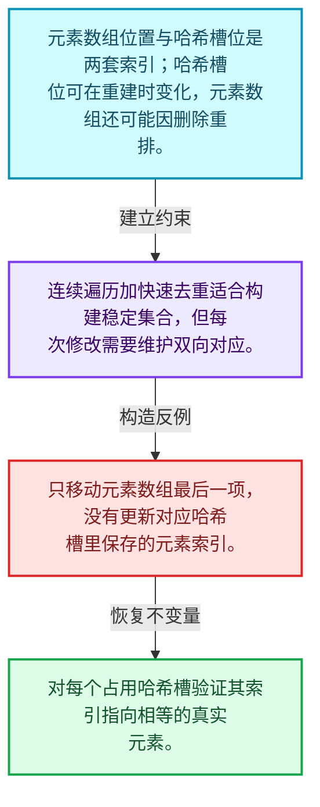
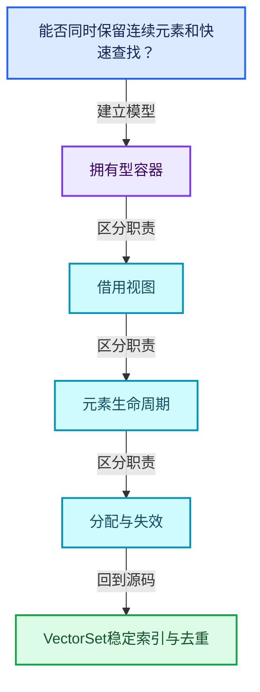
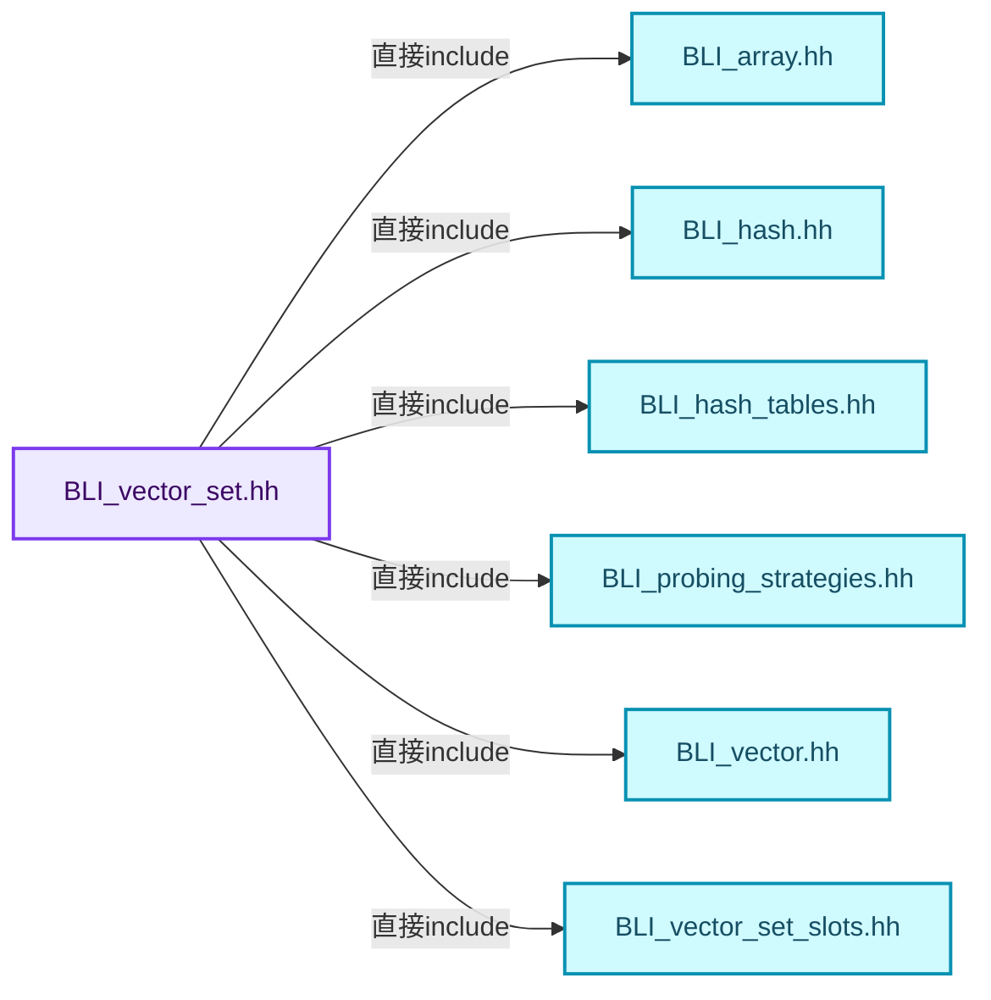
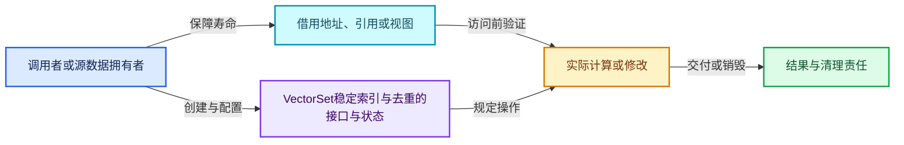
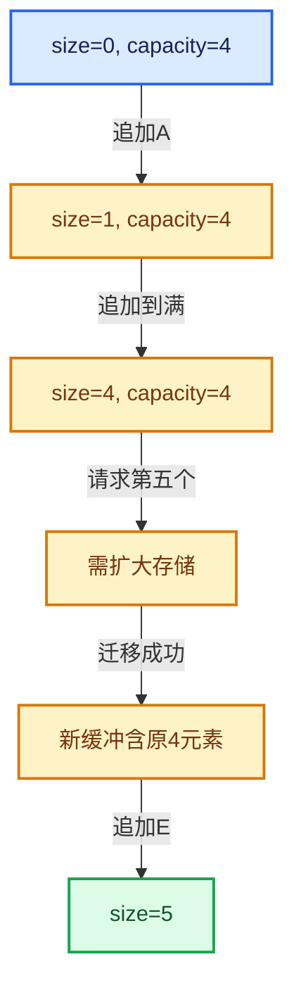

# 01-14 VectorSet稳定索引与去重

[方向导航](README.md) · [总目录](../README.md) · [覆盖索引](../%E6%BA%90%E7%A0%81%E7%89%88%E6%9C%AC%E4%B8%8E%E8%A6%86%E7%9B%96%E7%B4%A2%E5%BC%95.md)

> 阅读顺序：问题与数据模型 → 语法与类型 → 源码逐行 → 调用线索 → 历史与取舍 → 推演和练习。

- 基准 HEAD：`cbda6b96c26c0dee3c3b5cbb93960c4ac06a6b30`。
- 记录日期：2026-10-14。
- 教学示例状态：正文中的推演不是本机性能实测；已运行练习见验收报告。

## 一、从问题到设计

能否同时保留连续元素和快速查找？

VectorSet结合元素数组和哈希索引；哈希表位置不等于元素索引，重排与删除必须同时维护两套关系。

本篇把语法、数据语义和系统取舍连接起来。先证明对象存活，再讨论索引；先区分借用与拥有，再讨论复制移动。

### 本篇独立模型与设计推理

元素数组位置与哈希槽位是两套索引；哈希槽位可在重建时变化，元素数组还可能因删除重排。

设计取舍：连续遍历加快速去重适合构建稳定集合，但每次修改需要维护双向对应。

最小反例：只移动元素数组最后一项，没有更新对应哈希槽里保存的元素索引。

推导与处理：对每个占用哈希槽验证其索引指向相等的真实元素。



### 源码范围与相邻篇章

| 文件 | 本篇逐行范围 | 基准SHA-256 |
|---|---|---|
| [source/blender/blenlib/BLI_vector_set.hh](../../../../../source/blender/blenlib/BLI_vector_set.hh) | L1—L1168 | `23f310653e6b60206e2a5a10de032e83defa370492e03bbe2bb05f88075ed630` |

同一主讲文件可能分多篇覆盖；超出本篇范围的符号通过覆盖索引定位。空行与纯注释保留在源码摘录中，逐行表解释有效语句与语法边界；许可证头统一保留。

前篇：[Stack与栈接口](13-Stack%E4%B8%8E%E6%A0%88%E6%8E%A5%E5%8F%A3.md).

后篇：[StringRef字符串视图](15-StringRef%E5%AD%97%E7%AC%A6%E4%B8%B2%E8%A7%86%E5%9B%BE.md).

## 二、类型、数据与阅读地图



这是概念依赖图，边表示阅读关系，不声称是运行时调用顺序。

### 直接编译依赖



箭头只表示头文件包含关系；完整调用线索见后面的符号定位表。

## 三、关键词、语法与类型角色

### 模板 template

模板把类型或常量作为生成实现的参数。读声明时先列出类型参数、非类型参数和默认值，再看使用者实际实例化了什么。模板声明本身不意味着每种T都支持其全部成员。

具体检查：把T替换为int、string、只能移动的类型，分别检查每个被调用操作是否成立。

### 依赖名称 typename

typename既可引入类型模板参数，也可告诉编译器某个依赖名称是类型。它不创建运行时对象；解析期确认语法类别与实例化期检查具体类型是不同阶段。

具体检查：区分typename T::value_type和T::size()，前者标记类型，后者是表达式。

### 常量求值 constexpr

constexpr声明允许相应实体参与常量求值，但constexpr函数仍可以在运行时执行。是否常量求值由调用场景和表达式合法性共同决定。

具体检查：比较constexpr变量初始化和从运行时输入调用同一函数。

### 只读限定 const

const约束当前访问路径可做的修改。const指针、指向const的指针、const视图对象、const元素是不同位置的限定；其他别名可能仍可修改原对象。

具体检查：分别写T* const、const T*与const T* const，并画出不可修改的层次。

### 移动转换 std::move

std::move把表达式转换为可供移动重载选择的值类别，实际资源转移发生在被选中的构造或赋值中。对const对象move可能仍调用复制，对视图move也不会获得底层数据所有权。

具体检查：记录移动构造调用次数，不用变量名或std::move的出现次数替代测量。

### 完美转发 std::forward

std::forward在转发引用模板中恢复调用者原来的值类别。它依赖推导出的模板实参；无条件move会改变左值调用者的语义。

具体检查：对同一接口分别传入左值、临时对象和const左值，记录实际重载。

### 异常约定 noexcept

noexcept表达式可以依赖类型特征。违反不抛异常约定会终止程序；它不是自动捕获异常，也不是资源回滚代码。

具体检查：找出声明的条件与实际可能抛出的分配、构造操作是否一致。

### 异常边界 try与catch

try定义异常传播的局部边界。失败路径需要销毁已经成功构造的部分并释放相应存储；未构造的对象不能被析构。

具体检查：在第k次构造失败，列出已经存在的对象集合与待释放缓冲。

### 显式静态转换 static_cast

static_cast表达编译期允许的转换，不会自动验证运行时真实类型、指针寿命或索引边界。由void指针恢复T指针时，调用者仍须保证实际存储中确有合法T对象。

具体检查：标出转换前后的类型以及正确性依据来自哪里。

### 对齐 alignof

alignof得到类型要求的地址对齐。分配足够字节后仍需把地址对齐到相应边界，内嵌缓冲也一样。

具体检查：对齐a为2的幂时可推导向上取整，但仍要考虑溢出与边界。

### 对象表示 sizeof

sizeof给出对象表示大小，不是其引用的所有堆内存总量。sizeof视图很小并不说明底层数组很小。

具体检查：分别统计容器对象、容量字节和元素拥有的间接资源。

### 构造与new表达式

普通new可能分配并构造；placement new在给定地址构造，存储由其他机制提供。失败回滚应区分两类责任。

具体检查：追踪地址来自哪里、构造何时成功、由谁析构、由谁释放。

### 内部断言 assert

断言表达开发者预期成立的内部契约，发布构建可能关闭。它不能替代对不可信输入的完整错误处理，也不保证后续操作被运行时保护。

具体检查：对每条断言构造违反条件的输入，区分调用者错误与应向用户报告的错误。

### 编译期分支 if constexpr

条件在实例化时决定被保留的分支，这常用于不同类型的合法操作选择。它与运行时if有不同的实例化检查规则。

具体检查：找出每个分支依赖哪些类型特征，再使用满足与不满足条件的类型。

### 受控访问 friend

friend授予指定函数或类访问非公开成员的权限，并不意味着继承，也不自动扩展到友元的派生类。

具体检查：解释执行器为何需要访问包装器的内部映射，同时检查边界是否仍清楚。

### 类型别名 using

类型别名为已有类型建立名字，不创建运行期对象。它常把模板内部使用的类型统一暴露给泛型调用者。

具体检查：展开别名直到基础类型，区分类型别名和变量声明。

## 四、真实源码与逐行讲解

源码块保持原行内容，原始行号由小节标题及逐行表给出。表中的调用定位是静态阅读辅助；重载、模板实例化、宏展开和虚调用需结合完整声明，不能仅凭词法出现证明动态调用。

### BLI_vector_set.hh：L1—L49

<!-- source:source/blender/blenlib/BLI_vector_set.hh:1:49 -->

```cpp
/* SPDX-FileCopyrightText: 2023 Blender Authors
 *
 * SPDX-License-Identifier: GPL-2.0-or-later */

#pragma once

/** \file
 * \ingroup bli
 *
 * A `VectorSet<Key>` is an ordered container for elements of type `Key`. It has the same
 * interface as `Set` with the following extensions:
 * - The insertion order of keys is maintained as long as no elements are removed.
 *   - Once elements are removed, the order of keys is only maintained for the elements added
 *     _before_ any removed element.
 * - The keys are stored in a contiguous array.
 *
 * All core operations (add, remove and contains) can be done in O(1) amortized expected time.
 *
 * Using a VectorSet instead of a normal Set can be beneficial in any of the following
 * circumstances:
 * - The insertion order is important.
 * - Iteration over all keys has to be fast.
 * - The keys in the set are supposed to be passed to a function that does not have to know that
 *   the keys are stored in a set. With a VectorSet, one can get a Span containing all keys
 *   without additional copies.
 *
 * VectorSet is implemented using open addressing in a slot array with a power-of-two
 * size. Other than in Set, a slot does not contain the key though. Instead it only
 * contains an index into an array of keys that is stored separately.
 *
 * Some noteworthy information:
 * - Key must be a movable type.
 * - Pointers to keys might be invalidated, when the vector set is changed or moved.
 * - The hash function can be customized. See BLI_hash.hh for details.
 * - The probing strategy can be customized. See BLI_probing_strategies.hh for details.
 * - The slot type can be customized. See BLI_vector_set_slots.hh for details.
 * - The methods `add_new` and `remove_contained` should be used instead of `add` and `remove`
 *   whenever appropriate. Assumptions and intention are described better this way.
 * - Using a range-for loop over a vector set, is as efficient as iterating over an array (because
 *   it is the same thing).
 * - Lookups can be performed using types other than Key without conversion. For that use the
 *   methods ending with `_as`. The template parameters Hash and IsEqual have to support the other
 *   key type. This can greatly improve performance when the strings are used as keys.
 * - The default constructor is cheap.
 * - The `print_stats` method can be used to get information about the distribution of keys and
 *   memory usage.
 */

#include "BLI_array.hh"
```

| 原始行 | 语义、约束与检查 |
|---|---|
| L5 | 防止同一头文件在一个翻译单元中重复展开；不控制多个源文件之间的链接或对象寿命。 |
| L49 | 引入编译依赖 "BLI_array.hh"；这是声明可见性关系，不表示运行时一定调用该文件的所有接口。 |

### BLI_vector_set.hh：L50—L97

<!-- source:source/blender/blenlib/BLI_vector_set.hh:50:97 -->

```cpp
#include "BLI_hash.hh"
#include "BLI_hash_tables.hh"
#include "BLI_probing_strategies.hh"
#include "BLI_vector.hh"
#include "BLI_vector_set_slots.hh"

namespace blender {

template<
    /**
     * Type of the elements that are stored in this set. It has to be movable. Furthermore, the
     * hash and is-equal functions have to support it.
     */
    typename Key,
    /**
     * The number of values that can be stored in the container without a heap allocation.
     */
    int64_t InlineBufferCapacity = default_inline_buffer_capacity(sizeof(Key)),
    /**
     * The strategy used to deal with collisions. They are defined in BLI_probing_strategies.hh.
     */
    typename ProbingStrategy = DefaultProbingStrategy,
    /**
     * The hash function used to hash the keys. There is a default for many types. See BLI_hash.hh
     * for examples on how to define a custom hash function.
     */
    typename Hash = DefaultHash<Key>,
    /**
     * The equality operator used to compare keys. By default it will simply compare keys using the
     * `==` operator.
     */
    typename IsEqual = DefaultEquality<Key>,
    /**
     * This is what will actually be stored in the hash table array. At a minimum a slot has to be
     * able to hold an array index and information about whether the slot is empty, occupied or
     * removed. Using a non-standard slot type can improve performance for some types.
     * Also see BLI_vector_set_slots.hh.
     */
    typename Slot = typename DefaultVectorSetSlot<Key>::type,
    /**
     * The allocator used by this set. Should rarely be changed, except when you don't want that
     * MEM_* etc. is used internally.
     */
    typename Allocator = GuardedAllocator>
class VectorSet {
 public:
  using value_type = Key;
  using pointer = Key *;
```

| 原始行 | 语义、约束与检查 |
|---|---|
| L50 | 引入编译依赖 "BLI_hash.hh"；这是声明可见性关系，不表示运行时一定调用该文件的所有接口。 |
| L51 | 引入编译依赖 "BLI_hash_tables.hh"；这是声明可见性关系，不表示运行时一定调用该文件的所有接口。 |
| L52 | 引入编译依赖 "BLI_probing_strategies.hh"；这是声明可见性关系，不表示运行时一定调用该文件的所有接口。 |
| L53 | 引入编译依赖 "BLI_vector.hh"；这是声明可见性关系，不表示运行时一定调用该文件的所有接口。 |
| L54 | 引入编译依赖 "BLI_vector_set_slots.hh"；这是声明可见性关系，不表示运行时一定调用该文件的所有接口。 |
| L56 | 把后续声明放入 blender 命名空间，影响名称查找和符号归属，不创建运行时对象。 |
| L58 | 声明模板参数 `template<`。类型参数决定生成操作的类型，非类型参数可决定内嵌容量或编译期分支。 |
| L63 | 本行是连续声明或表达式的一部分：`typename Key,`。与本段前后行合读；逗号、括号和限定符决定它属于参数、初始化列表还是实际计算。 |
| L67 | 显式采用编译器生成的特殊成员行为：`int64_t InlineBufferCapacity = default_inline_buffer_capacity(sizeof(Key)),`。成员和基类的性质决定该操作是否可用、是否被删除及异常约定，不表示运行时给对象赋值为default。 |
| L71 | 把右侧 `DefaultProbingStrategy,` 用于初始化或更新左侧 `typename ProbingStrategy`。声明初始化与已有对象赋值应按上下文区分；有资源的类型会调用相应特殊成员。 |
| L76 | 把右侧 `DefaultHash<Key>,` 用于初始化或更新左侧 `typename Hash`。声明初始化与已有对象赋值应按上下文区分；有资源的类型会调用相应特殊成员。 |
| L81 | 把右侧 `DefaultEquality<Key>,` 用于初始化或更新左侧 `typename IsEqual`。声明初始化与已有对象赋值应按上下文区分；有资源的类型会调用相应特殊成员。 |
| L88 | 把右侧 `typename DefaultVectorSetSlot<Key>::type,` 用于初始化或更新左侧 `typename Slot`。声明初始化与已有对象赋值应按上下文区分；有资源的类型会调用相应特殊成员。 |
| L93 | 把右侧 `GuardedAllocator>` 用于初始化或更新左侧 `typename Allocator`。声明初始化与已有对象赋值应按上下文区分；有资源的类型会调用相应特殊成员。 |
| L94 | 声明或定义类型 `class VectorSet`。结合继承、访问权限和成员布局确认接口与拥有关系；前向声明本身没有完整对象布局。 |
| L95 | 切换成员访问权限为 public；它是编译期接口边界，不是线程同步或内存保护。 |
| L96 | 定义类型别名 `using value_type = Key`，为模板接口或内部实现统一命名；本行不分配该类型对象。 |
| L97 | 定义类型别名 `using pointer = Key *`，为模板接口或内部实现统一命名；本行不分配该类型对象。 |

### BLI_vector_set.hh：L98—L144

<!-- source:source/blender/blenlib/BLI_vector_set.hh:98:144 -->

```cpp
  using const_pointer = const Key *;
  using reference = Key &;
  using const_reference = const Key &;
  using iterator = Key *;
  using const_iterator = const Key *;
  using size_type = int64_t;

 private:
  /**
   * Slots are either empty, occupied or removed. The number of occupied slots can be computed by
   * subtracting the removed slots from the occupied-and-removed slots.
   */
  int64_t removed_slots_;
  int64_t occupied_and_removed_slots_;

  /**
   * The maximum number of slots that can be used (either occupied or removed) until the set has to
   * grow. This is the total number of slots times the max load factor.
   */
  int64_t usable_slots_;

  /**
   * The number of slots minus one. This is a bit mask that can be used to turn any integer into a
   * valid slot index efficiently.
   */
  uint64_t slot_mask_;

  /** This is called to hash incoming keys. */
  BLI_NO_UNIQUE_ADDRESS Hash hash_;

  /** This is called to check equality of two keys. */
  BLI_NO_UNIQUE_ADDRESS IsEqual is_equal_;

/** The max load factor is 1/2 = 50% by default. */
#define LOAD_FACTOR 1, 2
  static constexpr LoadFactor max_load_factor_ = LoadFactor(LOAD_FACTOR);
  using SlotArray = Array<Slot, LoadFactor::compute_total_slots(4, LOAD_FACTOR), Allocator>;
#undef LOAD_FACTOR

  /**
   * This is the array that contains the actual slots. There is always at least one empty slot and
   * the size of the array is a power of two.
   */
  SlotArray slots_;

  /** A buffer for #keys_ that will remain uninitialized until it is used. */
  BLI_NO_UNIQUE_ADDRESS TypedBuffer<Key, InlineBufferCapacity> inline_buffer_;
```

本段语义重点：

- `inline_buffer_`：容器对象内部的缓冲区，不能像堆缓冲那样直接交给另一个对象。
- `removed_slots_`：删除标记计数，影响重建判断及探测长度。
- `occupied_and_removed_slots_`：占用与删除状态总量，不能替代活元素数量。
- `usable_slots_`：受负载约束允许使用的槽位数，与物理总槽数不同。
- `slot_mask_`：槽位寻址掩码；其有效性依赖容量布局约定。

| 原始行 | 语义、约束与检查 |
|---|---|
| L98 | 定义类型别名 `using const_pointer = const Key *`，为模板接口或内部实现统一命名；本行不分配该类型对象。 |
| L99 | 定义类型别名 `using reference = Key &`，为模板接口或内部实现统一命名；本行不分配该类型对象。 |
| L100 | 定义类型别名 `using const_reference = const Key &`，为模板接口或内部实现统一命名；本行不分配该类型对象。 |
| L101 | 定义类型别名 `using iterator = Key *`，为模板接口或内部实现统一命名；本行不分配该类型对象。 |
| L102 | 定义类型别名 `using const_iterator = const Key *`，为模板接口或内部实现统一命名；本行不分配该类型对象。 |
| L103 | 定义类型别名 `using size_type = int64_t`，为模板接口或内部实现统一命名；本行不分配该类型对象。 |
| L105 | 切换成员访问权限为 private；它是编译期接口边界，不是线程同步或内存保护。 |
| L110 | 本行涉及 `removed_slots_`：删除标记计数，影响重建判断及探测长度。按此语义解读 `int64_t removed_slots_`，不要把地址、数量或状态混用。 |
| L111 | 本行涉及 `occupied_and_removed_slots_`：占用与删除状态总量，不能替代活元素数量。按此语义解读 `int64_t occupied_and_removed_slots_`，不要把地址、数量或状态混用。 |
| L117 | 本行涉及 `usable_slots_`：受负载约束允许使用的槽位数，与物理总槽数不同。按此语义解读 `int64_t usable_slots_`，不要把地址、数量或状态混用。 |
| L123 | 本行涉及 `slot_mask_`：槽位寻址掩码；其有效性依赖容量布局约定。按此语义解读 `uint64_t slot_mask_`，不要把地址、数量或状态混用。 |
| L126 | 声明成员、局部对象或完成语句 `BLI_NO_UNIQUE_ADDRESS Hash hash_`。若为指针或引用，它本身不说明拥有；若为值对象，其构造析构由所在作用域或外层对象管理。 |
| L129 | 声明成员、局部对象或完成语句 `BLI_NO_UNIQUE_ADDRESS IsEqual is_equal_`。若为指针或引用，它本身不说明拥有；若为值对象，其构造析构由所在作用域或外层对象管理。 |
| L132 | 预处理阶段处理 #define LOAD_FACTOR 1, 2。它决定哪些代码进入编译，不是运行时分支；阅读行为时必须结合实际构建宏。 |
| L133 | 把右侧 `LoadFactor(LOAD_FACTOR)` 用于初始化或更新左侧 `static constexpr LoadFactor max_load_factor_`。声明初始化与已有对象赋值应按上下文区分；有资源的类型会调用相应特殊成员。 |
| L134 | 定义类型别名 `using SlotArray = Array<Slot, LoadFactor::compute_total_slots(4, LOAD_FACTOR), Allocator>`，为模板接口或内部实现统一命名；本行不分配该类型对象。 |
| L135 | 预处理阶段处理 #undef LOAD_FACTOR。它决定哪些代码进入编译，不是运行时分支；阅读行为时必须结合实际构建宏。 |
| L141 | 本行涉及 `slots_`：哈希槽数组，其中对象存活与槽位状态必须一致。按此语义解读 `SlotArray slots_`，不要把地址、数量或状态混用。 |
| L144 | 本行涉及 `inline_buffer_`：容器对象内部的缓冲区，不能像堆缓冲那样直接交给另一个对象。按此语义解读 `BLI_NO_UNIQUE_ADDRESS TypedBuffer<Key, InlineBufferCapacity> inline_buffer_`，不要把地址、数量或状态混用。 |

### BLI_vector_set.hh：L145—L192

<!-- source:source/blender/blenlib/BLI_vector_set.hh:145:192 -->

```cpp

  /**
   * Pointer to an array that contains all keys. The keys are sorted by insertion order as long as
   * no keys are removed. The first set->size() elements in this array are initialized. The
   * capacity of the array is usable_slots_.
   */
  Key *keys_;

  /** Iterate over a slot index sequence for a given hash. */
#define VECTOR_SET_SLOT_PROBING_BEGIN(HASH, R_SLOT) \
  SLOT_PROBING_BEGIN (ProbingStrategy, HASH, slot_mask_, SLOT_INDEX) \
    auto &R_SLOT = slots_[SLOT_INDEX];
#define VECTOR_SET_SLOT_PROBING_END() SLOT_PROBING_END()

  /**
   * Be a friend with other template instantiations. This is necessary to implement some memory
   * management logic.
   */
  template<typename Other,
           int64_t OtherInlineBufferCapacity,
           typename OtherProbingStrategy,
           typename OtherHash,
           typename OtherIsEqual,
           typename OtherSlot,
           typename OtherAllocator>
  friend class VectorSet;

 public:
  /**
   * Initialize an empty vector set. This is a cheap operation and won't do an allocation. This is
   * necessary to avoid a high cost when no elements are added at all. An optimized grow operation
   * is performed on the first insertion.
   */
  VectorSet(Allocator allocator = {}) noexcept
      : removed_slots_(0),
        occupied_and_removed_slots_(0),
        usable_slots_(0),
        slot_mask_(0),
        slots_(1, allocator)
  {
    keys_ = inline_buffer_;
  }

  VectorSet(Hash hash, IsEqual is_equal) : VectorSet()
  {
    hash_ = std::move(hash);
    is_equal_ = std::move(is_equal);
  }
```

本段语义重点：

- `inline_buffer_`：容器对象内部的缓冲区，不能像堆缓冲那样直接交给另一个对象。
- `removed_slots_`：删除标记计数，影响重建判断及探测长度。
- `occupied_and_removed_slots_`：占用与删除状态总量，不能替代活元素数量。
- `usable_slots_`：受负载约束允许使用的槽位数，与物理总槽数不同。
- `slot_mask_`：槽位寻址掩码；其有效性依赖容量布局约定。

| 原始行 | 语义、约束与检查 |
|---|---|
| L151 | 声明成员、局部对象或完成语句 `Key *keys_`。若为指针或引用，它本身不说明拥有；若为值对象，其构造析构由所在作用域或外层对象管理。 |
| L154 | 预处理阶段处理 #define VECTOR_SET_SLOT_PROBING_BEGIN(HASH, R_SLOT) \。它决定哪些代码进入编译，不是运行时分支；阅读行为时必须结合实际构建宏。 |
| L155 | 本行涉及 `slot_mask_`：槽位寻址掩码；其有效性依赖容量布局约定。按此语义解读 `SLOT_PROBING_BEGIN (ProbingStrategy, HASH, slot_mask_, SLOT_INDEX) \`，不要把地址、数量或状态混用。 |
| L156 | 建立或更新 `slots_`：哈希槽数组，其中对象存活与槽位状态必须一致。本行的具体值关系为 `auto &R_SLOT = slots_[SLOT_INDEX]`；对照更新前后相应范围或状态是否一致。 |
| L157 | 预处理阶段处理 #define VECTOR_SET_SLOT_PROBING_END() SLOT_PROBING_END()。它决定哪些代码进入编译，不是运行时分支；阅读行为时必须结合实际构建宏。 |
| L163 | 声明模板参数 `template<typename Other,`。类型参数决定生成操作的类型，非类型参数可决定内嵌容量或编译期分支。 |
| L164 | 本行是连续声明或表达式的一部分：`int64_t OtherInlineBufferCapacity,`。与本段前后行合读；逗号、括号和限定符决定它属于参数、初始化列表还是实际计算。 |
| L165 | 本行是连续声明或表达式的一部分：`typename OtherProbingStrategy,`。与本段前后行合读；逗号、括号和限定符决定它属于参数、初始化列表还是实际计算。 |
| L166 | 本行是连续声明或表达式的一部分：`typename OtherHash,`。与本段前后行合读；逗号、括号和限定符决定它属于参数、初始化列表还是实际计算。 |
| L167 | 本行是连续声明或表达式的一部分：`typename OtherIsEqual,`。与本段前后行合读；逗号、括号和限定符决定它属于参数、初始化列表还是实际计算。 |
| L168 | 本行是连续声明或表达式的一部分：`typename OtherSlot,`。与本段前后行合读；逗号、括号和限定符决定它属于参数、初始化列表还是实际计算。 |
| L169 | 本行是连续声明或表达式的一部分：`typename OtherAllocator>`。与本段前后行合读；逗号、括号和限定符决定它属于参数、初始化列表还是实际计算。 |
| L170 | 声明成员、局部对象或完成语句 `friend class VectorSet`。若为指针或引用，它本身不说明拥有；若为值对象，其构造析构由所在作用域或外层对象管理。 |
| L172 | 切换成员访问权限为 public；它是编译期接口边界，不是线程同步或内存保护。 |
| L178 | 把右侧 `{}) noexcept` 用于初始化或更新左侧 `VectorSet(Allocator allocator`。声明初始化与已有对象赋值应按上下文区分；有资源的类型会调用相应特殊成员。 |
| L179 | 本行涉及 `removed_slots_`：删除标记计数，影响重建判断及探测长度。按此语义解读 `: removed_slots_(0),`，不要把地址、数量或状态混用。 |
| L180 | 本行涉及 `occupied_and_removed_slots_`：占用与删除状态总量，不能替代活元素数量。按此语义解读 `occupied_and_removed_slots_(0),`，不要把地址、数量或状态混用。 |
| L181 | 本行涉及 `usable_slots_`：受负载约束允许使用的槽位数，与物理总槽数不同。按此语义解读 `usable_slots_(0),`，不要把地址、数量或状态混用。 |
| L182 | 本行涉及 `slot_mask_`：槽位寻址掩码；其有效性依赖容量布局约定。按此语义解读 `slot_mask_(0),`，不要把地址、数量或状态混用。 |
| L183 | 本行涉及 `slots_`：哈希槽数组，其中对象存活与槽位状态必须一致。按此语义解读 `slots_(1, allocator)`，不要把地址、数量或状态混用。 |
| L184 | 连接上一行的声明或控制结构与其语句块；后续行在这个作用域中执行或声明。 |
| L185 | 建立或更新 `inline_buffer_`：容器对象内部的缓冲区，不能像堆缓冲那样直接交给另一个对象。本行的具体值关系为 `keys_ = inline_buffer_`；对照更新前后相应范围或状态是否一致。 |
| L186 | 结束当前语法单元。局部自动对象在离开其作用域时按规则销毁；这不等于所有被引用的外部数据也被释放。 |
| L188 | 出现调用或函数声明 `VectorSet`，对应表达式为 `VectorSet(Hash hash, IsEqual is_equal) : VectorSet()`。参数求值、返回类型与重载需结合前后完整语句；静态文本引用不能证明动态目标。 |
| L189 | 连接上一行的声明或控制结构与其语句块；后续行在这个作用域中执行或声明。 |
| L190 | 把右侧 `std::move(hash)` 用于初始化或更新左侧 `hash_`。声明初始化与已有对象赋值应按上下文区分；有资源的类型会调用相应特殊成员。 |
| L191 | 把右侧 `std::move(is_equal)` 用于初始化或更新左侧 `is_equal_`。声明初始化与已有对象赋值应按上下文区分；有资源的类型会调用相应特殊成员。 |
| L192 | 结束当前语法单元。局部自动对象在离开其作用域时按规则销毁；这不等于所有被引用的外部数据也被释放。 |

### BLI_vector_set.hh：L193—L242

<!-- source:source/blender/blenlib/BLI_vector_set.hh:193:242 -->

```cpp

  VectorSet(NoExceptConstructor, Allocator allocator = {}) : VectorSet(allocator) {}

  VectorSet(Span<Key> keys, Allocator allocator = {}) : VectorSet(NoExceptConstructor(), allocator)
  {
    this->add_multiple(keys);
  }

  /**
   * Construct a vector set that contains the given keys. Duplicates will be removed automatically.
   */
  VectorSet(const std::initializer_list<Key> &keys, Allocator allocator = {})
      : VectorSet(Span(keys), allocator)
  {
  }

  ~VectorSet()
  {
    destruct_n(keys_, this->size());
    if (keys_ != inline_buffer_) {
      this->deallocate_keys_array(keys_);
    }
  }

  VectorSet(const VectorSet &other) : slots_(other.slots_)
  {
    if (other.size() <= InlineBufferCapacity) {
      usable_slots_ = other.size();
      keys_ = inline_buffer_;
    }
    else {
      keys_ = this->allocate_keys_array(other.usable_slots_);
      usable_slots_ = other.usable_slots_;
    }
    try {
      uninitialized_copy_n(other.keys_, other.size(), keys_);
    }
    catch (...) {
      if (keys_ != inline_buffer_) {
        this->deallocate_keys_array(keys_);
      }
      throw;
    }

    removed_slots_ = other.removed_slots_;
    occupied_and_removed_slots_ = other.occupied_and_removed_slots_;
    slot_mask_ = other.slot_mask_;
    hash_ = other.hash_;
    is_equal_ = other.is_equal_;
  }
```

本段语义重点：

- `uninitialized_copy_n`：把源值复制构造到未初始化的目标区间；目标已有对象时不能直接用此操作替代赋值。
- `destruct_n`：对已构造的元素区间执行析构；计数必须对应真实存活对象，释放原始内存是另一操作。
- `inline_buffer_`：容器对象内部的缓冲区，不能像堆缓冲那样直接交给另一个对象。
- `removed_slots_`：删除标记计数，影响重建判断及探测长度。
- `occupied_and_removed_slots_`：占用与删除状态总量，不能替代活元素数量。

| 原始行 | 语义、约束与检查 |
|---|---|
| L194 | 把右侧 `{}) : VectorSet(allocator) {}` 用于初始化或更新左侧 `VectorSet(NoExceptConstructor, Allocator allocator`。声明初始化与已有对象赋值应按上下文区分；有资源的类型会调用相应特殊成员。 |
| L196 | 把右侧 `{}) : VectorSet(NoExceptConstructor(), allocator)` 用于初始化或更新左侧 `VectorSet(Span<Key> keys, Allocator allocator`。声明初始化与已有对象赋值应按上下文区分；有资源的类型会调用相应特殊成员。 |
| L197 | 连接上一行的声明或控制结构与其语句块；后续行在这个作用域中执行或声明。 |
| L198 | 出现调用或函数声明 `add_multiple`，对应表达式为 `this->add_multiple(keys);`。参数求值、返回类型与重载需结合前后完整语句；静态文本引用不能证明动态目标。 |
| L199 | 结束当前语法单元。局部自动对象在离开其作用域时按规则销毁；这不等于所有被引用的外部数据也被释放。 |
| L204 | 把右侧 `{})` 用于初始化或更新左侧 `VectorSet(const std::initializer_list<Key> &keys, Allocator allocator`。声明初始化与已有对象赋值应按上下文区分；有资源的类型会调用相应特殊成员。 |
| L205 | 出现调用或函数声明 `VectorSet`，对应表达式为 `: VectorSet(Span(keys), allocator)`。参数求值、返回类型与重载需结合前后完整语句；静态文本引用不能证明动态目标。 |
| L206 | 连接上一行的声明或控制结构与其语句块；后续行在这个作用域中执行或声明。 |
| L207 | 结束当前语法单元。局部自动对象在离开其作用域时按规则销毁；这不等于所有被引用的外部数据也被释放。 |
| L209 | 涉及析构接口或显式析构：`~VectorSet()`。检查目标对象已成功构造，且资源不会在另一条清理路径再次销毁。 |
| L210 | 连接上一行的声明或控制结构与其语句块；后续行在这个作用域中执行或声明。 |
| L211 | 本行使用 `destruct_n`：对已构造的元素区间执行析构；计数必须对应真实存活对象，释放原始内存是另一操作。 |
| L212 | 判断 `keys_ != inline_buffer_`，成立时进入本分支，否则继续后续路径。 |
| L213 | 出现调用或函数声明 `deallocate_keys_array`，对应表达式为 `this->deallocate_keys_array(keys_);`。参数求值、返回类型与重载需结合前后完整语句；静态文本引用不能证明动态目标。 |
| L214 | 结束当前语法单元。局部自动对象在离开其作用域时按规则销毁；这不等于所有被引用的外部数据也被释放。 |
| L215 | 结束当前语法单元。局部自动对象在离开其作用域时按规则销毁；这不等于所有被引用的外部数据也被释放。 |
| L217 | 本行涉及 `slots_`：哈希槽数组，其中对象存活与槽位状态必须一致。按此语义解读 `VectorSet(const VectorSet &other) : slots_(other.slots_)`，不要把地址、数量或状态混用。 |
| L218 | 连接上一行的声明或控制结构与其语句块；后续行在这个作用域中执行或声明。 |
| L219 | 判断 `other.size() <= InlineBufferCapacity`，成立时进入本分支，否则继续后续路径。该边界影响可访问元素或可用容量，两者要按各变量的定义区分。 |
| L220 | 建立或更新 `usable_slots_`：受负载约束允许使用的槽位数，与物理总槽数不同。本行的具体值关系为 `usable_slots_ = other.size()`；对照更新前后相应范围或状态是否一致。 |
| L221 | 建立或更新 `inline_buffer_`：容器对象内部的缓冲区，不能像堆缓冲那样直接交给另一个对象。本行的具体值关系为 `keys_ = inline_buffer_`；对照更新前后相应范围或状态是否一致。 |
| L222 | 结束当前语法单元。局部自动对象在离开其作用域时按规则销毁；这不等于所有被引用的外部数据也被释放。 |
| L223 | 处理前一条件不成立的互补路径。比较两条路径最后是否恢复同一不变量，以及是否产生不同的资源责任。 |
| L224 | 建立或更新 `usable_slots_`：受负载约束允许使用的槽位数，与物理总槽数不同。本行的具体值关系为 `keys_ = this->allocate_keys_array(other.usable_slots_)`；对照更新前后相应范围或状态是否一致。 |
| L225 | 建立或更新 `usable_slots_`：受负载约束允许使用的槽位数，与物理总槽数不同。本行的具体值关系为 `usable_slots_ = other.usable_slots_`；对照更新前后相应范围或状态是否一致。 |
| L226 | 结束当前语法单元。局部自动对象在离开其作用域时按规则销毁；这不等于所有被引用的外部数据也被释放。 |
| L227 | 开始可能抛异常的操作区间；下面catch负责局部回滚，需精确区分已经构造和尚未构造对象。 |
| L228 | 本行使用 `uninitialized_copy_n`：把源值复制构造到未初始化的目标区间；目标已有对象时不能直接用此操作替代赋值。 |
| L229 | 结束当前语法单元。局部自动对象在离开其作用域时按规则销毁；这不等于所有被引用的外部数据也被释放。 |
| L230 | 进入异常清理路径；随后应释放本路径新取得的资源，同时遵守源对象已经发生的状态变化。 |
| L231 | 判断 `keys_ != inline_buffer_`，成立时进入本分支，否则继续后续路径。 |
| L232 | 出现调用或函数声明 `deallocate_keys_array`，对应表达式为 `this->deallocate_keys_array(keys_);`。参数求值、返回类型与重载需结合前后完整语句；静态文本引用不能证明动态目标。 |
| L233 | 结束当前语法单元。局部自动对象在离开其作用域时按规则销毁；这不等于所有被引用的外部数据也被释放。 |
| L234 | 继续传播异常或抛出新异常；在执行前必须完成本层负责的资源清理。 |
| L235 | 结束当前语法单元。局部自动对象在离开其作用域时按规则销毁；这不等于所有被引用的外部数据也被释放。 |
| L237 | 建立或更新 `removed_slots_`：删除标记计数，影响重建判断及探测长度。本行的具体值关系为 `removed_slots_ = other.removed_slots_`；对照更新前后相应范围或状态是否一致。 |
| L238 | 建立或更新 `occupied_and_removed_slots_`：占用与删除状态总量，不能替代活元素数量。本行的具体值关系为 `occupied_and_removed_slots_ = other.occupied_and_removed_slots_`；对照更新前后相应范围或状态是否一致。 |
| L239 | 建立或更新 `slot_mask_`：槽位寻址掩码；其有效性依赖容量布局约定。本行的具体值关系为 `slot_mask_ = other.slot_mask_`；对照更新前后相应范围或状态是否一致。 |
| L240 | 把右侧 `other.hash_` 用于初始化或更新左侧 `hash_`。声明初始化与已有对象赋值应按上下文区分；有资源的类型会调用相应特殊成员。 |
| L241 | 把右侧 `other.is_equal_` 用于初始化或更新左侧 `is_equal_`。声明初始化与已有对象赋值应按上下文区分；有资源的类型会调用相应特殊成员。 |
| L242 | 结束当前语法单元。局部自动对象在离开其作用域时按规则销毁；这不等于所有被引用的外部数据也被释放。 |

### BLI_vector_set.hh：L243—L288

<!-- source:source/blender/blenlib/BLI_vector_set.hh:243:288 -->

```cpp

  template<int64_t OtherInlineBufferCapacity>
  VectorSet(
      VectorSet<Key, OtherInlineBufferCapacity, ProbingStrategy, Hash, IsEqual, Slot, Allocator>
          &&other) noexcept
      : removed_slots_(other.removed_slots_),
        occupied_and_removed_slots_(other.occupied_and_removed_slots_),
        slot_mask_(other.slot_mask_),
        slots_(std::move(other.slots_))
  {
    if (other.is_inline()) {
      const int64_t size = other.size();
      usable_slots_ = size;

      constexpr bool other_is_same_type = std::is_same_v<VectorSet, std::decay_t<decltype(other)>>;
      constexpr size_t max_full_copy_size = 32;
      if constexpr (other_is_same_type && std::is_trivial_v<Key> &&
                    sizeof(inline_buffer_) <= max_full_copy_size)
      {
        /* Optimize by copying the full inline buffer. Similar to #Vector move constructor. */
        keys_ = inline_buffer_;
        if (size > 0) {
          memcpy(inline_buffer_, other.inline_buffer_, sizeof(inline_buffer_));
        }
      }
      else {
        if (OtherInlineBufferCapacity <= InlineBufferCapacity || size <= InlineBufferCapacity) {
          keys_ = inline_buffer_;
        }
        else {
          keys_ = this->allocate_keys_array(size);
        }
        uninitialized_relocate_n(other.keys_, size, keys_);
      }
    }
    else {
      keys_ = other.keys_;
      usable_slots_ = other.usable_slots_;
    }
    other.removed_slots_ = 0;
    other.occupied_and_removed_slots_ = 0;
    other.usable_slots_ = 0;
    other.slot_mask_ = 0;
    other.slots_ = SlotArray(1);
    other.keys_ = other.inline_buffer_;
  }
```

本段语义重点：

- `uninitialized_relocate_n`：在目标原始存储建立n个对象，并结束源对象寿命；与仅移动构造不同，后续不能再次把源当作存活元素销毁。
- `memcpy`：按字节复制表示；必须由类型性质和生命周期规则证明可用，不能泛化到任意拥有资源对象。
- `inline_buffer_`：容器对象内部的缓冲区，不能像堆缓冲那样直接交给另一个对象。
- `removed_slots_`：删除标记计数，影响重建判断及探测长度。
- `occupied_and_removed_slots_`：占用与删除状态总量，不能替代活元素数量。

| 原始行 | 语义、约束与检查 |
|---|---|
| L244 | 声明模板参数 `template<int64_t OtherInlineBufferCapacity>`。类型参数决定生成操作的类型，非类型参数可决定内嵌容量或编译期分支。 |
| L245 | 出现调用或函数声明 `VectorSet`，对应表达式为 `VectorSet(`。参数求值、返回类型与重载需结合前后完整语句；静态文本引用不能证明动态目标。 |
| L246 | 本行是连续声明或表达式的一部分：`VectorSet<Key, OtherInlineBufferCapacity, ProbingStrategy, Hash, IsEqual, Slot, Allocator>`。与本段前后行合读；逗号、括号和限定符决定它属于参数、初始化列表还是实际计算。 |
| L247 | 本行是连续声明或表达式的一部分：`&&other) noexcept`。与本段前后行合读；逗号、括号和限定符决定它属于参数、初始化列表还是实际计算。 |
| L248 | 本行涉及 `removed_slots_`：删除标记计数，影响重建判断及探测长度。按此语义解读 `: removed_slots_(other.removed_slots_),`，不要把地址、数量或状态混用。 |
| L249 | 本行涉及 `occupied_and_removed_slots_`：占用与删除状态总量，不能替代活元素数量。按此语义解读 `occupied_and_removed_slots_(other.occupied_and_removed_slots_),`，不要把地址、数量或状态混用。 |
| L250 | 本行涉及 `slot_mask_`：槽位寻址掩码；其有效性依赖容量布局约定。按此语义解读 `slot_mask_(other.slot_mask_),`，不要把地址、数量或状态混用。 |
| L251 | 本行涉及 `slots_`：哈希槽数组，其中对象存活与槽位状态必须一致。按此语义解读 `slots_(std::move(other.slots_))`，不要把地址、数量或状态混用。 |
| L252 | 连接上一行的声明或控制结构与其语句块；后续行在这个作用域中执行或声明。 |
| L253 | 判断 `other.is_inline()`，成立时进入本分支，否则继续后续路径。 |
| L254 | 把右侧 `other.size()` 用于初始化或更新左侧 `const int64_t size`。声明初始化与已有对象赋值应按上下文区分；有资源的类型会调用相应特殊成员。 |
| L255 | 建立或更新 `usable_slots_`：受负载约束允许使用的槽位数，与物理总槽数不同。本行的具体值关系为 `usable_slots_ = size`；对照更新前后相应范围或状态是否一致。 |
| L257 | 把右侧 `std::is_same_v<VectorSet, std::decay_t<decltype(other)>>` 用于初始化或更新左侧 `constexpr bool other_is_same_type`。声明初始化与已有对象赋值应按上下文区分；有资源的类型会调用相应特殊成员。 |
| L258 | 把右侧 `32` 用于初始化或更新左侧 `constexpr size_t max_full_copy_size`。声明初始化与已有对象赋值应按上下文区分；有资源的类型会调用相应特殊成员。 |
| L259 | 编译期条件分支 `if constexpr (other_is_same_type && std::is_trivial_v<Key> &&`。按实例化类型选择相应实现；被舍弃分支和运行期if具有不同检查规则，不能当作运行时输入验证。 |
| L260 | 本行涉及 `inline_buffer_`：容器对象内部的缓冲区，不能像堆缓冲那样直接交给另一个对象。按此语义解读 `sizeof(inline_buffer_) <= max_full_copy_size)`，不要把地址、数量或状态混用。 |
| L261 | 连接上一行的声明或控制结构与其语句块；后续行在这个作用域中执行或声明。 |
| L263 | 建立或更新 `inline_buffer_`：容器对象内部的缓冲区，不能像堆缓冲那样直接交给另一个对象。本行的具体值关系为 `keys_ = inline_buffer_`；对照更新前后相应范围或状态是否一致。 |
| L264 | 判断 `size > 0`，成立时进入本分支，否则继续后续路径。该边界影响可访问元素或可用容量，两者要按各变量的定义区分。 |
| L265 | 本行使用 `memcpy`：按字节复制表示；必须由类型性质和生命周期规则证明可用，不能泛化到任意拥有资源对象。 |
| L266 | 结束当前语法单元。局部自动对象在离开其作用域时按规则销毁；这不等于所有被引用的外部数据也被释放。 |
| L267 | 结束当前语法单元。局部自动对象在离开其作用域时按规则销毁；这不等于所有被引用的外部数据也被释放。 |
| L268 | 处理前一条件不成立的互补路径。比较两条路径最后是否恢复同一不变量，以及是否产生不同的资源责任。 |
| L269 | 判断 `OtherInlineBufferCapacity <= InlineBufferCapacity &#124;&#124; size <= InlineBufferCapacity`，成立时进入本分支，否则继续后续路径。该边界影响可访问元素或可用容量，两者要按各变量的定义区分。 |
| L270 | 建立或更新 `inline_buffer_`：容器对象内部的缓冲区，不能像堆缓冲那样直接交给另一个对象。本行的具体值关系为 `keys_ = inline_buffer_`；对照更新前后相应范围或状态是否一致。 |
| L271 | 结束当前语法单元。局部自动对象在离开其作用域时按规则销毁；这不等于所有被引用的外部数据也被释放。 |
| L272 | 处理前一条件不成立的互补路径。比较两条路径最后是否恢复同一不变量，以及是否产生不同的资源责任。 |
| L273 | 把右侧 `this->allocate_keys_array(size)` 用于初始化或更新左侧 `keys_`。声明初始化与已有对象赋值应按上下文区分；有资源的类型会调用相应特殊成员。 |
| L274 | 结束当前语法单元。局部自动对象在离开其作用域时按规则销毁；这不等于所有被引用的外部数据也被释放。 |
| L275 | 本行使用 `uninitialized_relocate_n`：在目标原始存储建立n个对象，并结束源对象寿命；与仅移动构造不同，后续不能再次把源当作存活元素销毁。 |
| L276 | 结束当前语法单元。局部自动对象在离开其作用域时按规则销毁；这不等于所有被引用的外部数据也被释放。 |
| L277 | 结束当前语法单元。局部自动对象在离开其作用域时按规则销毁；这不等于所有被引用的外部数据也被释放。 |
| L278 | 处理前一条件不成立的互补路径。比较两条路径最后是否恢复同一不变量，以及是否产生不同的资源责任。 |
| L279 | 把右侧 `other.keys_` 用于初始化或更新左侧 `keys_`。声明初始化与已有对象赋值应按上下文区分；有资源的类型会调用相应特殊成员。 |
| L280 | 建立或更新 `usable_slots_`：受负载约束允许使用的槽位数，与物理总槽数不同。本行的具体值关系为 `usable_slots_ = other.usable_slots_`；对照更新前后相应范围或状态是否一致。 |
| L281 | 结束当前语法单元。局部自动对象在离开其作用域时按规则销毁；这不等于所有被引用的外部数据也被释放。 |
| L282 | 建立或更新 `removed_slots_`：删除标记计数，影响重建判断及探测长度。本行的具体值关系为 `other.removed_slots_ = 0`；对照更新前后相应范围或状态是否一致。 |
| L283 | 建立或更新 `occupied_and_removed_slots_`：占用与删除状态总量，不能替代活元素数量。本行的具体值关系为 `other.occupied_and_removed_slots_ = 0`；对照更新前后相应范围或状态是否一致。 |
| L284 | 建立或更新 `usable_slots_`：受负载约束允许使用的槽位数，与物理总槽数不同。本行的具体值关系为 `other.usable_slots_ = 0`；对照更新前后相应范围或状态是否一致。 |
| L285 | 建立或更新 `slot_mask_`：槽位寻址掩码；其有效性依赖容量布局约定。本行的具体值关系为 `other.slot_mask_ = 0`；对照更新前后相应范围或状态是否一致。 |
| L286 | 建立或更新 `slots_`：哈希槽数组，其中对象存活与槽位状态必须一致。本行的具体值关系为 `other.slots_ = SlotArray(1)`；对照更新前后相应范围或状态是否一致。 |
| L287 | 建立或更新 `inline_buffer_`：容器对象内部的缓冲区，不能像堆缓冲那样直接交给另一个对象。本行的具体值关系为 `other.keys_ = other.inline_buffer_`；对照更新前后相应范围或状态是否一致。 |
| L288 | 结束当前语法单元。局部自动对象在离开其作用域时按规则销毁；这不等于所有被引用的外部数据也被释放。 |

### BLI_vector_set.hh：L289—L339

<!-- source:source/blender/blenlib/BLI_vector_set.hh:289:339 -->

```cpp

  VectorSet &operator=(const VectorSet &other)
  {
    return copy_assign_container(*this, other);
  }

  VectorSet &operator=(VectorSet &&other)
  {
    return move_assign_container(*this, std::move(other));
  }

  /**
   * Get the key stored at the given position in the vector.
   */
  const Key &operator[](const int64_t index) const
  {
    BLI_assert(index >= 0);
    BLI_assert(index <= this->size());
    return keys_[index];
  }

  operator Span<Key>() const
  {
    return Span<Key>(keys_, this->size());
  }

  friend bool operator==(const VectorSet &a, const VectorSet &b)
  {
    return a.as_span() == b.as_span();
  }

  /**
   * Get a Span referencing the keys vector. The referenced memory buffer is only valid as
   * long as the vector set is not changed.
   *
   * The keys must not be changed, because this would change their hash value.
   */
  Span<Key> as_span() const
  {
    return *this;
  }

  /**
   * Add a new key to the vector set. This invokes undefined behavior when the key is in the set
   * already. When you know for certain that a key is not in the set yet, use this method for
   * better performance. This also expresses the intent better.
   */
  void add_new(const Key &key)
  {
    this->add_new__impl(key, hash_(key));
  }
```

| 原始行 | 语义、约束与检查 |
|---|---|
| L290 | 运算符重载声明、定义或显式调用：`VectorSet &operator=(const VectorSet &other)`。结合参数和返回类型判断是赋值、索引、比较还是转换；operator=声明中的等号不是在给名为operator的变量赋值。 |
| L291 | 连接上一行的声明或控制结构与其语句块；后续行在这个作用域中执行或声明。 |
| L292 | 返回表达式 `copy_assign_container(*this, other)`。 |
| L293 | 结束当前语法单元。局部自动对象在离开其作用域时按规则销毁；这不等于所有被引用的外部数据也被释放。 |
| L295 | 运算符重载声明、定义或显式调用：`VectorSet &operator=(VectorSet &&other)`。结合参数和返回类型判断是赋值、索引、比较还是转换；operator=声明中的等号不是在给名为operator的变量赋值。 |
| L296 | 连接上一行的声明或控制结构与其语句块；后续行在这个作用域中执行或声明。 |
| L297 | 返回表达式 `move_assign_container(*this, std::move(other))`。 |
| L298 | 结束当前语法单元。局部自动对象在离开其作用域时按规则销毁；这不等于所有被引用的外部数据也被释放。 |
| L303 | 运算符重载声明、定义或显式调用：`const Key &operator[](const int64_t index) const`。结合参数和返回类型判断是赋值、索引、比较还是转换；operator=声明中的等号不是在给名为operator的变量赋值。 |
| L304 | 连接上一行的声明或控制结构与其语句块；后续行在这个作用域中执行或声明。 |
| L305 | 断言约束 `BLI_assert(index >= 0);`。条件是后续访问的内部前置条件；发布构建可能不执行，不能把断言当作输入修复。 |
| L306 | 断言约束 `BLI_assert(index <= this->size());`。条件是后续访问的内部前置条件；发布构建可能不执行，不能把断言当作输入修复。 |
| L307 | 返回表达式 `keys_[index]`。 |
| L308 | 结束当前语法单元。局部自动对象在离开其作用域时按规则销毁；这不等于所有被引用的外部数据也被释放。 |
| L310 | 运算符重载声明、定义或显式调用：`operator Span<Key>() const`。结合参数和返回类型判断是赋值、索引、比较还是转换；operator=声明中的等号不是在给名为operator的变量赋值。 |
| L311 | 连接上一行的声明或控制结构与其语句块；后续行在这个作用域中执行或声明。 |
| L312 | 返回表达式 `Span<Key>(keys_, this->size())`。 |
| L313 | 结束当前语法单元。局部自动对象在离开其作用域时按规则销毁；这不等于所有被引用的外部数据也被释放。 |
| L315 | 运算符重载声明、定义或显式调用：`friend bool operator==(const VectorSet &a, const VectorSet &b)`。结合参数和返回类型判断是赋值、索引、比较还是转换；operator=声明中的等号不是在给名为operator的变量赋值。 |
| L316 | 连接上一行的声明或控制结构与其语句块；后续行在这个作用域中执行或声明。 |
| L317 | 返回表达式 `a.as_span() == b.as_span()`。 |
| L318 | 结束当前语法单元。局部自动对象在离开其作用域时按规则销毁；这不等于所有被引用的外部数据也被释放。 |
| L326 | 出现调用或函数声明 `as_span`，对应表达式为 `Span<Key> as_span() const`。参数求值、返回类型与重载需结合前后完整语句；静态文本引用不能证明动态目标。 |
| L327 | 连接上一行的声明或控制结构与其语句块；后续行在这个作用域中执行或声明。 |
| L328 | 返回表达式 `*this`。返回当前对象；返回类型决定它是引用还是值，不能仅凭表达式假定复制。 |
| L329 | 结束当前语法单元。局部自动对象在离开其作用域时按规则销毁；这不等于所有被引用的外部数据也被释放。 |
| L336 | 出现调用或函数声明 `add_new`，对应表达式为 `void add_new(const Key &key)`。参数求值、返回类型与重载需结合前后完整语句；静态文本引用不能证明动态目标。 |
| L337 | 连接上一行的声明或控制结构与其语句块；后续行在这个作用域中执行或声明。 |
| L338 | 出现调用或函数声明 `add_new__impl`，对应表达式为 `this->add_new__impl(key, hash_(key));`。参数求值、返回类型与重载需结合前后完整语句；静态文本引用不能证明动态目标。 |
| L339 | 结束当前语法单元。局部自动对象在离开其作用域时按规则销毁；这不等于所有被引用的外部数据也被释放。 |

### BLI_vector_set.hh：L340—L385

<!-- source:source/blender/blenlib/BLI_vector_set.hh:340:385 -->

```cpp
  void add_new(Key &&key)
  {
    this->add_new__impl(std::move(key), hash_(key));
  }

  /**
   * Add a key to the vector set. If the key exists in the set already, nothing is done. The return
   * value is true if the key was newly added.
   *
   * This is similar to std::unordered_set::insert.
   */
  bool add(const Key &key)
  {
    return this->add_as(key);
  }
  bool add(Key &&key)
  {
    return this->add_as(std::move(key));
  }
  template<typename ForwardKey> bool add_as(ForwardKey &&key)
  {
    return this->add__impl(std::forward<ForwardKey>(key), hash_(key));
  }

  /**
   * Similar to #add but reinserts the key if it already exists. Using this only makes sense if the
   * key contains additional data besides what affects the hash.
   *
   * \note This is different from first removing and then adding the key again, because
   * #add_overwrite does not change the index where the value is stored. Removing an element can
   * change the order of elements.
   *
   * \return True if the key was newly added, false if it was already present and was overwritten.
   */
  bool add_overwrite(const Key &key)
  {
    return this->add_overwrite_as(key);
  }
  bool add_overwrite(Key &&key)
  {
    return this->add_overwrite_as(std::move(key));
  }
  template<typename ForwardKey> bool add_overwrite_as(ForwardKey &&key)
  {
    return this->add_overwrite__impl(std::forward<ForwardKey>(key), hash_(key));
  }
```

| 原始行 | 语义、约束与检查 |
|---|---|
| L340 | 出现调用或函数声明 `add_new`，对应表达式为 `void add_new(Key &&key)`。参数求值、返回类型与重载需结合前后完整语句；静态文本引用不能证明动态目标。 |
| L341 | 连接上一行的声明或控制结构与其语句块；后续行在这个作用域中执行或声明。 |
| L342 | 出现调用或函数声明 `add_new__impl`，对应表达式为 `this->add_new__impl(std::move(key), hash_(key));`。参数求值、返回类型与重载需结合前后完整语句；静态文本引用不能证明动态目标。 |
| L343 | 结束当前语法单元。局部自动对象在离开其作用域时按规则销毁；这不等于所有被引用的外部数据也被释放。 |
| L351 | 出现调用或函数声明 `add`，对应表达式为 `bool add(const Key &key)`。参数求值、返回类型与重载需结合前后完整语句；静态文本引用不能证明动态目标。 |
| L352 | 连接上一行的声明或控制结构与其语句块；后续行在这个作用域中执行或声明。 |
| L353 | 返回表达式 `this->add_as(key)`。 |
| L354 | 结束当前语法单元。局部自动对象在离开其作用域时按规则销毁；这不等于所有被引用的外部数据也被释放。 |
| L355 | 出现调用或函数声明 `add`，对应表达式为 `bool add(Key &&key)`。参数求值、返回类型与重载需结合前后完整语句；静态文本引用不能证明动态目标。 |
| L356 | 连接上一行的声明或控制结构与其语句块；后续行在这个作用域中执行或声明。 |
| L357 | 返回表达式 `this->add_as(std::move(key))`。 |
| L358 | 结束当前语法单元。局部自动对象在离开其作用域时按规则销毁；这不等于所有被引用的外部数据也被释放。 |
| L359 | 声明模板参数 `template<typename ForwardKey> bool add_as(ForwardKey &&key)`。类型参数决定生成操作的类型，非类型参数可决定内嵌容量或编译期分支。 |
| L360 | 连接上一行的声明或控制结构与其语句块；后续行在这个作用域中执行或声明。 |
| L361 | 返回表达式 `this->add__impl(std::forward<ForwardKey>(key), hash_(key))`。 |
| L362 | 结束当前语法单元。局部自动对象在离开其作用域时按规则销毁；这不等于所有被引用的外部数据也被释放。 |
| L374 | 出现调用或函数声明 `add_overwrite`，对应表达式为 `bool add_overwrite(const Key &key)`。参数求值、返回类型与重载需结合前后完整语句；静态文本引用不能证明动态目标。 |
| L375 | 连接上一行的声明或控制结构与其语句块；后续行在这个作用域中执行或声明。 |
| L376 | 返回表达式 `this->add_overwrite_as(key)`。 |
| L377 | 结束当前语法单元。局部自动对象在离开其作用域时按规则销毁；这不等于所有被引用的外部数据也被释放。 |
| L378 | 出现调用或函数声明 `add_overwrite`，对应表达式为 `bool add_overwrite(Key &&key)`。参数求值、返回类型与重载需结合前后完整语句；静态文本引用不能证明动态目标。 |
| L379 | 连接上一行的声明或控制结构与其语句块；后续行在这个作用域中执行或声明。 |
| L380 | 返回表达式 `this->add_overwrite_as(std::move(key))`。 |
| L381 | 结束当前语法单元。局部自动对象在离开其作用域时按规则销毁；这不等于所有被引用的外部数据也被释放。 |
| L382 | 声明模板参数 `template<typename ForwardKey> bool add_overwrite_as(ForwardKey &&key)`。类型参数决定生成操作的类型，非类型参数可决定内嵌容量或编译期分支。 |
| L383 | 连接上一行的声明或控制结构与其语句块；后续行在这个作用域中执行或声明。 |
| L384 | 返回表达式 `this->add_overwrite__impl(std::forward<ForwardKey>(key), hash_(key))`。 |
| L385 | 结束当前语法单元。局部自动对象在离开其作用域时按规则销毁；这不等于所有被引用的外部数据也被释放。 |

### BLI_vector_set.hh：L386—L430

<!-- source:source/blender/blenlib/BLI_vector_set.hh:386:430 -->

```cpp

  /**
   * Convenience function to add many keys to the vector set at once. Duplicates are removed
   * automatically.
   *
   * We might be able to make this faster than sequentially adding all keys, but that is not
   * implemented yet.
   */
  void add_multiple(Span<Key> keys)
  {
    for (const Key &key : keys) {
      this->add(key);
    }
  }

  /**
   * Returns true if the key is in the vector set.
   *
   * This is similar to std::unordered_set::find() != std::unordered_set::end().
   */
  bool contains(const Key &key) const
  {
    return this->contains_as(key);
  }
  template<typename ForwardKey> bool contains_as(const ForwardKey &key) const
  {
    return this->contains__impl(key, hash_(key));
  }

  /**
   * Deletes the key from the set. Returns true when the key existed in the set and is now removed.
   *
   * This might change the order of elements in the vector. However, this will never affect the
   * order of any element added _before_ the removed one.
   *
   * This is similar to std::unordered_set::erase.
   */
  bool remove(const Key &key)
  {
    return this->remove_as(key);
  }
  template<typename ForwardKey> bool remove_as(const ForwardKey &key)
  {
    return this->remove__impl(key, hash_(key));
  }
```

| 原始行 | 语义、约束与检查 |
|---|---|
| L394 | 出现调用或函数声明 `add_multiple`，对应表达式为 `void add_multiple(Span<Key> keys)`。参数求值、返回类型与重载需结合前后完整语句；静态文本引用不能证明动态目标。 |
| L395 | 连接上一行的声明或控制结构与其语句块；后续行在这个作用域中执行或声明。 |
| L396 | 按 `for (const Key &key : keys)` 指定的范围或条件重复执行。对照循环变量与真实元素编号；循环内调用成本乘以实际迭代次数。 |
| L397 | 出现调用或函数声明 `add`，对应表达式为 `this->add(key);`。参数求值、返回类型与重载需结合前后完整语句；静态文本引用不能证明动态目标。 |
| L398 | 结束当前语法单元。局部自动对象在离开其作用域时按规则销毁；这不等于所有被引用的外部数据也被释放。 |
| L399 | 结束当前语法单元。局部自动对象在离开其作用域时按规则销毁；这不等于所有被引用的外部数据也被释放。 |
| L406 | 出现调用或函数声明 `contains`，对应表达式为 `bool contains(const Key &key) const`。参数求值、返回类型与重载需结合前后完整语句；静态文本引用不能证明动态目标。 |
| L407 | 连接上一行的声明或控制结构与其语句块；后续行在这个作用域中执行或声明。 |
| L408 | 返回表达式 `this->contains_as(key)`。 |
| L409 | 结束当前语法单元。局部自动对象在离开其作用域时按规则销毁；这不等于所有被引用的外部数据也被释放。 |
| L410 | 声明模板参数 `template<typename ForwardKey> bool contains_as(const ForwardKey &key) const`。类型参数决定生成操作的类型，非类型参数可决定内嵌容量或编译期分支。 |
| L411 | 连接上一行的声明或控制结构与其语句块；后续行在这个作用域中执行或声明。 |
| L412 | 返回表达式 `this->contains__impl(key, hash_(key))`。 |
| L413 | 结束当前语法单元。局部自动对象在离开其作用域时按规则销毁；这不等于所有被引用的外部数据也被释放。 |
| L423 | 出现调用或函数声明 `remove`，对应表达式为 `bool remove(const Key &key)`。参数求值、返回类型与重载需结合前后完整语句；静态文本引用不能证明动态目标。 |
| L424 | 连接上一行的声明或控制结构与其语句块；后续行在这个作用域中执行或声明。 |
| L425 | 返回表达式 `this->remove_as(key)`。 |
| L426 | 结束当前语法单元。局部自动对象在离开其作用域时按规则销毁；这不等于所有被引用的外部数据也被释放。 |
| L427 | 声明模板参数 `template<typename ForwardKey> bool remove_as(const ForwardKey &key)`。类型参数决定生成操作的类型，非类型参数可决定内嵌容量或编译期分支。 |
| L428 | 连接上一行的声明或控制结构与其语句块；后续行在这个作用域中执行或声明。 |
| L429 | 返回表达式 `this->remove__impl(key, hash_(key))`。 |
| L430 | 结束当前语法单元。局部自动对象在离开其作用域时按规则销毁；这不等于所有被引用的外部数据也被释放。 |

### BLI_vector_set.hh：L431—L482

<!-- source:source/blender/blenlib/BLI_vector_set.hh:431:482 -->

```cpp

  /**
   * Deletes the key from the set. This invokes undefined behavior when the key is not in the set.
   * It might change the order of elements in the vector.
   */
  void remove_contained(const Key &key)
  {
    this->remove_contained_as(key);
  }
  template<typename ForwardKey> void remove_contained_as(const ForwardKey &key)
  {
    this->remove_contained__impl(key, hash_(key));
  }

  /**
   * Remove all values for which the given predicate is true and return the number or values
   * removed. This may change the order of elements in the vector.
   *
   * This is similar to std::erase_if.
   */
  template<typename Predicate> int64_t remove_if(Predicate &&predicate)
  {
    const int64_t prev_size = this->size();
    for (Slot &slot : slots_) {
      if (slot.is_occupied()) {
        const int64_t index = slot.index();
        const Key &key = keys_[index];
        if (predicate(key)) {
          this->remove_key_internal(slot);
        }
      }
    }
    return prev_size - this->size();
  }

  /**
   * Delete and return a key from the set. This will remove the last element in the vector. The
   * order of the remaining elements in the set is not changed.
   */
  Key pop()
  {
    return this->pop__impl();
  }

  /**
   * Return the location of the key in the vector. It is assumed that the key is in the vector
   * set. If this is not necessarily the case, use `index_of_try`.
   */
  int64_t index_of(const Key &key) const
  {
    return this->index_of_as(key);
  }
```

本段语义重点：

- `slots_`：哈希槽数组，其中对象存活与槽位状态必须一致。

| 原始行 | 语义、约束与检查 |
|---|---|
| L436 | 出现调用或函数声明 `remove_contained`，对应表达式为 `void remove_contained(const Key &key)`。参数求值、返回类型与重载需结合前后完整语句；静态文本引用不能证明动态目标。 |
| L437 | 连接上一行的声明或控制结构与其语句块；后续行在这个作用域中执行或声明。 |
| L438 | 出现调用或函数声明 `remove_contained_as`，对应表达式为 `this->remove_contained_as(key);`。参数求值、返回类型与重载需结合前后完整语句；静态文本引用不能证明动态目标。 |
| L439 | 结束当前语法单元。局部自动对象在离开其作用域时按规则销毁；这不等于所有被引用的外部数据也被释放。 |
| L440 | 声明模板参数 `template<typename ForwardKey> void remove_contained_as(const ForwardKey &key)`。类型参数决定生成操作的类型，非类型参数可决定内嵌容量或编译期分支。 |
| L441 | 连接上一行的声明或控制结构与其语句块；后续行在这个作用域中执行或声明。 |
| L442 | 出现调用或函数声明 `remove_contained__impl`，对应表达式为 `this->remove_contained__impl(key, hash_(key));`。参数求值、返回类型与重载需结合前后完整语句；静态文本引用不能证明动态目标。 |
| L443 | 结束当前语法单元。局部自动对象在离开其作用域时按规则销毁；这不等于所有被引用的外部数据也被释放。 |
| L451 | 声明模板参数 `template<typename Predicate> int64_t remove_if(Predicate &&predicate)`。类型参数决定生成操作的类型，非类型参数可决定内嵌容量或编译期分支。 |
| L452 | 连接上一行的声明或控制结构与其语句块；后续行在这个作用域中执行或声明。 |
| L453 | 把右侧 `this->size()` 用于初始化或更新左侧 `const int64_t prev_size`。声明初始化与已有对象赋值应按上下文区分；有资源的类型会调用相应特殊成员。 |
| L454 | 按 `for (Slot &slot : slots_)` 指定的范围或条件重复执行。对照循环变量与真实元素编号；循环内调用成本乘以实际迭代次数。 |
| L455 | 判断 `slot.is_occupied()`，成立时进入本分支，否则继续后续路径。 |
| L456 | 把右侧 `slot.index()` 用于初始化或更新左侧 `const int64_t index`。声明初始化与已有对象赋值应按上下文区分；有资源的类型会调用相应特殊成员。 |
| L457 | 把右侧 `keys_[index]` 用于初始化或更新左侧 `const Key &key`。声明初始化与已有对象赋值应按上下文区分；有资源的类型会调用相应特殊成员。 |
| L458 | 判断 `predicate(key)`，成立时进入本分支，否则继续后续路径。 |
| L459 | 出现调用或函数声明 `remove_key_internal`，对应表达式为 `this->remove_key_internal(slot);`。参数求值、返回类型与重载需结合前后完整语句；静态文本引用不能证明动态目标。 |
| L460 | 结束当前语法单元。局部自动对象在离开其作用域时按规则销毁；这不等于所有被引用的外部数据也被释放。 |
| L461 | 结束当前语法单元。局部自动对象在离开其作用域时按规则销毁；这不等于所有被引用的外部数据也被释放。 |
| L462 | 结束当前语法单元。局部自动对象在离开其作用域时按规则销毁；这不等于所有被引用的外部数据也被释放。 |
| L463 | 返回表达式 `prev_size - this->size()`。 |
| L464 | 结束当前语法单元。局部自动对象在离开其作用域时按规则销毁；这不等于所有被引用的外部数据也被释放。 |
| L470 | 出现调用或函数声明 `pop`，对应表达式为 `Key pop()`。参数求值、返回类型与重载需结合前后完整语句；静态文本引用不能证明动态目标。 |
| L471 | 连接上一行的声明或控制结构与其语句块；后续行在这个作用域中执行或声明。 |
| L472 | 返回表达式 `this->pop__impl()`。 |
| L473 | 结束当前语法单元。局部自动对象在离开其作用域时按规则销毁；这不等于所有被引用的外部数据也被释放。 |
| L479 | 出现调用或函数声明 `index_of`，对应表达式为 `int64_t index_of(const Key &key) const`。参数求值、返回类型与重载需结合前后完整语句；静态文本引用不能证明动态目标。 |
| L480 | 连接上一行的声明或控制结构与其语句块；后续行在这个作用域中执行或声明。 |
| L481 | 返回表达式 `this->index_of_as(key)`。 |
| L482 | 结束当前语法单元。局部自动对象在离开其作用域时按规则销毁；这不等于所有被引用的外部数据也被释放。 |

### BLI_vector_set.hh：L483—L531

<!-- source:source/blender/blenlib/BLI_vector_set.hh:483:531 -->

```cpp
  template<typename ForwardKey> int64_t index_of_as(const ForwardKey &key) const
  {
    return this->index_of__impl(key, hash_(key));
  }

  /**
   * Return the location of the key in the vector. If the key is not in the set, -1 is returned.
   * If you know for sure that the key is in the set, it is better to use `index_of` instead.
   */
  int64_t index_of_try(const Key &key) const
  {
    return this->index_of_try_as(key);
  }
  template<typename ForwardKey> int64_t index_of_try_as(const ForwardKey &key) const
  {
    return this->index_of_try__impl(key, hash_(key));
  }

  /**
   * Return the index of the key in the vector. If the key is not in the set, add it and return its
   * index.
   */
  int64_t index_of_or_add(const Key &key)
  {
    return this->index_of_or_add_as(key);
  }
  int64_t index_of_or_add(Key &&key)
  {
    return this->index_of_or_add_as(std::move(key));
  }
  template<typename ForwardKey> int64_t index_of_or_add_as(ForwardKey &&key)
  {
    return this->index_of_or_add__impl(std::forward<ForwardKey>(key), hash_(key));
  }

  /**
   * Returns the key that is stored in the vector set that compares equal to the given key. This
   * invokes undefined behavior when the key is not in the set.
   */
  const Key &lookup_key(const Key &key) const
  {
    return this->lookup_key_as(key);
  }
  template<typename ForwardKey> const Key &lookup_key_as(const ForwardKey &key) const
  {
    const Key *key_ptr = this->lookup_key_ptr_as(key);
    BLI_assert(key_ptr != nullptr);
    return *key_ptr;
  }
```

| 原始行 | 语义、约束与检查 |
|---|---|
| L483 | 声明模板参数 `template<typename ForwardKey> int64_t index_of_as(const ForwardKey &key) const`。类型参数决定生成操作的类型，非类型参数可决定内嵌容量或编译期分支。 |
| L484 | 连接上一行的声明或控制结构与其语句块；后续行在这个作用域中执行或声明。 |
| L485 | 返回表达式 `this->index_of__impl(key, hash_(key))`。 |
| L486 | 结束当前语法单元。局部自动对象在离开其作用域时按规则销毁；这不等于所有被引用的外部数据也被释放。 |
| L492 | 出现调用或函数声明 `index_of_try`，对应表达式为 `int64_t index_of_try(const Key &key) const`。参数求值、返回类型与重载需结合前后完整语句；静态文本引用不能证明动态目标。 |
| L493 | 连接上一行的声明或控制结构与其语句块；后续行在这个作用域中执行或声明。 |
| L494 | 返回表达式 `this->index_of_try_as(key)`。 |
| L495 | 结束当前语法单元。局部自动对象在离开其作用域时按规则销毁；这不等于所有被引用的外部数据也被释放。 |
| L496 | 声明模板参数 `template<typename ForwardKey> int64_t index_of_try_as(const ForwardKey &key) const`。类型参数决定生成操作的类型，非类型参数可决定内嵌容量或编译期分支。 |
| L497 | 连接上一行的声明或控制结构与其语句块；后续行在这个作用域中执行或声明。 |
| L498 | 返回表达式 `this->index_of_try__impl(key, hash_(key))`。 |
| L499 | 结束当前语法单元。局部自动对象在离开其作用域时按规则销毁；这不等于所有被引用的外部数据也被释放。 |
| L505 | 出现调用或函数声明 `index_of_or_add`，对应表达式为 `int64_t index_of_or_add(const Key &key)`。参数求值、返回类型与重载需结合前后完整语句；静态文本引用不能证明动态目标。 |
| L506 | 连接上一行的声明或控制结构与其语句块；后续行在这个作用域中执行或声明。 |
| L507 | 返回表达式 `this->index_of_or_add_as(key)`。 |
| L508 | 结束当前语法单元。局部自动对象在离开其作用域时按规则销毁；这不等于所有被引用的外部数据也被释放。 |
| L509 | 出现调用或函数声明 `index_of_or_add`，对应表达式为 `int64_t index_of_or_add(Key &&key)`。参数求值、返回类型与重载需结合前后完整语句；静态文本引用不能证明动态目标。 |
| L510 | 连接上一行的声明或控制结构与其语句块；后续行在这个作用域中执行或声明。 |
| L511 | 返回表达式 `this->index_of_or_add_as(std::move(key))`。 |
| L512 | 结束当前语法单元。局部自动对象在离开其作用域时按规则销毁；这不等于所有被引用的外部数据也被释放。 |
| L513 | 声明模板参数 `template<typename ForwardKey> int64_t index_of_or_add_as(ForwardKey &&key)`。类型参数决定生成操作的类型，非类型参数可决定内嵌容量或编译期分支。 |
| L514 | 连接上一行的声明或控制结构与其语句块；后续行在这个作用域中执行或声明。 |
| L515 | 返回表达式 `this->index_of_or_add__impl(std::forward<ForwardKey>(key), hash_(key))`。 |
| L516 | 结束当前语法单元。局部自动对象在离开其作用域时按规则销毁；这不等于所有被引用的外部数据也被释放。 |
| L522 | 出现调用或函数声明 `lookup_key`，对应表达式为 `const Key &lookup_key(const Key &key) const`。参数求值、返回类型与重载需结合前后完整语句；静态文本引用不能证明动态目标。 |
| L523 | 连接上一行的声明或控制结构与其语句块；后续行在这个作用域中执行或声明。 |
| L524 | 返回表达式 `this->lookup_key_as(key)`。 |
| L525 | 结束当前语法单元。局部自动对象在离开其作用域时按规则销毁；这不等于所有被引用的外部数据也被释放。 |
| L526 | 声明模板参数 `template<typename ForwardKey> const Key &lookup_key_as(const ForwardKey &key) const`。类型参数决定生成操作的类型，非类型参数可决定内嵌容量或编译期分支。 |
| L527 | 连接上一行的声明或控制结构与其语句块；后续行在这个作用域中执行或声明。 |
| L528 | 把右侧 `this->lookup_key_ptr_as(key)` 用于初始化或更新左侧 `const Key *key_ptr`。声明初始化与已有对象赋值应按上下文区分；有资源的类型会调用相应特殊成员。 |
| L529 | 断言约束 `BLI_assert(key_ptr != nullptr);`。条件是后续访问的内部前置条件；发布构建可能不执行，不能把断言当作输入修复。 |
| L530 | 返回表达式 `*key_ptr`。 |
| L531 | 结束当前语法单元。局部自动对象在离开其作用域时按规则销毁；这不等于所有被引用的外部数据也被释放。 |

### BLI_vector_set.hh：L532—L579

<!-- source:source/blender/blenlib/BLI_vector_set.hh:532:579 -->

```cpp

  /**
   * Returns the key that compares equal to the given key. If the key is not in the set, the given
   * default value is returned instead.
   */
  Key lookup_key_default(const Key &key, const Key &default_value) const
  {
    return this->lookup_key_default_as(key, default_value);
  }
  template<typename ForwardKey, typename... ForwardDefault>
  Key lookup_key_default_as(const ForwardKey &key, ForwardDefault &&...default_key) const
  {
    const Key *ptr = this->lookup_key_ptr_as(key);
    if (ptr == nullptr) {
      return Key(std::forward<ForwardDefault>(default_key)...);
    }
    return *ptr;
  }

  /**
   * Returns a pointer to the key that is stored in the vector set that compares equal to the given
   * key. If the key is not in the set, null is returned.
   */
  const Key *lookup_key_ptr(const Key &key) const
  {
    return this->lookup_key_ptr_as(key);
  }
  template<typename ForwardKey> const Key *lookup_key_ptr_as(const ForwardKey &key) const
  {
    const int64_t index = this->index_of_try__impl(key, hash_(key));
    if (index >= 0) {
      return keys_ + index;
    }
    return nullptr;
  }

  /**
   * Get a pointer to the beginning of the array containing all keys.
   */
  const Key *data() const
  {
    return keys_;
  }

  const Key *begin() const
  {
    return keys_;
  }
```

本段语义重点：

- 分支证据 `ptr == nullptr)`：分别推演条件成立与不成立，核对相同出口处的状态。
- 分支证据 `index >= 0)`：分别推演条件成立与不成立，核对相同出口处的状态。

| 原始行 | 语义、约束与检查 |
|---|---|
| L537 | 出现调用或函数声明 `lookup_key_default`，对应表达式为 `Key lookup_key_default(const Key &key, const Key &default_value) const`。参数求值、返回类型与重载需结合前后完整语句；静态文本引用不能证明动态目标。 |
| L538 | 连接上一行的声明或控制结构与其语句块；后续行在这个作用域中执行或声明。 |
| L539 | 返回表达式 `this->lookup_key_default_as(key, default_value)`。 |
| L540 | 结束当前语法单元。局部自动对象在离开其作用域时按规则销毁；这不等于所有被引用的外部数据也被释放。 |
| L541 | 声明模板参数 `template<typename ForwardKey, typename... ForwardDefault>`。类型参数决定生成操作的类型，非类型参数可决定内嵌容量或编译期分支。 |
| L542 | 出现调用或函数声明 `lookup_key_default_as`，对应表达式为 `Key lookup_key_default_as(const ForwardKey &key, ForwardDefault &&...default_key) const`。参数求值、返回类型与重载需结合前后完整语句；静态文本引用不能证明动态目标。 |
| L543 | 连接上一行的声明或控制结构与其语句块；后续行在这个作用域中执行或声明。 |
| L544 | 把右侧 `this->lookup_key_ptr_as(key)` 用于初始化或更新左侧 `const Key *ptr`。声明初始化与已有对象赋值应按上下文区分；有资源的类型会调用相应特殊成员。 |
| L545 | 判断 `ptr == nullptr`，成立时进入本分支，否则继续后续路径。这里区分空地址与可用地址，但非空本身仍不能证明对象存活。 |
| L546 | 返回表达式 `Key(std::forward<ForwardDefault>(default_key)...)`。 |
| L547 | 结束当前语法单元。局部自动对象在离开其作用域时按规则销毁；这不等于所有被引用的外部数据也被释放。 |
| L548 | 返回表达式 `*ptr`。 |
| L549 | 结束当前语法单元。局部自动对象在离开其作用域时按规则销毁；这不等于所有被引用的外部数据也被释放。 |
| L555 | 出现调用或函数声明 `lookup_key_ptr`，对应表达式为 `const Key *lookup_key_ptr(const Key &key) const`。参数求值、返回类型与重载需结合前后完整语句；静态文本引用不能证明动态目标。 |
| L556 | 连接上一行的声明或控制结构与其语句块；后续行在这个作用域中执行或声明。 |
| L557 | 返回表达式 `this->lookup_key_ptr_as(key)`。 |
| L558 | 结束当前语法单元。局部自动对象在离开其作用域时按规则销毁；这不等于所有被引用的外部数据也被释放。 |
| L559 | 声明模板参数 `template<typename ForwardKey> const Key *lookup_key_ptr_as(const ForwardKey &key) const`。类型参数决定生成操作的类型，非类型参数可决定内嵌容量或编译期分支。 |
| L560 | 连接上一行的声明或控制结构与其语句块；后续行在这个作用域中执行或声明。 |
| L561 | 把右侧 `this->index_of_try__impl(key, hash_(key))` 用于初始化或更新左侧 `const int64_t index`。声明初始化与已有对象赋值应按上下文区分；有资源的类型会调用相应特殊成员。 |
| L562 | 判断 `index >= 0`，成立时进入本分支，否则继续后续路径。 |
| L563 | 返回表达式 `keys_ + index`。 |
| L564 | 结束当前语法单元。局部自动对象在离开其作用域时按规则销毁；这不等于所有被引用的外部数据也被释放。 |
| L565 | 返回表达式 `nullptr`。 |
| L566 | 结束当前语法单元。局部自动对象在离开其作用域时按规则销毁；这不等于所有被引用的外部数据也被释放。 |
| L571 | 出现调用或函数声明 `data`，对应表达式为 `const Key *data() const`。参数求值、返回类型与重载需结合前后完整语句；静态文本引用不能证明动态目标。 |
| L572 | 连接上一行的声明或控制结构与其语句块；后续行在这个作用域中执行或声明。 |
| L573 | 返回表达式 `keys_`。 |
| L574 | 结束当前语法单元。局部自动对象在离开其作用域时按规则销毁；这不等于所有被引用的外部数据也被释放。 |
| L576 | 出现调用或函数声明 `begin`，对应表达式为 `const Key *begin() const`。参数求值、返回类型与重载需结合前后完整语句；静态文本引用不能证明动态目标。 |
| L577 | 连接上一行的声明或控制结构与其语句块；后续行在这个作用域中执行或声明。 |
| L578 | 返回表达式 `keys_`。 |
| L579 | 结束当前语法单元。局部自动对象在离开其作用域时按规则销毁；这不等于所有被引用的外部数据也被释放。 |

### BLI_vector_set.hh：L580—L630

<!-- source:source/blender/blenlib/BLI_vector_set.hh:580:630 -->

```cpp

  const Key *end() const
  {
    return keys_ + this->size();
  }

  /**
   * Get an index range containing all valid indices for this array.
   */
  IndexRange index_range() const
  {
    return IndexRange(this->size());
  }

  /**
   * Print common statistics like size and collision count. This is useful for debugging purposes.
   */
  void print_stats(const char *name) const
  {
    HashTableStats stats(*this, this->as_span());
    stats.print(name);
  }

  bool is_inline() const
  {
    return keys_ == inline_buffer_;
  }

  /**
   * Returns the number of keys stored in the vector set.
   */
  int64_t size() const
  {
    return occupied_and_removed_slots_ - removed_slots_;
  }

  /**
   * Returns true if no keys are stored.
   */
  bool is_empty() const
  {
    return occupied_and_removed_slots_ == removed_slots_;
  }

  /**
   * Returns the number of available slots. This is mostly for debugging purposes.
   */
  int64_t capacity() const
  {
    return slots_.size();
  }
```

本段语义重点：

- `inline_buffer_`：容器对象内部的缓冲区，不能像堆缓冲那样直接交给另一个对象。
- `removed_slots_`：删除标记计数，影响重建判断及探测长度。
- `occupied_and_removed_slots_`：占用与删除状态总量，不能替代活元素数量。
- `slots_`：哈希槽数组，其中对象存活与槽位状态必须一致。

| 原始行 | 语义、约束与检查 |
|---|---|
| L581 | 出现调用或函数声明 `end`，对应表达式为 `const Key *end() const`。参数求值、返回类型与重载需结合前后完整语句；静态文本引用不能证明动态目标。 |
| L582 | 连接上一行的声明或控制结构与其语句块；后续行在这个作用域中执行或声明。 |
| L583 | 返回表达式 `keys_ + this->size()`。 |
| L584 | 结束当前语法单元。局部自动对象在离开其作用域时按规则销毁；这不等于所有被引用的外部数据也被释放。 |
| L589 | 出现调用或函数声明 `index_range`，对应表达式为 `IndexRange index_range() const`。参数求值、返回类型与重载需结合前后完整语句；静态文本引用不能证明动态目标。 |
| L590 | 连接上一行的声明或控制结构与其语句块；后续行在这个作用域中执行或声明。 |
| L591 | 返回表达式 `IndexRange(this->size())`。 |
| L592 | 结束当前语法单元。局部自动对象在离开其作用域时按规则销毁；这不等于所有被引用的外部数据也被释放。 |
| L597 | 出现调用或函数声明 `print_stats`，对应表达式为 `void print_stats(const char *name) const`。参数求值、返回类型与重载需结合前后完整语句；静态文本引用不能证明动态目标。 |
| L598 | 连接上一行的声明或控制结构与其语句块；后续行在这个作用域中执行或声明。 |
| L599 | 出现调用或函数声明 `stats`，对应表达式为 `HashTableStats stats(*this, this->as_span());`。参数求值、返回类型与重载需结合前后完整语句；静态文本引用不能证明动态目标。 |
| L600 | 出现调用或函数声明 `print`，对应表达式为 `stats.print(name);`。参数求值、返回类型与重载需结合前后完整语句；静态文本引用不能证明动态目标。 |
| L601 | 结束当前语法单元。局部自动对象在离开其作用域时按规则销毁；这不等于所有被引用的外部数据也被释放。 |
| L603 | 出现调用或函数声明 `is_inline`，对应表达式为 `bool is_inline() const`。参数求值、返回类型与重载需结合前后完整语句；静态文本引用不能证明动态目标。 |
| L604 | 连接上一行的声明或控制结构与其语句块；后续行在这个作用域中执行或声明。 |
| L605 | 返回表达式 `keys_ == inline_buffer_`。 |
| L606 | 结束当前语法单元。局部自动对象在离开其作用域时按规则销毁；这不等于所有被引用的外部数据也被释放。 |
| L611 | 出现调用或函数声明 `size`，对应表达式为 `int64_t size() const`。参数求值、返回类型与重载需结合前后完整语句；静态文本引用不能证明动态目标。 |
| L612 | 连接上一行的声明或控制结构与其语句块；后续行在这个作用域中执行或声明。 |
| L613 | 返回表达式 `occupied_and_removed_slots_ - removed_slots_`。 |
| L614 | 结束当前语法单元。局部自动对象在离开其作用域时按规则销毁；这不等于所有被引用的外部数据也被释放。 |
| L619 | 出现调用或函数声明 `is_empty`，对应表达式为 `bool is_empty() const`。参数求值、返回类型与重载需结合前后完整语句；静态文本引用不能证明动态目标。 |
| L620 | 连接上一行的声明或控制结构与其语句块；后续行在这个作用域中执行或声明。 |
| L621 | 返回表达式 `occupied_and_removed_slots_ == removed_slots_`。 |
| L622 | 结束当前语法单元。局部自动对象在离开其作用域时按规则销毁；这不等于所有被引用的外部数据也被释放。 |
| L627 | 出现调用或函数声明 `capacity`，对应表达式为 `int64_t capacity() const`。参数求值、返回类型与重载需结合前后完整语句；静态文本引用不能证明动态目标。 |
| L628 | 连接上一行的声明或控制结构与其语句块；后续行在这个作用域中执行或声明。 |
| L629 | 返回表达式 `slots_.size()`。 |
| L630 | 结束当前语法单元。局部自动对象在离开其作用域时按规则销毁；这不等于所有被引用的外部数据也被释放。 |

### BLI_vector_set.hh：L631—L674

<!-- source:source/blender/blenlib/BLI_vector_set.hh:631:674 -->

```cpp

  /**
   * Returns the amount of removed slots in the set. This is mostly for debugging purposes.
   */
  int64_t removed_amount() const
  {
    return removed_slots_;
  }

  /**
   * Returns the bytes required per element. This is mostly for debugging purposes.
   */
  int64_t size_per_element() const
  {
    return sizeof(Slot) + sizeof(Key);
  }

  /**
   * Returns the approximate memory requirements of the set in bytes. This is more correct for
   * larger sets.
   */
  int64_t size_in_bytes() const
  {
    return int64_t(sizeof(Slot) * slots_.size() + sizeof(Key) * usable_slots_);
  }

  /**
   * Potentially resize the vector set such that it can hold n elements without doing another grow.
   */
  void reserve(const int64_t n)
  {
    if (usable_slots_ < n) {
      this->realloc_and_reinsert(n);
    }
  }

  /**
   * Remove all elements. Under some circumstances #clear_and_keep_capacity may be more efficient.
   */
  void clear()
  {
    std::destroy_at(this);
    new (this) VectorSet(NoExceptConstructor{});
  }
```

本段语义重点：

- `realloc_and_reinsert`：重新组织哈希槽并重插活元素；槽位改变但键值相等语义应保持。
- `removed_slots_`：删除标记计数，影响重建判断及探测长度。
- `usable_slots_`：受负载约束允许使用的槽位数，与物理总槽数不同。
- `slots_`：哈希槽数组，其中对象存活与槽位状态必须一致。

| 原始行 | 语义、约束与检查 |
|---|---|
| L635 | 出现调用或函数声明 `removed_amount`，对应表达式为 `int64_t removed_amount() const`。参数求值、返回类型与重载需结合前后完整语句；静态文本引用不能证明动态目标。 |
| L636 | 连接上一行的声明或控制结构与其语句块；后续行在这个作用域中执行或声明。 |
| L637 | 返回表达式 `removed_slots_`。 |
| L638 | 结束当前语法单元。局部自动对象在离开其作用域时按规则销毁；这不等于所有被引用的外部数据也被释放。 |
| L643 | 出现调用或函数声明 `size_per_element`，对应表达式为 `int64_t size_per_element() const`。参数求值、返回类型与重载需结合前后完整语句；静态文本引用不能证明动态目标。 |
| L644 | 连接上一行的声明或控制结构与其语句块；后续行在这个作用域中执行或声明。 |
| L645 | 返回表达式 `sizeof(Slot) + sizeof(Key)`。 |
| L646 | 结束当前语法单元。局部自动对象在离开其作用域时按规则销毁；这不等于所有被引用的外部数据也被释放。 |
| L652 | 出现调用或函数声明 `size_in_bytes`，对应表达式为 `int64_t size_in_bytes() const`。参数求值、返回类型与重载需结合前后完整语句；静态文本引用不能证明动态目标。 |
| L653 | 连接上一行的声明或控制结构与其语句块；后续行在这个作用域中执行或声明。 |
| L654 | 返回表达式 `int64_t(sizeof(Slot) * slots_.size() + sizeof(Key) * usable_slots_)`。 |
| L655 | 结束当前语法单元。局部自动对象在离开其作用域时按规则销毁；这不等于所有被引用的外部数据也被释放。 |
| L660 | 出现调用或函数声明 `reserve`，对应表达式为 `void reserve(const int64_t n)`。参数求值、返回类型与重载需结合前后完整语句；静态文本引用不能证明动态目标。 |
| L661 | 连接上一行的声明或控制结构与其语句块；后续行在这个作用域中执行或声明。 |
| L662 | 判断 `usable_slots_ < n`，成立时进入本分支，否则继续后续路径。 |
| L663 | 本行使用 `realloc_and_reinsert`：重新组织哈希槽并重插活元素；槽位改变但键值相等语义应保持。 |
| L664 | 结束当前语法单元。局部自动对象在离开其作用域时按规则销毁；这不等于所有被引用的外部数据也被释放。 |
| L665 | 结束当前语法单元。局部自动对象在离开其作用域时按规则销毁；这不等于所有被引用的外部数据也被释放。 |
| L670 | 出现调用或函数声明 `clear`，对应表达式为 `void clear()`。参数求值、返回类型与重载需结合前后完整语句；静态文本引用不能证明动态目标。 |
| L671 | 连接上一行的声明或控制结构与其语句块；后续行在这个作用域中执行或声明。 |
| L672 | 出现调用或函数声明 `std::destroy_at`，对应表达式为 `std::destroy_at(this);`。参数求值、返回类型与重载需结合前后完整语句；静态文本引用不能证明动态目标。 |
| L673 | 出现调用或函数声明 `new`，对应表达式为 `new (this) VectorSet(NoExceptConstructor{});`。参数求值、返回类型与重载需结合前后完整语句；静态文本引用不能证明动态目标。 |
| L674 | 结束当前语法单元。局部自动对象在离开其作用域时按规则销毁；这不等于所有被引用的外部数据也被释放。 |

### BLI_vector_set.hh：L675—L704

<!-- source:source/blender/blenlib/BLI_vector_set.hh:675:704 -->

```cpp

  /**
   * Remove all elements, but don't free the underlying memory.
   *
   * This can be more efficient than using #clear if approximately the same or more elements are
   * added again afterwards. If way fewer elements are added instead, the cost of maintaining a
   * large hash table can lead to very bad worst-case performance.
   */
  void clear_and_keep_capacity()
  {
    destruct_n(keys_, this->size());
    for (Slot &slot : slots_) {
      slot.~Slot();
      new (&slot) Slot();
    }

    removed_slots_ = 0;
    occupied_and_removed_slots_ = 0;
  }

  /**
   * Get the number of collisions that the probing strategy has to go through to find the key or
   * determine that it is not in the set.
   */
  int64_t count_collisions(const Key &key) const
  {
    return this->count_collisions__impl(key, hash_(key));
  }

  using VectorT = Vector<Key, default_inline_buffer_capacity(sizeof(Key)), Allocator>;
```

本段语义重点：

- `destruct_n`：对已构造的元素区间执行析构；计数必须对应真实存活对象，释放原始内存是另一操作。
- `removed_slots_`：删除标记计数，影响重建判断及探测长度。
- `occupied_and_removed_slots_`：占用与删除状态总量，不能替代活元素数量。
- `slots_`：哈希槽数组，其中对象存活与槽位状态必须一致。

| 原始行 | 语义、约束与检查 |
|---|---|
| L683 | 出现调用或函数声明 `clear_and_keep_capacity`，对应表达式为 `void clear_and_keep_capacity()`。参数求值、返回类型与重载需结合前后完整语句；静态文本引用不能证明动态目标。 |
| L684 | 连接上一行的声明或控制结构与其语句块；后续行在这个作用域中执行或声明。 |
| L685 | 本行使用 `destruct_n`：对已构造的元素区间执行析构；计数必须对应真实存活对象，释放原始内存是另一操作。 |
| L686 | 按 `for (Slot &slot : slots_)` 指定的范围或条件重复执行。对照循环变量与真实元素编号；循环内调用成本乘以实际迭代次数。 |
| L687 | 涉及析构接口或显式析构：`slot.~Slot();`。检查目标对象已成功构造，且资源不会在另一条清理路径再次销毁。 |
| L688 | 出现调用或函数声明 `new`，对应表达式为 `new (&slot) Slot();`。参数求值、返回类型与重载需结合前后完整语句；静态文本引用不能证明动态目标。 |
| L689 | 结束当前语法单元。局部自动对象在离开其作用域时按规则销毁；这不等于所有被引用的外部数据也被释放。 |
| L691 | 建立或更新 `removed_slots_`：删除标记计数，影响重建判断及探测长度。本行的具体值关系为 `removed_slots_ = 0`；对照更新前后相应范围或状态是否一致。 |
| L692 | 建立或更新 `occupied_and_removed_slots_`：占用与删除状态总量，不能替代活元素数量。本行的具体值关系为 `occupied_and_removed_slots_ = 0`；对照更新前后相应范围或状态是否一致。 |
| L693 | 结束当前语法单元。局部自动对象在离开其作用域时按规则销毁；这不等于所有被引用的外部数据也被释放。 |
| L699 | 出现调用或函数声明 `count_collisions`，对应表达式为 `int64_t count_collisions(const Key &key) const`。参数求值、返回类型与重载需结合前后完整语句；静态文本引用不能证明动态目标。 |
| L700 | 连接上一行的声明或控制结构与其语句块；后续行在这个作用域中执行或声明。 |
| L701 | 返回表达式 `this->count_collisions__impl(key, hash_(key))`。 |
| L702 | 结束当前语法单元。局部自动对象在离开其作用域时按规则销毁；这不等于所有被引用的外部数据也被释放。 |
| L704 | 定义类型别名 `using VectorT = Vector<Key, default_inline_buffer_capacity(sizeof(Key)), Allocator>`，为模板接口或内部实现统一命名；本行不分配该类型对象。 |

### BLI_vector_set.hh：L705—L748

<!-- source:source/blender/blenlib/BLI_vector_set.hh:705:748 -->

```cpp

  /**
   * Extracts all inserted values as a #Vector. The values are removed from the #VectorSet. This
   * takes O(1) time.
   *
   * The caller does not need special handling for when the data is stored inline in the vector
   * set.
   *
   * One can use this to create a #Vector without duplicates efficiently.
   */
  VectorT extract_vector()
  {
    const int64_t size = this->size();
    VectorData<Key, Allocator> data;
    if (this->is_inline()) {
      data.data = this->allocate_keys_array(size);
      data.size = size;
      data.capacity = size;
      try {
        uninitialized_relocate_n(keys_, size, data.data);
      }
      catch (...) {
        this->deallocate_keys_array(data.data);
        throw;
      }
    }
    else {
      data.data = keys_;
      data.size = size;
      data.capacity = usable_slots_;
    }

    /* Reset some values so that the destructor does not free the data that is moved to the
     * #Vector. */
    keys_ = inline_buffer_;
    occupied_and_removed_slots_ = 0;
    removed_slots_ = 0;
    std::destroy_at(this);
    new (this) VectorSet();

    return VectorT(data);
  }

 private:
```

本段语义重点：

- `uninitialized_relocate_n`：在目标原始存储建立n个对象，并结束源对象寿命；与仅移动构造不同，后续不能再次把源当作存活元素销毁。
- `inline_buffer_`：容器对象内部的缓冲区，不能像堆缓冲那样直接交给另一个对象。
- `removed_slots_`：删除标记计数，影响重建判断及探测长度。
- `occupied_and_removed_slots_`：占用与删除状态总量，不能替代活元素数量。
- `usable_slots_`：受负载约束允许使用的槽位数，与物理总槽数不同。

| 原始行 | 语义、约束与检查 |
|---|---|
| L715 | 出现调用或函数声明 `extract_vector`，对应表达式为 `VectorT extract_vector()`。参数求值、返回类型与重载需结合前后完整语句；静态文本引用不能证明动态目标。 |
| L716 | 连接上一行的声明或控制结构与其语句块；后续行在这个作用域中执行或声明。 |
| L717 | 把右侧 `this->size()` 用于初始化或更新左侧 `const int64_t size`。声明初始化与已有对象赋值应按上下文区分；有资源的类型会调用相应特殊成员。 |
| L718 | 声明成员、局部对象或完成语句 `VectorData<Key, Allocator> data`。若为指针或引用，它本身不说明拥有；若为值对象，其构造析构由所在作用域或外层对象管理。 |
| L719 | 判断 `this->is_inline()`，成立时进入本分支，否则继续后续路径。 |
| L720 | 把右侧 `this->allocate_keys_array(size)` 用于初始化或更新左侧 `data.data`。声明初始化与已有对象赋值应按上下文区分；有资源的类型会调用相应特殊成员。 |
| L721 | 把右侧 `size` 用于初始化或更新左侧 `data.size`。声明初始化与已有对象赋值应按上下文区分；有资源的类型会调用相应特殊成员。 |
| L722 | 把右侧 `size` 用于初始化或更新左侧 `data.capacity`。声明初始化与已有对象赋值应按上下文区分；有资源的类型会调用相应特殊成员。 |
| L723 | 开始可能抛异常的操作区间；下面catch负责局部回滚，需精确区分已经构造和尚未构造对象。 |
| L724 | 本行使用 `uninitialized_relocate_n`：在目标原始存储建立n个对象，并结束源对象寿命；与仅移动构造不同，后续不能再次把源当作存活元素销毁。 |
| L725 | 结束当前语法单元。局部自动对象在离开其作用域时按规则销毁；这不等于所有被引用的外部数据也被释放。 |
| L726 | 进入异常清理路径；随后应释放本路径新取得的资源，同时遵守源对象已经发生的状态变化。 |
| L727 | 出现调用或函数声明 `deallocate_keys_array`，对应表达式为 `this->deallocate_keys_array(data.data);`。参数求值、返回类型与重载需结合前后完整语句；静态文本引用不能证明动态目标。 |
| L728 | 继续传播异常或抛出新异常；在执行前必须完成本层负责的资源清理。 |
| L729 | 结束当前语法单元。局部自动对象在离开其作用域时按规则销毁；这不等于所有被引用的外部数据也被释放。 |
| L730 | 结束当前语法单元。局部自动对象在离开其作用域时按规则销毁；这不等于所有被引用的外部数据也被释放。 |
| L731 | 处理前一条件不成立的互补路径。比较两条路径最后是否恢复同一不变量，以及是否产生不同的资源责任。 |
| L732 | 把右侧 `keys_` 用于初始化或更新左侧 `data.data`。声明初始化与已有对象赋值应按上下文区分；有资源的类型会调用相应特殊成员。 |
| L733 | 把右侧 `size` 用于初始化或更新左侧 `data.size`。声明初始化与已有对象赋值应按上下文区分；有资源的类型会调用相应特殊成员。 |
| L734 | 建立或更新 `usable_slots_`：受负载约束允许使用的槽位数，与物理总槽数不同。本行的具体值关系为 `data.capacity = usable_slots_`；对照更新前后相应范围或状态是否一致。 |
| L735 | 结束当前语法单元。局部自动对象在离开其作用域时按规则销毁；这不等于所有被引用的外部数据也被释放。 |
| L739 | 建立或更新 `inline_buffer_`：容器对象内部的缓冲区，不能像堆缓冲那样直接交给另一个对象。本行的具体值关系为 `keys_ = inline_buffer_`；对照更新前后相应范围或状态是否一致。 |
| L740 | 建立或更新 `occupied_and_removed_slots_`：占用与删除状态总量，不能替代活元素数量。本行的具体值关系为 `occupied_and_removed_slots_ = 0`；对照更新前后相应范围或状态是否一致。 |
| L741 | 建立或更新 `removed_slots_`：删除标记计数，影响重建判断及探测长度。本行的具体值关系为 `removed_slots_ = 0`；对照更新前后相应范围或状态是否一致。 |
| L742 | 出现调用或函数声明 `std::destroy_at`，对应表达式为 `std::destroy_at(this);`。参数求值、返回类型与重载需结合前后完整语句；静态文本引用不能证明动态目标。 |
| L743 | 出现调用或函数声明 `new`，对应表达式为 `new (this) VectorSet();`。参数求值、返回类型与重载需结合前后完整语句；静态文本引用不能证明动态目标。 |
| L745 | 返回表达式 `VectorT(data)`。 |
| L746 | 结束当前语法单元。局部自动对象在离开其作用域时按规则销毁；这不等于所有被引用的外部数据也被释放。 |
| L748 | 切换成员访问权限为 private；它是编译期接口边界，不是线程同步或内存保护。 |

### BLI_vector_set.hh：L749—L841

<!-- source:source/blender/blenlib/BLI_vector_set.hh:749:841 -->

```cpp
  BLI_NOINLINE void realloc_and_reinsert(int64_t min_usable_slots)
  {
    /* Avoid rebuilding the hash table just to get rid of a few removed slots. In this case, also
     * increase the set size to avoid a bad edge case. */
    min_usable_slots = std::max(min_usable_slots, this->size() * 2);

    int64_t total_slots, usable_slots;
    max_load_factor_.compute_total_and_usable_slots(
        SlotArray::inline_buffer_capacity(), min_usable_slots, &total_slots, &usable_slots);
    BLI_assert(total_slots >= 1);
    const uint64_t new_slot_mask = uint64_t(total_slots) - 1;

    /* Optimize the case when the set was empty beforehand. We can avoid some copies here. */
    if (this->size() == 0) {
      try {
        slots_.reinitialize(total_slots);

        Key *new_keys;
        if (usable_slots <= InlineBufferCapacity) {
          new_keys = inline_buffer_;
        }
        else {
          new_keys = this->allocate_keys_array(usable_slots);
        }

        if (keys_ != inline_buffer_) {
          this->deallocate_keys_array(keys_);
        }

        keys_ = new_keys;
      }
      catch (...) {
        this->noexcept_reset();
        throw;
      }
      removed_slots_ = 0;
      occupied_and_removed_slots_ = 0;
      usable_slots_ = usable_slots;
      slot_mask_ = new_slot_mask;
      return;
    }

    SlotArray new_slots(total_slots);

    try {
      for (Slot &slot : slots_) {
        if (slot.is_occupied()) {
          this->add_after_grow(slot, new_slots, new_slot_mask);
          slot.remove();
        }
      }
      slots_ = std::move(new_slots);
    }
    catch (...) {
      this->noexcept_reset();
      throw;
    }

    /* Allocate the new keys array, or use the inline buffer if possible. */
    Key *new_keys;
    if (usable_slots <= InlineBufferCapacity) {
      new_keys = inline_buffer_;
    }
    else {
      new_keys = this->allocate_keys_array(usable_slots);
    }

    /* Copy the keys to the new array. When the inline buffer isn't used before and after the
     * reallocation (`new_keys` also references the inline buffer), no copying is necessary. */
    if (new_keys != keys_) {
      try {
        uninitialized_relocate_n(keys_, this->size(), new_keys);
      }
      catch (...) {
        if (new_keys != inline_buffer_) {
          this->deallocate_keys_array(new_keys);
        }
        this->noexcept_reset();
        throw;
      }
    }

    /* Free the old keys array. */
    if (keys_ != inline_buffer_) {
      this->deallocate_keys_array(keys_);
    }

    keys_ = new_keys;
    occupied_and_removed_slots_ -= removed_slots_;
    usable_slots_ = usable_slots;
    removed_slots_ = 0;
    slot_mask_ = new_slot_mask;
  }
```

本段语义重点：

- `uninitialized_relocate_n`：在目标原始存储建立n个对象，并结束源对象寿命；与仅移动构造不同，后续不能再次把源当作存活元素销毁。
- `realloc_and_reinsert`：重新组织哈希槽并重插活元素；槽位改变但键值相等语义应保持。
- `std::max`：取较大值，在容量计算中常用于同时满足请求量和增长策略。
- `inline_buffer_`：容器对象内部的缓冲区，不能像堆缓冲那样直接交给另一个对象。
- `removed_slots_`：删除标记计数，影响重建判断及探测长度。

| 原始行 | 语义、约束与检查 |
|---|---|
| L749 | 出现调用或函数声明 `realloc_and_reinsert`，对应表达式为 `BLI_NOINLINE void realloc_and_reinsert(int64_t min_usable_slots)`。参数求值、返回类型与重载需结合前后完整语句；静态文本引用不能证明动态目标。 |
| L750 | 连接上一行的声明或控制结构与其语句块；后续行在这个作用域中执行或声明。 |
| L753 | 本行使用 `std::max`：取较大值，在容量计算中常用于同时满足请求量和增长策略。 |
| L755 | 声明成员、局部对象或完成语句 `int64_t total_slots, usable_slots`。若为指针或引用，它本身不说明拥有；若为值对象，其构造析构由所在作用域或外层对象管理。 |
| L756 | 出现调用或函数声明 `compute_total_and_usable_slots`，对应表达式为 `max_load_factor_.compute_total_and_usable_slots(`。参数求值、返回类型与重载需结合前后完整语句；静态文本引用不能证明动态目标。 |
| L757 | 出现调用或函数声明 `SlotArray::inline_buffer_capacity`，对应表达式为 `SlotArray::inline_buffer_capacity(), min_usable_slots, &total_slots, &usable_slots);`。参数求值、返回类型与重载需结合前后完整语句；静态文本引用不能证明动态目标。 |
| L758 | 断言约束 `BLI_assert(total_slots >= 1);`。条件是后续访问的内部前置条件；发布构建可能不执行，不能把断言当作输入修复。 |
| L759 | 把右侧 `uint64_t(total_slots) - 1` 用于初始化或更新左侧 `const uint64_t new_slot_mask`。声明初始化与已有对象赋值应按上下文区分；有资源的类型会调用相应特殊成员。 |
| L762 | 判断 `this->size() == 0`，成立时进入本分支，否则继续后续路径。该边界影响可访问元素或可用容量，两者要按各变量的定义区分。 |
| L763 | 开始可能抛异常的操作区间；下面catch负责局部回滚，需精确区分已经构造和尚未构造对象。 |
| L764 | 本行涉及 `slots_`：哈希槽数组，其中对象存活与槽位状态必须一致。按此语义解读 `slots_.reinitialize(total_slots)`，不要把地址、数量或状态混用。 |
| L766 | 声明成员、局部对象或完成语句 `Key *new_keys`。若为指针或引用，它本身不说明拥有；若为值对象，其构造析构由所在作用域或外层对象管理。 |
| L767 | 判断 `usable_slots <= InlineBufferCapacity`，成立时进入本分支，否则继续后续路径。 |
| L768 | 建立或更新 `inline_buffer_`：容器对象内部的缓冲区，不能像堆缓冲那样直接交给另一个对象。本行的具体值关系为 `new_keys = inline_buffer_`；对照更新前后相应范围或状态是否一致。 |
| L769 | 结束当前语法单元。局部自动对象在离开其作用域时按规则销毁；这不等于所有被引用的外部数据也被释放。 |
| L770 | 处理前一条件不成立的互补路径。比较两条路径最后是否恢复同一不变量，以及是否产生不同的资源责任。 |
| L771 | 把右侧 `this->allocate_keys_array(usable_slots)` 用于初始化或更新左侧 `new_keys`。声明初始化与已有对象赋值应按上下文区分；有资源的类型会调用相应特殊成员。 |
| L772 | 结束当前语法单元。局部自动对象在离开其作用域时按规则销毁；这不等于所有被引用的外部数据也被释放。 |
| L774 | 判断 `keys_ != inline_buffer_`，成立时进入本分支，否则继续后续路径。 |
| L775 | 出现调用或函数声明 `deallocate_keys_array`，对应表达式为 `this->deallocate_keys_array(keys_);`。参数求值、返回类型与重载需结合前后完整语句；静态文本引用不能证明动态目标。 |
| L776 | 结束当前语法单元。局部自动对象在离开其作用域时按规则销毁；这不等于所有被引用的外部数据也被释放。 |
| L778 | 把右侧 `new_keys` 用于初始化或更新左侧 `keys_`。声明初始化与已有对象赋值应按上下文区分；有资源的类型会调用相应特殊成员。 |
| L779 | 结束当前语法单元。局部自动对象在离开其作用域时按规则销毁；这不等于所有被引用的外部数据也被释放。 |
| L780 | 进入异常清理路径；随后应释放本路径新取得的资源，同时遵守源对象已经发生的状态变化。 |
| L781 | 出现调用或函数声明 `noexcept_reset`，对应表达式为 `this->noexcept_reset();`。参数求值、返回类型与重载需结合前后完整语句；静态文本引用不能证明动态目标。 |
| L782 | 继续传播异常或抛出新异常；在执行前必须完成本层负责的资源清理。 |
| L783 | 结束当前语法单元。局部自动对象在离开其作用域时按规则销毁；这不等于所有被引用的外部数据也被释放。 |
| L784 | 建立或更新 `removed_slots_`：删除标记计数，影响重建判断及探测长度。本行的具体值关系为 `removed_slots_ = 0`；对照更新前后相应范围或状态是否一致。 |
| L785 | 建立或更新 `occupied_and_removed_slots_`：占用与删除状态总量，不能替代活元素数量。本行的具体值关系为 `occupied_and_removed_slots_ = 0`；对照更新前后相应范围或状态是否一致。 |
| L786 | 建立或更新 `usable_slots_`：受负载约束允许使用的槽位数，与物理总槽数不同。本行的具体值关系为 `usable_slots_ = usable_slots`；对照更新前后相应范围或状态是否一致。 |
| L787 | 建立或更新 `slot_mask_`：槽位寻址掩码；其有效性依赖容量布局约定。本行的具体值关系为 `slot_mask_ = new_slot_mask`；对照更新前后相应范围或状态是否一致。 |
| L788 | 结束当前函数，本路径不再执行后续语句；局部对象按作用域规则清理。 |
| L789 | 结束当前语法单元。局部自动对象在离开其作用域时按规则销毁；这不等于所有被引用的外部数据也被释放。 |
| L791 | 出现调用或函数声明 `new_slots`，对应表达式为 `SlotArray new_slots(total_slots);`。参数求值、返回类型与重载需结合前后完整语句；静态文本引用不能证明动态目标。 |
| L793 | 开始可能抛异常的操作区间；下面catch负责局部回滚，需精确区分已经构造和尚未构造对象。 |
| L794 | 按 `for (Slot &slot : slots_)` 指定的范围或条件重复执行。对照循环变量与真实元素编号；循环内调用成本乘以实际迭代次数。 |
| L795 | 判断 `slot.is_occupied()`，成立时进入本分支，否则继续后续路径。 |
| L796 | 出现调用或函数声明 `add_after_grow`，对应表达式为 `this->add_after_grow(slot, new_slots, new_slot_mask);`。参数求值、返回类型与重载需结合前后完整语句；静态文本引用不能证明动态目标。 |
| L797 | 出现调用或函数声明 `remove`，对应表达式为 `slot.remove();`。参数求值、返回类型与重载需结合前后完整语句；静态文本引用不能证明动态目标。 |
| L798 | 结束当前语法单元。局部自动对象在离开其作用域时按规则销毁；这不等于所有被引用的外部数据也被释放。 |
| L799 | 结束当前语法单元。局部自动对象在离开其作用域时按规则销毁；这不等于所有被引用的外部数据也被释放。 |
| L800 | 建立或更新 `slots_`：哈希槽数组，其中对象存活与槽位状态必须一致。本行的具体值关系为 `slots_ = std::move(new_slots)`；对照更新前后相应范围或状态是否一致。 |
| L801 | 结束当前语法单元。局部自动对象在离开其作用域时按规则销毁；这不等于所有被引用的外部数据也被释放。 |
| L802 | 进入异常清理路径；随后应释放本路径新取得的资源，同时遵守源对象已经发生的状态变化。 |
| L803 | 出现调用或函数声明 `noexcept_reset`，对应表达式为 `this->noexcept_reset();`。参数求值、返回类型与重载需结合前后完整语句；静态文本引用不能证明动态目标。 |
| L804 | 继续传播异常或抛出新异常；在执行前必须完成本层负责的资源清理。 |
| L805 | 结束当前语法单元。局部自动对象在离开其作用域时按规则销毁；这不等于所有被引用的外部数据也被释放。 |
| L808 | 声明成员、局部对象或完成语句 `Key *new_keys`。若为指针或引用，它本身不说明拥有；若为值对象，其构造析构由所在作用域或外层对象管理。 |
| L809 | 判断 `usable_slots <= InlineBufferCapacity`，成立时进入本分支，否则继续后续路径。 |
| L810 | 建立或更新 `inline_buffer_`：容器对象内部的缓冲区，不能像堆缓冲那样直接交给另一个对象。本行的具体值关系为 `new_keys = inline_buffer_`；对照更新前后相应范围或状态是否一致。 |
| L811 | 结束当前语法单元。局部自动对象在离开其作用域时按规则销毁；这不等于所有被引用的外部数据也被释放。 |
| L812 | 处理前一条件不成立的互补路径。比较两条路径最后是否恢复同一不变量，以及是否产生不同的资源责任。 |
| L813 | 把右侧 `this->allocate_keys_array(usable_slots)` 用于初始化或更新左侧 `new_keys`。声明初始化与已有对象赋值应按上下文区分；有资源的类型会调用相应特殊成员。 |
| L814 | 结束当前语法单元。局部自动对象在离开其作用域时按规则销毁；这不等于所有被引用的外部数据也被释放。 |
| L818 | 判断 `new_keys != keys_`，成立时进入本分支，否则继续后续路径。 |
| L819 | 开始可能抛异常的操作区间；下面catch负责局部回滚，需精确区分已经构造和尚未构造对象。 |
| L820 | 本行使用 `uninitialized_relocate_n`：在目标原始存储建立n个对象，并结束源对象寿命；与仅移动构造不同，后续不能再次把源当作存活元素销毁。 |
| L821 | 结束当前语法单元。局部自动对象在离开其作用域时按规则销毁；这不等于所有被引用的外部数据也被释放。 |
| L822 | 进入异常清理路径；随后应释放本路径新取得的资源，同时遵守源对象已经发生的状态变化。 |
| L823 | 判断 `new_keys != inline_buffer_`，成立时进入本分支，否则继续后续路径。 |
| L824 | 出现调用或函数声明 `deallocate_keys_array`，对应表达式为 `this->deallocate_keys_array(new_keys);`。参数求值、返回类型与重载需结合前后完整语句；静态文本引用不能证明动态目标。 |
| L825 | 结束当前语法单元。局部自动对象在离开其作用域时按规则销毁；这不等于所有被引用的外部数据也被释放。 |
| L826 | 出现调用或函数声明 `noexcept_reset`，对应表达式为 `this->noexcept_reset();`。参数求值、返回类型与重载需结合前后完整语句；静态文本引用不能证明动态目标。 |
| L827 | 继续传播异常或抛出新异常；在执行前必须完成本层负责的资源清理。 |
| L828 | 结束当前语法单元。局部自动对象在离开其作用域时按规则销毁；这不等于所有被引用的外部数据也被释放。 |
| L829 | 结束当前语法单元。局部自动对象在离开其作用域时按规则销毁；这不等于所有被引用的外部数据也被释放。 |
| L832 | 判断 `keys_ != inline_buffer_`，成立时进入本分支，否则继续后续路径。 |
| L833 | 出现调用或函数声明 `deallocate_keys_array`，对应表达式为 `this->deallocate_keys_array(keys_);`。参数求值、返回类型与重载需结合前后完整语句；静态文本引用不能证明动态目标。 |
| L834 | 结束当前语法单元。局部自动对象在离开其作用域时按规则销毁；这不等于所有被引用的外部数据也被释放。 |
| L836 | 把右侧 `new_keys` 用于初始化或更新左侧 `keys_`。声明初始化与已有对象赋值应按上下文区分；有资源的类型会调用相应特殊成员。 |
| L837 | 复合更新 `occupied_and_removed_slots_ -= removed_slots_`：读取左侧现有值，与右侧按`-=`对应操作组合后写回。检查数值边界、位掩码或共享状态保护；它不是新对象的构造。 |
| L838 | 建立或更新 `usable_slots_`：受负载约束允许使用的槽位数，与物理总槽数不同。本行的具体值关系为 `usable_slots_ = usable_slots`；对照更新前后相应范围或状态是否一致。 |
| L839 | 建立或更新 `removed_slots_`：删除标记计数，影响重建判断及探测长度。本行的具体值关系为 `removed_slots_ = 0`；对照更新前后相应范围或状态是否一致。 |
| L840 | 建立或更新 `slot_mask_`：槽位寻址掩码；其有效性依赖容量布局约定。本行的具体值关系为 `slot_mask_ = new_slot_mask`；对照更新前后相应范围或状态是否一致。 |
| L841 | 结束当前语法单元。局部自动对象在离开其作用域时按规则销毁；这不等于所有被引用的外部数据也被释放。 |

### BLI_vector_set.hh：L842—L898

<!-- source:source/blender/blenlib/BLI_vector_set.hh:842:898 -->

```cpp

  void add_after_grow(Slot &old_slot, SlotArray &new_slots, const uint64_t new_slot_mask)
  {
    const Key &key = keys_[old_slot.index()];
    const uint64_t hash = old_slot.get_hash(key, Hash());

    SLOT_PROBING_BEGIN (ProbingStrategy, hash, new_slot_mask, slot_index) {
      Slot &slot = new_slots[slot_index];
      if (slot.is_empty()) {
        slot.occupy(old_slot.index(), hash);
        return;
      }
    }
    SLOT_PROBING_END();
  }

  void noexcept_reset() noexcept
  {
    Allocator allocator = slots_.allocator();
    this->~VectorSet();
    new (this) VectorSet(NoExceptConstructor(), allocator);
  }

  template<typename ForwardKey>
  bool contains__impl(const ForwardKey &key, const uint64_t hash) const
  {
    VECTOR_SET_SLOT_PROBING_BEGIN (hash, slot) {
      if (slot.is_empty()) {
        return false;
      }
      if (slot.contains(key, is_equal_, hash, keys_)) {
        return true;
      }
    }
    VECTOR_SET_SLOT_PROBING_END();
  }

  template<typename ForwardKey> void add_new__impl(ForwardKey &&key, const uint64_t hash)
  {
    BLI_assert(!this->contains_as(key));

    this->ensure_can_add();

    VECTOR_SET_SLOT_PROBING_BEGIN (hash, slot) {
      if (slot.is_empty()) {
        int64_t index = this->size();
        Key *dst = keys_ + index;
        new (dst) Key(std::forward<ForwardKey>(key));
        BLI_assert(hash_(*dst) == hash);
        BLI_assert(is_equal_(*dst, *dst));
        slot.occupy(index, hash);
        occupied_and_removed_slots_++;
        return;
      }
    }
    VECTOR_SET_SLOT_PROBING_END();
  }
```

本段语义重点：

- `occupied_and_removed_slots_`：占用与删除状态总量，不能替代活元素数量。
- `slots_`：哈希槽数组，其中对象存活与槽位状态必须一致。

| 原始行 | 语义、约束与检查 |
|---|---|
| L843 | 出现调用或函数声明 `add_after_grow`，对应表达式为 `void add_after_grow(Slot &old_slot, SlotArray &new_slots, const uint64_t new_slot_mask)`。参数求值、返回类型与重载需结合前后完整语句；静态文本引用不能证明动态目标。 |
| L844 | 连接上一行的声明或控制结构与其语句块；后续行在这个作用域中执行或声明。 |
| L845 | 把右侧 `keys_[old_slot.index()]` 用于初始化或更新左侧 `const Key &key`。声明初始化与已有对象赋值应按上下文区分；有资源的类型会调用相应特殊成员。 |
| L846 | 把右侧 `old_slot.get_hash(key, Hash())` 用于初始化或更新左侧 `const uint64_t hash`。声明初始化与已有对象赋值应按上下文区分；有资源的类型会调用相应特殊成员。 |
| L848 | 出现调用或函数声明 `SLOT_PROBING_BEGIN`，对应表达式为 `SLOT_PROBING_BEGIN (ProbingStrategy, hash, new_slot_mask, slot_index) {`。参数求值、返回类型与重载需结合前后完整语句；静态文本引用不能证明动态目标。 |
| L849 | 把右侧 `new_slots[slot_index]` 用于初始化或更新左侧 `Slot &slot`。声明初始化与已有对象赋值应按上下文区分；有资源的类型会调用相应特殊成员。 |
| L850 | 判断 `slot.is_empty()`，成立时进入本分支，否则继续后续路径。 |
| L851 | 出现调用或函数声明 `occupy`，对应表达式为 `slot.occupy(old_slot.index(), hash);`。参数求值、返回类型与重载需结合前后完整语句；静态文本引用不能证明动态目标。 |
| L852 | 结束当前函数，本路径不再执行后续语句；局部对象按作用域规则清理。 |
| L853 | 结束当前语法单元。局部自动对象在离开其作用域时按规则销毁；这不等于所有被引用的外部数据也被释放。 |
| L854 | 结束当前语法单元。局部自动对象在离开其作用域时按规则销毁；这不等于所有被引用的外部数据也被释放。 |
| L855 | 出现调用或函数声明 `SLOT_PROBING_END`，对应表达式为 `SLOT_PROBING_END();`。参数求值、返回类型与重载需结合前后完整语句；静态文本引用不能证明动态目标。 |
| L856 | 结束当前语法单元。局部自动对象在离开其作用域时按规则销毁；这不等于所有被引用的外部数据也被释放。 |
| L858 | 出现调用或函数声明 `noexcept_reset`，对应表达式为 `void noexcept_reset() noexcept`。参数求值、返回类型与重载需结合前后完整语句；静态文本引用不能证明动态目标。 |
| L859 | 连接上一行的声明或控制结构与其语句块；后续行在这个作用域中执行或声明。 |
| L860 | 建立或更新 `slots_`：哈希槽数组，其中对象存活与槽位状态必须一致。本行的具体值关系为 `Allocator allocator = slots_.allocator()`；对照更新前后相应范围或状态是否一致。 |
| L861 | 涉及析构接口或显式析构：`this->~VectorSet();`。检查目标对象已成功构造，且资源不会在另一条清理路径再次销毁。 |
| L862 | 出现调用或函数声明 `new`，对应表达式为 `new (this) VectorSet(NoExceptConstructor(), allocator);`。参数求值、返回类型与重载需结合前后完整语句；静态文本引用不能证明动态目标。 |
| L863 | 结束当前语法单元。局部自动对象在离开其作用域时按规则销毁；这不等于所有被引用的外部数据也被释放。 |
| L865 | 声明模板参数 `template<typename ForwardKey>`。类型参数决定生成操作的类型，非类型参数可决定内嵌容量或编译期分支。 |
| L866 | 出现调用或函数声明 `contains__impl`，对应表达式为 `bool contains__impl(const ForwardKey &key, const uint64_t hash) const`。参数求值、返回类型与重载需结合前后完整语句；静态文本引用不能证明动态目标。 |
| L867 | 连接上一行的声明或控制结构与其语句块；后续行在这个作用域中执行或声明。 |
| L868 | 出现调用或函数声明 `VECTOR_SET_SLOT_PROBING_BEGIN`，对应表达式为 `VECTOR_SET_SLOT_PROBING_BEGIN (hash, slot) {`。参数求值、返回类型与重载需结合前后完整语句；静态文本引用不能证明动态目标。 |
| L869 | 判断 `slot.is_empty()`，成立时进入本分支，否则继续后续路径。 |
| L870 | 返回表达式 `false`。这是本路径的布尔结果，具体成功、存在或状态含义由函数接口规定。 |
| L871 | 结束当前语法单元。局部自动对象在离开其作用域时按规则销毁；这不等于所有被引用的外部数据也被释放。 |
| L872 | 判断 `slot.contains(key, is_equal_, hash, keys_)`，成立时进入本分支，否则继续后续路径。 |
| L873 | 返回表达式 `true`。这是本路径的布尔结果，具体成功、存在或状态含义由函数接口规定。 |
| L874 | 结束当前语法单元。局部自动对象在离开其作用域时按规则销毁；这不等于所有被引用的外部数据也被释放。 |
| L875 | 结束当前语法单元。局部自动对象在离开其作用域时按规则销毁；这不等于所有被引用的外部数据也被释放。 |
| L876 | 出现调用或函数声明 `VECTOR_SET_SLOT_PROBING_END`，对应表达式为 `VECTOR_SET_SLOT_PROBING_END();`。参数求值、返回类型与重载需结合前后完整语句；静态文本引用不能证明动态目标。 |
| L877 | 结束当前语法单元。局部自动对象在离开其作用域时按规则销毁；这不等于所有被引用的外部数据也被释放。 |
| L879 | 声明模板参数 `template<typename ForwardKey> void add_new__impl(ForwardKey &&key, const uint64_t hash)`。类型参数决定生成操作的类型，非类型参数可决定内嵌容量或编译期分支。 |
| L880 | 连接上一行的声明或控制结构与其语句块；后续行在这个作用域中执行或声明。 |
| L881 | 断言约束 `BLI_assert(!this->contains_as(key));`。条件是后续访问的内部前置条件；发布构建可能不执行，不能把断言当作输入修复。 |
| L883 | 出现调用或函数声明 `ensure_can_add`，对应表达式为 `this->ensure_can_add();`。参数求值、返回类型与重载需结合前后完整语句；静态文本引用不能证明动态目标。 |
| L885 | 出现调用或函数声明 `VECTOR_SET_SLOT_PROBING_BEGIN`，对应表达式为 `VECTOR_SET_SLOT_PROBING_BEGIN (hash, slot) {`。参数求值、返回类型与重载需结合前后完整语句；静态文本引用不能证明动态目标。 |
| L886 | 判断 `slot.is_empty()`，成立时进入本分支，否则继续后续路径。 |
| L887 | 把右侧 `this->size()` 用于初始化或更新左侧 `int64_t index`。声明初始化与已有对象赋值应按上下文区分；有资源的类型会调用相应特殊成员。 |
| L888 | 把右侧 `keys_ + index` 用于初始化或更新左侧 `Key *dst`。声明初始化与已有对象赋值应按上下文区分；有资源的类型会调用相应特殊成员。 |
| L889 | 出现调用或函数声明 `new`，对应表达式为 `new (dst) Key(std::forward<ForwardKey>(key));`。参数求值、返回类型与重载需结合前后完整语句；静态文本引用不能证明动态目标。 |
| L890 | 断言约束 `BLI_assert(hash_(*dst) == hash);`。条件是后续访问的内部前置条件；发布构建可能不执行，不能把断言当作输入修复。 |
| L891 | 断言约束 `BLI_assert(is_equal_(*dst, *dst));`。条件是后续访问的内部前置条件；发布构建可能不执行，不能把断言当作输入修复。 |
| L892 | 出现调用或函数声明 `occupy`，对应表达式为 `slot.occupy(index, hash);`。参数求值、返回类型与重载需结合前后完整语句；静态文本引用不能证明动态目标。 |
| L893 | 递增或递减现有状态：`occupied_and_removed_slots_++;`。这改变计数或游标；检查边界、计数单位，以及并发访问是否有相应保护。 |
| L894 | 结束当前函数，本路径不再执行后续语句；局部对象按作用域规则清理。 |
| L895 | 结束当前语法单元。局部自动对象在离开其作用域时按规则销毁；这不等于所有被引用的外部数据也被释放。 |
| L896 | 结束当前语法单元。局部自动对象在离开其作用域时按规则销毁；这不等于所有被引用的外部数据也被释放。 |
| L897 | 出现调用或函数声明 `VECTOR_SET_SLOT_PROBING_END`，对应表达式为 `VECTOR_SET_SLOT_PROBING_END();`。参数求值、返回类型与重载需结合前后完整语句；静态文本引用不能证明动态目标。 |
| L898 | 结束当前语法单元。局部自动对象在离开其作用域时按规则销毁；这不等于所有被引用的外部数据也被释放。 |

### BLI_vector_set.hh：L899—L946

<!-- source:source/blender/blenlib/BLI_vector_set.hh:899:946 -->

```cpp

  template<typename ForwardKey> bool add__impl(ForwardKey &&key, const uint64_t hash)
  {
    this->ensure_can_add();

    VECTOR_SET_SLOT_PROBING_BEGIN (hash, slot) {
      if (slot.is_empty()) {
        const int64_t index = this->size();
        Key *dst = keys_ + index;
        new (dst) Key(std::forward<ForwardKey>(key));
        BLI_assert(hash_(*dst) == hash);
        BLI_assert(is_equal_(*dst, *dst));
        slot.occupy(index, hash);
        occupied_and_removed_slots_++;
        return true;
      }
      if (slot.contains(key, is_equal_, hash, keys_)) {
        return false;
      }
    }
    VECTOR_SET_SLOT_PROBING_END();
  }

  template<typename ForwardKey> bool add_overwrite__impl(ForwardKey &&key, const uint64_t hash)
  {
    this->ensure_can_add();

    VECTOR_SET_SLOT_PROBING_BEGIN (hash, slot) {
      if (slot.is_empty()) {
        const int64_t index = this->size();
        Key *dst = keys_ + index;
        new (dst) Key(std::forward<ForwardKey>(key));
        BLI_assert(hash_(*dst) == hash);
        BLI_assert(is_equal_(*dst, *dst));
        slot.occupy(index, hash);
        occupied_and_removed_slots_++;
        return true;
      }
      if (slot.contains(key, is_equal_, hash, keys_)) {
        const int64_t index = slot.index();
        Key &stored_key = keys_[index];
        stored_key = std::forward<ForwardKey>(key);
        BLI_assert(hash_(stored_key) == hash);
        return false;
      }
    }
    VECTOR_SET_SLOT_PROBING_END();
  }
```

本段语义重点：

- `occupied_and_removed_slots_`：占用与删除状态总量，不能替代活元素数量。

| 原始行 | 语义、约束与检查 |
|---|---|
| L900 | 声明模板参数 `template<typename ForwardKey> bool add__impl(ForwardKey &&key, const uint64_t hash)`。类型参数决定生成操作的类型，非类型参数可决定内嵌容量或编译期分支。 |
| L901 | 连接上一行的声明或控制结构与其语句块；后续行在这个作用域中执行或声明。 |
| L902 | 出现调用或函数声明 `ensure_can_add`，对应表达式为 `this->ensure_can_add();`。参数求值、返回类型与重载需结合前后完整语句；静态文本引用不能证明动态目标。 |
| L904 | 出现调用或函数声明 `VECTOR_SET_SLOT_PROBING_BEGIN`，对应表达式为 `VECTOR_SET_SLOT_PROBING_BEGIN (hash, slot) {`。参数求值、返回类型与重载需结合前后完整语句；静态文本引用不能证明动态目标。 |
| L905 | 判断 `slot.is_empty()`，成立时进入本分支，否则继续后续路径。 |
| L906 | 把右侧 `this->size()` 用于初始化或更新左侧 `const int64_t index`。声明初始化与已有对象赋值应按上下文区分；有资源的类型会调用相应特殊成员。 |
| L907 | 把右侧 `keys_ + index` 用于初始化或更新左侧 `Key *dst`。声明初始化与已有对象赋值应按上下文区分；有资源的类型会调用相应特殊成员。 |
| L908 | 出现调用或函数声明 `new`，对应表达式为 `new (dst) Key(std::forward<ForwardKey>(key));`。参数求值、返回类型与重载需结合前后完整语句；静态文本引用不能证明动态目标。 |
| L909 | 断言约束 `BLI_assert(hash_(*dst) == hash);`。条件是后续访问的内部前置条件；发布构建可能不执行，不能把断言当作输入修复。 |
| L910 | 断言约束 `BLI_assert(is_equal_(*dst, *dst));`。条件是后续访问的内部前置条件；发布构建可能不执行，不能把断言当作输入修复。 |
| L911 | 出现调用或函数声明 `occupy`，对应表达式为 `slot.occupy(index, hash);`。参数求值、返回类型与重载需结合前后完整语句；静态文本引用不能证明动态目标。 |
| L912 | 递增或递减现有状态：`occupied_and_removed_slots_++;`。这改变计数或游标；检查边界、计数单位，以及并发访问是否有相应保护。 |
| L913 | 返回表达式 `true`。这是本路径的布尔结果，具体成功、存在或状态含义由函数接口规定。 |
| L914 | 结束当前语法单元。局部自动对象在离开其作用域时按规则销毁；这不等于所有被引用的外部数据也被释放。 |
| L915 | 判断 `slot.contains(key, is_equal_, hash, keys_)`，成立时进入本分支，否则继续后续路径。 |
| L916 | 返回表达式 `false`。这是本路径的布尔结果，具体成功、存在或状态含义由函数接口规定。 |
| L917 | 结束当前语法单元。局部自动对象在离开其作用域时按规则销毁；这不等于所有被引用的外部数据也被释放。 |
| L918 | 结束当前语法单元。局部自动对象在离开其作用域时按规则销毁；这不等于所有被引用的外部数据也被释放。 |
| L919 | 出现调用或函数声明 `VECTOR_SET_SLOT_PROBING_END`，对应表达式为 `VECTOR_SET_SLOT_PROBING_END();`。参数求值、返回类型与重载需结合前后完整语句；静态文本引用不能证明动态目标。 |
| L920 | 结束当前语法单元。局部自动对象在离开其作用域时按规则销毁；这不等于所有被引用的外部数据也被释放。 |
| L922 | 声明模板参数 `template<typename ForwardKey> bool add_overwrite__impl(ForwardKey &&key, const uint64_t hash)`。类型参数决定生成操作的类型，非类型参数可决定内嵌容量或编译期分支。 |
| L923 | 连接上一行的声明或控制结构与其语句块；后续行在这个作用域中执行或声明。 |
| L924 | 出现调用或函数声明 `ensure_can_add`，对应表达式为 `this->ensure_can_add();`。参数求值、返回类型与重载需结合前后完整语句；静态文本引用不能证明动态目标。 |
| L926 | 出现调用或函数声明 `VECTOR_SET_SLOT_PROBING_BEGIN`，对应表达式为 `VECTOR_SET_SLOT_PROBING_BEGIN (hash, slot) {`。参数求值、返回类型与重载需结合前后完整语句；静态文本引用不能证明动态目标。 |
| L927 | 判断 `slot.is_empty()`，成立时进入本分支，否则继续后续路径。 |
| L928 | 把右侧 `this->size()` 用于初始化或更新左侧 `const int64_t index`。声明初始化与已有对象赋值应按上下文区分；有资源的类型会调用相应特殊成员。 |
| L929 | 把右侧 `keys_ + index` 用于初始化或更新左侧 `Key *dst`。声明初始化与已有对象赋值应按上下文区分；有资源的类型会调用相应特殊成员。 |
| L930 | 出现调用或函数声明 `new`，对应表达式为 `new (dst) Key(std::forward<ForwardKey>(key));`。参数求值、返回类型与重载需结合前后完整语句；静态文本引用不能证明动态目标。 |
| L931 | 断言约束 `BLI_assert(hash_(*dst) == hash);`。条件是后续访问的内部前置条件；发布构建可能不执行，不能把断言当作输入修复。 |
| L932 | 断言约束 `BLI_assert(is_equal_(*dst, *dst));`。条件是后续访问的内部前置条件；发布构建可能不执行，不能把断言当作输入修复。 |
| L933 | 出现调用或函数声明 `occupy`，对应表达式为 `slot.occupy(index, hash);`。参数求值、返回类型与重载需结合前后完整语句；静态文本引用不能证明动态目标。 |
| L934 | 递增或递减现有状态：`occupied_and_removed_slots_++;`。这改变计数或游标；检查边界、计数单位，以及并发访问是否有相应保护。 |
| L935 | 返回表达式 `true`。这是本路径的布尔结果，具体成功、存在或状态含义由函数接口规定。 |
| L936 | 结束当前语法单元。局部自动对象在离开其作用域时按规则销毁；这不等于所有被引用的外部数据也被释放。 |
| L937 | 判断 `slot.contains(key, is_equal_, hash, keys_)`，成立时进入本分支，否则继续后续路径。 |
| L938 | 把右侧 `slot.index()` 用于初始化或更新左侧 `const int64_t index`。声明初始化与已有对象赋值应按上下文区分；有资源的类型会调用相应特殊成员。 |
| L939 | 把右侧 `keys_[index]` 用于初始化或更新左侧 `Key &stored_key`。声明初始化与已有对象赋值应按上下文区分；有资源的类型会调用相应特殊成员。 |
| L940 | 把右侧 `std::forward<ForwardKey>(key)` 用于初始化或更新左侧 `stored_key`。声明初始化与已有对象赋值应按上下文区分；有资源的类型会调用相应特殊成员。 |
| L941 | 断言约束 `BLI_assert(hash_(stored_key) == hash);`。条件是后续访问的内部前置条件；发布构建可能不执行，不能把断言当作输入修复。 |
| L942 | 返回表达式 `false`。这是本路径的布尔结果，具体成功、存在或状态含义由函数接口规定。 |
| L943 | 结束当前语法单元。局部自动对象在离开其作用域时按规则销毁；这不等于所有被引用的外部数据也被释放。 |
| L944 | 结束当前语法单元。局部自动对象在离开其作用域时按规则销毁；这不等于所有被引用的外部数据也被释放。 |
| L945 | 出现调用或函数声明 `VECTOR_SET_SLOT_PROBING_END`，对应表达式为 `VECTOR_SET_SLOT_PROBING_END();`。参数求值、返回类型与重载需结合前后完整语句；静态文本引用不能证明动态目标。 |
| L946 | 结束当前语法单元。局部自动对象在离开其作用域时按规则销毁；这不等于所有被引用的外部数据也被释放。 |

### BLI_vector_set.hh：L947—L996

<!-- source:source/blender/blenlib/BLI_vector_set.hh:947:996 -->

```cpp

  template<typename ForwardKey>
  int64_t index_of__impl(const ForwardKey &key, const uint64_t hash) const
  {
    BLI_assert(this->contains_as(key));

    VECTOR_SET_SLOT_PROBING_BEGIN (hash, slot) {
      if (slot.contains(key, is_equal_, hash, keys_)) {
        return slot.index();
      }
    }
    VECTOR_SET_SLOT_PROBING_END();
  }

  template<typename ForwardKey>
  int64_t index_of_try__impl(const ForwardKey &key, const uint64_t hash) const
  {
    VECTOR_SET_SLOT_PROBING_BEGIN (hash, slot) {
      if (slot.contains(key, is_equal_, hash, keys_)) {
        return slot.index();
      }
      if (slot.is_empty()) {
        return -1;
      }
    }
    VECTOR_SET_SLOT_PROBING_END();
  }

  template<typename ForwardKey>
  int64_t index_of_or_add__impl(ForwardKey &&key, const uint64_t hash)
  {
    this->ensure_can_add();

    VECTOR_SET_SLOT_PROBING_BEGIN (hash, slot) {
      if (slot.contains(key, is_equal_, hash, keys_)) {
        return slot.index();
      }
      if (slot.is_empty()) {
        const int64_t index = this->size();
        Key *dst = keys_ + index;
        new (dst) Key(std::forward<ForwardKey>(key));
        BLI_assert(hash_(*dst) == hash);
        BLI_assert(is_equal_(*dst, *dst));
        slot.occupy(index, hash);
        occupied_and_removed_slots_++;
        return index;
      }
    }
    VECTOR_SET_SLOT_PROBING_END();
  }
```

本段语义重点：

- `occupied_and_removed_slots_`：占用与删除状态总量，不能替代活元素数量。

| 原始行 | 语义、约束与检查 |
|---|---|
| L948 | 声明模板参数 `template<typename ForwardKey>`。类型参数决定生成操作的类型，非类型参数可决定内嵌容量或编译期分支。 |
| L949 | 出现调用或函数声明 `index_of__impl`，对应表达式为 `int64_t index_of__impl(const ForwardKey &key, const uint64_t hash) const`。参数求值、返回类型与重载需结合前后完整语句；静态文本引用不能证明动态目标。 |
| L950 | 连接上一行的声明或控制结构与其语句块；后续行在这个作用域中执行或声明。 |
| L951 | 断言约束 `BLI_assert(this->contains_as(key));`。条件是后续访问的内部前置条件；发布构建可能不执行，不能把断言当作输入修复。 |
| L953 | 出现调用或函数声明 `VECTOR_SET_SLOT_PROBING_BEGIN`，对应表达式为 `VECTOR_SET_SLOT_PROBING_BEGIN (hash, slot) {`。参数求值、返回类型与重载需结合前后完整语句；静态文本引用不能证明动态目标。 |
| L954 | 判断 `slot.contains(key, is_equal_, hash, keys_)`，成立时进入本分支，否则继续后续路径。 |
| L955 | 返回表达式 `slot.index()`。 |
| L956 | 结束当前语法单元。局部自动对象在离开其作用域时按规则销毁；这不等于所有被引用的外部数据也被释放。 |
| L957 | 结束当前语法单元。局部自动对象在离开其作用域时按规则销毁；这不等于所有被引用的外部数据也被释放。 |
| L958 | 出现调用或函数声明 `VECTOR_SET_SLOT_PROBING_END`，对应表达式为 `VECTOR_SET_SLOT_PROBING_END();`。参数求值、返回类型与重载需结合前后完整语句；静态文本引用不能证明动态目标。 |
| L959 | 结束当前语法单元。局部自动对象在离开其作用域时按规则销毁；这不等于所有被引用的外部数据也被释放。 |
| L961 | 声明模板参数 `template<typename ForwardKey>`。类型参数决定生成操作的类型，非类型参数可决定内嵌容量或编译期分支。 |
| L962 | 出现调用或函数声明 `index_of_try__impl`，对应表达式为 `int64_t index_of_try__impl(const ForwardKey &key, const uint64_t hash) const`。参数求值、返回类型与重载需结合前后完整语句；静态文本引用不能证明动态目标。 |
| L963 | 连接上一行的声明或控制结构与其语句块；后续行在这个作用域中执行或声明。 |
| L964 | 出现调用或函数声明 `VECTOR_SET_SLOT_PROBING_BEGIN`，对应表达式为 `VECTOR_SET_SLOT_PROBING_BEGIN (hash, slot) {`。参数求值、返回类型与重载需结合前后完整语句；静态文本引用不能证明动态目标。 |
| L965 | 判断 `slot.contains(key, is_equal_, hash, keys_)`，成立时进入本分支，否则继续后续路径。 |
| L966 | 返回表达式 `slot.index()`。 |
| L967 | 结束当前语法单元。局部自动对象在离开其作用域时按规则销毁；这不等于所有被引用的外部数据也被释放。 |
| L968 | 判断 `slot.is_empty()`，成立时进入本分支，否则继续后续路径。 |
| L969 | 返回表达式 `-1`。 |
| L970 | 结束当前语法单元。局部自动对象在离开其作用域时按规则销毁；这不等于所有被引用的外部数据也被释放。 |
| L971 | 结束当前语法单元。局部自动对象在离开其作用域时按规则销毁；这不等于所有被引用的外部数据也被释放。 |
| L972 | 出现调用或函数声明 `VECTOR_SET_SLOT_PROBING_END`，对应表达式为 `VECTOR_SET_SLOT_PROBING_END();`。参数求值、返回类型与重载需结合前后完整语句；静态文本引用不能证明动态目标。 |
| L973 | 结束当前语法单元。局部自动对象在离开其作用域时按规则销毁；这不等于所有被引用的外部数据也被释放。 |
| L975 | 声明模板参数 `template<typename ForwardKey>`。类型参数决定生成操作的类型，非类型参数可决定内嵌容量或编译期分支。 |
| L976 | 出现调用或函数声明 `index_of_or_add__impl`，对应表达式为 `int64_t index_of_or_add__impl(ForwardKey &&key, const uint64_t hash)`。参数求值、返回类型与重载需结合前后完整语句；静态文本引用不能证明动态目标。 |
| L977 | 连接上一行的声明或控制结构与其语句块；后续行在这个作用域中执行或声明。 |
| L978 | 出现调用或函数声明 `ensure_can_add`，对应表达式为 `this->ensure_can_add();`。参数求值、返回类型与重载需结合前后完整语句；静态文本引用不能证明动态目标。 |
| L980 | 出现调用或函数声明 `VECTOR_SET_SLOT_PROBING_BEGIN`，对应表达式为 `VECTOR_SET_SLOT_PROBING_BEGIN (hash, slot) {`。参数求值、返回类型与重载需结合前后完整语句；静态文本引用不能证明动态目标。 |
| L981 | 判断 `slot.contains(key, is_equal_, hash, keys_)`，成立时进入本分支，否则继续后续路径。 |
| L982 | 返回表达式 `slot.index()`。 |
| L983 | 结束当前语法单元。局部自动对象在离开其作用域时按规则销毁；这不等于所有被引用的外部数据也被释放。 |
| L984 | 判断 `slot.is_empty()`，成立时进入本分支，否则继续后续路径。 |
| L985 | 把右侧 `this->size()` 用于初始化或更新左侧 `const int64_t index`。声明初始化与已有对象赋值应按上下文区分；有资源的类型会调用相应特殊成员。 |
| L986 | 把右侧 `keys_ + index` 用于初始化或更新左侧 `Key *dst`。声明初始化与已有对象赋值应按上下文区分；有资源的类型会调用相应特殊成员。 |
| L987 | 出现调用或函数声明 `new`，对应表达式为 `new (dst) Key(std::forward<ForwardKey>(key));`。参数求值、返回类型与重载需结合前后完整语句；静态文本引用不能证明动态目标。 |
| L988 | 断言约束 `BLI_assert(hash_(*dst) == hash);`。条件是后续访问的内部前置条件；发布构建可能不执行，不能把断言当作输入修复。 |
| L989 | 断言约束 `BLI_assert(is_equal_(*dst, *dst));`。条件是后续访问的内部前置条件；发布构建可能不执行，不能把断言当作输入修复。 |
| L990 | 出现调用或函数声明 `occupy`，对应表达式为 `slot.occupy(index, hash);`。参数求值、返回类型与重载需结合前后完整语句；静态文本引用不能证明动态目标。 |
| L991 | 递增或递减现有状态：`occupied_and_removed_slots_++;`。这改变计数或游标；检查边界、计数单位，以及并发访问是否有相应保护。 |
| L992 | 返回表达式 `index`。 |
| L993 | 结束当前语法单元。局部自动对象在离开其作用域时按规则销毁；这不等于所有被引用的外部数据也被释放。 |
| L994 | 结束当前语法单元。局部自动对象在离开其作用域时按规则销毁；这不等于所有被引用的外部数据也被释放。 |
| L995 | 出现调用或函数声明 `VECTOR_SET_SLOT_PROBING_END`，对应表达式为 `VECTOR_SET_SLOT_PROBING_END();`。参数求值、返回类型与重载需结合前后完整语句；静态文本引用不能证明动态目标。 |
| L996 | 结束当前语法单元。局部自动对象在离开其作用域时按规则销毁；这不等于所有被引用的外部数据也被释放。 |

### BLI_vector_set.hh：L997—L1044

<!-- source:source/blender/blenlib/BLI_vector_set.hh:997:1044 -->

```cpp

  Key pop__impl()
  {
    BLI_assert(this->size() > 0);

    const int64_t index_to_pop = this->size() - 1;
    Key key = std::move(keys_[index_to_pop]);
    keys_[index_to_pop].~Key();
    const uint64_t hash = hash_(key);

    removed_slots_++;

    VECTOR_SET_SLOT_PROBING_BEGIN (hash, slot) {
      if (slot.has_index(index_to_pop)) {
        slot.remove();
        return key;
      }
    }
    VECTOR_SET_SLOT_PROBING_END();
  }

  template<typename ForwardKey> bool remove__impl(const ForwardKey &key, const uint64_t hash)
  {
    VECTOR_SET_SLOT_PROBING_BEGIN (hash, slot) {
      if (slot.contains(key, is_equal_, hash, keys_)) {
        this->remove_key_internal(slot);
        return true;
      }
      if (slot.is_empty()) {
        return false;
      }
    }
    VECTOR_SET_SLOT_PROBING_END();
  }

  template<typename ForwardKey>
  void remove_contained__impl(const ForwardKey &key, const uint64_t hash)
  {
    BLI_assert(this->contains_as(key));

    VECTOR_SET_SLOT_PROBING_BEGIN (hash, slot) {
      if (slot.contains(key, is_equal_, hash, keys_)) {
        this->remove_key_internal(slot);
        return;
      }
    }
    VECTOR_SET_SLOT_PROBING_END();
  }
```

本段语义重点：

- `removed_slots_`：删除标记计数，影响重建判断及探测长度。

| 原始行 | 语义、约束与检查 |
|---|---|
| L998 | 出现调用或函数声明 `pop__impl`，对应表达式为 `Key pop__impl()`。参数求值、返回类型与重载需结合前后完整语句；静态文本引用不能证明动态目标。 |
| L999 | 连接上一行的声明或控制结构与其语句块；后续行在这个作用域中执行或声明。 |
| L1000 | 断言约束 `BLI_assert(this->size() > 0);`。条件是后续访问的内部前置条件；发布构建可能不执行，不能把断言当作输入修复。 |
| L1002 | 把右侧 `this->size() - 1` 用于初始化或更新左侧 `const int64_t index_to_pop`。声明初始化与已有对象赋值应按上下文区分；有资源的类型会调用相应特殊成员。 |
| L1003 | 把右侧 `std::move(keys_[index_to_pop])` 用于初始化或更新左侧 `Key key`。声明初始化与已有对象赋值应按上下文区分；有资源的类型会调用相应特殊成员。 |
| L1004 | 涉及析构接口或显式析构：`keys_[index_to_pop].~Key();`。检查目标对象已成功构造，且资源不会在另一条清理路径再次销毁。 |
| L1005 | 把右侧 `hash_(key)` 用于初始化或更新左侧 `const uint64_t hash`。声明初始化与已有对象赋值应按上下文区分；有资源的类型会调用相应特殊成员。 |
| L1007 | 递增或递减现有状态：`removed_slots_++;`。这改变计数或游标；检查边界、计数单位，以及并发访问是否有相应保护。 |
| L1009 | 出现调用或函数声明 `VECTOR_SET_SLOT_PROBING_BEGIN`，对应表达式为 `VECTOR_SET_SLOT_PROBING_BEGIN (hash, slot) {`。参数求值、返回类型与重载需结合前后完整语句；静态文本引用不能证明动态目标。 |
| L1010 | 判断 `slot.has_index(index_to_pop)`，成立时进入本分支，否则继续后续路径。 |
| L1011 | 出现调用或函数声明 `remove`，对应表达式为 `slot.remove();`。参数求值、返回类型与重载需结合前后完整语句；静态文本引用不能证明动态目标。 |
| L1012 | 返回表达式 `key`。 |
| L1013 | 结束当前语法单元。局部自动对象在离开其作用域时按规则销毁；这不等于所有被引用的外部数据也被释放。 |
| L1014 | 结束当前语法单元。局部自动对象在离开其作用域时按规则销毁；这不等于所有被引用的外部数据也被释放。 |
| L1015 | 出现调用或函数声明 `VECTOR_SET_SLOT_PROBING_END`，对应表达式为 `VECTOR_SET_SLOT_PROBING_END();`。参数求值、返回类型与重载需结合前后完整语句；静态文本引用不能证明动态目标。 |
| L1016 | 结束当前语法单元。局部自动对象在离开其作用域时按规则销毁；这不等于所有被引用的外部数据也被释放。 |
| L1018 | 声明模板参数 `template<typename ForwardKey> bool remove__impl(const ForwardKey &key, const uint64_t hash)`。类型参数决定生成操作的类型，非类型参数可决定内嵌容量或编译期分支。 |
| L1019 | 连接上一行的声明或控制结构与其语句块；后续行在这个作用域中执行或声明。 |
| L1020 | 出现调用或函数声明 `VECTOR_SET_SLOT_PROBING_BEGIN`，对应表达式为 `VECTOR_SET_SLOT_PROBING_BEGIN (hash, slot) {`。参数求值、返回类型与重载需结合前后完整语句；静态文本引用不能证明动态目标。 |
| L1021 | 判断 `slot.contains(key, is_equal_, hash, keys_)`，成立时进入本分支，否则继续后续路径。 |
| L1022 | 出现调用或函数声明 `remove_key_internal`，对应表达式为 `this->remove_key_internal(slot);`。参数求值、返回类型与重载需结合前后完整语句；静态文本引用不能证明动态目标。 |
| L1023 | 返回表达式 `true`。这是本路径的布尔结果，具体成功、存在或状态含义由函数接口规定。 |
| L1024 | 结束当前语法单元。局部自动对象在离开其作用域时按规则销毁；这不等于所有被引用的外部数据也被释放。 |
| L1025 | 判断 `slot.is_empty()`，成立时进入本分支，否则继续后续路径。 |
| L1026 | 返回表达式 `false`。这是本路径的布尔结果，具体成功、存在或状态含义由函数接口规定。 |
| L1027 | 结束当前语法单元。局部自动对象在离开其作用域时按规则销毁；这不等于所有被引用的外部数据也被释放。 |
| L1028 | 结束当前语法单元。局部自动对象在离开其作用域时按规则销毁；这不等于所有被引用的外部数据也被释放。 |
| L1029 | 出现调用或函数声明 `VECTOR_SET_SLOT_PROBING_END`，对应表达式为 `VECTOR_SET_SLOT_PROBING_END();`。参数求值、返回类型与重载需结合前后完整语句；静态文本引用不能证明动态目标。 |
| L1030 | 结束当前语法单元。局部自动对象在离开其作用域时按规则销毁；这不等于所有被引用的外部数据也被释放。 |
| L1032 | 声明模板参数 `template<typename ForwardKey>`。类型参数决定生成操作的类型，非类型参数可决定内嵌容量或编译期分支。 |
| L1033 | 出现调用或函数声明 `remove_contained__impl`，对应表达式为 `void remove_contained__impl(const ForwardKey &key, const uint64_t hash)`。参数求值、返回类型与重载需结合前后完整语句；静态文本引用不能证明动态目标。 |
| L1034 | 连接上一行的声明或控制结构与其语句块；后续行在这个作用域中执行或声明。 |
| L1035 | 断言约束 `BLI_assert(this->contains_as(key));`。条件是后续访问的内部前置条件；发布构建可能不执行，不能把断言当作输入修复。 |
| L1037 | 出现调用或函数声明 `VECTOR_SET_SLOT_PROBING_BEGIN`，对应表达式为 `VECTOR_SET_SLOT_PROBING_BEGIN (hash, slot) {`。参数求值、返回类型与重载需结合前后完整语句；静态文本引用不能证明动态目标。 |
| L1038 | 判断 `slot.contains(key, is_equal_, hash, keys_)`，成立时进入本分支，否则继续后续路径。 |
| L1039 | 出现调用或函数声明 `remove_key_internal`，对应表达式为 `this->remove_key_internal(slot);`。参数求值、返回类型与重载需结合前后完整语句；静态文本引用不能证明动态目标。 |
| L1040 | 结束当前函数，本路径不再执行后续语句；局部对象按作用域规则清理。 |
| L1041 | 结束当前语法单元。局部自动对象在离开其作用域时按规则销毁；这不等于所有被引用的外部数据也被释放。 |
| L1042 | 结束当前语法单元。局部自动对象在离开其作用域时按规则销毁；这不等于所有被引用的外部数据也被释放。 |
| L1043 | 出现调用或函数声明 `VECTOR_SET_SLOT_PROBING_END`，对应表达式为 `VECTOR_SET_SLOT_PROBING_END();`。参数求值、返回类型与重载需结合前后完整语句；静态文本引用不能证明动态目标。 |
| L1044 | 结束当前语法单元。局部自动对象在离开其作用域时按规则销毁；这不等于所有被引用的外部数据也被释放。 |

### BLI_vector_set.hh：L1045—L1089

<!-- source:source/blender/blenlib/BLI_vector_set.hh:1045:1089 -->

```cpp

  void remove_key_internal(Slot &slot)
  {
    int64_t index_to_remove = slot.index();
    int64_t size = this->size();
    int64_t last_element_index = size - 1;

    if (index_to_remove < last_element_index) {
      keys_[index_to_remove] = std::move(keys_[last_element_index]);
      this->update_slot_index(keys_[index_to_remove], last_element_index, index_to_remove);
    }

    keys_[last_element_index].~Key();
    slot.remove();
    removed_slots_++;
  }

  void update_slot_index(const Key &key, const int64_t old_index, const int64_t new_index)
  {
    uint64_t hash = hash_(key);
    VECTOR_SET_SLOT_PROBING_BEGIN (hash, slot) {
      if (slot.has_index(old_index)) {
        slot.update_index(new_index);
        return;
      }
    }
    VECTOR_SET_SLOT_PROBING_END();
  }

  template<typename ForwardKey>
  int64_t count_collisions__impl(const ForwardKey &key, const uint64_t hash) const
  {
    int64_t collisions = 0;

    VECTOR_SET_SLOT_PROBING_BEGIN (hash, slot) {
      if (slot.contains(key, is_equal_, hash, keys_)) {
        return collisions;
      }
      if (slot.is_empty()) {
        return collisions;
      }
      collisions++;
    }
    VECTOR_SET_SLOT_PROBING_END();
  }
```

本段语义重点：

- `removed_slots_`：删除标记计数，影响重建判断及探测长度。

| 原始行 | 语义、约束与检查 |
|---|---|
| L1046 | 出现调用或函数声明 `remove_key_internal`，对应表达式为 `void remove_key_internal(Slot &slot)`。参数求值、返回类型与重载需结合前后完整语句；静态文本引用不能证明动态目标。 |
| L1047 | 连接上一行的声明或控制结构与其语句块；后续行在这个作用域中执行或声明。 |
| L1048 | 把右侧 `slot.index()` 用于初始化或更新左侧 `int64_t index_to_remove`。声明初始化与已有对象赋值应按上下文区分；有资源的类型会调用相应特殊成员。 |
| L1049 | 把右侧 `this->size()` 用于初始化或更新左侧 `int64_t size`。声明初始化与已有对象赋值应按上下文区分；有资源的类型会调用相应特殊成员。 |
| L1050 | 把右侧 `size - 1` 用于初始化或更新左侧 `int64_t last_element_index`。声明初始化与已有对象赋值应按上下文区分；有资源的类型会调用相应特殊成员。 |
| L1052 | 判断 `index_to_remove < last_element_index`，成立时进入本分支，否则继续后续路径。 |
| L1053 | 把右侧 `std::move(keys_[last_element_index])` 用于初始化或更新左侧 `keys_[index_to_remove]`。声明初始化与已有对象赋值应按上下文区分；有资源的类型会调用相应特殊成员。 |
| L1054 | 出现调用或函数声明 `update_slot_index`，对应表达式为 `this->update_slot_index(keys_[index_to_remove], last_element_index, index_to_remove);`。参数求值、返回类型与重载需结合前后完整语句；静态文本引用不能证明动态目标。 |
| L1055 | 结束当前语法单元。局部自动对象在离开其作用域时按规则销毁；这不等于所有被引用的外部数据也被释放。 |
| L1057 | 涉及析构接口或显式析构：`keys_[last_element_index].~Key();`。检查目标对象已成功构造，且资源不会在另一条清理路径再次销毁。 |
| L1058 | 出现调用或函数声明 `remove`，对应表达式为 `slot.remove();`。参数求值、返回类型与重载需结合前后完整语句；静态文本引用不能证明动态目标。 |
| L1059 | 递增或递减现有状态：`removed_slots_++;`。这改变计数或游标；检查边界、计数单位，以及并发访问是否有相应保护。 |
| L1060 | 结束当前语法单元。局部自动对象在离开其作用域时按规则销毁；这不等于所有被引用的外部数据也被释放。 |
| L1062 | 出现调用或函数声明 `update_slot_index`，对应表达式为 `void update_slot_index(const Key &key, const int64_t old_index, const int64_t new_index)`。参数求值、返回类型与重载需结合前后完整语句；静态文本引用不能证明动态目标。 |
| L1063 | 连接上一行的声明或控制结构与其语句块；后续行在这个作用域中执行或声明。 |
| L1064 | 把右侧 `hash_(key)` 用于初始化或更新左侧 `uint64_t hash`。声明初始化与已有对象赋值应按上下文区分；有资源的类型会调用相应特殊成员。 |
| L1065 | 出现调用或函数声明 `VECTOR_SET_SLOT_PROBING_BEGIN`，对应表达式为 `VECTOR_SET_SLOT_PROBING_BEGIN (hash, slot) {`。参数求值、返回类型与重载需结合前后完整语句；静态文本引用不能证明动态目标。 |
| L1066 | 判断 `slot.has_index(old_index)`，成立时进入本分支，否则继续后续路径。 |
| L1067 | 出现调用或函数声明 `update_index`，对应表达式为 `slot.update_index(new_index);`。参数求值、返回类型与重载需结合前后完整语句；静态文本引用不能证明动态目标。 |
| L1068 | 结束当前函数，本路径不再执行后续语句；局部对象按作用域规则清理。 |
| L1069 | 结束当前语法单元。局部自动对象在离开其作用域时按规则销毁；这不等于所有被引用的外部数据也被释放。 |
| L1070 | 结束当前语法单元。局部自动对象在离开其作用域时按规则销毁；这不等于所有被引用的外部数据也被释放。 |
| L1071 | 出现调用或函数声明 `VECTOR_SET_SLOT_PROBING_END`，对应表达式为 `VECTOR_SET_SLOT_PROBING_END();`。参数求值、返回类型与重载需结合前后完整语句；静态文本引用不能证明动态目标。 |
| L1072 | 结束当前语法单元。局部自动对象在离开其作用域时按规则销毁；这不等于所有被引用的外部数据也被释放。 |
| L1074 | 声明模板参数 `template<typename ForwardKey>`。类型参数决定生成操作的类型，非类型参数可决定内嵌容量或编译期分支。 |
| L1075 | 出现调用或函数声明 `count_collisions__impl`，对应表达式为 `int64_t count_collisions__impl(const ForwardKey &key, const uint64_t hash) const`。参数求值、返回类型与重载需结合前后完整语句；静态文本引用不能证明动态目标。 |
| L1076 | 连接上一行的声明或控制结构与其语句块；后续行在这个作用域中执行或声明。 |
| L1077 | 把右侧 `0` 用于初始化或更新左侧 `int64_t collisions`。声明初始化与已有对象赋值应按上下文区分；有资源的类型会调用相应特殊成员。 |
| L1079 | 出现调用或函数声明 `VECTOR_SET_SLOT_PROBING_BEGIN`，对应表达式为 `VECTOR_SET_SLOT_PROBING_BEGIN (hash, slot) {`。参数求值、返回类型与重载需结合前后完整语句；静态文本引用不能证明动态目标。 |
| L1080 | 判断 `slot.contains(key, is_equal_, hash, keys_)`，成立时进入本分支，否则继续后续路径。 |
| L1081 | 返回表达式 `collisions`。 |
| L1082 | 结束当前语法单元。局部自动对象在离开其作用域时按规则销毁；这不等于所有被引用的外部数据也被释放。 |
| L1083 | 判断 `slot.is_empty()`，成立时进入本分支，否则继续后续路径。 |
| L1084 | 返回表达式 `collisions`。 |
| L1085 | 结束当前语法单元。局部自动对象在离开其作用域时按规则销毁；这不等于所有被引用的外部数据也被释放。 |
| L1086 | 递增或递减现有状态：`collisions++;`。这改变计数或游标；检查边界、计数单位，以及并发访问是否有相应保护。 |
| L1087 | 结束当前语法单元。局部自动对象在离开其作用域时按规则销毁；这不等于所有被引用的外部数据也被释放。 |
| L1088 | 出现调用或函数声明 `VECTOR_SET_SLOT_PROBING_END`，对应表达式为 `VECTOR_SET_SLOT_PROBING_END();`。参数求值、返回类型与重载需结合前后完整语句；静态文本引用不能证明动态目标。 |
| L1089 | 结束当前语法单元。局部自动对象在离开其作用域时按规则销毁；这不等于所有被引用的外部数据也被释放。 |

### BLI_vector_set.hh：L1090—L1138

<!-- source:source/blender/blenlib/BLI_vector_set.hh:1090:1138 -->

```cpp

  void ensure_can_add()
  {
    if (occupied_and_removed_slots_ >= usable_slots_) {
      this->realloc_and_reinsert(this->size() + 1);
      BLI_assert(occupied_and_removed_slots_ < usable_slots_);
    }
  }

  Key *allocate_keys_array(const int64_t size)
  {
    return static_cast<Key *>(
        slots_.allocator().allocate(sizeof(Key) * size_t(size), alignof(Key), AT));
  }

  void deallocate_keys_array(Key *keys)
  {
    slots_.allocator().deallocate(keys);
  }
};

/**
 * Same as a normal VectorSet, but does not use Blender's guarded allocator. This is useful when
 * allocating memory with static storage duration.
 */
template<typename Key,
         int64_t InlineBufferCapacity = 4,
         typename ProbingStrategy = DefaultProbingStrategy,
         typename Hash = DefaultHash<Key>,
         typename IsEqual = DefaultEquality<Key>,
         typename Slot = typename DefaultVectorSetSlot<Key>::type>
using RawVectorSet =
    VectorSet<Key, InlineBufferCapacity, ProbingStrategy, Hash, IsEqual, Slot, RawAllocator>;

template<typename T, typename GetIDFn> struct CustomIDHash {
  using CustomIDType = decltype(GetIDFn{}(std::declval<T>()));

  uint64_t operator()(const T &value) const
  {
    return get_default_hash(GetIDFn{}(value));
  }
  uint64_t operator()(const CustomIDType &value) const
  {
    return get_default_hash(value);
  }
};

template<typename T, typename GetIDFn> struct CustomIDEqual {
  using CustomIDType = decltype(GetIDFn{}(std::declval<T>()));
```

本段语义重点：

- `realloc_and_reinsert`：重新组织哈希槽并重插活元素；槽位改变但键值相等语义应保持。
- `occupied_and_removed_slots_`：占用与删除状态总量，不能替代活元素数量。
- `usable_slots_`：受负载约束允许使用的槽位数，与物理总槽数不同。
- `slots_`：哈希槽数组，其中对象存活与槽位状态必须一致。

| 原始行 | 语义、约束与检查 |
|---|---|
| L1091 | 出现调用或函数声明 `ensure_can_add`，对应表达式为 `void ensure_can_add()`。参数求值、返回类型与重载需结合前后完整语句；静态文本引用不能证明动态目标。 |
| L1092 | 连接上一行的声明或控制结构与其语句块；后续行在这个作用域中执行或声明。 |
| L1093 | 判断 `occupied_and_removed_slots_ >= usable_slots_`，成立时进入本分支，否则继续后续路径。 |
| L1094 | 本行使用 `realloc_and_reinsert`：重新组织哈希槽并重插活元素；槽位改变但键值相等语义应保持。 |
| L1095 | 断言约束 `BLI_assert(occupied_and_removed_slots_ < usable_slots_);`。条件是后续访问的内部前置条件；发布构建可能不执行，不能把断言当作输入修复。 |
| L1096 | 结束当前语法单元。局部自动对象在离开其作用域时按规则销毁；这不等于所有被引用的外部数据也被释放。 |
| L1097 | 结束当前语法单元。局部自动对象在离开其作用域时按规则销毁；这不等于所有被引用的外部数据也被释放。 |
| L1099 | 出现调用或函数声明 `allocate_keys_array`，对应表达式为 `Key *allocate_keys_array(const int64_t size)`。参数求值、返回类型与重载需结合前后完整语句；静态文本引用不能证明动态目标。 |
| L1100 | 连接上一行的声明或控制结构与其语句块；后续行在这个作用域中执行或声明。 |
| L1101 | 返回表达式 `static_cast<Key *>(`。 |
| L1102 | 本行涉及 `slots_`：哈希槽数组，其中对象存活与槽位状态必须一致。按此语义解读 `slots_.allocator().allocate(sizeof(Key) * size_t(size), alignof(Key), AT))`，不要把地址、数量或状态混用。 |
| L1103 | 结束当前语法单元。局部自动对象在离开其作用域时按规则销毁；这不等于所有被引用的外部数据也被释放。 |
| L1105 | 出现调用或函数声明 `deallocate_keys_array`，对应表达式为 `void deallocate_keys_array(Key *keys)`。参数求值、返回类型与重载需结合前后完整语句；静态文本引用不能证明动态目标。 |
| L1106 | 连接上一行的声明或控制结构与其语句块；后续行在这个作用域中执行或声明。 |
| L1107 | 本行涉及 `slots_`：哈希槽数组，其中对象存活与槽位状态必须一致。按此语义解读 `slots_.allocator().deallocate(keys)`，不要把地址、数量或状态混用。 |
| L1108 | 结束当前语法单元。局部自动对象在离开其作用域时按规则销毁；这不等于所有被引用的外部数据也被释放。 |
| L1109 | 结束当前语法单元。局部自动对象在离开其作用域时按规则销毁；这不等于所有被引用的外部数据也被释放。 |
| L1115 | 声明模板参数 `template<typename Key,`。类型参数决定生成操作的类型，非类型参数可决定内嵌容量或编译期分支。 |
| L1116 | 把右侧 `4,` 用于初始化或更新左侧 `int64_t InlineBufferCapacity`。声明初始化与已有对象赋值应按上下文区分；有资源的类型会调用相应特殊成员。 |
| L1117 | 把右侧 `DefaultProbingStrategy,` 用于初始化或更新左侧 `typename ProbingStrategy`。声明初始化与已有对象赋值应按上下文区分；有资源的类型会调用相应特殊成员。 |
| L1118 | 把右侧 `DefaultHash<Key>,` 用于初始化或更新左侧 `typename Hash`。声明初始化与已有对象赋值应按上下文区分；有资源的类型会调用相应特殊成员。 |
| L1119 | 把右侧 `DefaultEquality<Key>,` 用于初始化或更新左侧 `typename IsEqual`。声明初始化与已有对象赋值应按上下文区分；有资源的类型会调用相应特殊成员。 |
| L1120 | 把右侧 `typename DefaultVectorSetSlot<Key>::type>` 用于初始化或更新左侧 `typename Slot`。声明初始化与已有对象赋值应按上下文区分；有资源的类型会调用相应特殊成员。 |
| L1121 | 定义类型别名 `using RawVectorSet =`，为模板接口或内部实现统一命名；本行不分配该类型对象。 |
| L1122 | 声明成员、局部对象或完成语句 `VectorSet<Key, InlineBufferCapacity, ProbingStrategy, Hash, IsEqual, Slot, RawAllocator>`。若为指针或引用，它本身不说明拥有；若为值对象，其构造析构由所在作用域或外层对象管理。 |
| L1124 | 声明模板参数 `template<typename T, typename GetIDFn> struct CustomIDHash {`。类型参数决定生成操作的类型，非类型参数可决定内嵌容量或编译期分支。 |
| L1125 | 定义类型别名 `using CustomIDType = decltype(GetIDFn{}(std::declval<T>()))`，为模板接口或内部实现统一命名；本行不分配该类型对象。 |
| L1127 | 运算符重载声明、定义或显式调用：`uint64_t operator()(const T &value) const`。结合参数和返回类型判断是赋值、索引、比较还是转换；operator=声明中的等号不是在给名为operator的变量赋值。 |
| L1128 | 连接上一行的声明或控制结构与其语句块；后续行在这个作用域中执行或声明。 |
| L1129 | 返回表达式 `get_default_hash(GetIDFn{}(value))`。 |
| L1130 | 结束当前语法单元。局部自动对象在离开其作用域时按规则销毁；这不等于所有被引用的外部数据也被释放。 |
| L1131 | 运算符重载声明、定义或显式调用：`uint64_t operator()(const CustomIDType &value) const`。结合参数和返回类型判断是赋值、索引、比较还是转换；operator=声明中的等号不是在给名为operator的变量赋值。 |
| L1132 | 连接上一行的声明或控制结构与其语句块；后续行在这个作用域中执行或声明。 |
| L1133 | 返回表达式 `get_default_hash(value)`。 |
| L1134 | 结束当前语法单元。局部自动对象在离开其作用域时按规则销毁；这不等于所有被引用的外部数据也被释放。 |
| L1135 | 结束当前语法单元。局部自动对象在离开其作用域时按规则销毁；这不等于所有被引用的外部数据也被释放。 |
| L1137 | 声明模板参数 `template<typename T, typename GetIDFn> struct CustomIDEqual {`。类型参数决定生成操作的类型，非类型参数可决定内嵌容量或编译期分支。 |
| L1138 | 定义类型别名 `using CustomIDType = decltype(GetIDFn{}(std::declval<T>()))`，为模板接口或内部实现统一命名；本行不分配该类型对象。 |

### BLI_vector_set.hh：L1139—L1168

<!-- source:source/blender/blenlib/BLI_vector_set.hh:1139:1168 -->

```cpp

  bool operator()(const T &a, const T &b) const
  {
    return GetIDFn{}(a) == GetIDFn{}(b);
  }
  bool operator()(const CustomIDType &a, const T &b) const
  {
    return a == GetIDFn{}(b);
  }
  bool operator()(const T &a, const CustomIDType &b) const
  {
    return GetIDFn{}(a) == b;
  }
};

/**
 * Used for a set where the key itself isn't used for the hash or equality but some part of the
 * key instead. For example the string identifiers of node types.
 *
 * #GetIDFn should have an implementation that returns a hashable and equality comparable type,
 * i.e. `StringRef operator()(const bNode *value) { return value->idname; }`.
 */
template<typename T, typename GetIDFn, int64_t InlineBufferCapacity = 4>
using CustomIDVectorSet = VectorSet<T,
                                    InlineBufferCapacity,
                                    DefaultProbingStrategy,
                                    CustomIDHash<T, GetIDFn>,
                                    CustomIDEqual<T, GetIDFn>>;

}  // namespace blender
```

| 原始行 | 语义、约束与检查 |
|---|---|
| L1140 | 运算符重载声明、定义或显式调用：`bool operator()(const T &a, const T &b) const`。结合参数和返回类型判断是赋值、索引、比较还是转换；operator=声明中的等号不是在给名为operator的变量赋值。 |
| L1141 | 连接上一行的声明或控制结构与其语句块；后续行在这个作用域中执行或声明。 |
| L1142 | 返回表达式 `GetIDFn{}(a) == GetIDFn{}(b)`。 |
| L1143 | 结束当前语法单元。局部自动对象在离开其作用域时按规则销毁；这不等于所有被引用的外部数据也被释放。 |
| L1144 | 运算符重载声明、定义或显式调用：`bool operator()(const CustomIDType &a, const T &b) const`。结合参数和返回类型判断是赋值、索引、比较还是转换；operator=声明中的等号不是在给名为operator的变量赋值。 |
| L1145 | 连接上一行的声明或控制结构与其语句块；后续行在这个作用域中执行或声明。 |
| L1146 | 返回表达式 `a == GetIDFn{}(b)`。 |
| L1147 | 结束当前语法单元。局部自动对象在离开其作用域时按规则销毁；这不等于所有被引用的外部数据也被释放。 |
| L1148 | 运算符重载声明、定义或显式调用：`bool operator()(const T &a, const CustomIDType &b) const`。结合参数和返回类型判断是赋值、索引、比较还是转换；operator=声明中的等号不是在给名为operator的变量赋值。 |
| L1149 | 连接上一行的声明或控制结构与其语句块；后续行在这个作用域中执行或声明。 |
| L1150 | 返回表达式 `GetIDFn{}(a) == b`。 |
| L1151 | 结束当前语法单元。局部自动对象在离开其作用域时按规则销毁；这不等于所有被引用的外部数据也被释放。 |
| L1152 | 结束当前语法单元。局部自动对象在离开其作用域时按规则销毁；这不等于所有被引用的外部数据也被释放。 |
| L1161 | 声明模板参数 `template<typename T, typename GetIDFn, int64_t InlineBufferCapacity = 4>`。类型参数决定生成操作的类型，非类型参数可决定内嵌容量或编译期分支。 |
| L1162 | 定义类型别名 `using CustomIDVectorSet = VectorSet<T,`，为模板接口或内部实现统一命名；本行不分配该类型对象。 |
| L1163 | 本行是连续声明或表达式的一部分：`InlineBufferCapacity,`。与本段前后行合读；逗号、括号和限定符决定它属于参数、初始化列表还是实际计算。 |
| L1164 | 本行是连续声明或表达式的一部分：`DefaultProbingStrategy,`。与本段前后行合读；逗号、括号和限定符决定它属于参数、初始化列表还是实际计算。 |
| L1165 | 本行是连续声明或表达式的一部分：`CustomIDHash<T, GetIDFn>,`。与本段前后行合读；逗号、括号和限定符决定它属于参数、初始化列表还是实际计算。 |
| L1166 | 声明成员、局部对象或完成语句 `CustomIDEqual<T, GetIDFn>>`。若为指针或引用，它本身不说明拥有；若为值对象，其构造析构由所在作用域或外层对象管理。 |
| L1168 | 结束当前语法单元。局部自动对象在离开其作用域时按规则销毁；这不等于所有被引用的外部数据也被释放。 |

## 五、接口定位、调用线索与生命周期

### 本篇声明与实现入口

| 源码位置 | 实际声明片段 |
|---|---|
| [BLI_vector_set.hh:L94](../../../../../source/blender/blenlib/BLI_vector_set.hh#L94) | `class VectorSet` |
| [BLI_vector_set.hh:L155](../../../../../source/blender/blenlib/BLI_vector_set.hh#L155) | `SLOT_PROBING_BEGIN (ProbingStrategy, HASH, slot_mask_, SLOT_INDEX) \` |
| [BLI_vector_set.hh:L178](../../../../../source/blender/blenlib/BLI_vector_set.hh#L178) | `VectorSet(Allocator allocator = {}) noexcept` |
| [BLI_vector_set.hh:L179](../../../../../source/blender/blenlib/BLI_vector_set.hh#L179) | `: removed_slots_(0),` |
| [BLI_vector_set.hh:L188](../../../../../source/blender/blenlib/BLI_vector_set.hh#L188) | `VectorSet(Hash hash, IsEqual is_equal) : VectorSet()` |
| [BLI_vector_set.hh:L194](../../../../../source/blender/blenlib/BLI_vector_set.hh#L194) | `VectorSet(NoExceptConstructor, Allocator allocator = {}) : VectorSet(allocator) {}` |
| [BLI_vector_set.hh:L196](../../../../../source/blender/blenlib/BLI_vector_set.hh#L196) | `VectorSet(Span<Key> keys, Allocator allocator = {}) : VectorSet(NoExceptConstructor(), allocator)` |
| [BLI_vector_set.hh:L204](../../../../../source/blender/blenlib/BLI_vector_set.hh#L204) | `VectorSet(const std::initializer_list<Key> &keys, Allocator allocator = {})` |
| [BLI_vector_set.hh:L205](../../../../../source/blender/blenlib/BLI_vector_set.hh#L205) | `: VectorSet(Span(keys), allocator)` |
| [BLI_vector_set.hh:L217](../../../../../source/blender/blenlib/BLI_vector_set.hh#L217) | `VectorSet(const VectorSet &other) : slots_(other.slots_)` |
| [BLI_vector_set.hh:L245](../../../../../source/blender/blenlib/BLI_vector_set.hh#L245) | `VectorSet(` |
| [BLI_vector_set.hh:L248](../../../../../source/blender/blenlib/BLI_vector_set.hh#L248) | `: removed_slots_(other.removed_slots_),` |
| [BLI_vector_set.hh:L326](../../../../../source/blender/blenlib/BLI_vector_set.hh#L326) | `Span<Key> as_span() const` |
| [BLI_vector_set.hh:L336](../../../../../source/blender/blenlib/BLI_vector_set.hh#L336) | `void add_new(const Key &key)` |
| [BLI_vector_set.hh:L340](../../../../../source/blender/blenlib/BLI_vector_set.hh#L340) | `void add_new(Key &&key)` |
| [BLI_vector_set.hh:L351](../../../../../source/blender/blenlib/BLI_vector_set.hh#L351) | `bool add(const Key &key)` |
| [BLI_vector_set.hh:L355](../../../../../source/blender/blenlib/BLI_vector_set.hh#L355) | `bool add(Key &&key)` |
| [BLI_vector_set.hh:L359](../../../../../source/blender/blenlib/BLI_vector_set.hh#L359) | `template<typename ForwardKey> bool add_as(ForwardKey &&key)` |
| [BLI_vector_set.hh:L374](../../../../../source/blender/blenlib/BLI_vector_set.hh#L374) | `bool add_overwrite(const Key &key)` |
| [BLI_vector_set.hh:L378](../../../../../source/blender/blenlib/BLI_vector_set.hh#L378) | `bool add_overwrite(Key &&key)` |
| [BLI_vector_set.hh:L382](../../../../../source/blender/blenlib/BLI_vector_set.hh#L382) | `template<typename ForwardKey> bool add_overwrite_as(ForwardKey &&key)` |
| [BLI_vector_set.hh:L394](../../../../../source/blender/blenlib/BLI_vector_set.hh#L394) | `void add_multiple(Span<Key> keys)` |
| [BLI_vector_set.hh:L406](../../../../../source/blender/blenlib/BLI_vector_set.hh#L406) | `bool contains(const Key &key) const` |
| [BLI_vector_set.hh:L410](../../../../../source/blender/blenlib/BLI_vector_set.hh#L410) | `template<typename ForwardKey> bool contains_as(const ForwardKey &key) const` |
| [BLI_vector_set.hh:L423](../../../../../source/blender/blenlib/BLI_vector_set.hh#L423) | `bool remove(const Key &key)` |
| [BLI_vector_set.hh:L427](../../../../../source/blender/blenlib/BLI_vector_set.hh#L427) | `template<typename ForwardKey> bool remove_as(const ForwardKey &key)` |
| [BLI_vector_set.hh:L436](../../../../../source/blender/blenlib/BLI_vector_set.hh#L436) | `void remove_contained(const Key &key)` |
| [BLI_vector_set.hh:L440](../../../../../source/blender/blenlib/BLI_vector_set.hh#L440) | `template<typename ForwardKey> void remove_contained_as(const ForwardKey &key)` |
| [BLI_vector_set.hh:L451](../../../../../source/blender/blenlib/BLI_vector_set.hh#L451) | `template<typename Predicate> int64_t remove_if(Predicate &&predicate)` |
| [BLI_vector_set.hh:L470](../../../../../source/blender/blenlib/BLI_vector_set.hh#L470) | `Key pop()` |
| [BLI_vector_set.hh:L479](../../../../../source/blender/blenlib/BLI_vector_set.hh#L479) | `int64_t index_of(const Key &key) const` |
| [BLI_vector_set.hh:L483](../../../../../source/blender/blenlib/BLI_vector_set.hh#L483) | `template<typename ForwardKey> int64_t index_of_as(const ForwardKey &key) const` |
| [BLI_vector_set.hh:L492](../../../../../source/blender/blenlib/BLI_vector_set.hh#L492) | `int64_t index_of_try(const Key &key) const` |
| [BLI_vector_set.hh:L496](../../../../../source/blender/blenlib/BLI_vector_set.hh#L496) | `template<typename ForwardKey> int64_t index_of_try_as(const ForwardKey &key) const` |
| [BLI_vector_set.hh:L505](../../../../../source/blender/blenlib/BLI_vector_set.hh#L505) | `int64_t index_of_or_add(const Key &key)` |
| [BLI_vector_set.hh:L509](../../../../../source/blender/blenlib/BLI_vector_set.hh#L509) | `int64_t index_of_or_add(Key &&key)` |
| [BLI_vector_set.hh:L513](../../../../../source/blender/blenlib/BLI_vector_set.hh#L513) | `template<typename ForwardKey> int64_t index_of_or_add_as(ForwardKey &&key)` |
| [BLI_vector_set.hh:L522](../../../../../source/blender/blenlib/BLI_vector_set.hh#L522) | `const Key &lookup_key(const Key &key) const` |
| [BLI_vector_set.hh:L526](../../../../../source/blender/blenlib/BLI_vector_set.hh#L526) | `template<typename ForwardKey> const Key &lookup_key_as(const ForwardKey &key) const` |
| [BLI_vector_set.hh:L537](../../../../../source/blender/blenlib/BLI_vector_set.hh#L537) | `Key lookup_key_default(const Key &key, const Key &default_value) const` |
| [BLI_vector_set.hh:L542](../../../../../source/blender/blenlib/BLI_vector_set.hh#L542) | `Key lookup_key_default_as(const ForwardKey &key, ForwardDefault &&...default_key) const` |
| [BLI_vector_set.hh:L555](../../../../../source/blender/blenlib/BLI_vector_set.hh#L555) | `const Key *lookup_key_ptr(const Key &key) const` |
| [BLI_vector_set.hh:L559](../../../../../source/blender/blenlib/BLI_vector_set.hh#L559) | `template<typename ForwardKey> const Key *lookup_key_ptr_as(const ForwardKey &key) const` |
| [BLI_vector_set.hh:L571](../../../../../source/blender/blenlib/BLI_vector_set.hh#L571) | `const Key *data() const` |
| [BLI_vector_set.hh:L576](../../../../../source/blender/blenlib/BLI_vector_set.hh#L576) | `const Key *begin() const` |
| [BLI_vector_set.hh:L581](../../../../../source/blender/blenlib/BLI_vector_set.hh#L581) | `const Key *end() const` |
| [BLI_vector_set.hh:L589](../../../../../source/blender/blenlib/BLI_vector_set.hh#L589) | `IndexRange index_range() const` |
| [BLI_vector_set.hh:L597](../../../../../source/blender/blenlib/BLI_vector_set.hh#L597) | `void print_stats(const char *name) const` |
| [BLI_vector_set.hh:L599](../../../../../source/blender/blenlib/BLI_vector_set.hh#L599) | `HashTableStats stats(*this, this->as_span());` |
| [BLI_vector_set.hh:L603](../../../../../source/blender/blenlib/BLI_vector_set.hh#L603) | `bool is_inline() const` |
| [BLI_vector_set.hh:L611](../../../../../source/blender/blenlib/BLI_vector_set.hh#L611) | `int64_t size() const` |
| [BLI_vector_set.hh:L619](../../../../../source/blender/blenlib/BLI_vector_set.hh#L619) | `bool is_empty() const` |
| [BLI_vector_set.hh:L627](../../../../../source/blender/blenlib/BLI_vector_set.hh#L627) | `int64_t capacity() const` |
| [BLI_vector_set.hh:L635](../../../../../source/blender/blenlib/BLI_vector_set.hh#L635) | `int64_t removed_amount() const` |
| [BLI_vector_set.hh:L643](../../../../../source/blender/blenlib/BLI_vector_set.hh#L643) | `int64_t size_per_element() const` |
| [BLI_vector_set.hh:L652](../../../../../source/blender/blenlib/BLI_vector_set.hh#L652) | `int64_t size_in_bytes() const` |
| [BLI_vector_set.hh:L660](../../../../../source/blender/blenlib/BLI_vector_set.hh#L660) | `void reserve(const int64_t n)` |
| [BLI_vector_set.hh:L670](../../../../../source/blender/blenlib/BLI_vector_set.hh#L670) | `void clear()` |
| [BLI_vector_set.hh:L683](../../../../../source/blender/blenlib/BLI_vector_set.hh#L683) | `void clear_and_keep_capacity()` |
| [BLI_vector_set.hh:L699](../../../../../source/blender/blenlib/BLI_vector_set.hh#L699) | `int64_t count_collisions(const Key &key) const` |
| [BLI_vector_set.hh:L715](../../../../../source/blender/blenlib/BLI_vector_set.hh#L715) | `VectorT extract_vector()` |
| [BLI_vector_set.hh:L749](../../../../../source/blender/blenlib/BLI_vector_set.hh#L749) | `BLI_NOINLINE void realloc_and_reinsert(int64_t min_usable_slots)` |
| [BLI_vector_set.hh:L791](../../../../../source/blender/blenlib/BLI_vector_set.hh#L791) | `SlotArray new_slots(total_slots);` |
| [BLI_vector_set.hh:L843](../../../../../source/blender/blenlib/BLI_vector_set.hh#L843) | `void add_after_grow(Slot &old_slot, SlotArray &new_slots, const uint64_t new_slot_mask)` |
| [BLI_vector_set.hh:L848](../../../../../source/blender/blenlib/BLI_vector_set.hh#L848) | `SLOT_PROBING_BEGIN (ProbingStrategy, hash, new_slot_mask, slot_index)` |
| [BLI_vector_set.hh:L855](../../../../../source/blender/blenlib/BLI_vector_set.hh#L855) | `SLOT_PROBING_END();` |
| [BLI_vector_set.hh:L858](../../../../../source/blender/blenlib/BLI_vector_set.hh#L858) | `void noexcept_reset() noexcept` |
| [BLI_vector_set.hh:L866](../../../../../source/blender/blenlib/BLI_vector_set.hh#L866) | `bool contains__impl(const ForwardKey &key, const uint64_t hash) const` |
| [BLI_vector_set.hh:L868](../../../../../source/blender/blenlib/BLI_vector_set.hh#L868) | `VECTOR_SET_SLOT_PROBING_BEGIN (hash, slot)` |
| [BLI_vector_set.hh:L876](../../../../../source/blender/blenlib/BLI_vector_set.hh#L876) | `VECTOR_SET_SLOT_PROBING_END();` |
| [BLI_vector_set.hh:L879](../../../../../source/blender/blenlib/BLI_vector_set.hh#L879) | `template<typename ForwardKey> void add_new__impl(ForwardKey &&key, const uint64_t hash)` |
| [BLI_vector_set.hh:L885](../../../../../source/blender/blenlib/BLI_vector_set.hh#L885) | `VECTOR_SET_SLOT_PROBING_BEGIN (hash, slot)` |
| [BLI_vector_set.hh:L897](../../../../../source/blender/blenlib/BLI_vector_set.hh#L897) | `VECTOR_SET_SLOT_PROBING_END();` |
| [BLI_vector_set.hh:L900](../../../../../source/blender/blenlib/BLI_vector_set.hh#L900) | `template<typename ForwardKey> bool add__impl(ForwardKey &&key, const uint64_t hash)` |
| [BLI_vector_set.hh:L904](../../../../../source/blender/blenlib/BLI_vector_set.hh#L904) | `VECTOR_SET_SLOT_PROBING_BEGIN (hash, slot)` |
| [BLI_vector_set.hh:L919](../../../../../source/blender/blenlib/BLI_vector_set.hh#L919) | `VECTOR_SET_SLOT_PROBING_END();` |
| [BLI_vector_set.hh:L922](../../../../../source/blender/blenlib/BLI_vector_set.hh#L922) | `template<typename ForwardKey> bool add_overwrite__impl(ForwardKey &&key, const uint64_t hash)` |
| [BLI_vector_set.hh:L926](../../../../../source/blender/blenlib/BLI_vector_set.hh#L926) | `VECTOR_SET_SLOT_PROBING_BEGIN (hash, slot)` |
| [BLI_vector_set.hh:L945](../../../../../source/blender/blenlib/BLI_vector_set.hh#L945) | `VECTOR_SET_SLOT_PROBING_END();` |
| [BLI_vector_set.hh:L949](../../../../../source/blender/blenlib/BLI_vector_set.hh#L949) | `int64_t index_of__impl(const ForwardKey &key, const uint64_t hash) const` |
| [BLI_vector_set.hh:L953](../../../../../source/blender/blenlib/BLI_vector_set.hh#L953) | `VECTOR_SET_SLOT_PROBING_BEGIN (hash, slot)` |
| [BLI_vector_set.hh:L958](../../../../../source/blender/blenlib/BLI_vector_set.hh#L958) | `VECTOR_SET_SLOT_PROBING_END();` |
| [BLI_vector_set.hh:L962](../../../../../source/blender/blenlib/BLI_vector_set.hh#L962) | `int64_t index_of_try__impl(const ForwardKey &key, const uint64_t hash) const` |
| [BLI_vector_set.hh:L964](../../../../../source/blender/blenlib/BLI_vector_set.hh#L964) | `VECTOR_SET_SLOT_PROBING_BEGIN (hash, slot)` |
| [BLI_vector_set.hh:L972](../../../../../source/blender/blenlib/BLI_vector_set.hh#L972) | `VECTOR_SET_SLOT_PROBING_END();` |
| [BLI_vector_set.hh:L976](../../../../../source/blender/blenlib/BLI_vector_set.hh#L976) | `int64_t index_of_or_add__impl(ForwardKey &&key, const uint64_t hash)` |
| [BLI_vector_set.hh:L980](../../../../../source/blender/blenlib/BLI_vector_set.hh#L980) | `VECTOR_SET_SLOT_PROBING_BEGIN (hash, slot)` |
| [BLI_vector_set.hh:L995](../../../../../source/blender/blenlib/BLI_vector_set.hh#L995) | `VECTOR_SET_SLOT_PROBING_END();` |
| [BLI_vector_set.hh:L998](../../../../../source/blender/blenlib/BLI_vector_set.hh#L998) | `Key pop__impl()` |
| [BLI_vector_set.hh:L1009](../../../../../source/blender/blenlib/BLI_vector_set.hh#L1009) | `VECTOR_SET_SLOT_PROBING_BEGIN (hash, slot)` |
| [BLI_vector_set.hh:L1015](../../../../../source/blender/blenlib/BLI_vector_set.hh#L1015) | `VECTOR_SET_SLOT_PROBING_END();` |
| [BLI_vector_set.hh:L1018](../../../../../source/blender/blenlib/BLI_vector_set.hh#L1018) | `template<typename ForwardKey> bool remove__impl(const ForwardKey &key, const uint64_t hash)` |
| [BLI_vector_set.hh:L1020](../../../../../source/blender/blenlib/BLI_vector_set.hh#L1020) | `VECTOR_SET_SLOT_PROBING_BEGIN (hash, slot)` |
| [BLI_vector_set.hh:L1029](../../../../../source/blender/blenlib/BLI_vector_set.hh#L1029) | `VECTOR_SET_SLOT_PROBING_END();` |
| [BLI_vector_set.hh:L1033](../../../../../source/blender/blenlib/BLI_vector_set.hh#L1033) | `void remove_contained__impl(const ForwardKey &key, const uint64_t hash)` |
| [BLI_vector_set.hh:L1037](../../../../../source/blender/blenlib/BLI_vector_set.hh#L1037) | `VECTOR_SET_SLOT_PROBING_BEGIN (hash, slot)` |
| [BLI_vector_set.hh:L1043](../../../../../source/blender/blenlib/BLI_vector_set.hh#L1043) | `VECTOR_SET_SLOT_PROBING_END();` |
| [BLI_vector_set.hh:L1046](../../../../../source/blender/blenlib/BLI_vector_set.hh#L1046) | `void remove_key_internal(Slot &slot)` |
| [BLI_vector_set.hh:L1062](../../../../../source/blender/blenlib/BLI_vector_set.hh#L1062) | `void update_slot_index(const Key &key, const int64_t old_index, const int64_t new_index)` |
| [BLI_vector_set.hh:L1065](../../../../../source/blender/blenlib/BLI_vector_set.hh#L1065) | `VECTOR_SET_SLOT_PROBING_BEGIN (hash, slot)` |
| [BLI_vector_set.hh:L1071](../../../../../source/blender/blenlib/BLI_vector_set.hh#L1071) | `VECTOR_SET_SLOT_PROBING_END();` |
| [BLI_vector_set.hh:L1075](../../../../../source/blender/blenlib/BLI_vector_set.hh#L1075) | `int64_t count_collisions__impl(const ForwardKey &key, const uint64_t hash) const` |
| [BLI_vector_set.hh:L1079](../../../../../source/blender/blenlib/BLI_vector_set.hh#L1079) | `VECTOR_SET_SLOT_PROBING_BEGIN (hash, slot)` |
| [BLI_vector_set.hh:L1088](../../../../../source/blender/blenlib/BLI_vector_set.hh#L1088) | `VECTOR_SET_SLOT_PROBING_END();` |
| [BLI_vector_set.hh:L1091](../../../../../source/blender/blenlib/BLI_vector_set.hh#L1091) | `void ensure_can_add()` |
| [BLI_vector_set.hh:L1099](../../../../../source/blender/blenlib/BLI_vector_set.hh#L1099) | `Key *allocate_keys_array(const int64_t size)` |
| [BLI_vector_set.hh:L1105](../../../../../source/blender/blenlib/BLI_vector_set.hh#L1105) | `void deallocate_keys_array(Key *keys)` |
| [BLI_vector_set.hh:L1124](../../../../../source/blender/blenlib/BLI_vector_set.hh#L1124) | `template<typename T, typename GetIDFn> struct CustomIDHash` |
| [BLI_vector_set.hh:L1127](../../../../../source/blender/blenlib/BLI_vector_set.hh#L1127) | `uint64_t operator()(const T &value) const` |
| [BLI_vector_set.hh:L1131](../../../../../source/blender/blenlib/BLI_vector_set.hh#L1131) | `uint64_t operator()(const CustomIDType &value) const` |
| [BLI_vector_set.hh:L1137](../../../../../source/blender/blenlib/BLI_vector_set.hh#L1137) | `template<typename T, typename GetIDFn> struct CustomIDEqual` |
| [BLI_vector_set.hh:L1140](../../../../../source/blender/blenlib/BLI_vector_set.hh#L1140) | `bool operator()(const T &a, const T &b) const` |
| [BLI_vector_set.hh:L1144](../../../../../source/blender/blenlib/BLI_vector_set.hh#L1144) | `bool operator()(const CustomIDType &a, const T &b) const` |
| [BLI_vector_set.hh:L1148](../../../../../source/blender/blenlib/BLI_vector_set.hh#L1148) | `bool operator()(const T &a, const CustomIDType &b) const` |

### 同名符号出现位置

以下表提供跨文件阅读入口，包含声明、调用或测试使用；没有经过完整C++名称解析，不把它命名为已证明的运行时调用图。

| 符号 | 位置 | 文本证据 |
|---|---|---|
| `SLOT_PROBING_BEGIN` | [BLI_map.hh:L176](../../../../../source/blender/blenlib/BLI_map.hh#L176) | `SLOT_PROBING_BEGIN (ProbingStrategy, HASH, slot_mask_, SLOT_INDEX) \` |
| `SLOT_PROBING_BEGIN` | [BLI_map.hh:L1154](../../../../../source/blender/blenlib/BLI_map.hh#L1154) | `SLOT_PROBING_BEGIN (ProbingStrategy, hash, new_slot_mask, slot_index) {` |
| `SLOT_PROBING_BEGIN` | [BLI_set.hh:L158](../../../../../source/blender/blenlib/BLI_set.hh#L158) | `SLOT_PROBING_BEGIN (ProbingStrategy, HASH, slot_mask_, SLOT_INDEX) \` |
| `removed_slots_` | [BLI_map.hh:L187](../../../../../source/blender/blenlib/BLI_map.hh#L187) | `: removed_slots_(0),` |
| `removed_slots_` | [BLI_set.hh:L169](../../../../../source/blender/blenlib/BLI_set.hh#L169) | `: removed_slots_(0),` |
| `as_span` | [BKE_curves.hh:L1092](../../../../../source/blender/blenkernel/BKE_curves.hh#L1092) | `return this->runtime->evaluated_length_cache.data().as_span().slice(range);` |
| `as_span` | [mesh.cc:L1009](../../../../../source/blender/blenkernel/intern/mesh.cc#L1009) | `attribute_data.copy_from(new_values.as_span());` |
| `as_span` | [mesh.cc:L1023](../../../../../source/blender/blenkernel/intern/mesh.cc#L1023) | `attribute_data.copy_from(new_values.as_span());` |
| `add_new` | [mesh.cc:L1313](../../../../../source/blender/blenkernel/intern/mesh.cc#L1313) | `names.add_new(iter.name);` |
| `add_new` | [mesh.cc:L2045](../../../../../source/blender/blenkernel/intern/mesh.cc#L2045) | `r_data.add_new(i);` |
| `add_new` | [BLI_map.hh:L265](../../../../../source/blender/blenlib/BLI_map.hh#L265) | `void add_new(const Key &key, const Value &value)` |
| `add` | [BKE_attribute.hh:L769](../../../../../source/blender/blenkernel/BKE_attribute.hh#L769) | `bool add(const StringRef name,` |
| `add` | [BKE_attribute.hh:L783](../../../../../source/blender/blenkernel/BKE_attribute.hh#L783) | `return fn_->add(owner_, name, domain, data_type, initializer);` |
| `add` | [BKE_attribute.hh:L786](../../../../../source/blender/blenkernel/BKE_attribute.hh#L786) | `bool add(const StringRef name, const AttrDomain domain, const AttributeInit &initializer)` |
| `add_as` | [BLI_map.hh:L297](../../../../../source/blender/blenlib/BLI_map.hh#L297) | `return this->add_as(key, value);` |
| `add_as` | [BLI_map.hh:L301](../../../../../source/blender/blenlib/BLI_map.hh#L301) | `return this->add_as(key, std::move(value));` |
| `add_as` | [BLI_map.hh:L305](../../../../../source/blender/blenlib/BLI_map.hh#L305) | `return this->add_as(std::move(key), value);` |
| `add_overwrite` | [BLI_map.hh:L325](../../../../../source/blender/blenlib/BLI_map.hh#L325) | `bool add_overwrite(const Key &key, const Value &value)` |
| `add_overwrite` | [BLI_map.hh:L329](../../../../../source/blender/blenlib/BLI_map.hh#L329) | `bool add_overwrite(const Key &key, Value &&value)` |
| `add_overwrite` | [BLI_map.hh:L333](../../../../../source/blender/blenlib/BLI_map.hh#L333) | `bool add_overwrite(Key &&key, const Value &value)` |
| `add_overwrite_as` | [BLI_map.hh:L327](../../../../../source/blender/blenlib/BLI_map.hh#L327) | `return this->add_overwrite_as(key, value);` |
| `add_overwrite_as` | [BLI_map.hh:L331](../../../../../source/blender/blenlib/BLI_map.hh#L331) | `return this->add_overwrite_as(key, std::move(value));` |
| `add_overwrite_as` | [BLI_map.hh:L335](../../../../../source/blender/blenlib/BLI_map.hh#L335) | `return this->add_overwrite_as(std::move(key), value);` |
| `add_multiple` | [mesh.cc:L823](../../../../../source/blender/blenkernel/intern/mesh.cc#L823) | `verts.add_multiple(corner_verts.slice(face));` |
| `add_multiple` | [BLI_multi_value_map.hh:L73](../../../../../source/blender/blenlib/BLI_multi_value_map.hh#L73) | `void add_multiple(const Key &key, Span<Value> values)` |
| `add_multiple` | [BLI_multi_value_map.hh:L77](../../../../../source/blender/blenlib/BLI_multi_value_map.hh#L77) | `void add_multiple(Key &&key, Span<Value> values)` |
| `contains` | [BKE_attribute.hh:L525](../../../../../source/blender/blenkernel/BKE_attribute.hh#L525) | `bool contains(StringRef name) const` |
| `contains` | [BKE_attribute.hh:L777](../../../../../source/blender/blenkernel/BKE_attribute.hh#L777) | `if (this->contains(name)) {` |
| `contains` | [BKE_attribute.hh:L818](../../../../../source/blender/blenkernel/BKE_attribute.hh#L818) | `BLI_assert(this->contains(name));` |
| `contains_as` | [BKE_attribute_filters.hh:L55](../../../../../source/blender/blenkernel/BKE_attribute_filters.hh#L55) | `if (skip.contains_as(name)) {` |
| `contains_as` | [BKE_attribute_filters.hh:L80](../../../../../source/blender/blenkernel/BKE_attribute_filters.hh#L80) | `if (skip.contains_as(name)) {` |
| `contains_as` | [BLI_map.hh:L355](../../../../../source/blender/blenlib/BLI_map.hh#L355) | `return this->contains_as(key);` |

### 生命周期推理图



这是审查生命周期的通用模型。具体类是否拥有数据由本篇成员、构造、析构和调用者一起证明；任何箭头都不自动代表shared_ptr。

## 六、把代码放进具体数据中推演

本方向的共同数值模型如下。本篇的专门检查是：插入重复值，记录返回索引，再删除和重插，检查不能假定所有修改都保留旧索引。

| 步骤 | 数据或状态 | 为什么需要这一步 |
|---|---|---|
| 初始 | size=0, capacity=4 | 只有存储，没有可读取的T元素 |
| 追加A | size=1, capacity=4 | 在第0个位置构造A |
| 追加到满 | size=4, capacity=4 | 四个位置均已构造 |
| 请求第五个 | 需扩大存储 | 旧地址仍需被正确管理 |
| 迁移成功 | 新缓冲含原4元素 | 提交新指针并释放旧存储 |
| 追加E | size=5 | 只在成功构造后扩大有效区间 |



图是教学推演模型；精确分支与状态更新以本篇摘录及调用契约为准。

### 本篇独立练习与参考思路

插入重复值，记录返回索引，再删除和重插，检查不能假定所有修改都保留旧索引。

参考思路：VectorSet结合元素数组和哈希索引；哈希表位置不等于元素索引，重排与删除必须同时维护两套关系。

将输入、预期结果和资源责任分成三张清单。先用最直接的实现给出可核对的答案，再替换成对应源码使用的表示；比较结果不变的条件，而不是只比较接口名字。

验收依据：构造成功次数减析构次数应等于当前存活对象数；异常之后资源计数应回到合法状态。

## 七、复杂度、设计取舍与其他基础库

对比std::vector、std::array、std::span与LLVM SmallVector、ArrayRef时，分别比较拥有关系、内嵌存储、大小是否属于类型和失效条件。不要根据同名方法推断完全相同契约。

本篇的具体取舍：VectorSet结合元素数组和哈希索引；哈希表位置不等于元素索引，重排与删除必须同时维护两套关系。

| 观察维度 | 从源码取得证据的方法 | 本篇要避免的误判 |
|---|---|---|
| 时间 | 对循环次数、分派次数和重建频率分别计数 | 看到单次常数操作就断定整个操作序列是常数成本 |
| 内存 | 区分对象本体、容量存储、间接资源和共享控制块 | 用sizeof代替总内存 |
| 安全 | 沿构造、失败回滚、销毁与失效逐路径检查 | 把断言或非空指针当作完整安全证明 |
| 并发 | 逐字段确认锁、发布顺序和借用寿命 | 把引用计数线程安全等同数据读写线程安全 |

相关一手资料：

- [C++公开工作草案](https://eel.is/c++draft/)：持续更新的工作草案；语言与标准库语义以相应章节为准。
- [LLVM Programmer’s Manual](https://llvm.org/docs/ProgrammersManual.html)：在线版，2026-10-14查阅；仅比较设计思路，不保证与本地LLVM版本一致。

资料用于核对契约和进一步阅读；这里没有声称外部库与Blender实现相同，也没有把上游性能数字当作本机实测。

## 八、历史提交与设计演化

### 2020-06-09 · Jacques Lucke

[BLI: rename ArrayRef to Span](https://projects.blender.org/blender/blender/commit/f7c0f1b8b83ac475755b633abf59cf9f447b2d49)

完整哈希：`f7c0f1b8b83ac475755b633abf59cf9f447b2d49`。提交标题与作者日期来自本地Git对象。

提交说明原文（历史证据，不能直接作为当前API说明）：

```text
BLI: rename ArrayRef to Span

This also renames `MutableArrayRef` to `MutableSpan`.
The name "Span" works better, because `std::span` will provide
similar functionality in C++20. Furthermore, a shorter, more
concise name for a common data structure is nice.
```

阅读任务：先根据说明复述旧问题，提出一个自己的修复方案，再对照diff。结合本篇重点“能否同时保留连续元素和快速查找？”判断方案改变的是表示、接口、生命周期还是调度。

## 九、反例、测试入口与掌握标准

仓库测试入口：

- [BLI_vector_set_test.cc](../../../../../source/blender/blenlib/tests/BLI_vector_set_test.cc)：阅读输入、断言与覆盖边界；本篇不把“存在测试”写成“本轮已运行”。

需要实际构造的反例：

- 空输入或没有结果需求：确认接口允许的空状态与不允许访问的操作。
- 边界位置和退化结构：把长度为1、末尾位置、重复值或深链代入真实分支。
- 生命周期结束或修改之后：检查保存的指针、引用、结果视图是否仍有效。
- 与本篇核心不变量相冲突的输入：插入重复值，记录返回索引，再删除和重插，检查不能假定所有修改都保留旧索引。

### 可运行的教学参考程序

[reference_exercises.cc](../_tools/reference_exercises.cc)包含独立于Blender的C++20参考检查：视图、简化SmallVector、异常回滚、哈希碰撞与删除、偏移数组、拓扑映射、共享缓存、表达式、惰性分支、闭包和暴力最近邻。

参考程序有意省略生产实现的完整能力。例如SmallVector禁止复制移动容器，不支持只能移动的元素，并禁止append参数别名到自身元素；TinyMap固定8槽，不提供增长。程序通过不能替代Blender实现测试。实际运行结果、编译器与命令见验收报告。

掌握标准：离开源码解释“能否同时保留连续元素和快速查找？”；独立完成上述练习；能指出一个会破坏拥有型容器相关约束的最小反例，并用具体代码行说明检查或修复应放在哪里。
