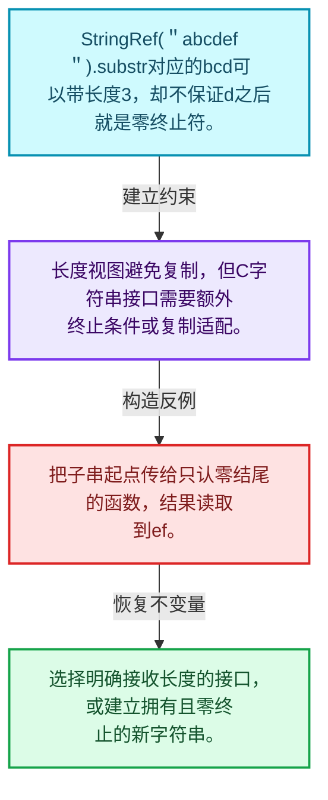
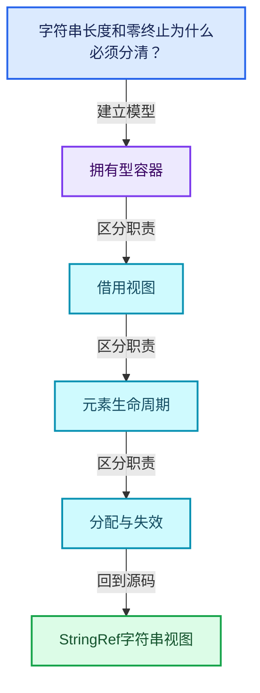
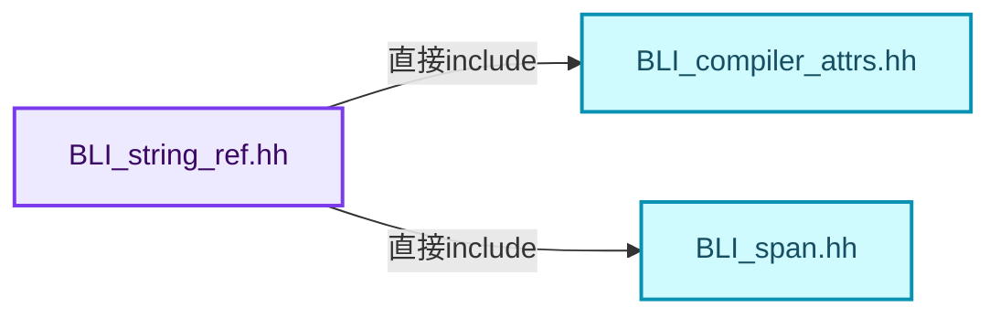
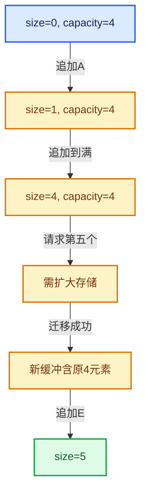

# 01-15 StringRef字符串视图

[方向导航](README.md) · [总目录](../README.md) · [覆盖索引](../%E6%BA%90%E7%A0%81%E7%89%88%E6%9C%AC%E4%B8%8E%E8%A6%86%E7%9B%96%E7%B4%A2%E5%BC%95.md)

> 阅读顺序：问题与数据模型 → 语法与类型 → 源码逐行 → 调用线索 → 历史与取舍 → 推演和练习。

- 基准 HEAD：`cbda6b96c26c0dee3c3b5cbb93960c4ac06a6b30`。
- 记录日期：2026-10-14。
- 教学示例状态：正文中的推演不是本机性能实测；已运行练习见验收报告。

## 一、从问题到设计

字符串长度和零终止为什么必须分清？

视图可以引用子串而不复制，但子串末尾未必有零；StringRefNull的额外契约不能靠强转伪造。

本篇把语法、数据语义和系统取舍连接起来。先证明对象存活，再讨论索引；先区分借用与拥有，再讨论复制移动。

### 本篇独立模型与设计推理

StringRef("abcdef").substr对应的bcd可以带长度3，却不保证d之后就是零终止符。

设计取舍：长度视图避免复制，但C字符串接口需要额外终止条件或复制适配。

最小反例：把子串起点传给只认零结尾的函数，结果读取到ef。

推导与处理：选择明确接收长度的接口，或建立拥有且零终止的新字符串。



### 源码范围与相邻篇章

| 文件 | 本篇逐行范围 | 基准SHA-256 |
|---|---|---|
| [source/blender/blenlib/BLI_string_ref.hh](../../../../../source/blender/blenlib/BLI_string_ref.hh) | L1—L727 | `91454b8d8cdbed910d4f2654fe10d3145a989e848d84fd1f87e1e4a0becde9f6` |

同一主讲文件可能分多篇覆盖；超出本篇范围的符号通过覆盖索引定位。空行与纯注释保留在源码摘录中，逐行表解释有效语句与语法边界；许可证头统一保留。

前篇：[VectorSet稳定索引与去重](14-VectorSet%E7%A8%B3%E5%AE%9A%E7%B4%A2%E5%BC%95%E4%B8%8E%E5%8E%BB%E9%87%8D.md).

后篇：[FunctionRef非拥有回调](16-FunctionRef%E9%9D%9E%E6%8B%A5%E6%9C%89%E5%9B%9E%E8%B0%83.md).

## 二、类型、数据与阅读地图



这是概念依赖图，边表示阅读关系，不声称是运行时调用顺序。

### 直接编译依赖



箭头只表示头文件包含关系；完整调用线索见后面的符号定位表。

## 三、关键词、语法与类型角色

### 模板 template

模板把类型或常量作为生成实现的参数。读声明时先列出类型参数、非类型参数和默认值，再看使用者实际实例化了什么。模板声明本身不意味着每种T都支持其全部成员。

具体检查：把T替换为int、string、只能移动的类型，分别检查每个被调用操作是否成立。

### 常量求值 constexpr

constexpr声明允许相应实体参与常量求值，但constexpr函数仍可以在运行时执行。是否常量求值由调用场景和表达式合法性共同决定。

具体检查：比较constexpr变量初始化和从运行时输入调用同一函数。

### 只读限定 const

const约束当前访问路径可做的修改。const指针、指向const的指针、const视图对象、const元素是不同位置的限定；其他别名可能仍可修改原对象。

具体检查：分别写T* const、const T*与const T* const，并画出不可修改的层次。

### 构造与new表达式

普通new可能分配并构造；placement new在给定地址构造，存储由其他机制提供。失败回滚应区分两类责任。

具体检查：追踪地址来自哪里、构造何时成功、由谁析构、由谁释放。

### 内部断言 assert

断言表达开发者预期成立的内部契约，发布构建可能关闭。它不能替代对不可信输入的完整错误处理，也不保证后续操作被运行时保护。

具体检查：对每条断言构造违反条件的输入，区分调用者错误与应向用户报告的错误。

### 类型别名 using

类型别名为已有类型建立名字，不创建运行期对象。它常把模板内部使用的类型统一暴露给泛型调用者。

具体检查：展开别名直到基础类型，区分类型别名和变量声明。

## 四、真实源码与逐行讲解

源码块保持原行内容，原始行号由小节标题及逐行表给出。表中的调用定位是静态阅读辅助；重载、模板实例化、宏展开和虚调用需结合完整声明，不能仅凭词法出现证明动态调用。

### BLI_string_ref.hh：L1—L50

<!-- source:source/blender/blenlib/BLI_string_ref.hh:1:50 -->

```cpp
/* SPDX-FileCopyrightText: 2023 Blender Authors
 *
 * SPDX-License-Identifier: GPL-2.0-or-later */

#pragma once

/** \file
 * \ingroup bli
 *
 * A `StringRef` references a const char array owned by someone else. It is just a pointer
 * and a size. Since the memory is not owned, StringRef should not be used to transfer ownership of
 * the string. The data referenced by a StringRef cannot be mutated through it.
 *
 * A StringRef is NOT null-terminated. This makes it much more powerful within C++, because we can
 * also cut off parts of the end without creating a copy. When interfacing with C code that expects
 * null-terminated strings, `StringRefNull` can be used. It is essentially the same as
 * StringRef, but with the restriction that the string has to be null-terminated.
 *
 * Whenever possible, string parameters should be of type StringRef and the string return type
 * should be StringRefNull. Don't forget that the StringRefNull does not own the string, so don't
 * return it when the string exists only in the scope of the function. This convention makes
 * functions usable in the most contexts.
 *
 * StringRef vs. std::string_view:
 *   Both types are certainly very similar. The main benefit of using StringRef in Blender is that
 *   this allows us to add convenience methods at any time. Especially, when doing a lot of string
 *   manipulation, this helps to keep the code clean. Furthermore, we need StringRefNull anyway,
 *   because there is a lot of C code that expects null-terminated strings. Conversion between
 *   StringRef and string_view is very cheap and can be done at API boundaries at essentially no
 *   cost. Another benefit of using StringRef is that it uses signed integers, thus developers
 *   have to deal less with issues resulting from unsigned integers.
 */

#include <cstring>
#include <string>
#include <string_view>

#include "BLI_compiler_attrs.hh"
#include "BLI_span.hh"

namespace blender {

class StringRef;

/**
 * A common base class for StringRef and StringRefNull. This should never be used in other files.
 * It only exists to avoid some code duplication.
 */
class StringRefBase {
 protected:
```

| 原始行 | 语义、约束与检查 |
|---|---|
| L5 | 防止同一头文件在一个翻译单元中重复展开；不控制多个源文件之间的链接或对象寿命。 |
| L34 | 引入编译依赖 <cstring>；这是声明可见性关系，不表示运行时一定调用该文件的所有接口。 |
| L35 | 引入编译依赖 <string>；这是声明可见性关系，不表示运行时一定调用该文件的所有接口。 |
| L36 | 引入编译依赖 <string_view>；这是声明可见性关系，不表示运行时一定调用该文件的所有接口。 |
| L38 | 引入编译依赖 "BLI_compiler_attrs.hh"；这是声明可见性关系，不表示运行时一定调用该文件的所有接口。 |
| L39 | 引入编译依赖 "BLI_span.hh"；这是声明可见性关系，不表示运行时一定调用该文件的所有接口。 |
| L41 | 把后续声明放入 blender 命名空间，影响名称查找和符号归属，不创建运行时对象。 |
| L43 | 声明或定义类型 `class StringRef`。结合继承、访问权限和成员布局确认接口与拥有关系；前向声明本身没有完整对象布局。 |
| L49 | 声明或定义类型 `class StringRefBase`。结合继承、访问权限和成员布局确认接口与拥有关系；前向声明本身没有完整对象布局。 |
| L50 | 切换成员访问权限为 protected；它是编译期接口边界，不是线程同步或内存保护。 |

### BLI_string_ref.hh：L51—L101

<!-- source:source/blender/blenlib/BLI_string_ref.hh:51:101 -->

```cpp
  /* May be nullptr when used in StringRef. */
  const char *data_;
  int64_t size_;

  constexpr StringRefBase(const char *data, int64_t size);

 public:
  /** Makes this type "string-like" for some libraries (e.g. `fmt`). */
  using value_type = char;

  /** Similar to #string_view::npos, but signed. */
  static constexpr int64_t not_found = -1;

  constexpr int64_t size() const;
  constexpr bool is_empty() const;
  constexpr const char *data() const;
  constexpr operator Span<char>() const;

  operator std::string() const;
  constexpr operator std::string_view() const;

  constexpr const char *begin() const;
  constexpr const char *end() const;

  constexpr IndexRange index_range() const;

  /**
   * Copy the string into a char array. The copied string will be null-terminated. If it does not
   * fit, it will be truncated while keeping it valid UTF8 (assuming the #StringRef itself is
   * valid UTF8).
   */
  void copy_utf8_truncated(char *dst, int64_t dst_size) const;
  template<size_t N> void copy_utf8_truncated(char (&dst)[N]) const;

  /**
   * Copy the string into a char array. The copied string will be null-terminated. If it does not
   * fit, it will be truncated.
   *
   * \note #copy_utf8_truncated should be used UTF8 strings,
   * this should be used for strings which are allowed to contain arbitrary
   * byte sequences without a known encoding such as file-paths.
   */
  void copy_bytes_truncated(char *dst, int64_t dst_size) const;
  template<size_t N> void copy_bytes_truncated(char (&dst)[N]) const;

  /**
   * Copy the string into a buffer. The buffer has to be one byte larger than the size of the
   * string, because the copied string will be null-terminated. Only use this when you are
   * absolutely sure that the buffer is large enough.
   */
  void copy_unsafe(char *dst) const;
```

本段语义重点：

- `data_`：数据或实现的存储入口；是否拥有应按该类声明和析构判定。
- `size_`：该对象记录的元素数或长度，不能直接当作容量。

| 原始行 | 语义、约束与检查 |
|---|---|
| L52 | 本行涉及 `data_`：数据或实现的存储入口；是否拥有应按该类声明和析构判定。按此语义解读 `const char *data_`，不要把地址、数量或状态混用。 |
| L53 | 本行涉及 `size_`：该对象记录的元素数或长度，不能直接当作容量。按此语义解读 `int64_t size_`，不要把地址、数量或状态混用。 |
| L55 | 出现调用或函数声明 `StringRefBase`，对应表达式为 `constexpr StringRefBase(const char *data, int64_t size);`。参数求值、返回类型与重载需结合前后完整语句；静态文本引用不能证明动态目标。 |
| L57 | 切换成员访问权限为 public；它是编译期接口边界，不是线程同步或内存保护。 |
| L59 | 定义类型别名 `using value_type = char`，为模板接口或内部实现统一命名；本行不分配该类型对象。 |
| L62 | 把右侧 `-1` 用于初始化或更新左侧 `static constexpr int64_t not_found`。声明初始化与已有对象赋值应按上下文区分；有资源的类型会调用相应特殊成员。 |
| L64 | 声明接口 `constexpr int64_t size() const`，本行没有对应函数体；返回类型、参数限定和const/noexcept共同组成调用契约，实际行为需继续定位实现。 |
| L65 | 声明接口 `constexpr bool is_empty() const`，本行没有对应函数体；返回类型、参数限定和const/noexcept共同组成调用契约，实际行为需继续定位实现。 |
| L66 | 声明接口 `constexpr const char *data() const`，本行没有对应函数体；返回类型、参数限定和const/noexcept共同组成调用契约，实际行为需继续定位实现。 |
| L67 | 运算符重载声明、定义或显式调用：`constexpr operator Span<char>() const;`。结合参数和返回类型判断是赋值、索引、比较还是转换；operator=声明中的等号不是在给名为operator的变量赋值。 |
| L69 | 运算符重载声明、定义或显式调用：`operator std::string() const;`。结合参数和返回类型判断是赋值、索引、比较还是转换；operator=声明中的等号不是在给名为operator的变量赋值。 |
| L70 | 运算符重载声明、定义或显式调用：`constexpr operator std::string_view() const;`。结合参数和返回类型判断是赋值、索引、比较还是转换；operator=声明中的等号不是在给名为operator的变量赋值。 |
| L72 | 声明接口 `constexpr const char *begin() const`，本行没有对应函数体；返回类型、参数限定和const/noexcept共同组成调用契约，实际行为需继续定位实现。 |
| L73 | 声明接口 `constexpr const char *end() const`，本行没有对应函数体；返回类型、参数限定和const/noexcept共同组成调用契约，实际行为需继续定位实现。 |
| L75 | 声明接口 `constexpr IndexRange index_range() const`，本行没有对应函数体；返回类型、参数限定和const/noexcept共同组成调用契约，实际行为需继续定位实现。 |
| L82 | 声明接口 `void copy_utf8_truncated(char *dst, int64_t dst_size) const`，本行没有对应函数体；返回类型、参数限定和const/noexcept共同组成调用契约，实际行为需继续定位实现。 |
| L83 | 声明模板参数 `template<size_t N> void copy_utf8_truncated(char (&dst)[N]) const;`。类型参数决定生成操作的类型，非类型参数可决定内嵌容量或编译期分支。 |
| L93 | 声明接口 `void copy_bytes_truncated(char *dst, int64_t dst_size) const`，本行没有对应函数体；返回类型、参数限定和const/noexcept共同组成调用契约，实际行为需继续定位实现。 |
| L94 | 声明模板参数 `template<size_t N> void copy_bytes_truncated(char (&dst)[N]) const;`。类型参数决定生成操作的类型，非类型参数可决定内嵌容量或编译期分支。 |
| L101 | 声明接口 `void copy_unsafe(char *dst) const`，本行没有对应函数体；返回类型、参数限定和const/noexcept共同组成调用契约，实际行为需继续定位实现。 |

### BLI_string_ref.hh：L102—L149

<!-- source:source/blender/blenlib/BLI_string_ref.hh:102:149 -->

```cpp

  constexpr bool startswith(StringRef prefix) const;
  constexpr bool endswith(StringRef suffix) const;
  constexpr StringRef substr(int64_t start, int64_t size) const;

  constexpr const char &front() const;
  constexpr const char &back() const;

  /**
   * The behavior of those functions matches the standard library implementation of
   * std::string_view.
   *
   * \return the offset at which the char/string was found, or StringRefBase::not_found when
   * nothing was found.
   */
  constexpr int64_t find(char c, int64_t pos = 0) const;
  constexpr int64_t find(StringRef str, int64_t pos = 0) const;
  constexpr int64_t rfind(char c, int64_t pos = INT64_MAX) const;
  constexpr int64_t rfind(StringRef str, int64_t pos = INT64_MAX) const;
  constexpr int64_t find_first_of(StringRef chars, int64_t pos = 0) const;
  constexpr int64_t find_first_of(char c, int64_t pos = 0) const;
  constexpr int64_t find_last_of(StringRef chars, int64_t pos = INT64_MAX) const;
  constexpr int64_t find_last_of(char c, int64_t pos = INT64_MAX) const;
  constexpr int64_t find_first_not_of(StringRef chars, int64_t pos = 0) const;
  constexpr int64_t find_first_not_of(char c, int64_t pos = 0) const;
  constexpr int64_t find_last_not_of(StringRef chars, int64_t pos = INT64_MAX) const;
  constexpr int64_t find_last_not_of(char c, int64_t pos = INT64_MAX) const;

  constexpr StringRef trim() const;
  constexpr StringRef trim(StringRef characters_to_remove) const;
  constexpr StringRef trim(char character_to_remove) const;
  constexpr StringRef trim_left() const;
  constexpr StringRef trim_left(StringRef characters_to_remove) const;
  constexpr StringRef trim_right() const;
  constexpr StringRef trim_right(StringRef characters_to_remove) const;
};

/**
 * References a null-terminated const char array.
 *
 * StringRefNull can be compared with StringRef and StringRefNull.
 */
class StringRefNull : public StringRefBase {

 public:
  constexpr StringRefNull();
  constexpr StringRefNull(const char *str, int64_t size) ATTR_NONNULL(2);
  StringRefNull(std::nullptr_t) = delete;
```

| 原始行 | 语义、约束与检查 |
|---|---|
| L103 | 声明接口 `constexpr bool startswith(StringRef prefix) const`，本行没有对应函数体；返回类型、参数限定和const/noexcept共同组成调用契约，实际行为需继续定位实现。 |
| L104 | 声明接口 `constexpr bool endswith(StringRef suffix) const`，本行没有对应函数体；返回类型、参数限定和const/noexcept共同组成调用契约，实际行为需继续定位实现。 |
| L105 | 声明接口 `constexpr StringRef substr(int64_t start, int64_t size) const`，本行没有对应函数体；返回类型、参数限定和const/noexcept共同组成调用契约，实际行为需继续定位实现。 |
| L107 | 声明接口 `constexpr const char &front() const`，本行没有对应函数体；返回类型、参数限定和const/noexcept共同组成调用契约，实际行为需继续定位实现。 |
| L108 | 声明接口 `constexpr const char &back() const`，本行没有对应函数体；返回类型、参数限定和const/noexcept共同组成调用契约，实际行为需继续定位实现。 |
| L117 | 把右侧 `0) const` 用于初始化或更新左侧 `constexpr int64_t find(char c, int64_t pos`。声明初始化与已有对象赋值应按上下文区分；有资源的类型会调用相应特殊成员。 |
| L118 | 把右侧 `0) const` 用于初始化或更新左侧 `constexpr int64_t find(StringRef str, int64_t pos`。声明初始化与已有对象赋值应按上下文区分；有资源的类型会调用相应特殊成员。 |
| L119 | 把右侧 `INT64_MAX) const` 用于初始化或更新左侧 `constexpr int64_t rfind(char c, int64_t pos`。声明初始化与已有对象赋值应按上下文区分；有资源的类型会调用相应特殊成员。 |
| L120 | 把右侧 `INT64_MAX) const` 用于初始化或更新左侧 `constexpr int64_t rfind(StringRef str, int64_t pos`。声明初始化与已有对象赋值应按上下文区分；有资源的类型会调用相应特殊成员。 |
| L121 | 把右侧 `0) const` 用于初始化或更新左侧 `constexpr int64_t find_first_of(StringRef chars, int64_t pos`。声明初始化与已有对象赋值应按上下文区分；有资源的类型会调用相应特殊成员。 |
| L122 | 把右侧 `0) const` 用于初始化或更新左侧 `constexpr int64_t find_first_of(char c, int64_t pos`。声明初始化与已有对象赋值应按上下文区分；有资源的类型会调用相应特殊成员。 |
| L123 | 把右侧 `INT64_MAX) const` 用于初始化或更新左侧 `constexpr int64_t find_last_of(StringRef chars, int64_t pos`。声明初始化与已有对象赋值应按上下文区分；有资源的类型会调用相应特殊成员。 |
| L124 | 把右侧 `INT64_MAX) const` 用于初始化或更新左侧 `constexpr int64_t find_last_of(char c, int64_t pos`。声明初始化与已有对象赋值应按上下文区分；有资源的类型会调用相应特殊成员。 |
| L125 | 把右侧 `0) const` 用于初始化或更新左侧 `constexpr int64_t find_first_not_of(StringRef chars, int64_t pos`。声明初始化与已有对象赋值应按上下文区分；有资源的类型会调用相应特殊成员。 |
| L126 | 把右侧 `0) const` 用于初始化或更新左侧 `constexpr int64_t find_first_not_of(char c, int64_t pos`。声明初始化与已有对象赋值应按上下文区分；有资源的类型会调用相应特殊成员。 |
| L127 | 把右侧 `INT64_MAX) const` 用于初始化或更新左侧 `constexpr int64_t find_last_not_of(StringRef chars, int64_t pos`。声明初始化与已有对象赋值应按上下文区分；有资源的类型会调用相应特殊成员。 |
| L128 | 把右侧 `INT64_MAX) const` 用于初始化或更新左侧 `constexpr int64_t find_last_not_of(char c, int64_t pos`。声明初始化与已有对象赋值应按上下文区分；有资源的类型会调用相应特殊成员。 |
| L130 | 声明接口 `constexpr StringRef trim() const`，本行没有对应函数体；返回类型、参数限定和const/noexcept共同组成调用契约，实际行为需继续定位实现。 |
| L131 | 声明接口 `constexpr StringRef trim(StringRef characters_to_remove) const`，本行没有对应函数体；返回类型、参数限定和const/noexcept共同组成调用契约，实际行为需继续定位实现。 |
| L132 | 声明接口 `constexpr StringRef trim(char character_to_remove) const`，本行没有对应函数体；返回类型、参数限定和const/noexcept共同组成调用契约，实际行为需继续定位实现。 |
| L133 | 声明接口 `constexpr StringRef trim_left() const`，本行没有对应函数体；返回类型、参数限定和const/noexcept共同组成调用契约，实际行为需继续定位实现。 |
| L134 | 声明接口 `constexpr StringRef trim_left(StringRef characters_to_remove) const`，本行没有对应函数体；返回类型、参数限定和const/noexcept共同组成调用契约，实际行为需继续定位实现。 |
| L135 | 声明接口 `constexpr StringRef trim_right() const`，本行没有对应函数体；返回类型、参数限定和const/noexcept共同组成调用契约，实际行为需继续定位实现。 |
| L136 | 声明接口 `constexpr StringRef trim_right(StringRef characters_to_remove) const`，本行没有对应函数体；返回类型、参数限定和const/noexcept共同组成调用契约，实际行为需继续定位实现。 |
| L137 | 结束当前语法单元。局部自动对象在离开其作用域时按规则销毁；这不等于所有被引用的外部数据也被释放。 |
| L144 | 声明或定义类型 `class StringRefNull : public StringRefBase`。结合继承、访问权限和成员布局确认接口与拥有关系；前向声明本身没有完整对象布局。 |
| L146 | 切换成员访问权限为 public；它是编译期接口边界，不是线程同步或内存保护。 |
| L147 | 出现调用或函数声明 `StringRefNull`，对应表达式为 `constexpr StringRefNull();`。参数求值、返回类型与重载需结合前后完整语句；静态文本引用不能证明动态目标。 |
| L148 | 出现调用或函数声明 `StringRefNull`，对应表达式为 `constexpr StringRefNull(const char *str, int64_t size) ATTR_NONNULL(2);`。参数求值、返回类型与重载需结合前后完整语句；静态文本引用不能证明动态目标。 |
| L149 | 显式禁止接口：`StringRefNull(std::nullptr_t) = delete;`。调用会在编译期被拒绝，常用于禁止复制或移动；这里没有释放对象或删除文件的运行时动作。 |

### BLI_string_ref.hh：L150—L199

<!-- source:source/blender/blenlib/BLI_string_ref.hh:150:199 -->

```cpp
  constexpr StringRefNull(const char *str) ATTR_NONNULL(2);
  StringRefNull(const std::string &str);

  constexpr char operator[](int64_t index) const;
  constexpr const char *c_str() const;
};

/**
 * References a const char array. It might not be null terminated.
 *
 * StringRef can be compared with StringRef and StringRefNull.
 *
 * \note It is valid to pass `nullptr` to the constructor, as it can be used to indicate an empty
 * string.
 */
class StringRef : public StringRefBase {
 public:
  constexpr StringRef();
  constexpr StringRef(StringRefNull other);
  constexpr StringRef(const char *str);
  constexpr StringRef(const char *str, int64_t length);
  constexpr StringRef(const char *begin, const char *one_after_end);
  constexpr StringRef(std::string_view view);
  constexpr StringRef(Span<char> span);
  StringRef(const std::string &str);

  constexpr StringRef drop_prefix(int64_t n) const;
  constexpr StringRef drop_known_prefix(StringRef prefix) const;
  constexpr StringRef drop_suffix(int64_t n) const;
  constexpr StringRef drop_known_suffix(StringRef suffix) const;

  constexpr char operator[](int64_t index) const;
};

/* -------------------------------------------------------------------- */
/** \name #StringRefBase Inline Methods
 * \{ */

constexpr StringRefBase::StringRefBase(const char *data, const int64_t size)
    : data_(data), size_(size)
{
}

/**
 * Return the (byte-)length of the referenced string, without any null-terminator.
 */
constexpr int64_t StringRefBase::size() const
{
  return size_;
}
```

本段语义重点：

- `data_`：数据或实现的存储入口；是否拥有应按该类声明和析构判定。
- `size_`：该对象记录的元素数或长度，不能直接当作容量。

| 原始行 | 语义、约束与检查 |
|---|---|
| L150 | 出现调用或函数声明 `StringRefNull`，对应表达式为 `constexpr StringRefNull(const char *str) ATTR_NONNULL(2);`。参数求值、返回类型与重载需结合前后完整语句；静态文本引用不能证明动态目标。 |
| L151 | 出现调用或函数声明 `StringRefNull`，对应表达式为 `StringRefNull(const std::string &str);`。参数求值、返回类型与重载需结合前后完整语句；静态文本引用不能证明动态目标。 |
| L153 | 运算符重载声明、定义或显式调用：`constexpr char operator[](int64_t index) const;`。结合参数和返回类型判断是赋值、索引、比较还是转换；operator=声明中的等号不是在给名为operator的变量赋值。 |
| L154 | 声明接口 `constexpr const char *c_str() const`，本行没有对应函数体；返回类型、参数限定和const/noexcept共同组成调用契约，实际行为需继续定位实现。 |
| L155 | 结束当前语法单元。局部自动对象在离开其作用域时按规则销毁；这不等于所有被引用的外部数据也被释放。 |
| L165 | 声明或定义类型 `class StringRef : public StringRefBase`。结合继承、访问权限和成员布局确认接口与拥有关系；前向声明本身没有完整对象布局。 |
| L166 | 切换成员访问权限为 public；它是编译期接口边界，不是线程同步或内存保护。 |
| L167 | 出现调用或函数声明 `StringRef`，对应表达式为 `constexpr StringRef();`。参数求值、返回类型与重载需结合前后完整语句；静态文本引用不能证明动态目标。 |
| L168 | 出现调用或函数声明 `StringRef`，对应表达式为 `constexpr StringRef(StringRefNull other);`。参数求值、返回类型与重载需结合前后完整语句；静态文本引用不能证明动态目标。 |
| L169 | 出现调用或函数声明 `StringRef`，对应表达式为 `constexpr StringRef(const char *str);`。参数求值、返回类型与重载需结合前后完整语句；静态文本引用不能证明动态目标。 |
| L170 | 出现调用或函数声明 `StringRef`，对应表达式为 `constexpr StringRef(const char *str, int64_t length);`。参数求值、返回类型与重载需结合前后完整语句；静态文本引用不能证明动态目标。 |
| L171 | 出现调用或函数声明 `StringRef`，对应表达式为 `constexpr StringRef(const char *begin, const char *one_after_end);`。参数求值、返回类型与重载需结合前后完整语句；静态文本引用不能证明动态目标。 |
| L172 | 出现调用或函数声明 `StringRef`，对应表达式为 `constexpr StringRef(std::string_view view);`。参数求值、返回类型与重载需结合前后完整语句；静态文本引用不能证明动态目标。 |
| L173 | 出现调用或函数声明 `StringRef`，对应表达式为 `constexpr StringRef(Span<char> span);`。参数求值、返回类型与重载需结合前后完整语句；静态文本引用不能证明动态目标。 |
| L174 | 出现调用或函数声明 `StringRef`，对应表达式为 `StringRef(const std::string &str);`。参数求值、返回类型与重载需结合前后完整语句；静态文本引用不能证明动态目标。 |
| L176 | 声明接口 `constexpr StringRef drop_prefix(int64_t n) const`，本行没有对应函数体；返回类型、参数限定和const/noexcept共同组成调用契约，实际行为需继续定位实现。 |
| L177 | 声明接口 `constexpr StringRef drop_known_prefix(StringRef prefix) const`，本行没有对应函数体；返回类型、参数限定和const/noexcept共同组成调用契约，实际行为需继续定位实现。 |
| L178 | 声明接口 `constexpr StringRef drop_suffix(int64_t n) const`，本行没有对应函数体；返回类型、参数限定和const/noexcept共同组成调用契约，实际行为需继续定位实现。 |
| L179 | 声明接口 `constexpr StringRef drop_known_suffix(StringRef suffix) const`，本行没有对应函数体；返回类型、参数限定和const/noexcept共同组成调用契约，实际行为需继续定位实现。 |
| L181 | 运算符重载声明、定义或显式调用：`constexpr char operator[](int64_t index) const;`。结合参数和返回类型判断是赋值、索引、比较还是转换；operator=声明中的等号不是在给名为operator的变量赋值。 |
| L182 | 结束当前语法单元。局部自动对象在离开其作用域时按规则销毁；这不等于所有被引用的外部数据也被释放。 |
| L188 | 出现调用或函数声明 `StringRefBase::StringRefBase`，对应表达式为 `constexpr StringRefBase::StringRefBase(const char *data, const int64_t size)`。参数求值、返回类型与重载需结合前后完整语句；静态文本引用不能证明动态目标。 |
| L189 | 本行涉及 `data_`：数据或实现的存储入口；是否拥有应按该类声明和析构判定。按此语义解读 `: data_(data), size_(size)`，不要把地址、数量或状态混用。 |
| L190 | 连接上一行的声明或控制结构与其语句块；后续行在这个作用域中执行或声明。 |
| L191 | 结束当前语法单元。局部自动对象在离开其作用域时按规则销毁；这不等于所有被引用的外部数据也被释放。 |
| L196 | 出现调用或函数声明 `StringRefBase::size`，对应表达式为 `constexpr int64_t StringRefBase::size() const`。参数求值、返回类型与重载需结合前后完整语句；静态文本引用不能证明动态目标。 |
| L197 | 连接上一行的声明或控制结构与其语句块；后续行在这个作用域中执行或声明。 |
| L198 | 返回表达式 `size_`。 |
| L199 | 结束当前语法单元。局部自动对象在离开其作用域时按规则销毁；这不等于所有被引用的外部数据也被释放。 |

### BLI_string_ref.hh：L200—L246

<!-- source:source/blender/blenlib/BLI_string_ref.hh:200:246 -->

```cpp

constexpr bool StringRefBase::is_empty() const
{
  return size_ == 0;
}

/**
 * Return a pointer to the start of the string.
 */
constexpr const char *StringRefBase::data() const
{
  return data_;
}

constexpr StringRefBase::operator Span<char>() const
{
  return Span<char>(data_, size_);
}

/**
 * Implicitly convert to std::string. This is convenient in most cases, but you have to be a bit
 * careful not to convert to std::string accidentally.
 */
inline StringRefBase::operator std::string() const
{
  return std::string(data_, size_t(size_));
}

constexpr StringRefBase::operator std::string_view() const
{
  return std::string_view(data_, size_t(size_));
}

constexpr const char *StringRefBase::begin() const
{
  return data_;
}

constexpr const char *StringRefBase::end() const
{
  return data_ + size_;
}

constexpr IndexRange StringRefBase::index_range() const
{
  return IndexRange(size_);
}
```

本段语义重点：

- `data_`：数据或实现的存储入口；是否拥有应按该类声明和析构判定。
- `size_`：该对象记录的元素数或长度，不能直接当作容量。

| 原始行 | 语义、约束与检查 |
|---|---|
| L201 | 出现调用或函数声明 `StringRefBase::is_empty`，对应表达式为 `constexpr bool StringRefBase::is_empty() const`。参数求值、返回类型与重载需结合前后完整语句；静态文本引用不能证明动态目标。 |
| L202 | 连接上一行的声明或控制结构与其语句块；后续行在这个作用域中执行或声明。 |
| L203 | 返回表达式 `size_ == 0`。 |
| L204 | 结束当前语法单元。局部自动对象在离开其作用域时按规则销毁；这不等于所有被引用的外部数据也被释放。 |
| L209 | 出现调用或函数声明 `StringRefBase::data`，对应表达式为 `constexpr const char *StringRefBase::data() const`。参数求值、返回类型与重载需结合前后完整语句；静态文本引用不能证明动态目标。 |
| L210 | 连接上一行的声明或控制结构与其语句块；后续行在这个作用域中执行或声明。 |
| L211 | 返回表达式 `data_`。 |
| L212 | 结束当前语法单元。局部自动对象在离开其作用域时按规则销毁；这不等于所有被引用的外部数据也被释放。 |
| L214 | 运算符重载声明、定义或显式调用：`constexpr StringRefBase::operator Span<char>() const`。结合参数和返回类型判断是赋值、索引、比较还是转换；operator=声明中的等号不是在给名为operator的变量赋值。 |
| L215 | 连接上一行的声明或控制结构与其语句块；后续行在这个作用域中执行或声明。 |
| L216 | 返回表达式 `Span<char>(data_, size_)`。 |
| L217 | 结束当前语法单元。局部自动对象在离开其作用域时按规则销毁；这不等于所有被引用的外部数据也被释放。 |
| L223 | 运算符重载声明、定义或显式调用：`inline StringRefBase::operator std::string() const`。结合参数和返回类型判断是赋值、索引、比较还是转换；operator=声明中的等号不是在给名为operator的变量赋值。 |
| L224 | 连接上一行的声明或控制结构与其语句块；后续行在这个作用域中执行或声明。 |
| L225 | 返回表达式 `std::string(data_, size_t(size_))`。 |
| L226 | 结束当前语法单元。局部自动对象在离开其作用域时按规则销毁；这不等于所有被引用的外部数据也被释放。 |
| L228 | 运算符重载声明、定义或显式调用：`constexpr StringRefBase::operator std::string_view() const`。结合参数和返回类型判断是赋值、索引、比较还是转换；operator=声明中的等号不是在给名为operator的变量赋值。 |
| L229 | 连接上一行的声明或控制结构与其语句块；后续行在这个作用域中执行或声明。 |
| L230 | 返回表达式 `std::string_view(data_, size_t(size_))`。 |
| L231 | 结束当前语法单元。局部自动对象在离开其作用域时按规则销毁；这不等于所有被引用的外部数据也被释放。 |
| L233 | 出现调用或函数声明 `StringRefBase::begin`，对应表达式为 `constexpr const char *StringRefBase::begin() const`。参数求值、返回类型与重载需结合前后完整语句；静态文本引用不能证明动态目标。 |
| L234 | 连接上一行的声明或控制结构与其语句块；后续行在这个作用域中执行或声明。 |
| L235 | 返回表达式 `data_`。 |
| L236 | 结束当前语法单元。局部自动对象在离开其作用域时按规则销毁；这不等于所有被引用的外部数据也被释放。 |
| L238 | 出现调用或函数声明 `StringRefBase::end`，对应表达式为 `constexpr const char *StringRefBase::end() const`。参数求值、返回类型与重载需结合前后完整语句；静态文本引用不能证明动态目标。 |
| L239 | 连接上一行的声明或控制结构与其语句块；后续行在这个作用域中执行或声明。 |
| L240 | 返回表达式 `data_ + size_`。 |
| L241 | 结束当前语法单元。局部自动对象在离开其作用域时按规则销毁；这不等于所有被引用的外部数据也被释放。 |
| L243 | 出现调用或函数声明 `StringRefBase::index_range`，对应表达式为 `constexpr IndexRange StringRefBase::index_range() const`。参数求值、返回类型与重载需结合前后完整语句；静态文本引用不能证明动态目标。 |
| L244 | 连接上一行的声明或控制结构与其语句块；后续行在这个作用域中执行或声明。 |
| L245 | 返回表达式 `IndexRange(size_)`。 |
| L246 | 结束当前语法单元。局部自动对象在离开其作用域时按规则销毁；这不等于所有被引用的外部数据也被释放。 |

### BLI_string_ref.hh：L247—L297

<!-- source:source/blender/blenlib/BLI_string_ref.hh:247:297 -->

```cpp

inline void StringRefBase::copy_unsafe(char *dst) const
{
  if (size_ > 0) {
    memcpy(dst, data_, size_t(size_));
  }
  dst[size_] = '\0';
}

template<size_t N> inline void StringRefBase::copy_utf8_truncated(char (&dst)[N]) const
{
  this->copy_utf8_truncated(dst, N);
}

template<size_t N> inline void StringRefBase::copy_bytes_truncated(char (&dst)[N]) const
{
  this->copy_bytes_truncated(dst, N);
}

/**
 * Return true when the string starts with the given prefix.
 */
constexpr bool StringRefBase::startswith(StringRef prefix) const
{
  if (size_ < prefix.size_) {
    return false;
  }
  for (int64_t i = 0; i < prefix.size_; i++) {
    if (data_[i] != prefix.data_[i]) {
      return false;
    }
  }
  return true;
}

/**
 * Return true when the string ends with the given suffix.
 */
constexpr bool StringRefBase::endswith(StringRef suffix) const
{
  if (size_ < suffix.size_) {
    return false;
  }
  const int64_t offset = size_ - suffix.size_;
  for (int64_t i = 0; i < suffix.size_; i++) {
    if (data_[offset + i] != suffix.data_[i]) {
      return false;
    }
  }
  return true;
}
```

本段语义重点：

- `memcpy`：按字节复制表示；必须由类型性质和生命周期规则证明可用，不能泛化到任意拥有资源对象。
- `data_`：数据或实现的存储入口；是否拥有应按该类声明和析构判定。
- `size_`：该对象记录的元素数或长度，不能直接当作容量。

| 原始行 | 语义、约束与检查 |
|---|---|
| L248 | 出现调用或函数声明 `StringRefBase::copy_unsafe`，对应表达式为 `inline void StringRefBase::copy_unsafe(char *dst) const`。参数求值、返回类型与重载需结合前后完整语句；静态文本引用不能证明动态目标。 |
| L249 | 连接上一行的声明或控制结构与其语句块；后续行在这个作用域中执行或声明。 |
| L250 | 判断 `size_ > 0`，成立时进入本分支，否则继续后续路径。该边界影响可访问元素或可用容量，两者要按各变量的定义区分。 |
| L251 | 本行使用 `memcpy`：按字节复制表示；必须由类型性质和生命周期规则证明可用，不能泛化到任意拥有资源对象。 |
| L252 | 结束当前语法单元。局部自动对象在离开其作用域时按规则销毁；这不等于所有被引用的外部数据也被释放。 |
| L253 | 建立或更新 `size_`：该对象记录的元素数或长度，不能直接当作容量。本行的具体值关系为 `dst[size_] = '\0'`；对照更新前后相应范围或状态是否一致。 |
| L254 | 结束当前语法单元。局部自动对象在离开其作用域时按规则销毁；这不等于所有被引用的外部数据也被释放。 |
| L256 | 声明模板参数 `template<size_t N> inline void StringRefBase::copy_utf8_truncated(char (&dst)[N]) const`。类型参数决定生成操作的类型，非类型参数可决定内嵌容量或编译期分支。 |
| L257 | 连接上一行的声明或控制结构与其语句块；后续行在这个作用域中执行或声明。 |
| L258 | 出现调用或函数声明 `copy_utf8_truncated`，对应表达式为 `this->copy_utf8_truncated(dst, N);`。参数求值、返回类型与重载需结合前后完整语句；静态文本引用不能证明动态目标。 |
| L259 | 结束当前语法单元。局部自动对象在离开其作用域时按规则销毁；这不等于所有被引用的外部数据也被释放。 |
| L261 | 声明模板参数 `template<size_t N> inline void StringRefBase::copy_bytes_truncated(char (&dst)[N]) const`。类型参数决定生成操作的类型，非类型参数可决定内嵌容量或编译期分支。 |
| L262 | 连接上一行的声明或控制结构与其语句块；后续行在这个作用域中执行或声明。 |
| L263 | 出现调用或函数声明 `copy_bytes_truncated`，对应表达式为 `this->copy_bytes_truncated(dst, N);`。参数求值、返回类型与重载需结合前后完整语句；静态文本引用不能证明动态目标。 |
| L264 | 结束当前语法单元。局部自动对象在离开其作用域时按规则销毁；这不等于所有被引用的外部数据也被释放。 |
| L269 | 出现调用或函数声明 `StringRefBase::startswith`，对应表达式为 `constexpr bool StringRefBase::startswith(StringRef prefix) const`。参数求值、返回类型与重载需结合前后完整语句；静态文本引用不能证明动态目标。 |
| L270 | 连接上一行的声明或控制结构与其语句块；后续行在这个作用域中执行或声明。 |
| L271 | 判断 `size_ < prefix.size_`，成立时进入本分支，否则继续后续路径。该边界影响可访问元素或可用容量，两者要按各变量的定义区分。 |
| L272 | 返回表达式 `false`。这是本路径的布尔结果，具体成功、存在或状态含义由函数接口规定。 |
| L273 | 结束当前语法单元。局部自动对象在离开其作用域时按规则销毁；这不等于所有被引用的外部数据也被释放。 |
| L274 | 纯虚接口声明：`for (int64_t i = 0; i < prefix.size_; i++) {`。等号零标记抽象接口，需要按继承约定提供覆写；不表示执行函数并把结果设为零。 |
| L275 | 判断 `data_[i] != prefix.data_[i]`，成立时进入本分支，否则继续后续路径。 |
| L276 | 返回表达式 `false`。这是本路径的布尔结果，具体成功、存在或状态含义由函数接口规定。 |
| L277 | 结束当前语法单元。局部自动对象在离开其作用域时按规则销毁；这不等于所有被引用的外部数据也被释放。 |
| L278 | 结束当前语法单元。局部自动对象在离开其作用域时按规则销毁；这不等于所有被引用的外部数据也被释放。 |
| L279 | 返回表达式 `true`。这是本路径的布尔结果，具体成功、存在或状态含义由函数接口规定。 |
| L280 | 结束当前语法单元。局部自动对象在离开其作用域时按规则销毁；这不等于所有被引用的外部数据也被释放。 |
| L285 | 出现调用或函数声明 `StringRefBase::endswith`，对应表达式为 `constexpr bool StringRefBase::endswith(StringRef suffix) const`。参数求值、返回类型与重载需结合前后完整语句；静态文本引用不能证明动态目标。 |
| L286 | 连接上一行的声明或控制结构与其语句块；后续行在这个作用域中执行或声明。 |
| L287 | 判断 `size_ < suffix.size_`，成立时进入本分支，否则继续后续路径。该边界影响可访问元素或可用容量，两者要按各变量的定义区分。 |
| L288 | 返回表达式 `false`。这是本路径的布尔结果，具体成功、存在或状态含义由函数接口规定。 |
| L289 | 结束当前语法单元。局部自动对象在离开其作用域时按规则销毁；这不等于所有被引用的外部数据也被释放。 |
| L290 | 建立或更新 `size_`：该对象记录的元素数或长度，不能直接当作容量。本行的具体值关系为 `const int64_t offset = size_ - suffix.size_`；对照更新前后相应范围或状态是否一致。 |
| L291 | 纯虚接口声明：`for (int64_t i = 0; i < suffix.size_; i++) {`。等号零标记抽象接口，需要按继承约定提供覆写；不表示执行函数并把结果设为零。 |
| L292 | 判断 `data_[offset + i] != suffix.data_[i]`，成立时进入本分支，否则继续后续路径。 |
| L293 | 返回表达式 `false`。这是本路径的布尔结果，具体成功、存在或状态含义由函数接口规定。 |
| L294 | 结束当前语法单元。局部自动对象在离开其作用域时按规则销毁；这不等于所有被引用的外部数据也被释放。 |
| L295 | 结束当前语法单元。局部自动对象在离开其作用域时按规则销毁；这不等于所有被引用的外部数据也被释放。 |
| L296 | 返回表达式 `true`。这是本路径的布尔结果，具体成功、存在或状态含义由函数接口规定。 |
| L297 | 结束当前语法单元。局部自动对象在离开其作用域时按规则销毁；这不等于所有被引用的外部数据也被释放。 |

### BLI_string_ref.hh：L298—L343

<!-- source:source/blender/blenlib/BLI_string_ref.hh:298:343 -->

```cpp

/**
 * Return a new #StringRef containing only a sub-string of the original string. This invokes
 * undefined if the start or max_size is negative.
 */
constexpr StringRef StringRefBase::substr(const int64_t start,
                                          const int64_t max_size = INT64_MAX) const
{
  BLI_assert(max_size >= 0);
  BLI_assert(start >= 0);
  const int64_t substr_size = std::min(max_size, size_ - start);
  return StringRef(data_ + start, substr_size);
}

/**
 * Get the first char in the string. This invokes undefined behavior when the string is empty.
 */
constexpr const char &StringRefBase::front() const
{
  BLI_assert(size_ >= 1);
  return data_[0];
}

/**
 * Get the last char in the string. This invokes undefined behavior when the string is empty.
 */
constexpr const char &StringRefBase::back() const
{
  BLI_assert(size_ >= 1);
  return data_[size_ - 1];
}

constexpr int64_t index_or_npos_to_int64(size_t index)
{
  /* The compiler will probably optimize this check away. */
  if (index == std::string_view::npos) {
    return StringRef::not_found;
  }
  return int64_t(index);
}

constexpr int64_t StringRefBase::find(char c, int64_t pos) const
{
  BLI_assert(pos >= 0);
  return index_or_npos_to_int64(std::string_view(*this).find(c, size_t(pos)));
}
```

本段语义重点：

- `std::min`：取较小值，常用于截断范围；还要检查负值、溢出和空范围。
- `data_`：数据或实现的存储入口；是否拥有应按该类声明和析构判定。
- `size_`：该对象记录的元素数或长度，不能直接当作容量。

| 原始行 | 语义、约束与检查 |
|---|---|
| L303 | 出现调用或函数声明 `StringRefBase::substr`，对应表达式为 `constexpr StringRef StringRefBase::substr(const int64_t start,`。参数求值、返回类型与重载需结合前后完整语句；静态文本引用不能证明动态目标。 |
| L304 | 把右侧 `INT64_MAX) const` 用于初始化或更新左侧 `const int64_t max_size`。声明初始化与已有对象赋值应按上下文区分；有资源的类型会调用相应特殊成员。 |
| L305 | 连接上一行的声明或控制结构与其语句块；后续行在这个作用域中执行或声明。 |
| L306 | 断言约束 `BLI_assert(max_size >= 0);`。条件是后续访问的内部前置条件；发布构建可能不执行，不能把断言当作输入修复。 |
| L307 | 断言约束 `BLI_assert(start >= 0);`。条件是后续访问的内部前置条件；发布构建可能不执行，不能把断言当作输入修复。 |
| L308 | 本行使用 `std::min`：取较小值，常用于截断范围；还要检查负值、溢出和空范围。 |
| L309 | 返回表达式 `StringRef(data_ + start, substr_size)`。 |
| L310 | 结束当前语法单元。局部自动对象在离开其作用域时按规则销毁；这不等于所有被引用的外部数据也被释放。 |
| L315 | 出现调用或函数声明 `StringRefBase::front`，对应表达式为 `constexpr const char &StringRefBase::front() const`。参数求值、返回类型与重载需结合前后完整语句；静态文本引用不能证明动态目标。 |
| L316 | 连接上一行的声明或控制结构与其语句块；后续行在这个作用域中执行或声明。 |
| L317 | 断言约束 `BLI_assert(size_ >= 1);`。条件是后续访问的内部前置条件；发布构建可能不执行，不能把断言当作输入修复。 |
| L318 | 返回表达式 `data_[0]`。 |
| L319 | 结束当前语法单元。局部自动对象在离开其作用域时按规则销毁；这不等于所有被引用的外部数据也被释放。 |
| L324 | 出现调用或函数声明 `StringRefBase::back`，对应表达式为 `constexpr const char &StringRefBase::back() const`。参数求值、返回类型与重载需结合前后完整语句；静态文本引用不能证明动态目标。 |
| L325 | 连接上一行的声明或控制结构与其语句块；后续行在这个作用域中执行或声明。 |
| L326 | 断言约束 `BLI_assert(size_ >= 1);`。条件是后续访问的内部前置条件；发布构建可能不执行，不能把断言当作输入修复。 |
| L327 | 返回表达式 `data_[size_ - 1]`。 |
| L328 | 结束当前语法单元。局部自动对象在离开其作用域时按规则销毁；这不等于所有被引用的外部数据也被释放。 |
| L330 | 出现调用或函数声明 `index_or_npos_to_int64`，对应表达式为 `constexpr int64_t index_or_npos_to_int64(size_t index)`。参数求值、返回类型与重载需结合前后完整语句；静态文本引用不能证明动态目标。 |
| L331 | 连接上一行的声明或控制结构与其语句块；后续行在这个作用域中执行或声明。 |
| L333 | 判断 `index == std::string_view::npos`，成立时进入本分支，否则继续后续路径。 |
| L334 | 返回表达式 `StringRef::not_found`。 |
| L335 | 结束当前语法单元。局部自动对象在离开其作用域时按规则销毁；这不等于所有被引用的外部数据也被释放。 |
| L336 | 返回表达式 `int64_t(index)`。 |
| L337 | 结束当前语法单元。局部自动对象在离开其作用域时按规则销毁；这不等于所有被引用的外部数据也被释放。 |
| L339 | 出现调用或函数声明 `StringRefBase::find`，对应表达式为 `constexpr int64_t StringRefBase::find(char c, int64_t pos) const`。参数求值、返回类型与重载需结合前后完整语句；静态文本引用不能证明动态目标。 |
| L340 | 连接上一行的声明或控制结构与其语句块；后续行在这个作用域中执行或声明。 |
| L341 | 断言约束 `BLI_assert(pos >= 0);`。条件是后续访问的内部前置条件；发布构建可能不执行，不能把断言当作输入修复。 |
| L342 | 返回表达式 `index_or_npos_to_int64(std::string_view(*this).find(c, size_t(pos)))`。 |
| L343 | 结束当前语法单元。局部自动对象在离开其作用域时按规则销毁；这不等于所有被引用的外部数据也被释放。 |

### BLI_string_ref.hh：L344—L391

<!-- source:source/blender/blenlib/BLI_string_ref.hh:344:391 -->

```cpp

constexpr int64_t StringRefBase::find(StringRef str, int64_t pos) const
{
  BLI_assert(pos >= 0);
  return index_or_npos_to_int64(std::string_view(*this).find(str, size_t(pos)));
}

constexpr int64_t StringRefBase::rfind(char c, int64_t pos) const
{
  BLI_assert(pos >= 0);
  return index_or_npos_to_int64(std::string_view(*this).rfind(c, size_t(pos)));
}

constexpr int64_t StringRefBase::rfind(StringRef str, int64_t pos) const
{
  BLI_assert(pos >= 0);
  return index_or_npos_to_int64(std::string_view(*this).rfind(str, size_t(pos)));
}

constexpr int64_t StringRefBase::find_first_of(StringRef chars, int64_t pos) const
{
  BLI_assert(pos >= 0);
  return index_or_npos_to_int64(std::string_view(*this).find_first_of(chars, size_t(pos)));
}

constexpr int64_t StringRefBase::find_first_of(char c, int64_t pos) const
{
  BLI_assert(pos >= 0);
  return index_or_npos_to_int64(std::string_view(*this).find_first_of(c, size_t(pos)));
}

constexpr int64_t StringRefBase::find_last_of(StringRef chars, int64_t pos) const
{
  BLI_assert(pos >= 0);
  return index_or_npos_to_int64(std::string_view(*this).find_last_of(chars, size_t(pos)));
}

constexpr int64_t StringRefBase::find_last_of(char c, int64_t pos) const
{
  BLI_assert(pos >= 0);
  return index_or_npos_to_int64(std::string_view(*this).find_last_of(c, size_t(pos)));
}

constexpr int64_t StringRefBase::find_first_not_of(StringRef chars, int64_t pos) const
{
  BLI_assert(pos >= 0);
  return index_or_npos_to_int64(std::string_view(*this).find_first_not_of(chars, size_t(pos)));
}
```

| 原始行 | 语义、约束与检查 |
|---|---|
| L345 | 出现调用或函数声明 `StringRefBase::find`，对应表达式为 `constexpr int64_t StringRefBase::find(StringRef str, int64_t pos) const`。参数求值、返回类型与重载需结合前后完整语句；静态文本引用不能证明动态目标。 |
| L346 | 连接上一行的声明或控制结构与其语句块；后续行在这个作用域中执行或声明。 |
| L347 | 断言约束 `BLI_assert(pos >= 0);`。条件是后续访问的内部前置条件；发布构建可能不执行，不能把断言当作输入修复。 |
| L348 | 返回表达式 `index_or_npos_to_int64(std::string_view(*this).find(str, size_t(pos)))`。 |
| L349 | 结束当前语法单元。局部自动对象在离开其作用域时按规则销毁；这不等于所有被引用的外部数据也被释放。 |
| L351 | 出现调用或函数声明 `StringRefBase::rfind`，对应表达式为 `constexpr int64_t StringRefBase::rfind(char c, int64_t pos) const`。参数求值、返回类型与重载需结合前后完整语句；静态文本引用不能证明动态目标。 |
| L352 | 连接上一行的声明或控制结构与其语句块；后续行在这个作用域中执行或声明。 |
| L353 | 断言约束 `BLI_assert(pos >= 0);`。条件是后续访问的内部前置条件；发布构建可能不执行，不能把断言当作输入修复。 |
| L354 | 返回表达式 `index_or_npos_to_int64(std::string_view(*this).rfind(c, size_t(pos)))`。 |
| L355 | 结束当前语法单元。局部自动对象在离开其作用域时按规则销毁；这不等于所有被引用的外部数据也被释放。 |
| L357 | 出现调用或函数声明 `StringRefBase::rfind`，对应表达式为 `constexpr int64_t StringRefBase::rfind(StringRef str, int64_t pos) const`。参数求值、返回类型与重载需结合前后完整语句；静态文本引用不能证明动态目标。 |
| L358 | 连接上一行的声明或控制结构与其语句块；后续行在这个作用域中执行或声明。 |
| L359 | 断言约束 `BLI_assert(pos >= 0);`。条件是后续访问的内部前置条件；发布构建可能不执行，不能把断言当作输入修复。 |
| L360 | 返回表达式 `index_or_npos_to_int64(std::string_view(*this).rfind(str, size_t(pos)))`。 |
| L361 | 结束当前语法单元。局部自动对象在离开其作用域时按规则销毁；这不等于所有被引用的外部数据也被释放。 |
| L363 | 出现调用或函数声明 `StringRefBase::find_first_of`，对应表达式为 `constexpr int64_t StringRefBase::find_first_of(StringRef chars, int64_t pos) const`。参数求值、返回类型与重载需结合前后完整语句；静态文本引用不能证明动态目标。 |
| L364 | 连接上一行的声明或控制结构与其语句块；后续行在这个作用域中执行或声明。 |
| L365 | 断言约束 `BLI_assert(pos >= 0);`。条件是后续访问的内部前置条件；发布构建可能不执行，不能把断言当作输入修复。 |
| L366 | 返回表达式 `index_or_npos_to_int64(std::string_view(*this).find_first_of(chars, size_t(pos)))`。 |
| L367 | 结束当前语法单元。局部自动对象在离开其作用域时按规则销毁；这不等于所有被引用的外部数据也被释放。 |
| L369 | 出现调用或函数声明 `StringRefBase::find_first_of`，对应表达式为 `constexpr int64_t StringRefBase::find_first_of(char c, int64_t pos) const`。参数求值、返回类型与重载需结合前后完整语句；静态文本引用不能证明动态目标。 |
| L370 | 连接上一行的声明或控制结构与其语句块；后续行在这个作用域中执行或声明。 |
| L371 | 断言约束 `BLI_assert(pos >= 0);`。条件是后续访问的内部前置条件；发布构建可能不执行，不能把断言当作输入修复。 |
| L372 | 返回表达式 `index_or_npos_to_int64(std::string_view(*this).find_first_of(c, size_t(pos)))`。 |
| L373 | 结束当前语法单元。局部自动对象在离开其作用域时按规则销毁；这不等于所有被引用的外部数据也被释放。 |
| L375 | 出现调用或函数声明 `StringRefBase::find_last_of`，对应表达式为 `constexpr int64_t StringRefBase::find_last_of(StringRef chars, int64_t pos) const`。参数求值、返回类型与重载需结合前后完整语句；静态文本引用不能证明动态目标。 |
| L376 | 连接上一行的声明或控制结构与其语句块；后续行在这个作用域中执行或声明。 |
| L377 | 断言约束 `BLI_assert(pos >= 0);`。条件是后续访问的内部前置条件；发布构建可能不执行，不能把断言当作输入修复。 |
| L378 | 返回表达式 `index_or_npos_to_int64(std::string_view(*this).find_last_of(chars, size_t(pos)))`。 |
| L379 | 结束当前语法单元。局部自动对象在离开其作用域时按规则销毁；这不等于所有被引用的外部数据也被释放。 |
| L381 | 出现调用或函数声明 `StringRefBase::find_last_of`，对应表达式为 `constexpr int64_t StringRefBase::find_last_of(char c, int64_t pos) const`。参数求值、返回类型与重载需结合前后完整语句；静态文本引用不能证明动态目标。 |
| L382 | 连接上一行的声明或控制结构与其语句块；后续行在这个作用域中执行或声明。 |
| L383 | 断言约束 `BLI_assert(pos >= 0);`。条件是后续访问的内部前置条件；发布构建可能不执行，不能把断言当作输入修复。 |
| L384 | 返回表达式 `index_or_npos_to_int64(std::string_view(*this).find_last_of(c, size_t(pos)))`。 |
| L385 | 结束当前语法单元。局部自动对象在离开其作用域时按规则销毁；这不等于所有被引用的外部数据也被释放。 |
| L387 | 出现调用或函数声明 `StringRefBase::find_first_not_of`，对应表达式为 `constexpr int64_t StringRefBase::find_first_not_of(StringRef chars, int64_t pos) const`。参数求值、返回类型与重载需结合前后完整语句；静态文本引用不能证明动态目标。 |
| L388 | 连接上一行的声明或控制结构与其语句块；后续行在这个作用域中执行或声明。 |
| L389 | 断言约束 `BLI_assert(pos >= 0);`。条件是后续访问的内部前置条件；发布构建可能不执行，不能把断言当作输入修复。 |
| L390 | 返回表达式 `index_or_npos_to_int64(std::string_view(*this).find_first_not_of(chars, size_t(pos)))`。 |
| L391 | 结束当前语法单元。局部自动对象在离开其作用域时按规则销毁；这不等于所有被引用的外部数据也被释放。 |

### BLI_string_ref.hh：L392—L446

<!-- source:source/blender/blenlib/BLI_string_ref.hh:392:446 -->

```cpp

constexpr int64_t StringRefBase::find_first_not_of(char c, int64_t pos) const
{
  BLI_assert(pos >= 0);
  return index_or_npos_to_int64(std::string_view(*this).find_first_not_of(c, size_t(pos)));
}

constexpr int64_t StringRefBase::find_last_not_of(StringRef chars, int64_t pos) const
{
  BLI_assert(pos >= 0);
  return index_or_npos_to_int64(std::string_view(*this).find_last_not_of(chars, size_t(pos)));
}

constexpr int64_t StringRefBase::find_last_not_of(char c, int64_t pos) const
{
  BLI_assert(pos >= 0);
  return index_or_npos_to_int64(std::string_view(*this).find_last_not_of(c, size_t(pos)));
}

/**
 * Return a new StringRef that does not contain leading and trailing white-space.
 */
constexpr StringRef StringRefBase::trim() const
{
  return this->trim(" \t\r\n");
}

/**
 * Return a new StringRef that does not contain leading and trailing `character_to_remove`
 * characters.
 */
constexpr StringRef StringRefBase::trim(const char character_to_remove) const
{
  return this->trim(StringRef(&character_to_remove, 1));
}

/**
 * Return a new StringRef that removes all the leading and trailing characters
 * that occur in `characters_to_remove`.
 */
constexpr StringRef StringRefBase::trim(StringRef characters_to_remove) const
{
  const int64_t find_front = this->find_first_not_of(characters_to_remove);
  if (find_front == not_found) {
    return StringRef();
  }
  const int64_t find_end = this->find_last_not_of(characters_to_remove);
  /* `find_end` cannot be `not_found`, because that means the string is only
   * `characters_to_remove`, in which case `find_front` would already have
   * been `not_found`. */
  BLI_assert_msg(find_end != not_found,
                 "forward search found characters-to-not-remove, but backward search did not");
  const int64_t substr_len = find_end - find_front + 1;
  return this->substr(find_front, substr_len);
}
```

本段语义重点：

- 分支证据 `find_front == not_found)`：分别推演条件成立与不成立，核对相同出口处的状态。

| 原始行 | 语义、约束与检查 |
|---|---|
| L393 | 出现调用或函数声明 `StringRefBase::find_first_not_of`，对应表达式为 `constexpr int64_t StringRefBase::find_first_not_of(char c, int64_t pos) const`。参数求值、返回类型与重载需结合前后完整语句；静态文本引用不能证明动态目标。 |
| L394 | 连接上一行的声明或控制结构与其语句块；后续行在这个作用域中执行或声明。 |
| L395 | 断言约束 `BLI_assert(pos >= 0);`。条件是后续访问的内部前置条件；发布构建可能不执行，不能把断言当作输入修复。 |
| L396 | 返回表达式 `index_or_npos_to_int64(std::string_view(*this).find_first_not_of(c, size_t(pos)))`。 |
| L397 | 结束当前语法单元。局部自动对象在离开其作用域时按规则销毁；这不等于所有被引用的外部数据也被释放。 |
| L399 | 出现调用或函数声明 `StringRefBase::find_last_not_of`，对应表达式为 `constexpr int64_t StringRefBase::find_last_not_of(StringRef chars, int64_t pos) const`。参数求值、返回类型与重载需结合前后完整语句；静态文本引用不能证明动态目标。 |
| L400 | 连接上一行的声明或控制结构与其语句块；后续行在这个作用域中执行或声明。 |
| L401 | 断言约束 `BLI_assert(pos >= 0);`。条件是后续访问的内部前置条件；发布构建可能不执行，不能把断言当作输入修复。 |
| L402 | 返回表达式 `index_or_npos_to_int64(std::string_view(*this).find_last_not_of(chars, size_t(pos)))`。 |
| L403 | 结束当前语法单元。局部自动对象在离开其作用域时按规则销毁；这不等于所有被引用的外部数据也被释放。 |
| L405 | 出现调用或函数声明 `StringRefBase::find_last_not_of`，对应表达式为 `constexpr int64_t StringRefBase::find_last_not_of(char c, int64_t pos) const`。参数求值、返回类型与重载需结合前后完整语句；静态文本引用不能证明动态目标。 |
| L406 | 连接上一行的声明或控制结构与其语句块；后续行在这个作用域中执行或声明。 |
| L407 | 断言约束 `BLI_assert(pos >= 0);`。条件是后续访问的内部前置条件；发布构建可能不执行，不能把断言当作输入修复。 |
| L408 | 返回表达式 `index_or_npos_to_int64(std::string_view(*this).find_last_not_of(c, size_t(pos)))`。 |
| L409 | 结束当前语法单元。局部自动对象在离开其作用域时按规则销毁；这不等于所有被引用的外部数据也被释放。 |
| L414 | 出现调用或函数声明 `StringRefBase::trim`，对应表达式为 `constexpr StringRef StringRefBase::trim() const`。参数求值、返回类型与重载需结合前后完整语句；静态文本引用不能证明动态目标。 |
| L415 | 连接上一行的声明或控制结构与其语句块；后续行在这个作用域中执行或声明。 |
| L416 | 返回表达式 `this->trim(" \t\r\n")`。 |
| L417 | 结束当前语法单元。局部自动对象在离开其作用域时按规则销毁；这不等于所有被引用的外部数据也被释放。 |
| L423 | 出现调用或函数声明 `StringRefBase::trim`，对应表达式为 `constexpr StringRef StringRefBase::trim(const char character_to_remove) const`。参数求值、返回类型与重载需结合前后完整语句；静态文本引用不能证明动态目标。 |
| L424 | 连接上一行的声明或控制结构与其语句块；后续行在这个作用域中执行或声明。 |
| L425 | 返回表达式 `this->trim(StringRef(&character_to_remove, 1))`。 |
| L426 | 结束当前语法单元。局部自动对象在离开其作用域时按规则销毁；这不等于所有被引用的外部数据也被释放。 |
| L432 | 出现调用或函数声明 `StringRefBase::trim`，对应表达式为 `constexpr StringRef StringRefBase::trim(StringRef characters_to_remove) const`。参数求值、返回类型与重载需结合前后完整语句；静态文本引用不能证明动态目标。 |
| L433 | 连接上一行的声明或控制结构与其语句块；后续行在这个作用域中执行或声明。 |
| L434 | 把右侧 `this->find_first_not_of(characters_to_remove)` 用于初始化或更新左侧 `const int64_t find_front`。声明初始化与已有对象赋值应按上下文区分；有资源的类型会调用相应特殊成员。 |
| L435 | 判断 `find_front == not_found`，成立时进入本分支，否则继续后续路径。 |
| L436 | 返回表达式 `StringRef()`。 |
| L437 | 结束当前语法单元。局部自动对象在离开其作用域时按规则销毁；这不等于所有被引用的外部数据也被释放。 |
| L438 | 把右侧 `this->find_last_not_of(characters_to_remove)` 用于初始化或更新左侧 `const int64_t find_end`。声明初始化与已有对象赋值应按上下文区分；有资源的类型会调用相应特殊成员。 |
| L442 | 断言约束 `BLI_assert_msg(find_end != not_found,`。条件是后续访问的内部前置条件；发布构建可能不执行，不能把断言当作输入修复。 |
| L443 | 声明成员、局部对象或完成语句 `"forward search found characters-to-not-remove, but backward search did not")`。若为指针或引用，它本身不说明拥有；若为值对象，其构造析构由所在作用域或外层对象管理。 |
| L444 | 把右侧 `find_end - find_front + 1` 用于初始化或更新左侧 `const int64_t substr_len`。声明初始化与已有对象赋值应按上下文区分；有资源的类型会调用相应特殊成员。 |
| L445 | 返回表达式 `this->substr(find_front, substr_len)`。 |
| L446 | 结束当前语法单元。局部自动对象在离开其作用域时按规则销毁；这不等于所有被引用的外部数据也被释放。 |

### BLI_string_ref.hh：L447—L496

<!-- source:source/blender/blenlib/BLI_string_ref.hh:447:496 -->

```cpp

/**
 * Return a new StringRef that does not contain leading white-space.
 */
constexpr StringRef StringRefBase::trim_left() const
{
  return this->trim_left(" \t\r\n");
}

/**
 * Return a new StringRef that removes all the leading characters that occur in
 * `characters_to_remove`.
 */
constexpr StringRef StringRefBase::trim_left(StringRef characters_to_remove) const
{
  const int64_t find_front = this->find_first_not_of(characters_to_remove);
  if (find_front == not_found) {
    return StringRef();
  }
  return this->substr(find_front);
}

/**
 * Return a new StringRef that does not contain trailing white-space.
 */
constexpr StringRef StringRefBase::trim_right() const
{
  return this->trim_right(" \t\r\n");
}

/**
 * Return a new StringRef that removes all the trailing characters that occur in
 * `characters_to_remove`.
 */
constexpr StringRef StringRefBase::trim_right(StringRef characters_to_remove) const
{
  const int64_t find_end = this->find_last_not_of(characters_to_remove);
  if (find_end == not_found) {
    return StringRef();
  }
  return this->substr(0, find_end + 1);
}

/** \} */

/* -------------------------------------------------------------------- */
/** \name #StringRefNull Inline Methods
 * \{ */

constexpr StringRefNull::StringRefNull() : StringRefBase("", 0) {}
```

本段语义重点：

- 分支证据 `find_front == not_found)`：分别推演条件成立与不成立，核对相同出口处的状态。
- 分支证据 `find_end == not_found)`：分别推演条件成立与不成立，核对相同出口处的状态。

| 原始行 | 语义、约束与检查 |
|---|---|
| L451 | 出现调用或函数声明 `StringRefBase::trim_left`，对应表达式为 `constexpr StringRef StringRefBase::trim_left() const`。参数求值、返回类型与重载需结合前后完整语句；静态文本引用不能证明动态目标。 |
| L452 | 连接上一行的声明或控制结构与其语句块；后续行在这个作用域中执行或声明。 |
| L453 | 返回表达式 `this->trim_left(" \t\r\n")`。 |
| L454 | 结束当前语法单元。局部自动对象在离开其作用域时按规则销毁；这不等于所有被引用的外部数据也被释放。 |
| L460 | 出现调用或函数声明 `StringRefBase::trim_left`，对应表达式为 `constexpr StringRef StringRefBase::trim_left(StringRef characters_to_remove) const`。参数求值、返回类型与重载需结合前后完整语句；静态文本引用不能证明动态目标。 |
| L461 | 连接上一行的声明或控制结构与其语句块；后续行在这个作用域中执行或声明。 |
| L462 | 把右侧 `this->find_first_not_of(characters_to_remove)` 用于初始化或更新左侧 `const int64_t find_front`。声明初始化与已有对象赋值应按上下文区分；有资源的类型会调用相应特殊成员。 |
| L463 | 判断 `find_front == not_found`，成立时进入本分支，否则继续后续路径。 |
| L464 | 返回表达式 `StringRef()`。 |
| L465 | 结束当前语法单元。局部自动对象在离开其作用域时按规则销毁；这不等于所有被引用的外部数据也被释放。 |
| L466 | 返回表达式 `this->substr(find_front)`。 |
| L467 | 结束当前语法单元。局部自动对象在离开其作用域时按规则销毁；这不等于所有被引用的外部数据也被释放。 |
| L472 | 出现调用或函数声明 `StringRefBase::trim_right`，对应表达式为 `constexpr StringRef StringRefBase::trim_right() const`。参数求值、返回类型与重载需结合前后完整语句；静态文本引用不能证明动态目标。 |
| L473 | 连接上一行的声明或控制结构与其语句块；后续行在这个作用域中执行或声明。 |
| L474 | 返回表达式 `this->trim_right(" \t\r\n")`。 |
| L475 | 结束当前语法单元。局部自动对象在离开其作用域时按规则销毁；这不等于所有被引用的外部数据也被释放。 |
| L481 | 出现调用或函数声明 `StringRefBase::trim_right`，对应表达式为 `constexpr StringRef StringRefBase::trim_right(StringRef characters_to_remove) const`。参数求值、返回类型与重载需结合前后完整语句；静态文本引用不能证明动态目标。 |
| L482 | 连接上一行的声明或控制结构与其语句块；后续行在这个作用域中执行或声明。 |
| L483 | 把右侧 `this->find_last_not_of(characters_to_remove)` 用于初始化或更新左侧 `const int64_t find_end`。声明初始化与已有对象赋值应按上下文区分；有资源的类型会调用相应特殊成员。 |
| L484 | 判断 `find_end == not_found`，成立时进入本分支，否则继续后续路径。 |
| L485 | 返回表达式 `StringRef()`。 |
| L486 | 结束当前语法单元。局部自动对象在离开其作用域时按规则销毁；这不等于所有被引用的外部数据也被释放。 |
| L487 | 返回表达式 `this->substr(0, find_end + 1)`。 |
| L488 | 结束当前语法单元。局部自动对象在离开其作用域时按规则销毁；这不等于所有被引用的外部数据也被释放。 |
| L496 | 出现调用或函数声明 `StringRefNull::StringRefNull`，对应表达式为 `constexpr StringRefNull::StringRefNull() : StringRefBase("", 0) {}`。参数求值、返回类型与重载需结合前后完整语句；静态文本引用不能证明动态目标。 |

### BLI_string_ref.hh：L497—L547

<!-- source:source/blender/blenlib/BLI_string_ref.hh:497:547 -->

```cpp

/**
 * Construct a StringRefNull from a null terminated c-string. This invokes undefined behavior
 * when the given size is not the correct size of the string.
 */
constexpr StringRefNull::StringRefNull(const char *str, const int64_t size)
    : StringRefBase(str, size)
{
  BLI_assert(int64_t(std::char_traits<char>::length(str)) == size);
}

/**
 * Construct a StringRefNull from a null terminated c-string. The pointer must not point to
 * NULL.
 */
constexpr StringRefNull::StringRefNull(const char *str)
    : StringRefBase(str, int64_t(std::char_traits<char>::length(str)))
{
  BLI_assert(data_ != nullptr);
  BLI_assert(data_[size_] == '\0');
}

/**
 * Reference a std::string. Remember that when the std::string is destructed, the StringRefNull
 * will point to uninitialized memory.
 */
inline StringRefNull::StringRefNull(const std::string &str)
    : StringRefNull(str.c_str(), int64_t(str.size()))
{
}

/**
 * Get the char at the given index.
 */
constexpr char StringRefNull::operator[](const int64_t index) const
{
  BLI_assert(index >= 0);
  /* Use '<=' instead of just '<', so that the null character can be accessed as well. */
  BLI_assert(index <= size_);
  return data_[index];
}

/**
 * Returns the beginning of a null-terminated char array.
 *
 * This is like ->data(), but can only be called on a StringRefNull.
 */
constexpr const char *StringRefNull::c_str() const
{
  return data_;
}
```

本段语义重点：

- `data_`：数据或实现的存储入口；是否拥有应按该类声明和析构判定。
- `size_`：该对象记录的元素数或长度，不能直接当作容量。

| 原始行 | 语义、约束与检查 |
|---|---|
| L502 | 出现调用或函数声明 `StringRefNull::StringRefNull`，对应表达式为 `constexpr StringRefNull::StringRefNull(const char *str, const int64_t size)`。参数求值、返回类型与重载需结合前后完整语句；静态文本引用不能证明动态目标。 |
| L503 | 出现调用或函数声明 `StringRefBase`，对应表达式为 `: StringRefBase(str, size)`。参数求值、返回类型与重载需结合前后完整语句；静态文本引用不能证明动态目标。 |
| L504 | 连接上一行的声明或控制结构与其语句块；后续行在这个作用域中执行或声明。 |
| L505 | 断言约束 `BLI_assert(int64_t(std::char_traits<char>::length(str)) == size);`。条件是后续访问的内部前置条件；发布构建可能不执行，不能把断言当作输入修复。 |
| L506 | 结束当前语法单元。局部自动对象在离开其作用域时按规则销毁；这不等于所有被引用的外部数据也被释放。 |
| L512 | 出现调用或函数声明 `StringRefNull::StringRefNull`，对应表达式为 `constexpr StringRefNull::StringRefNull(const char *str)`。参数求值、返回类型与重载需结合前后完整语句；静态文本引用不能证明动态目标。 |
| L513 | 出现调用或函数声明 `StringRefBase`，对应表达式为 `: StringRefBase(str, int64_t(std::char_traits<char>::length(str)))`。参数求值、返回类型与重载需结合前后完整语句；静态文本引用不能证明动态目标。 |
| L514 | 连接上一行的声明或控制结构与其语句块；后续行在这个作用域中执行或声明。 |
| L515 | 断言约束 `BLI_assert(data_ != nullptr);`。条件是后续访问的内部前置条件；发布构建可能不执行，不能把断言当作输入修复。 |
| L516 | 断言约束 `BLI_assert(data_[size_] == '\0');`。条件是后续访问的内部前置条件；发布构建可能不执行，不能把断言当作输入修复。 |
| L517 | 结束当前语法单元。局部自动对象在离开其作用域时按规则销毁；这不等于所有被引用的外部数据也被释放。 |
| L523 | 出现调用或函数声明 `StringRefNull::StringRefNull`，对应表达式为 `inline StringRefNull::StringRefNull(const std::string &str)`。参数求值、返回类型与重载需结合前后完整语句；静态文本引用不能证明动态目标。 |
| L524 | 出现调用或函数声明 `StringRefNull`，对应表达式为 `: StringRefNull(str.c_str(), int64_t(str.size()))`。参数求值、返回类型与重载需结合前后完整语句；静态文本引用不能证明动态目标。 |
| L525 | 连接上一行的声明或控制结构与其语句块；后续行在这个作用域中执行或声明。 |
| L526 | 结束当前语法单元。局部自动对象在离开其作用域时按规则销毁；这不等于所有被引用的外部数据也被释放。 |
| L531 | 运算符重载声明、定义或显式调用：`constexpr char StringRefNull::operator[](const int64_t index) const`。结合参数和返回类型判断是赋值、索引、比较还是转换；operator=声明中的等号不是在给名为operator的变量赋值。 |
| L532 | 连接上一行的声明或控制结构与其语句块；后续行在这个作用域中执行或声明。 |
| L533 | 断言约束 `BLI_assert(index >= 0);`。条件是后续访问的内部前置条件；发布构建可能不执行，不能把断言当作输入修复。 |
| L535 | 断言约束 `BLI_assert(index <= size_);`。条件是后续访问的内部前置条件；发布构建可能不执行，不能把断言当作输入修复。 |
| L536 | 返回表达式 `data_[index]`。 |
| L537 | 结束当前语法单元。局部自动对象在离开其作用域时按规则销毁；这不等于所有被引用的外部数据也被释放。 |
| L544 | 出现调用或函数声明 `StringRefNull::c_str`，对应表达式为 `constexpr const char *StringRefNull::c_str() const`。参数求值、返回类型与重载需结合前后完整语句；静态文本引用不能证明动态目标。 |
| L545 | 连接上一行的声明或控制结构与其语句块；后续行在这个作用域中执行或声明。 |
| L546 | 返回表达式 `data_`。 |
| L547 | 结束当前语法单元。局部自动对象在离开其作用域时按规则销毁；这不等于所有被引用的外部数据也被释放。 |

### BLI_string_ref.hh：L548—L594

<!-- source:source/blender/blenlib/BLI_string_ref.hh:548:594 -->

```cpp

/** \} */

/* -------------------------------------------------------------------- */
/** \name #StringRef Inline Methods
 * \{ */

constexpr StringRef::StringRef() : StringRefBase(nullptr, 0) {}

/**
 * StringRefNull can be converted into StringRef, but not the other way around.
 */
constexpr StringRef::StringRef(StringRefNull other) : StringRefBase(other.data(), other.size()) {}

/**
 * Create a StringRef from a null-terminated c-string.
 */
constexpr StringRef::StringRef(const char *str)
    : StringRefBase(str, str ? int64_t(std::char_traits<char>::length(str)) : 0)
{
}

constexpr StringRef::StringRef(const char *str, const int64_t length) : StringRefBase(str, length)
{
}

/**
 * Returns a new StringRef that does not contain the first n chars. This invokes undefined
 * behavior when n is negative.
 */
constexpr StringRef StringRef::drop_prefix(const int64_t n) const
{
  BLI_assert(n >= 0);
  const int64_t clamped_n = std::min(n, size_);
  const int64_t new_size = size_ - clamped_n;
  return StringRef(data_ + clamped_n, new_size);
}

/**
 * Return a new StringRef with the given prefix being skipped. This invokes undefined behavior if
 * the string does not begin with the given prefix.
 */
constexpr StringRef StringRef::drop_known_prefix(StringRef prefix) const
{
  BLI_assert(this->startswith(prefix));
  return this->drop_prefix(prefix.size());
}
```

本段语义重点：

- `std::min`：取较小值，常用于截断范围；还要检查负值、溢出和空范围。
- `data_`：数据或实现的存储入口；是否拥有应按该类声明和析构判定。
- `size_`：该对象记录的元素数或长度，不能直接当作容量。

| 原始行 | 语义、约束与检查 |
|---|---|
| L555 | 出现调用或函数声明 `StringRef::StringRef`，对应表达式为 `constexpr StringRef::StringRef() : StringRefBase(nullptr, 0) {}`。参数求值、返回类型与重载需结合前后完整语句；静态文本引用不能证明动态目标。 |
| L560 | 出现调用或函数声明 `StringRef::StringRef`，对应表达式为 `constexpr StringRef::StringRef(StringRefNull other) : StringRefBase(other.data(), other.size()) {}`。参数求值、返回类型与重载需结合前后完整语句；静态文本引用不能证明动态目标。 |
| L565 | 出现调用或函数声明 `StringRef::StringRef`，对应表达式为 `constexpr StringRef::StringRef(const char *str)`。参数求值、返回类型与重载需结合前后完整语句；静态文本引用不能证明动态目标。 |
| L566 | 出现调用或函数声明 `StringRefBase`，对应表达式为 `: StringRefBase(str, str ? int64_t(std::char_traits<char>::length(str)) : 0)`。参数求值、返回类型与重载需结合前后完整语句；静态文本引用不能证明动态目标。 |
| L567 | 连接上一行的声明或控制结构与其语句块；后续行在这个作用域中执行或声明。 |
| L568 | 结束当前语法单元。局部自动对象在离开其作用域时按规则销毁；这不等于所有被引用的外部数据也被释放。 |
| L570 | 出现调用或函数声明 `StringRef::StringRef`，对应表达式为 `constexpr StringRef::StringRef(const char *str, const int64_t length) : StringRefBase(str, length)`。参数求值、返回类型与重载需结合前后完整语句；静态文本引用不能证明动态目标。 |
| L571 | 连接上一行的声明或控制结构与其语句块；后续行在这个作用域中执行或声明。 |
| L572 | 结束当前语法单元。局部自动对象在离开其作用域时按规则销毁；这不等于所有被引用的外部数据也被释放。 |
| L578 | 出现调用或函数声明 `StringRef::drop_prefix`，对应表达式为 `constexpr StringRef StringRef::drop_prefix(const int64_t n) const`。参数求值、返回类型与重载需结合前后完整语句；静态文本引用不能证明动态目标。 |
| L579 | 连接上一行的声明或控制结构与其语句块；后续行在这个作用域中执行或声明。 |
| L580 | 断言约束 `BLI_assert(n >= 0);`。条件是后续访问的内部前置条件；发布构建可能不执行，不能把断言当作输入修复。 |
| L581 | 本行使用 `std::min`：取较小值，常用于截断范围；还要检查负值、溢出和空范围。 |
| L582 | 建立或更新 `size_`：该对象记录的元素数或长度，不能直接当作容量。本行的具体值关系为 `const int64_t new_size = size_ - clamped_n`；对照更新前后相应范围或状态是否一致。 |
| L583 | 返回表达式 `StringRef(data_ + clamped_n, new_size)`。 |
| L584 | 结束当前语法单元。局部自动对象在离开其作用域时按规则销毁；这不等于所有被引用的外部数据也被释放。 |
| L590 | 出现调用或函数声明 `StringRef::drop_known_prefix`，对应表达式为 `constexpr StringRef StringRef::drop_known_prefix(StringRef prefix) const`。参数求值、返回类型与重载需结合前后完整语句；静态文本引用不能证明动态目标。 |
| L591 | 连接上一行的声明或控制结构与其语句块；后续行在这个作用域中执行或声明。 |
| L592 | 断言约束 `BLI_assert(this->startswith(prefix));`。条件是后续访问的内部前置条件；发布构建可能不执行，不能把断言当作输入修复。 |
| L593 | 返回表达式 `this->drop_prefix(prefix.size())`。 |
| L594 | 结束当前语法单元。局部自动对象在离开其作用域时按规则销毁；这不等于所有被引用的外部数据也被释放。 |

### BLI_string_ref.hh：L595—L644

<!-- source:source/blender/blenlib/BLI_string_ref.hh:595:644 -->

```cpp

/**
 * Return a new StringRef that does not contain the last n chars. This invokes undefined behavior
 * when n is negative.
 */
constexpr StringRef StringRef::drop_suffix(const int64_t n) const
{
  BLI_assert(n >= 0);
  const int64_t new_size = std::max<int64_t>(0, size_ - n);
  return StringRef(data_, new_size);
}

/**
 * Return a new StringRef with the given suffix being skipped. This invokes undefined behavior if
 * the string does not begin with the given suffix.
 */
constexpr StringRef StringRef::drop_known_suffix(StringRef suffix) const
{
  BLI_assert(this->endswith(suffix));
  return this->drop_suffix(suffix.size());
}

/**
 * Get the char at the given index.
 */
constexpr char StringRef::operator[](int64_t index) const
{
  BLI_assert(index >= 0);
  BLI_assert(index < size_);
  return data_[index];
}

/**
 * Create a StringRef from a start and end pointer. This invokes undefined behavior when the
 * second point points to a smaller address than the first one.
 */
constexpr StringRef::StringRef(const char *begin, const char *one_after_end)
    : StringRefBase(begin, int64_t(one_after_end - begin))
{
  BLI_assert(begin <= one_after_end);
}

/**
 * Reference a std::string. Remember that when the std::string is destructed, the StringRef
 * will point to uninitialized memory.
 */
inline StringRef::StringRef(const std::string &str)
    : StringRefBase(str.data(), int64_t(str.size()))
{
}
```

本段语义重点：

- `std::max`：取较大值，在容量计算中常用于同时满足请求量和增长策略。
- `data_`：数据或实现的存储入口；是否拥有应按该类声明和析构判定。
- `size_`：该对象记录的元素数或长度，不能直接当作容量。

| 原始行 | 语义、约束与检查 |
|---|---|
| L600 | 出现调用或函数声明 `StringRef::drop_suffix`，对应表达式为 `constexpr StringRef StringRef::drop_suffix(const int64_t n) const`。参数求值、返回类型与重载需结合前后完整语句；静态文本引用不能证明动态目标。 |
| L601 | 连接上一行的声明或控制结构与其语句块；后续行在这个作用域中执行或声明。 |
| L602 | 断言约束 `BLI_assert(n >= 0);`。条件是后续访问的内部前置条件；发布构建可能不执行，不能把断言当作输入修复。 |
| L603 | 本行使用 `std::max`：取较大值，在容量计算中常用于同时满足请求量和增长策略。 |
| L604 | 返回表达式 `StringRef(data_, new_size)`。 |
| L605 | 结束当前语法单元。局部自动对象在离开其作用域时按规则销毁；这不等于所有被引用的外部数据也被释放。 |
| L611 | 出现调用或函数声明 `StringRef::drop_known_suffix`，对应表达式为 `constexpr StringRef StringRef::drop_known_suffix(StringRef suffix) const`。参数求值、返回类型与重载需结合前后完整语句；静态文本引用不能证明动态目标。 |
| L612 | 连接上一行的声明或控制结构与其语句块；后续行在这个作用域中执行或声明。 |
| L613 | 断言约束 `BLI_assert(this->endswith(suffix));`。条件是后续访问的内部前置条件；发布构建可能不执行，不能把断言当作输入修复。 |
| L614 | 返回表达式 `this->drop_suffix(suffix.size())`。 |
| L615 | 结束当前语法单元。局部自动对象在离开其作用域时按规则销毁；这不等于所有被引用的外部数据也被释放。 |
| L620 | 运算符重载声明、定义或显式调用：`constexpr char StringRef::operator[](int64_t index) const`。结合参数和返回类型判断是赋值、索引、比较还是转换；operator=声明中的等号不是在给名为operator的变量赋值。 |
| L621 | 连接上一行的声明或控制结构与其语句块；后续行在这个作用域中执行或声明。 |
| L622 | 断言约束 `BLI_assert(index >= 0);`。条件是后续访问的内部前置条件；发布构建可能不执行，不能把断言当作输入修复。 |
| L623 | 断言约束 `BLI_assert(index < size_);`。条件是后续访问的内部前置条件；发布构建可能不执行，不能把断言当作输入修复。 |
| L624 | 返回表达式 `data_[index]`。 |
| L625 | 结束当前语法单元。局部自动对象在离开其作用域时按规则销毁；这不等于所有被引用的外部数据也被释放。 |
| L631 | 出现调用或函数声明 `StringRef::StringRef`，对应表达式为 `constexpr StringRef::StringRef(const char *begin, const char *one_after_end)`。参数求值、返回类型与重载需结合前后完整语句；静态文本引用不能证明动态目标。 |
| L632 | 出现调用或函数声明 `StringRefBase`，对应表达式为 `: StringRefBase(begin, int64_t(one_after_end - begin))`。参数求值、返回类型与重载需结合前后完整语句；静态文本引用不能证明动态目标。 |
| L633 | 连接上一行的声明或控制结构与其语句块；后续行在这个作用域中执行或声明。 |
| L634 | 断言约束 `BLI_assert(begin <= one_after_end);`。条件是后续访问的内部前置条件；发布构建可能不执行，不能把断言当作输入修复。 |
| L635 | 结束当前语法单元。局部自动对象在离开其作用域时按规则销毁；这不等于所有被引用的外部数据也被释放。 |
| L641 | 出现调用或函数声明 `StringRef::StringRef`，对应表达式为 `inline StringRef::StringRef(const std::string &str)`。参数求值、返回类型与重载需结合前后完整语句；静态文本引用不能证明动态目标。 |
| L642 | 出现调用或函数声明 `StringRefBase`，对应表达式为 `: StringRefBase(str.data(), int64_t(str.size()))`。参数求值、返回类型与重载需结合前后完整语句；静态文本引用不能证明动态目标。 |
| L643 | 连接上一行的声明或控制结构与其语句块；后续行在这个作用域中执行或声明。 |
| L644 | 结束当前语法单元。局部自动对象在离开其作用域时按规则销毁；这不等于所有被引用的外部数据也被释放。 |

### BLI_string_ref.hh：L645—L694

<!-- source:source/blender/blenlib/BLI_string_ref.hh:645:694 -->

```cpp

constexpr StringRef::StringRef(std::string_view view)
    : StringRefBase(view.data(), int64_t(view.size()))
{
}

constexpr StringRef::StringRef(Span<char> span) : StringRefBase(span.data(), span.size()) {}

/** \} */

/* -------------------------------------------------------------------- */
/** \name Operator Overloads
 * \{ */

std::ostream &operator<<(std::ostream &stream, StringRef ref);
std::ostream &operator<<(std::ostream &stream, StringRefNull ref);

/**
 * Adding two #StringRefs will allocate an std::string.
 * This is not efficient, but convenient in most cases.
 */
inline std::string operator+(StringRef a, StringRef b)
{
  return std::string(a) + std::string(b);
}

/**
 * This does not compare #StringRef and std::string_view, because of ambiguous overloads.
 * This is not a problem when #std::string_view is only used at API boundaries.
 * To compare a #StringRef and a #std::string_view, one should convert the #std::string_view
 * to #StringRef (which is very cheap).
 * Ideally, we only use StringRef in our code to avoid this problem altogether.
 *
 * NOTE: these functions are also suitable for #StringRefNull comparisons,
 * as these are implicitly converted to StringRef by the compiler.
 */
constexpr bool operator==(StringRef a, StringRef b)
{
  return std::string_view(a) == std::string_view(b);
}

constexpr bool operator!=(StringRef a, StringRef b)
{
  return std::string_view(a) != std::string_view(b);
}

constexpr bool operator<(StringRef a, StringRef b)
{
  return std::string_view(a) < std::string_view(b);
}
```

| 原始行 | 语义、约束与检查 |
|---|---|
| L646 | 出现调用或函数声明 `StringRef::StringRef`，对应表达式为 `constexpr StringRef::StringRef(std::string_view view)`。参数求值、返回类型与重载需结合前后完整语句；静态文本引用不能证明动态目标。 |
| L647 | 出现调用或函数声明 `StringRefBase`，对应表达式为 `: StringRefBase(view.data(), int64_t(view.size()))`。参数求值、返回类型与重载需结合前后完整语句；静态文本引用不能证明动态目标。 |
| L648 | 连接上一行的声明或控制结构与其语句块；后续行在这个作用域中执行或声明。 |
| L649 | 结束当前语法单元。局部自动对象在离开其作用域时按规则销毁；这不等于所有被引用的外部数据也被释放。 |
| L651 | 出现调用或函数声明 `StringRef::StringRef`，对应表达式为 `constexpr StringRef::StringRef(Span<char> span) : StringRefBase(span.data(), span.size()) {}`。参数求值、返回类型与重载需结合前后完整语句；静态文本引用不能证明动态目标。 |
| L659 | 运算符重载声明、定义或显式调用：`std::ostream &operator<<(std::ostream &stream, StringRef ref);`。结合参数和返回类型判断是赋值、索引、比较还是转换；operator=声明中的等号不是在给名为operator的变量赋值。 |
| L660 | 运算符重载声明、定义或显式调用：`std::ostream &operator<<(std::ostream &stream, StringRefNull ref);`。结合参数和返回类型判断是赋值、索引、比较还是转换；operator=声明中的等号不是在给名为operator的变量赋值。 |
| L666 | 运算符重载声明、定义或显式调用：`inline std::string operator+(StringRef a, StringRef b)`。结合参数和返回类型判断是赋值、索引、比较还是转换；operator=声明中的等号不是在给名为operator的变量赋值。 |
| L667 | 连接上一行的声明或控制结构与其语句块；后续行在这个作用域中执行或声明。 |
| L668 | 返回表达式 `std::string(a) + std::string(b)`。 |
| L669 | 结束当前语法单元。局部自动对象在离开其作用域时按规则销毁；这不等于所有被引用的外部数据也被释放。 |
| L681 | 运算符重载声明、定义或显式调用：`constexpr bool operator==(StringRef a, StringRef b)`。结合参数和返回类型判断是赋值、索引、比较还是转换；operator=声明中的等号不是在给名为operator的变量赋值。 |
| L682 | 连接上一行的声明或控制结构与其语句块；后续行在这个作用域中执行或声明。 |
| L683 | 返回表达式 `std::string_view(a) == std::string_view(b)`。 |
| L684 | 结束当前语法单元。局部自动对象在离开其作用域时按规则销毁；这不等于所有被引用的外部数据也被释放。 |
| L686 | 运算符重载声明、定义或显式调用：`constexpr bool operator!=(StringRef a, StringRef b)`。结合参数和返回类型判断是赋值、索引、比较还是转换；operator=声明中的等号不是在给名为operator的变量赋值。 |
| L687 | 连接上一行的声明或控制结构与其语句块；后续行在这个作用域中执行或声明。 |
| L688 | 返回表达式 `std::string_view(a) != std::string_view(b)`。 |
| L689 | 结束当前语法单元。局部自动对象在离开其作用域时按规则销毁；这不等于所有被引用的外部数据也被释放。 |
| L691 | 运算符重载声明、定义或显式调用：`constexpr bool operator<(StringRef a, StringRef b)`。结合参数和返回类型判断是赋值、索引、比较还是转换；operator=声明中的等号不是在给名为operator的变量赋值。 |
| L692 | 连接上一行的声明或控制结构与其语句块；后续行在这个作用域中执行或声明。 |
| L693 | 返回表达式 `std::string_view(a) < std::string_view(b)`。 |
| L694 | 结束当前语法单元。局部自动对象在离开其作用域时按规则销毁；这不等于所有被引用的外部数据也被释放。 |

### BLI_string_ref.hh：L695—L727

<!-- source:source/blender/blenlib/BLI_string_ref.hh:695:727 -->

```cpp

constexpr bool operator>(StringRef a, StringRef b)
{
  return std::string_view(a) > std::string_view(b);
}

constexpr bool operator<=(StringRef a, StringRef b)
{
  return std::string_view(a) <= std::string_view(b);
}

constexpr bool operator>=(StringRef a, StringRef b)
{
  return std::string_view(a) >= std::string_view(b);
}

/** \} */

/* -------------------------------------------------------------------- */
/** \name Formatting
 * \{ */

/**
 * Support using the `fmt` library with #StringRef and implicitly also #StringRefNull.
 */
inline std::string_view format_as(StringRef str)
{
  return str;
}

/** \} */

}  // namespace blender
```

| 原始行 | 语义、约束与检查 |
|---|---|
| L696 | 运算符重载声明、定义或显式调用：`constexpr bool operator>(StringRef a, StringRef b)`。结合参数和返回类型判断是赋值、索引、比较还是转换；operator=声明中的等号不是在给名为operator的变量赋值。 |
| L697 | 连接上一行的声明或控制结构与其语句块；后续行在这个作用域中执行或声明。 |
| L698 | 返回表达式 `std::string_view(a) > std::string_view(b)`。 |
| L699 | 结束当前语法单元。局部自动对象在离开其作用域时按规则销毁；这不等于所有被引用的外部数据也被释放。 |
| L701 | 运算符重载声明、定义或显式调用：`constexpr bool operator<=(StringRef a, StringRef b)`。结合参数和返回类型判断是赋值、索引、比较还是转换；operator=声明中的等号不是在给名为operator的变量赋值。 |
| L702 | 连接上一行的声明或控制结构与其语句块；后续行在这个作用域中执行或声明。 |
| L703 | 返回表达式 `std::string_view(a) <= std::string_view(b)`。 |
| L704 | 结束当前语法单元。局部自动对象在离开其作用域时按规则销毁；这不等于所有被引用的外部数据也被释放。 |
| L706 | 运算符重载声明、定义或显式调用：`constexpr bool operator>=(StringRef a, StringRef b)`。结合参数和返回类型判断是赋值、索引、比较还是转换；operator=声明中的等号不是在给名为operator的变量赋值。 |
| L707 | 连接上一行的声明或控制结构与其语句块；后续行在这个作用域中执行或声明。 |
| L708 | 返回表达式 `std::string_view(a) >= std::string_view(b)`。 |
| L709 | 结束当前语法单元。局部自动对象在离开其作用域时按规则销毁；这不等于所有被引用的外部数据也被释放。 |
| L720 | 出现调用或函数声明 `format_as`，对应表达式为 `inline std::string_view format_as(StringRef str)`。参数求值、返回类型与重载需结合前后完整语句；静态文本引用不能证明动态目标。 |
| L721 | 连接上一行的声明或控制结构与其语句块；后续行在这个作用域中执行或声明。 |
| L722 | 返回表达式 `str`。 |
| L723 | 结束当前语法单元。局部自动对象在离开其作用域时按规则销毁；这不等于所有被引用的外部数据也被释放。 |
| L727 | 结束当前语法单元。局部自动对象在离开其作用域时按规则销毁；这不等于所有被引用的外部数据也被释放。 |

## 五、接口定位、调用线索与生命周期

### 本篇声明与实现入口

| 源码位置 | 实际声明片段 |
|---|---|
| [BLI_string_ref.hh:L43](../../../../../source/blender/blenlib/BLI_string_ref.hh#L43) | `class StringRef;` |
| [BLI_string_ref.hh:L49](../../../../../source/blender/blenlib/BLI_string_ref.hh#L49) | `class StringRefBase` |
| [BLI_string_ref.hh:L55](../../../../../source/blender/blenlib/BLI_string_ref.hh#L55) | `constexpr StringRefBase(const char *data, int64_t size);` |
| [BLI_string_ref.hh:L64](../../../../../source/blender/blenlib/BLI_string_ref.hh#L64) | `constexpr int64_t size() const;` |
| [BLI_string_ref.hh:L65](../../../../../source/blender/blenlib/BLI_string_ref.hh#L65) | `constexpr bool is_empty() const;` |
| [BLI_string_ref.hh:L66](../../../../../source/blender/blenlib/BLI_string_ref.hh#L66) | `constexpr const char *data() const;` |
| [BLI_string_ref.hh:L69](../../../../../source/blender/blenlib/BLI_string_ref.hh#L69) | `operator std::string() const;` |
| [BLI_string_ref.hh:L70](../../../../../source/blender/blenlib/BLI_string_ref.hh#L70) | `constexpr operator std::string_view() const;` |
| [BLI_string_ref.hh:L72](../../../../../source/blender/blenlib/BLI_string_ref.hh#L72) | `constexpr const char *begin() const;` |
| [BLI_string_ref.hh:L73](../../../../../source/blender/blenlib/BLI_string_ref.hh#L73) | `constexpr const char *end() const;` |
| [BLI_string_ref.hh:L75](../../../../../source/blender/blenlib/BLI_string_ref.hh#L75) | `constexpr IndexRange index_range() const;` |
| [BLI_string_ref.hh:L82](../../../../../source/blender/blenlib/BLI_string_ref.hh#L82) | `void copy_utf8_truncated(char *dst, int64_t dst_size) const;` |
| [BLI_string_ref.hh:L83](../../../../../source/blender/blenlib/BLI_string_ref.hh#L83) | `template<size_t N> void copy_utf8_truncated(char (&dst)[N]) const;` |
| [BLI_string_ref.hh:L93](../../../../../source/blender/blenlib/BLI_string_ref.hh#L93) | `void copy_bytes_truncated(char *dst, int64_t dst_size) const;` |
| [BLI_string_ref.hh:L94](../../../../../source/blender/blenlib/BLI_string_ref.hh#L94) | `template<size_t N> void copy_bytes_truncated(char (&dst)[N]) const;` |
| [BLI_string_ref.hh:L101](../../../../../source/blender/blenlib/BLI_string_ref.hh#L101) | `void copy_unsafe(char *dst) const;` |
| [BLI_string_ref.hh:L103](../../../../../source/blender/blenlib/BLI_string_ref.hh#L103) | `constexpr bool startswith(StringRef prefix) const;` |
| [BLI_string_ref.hh:L104](../../../../../source/blender/blenlib/BLI_string_ref.hh#L104) | `constexpr bool endswith(StringRef suffix) const;` |
| [BLI_string_ref.hh:L105](../../../../../source/blender/blenlib/BLI_string_ref.hh#L105) | `constexpr StringRef substr(int64_t start, int64_t size) const;` |
| [BLI_string_ref.hh:L107](../../../../../source/blender/blenlib/BLI_string_ref.hh#L107) | `constexpr const char &front() const;` |
| [BLI_string_ref.hh:L108](../../../../../source/blender/blenlib/BLI_string_ref.hh#L108) | `constexpr const char &back() const;` |
| [BLI_string_ref.hh:L117](../../../../../source/blender/blenlib/BLI_string_ref.hh#L117) | `constexpr int64_t find(char c, int64_t pos = 0) const;` |
| [BLI_string_ref.hh:L118](../../../../../source/blender/blenlib/BLI_string_ref.hh#L118) | `constexpr int64_t find(StringRef str, int64_t pos = 0) const;` |
| [BLI_string_ref.hh:L119](../../../../../source/blender/blenlib/BLI_string_ref.hh#L119) | `constexpr int64_t rfind(char c, int64_t pos = INT64_MAX) const;` |
| [BLI_string_ref.hh:L120](../../../../../source/blender/blenlib/BLI_string_ref.hh#L120) | `constexpr int64_t rfind(StringRef str, int64_t pos = INT64_MAX) const;` |
| [BLI_string_ref.hh:L121](../../../../../source/blender/blenlib/BLI_string_ref.hh#L121) | `constexpr int64_t find_first_of(StringRef chars, int64_t pos = 0) const;` |
| [BLI_string_ref.hh:L122](../../../../../source/blender/blenlib/BLI_string_ref.hh#L122) | `constexpr int64_t find_first_of(char c, int64_t pos = 0) const;` |
| [BLI_string_ref.hh:L123](../../../../../source/blender/blenlib/BLI_string_ref.hh#L123) | `constexpr int64_t find_last_of(StringRef chars, int64_t pos = INT64_MAX) const;` |
| [BLI_string_ref.hh:L124](../../../../../source/blender/blenlib/BLI_string_ref.hh#L124) | `constexpr int64_t find_last_of(char c, int64_t pos = INT64_MAX) const;` |
| [BLI_string_ref.hh:L125](../../../../../source/blender/blenlib/BLI_string_ref.hh#L125) | `constexpr int64_t find_first_not_of(StringRef chars, int64_t pos = 0) const;` |
| [BLI_string_ref.hh:L126](../../../../../source/blender/blenlib/BLI_string_ref.hh#L126) | `constexpr int64_t find_first_not_of(char c, int64_t pos = 0) const;` |
| [BLI_string_ref.hh:L127](../../../../../source/blender/blenlib/BLI_string_ref.hh#L127) | `constexpr int64_t find_last_not_of(StringRef chars, int64_t pos = INT64_MAX) const;` |
| [BLI_string_ref.hh:L128](../../../../../source/blender/blenlib/BLI_string_ref.hh#L128) | `constexpr int64_t find_last_not_of(char c, int64_t pos = INT64_MAX) const;` |
| [BLI_string_ref.hh:L130](../../../../../source/blender/blenlib/BLI_string_ref.hh#L130) | `constexpr StringRef trim() const;` |
| [BLI_string_ref.hh:L131](../../../../../source/blender/blenlib/BLI_string_ref.hh#L131) | `constexpr StringRef trim(StringRef characters_to_remove) const;` |
| [BLI_string_ref.hh:L132](../../../../../source/blender/blenlib/BLI_string_ref.hh#L132) | `constexpr StringRef trim(char character_to_remove) const;` |
| [BLI_string_ref.hh:L133](../../../../../source/blender/blenlib/BLI_string_ref.hh#L133) | `constexpr StringRef trim_left() const;` |
| [BLI_string_ref.hh:L134](../../../../../source/blender/blenlib/BLI_string_ref.hh#L134) | `constexpr StringRef trim_left(StringRef characters_to_remove) const;` |
| [BLI_string_ref.hh:L135](../../../../../source/blender/blenlib/BLI_string_ref.hh#L135) | `constexpr StringRef trim_right() const;` |
| [BLI_string_ref.hh:L136](../../../../../source/blender/blenlib/BLI_string_ref.hh#L136) | `constexpr StringRef trim_right(StringRef characters_to_remove) const;` |
| [BLI_string_ref.hh:L144](../../../../../source/blender/blenlib/BLI_string_ref.hh#L144) | `class StringRefNull : public StringRefBase` |
| [BLI_string_ref.hh:L147](../../../../../source/blender/blenlib/BLI_string_ref.hh#L147) | `constexpr StringRefNull();` |
| [BLI_string_ref.hh:L148](../../../../../source/blender/blenlib/BLI_string_ref.hh#L148) | `constexpr StringRefNull(const char *str, int64_t size) ATTR_NONNULL(2);` |
| [BLI_string_ref.hh:L149](../../../../../source/blender/blenlib/BLI_string_ref.hh#L149) | `StringRefNull(std::nullptr_t) = delete;` |
| [BLI_string_ref.hh:L150](../../../../../source/blender/blenlib/BLI_string_ref.hh#L150) | `constexpr StringRefNull(const char *str) ATTR_NONNULL(2);` |
| [BLI_string_ref.hh:L151](../../../../../source/blender/blenlib/BLI_string_ref.hh#L151) | `StringRefNull(const std::string &str);` |
| [BLI_string_ref.hh:L154](../../../../../source/blender/blenlib/BLI_string_ref.hh#L154) | `constexpr const char *c_str() const;` |
| [BLI_string_ref.hh:L165](../../../../../source/blender/blenlib/BLI_string_ref.hh#L165) | `class StringRef : public StringRefBase` |
| [BLI_string_ref.hh:L167](../../../../../source/blender/blenlib/BLI_string_ref.hh#L167) | `constexpr StringRef();` |
| [BLI_string_ref.hh:L168](../../../../../source/blender/blenlib/BLI_string_ref.hh#L168) | `constexpr StringRef(StringRefNull other);` |
| [BLI_string_ref.hh:L169](../../../../../source/blender/blenlib/BLI_string_ref.hh#L169) | `constexpr StringRef(const char *str);` |
| [BLI_string_ref.hh:L170](../../../../../source/blender/blenlib/BLI_string_ref.hh#L170) | `constexpr StringRef(const char *str, int64_t length);` |
| [BLI_string_ref.hh:L171](../../../../../source/blender/blenlib/BLI_string_ref.hh#L171) | `constexpr StringRef(const char *begin, const char *one_after_end);` |
| [BLI_string_ref.hh:L172](../../../../../source/blender/blenlib/BLI_string_ref.hh#L172) | `constexpr StringRef(std::string_view view);` |
| [BLI_string_ref.hh:L173](../../../../../source/blender/blenlib/BLI_string_ref.hh#L173) | `constexpr StringRef(Span<char> span);` |
| [BLI_string_ref.hh:L174](../../../../../source/blender/blenlib/BLI_string_ref.hh#L174) | `StringRef(const std::string &str);` |
| [BLI_string_ref.hh:L176](../../../../../source/blender/blenlib/BLI_string_ref.hh#L176) | `constexpr StringRef drop_prefix(int64_t n) const;` |
| [BLI_string_ref.hh:L177](../../../../../source/blender/blenlib/BLI_string_ref.hh#L177) | `constexpr StringRef drop_known_prefix(StringRef prefix) const;` |
| [BLI_string_ref.hh:L178](../../../../../source/blender/blenlib/BLI_string_ref.hh#L178) | `constexpr StringRef drop_suffix(int64_t n) const;` |
| [BLI_string_ref.hh:L179](../../../../../source/blender/blenlib/BLI_string_ref.hh#L179) | `constexpr StringRef drop_known_suffix(StringRef suffix) const;` |
| [BLI_string_ref.hh:L188](../../../../../source/blender/blenlib/BLI_string_ref.hh#L188) | `constexpr StringRefBase::StringRefBase(const char *data, const int64_t size)` |
| [BLI_string_ref.hh:L189](../../../../../source/blender/blenlib/BLI_string_ref.hh#L189) | `: data_(data), size_(size)` |
| [BLI_string_ref.hh:L196](../../../../../source/blender/blenlib/BLI_string_ref.hh#L196) | `constexpr int64_t StringRefBase::size() const` |
| [BLI_string_ref.hh:L201](../../../../../source/blender/blenlib/BLI_string_ref.hh#L201) | `constexpr bool StringRefBase::is_empty() const` |
| [BLI_string_ref.hh:L209](../../../../../source/blender/blenlib/BLI_string_ref.hh#L209) | `constexpr const char *StringRefBase::data() const` |
| [BLI_string_ref.hh:L223](../../../../../source/blender/blenlib/BLI_string_ref.hh#L223) | `inline StringRefBase::operator std::string() const` |
| [BLI_string_ref.hh:L228](../../../../../source/blender/blenlib/BLI_string_ref.hh#L228) | `constexpr StringRefBase::operator std::string_view() const` |
| [BLI_string_ref.hh:L233](../../../../../source/blender/blenlib/BLI_string_ref.hh#L233) | `constexpr const char *StringRefBase::begin() const` |
| [BLI_string_ref.hh:L238](../../../../../source/blender/blenlib/BLI_string_ref.hh#L238) | `constexpr const char *StringRefBase::end() const` |
| [BLI_string_ref.hh:L243](../../../../../source/blender/blenlib/BLI_string_ref.hh#L243) | `constexpr IndexRange StringRefBase::index_range() const` |
| [BLI_string_ref.hh:L248](../../../../../source/blender/blenlib/BLI_string_ref.hh#L248) | `inline void StringRefBase::copy_unsafe(char *dst) const` |
| [BLI_string_ref.hh:L256](../../../../../source/blender/blenlib/BLI_string_ref.hh#L256) | `template<size_t N> inline void StringRefBase::copy_utf8_truncated(char (&dst)[N]) const` |
| [BLI_string_ref.hh:L261](../../../../../source/blender/blenlib/BLI_string_ref.hh#L261) | `template<size_t N> inline void StringRefBase::copy_bytes_truncated(char (&dst)[N]) const` |
| [BLI_string_ref.hh:L269](../../../../../source/blender/blenlib/BLI_string_ref.hh#L269) | `constexpr bool StringRefBase::startswith(StringRef prefix) const` |
| [BLI_string_ref.hh:L285](../../../../../source/blender/blenlib/BLI_string_ref.hh#L285) | `constexpr bool StringRefBase::endswith(StringRef suffix) const` |
| [BLI_string_ref.hh:L303](../../../../../source/blender/blenlib/BLI_string_ref.hh#L303) | `constexpr StringRef StringRefBase::substr(const int64_t start,` |
| [BLI_string_ref.hh:L315](../../../../../source/blender/blenlib/BLI_string_ref.hh#L315) | `constexpr const char &StringRefBase::front() const` |
| [BLI_string_ref.hh:L324](../../../../../source/blender/blenlib/BLI_string_ref.hh#L324) | `constexpr const char &StringRefBase::back() const` |
| [BLI_string_ref.hh:L330](../../../../../source/blender/blenlib/BLI_string_ref.hh#L330) | `constexpr int64_t index_or_npos_to_int64(size_t index)` |
| [BLI_string_ref.hh:L339](../../../../../source/blender/blenlib/BLI_string_ref.hh#L339) | `constexpr int64_t StringRefBase::find(char c, int64_t pos) const` |
| [BLI_string_ref.hh:L345](../../../../../source/blender/blenlib/BLI_string_ref.hh#L345) | `constexpr int64_t StringRefBase::find(StringRef str, int64_t pos) const` |
| [BLI_string_ref.hh:L351](../../../../../source/blender/blenlib/BLI_string_ref.hh#L351) | `constexpr int64_t StringRefBase::rfind(char c, int64_t pos) const` |
| [BLI_string_ref.hh:L357](../../../../../source/blender/blenlib/BLI_string_ref.hh#L357) | `constexpr int64_t StringRefBase::rfind(StringRef str, int64_t pos) const` |
| [BLI_string_ref.hh:L363](../../../../../source/blender/blenlib/BLI_string_ref.hh#L363) | `constexpr int64_t StringRefBase::find_first_of(StringRef chars, int64_t pos) const` |
| [BLI_string_ref.hh:L369](../../../../../source/blender/blenlib/BLI_string_ref.hh#L369) | `constexpr int64_t StringRefBase::find_first_of(char c, int64_t pos) const` |
| [BLI_string_ref.hh:L375](../../../../../source/blender/blenlib/BLI_string_ref.hh#L375) | `constexpr int64_t StringRefBase::find_last_of(StringRef chars, int64_t pos) const` |
| [BLI_string_ref.hh:L381](../../../../../source/blender/blenlib/BLI_string_ref.hh#L381) | `constexpr int64_t StringRefBase::find_last_of(char c, int64_t pos) const` |
| [BLI_string_ref.hh:L387](../../../../../source/blender/blenlib/BLI_string_ref.hh#L387) | `constexpr int64_t StringRefBase::find_first_not_of(StringRef chars, int64_t pos) const` |
| [BLI_string_ref.hh:L393](../../../../../source/blender/blenlib/BLI_string_ref.hh#L393) | `constexpr int64_t StringRefBase::find_first_not_of(char c, int64_t pos) const` |
| [BLI_string_ref.hh:L399](../../../../../source/blender/blenlib/BLI_string_ref.hh#L399) | `constexpr int64_t StringRefBase::find_last_not_of(StringRef chars, int64_t pos) const` |
| [BLI_string_ref.hh:L405](../../../../../source/blender/blenlib/BLI_string_ref.hh#L405) | `constexpr int64_t StringRefBase::find_last_not_of(char c, int64_t pos) const` |
| [BLI_string_ref.hh:L414](../../../../../source/blender/blenlib/BLI_string_ref.hh#L414) | `constexpr StringRef StringRefBase::trim() const` |
| [BLI_string_ref.hh:L423](../../../../../source/blender/blenlib/BLI_string_ref.hh#L423) | `constexpr StringRef StringRefBase::trim(const char character_to_remove) const` |
| [BLI_string_ref.hh:L432](../../../../../source/blender/blenlib/BLI_string_ref.hh#L432) | `constexpr StringRef StringRefBase::trim(StringRef characters_to_remove) const` |
| [BLI_string_ref.hh:L451](../../../../../source/blender/blenlib/BLI_string_ref.hh#L451) | `constexpr StringRef StringRefBase::trim_left() const` |
| [BLI_string_ref.hh:L460](../../../../../source/blender/blenlib/BLI_string_ref.hh#L460) | `constexpr StringRef StringRefBase::trim_left(StringRef characters_to_remove) const` |
| [BLI_string_ref.hh:L472](../../../../../source/blender/blenlib/BLI_string_ref.hh#L472) | `constexpr StringRef StringRefBase::trim_right() const` |
| [BLI_string_ref.hh:L481](../../../../../source/blender/blenlib/BLI_string_ref.hh#L481) | `constexpr StringRef StringRefBase::trim_right(StringRef characters_to_remove) const` |
| [BLI_string_ref.hh:L496](../../../../../source/blender/blenlib/BLI_string_ref.hh#L496) | `constexpr StringRefNull::StringRefNull() : StringRefBase("", 0) {}` |
| [BLI_string_ref.hh:L502](../../../../../source/blender/blenlib/BLI_string_ref.hh#L502) | `constexpr StringRefNull::StringRefNull(const char *str, const int64_t size)` |
| [BLI_string_ref.hh:L503](../../../../../source/blender/blenlib/BLI_string_ref.hh#L503) | `: StringRefBase(str, size)` |
| [BLI_string_ref.hh:L512](../../../../../source/blender/blenlib/BLI_string_ref.hh#L512) | `constexpr StringRefNull::StringRefNull(const char *str)` |
| [BLI_string_ref.hh:L513](../../../../../source/blender/blenlib/BLI_string_ref.hh#L513) | `: StringRefBase(str, int64_t(std::char_traits<char>::length(str)))` |
| [BLI_string_ref.hh:L523](../../../../../source/blender/blenlib/BLI_string_ref.hh#L523) | `inline StringRefNull::StringRefNull(const std::string &str)` |
| [BLI_string_ref.hh:L524](../../../../../source/blender/blenlib/BLI_string_ref.hh#L524) | `: StringRefNull(str.c_str(), int64_t(str.size()))` |
| [BLI_string_ref.hh:L544](../../../../../source/blender/blenlib/BLI_string_ref.hh#L544) | `constexpr const char *StringRefNull::c_str() const` |
| [BLI_string_ref.hh:L555](../../../../../source/blender/blenlib/BLI_string_ref.hh#L555) | `constexpr StringRef::StringRef() : StringRefBase(nullptr, 0) {}` |
| [BLI_string_ref.hh:L560](../../../../../source/blender/blenlib/BLI_string_ref.hh#L560) | `constexpr StringRef::StringRef(StringRefNull other) : StringRefBase(other.data(), other.size()) {}` |
| [BLI_string_ref.hh:L565](../../../../../source/blender/blenlib/BLI_string_ref.hh#L565) | `constexpr StringRef::StringRef(const char *str)` |
| [BLI_string_ref.hh:L566](../../../../../source/blender/blenlib/BLI_string_ref.hh#L566) | `: StringRefBase(str, str ? int64_t(std::char_traits<char>::length(str)) : 0)` |
| [BLI_string_ref.hh:L570](../../../../../source/blender/blenlib/BLI_string_ref.hh#L570) | `constexpr StringRef::StringRef(const char *str, const int64_t length) : StringRefBase(str, length)` |
| [BLI_string_ref.hh:L578](../../../../../source/blender/blenlib/BLI_string_ref.hh#L578) | `constexpr StringRef StringRef::drop_prefix(const int64_t n) const` |
| [BLI_string_ref.hh:L590](../../../../../source/blender/blenlib/BLI_string_ref.hh#L590) | `constexpr StringRef StringRef::drop_known_prefix(StringRef prefix) const` |
| [BLI_string_ref.hh:L600](../../../../../source/blender/blenlib/BLI_string_ref.hh#L600) | `constexpr StringRef StringRef::drop_suffix(const int64_t n) const` |
| [BLI_string_ref.hh:L611](../../../../../source/blender/blenlib/BLI_string_ref.hh#L611) | `constexpr StringRef StringRef::drop_known_suffix(StringRef suffix) const` |
| [BLI_string_ref.hh:L631](../../../../../source/blender/blenlib/BLI_string_ref.hh#L631) | `constexpr StringRef::StringRef(const char *begin, const char *one_after_end)` |
| [BLI_string_ref.hh:L632](../../../../../source/blender/blenlib/BLI_string_ref.hh#L632) | `: StringRefBase(begin, int64_t(one_after_end - begin))` |
| [BLI_string_ref.hh:L641](../../../../../source/blender/blenlib/BLI_string_ref.hh#L641) | `inline StringRef::StringRef(const std::string &str)` |
| [BLI_string_ref.hh:L642](../../../../../source/blender/blenlib/BLI_string_ref.hh#L642) | `: StringRefBase(str.data(), int64_t(str.size()))` |
| [BLI_string_ref.hh:L646](../../../../../source/blender/blenlib/BLI_string_ref.hh#L646) | `constexpr StringRef::StringRef(std::string_view view)` |
| [BLI_string_ref.hh:L647](../../../../../source/blender/blenlib/BLI_string_ref.hh#L647) | `: StringRefBase(view.data(), int64_t(view.size()))` |
| [BLI_string_ref.hh:L651](../../../../../source/blender/blenlib/BLI_string_ref.hh#L651) | `constexpr StringRef::StringRef(Span<char> span) : StringRefBase(span.data(), span.size()) {}` |
| [BLI_string_ref.hh:L720](../../../../../source/blender/blenlib/BLI_string_ref.hh#L720) | `inline std::string_view format_as(StringRef str)` |

### 同名符号出现位置

以下表提供跨文件阅读入口，包含声明、调用或测试使用；没有经过完整C++名称解析，不把它命名为已证明的运行时调用图。

| 符号 | 位置 | 文本证据 |
|---|---|---|
| `size` | [BKE_curves.hh:L599](../../../../../source/blender/blenkernel/BKE_curves.hh#L599) | `return {curve_index + points.start(), points.size() + 1};` |
| `size` | [BKE_curves.hh:L1085](../../../../../source/blender/blenkernel/BKE_curves.hh#L1085) | `return {start, curves::segments_num(points.size(), cyclic)};` |
| `size` | [BKE_mesh.hh:L308](../../../../../source/blender/blenkernel/BKE_mesh.hh#L308) | `return corner - 1 + (corner == face.start()) * face.size();` |
| `is_empty` | [BKE_attribute.hh:L780](../../../../../source/blender/blenkernel/BKE_attribute.hh#L780) | `if (name.is_empty()) {` |
| `is_empty` | [BKE_attribute.hh:L798](../../../../../source/blender/blenkernel/BKE_attribute.hh#L798) | `if (name.is_empty()) {` |
| `is_empty` | [BKE_curves.hh:L185](../../../../../source/blender/blenkernel/BKE_curves.hh#L185) | `bool is_empty() const;` |
| `data` | [BKE_attribute.hh:L133](../../../../../source/blender/blenkernel/BKE_attribute.hh#L133) | `: AttributeInit(Type::Shared), data(data), sharing_info(&sharing_info)` |
| `data` | [BKE_attribute_storage.hh:L112](../../../../../source/blender/blenkernel/BKE_attribute_storage.hh#L112) | `const DataVariant &data() const;` |
| `data` | [BKE_attribute_storage.hh:L296](../../../../../source/blender/blenkernel/BKE_attribute_storage.hh#L296) | `inline const Attribute::DataVariant &Attribute::data() const` |
| `begin` | [BKE_attribute_storage.hh:L271](../../../../../source/blender/blenkernel/BKE_attribute_storage.hh#L271) | `Iterator begin() const;` |
| `begin` | [BKE_attribute_storage.hh:L274](../../../../../source/blender/blenkernel/BKE_attribute_storage.hh#L274) | `MutableIterator begin();` |
| `begin` | [BKE_attribute_storage.hh:L317](../../../../../source/blender/blenkernel/BKE_attribute_storage.hh#L317) | `inline AttributeStorage::Iterator AttributeStorage::begin() const` |
| `end` | [BKE_attribute_storage.hh:L272](../../../../../source/blender/blenkernel/BKE_attribute_storage.hh#L272) | `Iterator end() const;` |
| `end` | [BKE_attribute_storage.hh:L275](../../../../../source/blender/blenkernel/BKE_attribute_storage.hh#L275) | `MutableIterator end();` |
| `end` | [BKE_attribute_storage.hh:L322](../../../../../source/blender/blenkernel/BKE_attribute_storage.hh#L322) | `inline AttributeStorage::Iterator AttributeStorage::end() const` |
| `index_range` | [bvhutils.cc:L492](../../../../../source/blender/blenkernel/intern/bvhutils.cc#L492) | `for (const int i : faces.index_range()) {` |
| `index_range` | [bvhutils.cc:L514](../../../../../source/blender/blenkernel/intern/bvhutils.cc#L514) | `for (const int tri : corner_tris.index_range()) {` |
| `index_range` | [bvhutils.cc:L589](../../../../../source/blender/blenkernel/intern/bvhutils.cc#L589) | `for (const int i : edges.index_range()) {` |
| `copy_unsafe` | [BLI_linear_allocator.hh:L178](../../../../../source/blender/blenlib/BLI_linear_allocator.hh#L178) | `str.copy_unsafe(buffer);` |
| `startswith` | [BKE_anonymous_attribute_id.hh:L26](../../../../../source/blender/blenkernel/BKE_anonymous_attribute_id.hh#L26) | `return name.startswith(".a_");` |
| `startswith` | [deg_builder_relations.cc:L2095](../../../../../source/blender/depsgraph/intern/builder/deg_builder_relations.cc#L2095) | `if (rna_path == "data" &#124;&#124; rna_path.startswith("data.")) {` |
| `substr` | [geometry_nodes_bundle.cc:L76](../../../../../source/blender/nodes/intern/geometry_nodes_bundle.cc#L76) | `const StringRef key_str = remaining.substr(0, sep);` |
| `substr` | [geometry_nodes_bundle.cc:L79](../../../../../source/blender/nodes/intern/geometry_nodes_bundle.cc#L79) | `remaining = remaining.substr(sep + 1);` |
| `front` | [deg_eval_flush.cc:L333](../../../../../source/blender/depsgraph/intern/eval/deg_eval_flush.cc#L333) | `OperationNode *op_node = queue.front();` |
| `find` | [BLI_index_mask.hh:L356](../../../../../source/blender/blenlib/BLI_index_mask.hh#L356) | `std::optional<RawMaskIterator> find(int64_t query_index) const;` |
| `find` | [index_mask.cc:L897](../../../../../source/blender/blenlib/intern/index_mask.cc#L897) | `std::optional<RawMaskIterator> IndexMask::find(const int64_t query_index) const` |
| `find` | [index_mask.cc:L967](../../../../../source/blender/blenlib/intern/index_mask.cc#L967) | `return this->find(query_index).has_value();` |
| `find_first_of` | [geometry_nodes_bundle.cc:L49](../../../../../source/blender/nodes/intern/geometry_nodes_bundle.cc#L49) | `return key.find_first_of(BundleKey::forbidden_key_chars) == StringRef::not_found;` |
| `find_first_of` | [geometry_nodes_bundle.cc:L65](../../../../../source/blender/nodes/intern/geometry_nodes_bundle.cc#L65) | `const int sep = remaining.find_first_of('/');` |
| `trim` | [geometry_nodes_bundle.cc:L44](../../../../../source/blender/nodes/intern/geometry_nodes_bundle.cc#L44) | `if (key != key.trim()) {` |

### 生命周期推理图


这是审查生命周期的通用模型。具体类是否拥有数据由本篇成员、构造、析构和调用者一起证明；任何箭头都不自动代表shared_ptr。

## 六、把代码放进具体数据中推演

本方向的共同数值模型如下。本篇的专门检查是：从abcdef截取bcd，分别向长度接口与C字符串接口传递，写出适配所需的复制条件。

| 步骤 | 数据或状态 | 为什么需要这一步 |
|---|---|---|
| 初始 | size=0, capacity=4 | 只有存储，没有可读取的T元素 |
| 追加A | size=1, capacity=4 | 在第0个位置构造A |
| 追加到满 | size=4, capacity=4 | 四个位置均已构造 |
| 请求第五个 | 需扩大存储 | 旧地址仍需被正确管理 |
| 迁移成功 | 新缓冲含原4元素 | 提交新指针并释放旧存储 |
| 追加E | size=5 | 只在成功构造后扩大有效区间 |



图是教学推演模型；精确分支与状态更新以本篇摘录及调用契约为准。

### 本篇独立练习与参考思路

从abcdef截取bcd，分别向长度接口与C字符串接口传递，写出适配所需的复制条件。

参考思路：视图可以引用子串而不复制，但子串末尾未必有零；StringRefNull的额外契约不能靠强转伪造。

将输入、预期结果和资源责任分成三张清单。先用最直接的实现给出可核对的答案，再替换成对应源码使用的表示；比较结果不变的条件，而不是只比较接口名字。

验收依据：构造成功次数减析构次数应等于当前存活对象数；异常之后资源计数应回到合法状态。

## 七、复杂度、设计取舍与其他基础库

对比std::vector、std::array、std::span与LLVM SmallVector、ArrayRef时，分别比较拥有关系、内嵌存储、大小是否属于类型和失效条件。不要根据同名方法推断完全相同契约。

本篇的具体取舍：视图可以引用子串而不复制，但子串末尾未必有零；StringRefNull的额外契约不能靠强转伪造。

| 观察维度 | 从源码取得证据的方法 | 本篇要避免的误判 |
|---|---|---|
| 时间 | 对循环次数、分派次数和重建频率分别计数 | 看到单次常数操作就断定整个操作序列是常数成本 |
| 内存 | 区分对象本体、容量存储、间接资源和共享控制块 | 用sizeof代替总内存 |
| 安全 | 沿构造、失败回滚、销毁与失效逐路径检查 | 把断言或非空指针当作完整安全证明 |
| 并发 | 逐字段确认锁、发布顺序和借用寿命 | 把引用计数线程安全等同数据读写线程安全 |

相关一手资料：

- [C++公开工作草案](https://eel.is/c++draft/)：持续更新的工作草案；语言与标准库语义以相应章节为准。
- [LLVM Programmer’s Manual](https://llvm.org/docs/ProgrammersManual.html)：在线版，2026-10-14查阅；仅比较设计思路，不保证与本地LLVM版本一致。

资料用于核对契约和进一步阅读；这里没有声称外部库与Blender实现相同，也没有把上游性能数字当作本机实测。

## 八、历史提交与设计演化

### 2020-06-09 · Jacques Lucke

[BLI: rename ArrayRef to Span](https://projects.blender.org/blender/blender/commit/f7c0f1b8b83ac475755b633abf59cf9f447b2d49)

完整哈希：`f7c0f1b8b83ac475755b633abf59cf9f447b2d49`。提交标题与作者日期来自本地Git对象。

提交说明原文（历史证据，不能直接作为当前API说明）：

```text
BLI: rename ArrayRef to Span

This also renames `MutableArrayRef` to `MutableSpan`.
The name "Span" works better, because `std::span` will provide
similar functionality in C++20. Furthermore, a shorter, more
concise name for a common data structure is nice.
```

阅读任务：先根据说明复述旧问题，提出一个自己的修复方案，再对照diff。结合本篇重点“字符串长度和零终止为什么必须分清？”判断方案改变的是表示、接口、生命周期还是调度。

## 九、反例、测试入口与掌握标准

仓库测试入口：

- [BLI_string_ref_test.cc](../../../../../source/blender/blenlib/tests/BLI_string_ref_test.cc)：阅读输入、断言与覆盖边界；本篇不把“存在测试”写成“本轮已运行”。

需要实际构造的反例：

- 空输入或没有结果需求：确认接口允许的空状态与不允许访问的操作。
- 边界位置和退化结构：把长度为1、末尾位置、重复值或深链代入真实分支。
- 生命周期结束或修改之后：检查保存的指针、引用、结果视图是否仍有效。
- 与本篇核心不变量相冲突的输入：从abcdef截取bcd，分别向长度接口与C字符串接口传递，写出适配所需的复制条件。

### 可运行的教学参考程序

[reference_exercises.cc](../_tools/reference_exercises.cc)包含独立于Blender的C++20参考检查：视图、简化SmallVector、异常回滚、哈希碰撞与删除、偏移数组、拓扑映射、共享缓存、表达式、惰性分支、闭包和暴力最近邻。

参考程序有意省略生产实现的完整能力。例如SmallVector禁止复制移动容器，不支持只能移动的元素，并禁止append参数别名到自身元素；TinyMap固定8槽，不提供增长。程序通过不能替代Blender实现测试。实际运行结果、编译器与命令见验收报告。

掌握标准：离开源码解释“字符串长度和零终止为什么必须分清？”；独立完成上述练习；能指出一个会破坏拥有型容器相关约束的最小反例，并用具体代码行说明检查或修复应放在哪里。
