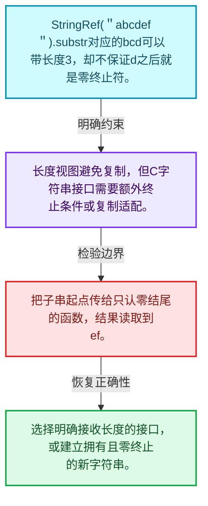
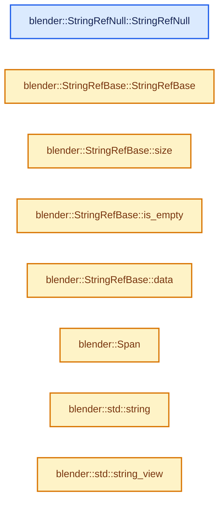
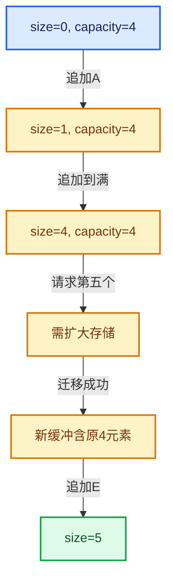

# 01-15 StringRef字符串视图

[方向导航](README.md) · [总目录](../README.md) · [实现索引](../%E7%AC%A6%E5%8F%B7%E4%BE%9D%E8%B5%96%E4%B8%8E%E5%AE%9E%E7%8E%B0%E7%B4%A2%E5%BC%95.md)

## 从问题到实现

字符串长度和零终止为什么必须分清？

视图可以引用子串而不复制，但子串末尾未必有零；StringRefNull的额外契约不能靠强转伪造。

**数据模型**

StringRef("abcdef").substr对应的bcd可以带长度3，却不保证d之后就是零终止符。

**设计取舍**

长度视图避免复制，但C字符串接口需要额外终止条件或复制适配。

**最小反例**

把子串起点传给只认零结尾的函数，结果读取到ef。

**推导**

选择明确接收长度的接口，或建立拥有且零终止的新字符串。

## 阅读地图与执行推演








图中的数值推演是本方向的教学模型；实际函数之间的调用边与概念分析边分别标注，不能把概念关系当作运行时调度顺序。

## 完整源码单元与就地讲解

中文讲解直接放在相关代码旁，复杂机制在代码下展开。原文折叠区保留基准行号；不需要在行号表和函数之间来回查找。类布局可分段展示，函数实现不按固定行数切开。

### 类型布局、声明与编译条件 · BLI_string_ref.hh L1—L148

<a id="t-44f5186f332c"></a>

<a id="t-cfe4037b3ea4"></a>

`StringRefBase`在这里声明的数据成员：

- `char data_`
- `int64_t size_`
- `int64_t not_found`
- `int64_t size`
- `bool is_empty`
- `char data`
- `char begin`
- `char end`
- `IndexRange index_range`
- `void copy_utf8_truncated`
- `void copy_bytes_truncated`
- `void copy_unsafe`
- `bool startswith`
- `bool endswith`
- `StringRef substr`
- `char front`
- `char back`
- `int64_t find`
- `int64_t find`
- `int64_t rfind`
- `int64_t rfind`
- `int64_t find_first_of`
- `int64_t find_first_of`
- `int64_t find_last_of`
- `int64_t find_last_of`
- `int64_t find_first_not_of`
- `int64_t find_first_not_of`
- `int64_t find_last_not_of`
- `int64_t find_last_not_of`
- `StringRef trim`
- `StringRef trim`
- `StringRef trim`
- `StringRef trim_left`
- `StringRef trim_left`
- `StringRef trim_right`
- `StringRef trim_right`

<a id="t-de95acd9c614"></a>

<!-- annotated:ff36dd1a237ed5 -->

```cpp
/* SPDX-FileCopyrightText: 2023 Blender Authors
 *
 * SPDX-License-Identifier: GPL-2.0-or-later */

#pragma once

/** \file
 * \ingroup bli
 *
 * A `StringRef` references a const char array owned by someone else. It is just a pointer
 * and a size. Since the memory is not owned, StringRef should not be used to transfer ownership of
 * the string. The data referenced by a StringRef cannot be mutated through it.
 *
 * A StringRef is NOT null-terminated. This makes it much more powerful within C++, because we can
 * also cut off parts of the end without creating a copy. When interfacing with C code that expects
 * null-terminated strings, `StringRefNull` can be used. It is essentially the same as
 * StringRef, but with the restriction that the string has to be null-terminated.
 *
 * Whenever possible, string parameters should be of type StringRef and the string return type
 * should be StringRefNull. Don't forget that the StringRefNull does not own the string, so don't
 * return it when the string exists only in the scope of the function. This convention makes
 * functions usable in the most contexts.
 *
 * StringRef vs. std::string_view:
 *   Both types are certainly very similar. The main benefit of using StringRef in Blender is that
 *   this allows us to add convenience methods at any time. Especially, when doing a lot of string
 *   manipulation, this helps to keep the code clean. Furthermore, we need StringRefNull anyway,
 *   because there is a lot of C code that expects null-terminated strings. Conversion between
 *   StringRef and string_view is very cheap and can be done at API boundaries at essentially no
 *   cost. Another benefit of using StringRef is that it uses signed integers, thus developers
 *   have to deal less with issues resulting from unsigned integers.
 */

#include <cstring>
#include <string>
#include <string_view>

#include "BLI_compiler_attrs.hh"
#include "BLI_span.hh"

namespace blender {

class StringRef;

/**
 * A common base class for StringRef and StringRefNull. This should never be used in other files.
 * It only exists to avoid some code duplication.
 */
class StringRefBase {
 protected:
  /* May be nullptr when used in StringRef. */
  const char *data_;
  int64_t size_;

  constexpr StringRefBase(const char *data, int64_t size);

 public:
  /** Makes this type "string-like" for some libraries (e.g. `fmt`). */
  using value_type = char;

  /** Similar to #string_view::npos, but signed. */
  static constexpr int64_t not_found = -1;

  constexpr int64_t size() const;
  constexpr bool is_empty() const;
  constexpr const char *data() const;
  constexpr operator Span<char>() const;

  operator std::string() const;
  constexpr operator std::string_view() const;

  constexpr const char *begin() const;
  constexpr const char *end() const;

  constexpr IndexRange index_range() const;

  /**
   * Copy the string into a char array. The copied string will be null-terminated. If it does not
   * fit, it will be truncated while keeping it valid UTF8 (assuming the #StringRef itself is
   * valid UTF8).
   */
  void copy_utf8_truncated(char *dst, int64_t dst_size) const;
  template<size_t N> void copy_utf8_truncated(char (&dst)[N]) const;

  /**
   * Copy the string into a char array. The copied string will be null-terminated. If it does not
   * fit, it will be truncated.
   *
   * \note #copy_utf8_truncated should be used UTF8 strings,
   * this should be used for strings which are allowed to contain arbitrary
   * byte sequences without a known encoding such as file-paths.
   */
  void copy_bytes_truncated(char *dst, int64_t dst_size) const;
  template<size_t N> void copy_bytes_truncated(char (&dst)[N]) const;

  /**
   * Copy the string into a buffer. The buffer has to be one byte larger than the size of the
   * string, because the copied string will be null-terminated. Only use this when you are
   * absolutely sure that the buffer is large enough.
   */
  void copy_unsafe(char *dst) const;

  constexpr bool startswith(StringRef prefix) const;
  constexpr bool endswith(StringRef suffix) const;
  constexpr StringRef substr(int64_t start, int64_t size) const;

  constexpr const char &front() const;
  constexpr const char &back() const;

  /**
   * The behavior of those functions matches the standard library implementation of
   * std::string_view.
   *
   * \return the offset at which the char/string was found, or StringRefBase::not_found when
   * nothing was found.
   */
  constexpr int64_t find(char c, int64_t pos = 0) const;
  constexpr int64_t find(StringRef str, int64_t pos = 0) const;
  constexpr int64_t rfind(char c, int64_t pos = INT64_MAX) const;
  constexpr int64_t rfind(StringRef str, int64_t pos = INT64_MAX) const;
  constexpr int64_t find_first_of(StringRef chars, int64_t pos = 0) const;
  constexpr int64_t find_first_of(char c, int64_t pos = 0) const;
  constexpr int64_t find_last_of(StringRef chars, int64_t pos = INT64_MAX) const;
  constexpr int64_t find_last_of(char c, int64_t pos = INT64_MAX) const;
  constexpr int64_t find_first_not_of(StringRef chars, int64_t pos = 0) const;
  constexpr int64_t find_first_not_of(char c, int64_t pos = 0) const;
  constexpr int64_t find_last_not_of(StringRef chars, int64_t pos = INT64_MAX) const;
  constexpr int64_t find_last_not_of(char c, int64_t pos = INT64_MAX) const;

  constexpr StringRef trim() const;
  constexpr StringRef trim(StringRef characters_to_remove) const;
  constexpr StringRef trim(char character_to_remove) const;
  constexpr StringRef trim_left() const;
  constexpr StringRef trim_left(StringRef characters_to_remove) const;
  constexpr StringRef trim_right() const;
  constexpr StringRef trim_right(StringRef characters_to_remove) const;
};

/**
 * References a null-terminated const char array.
 *
 * StringRefNull can be compared with StringRef and StringRefNull.
 */
class StringRefNull : public StringRefBase {

 public:
  constexpr StringRefNull();
  constexpr StringRefNull(const char *str, int64_t size) ATTR_NONNULL(2);
```

<details>
<summary>核对原始源码：source/blender/blenlib/BLI_string_ref.hh · L1—L148</summary>

<!-- original:ff36dd1a237ed5:source/blender/blenlib/BLI_string_ref.hh:1:148 -->

```cpp
/* SPDX-FileCopyrightText: 2023 Blender Authors
 *
 * SPDX-License-Identifier: GPL-2.0-or-later */

#pragma once

/** \file
 * \ingroup bli
 *
 * A `StringRef` references a const char array owned by someone else. It is just a pointer
 * and a size. Since the memory is not owned, StringRef should not be used to transfer ownership of
 * the string. The data referenced by a StringRef cannot be mutated through it.
 *
 * A StringRef is NOT null-terminated. This makes it much more powerful within C++, because we can
 * also cut off parts of the end without creating a copy. When interfacing with C code that expects
 * null-terminated strings, `StringRefNull` can be used. It is essentially the same as
 * StringRef, but with the restriction that the string has to be null-terminated.
 *
 * Whenever possible, string parameters should be of type StringRef and the string return type
 * should be StringRefNull. Don't forget that the StringRefNull does not own the string, so don't
 * return it when the string exists only in the scope of the function. This convention makes
 * functions usable in the most contexts.
 *
 * StringRef vs. std::string_view:
 *   Both types are certainly very similar. The main benefit of using StringRef in Blender is that
 *   this allows us to add convenience methods at any time. Especially, when doing a lot of string
 *   manipulation, this helps to keep the code clean. Furthermore, we need StringRefNull anyway,
 *   because there is a lot of C code that expects null-terminated strings. Conversion between
 *   StringRef and string_view is very cheap and can be done at API boundaries at essentially no
 *   cost. Another benefit of using StringRef is that it uses signed integers, thus developers
 *   have to deal less with issues resulting from unsigned integers.
 */

#include <cstring>
#include <string>
#include <string_view>

#include "BLI_compiler_attrs.hh"
#include "BLI_span.hh"

namespace blender {

class StringRef;

/**
 * A common base class for StringRef and StringRefNull. This should never be used in other files.
 * It only exists to avoid some code duplication.
 */
class StringRefBase {
 protected:
  /* May be nullptr when used in StringRef. */
  const char *data_;
  int64_t size_;

  constexpr StringRefBase(const char *data, int64_t size);

 public:
  /** Makes this type "string-like" for some libraries (e.g. `fmt`). */
  using value_type = char;

  /** Similar to #string_view::npos, but signed. */
  static constexpr int64_t not_found = -1;

  constexpr int64_t size() const;
  constexpr bool is_empty() const;
  constexpr const char *data() const;
  constexpr operator Span<char>() const;

  operator std::string() const;
  constexpr operator std::string_view() const;

  constexpr const char *begin() const;
  constexpr const char *end() const;

  constexpr IndexRange index_range() const;

  /**
   * Copy the string into a char array. The copied string will be null-terminated. If it does not
   * fit, it will be truncated while keeping it valid UTF8 (assuming the #StringRef itself is
   * valid UTF8).
   */
  void copy_utf8_truncated(char *dst, int64_t dst_size) const;
  template<size_t N> void copy_utf8_truncated(char (&dst)[N]) const;

  /**
   * Copy the string into a char array. The copied string will be null-terminated. If it does not
   * fit, it will be truncated.
   *
   * \note #copy_utf8_truncated should be used UTF8 strings,
   * this should be used for strings which are allowed to contain arbitrary
   * byte sequences without a known encoding such as file-paths.
   */
  void copy_bytes_truncated(char *dst, int64_t dst_size) const;
  template<size_t N> void copy_bytes_truncated(char (&dst)[N]) const;

  /**
   * Copy the string into a buffer. The buffer has to be one byte larger than the size of the
   * string, because the copied string will be null-terminated. Only use this when you are
   * absolutely sure that the buffer is large enough.
   */
  void copy_unsafe(char *dst) const;

  constexpr bool startswith(StringRef prefix) const;
  constexpr bool endswith(StringRef suffix) const;
  constexpr StringRef substr(int64_t start, int64_t size) const;

  constexpr const char &front() const;
  constexpr const char &back() const;

  /**
   * The behavior of those functions matches the standard library implementation of
   * std::string_view.
   *
   * \return the offset at which the char/string was found, or StringRefBase::not_found when
   * nothing was found.
   */
  constexpr int64_t find(char c, int64_t pos = 0) const;
  constexpr int64_t find(StringRef str, int64_t pos = 0) const;
  constexpr int64_t rfind(char c, int64_t pos = INT64_MAX) const;
  constexpr int64_t rfind(StringRef str, int64_t pos = INT64_MAX) const;
  constexpr int64_t find_first_of(StringRef chars, int64_t pos = 0) const;
  constexpr int64_t find_first_of(char c, int64_t pos = 0) const;
  constexpr int64_t find_last_of(StringRef chars, int64_t pos = INT64_MAX) const;
  constexpr int64_t find_last_of(char c, int64_t pos = INT64_MAX) const;
  constexpr int64_t find_first_not_of(StringRef chars, int64_t pos = 0) const;
  constexpr int64_t find_first_not_of(char c, int64_t pos = 0) const;
  constexpr int64_t find_last_not_of(StringRef chars, int64_t pos = INT64_MAX) const;
  constexpr int64_t find_last_not_of(char c, int64_t pos = INT64_MAX) const;

  constexpr StringRef trim() const;
  constexpr StringRef trim(StringRef characters_to_remove) const;
  constexpr StringRef trim(char character_to_remove) const;
  constexpr StringRef trim_left() const;
  constexpr StringRef trim_left(StringRef characters_to_remove) const;
  constexpr StringRef trim_right() const;
  constexpr StringRef trim_right(StringRef characters_to_remove) const;
};

/**
 * References a null-terminated const char array.
 *
 * StringRefNull can be compared with StringRef and StringRefNull.
 */
class StringRefNull : public StringRefBase {

 public:
  constexpr StringRefNull();
  constexpr StringRefNull(const char *str, int64_t size) ATTR_NONNULL(2);
```

</details>

<a id="f-ebc6ee5f8fc16390"></a>

### `blender::StringRefNull::StringRefNull`

实现位置：[source/blender/blenlib/BLI_string_ref.hh](../../../../../source/blender/blenlib/BLI_string_ref.hh) · L149—L149。

接口参数：

- `std::nullptr_t`

**教学注释版**

<!-- annotated:ba314ece29e5f6 -->

```cpp
  StringRefNull(std::nullptr_t) = delete;
```

<details>
<summary>核对原始源码：source/blender/blenlib/BLI_string_ref.hh · L149—L149</summary>

<!-- original:ba314ece29e5f6:source/blender/blenlib/BLI_string_ref.hh:149:149 -->

```cpp
  StringRefNull(std::nullptr_t) = delete;
```

</details>

**继续追踪实现**

本实现没有需要继续展开的显式调用；检查返回表达式、对象转换和调用者前置条件。

### 类型布局、声明与编译条件 · BLI_string_ref.hh L150—L187

<a id="t-d581aedced51"></a>

`StringRef`在这里声明的数据成员：

- `StringRef drop_prefix`
- `StringRef drop_known_prefix`
- `StringRef drop_suffix`
- `StringRef drop_known_suffix`
- `char operator[]`

<!-- annotated:fe68ec2d723391 -->

```cpp
  constexpr StringRefNull(const char *str) ATTR_NONNULL(2);
  StringRefNull(const std::string &str);

  constexpr char operator[](int64_t index) const;
  constexpr const char *c_str() const;
};

/**
 * References a const char array. It might not be null terminated.
 *
 * StringRef can be compared with StringRef and StringRefNull.
 *
 * \note It is valid to pass `nullptr` to the constructor, as it can be used to indicate an empty
 * string.
 */
class StringRef : public StringRefBase {
 public:
  constexpr StringRef();
  constexpr StringRef(StringRefNull other);
  constexpr StringRef(const char *str);
  constexpr StringRef(const char *str, int64_t length);
  constexpr StringRef(const char *begin, const char *one_after_end);
  constexpr StringRef(std::string_view view);
  constexpr StringRef(Span<char> span);
  StringRef(const std::string &str);

  constexpr StringRef drop_prefix(int64_t n) const;
  constexpr StringRef drop_known_prefix(StringRef prefix) const;
  constexpr StringRef drop_suffix(int64_t n) const;
  constexpr StringRef drop_known_suffix(StringRef suffix) const;

  constexpr char operator[](int64_t index) const;
};

/* -------------------------------------------------------------------- */
/** \name #StringRefBase Inline Methods
 * \{ */

```

<details>
<summary>核对原始源码：source/blender/blenlib/BLI_string_ref.hh · L150—L187</summary>

<!-- original:fe68ec2d723391:source/blender/blenlib/BLI_string_ref.hh:150:187 -->

```cpp
  constexpr StringRefNull(const char *str) ATTR_NONNULL(2);
  StringRefNull(const std::string &str);

  constexpr char operator[](int64_t index) const;
  constexpr const char *c_str() const;
};

/**
 * References a const char array. It might not be null terminated.
 *
 * StringRef can be compared with StringRef and StringRefNull.
 *
 * \note It is valid to pass `nullptr` to the constructor, as it can be used to indicate an empty
 * string.
 */
class StringRef : public StringRefBase {
 public:
  constexpr StringRef();
  constexpr StringRef(StringRefNull other);
  constexpr StringRef(const char *str);
  constexpr StringRef(const char *str, int64_t length);
  constexpr StringRef(const char *begin, const char *one_after_end);
  constexpr StringRef(std::string_view view);
  constexpr StringRef(Span<char> span);
  StringRef(const std::string &str);

  constexpr StringRef drop_prefix(int64_t n) const;
  constexpr StringRef drop_known_prefix(StringRef prefix) const;
  constexpr StringRef drop_suffix(int64_t n) const;
  constexpr StringRef drop_known_suffix(StringRef suffix) const;

  constexpr char operator[](int64_t index) const;
};

/* -------------------------------------------------------------------- */
/** \name #StringRefBase Inline Methods
 * \{ */

```

</details>

<a id="f-0c03bbb04e980a0d"></a>

### `blender::StringRefBase::StringRefBase`

实现位置：[source/blender/blenlib/BLI_string_ref.hh](../../../../../source/blender/blenlib/BLI_string_ref.hh) · L188—L191。

接口参数：

- `const char *data`
- `const int64_t size`

**教学注释版**

<!-- annotated:3dd891a2447191 -->

```cpp
constexpr StringRefBase::StringRefBase(const char *data, const int64_t size)
    : data_(data), size_(size)
{
}
```

<details>
<summary>核对原始源码：source/blender/blenlib/BLI_string_ref.hh · L188—L191</summary>

<!-- original:3dd891a2447191:source/blender/blenlib/BLI_string_ref.hh:188:191 -->

```cpp
constexpr StringRefBase::StringRefBase(const char *data, const int64_t size)
    : data_(data), size_(size)
{
}
```

</details>

**继续追踪实现**

本实现没有需要继续展开的显式调用；检查返回表达式、对象转换和调用者前置条件。

### 类型布局、声明与编译条件 · BLI_string_ref.hh L192—L195

<!-- annotated:61a926c775e227 -->

```cpp

/**
 * Return the (byte-)length of the referenced string, without any null-terminator.
 */
```

<details>
<summary>核对原始源码：source/blender/blenlib/BLI_string_ref.hh · L192—L195</summary>

<!-- original:61a926c775e227:source/blender/blenlib/BLI_string_ref.hh:192:195 -->

```cpp

/**
 * Return the (byte-)length of the referenced string, without any null-terminator.
 */
```

</details>

<a id="f-60d4631c74931d2e"></a>

### `blender::StringRefBase::size`

实现位置：[source/blender/blenlib/BLI_string_ref.hh](../../../../../source/blender/blenlib/BLI_string_ref.hh) · L196—L199。

**教学注释版**

<!-- annotated:cd8d2c91939adc -->

```cpp
constexpr int64_t StringRefBase::size() const
{
  return size_;
}
```

<details>
<summary>核对原始源码：source/blender/blenlib/BLI_string_ref.hh · L196—L199</summary>

<!-- original:cd8d2c91939adc:source/blender/blenlib/BLI_string_ref.hh:196:199 -->

```cpp
constexpr int64_t StringRefBase::size() const
{
  return size_;
}
```

</details>

**结果出口**

- `return size_;`

**继续追踪实现**

本实现没有需要继续展开的显式调用；检查返回表达式、对象转换和调用者前置条件。

<!-- annotated:5242421f117934 -->

```cpp

```

<details>
<summary>核对原始源码：source/blender/blenlib/BLI_string_ref.hh · L200—L200</summary>

<!-- original:5242421f117934:source/blender/blenlib/BLI_string_ref.hh:200:200 -->

```cpp

```

</details>

<a id="f-9f6c3d2da1cb1796"></a>

### `blender::StringRefBase::is_empty`

实现位置：[source/blender/blenlib/BLI_string_ref.hh](../../../../../source/blender/blenlib/BLI_string_ref.hh) · L201—L204。

**教学注释版**

<!-- annotated:adafec41a4206a -->

```cpp
constexpr bool StringRefBase::is_empty() const
{
  return size_ == 0;
}
```

<details>
<summary>核对原始源码：source/blender/blenlib/BLI_string_ref.hh · L201—L204</summary>

<!-- original:adafec41a4206a:source/blender/blenlib/BLI_string_ref.hh:201:204 -->

```cpp
constexpr bool StringRefBase::is_empty() const
{
  return size_ == 0;
}
```

</details>

**结果出口**

- `return size_ == 0;`

**继续追踪实现**

本实现没有需要继续展开的显式调用；检查返回表达式、对象转换和调用者前置条件。

### 类型布局、声明与编译条件 · BLI_string_ref.hh L205—L208

<!-- annotated:6951053c1ebec4 -->

```cpp

/**
 * Return a pointer to the start of the string.
 */
```

<details>
<summary>核对原始源码：source/blender/blenlib/BLI_string_ref.hh · L205—L208</summary>

<!-- original:6951053c1ebec4:source/blender/blenlib/BLI_string_ref.hh:205:208 -->

```cpp

/**
 * Return a pointer to the start of the string.
 */
```

</details>

<a id="f-cced1a1ccd124155"></a>

### `blender::StringRefBase::data`

实现位置：[source/blender/blenlib/BLI_string_ref.hh](../../../../../source/blender/blenlib/BLI_string_ref.hh) · L209—L212。

**教学注释版**

<!-- annotated:5eba4a059c16d1 -->

```cpp
constexpr const char *StringRefBase::data() const
{
  return data_;
}
```

<details>
<summary>核对原始源码：source/blender/blenlib/BLI_string_ref.hh · L209—L212</summary>

<!-- original:5eba4a059c16d1:source/blender/blenlib/BLI_string_ref.hh:209:212 -->

```cpp
constexpr const char *StringRefBase::data() const
{
  return data_;
}
```

</details>

**结果出口**

- `return data_;`

**继续追踪实现**

本实现没有需要继续展开的显式调用；检查返回表达式、对象转换和调用者前置条件。

<!-- annotated:b9769525bf5056 -->

```cpp

```

<details>
<summary>核对原始源码：source/blender/blenlib/BLI_string_ref.hh · L213—L213</summary>

<!-- original:b9769525bf5056:source/blender/blenlib/BLI_string_ref.hh:213:213 -->

```cpp

```

</details>

<a id="f-eea723436ab634ed"></a>

### `blender::Span`

实现位置：[source/blender/blenlib/BLI_string_ref.hh](../../../../../source/blender/blenlib/BLI_string_ref.hh) · L214—L217。

**教学注释版**

<!-- annotated:e6c17d24050592 -->

```cpp
constexpr StringRefBase::operator Span<char>() const
{
  return Span<char>(data_, size_);
}
```

<details>
<summary>核对原始源码：source/blender/blenlib/BLI_string_ref.hh · L214—L217</summary>

<!-- original:e6c17d24050592:source/blender/blenlib/BLI_string_ref.hh:214:217 -->

```cpp
constexpr StringRefBase::operator Span<char>() const
{
  return Span<char>(data_, size_);
}
```

</details>

**结果出口**

- `return Span<char>(data_, size_);`

**继续追踪实现**

- `Span<char>` → [blender::Span · L214](15-StringRef%E5%AD%97%E7%AC%A6%E4%B8%B2%E8%A7%86%E5%9B%BE.md#f-eea723436ab634ed)。

### 类型布局、声明与编译条件 · BLI_string_ref.hh L218—L222

<!-- annotated:bc9e1cbd411064 -->

```cpp

/**
 * Implicitly convert to std::string. This is convenient in most cases, but you have to be a bit
 * careful not to convert to std::string accidentally.
 */
```

<details>
<summary>核对原始源码：source/blender/blenlib/BLI_string_ref.hh · L218—L222</summary>

<!-- original:bc9e1cbd411064:source/blender/blenlib/BLI_string_ref.hh:218:222 -->

```cpp

/**
 * Implicitly convert to std::string. This is convenient in most cases, but you have to be a bit
 * careful not to convert to std::string accidentally.
 */
```

</details>

<a id="f-e67b9a9ef20b00c5"></a>

### `blender::std::string`

实现位置：[source/blender/blenlib/BLI_string_ref.hh](../../../../../source/blender/blenlib/BLI_string_ref.hh) · L223—L226。

**教学注释版**

<!-- annotated:fa66191bfa8cf0 -->

```cpp
inline StringRefBase::operator std::string() const
{
  return std::string(data_, size_t(size_));
}
```

<details>
<summary>核对原始源码：source/blender/blenlib/BLI_string_ref.hh · L223—L226</summary>

<!-- original:fa66191bfa8cf0:source/blender/blenlib/BLI_string_ref.hh:223:226 -->

```cpp
inline StringRefBase::operator std::string() const
{
  return std::string(data_, size_t(size_));
}
```

</details>

**结果出口**

- `return std::string(data_, size_t(size_));`

**继续追踪实现**

- `std::string` → [外部契约](https://eel.is/c++draft/)：这个边界按实际表达式及所属类型核对参数、返回值、寿命与失败行为。这里提供接口入口，不声称已解释该第三方版本的内部实现。

<!-- annotated:9590d62666624c -->

```cpp

```

<details>
<summary>核对原始源码：source/blender/blenlib/BLI_string_ref.hh · L227—L227</summary>

<!-- original:9590d62666624c:source/blender/blenlib/BLI_string_ref.hh:227:227 -->

```cpp

```

</details>

<a id="f-46b1e99e1269c4c5"></a>

### `blender::std::string_view`

实现位置：[source/blender/blenlib/BLI_string_ref.hh](../../../../../source/blender/blenlib/BLI_string_ref.hh) · L228—L231。

**教学注释版**

<!-- annotated:9009e250a236bd -->

```cpp
constexpr StringRefBase::operator std::string_view() const
{
  return std::string_view(data_, size_t(size_));
}
```

<details>
<summary>核对原始源码：source/blender/blenlib/BLI_string_ref.hh · L228—L231</summary>

<!-- original:9009e250a236bd:source/blender/blenlib/BLI_string_ref.hh:228:231 -->

```cpp
constexpr StringRefBase::operator std::string_view() const
{
  return std::string_view(data_, size_t(size_));
}
```

</details>

**结果出口**

- `return std::string_view(data_, size_t(size_));`

**继续追踪实现**

- `std::string_view` → [外部契约](https://eel.is/c++draft/)：这个边界按实际表达式及所属类型核对参数、返回值、寿命与失败行为。这里提供接口入口，不声称已解释该第三方版本的内部实现。

<!-- annotated:b6a630c0749067 -->

```cpp

```

<details>
<summary>核对原始源码：source/blender/blenlib/BLI_string_ref.hh · L232—L232</summary>

<!-- original:b6a630c0749067:source/blender/blenlib/BLI_string_ref.hh:232:232 -->

```cpp

```

</details>

<a id="f-0fa50fe40314532d"></a>

### `blender::StringRefBase::begin`

实现位置：[source/blender/blenlib/BLI_string_ref.hh](../../../../../source/blender/blenlib/BLI_string_ref.hh) · L233—L236。

**教学注释版**

<!-- annotated:daddceacb24551 -->

```cpp
constexpr const char *StringRefBase::begin() const
{
  return data_;
}
```

<details>
<summary>核对原始源码：source/blender/blenlib/BLI_string_ref.hh · L233—L236</summary>

<!-- original:daddceacb24551:source/blender/blenlib/BLI_string_ref.hh:233:236 -->

```cpp
constexpr const char *StringRefBase::begin() const
{
  return data_;
}
```

</details>

**结果出口**

- `return data_;`

**继续追踪实现**

本实现没有需要继续展开的显式调用；检查返回表达式、对象转换和调用者前置条件。

<!-- annotated:34bfc4d620d41c -->

```cpp

```

<details>
<summary>核对原始源码：source/blender/blenlib/BLI_string_ref.hh · L237—L237</summary>

<!-- original:34bfc4d620d41c:source/blender/blenlib/BLI_string_ref.hh:237:237 -->

```cpp

```

</details>

<a id="f-6197aad1986222a5"></a>

### `blender::StringRefBase::end`

实现位置：[source/blender/blenlib/BLI_string_ref.hh](../../../../../source/blender/blenlib/BLI_string_ref.hh) · L238—L241。

**教学注释版**

<!-- annotated:7c72f8786b8990 -->

```cpp
constexpr const char *StringRefBase::end() const
{
  return data_ + size_;
}
```

<details>
<summary>核对原始源码：source/blender/blenlib/BLI_string_ref.hh · L238—L241</summary>

<!-- original:7c72f8786b8990:source/blender/blenlib/BLI_string_ref.hh:238:241 -->

```cpp
constexpr const char *StringRefBase::end() const
{
  return data_ + size_;
}
```

</details>

**结果出口**

- `return data_ + size_;`

**继续追踪实现**

本实现没有需要继续展开的显式调用；检查返回表达式、对象转换和调用者前置条件。

<!-- annotated:16147c9c530f17 -->

```cpp

```

<details>
<summary>核对原始源码：source/blender/blenlib/BLI_string_ref.hh · L242—L242</summary>

<!-- original:16147c9c530f17:source/blender/blenlib/BLI_string_ref.hh:242:242 -->

```cpp

```

</details>

<a id="f-d4dfd09c4cf9e9af"></a>

### `blender::StringRefBase::index_range`

实现位置：[source/blender/blenlib/BLI_string_ref.hh](../../../../../source/blender/blenlib/BLI_string_ref.hh) · L243—L246。

**教学注释版**

<!-- annotated:62e511d161e0ac -->

```cpp
constexpr IndexRange StringRefBase::index_range() const
{
  return IndexRange(size_);
}
```

<details>
<summary>核对原始源码：source/blender/blenlib/BLI_string_ref.hh · L243—L246</summary>

<!-- original:62e511d161e0ac:source/blender/blenlib/BLI_string_ref.hh:243:246 -->

```cpp
constexpr IndexRange StringRefBase::index_range() const
{
  return IndexRange(size_);
}
```

</details>

**结果出口**

- `return IndexRange(size_);`

**继续追踪实现**

- `IndexRange` → [blender::IndexRange](%E4%BE%9D%E8%B5%96-BLI_index_range-7d7cc5.md#t-caa3466d6776)；[blender::gpu::shader::parser::IndexRange](../05-%E5%87%A0%E4%BD%95%E5%AD%98%E5%82%A8%E4%B8%8E%E6%8B%93%E6%89%91%E6%98%A0%E5%B0%84/%E4%BE%9D%E8%B5%96-utils-06433d.md#t-82d2bd4ea71c)；[blender::IndexRange](../05-%E5%87%A0%E4%BD%95%E5%AD%98%E5%82%A8%E4%B8%8E%E6%8B%93%E6%89%91%E6%98%A0%E5%B0%84/%E4%BE%9D%E8%B5%96-DNA_node_types-6708b9.md#t-0448cc889d39)。

<!-- annotated:7316adc11adcf8 -->

```cpp

```

<details>
<summary>核对原始源码：source/blender/blenlib/BLI_string_ref.hh · L247—L247</summary>

<!-- original:7316adc11adcf8:source/blender/blenlib/BLI_string_ref.hh:247:247 -->

```cpp

```

</details>

<a id="f-0616684a44814e0a"></a>

### `blender::StringRefBase::copy_unsafe`

实现位置：[source/blender/blenlib/BLI_string_ref.hh](../../../../../source/blender/blenlib/BLI_string_ref.hh) · L248—L254。

接口参数：

- `char *dst`

**教学注释版**

<!-- annotated:5a36b6a2cab55c -->

```cpp
inline void StringRefBase::copy_unsafe(char *dst) const
{
  if (size_ > 0) {
    // [讲解] memcpy：复制字节，源与目标不应重叠。类型生命周期、对齐和可复制表示须由调用者证明，不是任意对象的复制构造。
    memcpy(dst, data_, size_t(size_));
  }
  dst[size_] = '\0';
}
```

<details>
<summary>核对原始源码：source/blender/blenlib/BLI_string_ref.hh · L248—L254</summary>

<!-- original:5a36b6a2cab55c:source/blender/blenlib/BLI_string_ref.hh:248:254 -->

```cpp
inline void StringRefBase::copy_unsafe(char *dst) const
{
  if (size_ > 0) {
    memcpy(dst, data_, size_t(size_));
  }
  dst[size_] = '\0';
}
```

</details>

**沿实际写入检查状态**

- `dst[size_] = '\0';`

**继续追踪实现**

- `memcpy` → [外部契约](https://eel.is/c++draft/cstring.syn)：复制字节，源与目标不应重叠。类型生命周期、对齐和可复制表示须由调用者证明，不是任意对象的复制构造。

<!-- annotated:736e183a17b8ea -->

```cpp

```

<details>
<summary>核对原始源码：source/blender/blenlib/BLI_string_ref.hh · L255—L255</summary>

<!-- original:736e183a17b8ea:source/blender/blenlib/BLI_string_ref.hh:255:255 -->

```cpp

```

</details>

<a id="f-b2a0157cbe286321"></a>

### `blender::StringRefBase::copy_utf8_truncated`

实现位置：[source/blender/blenlib/BLI_string_ref.hh](../../../../../source/blender/blenlib/BLI_string_ref.hh) · L256—L259。

接口参数：

- `char (&dst)[N]`

**教学注释版**

<!-- annotated:8e311604afd2ca -->

```cpp
template<size_t N> inline void StringRefBase::copy_utf8_truncated(char (&dst)[N]) const
{
  this->copy_utf8_truncated(dst, N);
}
```

<details>
<summary>核对原始源码：source/blender/blenlib/BLI_string_ref.hh · L256—L259</summary>

<!-- original:8e311604afd2ca:source/blender/blenlib/BLI_string_ref.hh:256:259 -->

```cpp
template<size_t N> inline void StringRefBase::copy_utf8_truncated(char (&dst)[N]) const
{
  this->copy_utf8_truncated(dst, N);
}
```

</details>

**继续追踪实现**

- `this->copy_utf8_truncated` → [blender::StringRefBase::copy_utf8_truncated · L256](15-StringRef%E5%AD%97%E7%AC%A6%E4%B8%B2%E8%A7%86%E5%9B%BE.md#f-b2a0157cbe286321)。

<!-- annotated:af1cff335e6002 -->

```cpp

```

<details>
<summary>核对原始源码：source/blender/blenlib/BLI_string_ref.hh · L260—L260</summary>

<!-- original:af1cff335e6002:source/blender/blenlib/BLI_string_ref.hh:260:260 -->

```cpp

```

</details>

<a id="f-85cebbbc759b261d"></a>

### `blender::StringRefBase::copy_bytes_truncated`

实现位置：[source/blender/blenlib/BLI_string_ref.hh](../../../../../source/blender/blenlib/BLI_string_ref.hh) · L261—L264。

接口参数：

- `char (&dst)[N]`

**教学注释版**

<!-- annotated:8f219cef9efd01 -->

```cpp
template<size_t N> inline void StringRefBase::copy_bytes_truncated(char (&dst)[N]) const
{
  this->copy_bytes_truncated(dst, N);
}
```

<details>
<summary>核对原始源码：source/blender/blenlib/BLI_string_ref.hh · L261—L264</summary>

<!-- original:8f219cef9efd01:source/blender/blenlib/BLI_string_ref.hh:261:264 -->

```cpp
template<size_t N> inline void StringRefBase::copy_bytes_truncated(char (&dst)[N]) const
{
  this->copy_bytes_truncated(dst, N);
}
```

</details>

**继续追踪实现**

- `this->copy_bytes_truncated` → [blender::StringRefBase::copy_bytes_truncated · L261](15-StringRef%E5%AD%97%E7%AC%A6%E4%B8%B2%E8%A7%86%E5%9B%BE.md#f-85cebbbc759b261d)。

### 类型布局、声明与编译条件 · BLI_string_ref.hh L265—L268

<!-- annotated:fbabe5455e245a -->

```cpp

/**
 * Return true when the string starts with the given prefix.
 */
```

<details>
<summary>核对原始源码：source/blender/blenlib/BLI_string_ref.hh · L265—L268</summary>

<!-- original:fbabe5455e245a:source/blender/blenlib/BLI_string_ref.hh:265:268 -->

```cpp

/**
 * Return true when the string starts with the given prefix.
 */
```

</details>

<a id="f-78237ccfe249bfa5"></a>

### `blender::StringRefBase::startswith`

实现位置：[source/blender/blenlib/BLI_string_ref.hh](../../../../../source/blender/blenlib/BLI_string_ref.hh) · L269—L280。

接口参数：

- `StringRef prefix`

**教学注释版**

<!-- annotated:2c927dce8ecb0e -->

```cpp
constexpr bool StringRefBase::startswith(StringRef prefix) const
{
  if (size_ < prefix.size_) {
    return false;
  }
  for (int64_t i = 0; i < prefix.size_; i++) {
    if (data_[i] != prefix.data_[i]) {
      return false;
    }
  }
  return true;
}
```

<details>
<summary>核对原始源码：source/blender/blenlib/BLI_string_ref.hh · L269—L280</summary>

<!-- original:2c927dce8ecb0e:source/blender/blenlib/BLI_string_ref.hh:269:280 -->

```cpp
constexpr bool StringRefBase::startswith(StringRef prefix) const
{
  if (size_ < prefix.size_) {
    return false;
  }
  for (int64_t i = 0; i < prefix.size_; i++) {
    if (data_[i] != prefix.data_[i]) {
      return false;
    }
  }
  return true;
}
```

</details>

**结果出口**

- `return false;`
- `return true;`

**继续追踪实现**

本实现没有需要继续展开的显式调用；检查返回表达式、对象转换和调用者前置条件。

### 类型布局、声明与编译条件 · BLI_string_ref.hh L281—L284

<!-- annotated:d076fe93d114e7 -->

```cpp

/**
 * Return true when the string ends with the given suffix.
 */
```

<details>
<summary>核对原始源码：source/blender/blenlib/BLI_string_ref.hh · L281—L284</summary>

<!-- original:d076fe93d114e7:source/blender/blenlib/BLI_string_ref.hh:281:284 -->

```cpp

/**
 * Return true when the string ends with the given suffix.
 */
```

</details>

<a id="f-9b23dbdd3afc9dbb"></a>

### `blender::StringRefBase::endswith`

实现位置：[source/blender/blenlib/BLI_string_ref.hh](../../../../../source/blender/blenlib/BLI_string_ref.hh) · L285—L297。

接口参数：

- `StringRef suffix`

**教学注释版**

<!-- annotated:4ec2cc6d89ca41 -->

```cpp
constexpr bool StringRefBase::endswith(StringRef suffix) const
{
  if (size_ < suffix.size_) {
    return false;
  }
  const int64_t offset = size_ - suffix.size_;
  for (int64_t i = 0; i < suffix.size_; i++) {
    if (data_[offset + i] != suffix.data_[i]) {
      return false;
    }
  }
  return true;
}
```

<details>
<summary>核对原始源码：source/blender/blenlib/BLI_string_ref.hh · L285—L297</summary>

<!-- original:4ec2cc6d89ca41:source/blender/blenlib/BLI_string_ref.hh:285:297 -->

```cpp
constexpr bool StringRefBase::endswith(StringRef suffix) const
{
  if (size_ < suffix.size_) {
    return false;
  }
  const int64_t offset = size_ - suffix.size_;
  for (int64_t i = 0; i < suffix.size_; i++) {
    if (data_[offset + i] != suffix.data_[i]) {
      return false;
    }
  }
  return true;
}
```

</details>

**结果出口**

- `return false;`
- `return true;`

**继续追踪实现**

本实现没有需要继续展开的显式调用；检查返回表达式、对象转换和调用者前置条件。

### 类型布局、声明与编译条件 · BLI_string_ref.hh L298—L302

<!-- annotated:b59b60bae2150c -->

```cpp

/**
 * Return a new #StringRef containing only a sub-string of the original string. This invokes
 * undefined if the start or max_size is negative.
 */
```

<details>
<summary>核对原始源码：source/blender/blenlib/BLI_string_ref.hh · L298—L302</summary>

<!-- original:b59b60bae2150c:source/blender/blenlib/BLI_string_ref.hh:298:302 -->

```cpp

/**
 * Return a new #StringRef containing only a sub-string of the original string. This invokes
 * undefined if the start or max_size is negative.
 */
```

</details>

<a id="f-cc876508a516d26d"></a>

### `blender::StringRefBase::substr`

实现位置：[source/blender/blenlib/BLI_string_ref.hh](../../../../../source/blender/blenlib/BLI_string_ref.hh) · L303—L310。

接口参数：

- `const int64_t start`
- `const int64_t max_size = INT64_MAX`

**教学注释版**

<!-- annotated:49c09090a68a51 -->

```cpp
constexpr StringRef StringRefBase::substr(const int64_t start,
                                          const int64_t max_size = INT64_MAX) const
{
  BLI_assert(max_size >= 0);
  BLI_assert(start >= 0);
  // [讲解] std::min：按比较关系选取较小值；截断范围时还需先满足非负和可表示范围，min本身不会证明边界安全。
  const int64_t substr_size = std::min(max_size, size_ - start);
  return StringRef(data_ + start, substr_size);
}
```

<details>
<summary>核对原始源码：source/blender/blenlib/BLI_string_ref.hh · L303—L310</summary>

<!-- original:49c09090a68a51:source/blender/blenlib/BLI_string_ref.hh:303:310 -->

```cpp
constexpr StringRef StringRefBase::substr(const int64_t start,
                                          const int64_t max_size = INT64_MAX) const
{
  BLI_assert(max_size >= 0);
  BLI_assert(start >= 0);
  const int64_t substr_size = std::min(max_size, size_ - start);
  return StringRef(data_ + start, substr_size);
}
```

</details>

**结果出口**

- `return StringRef(data_ + start, substr_size);`

**继续追踪实现**

- `BLI_assert` → [BLI_assert · L48](%E4%BE%9D%E8%B5%96-BLI_assert-cc98e8.md#m-57a88495704d)；[BLI_assert · L63](%E4%BE%9D%E8%B5%96-BLI_assert-cc98e8.md#m-d07050020cb5)。宏定义由构建条件选择。
- `std::min` → [外部契约](https://eel.is/c++draft/alg.min.max)：按比较关系选取较小值；截断范围时还需先满足非负和可表示范围，min本身不会证明边界安全。
- `StringRef` → [blender::StringRef::StringRef · L555](15-StringRef%E5%AD%97%E7%AC%A6%E4%B8%B2%E8%A7%86%E5%9B%BE.md#f-f6aca324a36faa7e)；[blender::StringRef::StringRef · L560](15-StringRef%E5%AD%97%E7%AC%A6%E4%B8%B2%E8%A7%86%E5%9B%BE.md#f-ab9714781ca51bac)；[blender::StringRef::StringRef · L565](15-StringRef%E5%AD%97%E7%AC%A6%E4%B8%B2%E8%A7%86%E5%9B%BE.md#f-95f0b483bbdd7739)；[blender::StringRef::StringRef · L570](15-StringRef%E5%AD%97%E7%AC%A6%E4%B8%B2%E8%A7%86%E5%9B%BE.md#f-808d05699cb33334)；[blender::StringRef::StringRef · L631](15-StringRef%E5%AD%97%E7%AC%A6%E4%B8%B2%E8%A7%86%E5%9B%BE.md#f-37788e5f3fa3b736)；[blender::StringRef::StringRef · L641](15-StringRef%E5%AD%97%E7%AC%A6%E4%B8%B2%E8%A7%86%E5%9B%BE.md#f-11abd0510fb6b926)；[blender::StringRef::StringRef · L646](15-StringRef%E5%AD%97%E7%AC%A6%E4%B8%B2%E8%A7%86%E5%9B%BE.md#f-8437dbd8a582eefd)；[blender::StringRef::StringRef · L651](15-StringRef%E5%AD%97%E7%AC%A6%E4%B8%B2%E8%A7%86%E5%9B%BE.md#f-70bcb338de0db978)。同名重载需按实参类型选择。

### 类型布局、声明与编译条件 · BLI_string_ref.hh L311—L314

<!-- annotated:f9e24b1d6c5856 -->

```cpp

/**
 * Get the first char in the string. This invokes undefined behavior when the string is empty.
 */
```

<details>
<summary>核对原始源码：source/blender/blenlib/BLI_string_ref.hh · L311—L314</summary>

<!-- original:f9e24b1d6c5856:source/blender/blenlib/BLI_string_ref.hh:311:314 -->

```cpp

/**
 * Get the first char in the string. This invokes undefined behavior when the string is empty.
 */
```

</details>

<a id="f-2f0b587164397612"></a>

### `blender::StringRefBase::front`

实现位置：[source/blender/blenlib/BLI_string_ref.hh](../../../../../source/blender/blenlib/BLI_string_ref.hh) · L315—L319。

**教学注释版**

<!-- annotated:cc2732ed939cec -->

```cpp
constexpr const char &StringRefBase::front() const
{
  BLI_assert(size_ >= 1);
  return data_[0];
}
```

<details>
<summary>核对原始源码：source/blender/blenlib/BLI_string_ref.hh · L315—L319</summary>

<!-- original:cc2732ed939cec:source/blender/blenlib/BLI_string_ref.hh:315:319 -->

```cpp
constexpr const char &StringRefBase::front() const
{
  BLI_assert(size_ >= 1);
  return data_[0];
}
```

</details>

**结果出口**

- `return data_[0];`

**继续追踪实现**

- `BLI_assert` → [BLI_assert · L48](%E4%BE%9D%E8%B5%96-BLI_assert-cc98e8.md#m-57a88495704d)；[BLI_assert · L63](%E4%BE%9D%E8%B5%96-BLI_assert-cc98e8.md#m-d07050020cb5)。宏定义由构建条件选择。

### 类型布局、声明与编译条件 · BLI_string_ref.hh L320—L323

<!-- annotated:0d75c38781da04 -->

```cpp

/**
 * Get the last char in the string. This invokes undefined behavior when the string is empty.
 */
```

<details>
<summary>核对原始源码：source/blender/blenlib/BLI_string_ref.hh · L320—L323</summary>

<!-- original:0d75c38781da04:source/blender/blenlib/BLI_string_ref.hh:320:323 -->

```cpp

/**
 * Get the last char in the string. This invokes undefined behavior when the string is empty.
 */
```

</details>

<a id="f-8d65a3cf7e6db022"></a>

### `blender::StringRefBase::back`

实现位置：[source/blender/blenlib/BLI_string_ref.hh](../../../../../source/blender/blenlib/BLI_string_ref.hh) · L324—L328。

**教学注释版**

<!-- annotated:b445129de284b0 -->

```cpp
constexpr const char &StringRefBase::back() const
{
  BLI_assert(size_ >= 1);
  return data_[size_ - 1];
}
```

<details>
<summary>核对原始源码：source/blender/blenlib/BLI_string_ref.hh · L324—L328</summary>

<!-- original:b445129de284b0:source/blender/blenlib/BLI_string_ref.hh:324:328 -->

```cpp
constexpr const char &StringRefBase::back() const
{
  BLI_assert(size_ >= 1);
  return data_[size_ - 1];
}
```

</details>

**结果出口**

- `return data_[size_ - 1];`

**继续追踪实现**

- `BLI_assert` → [BLI_assert · L48](%E4%BE%9D%E8%B5%96-BLI_assert-cc98e8.md#m-57a88495704d)；[BLI_assert · L63](%E4%BE%9D%E8%B5%96-BLI_assert-cc98e8.md#m-d07050020cb5)。宏定义由构建条件选择。

<!-- annotated:c575f6d0319361 -->

```cpp

```

<details>
<summary>核对原始源码：source/blender/blenlib/BLI_string_ref.hh · L329—L329</summary>

<!-- original:c575f6d0319361:source/blender/blenlib/BLI_string_ref.hh:329:329 -->

```cpp

```

</details>

<a id="f-e827ad71d725e04e"></a>

### `blender::index_or_npos_to_int64`

实现位置：[source/blender/blenlib/BLI_string_ref.hh](../../../../../source/blender/blenlib/BLI_string_ref.hh) · L330—L337。

接口参数：

- `size_t index`

**教学注释版**

<!-- annotated:f3474909de4b09 -->

```cpp
constexpr int64_t index_or_npos_to_int64(size_t index)
{
  /* The compiler will probably optimize this check away. */
  if (index == std::string_view::npos) {
    return StringRef::not_found;
  }
  return int64_t(index);
}
```

<details>
<summary>核对原始源码：source/blender/blenlib/BLI_string_ref.hh · L330—L337</summary>

<!-- original:f3474909de4b09:source/blender/blenlib/BLI_string_ref.hh:330:337 -->

```cpp
constexpr int64_t index_or_npos_to_int64(size_t index)
{
  /* The compiler will probably optimize this check away. */
  if (index == std::string_view::npos) {
    return StringRef::not_found;
  }
  return int64_t(index);
}
```

</details>

**结果出口**

- `return StringRef::not_found;`
- `return int64_t(index);`

**继续追踪实现**

本实现没有需要继续展开的显式调用；检查返回表达式、对象转换和调用者前置条件。

<!-- annotated:aa934c64877840 -->

```cpp

```

<details>
<summary>核对原始源码：source/blender/blenlib/BLI_string_ref.hh · L338—L338</summary>

<!-- original:aa934c64877840:source/blender/blenlib/BLI_string_ref.hh:338:338 -->

```cpp

```

</details>

<a id="f-00f0ca38486d01b5"></a>

### `blender::StringRefBase::find`

实现位置：[source/blender/blenlib/BLI_string_ref.hh](../../../../../source/blender/blenlib/BLI_string_ref.hh) · L339—L343。

接口参数：

- `char c`
- `int64_t pos`

**教学注释版**

<!-- annotated:c7898d517370d7 -->

```cpp
constexpr int64_t StringRefBase::find(char c, int64_t pos) const
{
  BLI_assert(pos >= 0);
  return index_or_npos_to_int64(std::string_view(*this).find(c, size_t(pos)));
}
```

<details>
<summary>核对原始源码：source/blender/blenlib/BLI_string_ref.hh · L339—L343</summary>

<!-- original:c7898d517370d7:source/blender/blenlib/BLI_string_ref.hh:339:343 -->

```cpp
constexpr int64_t StringRefBase::find(char c, int64_t pos) const
{
  BLI_assert(pos >= 0);
  return index_or_npos_to_int64(std::string_view(*this).find(c, size_t(pos)));
}
```

</details>

**结果出口**

- `return index_or_npos_to_int64(std::string_view(*this).find(c, size_t(pos)));`

**继续追踪实现**

- `BLI_assert` → [BLI_assert · L48](%E4%BE%9D%E8%B5%96-BLI_assert-cc98e8.md#m-57a88495704d)；[BLI_assert · L63](%E4%BE%9D%E8%B5%96-BLI_assert-cc98e8.md#m-d07050020cb5)。宏定义由构建条件选择。
- `index_or_npos_to_int64` → [blender::index_or_npos_to_int64 · L330](15-StringRef%E5%AD%97%E7%AC%A6%E4%B8%B2%E8%A7%86%E5%9B%BE.md#f-e827ad71d725e04e)。
- `std::string_view(*this).find` → [外部契约](https://eel.is/c++draft/)：这个边界按实际表达式及所属类型核对参数、返回值、寿命与失败行为。这里提供接口入口，不声称已解释该第三方版本的内部实现。
- `std::string_view` → [外部契约](https://eel.is/c++draft/)：这个边界按实际表达式及所属类型核对参数、返回值、寿命与失败行为。这里提供接口入口，不声称已解释该第三方版本的内部实现。

<!-- annotated:2a8f97e55fe2f3 -->

```cpp

```

<details>
<summary>核对原始源码：source/blender/blenlib/BLI_string_ref.hh · L344—L344</summary>

<!-- original:2a8f97e55fe2f3:source/blender/blenlib/BLI_string_ref.hh:344:344 -->

```cpp

```

</details>

<a id="f-824b468ce4cb47b7"></a>

### `blender::StringRefBase::find`

实现位置：[source/blender/blenlib/BLI_string_ref.hh](../../../../../source/blender/blenlib/BLI_string_ref.hh) · L345—L349。

接口参数：

- `StringRef str`
- `int64_t pos`

**教学注释版**

<!-- annotated:9a8348679def9d -->

```cpp
constexpr int64_t StringRefBase::find(StringRef str, int64_t pos) const
{
  BLI_assert(pos >= 0);
  return index_or_npos_to_int64(std::string_view(*this).find(str, size_t(pos)));
}
```

<details>
<summary>核对原始源码：source/blender/blenlib/BLI_string_ref.hh · L345—L349</summary>

<!-- original:9a8348679def9d:source/blender/blenlib/BLI_string_ref.hh:345:349 -->

```cpp
constexpr int64_t StringRefBase::find(StringRef str, int64_t pos) const
{
  BLI_assert(pos >= 0);
  return index_or_npos_to_int64(std::string_view(*this).find(str, size_t(pos)));
}
```

</details>

**结果出口**

- `return index_or_npos_to_int64(std::string_view(*this).find(str, size_t(pos)));`

**继续追踪实现**

- `BLI_assert` → [BLI_assert · L48](%E4%BE%9D%E8%B5%96-BLI_assert-cc98e8.md#m-57a88495704d)；[BLI_assert · L63](%E4%BE%9D%E8%B5%96-BLI_assert-cc98e8.md#m-d07050020cb5)。宏定义由构建条件选择。
- `index_or_npos_to_int64` → [blender::index_or_npos_to_int64 · L330](15-StringRef%E5%AD%97%E7%AC%A6%E4%B8%B2%E8%A7%86%E5%9B%BE.md#f-e827ad71d725e04e)。
- `std::string_view(*this).find` → [外部契约](https://eel.is/c++draft/)：这个边界按实际表达式及所属类型核对参数、返回值、寿命与失败行为。这里提供接口入口，不声称已解释该第三方版本的内部实现。
- `std::string_view` → [外部契约](https://eel.is/c++draft/)：这个边界按实际表达式及所属类型核对参数、返回值、寿命与失败行为。这里提供接口入口，不声称已解释该第三方版本的内部实现。

<!-- annotated:db266f4fb01e4c -->

```cpp

```

<details>
<summary>核对原始源码：source/blender/blenlib/BLI_string_ref.hh · L350—L350</summary>

<!-- original:db266f4fb01e4c:source/blender/blenlib/BLI_string_ref.hh:350:350 -->

```cpp

```

</details>

<a id="f-27776ce224b75211"></a>

### `blender::StringRefBase::rfind`

实现位置：[source/blender/blenlib/BLI_string_ref.hh](../../../../../source/blender/blenlib/BLI_string_ref.hh) · L351—L355。

接口参数：

- `char c`
- `int64_t pos`

**教学注释版**

<!-- annotated:ecc1022fed1b49 -->

```cpp
constexpr int64_t StringRefBase::rfind(char c, int64_t pos) const
{
  BLI_assert(pos >= 0);
  return index_or_npos_to_int64(std::string_view(*this).rfind(c, size_t(pos)));
}
```

<details>
<summary>核对原始源码：source/blender/blenlib/BLI_string_ref.hh · L351—L355</summary>

<!-- original:ecc1022fed1b49:source/blender/blenlib/BLI_string_ref.hh:351:355 -->

```cpp
constexpr int64_t StringRefBase::rfind(char c, int64_t pos) const
{
  BLI_assert(pos >= 0);
  return index_or_npos_to_int64(std::string_view(*this).rfind(c, size_t(pos)));
}
```

</details>

**结果出口**

- `return index_or_npos_to_int64(std::string_view(*this).rfind(c, size_t(pos)));`

**继续追踪实现**

- `BLI_assert` → [BLI_assert · L48](%E4%BE%9D%E8%B5%96-BLI_assert-cc98e8.md#m-57a88495704d)；[BLI_assert · L63](%E4%BE%9D%E8%B5%96-BLI_assert-cc98e8.md#m-d07050020cb5)。宏定义由构建条件选择。
- `index_or_npos_to_int64` → [blender::index_or_npos_to_int64 · L330](15-StringRef%E5%AD%97%E7%AC%A6%E4%B8%B2%E8%A7%86%E5%9B%BE.md#f-e827ad71d725e04e)。
- `std::string_view(*this).rfind` → [外部契约](https://eel.is/c++draft/)：这个边界按实际表达式及所属类型核对参数、返回值、寿命与失败行为。这里提供接口入口，不声称已解释该第三方版本的内部实现。
- `std::string_view` → [外部契约](https://eel.is/c++draft/)：这个边界按实际表达式及所属类型核对参数、返回值、寿命与失败行为。这里提供接口入口，不声称已解释该第三方版本的内部实现。

<!-- annotated:de0fce02afded8 -->

```cpp

```

<details>
<summary>核对原始源码：source/blender/blenlib/BLI_string_ref.hh · L356—L356</summary>

<!-- original:de0fce02afded8:source/blender/blenlib/BLI_string_ref.hh:356:356 -->

```cpp

```

</details>

<a id="f-6c36f5dbd6a83083"></a>

### `blender::StringRefBase::rfind`

实现位置：[source/blender/blenlib/BLI_string_ref.hh](../../../../../source/blender/blenlib/BLI_string_ref.hh) · L357—L361。

接口参数：

- `StringRef str`
- `int64_t pos`

**教学注释版**

<!-- annotated:5b2fa788ea6c41 -->

```cpp
constexpr int64_t StringRefBase::rfind(StringRef str, int64_t pos) const
{
  BLI_assert(pos >= 0);
  return index_or_npos_to_int64(std::string_view(*this).rfind(str, size_t(pos)));
}
```

<details>
<summary>核对原始源码：source/blender/blenlib/BLI_string_ref.hh · L357—L361</summary>

<!-- original:5b2fa788ea6c41:source/blender/blenlib/BLI_string_ref.hh:357:361 -->

```cpp
constexpr int64_t StringRefBase::rfind(StringRef str, int64_t pos) const
{
  BLI_assert(pos >= 0);
  return index_or_npos_to_int64(std::string_view(*this).rfind(str, size_t(pos)));
}
```

</details>

**结果出口**

- `return index_or_npos_to_int64(std::string_view(*this).rfind(str, size_t(pos)));`

**继续追踪实现**

- `BLI_assert` → [BLI_assert · L48](%E4%BE%9D%E8%B5%96-BLI_assert-cc98e8.md#m-57a88495704d)；[BLI_assert · L63](%E4%BE%9D%E8%B5%96-BLI_assert-cc98e8.md#m-d07050020cb5)。宏定义由构建条件选择。
- `index_or_npos_to_int64` → [blender::index_or_npos_to_int64 · L330](15-StringRef%E5%AD%97%E7%AC%A6%E4%B8%B2%E8%A7%86%E5%9B%BE.md#f-e827ad71d725e04e)。
- `std::string_view(*this).rfind` → [外部契约](https://eel.is/c++draft/)：这个边界按实际表达式及所属类型核对参数、返回值、寿命与失败行为。这里提供接口入口，不声称已解释该第三方版本的内部实现。
- `std::string_view` → [外部契约](https://eel.is/c++draft/)：这个边界按实际表达式及所属类型核对参数、返回值、寿命与失败行为。这里提供接口入口，不声称已解释该第三方版本的内部实现。

<!-- annotated:79a2b10020b5e0 -->

```cpp

```

<details>
<summary>核对原始源码：source/blender/blenlib/BLI_string_ref.hh · L362—L362</summary>

<!-- original:79a2b10020b5e0:source/blender/blenlib/BLI_string_ref.hh:362:362 -->

```cpp

```

</details>

<a id="f-1f3c5f639269f8da"></a>

### `blender::StringRefBase::find_first_of`

实现位置：[source/blender/blenlib/BLI_string_ref.hh](../../../../../source/blender/blenlib/BLI_string_ref.hh) · L363—L367。

接口参数：

- `StringRef chars`
- `int64_t pos`

**教学注释版**

<!-- annotated:5d4f869f713c16 -->

```cpp
constexpr int64_t StringRefBase::find_first_of(StringRef chars, int64_t pos) const
{
  BLI_assert(pos >= 0);
  return index_or_npos_to_int64(std::string_view(*this).find_first_of(chars, size_t(pos)));
}
```

<details>
<summary>核对原始源码：source/blender/blenlib/BLI_string_ref.hh · L363—L367</summary>

<!-- original:5d4f869f713c16:source/blender/blenlib/BLI_string_ref.hh:363:367 -->

```cpp
constexpr int64_t StringRefBase::find_first_of(StringRef chars, int64_t pos) const
{
  BLI_assert(pos >= 0);
  return index_or_npos_to_int64(std::string_view(*this).find_first_of(chars, size_t(pos)));
}
```

</details>

**结果出口**

- `return index_or_npos_to_int64(std::string_view(*this).find_first_of(chars, size_t(pos)));`

**继续追踪实现**

- `BLI_assert` → [BLI_assert · L48](%E4%BE%9D%E8%B5%96-BLI_assert-cc98e8.md#m-57a88495704d)；[BLI_assert · L63](%E4%BE%9D%E8%B5%96-BLI_assert-cc98e8.md#m-d07050020cb5)。宏定义由构建条件选择。
- `index_or_npos_to_int64` → [blender::index_or_npos_to_int64 · L330](15-StringRef%E5%AD%97%E7%AC%A6%E4%B8%B2%E8%A7%86%E5%9B%BE.md#f-e827ad71d725e04e)。
- `std::string_view(*this).find_first_of` → [外部契约](https://eel.is/c++draft/)：这个边界按实际表达式及所属类型核对参数、返回值、寿命与失败行为。这里提供接口入口，不声称已解释该第三方版本的内部实现。
- `std::string_view` → [外部契约](https://eel.is/c++draft/)：这个边界按实际表达式及所属类型核对参数、返回值、寿命与失败行为。这里提供接口入口，不声称已解释该第三方版本的内部实现。

<!-- annotated:640b1bc3fa2c3c -->

```cpp

```

<details>
<summary>核对原始源码：source/blender/blenlib/BLI_string_ref.hh · L368—L368</summary>

<!-- original:640b1bc3fa2c3c:source/blender/blenlib/BLI_string_ref.hh:368:368 -->

```cpp

```

</details>

<a id="f-d68ec25e99992ba5"></a>

### `blender::StringRefBase::find_first_of`

实现位置：[source/blender/blenlib/BLI_string_ref.hh](../../../../../source/blender/blenlib/BLI_string_ref.hh) · L369—L373。

接口参数：

- `char c`
- `int64_t pos`

**教学注释版**

<!-- annotated:65f61521c4ede7 -->

```cpp
constexpr int64_t StringRefBase::find_first_of(char c, int64_t pos) const
{
  BLI_assert(pos >= 0);
  return index_or_npos_to_int64(std::string_view(*this).find_first_of(c, size_t(pos)));
}
```

<details>
<summary>核对原始源码：source/blender/blenlib/BLI_string_ref.hh · L369—L373</summary>

<!-- original:65f61521c4ede7:source/blender/blenlib/BLI_string_ref.hh:369:373 -->

```cpp
constexpr int64_t StringRefBase::find_first_of(char c, int64_t pos) const
{
  BLI_assert(pos >= 0);
  return index_or_npos_to_int64(std::string_view(*this).find_first_of(c, size_t(pos)));
}
```

</details>

**结果出口**

- `return index_or_npos_to_int64(std::string_view(*this).find_first_of(c, size_t(pos)));`

**继续追踪实现**

- `BLI_assert` → [BLI_assert · L48](%E4%BE%9D%E8%B5%96-BLI_assert-cc98e8.md#m-57a88495704d)；[BLI_assert · L63](%E4%BE%9D%E8%B5%96-BLI_assert-cc98e8.md#m-d07050020cb5)。宏定义由构建条件选择。
- `index_or_npos_to_int64` → [blender::index_or_npos_to_int64 · L330](15-StringRef%E5%AD%97%E7%AC%A6%E4%B8%B2%E8%A7%86%E5%9B%BE.md#f-e827ad71d725e04e)。
- `std::string_view(*this).find_first_of` → [外部契约](https://eel.is/c++draft/)：这个边界按实际表达式及所属类型核对参数、返回值、寿命与失败行为。这里提供接口入口，不声称已解释该第三方版本的内部实现。
- `std::string_view` → [外部契约](https://eel.is/c++draft/)：这个边界按实际表达式及所属类型核对参数、返回值、寿命与失败行为。这里提供接口入口，不声称已解释该第三方版本的内部实现。

<!-- annotated:35c859db0e3627 -->

```cpp

```

<details>
<summary>核对原始源码：source/blender/blenlib/BLI_string_ref.hh · L374—L374</summary>

<!-- original:35c859db0e3627:source/blender/blenlib/BLI_string_ref.hh:374:374 -->

```cpp

```

</details>

<a id="f-772956008fcef072"></a>

### `blender::StringRefBase::find_last_of`

实现位置：[source/blender/blenlib/BLI_string_ref.hh](../../../../../source/blender/blenlib/BLI_string_ref.hh) · L375—L379。

接口参数：

- `StringRef chars`
- `int64_t pos`

**教学注释版**

<!-- annotated:2360ba96f6b2cd -->

```cpp
constexpr int64_t StringRefBase::find_last_of(StringRef chars, int64_t pos) const
{
  BLI_assert(pos >= 0);
  return index_or_npos_to_int64(std::string_view(*this).find_last_of(chars, size_t(pos)));
}
```

<details>
<summary>核对原始源码：source/blender/blenlib/BLI_string_ref.hh · L375—L379</summary>

<!-- original:2360ba96f6b2cd:source/blender/blenlib/BLI_string_ref.hh:375:379 -->

```cpp
constexpr int64_t StringRefBase::find_last_of(StringRef chars, int64_t pos) const
{
  BLI_assert(pos >= 0);
  return index_or_npos_to_int64(std::string_view(*this).find_last_of(chars, size_t(pos)));
}
```

</details>

**结果出口**

- `return index_or_npos_to_int64(std::string_view(*this).find_last_of(chars, size_t(pos)));`

**继续追踪实现**

- `BLI_assert` → [BLI_assert · L48](%E4%BE%9D%E8%B5%96-BLI_assert-cc98e8.md#m-57a88495704d)；[BLI_assert · L63](%E4%BE%9D%E8%B5%96-BLI_assert-cc98e8.md#m-d07050020cb5)。宏定义由构建条件选择。
- `index_or_npos_to_int64` → [blender::index_or_npos_to_int64 · L330](15-StringRef%E5%AD%97%E7%AC%A6%E4%B8%B2%E8%A7%86%E5%9B%BE.md#f-e827ad71d725e04e)。
- `std::string_view(*this).find_last_of` → [外部契约](https://eel.is/c++draft/)：这个边界按实际表达式及所属类型核对参数、返回值、寿命与失败行为。这里提供接口入口，不声称已解释该第三方版本的内部实现。
- `std::string_view` → [外部契约](https://eel.is/c++draft/)：这个边界按实际表达式及所属类型核对参数、返回值、寿命与失败行为。这里提供接口入口，不声称已解释该第三方版本的内部实现。

<!-- annotated:0a272cf8162094 -->

```cpp

```

<details>
<summary>核对原始源码：source/blender/blenlib/BLI_string_ref.hh · L380—L380</summary>

<!-- original:0a272cf8162094:source/blender/blenlib/BLI_string_ref.hh:380:380 -->

```cpp

```

</details>

<a id="f-8a2955b5a2a9177f"></a>

### `blender::StringRefBase::find_last_of`

实现位置：[source/blender/blenlib/BLI_string_ref.hh](../../../../../source/blender/blenlib/BLI_string_ref.hh) · L381—L385。

接口参数：

- `char c`
- `int64_t pos`

**教学注释版**

<!-- annotated:9ea25fc78e4355 -->

```cpp
constexpr int64_t StringRefBase::find_last_of(char c, int64_t pos) const
{
  BLI_assert(pos >= 0);
  return index_or_npos_to_int64(std::string_view(*this).find_last_of(c, size_t(pos)));
}
```

<details>
<summary>核对原始源码：source/blender/blenlib/BLI_string_ref.hh · L381—L385</summary>

<!-- original:9ea25fc78e4355:source/blender/blenlib/BLI_string_ref.hh:381:385 -->

```cpp
constexpr int64_t StringRefBase::find_last_of(char c, int64_t pos) const
{
  BLI_assert(pos >= 0);
  return index_or_npos_to_int64(std::string_view(*this).find_last_of(c, size_t(pos)));
}
```

</details>

**结果出口**

- `return index_or_npos_to_int64(std::string_view(*this).find_last_of(c, size_t(pos)));`

**继续追踪实现**

- `BLI_assert` → [BLI_assert · L48](%E4%BE%9D%E8%B5%96-BLI_assert-cc98e8.md#m-57a88495704d)；[BLI_assert · L63](%E4%BE%9D%E8%B5%96-BLI_assert-cc98e8.md#m-d07050020cb5)。宏定义由构建条件选择。
- `index_or_npos_to_int64` → [blender::index_or_npos_to_int64 · L330](15-StringRef%E5%AD%97%E7%AC%A6%E4%B8%B2%E8%A7%86%E5%9B%BE.md#f-e827ad71d725e04e)。
- `std::string_view(*this).find_last_of` → [外部契约](https://eel.is/c++draft/)：这个边界按实际表达式及所属类型核对参数、返回值、寿命与失败行为。这里提供接口入口，不声称已解释该第三方版本的内部实现。
- `std::string_view` → [外部契约](https://eel.is/c++draft/)：这个边界按实际表达式及所属类型核对参数、返回值、寿命与失败行为。这里提供接口入口，不声称已解释该第三方版本的内部实现。

<!-- annotated:ee9eb1daf11552 -->

```cpp

```

<details>
<summary>核对原始源码：source/blender/blenlib/BLI_string_ref.hh · L386—L386</summary>

<!-- original:ee9eb1daf11552:source/blender/blenlib/BLI_string_ref.hh:386:386 -->

```cpp

```

</details>

<a id="f-66eefb2c95171a7c"></a>

### `blender::StringRefBase::find_first_not_of`

实现位置：[source/blender/blenlib/BLI_string_ref.hh](../../../../../source/blender/blenlib/BLI_string_ref.hh) · L387—L391。

接口参数：

- `StringRef chars`
- `int64_t pos`

**教学注释版**

<!-- annotated:065a793e099e41 -->

```cpp
constexpr int64_t StringRefBase::find_first_not_of(StringRef chars, int64_t pos) const
{
  BLI_assert(pos >= 0);
  return index_or_npos_to_int64(std::string_view(*this).find_first_not_of(chars, size_t(pos)));
}
```

<details>
<summary>核对原始源码：source/blender/blenlib/BLI_string_ref.hh · L387—L391</summary>

<!-- original:065a793e099e41:source/blender/blenlib/BLI_string_ref.hh:387:391 -->

```cpp
constexpr int64_t StringRefBase::find_first_not_of(StringRef chars, int64_t pos) const
{
  BLI_assert(pos >= 0);
  return index_or_npos_to_int64(std::string_view(*this).find_first_not_of(chars, size_t(pos)));
}
```

</details>

**结果出口**

- `return index_or_npos_to_int64(std::string_view(*this).find_first_not_of(chars, size_t(pos)));`

**继续追踪实现**

- `BLI_assert` → [BLI_assert · L48](%E4%BE%9D%E8%B5%96-BLI_assert-cc98e8.md#m-57a88495704d)；[BLI_assert · L63](%E4%BE%9D%E8%B5%96-BLI_assert-cc98e8.md#m-d07050020cb5)。宏定义由构建条件选择。
- `index_or_npos_to_int64` → [blender::index_or_npos_to_int64 · L330](15-StringRef%E5%AD%97%E7%AC%A6%E4%B8%B2%E8%A7%86%E5%9B%BE.md#f-e827ad71d725e04e)。
- `std::string_view(*this).find_first_not_of` → [外部契约](https://eel.is/c++draft/)：这个边界按实际表达式及所属类型核对参数、返回值、寿命与失败行为。这里提供接口入口，不声称已解释该第三方版本的内部实现。
- `std::string_view` → [外部契约](https://eel.is/c++draft/)：这个边界按实际表达式及所属类型核对参数、返回值、寿命与失败行为。这里提供接口入口，不声称已解释该第三方版本的内部实现。

<!-- annotated:ea541e2bf2bf3b -->

```cpp

```

<details>
<summary>核对原始源码：source/blender/blenlib/BLI_string_ref.hh · L392—L392</summary>

<!-- original:ea541e2bf2bf3b:source/blender/blenlib/BLI_string_ref.hh:392:392 -->

```cpp

```

</details>

<a id="f-ba321a173dea47b3"></a>

### `blender::StringRefBase::find_first_not_of`

实现位置：[source/blender/blenlib/BLI_string_ref.hh](../../../../../source/blender/blenlib/BLI_string_ref.hh) · L393—L397。

接口参数：

- `char c`
- `int64_t pos`

**教学注释版**

<!-- annotated:966c5fa93da4fc -->

```cpp
constexpr int64_t StringRefBase::find_first_not_of(char c, int64_t pos) const
{
  BLI_assert(pos >= 0);
  return index_or_npos_to_int64(std::string_view(*this).find_first_not_of(c, size_t(pos)));
}
```

<details>
<summary>核对原始源码：source/blender/blenlib/BLI_string_ref.hh · L393—L397</summary>

<!-- original:966c5fa93da4fc:source/blender/blenlib/BLI_string_ref.hh:393:397 -->

```cpp
constexpr int64_t StringRefBase::find_first_not_of(char c, int64_t pos) const
{
  BLI_assert(pos >= 0);
  return index_or_npos_to_int64(std::string_view(*this).find_first_not_of(c, size_t(pos)));
}
```

</details>

**结果出口**

- `return index_or_npos_to_int64(std::string_view(*this).find_first_not_of(c, size_t(pos)));`

**继续追踪实现**

- `BLI_assert` → [BLI_assert · L48](%E4%BE%9D%E8%B5%96-BLI_assert-cc98e8.md#m-57a88495704d)；[BLI_assert · L63](%E4%BE%9D%E8%B5%96-BLI_assert-cc98e8.md#m-d07050020cb5)。宏定义由构建条件选择。
- `index_or_npos_to_int64` → [blender::index_or_npos_to_int64 · L330](15-StringRef%E5%AD%97%E7%AC%A6%E4%B8%B2%E8%A7%86%E5%9B%BE.md#f-e827ad71d725e04e)。
- `std::string_view(*this).find_first_not_of` → [外部契约](https://eel.is/c++draft/)：这个边界按实际表达式及所属类型核对参数、返回值、寿命与失败行为。这里提供接口入口，不声称已解释该第三方版本的内部实现。
- `std::string_view` → [外部契约](https://eel.is/c++draft/)：这个边界按实际表达式及所属类型核对参数、返回值、寿命与失败行为。这里提供接口入口，不声称已解释该第三方版本的内部实现。

<!-- annotated:ff0c7699d0d395 -->

```cpp

```

<details>
<summary>核对原始源码：source/blender/blenlib/BLI_string_ref.hh · L398—L398</summary>

<!-- original:ff0c7699d0d395:source/blender/blenlib/BLI_string_ref.hh:398:398 -->

```cpp

```

</details>

<a id="f-7f92fb4ffcc1f4c5"></a>

### `blender::StringRefBase::find_last_not_of`

实现位置：[source/blender/blenlib/BLI_string_ref.hh](../../../../../source/blender/blenlib/BLI_string_ref.hh) · L399—L403。

接口参数：

- `StringRef chars`
- `int64_t pos`

**教学注释版**

<!-- annotated:81d31cbdd6ec49 -->

```cpp
constexpr int64_t StringRefBase::find_last_not_of(StringRef chars, int64_t pos) const
{
  BLI_assert(pos >= 0);
  return index_or_npos_to_int64(std::string_view(*this).find_last_not_of(chars, size_t(pos)));
}
```

<details>
<summary>核对原始源码：source/blender/blenlib/BLI_string_ref.hh · L399—L403</summary>

<!-- original:81d31cbdd6ec49:source/blender/blenlib/BLI_string_ref.hh:399:403 -->

```cpp
constexpr int64_t StringRefBase::find_last_not_of(StringRef chars, int64_t pos) const
{
  BLI_assert(pos >= 0);
  return index_or_npos_to_int64(std::string_view(*this).find_last_not_of(chars, size_t(pos)));
}
```

</details>

**结果出口**

- `return index_or_npos_to_int64(std::string_view(*this).find_last_not_of(chars, size_t(pos)));`

**继续追踪实现**

- `BLI_assert` → [BLI_assert · L48](%E4%BE%9D%E8%B5%96-BLI_assert-cc98e8.md#m-57a88495704d)；[BLI_assert · L63](%E4%BE%9D%E8%B5%96-BLI_assert-cc98e8.md#m-d07050020cb5)。宏定义由构建条件选择。
- `index_or_npos_to_int64` → [blender::index_or_npos_to_int64 · L330](15-StringRef%E5%AD%97%E7%AC%A6%E4%B8%B2%E8%A7%86%E5%9B%BE.md#f-e827ad71d725e04e)。
- `std::string_view(*this).find_last_not_of` → [外部契约](https://eel.is/c++draft/)：这个边界按实际表达式及所属类型核对参数、返回值、寿命与失败行为。这里提供接口入口，不声称已解释该第三方版本的内部实现。
- `std::string_view` → [外部契约](https://eel.is/c++draft/)：这个边界按实际表达式及所属类型核对参数、返回值、寿命与失败行为。这里提供接口入口，不声称已解释该第三方版本的内部实现。

<!-- annotated:25b5afa84d3a7d -->

```cpp

```

<details>
<summary>核对原始源码：source/blender/blenlib/BLI_string_ref.hh · L404—L404</summary>

<!-- original:25b5afa84d3a7d:source/blender/blenlib/BLI_string_ref.hh:404:404 -->

```cpp

```

</details>

<a id="f-63ba3e73e571b0b4"></a>

### `blender::StringRefBase::find_last_not_of`

实现位置：[source/blender/blenlib/BLI_string_ref.hh](../../../../../source/blender/blenlib/BLI_string_ref.hh) · L405—L409。

接口参数：

- `char c`
- `int64_t pos`

**教学注释版**

<!-- annotated:5c18dda93f3839 -->

```cpp
constexpr int64_t StringRefBase::find_last_not_of(char c, int64_t pos) const
{
  BLI_assert(pos >= 0);
  return index_or_npos_to_int64(std::string_view(*this).find_last_not_of(c, size_t(pos)));
}
```

<details>
<summary>核对原始源码：source/blender/blenlib/BLI_string_ref.hh · L405—L409</summary>

<!-- original:5c18dda93f3839:source/blender/blenlib/BLI_string_ref.hh:405:409 -->

```cpp
constexpr int64_t StringRefBase::find_last_not_of(char c, int64_t pos) const
{
  BLI_assert(pos >= 0);
  return index_or_npos_to_int64(std::string_view(*this).find_last_not_of(c, size_t(pos)));
}
```

</details>

**结果出口**

- `return index_or_npos_to_int64(std::string_view(*this).find_last_not_of(c, size_t(pos)));`

**继续追踪实现**

- `BLI_assert` → [BLI_assert · L48](%E4%BE%9D%E8%B5%96-BLI_assert-cc98e8.md#m-57a88495704d)；[BLI_assert · L63](%E4%BE%9D%E8%B5%96-BLI_assert-cc98e8.md#m-d07050020cb5)。宏定义由构建条件选择。
- `index_or_npos_to_int64` → [blender::index_or_npos_to_int64 · L330](15-StringRef%E5%AD%97%E7%AC%A6%E4%B8%B2%E8%A7%86%E5%9B%BE.md#f-e827ad71d725e04e)。
- `std::string_view(*this).find_last_not_of` → [外部契约](https://eel.is/c++draft/)：这个边界按实际表达式及所属类型核对参数、返回值、寿命与失败行为。这里提供接口入口，不声称已解释该第三方版本的内部实现。
- `std::string_view` → [外部契约](https://eel.is/c++draft/)：这个边界按实际表达式及所属类型核对参数、返回值、寿命与失败行为。这里提供接口入口，不声称已解释该第三方版本的内部实现。

### 类型布局、声明与编译条件 · BLI_string_ref.hh L410—L413

<!-- annotated:01fe2635d96555 -->

```cpp

/**
 * Return a new StringRef that does not contain leading and trailing white-space.
 */
```

<details>
<summary>核对原始源码：source/blender/blenlib/BLI_string_ref.hh · L410—L413</summary>

<!-- original:01fe2635d96555:source/blender/blenlib/BLI_string_ref.hh:410:413 -->

```cpp

/**
 * Return a new StringRef that does not contain leading and trailing white-space.
 */
```

</details>

<a id="f-53f4b336ac71154b"></a>

### `blender::StringRefBase::trim`

实现位置：[source/blender/blenlib/BLI_string_ref.hh](../../../../../source/blender/blenlib/BLI_string_ref.hh) · L414—L417。

**教学注释版**

<!-- annotated:7a4ff40ee672b3 -->

```cpp
constexpr StringRef StringRefBase::trim() const
{
  return this->trim(" \t\r\n");
}
```

<details>
<summary>核对原始源码：source/blender/blenlib/BLI_string_ref.hh · L414—L417</summary>

<!-- original:7a4ff40ee672b3:source/blender/blenlib/BLI_string_ref.hh:414:417 -->

```cpp
constexpr StringRef StringRefBase::trim() const
{
  return this->trim(" \t\r\n");
}
```

</details>

**结果出口**

- `return this->trim(" \t\r\n");`

**继续追踪实现**

- `this->trim` → [blender::StringRefBase::trim · L414](15-StringRef%E5%AD%97%E7%AC%A6%E4%B8%B2%E8%A7%86%E5%9B%BE.md#f-53f4b336ac71154b)；[blender::StringRefBase::trim · L423](15-StringRef%E5%AD%97%E7%AC%A6%E4%B8%B2%E8%A7%86%E5%9B%BE.md#f-2a15ed81d1fc8e36)；[blender::StringRefBase::trim · L432](15-StringRef%E5%AD%97%E7%AC%A6%E4%B8%B2%E8%A7%86%E5%9B%BE.md#f-15cd2878b4064a6b)。同名重载需按实参类型选择。

### 类型布局、声明与编译条件 · BLI_string_ref.hh L418—L422

<!-- annotated:9878a81129ee5a -->

```cpp

/**
 * Return a new StringRef that does not contain leading and trailing `character_to_remove`
 * characters.
 */
```

<details>
<summary>核对原始源码：source/blender/blenlib/BLI_string_ref.hh · L418—L422</summary>

<!-- original:9878a81129ee5a:source/blender/blenlib/BLI_string_ref.hh:418:422 -->

```cpp

/**
 * Return a new StringRef that does not contain leading and trailing `character_to_remove`
 * characters.
 */
```

</details>

<a id="f-2a15ed81d1fc8e36"></a>

### `blender::StringRefBase::trim`

实现位置：[source/blender/blenlib/BLI_string_ref.hh](../../../../../source/blender/blenlib/BLI_string_ref.hh) · L423—L426。

接口参数：

- `const char character_to_remove`

**教学注释版**

<!-- annotated:322ac9bb84bcf5 -->

```cpp
constexpr StringRef StringRefBase::trim(const char character_to_remove) const
{
  return this->trim(StringRef(&character_to_remove, 1));
}
```

<details>
<summary>核对原始源码：source/blender/blenlib/BLI_string_ref.hh · L423—L426</summary>

<!-- original:322ac9bb84bcf5:source/blender/blenlib/BLI_string_ref.hh:423:426 -->

```cpp
constexpr StringRef StringRefBase::trim(const char character_to_remove) const
{
  return this->trim(StringRef(&character_to_remove, 1));
}
```

</details>

**结果出口**

- `return this->trim(StringRef(&character_to_remove, 1));`

**继续追踪实现**

- `this->trim` → [blender::StringRefBase::trim · L414](15-StringRef%E5%AD%97%E7%AC%A6%E4%B8%B2%E8%A7%86%E5%9B%BE.md#f-53f4b336ac71154b)；[blender::StringRefBase::trim · L423](15-StringRef%E5%AD%97%E7%AC%A6%E4%B8%B2%E8%A7%86%E5%9B%BE.md#f-2a15ed81d1fc8e36)；[blender::StringRefBase::trim · L432](15-StringRef%E5%AD%97%E7%AC%A6%E4%B8%B2%E8%A7%86%E5%9B%BE.md#f-15cd2878b4064a6b)。同名重载需按实参类型选择。
- `StringRef` → [blender::StringRef::StringRef · L555](15-StringRef%E5%AD%97%E7%AC%A6%E4%B8%B2%E8%A7%86%E5%9B%BE.md#f-f6aca324a36faa7e)；[blender::StringRef::StringRef · L560](15-StringRef%E5%AD%97%E7%AC%A6%E4%B8%B2%E8%A7%86%E5%9B%BE.md#f-ab9714781ca51bac)；[blender::StringRef::StringRef · L565](15-StringRef%E5%AD%97%E7%AC%A6%E4%B8%B2%E8%A7%86%E5%9B%BE.md#f-95f0b483bbdd7739)；[blender::StringRef::StringRef · L570](15-StringRef%E5%AD%97%E7%AC%A6%E4%B8%B2%E8%A7%86%E5%9B%BE.md#f-808d05699cb33334)；[blender::StringRef::StringRef · L631](15-StringRef%E5%AD%97%E7%AC%A6%E4%B8%B2%E8%A7%86%E5%9B%BE.md#f-37788e5f3fa3b736)；[blender::StringRef::StringRef · L641](15-StringRef%E5%AD%97%E7%AC%A6%E4%B8%B2%E8%A7%86%E5%9B%BE.md#f-11abd0510fb6b926)；[blender::StringRef::StringRef · L646](15-StringRef%E5%AD%97%E7%AC%A6%E4%B8%B2%E8%A7%86%E5%9B%BE.md#f-8437dbd8a582eefd)；[blender::StringRef::StringRef · L651](15-StringRef%E5%AD%97%E7%AC%A6%E4%B8%B2%E8%A7%86%E5%9B%BE.md#f-70bcb338de0db978)。同名重载需按实参类型选择。

### 类型布局、声明与编译条件 · BLI_string_ref.hh L427—L431

<!-- annotated:6bc42c7d1371b7 -->

```cpp

/**
 * Return a new StringRef that removes all the leading and trailing characters
 * that occur in `characters_to_remove`.
 */
```

<details>
<summary>核对原始源码：source/blender/blenlib/BLI_string_ref.hh · L427—L431</summary>

<!-- original:6bc42c7d1371b7:source/blender/blenlib/BLI_string_ref.hh:427:431 -->

```cpp

/**
 * Return a new StringRef that removes all the leading and trailing characters
 * that occur in `characters_to_remove`.
 */
```

</details>

<a id="f-15cd2878b4064a6b"></a>

### `blender::StringRefBase::trim`

实现位置：[source/blender/blenlib/BLI_string_ref.hh](../../../../../source/blender/blenlib/BLI_string_ref.hh) · L432—L446。

接口参数：

- `StringRef characters_to_remove`

**教学注释版**

<!-- annotated:f4fd1e4eaf884b -->

```cpp
constexpr StringRef StringRefBase::trim(StringRef characters_to_remove) const
{
  const int64_t find_front = this->find_first_not_of(characters_to_remove);
  if (find_front == not_found) {
    return StringRef();
  }
  const int64_t find_end = this->find_last_not_of(characters_to_remove);
  /* `find_end` cannot be `not_found`, because that means the string is only
   * `characters_to_remove`, in which case `find_front` would already have
   * been `not_found`. */
  BLI_assert_msg(find_end != not_found,
                 "forward search found characters-to-not-remove, but backward search did not");
  const int64_t substr_len = find_end - find_front + 1;
  return this->substr(find_front, substr_len);
}
```

<details>
<summary>核对原始源码：source/blender/blenlib/BLI_string_ref.hh · L432—L446</summary>

<!-- original:f4fd1e4eaf884b:source/blender/blenlib/BLI_string_ref.hh:432:446 -->

```cpp
constexpr StringRef StringRefBase::trim(StringRef characters_to_remove) const
{
  const int64_t find_front = this->find_first_not_of(characters_to_remove);
  if (find_front == not_found) {
    return StringRef();
  }
  const int64_t find_end = this->find_last_not_of(characters_to_remove);
  /* `find_end` cannot be `not_found`, because that means the string is only
   * `characters_to_remove`, in which case `find_front` would already have
   * been `not_found`. */
  BLI_assert_msg(find_end != not_found,
                 "forward search found characters-to-not-remove, but backward search did not");
  const int64_t substr_len = find_end - find_front + 1;
  return this->substr(find_front, substr_len);
}
```

</details>

**结果出口**

- `return StringRef();`
- `return this->substr(find_front, substr_len);`

**继续追踪实现**

- `this->find_first_not_of` → [blender::StringRefBase::find_first_not_of · L387](15-StringRef%E5%AD%97%E7%AC%A6%E4%B8%B2%E8%A7%86%E5%9B%BE.md#f-66eefb2c95171a7c)；[blender::StringRefBase::find_first_not_of · L393](15-StringRef%E5%AD%97%E7%AC%A6%E4%B8%B2%E8%A7%86%E5%9B%BE.md#f-ba321a173dea47b3)。同名重载需按实参类型选择。
- `StringRef` → [blender::StringRef::StringRef · L555](15-StringRef%E5%AD%97%E7%AC%A6%E4%B8%B2%E8%A7%86%E5%9B%BE.md#f-f6aca324a36faa7e)；[blender::StringRef::StringRef · L560](15-StringRef%E5%AD%97%E7%AC%A6%E4%B8%B2%E8%A7%86%E5%9B%BE.md#f-ab9714781ca51bac)；[blender::StringRef::StringRef · L565](15-StringRef%E5%AD%97%E7%AC%A6%E4%B8%B2%E8%A7%86%E5%9B%BE.md#f-95f0b483bbdd7739)；[blender::StringRef::StringRef · L570](15-StringRef%E5%AD%97%E7%AC%A6%E4%B8%B2%E8%A7%86%E5%9B%BE.md#f-808d05699cb33334)；[blender::StringRef::StringRef · L631](15-StringRef%E5%AD%97%E7%AC%A6%E4%B8%B2%E8%A7%86%E5%9B%BE.md#f-37788e5f3fa3b736)；[blender::StringRef::StringRef · L641](15-StringRef%E5%AD%97%E7%AC%A6%E4%B8%B2%E8%A7%86%E5%9B%BE.md#f-11abd0510fb6b926)；[blender::StringRef::StringRef · L646](15-StringRef%E5%AD%97%E7%AC%A6%E4%B8%B2%E8%A7%86%E5%9B%BE.md#f-8437dbd8a582eefd)；[blender::StringRef::StringRef · L651](15-StringRef%E5%AD%97%E7%AC%A6%E4%B8%B2%E8%A7%86%E5%9B%BE.md#f-70bcb338de0db978)。同名重载需按实参类型选择。
- `this->find_last_not_of` → [blender::StringRefBase::find_last_not_of · L399](15-StringRef%E5%AD%97%E7%AC%A6%E4%B8%B2%E8%A7%86%E5%9B%BE.md#f-7f92fb4ffcc1f4c5)；[blender::StringRefBase::find_last_not_of · L405](15-StringRef%E5%AD%97%E7%AC%A6%E4%B8%B2%E8%A7%86%E5%9B%BE.md#f-63ba3e73e571b0b4)。同名重载需按实参类型选择。
- `BLI_assert_msg` → [BLI_assert_msg · L55](%E4%BE%9D%E8%B5%96-BLI_assert-cc98e8.md#m-695eed20dceb)；[BLI_assert_msg · L64](%E4%BE%9D%E8%B5%96-BLI_assert-cc98e8.md#m-7de5563de4db)。宏定义由构建条件选择。
- `this->substr` → [blender::StringRefBase::substr · L303](15-StringRef%E5%AD%97%E7%AC%A6%E4%B8%B2%E8%A7%86%E5%9B%BE.md#f-cc876508a516d26d)。

### 类型布局、声明与编译条件 · BLI_string_ref.hh L447—L450

<!-- annotated:468ccc24b5f602 -->

```cpp

/**
 * Return a new StringRef that does not contain leading white-space.
 */
```

<details>
<summary>核对原始源码：source/blender/blenlib/BLI_string_ref.hh · L447—L450</summary>

<!-- original:468ccc24b5f602:source/blender/blenlib/BLI_string_ref.hh:447:450 -->

```cpp

/**
 * Return a new StringRef that does not contain leading white-space.
 */
```

</details>

<a id="f-c3e754d9f6106c2d"></a>

### `blender::StringRefBase::trim_left`

实现位置：[source/blender/blenlib/BLI_string_ref.hh](../../../../../source/blender/blenlib/BLI_string_ref.hh) · L451—L454。

**教学注释版**

<!-- annotated:73d5ad7fd61efb -->

```cpp
constexpr StringRef StringRefBase::trim_left() const
{
  return this->trim_left(" \t\r\n");
}
```

<details>
<summary>核对原始源码：source/blender/blenlib/BLI_string_ref.hh · L451—L454</summary>

<!-- original:73d5ad7fd61efb:source/blender/blenlib/BLI_string_ref.hh:451:454 -->

```cpp
constexpr StringRef StringRefBase::trim_left() const
{
  return this->trim_left(" \t\r\n");
}
```

</details>

**结果出口**

- `return this->trim_left(" \t\r\n");`

**继续追踪实现**

- `this->trim_left` → [blender::StringRefBase::trim_left · L451](15-StringRef%E5%AD%97%E7%AC%A6%E4%B8%B2%E8%A7%86%E5%9B%BE.md#f-c3e754d9f6106c2d)；[blender::StringRefBase::trim_left · L460](15-StringRef%E5%AD%97%E7%AC%A6%E4%B8%B2%E8%A7%86%E5%9B%BE.md#f-6203cbb4ae69903e)。同名重载需按实参类型选择。

### 类型布局、声明与编译条件 · BLI_string_ref.hh L455—L459

<!-- annotated:a96b4e291192bd -->

```cpp

/**
 * Return a new StringRef that removes all the leading characters that occur in
 * `characters_to_remove`.
 */
```

<details>
<summary>核对原始源码：source/blender/blenlib/BLI_string_ref.hh · L455—L459</summary>

<!-- original:a96b4e291192bd:source/blender/blenlib/BLI_string_ref.hh:455:459 -->

```cpp

/**
 * Return a new StringRef that removes all the leading characters that occur in
 * `characters_to_remove`.
 */
```

</details>

<a id="f-6203cbb4ae69903e"></a>

### `blender::StringRefBase::trim_left`

实现位置：[source/blender/blenlib/BLI_string_ref.hh](../../../../../source/blender/blenlib/BLI_string_ref.hh) · L460—L467。

接口参数：

- `StringRef characters_to_remove`

**教学注释版**

<!-- annotated:1509eac1361be4 -->

```cpp
constexpr StringRef StringRefBase::trim_left(StringRef characters_to_remove) const
{
  const int64_t find_front = this->find_first_not_of(characters_to_remove);
  if (find_front == not_found) {
    return StringRef();
  }
  return this->substr(find_front);
}
```

<details>
<summary>核对原始源码：source/blender/blenlib/BLI_string_ref.hh · L460—L467</summary>

<!-- original:1509eac1361be4:source/blender/blenlib/BLI_string_ref.hh:460:467 -->

```cpp
constexpr StringRef StringRefBase::trim_left(StringRef characters_to_remove) const
{
  const int64_t find_front = this->find_first_not_of(characters_to_remove);
  if (find_front == not_found) {
    return StringRef();
  }
  return this->substr(find_front);
}
```

</details>

**结果出口**

- `return StringRef();`
- `return this->substr(find_front);`

**继续追踪实现**

- `this->find_first_not_of` → [blender::StringRefBase::find_first_not_of · L387](15-StringRef%E5%AD%97%E7%AC%A6%E4%B8%B2%E8%A7%86%E5%9B%BE.md#f-66eefb2c95171a7c)；[blender::StringRefBase::find_first_not_of · L393](15-StringRef%E5%AD%97%E7%AC%A6%E4%B8%B2%E8%A7%86%E5%9B%BE.md#f-ba321a173dea47b3)。同名重载需按实参类型选择。
- `StringRef` → [blender::StringRef::StringRef · L555](15-StringRef%E5%AD%97%E7%AC%A6%E4%B8%B2%E8%A7%86%E5%9B%BE.md#f-f6aca324a36faa7e)；[blender::StringRef::StringRef · L560](15-StringRef%E5%AD%97%E7%AC%A6%E4%B8%B2%E8%A7%86%E5%9B%BE.md#f-ab9714781ca51bac)；[blender::StringRef::StringRef · L565](15-StringRef%E5%AD%97%E7%AC%A6%E4%B8%B2%E8%A7%86%E5%9B%BE.md#f-95f0b483bbdd7739)；[blender::StringRef::StringRef · L570](15-StringRef%E5%AD%97%E7%AC%A6%E4%B8%B2%E8%A7%86%E5%9B%BE.md#f-808d05699cb33334)；[blender::StringRef::StringRef · L631](15-StringRef%E5%AD%97%E7%AC%A6%E4%B8%B2%E8%A7%86%E5%9B%BE.md#f-37788e5f3fa3b736)；[blender::StringRef::StringRef · L641](15-StringRef%E5%AD%97%E7%AC%A6%E4%B8%B2%E8%A7%86%E5%9B%BE.md#f-11abd0510fb6b926)；[blender::StringRef::StringRef · L646](15-StringRef%E5%AD%97%E7%AC%A6%E4%B8%B2%E8%A7%86%E5%9B%BE.md#f-8437dbd8a582eefd)；[blender::StringRef::StringRef · L651](15-StringRef%E5%AD%97%E7%AC%A6%E4%B8%B2%E8%A7%86%E5%9B%BE.md#f-70bcb338de0db978)。同名重载需按实参类型选择。
- `this->substr` → [blender::StringRefBase::substr · L303](15-StringRef%E5%AD%97%E7%AC%A6%E4%B8%B2%E8%A7%86%E5%9B%BE.md#f-cc876508a516d26d)。

### 类型布局、声明与编译条件 · BLI_string_ref.hh L468—L471

<!-- annotated:b4b2fe074ae078 -->

```cpp

/**
 * Return a new StringRef that does not contain trailing white-space.
 */
```

<details>
<summary>核对原始源码：source/blender/blenlib/BLI_string_ref.hh · L468—L471</summary>

<!-- original:b4b2fe074ae078:source/blender/blenlib/BLI_string_ref.hh:468:471 -->

```cpp

/**
 * Return a new StringRef that does not contain trailing white-space.
 */
```

</details>

<a id="f-46e1efa074e46d26"></a>

### `blender::StringRefBase::trim_right`

实现位置：[source/blender/blenlib/BLI_string_ref.hh](../../../../../source/blender/blenlib/BLI_string_ref.hh) · L472—L475。

**教学注释版**

<!-- annotated:e6cf8a3f870b9b -->

```cpp
constexpr StringRef StringRefBase::trim_right() const
{
  return this->trim_right(" \t\r\n");
}
```

<details>
<summary>核对原始源码：source/blender/blenlib/BLI_string_ref.hh · L472—L475</summary>

<!-- original:e6cf8a3f870b9b:source/blender/blenlib/BLI_string_ref.hh:472:475 -->

```cpp
constexpr StringRef StringRefBase::trim_right() const
{
  return this->trim_right(" \t\r\n");
}
```

</details>

**结果出口**

- `return this->trim_right(" \t\r\n");`

**继续追踪实现**

- `this->trim_right` → [blender::StringRefBase::trim_right · L472](15-StringRef%E5%AD%97%E7%AC%A6%E4%B8%B2%E8%A7%86%E5%9B%BE.md#f-46e1efa074e46d26)；[blender::StringRefBase::trim_right · L481](15-StringRef%E5%AD%97%E7%AC%A6%E4%B8%B2%E8%A7%86%E5%9B%BE.md#f-f8dc6f1f89f0a813)。同名重载需按实参类型选择。

### 类型布局、声明与编译条件 · BLI_string_ref.hh L476—L480

<!-- annotated:3d5a019342426c -->

```cpp

/**
 * Return a new StringRef that removes all the trailing characters that occur in
 * `characters_to_remove`.
 */
```

<details>
<summary>核对原始源码：source/blender/blenlib/BLI_string_ref.hh · L476—L480</summary>

<!-- original:3d5a019342426c:source/blender/blenlib/BLI_string_ref.hh:476:480 -->

```cpp

/**
 * Return a new StringRef that removes all the trailing characters that occur in
 * `characters_to_remove`.
 */
```

</details>

<a id="f-f8dc6f1f89f0a813"></a>

### `blender::StringRefBase::trim_right`

实现位置：[source/blender/blenlib/BLI_string_ref.hh](../../../../../source/blender/blenlib/BLI_string_ref.hh) · L481—L488。

接口参数：

- `StringRef characters_to_remove`

**教学注释版**

<!-- annotated:46bb08512687c2 -->

```cpp
constexpr StringRef StringRefBase::trim_right(StringRef characters_to_remove) const
{
  const int64_t find_end = this->find_last_not_of(characters_to_remove);
  if (find_end == not_found) {
    return StringRef();
  }
  return this->substr(0, find_end + 1);
}
```

<details>
<summary>核对原始源码：source/blender/blenlib/BLI_string_ref.hh · L481—L488</summary>

<!-- original:46bb08512687c2:source/blender/blenlib/BLI_string_ref.hh:481:488 -->

```cpp
constexpr StringRef StringRefBase::trim_right(StringRef characters_to_remove) const
{
  const int64_t find_end = this->find_last_not_of(characters_to_remove);
  if (find_end == not_found) {
    return StringRef();
  }
  return this->substr(0, find_end + 1);
}
```

</details>

**结果出口**

- `return StringRef();`
- `return this->substr(0, find_end + 1);`

**继续追踪实现**

- `this->find_last_not_of` → [blender::StringRefBase::find_last_not_of · L399](15-StringRef%E5%AD%97%E7%AC%A6%E4%B8%B2%E8%A7%86%E5%9B%BE.md#f-7f92fb4ffcc1f4c5)；[blender::StringRefBase::find_last_not_of · L405](15-StringRef%E5%AD%97%E7%AC%A6%E4%B8%B2%E8%A7%86%E5%9B%BE.md#f-63ba3e73e571b0b4)。同名重载需按实参类型选择。
- `StringRef` → [blender::StringRef::StringRef · L555](15-StringRef%E5%AD%97%E7%AC%A6%E4%B8%B2%E8%A7%86%E5%9B%BE.md#f-f6aca324a36faa7e)；[blender::StringRef::StringRef · L560](15-StringRef%E5%AD%97%E7%AC%A6%E4%B8%B2%E8%A7%86%E5%9B%BE.md#f-ab9714781ca51bac)；[blender::StringRef::StringRef · L565](15-StringRef%E5%AD%97%E7%AC%A6%E4%B8%B2%E8%A7%86%E5%9B%BE.md#f-95f0b483bbdd7739)；[blender::StringRef::StringRef · L570](15-StringRef%E5%AD%97%E7%AC%A6%E4%B8%B2%E8%A7%86%E5%9B%BE.md#f-808d05699cb33334)；[blender::StringRef::StringRef · L631](15-StringRef%E5%AD%97%E7%AC%A6%E4%B8%B2%E8%A7%86%E5%9B%BE.md#f-37788e5f3fa3b736)；[blender::StringRef::StringRef · L641](15-StringRef%E5%AD%97%E7%AC%A6%E4%B8%B2%E8%A7%86%E5%9B%BE.md#f-11abd0510fb6b926)；[blender::StringRef::StringRef · L646](15-StringRef%E5%AD%97%E7%AC%A6%E4%B8%B2%E8%A7%86%E5%9B%BE.md#f-8437dbd8a582eefd)；[blender::StringRef::StringRef · L651](15-StringRef%E5%AD%97%E7%AC%A6%E4%B8%B2%E8%A7%86%E5%9B%BE.md#f-70bcb338de0db978)。同名重载需按实参类型选择。
- `this->substr` → [blender::StringRefBase::substr · L303](15-StringRef%E5%AD%97%E7%AC%A6%E4%B8%B2%E8%A7%86%E5%9B%BE.md#f-cc876508a516d26d)。

### 类型布局、声明与编译条件 · BLI_string_ref.hh L489—L495

<!-- annotated:e40581b344777a -->

```cpp

/** \} */

/* -------------------------------------------------------------------- */
/** \name #StringRefNull Inline Methods
 * \{ */

```

<details>
<summary>核对原始源码：source/blender/blenlib/BLI_string_ref.hh · L489—L495</summary>

<!-- original:e40581b344777a:source/blender/blenlib/BLI_string_ref.hh:489:495 -->

```cpp

/** \} */

/* -------------------------------------------------------------------- */
/** \name #StringRefNull Inline Methods
 * \{ */

```

</details>

<a id="f-936c98fc0d9ae39e"></a>

### `blender::StringRefNull::StringRefNull`

实现位置：[source/blender/blenlib/BLI_string_ref.hh](../../../../../source/blender/blenlib/BLI_string_ref.hh) · L496—L496。

**教学注释版**

<!-- annotated:ace00df3accce5 -->

```cpp
constexpr StringRefNull::StringRefNull() : StringRefBase("", 0) {}
```

<details>
<summary>核对原始源码：source/blender/blenlib/BLI_string_ref.hh · L496—L496</summary>

<!-- original:ace00df3accce5:source/blender/blenlib/BLI_string_ref.hh:496:496 -->

```cpp
constexpr StringRefNull::StringRefNull() : StringRefBase("", 0) {}
```

</details>

**继续追踪实现**

本实现没有需要继续展开的显式调用；检查返回表达式、对象转换和调用者前置条件。

### 类型布局、声明与编译条件 · BLI_string_ref.hh L497—L501

<!-- annotated:33d8834d066ac2 -->

```cpp

/**
 * Construct a StringRefNull from a null terminated c-string. This invokes undefined behavior
 * when the given size is not the correct size of the string.
 */
```

<details>
<summary>核对原始源码：source/blender/blenlib/BLI_string_ref.hh · L497—L501</summary>

<!-- original:33d8834d066ac2:source/blender/blenlib/BLI_string_ref.hh:497:501 -->

```cpp

/**
 * Construct a StringRefNull from a null terminated c-string. This invokes undefined behavior
 * when the given size is not the correct size of the string.
 */
```

</details>

<a id="f-cf03ac0c28007ee0"></a>

### `blender::StringRefNull::StringRefNull`

实现位置：[source/blender/blenlib/BLI_string_ref.hh](../../../../../source/blender/blenlib/BLI_string_ref.hh) · L502—L506。

接口参数：

- `const char *str`
- `const int64_t size`

**教学注释版**

<!-- annotated:5874ed8f34a60f -->

```cpp
constexpr StringRefNull::StringRefNull(const char *str, const int64_t size)
    : StringRefBase(str, size)
{
  BLI_assert(int64_t(std::char_traits<char>::length(str)) == size);
}
```

<details>
<summary>核对原始源码：source/blender/blenlib/BLI_string_ref.hh · L502—L506</summary>

<!-- original:5874ed8f34a60f:source/blender/blenlib/BLI_string_ref.hh:502:506 -->

```cpp
constexpr StringRefNull::StringRefNull(const char *str, const int64_t size)
    : StringRefBase(str, size)
{
  BLI_assert(int64_t(std::char_traits<char>::length(str)) == size);
}
```

</details>

**继续追踪实现**

- `BLI_assert` → [BLI_assert · L48](%E4%BE%9D%E8%B5%96-BLI_assert-cc98e8.md#m-57a88495704d)；[BLI_assert · L63](%E4%BE%9D%E8%B5%96-BLI_assert-cc98e8.md#m-d07050020cb5)。宏定义由构建条件选择。
- `std::char_traits<char>::length` → [外部契约](https://eel.is/c++draft/)：这个边界按实际表达式及所属类型核对参数、返回值、寿命与失败行为。这里提供接口入口，不声称已解释该第三方版本的内部实现。

### 类型布局、声明与编译条件 · BLI_string_ref.hh L507—L511

<!-- annotated:8aaed68629c1f6 -->

```cpp

/**
 * Construct a StringRefNull from a null terminated c-string. The pointer must not point to
 * NULL.
 */
```

<details>
<summary>核对原始源码：source/blender/blenlib/BLI_string_ref.hh · L507—L511</summary>

<!-- original:8aaed68629c1f6:source/blender/blenlib/BLI_string_ref.hh:507:511 -->

```cpp

/**
 * Construct a StringRefNull from a null terminated c-string. The pointer must not point to
 * NULL.
 */
```

</details>

<a id="f-8a14273318bc57e1"></a>

### `blender::StringRefNull::StringRefNull`

实现位置：[source/blender/blenlib/BLI_string_ref.hh](../../../../../source/blender/blenlib/BLI_string_ref.hh) · L512—L517。

接口参数：

- `const char *str`

**教学注释版**

<!-- annotated:56013eb3e28aad -->

```cpp
constexpr StringRefNull::StringRefNull(const char *str)
    : StringRefBase(str, int64_t(std::char_traits<char>::length(str)))
{
  BLI_assert(data_ != nullptr);
  BLI_assert(data_[size_] == '\0');
}
```

<details>
<summary>核对原始源码：source/blender/blenlib/BLI_string_ref.hh · L512—L517</summary>

<!-- original:56013eb3e28aad:source/blender/blenlib/BLI_string_ref.hh:512:517 -->

```cpp
constexpr StringRefNull::StringRefNull(const char *str)
    : StringRefBase(str, int64_t(std::char_traits<char>::length(str)))
{
  BLI_assert(data_ != nullptr);
  BLI_assert(data_[size_] == '\0');
}
```

</details>

**继续追踪实现**

- `BLI_assert` → [BLI_assert · L48](%E4%BE%9D%E8%B5%96-BLI_assert-cc98e8.md#m-57a88495704d)；[BLI_assert · L63](%E4%BE%9D%E8%B5%96-BLI_assert-cc98e8.md#m-d07050020cb5)。宏定义由构建条件选择。

### 类型布局、声明与编译条件 · BLI_string_ref.hh L518—L522

<!-- annotated:dc8f5ac07432c5 -->

```cpp

/**
 * Reference a std::string. Remember that when the std::string is destructed, the StringRefNull
 * will point to uninitialized memory.
 */
```

<details>
<summary>核对原始源码：source/blender/blenlib/BLI_string_ref.hh · L518—L522</summary>

<!-- original:dc8f5ac07432c5:source/blender/blenlib/BLI_string_ref.hh:518:522 -->

```cpp

/**
 * Reference a std::string. Remember that when the std::string is destructed, the StringRefNull
 * will point to uninitialized memory.
 */
```

</details>

<a id="f-e1cc63a4ff92775b"></a>

### `blender::StringRefNull::StringRefNull`

实现位置：[source/blender/blenlib/BLI_string_ref.hh](../../../../../source/blender/blenlib/BLI_string_ref.hh) · L523—L526。

接口参数：

- `const std::string &str`

**教学注释版**

<!-- annotated:89f5a2990b946a -->

```cpp
inline StringRefNull::StringRefNull(const std::string &str)
    : StringRefNull(str.c_str(), int64_t(str.size()))
{
}
```

<details>
<summary>核对原始源码：source/blender/blenlib/BLI_string_ref.hh · L523—L526</summary>

<!-- original:89f5a2990b946a:source/blender/blenlib/BLI_string_ref.hh:523:526 -->

```cpp
inline StringRefNull::StringRefNull(const std::string &str)
    : StringRefNull(str.c_str(), int64_t(str.size()))
{
}
```

</details>

**继续追踪实现**

本实现没有需要继续展开的显式调用；检查返回表达式、对象转换和调用者前置条件。

### 类型布局、声明与编译条件 · BLI_string_ref.hh L527—L530

<!-- annotated:4f0eb992b0388e -->

```cpp

/**
 * Get the char at the given index.
 */
```

<details>
<summary>核对原始源码：source/blender/blenlib/BLI_string_ref.hh · L527—L530</summary>

<!-- original:4f0eb992b0388e:source/blender/blenlib/BLI_string_ref.hh:527:530 -->

```cpp

/**
 * Get the char at the given index.
 */
```

</details>

<a id="f-4ff78da5de2eecfb"></a>

### `blender::StringRefNull::operator[]`

实现位置：[source/blender/blenlib/BLI_string_ref.hh](../../../../../source/blender/blenlib/BLI_string_ref.hh) · L531—L537。

接口参数：

- `const int64_t index`

**教学注释版**

<!-- annotated:0248f49e588676 -->

```cpp
constexpr char StringRefNull::operator[](const int64_t index) const
{
  BLI_assert(index >= 0);
  /* Use '<=' instead of just '<', so that the null character can be accessed as well. */
  BLI_assert(index <= size_);
  return data_[index];
}
```

<details>
<summary>核对原始源码：source/blender/blenlib/BLI_string_ref.hh · L531—L537</summary>

<!-- original:0248f49e588676:source/blender/blenlib/BLI_string_ref.hh:531:537 -->

```cpp
constexpr char StringRefNull::operator[](const int64_t index) const
{
  BLI_assert(index >= 0);
  /* Use '<=' instead of just '<', so that the null character can be accessed as well. */
  BLI_assert(index <= size_);
  return data_[index];
}
```

</details>

**结果出口**

- `return data_[index];`

**继续追踪实现**

- `BLI_assert` → [BLI_assert · L48](%E4%BE%9D%E8%B5%96-BLI_assert-cc98e8.md#m-57a88495704d)；[BLI_assert · L63](%E4%BE%9D%E8%B5%96-BLI_assert-cc98e8.md#m-d07050020cb5)。宏定义由构建条件选择。

### 类型布局、声明与编译条件 · BLI_string_ref.hh L538—L543

<!-- annotated:5ca98ec8ee4708 -->

```cpp

/**
 * Returns the beginning of a null-terminated char array.
 *
 * This is like ->data(), but can only be called on a StringRefNull.
 */
```

<details>
<summary>核对原始源码：source/blender/blenlib/BLI_string_ref.hh · L538—L543</summary>

<!-- original:5ca98ec8ee4708:source/blender/blenlib/BLI_string_ref.hh:538:543 -->

```cpp

/**
 * Returns the beginning of a null-terminated char array.
 *
 * This is like ->data(), but can only be called on a StringRefNull.
 */
```

</details>

<a id="f-4a8bbfe1e6d00757"></a>

### `blender::StringRefNull::c_str`

实现位置：[source/blender/blenlib/BLI_string_ref.hh](../../../../../source/blender/blenlib/BLI_string_ref.hh) · L544—L547。

**教学注释版**

<!-- annotated:166c3398502984 -->

```cpp
constexpr const char *StringRefNull::c_str() const
{
  return data_;
}
```

<details>
<summary>核对原始源码：source/blender/blenlib/BLI_string_ref.hh · L544—L547</summary>

<!-- original:166c3398502984:source/blender/blenlib/BLI_string_ref.hh:544:547 -->

```cpp
constexpr const char *StringRefNull::c_str() const
{
  return data_;
}
```

</details>

**结果出口**

- `return data_;`

**继续追踪实现**

本实现没有需要继续展开的显式调用；检查返回表达式、对象转换和调用者前置条件。

### 类型布局、声明与编译条件 · BLI_string_ref.hh L548—L554

<!-- annotated:08b0637fa5686d -->

```cpp

/** \} */

/* -------------------------------------------------------------------- */
/** \name #StringRef Inline Methods
 * \{ */

```

<details>
<summary>核对原始源码：source/blender/blenlib/BLI_string_ref.hh · L548—L554</summary>

<!-- original:08b0637fa5686d:source/blender/blenlib/BLI_string_ref.hh:548:554 -->

```cpp

/** \} */

/* -------------------------------------------------------------------- */
/** \name #StringRef Inline Methods
 * \{ */

```

</details>

<a id="f-f6aca324a36faa7e"></a>

### `blender::StringRef::StringRef`

实现位置：[source/blender/blenlib/BLI_string_ref.hh](../../../../../source/blender/blenlib/BLI_string_ref.hh) · L555—L555。

**教学注释版**

<!-- annotated:767f331c8c09e8 -->

```cpp
constexpr StringRef::StringRef() : StringRefBase(nullptr, 0) {}
```

<details>
<summary>核对原始源码：source/blender/blenlib/BLI_string_ref.hh · L555—L555</summary>

<!-- original:767f331c8c09e8:source/blender/blenlib/BLI_string_ref.hh:555:555 -->

```cpp
constexpr StringRef::StringRef() : StringRefBase(nullptr, 0) {}
```

</details>

**继续追踪实现**

本实现没有需要继续展开的显式调用；检查返回表达式、对象转换和调用者前置条件。

### 类型布局、声明与编译条件 · BLI_string_ref.hh L556—L559

<!-- annotated:ce268d5b6c5926 -->

```cpp

/**
 * StringRefNull can be converted into StringRef, but not the other way around.
 */
```

<details>
<summary>核对原始源码：source/blender/blenlib/BLI_string_ref.hh · L556—L559</summary>

<!-- original:ce268d5b6c5926:source/blender/blenlib/BLI_string_ref.hh:556:559 -->

```cpp

/**
 * StringRefNull can be converted into StringRef, but not the other way around.
 */
```

</details>

<a id="f-ab9714781ca51bac"></a>

### `blender::StringRef::StringRef`

实现位置：[source/blender/blenlib/BLI_string_ref.hh](../../../../../source/blender/blenlib/BLI_string_ref.hh) · L560—L560。

接口参数：

- `StringRefNull other`

**教学注释版**

<!-- annotated:50916efaef7c94 -->

```cpp
constexpr StringRef::StringRef(StringRefNull other) : StringRefBase(other.data(), other.size()) {}
```

<details>
<summary>核对原始源码：source/blender/blenlib/BLI_string_ref.hh · L560—L560</summary>

<!-- original:50916efaef7c94:source/blender/blenlib/BLI_string_ref.hh:560:560 -->

```cpp
constexpr StringRef::StringRef(StringRefNull other) : StringRefBase(other.data(), other.size()) {}
```

</details>

**继续追踪实现**

本实现没有需要继续展开的显式调用；检查返回表达式、对象转换和调用者前置条件。

### 类型布局、声明与编译条件 · BLI_string_ref.hh L561—L564

<!-- annotated:2253a7467fe6cc -->

```cpp

/**
 * Create a StringRef from a null-terminated c-string.
 */
```

<details>
<summary>核对原始源码：source/blender/blenlib/BLI_string_ref.hh · L561—L564</summary>

<!-- original:2253a7467fe6cc:source/blender/blenlib/BLI_string_ref.hh:561:564 -->

```cpp

/**
 * Create a StringRef from a null-terminated c-string.
 */
```

</details>

<a id="f-95f0b483bbdd7739"></a>

### `blender::StringRef::StringRef`

实现位置：[source/blender/blenlib/BLI_string_ref.hh](../../../../../source/blender/blenlib/BLI_string_ref.hh) · L565—L568。

接口参数：

- `const char *str`

**教学注释版**

<!-- annotated:a9f2de5f913b99 -->

```cpp
constexpr StringRef::StringRef(const char *str)
    : StringRefBase(str, str ? int64_t(std::char_traits<char>::length(str)) : 0)
{
}
```

<details>
<summary>核对原始源码：source/blender/blenlib/BLI_string_ref.hh · L565—L568</summary>

<!-- original:a9f2de5f913b99:source/blender/blenlib/BLI_string_ref.hh:565:568 -->

```cpp
constexpr StringRef::StringRef(const char *str)
    : StringRefBase(str, str ? int64_t(std::char_traits<char>::length(str)) : 0)
{
}
```

</details>

**继续追踪实现**

本实现没有需要继续展开的显式调用；检查返回表达式、对象转换和调用者前置条件。

<!-- annotated:42969dcb9e8dba -->

```cpp

```

<details>
<summary>核对原始源码：source/blender/blenlib/BLI_string_ref.hh · L569—L569</summary>

<!-- original:42969dcb9e8dba:source/blender/blenlib/BLI_string_ref.hh:569:569 -->

```cpp

```

</details>

<a id="f-808d05699cb33334"></a>

### `blender::StringRef::StringRef`

实现位置：[source/blender/blenlib/BLI_string_ref.hh](../../../../../source/blender/blenlib/BLI_string_ref.hh) · L570—L572。

接口参数：

- `const char *str`
- `const int64_t length`

**教学注释版**

<!-- annotated:95f6c423543d77 -->

```cpp
constexpr StringRef::StringRef(const char *str, const int64_t length) : StringRefBase(str, length)
{
}
```

<details>
<summary>核对原始源码：source/blender/blenlib/BLI_string_ref.hh · L570—L572</summary>

<!-- original:95f6c423543d77:source/blender/blenlib/BLI_string_ref.hh:570:572 -->

```cpp
constexpr StringRef::StringRef(const char *str, const int64_t length) : StringRefBase(str, length)
{
}
```

</details>

**继续追踪实现**

本实现没有需要继续展开的显式调用；检查返回表达式、对象转换和调用者前置条件。

### 类型布局、声明与编译条件 · BLI_string_ref.hh L573—L577

<!-- annotated:dbdde0db459ec4 -->

```cpp

/**
 * Returns a new StringRef that does not contain the first n chars. This invokes undefined
 * behavior when n is negative.
 */
```

<details>
<summary>核对原始源码：source/blender/blenlib/BLI_string_ref.hh · L573—L577</summary>

<!-- original:dbdde0db459ec4:source/blender/blenlib/BLI_string_ref.hh:573:577 -->

```cpp

/**
 * Returns a new StringRef that does not contain the first n chars. This invokes undefined
 * behavior when n is negative.
 */
```

</details>

<a id="f-d6d7a931996e7e19"></a>

### `blender::StringRef::drop_prefix`

实现位置：[source/blender/blenlib/BLI_string_ref.hh](../../../../../source/blender/blenlib/BLI_string_ref.hh) · L578—L584。

接口参数：

- `const int64_t n`

**教学注释版**

<!-- annotated:0db21b9f188735 -->

```cpp
constexpr StringRef StringRef::drop_prefix(const int64_t n) const
{
  BLI_assert(n >= 0);
  // [讲解] std::min：按比较关系选取较小值；截断范围时还需先满足非负和可表示范围，min本身不会证明边界安全。
  const int64_t clamped_n = std::min(n, size_);
  const int64_t new_size = size_ - clamped_n;
  return StringRef(data_ + clamped_n, new_size);
}
```

<details>
<summary>核对原始源码：source/blender/blenlib/BLI_string_ref.hh · L578—L584</summary>

<!-- original:0db21b9f188735:source/blender/blenlib/BLI_string_ref.hh:578:584 -->

```cpp
constexpr StringRef StringRef::drop_prefix(const int64_t n) const
{
  BLI_assert(n >= 0);
  const int64_t clamped_n = std::min(n, size_);
  const int64_t new_size = size_ - clamped_n;
  return StringRef(data_ + clamped_n, new_size);
}
```

</details>

**结果出口**

- `return StringRef(data_ + clamped_n, new_size);`

**继续追踪实现**

- `BLI_assert` → [BLI_assert · L48](%E4%BE%9D%E8%B5%96-BLI_assert-cc98e8.md#m-57a88495704d)；[BLI_assert · L63](%E4%BE%9D%E8%B5%96-BLI_assert-cc98e8.md#m-d07050020cb5)。宏定义由构建条件选择。
- `std::min` → [外部契约](https://eel.is/c++draft/alg.min.max)：按比较关系选取较小值；截断范围时还需先满足非负和可表示范围，min本身不会证明边界安全。
- `StringRef` → [blender::StringRef::StringRef · L555](15-StringRef%E5%AD%97%E7%AC%A6%E4%B8%B2%E8%A7%86%E5%9B%BE.md#f-f6aca324a36faa7e)；[blender::StringRef::StringRef · L560](15-StringRef%E5%AD%97%E7%AC%A6%E4%B8%B2%E8%A7%86%E5%9B%BE.md#f-ab9714781ca51bac)；[blender::StringRef::StringRef · L565](15-StringRef%E5%AD%97%E7%AC%A6%E4%B8%B2%E8%A7%86%E5%9B%BE.md#f-95f0b483bbdd7739)；[blender::StringRef::StringRef · L570](15-StringRef%E5%AD%97%E7%AC%A6%E4%B8%B2%E8%A7%86%E5%9B%BE.md#f-808d05699cb33334)；[blender::StringRef::StringRef · L631](15-StringRef%E5%AD%97%E7%AC%A6%E4%B8%B2%E8%A7%86%E5%9B%BE.md#f-37788e5f3fa3b736)；[blender::StringRef::StringRef · L641](15-StringRef%E5%AD%97%E7%AC%A6%E4%B8%B2%E8%A7%86%E5%9B%BE.md#f-11abd0510fb6b926)；[blender::StringRef::StringRef · L646](15-StringRef%E5%AD%97%E7%AC%A6%E4%B8%B2%E8%A7%86%E5%9B%BE.md#f-8437dbd8a582eefd)；[blender::StringRef::StringRef · L651](15-StringRef%E5%AD%97%E7%AC%A6%E4%B8%B2%E8%A7%86%E5%9B%BE.md#f-70bcb338de0db978)。同名重载需按实参类型选择。

### 类型布局、声明与编译条件 · BLI_string_ref.hh L585—L589

<!-- annotated:40fc41c51cdb8c -->

```cpp

/**
 * Return a new StringRef with the given prefix being skipped. This invokes undefined behavior if
 * the string does not begin with the given prefix.
 */
```

<details>
<summary>核对原始源码：source/blender/blenlib/BLI_string_ref.hh · L585—L589</summary>

<!-- original:40fc41c51cdb8c:source/blender/blenlib/BLI_string_ref.hh:585:589 -->

```cpp

/**
 * Return a new StringRef with the given prefix being skipped. This invokes undefined behavior if
 * the string does not begin with the given prefix.
 */
```

</details>

<a id="f-4800aaabdc73488d"></a>

### `blender::StringRef::drop_known_prefix`

实现位置：[source/blender/blenlib/BLI_string_ref.hh](../../../../../source/blender/blenlib/BLI_string_ref.hh) · L590—L594。

接口参数：

- `StringRef prefix`

**教学注释版**

<!-- annotated:da379bb72bdb87 -->

```cpp
constexpr StringRef StringRef::drop_known_prefix(StringRef prefix) const
{
  BLI_assert(this->startswith(prefix));
  return this->drop_prefix(prefix.size());
}
```

<details>
<summary>核对原始源码：source/blender/blenlib/BLI_string_ref.hh · L590—L594</summary>

<!-- original:da379bb72bdb87:source/blender/blenlib/BLI_string_ref.hh:590:594 -->

```cpp
constexpr StringRef StringRef::drop_known_prefix(StringRef prefix) const
{
  BLI_assert(this->startswith(prefix));
  return this->drop_prefix(prefix.size());
}
```

</details>

**结果出口**

- `return this->drop_prefix(prefix.size());`

**继续追踪实现**

- `BLI_assert` → [BLI_assert · L48](%E4%BE%9D%E8%B5%96-BLI_assert-cc98e8.md#m-57a88495704d)；[BLI_assert · L63](%E4%BE%9D%E8%B5%96-BLI_assert-cc98e8.md#m-d07050020cb5)。宏定义由构建条件选择。
- `this->startswith` → [blender::StringRefBase::startswith · L269](15-StringRef%E5%AD%97%E7%AC%A6%E4%B8%B2%E8%A7%86%E5%9B%BE.md#f-78237ccfe249bfa5)。
- `this->drop_prefix` → [blender::StringRef::drop_prefix · L578](15-StringRef%E5%AD%97%E7%AC%A6%E4%B8%B2%E8%A7%86%E5%9B%BE.md#f-d6d7a931996e7e19)。
- `prefix.size` → [blender::StringRefBase::size · L196](15-StringRef%E5%AD%97%E7%AC%A6%E4%B8%B2%E8%A7%86%E5%9B%BE.md#f-60d4631c74931d2e)。

### 类型布局、声明与编译条件 · BLI_string_ref.hh L595—L599

<!-- annotated:1e86d3c01b9fb3 -->

```cpp

/**
 * Return a new StringRef that does not contain the last n chars. This invokes undefined behavior
 * when n is negative.
 */
```

<details>
<summary>核对原始源码：source/blender/blenlib/BLI_string_ref.hh · L595—L599</summary>

<!-- original:1e86d3c01b9fb3:source/blender/blenlib/BLI_string_ref.hh:595:599 -->

```cpp

/**
 * Return a new StringRef that does not contain the last n chars. This invokes undefined behavior
 * when n is negative.
 */
```

</details>

<a id="f-633267797ac1458a"></a>

### `blender::StringRef::drop_suffix`

实现位置：[source/blender/blenlib/BLI_string_ref.hh](../../../../../source/blender/blenlib/BLI_string_ref.hh) · L600—L605。

接口参数：

- `const int64_t n`

**教学注释版**

<!-- annotated:12ec4bbae7a82e -->

```cpp
constexpr StringRef StringRef::drop_suffix(const int64_t n) const
{
  BLI_assert(n >= 0);
  // [讲解] std::max<int64_t>：按比较关系选取较大值。本讲解中的增长公式同时满足最低请求和几何增长；若保存返回引用，还需注意实参寿命。
  const int64_t new_size = std::max<int64_t>(0, size_ - n);
  return StringRef(data_, new_size);
}
```

<details>
<summary>核对原始源码：source/blender/blenlib/BLI_string_ref.hh · L600—L605</summary>

<!-- original:12ec4bbae7a82e:source/blender/blenlib/BLI_string_ref.hh:600:605 -->

```cpp
constexpr StringRef StringRef::drop_suffix(const int64_t n) const
{
  BLI_assert(n >= 0);
  const int64_t new_size = std::max<int64_t>(0, size_ - n);
  return StringRef(data_, new_size);
}
```

</details>

**结果出口**

- `return StringRef(data_, new_size);`

**继续追踪实现**

- `BLI_assert` → [BLI_assert · L48](%E4%BE%9D%E8%B5%96-BLI_assert-cc98e8.md#m-57a88495704d)；[BLI_assert · L63](%E4%BE%9D%E8%B5%96-BLI_assert-cc98e8.md#m-d07050020cb5)。宏定义由构建条件选择。
- `std::max<int64_t>` → [外部契约](https://eel.is/c++draft/alg.min.max)：按比较关系选取较大值。本讲解中的增长公式同时满足最低请求和几何增长；若保存返回引用，还需注意实参寿命。
- `StringRef` → [blender::StringRef::StringRef · L555](15-StringRef%E5%AD%97%E7%AC%A6%E4%B8%B2%E8%A7%86%E5%9B%BE.md#f-f6aca324a36faa7e)；[blender::StringRef::StringRef · L560](15-StringRef%E5%AD%97%E7%AC%A6%E4%B8%B2%E8%A7%86%E5%9B%BE.md#f-ab9714781ca51bac)；[blender::StringRef::StringRef · L565](15-StringRef%E5%AD%97%E7%AC%A6%E4%B8%B2%E8%A7%86%E5%9B%BE.md#f-95f0b483bbdd7739)；[blender::StringRef::StringRef · L570](15-StringRef%E5%AD%97%E7%AC%A6%E4%B8%B2%E8%A7%86%E5%9B%BE.md#f-808d05699cb33334)；[blender::StringRef::StringRef · L631](15-StringRef%E5%AD%97%E7%AC%A6%E4%B8%B2%E8%A7%86%E5%9B%BE.md#f-37788e5f3fa3b736)；[blender::StringRef::StringRef · L641](15-StringRef%E5%AD%97%E7%AC%A6%E4%B8%B2%E8%A7%86%E5%9B%BE.md#f-11abd0510fb6b926)；[blender::StringRef::StringRef · L646](15-StringRef%E5%AD%97%E7%AC%A6%E4%B8%B2%E8%A7%86%E5%9B%BE.md#f-8437dbd8a582eefd)；[blender::StringRef::StringRef · L651](15-StringRef%E5%AD%97%E7%AC%A6%E4%B8%B2%E8%A7%86%E5%9B%BE.md#f-70bcb338de0db978)。同名重载需按实参类型选择。

### 类型布局、声明与编译条件 · BLI_string_ref.hh L606—L610

<!-- annotated:0882643f807c4a -->

```cpp

/**
 * Return a new StringRef with the given suffix being skipped. This invokes undefined behavior if
 * the string does not begin with the given suffix.
 */
```

<details>
<summary>核对原始源码：source/blender/blenlib/BLI_string_ref.hh · L606—L610</summary>

<!-- original:0882643f807c4a:source/blender/blenlib/BLI_string_ref.hh:606:610 -->

```cpp

/**
 * Return a new StringRef with the given suffix being skipped. This invokes undefined behavior if
 * the string does not begin with the given suffix.
 */
```

</details>

<a id="f-84ac890d45be5f4f"></a>

### `blender::StringRef::drop_known_suffix`

实现位置：[source/blender/blenlib/BLI_string_ref.hh](../../../../../source/blender/blenlib/BLI_string_ref.hh) · L611—L615。

接口参数：

- `StringRef suffix`

**教学注释版**

<!-- annotated:3548e3b972504b -->

```cpp
constexpr StringRef StringRef::drop_known_suffix(StringRef suffix) const
{
  BLI_assert(this->endswith(suffix));
  return this->drop_suffix(suffix.size());
}
```

<details>
<summary>核对原始源码：source/blender/blenlib/BLI_string_ref.hh · L611—L615</summary>

<!-- original:3548e3b972504b:source/blender/blenlib/BLI_string_ref.hh:611:615 -->

```cpp
constexpr StringRef StringRef::drop_known_suffix(StringRef suffix) const
{
  BLI_assert(this->endswith(suffix));
  return this->drop_suffix(suffix.size());
}
```

</details>

**结果出口**

- `return this->drop_suffix(suffix.size());`

**继续追踪实现**

- `BLI_assert` → [BLI_assert · L48](%E4%BE%9D%E8%B5%96-BLI_assert-cc98e8.md#m-57a88495704d)；[BLI_assert · L63](%E4%BE%9D%E8%B5%96-BLI_assert-cc98e8.md#m-d07050020cb5)。宏定义由构建条件选择。
- `this->endswith` → [blender::StringRefBase::endswith · L285](15-StringRef%E5%AD%97%E7%AC%A6%E4%B8%B2%E8%A7%86%E5%9B%BE.md#f-9b23dbdd3afc9dbb)。
- `this->drop_suffix` → [blender::StringRef::drop_suffix · L600](15-StringRef%E5%AD%97%E7%AC%A6%E4%B8%B2%E8%A7%86%E5%9B%BE.md#f-633267797ac1458a)。
- `suffix.size` → [blender::StringRefBase::size · L196](15-StringRef%E5%AD%97%E7%AC%A6%E4%B8%B2%E8%A7%86%E5%9B%BE.md#f-60d4631c74931d2e)。

### 类型布局、声明与编译条件 · BLI_string_ref.hh L616—L619

<!-- annotated:ec92b4bdac032c -->

```cpp

/**
 * Get the char at the given index.
 */
```

<details>
<summary>核对原始源码：source/blender/blenlib/BLI_string_ref.hh · L616—L619</summary>

<!-- original:ec92b4bdac032c:source/blender/blenlib/BLI_string_ref.hh:616:619 -->

```cpp

/**
 * Get the char at the given index.
 */
```

</details>

<a id="f-8ff5f60e963d6032"></a>

### `blender::StringRef::operator[]`

实现位置：[source/blender/blenlib/BLI_string_ref.hh](../../../../../source/blender/blenlib/BLI_string_ref.hh) · L620—L625。

接口参数：

- `int64_t index`

**教学注释版**

<!-- annotated:49537a7024b9d0 -->

```cpp
constexpr char StringRef::operator[](int64_t index) const
{
  BLI_assert(index >= 0);
  BLI_assert(index < size_);
  return data_[index];
}
```

<details>
<summary>核对原始源码：source/blender/blenlib/BLI_string_ref.hh · L620—L625</summary>

<!-- original:49537a7024b9d0:source/blender/blenlib/BLI_string_ref.hh:620:625 -->

```cpp
constexpr char StringRef::operator[](int64_t index) const
{
  BLI_assert(index >= 0);
  BLI_assert(index < size_);
  return data_[index];
}
```

</details>

**结果出口**

- `return data_[index];`

**继续追踪实现**

- `BLI_assert` → [BLI_assert · L48](%E4%BE%9D%E8%B5%96-BLI_assert-cc98e8.md#m-57a88495704d)；[BLI_assert · L63](%E4%BE%9D%E8%B5%96-BLI_assert-cc98e8.md#m-d07050020cb5)。宏定义由构建条件选择。

### 类型布局、声明与编译条件 · BLI_string_ref.hh L626—L630

<!-- annotated:7be48e698524a1 -->

```cpp

/**
 * Create a StringRef from a start and end pointer. This invokes undefined behavior when the
 * second point points to a smaller address than the first one.
 */
```

<details>
<summary>核对原始源码：source/blender/blenlib/BLI_string_ref.hh · L626—L630</summary>

<!-- original:7be48e698524a1:source/blender/blenlib/BLI_string_ref.hh:626:630 -->

```cpp

/**
 * Create a StringRef from a start and end pointer. This invokes undefined behavior when the
 * second point points to a smaller address than the first one.
 */
```

</details>

<a id="f-37788e5f3fa3b736"></a>

### `blender::StringRef::StringRef`

实现位置：[source/blender/blenlib/BLI_string_ref.hh](../../../../../source/blender/blenlib/BLI_string_ref.hh) · L631—L635。

接口参数：

- `const char *begin`
- `const char *one_after_end`

**教学注释版**

<!-- annotated:84a4a42432fa1c -->

```cpp
constexpr StringRef::StringRef(const char *begin, const char *one_after_end)
    : StringRefBase(begin, int64_t(one_after_end - begin))
{
  BLI_assert(begin <= one_after_end);
}
```

<details>
<summary>核对原始源码：source/blender/blenlib/BLI_string_ref.hh · L631—L635</summary>

<!-- original:84a4a42432fa1c:source/blender/blenlib/BLI_string_ref.hh:631:635 -->

```cpp
constexpr StringRef::StringRef(const char *begin, const char *one_after_end)
    : StringRefBase(begin, int64_t(one_after_end - begin))
{
  BLI_assert(begin <= one_after_end);
}
```

</details>

**继续追踪实现**

- `BLI_assert` → [BLI_assert · L48](%E4%BE%9D%E8%B5%96-BLI_assert-cc98e8.md#m-57a88495704d)；[BLI_assert · L63](%E4%BE%9D%E8%B5%96-BLI_assert-cc98e8.md#m-d07050020cb5)。宏定义由构建条件选择。

### 类型布局、声明与编译条件 · BLI_string_ref.hh L636—L640

<!-- annotated:d51d1743119981 -->

```cpp

/**
 * Reference a std::string. Remember that when the std::string is destructed, the StringRef
 * will point to uninitialized memory.
 */
```

<details>
<summary>核对原始源码：source/blender/blenlib/BLI_string_ref.hh · L636—L640</summary>

<!-- original:d51d1743119981:source/blender/blenlib/BLI_string_ref.hh:636:640 -->

```cpp

/**
 * Reference a std::string. Remember that when the std::string is destructed, the StringRef
 * will point to uninitialized memory.
 */
```

</details>

<a id="f-11abd0510fb6b926"></a>

### `blender::StringRef::StringRef`

实现位置：[source/blender/blenlib/BLI_string_ref.hh](../../../../../source/blender/blenlib/BLI_string_ref.hh) · L641—L644。

接口参数：

- `const std::string &str`

**教学注释版**

<!-- annotated:06482d77a209c2 -->

```cpp
inline StringRef::StringRef(const std::string &str)
    : StringRefBase(str.data(), int64_t(str.size()))
{
}
```

<details>
<summary>核对原始源码：source/blender/blenlib/BLI_string_ref.hh · L641—L644</summary>

<!-- original:06482d77a209c2:source/blender/blenlib/BLI_string_ref.hh:641:644 -->

```cpp
inline StringRef::StringRef(const std::string &str)
    : StringRefBase(str.data(), int64_t(str.size()))
{
}
```

</details>

**继续追踪实现**

本实现没有需要继续展开的显式调用；检查返回表达式、对象转换和调用者前置条件。

<!-- annotated:405e121601f5e8 -->

```cpp

```

<details>
<summary>核对原始源码：source/blender/blenlib/BLI_string_ref.hh · L645—L645</summary>

<!-- original:405e121601f5e8:source/blender/blenlib/BLI_string_ref.hh:645:645 -->

```cpp

```

</details>

<a id="f-8437dbd8a582eefd"></a>

### `blender::StringRef::StringRef`

实现位置：[source/blender/blenlib/BLI_string_ref.hh](../../../../../source/blender/blenlib/BLI_string_ref.hh) · L646—L649。

接口参数：

- `std::string_view view`

**教学注释版**

<!-- annotated:f25f53e5c788c2 -->

```cpp
constexpr StringRef::StringRef(std::string_view view)
    : StringRefBase(view.data(), int64_t(view.size()))
{
}
```

<details>
<summary>核对原始源码：source/blender/blenlib/BLI_string_ref.hh · L646—L649</summary>

<!-- original:f25f53e5c788c2:source/blender/blenlib/BLI_string_ref.hh:646:649 -->

```cpp
constexpr StringRef::StringRef(std::string_view view)
    : StringRefBase(view.data(), int64_t(view.size()))
{
}
```

</details>

**继续追踪实现**

本实现没有需要继续展开的显式调用；检查返回表达式、对象转换和调用者前置条件。

<!-- annotated:3b3627cd83098c -->

```cpp

```

<details>
<summary>核对原始源码：source/blender/blenlib/BLI_string_ref.hh · L650—L650</summary>

<!-- original:3b3627cd83098c:source/blender/blenlib/BLI_string_ref.hh:650:650 -->

```cpp

```

</details>

<a id="f-70bcb338de0db978"></a>

### `blender::StringRef::StringRef`

实现位置：[source/blender/blenlib/BLI_string_ref.hh](../../../../../source/blender/blenlib/BLI_string_ref.hh) · L651—L651。

接口参数：

- `Span<char> span`

**教学注释版**

<!-- annotated:d809de45b52af8 -->

```cpp
constexpr StringRef::StringRef(Span<char> span) : StringRefBase(span.data(), span.size()) {}
```

<details>
<summary>核对原始源码：source/blender/blenlib/BLI_string_ref.hh · L651—L651</summary>

<!-- original:d809de45b52af8:source/blender/blenlib/BLI_string_ref.hh:651:651 -->

```cpp
constexpr StringRef::StringRef(Span<char> span) : StringRefBase(span.data(), span.size()) {}
```

</details>

**继续追踪实现**

本实现没有需要继续展开的显式调用；检查返回表达式、对象转换和调用者前置条件。

### 类型布局、声明与编译条件 · BLI_string_ref.hh L652—L665

<!-- annotated:488b427321d36e -->

```cpp

/** \} */

/* -------------------------------------------------------------------- */
/** \name Operator Overloads
 * \{ */

std::ostream &operator<<(std::ostream &stream, StringRef ref);
std::ostream &operator<<(std::ostream &stream, StringRefNull ref);

/**
 * Adding two #StringRefs will allocate an std::string.
 * This is not efficient, but convenient in most cases.
 */
```

<details>
<summary>核对原始源码：source/blender/blenlib/BLI_string_ref.hh · L652—L665</summary>

<!-- original:488b427321d36e:source/blender/blenlib/BLI_string_ref.hh:652:665 -->

```cpp

/** \} */

/* -------------------------------------------------------------------- */
/** \name Operator Overloads
 * \{ */

std::ostream &operator<<(std::ostream &stream, StringRef ref);
std::ostream &operator<<(std::ostream &stream, StringRefNull ref);

/**
 * Adding two #StringRefs will allocate an std::string.
 * This is not efficient, but convenient in most cases.
 */
```

</details>

<a id="f-7ad59b7909e39773"></a>

### `blender::operator+`

实现位置：[source/blender/blenlib/BLI_string_ref.hh](../../../../../source/blender/blenlib/BLI_string_ref.hh) · L666—L669。

接口参数：

- `StringRef a`
- `StringRef b`

**教学注释版**

<!-- annotated:855587a2f9c64c -->

```cpp
inline std::string operator+(StringRef a, StringRef b)
{
  return std::string(a) + std::string(b);
}
```

<details>
<summary>核对原始源码：source/blender/blenlib/BLI_string_ref.hh · L666—L669</summary>

<!-- original:855587a2f9c64c:source/blender/blenlib/BLI_string_ref.hh:666:669 -->

```cpp
inline std::string operator+(StringRef a, StringRef b)
{
  return std::string(a) + std::string(b);
}
```

</details>

**结果出口**

- `return std::string(a) + std::string(b);`

**继续追踪实现**

- `std::string` → [外部契约](https://eel.is/c++draft/)：这个边界按实际表达式及所属类型核对参数、返回值、寿命与失败行为。这里提供接口入口，不声称已解释该第三方版本的内部实现。

### 类型布局、声明与编译条件 · BLI_string_ref.hh L670—L680

<!-- annotated:d981f6156f1eeb -->

```cpp

/**
 * This does not compare #StringRef and std::string_view, because of ambiguous overloads.
 * This is not a problem when #std::string_view is only used at API boundaries.
 * To compare a #StringRef and a #std::string_view, one should convert the #std::string_view
 * to #StringRef (which is very cheap).
 * Ideally, we only use StringRef in our code to avoid this problem altogether.
 *
 * NOTE: these functions are also suitable for #StringRefNull comparisons,
 * as these are implicitly converted to StringRef by the compiler.
 */
```

<details>
<summary>核对原始源码：source/blender/blenlib/BLI_string_ref.hh · L670—L680</summary>

<!-- original:d981f6156f1eeb:source/blender/blenlib/BLI_string_ref.hh:670:680 -->

```cpp

/**
 * This does not compare #StringRef and std::string_view, because of ambiguous overloads.
 * This is not a problem when #std::string_view is only used at API boundaries.
 * To compare a #StringRef and a #std::string_view, one should convert the #std::string_view
 * to #StringRef (which is very cheap).
 * Ideally, we only use StringRef in our code to avoid this problem altogether.
 *
 * NOTE: these functions are also suitable for #StringRefNull comparisons,
 * as these are implicitly converted to StringRef by the compiler.
 */
```

</details>

<a id="f-89218ef675c2a399"></a>

### `blender::operator==`

实现位置：[source/blender/blenlib/BLI_string_ref.hh](../../../../../source/blender/blenlib/BLI_string_ref.hh) · L681—L684。

接口参数：

- `StringRef a`
- `StringRef b`

**教学注释版**

<!-- annotated:c872140661bab4 -->

```cpp
constexpr bool operator==(StringRef a, StringRef b)
{
  return std::string_view(a) == std::string_view(b);
}
```

<details>
<summary>核对原始源码：source/blender/blenlib/BLI_string_ref.hh · L681—L684</summary>

<!-- original:c872140661bab4:source/blender/blenlib/BLI_string_ref.hh:681:684 -->

```cpp
constexpr bool operator==(StringRef a, StringRef b)
{
  return std::string_view(a) == std::string_view(b);
}
```

</details>

**结果出口**

- `return std::string_view(a) == std::string_view(b);`

**继续追踪实现**

- `std::string_view` → [外部契约](https://eel.is/c++draft/)：这个边界按实际表达式及所属类型核对参数、返回值、寿命与失败行为。这里提供接口入口，不声称已解释该第三方版本的内部实现。

<!-- annotated:ed6f8880fb82ea -->

```cpp

```

<details>
<summary>核对原始源码：source/blender/blenlib/BLI_string_ref.hh · L685—L685</summary>

<!-- original:ed6f8880fb82ea:source/blender/blenlib/BLI_string_ref.hh:685:685 -->

```cpp

```

</details>

<a id="f-b77d7304d6c35dc5"></a>

### `blender::operator!=`

实现位置：[source/blender/blenlib/BLI_string_ref.hh](../../../../../source/blender/blenlib/BLI_string_ref.hh) · L686—L689。

接口参数：

- `StringRef a`
- `StringRef b`

**教学注释版**

<!-- annotated:20159c09b9d5a1 -->

```cpp
constexpr bool operator!=(StringRef a, StringRef b)
{
  return std::string_view(a) != std::string_view(b);
}
```

<details>
<summary>核对原始源码：source/blender/blenlib/BLI_string_ref.hh · L686—L689</summary>

<!-- original:20159c09b9d5a1:source/blender/blenlib/BLI_string_ref.hh:686:689 -->

```cpp
constexpr bool operator!=(StringRef a, StringRef b)
{
  return std::string_view(a) != std::string_view(b);
}
```

</details>

**结果出口**

- `return std::string_view(a) != std::string_view(b);`

**继续追踪实现**

- `std::string_view` → [外部契约](https://eel.is/c++draft/)：这个边界按实际表达式及所属类型核对参数、返回值、寿命与失败行为。这里提供接口入口，不声称已解释该第三方版本的内部实现。

<!-- annotated:118981fba434de -->

```cpp

```

<details>
<summary>核对原始源码：source/blender/blenlib/BLI_string_ref.hh · L690—L690</summary>

<!-- original:118981fba434de:source/blender/blenlib/BLI_string_ref.hh:690:690 -->

```cpp

```

</details>

<a id="f-5e955b4eb8cf0387"></a>

### `blender::operator<`

实现位置：[source/blender/blenlib/BLI_string_ref.hh](../../../../../source/blender/blenlib/BLI_string_ref.hh) · L691—L694。

接口参数：

- `StringRef a`
- `StringRef b`

**教学注释版**

<!-- annotated:5ee55570a04d45 -->

```cpp
constexpr bool operator<(StringRef a, StringRef b)
{
  return std::string_view(a) < std::string_view(b);
}
```

<details>
<summary>核对原始源码：source/blender/blenlib/BLI_string_ref.hh · L691—L694</summary>

<!-- original:5ee55570a04d45:source/blender/blenlib/BLI_string_ref.hh:691:694 -->

```cpp
constexpr bool operator<(StringRef a, StringRef b)
{
  return std::string_view(a) < std::string_view(b);
}
```

</details>

**结果出口**

- `return std::string_view(a) < std::string_view(b);`

**继续追踪实现**

- `std::string_view` → [外部契约](https://eel.is/c++draft/)：这个边界按实际表达式及所属类型核对参数、返回值、寿命与失败行为。这里提供接口入口，不声称已解释该第三方版本的内部实现。

<!-- annotated:cecaaf8c65b1ad -->

```cpp

```

<details>
<summary>核对原始源码：source/blender/blenlib/BLI_string_ref.hh · L695—L695</summary>

<!-- original:cecaaf8c65b1ad:source/blender/blenlib/BLI_string_ref.hh:695:695 -->

```cpp

```

</details>

<a id="f-ca1c3b499d1914e4"></a>

### `blender::operator>`

实现位置：[source/blender/blenlib/BLI_string_ref.hh](../../../../../source/blender/blenlib/BLI_string_ref.hh) · L696—L699。

接口参数：

- `StringRef a`
- `StringRef b`

**教学注释版**

<!-- annotated:77af6d42f66252 -->

```cpp
constexpr bool operator>(StringRef a, StringRef b)
{
  return std::string_view(a) > std::string_view(b);
}
```

<details>
<summary>核对原始源码：source/blender/blenlib/BLI_string_ref.hh · L696—L699</summary>

<!-- original:77af6d42f66252:source/blender/blenlib/BLI_string_ref.hh:696:699 -->

```cpp
constexpr bool operator>(StringRef a, StringRef b)
{
  return std::string_view(a) > std::string_view(b);
}
```

</details>

**结果出口**

- `return std::string_view(a) > std::string_view(b);`

**继续追踪实现**

- `std::string_view` → [外部契约](https://eel.is/c++draft/)：这个边界按实际表达式及所属类型核对参数、返回值、寿命与失败行为。这里提供接口入口，不声称已解释该第三方版本的内部实现。

<!-- annotated:a6a2a488130dd9 -->

```cpp

```

<details>
<summary>核对原始源码：source/blender/blenlib/BLI_string_ref.hh · L700—L700</summary>

<!-- original:a6a2a488130dd9:source/blender/blenlib/BLI_string_ref.hh:700:700 -->

```cpp

```

</details>

<a id="f-7579426962866d2f"></a>

### `blender::operator<=`

实现位置：[source/blender/blenlib/BLI_string_ref.hh](../../../../../source/blender/blenlib/BLI_string_ref.hh) · L701—L704。

接口参数：

- `StringRef a`
- `StringRef b`

**教学注释版**

<!-- annotated:781e7ce0cdb122 -->

```cpp
constexpr bool operator<=(StringRef a, StringRef b)
{
  return std::string_view(a) <= std::string_view(b);
}
```

<details>
<summary>核对原始源码：source/blender/blenlib/BLI_string_ref.hh · L701—L704</summary>

<!-- original:781e7ce0cdb122:source/blender/blenlib/BLI_string_ref.hh:701:704 -->

```cpp
constexpr bool operator<=(StringRef a, StringRef b)
{
  return std::string_view(a) <= std::string_view(b);
}
```

</details>

**结果出口**

- `return std::string_view(a) <= std::string_view(b);`

**继续追踪实现**

- `std::string_view` → [外部契约](https://eel.is/c++draft/)：这个边界按实际表达式及所属类型核对参数、返回值、寿命与失败行为。这里提供接口入口，不声称已解释该第三方版本的内部实现。

<!-- annotated:a6fcc9ea7f99d0 -->

```cpp

```

<details>
<summary>核对原始源码：source/blender/blenlib/BLI_string_ref.hh · L705—L705</summary>

<!-- original:a6fcc9ea7f99d0:source/blender/blenlib/BLI_string_ref.hh:705:705 -->

```cpp

```

</details>

<a id="f-ec9b14ae9611fbc0"></a>

### `blender::operator>=`

实现位置：[source/blender/blenlib/BLI_string_ref.hh](../../../../../source/blender/blenlib/BLI_string_ref.hh) · L706—L709。

接口参数：

- `StringRef a`
- `StringRef b`

**教学注释版**

<!-- annotated:2ecc58c683c659 -->

```cpp
constexpr bool operator>=(StringRef a, StringRef b)
{
  return std::string_view(a) >= std::string_view(b);
}
```

<details>
<summary>核对原始源码：source/blender/blenlib/BLI_string_ref.hh · L706—L709</summary>

<!-- original:2ecc58c683c659:source/blender/blenlib/BLI_string_ref.hh:706:709 -->

```cpp
constexpr bool operator>=(StringRef a, StringRef b)
{
  return std::string_view(a) >= std::string_view(b);
}
```

</details>

**结果出口**

- `return std::string_view(a) >= std::string_view(b);`

**继续追踪实现**

- `std::string_view` → [外部契约](https://eel.is/c++draft/)：这个边界按实际表达式及所属类型核对参数、返回值、寿命与失败行为。这里提供接口入口，不声称已解释该第三方版本的内部实现。

### 类型布局、声明与编译条件 · BLI_string_ref.hh L710—L719

<!-- annotated:410c6f25643f91 -->

```cpp

/** \} */

/* -------------------------------------------------------------------- */
/** \name Formatting
 * \{ */

/**
 * Support using the `fmt` library with #StringRef and implicitly also #StringRefNull.
 */
```

<details>
<summary>核对原始源码：source/blender/blenlib/BLI_string_ref.hh · L710—L719</summary>

<!-- original:410c6f25643f91:source/blender/blenlib/BLI_string_ref.hh:710:719 -->

```cpp

/** \} */

/* -------------------------------------------------------------------- */
/** \name Formatting
 * \{ */

/**
 * Support using the `fmt` library with #StringRef and implicitly also #StringRefNull.
 */
```

</details>

<a id="f-0b808c3634b69ae7"></a>

### `blender::format_as`

实现位置：[source/blender/blenlib/BLI_string_ref.hh](../../../../../source/blender/blenlib/BLI_string_ref.hh) · L720—L723。

接口参数：

- `StringRef str`

**教学注释版**

<!-- annotated:45b995b8606ad9 -->

```cpp
inline std::string_view format_as(StringRef str)
{
  return str;
}
```

<details>
<summary>核对原始源码：source/blender/blenlib/BLI_string_ref.hh · L720—L723</summary>

<!-- original:45b995b8606ad9:source/blender/blenlib/BLI_string_ref.hh:720:723 -->

```cpp
inline std::string_view format_as(StringRef str)
{
  return str;
}
```

</details>

**结果出口**

- `return str;`

**继续追踪实现**

本实现没有需要继续展开的显式调用；检查返回表达式、对象转换和调用者前置条件。

### 类型布局、声明与编译条件 · BLI_string_ref.hh L724—L727

<!-- annotated:94f5b6ff81ca47 -->

```cpp

/** \} */

}  // namespace blender
```

<details>
<summary>核对原始源码：source/blender/blenlib/BLI_string_ref.hh · L724—L727</summary>

<!-- original:94f5b6ff81ca47:source/blender/blenlib/BLI_string_ref.hh:724:727 -->

```cpp

/** \} */

}  // namespace blender
```

</details>

## 语法与相关类型

### 模板 template

模板把类型或常量作为生成实现的参数。读声明时先列出类型参数、非类型参数和默认值，再看使用者实际实例化了什么。模板声明本身不意味着每种T都支持其全部成员。

把T替换为int、string、只能移动的类型，分别检查每个被调用操作是否成立。

### 常量求值 constexpr

constexpr声明允许相应实体参与常量求值，但constexpr函数仍可以在运行时执行。是否常量求值由调用场景和表达式合法性共同决定。

比较constexpr变量初始化和从运行时输入调用同一函数。

### 只读限定 const

const约束当前访问路径可做的修改。const指针、指向const的指针、const视图对象、const元素是不同位置的限定；其他别名可能仍可修改原对象。

分别写T* const、const T*与const T* const，并画出不可修改的层次。

### 构造与new表达式

普通new可能分配并构造；placement new在给定地址构造，存储由其他机制提供。失败回滚应区分两类责任。

追踪地址来自哪里、构造何时成功、由谁析构、由谁释放。

### 内部断言 assert

断言表达开发者预期成立的内部契约，发布构建可能关闭。它不能替代对不可信输入的完整错误处理，也不保证后续操作被运行时保护。

对每条断言构造违反条件的输入，区分调用者错误与应向用户报告的错误。

### 类型别名 using

类型别名为已有类型建立名字，不创建运行期对象。它常把模板内部使用的类型统一暴露给泛型调用者。

展开别名直到基础类型，区分类型别名和变量声明。

## 实现练习与验证

从abcdef截取bcd，分别向长度接口与C字符串接口传递，写出适配所需的复制条件。

参考推理：选择明确接收长度的接口，或建立拥有且零终止的新字符串。

构造成功次数减析构次数应等于当前存活对象数；异常之后资源计数应回到合法状态。

## 历史、跨库比较与证据

对比std::vector、std::array、std::span与LLVM SmallVector、ArrayRef时，分别比较拥有关系、内嵌存储、大小是否属于类型和失效条件。不要根据同名方法推断完全相同契约。

[历史提交索引](../%E5%8E%86%E5%8F%B2%E6%8F%90%E4%BA%A4%E4%B8%8E%E8%AE%BE%E8%AE%A1%E6%BC%94%E5%8C%96%E7%B4%A2%E5%BC%95.md) · [源码基准](../%E6%BA%90%E7%A0%81%E7%89%88%E6%9C%AC%E4%B8%8E%E8%A6%86%E7%9B%96%E7%B4%A2%E5%BC%95.md) · [验收报告](../%E9%AA%8C%E6%94%B6%E6%8A%A5%E5%91%8A.md)
