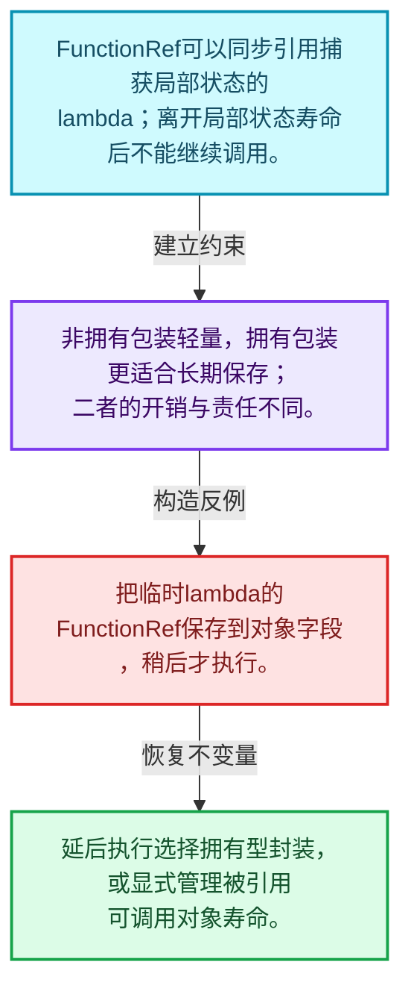
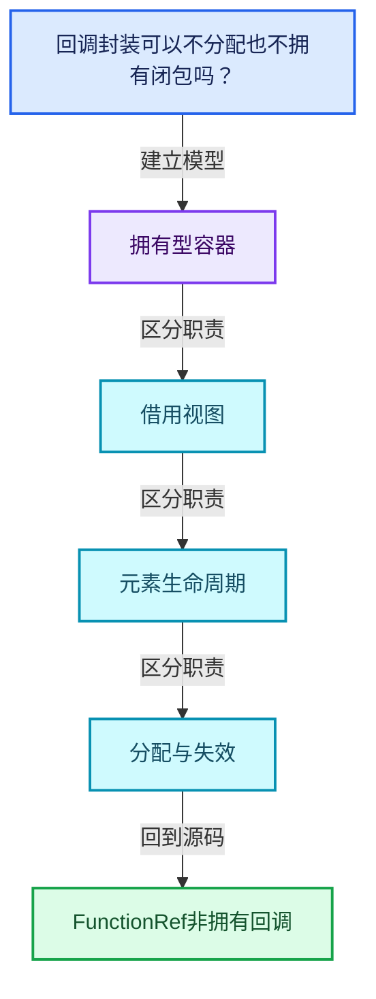
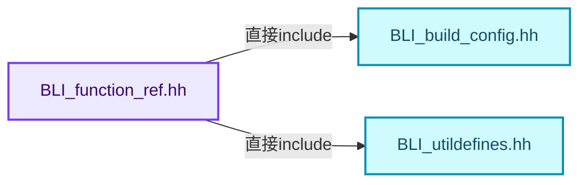
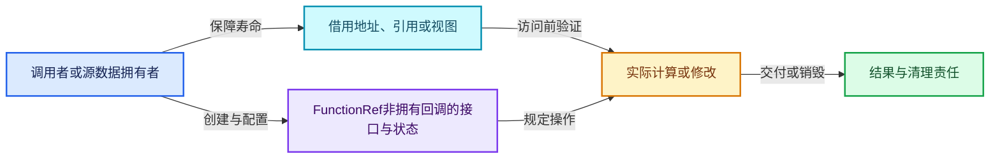
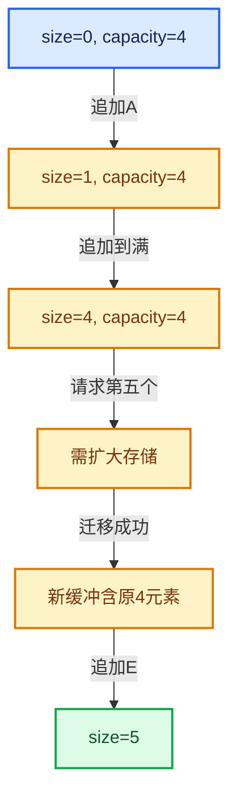

# 01-16 FunctionRef非拥有回调

[方向导航](README.md) · [总目录](../README.md) · [覆盖索引](../%E6%BA%90%E7%A0%81%E7%89%88%E6%9C%AC%E4%B8%8E%E8%A6%86%E7%9B%96%E7%B4%A2%E5%BC%95.md)

> 阅读顺序：问题与数据模型 → 语法与类型 → 源码逐行 → 调用线索 → 历史与取舍 → 推演和练习。

- 基准 HEAD：`cbda6b96c26c0dee3c3b5cbb93960c4ac06a6b30`。
- 记录日期：2026-10-14。
- 教学示例状态：正文中的推演不是本机性能实测；已运行练习见验收报告。

## 一、从问题到设计

回调封装可以不分配也不拥有闭包吗？

FunctionRef把可调用对象地址与调用桥接函数组合；被引用的闭包必须在调用期间存活，不适合未经管理的延后保存。

本篇把语法、数据语义和系统取舍连接起来。先证明对象存活，再讨论索引；先区分借用与拥有，再讨论复制移动。

### 本篇独立模型与设计推理

FunctionRef可以同步引用捕获局部状态的lambda；离开局部状态寿命后不能继续调用。

设计取舍：非拥有包装轻量，拥有包装更适合长期保存；二者的开销与责任不同。

最小反例：把临时lambda的FunctionRef保存到对象字段，稍后才执行。

推导与处理：延后执行选择拥有型封装，或显式管理被引用可调用对象寿命。



### 源码范围与相邻篇章

| 文件 | 本篇逐行范围 | 基准SHA-256 |
|---|---|---|
| [source/blender/blenlib/BLI_function_ref.hh](../../../../../source/blender/blenlib/BLI_function_ref.hh) | L1—L165 | `73210a0163ec01bc89ca4db6c03af4af3d72162bcd8f823b8c66971f91f2d847` |

同一主讲文件可能分多篇覆盖；超出本篇范围的符号通过覆盖索引定位。空行与纯注释保留在源码摘录中，逐行表解释有效语句与语法边界；许可证头统一保留。

前篇：[StringRef字符串视图](15-StringRef%E5%AD%97%E7%AC%A6%E4%B8%B2%E8%A7%86%E5%9B%BE.md).

后篇：[Any类型擦除存储](17-Any%E7%B1%BB%E5%9E%8B%E6%93%A6%E9%99%A4%E5%AD%98%E5%82%A8.md).

## 二、类型、数据与阅读地图



这是概念依赖图，边表示阅读关系，不声称是运行时调用顺序。

### 直接编译依赖



箭头只表示头文件包含关系；完整调用线索见后面的符号定位表。

## 三、关键词、语法与类型角色

### 模板 template

模板把类型或常量作为生成实现的参数。读声明时先列出类型参数、非类型参数和默认值，再看使用者实际实例化了什么。模板声明本身不意味着每种T都支持其全部成员。

具体检查：把T替换为int、string、只能移动的类型，分别检查每个被调用操作是否成立。

### 依赖名称 typename

typename既可引入类型模板参数，也可告诉编译器某个依赖名称是类型。它不创建运行时对象；解析期确认语法类别与实例化期检查具体类型是不同阶段。

具体检查：区分typename T::value_type和T::size()，前者标记类型，后者是表达式。

### 约束 requires

requires表达式或requires子句限制模板参与重载的条件。它提供编译期可用性检查，不是运行时if，不能指望输入到达程序后再被这一机制验证。

具体检查：构造满足和不满足约束的两个类型，观察候选被排除而不是在函数内返回错误。

### 常量求值 constexpr

constexpr声明允许相应实体参与常量求值，但constexpr函数仍可以在运行时执行。是否常量求值由调用场景和表达式合法性共同决定。

具体检查：比较constexpr变量初始化和从运行时输入调用同一函数。

### 只读限定 const

const约束当前访问路径可做的修改。const指针、指向const的指针、const视图对象、const元素是不同位置的限定；其他别名可能仍可修改原对象。

具体检查：分别写T* const、const T*与const T* const，并画出不可修改的层次。

### 完美转发 std::forward

std::forward在转发引用模板中恢复调用者原来的值类别。它依赖推导出的模板实参；无条件move会改变左值调用者的语义。

具体检查：对同一接口分别传入左值、临时对象和const左值，记录实际重载。

### 表示层转换 reinterpret_cast

reinterpret_cast不能自动开始任意对象的生命周期，也不能豁免对齐和别名规则。读这类代码需要追溯原始分配与实际构造操作。

具体检查：分别检查大小、对齐、生命周期和可访问类型，四项不能互相替代。

### 内部断言 assert

断言表达开发者预期成立的内部契约，发布构建可能关闭。它不能替代对不可信输入的完整错误处理，也不保证后续操作被运行时保护。

具体检查：对每条断言构造违反条件的输入，区分调用者错误与应向用户报告的错误。

### 编译期分支 if constexpr

条件在实例化时决定被保留的分支，这常用于不同类型的合法操作选择。它与运行时if有不同的实例化检查规则。

具体检查：找出每个分支依赖哪些类型特征，再使用满足与不满足条件的类型。

### 类型别名 using

类型别名为已有类型建立名字，不创建运行期对象。它常把模板内部使用的类型统一暴露给泛型调用者。

具体检查：展开别名直到基础类型，区分类型别名和变量声明。

### 拥有型可调用包装 function

std::function保存可调用目标并提供统一调用接口，复制能力与目标要求有关；FunctionRef仅借用，二者不能无条件互换。

具体检查：比较同步回调与长期保存任务对拥有关系的不同要求。

## 四、真实源码与逐行讲解

源码块保持原行内容，原始行号由小节标题及逐行表给出。表中的调用定位是静态阅读辅助；重载、模板实例化、宏展开和虚调用需结合完整声明，不能仅凭词法出现证明动态调用。

### BLI_function_ref.hh：L1—L72

<!-- source:source/blender/blenlib/BLI_function_ref.hh:1:72 -->

```cpp
/* SPDX-FileCopyrightText: 2023 Blender Authors
 *
 * SPDX-License-Identifier: GPL-2.0-or-later */

#pragma once

#include <type_traits>
#include <utility>

#include "BLI_build_config.hh"
#include "BLI_utildefines.hh"

namespace blender {

/** \file
 * \ingroup bli
 *
 * A `FunctionRef<Signature>` is a non-owning reference to some callable object with a specific
 * signature. It can be used to pass some callback to another function.
 *
 * A `FunctionRef` is small and cheap to copy. Therefore it should generally be passed by value.
 *
 * Example signatures:
 *   `FunctionRef<void()>`        - A function without parameters and void return type.
 *   `FunctionRef<int(float)>`    - A function with a float parameter and an int return value.
 *   `FunctionRef<int(int, int)>` - A function with two int parameters and an int return value.
 *
 * There are multiple ways to achieve that, so here is a comparison of the different approaches:
 * 1. Pass function pointer and user data (as void *) separately:
 *    - The only method that is compatible with C interfaces.
 *    - Is cumbersome to work with in many cases, because one has to keep track of two parameters.
 *    - Not type safe at all, because of the void pointer.
 *    - It requires workarounds when one wants to pass a lambda into a function.
 * 2. Using `std::function`:
 *    - It works well with most callables and is easy to use.
 *    - Owns the callable, so it can be returned from a function more safely than other methods.
 *    - Requires that the callable is copyable.
 *    - Requires an allocation when the callable is too large (typically > 16 bytes).
 * 3. Using a template for the callable type:
 *    - Most efficient solution at runtime, because compiler knows the exact callable at the place
 *      where it is called.
 *    - Works well with all callables.
 *    - Requires the function to be in a header file.
 *    - It's difficult to constrain the signature of the function.
 * 4. Using `FunctionRef`:
 *    - Second most efficient solution at runtime.
 *    - It's easy to constrain the signature of the callable.
 *    - Does not require the function to be in a header file.
 *    - Works well with all callables.
 *    - It's a non-owning reference, so it *cannot* be stored safely in general.
 *
 * The fact that this is a non-owning reference makes `FunctionRef` very well suited for some use
 * cases, but one has to be a bit more careful when using it to make sure that the referenced
 * callable is not destructed.
 *
 * In particular, one must not construct a `FunctionRef` variable from a lambda directly as shown
 * below. This is because the lambda object goes out of scope after the line finished executing and
 * will be destructed. Calling the reference afterwards invokes undefined behavior.
 *
 * Don't:
 *   FunctionRef<int()> ref = []() { return 0; };
 * Do:
 *   auto f = []() { return 0; };
 *   FuntionRef<int()> ref = f;
 *
 * It is fine to pass a lambda directly to a function:
 *
 *   void some_function(FunctionRef<int()> f);
 *   some_function([]() { return 0; });
 */

template<typename Function> class FunctionRef;
```

| 原始行 | 语义、约束与检查 |
|---|---|
| L5 | 防止同一头文件在一个翻译单元中重复展开；不控制多个源文件之间的链接或对象寿命。 |
| L7 | 引入编译依赖 <type_traits>；这是声明可见性关系，不表示运行时一定调用该文件的所有接口。 |
| L8 | 引入编译依赖 <utility>；这是声明可见性关系，不表示运行时一定调用该文件的所有接口。 |
| L10 | 引入编译依赖 "BLI_build_config.hh"；这是声明可见性关系，不表示运行时一定调用该文件的所有接口。 |
| L11 | 引入编译依赖 "BLI_utildefines.hh"；这是声明可见性关系，不表示运行时一定调用该文件的所有接口。 |
| L13 | 把后续声明放入 blender 命名空间，影响名称查找和符号归属，不创建运行时对象。 |
| L72 | 声明模板参数 `template<typename Function> class FunctionRef;`。类型参数决定生成操作的类型，非类型参数可决定内嵌容量或编译期分支。 |

### BLI_function_ref.hh：L73—L100

<!-- source:source/blender/blenlib/BLI_function_ref.hh:73:100 -->

```cpp

template<typename Ret, typename... Params> class FunctionRef<Ret(Params...)> {
 private:
  /**
   * A function pointer that knows how to call the referenced callable with the given parameters.
   */
  Ret (*callback_)(intptr_t callable, Params... params) = nullptr;

  /**
   * A pointer to the referenced callable object. This can be a C function, a lambda object or any
   * other callable.
   *
   * The value does not need to be initialized because it is not used unless `callback_` is set as
   * well, in which case it will be initialized as well.
   *
   * Use `intptr_t` to avoid warnings when casting to function pointers.
   */
  intptr_t callable_;

  template<typename Callable> static Ret callback_fn(intptr_t callable, Params... params)
  {
    return (*reinterpret_cast<Callable *>(callable))(std::forward<Params>(params)...);
  }

 public:
  FunctionRef() = default;

  FunctionRef(std::nullptr_t) {}
```

| 原始行 | 语义、约束与检查 |
|---|---|
| L74 | 声明模板参数 `template<typename Ret, typename... Params> class FunctionRef<Ret(Params...)> {`。类型参数决定生成操作的类型，非类型参数可决定内嵌容量或编译期分支。 |
| L75 | 切换成员访问权限为 private；它是编译期接口边界，不是线程同步或内存保护。 |
| L79 | 把右侧 `nullptr` 用于初始化或更新左侧 `Ret (*callback_)(intptr_t callable, Params... params)`。声明初始化与已有对象赋值应按上下文区分；有资源的类型会调用相应特殊成员。 |
| L90 | 声明成员、局部对象或完成语句 `intptr_t callable_`。若为指针或引用，它本身不说明拥有；若为值对象，其构造析构由所在作用域或外层对象管理。 |
| L92 | 声明模板参数 `template<typename Callable> static Ret callback_fn(intptr_t callable, Params... params)`。类型参数决定生成操作的类型，非类型参数可决定内嵌容量或编译期分支。 |
| L93 | 连接上一行的声明或控制结构与其语句块；后续行在这个作用域中执行或声明。 |
| L94 | 返回表达式 `(*reinterpret_cast<Callable *>(callable))(std::forward<Params>(params)...)`。 |
| L95 | 结束当前语法单元。局部自动对象在离开其作用域时按规则销毁；这不等于所有被引用的外部数据也被释放。 |
| L97 | 切换成员访问权限为 public；它是编译期接口边界，不是线程同步或内存保护。 |
| L98 | 显式采用编译器生成的特殊成员行为：`FunctionRef() = default;`。成员和基类的性质决定该操作是否可用、是否被删除及异常约定，不表示运行时给对象赋值为default。 |
| L100 | 出现调用或函数声明 `FunctionRef`，对应表达式为 `FunctionRef(std::nullptr_t) {}`。参数求值、返回类型与重载需结合前后完整语句；静态文本引用不能证明动态目标。 |

### BLI_function_ref.hh：L101—L165

<!-- source:source/blender/blenlib/BLI_function_ref.hh:101:165 -->

```cpp

  /**
   * A `FunctionRef` itself is a callable as well. However, we don't want that this
   * constructor is called when `Callable` is a `FunctionRef`. If we would allow this, it
   * would be easy to accidentally create a `FunctionRef` that internally calls another
   * `FunctionRef`. Usually, when assigning a `FunctionRef` to another, we want that both
   * contain a reference to the same underlying callable afterwards.
   *
   * It is still possible to reference another `FunctionRef` by first wrapping it in
   * another lambda.
   */
  template<typename Callable>
  FunctionRef(Callable &&callable)
    requires(!std::is_same_v<std::remove_cv_t<std::remove_reference_t<Callable>>, FunctionRef> &&
             std::is_invocable_r_v<Ret, Callable, Params...>)
      : callback_(callback_fn<typename std::remove_reference_t<Callable>>),
        callable_(intptr_t(&callable))
  {
    if constexpr (std::is_constructible_v<bool, Callable>) {
      /* For some types, the compiler can be sure that the callable is always truthy. Good!
       * Then the entire check can be optimized away. */
#if COMPILER_CLANG || COMPILER_GCC
#  pragma GCC diagnostic push
#  pragma GCC diagnostic ignored "-Waddress"
#  if COMPILER_GCC
#    pragma GCC diagnostic ignored "-Wnonnull-compare"
#  endif
#endif
      /* Make sure the #FunctionRef is falsy if the callback is falsy.
       * That can happen when passing in null or empty std::function. */
      const bool is_truthy = bool(callable);
      if (!is_truthy) {
        callback_ = nullptr;
        callable_ = 0;
      }
#if COMPILER_CLANG || COMPILER_GCC
#  pragma GCC diagnostic pop
#endif
    }
  }

  /**
   * Call the referenced function and forward all parameters to it.
   *
   * This invokes undefined behavior if the `FunctionRef` does not reference a function currently.
   */
  Ret operator()(Params... params) const
  {
    BLI_assert(callback_ != nullptr);
    return callback_(callable_, std::forward<Params>(params)...);
  }

  /**
   * Returns true, when the `FunctionRef` references a function currently.
   * If this returns false, the `FunctionRef` must not be called.
   */
  operator bool() const
  {
    /* Just checking `callback_` is enough to determine if the `FunctionRef` is in a state that it
     * can be called in. */
    return callback_ != nullptr;
  }
};

}  // namespace blender
```

本段语义重点：

- 分支证据 `!is_truthy)`：分别推演条件成立与不成立，核对相同出口处的状态。

| 原始行 | 语义、约束与检查 |
|---|---|
| L112 | 声明模板参数 `template<typename Callable>`。类型参数决定生成操作的类型，非类型参数可决定内嵌容量或编译期分支。 |
| L113 | 出现调用或函数声明 `FunctionRef`，对应表达式为 `FunctionRef(Callable &&callable)`。参数求值、返回类型与重载需结合前后完整语句；静态文本引用不能证明动态目标。 |
| L114 | 约束模板可用性：`requires(!std::is_same_v<std::remove_cv_t<std::remove_reference_t<Callable>>, FunctionRef> &&`。条件在编译期检查，不替代运行期的地址、长度和类型一致性验证。 |
| L115 | 本行是连续声明或表达式的一部分：`std::is_invocable_r_v<Ret, Callable, Params...>)`。与本段前后行合读；逗号、括号和限定符决定它属于参数、初始化列表还是实际计算。 |
| L116 | 出现调用或函数声明 `callback_`，对应表达式为 `: callback_(callback_fn<typename std::remove_reference_t<Callable>>),`。参数求值、返回类型与重载需结合前后完整语句；静态文本引用不能证明动态目标。 |
| L117 | 出现调用或函数声明 `callable_`，对应表达式为 `callable_(intptr_t(&callable))`。参数求值、返回类型与重载需结合前后完整语句；静态文本引用不能证明动态目标。 |
| L118 | 连接上一行的声明或控制结构与其语句块；后续行在这个作用域中执行或声明。 |
| L119 | 编译期条件分支 `if constexpr (std::is_constructible_v<bool, Callable>)`。按实例化类型选择相应实现；被舍弃分支和运行期if具有不同检查规则，不能当作运行时输入验证。 |
| L122 | 预处理阶段处理 #if COMPILER_CLANG &#124;&#124; COMPILER_GCC。它决定哪些代码进入编译，不是运行时分支；阅读行为时必须结合实际构建宏。 |
| L123 | 本行是连续声明或表达式的一部分：`#  pragma GCC diagnostic push`。与本段前后行合读；逗号、括号和限定符决定它属于参数、初始化列表还是实际计算。 |
| L124 | 本行是连续声明或表达式的一部分：`#  pragma GCC diagnostic ignored "-Waddress"`。与本段前后行合读；逗号、括号和限定符决定它属于参数、初始化列表还是实际计算。 |
| L125 | 本行是连续声明或表达式的一部分：`#  if COMPILER_GCC`。与本段前后行合读；逗号、括号和限定符决定它属于参数、初始化列表还是实际计算。 |
| L126 | 本行是连续声明或表达式的一部分：`#    pragma GCC diagnostic ignored "-Wnonnull-compare"`。与本段前后行合读；逗号、括号和限定符决定它属于参数、初始化列表还是实际计算。 |
| L127 | 本行是连续声明或表达式的一部分：`#  endif`。与本段前后行合读；逗号、括号和限定符决定它属于参数、初始化列表还是实际计算。 |
| L128 | 预处理阶段处理 #endif。它决定哪些代码进入编译，不是运行时分支；阅读行为时必须结合实际构建宏。 |
| L131 | 把右侧 `bool(callable)` 用于初始化或更新左侧 `const bool is_truthy`。声明初始化与已有对象赋值应按上下文区分；有资源的类型会调用相应特殊成员。 |
| L132 | 判断 `!is_truthy`，成立时进入本分支，否则继续后续路径。 |
| L133 | 把右侧 `nullptr` 用于初始化或更新左侧 `callback_`。声明初始化与已有对象赋值应按上下文区分；有资源的类型会调用相应特殊成员。 |
| L134 | 把右侧 `0` 用于初始化或更新左侧 `callable_`。声明初始化与已有对象赋值应按上下文区分；有资源的类型会调用相应特殊成员。 |
| L135 | 结束当前语法单元。局部自动对象在离开其作用域时按规则销毁；这不等于所有被引用的外部数据也被释放。 |
| L136 | 预处理阶段处理 #if COMPILER_CLANG &#124;&#124; COMPILER_GCC。它决定哪些代码进入编译，不是运行时分支；阅读行为时必须结合实际构建宏。 |
| L137 | 本行是连续声明或表达式的一部分：`#  pragma GCC diagnostic pop`。与本段前后行合读；逗号、括号和限定符决定它属于参数、初始化列表还是实际计算。 |
| L138 | 预处理阶段处理 #endif。它决定哪些代码进入编译，不是运行时分支；阅读行为时必须结合实际构建宏。 |
| L139 | 结束当前语法单元。局部自动对象在离开其作用域时按规则销毁；这不等于所有被引用的外部数据也被释放。 |
| L140 | 结束当前语法单元。局部自动对象在离开其作用域时按规则销毁；这不等于所有被引用的外部数据也被释放。 |
| L147 | 运算符重载声明、定义或显式调用：`Ret operator()(Params... params) const`。结合参数和返回类型判断是赋值、索引、比较还是转换；operator=声明中的等号不是在给名为operator的变量赋值。 |
| L148 | 连接上一行的声明或控制结构与其语句块；后续行在这个作用域中执行或声明。 |
| L149 | 断言约束 `BLI_assert(callback_ != nullptr);`。条件是后续访问的内部前置条件；发布构建可能不执行，不能把断言当作输入修复。 |
| L150 | 返回表达式 `callback_(callable_, std::forward<Params>(params)...)`。 |
| L151 | 结束当前语法单元。局部自动对象在离开其作用域时按规则销毁；这不等于所有被引用的外部数据也被释放。 |
| L157 | 运算符重载声明、定义或显式调用：`operator bool() const`。结合参数和返回类型判断是赋值、索引、比较还是转换；operator=声明中的等号不是在给名为operator的变量赋值。 |
| L158 | 连接上一行的声明或控制结构与其语句块；后续行在这个作用域中执行或声明。 |
| L161 | 返回表达式 `callback_ != nullptr`。 |
| L162 | 结束当前语法单元。局部自动对象在离开其作用域时按规则销毁；这不等于所有被引用的外部数据也被释放。 |
| L163 | 结束当前语法单元。局部自动对象在离开其作用域时按规则销毁；这不等于所有被引用的外部数据也被释放。 |
| L165 | 结束当前语法单元。局部自动对象在离开其作用域时按规则销毁；这不等于所有被引用的外部数据也被释放。 |

## 五、接口定位、调用线索与生命周期

### 本篇声明与实现入口

| 源码位置 | 实际声明片段 |
|---|---|
| [BLI_function_ref.hh:L72](../../../../../source/blender/blenlib/BLI_function_ref.hh#L72) | `template<typename Function> class FunctionRef;` |
| [BLI_function_ref.hh:L74](../../../../../source/blender/blenlib/BLI_function_ref.hh#L74) | `template<typename Ret, typename... Params> class FunctionRef<Ret(Params...)>` |
| [BLI_function_ref.hh:L79](../../../../../source/blender/blenlib/BLI_function_ref.hh#L79) | `Ret (*callback_)(intptr_t callable, Params... params) = nullptr;` |
| [BLI_function_ref.hh:L92](../../../../../source/blender/blenlib/BLI_function_ref.hh#L92) | `template<typename Callable> static Ret callback_fn(intptr_t callable, Params... params)` |
| [BLI_function_ref.hh:L98](../../../../../source/blender/blenlib/BLI_function_ref.hh#L98) | `FunctionRef() = default;` |
| [BLI_function_ref.hh:L100](../../../../../source/blender/blenlib/BLI_function_ref.hh#L100) | `FunctionRef(std::nullptr_t) {}` |
| [BLI_function_ref.hh:L113](../../../../../source/blender/blenlib/BLI_function_ref.hh#L113) | `FunctionRef(Callable &&callable)` |
| [BLI_function_ref.hh:L116](../../../../../source/blender/blenlib/BLI_function_ref.hh#L116) | `: callback_(callback_fn<typename std::remove_reference_t<Callable>>),` |
| [BLI_function_ref.hh:L147](../../../../../source/blender/blenlib/BLI_function_ref.hh#L147) | `Ret operator()(Params... params) const` |
| [BLI_function_ref.hh:L157](../../../../../source/blender/blenlib/BLI_function_ref.hh#L157) | `operator bool() const` |

### 同名符号出现位置

以下表提供跨文件阅读入口，包含声明、调用或测试使用；没有经过完整C++名称解析，不把它命名为已证明的运行时调用图。

| 符号 | 位置 | 文本证据 |
|---|---|---|
| `Ret` | [BLI_hash.hh:L288](../../../../../source/blender/blenlib/BLI_hash.hh#L288) | `template<typename Ret, typename... Args> struct DefaultHash<Ret (*)(Args...)> {` |
| `Ret` | [BLI_hash.hh:L289](../../../../../source/blender/blenlib/BLI_hash.hh#L289) | `constexpr uint64_t operator()(Ret (*fn)(Args...)) const` |
| `operator` | [BKE_attribute_storage.hh:L127](../../../../../source/blender/blenkernel/BKE_attribute_storage.hh#L127) | `StringRef operator()(const std::unique_ptr<Attribute> &value) const` |
| `operator` | [BLI_cpp_type.hh:L441](../../../../../source/blender/blenlib/BLI_cpp_type.hh#L441) | `fn.template operator()<T>();` |
| `operator` | [BLI_hash.hh:L86](../../../../../source/blender/blenlib/BLI_hash.hh#L86) | `constexpr uint64_t operator()(const T &value) const` |
| `bool` | [BKE_attribute.hh:L140](../../../../../source/blender/blenkernel/BKE_attribute.hh#L140) | `FunctionRef<bool(StringRefNull name, const AttributeMetaData &meta_data)>;` |
| `bool` | [BKE_attribute.hh:L177](../../../../../source/blender/blenkernel/BKE_attribute.hh#L177) | `operator bool() const` |
| `bool` | [BKE_attribute.hh:L194](../../../../../source/blender/blenkernel/BKE_attribute.hh#L194) | `operator bool() const` |

### 生命周期推理图



这是审查生命周期的通用模型。具体类是否拥有数据由本篇成员、构造、析构和调用者一起证明；任何箭头都不自动代表shared_ptr。

## 六、把代码放进具体数据中推演

本方向的共同数值模型如下。本篇的专门检查是：写同步遍历接口接收捕获lambda，再解释把同一FunctionRef存入长期任务队列的生命周期风险。

| 步骤 | 数据或状态 | 为什么需要这一步 |
|---|---|---|
| 初始 | size=0, capacity=4 | 只有存储，没有可读取的T元素 |
| 追加A | size=1, capacity=4 | 在第0个位置构造A |
| 追加到满 | size=4, capacity=4 | 四个位置均已构造 |
| 请求第五个 | 需扩大存储 | 旧地址仍需被正确管理 |
| 迁移成功 | 新缓冲含原4元素 | 提交新指针并释放旧存储 |
| 追加E | size=5 | 只在成功构造后扩大有效区间 |



图是教学推演模型；精确分支与状态更新以本篇摘录及调用契约为准。

### 本篇独立练习与参考思路

写同步遍历接口接收捕获lambda，再解释把同一FunctionRef存入长期任务队列的生命周期风险。

参考思路：FunctionRef把可调用对象地址与调用桥接函数组合；被引用的闭包必须在调用期间存活，不适合未经管理的延后保存。

将输入、预期结果和资源责任分成三张清单。先用最直接的实现给出可核对的答案，再替换成对应源码使用的表示；比较结果不变的条件，而不是只比较接口名字。

验收依据：构造成功次数减析构次数应等于当前存活对象数；异常之后资源计数应回到合法状态。

## 七、复杂度、设计取舍与其他基础库

对比std::vector、std::array、std::span与LLVM SmallVector、ArrayRef时，分别比较拥有关系、内嵌存储、大小是否属于类型和失效条件。不要根据同名方法推断完全相同契约。

本篇的具体取舍：FunctionRef把可调用对象地址与调用桥接函数组合；被引用的闭包必须在调用期间存活，不适合未经管理的延后保存。

| 观察维度 | 从源码取得证据的方法 | 本篇要避免的误判 |
|---|---|---|
| 时间 | 对循环次数、分派次数和重建频率分别计数 | 看到单次常数操作就断定整个操作序列是常数成本 |
| 内存 | 区分对象本体、容量存储、间接资源和共享控制块 | 用sizeof代替总内存 |
| 安全 | 沿构造、失败回滚、销毁与失效逐路径检查 | 把断言或非空指针当作完整安全证明 |
| 并发 | 逐字段确认锁、发布顺序和借用寿命 | 把引用计数线程安全等同数据读写线程安全 |

相关一手资料：

- [C++公开工作草案](https://eel.is/c++draft/)：持续更新的工作草案；语言与标准库语义以相应章节为准。
- [LLVM Programmer’s Manual](https://llvm.org/docs/ProgrammersManual.html)：在线版，2026-10-14查阅；仅比较设计思路，不保证与本地LLVM版本一致。

资料用于核对契约和进一步阅读；这里没有声称外部库与Blender实现相同，也没有把上游性能数字当作本机实测。

## 八、历史提交与设计演化

本篇主要讲当前接口或辅助实现，方向导航给出相关架构演化提交；没有把不涉及本篇文件的提交硬写成该实现的引入证据。

## 九、反例、测试入口与掌握标准

仓库测试入口：

- [BLI_function_ref_test.cc](../../../../../source/blender/blenlib/tests/BLI_function_ref_test.cc)：阅读输入、断言与覆盖边界；本篇不把“存在测试”写成“本轮已运行”。

需要实际构造的反例：

- 空输入或没有结果需求：确认接口允许的空状态与不允许访问的操作。
- 边界位置和退化结构：把长度为1、末尾位置、重复值或深链代入真实分支。
- 生命周期结束或修改之后：检查保存的指针、引用、结果视图是否仍有效。
- 与本篇核心不变量相冲突的输入：写同步遍历接口接收捕获lambda，再解释把同一FunctionRef存入长期任务队列的生命周期风险。

### 可运行的教学参考程序

[reference_exercises.cc](../_tools/reference_exercises.cc)包含独立于Blender的C++20参考检查：视图、简化SmallVector、异常回滚、哈希碰撞与删除、偏移数组、拓扑映射、共享缓存、表达式、惰性分支、闭包和暴力最近邻。

参考程序有意省略生产实现的完整能力。例如SmallVector禁止复制移动容器，不支持只能移动的元素，并禁止append参数别名到自身元素；TinyMap固定8槽，不提供增长。程序通过不能替代Blender实现测试。实际运行结果、编译器与命令见验收报告。

掌握标准：离开源码解释“回调封装可以不分配也不拥有闭包吗？”；独立完成上述练习；能指出一个会破坏拥有型容器相关约束的最小反例，并用具体代码行说明检查或修复应放在哪里。
