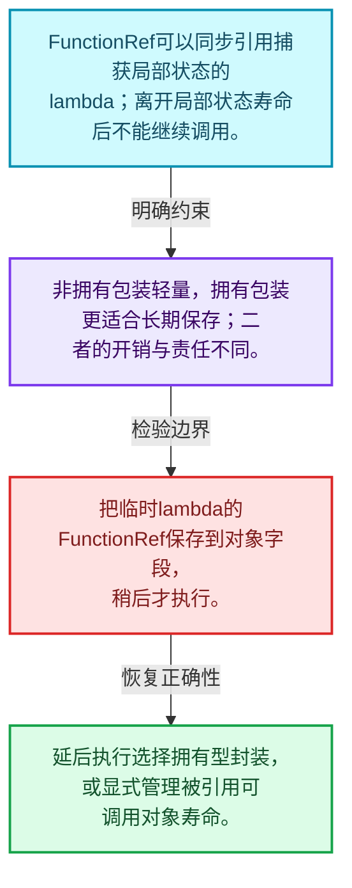
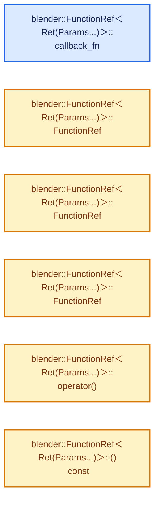
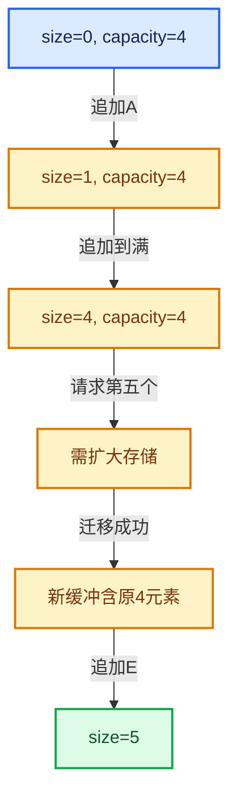

# 01-16 FunctionRef非拥有回调

[方向导航](README.md) · [总目录](../README.md) · [实现索引](../%E7%AC%A6%E5%8F%B7%E4%BE%9D%E8%B5%96%E4%B8%8E%E5%AE%9E%E7%8E%B0%E7%B4%A2%E5%BC%95.md)

## 从问题到实现

回调封装可以不分配也不拥有闭包吗？

FunctionRef把可调用对象地址与调用桥接函数组合；被引用的闭包必须在调用期间存活，不适合未经管理的延后保存。

**数据模型**

FunctionRef可以同步引用捕获局部状态的lambda；离开局部状态寿命后不能继续调用。

**设计取舍**

非拥有包装轻量，拥有包装更适合长期保存；二者的开销与责任不同。

**最小反例**

把临时lambda的FunctionRef保存到对象字段，稍后才执行。

**推导**

延后执行选择拥有型封装，或显式管理被引用可调用对象寿命。

## 阅读地图与执行推演








图中的数值推演是本方向的教学模型；实际函数之间的调用边与概念分析边分别标注，不能把概念关系当作运行时调度顺序。

## 完整源码单元与就地讲解

中文讲解直接放在相关代码旁，复杂机制在代码下展开。原文折叠区保留基准行号；不需要在行号表和函数之间来回查找。类布局可分段展示，函数实现不按固定行数切开。

### 类型布局、声明与编译条件 · BLI_function_ref.hh L1—L91

<a id="t-f6659544bdcc"></a>

<a id="t-175973c599e1"></a>

`FunctionRef`在这里声明的数据成员：

- `Ret callback_`
- `intptr_t callable_`

<!-- annotated:ad06cd709239d7 -->

```cpp
/* SPDX-FileCopyrightText: 2023 Blender Authors
 *
 * SPDX-License-Identifier: GPL-2.0-or-later */

#pragma once

#include <type_traits>
#include <utility>

#include "BLI_build_config.hh"
#include "BLI_utildefines.hh"

namespace blender {

/** \file
 * \ingroup bli
 *
 * A `FunctionRef<Signature>` is a non-owning reference to some callable object with a specific
 * signature. It can be used to pass some callback to another function.
 *
 * A `FunctionRef` is small and cheap to copy. Therefore it should generally be passed by value.
 *
 * Example signatures:
 *   `FunctionRef<void()>`        - A function without parameters and void return type.
 *   `FunctionRef<int(float)>`    - A function with a float parameter and an int return value.
 *   `FunctionRef<int(int, int)>` - A function with two int parameters and an int return value.
 *
 * There are multiple ways to achieve that, so here is a comparison of the different approaches:
 * 1. Pass function pointer and user data (as void *) separately:
 *    - The only method that is compatible with C interfaces.
 *    - Is cumbersome to work with in many cases, because one has to keep track of two parameters.
 *    - Not type safe at all, because of the void pointer.
 *    - It requires workarounds when one wants to pass a lambda into a function.
 * 2. Using `std::function`:
 *    - It works well with most callables and is easy to use.
 *    - Owns the callable, so it can be returned from a function more safely than other methods.
 *    - Requires that the callable is copyable.
 *    - Requires an allocation when the callable is too large (typically > 16 bytes).
 * 3. Using a template for the callable type:
 *    - Most efficient solution at runtime, because compiler knows the exact callable at the place
 *      where it is called.
 *    - Works well with all callables.
 *    - Requires the function to be in a header file.
 *    - It's difficult to constrain the signature of the function.
 * 4. Using `FunctionRef`:
 *    - Second most efficient solution at runtime.
 *    - It's easy to constrain the signature of the callable.
 *    - Does not require the function to be in a header file.
 *    - Works well with all callables.
 *    - It's a non-owning reference, so it *cannot* be stored safely in general.
 *
 * The fact that this is a non-owning reference makes `FunctionRef` very well suited for some use
 * cases, but one has to be a bit more careful when using it to make sure that the referenced
 * callable is not destructed.
 *
 * In particular, one must not construct a `FunctionRef` variable from a lambda directly as shown
 * below. This is because the lambda object goes out of scope after the line finished executing and
 * will be destructed. Calling the reference afterwards invokes undefined behavior.
 *
 * Don't:
 *   FunctionRef<int()> ref = []() { return 0; };
 * Do:
 *   auto f = []() { return 0; };
 *   FuntionRef<int()> ref = f;
 *
 * It is fine to pass a lambda directly to a function:
 *
 *   void some_function(FunctionRef<int()> f);
 *   some_function([]() { return 0; });
 */

template<typename Function> class FunctionRef;

template<typename Ret, typename... Params> class FunctionRef<Ret(Params...)> {
 private:
  /**
   * A function pointer that knows how to call the referenced callable with the given parameters.
   */
  Ret (*callback_)(intptr_t callable, Params... params) = nullptr;

  /**
   * A pointer to the referenced callable object. This can be a C function, a lambda object or any
   * other callable.
   *
   * The value does not need to be initialized because it is not used unless `callback_` is set as
   * well, in which case it will be initialized as well.
   *
   * Use `intptr_t` to avoid warnings when casting to function pointers.
   */
  intptr_t callable_;

```

<details>
<summary>核对原始源码：source/blender/blenlib/BLI_function_ref.hh · L1—L91</summary>

<!-- original:ad06cd709239d7:source/blender/blenlib/BLI_function_ref.hh:1:91 -->

```cpp
/* SPDX-FileCopyrightText: 2023 Blender Authors
 *
 * SPDX-License-Identifier: GPL-2.0-or-later */

#pragma once

#include <type_traits>
#include <utility>

#include "BLI_build_config.hh"
#include "BLI_utildefines.hh"

namespace blender {

/** \file
 * \ingroup bli
 *
 * A `FunctionRef<Signature>` is a non-owning reference to some callable object with a specific
 * signature. It can be used to pass some callback to another function.
 *
 * A `FunctionRef` is small and cheap to copy. Therefore it should generally be passed by value.
 *
 * Example signatures:
 *   `FunctionRef<void()>`        - A function without parameters and void return type.
 *   `FunctionRef<int(float)>`    - A function with a float parameter and an int return value.
 *   `FunctionRef<int(int, int)>` - A function with two int parameters and an int return value.
 *
 * There are multiple ways to achieve that, so here is a comparison of the different approaches:
 * 1. Pass function pointer and user data (as void *) separately:
 *    - The only method that is compatible with C interfaces.
 *    - Is cumbersome to work with in many cases, because one has to keep track of two parameters.
 *    - Not type safe at all, because of the void pointer.
 *    - It requires workarounds when one wants to pass a lambda into a function.
 * 2. Using `std::function`:
 *    - It works well with most callables and is easy to use.
 *    - Owns the callable, so it can be returned from a function more safely than other methods.
 *    - Requires that the callable is copyable.
 *    - Requires an allocation when the callable is too large (typically > 16 bytes).
 * 3. Using a template for the callable type:
 *    - Most efficient solution at runtime, because compiler knows the exact callable at the place
 *      where it is called.
 *    - Works well with all callables.
 *    - Requires the function to be in a header file.
 *    - It's difficult to constrain the signature of the function.
 * 4. Using `FunctionRef`:
 *    - Second most efficient solution at runtime.
 *    - It's easy to constrain the signature of the callable.
 *    - Does not require the function to be in a header file.
 *    - Works well with all callables.
 *    - It's a non-owning reference, so it *cannot* be stored safely in general.
 *
 * The fact that this is a non-owning reference makes `FunctionRef` very well suited for some use
 * cases, but one has to be a bit more careful when using it to make sure that the referenced
 * callable is not destructed.
 *
 * In particular, one must not construct a `FunctionRef` variable from a lambda directly as shown
 * below. This is because the lambda object goes out of scope after the line finished executing and
 * will be destructed. Calling the reference afterwards invokes undefined behavior.
 *
 * Don't:
 *   FunctionRef<int()> ref = []() { return 0; };
 * Do:
 *   auto f = []() { return 0; };
 *   FuntionRef<int()> ref = f;
 *
 * It is fine to pass a lambda directly to a function:
 *
 *   void some_function(FunctionRef<int()> f);
 *   some_function([]() { return 0; });
 */

template<typename Function> class FunctionRef;

template<typename Ret, typename... Params> class FunctionRef<Ret(Params...)> {
 private:
  /**
   * A function pointer that knows how to call the referenced callable with the given parameters.
   */
  Ret (*callback_)(intptr_t callable, Params... params) = nullptr;

  /**
   * A pointer to the referenced callable object. This can be a C function, a lambda object or any
   * other callable.
   *
   * The value does not need to be initialized because it is not used unless `callback_` is set as
   * well, in which case it will be initialized as well.
   *
   * Use `intptr_t` to avoid warnings when casting to function pointers.
   */
  intptr_t callable_;

```

</details>

<a id="f-8b15aa528e981c61"></a>

### `blender::FunctionRef<Ret(Params...)>::callback_fn`

实现位置：[source/blender/blenlib/BLI_function_ref.hh](../../../../../source/blender/blenlib/BLI_function_ref.hh) · L92—L95。

接口参数：

- `intptr_t callable`

**教学注释版**

<!-- annotated:cd0fe16d71de7f -->

```cpp
  template<typename Callable> static Ret callback_fn(intptr_t callable, Params... params)
  {
    // [讲解] std::forward<Params>：在转发引用中恢复调用者传入的值类别；依赖推导类型，不能与无条件move互换。
    return (*reinterpret_cast<Callable *>(callable))(std::forward<Params>(params)...);
  }
```

<details>
<summary>核对原始源码：source/blender/blenlib/BLI_function_ref.hh · L92—L95</summary>

<!-- original:cd0fe16d71de7f:source/blender/blenlib/BLI_function_ref.hh:92:95 -->

```cpp
  template<typename Callable> static Ret callback_fn(intptr_t callable, Params... params)
  {
    return (*reinterpret_cast<Callable *>(callable))(std::forward<Params>(params)...);
  }
```

</details>

**结果出口**

- `return (*reinterpret_cast<Callable *>(callable))(std::forward<Params>(params)...);`

**继续追踪实现**

- `std::forward<Params>` → [外部契约](https://eel.is/c++draft/utility.forward)：在转发引用中恢复调用者传入的值类别；依赖推导类型，不能与无条件move互换。

### 类型布局、声明与编译条件 · BLI_function_ref.hh L96—L97

<!-- annotated:b385ca682f6075 -->

```cpp

 public:
```

<details>
<summary>核对原始源码：source/blender/blenlib/BLI_function_ref.hh · L96—L97</summary>

<!-- original:b385ca682f6075:source/blender/blenlib/BLI_function_ref.hh:96:97 -->

```cpp

 public:
```

</details>

<a id="f-69a1c2b6abda8f12"></a>

### `blender::FunctionRef<Ret(Params...)>::FunctionRef`

实现位置：[source/blender/blenlib/BLI_function_ref.hh](../../../../../source/blender/blenlib/BLI_function_ref.hh) · L98—L98。

**教学注释版**

<!-- annotated:e41c0b252cb2e4 -->

```cpp
  FunctionRef() = default;
```

<details>
<summary>核对原始源码：source/blender/blenlib/BLI_function_ref.hh · L98—L98</summary>

<!-- original:e41c0b252cb2e4:source/blender/blenlib/BLI_function_ref.hh:98:98 -->

```cpp
  FunctionRef() = default;
```

</details>

**继续追踪实现**

本实现没有需要继续展开的显式调用；检查返回表达式、对象转换和调用者前置条件。

<!-- annotated:ee86310e63226c -->

```cpp

```

<details>
<summary>核对原始源码：source/blender/blenlib/BLI_function_ref.hh · L99—L99</summary>

<!-- original:ee86310e63226c:source/blender/blenlib/BLI_function_ref.hh:99:99 -->

```cpp

```

</details>

<a id="f-2e2201d8f4e01286"></a>

### `blender::FunctionRef<Ret(Params...)>::FunctionRef`

实现位置：[source/blender/blenlib/BLI_function_ref.hh](../../../../../source/blender/blenlib/BLI_function_ref.hh) · L100—L100。

接口参数：

- `std::nullptr_t`

**教学注释版**

<!-- annotated:6de37a897d4316 -->

```cpp
  FunctionRef(std::nullptr_t) {}
```

<details>
<summary>核对原始源码：source/blender/blenlib/BLI_function_ref.hh · L100—L100</summary>

<!-- original:6de37a897d4316:source/blender/blenlib/BLI_function_ref.hh:100:100 -->

```cpp
  FunctionRef(std::nullptr_t) {}
```

</details>

**继续追踪实现**

本实现没有需要继续展开的显式调用；检查返回表达式、对象转换和调用者前置条件。

### 类型布局、声明与编译条件 · BLI_function_ref.hh L101—L111

<!-- annotated:a60c878877657e -->

```cpp

  /**
   * A `FunctionRef` itself is a callable as well. However, we don't want that this
   * constructor is called when `Callable` is a `FunctionRef`. If we would allow this, it
   * would be easy to accidentally create a `FunctionRef` that internally calls another
   * `FunctionRef`. Usually, when assigning a `FunctionRef` to another, we want that both
   * contain a reference to the same underlying callable afterwards.
   *
   * It is still possible to reference another `FunctionRef` by first wrapping it in
   * another lambda.
   */
```

<details>
<summary>核对原始源码：source/blender/blenlib/BLI_function_ref.hh · L101—L111</summary>

<!-- original:a60c878877657e:source/blender/blenlib/BLI_function_ref.hh:101:111 -->

```cpp

  /**
   * A `FunctionRef` itself is a callable as well. However, we don't want that this
   * constructor is called when `Callable` is a `FunctionRef`. If we would allow this, it
   * would be easy to accidentally create a `FunctionRef` that internally calls another
   * `FunctionRef`. Usually, when assigning a `FunctionRef` to another, we want that both
   * contain a reference to the same underlying callable afterwards.
   *
   * It is still possible to reference another `FunctionRef` by first wrapping it in
   * another lambda.
   */
```

</details>

<a id="f-47cc48d9103a9b80"></a>

### `blender::FunctionRef<Ret(Params...)>::FunctionRef`

实现位置：[source/blender/blenlib/BLI_function_ref.hh](../../../../../source/blender/blenlib/BLI_function_ref.hh) · L112—L140。

接口参数：

- `Callable &&callable`

**教学注释版**

<!-- annotated:44401eae898a51 -->

```cpp
  template<typename Callable>
  FunctionRef(Callable &&callable)
    requires(!std::is_same_v<std::remove_cv_t<std::remove_reference_t<Callable>>, FunctionRef> &&
             std::is_invocable_r_v<Ret, Callable, Params...>)
      : callback_(callback_fn<typename std::remove_reference_t<Callable>>),
        callable_(intptr_t(&callable))
  {
    if constexpr (std::is_constructible_v<bool, Callable>) {
      /* For some types, the compiler can be sure that the callable is always truthy. Good!
       * Then the entire check can be optimized away. */
#if COMPILER_CLANG || COMPILER_GCC
#  pragma GCC diagnostic push
#  pragma GCC diagnostic ignored "-Waddress"
#  if COMPILER_GCC
#    pragma GCC diagnostic ignored "-Wnonnull-compare"
#  endif
#endif
      /* Make sure the #FunctionRef is falsy if the callback is falsy.
       * That can happen when passing in null or empty std::function. */
      const bool is_truthy = bool(callable);
      if (!is_truthy) {
        callback_ = nullptr;
        callable_ = 0;
      }
#if COMPILER_CLANG || COMPILER_GCC
#  pragma GCC diagnostic pop
#endif
    }
  }
```

<details>
<summary>核对原始源码：source/blender/blenlib/BLI_function_ref.hh · L112—L140</summary>

<!-- original:44401eae898a51:source/blender/blenlib/BLI_function_ref.hh:112:140 -->

```cpp
  template<typename Callable>
  FunctionRef(Callable &&callable)
    requires(!std::is_same_v<std::remove_cv_t<std::remove_reference_t<Callable>>, FunctionRef> &&
             std::is_invocable_r_v<Ret, Callable, Params...>)
      : callback_(callback_fn<typename std::remove_reference_t<Callable>>),
        callable_(intptr_t(&callable))
  {
    if constexpr (std::is_constructible_v<bool, Callable>) {
      /* For some types, the compiler can be sure that the callable is always truthy. Good!
       * Then the entire check can be optimized away. */
#if COMPILER_CLANG || COMPILER_GCC
#  pragma GCC diagnostic push
#  pragma GCC diagnostic ignored "-Waddress"
#  if COMPILER_GCC
#    pragma GCC diagnostic ignored "-Wnonnull-compare"
#  endif
#endif
      /* Make sure the #FunctionRef is falsy if the callback is falsy.
       * That can happen when passing in null or empty std::function. */
      const bool is_truthy = bool(callable);
      if (!is_truthy) {
        callback_ = nullptr;
        callable_ = 0;
      }
#if COMPILER_CLANG || COMPILER_GCC
#  pragma GCC diagnostic pop
#endif
    }
  }
```

</details>

**沿实际写入检查状态**

- `callback_ = nullptr;`
- `callable_ = 0;`

**继续追踪实现**

本实现没有需要继续展开的显式调用；检查返回表达式、对象转换和调用者前置条件。

### 类型布局、声明与编译条件 · BLI_function_ref.hh L141—L146

<!-- annotated:64c34861dd5e86 -->

```cpp

  /**
   * Call the referenced function and forward all parameters to it.
   *
   * This invokes undefined behavior if the `FunctionRef` does not reference a function currently.
   */
```

<details>
<summary>核对原始源码：source/blender/blenlib/BLI_function_ref.hh · L141—L146</summary>

<!-- original:64c34861dd5e86:source/blender/blenlib/BLI_function_ref.hh:141:146 -->

```cpp

  /**
   * Call the referenced function and forward all parameters to it.
   *
   * This invokes undefined behavior if the `FunctionRef` does not reference a function currently.
   */
```

</details>

<a id="f-550a3d61957d49e4"></a>

### `blender::FunctionRef<Ret(Params...)>::operator()`

实现位置：[source/blender/blenlib/BLI_function_ref.hh](../../../../../source/blender/blenlib/BLI_function_ref.hh) · L147—L151。

**教学注释版**

<!-- annotated:7a0f5bf86657e5 -->

```cpp
  Ret operator()(Params... params) const
  {
    BLI_assert(callback_ != nullptr);
    // [讲解] std::forward<Params>：在转发引用中恢复调用者传入的值类别；依赖推导类型，不能与无条件move互换。
    return callback_(callable_, std::forward<Params>(params)...);
  }
```

<details>
<summary>核对原始源码：source/blender/blenlib/BLI_function_ref.hh · L147—L151</summary>

<!-- original:7a0f5bf86657e5:source/blender/blenlib/BLI_function_ref.hh:147:151 -->

```cpp
  Ret operator()(Params... params) const
  {
    BLI_assert(callback_ != nullptr);
    return callback_(callable_, std::forward<Params>(params)...);
  }
```

</details>

**结果出口**

- `return callback_(callable_, std::forward<Params>(params)...);`

**继续追踪实现**

- `BLI_assert` → [BLI_assert · L48](%E4%BE%9D%E8%B5%96-BLI_assert-cc98e8.md#m-57a88495704d)；[BLI_assert · L63](%E4%BE%9D%E8%B5%96-BLI_assert-cc98e8.md#m-d07050020cb5)。宏定义由构建条件选择。
- `callback_` → [调用协议](../%E6%A8%A1%E6%9D%BF%E5%AE%8F%E4%B8%8E%E5%8A%A8%E6%80%81%E5%88%86%E6%B4%BE%E5%8D%8F%E8%AE%AE.md)：函数指针、局部可调用对象或未展开的宏；必须结合调用者环境。调用位置L150。
- `std::forward<Params>` → [外部契约](https://eel.is/c++draft/utility.forward)：在转发引用中恢复调用者传入的值类别；依赖推导类型，不能与无条件move互换。

### 类型布局、声明与编译条件 · BLI_function_ref.hh L152—L156

<!-- annotated:7ce3d484e13501 -->

```cpp

  /**
   * Returns true, when the `FunctionRef` references a function currently.
   * If this returns false, the `FunctionRef` must not be called.
   */
```

<details>
<summary>核对原始源码：source/blender/blenlib/BLI_function_ref.hh · L152—L156</summary>

<!-- original:7ce3d484e13501:source/blender/blenlib/BLI_function_ref.hh:152:156 -->

```cpp

  /**
   * Returns true, when the `FunctionRef` references a function currently.
   * If this returns false, the `FunctionRef` must not be called.
   */
```

</details>

<a id="f-994896c467518f47"></a>

### `blender::FunctionRef<Ret(Params...)>::() const`

实现位置：[source/blender/blenlib/BLI_function_ref.hh](../../../../../source/blender/blenlib/BLI_function_ref.hh) · L157—L162。

**教学注释版**

<!-- annotated:b4df67f60f2cc8 -->

```cpp
  operator bool() const
  {
    /* Just checking `callback_` is enough to determine if the `FunctionRef` is in a state that it
     * can be called in. */
    return callback_ != nullptr;
  }
```

<details>
<summary>核对原始源码：source/blender/blenlib/BLI_function_ref.hh · L157—L162</summary>

<!-- original:b4df67f60f2cc8:source/blender/blenlib/BLI_function_ref.hh:157:162 -->

```cpp
  operator bool() const
  {
    /* Just checking `callback_` is enough to determine if the `FunctionRef` is in a state that it
     * can be called in. */
    return callback_ != nullptr;
  }
```

</details>

**结果出口**

- `return callback_ != nullptr;`

**继续追踪实现**

本实现没有需要继续展开的显式调用；检查返回表达式、对象转换和调用者前置条件。

### 类型布局、声明与编译条件 · BLI_function_ref.hh L163—L165

<!-- annotated:667247516b19d9 -->

```cpp
};

}  // namespace blender
```

<details>
<summary>核对原始源码：source/blender/blenlib/BLI_function_ref.hh · L163—L165</summary>

<!-- original:667247516b19d9:source/blender/blenlib/BLI_function_ref.hh:163:165 -->

```cpp
};

}  // namespace blender
```

</details>

## 语法与相关类型

### 模板 template

模板把类型或常量作为生成实现的参数。读声明时先列出类型参数、非类型参数和默认值，再看使用者实际实例化了什么。模板声明本身不意味着每种T都支持其全部成员。

把T替换为int、string、只能移动的类型，分别检查每个被调用操作是否成立。

### 依赖名称 typename

typename既可引入类型模板参数，也可告诉编译器某个依赖名称是类型。它不创建运行时对象；解析期确认语法类别与实例化期检查具体类型是不同阶段。

区分typename T::value_type和T::size()，前者标记类型，后者是表达式。

### 约束 requires

requires表达式或requires子句限制模板参与重载的条件。它提供编译期可用性检查，不是运行时if，不能指望输入到达程序后再被这一机制验证。

构造满足和不满足约束的两个类型，观察候选被排除而不是在函数内返回错误。

### 常量求值 constexpr

constexpr声明允许相应实体参与常量求值，但constexpr函数仍可以在运行时执行。是否常量求值由调用场景和表达式合法性共同决定。

比较constexpr变量初始化和从运行时输入调用同一函数。

### 只读限定 const

const约束当前访问路径可做的修改。const指针、指向const的指针、const视图对象、const元素是不同位置的限定；其他别名可能仍可修改原对象。

分别写T* const、const T*与const T* const，并画出不可修改的层次。

### 完美转发 std::forward

std::forward在转发引用模板中恢复调用者原来的值类别。它依赖推导出的模板实参；无条件move会改变左值调用者的语义。

对同一接口分别传入左值、临时对象和const左值，记录实际重载。

### 表示层转换 reinterpret_cast

reinterpret_cast不能自动开始任意对象的生命周期，也不能豁免对齐和别名规则。读这类代码需要追溯原始分配与实际构造操作。

分别检查大小、对齐、生命周期和可访问类型，四项不能互相替代。

### 内部断言 assert

断言表达开发者预期成立的内部契约，发布构建可能关闭。它不能替代对不可信输入的完整错误处理，也不保证后续操作被运行时保护。

对每条断言构造违反条件的输入，区分调用者错误与应向用户报告的错误。

### 编译期分支 if constexpr

条件在实例化时决定被保留的分支，这常用于不同类型的合法操作选择。它与运行时if有不同的实例化检查规则。

找出每个分支依赖哪些类型特征，再使用满足与不满足条件的类型。

### 类型别名 using

类型别名为已有类型建立名字，不创建运行期对象。它常把模板内部使用的类型统一暴露给泛型调用者。

展开别名直到基础类型，区分类型别名和变量声明。

### 拥有型可调用包装 function

std::function保存可调用目标并提供统一调用接口，复制能力与目标要求有关；FunctionRef仅借用，二者不能无条件互换。

比较同步回调与长期保存任务对拥有关系的不同要求。

## 实现练习与验证

写同步遍历接口接收捕获lambda，再解释把同一FunctionRef存入长期任务队列的生命周期风险。

参考推理：延后执行选择拥有型封装，或显式管理被引用可调用对象寿命。

构造成功次数减析构次数应等于当前存活对象数；异常之后资源计数应回到合法状态。

## 历史、跨库比较与证据

对比std::vector、std::array、std::span与LLVM SmallVector、ArrayRef时，分别比较拥有关系、内嵌存储、大小是否属于类型和失效条件。不要根据同名方法推断完全相同契约。

[历史提交索引](../%E5%8E%86%E5%8F%B2%E6%8F%90%E4%BA%A4%E4%B8%8E%E8%AE%BE%E8%AE%A1%E6%BC%94%E5%8C%96%E7%B4%A2%E5%BC%95.md) · [源码基准](../%E6%BA%90%E7%A0%81%E7%89%88%E6%9C%AC%E4%B8%8E%E8%A6%86%E7%9B%96%E7%B4%A2%E5%BC%95.md) · [验收报告](../%E9%AA%8C%E6%94%B6%E6%8A%A5%E5%91%8A.md)
