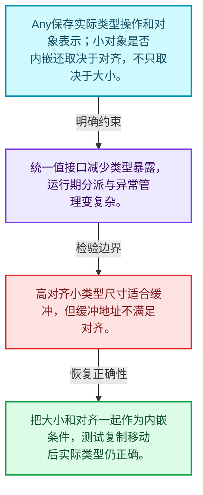
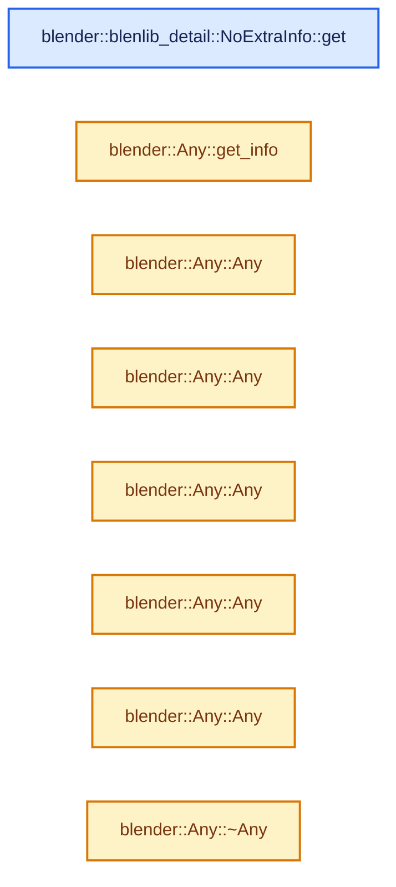
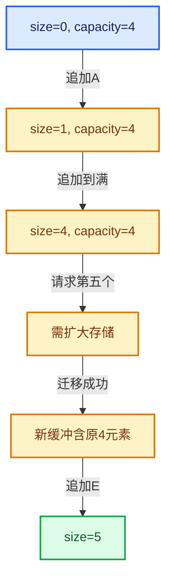

# 01-17 Any类型擦除存储

[方向导航](README.md) · [总目录](../README.md) · [实现索引](../00-课程指南/02-源码与提交索引/符号依赖与实现索引.md)

## 从问题到实现

怎样保存运行期未知的对象并保持正确析构？

类型擦除必须保留操作信息；小对象优化受大小和对齐约束，不能仅检查sizeof。

**数据模型**

Any保存实际类型操作和对象表示；小对象是否内嵌还取决于对齐，不只取决于大小。

**设计取舍**

统一值接口减少类型暴露，运行期分派与异常管理变复杂。

**最小反例**

高对齐小类型尺寸适合缓冲，但缓冲地址不满足对齐。

**推导**

把大小和对齐一起作为内嵌条件，测试复制移动后实际类型仍正确。

## 阅读地图与执行推演








图中的数值推演是本方向的教学模型；实际函数之间的调用边与概念分析边分别标注，不能把概念关系当作运行时调度顺序。

## 完整源码单元与就地讲解

中文讲解直接放在相关代码旁，复杂机制在代码下展开。原文折叠区保留基准行号；不需要在行号表和函数之间来回查找。类布局可分段展示，函数实现不按固定行数切开。

### 类型布局、声明与编译条件 · BLI_any.hh L1—L74

<a id="t-06aed5d3a6a8"></a>

`AnyTypeInfo`在这里声明的数据成员：

- `void copy_construct`
- `void move_construct`
- `void destruct`
- `void get`
- `ExtraInfo extra_info`

<a id="t-c3403af0cf96"></a>

<!-- annotated:5a29f48e15c5e7 -->

```cpp
/* SPDX-FileCopyrightText: 2023 Blender Authors
 *
 * SPDX-License-Identifier: GPL-2.0-or-later */

#pragma once

/** \file
 * \ingroup bli
 *
 * A #Any is a type-safe container for single values of any copy constructible type.
 * It is similar to #std::any but provides the following two additional features:
 * - Adjustable inline buffer capacity and alignment. #std::any has a small inline buffer in most
 *   implementations as well, but its size is not guaranteed.
 * - Can store additional user-defined type information without increasing the stack size of #Any.
 */

#include <algorithm>
#include <utility>

#include "BLI_memory_utils.hh"

namespace blender {

namespace blenlib_detail {

/**
 * Contains function pointers that manage the memory in an #Any.
 * Additional type specific #ExtraInfo can be embedded here as well.
 */
template<typename ExtraInfo> struct AnyTypeInfo {
  /* The pointers are allowed to be null, which means that the implementation is trivial. */
  void (*copy_construct)(void *dst, const void *src);
  void (*move_construct)(void *dst, void *src);
  void (*destruct)(void *src);
  const void *(*get)(const void *src);
  ExtraInfo extra_info;
};

/**
 * Used when #T is stored directly in the inline buffer of the #Any.
 */
template<typename ExtraInfo, typename T>
inline AnyTypeInfo<ExtraInfo> info_for_inline = {
    is_trivially_copy_constructible_extended_v<T> ?
        nullptr :
        +[](void *dst, const void *src) { new (dst) T(*static_cast<const T *>(src)); },
    is_trivially_move_constructible_extended_v<T> ?
        nullptr :
        +[](void *dst, void *src) { new (dst) T(std::move(*static_cast<T *>(src))); },
    is_trivially_destructible_extended_v<T> ?
        nullptr :
        +[](void *src) { std::destroy_at((static_cast<T *>(src))); },
    nullptr,
    ExtraInfo::template get<T>()};

/**
 * Used when #T can't be stored directly in the inline buffer and is stored in a #std::unique_ptr
 * instead. In this scenario, the #std::unique_ptr is stored in the inline buffer.
 */
template<typename T> using Ptr = std::unique_ptr<T>;
template<typename ExtraInfo, typename T>
inline AnyTypeInfo<ExtraInfo> info_for_unique_ptr = {
    [](void *dst, const void *src) {
      new (dst) Ptr<T>(new T(**static_cast<const Ptr<T> *>(src)));
    },
    [](void *dst, void *src) { new (dst) Ptr<T>(new T(std::move(**static_cast<Ptr<T> *>(src)))); },
    [](void *src) { std::destroy_at(static_cast<Ptr<T> *>(src)); },
    [](const void *src) -> const void * { return &**static_cast<const Ptr<T> *>(src); },
    ExtraInfo::template get<T>()};

/**
 * Dummy extra info that is used when no additional type information should be stored in the #Any.
 */
struct NoExtraInfo {
```

<details>
<summary>核对原始源码：source/blender/blenlib/BLI_any.hh · L1—L74</summary>

<!-- original:5a29f48e15c5e7:source/blender/blenlib/BLI_any.hh:1:74 -->

```cpp
/* SPDX-FileCopyrightText: 2023 Blender Authors
 *
 * SPDX-License-Identifier: GPL-2.0-or-later */

#pragma once

/** \file
 * \ingroup bli
 *
 * A #Any is a type-safe container for single values of any copy constructible type.
 * It is similar to #std::any but provides the following two additional features:
 * - Adjustable inline buffer capacity and alignment. #std::any has a small inline buffer in most
 *   implementations as well, but its size is not guaranteed.
 * - Can store additional user-defined type information without increasing the stack size of #Any.
 */

#include <algorithm>
#include <utility>

#include "BLI_memory_utils.hh"

namespace blender {

namespace blenlib_detail {

/**
 * Contains function pointers that manage the memory in an #Any.
 * Additional type specific #ExtraInfo can be embedded here as well.
 */
template<typename ExtraInfo> struct AnyTypeInfo {
  /* The pointers are allowed to be null, which means that the implementation is trivial. */
  void (*copy_construct)(void *dst, const void *src);
  void (*move_construct)(void *dst, void *src);
  void (*destruct)(void *src);
  const void *(*get)(const void *src);
  ExtraInfo extra_info;
};

/**
 * Used when #T is stored directly in the inline buffer of the #Any.
 */
template<typename ExtraInfo, typename T>
inline AnyTypeInfo<ExtraInfo> info_for_inline = {
    is_trivially_copy_constructible_extended_v<T> ?
        nullptr :
        +[](void *dst, const void *src) { new (dst) T(*static_cast<const T *>(src)); },
    is_trivially_move_constructible_extended_v<T> ?
        nullptr :
        +[](void *dst, void *src) { new (dst) T(std::move(*static_cast<T *>(src))); },
    is_trivially_destructible_extended_v<T> ?
        nullptr :
        +[](void *src) { std::destroy_at((static_cast<T *>(src))); },
    nullptr,
    ExtraInfo::template get<T>()};

/**
 * Used when #T can't be stored directly in the inline buffer and is stored in a #std::unique_ptr
 * instead. In this scenario, the #std::unique_ptr is stored in the inline buffer.
 */
template<typename T> using Ptr = std::unique_ptr<T>;
template<typename ExtraInfo, typename T>
inline AnyTypeInfo<ExtraInfo> info_for_unique_ptr = {
    [](void *dst, const void *src) {
      new (dst) Ptr<T>(new T(**static_cast<const Ptr<T> *>(src)));
    },
    [](void *dst, void *src) { new (dst) Ptr<T>(new T(std::move(**static_cast<Ptr<T> *>(src)))); },
    [](void *src) { std::destroy_at(static_cast<Ptr<T> *>(src)); },
    [](const void *src) -> const void * { return &**static_cast<const Ptr<T> *>(src); },
    ExtraInfo::template get<T>()};

/**
 * Dummy extra info that is used when no additional type information should be stored in the #Any.
 */
struct NoExtraInfo {
```

</details>

<a id="f-2727a984d95dcacd"></a>

### `blender::blenlib_detail::NoExtraInfo::get`

实现位置：[source/blender/blenlib/BLI_any.hh](../../../../../source/blender/blenlib/BLI_any.hh) · L75—L78。

**教学注释版**

<!-- annotated:e420eb99957ca7 -->

```cpp
  template<typename T> static constexpr NoExtraInfo get()
  {
    return {};
  }
```

<details>
<summary>核对原始源码：source/blender/blenlib/BLI_any.hh · L75—L78</summary>

<!-- original:e420eb99957ca7:source/blender/blenlib/BLI_any.hh:75:78 -->

```cpp
  template<typename T> static constexpr NoExtraInfo get()
  {
    return {};
  }
```

</details>

**结果出口**

- `return {};`

**继续追踪实现**

本实现没有需要继续展开的显式调用；检查返回表达式、对象转换和调用者前置条件。

### 类型布局、声明与编译条件 · BLI_any.hh L79—L151

<a id="t-f5eb63d7c81f"></a>

<a id="t-acc91a9d715a"></a>

`Any`在这里声明的数据成员：

- `size_t RealInlineBufferCapacity`
- `AlignedBuffer<RealInlineBufferCapacity, Alignment> buffer_`
- `BLI_NO_UNIQUE_ADDRESS ExtraData`
- `Info info_`

<!-- annotated:057e02a2adc0d4 -->

```cpp
};

struct EmptyType {};

}  // namespace blenlib_detail

template<
    /**
     * Either void or a struct that contains data members for additional type information.
     * The struct has to have a static `ExtraInfo get<T>()` method that initializes the struct
     * based on a type.
     */
    typename ExtraInfo = void,
    /**
     * Size of the inline buffer. This allows types that are small enough to be stored directly
     * inside the #Any without an additional allocation.
     */
    size_t InlineBufferCapacity = 8,
    /**
     * Required minimum alignment of the inline buffer. If this is smaller than the alignment
     * requirement of a used type, a separate allocation is necessary.
     */
    size_t Alignment = 8,
    /**
     * Depending on the Alignment template parameter, there may be extra padding space that's
     * available to store some data. This type is stored after the buffer to use that space.
     */
    typename ExtraData = blenlib_detail::EmptyType>
class Any {
 private:
  /* Makes it possible to use void in the template parameters. */
  using RealExtraInfo =
      std::conditional_t<std::is_void_v<ExtraInfo>, blenlib_detail::NoExtraInfo, ExtraInfo>;
  using Info = blenlib_detail::AnyTypeInfo<RealExtraInfo>;
  static constexpr size_t RealInlineBufferCapacity = std::max(InlineBufferCapacity,
                                                              sizeof(std::unique_ptr<int>));

  /**
   * Inline buffer that either contains nothing, the stored value directly, or a #std::unique_ptr
   * to the value.
   */
  AlignedBuffer<RealInlineBufferCapacity, Alignment> buffer_{};

 public:
  /** Extra data potentially stored within padding required by the buffer. */
  BLI_NO_UNIQUE_ADDRESS ExtraData extra = {};

 private:
  /**
   * Information about the type that is currently stored.
   * This is null when the #Any does not contain a value.
   */
  const Info *info_ = nullptr;

 public:
  /** Only copy constructible types can be stored in #Any. */
  template<typename T> static constexpr bool is_allowed_v = std::is_copy_constructible_v<T>;

  /**
   * Checks if the type will be stored in the inline buffer or if it requires a separate
   * allocation.
   */
  template<typename T>
  static constexpr bool is_inline_v = std::is_nothrow_move_constructible_v<T> &&
                                      sizeof(T) <= InlineBufferCapacity && alignof(T) <= Alignment;

  /**
   * Checks if #T is the same type as this #Any, because in this case the behavior of e.g. the
   * assignment operator is different.
   */
  template<typename T> static constexpr bool is_same_any_v = std::is_same_v<std::decay_t<T>, Any>;

 private:
```

<details>
<summary>核对原始源码：source/blender/blenlib/BLI_any.hh · L79—L151</summary>

<!-- original:057e02a2adc0d4:source/blender/blenlib/BLI_any.hh:79:151 -->

```cpp
};

struct EmptyType {};

}  // namespace blenlib_detail

template<
    /**
     * Either void or a struct that contains data members for additional type information.
     * The struct has to have a static `ExtraInfo get<T>()` method that initializes the struct
     * based on a type.
     */
    typename ExtraInfo = void,
    /**
     * Size of the inline buffer. This allows types that are small enough to be stored directly
     * inside the #Any without an additional allocation.
     */
    size_t InlineBufferCapacity = 8,
    /**
     * Required minimum alignment of the inline buffer. If this is smaller than the alignment
     * requirement of a used type, a separate allocation is necessary.
     */
    size_t Alignment = 8,
    /**
     * Depending on the Alignment template parameter, there may be extra padding space that's
     * available to store some data. This type is stored after the buffer to use that space.
     */
    typename ExtraData = blenlib_detail::EmptyType>
class Any {
 private:
  /* Makes it possible to use void in the template parameters. */
  using RealExtraInfo =
      std::conditional_t<std::is_void_v<ExtraInfo>, blenlib_detail::NoExtraInfo, ExtraInfo>;
  using Info = blenlib_detail::AnyTypeInfo<RealExtraInfo>;
  static constexpr size_t RealInlineBufferCapacity = std::max(InlineBufferCapacity,
                                                              sizeof(std::unique_ptr<int>));

  /**
   * Inline buffer that either contains nothing, the stored value directly, or a #std::unique_ptr
   * to the value.
   */
  AlignedBuffer<RealInlineBufferCapacity, Alignment> buffer_{};

 public:
  /** Extra data potentially stored within padding required by the buffer. */
  BLI_NO_UNIQUE_ADDRESS ExtraData extra = {};

 private:
  /**
   * Information about the type that is currently stored.
   * This is null when the #Any does not contain a value.
   */
  const Info *info_ = nullptr;

 public:
  /** Only copy constructible types can be stored in #Any. */
  template<typename T> static constexpr bool is_allowed_v = std::is_copy_constructible_v<T>;

  /**
   * Checks if the type will be stored in the inline buffer or if it requires a separate
   * allocation.
   */
  template<typename T>
  static constexpr bool is_inline_v = std::is_nothrow_move_constructible_v<T> &&
                                      sizeof(T) <= InlineBufferCapacity && alignof(T) <= Alignment;

  /**
   * Checks if #T is the same type as this #Any, because in this case the behavior of e.g. the
   * assignment operator is different.
   */
  template<typename T> static constexpr bool is_same_any_v = std::is_same_v<std::decay_t<T>, Any>;

 private:
```

</details>

<a id="f-66742acac22e5594"></a>

### `blender::Any::get_info`

实现位置：[source/blender/blenlib/BLI_any.hh](../../../../../source/blender/blenlib/BLI_any.hh) · L152—L162。

**教学注释版**

<!-- annotated:77a1f6796b7ef1 -->

```cpp
  template<typename T> const Info &get_info() const
  {
    using DecayT = std::decay_t<T>;
    static_assert(is_allowed_v<DecayT>);
    if constexpr (is_inline_v<DecayT>) {
      return blenlib_detail::template info_for_inline<RealExtraInfo, DecayT>;
    }
    else {
      return blenlib_detail::template info_for_unique_ptr<RealExtraInfo, DecayT>;
    }
  }
```

<details>
<summary>核对原始源码：source/blender/blenlib/BLI_any.hh · L152—L162</summary>

<!-- original:77a1f6796b7ef1:source/blender/blenlib/BLI_any.hh:152:162 -->

```cpp
  template<typename T> const Info &get_info() const
  {
    using DecayT = std::decay_t<T>;
    static_assert(is_allowed_v<DecayT>);
    if constexpr (is_inline_v<DecayT>) {
      return blenlib_detail::template info_for_inline<RealExtraInfo, DecayT>;
    }
    else {
      return blenlib_detail::template info_for_unique_ptr<RealExtraInfo, DecayT>;
    }
  }
```

</details>

**结果出口**

- `return blenlib_detail::template info_for_inline<RealExtraInfo, DecayT>;`
- `return blenlib_detail::template info_for_unique_ptr<RealExtraInfo, DecayT>;`

**继续追踪实现**

本实现没有需要继续展开的显式调用；检查返回表达式、对象转换和调用者前置条件。

### 类型布局、声明与编译条件 · BLI_any.hh L163—L164

<!-- annotated:7f490b2e679b38 -->

```cpp

 public:
```

<details>
<summary>核对原始源码：source/blender/blenlib/BLI_any.hh · L163—L164</summary>

<!-- original:7f490b2e679b38:source/blender/blenlib/BLI_any.hh:163:164 -->

```cpp

 public:
```

</details>

<a id="f-6d96940cbdf38a2e"></a>

### `blender::Any::Any`

实现位置：[source/blender/blenlib/BLI_any.hh](../../../../../source/blender/blenlib/BLI_any.hh) · L165—L165。

**教学注释版**

<!-- annotated:ade45ca68d4210 -->

```cpp
  Any() = default;
```

<details>
<summary>核对原始源码：source/blender/blenlib/BLI_any.hh · L165—L165</summary>

<!-- original:ade45ca68d4210:source/blender/blenlib/BLI_any.hh:165:165 -->

```cpp
  Any() = default;
```

</details>

**继续追踪实现**

本实现没有需要继续展开的显式调用；检查返回表达式、对象转换和调用者前置条件。

<!-- annotated:c1fb69d9bb5923 -->

```cpp

```

<details>
<summary>核对原始源码：source/blender/blenlib/BLI_any.hh · L166—L166</summary>

<!-- original:c1fb69d9bb5923:source/blender/blenlib/BLI_any.hh:166:166 -->

```cpp

```

</details>

<a id="f-4d983d38c60c9114"></a>

### `blender::Any::Any`

实现位置：[source/blender/blenlib/BLI_any.hh](../../../../../source/blender/blenlib/BLI_any.hh) · L167—L179。

接口参数：

- `const Any &other`

**教学注释版**

<!-- annotated:117c941e0709d2 -->

```cpp
  Any(const Any &other) : extra(other.extra), info_(other.info_)
  {
    if (info_ != nullptr) {
      if (info_->copy_construct != nullptr) {
        info_->copy_construct(&buffer_, &other.buffer_);
      }
      else {
        std::copy_n(static_cast<const std::byte *>(other.buffer_.ptr()),
                    RealInlineBufferCapacity,
                    static_cast<std::byte *>(buffer_.ptr()));
      }
    }
  }
```

<details>
<summary>核对原始源码：source/blender/blenlib/BLI_any.hh · L167—L179</summary>

<!-- original:117c941e0709d2:source/blender/blenlib/BLI_any.hh:167:179 -->

```cpp
  Any(const Any &other) : extra(other.extra), info_(other.info_)
  {
    if (info_ != nullptr) {
      if (info_->copy_construct != nullptr) {
        info_->copy_construct(&buffer_, &other.buffer_);
      }
      else {
        std::copy_n(static_cast<const std::byte *>(other.buffer_.ptr()),
                    RealInlineBufferCapacity,
                    static_cast<std::byte *>(buffer_.ptr()));
      }
    }
  }
```

</details>

**继续追踪实现**

- `info_->copy_construct` → [blender::CPPType::copy_construct · L594](../03-内存分配与运行时类型/09-CPPType复制移动重定位.md#f-cfda413a9784073e)。
- `std::copy_n` → [外部契约](https://eel.is/c++draft/)：这个边界按实际表达式及所属类型核对参数、返回值、寿命与失败行为。这里提供接口入口，不声称已解释该第三方版本的内部实现。
- `other.buffer_.ptr` → [调用协议](../00-课程指南/01-路线与规范/模板宏与动态分派协议.md)：接收对象类型依赖auto、返回值或模板实例；不按同名猜测目标。调用位置L174。
- `buffer_.ptr` → [blender::AlignedBuffer::ptr · L138](01-对象生命周期与值类别.md#f-bfe745bcb7c7811c)；[blender::AlignedBuffer::ptr · L143](01-对象生命周期与值类别.md#f-f24632360e6cd028)。同名重载需按实参类型选择。

### 类型布局、声明与编译条件 · BLI_any.hh L180—L184

<!-- annotated:647384b5dd5521 -->

```cpp

  /**
   * \note The #other #Any will not be empty afterwards if it was not before. Just its value is in
   * a moved-from state.
   */
```

<details>
<summary>核对原始源码：source/blender/blenlib/BLI_any.hh · L180—L184</summary>

<!-- original:647384b5dd5521:source/blender/blenlib/BLI_any.hh:180:184 -->

```cpp

  /**
   * \note The #other #Any will not be empty afterwards if it was not before. Just its value is in
   * a moved-from state.
   */
```

</details>

<a id="f-cdc7c0704d2ce84e"></a>

### `blender::Any::Any`

实现位置：[source/blender/blenlib/BLI_any.hh](../../../../../source/blender/blenlib/BLI_any.hh) · L185—L197。

接口参数：

- `Any &&other`

**教学注释版**

<!-- annotated:d501078b520d1e -->

```cpp
  Any(Any &&other) noexcept : extra(std::move(other.extra)), info_(other.info_)
  {
    if (info_ != nullptr) {
      if (info_->move_construct != nullptr) {
        info_->move_construct(&buffer_, &other.buffer_);
      }
      else {
        std::copy_n(static_cast<const std::byte *>(other.buffer_.ptr()),
                    RealInlineBufferCapacity,
                    static_cast<std::byte *>(buffer_.ptr()));
      }
    }
  }
```

<details>
<summary>核对原始源码：source/blender/blenlib/BLI_any.hh · L185—L197</summary>

<!-- original:d501078b520d1e:source/blender/blenlib/BLI_any.hh:185:197 -->

```cpp
  Any(Any &&other) noexcept : extra(std::move(other.extra)), info_(other.info_)
  {
    if (info_ != nullptr) {
      if (info_->move_construct != nullptr) {
        info_->move_construct(&buffer_, &other.buffer_);
      }
      else {
        std::copy_n(static_cast<const std::byte *>(other.buffer_.ptr()),
                    RealInlineBufferCapacity,
                    static_cast<std::byte *>(buffer_.ptr()));
      }
    }
  }
```

</details>

**继续追踪实现**

- `info_->move_construct` → [blender::CPPType::move_construct · L633](../03-内存分配与运行时类型/09-CPPType复制移动重定位.md#f-12275cc6e59e9740)。
- `std::copy_n` → [外部契约](https://eel.is/c++draft/)：这个边界按实际表达式及所属类型核对参数、返回值、寿命与失败行为。这里提供接口入口，不声称已解释该第三方版本的内部实现。
- `other.buffer_.ptr` → [调用协议](../00-课程指南/01-路线与规范/模板宏与动态分派协议.md)：接收对象类型依赖auto、返回值或模板实例；不按同名猜测目标。调用位置L192。
- `buffer_.ptr` → [blender::AlignedBuffer::ptr · L138](01-对象生命周期与值类别.md#f-bfe745bcb7c7811c)；[blender::AlignedBuffer::ptr · L143](01-对象生命周期与值类别.md#f-f24632360e6cd028)。同名重载需按实参类型选择。

### 类型布局、声明与编译条件 · BLI_any.hh L198—L202

<!-- annotated:521e1ab7924227 -->

```cpp

  /**
   * Constructs a new #Any that contains the given type #T from #args. The #std::in_place_type_t is
   * used to disambiguate this and the copy/move constructors.
   */
```

<details>
<summary>核对原始源码：source/blender/blenlib/BLI_any.hh · L198—L202</summary>

<!-- original:521e1ab7924227:source/blender/blenlib/BLI_any.hh:198:202 -->

```cpp

  /**
   * Constructs a new #Any that contains the given type #T from #args. The #std::in_place_type_t is
   * used to disambiguate this and the copy/move constructors.
   */
```

</details>

<a id="f-dae8158e4a5934da"></a>

### `blender::Any::Any`

实现位置：[source/blender/blenlib/BLI_any.hh](../../../../../source/blender/blenlib/BLI_any.hh) · L203—L207。

接口参数：

- `std::in_place_type_t<T>`

**教学注释版**

<!-- annotated:9e84d59d555ab6 -->

```cpp
  template<typename T, typename... Args>
  explicit Any(std::in_place_type_t<T> /*tag*/, Args &&...args)
  {
    // [讲解] std::forward<Args>：在转发引用中恢复调用者传入的值类别；依赖推导类型，不能与无条件move互换。
    this->emplace_on_empty<T>(std::forward<Args>(args)...);
  }
```

<details>
<summary>核对原始源码：source/blender/blenlib/BLI_any.hh · L203—L207</summary>

<!-- original:9e84d59d555ab6:source/blender/blenlib/BLI_any.hh:203:207 -->

```cpp
  template<typename T, typename... Args>
  explicit Any(std::in_place_type_t<T> /*tag*/, Args &&...args)
  {
    this->emplace_on_empty<T>(std::forward<Args>(args)...);
  }
```

</details>

**继续追踪实现**

- `this->emplace_on_empty<T>` → [blender::Any::emplace_on_empty · L282](17-Any类型擦除存储.md#f-1eef4d2176fe3b60)。
- `std::forward<Args>` → [外部契约](https://eel.is/c++draft/utility.forward)：在转发引用中恢复调用者传入的值类别；依赖推导类型，不能与无条件move互换。

### 类型布局、声明与编译条件 · BLI_any.hh L208—L211

<!-- annotated:54501f8d4ec67b -->

```cpp

  /**
   * Constructs a new #Any that contains the given value.
   */
```

<details>
<summary>核对原始源码：source/blender/blenlib/BLI_any.hh · L208—L211</summary>

<!-- original:54501f8d4ec67b:source/blender/blenlib/BLI_any.hh:208:211 -->

```cpp

  /**
   * Constructs a new #Any that contains the given value.
   */
```

</details>

<a id="f-b3b3c8d5b26ee242"></a>

### `blender::Any::Any`

实现位置：[source/blender/blenlib/BLI_any.hh](../../../../../source/blender/blenlib/BLI_any.hh) · L212—L217。

接口参数：

- `T &&value`

**教学注释版**

<!-- annotated:e07063a98fffbd -->

```cpp
  template<typename T>
  Any(T &&value)
    requires(!is_same_any_v<T>)
      : Any(std::in_place_type<T>, std::forward<T>(value))
  {
  }
```

<details>
<summary>核对原始源码：source/blender/blenlib/BLI_any.hh · L212—L217</summary>

<!-- original:e07063a98fffbd:source/blender/blenlib/BLI_any.hh:212:217 -->

```cpp
  template<typename T>
  Any(T &&value)
    requires(!is_same_any_v<T>)
      : Any(std::in_place_type<T>, std::forward<T>(value))
  {
  }
```

</details>

**继续追踪实现**

本实现没有需要继续展开的显式调用；检查返回表达式、对象转换和调用者前置条件。

<!-- annotated:61666519947825 -->

```cpp

```

<details>
<summary>核对原始源码：source/blender/blenlib/BLI_any.hh · L218—L218</summary>

<!-- original:61666519947825:source/blender/blenlib/BLI_any.hh:218:218 -->

```cpp

```

</details>

<a id="f-9f23446bc07e3137"></a>

### `blender::Any::~Any`

实现位置：[source/blender/blenlib/BLI_any.hh](../../../../../source/blender/blenlib/BLI_any.hh) · L219—L226。

**教学注释版**

<!-- annotated:628e99f37d61b5 -->

```cpp
  ~Any()
  {
    if (info_ != nullptr) {
      if (info_->destruct != nullptr) {
        info_->destruct(&buffer_);
      }
    }
  }
```

<details>
<summary>核对原始源码：source/blender/blenlib/BLI_any.hh · L219—L226</summary>

<!-- original:628e99f37d61b5:source/blender/blenlib/BLI_any.hh:219:226 -->

```cpp
  ~Any()
  {
    if (info_ != nullptr) {
      if (info_->destruct != nullptr) {
        info_->destruct(&buffer_);
      }
    }
  }
```

</details>

**继续追踪实现**

- `info_->destruct` → [调用协议](../00-课程指南/01-路线与规范/模板宏与动态分派协议.md)：由接收对象具体类型或运行时策略提供实现。调用位置L223。

### 类型布局、声明与编译条件 · BLI_any.hh L227—L230

<!-- annotated:a1463c74dfeb07 -->

```cpp

  /**
   * \note Only needed because the template below does not count as copy assignment operator.
   */
```

<details>
<summary>核对原始源码：source/blender/blenlib/BLI_any.hh · L227—L230</summary>

<!-- original:a1463c74dfeb07:source/blender/blenlib/BLI_any.hh:227:230 -->

```cpp

  /**
   * \note Only needed because the template below does not count as copy assignment operator.
   */
```

</details>

<a id="f-334be9eb41901b76"></a>

### `blender::Any::operator=`

实现位置：[source/blender/blenlib/BLI_any.hh](../../../../../source/blender/blenlib/BLI_any.hh) · L231—L239。

接口参数：

- `const Any &other`

**教学注释版**

<!-- annotated:c9106cdb65f492 -->

```cpp
  Any &operator=(const Any &other)
  {
    if (this == &other) {
      return *this;
    }
    this->~Any();
    new (this) Any(other);
    return *this;
  }
```

<details>
<summary>核对原始源码：source/blender/blenlib/BLI_any.hh · L231—L239</summary>

<!-- original:c9106cdb65f492:source/blender/blenlib/BLI_any.hh:231:239 -->

```cpp
  Any &operator=(const Any &other)
  {
    if (this == &other) {
      return *this;
    }
    this->~Any();
    new (this) Any(other);
    return *this;
  }
```

</details>

**结果出口**

- `return *this;`

**继续追踪实现**

- `this->~Any` → [blender::Any::~Any · L219](17-Any类型擦除存储.md#f-9f23446bc07e3137)。

### 类型布局、声明与编译条件 · BLI_any.hh L240—L241

<!-- annotated:0d3707b0c4b484 -->

```cpp

  /** Assign any value to the #Any. */
```

<details>
<summary>核对原始源码：source/blender/blenlib/BLI_any.hh · L240—L241</summary>

<!-- original:0d3707b0c4b484:source/blender/blenlib/BLI_any.hh:240:241 -->

```cpp

  /** Assign any value to the #Any. */
```

</details>

<a id="f-17ae7340bee39d0c"></a>

### `blender::Any::operator=`

实现位置：[source/blender/blenlib/BLI_any.hh](../../../../../source/blender/blenlib/BLI_any.hh) · L242—L252。

接口参数：

- `T &&other`

**教学注释版**

<!-- annotated:b2c57b47547897 -->

```cpp
  template<typename T> Any &operator=(T &&other)
  {
    if constexpr (is_same_any_v<T>) {
      if (this == &other) {
        return *this;
      }
    }
    this->~Any();
    // [讲解] std::forward<T>：在转发引用中恢复调用者传入的值类别；依赖推导类型，不能与无条件move互换。
    new (this) Any(std::forward<T>(other));
    return *this;
  }
```

<details>
<summary>核对原始源码：source/blender/blenlib/BLI_any.hh · L242—L252</summary>

<!-- original:b2c57b47547897:source/blender/blenlib/BLI_any.hh:242:252 -->

```cpp
  template<typename T> Any &operator=(T &&other)
  {
    if constexpr (is_same_any_v<T>) {
      if (this == &other) {
        return *this;
      }
    }
    this->~Any();
    new (this) Any(std::forward<T>(other));
    return *this;
  }
```

</details>

**结果出口**

- `return *this;`

**继续追踪实现**

- `this->~Any` → [blender::Any::~Any · L219](17-Any类型擦除存储.md#f-9f23446bc07e3137)。
- `std::forward<T>` → [外部契约](https://eel.is/c++draft/utility.forward)：在转发引用中恢复调用者传入的值类别；依赖推导类型，不能与无条件move互换。

### 类型布局、声明与编译条件 · BLI_any.hh L253—L254

<!-- annotated:869c8ec9e04a48 -->

```cpp

  /** Destruct any existing value to make it empty. */
```

<details>
<summary>核对原始源码：source/blender/blenlib/BLI_any.hh · L253—L254</summary>

<!-- original:869c8ec9e04a48:source/blender/blenlib/BLI_any.hh:253:254 -->

```cpp

  /** Destruct any existing value to make it empty. */
```

</details>

<a id="f-4aaa848556386cca"></a>

### `blender::Any::reset`

实现位置：[source/blender/blenlib/BLI_any.hh](../../../../../source/blender/blenlib/BLI_any.hh) · L255—L263。

**教学注释版**

<!-- annotated:6a3d4fdf6ac1d2 -->

```cpp
  void reset()
  {
    if (info_ != nullptr) {
      if (info_->destruct != nullptr) {
        info_->destruct(&buffer_);
      }
    }
    info_ = nullptr;
  }
```

<details>
<summary>核对原始源码：source/blender/blenlib/BLI_any.hh · L255—L263</summary>

<!-- original:6a3d4fdf6ac1d2:source/blender/blenlib/BLI_any.hh:255:263 -->

```cpp
  void reset()
  {
    if (info_ != nullptr) {
      if (info_->destruct != nullptr) {
        info_->destruct(&buffer_);
      }
    }
    info_ = nullptr;
  }
```

</details>

**沿实际写入检查状态**

- `info_ = nullptr;`

**继续追踪实现**

- `info_->destruct` → [调用协议](../00-课程指南/01-路线与规范/模板宏与动态分派协议.md)：由接收对象具体类型或运行时策略提供实现。调用位置L259。

<!-- annotated:c475de5f0d5102 -->

```cpp

```

<details>
<summary>核对原始源码：source/blender/blenlib/BLI_any.hh · L264—L264</summary>

<!-- original:c475de5f0d5102:source/blender/blenlib/BLI_any.hh:264:264 -->

```cpp

```

</details>

<a id="f-ff16ff458427eb27"></a>

### `blender::Any::() const`

实现位置：[source/blender/blenlib/BLI_any.hh](../../../../../source/blender/blenlib/BLI_any.hh) · L265—L268。

**教学注释版**

<!-- annotated:818b94b221e757 -->

```cpp
  operator bool() const
  {
    return this->has_value();
  }
```

<details>
<summary>核对原始源码：source/blender/blenlib/BLI_any.hh · L265—L268</summary>

<!-- original:818b94b221e757:source/blender/blenlib/BLI_any.hh:265:268 -->

```cpp
  operator bool() const
  {
    return this->has_value();
  }
```

</details>

**结果出口**

- `return this->has_value();`

**继续追踪实现**

- `this->has_value` → [blender::Any::has_value · L270](17-Any类型擦除存储.md#f-8aa6656a044be07e)。

<!-- annotated:44d692c9e326b7 -->

```cpp

```

<details>
<summary>核对原始源码：source/blender/blenlib/BLI_any.hh · L269—L269</summary>

<!-- original:44d692c9e326b7:source/blender/blenlib/BLI_any.hh:269:269 -->

```cpp

```

</details>

<a id="f-8aa6656a044be07e"></a>

### `blender::Any::has_value`

实现位置：[source/blender/blenlib/BLI_any.hh](../../../../../source/blender/blenlib/BLI_any.hh) · L270—L273。

**教学注释版**

<!-- annotated:9682290d9c1deb -->

```cpp
  bool has_value() const
  {
    return info_ != nullptr;
  }
```

<details>
<summary>核对原始源码：source/blender/blenlib/BLI_any.hh · L270—L273</summary>

<!-- original:9682290d9c1deb:source/blender/blenlib/BLI_any.hh:270:273 -->

```cpp
  bool has_value() const
  {
    return info_ != nullptr;
  }
```

</details>

**结果出口**

- `return info_ != nullptr;`

**继续追踪实现**

本实现没有需要继续展开的显式调用；检查返回表达式、对象转换和调用者前置条件。

<!-- annotated:9dcf7c0d5d94f8 -->

```cpp

```

<details>
<summary>核对原始源码：source/blender/blenlib/BLI_any.hh · L274—L274</summary>

<!-- original:9dcf7c0d5d94f8:source/blender/blenlib/BLI_any.hh:274:274 -->

```cpp

```

</details>

<a id="f-5e654b65ea045bf2"></a>

### `blender::Any::emplace`

实现位置：[source/blender/blenlib/BLI_any.hh](../../../../../source/blender/blenlib/BLI_any.hh) · L275—L280。

**教学注释版**

<!-- annotated:dec52309e070c2 -->

```cpp
  template<typename T, typename... Args> std::decay_t<T> &emplace(Args &&...args)
  {
    this->~Any();
    // [讲解] std::forward<Args>：在转发引用中恢复调用者传入的值类别；依赖推导类型，不能与无条件move互换。
    new (this) Any(std::in_place_type<T>, std::forward<Args>(args)...);
    return this->get<T>();
  }
```

<details>
<summary>核对原始源码：source/blender/blenlib/BLI_any.hh · L275—L280</summary>

<!-- original:dec52309e070c2:source/blender/blenlib/BLI_any.hh:275:280 -->

```cpp
  template<typename T, typename... Args> std::decay_t<T> &emplace(Args &&...args)
  {
    this->~Any();
    new (this) Any(std::in_place_type<T>, std::forward<Args>(args)...);
    return this->get<T>();
  }
```

</details>

**结果出口**

- `return this->get<T>();`

**继续追踪实现**

- `this->~Any` → [blender::Any::~Any · L219](17-Any类型擦除存储.md#f-9f23446bc07e3137)。
- `std::forward<Args>` → [外部契约](https://eel.is/c++draft/utility.forward)：在转发引用中恢复调用者传入的值类别；依赖推导类型，不能与无条件move互换。
- `this->get<T>` → [blender::Any::get · L339](17-Any类型擦除存储.md#f-d13d53cda71870a4)；[blender::Any::get · L349](17-Any类型擦除存储.md#f-26e8db7340c50d4c)；[blender::Any::get · L362](17-Any类型擦除存储.md#f-ac2a1c7c9a117c3b)；[blender::Any::get · L372](17-Any类型擦除存储.md#f-bd73cf50e0cf156d)。同名重载需按实参类型选择。

<!-- annotated:31287b8eed5f4b -->

```cpp

```

<details>
<summary>核对原始源码：source/blender/blenlib/BLI_any.hh · L281—L281</summary>

<!-- original:31287b8eed5f4b:source/blender/blenlib/BLI_any.hh:281:281 -->

```cpp

```

</details>

<a id="f-1eef4d2176fe3b60"></a>

### `blender::Any::emplace_on_empty`

实现位置：[source/blender/blenlib/BLI_any.hh](../../../../../source/blender/blenlib/BLI_any.hh) · L282—L300。

**教学注释版**

<!-- annotated:4857df5e47559a -->

```cpp
  template<typename T, typename... Args> std::decay_t<T> &emplace_on_empty(Args &&...args)
  {
    BLI_assert(!this->has_value());
    using DecayT = std::decay_t<T>;
    static_assert(is_allowed_v<DecayT>);
    info_ = &this->template get_info<DecayT>();
    if constexpr (is_inline_v<DecayT>) {
      /* Construct the value directly in the inline buffer. */
      // [讲解] std::forward<Args>：在转发引用中恢复调用者传入的值类别；依赖推导类型，不能与无条件move互换。
      DecayT *stored_value = new (&buffer_) DecayT(std::forward<Args>(args)...);
      return *stored_value;
    }
    else {
      /* Construct the value in a new allocation and store a #std::unique_ptr to it in the inline
       * buffer. */
      std::unique_ptr<DecayT> *stored_value = new (&buffer_)
          std::unique_ptr<DecayT>(new DecayT(std::forward<Args>(args)...));
      return **stored_value;
    }
  }
```

<details>
<summary>核对原始源码：source/blender/blenlib/BLI_any.hh · L282—L300</summary>

<!-- original:4857df5e47559a:source/blender/blenlib/BLI_any.hh:282:300 -->

```cpp
  template<typename T, typename... Args> std::decay_t<T> &emplace_on_empty(Args &&...args)
  {
    BLI_assert(!this->has_value());
    using DecayT = std::decay_t<T>;
    static_assert(is_allowed_v<DecayT>);
    info_ = &this->template get_info<DecayT>();
    if constexpr (is_inline_v<DecayT>) {
      /* Construct the value directly in the inline buffer. */
      DecayT *stored_value = new (&buffer_) DecayT(std::forward<Args>(args)...);
      return *stored_value;
    }
    else {
      /* Construct the value in a new allocation and store a #std::unique_ptr to it in the inline
       * buffer. */
      std::unique_ptr<DecayT> *stored_value = new (&buffer_)
          std::unique_ptr<DecayT>(new DecayT(std::forward<Args>(args)...));
      return **stored_value;
    }
  }
```

</details>

**沿实际写入检查状态**

- `info_ = &this->template get_info<DecayT>();`

**结果出口**

- `return *stored_value;`
- `return **stored_value;`

**继续追踪实现**

- `BLI_assert` → [BLI_assert · L48](../90-实现依赖专题/01-BLI基础库/BLI_assert.hh.md#m-57a88495704d)；[BLI_assert · L63](../90-实现依赖专题/01-BLI基础库/BLI_assert.hh.md#m-d07050020cb5)。宏定义由构建条件选择。
- `this->has_value` → [blender::Any::has_value · L270](17-Any类型擦除存储.md#f-8aa6656a044be07e)。
- `this->template get_info<DecayT>` → [blender::Any::get_info · L152](17-Any类型擦除存储.md#f-66742acac22e5594)。
- `std::forward<Args>` → [外部契约](https://eel.is/c++draft/utility.forward)：在转发引用中恢复调用者传入的值类别；依赖推导类型，不能与无条件move互换。

### 类型布局、声明与编译条件 · BLI_any.hh L301—L305

<!-- annotated:bf721aa1cc2a8a -->

```cpp

  /**
   * Like #emplace but does *not* actually construct the value. The caller is responsible for
   * calling the constructor before the value is used.
   */
```

<details>
<summary>核对原始源码：source/blender/blenlib/BLI_any.hh · L301—L305</summary>

<!-- original:bf721aa1cc2a8a:source/blender/blenlib/BLI_any.hh:301:305 -->

```cpp

  /**
   * Like #emplace but does *not* actually construct the value. The caller is responsible for
   * calling the constructor before the value is used.
   */
```

</details>

<a id="f-af8c4dfad5058d49"></a>

### `blender::Any::allocate`

实现位置：[source/blender/blenlib/BLI_any.hh](../../../../../source/blender/blenlib/BLI_any.hh) · L306—L310。

**教学注释版**

<!-- annotated:043481cdaeff4c -->

```cpp
  template<typename T> void *allocate()
  {
    this->reset();
    return this->allocate_on_empty<T>();
  }
```

<details>
<summary>核对原始源码：source/blender/blenlib/BLI_any.hh · L306—L310</summary>

<!-- original:043481cdaeff4c:source/blender/blenlib/BLI_any.hh:306:310 -->

```cpp
  template<typename T> void *allocate()
  {
    this->reset();
    return this->allocate_on_empty<T>();
  }
```

</details>

**结果出口**

- `return this->allocate_on_empty<T>();`

**继续追踪实现**

- `this->reset` → [blender::Any::reset · L255](17-Any类型擦除存储.md#f-4aaa848556386cca)。
- `this->allocate_on_empty<T>` → [blender::Any::allocate_on_empty · L316](17-Any类型擦除存储.md#f-148792036eb63c4f)。

### 类型布局、声明与编译条件 · BLI_any.hh L311—L315

<!-- annotated:0e701b404cbd99 -->

```cpp

  /**
   * Like #emplace_on_empty but does *not* actually construct the value. The caller is responsible
   * for calling the constructor before the value is used.
   */
```

<details>
<summary>核对原始源码：source/blender/blenlib/BLI_any.hh · L311—L315</summary>

<!-- original:0e701b404cbd99:source/blender/blenlib/BLI_any.hh:311:315 -->

```cpp

  /**
   * Like #emplace_on_empty but does *not* actually construct the value. The caller is responsible
   * for calling the constructor before the value is used.
   */
```

</details>

<a id="f-148792036eb63c4f"></a>

### `blender::Any::allocate_on_empty`

实现位置：[source/blender/blenlib/BLI_any.hh](../../../../../source/blender/blenlib/BLI_any.hh) · L316—L330。

**教学注释版**

<!-- annotated:eb4ade2d4fda57 -->

```cpp
  template<typename T> void *allocate_on_empty()
  {
    BLI_assert(!this->has_value());
    static_assert(is_allowed_v<T>);
    info_ = &this->template get_info<T>();
    if constexpr (is_inline_v<T>) {
      return buffer_.ptr();
    }
    else {
      /* Using raw allocation here. The caller is responsible for constructing the value. */
      T *value = static_cast<T *>(::operator new(sizeof(T)));
      new (&buffer_) std::unique_ptr<T>(value);
      return value;
    }
  }
```

<details>
<summary>核对原始源码：source/blender/blenlib/BLI_any.hh · L316—L330</summary>

<!-- original:eb4ade2d4fda57:source/blender/blenlib/BLI_any.hh:316:330 -->

```cpp
  template<typename T> void *allocate_on_empty()
  {
    BLI_assert(!this->has_value());
    static_assert(is_allowed_v<T>);
    info_ = &this->template get_info<T>();
    if constexpr (is_inline_v<T>) {
      return buffer_.ptr();
    }
    else {
      /* Using raw allocation here. The caller is responsible for constructing the value. */
      T *value = static_cast<T *>(::operator new(sizeof(T)));
      new (&buffer_) std::unique_ptr<T>(value);
      return value;
    }
  }
```

</details>

**沿实际写入检查状态**

- `info_ = &this->template get_info<T>();`

**结果出口**

- `return buffer_.ptr();`
- `return value;`

**继续追踪实现**

- `BLI_assert` → [BLI_assert · L48](../90-实现依赖专题/01-BLI基础库/BLI_assert.hh.md#m-57a88495704d)；[BLI_assert · L63](../90-实现依赖专题/01-BLI基础库/BLI_assert.hh.md#m-d07050020cb5)。宏定义由构建条件选择。
- `this->has_value` → [blender::Any::has_value · L270](17-Any类型擦除存储.md#f-8aa6656a044be07e)。
- `this->template get_info<T>` → [blender::Any::get_info · L152](17-Any类型擦除存储.md#f-66742acac22e5594)。
- `buffer_.ptr` → [blender::AlignedBuffer::ptr · L138](01-对象生命周期与值类别.md#f-bfe745bcb7c7811c)；[blender::AlignedBuffer::ptr · L143](01-对象生命周期与值类别.md#f-f24632360e6cd028)。同名重载需按实参类型选择。
- `::operator new` → [调用协议](../00-课程指南/01-路线与规范/模板宏与动态分派协议.md)：函数指针、局部可调用对象或未展开的宏；必须结合调用者环境。调用位置L326。

### 类型布局、声明与编译条件 · BLI_any.hh L331—L332

<!-- annotated:9b8403f352d14c -->

```cpp

  /** Return true when the value that is currently stored is a #T. */
```

<details>
<summary>核对原始源码：source/blender/blenlib/BLI_any.hh · L331—L332</summary>

<!-- original:9b8403f352d14c:source/blender/blenlib/BLI_any.hh:331:332 -->

```cpp

  /** Return true when the value that is currently stored is a #T. */
```

</details>

<a id="f-9ca1778afa1df154"></a>

### `blender::Any::is`

实现位置：[source/blender/blenlib/BLI_any.hh](../../../../../source/blender/blenlib/BLI_any.hh) · L333—L336。

**教学注释版**

<!-- annotated:d36e93396c992b -->

```cpp
  template<typename T> bool is() const
  {
    return info_ == &this->template get_info<T>();
  }
```

<details>
<summary>核对原始源码：source/blender/blenlib/BLI_any.hh · L333—L336</summary>

<!-- original:d36e93396c992b:source/blender/blenlib/BLI_any.hh:333:336 -->

```cpp
  template<typename T> bool is() const
  {
    return info_ == &this->template get_info<T>();
  }
```

</details>

**结果出口**

- `return info_ == &this->template get_info<T>();`

**继续追踪实现**

- `this->template get_info<T>` → [blender::Any::get_info · L152](17-Any类型擦除存储.md#f-66742acac22e5594)。

### 类型布局、声明与编译条件 · BLI_any.hh L337—L338

<!-- annotated:b9ba675043166d -->

```cpp

  /** Get a pointer to the stored value. */
```

<details>
<summary>核对原始源码：source/blender/blenlib/BLI_any.hh · L337—L338</summary>

<!-- original:b9ba675043166d:source/blender/blenlib/BLI_any.hh:337:338 -->

```cpp

  /** Get a pointer to the stored value. */
```

</details>

<a id="f-d13d53cda71870a4"></a>

### `blender::Any::get`

实现位置：[source/blender/blenlib/BLI_any.hh](../../../../../source/blender/blenlib/BLI_any.hh) · L339—L346。

**教学注释版**

<!-- annotated:e6dc01c3521763 -->

```cpp
  void *get()
  {
    BLI_assert(info_ != nullptr);
    if (info_->get != nullptr) {
      return const_cast<void *>(info_->get(&buffer_));
    }
    return &buffer_;
  }
```

<details>
<summary>核对原始源码：source/blender/blenlib/BLI_any.hh · L339—L346</summary>

<!-- original:e6dc01c3521763:source/blender/blenlib/BLI_any.hh:339:346 -->

```cpp
  void *get()
  {
    BLI_assert(info_ != nullptr);
    if (info_->get != nullptr) {
      return const_cast<void *>(info_->get(&buffer_));
    }
    return &buffer_;
  }
```

</details>

**结果出口**

- `return const_cast<void *>(info_->get(&buffer_));`
- `return &buffer_;`

**继续追踪实现**

- `BLI_assert` → [BLI_assert · L48](../90-实现依赖专题/01-BLI基础库/BLI_assert.hh.md#m-57a88495704d)；[BLI_assert · L63](../90-实现依赖专题/01-BLI基础库/BLI_assert.hh.md#m-d07050020cb5)。宏定义由构建条件选择。
- `info_->get` → [blender::Any::get · L339](17-Any类型擦除存储.md#f-d13d53cda71870a4)；[blender::Any::get · L349](17-Any类型擦除存储.md#f-26e8db7340c50d4c)；[blender::Any::get · L362](17-Any类型擦除存储.md#f-ac2a1c7c9a117c3b)；[blender::Any::get · L372](17-Any类型擦除存储.md#f-bd73cf50e0cf156d)。同名重载需按实参类型选择。

### 类型布局、声明与编译条件 · BLI_any.hh L347—L348

<!-- annotated:29ba9c78b8fe2f -->

```cpp

  /** Get a pointer to the stored value. */
```

<details>
<summary>核对原始源码：source/blender/blenlib/BLI_any.hh · L347—L348</summary>

<!-- original:29ba9c78b8fe2f:source/blender/blenlib/BLI_any.hh:347:348 -->

```cpp

  /** Get a pointer to the stored value. */
```

</details>

<a id="f-26e8db7340c50d4c"></a>

### `blender::Any::get`

实现位置：[source/blender/blenlib/BLI_any.hh](../../../../../source/blender/blenlib/BLI_any.hh) · L349—L356。

**教学注释版**

<!-- annotated:05509c22cc8983 -->

```cpp
  const void *get() const
  {
    BLI_assert(info_ != nullptr);
    if (info_->get != nullptr) {
      return info_->get(&buffer_);
    }
    return &buffer_;
  }
```

<details>
<summary>核对原始源码：source/blender/blenlib/BLI_any.hh · L349—L356</summary>

<!-- original:05509c22cc8983:source/blender/blenlib/BLI_any.hh:349:356 -->

```cpp
  const void *get() const
  {
    BLI_assert(info_ != nullptr);
    if (info_->get != nullptr) {
      return info_->get(&buffer_);
    }
    return &buffer_;
  }
```

</details>

**结果出口**

- `return info_->get(&buffer_);`
- `return &buffer_;`

**继续追踪实现**

- `BLI_assert` → [BLI_assert · L48](../90-实现依赖专题/01-BLI基础库/BLI_assert.hh.md#m-57a88495704d)；[BLI_assert · L63](../90-实现依赖专题/01-BLI基础库/BLI_assert.hh.md#m-d07050020cb5)。宏定义由构建条件选择。
- `info_->get` → [blender::Any::get · L339](17-Any类型擦除存储.md#f-d13d53cda71870a4)；[blender::Any::get · L349](17-Any类型擦除存储.md#f-26e8db7340c50d4c)；[blender::Any::get · L362](17-Any类型擦除存储.md#f-ac2a1c7c9a117c3b)；[blender::Any::get · L372](17-Any类型擦除存储.md#f-bd73cf50e0cf156d)。同名重载需按实参类型选择。

### 类型布局、声明与编译条件 · BLI_any.hh L357—L361

<!-- annotated:d0a680f06a962c -->

```cpp

  /**
   * Get a reference to the stored value. This invokes undefined behavior when #T does not have the
   * correct type.
   */
```

<details>
<summary>核对原始源码：source/blender/blenlib/BLI_any.hh · L357—L361</summary>

<!-- original:d0a680f06a962c:source/blender/blenlib/BLI_any.hh:357:361 -->

```cpp

  /**
   * Get a reference to the stored value. This invokes undefined behavior when #T does not have the
   * correct type.
   */
```

</details>

<a id="f-ac2a1c7c9a117c3b"></a>

### `blender::Any::get`

实现位置：[source/blender/blenlib/BLI_any.hh](../../../../../source/blender/blenlib/BLI_any.hh) · L362—L366。

**教学注释版**

<!-- annotated:253d474165d5e6 -->

```cpp
  template<typename T> T &get()
  {
    /* Use const-cast to be able to reuse the const method above. */
    return const_cast<T &>(const_cast<const Any *>(this)->get<T>());
  }
```

<details>
<summary>核对原始源码：source/blender/blenlib/BLI_any.hh · L362—L366</summary>

<!-- original:253d474165d5e6:source/blender/blenlib/BLI_any.hh:362:366 -->

```cpp
  template<typename T> T &get()
  {
    /* Use const-cast to be able to reuse the const method above. */
    return const_cast<T &>(const_cast<const Any *>(this)->get<T>());
  }
```

</details>

**结果出口**

- `return const_cast<T &>(const_cast<const Any *>(this)->get<T>());`

**继续追踪实现**

- `const_cast<const Any *>(this)->get<T>` → [调用协议](../00-课程指南/01-路线与规范/模板宏与动态分派协议.md)：接收对象类型依赖auto、返回值或模板实例；不按同名猜测目标。调用位置L365。

### 类型布局、声明与编译条件 · BLI_any.hh L367—L371

<!-- annotated:5353666408b8a4 -->

```cpp

  /**
   * Get a reference to the stored value. This invokes undefined behavior when #T does not have the
   * correct type.
   */
```

<details>
<summary>核对原始源码：source/blender/blenlib/BLI_any.hh · L367—L371</summary>

<!-- original:5353666408b8a4:source/blender/blenlib/BLI_any.hh:367:371 -->

```cpp

  /**
   * Get a reference to the stored value. This invokes undefined behavior when #T does not have the
   * correct type.
   */
```

</details>

<a id="f-bd73cf50e0cf156d"></a>

### `blender::Any::get`

实现位置：[source/blender/blenlib/BLI_any.hh](../../../../../source/blender/blenlib/BLI_any.hh) · L372—L385。

**教学注释版**

<!-- annotated:e0f9638b5da059 -->

```cpp
  template<typename T> const T &get() const
  {
    BLI_assert(this->is<T>());
    const void *buffer;
    /* Can avoid the `info_->get == nullptr` check because the result is known statically. */
    if constexpr (is_inline_v<T>) {
      buffer = &buffer_;
    }
    else {
      BLI_assert(info_->get != nullptr);
      buffer = info_->get(&buffer_);
    }
    return *static_cast<const T *>(buffer);
  }
```

<details>
<summary>核对原始源码：source/blender/blenlib/BLI_any.hh · L372—L385</summary>

<!-- original:e0f9638b5da059:source/blender/blenlib/BLI_any.hh:372:385 -->

```cpp
  template<typename T> const T &get() const
  {
    BLI_assert(this->is<T>());
    const void *buffer;
    /* Can avoid the `info_->get == nullptr` check because the result is known statically. */
    if constexpr (is_inline_v<T>) {
      buffer = &buffer_;
    }
    else {
      BLI_assert(info_->get != nullptr);
      buffer = info_->get(&buffer_);
    }
    return *static_cast<const T *>(buffer);
  }
```

</details>

**沿实际写入检查状态**

- `buffer = &buffer_;`
- `buffer = info_->get(&buffer_);`

**结果出口**

- `return *static_cast<const T *>(buffer);`

**继续追踪实现**

- `BLI_assert` → [BLI_assert · L48](../90-实现依赖专题/01-BLI基础库/BLI_assert.hh.md#m-57a88495704d)；[BLI_assert · L63](../90-实现依赖专题/01-BLI基础库/BLI_assert.hh.md#m-d07050020cb5)。宏定义由构建条件选择。
- `this->is<T>` → [blender::Any::is · L333](17-Any类型擦除存储.md#f-9ca1778afa1df154)。
- `info_->get` → [blender::Any::get · L339](17-Any类型擦除存储.md#f-d13d53cda71870a4)；[blender::Any::get · L349](17-Any类型擦除存储.md#f-26e8db7340c50d4c)；[blender::Any::get · L362](17-Any类型擦除存储.md#f-ac2a1c7c9a117c3b)；[blender::Any::get · L372](17-Any类型擦除存储.md#f-bd73cf50e0cf156d)。同名重载需按实参类型选择。

### 类型布局、声明与编译条件 · BLI_any.hh L386—L389

<!-- annotated:3ff7ff9d15ccf9 -->

```cpp

  /**
   * Get extra information that has been stored for the contained type.
   */
```

<details>
<summary>核对原始源码：source/blender/blenlib/BLI_any.hh · L386—L389</summary>

<!-- original:3ff7ff9d15ccf9:source/blender/blenlib/BLI_any.hh:386:389 -->

```cpp

  /**
   * Get extra information that has been stored for the contained type.
   */
```

</details>

<a id="f-7a560ad93b9c62eb"></a>

### `blender::Any::extra_info`

实现位置：[source/blender/blenlib/BLI_any.hh](../../../../../source/blender/blenlib/BLI_any.hh) · L390—L394。

**教学注释版**

<!-- annotated:67fd14cc765d5f -->

```cpp
  const RealExtraInfo &extra_info() const
  {
    BLI_assert(info_ != nullptr);
    return info_->extra_info;
  }
```

<details>
<summary>核对原始源码：source/blender/blenlib/BLI_any.hh · L390—L394</summary>

<!-- original:67fd14cc765d5f:source/blender/blenlib/BLI_any.hh:390:394 -->

```cpp
  const RealExtraInfo &extra_info() const
  {
    BLI_assert(info_ != nullptr);
    return info_->extra_info;
  }
```

</details>

**结果出口**

- `return info_->extra_info;`

**继续追踪实现**

- `BLI_assert` → [BLI_assert · L48](../90-实现依赖专题/01-BLI基础库/BLI_assert.hh.md#m-57a88495704d)；[BLI_assert · L63](../90-实现依赖专题/01-BLI基础库/BLI_assert.hh.md#m-d07050020cb5)。宏定义由构建条件选择。

### 类型布局、声明与编译条件 · BLI_any.hh L395—L397

<!-- annotated:d7c84b05664a44 -->

```cpp
};

}  // namespace blender
```

<details>
<summary>核对原始源码：source/blender/blenlib/BLI_any.hh · L395—L397</summary>

<!-- original:d7c84b05664a44:source/blender/blenlib/BLI_any.hh:395:397 -->

```cpp
};

}  // namespace blender
```

</details>

## 语法与相关类型

### 模板 template

模板把类型或常量作为生成实现的参数。读声明时先列出类型参数、非类型参数和默认值，再看使用者实际实例化了什么。模板声明本身不意味着每种T都支持其全部成员。

把T替换为int、string、只能移动的类型，分别检查每个被调用操作是否成立。

### 依赖名称 typename

typename既可引入类型模板参数，也可告诉编译器某个依赖名称是类型。它不创建运行时对象；解析期确认语法类别与实例化期检查具体类型是不同阶段。

区分typename T::value_type和T::size()，前者标记类型，后者是表达式。

### 约束 requires

requires表达式或requires子句限制模板参与重载的条件。它提供编译期可用性检查，不是运行时if，不能指望输入到达程序后再被这一机制验证。

构造满足和不满足约束的两个类型，观察候选被排除而不是在函数内返回错误。

### 常量求值 constexpr

constexpr声明允许相应实体参与常量求值，但constexpr函数仍可以在运行时执行。是否常量求值由调用场景和表达式合法性共同决定。

比较constexpr变量初始化和从运行时输入调用同一函数。

### 只读限定 const

const约束当前访问路径可做的修改。const指针、指向const的指针、const视图对象、const元素是不同位置的限定；其他别名可能仍可修改原对象。

分别写T* const、const T*与const T* const，并画出不可修改的层次。

### 移动转换 std::move

std::move把表达式转换为可供移动重载选择的值类别，实际资源转移发生在被选中的构造或赋值中。对const对象move可能仍调用复制，对视图move也不会获得底层数据所有权。

记录移动构造调用次数，不用变量名或std::move的出现次数替代测量。

### 完美转发 std::forward

std::forward在转发引用模板中恢复调用者原来的值类别。它依赖推导出的模板实参；无条件move会改变左值调用者的语义。

对同一接口分别传入左值、临时对象和const左值，记录实际重载。

### 异常约定 noexcept

noexcept表达式可以依赖类型特征。违反不抛异常约定会终止程序；它不是自动捕获异常，也不是资源回滚代码。

找出声明的条件与实际可能抛出的分配、构造操作是否一致。

### 显式静态转换 static_cast

static_cast表达编译期允许的转换，不会自动验证运行时真实类型、指针寿命或索引边界。由void指针恢复T指针时，调用者仍须保证实际存储中确有合法T对象。

标出转换前后的类型以及正确性依据来自哪里。

### 限定转换 const_cast

const_cast可以改变访问路径的限定，但不能让本来就是const的对象合法可写。常用于复用只读实现时，仍需检查底层对象是否实际可变。

对非const对象的const引用与真正const对象分别分析修改是否合法。

### 对齐 alignof

alignof得到类型要求的地址对齐。分配足够字节后仍需把地址对齐到相应边界，内嵌缓冲也一样。

对齐a为2的幂时可推导向上取整，但仍要考虑溢出与边界。

### 对象表示 sizeof

sizeof给出对象表示大小，不是其引用的所有堆内存总量。sizeof视图很小并不说明底层数组很小。

分别统计容器对象、容量字节和元素拥有的间接资源。

### 构造与new表达式

普通new可能分配并构造；placement new在给定地址构造，存储由其他机制提供。失败回滚应区分两类责任。

追踪地址来自哪里、构造何时成功、由谁析构、由谁释放。

### 内部断言 assert

断言表达开发者预期成立的内部契约，发布构建可能关闭。它不能替代对不可信输入的完整错误处理，也不保证后续操作被运行时保护。

对每条断言构造违反条件的输入，区分调用者错误与应向用户报告的错误。

### 编译期分支 if constexpr

条件在实例化时决定被保留的分支，这常用于不同类型的合法操作选择。它与运行时if有不同的实例化检查规则。

找出每个分支依赖哪些类型特征，再使用满足与不满足条件的类型。

### 独占拥有 unique_ptr

unique_ptr通过移动转移拥有关系，默认删除策略必须与资源来源匹配。get返回借用指针，release交出责任而不销毁。

区分move、get、release和reset后谁负责销毁。

### 类型别名 using

类型别名为已有类型建立名字，不创建运行期对象。它常把模板内部使用的类型统一暴露给泛型调用者。

展开别名直到基础类型，区分类型别名和变量声明。

## 实现练习与验证

构造小对象、大对象和高对齐对象，对比存储路径及复制移动要求。

参考推理：把大小和对齐一起作为内嵌条件，测试复制移动后实际类型仍正确。

构造成功次数减析构次数应等于当前存活对象数；异常之后资源计数应回到合法状态。

## 历史、跨库比较与证据

对比std::vector、std::array、std::span与LLVM SmallVector、ArrayRef时，分别比较拥有关系、内嵌存储、大小是否属于类型和失效条件。不要根据同名方法推断完全相同契约。

[历史提交索引](../00-课程指南/02-源码与提交索引/历史提交与设计演化索引.md) · [源码基准](../00-课程指南/02-源码与提交索引/源码版本与覆盖索引.md) · [验收报告](../00-课程指南/03-验收报告/验收报告.md)
