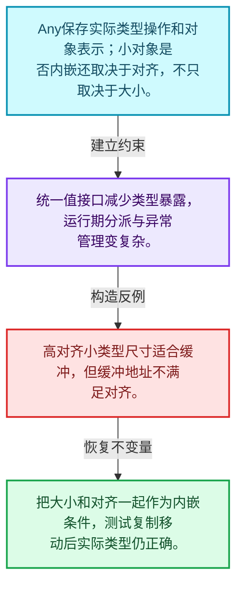
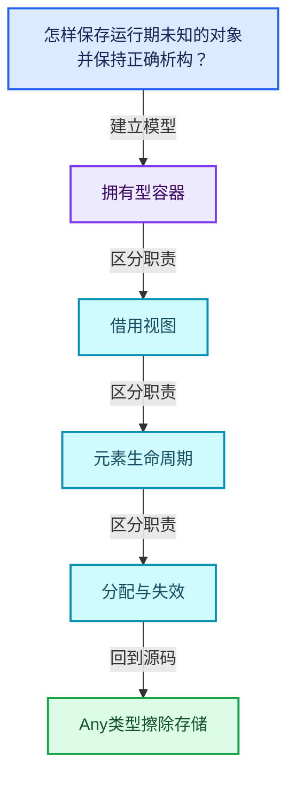
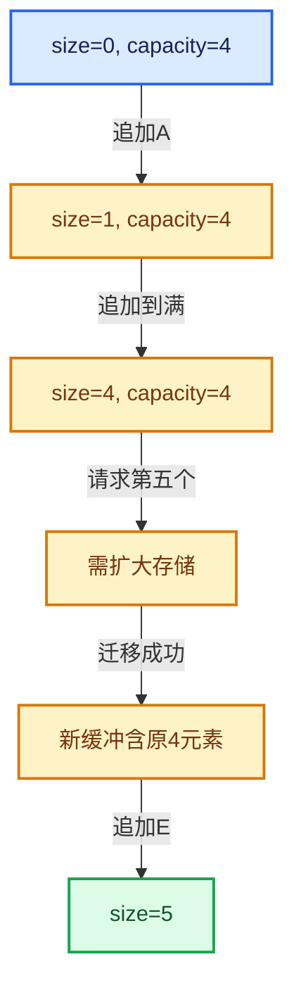

# 01-17 Any类型擦除存储

[方向导航](README.md) · [总目录](../README.md) · [覆盖索引](../%E6%BA%90%E7%A0%81%E7%89%88%E6%9C%AC%E4%B8%8E%E8%A6%86%E7%9B%96%E7%B4%A2%E5%BC%95.md)

> 阅读顺序：问题与数据模型 → 语法与类型 → 源码逐行 → 调用线索 → 历史与取舍 → 推演和练习。

- 基准 HEAD：`cbda6b96c26c0dee3c3b5cbb93960c4ac06a6b30`。
- 记录日期：2026-10-14。
- 教学示例状态：正文中的推演不是本机性能实测；已运行练习见验收报告。

## 一、从问题到设计

怎样保存运行期未知的对象并保持正确析构？

类型擦除必须保留操作信息；小对象优化受大小和对齐约束，不能仅检查sizeof。

本篇把语法、数据语义和系统取舍连接起来。先证明对象存活，再讨论索引；先区分借用与拥有，再讨论复制移动。

### 本篇独立模型与设计推理

Any保存实际类型操作和对象表示；小对象是否内嵌还取决于对齐，不只取决于大小。

设计取舍：统一值接口减少类型暴露，运行期分派与异常管理变复杂。

最小反例：高对齐小类型尺寸适合缓冲，但缓冲地址不满足对齐。

推导与处理：把大小和对齐一起作为内嵌条件，测试复制移动后实际类型仍正确。



### 源码范围与相邻篇章

| 文件 | 本篇逐行范围 | 基准SHA-256 |
|---|---|---|
| [source/blender/blenlib/BLI_any.hh](../../../../../source/blender/blenlib/BLI_any.hh) | L1—L397 | `a5294fe42437df7309165843f777908bd179e6bd2438566475e2bfc326bc59c9` |

同一主讲文件可能分多篇覆盖；超出本篇范围的符号通过覆盖索引定位。空行与纯注释保留在源码摘录中，逐行表解释有效语句与语法边界；许可证头统一保留。

前篇：[FunctionRef非拥有回调](16-FunctionRef%E9%9D%9E%E6%8B%A5%E6%9C%89%E5%9B%9E%E8%B0%83.md).

后篇：[AnyDerived多态对象值封装](18-AnyDerived%E5%A4%9A%E6%80%81%E5%AF%B9%E8%B1%A1%E5%80%BC%E5%B0%81%E8%A3%85.md).

## 二、类型、数据与阅读地图



这是概念依赖图，边表示阅读关系，不声称是运行时调用顺序。

### 直接编译依赖


箭头只表示头文件包含关系；完整调用线索见后面的符号定位表。

## 三、关键词、语法与类型角色

### 模板 template

模板把类型或常量作为生成实现的参数。读声明时先列出类型参数、非类型参数和默认值，再看使用者实际实例化了什么。模板声明本身不意味着每种T都支持其全部成员。

具体检查：把T替换为int、string、只能移动的类型，分别检查每个被调用操作是否成立。

### 依赖名称 typename

typename既可引入类型模板参数，也可告诉编译器某个依赖名称是类型。它不创建运行时对象；解析期确认语法类别与实例化期检查具体类型是不同阶段。

具体检查：区分typename T::value_type和T::size()，前者标记类型，后者是表达式。

### 约束 requires

requires表达式或requires子句限制模板参与重载的条件。它提供编译期可用性检查，不是运行时if，不能指望输入到达程序后再被这一机制验证。

具体检查：构造满足和不满足约束的两个类型，观察候选被排除而不是在函数内返回错误。

### 常量求值 constexpr

constexpr声明允许相应实体参与常量求值，但constexpr函数仍可以在运行时执行。是否常量求值由调用场景和表达式合法性共同决定。

具体检查：比较constexpr变量初始化和从运行时输入调用同一函数。

### 只读限定 const

const约束当前访问路径可做的修改。const指针、指向const的指针、const视图对象、const元素是不同位置的限定；其他别名可能仍可修改原对象。

具体检查：分别写T* const、const T*与const T* const，并画出不可修改的层次。

### 移动转换 std::move

std::move把表达式转换为可供移动重载选择的值类别，实际资源转移发生在被选中的构造或赋值中。对const对象move可能仍调用复制，对视图move也不会获得底层数据所有权。

具体检查：记录移动构造调用次数，不用变量名或std::move的出现次数替代测量。

### 完美转发 std::forward

std::forward在转发引用模板中恢复调用者原来的值类别。它依赖推导出的模板实参；无条件move会改变左值调用者的语义。

具体检查：对同一接口分别传入左值、临时对象和const左值，记录实际重载。

### 异常约定 noexcept

noexcept表达式可以依赖类型特征。违反不抛异常约定会终止程序；它不是自动捕获异常，也不是资源回滚代码。

具体检查：找出声明的条件与实际可能抛出的分配、构造操作是否一致。

### 显式静态转换 static_cast

static_cast表达编译期允许的转换，不会自动验证运行时真实类型、指针寿命或索引边界。由void指针恢复T指针时，调用者仍须保证实际存储中确有合法T对象。

具体检查：标出转换前后的类型以及正确性依据来自哪里。

### 限定转换 const_cast

const_cast可以改变访问路径的限定，但不能让本来就是const的对象合法可写。常用于复用只读实现时，仍需检查底层对象是否实际可变。

具体检查：对非const对象的const引用与真正const对象分别分析修改是否合法。

### 对齐 alignof

alignof得到类型要求的地址对齐。分配足够字节后仍需把地址对齐到相应边界，内嵌缓冲也一样。

具体检查：对齐a为2的幂时可推导向上取整，但仍要考虑溢出与边界。

### 对象表示 sizeof

sizeof给出对象表示大小，不是其引用的所有堆内存总量。sizeof视图很小并不说明底层数组很小。

具体检查：分别统计容器对象、容量字节和元素拥有的间接资源。

### 构造与new表达式

普通new可能分配并构造；placement new在给定地址构造，存储由其他机制提供。失败回滚应区分两类责任。

具体检查：追踪地址来自哪里、构造何时成功、由谁析构、由谁释放。

### 内部断言 assert

断言表达开发者预期成立的内部契约，发布构建可能关闭。它不能替代对不可信输入的完整错误处理，也不保证后续操作被运行时保护。

具体检查：对每条断言构造违反条件的输入，区分调用者错误与应向用户报告的错误。

### 编译期分支 if constexpr

条件在实例化时决定被保留的分支，这常用于不同类型的合法操作选择。它与运行时if有不同的实例化检查规则。

具体检查：找出每个分支依赖哪些类型特征，再使用满足与不满足条件的类型。

### 独占拥有 unique_ptr

unique_ptr通过移动转移拥有关系，默认删除策略必须与资源来源匹配。get返回借用指针，release交出责任而不销毁。

具体检查：区分move、get、release和reset后谁负责销毁。

### 类型别名 using

类型别名为已有类型建立名字，不创建运行期对象。它常把模板内部使用的类型统一暴露给泛型调用者。

具体检查：展开别名直到基础类型，区分类型别名和变量声明。

## 四、真实源码与逐行讲解

源码块保持原行内容，原始行号由小节标题及逐行表给出。表中的调用定位是静态阅读辅助；重载、模板实例化、宏展开和虚调用需结合完整声明，不能仅凭词法出现证明动态调用。

### BLI_any.hh：L1—L49

<!-- source:source/blender/blenlib/BLI_any.hh:1:49 -->

```cpp
/* SPDX-FileCopyrightText: 2023 Blender Authors
 *
 * SPDX-License-Identifier: GPL-2.0-or-later */

#pragma once

/** \file
 * \ingroup bli
 *
 * A #Any is a type-safe container for single values of any copy constructible type.
 * It is similar to #std::any but provides the following two additional features:
 * - Adjustable inline buffer capacity and alignment. #std::any has a small inline buffer in most
 *   implementations as well, but its size is not guaranteed.
 * - Can store additional user-defined type information without increasing the stack size of #Any.
 */

#include <algorithm>
#include <utility>

#include "BLI_memory_utils.hh"

namespace blender {

namespace blenlib_detail {

/**
 * Contains function pointers that manage the memory in an #Any.
 * Additional type specific #ExtraInfo can be embedded here as well.
 */
template<typename ExtraInfo> struct AnyTypeInfo {
  /* The pointers are allowed to be null, which means that the implementation is trivial. */
  void (*copy_construct)(void *dst, const void *src);
  void (*move_construct)(void *dst, void *src);
  void (*destruct)(void *src);
  const void *(*get)(const void *src);
  ExtraInfo extra_info;
};

/**
 * Used when #T is stored directly in the inline buffer of the #Any.
 */
template<typename ExtraInfo, typename T>
inline AnyTypeInfo<ExtraInfo> info_for_inline = {
    is_trivially_copy_constructible_extended_v<T> ?
        nullptr :
        +[](void *dst, const void *src) { new (dst) T(*static_cast<const T *>(src)); },
    is_trivially_move_constructible_extended_v<T> ?
        nullptr :
        +[](void *dst, void *src) { new (dst) T(std::move(*static_cast<T *>(src))); },
```

| 原始行 | 语义、约束与检查 |
|---|---|
| L5 | 防止同一头文件在一个翻译单元中重复展开；不控制多个源文件之间的链接或对象寿命。 |
| L17 | 引入编译依赖 <algorithm>；这是声明可见性关系，不表示运行时一定调用该文件的所有接口。 |
| L18 | 引入编译依赖 <utility>；这是声明可见性关系，不表示运行时一定调用该文件的所有接口。 |
| L20 | 引入编译依赖 "BLI_memory_utils.hh"；这是声明可见性关系，不表示运行时一定调用该文件的所有接口。 |
| L22 | 把后续声明放入 blender 命名空间，影响名称查找和符号归属，不创建运行时对象。 |
| L24 | 把后续声明放入 blenlib_detail 命名空间，影响名称查找和符号归属，不创建运行时对象。 |
| L30 | 声明模板参数 `template<typename ExtraInfo> struct AnyTypeInfo {`。类型参数决定生成操作的类型，非类型参数可决定内嵌容量或编译期分支。 |
| L32 | 声明接口 `void (*copy_construct)(void *dst, const void *src)`，本行没有对应函数体；返回类型、参数限定和const/noexcept共同组成调用契约，实际行为需继续定位实现。 |
| L33 | 声明接口 `void (*move_construct)(void *dst, void *src)`，本行没有对应函数体；返回类型、参数限定和const/noexcept共同组成调用契约，实际行为需继续定位实现。 |
| L34 | 声明接口 `void (*destruct)(void *src)`，本行没有对应函数体；返回类型、参数限定和const/noexcept共同组成调用契约，实际行为需继续定位实现。 |
| L35 | 声明成员、局部对象或完成语句 `const void *(*get)(const void *src)`。若为指针或引用，它本身不说明拥有；若为值对象，其构造析构由所在作用域或外层对象管理。 |
| L36 | 声明成员、局部对象或完成语句 `ExtraInfo extra_info`。若为指针或引用，它本身不说明拥有；若为值对象，其构造析构由所在作用域或外层对象管理。 |
| L37 | 结束当前语法单元。局部自动对象在离开其作用域时按规则销毁；这不等于所有被引用的外部数据也被释放。 |
| L42 | 声明模板参数 `template<typename ExtraInfo, typename T>`。类型参数决定生成操作的类型，非类型参数可决定内嵌容量或编译期分支。 |
| L43 | 把右侧 `{` 用于初始化或更新左侧 `inline AnyTypeInfo<ExtraInfo> info_for_inline`。声明初始化与已有对象赋值应按上下文区分；有资源的类型会调用相应特殊成员。 |
| L44 | 本行是连续声明或表达式的一部分：`is_trivially_copy_constructible_extended_v<T> ?`。与本段前后行合读；逗号、括号和限定符决定它属于参数、初始化列表还是实际计算。 |
| L45 | 本行是连续声明或表达式的一部分：`nullptr :`。与本段前后行合读；逗号、括号和限定符决定它属于参数、初始化列表还是实际计算。 |
| L46 | 出现调用或函数声明 `new`，对应表达式为 `+[](void *dst, const void *src) { new (dst) T(*static_cast<const T *>(src)); },`。参数求值、返回类型与重载需结合前后完整语句；静态文本引用不能证明动态目标。 |
| L47 | 本行是连续声明或表达式的一部分：`is_trivially_move_constructible_extended_v<T> ?`。与本段前后行合读；逗号、括号和限定符决定它属于参数、初始化列表还是实际计算。 |
| L48 | 本行是连续声明或表达式的一部分：`nullptr :`。与本段前后行合读；逗号、括号和限定符决定它属于参数、初始化列表还是实际计算。 |
| L49 | 出现调用或函数声明 `new`，对应表达式为 `+[](void *dst, void *src) { new (dst) T(std::move(*static_cast<T *>(src))); },`。参数求值、返回类型与重载需结合前后完整语句；静态文本引用不能证明动态目标。 |

### BLI_any.hh：L50—L108

<!-- source:source/blender/blenlib/BLI_any.hh:50:108 -->

```cpp
    is_trivially_destructible_extended_v<T> ?
        nullptr :
        +[](void *src) { std::destroy_at((static_cast<T *>(src))); },
    nullptr,
    ExtraInfo::template get<T>()};

/**
 * Used when #T can't be stored directly in the inline buffer and is stored in a #std::unique_ptr
 * instead. In this scenario, the #std::unique_ptr is stored in the inline buffer.
 */
template<typename T> using Ptr = std::unique_ptr<T>;
template<typename ExtraInfo, typename T>
inline AnyTypeInfo<ExtraInfo> info_for_unique_ptr = {
    [](void *dst, const void *src) {
      new (dst) Ptr<T>(new T(**static_cast<const Ptr<T> *>(src)));
    },
    [](void *dst, void *src) { new (dst) Ptr<T>(new T(std::move(**static_cast<Ptr<T> *>(src)))); },
    [](void *src) { std::destroy_at(static_cast<Ptr<T> *>(src)); },
    [](const void *src) -> const void * { return &**static_cast<const Ptr<T> *>(src); },
    ExtraInfo::template get<T>()};

/**
 * Dummy extra info that is used when no additional type information should be stored in the #Any.
 */
struct NoExtraInfo {
  template<typename T> static constexpr NoExtraInfo get()
  {
    return {};
  }
};

struct EmptyType {};

}  // namespace blenlib_detail

template<
    /**
     * Either void or a struct that contains data members for additional type information.
     * The struct has to have a static `ExtraInfo get<T>()` method that initializes the struct
     * based on a type.
     */
    typename ExtraInfo = void,
    /**
     * Size of the inline buffer. This allows types that are small enough to be stored directly
     * inside the #Any without an additional allocation.
     */
    size_t InlineBufferCapacity = 8,
    /**
     * Required minimum alignment of the inline buffer. If this is smaller than the alignment
     * requirement of a used type, a separate allocation is necessary.
     */
    size_t Alignment = 8,
    /**
     * Depending on the Alignment template parameter, there may be extra padding space that's
     * available to store some data. This type is stored after the buffer to use that space.
     */
    typename ExtraData = blenlib_detail::EmptyType>
class Any {
 private:
```

| 原始行 | 语义、约束与检查 |
|---|---|
| L50 | 本行是连续声明或表达式的一部分：`is_trivially_destructible_extended_v<T> ?`。与本段前后行合读；逗号、括号和限定符决定它属于参数、初始化列表还是实际计算。 |
| L51 | 本行是连续声明或表达式的一部分：`nullptr :`。与本段前后行合读；逗号、括号和限定符决定它属于参数、初始化列表还是实际计算。 |
| L52 | 出现调用或函数声明 `std::destroy_at`，对应表达式为 `+[](void *src) { std::destroy_at((static_cast<T *>(src))); },`。参数求值、返回类型与重载需结合前后完整语句；静态文本引用不能证明动态目标。 |
| L53 | 本行是连续声明或表达式的一部分：`nullptr,`。与本段前后行合读；逗号、括号和限定符决定它属于参数、初始化列表还是实际计算。 |
| L54 | 出现调用或函数声明 `get`，对应表达式为 `ExtraInfo::template get<T>()};`。参数求值、返回类型与重载需结合前后完整语句；静态文本引用不能证明动态目标。 |
| L60 | 声明模板参数 `template<typename T> using Ptr = std::unique_ptr<T>;`。类型参数决定生成操作的类型，非类型参数可决定内嵌容量或编译期分支。 |
| L61 | 声明模板参数 `template<typename ExtraInfo, typename T>`。类型参数决定生成操作的类型，非类型参数可决定内嵌容量或编译期分支。 |
| L62 | 把右侧 `{` 用于初始化或更新左侧 `inline AnyTypeInfo<ExtraInfo> info_for_unique_ptr`。声明初始化与已有对象赋值应按上下文区分；有资源的类型会调用相应特殊成员。 |
| L63 | 本行是连续声明或表达式的一部分：`[](void *dst, const void *src) {`。与本段前后行合读；逗号、括号和限定符决定它属于参数、初始化列表还是实际计算。 |
| L64 | 出现调用或函数声明 `new`，对应表达式为 `new (dst) Ptr<T>(new T(**static_cast<const Ptr<T> *>(src)));`。参数求值、返回类型与重载需结合前后完整语句；静态文本引用不能证明动态目标。 |
| L65 | 结束当前语法单元。局部自动对象在离开其作用域时按规则销毁；这不等于所有被引用的外部数据也被释放。 |
| L66 | 出现调用或函数声明 `new`，对应表达式为 `[](void *dst, void *src) { new (dst) Ptr<T>(new T(std::move(**static_cast<Ptr<T> *>(src)))); },`。参数求值、返回类型与重载需结合前后完整语句；静态文本引用不能证明动态目标。 |
| L67 | 出现调用或函数声明 `std::destroy_at`，对应表达式为 `[](void *src) { std::destroy_at(static_cast<Ptr<T> *>(src)); },`。参数求值、返回类型与重载需结合前后完整语句；静态文本引用不能证明动态目标。 |
| L68 | 出现调用或函数声明 `static_cast`，对应表达式为 `[](const void *src) -> const void * { return &**static_cast<const Ptr<T> *>(src); },`。参数求值、返回类型与重载需结合前后完整语句；静态文本引用不能证明动态目标。 |
| L69 | 出现调用或函数声明 `get`，对应表达式为 `ExtraInfo::template get<T>()};`。参数求值、返回类型与重载需结合前后完整语句；静态文本引用不能证明动态目标。 |
| L74 | 声明或定义类型 `struct NoExtraInfo`。结合继承、访问权限和成员布局确认接口与拥有关系；前向声明本身没有完整对象布局。 |
| L75 | 声明模板参数 `template<typename T> static constexpr NoExtraInfo get()`。类型参数决定生成操作的类型，非类型参数可决定内嵌容量或编译期分支。 |
| L76 | 连接上一行的声明或控制结构与其语句块；后续行在这个作用域中执行或声明。 |
| L77 | 返回表达式 `{}`。 |
| L78 | 结束当前语法单元。局部自动对象在离开其作用域时按规则销毁；这不等于所有被引用的外部数据也被释放。 |
| L79 | 结束当前语法单元。局部自动对象在离开其作用域时按规则销毁；这不等于所有被引用的外部数据也被释放。 |
| L81 | 声明或定义类型 `struct EmptyType {}`。结合继承、访问权限和成员布局确认接口与拥有关系；前向声明本身没有完整对象布局。 |
| L83 | 结束当前语法单元。局部自动对象在离开其作用域时按规则销毁；这不等于所有被引用的外部数据也被释放。 |
| L85 | 声明模板参数 `template<`。类型参数决定生成操作的类型，非类型参数可决定内嵌容量或编译期分支。 |
| L91 | 把右侧 `void,` 用于初始化或更新左侧 `typename ExtraInfo`。声明初始化与已有对象赋值应按上下文区分；有资源的类型会调用相应特殊成员。 |
| L96 | 把右侧 `8,` 用于初始化或更新左侧 `size_t InlineBufferCapacity`。声明初始化与已有对象赋值应按上下文区分；有资源的类型会调用相应特殊成员。 |
| L101 | 把右侧 `8,` 用于初始化或更新左侧 `size_t Alignment`。声明初始化与已有对象赋值应按上下文区分；有资源的类型会调用相应特殊成员。 |
| L106 | 把右侧 `blenlib_detail::EmptyType>` 用于初始化或更新左侧 `typename ExtraData`。声明初始化与已有对象赋值应按上下文区分；有资源的类型会调用相应特殊成员。 |
| L107 | 声明或定义类型 `class Any`。结合继承、访问权限和成员布局确认接口与拥有关系；前向声明本身没有完整对象布局。 |
| L108 | 切换成员访问权限为 private；它是编译期接口边界，不是线程同步或内存保护。 |

### BLI_any.hh：L109—L151

<!-- source:source/blender/blenlib/BLI_any.hh:109:151 -->

```cpp
  /* Makes it possible to use void in the template parameters. */
  using RealExtraInfo =
      std::conditional_t<std::is_void_v<ExtraInfo>, blenlib_detail::NoExtraInfo, ExtraInfo>;
  using Info = blenlib_detail::AnyTypeInfo<RealExtraInfo>;
  static constexpr size_t RealInlineBufferCapacity = std::max(InlineBufferCapacity,
                                                              sizeof(std::unique_ptr<int>));

  /**
   * Inline buffer that either contains nothing, the stored value directly, or a #std::unique_ptr
   * to the value.
   */
  AlignedBuffer<RealInlineBufferCapacity, Alignment> buffer_{};

 public:
  /** Extra data potentially stored within padding required by the buffer. */
  BLI_NO_UNIQUE_ADDRESS ExtraData extra = {};

 private:
  /**
   * Information about the type that is currently stored.
   * This is null when the #Any does not contain a value.
   */
  const Info *info_ = nullptr;

 public:
  /** Only copy constructible types can be stored in #Any. */
  template<typename T> static constexpr bool is_allowed_v = std::is_copy_constructible_v<T>;

  /**
   * Checks if the type will be stored in the inline buffer or if it requires a separate
   * allocation.
   */
  template<typename T>
  static constexpr bool is_inline_v = std::is_nothrow_move_constructible_v<T> &&
                                      sizeof(T) <= InlineBufferCapacity && alignof(T) <= Alignment;

  /**
   * Checks if #T is the same type as this #Any, because in this case the behavior of e.g. the
   * assignment operator is different.
   */
  template<typename T> static constexpr bool is_same_any_v = std::is_same_v<std::decay_t<T>, Any>;

 private:
```

本段语义重点：

- `std::max`：取较大值，在容量计算中常用于同时满足请求量和增长策略。

| 原始行 | 语义、约束与检查 |
|---|---|
| L110 | 定义类型别名 `using RealExtraInfo =`，为模板接口或内部实现统一命名；本行不分配该类型对象。 |
| L111 | 声明成员、局部对象或完成语句 `std::conditional_t<std::is_void_v<ExtraInfo>, blenlib_detail::NoExtraInfo, ExtraInfo>`。若为指针或引用，它本身不说明拥有；若为值对象，其构造析构由所在作用域或外层对象管理。 |
| L112 | 定义类型别名 `using Info = blenlib_detail::AnyTypeInfo<RealExtraInfo>`，为模板接口或内部实现统一命名；本行不分配该类型对象。 |
| L113 | 本行使用 `std::max`：取较大值，在容量计算中常用于同时满足请求量和增长策略。 |
| L114 | 出现调用或函数声明 `sizeof`，对应表达式为 `sizeof(std::unique_ptr<int>));`。参数求值、返回类型与重载需结合前后完整语句；静态文本引用不能证明动态目标。 |
| L120 | 声明成员、局部对象或完成语句 `AlignedBuffer<RealInlineBufferCapacity, Alignment> buffer_{}`。若为指针或引用，它本身不说明拥有；若为值对象，其构造析构由所在作用域或外层对象管理。 |
| L122 | 切换成员访问权限为 public；它是编译期接口边界，不是线程同步或内存保护。 |
| L124 | 把右侧 `{}` 用于初始化或更新左侧 `BLI_NO_UNIQUE_ADDRESS ExtraData extra`。声明初始化与已有对象赋值应按上下文区分；有资源的类型会调用相应特殊成员。 |
| L126 | 切换成员访问权限为 private；它是编译期接口边界，不是线程同步或内存保护。 |
| L131 | 把右侧 `nullptr` 用于初始化或更新左侧 `const Info *info_`。声明初始化与已有对象赋值应按上下文区分；有资源的类型会调用相应特殊成员。 |
| L133 | 切换成员访问权限为 public；它是编译期接口边界，不是线程同步或内存保护。 |
| L135 | 声明模板参数 `template<typename T> static constexpr bool is_allowed_v = std::is_copy_constructible_v<T>;`。类型参数决定生成操作的类型，非类型参数可决定内嵌容量或编译期分支。 |
| L141 | 声明模板参数 `template<typename T>`。类型参数决定生成操作的类型，非类型参数可决定内嵌容量或编译期分支。 |
| L142 | 把右侧 `std::is_nothrow_move_constructible_v<T> &&` 用于初始化或更新左侧 `static constexpr bool is_inline_v`。声明初始化与已有对象赋值应按上下文区分；有资源的类型会调用相应特殊成员。 |
| L143 | 出现调用或函数声明 `sizeof`，对应表达式为 `sizeof(T) <= InlineBufferCapacity && alignof(T) <= Alignment;`。参数求值、返回类型与重载需结合前后完整语句；静态文本引用不能证明动态目标。 |
| L149 | 声明模板参数 `template<typename T> static constexpr bool is_same_any_v = std::is_same_v<std::decay_t<T>, Any>;`。类型参数决定生成操作的类型，非类型参数可决定内嵌容量或编译期分支。 |
| L151 | 切换成员访问权限为 private；它是编译期接口边界，不是线程同步或内存保护。 |

### BLI_any.hh：L152—L197

<!-- source:source/blender/blenlib/BLI_any.hh:152:197 -->

```cpp
  template<typename T> const Info &get_info() const
  {
    using DecayT = std::decay_t<T>;
    static_assert(is_allowed_v<DecayT>);
    if constexpr (is_inline_v<DecayT>) {
      return blenlib_detail::template info_for_inline<RealExtraInfo, DecayT>;
    }
    else {
      return blenlib_detail::template info_for_unique_ptr<RealExtraInfo, DecayT>;
    }
  }

 public:
  Any() = default;

  Any(const Any &other) : extra(other.extra), info_(other.info_)
  {
    if (info_ != nullptr) {
      if (info_->copy_construct != nullptr) {
        info_->copy_construct(&buffer_, &other.buffer_);
      }
      else {
        std::copy_n(static_cast<const std::byte *>(other.buffer_.ptr()),
                    RealInlineBufferCapacity,
                    static_cast<std::byte *>(buffer_.ptr()));
      }
    }
  }

  /**
   * \note The #other #Any will not be empty afterwards if it was not before. Just its value is in
   * a moved-from state.
   */
  Any(Any &&other) noexcept : extra(std::move(other.extra)), info_(other.info_)
  {
    if (info_ != nullptr) {
      if (info_->move_construct != nullptr) {
        info_->move_construct(&buffer_, &other.buffer_);
      }
      else {
        std::copy_n(static_cast<const std::byte *>(other.buffer_.ptr()),
                    RealInlineBufferCapacity,
                    static_cast<std::byte *>(buffer_.ptr()));
      }
    }
  }
```

本段语义重点：

- 分支证据 `info_ != nullptr)`：分别推演条件成立与不成立，核对相同出口处的状态。
- 分支证据 `info_->copy_construct != nullptr)`：分别推演条件成立与不成立，核对相同出口处的状态。

| 原始行 | 语义、约束与检查 |
|---|---|
| L152 | 声明模板参数 `template<typename T> const Info &get_info() const`。类型参数决定生成操作的类型，非类型参数可决定内嵌容量或编译期分支。 |
| L153 | 连接上一行的声明或控制结构与其语句块；后续行在这个作用域中执行或声明。 |
| L154 | 定义类型别名 `using DecayT = std::decay_t<T>`，为模板接口或内部实现统一命名；本行不分配该类型对象。 |
| L155 | 在编译期检查 `static_assert(is_allowed_v<DecayT>);`；条件失败导致编译错误，不存在运行时错误恢复路径。 |
| L156 | 编译期条件分支 `if constexpr (is_inline_v<DecayT>)`。按实例化类型选择相应实现；被舍弃分支和运行期if具有不同检查规则，不能当作运行时输入验证。 |
| L157 | 返回表达式 `blenlib_detail::template info_for_inline<RealExtraInfo, DecayT>`。 |
| L158 | 结束当前语法单元。局部自动对象在离开其作用域时按规则销毁；这不等于所有被引用的外部数据也被释放。 |
| L159 | 处理前一条件不成立的互补路径。比较两条路径最后是否恢复同一不变量，以及是否产生不同的资源责任。 |
| L160 | 返回表达式 `blenlib_detail::template info_for_unique_ptr<RealExtraInfo, DecayT>`。 |
| L161 | 结束当前语法单元。局部自动对象在离开其作用域时按规则销毁；这不等于所有被引用的外部数据也被释放。 |
| L162 | 结束当前语法单元。局部自动对象在离开其作用域时按规则销毁；这不等于所有被引用的外部数据也被释放。 |
| L164 | 切换成员访问权限为 public；它是编译期接口边界，不是线程同步或内存保护。 |
| L165 | 显式采用编译器生成的特殊成员行为：`Any() = default;`。成员和基类的性质决定该操作是否可用、是否被删除及异常约定，不表示运行时给对象赋值为default。 |
| L167 | 出现调用或函数声明 `Any`，对应表达式为 `Any(const Any &other) : extra(other.extra), info_(other.info_)`。参数求值、返回类型与重载需结合前后完整语句；静态文本引用不能证明动态目标。 |
| L168 | 连接上一行的声明或控制结构与其语句块；后续行在这个作用域中执行或声明。 |
| L169 | 判断 `info_ != nullptr`，成立时进入本分支，否则继续后续路径。这里区分空地址与可用地址，但非空本身仍不能证明对象存活。 |
| L170 | 判断 `info_->copy_construct != nullptr`，成立时进入本分支，否则继续后续路径。这里区分空地址与可用地址，但非空本身仍不能证明对象存活。 |
| L171 | 出现调用或函数声明 `copy_construct`，对应表达式为 `info_->copy_construct(&buffer_, &other.buffer_);`。参数求值、返回类型与重载需结合前后完整语句；静态文本引用不能证明动态目标。 |
| L172 | 结束当前语法单元。局部自动对象在离开其作用域时按规则销毁；这不等于所有被引用的外部数据也被释放。 |
| L173 | 处理前一条件不成立的互补路径。比较两条路径最后是否恢复同一不变量，以及是否产生不同的资源责任。 |
| L174 | 出现调用或函数声明 `std::copy_n`，对应表达式为 `std::copy_n(static_cast<const std::byte *>(other.buffer_.ptr()),`。参数求值、返回类型与重载需结合前后完整语句；静态文本引用不能证明动态目标。 |
| L175 | 本行是连续声明或表达式的一部分：`RealInlineBufferCapacity,`。与本段前后行合读；逗号、括号和限定符决定它属于参数、初始化列表还是实际计算。 |
| L176 | 出现调用或函数声明 `static_cast`，对应表达式为 `static_cast<std::byte *>(buffer_.ptr()));`。参数求值、返回类型与重载需结合前后完整语句；静态文本引用不能证明动态目标。 |
| L177 | 结束当前语法单元。局部自动对象在离开其作用域时按规则销毁；这不等于所有被引用的外部数据也被释放。 |
| L178 | 结束当前语法单元。局部自动对象在离开其作用域时按规则销毁；这不等于所有被引用的外部数据也被释放。 |
| L179 | 结束当前语法单元。局部自动对象在离开其作用域时按规则销毁；这不等于所有被引用的外部数据也被释放。 |
| L185 | 出现调用或函数声明 `Any`，对应表达式为 `Any(Any &&other) noexcept : extra(std::move(other.extra)), info_(other.info_)`。参数求值、返回类型与重载需结合前后完整语句；静态文本引用不能证明动态目标。 |
| L186 | 连接上一行的声明或控制结构与其语句块；后续行在这个作用域中执行或声明。 |
| L187 | 判断 `info_ != nullptr`，成立时进入本分支，否则继续后续路径。这里区分空地址与可用地址，但非空本身仍不能证明对象存活。 |
| L188 | 判断 `info_->move_construct != nullptr`，成立时进入本分支，否则继续后续路径。这里区分空地址与可用地址，但非空本身仍不能证明对象存活。 |
| L189 | 出现调用或函数声明 `move_construct`，对应表达式为 `info_->move_construct(&buffer_, &other.buffer_);`。参数求值、返回类型与重载需结合前后完整语句；静态文本引用不能证明动态目标。 |
| L190 | 结束当前语法单元。局部自动对象在离开其作用域时按规则销毁；这不等于所有被引用的外部数据也被释放。 |
| L191 | 处理前一条件不成立的互补路径。比较两条路径最后是否恢复同一不变量，以及是否产生不同的资源责任。 |
| L192 | 出现调用或函数声明 `std::copy_n`，对应表达式为 `std::copy_n(static_cast<const std::byte *>(other.buffer_.ptr()),`。参数求值、返回类型与重载需结合前后完整语句；静态文本引用不能证明动态目标。 |
| L193 | 本行是连续声明或表达式的一部分：`RealInlineBufferCapacity,`。与本段前后行合读；逗号、括号和限定符决定它属于参数、初始化列表还是实际计算。 |
| L194 | 出现调用或函数声明 `static_cast`，对应表达式为 `static_cast<std::byte *>(buffer_.ptr()));`。参数求值、返回类型与重载需结合前后完整语句；静态文本引用不能证明动态目标。 |
| L195 | 结束当前语法单元。局部自动对象在离开其作用域时按规则销毁；这不等于所有被引用的外部数据也被释放。 |
| L196 | 结束当前语法单元。局部自动对象在离开其作用域时按规则销毁；这不等于所有被引用的外部数据也被释放。 |
| L197 | 结束当前语法单元。局部自动对象在离开其作用域时按规则销毁；这不等于所有被引用的外部数据也被释放。 |

### BLI_any.hh：L198—L239

<!-- source:source/blender/blenlib/BLI_any.hh:198:239 -->

```cpp

  /**
   * Constructs a new #Any that contains the given type #T from #args. The #std::in_place_type_t is
   * used to disambiguate this and the copy/move constructors.
   */
  template<typename T, typename... Args>
  explicit Any(std::in_place_type_t<T> /*tag*/, Args &&...args)
  {
    this->emplace_on_empty<T>(std::forward<Args>(args)...);
  }

  /**
   * Constructs a new #Any that contains the given value.
   */
  template<typename T>
  Any(T &&value)
    requires(!is_same_any_v<T>)
      : Any(std::in_place_type<T>, std::forward<T>(value))
  {
  }

  ~Any()
  {
    if (info_ != nullptr) {
      if (info_->destruct != nullptr) {
        info_->destruct(&buffer_);
      }
    }
  }

  /**
   * \note Only needed because the template below does not count as copy assignment operator.
   */
  Any &operator=(const Any &other)
  {
    if (this == &other) {
      return *this;
    }
    this->~Any();
    new (this) Any(other);
    return *this;
  }
```

本段语义重点：

- 分支证据 `info_ != nullptr)`：分别推演条件成立与不成立，核对相同出口处的状态。
- 分支证据 `info_->destruct != nullptr)`：分别推演条件成立与不成立，核对相同出口处的状态。

| 原始行 | 语义、约束与检查 |
|---|---|
| L203 | 声明模板参数 `template<typename T, typename... Args>`。类型参数决定生成操作的类型，非类型参数可决定内嵌容量或编译期分支。 |
| L204 | 出现调用或函数声明 `Any`，对应表达式为 `explicit Any(std::in_place_type_t<T> , Args &&...args)`。参数求值、返回类型与重载需结合前后完整语句；静态文本引用不能证明动态目标。 |
| L205 | 连接上一行的声明或控制结构与其语句块；后续行在这个作用域中执行或声明。 |
| L206 | 出现调用或函数声明 `emplace_on_empty`，对应表达式为 `this->emplace_on_empty<T>(std::forward<Args>(args)...);`。参数求值、返回类型与重载需结合前后完整语句；静态文本引用不能证明动态目标。 |
| L207 | 结束当前语法单元。局部自动对象在离开其作用域时按规则销毁；这不等于所有被引用的外部数据也被释放。 |
| L212 | 声明模板参数 `template<typename T>`。类型参数决定生成操作的类型，非类型参数可决定内嵌容量或编译期分支。 |
| L213 | 出现调用或函数声明 `Any`，对应表达式为 `Any(T &&value)`。参数求值、返回类型与重载需结合前后完整语句；静态文本引用不能证明动态目标。 |
| L214 | 约束模板可用性：`requires(!is_same_any_v<T>)`。条件在编译期检查，不替代运行期的地址、长度和类型一致性验证。 |
| L215 | 出现调用或函数声明 `Any`，对应表达式为 `: Any(std::in_place_type<T>, std::forward<T>(value))`。参数求值、返回类型与重载需结合前后完整语句；静态文本引用不能证明动态目标。 |
| L216 | 连接上一行的声明或控制结构与其语句块；后续行在这个作用域中执行或声明。 |
| L217 | 结束当前语法单元。局部自动对象在离开其作用域时按规则销毁；这不等于所有被引用的外部数据也被释放。 |
| L219 | 涉及析构接口或显式析构：`~Any()`。检查目标对象已成功构造，且资源不会在另一条清理路径再次销毁。 |
| L220 | 连接上一行的声明或控制结构与其语句块；后续行在这个作用域中执行或声明。 |
| L221 | 判断 `info_ != nullptr`，成立时进入本分支，否则继续后续路径。这里区分空地址与可用地址，但非空本身仍不能证明对象存活。 |
| L222 | 判断 `info_->destruct != nullptr`，成立时进入本分支，否则继续后续路径。这里区分空地址与可用地址，但非空本身仍不能证明对象存活。 |
| L223 | 出现调用或函数声明 `destruct`，对应表达式为 `info_->destruct(&buffer_);`。参数求值、返回类型与重载需结合前后完整语句；静态文本引用不能证明动态目标。 |
| L224 | 结束当前语法单元。局部自动对象在离开其作用域时按规则销毁；这不等于所有被引用的外部数据也被释放。 |
| L225 | 结束当前语法单元。局部自动对象在离开其作用域时按规则销毁；这不等于所有被引用的外部数据也被释放。 |
| L226 | 结束当前语法单元。局部自动对象在离开其作用域时按规则销毁；这不等于所有被引用的外部数据也被释放。 |
| L231 | 运算符重载声明、定义或显式调用：`Any &operator=(const Any &other)`。结合参数和返回类型判断是赋值、索引、比较还是转换；operator=声明中的等号不是在给名为operator的变量赋值。 |
| L232 | 连接上一行的声明或控制结构与其语句块；后续行在这个作用域中执行或声明。 |
| L233 | 判断 `this == &other`，成立时进入本分支，否则继续后续路径。 |
| L234 | 返回表达式 `*this`。返回当前对象；返回类型决定它是引用还是值，不能仅凭表达式假定复制。 |
| L235 | 结束当前语法单元。局部自动对象在离开其作用域时按规则销毁；这不等于所有被引用的外部数据也被释放。 |
| L236 | 涉及析构接口或显式析构：`this->~Any();`。检查目标对象已成功构造，且资源不会在另一条清理路径再次销毁。 |
| L237 | 出现调用或函数声明 `new`，对应表达式为 `new (this) Any(other);`。参数求值、返回类型与重载需结合前后完整语句；静态文本引用不能证明动态目标。 |
| L238 | 返回表达式 `*this`。返回当前对象；返回类型决定它是引用还是值，不能仅凭表达式假定复制。 |
| L239 | 结束当前语法单元。局部自动对象在离开其作用域时按规则销毁；这不等于所有被引用的外部数据也被释放。 |

### BLI_any.hh：L240—L280

<!-- source:source/blender/blenlib/BLI_any.hh:240:280 -->

```cpp

  /** Assign any value to the #Any. */
  template<typename T> Any &operator=(T &&other)
  {
    if constexpr (is_same_any_v<T>) {
      if (this == &other) {
        return *this;
      }
    }
    this->~Any();
    new (this) Any(std::forward<T>(other));
    return *this;
  }

  /** Destruct any existing value to make it empty. */
  void reset()
  {
    if (info_ != nullptr) {
      if (info_->destruct != nullptr) {
        info_->destruct(&buffer_);
      }
    }
    info_ = nullptr;
  }

  operator bool() const
  {
    return this->has_value();
  }

  bool has_value() const
  {
    return info_ != nullptr;
  }

  template<typename T, typename... Args> std::decay_t<T> &emplace(Args &&...args)
  {
    this->~Any();
    new (this) Any(std::in_place_type<T>, std::forward<Args>(args)...);
    return this->get<T>();
  }
```

本段语义重点：

- 分支证据 `this == &other)`：分别推演条件成立与不成立，核对相同出口处的状态。
- 分支证据 `info_ != nullptr)`：分别推演条件成立与不成立，核对相同出口处的状态。

| 原始行 | 语义、约束与检查 |
|---|---|
| L242 | 运算符重载声明、定义或显式调用：`template<typename T> Any &operator=(T &&other)`。结合参数和返回类型判断是赋值、索引、比较还是转换；operator=声明中的等号不是在给名为operator的变量赋值。 |
| L243 | 连接上一行的声明或控制结构与其语句块；后续行在这个作用域中执行或声明。 |
| L244 | 编译期条件分支 `if constexpr (is_same_any_v<T>)`。按实例化类型选择相应实现；被舍弃分支和运行期if具有不同检查规则，不能当作运行时输入验证。 |
| L245 | 判断 `this == &other`，成立时进入本分支，否则继续后续路径。 |
| L246 | 返回表达式 `*this`。返回当前对象；返回类型决定它是引用还是值，不能仅凭表达式假定复制。 |
| L247 | 结束当前语法单元。局部自动对象在离开其作用域时按规则销毁；这不等于所有被引用的外部数据也被释放。 |
| L248 | 结束当前语法单元。局部自动对象在离开其作用域时按规则销毁；这不等于所有被引用的外部数据也被释放。 |
| L249 | 涉及析构接口或显式析构：`this->~Any();`。检查目标对象已成功构造，且资源不会在另一条清理路径再次销毁。 |
| L250 | 出现调用或函数声明 `new`，对应表达式为 `new (this) Any(std::forward<T>(other));`。参数求值、返回类型与重载需结合前后完整语句；静态文本引用不能证明动态目标。 |
| L251 | 返回表达式 `*this`。返回当前对象；返回类型决定它是引用还是值，不能仅凭表达式假定复制。 |
| L252 | 结束当前语法单元。局部自动对象在离开其作用域时按规则销毁；这不等于所有被引用的外部数据也被释放。 |
| L255 | 出现调用或函数声明 `reset`，对应表达式为 `void reset()`。参数求值、返回类型与重载需结合前后完整语句；静态文本引用不能证明动态目标。 |
| L256 | 连接上一行的声明或控制结构与其语句块；后续行在这个作用域中执行或声明。 |
| L257 | 判断 `info_ != nullptr`，成立时进入本分支，否则继续后续路径。这里区分空地址与可用地址，但非空本身仍不能证明对象存活。 |
| L258 | 判断 `info_->destruct != nullptr`，成立时进入本分支，否则继续后续路径。这里区分空地址与可用地址，但非空本身仍不能证明对象存活。 |
| L259 | 出现调用或函数声明 `destruct`，对应表达式为 `info_->destruct(&buffer_);`。参数求值、返回类型与重载需结合前后完整语句；静态文本引用不能证明动态目标。 |
| L260 | 结束当前语法单元。局部自动对象在离开其作用域时按规则销毁；这不等于所有被引用的外部数据也被释放。 |
| L261 | 结束当前语法单元。局部自动对象在离开其作用域时按规则销毁；这不等于所有被引用的外部数据也被释放。 |
| L262 | 把右侧 `nullptr` 用于初始化或更新左侧 `info_`。声明初始化与已有对象赋值应按上下文区分；有资源的类型会调用相应特殊成员。 |
| L263 | 结束当前语法单元。局部自动对象在离开其作用域时按规则销毁；这不等于所有被引用的外部数据也被释放。 |
| L265 | 运算符重载声明、定义或显式调用：`operator bool() const`。结合参数和返回类型判断是赋值、索引、比较还是转换；operator=声明中的等号不是在给名为operator的变量赋值。 |
| L266 | 连接上一行的声明或控制结构与其语句块；后续行在这个作用域中执行或声明。 |
| L267 | 返回表达式 `this->has_value()`。 |
| L268 | 结束当前语法单元。局部自动对象在离开其作用域时按规则销毁；这不等于所有被引用的外部数据也被释放。 |
| L270 | 出现调用或函数声明 `has_value`，对应表达式为 `bool has_value() const`。参数求值、返回类型与重载需结合前后完整语句；静态文本引用不能证明动态目标。 |
| L271 | 连接上一行的声明或控制结构与其语句块；后续行在这个作用域中执行或声明。 |
| L272 | 返回表达式 `info_ != nullptr`。 |
| L273 | 结束当前语法单元。局部自动对象在离开其作用域时按规则销毁；这不等于所有被引用的外部数据也被释放。 |
| L275 | 声明模板参数 `template<typename T, typename... Args> std::decay_t<T> &emplace(Args &&...args)`。类型参数决定生成操作的类型，非类型参数可决定内嵌容量或编译期分支。 |
| L276 | 连接上一行的声明或控制结构与其语句块；后续行在这个作用域中执行或声明。 |
| L277 | 涉及析构接口或显式析构：`this->~Any();`。检查目标对象已成功构造，且资源不会在另一条清理路径再次销毁。 |
| L278 | 出现调用或函数声明 `new`，对应表达式为 `new (this) Any(std::in_place_type<T>, std::forward<Args>(args)...);`。参数求值、返回类型与重载需结合前后完整语句；静态文本引用不能证明动态目标。 |
| L279 | 返回表达式 `this->get<T>()`。 |
| L280 | 结束当前语法单元。局部自动对象在离开其作用域时按规则销毁；这不等于所有被引用的外部数据也被释放。 |

### BLI_any.hh：L281—L330

<!-- source:source/blender/blenlib/BLI_any.hh:281:330 -->

```cpp

  template<typename T, typename... Args> std::decay_t<T> &emplace_on_empty(Args &&...args)
  {
    BLI_assert(!this->has_value());
    using DecayT = std::decay_t<T>;
    static_assert(is_allowed_v<DecayT>);
    info_ = &this->template get_info<DecayT>();
    if constexpr (is_inline_v<DecayT>) {
      /* Construct the value directly in the inline buffer. */
      DecayT *stored_value = new (&buffer_) DecayT(std::forward<Args>(args)...);
      return *stored_value;
    }
    else {
      /* Construct the value in a new allocation and store a #std::unique_ptr to it in the inline
       * buffer. */
      std::unique_ptr<DecayT> *stored_value = new (&buffer_)
          std::unique_ptr<DecayT>(new DecayT(std::forward<Args>(args)...));
      return **stored_value;
    }
  }

  /**
   * Like #emplace but does *not* actually construct the value. The caller is responsible for
   * calling the constructor before the value is used.
   */
  template<typename T> void *allocate()
  {
    this->reset();
    return this->allocate_on_empty<T>();
  }

  /**
   * Like #emplace_on_empty but does *not* actually construct the value. The caller is responsible
   * for calling the constructor before the value is used.
   */
  template<typename T> void *allocate_on_empty()
  {
    BLI_assert(!this->has_value());
    static_assert(is_allowed_v<T>);
    info_ = &this->template get_info<T>();
    if constexpr (is_inline_v<T>) {
      return buffer_.ptr();
    }
    else {
      /* Using raw allocation here. The caller is responsible for constructing the value. */
      T *value = static_cast<T *>(::operator new(sizeof(T)));
      new (&buffer_) std::unique_ptr<T>(value);
      return value;
    }
  }
```

| 原始行 | 语义、约束与检查 |
|---|---|
| L282 | 声明模板参数 `template<typename T, typename... Args> std::decay_t<T> &emplace_on_empty(Args &&...args)`。类型参数决定生成操作的类型，非类型参数可决定内嵌容量或编译期分支。 |
| L283 | 连接上一行的声明或控制结构与其语句块；后续行在这个作用域中执行或声明。 |
| L284 | 断言约束 `BLI_assert(!this->has_value());`。条件是后续访问的内部前置条件；发布构建可能不执行，不能把断言当作输入修复。 |
| L285 | 定义类型别名 `using DecayT = std::decay_t<T>`，为模板接口或内部实现统一命名；本行不分配该类型对象。 |
| L286 | 在编译期检查 `static_assert(is_allowed_v<DecayT>);`；条件失败导致编译错误，不存在运行时错误恢复路径。 |
| L287 | 把右侧 `&this->template get_info<DecayT>()` 用于初始化或更新左侧 `info_`。声明初始化与已有对象赋值应按上下文区分；有资源的类型会调用相应特殊成员。 |
| L288 | 编译期条件分支 `if constexpr (is_inline_v<DecayT>)`。按实例化类型选择相应实现；被舍弃分支和运行期if具有不同检查规则，不能当作运行时输入验证。 |
| L290 | 把右侧 `new (&buffer_) DecayT(std::forward<Args>(args)...)` 用于初始化或更新左侧 `DecayT *stored_value`。声明初始化与已有对象赋值应按上下文区分；有资源的类型会调用相应特殊成员。 |
| L291 | 返回表达式 `*stored_value`。结合函数声明检查返回值是否借用原存储，借用值不会自动延长其寿命。 |
| L292 | 结束当前语法单元。局部自动对象在离开其作用域时按规则销毁；这不等于所有被引用的外部数据也被释放。 |
| L293 | 处理前一条件不成立的互补路径。比较两条路径最后是否恢复同一不变量，以及是否产生不同的资源责任。 |
| L296 | 把右侧 `new (&buffer_)` 用于初始化或更新左侧 `std::unique_ptr<DecayT> *stored_value`。声明初始化与已有对象赋值应按上下文区分；有资源的类型会调用相应特殊成员。 |
| L297 | 出现调用或函数声明 `std::unique_ptr`，对应表达式为 `std::unique_ptr<DecayT>(new DecayT(std::forward<Args>(args)...));`。参数求值、返回类型与重载需结合前后完整语句；静态文本引用不能证明动态目标。 |
| L298 | 返回表达式 `**stored_value`。 |
| L299 | 结束当前语法单元。局部自动对象在离开其作用域时按规则销毁；这不等于所有被引用的外部数据也被释放。 |
| L300 | 结束当前语法单元。局部自动对象在离开其作用域时按规则销毁；这不等于所有被引用的外部数据也被释放。 |
| L306 | 声明模板参数 `template<typename T> void *allocate()`。类型参数决定生成操作的类型，非类型参数可决定内嵌容量或编译期分支。 |
| L307 | 连接上一行的声明或控制结构与其语句块；后续行在这个作用域中执行或声明。 |
| L308 | 出现调用或函数声明 `reset`，对应表达式为 `this->reset();`。参数求值、返回类型与重载需结合前后完整语句；静态文本引用不能证明动态目标。 |
| L309 | 返回表达式 `this->allocate_on_empty<T>()`。 |
| L310 | 结束当前语法单元。局部自动对象在离开其作用域时按规则销毁；这不等于所有被引用的外部数据也被释放。 |
| L316 | 声明模板参数 `template<typename T> void *allocate_on_empty()`。类型参数决定生成操作的类型，非类型参数可决定内嵌容量或编译期分支。 |
| L317 | 连接上一行的声明或控制结构与其语句块；后续行在这个作用域中执行或声明。 |
| L318 | 断言约束 `BLI_assert(!this->has_value());`。条件是后续访问的内部前置条件；发布构建可能不执行，不能把断言当作输入修复。 |
| L319 | 在编译期检查 `static_assert(is_allowed_v<T>);`；条件失败导致编译错误，不存在运行时错误恢复路径。 |
| L320 | 把右侧 `&this->template get_info<T>()` 用于初始化或更新左侧 `info_`。声明初始化与已有对象赋值应按上下文区分；有资源的类型会调用相应特殊成员。 |
| L321 | 编译期条件分支 `if constexpr (is_inline_v<T>)`。按实例化类型选择相应实现；被舍弃分支和运行期if具有不同检查规则，不能当作运行时输入验证。 |
| L322 | 返回表达式 `buffer_.ptr()`。 |
| L323 | 结束当前语法单元。局部自动对象在离开其作用域时按规则销毁；这不等于所有被引用的外部数据也被释放。 |
| L324 | 处理前一条件不成立的互补路径。比较两条路径最后是否恢复同一不变量，以及是否产生不同的资源责任。 |
| L326 | 运算符重载声明、定义或显式调用：`T *value = static_cast<T *>(::operator new(sizeof(T)));`。结合参数和返回类型判断是赋值、索引、比较还是转换；operator=声明中的等号不是在给名为operator的变量赋值。 |
| L327 | 出现调用或函数声明 `new`，对应表达式为 `new (&buffer_) std::unique_ptr<T>(value);`。参数求值、返回类型与重载需结合前后完整语句；静态文本引用不能证明动态目标。 |
| L328 | 返回表达式 `value`。结合函数声明检查返回值是否借用原存储，借用值不会自动延长其寿命。 |
| L329 | 结束当前语法单元。局部自动对象在离开其作用域时按规则销毁；这不等于所有被引用的外部数据也被释放。 |
| L330 | 结束当前语法单元。局部自动对象在离开其作用域时按规则销毁；这不等于所有被引用的外部数据也被释放。 |

### BLI_any.hh：L331—L385

<!-- source:source/blender/blenlib/BLI_any.hh:331:385 -->

```cpp

  /** Return true when the value that is currently stored is a #T. */
  template<typename T> bool is() const
  {
    return info_ == &this->template get_info<T>();
  }

  /** Get a pointer to the stored value. */
  void *get()
  {
    BLI_assert(info_ != nullptr);
    if (info_->get != nullptr) {
      return const_cast<void *>(info_->get(&buffer_));
    }
    return &buffer_;
  }

  /** Get a pointer to the stored value. */
  const void *get() const
  {
    BLI_assert(info_ != nullptr);
    if (info_->get != nullptr) {
      return info_->get(&buffer_);
    }
    return &buffer_;
  }

  /**
   * Get a reference to the stored value. This invokes undefined behavior when #T does not have the
   * correct type.
   */
  template<typename T> T &get()
  {
    /* Use const-cast to be able to reuse the const method above. */
    return const_cast<T &>(const_cast<const Any *>(this)->get<T>());
  }

  /**
   * Get a reference to the stored value. This invokes undefined behavior when #T does not have the
   * correct type.
   */
  template<typename T> const T &get() const
  {
    BLI_assert(this->is<T>());
    const void *buffer;
    /* Can avoid the `info_->get == nullptr` check because the result is known statically. */
    if constexpr (is_inline_v<T>) {
      buffer = &buffer_;
    }
    else {
      BLI_assert(info_->get != nullptr);
      buffer = info_->get(&buffer_);
    }
    return *static_cast<const T *>(buffer);
  }
```

本段语义重点：

- 分支证据 `info_->get != nullptr)`：分别推演条件成立与不成立，核对相同出口处的状态。
- 分支证据 `info_->get != nullptr)`：分别推演条件成立与不成立，核对相同出口处的状态。

| 原始行 | 语义、约束与检查 |
|---|---|
| L333 | 声明模板参数 `template<typename T> bool is() const`。类型参数决定生成操作的类型，非类型参数可决定内嵌容量或编译期分支。 |
| L334 | 连接上一行的声明或控制结构与其语句块；后续行在这个作用域中执行或声明。 |
| L335 | 返回表达式 `info_ == &this->template get_info<T>()`。 |
| L336 | 结束当前语法单元。局部自动对象在离开其作用域时按规则销毁；这不等于所有被引用的外部数据也被释放。 |
| L339 | 出现调用或函数声明 `get`，对应表达式为 `void *get()`。参数求值、返回类型与重载需结合前后完整语句；静态文本引用不能证明动态目标。 |
| L340 | 连接上一行的声明或控制结构与其语句块；后续行在这个作用域中执行或声明。 |
| L341 | 断言约束 `BLI_assert(info_ != nullptr);`。条件是后续访问的内部前置条件；发布构建可能不执行，不能把断言当作输入修复。 |
| L342 | 判断 `info_->get != nullptr`，成立时进入本分支，否则继续后续路径。这里区分空地址与可用地址，但非空本身仍不能证明对象存活。 |
| L343 | 返回表达式 `const_cast<void *>(info_->get(&buffer_))`。 |
| L344 | 结束当前语法单元。局部自动对象在离开其作用域时按规则销毁；这不等于所有被引用的外部数据也被释放。 |
| L345 | 返回表达式 `&buffer_`。 |
| L346 | 结束当前语法单元。局部自动对象在离开其作用域时按规则销毁；这不等于所有被引用的外部数据也被释放。 |
| L349 | 出现调用或函数声明 `get`，对应表达式为 `const void *get() const`。参数求值、返回类型与重载需结合前后完整语句；静态文本引用不能证明动态目标。 |
| L350 | 连接上一行的声明或控制结构与其语句块；后续行在这个作用域中执行或声明。 |
| L351 | 断言约束 `BLI_assert(info_ != nullptr);`。条件是后续访问的内部前置条件；发布构建可能不执行，不能把断言当作输入修复。 |
| L352 | 判断 `info_->get != nullptr`，成立时进入本分支，否则继续后续路径。这里区分空地址与可用地址，但非空本身仍不能证明对象存活。 |
| L353 | 返回表达式 `info_->get(&buffer_)`。 |
| L354 | 结束当前语法单元。局部自动对象在离开其作用域时按规则销毁；这不等于所有被引用的外部数据也被释放。 |
| L355 | 返回表达式 `&buffer_`。 |
| L356 | 结束当前语法单元。局部自动对象在离开其作用域时按规则销毁；这不等于所有被引用的外部数据也被释放。 |
| L362 | 声明模板参数 `template<typename T> T &get()`。类型参数决定生成操作的类型，非类型参数可决定内嵌容量或编译期分支。 |
| L363 | 连接上一行的声明或控制结构与其语句块；后续行在这个作用域中执行或声明。 |
| L365 | 返回表达式 `const_cast<T &>(const_cast<const Any *>(this)->get<T>())`。 |
| L366 | 结束当前语法单元。局部自动对象在离开其作用域时按规则销毁；这不等于所有被引用的外部数据也被释放。 |
| L372 | 声明模板参数 `template<typename T> const T &get() const`。类型参数决定生成操作的类型，非类型参数可决定内嵌容量或编译期分支。 |
| L373 | 连接上一行的声明或控制结构与其语句块；后续行在这个作用域中执行或声明。 |
| L374 | 断言约束 `BLI_assert(this->is<T>());`。条件是后续访问的内部前置条件；发布构建可能不执行，不能把断言当作输入修复。 |
| L375 | 声明成员、局部对象或完成语句 `const void *buffer`。若为指针或引用，它本身不说明拥有；若为值对象，其构造析构由所在作用域或外层对象管理。 |
| L377 | 编译期条件分支 `if constexpr (is_inline_v<T>)`。按实例化类型选择相应实现；被舍弃分支和运行期if具有不同检查规则，不能当作运行时输入验证。 |
| L378 | 把右侧 `&buffer_` 用于初始化或更新左侧 `buffer`。声明初始化与已有对象赋值应按上下文区分；有资源的类型会调用相应特殊成员。 |
| L379 | 结束当前语法单元。局部自动对象在离开其作用域时按规则销毁；这不等于所有被引用的外部数据也被释放。 |
| L380 | 处理前一条件不成立的互补路径。比较两条路径最后是否恢复同一不变量，以及是否产生不同的资源责任。 |
| L381 | 断言约束 `BLI_assert(info_->get != nullptr);`。条件是后续访问的内部前置条件；发布构建可能不执行，不能把断言当作输入修复。 |
| L382 | 把右侧 `info_->get(&buffer_)` 用于初始化或更新左侧 `buffer`。声明初始化与已有对象赋值应按上下文区分；有资源的类型会调用相应特殊成员。 |
| L383 | 结束当前语法单元。局部自动对象在离开其作用域时按规则销毁；这不等于所有被引用的外部数据也被释放。 |
| L384 | 返回表达式 `*static_cast<const T *>(buffer)`。 |
| L385 | 结束当前语法单元。局部自动对象在离开其作用域时按规则销毁；这不等于所有被引用的外部数据也被释放。 |

### BLI_any.hh：L386—L397

<!-- source:source/blender/blenlib/BLI_any.hh:386:397 -->

```cpp

  /**
   * Get extra information that has been stored for the contained type.
   */
  const RealExtraInfo &extra_info() const
  {
    BLI_assert(info_ != nullptr);
    return info_->extra_info;
  }
};

}  // namespace blender
```

| 原始行 | 语义、约束与检查 |
|---|---|
| L390 | 出现调用或函数声明 `extra_info`，对应表达式为 `const RealExtraInfo &extra_info() const`。参数求值、返回类型与重载需结合前后完整语句；静态文本引用不能证明动态目标。 |
| L391 | 连接上一行的声明或控制结构与其语句块；后续行在这个作用域中执行或声明。 |
| L392 | 断言约束 `BLI_assert(info_ != nullptr);`。条件是后续访问的内部前置条件；发布构建可能不执行，不能把断言当作输入修复。 |
| L393 | 返回表达式 `info_->extra_info`。 |
| L394 | 结束当前语法单元。局部自动对象在离开其作用域时按规则销毁；这不等于所有被引用的外部数据也被释放。 |
| L395 | 结束当前语法单元。局部自动对象在离开其作用域时按规则销毁；这不等于所有被引用的外部数据也被释放。 |
| L397 | 结束当前语法单元。局部自动对象在离开其作用域时按规则销毁；这不等于所有被引用的外部数据也被释放。 |

## 五、接口定位、调用线索与生命周期

### 本篇声明与实现入口

| 源码位置 | 实际声明片段 |
|---|---|
| [BLI_any.hh:L30](../../../../../source/blender/blenlib/BLI_any.hh#L30) | `template<typename ExtraInfo> struct AnyTypeInfo` |
| [BLI_any.hh:L74](../../../../../source/blender/blenlib/BLI_any.hh#L74) | `struct NoExtraInfo` |
| [BLI_any.hh:L75](../../../../../source/blender/blenlib/BLI_any.hh#L75) | `template<typename T> static constexpr NoExtraInfo get()` |
| [BLI_any.hh:L81](../../../../../source/blender/blenlib/BLI_any.hh#L81) | `struct EmptyType {};` |
| [BLI_any.hh:L107](../../../../../source/blender/blenlib/BLI_any.hh#L107) | `class Any` |
| [BLI_any.hh:L152](../../../../../source/blender/blenlib/BLI_any.hh#L152) | `template<typename T> const Info &get_info() const` |
| [BLI_any.hh:L165](../../../../../source/blender/blenlib/BLI_any.hh#L165) | `Any() = default;` |
| [BLI_any.hh:L167](../../../../../source/blender/blenlib/BLI_any.hh#L167) | `Any(const Any &other) : extra(other.extra), info_(other.info_)` |
| [BLI_any.hh:L185](../../../../../source/blender/blenlib/BLI_any.hh#L185) | `Any(Any &&other) noexcept : extra(std::move(other.extra)), info_(other.info_)` |
| [BLI_any.hh:L204](../../../../../source/blender/blenlib/BLI_any.hh#L204) | `explicit Any(std::in_place_type_t<T> /*tag*/, Args &&...args)` |
| [BLI_any.hh:L213](../../../../../source/blender/blenlib/BLI_any.hh#L213) | `Any(T &&value)` |
| [BLI_any.hh:L215](../../../../../source/blender/blenlib/BLI_any.hh#L215) | `: Any(std::in_place_type<T>, std::forward<T>(value))` |
| [BLI_any.hh:L255](../../../../../source/blender/blenlib/BLI_any.hh#L255) | `void reset()` |
| [BLI_any.hh:L265](../../../../../source/blender/blenlib/BLI_any.hh#L265) | `operator bool() const` |
| [BLI_any.hh:L270](../../../../../source/blender/blenlib/BLI_any.hh#L270) | `bool has_value() const` |
| [BLI_any.hh:L306](../../../../../source/blender/blenlib/BLI_any.hh#L306) | `template<typename T> void *allocate()` |
| [BLI_any.hh:L316](../../../../../source/blender/blenlib/BLI_any.hh#L316) | `template<typename T> void *allocate_on_empty()` |
| [BLI_any.hh:L333](../../../../../source/blender/blenlib/BLI_any.hh#L333) | `template<typename T> bool is() const` |
| [BLI_any.hh:L339](../../../../../source/blender/blenlib/BLI_any.hh#L339) | `void *get()` |
| [BLI_any.hh:L349](../../../../../source/blender/blenlib/BLI_any.hh#L349) | `const void *get() const` |
| [BLI_any.hh:L362](../../../../../source/blender/blenlib/BLI_any.hh#L362) | `template<typename T> T &get()` |
| [BLI_any.hh:L372](../../../../../source/blender/blenlib/BLI_any.hh#L372) | `template<typename T> const T &get() const` |
| [BLI_any.hh:L390](../../../../../source/blender/blenlib/BLI_any.hh#L390) | `const RealExtraInfo &extra_info() const` |

### 同名符号出现位置

以下表提供跨文件阅读入口，包含声明、调用或测试使用；没有经过完整C++名称解析，不把它命名为已证明的运行时调用图。

| 符号 | 位置 | 文本证据 |
|---|---|---|
| `get` | [BKE_attribute.hh:L425](../../../../../source/blender/blenkernel/BKE_attribute.hh#L425) | `GAttributeReader get() const` |
| `get` | [BKE_attribute.hh:L431](../../../../../source/blender/blenkernel/BKE_attribute.hh#L431) | `GAttributeReader get(std::optional<AttrDomain> domain, std::optional<AttrType> data_type) const;` |
| `get` | [BKE_attribute.hh:L433](../../../../../source/blender/blenkernel/BKE_attribute.hh#L433) | `GAttributeReader get(const AttrDomain domain) const` |
| `reset` | [bvhutils.cc:L595](../../../../../source/blender/blenkernel/intern/bvhutils.cc#L595) | `verts_mask[vert].reset();` |
| `reset` | [bvhutils.cc:L604](../../../../../source/blender/blenkernel/intern/bvhutils.cc#L604) | `verts_mask[vert].reset();` |
| `reset` | [bvhutils.cc:L631](../../../../../source/blender/blenkernel/intern/bvhutils.cc#L631) | `edge_mask[edge].reset();` |
| `bool` | [BKE_attribute.hh:L140](../../../../../source/blender/blenkernel/BKE_attribute.hh#L140) | `FunctionRef<bool(StringRefNull name, const AttributeMetaData &meta_data)>;` |
| `bool` | [BKE_attribute.hh:L177](../../../../../source/blender/blenkernel/BKE_attribute.hh#L177) | `operator bool() const` |
| `bool` | [BKE_attribute.hh:L194](../../../../../source/blender/blenkernel/BKE_attribute.hh#L194) | `operator bool() const` |
| `has_value` | [BKE_attribute.hh:L527](../../../../../source/blender/blenkernel/BKE_attribute.hh#L527) | `return this->lookup_meta_data(name).has_value();` |
| `has_value` | [BKE_attribute.hh:L560](../../../../../source/blender/blenkernel/BKE_attribute.hh#L560) | `return fn_->builtin_domain_and_type(owner_, name).has_value();` |
| `has_value` | [BKE_attribute.hh:L805](../../../../../source/blender/blenkernel/BKE_attribute.hh#L805) | `if (old_meta.has_value()) {` |
| `allocate` | [BLI_allocator.hh:L43](../../../../../source/blender/blenlib/BLI_allocator.hh#L43) | `void *allocate(size_t size, size_t alignment, const char *name)` |
| `allocate` | [BLI_allocator.hh:L53](../../../../../source/blender/blenlib/BLI_allocator.hh#L53) | `void *ptr = this->allocate(size, alignment, name);` |
| `allocate` | [BLI_allocator.hh:L75](../../../../../source/blender/blenlib/BLI_allocator.hh#L75) | `void *allocate(size_t size, size_t alignment, const char *name)` |
| `is` | [BLI_cpp_type.hh:L412](../../../../../source/blender/blenlib/BLI_cpp_type.hh#L412) | `template<typename T> bool is() const;` |
| `is` | [BLI_cpp_type.hh:L758](../../../../../source/blender/blenlib/BLI_cpp_type.hh#L758) | `template<typename T> inline bool CPPType::is() const` |
| `extra_info` | [BLI_any_derived.hh:L178](../../../../../source/blender/blenlib/BLI_any_derived.hh#L178) | `return storage_.extra_info().get_impl(storage_.get());` |

### 生命周期推理图


这是审查生命周期的通用模型。具体类是否拥有数据由本篇成员、构造、析构和调用者一起证明；任何箭头都不自动代表shared_ptr。

## 六、把代码放进具体数据中推演

本方向的共同数值模型如下。本篇的专门检查是：构造小对象、大对象和高对齐对象，对比存储路径及复制移动要求。

| 步骤 | 数据或状态 | 为什么需要这一步 |
|---|---|---|
| 初始 | size=0, capacity=4 | 只有存储，没有可读取的T元素 |
| 追加A | size=1, capacity=4 | 在第0个位置构造A |
| 追加到满 | size=4, capacity=4 | 四个位置均已构造 |
| 请求第五个 | 需扩大存储 | 旧地址仍需被正确管理 |
| 迁移成功 | 新缓冲含原4元素 | 提交新指针并释放旧存储 |
| 追加E | size=5 | 只在成功构造后扩大有效区间 |



图是教学推演模型；精确分支与状态更新以本篇摘录及调用契约为准。

### 本篇独立练习与参考思路

构造小对象、大对象和高对齐对象，对比存储路径及复制移动要求。

参考思路：类型擦除必须保留操作信息；小对象优化受大小和对齐约束，不能仅检查sizeof。

将输入、预期结果和资源责任分成三张清单。先用最直接的实现给出可核对的答案，再替换成对应源码使用的表示；比较结果不变的条件，而不是只比较接口名字。

验收依据：构造成功次数减析构次数应等于当前存活对象数；异常之后资源计数应回到合法状态。

## 七、复杂度、设计取舍与其他基础库

对比std::vector、std::array、std::span与LLVM SmallVector、ArrayRef时，分别比较拥有关系、内嵌存储、大小是否属于类型和失效条件。不要根据同名方法推断完全相同契约。

本篇的具体取舍：类型擦除必须保留操作信息；小对象优化受大小和对齐约束，不能仅检查sizeof。

| 观察维度 | 从源码取得证据的方法 | 本篇要避免的误判 |
|---|---|---|
| 时间 | 对循环次数、分派次数和重建频率分别计数 | 看到单次常数操作就断定整个操作序列是常数成本 |
| 内存 | 区分对象本体、容量存储、间接资源和共享控制块 | 用sizeof代替总内存 |
| 安全 | 沿构造、失败回滚、销毁与失效逐路径检查 | 把断言或非空指针当作完整安全证明 |
| 并发 | 逐字段确认锁、发布顺序和借用寿命 | 把引用计数线程安全等同数据读写线程安全 |

相关一手资料：

- [C++公开工作草案](https://eel.is/c++draft/)：持续更新的工作草案；语言与标准库语义以相应章节为准。
- [LLVM Programmer’s Manual](https://llvm.org/docs/ProgrammersManual.html)：在线版，2026-10-14查阅；仅比较设计思路，不保证与本地LLVM版本一致。

资料用于核对契约和进一步阅读；这里没有声称外部库与Blender实现相同，也没有把上游性能数字当作本机实测。

## 八、历史提交与设计演化

本篇主要讲当前接口或辅助实现，方向导航给出相关架构演化提交；没有把不涉及本篇文件的提交硬写成该实现的引入证据。

## 九、反例、测试入口与掌握标准

仓库测试入口：

- [BLI_any_test.cc](../../../../../source/blender/blenlib/tests/BLI_any_test.cc)：阅读输入、断言与覆盖边界；本篇不把“存在测试”写成“本轮已运行”。

需要实际构造的反例：

- 空输入或没有结果需求：确认接口允许的空状态与不允许访问的操作。
- 边界位置和退化结构：把长度为1、末尾位置、重复值或深链代入真实分支。
- 生命周期结束或修改之后：检查保存的指针、引用、结果视图是否仍有效。
- 与本篇核心不变量相冲突的输入：构造小对象、大对象和高对齐对象，对比存储路径及复制移动要求。

### 可运行的教学参考程序

[reference_exercises.cc](../_tools/reference_exercises.cc)包含独立于Blender的C++20参考检查：视图、简化SmallVector、异常回滚、哈希碰撞与删除、偏移数组、拓扑映射、共享缓存、表达式、惰性分支、闭包和暴力最近邻。

参考程序有意省略生产实现的完整能力。例如SmallVector禁止复制移动容器，不支持只能移动的元素，并禁止append参数别名到自身元素；TinyMap固定8槽，不提供增长。程序通过不能替代Blender实现测试。实际运行结果、编译器与命令见验收报告。

掌握标准：离开源码解释“怎样保存运行期未知的对象并保持正确析构？”；独立完成上述练习；能指出一个会破坏拥有型容器相关约束的最小反例，并用具体代码行说明检查或修复应放在哪里。
