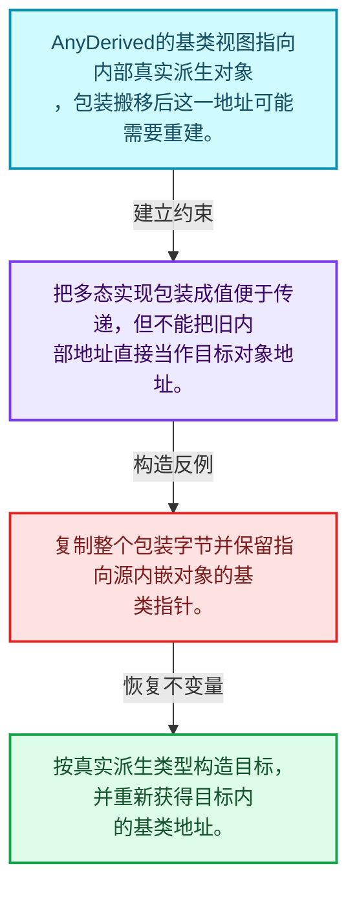
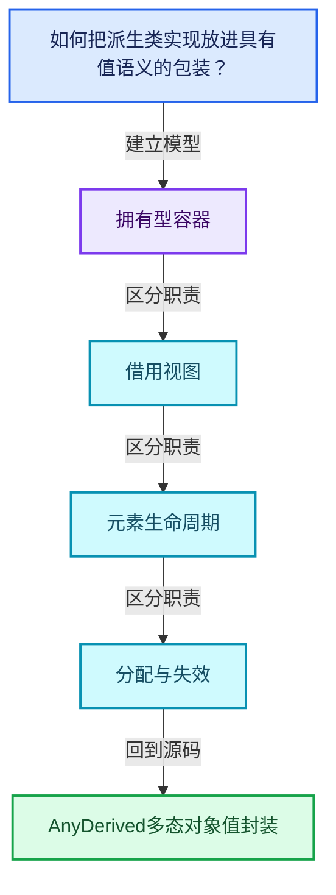
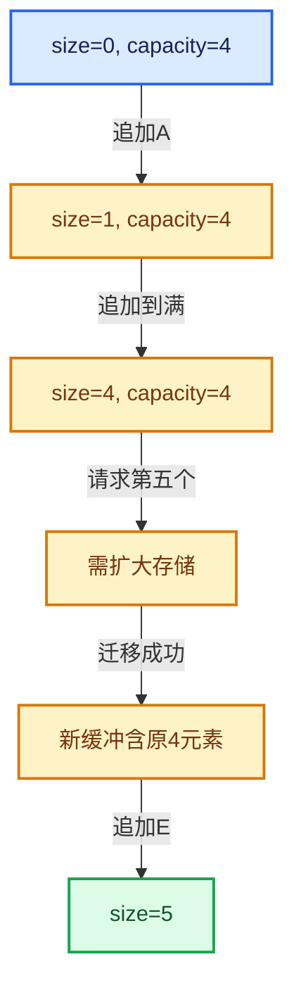

# 01-18 AnyDerived多态对象值封装

[方向导航](README.md) · [总目录](../README.md) · [覆盖索引](../%E6%BA%90%E7%A0%81%E7%89%88%E6%9C%AC%E4%B8%8E%E8%A6%86%E7%9B%96%E7%B4%A2%E5%BC%95.md)

> 阅读顺序：问题与数据模型 → 语法与类型 → 源码逐行 → 调用线索 → 历史与取舍 → 推演和练习。

- 基准 HEAD：`cbda6b96c26c0dee3c3b5cbb93960c4ac06a6b30`。
- 记录日期：2026-10-14。
- 教学示例状态：正文中的推演不是本机性能实测；已运行练习见验收报告。

## 一、从问题到设计

如何把派生类实现放进具有值语义的包装？

包装对象的复制移动规则与底层虚接口共同决定语义；内嵌对象搬移后必须重新计算对应地址。

本篇把语法、数据语义和系统取舍连接起来。先证明对象存活，再讨论索引；先区分借用与拥有，再讨论复制移动。

### 本篇独立模型与设计推理

AnyDerived的基类视图指向内部真实派生对象，包装搬移后这一地址可能需要重建。

设计取舍：把多态实现包装成值便于传递，但不能把旧内部地址直接当作目标对象地址。

最小反例：复制整个包装字节并保留指向源内嵌对象的基类指针。

推导与处理：按真实派生类型构造目标，并重新获得目标内的基类地址。



### 源码范围与相邻篇章

| 文件 | 本篇逐行范围 | 基准SHA-256 |
|---|---|---|
| [source/blender/blenlib/BLI_any_derived.hh](../../../../../source/blender/blenlib/BLI_any_derived.hh) | L1—L182 | `1efca342639c4ceccb981a797562de13e964f3af9bf56b1330f16e30859cfcf0` |

同一主讲文件可能分多篇覆盖；超出本篇范围的符号通过覆盖索引定位。空行与纯注释保留在源码摘录中，逐行表解释有效语句与语法边界；许可证头统一保留。

前篇：[Any类型擦除存储](17-Any%E7%B1%BB%E5%9E%8B%E6%93%A6%E9%99%A4%E5%AD%98%E5%82%A8.md).

后篇：[BitSpan与BitVector](19-BitSpan%E4%B8%8EBitVector.md).

## 二、类型、数据与阅读地图



这是概念依赖图，边表示阅读关系，不声称是运行时调用顺序。

### 直接编译依赖


箭头只表示头文件包含关系；完整调用线索见后面的符号定位表。

## 三、关键词、语法与类型角色

### 模板 template

模板把类型或常量作为生成实现的参数。读声明时先列出类型参数、非类型参数和默认值，再看使用者实际实例化了什么。模板声明本身不意味着每种T都支持其全部成员。

具体检查：把T替换为int、string、只能移动的类型，分别检查每个被调用操作是否成立。

### 依赖名称 typename

typename既可引入类型模板参数，也可告诉编译器某个依赖名称是类型。它不创建运行时对象；解析期确认语法类别与实例化期检查具体类型是不同阶段。

具体检查：区分typename T::value_type和T::size()，前者标记类型，后者是表达式。

### 约束 requires

requires表达式或requires子句限制模板参与重载的条件。它提供编译期可用性检查，不是运行时if，不能指望输入到达程序后再被这一机制验证。

具体检查：构造满足和不满足约束的两个类型，观察候选被排除而不是在函数内返回错误。

### 常量求值 constexpr

constexpr声明允许相应实体参与常量求值，但constexpr函数仍可以在运行时执行。是否常量求值由调用场景和表达式合法性共同决定。

具体检查：比较constexpr变量初始化和从运行时输入调用同一函数。

### 只读限定 const

const约束当前访问路径可做的修改。const指针、指向const的指针、const视图对象、const元素是不同位置的限定；其他别名可能仍可修改原对象。

具体检查：分别写T* const、const T*与const T* const，并画出不可修改的层次。

### 移动转换 std::move

std::move把表达式转换为可供移动重载选择的值类别，实际资源转移发生在被选中的构造或赋值中。对const对象move可能仍调用复制，对视图move也不会获得底层数据所有权。

具体检查：记录移动构造调用次数，不用变量名或std::move的出现次数替代测量。

### 完美转发 std::forward

std::forward在转发引用模板中恢复调用者原来的值类别。它依赖推导出的模板实参；无条件move会改变左值调用者的语义。

具体检查：对同一接口分别传入左值、临时对象和const左值，记录实际重载。

### 异常约定 noexcept

noexcept表达式可以依赖类型特征。违反不抛异常约定会终止程序；它不是自动捕获异常，也不是资源回滚代码。

具体检查：找出声明的条件与实际可能抛出的分配、构造操作是否一致。

### 显式静态转换 static_cast

static_cast表达编译期允许的转换，不会自动验证运行时真实类型、指针寿命或索引边界。由void指针恢复T指针时，调用者仍须保证实际存储中确有合法T对象。

具体检查：标出转换前后的类型以及正确性依据来自哪里。

### 限定转换 const_cast

const_cast可以改变访问路径的限定，但不能让本来就是const的对象合法可写。常用于复用只读实现时，仍需检查底层对象是否实际可变。

具体检查：对非const对象的const引用与真正const对象分别分析修改是否合法。

### 运行时多态 virtual

虚调用根据实际动态类型选择实现；经基类指针销毁对象时通常需要相应虚析构契约。每元素虚调用和循环外一次分派有不同开销。

具体检查：找出虚接口的实现类和调用频率，再讨论是否值得去虚拟化。

### 判别联合 variant

variant在若干候选类型中保存一个活动值，通过判别信息选择操作。它能把不同表示集中在值类型中，但各分支的复制移动成本不同。

具体检查：列出活动分支及每种分支实际拥有或借用的数据。

### 对齐 alignof

alignof得到类型要求的地址对齐。分配足够字节后仍需把地址对齐到相应边界，内嵌缓冲也一样。

具体检查：对齐a为2的幂时可推导向上取整，但仍要考虑溢出与边界。

### 构造与new表达式

普通new可能分配并构造；placement new在给定地址构造，存储由其他机制提供。失败回滚应区分两类责任。

具体检查：追踪地址来自哪里、构造何时成功、由谁析构、由谁释放。

### 内部断言 assert

断言表达开发者预期成立的内部契约，发布构建可能关闭。它不能替代对不可信输入的完整错误处理，也不保证后续操作被运行时保护。

具体检查：对每条断言构造违反条件的输入，区分调用者错误与应向用户报告的错误。

### 编译期分支 if constexpr

条件在实例化时决定被保留的分支，这常用于不同类型的合法操作选择。它与运行时if有不同的实例化检查规则。

具体检查：找出每个分支依赖哪些类型特征，再使用满足与不满足条件的类型。

### 共享拥有 shared_ptr

shared_ptr让控制块跟踪共享寿命，不自动使被指向对象的读写线程安全；循环拥有可能阻止销毁。

具体检查：画出强引用环并考虑是否应改变所有权方向或引入弱引用。

### 类型别名 using

类型别名为已有类型建立名字，不创建运行期对象。它常把模板内部使用的类型统一暴露给泛型调用者。

具体检查：展开别名直到基础类型，区分类型别名和变量声明。

## 四、真实源码与逐行讲解

源码块保持原行内容，原始行号由小节标题及逐行表给出。表中的调用定位是静态阅读辅助；重载、模板实例化、宏展开和虚调用需结合完整声明，不能仅凭词法出现证明动态调用。

### BLI_any_derived.hh：L1—L48

<!-- source:source/blender/blenlib/BLI_any_derived.hh:1:48 -->

```cpp
/* SPDX-FileCopyrightText: 2026 Blender Authors
 *
 * SPDX-License-Identifier: GPL-2.0-or-later */

/** \file
 * \ingroup bli
 */

#pragma once

#include "BLI_any.hh"

namespace blender {

namespace detail {

template<typename Base> struct AnyDerivedExtraInfo {

  Base *(*get_impl)(const void *buffer);

  template<typename StorageT> static constexpr AnyDerivedExtraInfo get()
  {
    /* These are the only allowed types in the #Any. */
    static_assert(std::is_base_of_v<Base, StorageT> ||
                  is_same_any_v<StorageT, Base *, std::shared_ptr<Base>>);

    /* Depending on how the implementation is stored in the #Any, a different #get_impl function
     * is required. */
    if constexpr (std::is_base_of_v<Base, StorageT>) {
      return {[](const void *buffer) {
        return static_cast<Base *>(const_cast<StorageT *>(static_cast<const StorageT *>(buffer)));
      }};
    }
    else if constexpr (std::is_same_v<StorageT, Base *>) {
      return {[](const void *buffer) {
        return *const_cast<StorageT *>(static_cast<const StorageT *>(buffer));
      }};
    }
    else if constexpr (std::is_same_v<StorageT, std::shared_ptr<Base>>) {
      return {[](const void *buffer) {
        return (const_cast<StorageT *>(static_cast<const StorageT *>(buffer)))->get();
      }};
    }
    else {
      BLI_assert_unreachable();
      return {};
    }
  }
```

| 原始行 | 语义、约束与检查 |
|---|---|
| L9 | 防止同一头文件在一个翻译单元中重复展开；不控制多个源文件之间的链接或对象寿命。 |
| L11 | 引入编译依赖 "BLI_any.hh"；这是声明可见性关系，不表示运行时一定调用该文件的所有接口。 |
| L13 | 把后续声明放入 blender 命名空间，影响名称查找和符号归属，不创建运行时对象。 |
| L15 | 把后续声明放入 detail 命名空间，影响名称查找和符号归属，不创建运行时对象。 |
| L17 | 声明模板参数 `template<typename Base> struct AnyDerivedExtraInfo {`。类型参数决定生成操作的类型，非类型参数可决定内嵌容量或编译期分支。 |
| L19 | 声明成员、局部对象或完成语句 `Base *(*get_impl)(const void *buffer)`。若为指针或引用，它本身不说明拥有；若为值对象，其构造析构由所在作用域或外层对象管理。 |
| L21 | 声明模板参数 `template<typename StorageT> static constexpr AnyDerivedExtraInfo get()`。类型参数决定生成操作的类型，非类型参数可决定内嵌容量或编译期分支。 |
| L22 | 连接上一行的声明或控制结构与其语句块；后续行在这个作用域中执行或声明。 |
| L24 | 在编译期检查 `static_assert(std::is_base_of_v<Base, StorageT> &#124;&#124;`；条件失败导致编译错误，不存在运行时错误恢复路径。 |
| L25 | 声明成员、局部对象或完成语句 `is_same_any_v<StorageT, Base *, std::shared_ptr<Base>>)`。若为指针或引用，它本身不说明拥有；若为值对象，其构造析构由所在作用域或外层对象管理。 |
| L29 | 编译期条件分支 `if constexpr (std::is_base_of_v<Base, StorageT>)`。按实例化类型选择相应实现；被舍弃分支和运行期if具有不同检查规则，不能当作运行时输入验证。 |
| L30 | 返回表达式 `{[](const void *buffer) {`。 |
| L31 | 返回表达式 `static_cast<Base *>(const_cast<StorageT *>(static_cast<const StorageT *>(buffer)))`。结合函数声明检查返回值是否借用原存储，借用值不会自动延长其寿命。 |
| L32 | 声明成员、局部对象或完成语句 `}}`。若为指针或引用，它本身不说明拥有；若为值对象，其构造析构由所在作用域或外层对象管理。 |
| L33 | 结束当前语法单元。局部自动对象在离开其作用域时按规则销毁；这不等于所有被引用的外部数据也被释放。 |
| L34 | 出现调用或函数声明 `constexpr`，对应表达式为 `else if constexpr (std::is_same_v<StorageT, Base *>) {`。参数求值、返回类型与重载需结合前后完整语句；静态文本引用不能证明动态目标。 |
| L35 | 返回表达式 `{[](const void *buffer) {`。结合函数声明检查返回值是否借用原存储，借用值不会自动延长其寿命。 |
| L36 | 返回表达式 `*const_cast<StorageT *>(static_cast<const StorageT *>(buffer))`。结合函数声明检查返回值是否借用原存储，借用值不会自动延长其寿命。 |
| L37 | 声明成员、局部对象或完成语句 `}}`。若为指针或引用，它本身不说明拥有；若为值对象，其构造析构由所在作用域或外层对象管理。 |
| L38 | 结束当前语法单元。局部自动对象在离开其作用域时按规则销毁；这不等于所有被引用的外部数据也被释放。 |
| L39 | 出现调用或函数声明 `constexpr`，对应表达式为 `else if constexpr (std::is_same_v<StorageT, std::shared_ptr<Base>>) {`。参数求值、返回类型与重载需结合前后完整语句；静态文本引用不能证明动态目标。 |
| L40 | 返回表达式 `{[](const void *buffer) {`。 |
| L41 | 返回表达式 `(const_cast<StorageT *>(static_cast<const StorageT *>(buffer)))->get()`。结合函数声明检查返回值是否借用原存储，借用值不会自动延长其寿命。 |
| L42 | 声明成员、局部对象或完成语句 `}}`。若为指针或引用，它本身不说明拥有；若为值对象，其构造析构由所在作用域或外层对象管理。 |
| L43 | 结束当前语法单元。局部自动对象在离开其作用域时按规则销毁；这不等于所有被引用的外部数据也被释放。 |
| L44 | 处理前一条件不成立的互补路径。比较两条路径最后是否恢复同一不变量，以及是否产生不同的资源责任。 |
| L45 | 断言约束 `BLI_assert_unreachable();`。条件是后续访问的内部前置条件；发布构建可能不执行，不能把断言当作输入修复。 |
| L46 | 返回表达式 `{}`。 |
| L47 | 结束当前语法单元。局部自动对象在离开其作用域时按规则销毁；这不等于所有被引用的外部数据也被释放。 |
| L48 | 结束当前语法单元。局部自动对象在离开其作用域时按规则销毁；这不等于所有被引用的外部数据也被释放。 |

### BLI_any_derived.hh：L49—L98

<!-- source:source/blender/blenlib/BLI_any_derived.hh:49:98 -->

```cpp
};

}  // namespace detail

/**
 * This allows storing or passing around derived classes of a common base class. Typically, this
 * always requires allocating the value on the heap and passing it around e.g. as unique_ptr.
 * #AnyDerived has small buffer optimization. So if the type is small, it can be stored directly
 * without an additional allocation.
 *
 * If all derived types are known where the type is used, it can be more efficient to use
 * std::variant<Derived1, Derived2, ...> instead. #AnyDerived uses type erasure through the use of
 * #Any and therefore works even when not all used derived types are known.
 *
 * This is used extensively for virtual arrays. Each type of virtual array is implemented as
 * subclass of #VArrayImpl while #VArray actually stores a specific implementation.
 *
 * Note: If the value is not stored inline, it's currently stored as a shared_ptr which is shared
 * when the AnyDerived is copied. This behavior is fine and efficient for all current uses but it
 * may need to be generalized if #AnyDerived is supposed to be used in more places.
 */
template<typename Base, int64_t InlineBufferCapacity = 24> struct AnyDerived {
 private:
  using Storage = Any<detail::AnyDerivedExtraInfo<Base>, InlineBufferCapacity, alignof(Base)>;

  /** Pointer to the currently contained implementation. This may be null. */
  Base *impl_ = nullptr;

  /**
   * Does the memory management for the implementation. It contains one of the following:
   * - Inline subclass of T.
   * - Non-owning pointer to a T.
   * - Shared pointer to a T.
   */
  Storage storage_;

 public:
  AnyDerived() = default;

  AnyDerived(const AnyDerived &other) : storage_(other.storage_)
  {
    impl_ = this->impl_from_storage();
  }

  AnyDerived(AnyDerived &&other) noexcept : storage_(std::move(other.storage_))
  {
    impl_ = this->impl_from_storage();
    other.storage_.reset();
    other.impl_ = nullptr;
  }
```

| 原始行 | 语义、约束与检查 |
|---|---|
| L49 | 结束当前语法单元。局部自动对象在离开其作用域时按规则销毁；这不等于所有被引用的外部数据也被释放。 |
| L51 | 结束当前语法单元。局部自动对象在离开其作用域时按规则销毁；这不等于所有被引用的外部数据也被释放。 |
| L70 | 声明模板参数 `template<typename Base, int64_t InlineBufferCapacity = 24> struct AnyDerived {`。类型参数决定生成操作的类型，非类型参数可决定内嵌容量或编译期分支。 |
| L71 | 切换成员访问权限为 private；它是编译期接口边界，不是线程同步或内存保护。 |
| L72 | 定义类型别名 `using Storage = Any<detail::AnyDerivedExtraInfo<Base>, InlineBufferCapacity, alignof(Base)>`，为模板接口或内部实现统一命名；本行不分配该类型对象。 |
| L75 | 把右侧 `nullptr` 用于初始化或更新左侧 `Base *impl_`。声明初始化与已有对象赋值应按上下文区分；有资源的类型会调用相应特殊成员。 |
| L83 | 声明成员、局部对象或完成语句 `Storage storage_`。若为指针或引用，它本身不说明拥有；若为值对象，其构造析构由所在作用域或外层对象管理。 |
| L85 | 切换成员访问权限为 public；它是编译期接口边界，不是线程同步或内存保护。 |
| L86 | 显式采用编译器生成的特殊成员行为：`AnyDerived() = default;`。成员和基类的性质决定该操作是否可用、是否被删除及异常约定，不表示运行时给对象赋值为default。 |
| L88 | 出现调用或函数声明 `AnyDerived`，对应表达式为 `AnyDerived(const AnyDerived &other) : storage_(other.storage_)`。参数求值、返回类型与重载需结合前后完整语句；静态文本引用不能证明动态目标。 |
| L89 | 连接上一行的声明或控制结构与其语句块；后续行在这个作用域中执行或声明。 |
| L90 | 把右侧 `this->impl_from_storage()` 用于初始化或更新左侧 `impl_`。声明初始化与已有对象赋值应按上下文区分；有资源的类型会调用相应特殊成员。 |
| L91 | 结束当前语法单元。局部自动对象在离开其作用域时按规则销毁；这不等于所有被引用的外部数据也被释放。 |
| L93 | 出现调用或函数声明 `AnyDerived`，对应表达式为 `AnyDerived(AnyDerived &&other) noexcept : storage_(std::move(other.storage_))`。参数求值、返回类型与重载需结合前后完整语句；静态文本引用不能证明动态目标。 |
| L94 | 连接上一行的声明或控制结构与其语句块；后续行在这个作用域中执行或声明。 |
| L95 | 把右侧 `this->impl_from_storage()` 用于初始化或更新左侧 `impl_`。声明初始化与已有对象赋值应按上下文区分；有资源的类型会调用相应特殊成员。 |
| L96 | 出现调用或函数声明 `reset`，对应表达式为 `other.storage_.reset();`。参数求值、返回类型与重载需结合前后完整语句；静态文本引用不能证明动态目标。 |
| L97 | 把右侧 `nullptr` 用于初始化或更新左侧 `other.impl_`。声明初始化与已有对象赋值应按上下文区分；有资源的类型会调用相应特殊成员。 |
| L98 | 结束当前语法单元。局部自动对象在离开其作用域时按规则销毁；这不等于所有被引用的外部数据也被释放。 |

### BLI_any_derived.hh：L99—L150

<!-- source:source/blender/blenlib/BLI_any_derived.hh:99:150 -->

```cpp

  explicit AnyDerived(Base *impl) : impl_(impl)
  {
    storage_ = impl_;
  }

  explicit AnyDerived(std::shared_ptr<Base> impl) : impl_(impl.get())
  {
    if (impl_) {
      storage_ = std::move(impl);
    }
  }

  AnyDerived &operator=(const AnyDerived &other)
  {
    if (this == &other) {
      return *this;
    }
    storage_ = other.storage_;
    impl_ = this->impl_from_storage();
    return *this;
  }

  AnyDerived &operator=(AnyDerived &&other) noexcept
  {
    if (this == &other) {
      return *this;
    }
    storage_ = std::move(other.storage_);
    impl_ = this->impl_from_storage();
    other.storage_.reset();
    other.impl_ = nullptr;
    return *this;
  }

  template<typename ImplT, typename... Args>
    requires std::is_base_of_v<Base, ImplT>
  void emplace(Args &&...args)
  {
    if constexpr (std::is_copy_constructible_v<ImplT> && Storage::template is_inline_v<ImplT>) {
      /* Only inline the implementation when it is copyable and when it fits into the inline
       * buffer of the storage. */
      impl_ = &storage_.template emplace<ImplT>(std::forward<Args>(args)...);
    }
    else {
      /* If it can't be inlined, create a new #std::shared_ptr instead and store that in the
       * storage. */
      std::shared_ptr<Base> ptr = std::make_shared<ImplT>(std::forward<Args>(args)...);
      impl_ = &*ptr;
      storage_ = std::move(ptr);
    }
  }
```

本段语义重点：

- 分支证据 `impl_)`：分别推演条件成立与不成立，核对相同出口处的状态。
- 分支证据 `this == &other)`：分别推演条件成立与不成立，核对相同出口处的状态。

| 原始行 | 语义、约束与检查 |
|---|---|
| L100 | 出现调用或函数声明 `AnyDerived`，对应表达式为 `explicit AnyDerived(Base *impl) : impl_(impl)`。参数求值、返回类型与重载需结合前后完整语句；静态文本引用不能证明动态目标。 |
| L101 | 连接上一行的声明或控制结构与其语句块；后续行在这个作用域中执行或声明。 |
| L102 | 把右侧 `impl_` 用于初始化或更新左侧 `storage_`。声明初始化与已有对象赋值应按上下文区分；有资源的类型会调用相应特殊成员。 |
| L103 | 结束当前语法单元。局部自动对象在离开其作用域时按规则销毁；这不等于所有被引用的外部数据也被释放。 |
| L105 | 出现调用或函数声明 `AnyDerived`，对应表达式为 `explicit AnyDerived(std::shared_ptr<Base> impl) : impl_(impl.get())`。参数求值、返回类型与重载需结合前后完整语句；静态文本引用不能证明动态目标。 |
| L106 | 连接上一行的声明或控制结构与其语句块；后续行在这个作用域中执行或声明。 |
| L107 | 判断 `impl_`，成立时进入本分支，否则继续后续路径。 |
| L108 | 把右侧 `std::move(impl)` 用于初始化或更新左侧 `storage_`。声明初始化与已有对象赋值应按上下文区分；有资源的类型会调用相应特殊成员。 |
| L109 | 结束当前语法单元。局部自动对象在离开其作用域时按规则销毁；这不等于所有被引用的外部数据也被释放。 |
| L110 | 结束当前语法单元。局部自动对象在离开其作用域时按规则销毁；这不等于所有被引用的外部数据也被释放。 |
| L112 | 运算符重载声明、定义或显式调用：`AnyDerived &operator=(const AnyDerived &other)`。结合参数和返回类型判断是赋值、索引、比较还是转换；operator=声明中的等号不是在给名为operator的变量赋值。 |
| L113 | 连接上一行的声明或控制结构与其语句块；后续行在这个作用域中执行或声明。 |
| L114 | 判断 `this == &other`，成立时进入本分支，否则继续后续路径。 |
| L115 | 返回表达式 `*this`。返回当前对象；返回类型决定它是引用还是值，不能仅凭表达式假定复制。 |
| L116 | 结束当前语法单元。局部自动对象在离开其作用域时按规则销毁；这不等于所有被引用的外部数据也被释放。 |
| L117 | 把右侧 `other.storage_` 用于初始化或更新左侧 `storage_`。声明初始化与已有对象赋值应按上下文区分；有资源的类型会调用相应特殊成员。 |
| L118 | 把右侧 `this->impl_from_storage()` 用于初始化或更新左侧 `impl_`。声明初始化与已有对象赋值应按上下文区分；有资源的类型会调用相应特殊成员。 |
| L119 | 返回表达式 `*this`。返回当前对象；返回类型决定它是引用还是值，不能仅凭表达式假定复制。 |
| L120 | 结束当前语法单元。局部自动对象在离开其作用域时按规则销毁；这不等于所有被引用的外部数据也被释放。 |
| L122 | 运算符重载声明、定义或显式调用：`AnyDerived &operator=(AnyDerived &&other) noexcept`。结合参数和返回类型判断是赋值、索引、比较还是转换；operator=声明中的等号不是在给名为operator的变量赋值。 |
| L123 | 连接上一行的声明或控制结构与其语句块；后续行在这个作用域中执行或声明。 |
| L124 | 判断 `this == &other`，成立时进入本分支，否则继续后续路径。 |
| L125 | 返回表达式 `*this`。返回当前对象；返回类型决定它是引用还是值，不能仅凭表达式假定复制。 |
| L126 | 结束当前语法单元。局部自动对象在离开其作用域时按规则销毁；这不等于所有被引用的外部数据也被释放。 |
| L127 | 把右侧 `std::move(other.storage_)` 用于初始化或更新左侧 `storage_`。声明初始化与已有对象赋值应按上下文区分；有资源的类型会调用相应特殊成员。 |
| L128 | 把右侧 `this->impl_from_storage()` 用于初始化或更新左侧 `impl_`。声明初始化与已有对象赋值应按上下文区分；有资源的类型会调用相应特殊成员。 |
| L129 | 出现调用或函数声明 `reset`，对应表达式为 `other.storage_.reset();`。参数求值、返回类型与重载需结合前后完整语句；静态文本引用不能证明动态目标。 |
| L130 | 把右侧 `nullptr` 用于初始化或更新左侧 `other.impl_`。声明初始化与已有对象赋值应按上下文区分；有资源的类型会调用相应特殊成员。 |
| L131 | 返回表达式 `*this`。返回当前对象；返回类型决定它是引用还是值，不能仅凭表达式假定复制。 |
| L132 | 结束当前语法单元。局部自动对象在离开其作用域时按规则销毁；这不等于所有被引用的外部数据也被释放。 |
| L134 | 声明模板参数 `template<typename ImplT, typename... Args>`。类型参数决定生成操作的类型，非类型参数可决定内嵌容量或编译期分支。 |
| L135 | 约束模板可用性：`requires std::is_base_of_v<Base, ImplT>`。条件在编译期检查，不替代运行期的地址、长度和类型一致性验证。 |
| L136 | 出现调用或函数声明 `emplace`，对应表达式为 `void emplace(Args &&...args)`。参数求值、返回类型与重载需结合前后完整语句；静态文本引用不能证明动态目标。 |
| L137 | 连接上一行的声明或控制结构与其语句块；后续行在这个作用域中执行或声明。 |
| L138 | 编译期条件分支 `if constexpr (std::is_copy_constructible_v<ImplT> && Storage::template is_inline_v<ImplT>)`。按实例化类型选择相应实现；被舍弃分支和运行期if具有不同检查规则，不能当作运行时输入验证。 |
| L141 | 把右侧 `&storage_.template emplace<ImplT>(std::forward<Args>(args)...)` 用于初始化或更新左侧 `impl_`。声明初始化与已有对象赋值应按上下文区分；有资源的类型会调用相应特殊成员。 |
| L142 | 结束当前语法单元。局部自动对象在离开其作用域时按规则销毁；这不等于所有被引用的外部数据也被释放。 |
| L143 | 处理前一条件不成立的互补路径。比较两条路径最后是否恢复同一不变量，以及是否产生不同的资源责任。 |
| L146 | 把右侧 `std::make_shared<ImplT>(std::forward<Args>(args)...)` 用于初始化或更新左侧 `std::shared_ptr<Base> ptr`。声明初始化与已有对象赋值应按上下文区分；有资源的类型会调用相应特殊成员。 |
| L147 | 把右侧 `&*ptr` 用于初始化或更新左侧 `impl_`。声明初始化与已有对象赋值应按上下文区分；有资源的类型会调用相应特殊成员。 |
| L148 | 把右侧 `std::move(ptr)` 用于初始化或更新左侧 `storage_`。声明初始化与已有对象赋值应按上下文区分；有资源的类型会调用相应特殊成员。 |
| L149 | 结束当前语法单元。局部自动对象在离开其作用域时按规则销毁；这不等于所有被引用的外部数据也被释放。 |
| L150 | 结束当前语法单元。局部自动对象在离开其作用域时按规则销毁；这不等于所有被引用的外部数据也被释放。 |

### BLI_any_derived.hh：L151—L182

<!-- source:source/blender/blenlib/BLI_any_derived.hh:151:182 -->

```cpp

  operator bool() const
  {
    return impl_ != nullptr;
  }

  Base &operator*() const
  {
    return *impl_;
  }

  Base *operator->() const
  {
    return impl_;
  }

  Base *get() const
  {
    return impl_;
  }

 protected:
  Base *impl_from_storage() const
  {
    if (!storage_.has_value()) {
      return nullptr;
    }
    return storage_.extra_info().get_impl(storage_.get());
  }
};

}  // namespace blender
```

本段语义重点：

- 分支证据 `!storage_.has_value())`：分别推演条件成立与不成立，核对相同出口处的状态。

| 原始行 | 语义、约束与检查 |
|---|---|
| L152 | 运算符重载声明、定义或显式调用：`operator bool() const`。结合参数和返回类型判断是赋值、索引、比较还是转换；operator=声明中的等号不是在给名为operator的变量赋值。 |
| L153 | 连接上一行的声明或控制结构与其语句块；后续行在这个作用域中执行或声明。 |
| L154 | 返回表达式 `impl_ != nullptr`。 |
| L155 | 结束当前语法单元。局部自动对象在离开其作用域时按规则销毁；这不等于所有被引用的外部数据也被释放。 |
| L157 | 运算符重载声明、定义或显式调用：`Base &operator*() const`。结合参数和返回类型判断是赋值、索引、比较还是转换；operator=声明中的等号不是在给名为operator的变量赋值。 |
| L158 | 连接上一行的声明或控制结构与其语句块；后续行在这个作用域中执行或声明。 |
| L159 | 返回表达式 `*impl_`。 |
| L160 | 结束当前语法单元。局部自动对象在离开其作用域时按规则销毁；这不等于所有被引用的外部数据也被释放。 |
| L162 | 运算符重载声明、定义或显式调用：`Base *operator->() const`。结合参数和返回类型判断是赋值、索引、比较还是转换；operator=声明中的等号不是在给名为operator的变量赋值。 |
| L163 | 连接上一行的声明或控制结构与其语句块；后续行在这个作用域中执行或声明。 |
| L164 | 返回表达式 `impl_`。 |
| L165 | 结束当前语法单元。局部自动对象在离开其作用域时按规则销毁；这不等于所有被引用的外部数据也被释放。 |
| L167 | 出现调用或函数声明 `get`，对应表达式为 `Base *get() const`。参数求值、返回类型与重载需结合前后完整语句；静态文本引用不能证明动态目标。 |
| L168 | 连接上一行的声明或控制结构与其语句块；后续行在这个作用域中执行或声明。 |
| L169 | 返回表达式 `impl_`。 |
| L170 | 结束当前语法单元。局部自动对象在离开其作用域时按规则销毁；这不等于所有被引用的外部数据也被释放。 |
| L172 | 切换成员访问权限为 protected；它是编译期接口边界，不是线程同步或内存保护。 |
| L173 | 出现调用或函数声明 `impl_from_storage`，对应表达式为 `Base *impl_from_storage() const`。参数求值、返回类型与重载需结合前后完整语句；静态文本引用不能证明动态目标。 |
| L174 | 连接上一行的声明或控制结构与其语句块；后续行在这个作用域中执行或声明。 |
| L175 | 判断 `!storage_.has_value()`，成立时进入本分支，否则继续后续路径。 |
| L176 | 返回表达式 `nullptr`。 |
| L177 | 结束当前语法单元。局部自动对象在离开其作用域时按规则销毁；这不等于所有被引用的外部数据也被释放。 |
| L178 | 返回表达式 `storage_.extra_info().get_impl(storage_.get())`。 |
| L179 | 结束当前语法单元。局部自动对象在离开其作用域时按规则销毁；这不等于所有被引用的外部数据也被释放。 |
| L180 | 结束当前语法单元。局部自动对象在离开其作用域时按规则销毁；这不等于所有被引用的外部数据也被释放。 |
| L182 | 结束当前语法单元。局部自动对象在离开其作用域时按规则销毁；这不等于所有被引用的外部数据也被释放。 |

## 五、接口定位、调用线索与生命周期

### 本篇声明与实现入口

| 源码位置 | 实际声明片段 |
|---|---|
| [BLI_any_derived.hh:L17](../../../../../source/blender/blenlib/BLI_any_derived.hh#L17) | `template<typename Base> struct AnyDerivedExtraInfo` |
| [BLI_any_derived.hh:L21](../../../../../source/blender/blenlib/BLI_any_derived.hh#L21) | `template<typename StorageT> static constexpr AnyDerivedExtraInfo get()` |
| [BLI_any_derived.hh:L34](../../../../../source/blender/blenlib/BLI_any_derived.hh#L34) | `else if constexpr (std::is_same_v<StorageT, Base *>)` |
| [BLI_any_derived.hh:L39](../../../../../source/blender/blenlib/BLI_any_derived.hh#L39) | `else if constexpr (std::is_same_v<StorageT, std::shared_ptr<Base>>)` |
| [BLI_any_derived.hh:L70](../../../../../source/blender/blenlib/BLI_any_derived.hh#L70) | `template<typename Base, int64_t InlineBufferCapacity = 24> struct AnyDerived` |
| [BLI_any_derived.hh:L86](../../../../../source/blender/blenlib/BLI_any_derived.hh#L86) | `AnyDerived() = default;` |
| [BLI_any_derived.hh:L88](../../../../../source/blender/blenlib/BLI_any_derived.hh#L88) | `AnyDerived(const AnyDerived &other) : storage_(other.storage_)` |
| [BLI_any_derived.hh:L93](../../../../../source/blender/blenlib/BLI_any_derived.hh#L93) | `AnyDerived(AnyDerived &&other) noexcept : storage_(std::move(other.storage_))` |
| [BLI_any_derived.hh:L100](../../../../../source/blender/blenlib/BLI_any_derived.hh#L100) | `explicit AnyDerived(Base *impl) : impl_(impl)` |
| [BLI_any_derived.hh:L105](../../../../../source/blender/blenlib/BLI_any_derived.hh#L105) | `explicit AnyDerived(std::shared_ptr<Base> impl) : impl_(impl.get())` |
| [BLI_any_derived.hh:L136](../../../../../source/blender/blenlib/BLI_any_derived.hh#L136) | `void emplace(Args &&...args)` |
| [BLI_any_derived.hh:L152](../../../../../source/blender/blenlib/BLI_any_derived.hh#L152) | `operator bool() const` |
| [BLI_any_derived.hh:L167](../../../../../source/blender/blenlib/BLI_any_derived.hh#L167) | `Base *get() const` |
| [BLI_any_derived.hh:L173](../../../../../source/blender/blenlib/BLI_any_derived.hh#L173) | `Base *impl_from_storage() const` |

### 同名符号出现位置

以下表提供跨文件阅读入口，包含声明、调用或测试使用；没有经过完整C++名称解析，不把它命名为已证明的运行时调用图。

| 符号 | 位置 | 文本证据 |
|---|---|---|
| `get` | [BKE_attribute.hh:L425](../../../../../source/blender/blenkernel/BKE_attribute.hh#L425) | `GAttributeReader get() const` |
| `get` | [BKE_attribute.hh:L431](../../../../../source/blender/blenkernel/BKE_attribute.hh#L431) | `GAttributeReader get(std::optional<AttrDomain> domain, std::optional<AttrType> data_type) const;` |
| `get` | [BKE_attribute.hh:L433](../../../../../source/blender/blenkernel/BKE_attribute.hh#L433) | `GAttributeReader get(const AttrDomain domain) const` |
| `constexpr` | [BKE_curves.hh:L846](../../../../../source/blender/blenkernel/BKE_curves.hh#L846) | `if constexpr (is_same_any_v<T, float, float2, float3>) {` |
| `constexpr` | [BLI_any.hh:L156](../../../../../source/blender/blenlib/BLI_any.hh#L156) | `if constexpr (is_inline_v<DecayT>) {` |
| `constexpr` | [BLI_any.hh:L244](../../../../../source/blender/blenlib/BLI_any.hh#L244) | `if constexpr (is_same_any_v<T>) {` |
| `emplace` | [geometry_fields.cc:L728](../../../../../source/blender/blenkernel/intern/geometry_fields.cc#L728) | `geometry_context_.emplace(GeometryFieldContext(*component, domain_));` |
| `emplace` | [BLI_any.hh:L275](../../../../../source/blender/blenlib/BLI_any.hh#L275) | `template<typename T, typename... Args> std::decay_t<T> &emplace(Args &&...args)` |
| `emplace` | [BLI_generic_virtual_array.hh:L99](../../../../../source/blender/blenlib/BLI_generic_virtual_array.hh#L99) | `template<typename ImplT, typename... Args> void emplace(Args &&...args);` |
| `bool` | [BKE_attribute.hh:L140](../../../../../source/blender/blenkernel/BKE_attribute.hh#L140) | `FunctionRef<bool(StringRefNull name, const AttributeMetaData &meta_data)>;` |
| `bool` | [BKE_attribute.hh:L177](../../../../../source/blender/blenkernel/BKE_attribute.hh#L177) | `operator bool() const` |
| `bool` | [BKE_attribute.hh:L194](../../../../../source/blender/blenkernel/BKE_attribute.hh#L194) | `operator bool() const` |

### 生命周期推理图


这是审查生命周期的通用模型。具体类是否拥有数据由本篇成员、构造、析构和调用者一起证明；任何箭头都不自动代表shared_ptr。

## 六、把代码放进具体数据中推演

本方向的共同数值模型如下。本篇的专门检查是：定义两种派生实现并替换它们，验证虚调用和销毁命中实际类型。

| 步骤 | 数据或状态 | 为什么需要这一步 |
|---|---|---|
| 初始 | size=0, capacity=4 | 只有存储，没有可读取的T元素 |
| 追加A | size=1, capacity=4 | 在第0个位置构造A |
| 追加到满 | size=4, capacity=4 | 四个位置均已构造 |
| 请求第五个 | 需扩大存储 | 旧地址仍需被正确管理 |
| 迁移成功 | 新缓冲含原4元素 | 提交新指针并释放旧存储 |
| 追加E | size=5 | 只在成功构造后扩大有效区间 |



图是教学推演模型；精确分支与状态更新以本篇摘录及调用契约为准。

### 本篇独立练习与参考思路

定义两种派生实现并替换它们，验证虚调用和销毁命中实际类型。

参考思路：包装对象的复制移动规则与底层虚接口共同决定语义；内嵌对象搬移后必须重新计算对应地址。

将输入、预期结果和资源责任分成三张清单。先用最直接的实现给出可核对的答案，再替换成对应源码使用的表示；比较结果不变的条件，而不是只比较接口名字。

验收依据：构造成功次数减析构次数应等于当前存活对象数；异常之后资源计数应回到合法状态。

## 七、复杂度、设计取舍与其他基础库

对比std::vector、std::array、std::span与LLVM SmallVector、ArrayRef时，分别比较拥有关系、内嵌存储、大小是否属于类型和失效条件。不要根据同名方法推断完全相同契约。

本篇的具体取舍：包装对象的复制移动规则与底层虚接口共同决定语义；内嵌对象搬移后必须重新计算对应地址。

| 观察维度 | 从源码取得证据的方法 | 本篇要避免的误判 |
|---|---|---|
| 时间 | 对循环次数、分派次数和重建频率分别计数 | 看到单次常数操作就断定整个操作序列是常数成本 |
| 内存 | 区分对象本体、容量存储、间接资源和共享控制块 | 用sizeof代替总内存 |
| 安全 | 沿构造、失败回滚、销毁与失效逐路径检查 | 把断言或非空指针当作完整安全证明 |
| 并发 | 逐字段确认锁、发布顺序和借用寿命 | 把引用计数线程安全等同数据读写线程安全 |

相关一手资料：

- [C++公开工作草案](https://eel.is/c++draft/)：持续更新的工作草案；语言与标准库语义以相应章节为准。
- [LLVM Programmer’s Manual](https://llvm.org/docs/ProgrammersManual.html)：在线版，2026-10-14查阅；仅比较设计思路，不保证与本地LLVM版本一致。

资料用于核对契约和进一步阅读；这里没有声称外部库与Blender实现相同，也没有把上游性能数字当作本机实测。

## 八、历史提交与设计演化

本篇主要讲当前接口或辅助实现，方向导航给出相关架构演化提交；没有把不涉及本篇文件的提交硬写成该实现的引入证据。

## 九、反例、测试入口与掌握标准

仓库测试入口：

- [BLI_any_derived_test.cc](../../../../../source/blender/blenlib/tests/BLI_any_derived_test.cc)：阅读输入、断言与覆盖边界；本篇不把“存在测试”写成“本轮已运行”。

需要实际构造的反例：

- 空输入或没有结果需求：确认接口允许的空状态与不允许访问的操作。
- 边界位置和退化结构：把长度为1、末尾位置、重复值或深链代入真实分支。
- 生命周期结束或修改之后：检查保存的指针、引用、结果视图是否仍有效。
- 与本篇核心不变量相冲突的输入：定义两种派生实现并替换它们，验证虚调用和销毁命中实际类型。

### 可运行的教学参考程序

[reference_exercises.cc](../_tools/reference_exercises.cc)包含独立于Blender的C++20参考检查：视图、简化SmallVector、异常回滚、哈希碰撞与删除、偏移数组、拓扑映射、共享缓存、表达式、惰性分支、闭包和暴力最近邻。

参考程序有意省略生产实现的完整能力。例如SmallVector禁止复制移动容器，不支持只能移动的元素，并禁止append参数别名到自身元素；TinyMap固定8槽，不提供增长。程序通过不能替代Blender实现测试。实际运行结果、编译器与命令见验收报告。

掌握标准：离开源码解释“如何把派生类实现放进具有值语义的包装？”；独立完成上述练习；能指出一个会破坏拥有型容器相关约束的最小反例，并用具体代码行说明检查或修复应放在哪里。
