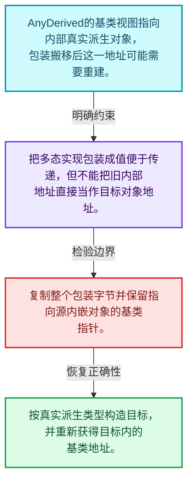
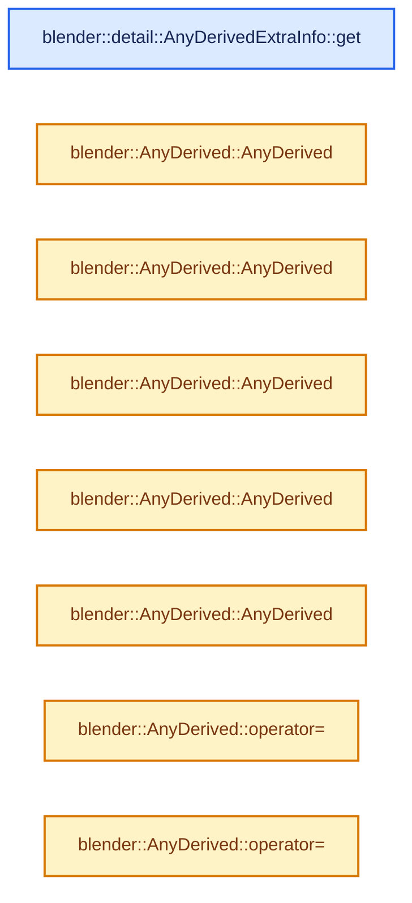
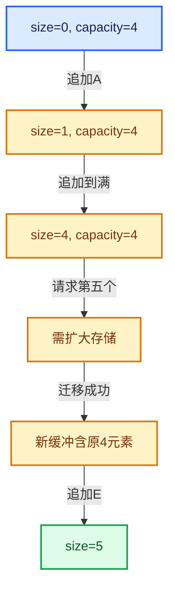

# 01-18 AnyDerived多态对象值封装

[方向导航](README.md) · [总目录](../README.md) · [实现索引](../00-课程指南/02-源码与提交索引/符号依赖与实现索引.md)

## 从问题到实现

如何把派生类实现放进具有值语义的包装？

包装对象的复制移动规则与底层虚接口共同决定语义；内嵌对象搬移后必须重新计算对应地址。

**数据模型**

AnyDerived的基类视图指向内部真实派生对象，包装搬移后这一地址可能需要重建。

**设计取舍**

把多态实现包装成值便于传递，但不能把旧内部地址直接当作目标对象地址。

**最小反例**

复制整个包装字节并保留指向源内嵌对象的基类指针。

**推导**

按真实派生类型构造目标，并重新获得目标内的基类地址。

## 阅读地图与执行推演








图中的数值推演是本方向的教学模型；实际函数之间的调用边与概念分析边分别标注，不能把概念关系当作运行时调度顺序。

## 完整源码单元与就地讲解

中文讲解直接放在相关代码旁，复杂机制在代码下展开。原文折叠区保留基准行号；不需要在行号表和函数之间来回查找。类布局可分段展示，函数实现不按固定行数切开。

### 类型布局、声明与编译条件 · BLI_any_derived.hh L1—L20

<a id="t-e9820d28f4de"></a>

`AnyDerivedExtraInfo`在这里声明的数据成员：

- `Base get_impl`

<!-- annotated:4346867232f68a -->

```cpp
/* SPDX-FileCopyrightText: 2026 Blender Authors
 *
 * SPDX-License-Identifier: GPL-2.0-or-later */

/** \file
 * \ingroup bli
 */

#pragma once

#include "BLI_any.hh"

namespace blender {

namespace detail {

template<typename Base> struct AnyDerivedExtraInfo {

  Base *(*get_impl)(const void *buffer);

```

<details>
<summary>核对原始源码：source/blender/blenlib/BLI_any_derived.hh · L1—L20</summary>

<!-- original:4346867232f68a:source/blender/blenlib/BLI_any_derived.hh:1:20 -->

```cpp
/* SPDX-FileCopyrightText: 2026 Blender Authors
 *
 * SPDX-License-Identifier: GPL-2.0-or-later */

/** \file
 * \ingroup bli
 */

#pragma once

#include "BLI_any.hh"

namespace blender {

namespace detail {

template<typename Base> struct AnyDerivedExtraInfo {

  Base *(*get_impl)(const void *buffer);

```

</details>

<a id="f-2d0f34ed023c6938"></a>

### `blender::detail::AnyDerivedExtraInfo::get`

实现位置：[source/blender/blenlib/BLI_any_derived.hh](../../../../../source/blender/blenlib/BLI_any_derived.hh) · L21—L48。

**教学注释版**

<!-- annotated:3ccc9274092ca3 -->

```cpp
  template<typename StorageT> static constexpr AnyDerivedExtraInfo get()
  {
    /* These are the only allowed types in the #Any. */
    static_assert(std::is_base_of_v<Base, StorageT> ||
                  is_same_any_v<StorageT, Base *, std::shared_ptr<Base>>);

    /* Depending on how the implementation is stored in the #Any, a different #get_impl function
     * is required. */
    if constexpr (std::is_base_of_v<Base, StorageT>) {
      return {[](const void *buffer) {
        return static_cast<Base *>(const_cast<StorageT *>(static_cast<const StorageT *>(buffer)));
      }};
    }
    else if constexpr (std::is_same_v<StorageT, Base *>) {
      return {[](const void *buffer) {
        return *const_cast<StorageT *>(static_cast<const StorageT *>(buffer));
      }};
    }
    else if constexpr (std::is_same_v<StorageT, std::shared_ptr<Base>>) {
      return {[](const void *buffer) {
        return (const_cast<StorageT *>(static_cast<const StorageT *>(buffer)))->get();
      }};
    }
    else {
      BLI_assert_unreachable();
      return {};
    }
  }
```

<details>
<summary>核对原始源码：source/blender/blenlib/BLI_any_derived.hh · L21—L48</summary>

<!-- original:3ccc9274092ca3:source/blender/blenlib/BLI_any_derived.hh:21:48 -->

```cpp
  template<typename StorageT> static constexpr AnyDerivedExtraInfo get()
  {
    /* These are the only allowed types in the #Any. */
    static_assert(std::is_base_of_v<Base, StorageT> ||
                  is_same_any_v<StorageT, Base *, std::shared_ptr<Base>>);

    /* Depending on how the implementation is stored in the #Any, a different #get_impl function
     * is required. */
    if constexpr (std::is_base_of_v<Base, StorageT>) {
      return {[](const void *buffer) {
        return static_cast<Base *>(const_cast<StorageT *>(static_cast<const StorageT *>(buffer)));
      }};
    }
    else if constexpr (std::is_same_v<StorageT, Base *>) {
      return {[](const void *buffer) {
        return *const_cast<StorageT *>(static_cast<const StorageT *>(buffer));
      }};
    }
    else if constexpr (std::is_same_v<StorageT, std::shared_ptr<Base>>) {
      return {[](const void *buffer) {
        return (const_cast<StorageT *>(static_cast<const StorageT *>(buffer)))->get();
      }};
    }
    else {
      BLI_assert_unreachable();
      return {};
    }
  }
```

</details>

**结果出口**

- `return {[](const void *buffer) {`
- `return static_cast<Base *>(const_cast<StorageT *>(static_cast<const StorageT *>(buffer)));`
- `return *const_cast<StorageT *>(static_cast<const StorageT *>(buffer));`
- `return (const_cast<StorageT *>(static_cast<const StorageT *>(buffer)))->get();`
- `return {};`

**继续追踪实现**

- `(const_cast<StorageT *>(static_cast<const StorageT *>(buffer)))->get` → [调用协议](../00-课程指南/01-路线与规范/模板宏与动态分派协议.md)：接收对象类型依赖auto、返回值或模板实例；不按同名猜测目标。调用位置L41。
- `BLI_assert_unreachable` → [BLI_assert_unreachable · L77](../90-实现依赖专题/01-BLI基础库/BLI_assert.hh.md#m-7a2d91a67d8e)。宏定义由构建条件选择。

### 类型布局、声明与编译条件 · BLI_any_derived.hh L49—L85

<a id="t-a63bfc28be85"></a>

`AnyDerived`在这里声明的数据成员：

- `Base impl_`
- `Storage storage_`

<!-- annotated:8efbe83bb497e2 -->

```cpp
};

}  // namespace detail

/**
 * This allows storing or passing around derived classes of a common base class. Typically, this
 * always requires allocating the value on the heap and passing it around e.g. as unique_ptr.
 * #AnyDerived has small buffer optimization. So if the type is small, it can be stored directly
 * without an additional allocation.
 *
 * If all derived types are known where the type is used, it can be more efficient to use
 * std::variant<Derived1, Derived2, ...> instead. #AnyDerived uses type erasure through the use of
 * #Any and therefore works even when not all used derived types are known.
 *
 * This is used extensively for virtual arrays. Each type of virtual array is implemented as
 * subclass of #VArrayImpl while #VArray actually stores a specific implementation.
 *
 * Note: If the value is not stored inline, it's currently stored as a shared_ptr which is shared
 * when the AnyDerived is copied. This behavior is fine and efficient for all current uses but it
 * may need to be generalized if #AnyDerived is supposed to be used in more places.
 */
template<typename Base, int64_t InlineBufferCapacity = 24> struct AnyDerived {
 private:
  using Storage = Any<detail::AnyDerivedExtraInfo<Base>, InlineBufferCapacity, alignof(Base)>;

  /** Pointer to the currently contained implementation. This may be null. */
  Base *impl_ = nullptr;

  /**
   * Does the memory management for the implementation. It contains one of the following:
   * - Inline subclass of T.
   * - Non-owning pointer to a T.
   * - Shared pointer to a T.
   */
  Storage storage_;

 public:
```

<details>
<summary>核对原始源码：source/blender/blenlib/BLI_any_derived.hh · L49—L85</summary>

<!-- original:8efbe83bb497e2:source/blender/blenlib/BLI_any_derived.hh:49:85 -->

```cpp
};

}  // namespace detail

/**
 * This allows storing or passing around derived classes of a common base class. Typically, this
 * always requires allocating the value on the heap and passing it around e.g. as unique_ptr.
 * #AnyDerived has small buffer optimization. So if the type is small, it can be stored directly
 * without an additional allocation.
 *
 * If all derived types are known where the type is used, it can be more efficient to use
 * std::variant<Derived1, Derived2, ...> instead. #AnyDerived uses type erasure through the use of
 * #Any and therefore works even when not all used derived types are known.
 *
 * This is used extensively for virtual arrays. Each type of virtual array is implemented as
 * subclass of #VArrayImpl while #VArray actually stores a specific implementation.
 *
 * Note: If the value is not stored inline, it's currently stored as a shared_ptr which is shared
 * when the AnyDerived is copied. This behavior is fine and efficient for all current uses but it
 * may need to be generalized if #AnyDerived is supposed to be used in more places.
 */
template<typename Base, int64_t InlineBufferCapacity = 24> struct AnyDerived {
 private:
  using Storage = Any<detail::AnyDerivedExtraInfo<Base>, InlineBufferCapacity, alignof(Base)>;

  /** Pointer to the currently contained implementation. This may be null. */
  Base *impl_ = nullptr;

  /**
   * Does the memory management for the implementation. It contains one of the following:
   * - Inline subclass of T.
   * - Non-owning pointer to a T.
   * - Shared pointer to a T.
   */
  Storage storage_;

 public:
```

</details>

<a id="f-b7128a8732397b12"></a>

### `blender::AnyDerived::AnyDerived`

实现位置：[source/blender/blenlib/BLI_any_derived.hh](../../../../../source/blender/blenlib/BLI_any_derived.hh) · L86—L86。

**教学注释版**

<!-- annotated:c00e4d881a6aa2 -->

```cpp
  AnyDerived() = default;
```

<details>
<summary>核对原始源码：source/blender/blenlib/BLI_any_derived.hh · L86—L86</summary>

<!-- original:c00e4d881a6aa2:source/blender/blenlib/BLI_any_derived.hh:86:86 -->

```cpp
  AnyDerived() = default;
```

</details>

**继续追踪实现**

本实现没有需要继续展开的显式调用；检查返回表达式、对象转换和调用者前置条件。

<!-- annotated:156a773af1e1dd -->

```cpp

```

<details>
<summary>核对原始源码：source/blender/blenlib/BLI_any_derived.hh · L87—L87</summary>

<!-- original:156a773af1e1dd:source/blender/blenlib/BLI_any_derived.hh:87:87 -->

```cpp

```

</details>

<a id="f-872cc8bbb38b0a72"></a>

### `blender::AnyDerived::AnyDerived`

实现位置：[source/blender/blenlib/BLI_any_derived.hh](../../../../../source/blender/blenlib/BLI_any_derived.hh) · L88—L91。

接口参数：

- `const AnyDerived &other`

**教学注释版**

<!-- annotated:ed8b1160c0a81c -->

```cpp
  AnyDerived(const AnyDerived &other) : storage_(other.storage_)
  {
    impl_ = this->impl_from_storage();
  }
```

<details>
<summary>核对原始源码：source/blender/blenlib/BLI_any_derived.hh · L88—L91</summary>

<!-- original:ed8b1160c0a81c:source/blender/blenlib/BLI_any_derived.hh:88:91 -->

```cpp
  AnyDerived(const AnyDerived &other) : storage_(other.storage_)
  {
    impl_ = this->impl_from_storage();
  }
```

</details>

**沿实际写入检查状态**

- `impl_ = this->impl_from_storage();`

**继续追踪实现**

- `this->impl_from_storage` → [blender::AnyDerived::impl_from_storage · L173](18-AnyDerived多态对象值封装.md#f-7fb2c31d30ad3dc7)。

<!-- annotated:9ef1481965bd07 -->

```cpp

```

<details>
<summary>核对原始源码：source/blender/blenlib/BLI_any_derived.hh · L92—L92</summary>

<!-- original:9ef1481965bd07:source/blender/blenlib/BLI_any_derived.hh:92:92 -->

```cpp

```

</details>

<a id="f-1ad37a0192ecef2f"></a>

### `blender::AnyDerived::AnyDerived`

实现位置：[source/blender/blenlib/BLI_any_derived.hh](../../../../../source/blender/blenlib/BLI_any_derived.hh) · L93—L98。

接口参数：

- `AnyDerived &&other`

**教学注释版**

<!-- annotated:403ab2603a53a1 -->

```cpp
  AnyDerived(AnyDerived &&other) noexcept : storage_(std::move(other.storage_))
  {
    impl_ = this->impl_from_storage();
    other.storage_.reset();
    other.impl_ = nullptr;
  }
```

<details>
<summary>核对原始源码：source/blender/blenlib/BLI_any_derived.hh · L93—L98</summary>

<!-- original:403ab2603a53a1:source/blender/blenlib/BLI_any_derived.hh:93:98 -->

```cpp
  AnyDerived(AnyDerived &&other) noexcept : storage_(std::move(other.storage_))
  {
    impl_ = this->impl_from_storage();
    other.storage_.reset();
    other.impl_ = nullptr;
  }
```

</details>

**沿实际写入检查状态**

- `impl_ = this->impl_from_storage();`
- `other.impl_ = nullptr;`

**继续追踪实现**

- `this->impl_from_storage` → [blender::AnyDerived::impl_from_storage · L173](18-AnyDerived多态对象值封装.md#f-7fb2c31d30ad3dc7)。
- `other.storage_.reset` → [调用协议](../00-课程指南/01-路线与规范/模板宏与动态分派协议.md)：接收对象类型依赖auto、返回值或模板实例；不按同名猜测目标。调用位置L96。

<!-- annotated:9fa4a206024bd8 -->

```cpp

```

<details>
<summary>核对原始源码：source/blender/blenlib/BLI_any_derived.hh · L99—L99</summary>

<!-- original:9fa4a206024bd8:source/blender/blenlib/BLI_any_derived.hh:99:99 -->

```cpp

```

</details>

<a id="f-3bc0304c25e8d6f7"></a>

### `blender::AnyDerived::AnyDerived`

实现位置：[source/blender/blenlib/BLI_any_derived.hh](../../../../../source/blender/blenlib/BLI_any_derived.hh) · L100—L103。

接口参数：

- `Base *impl`

**教学注释版**

<!-- annotated:a4ed34082a5cf6 -->

```cpp
  explicit AnyDerived(Base *impl) : impl_(impl)
  {
    storage_ = impl_;
  }
```

<details>
<summary>核对原始源码：source/blender/blenlib/BLI_any_derived.hh · L100—L103</summary>

<!-- original:a4ed34082a5cf6:source/blender/blenlib/BLI_any_derived.hh:100:103 -->

```cpp
  explicit AnyDerived(Base *impl) : impl_(impl)
  {
    storage_ = impl_;
  }
```

</details>

**沿实际写入检查状态**

- `storage_ = impl_;`

**继续追踪实现**

本实现没有需要继续展开的显式调用；检查返回表达式、对象转换和调用者前置条件。

<!-- annotated:3ebf63e2202b82 -->

```cpp

```

<details>
<summary>核对原始源码：source/blender/blenlib/BLI_any_derived.hh · L104—L104</summary>

<!-- original:3ebf63e2202b82:source/blender/blenlib/BLI_any_derived.hh:104:104 -->

```cpp

```

</details>

<a id="f-881e07b80adb1a2f"></a>

### `blender::AnyDerived::AnyDerived`

实现位置：[source/blender/blenlib/BLI_any_derived.hh](../../../../../source/blender/blenlib/BLI_any_derived.hh) · L105—L110。

接口参数：

- `std::shared_ptr<Base> impl`

**教学注释版**

<!-- annotated:32fa6ccaeaa16b -->

```cpp
  explicit AnyDerived(std::shared_ptr<Base> impl) : impl_(impl.get())
  {
    if (impl_) {
      // [讲解] std::move：把表达式转换成可供移动重载选择的值类别；不保证真的移动，不结束源对象寿命，对const值可能选择复制。
      storage_ = std::move(impl);
    }
  }
```

<details>
<summary>核对原始源码：source/blender/blenlib/BLI_any_derived.hh · L105—L110</summary>

<!-- original:32fa6ccaeaa16b:source/blender/blenlib/BLI_any_derived.hh:105:110 -->

```cpp
  explicit AnyDerived(std::shared_ptr<Base> impl) : impl_(impl.get())
  {
    if (impl_) {
      storage_ = std::move(impl);
    }
  }
```

</details>

**沿实际写入检查状态**

- `storage_ = std::move(impl);`

**继续追踪实现**

- `std::move` → [外部契约](https://eel.is/c++draft/utility.forward)：把表达式转换成可供移动重载选择的值类别；不保证真的移动，不结束源对象寿命，对const值可能选择复制。

<!-- annotated:d4cdfc9659b0e9 -->

```cpp

```

<details>
<summary>核对原始源码：source/blender/blenlib/BLI_any_derived.hh · L111—L111</summary>

<!-- original:d4cdfc9659b0e9:source/blender/blenlib/BLI_any_derived.hh:111:111 -->

```cpp

```

</details>

<a id="f-3fe9db6b219d9803"></a>

### `blender::AnyDerived::operator=`

实现位置：[source/blender/blenlib/BLI_any_derived.hh](../../../../../source/blender/blenlib/BLI_any_derived.hh) · L112—L120。

接口参数：

- `const AnyDerived &other`

**教学注释版**

<!-- annotated:8212199bb66cc3 -->

```cpp
  AnyDerived &operator=(const AnyDerived &other)
  {
    if (this == &other) {
      return *this;
    }
    storage_ = other.storage_;
    impl_ = this->impl_from_storage();
    return *this;
  }
```

<details>
<summary>核对原始源码：source/blender/blenlib/BLI_any_derived.hh · L112—L120</summary>

<!-- original:8212199bb66cc3:source/blender/blenlib/BLI_any_derived.hh:112:120 -->

```cpp
  AnyDerived &operator=(const AnyDerived &other)
  {
    if (this == &other) {
      return *this;
    }
    storage_ = other.storage_;
    impl_ = this->impl_from_storage();
    return *this;
  }
```

</details>

**沿实际写入检查状态**

- `storage_ = other.storage_;`
- `impl_ = this->impl_from_storage();`

**结果出口**

- `return *this;`

**继续追踪实现**

- `this->impl_from_storage` → [blender::AnyDerived::impl_from_storage · L173](18-AnyDerived多态对象值封装.md#f-7fb2c31d30ad3dc7)。

<!-- annotated:e0fa97fda33e5a -->

```cpp

```

<details>
<summary>核对原始源码：source/blender/blenlib/BLI_any_derived.hh · L121—L121</summary>

<!-- original:e0fa97fda33e5a:source/blender/blenlib/BLI_any_derived.hh:121:121 -->

```cpp

```

</details>

<a id="f-207455878cf0d83c"></a>

### `blender::AnyDerived::operator=`

实现位置：[source/blender/blenlib/BLI_any_derived.hh](../../../../../source/blender/blenlib/BLI_any_derived.hh) · L122—L132。

接口参数：

- `AnyDerived &&other`

**教学注释版**

<!-- annotated:9637a772f66351 -->

```cpp
  AnyDerived &operator=(AnyDerived &&other) noexcept
  {
    if (this == &other) {
      return *this;
    }
    // [讲解] std::move：把表达式转换成可供移动重载选择的值类别；不保证真的移动，不结束源对象寿命，对const值可能选择复制。
    storage_ = std::move(other.storage_);
    impl_ = this->impl_from_storage();
    other.storage_.reset();
    other.impl_ = nullptr;
    return *this;
  }
```

<details>
<summary>核对原始源码：source/blender/blenlib/BLI_any_derived.hh · L122—L132</summary>

<!-- original:9637a772f66351:source/blender/blenlib/BLI_any_derived.hh:122:132 -->

```cpp
  AnyDerived &operator=(AnyDerived &&other) noexcept
  {
    if (this == &other) {
      return *this;
    }
    storage_ = std::move(other.storage_);
    impl_ = this->impl_from_storage();
    other.storage_.reset();
    other.impl_ = nullptr;
    return *this;
  }
```

</details>

**沿实际写入检查状态**

- `storage_ = std::move(other.storage_);`
- `impl_ = this->impl_from_storage();`
- `other.impl_ = nullptr;`

**结果出口**

- `return *this;`

**继续追踪实现**

- `std::move` → [外部契约](https://eel.is/c++draft/utility.forward)：把表达式转换成可供移动重载选择的值类别；不保证真的移动，不结束源对象寿命，对const值可能选择复制。
- `this->impl_from_storage` → [blender::AnyDerived::impl_from_storage · L173](18-AnyDerived多态对象值封装.md#f-7fb2c31d30ad3dc7)。
- `other.storage_.reset` → [调用协议](../00-课程指南/01-路线与规范/模板宏与动态分派协议.md)：接收对象类型依赖auto、返回值或模板实例；不按同名猜测目标。调用位置L129。

<!-- annotated:c7efb137f7bb88 -->

```cpp

```

<details>
<summary>核对原始源码：source/blender/blenlib/BLI_any_derived.hh · L133—L133</summary>

<!-- original:c7efb137f7bb88:source/blender/blenlib/BLI_any_derived.hh:133:133 -->

```cpp

```

</details>

<a id="f-57e6b0e71dbdff55"></a>

### `blender::AnyDerived::emplace`

实现位置：[source/blender/blenlib/BLI_any_derived.hh](../../../../../source/blender/blenlib/BLI_any_derived.hh) · L134—L150。

**教学注释版**

<!-- annotated:b612683329b7a3 -->

```cpp
  template<typename ImplT, typename... Args>
    requires std::is_base_of_v<Base, ImplT>
  void emplace(Args &&...args)
  {
    if constexpr (std::is_copy_constructible_v<ImplT> && Storage::template is_inline_v<ImplT>) {
      /* Only inline the implementation when it is copyable and when it fits into the inline
       * buffer of the storage. */
      // [讲解] std::forward<Args>：在转发引用中恢复调用者传入的值类别；依赖推导类型，不能与无条件move互换。
      impl_ = &storage_.template emplace<ImplT>(std::forward<Args>(args)...);
    }
    else {
      /* If it can't be inlined, create a new #std::shared_ptr instead and store that in the
       * storage. */
      // [讲解] std::make_shared<ImplT>：构造由共享控制块管理的对象；共享寿命不自动使被指对象读写线程安全，强引用环需单独处理。
      std::shared_ptr<Base> ptr = std::make_shared<ImplT>(std::forward<Args>(args)...);
      impl_ = &*ptr;
      // [讲解] std::move：把表达式转换成可供移动重载选择的值类别；不保证真的移动，不结束源对象寿命，对const值可能选择复制。
      storage_ = std::move(ptr);
    }
  }
```

<details>
<summary>核对原始源码：source/blender/blenlib/BLI_any_derived.hh · L134—L150</summary>

<!-- original:b612683329b7a3:source/blender/blenlib/BLI_any_derived.hh:134:150 -->

```cpp
  template<typename ImplT, typename... Args>
    requires std::is_base_of_v<Base, ImplT>
  void emplace(Args &&...args)
  {
    if constexpr (std::is_copy_constructible_v<ImplT> && Storage::template is_inline_v<ImplT>) {
      /* Only inline the implementation when it is copyable and when it fits into the inline
       * buffer of the storage. */
      impl_ = &storage_.template emplace<ImplT>(std::forward<Args>(args)...);
    }
    else {
      /* If it can't be inlined, create a new #std::shared_ptr instead and store that in the
       * storage. */
      std::shared_ptr<Base> ptr = std::make_shared<ImplT>(std::forward<Args>(args)...);
      impl_ = &*ptr;
      storage_ = std::move(ptr);
    }
  }
```

</details>

**沿实际写入检查状态**

- `impl_ = &storage_.template emplace<ImplT>(std::forward<Args>(args)...);`
- `impl_ = &*ptr;`
- `storage_ = std::move(ptr);`

**继续追踪实现**

- `storage_.template emplace<ImplT>` → [blender::AnyDerived::emplace · L134](18-AnyDerived多态对象值封装.md#f-57e6b0e71dbdff55)。
- `std::forward<Args>` → [外部契约](https://eel.is/c++draft/utility.forward)：在转发引用中恢复调用者传入的值类别；依赖推导类型，不能与无条件move互换。
- `std::make_shared<ImplT>` → [外部契约](https://eel.is/c++draft/util.smartptr.shared.create)：构造由共享控制块管理的对象；共享寿命不自动使被指对象读写线程安全，强引用环需单独处理。
- `std::move` → [外部契约](https://eel.is/c++draft/utility.forward)：把表达式转换成可供移动重载选择的值类别；不保证真的移动，不结束源对象寿命，对const值可能选择复制。

<!-- annotated:80bee1cfcd7c0a -->

```cpp

```

<details>
<summary>核对原始源码：source/blender/blenlib/BLI_any_derived.hh · L151—L151</summary>

<!-- original:80bee1cfcd7c0a:source/blender/blenlib/BLI_any_derived.hh:151:151 -->

```cpp

```

</details>

<a id="f-85f228e6401f7dfe"></a>

### `blender::AnyDerived::() const`

实现位置：[source/blender/blenlib/BLI_any_derived.hh](../../../../../source/blender/blenlib/BLI_any_derived.hh) · L152—L155。

**教学注释版**

<!-- annotated:bdfe07e4625b93 -->

```cpp
  operator bool() const
  {
    return impl_ != nullptr;
  }
```

<details>
<summary>核对原始源码：source/blender/blenlib/BLI_any_derived.hh · L152—L155</summary>

<!-- original:bdfe07e4625b93:source/blender/blenlib/BLI_any_derived.hh:152:155 -->

```cpp
  operator bool() const
  {
    return impl_ != nullptr;
  }
```

</details>

**结果出口**

- `return impl_ != nullptr;`

**继续追踪实现**

本实现没有需要继续展开的显式调用；检查返回表达式、对象转换和调用者前置条件。

<!-- annotated:5d321ccab214ef -->

```cpp

```

<details>
<summary>核对原始源码：source/blender/blenlib/BLI_any_derived.hh · L156—L156</summary>

<!-- original:5d321ccab214ef:source/blender/blenlib/BLI_any_derived.hh:156:156 -->

```cpp

```

</details>

<a id="f-e7df15a90d62d241"></a>

### `blender::AnyDerived::operator*`

实现位置：[source/blender/blenlib/BLI_any_derived.hh](../../../../../source/blender/blenlib/BLI_any_derived.hh) · L157—L160。

**教学注释版**

<!-- annotated:8c4d0b1eb8244d -->

```cpp
  Base &operator*() const
  {
    return *impl_;
  }
```

<details>
<summary>核对原始源码：source/blender/blenlib/BLI_any_derived.hh · L157—L160</summary>

<!-- original:8c4d0b1eb8244d:source/blender/blenlib/BLI_any_derived.hh:157:160 -->

```cpp
  Base &operator*() const
  {
    return *impl_;
  }
```

</details>

**结果出口**

- `return *impl_;`

**继续追踪实现**

本实现没有需要继续展开的显式调用；检查返回表达式、对象转换和调用者前置条件。

<!-- annotated:2ba1a65d65ace6 -->

```cpp

```

<details>
<summary>核对原始源码：source/blender/blenlib/BLI_any_derived.hh · L161—L161</summary>

<!-- original:2ba1a65d65ace6:source/blender/blenlib/BLI_any_derived.hh:161:161 -->

```cpp

```

</details>

<a id="f-c6bb9fa094cce092"></a>

### `blender::AnyDerived::operator->`

实现位置：[source/blender/blenlib/BLI_any_derived.hh](../../../../../source/blender/blenlib/BLI_any_derived.hh) · L162—L165。

**教学注释版**

<!-- annotated:3c5929b22cd2b6 -->

```cpp
  Base *operator->() const
  {
    return impl_;
  }
```

<details>
<summary>核对原始源码：source/blender/blenlib/BLI_any_derived.hh · L162—L165</summary>

<!-- original:3c5929b22cd2b6:source/blender/blenlib/BLI_any_derived.hh:162:165 -->

```cpp
  Base *operator->() const
  {
    return impl_;
  }
```

</details>

**结果出口**

- `return impl_;`

**继续追踪实现**

本实现没有需要继续展开的显式调用；检查返回表达式、对象转换和调用者前置条件。

<!-- annotated:d7be4b257921af -->

```cpp

```

<details>
<summary>核对原始源码：source/blender/blenlib/BLI_any_derived.hh · L166—L166</summary>

<!-- original:d7be4b257921af:source/blender/blenlib/BLI_any_derived.hh:166:166 -->

```cpp

```

</details>

<a id="f-ebda3f1086d3f9fc"></a>

### `blender::AnyDerived::get`

实现位置：[source/blender/blenlib/BLI_any_derived.hh](../../../../../source/blender/blenlib/BLI_any_derived.hh) · L167—L170。

**教学注释版**

<!-- annotated:01e23ae76a6d0f -->

```cpp
  Base *get() const
  {
    return impl_;
  }
```

<details>
<summary>核对原始源码：source/blender/blenlib/BLI_any_derived.hh · L167—L170</summary>

<!-- original:01e23ae76a6d0f:source/blender/blenlib/BLI_any_derived.hh:167:170 -->

```cpp
  Base *get() const
  {
    return impl_;
  }
```

</details>

**结果出口**

- `return impl_;`

**继续追踪实现**

本实现没有需要继续展开的显式调用；检查返回表达式、对象转换和调用者前置条件。

### 类型布局、声明与编译条件 · BLI_any_derived.hh L171—L172

<!-- annotated:4ab4c0cc58580b -->

```cpp

 protected:
```

<details>
<summary>核对原始源码：source/blender/blenlib/BLI_any_derived.hh · L171—L172</summary>

<!-- original:4ab4c0cc58580b:source/blender/blenlib/BLI_any_derived.hh:171:172 -->

```cpp

 protected:
```

</details>

<a id="f-7fb2c31d30ad3dc7"></a>

### `blender::AnyDerived::impl_from_storage`

实现位置：[source/blender/blenlib/BLI_any_derived.hh](../../../../../source/blender/blenlib/BLI_any_derived.hh) · L173—L179。

**教学注释版**

<!-- annotated:f9e47143eecb64 -->

```cpp
  Base *impl_from_storage() const
  {
    if (!storage_.has_value()) {
      return nullptr;
    }
    return storage_.extra_info().get_impl(storage_.get());
  }
```

<details>
<summary>核对原始源码：source/blender/blenlib/BLI_any_derived.hh · L173—L179</summary>

<!-- original:f9e47143eecb64:source/blender/blenlib/BLI_any_derived.hh:173:179 -->

```cpp
  Base *impl_from_storage() const
  {
    if (!storage_.has_value()) {
      return nullptr;
    }
    return storage_.extra_info().get_impl(storage_.get());
  }
```

</details>

**结果出口**

- `return nullptr;`
- `return storage_.extra_info().get_impl(storage_.get());`

**继续追踪实现**

- `storage_.has_value` → [调用协议](../00-课程指南/01-路线与规范/模板宏与动态分派协议.md)：由接收对象具体类型或运行时策略提供实现。调用位置L175。
- `storage_.extra_info().get_impl` → [调用协议](../00-课程指南/01-路线与规范/模板宏与动态分派协议.md)：接收对象类型依赖auto、返回值或模板实例；不按同名猜测目标。调用位置L178。
- `storage_.extra_info` → [blender::Any::extra_info · L390](17-Any类型擦除存储.md#f-7a560ad93b9c62eb)。
- `storage_.get` → [blender::AnyDerived::get · L167](18-AnyDerived多态对象值封装.md#f-ebda3f1086d3f9fc)。

### 类型布局、声明与编译条件 · BLI_any_derived.hh L180—L182

<!-- annotated:3ff9e23d7c74b6 -->

```cpp
};

}  // namespace blender
```

<details>
<summary>核对原始源码：source/blender/blenlib/BLI_any_derived.hh · L180—L182</summary>

<!-- original:3ff9e23d7c74b6:source/blender/blenlib/BLI_any_derived.hh:180:182 -->

```cpp
};

}  // namespace blender
```

</details>

## 语法与相关类型

### 模板 template

模板把类型或常量作为生成实现的参数。读声明时先列出类型参数、非类型参数和默认值，再看使用者实际实例化了什么。模板声明本身不意味着每种T都支持其全部成员。

把T替换为int、string、只能移动的类型，分别检查每个被调用操作是否成立。

### 依赖名称 typename

typename既可引入类型模板参数，也可告诉编译器某个依赖名称是类型。它不创建运行时对象；解析期确认语法类别与实例化期检查具体类型是不同阶段。

区分typename T::value_type和T::size()，前者标记类型，后者是表达式。

### 约束 requires

requires表达式或requires子句限制模板参与重载的条件。它提供编译期可用性检查，不是运行时if，不能指望输入到达程序后再被这一机制验证。

构造满足和不满足约束的两个类型，观察候选被排除而不是在函数内返回错误。

### 常量求值 constexpr

constexpr声明允许相应实体参与常量求值，但constexpr函数仍可以在运行时执行。是否常量求值由调用场景和表达式合法性共同决定。

比较constexpr变量初始化和从运行时输入调用同一函数。

### 只读限定 const

const约束当前访问路径可做的修改。const指针、指向const的指针、const视图对象、const元素是不同位置的限定；其他别名可能仍可修改原对象。

分别写T* const、const T*与const T* const，并画出不可修改的层次。

### 移动转换 std::move

std::move把表达式转换为可供移动重载选择的值类别，实际资源转移发生在被选中的构造或赋值中。对const对象move可能仍调用复制，对视图move也不会获得底层数据所有权。

记录移动构造调用次数，不用变量名或std::move的出现次数替代测量。

### 完美转发 std::forward

std::forward在转发引用模板中恢复调用者原来的值类别。它依赖推导出的模板实参；无条件move会改变左值调用者的语义。

对同一接口分别传入左值、临时对象和const左值，记录实际重载。

### 异常约定 noexcept

noexcept表达式可以依赖类型特征。违反不抛异常约定会终止程序；它不是自动捕获异常，也不是资源回滚代码。

找出声明的条件与实际可能抛出的分配、构造操作是否一致。

### 显式静态转换 static_cast

static_cast表达编译期允许的转换，不会自动验证运行时真实类型、指针寿命或索引边界。由void指针恢复T指针时，调用者仍须保证实际存储中确有合法T对象。

标出转换前后的类型以及正确性依据来自哪里。

### 限定转换 const_cast

const_cast可以改变访问路径的限定，但不能让本来就是const的对象合法可写。常用于复用只读实现时，仍需检查底层对象是否实际可变。

对非const对象的const引用与真正const对象分别分析修改是否合法。

### 运行时多态 virtual

虚调用根据实际动态类型选择实现；经基类指针销毁对象时通常需要相应虚析构契约。每元素虚调用和循环外一次分派有不同开销。

找出虚接口的实现类和调用频率，再讨论是否值得去虚拟化。

### 判别联合 variant

variant在若干候选类型中保存一个活动值，通过判别信息选择操作。它能把不同表示集中在值类型中，但各分支的复制移动成本不同。

列出活动分支及每种分支实际拥有或借用的数据。

### 对齐 alignof

alignof得到类型要求的地址对齐。分配足够字节后仍需把地址对齐到相应边界，内嵌缓冲也一样。

对齐a为2的幂时可推导向上取整，但仍要考虑溢出与边界。

### 构造与new表达式

普通new可能分配并构造；placement new在给定地址构造，存储由其他机制提供。失败回滚应区分两类责任。

追踪地址来自哪里、构造何时成功、由谁析构、由谁释放。

### 内部断言 assert

断言表达开发者预期成立的内部契约，发布构建可能关闭。它不能替代对不可信输入的完整错误处理，也不保证后续操作被运行时保护。

对每条断言构造违反条件的输入，区分调用者错误与应向用户报告的错误。

### 编译期分支 if constexpr

条件在实例化时决定被保留的分支，这常用于不同类型的合法操作选择。它与运行时if有不同的实例化检查规则。

找出每个分支依赖哪些类型特征，再使用满足与不满足条件的类型。

### 共享拥有 shared_ptr

shared_ptr让控制块跟踪共享寿命，不自动使被指向对象的读写线程安全；循环拥有可能阻止销毁。

画出强引用环并考虑是否应改变所有权方向或引入弱引用。

### 类型别名 using

类型别名为已有类型建立名字，不创建运行期对象。它常把模板内部使用的类型统一暴露给泛型调用者。

展开别名直到基础类型，区分类型别名和变量声明。

## 实现练习与验证

定义两种派生实现并替换它们，验证虚调用和销毁命中实际类型。

参考推理：按真实派生类型构造目标，并重新获得目标内的基类地址。

构造成功次数减析构次数应等于当前存活对象数；异常之后资源计数应回到合法状态。

## 历史、跨库比较与证据

对比std::vector、std::array、std::span与LLVM SmallVector、ArrayRef时，分别比较拥有关系、内嵌存储、大小是否属于类型和失效条件。不要根据同名方法推断完全相同契约。

[历史提交索引](../00-课程指南/02-源码与提交索引/历史提交与设计演化索引.md) · [源码基准](../00-课程指南/02-源码与提交索引/源码版本与覆盖索引.md) · [验收报告](../00-课程指南/03-验收报告/验收报告.md)
