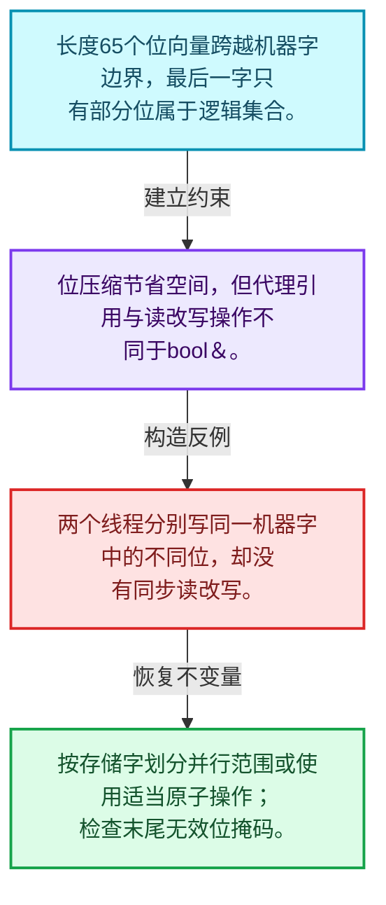
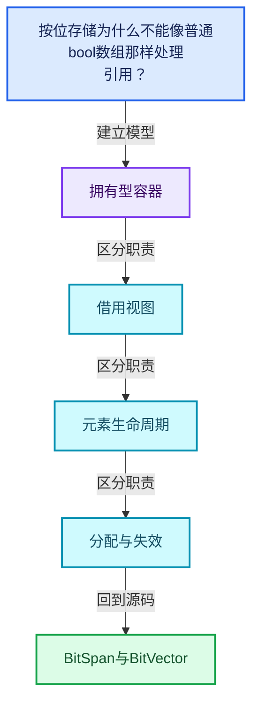
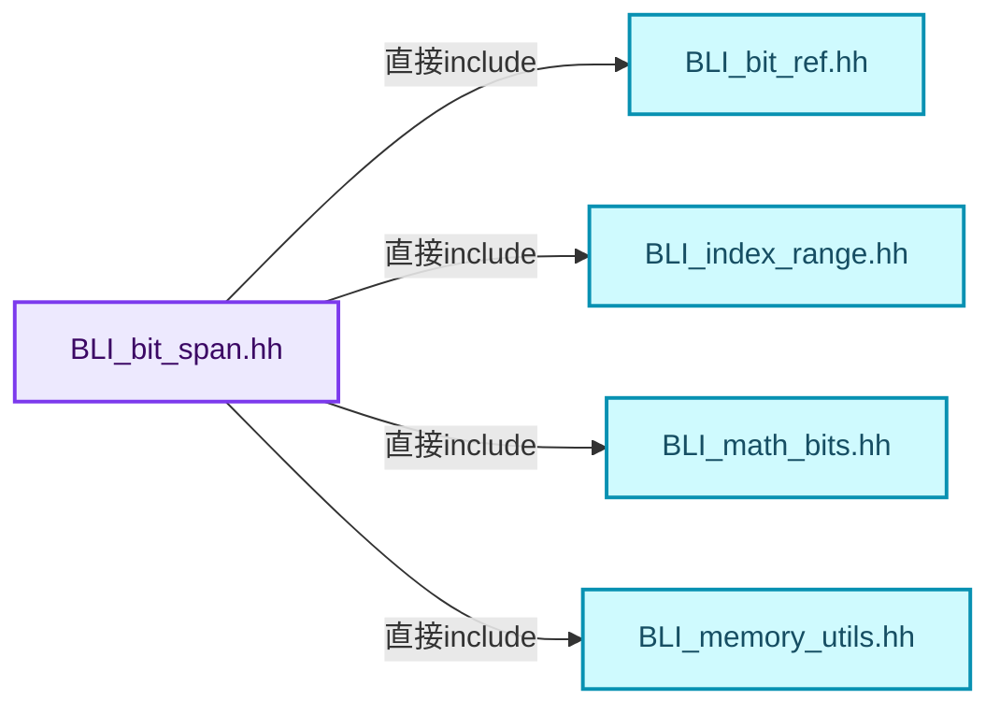
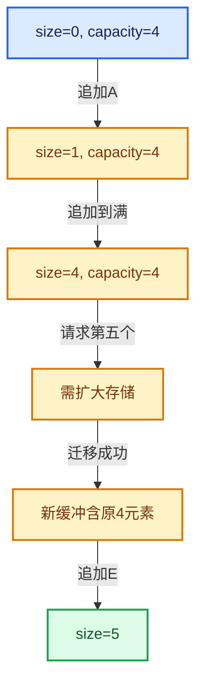

# 01-19 BitSpan与BitVector

[方向导航](README.md) · [总目录](../README.md) · [覆盖索引](../%E6%BA%90%E7%A0%81%E7%89%88%E6%9C%AC%E4%B8%8E%E8%A6%86%E7%9B%96%E7%B4%A2%E5%BC%95.md)

> 阅读顺序：问题与数据模型 → 语法与类型 → 源码逐行 → 调用线索 → 历史与取舍 → 推演和练习。

- 基准 HEAD：`cbda6b96c26c0dee3c3b5cbb93960c4ac06a6b30`。
- 记录日期：2026-10-14。
- 教学示例状态：正文中的推演不是本机性能实测；已运行练习见验收报告。

## 一、从问题到设计

按位存储为什么不能像普通bool数组那样处理引用？

一个机器字包含多个位，写入单个位往往是读改写；代理引用、边界掩码和并发写入需要单独推理。

本篇把语法、数据语义和系统取舍连接起来。先证明对象存活，再讨论索引；先区分借用与拥有，再讨论复制移动。

### 本篇独立模型与设计推理

长度65个位向量跨越机器字边界，最后一字只有部分位属于逻辑集合。

设计取舍：位压缩节省空间，但代理引用与读改写操作不同于bool&。

最小反例：两个线程分别写同一机器字中的不同位，却没有同步读改写。

推导与处理：按存储字划分并行范围或使用适当原子操作；检查末尾无效位掩码。



### 源码范围与相邻篇章

| 文件 | 本篇逐行范围 | 基准SHA-256 |
|---|---|---|
| [source/blender/blenlib/BLI_bit_span.hh](../../../../../source/blender/blenlib/BLI_bit_span.hh) | L1—L488 | `42521f747d1174c441c778f9d338e9104a5eca3b13b1c1d861f627df5eacbf25` |
| [source/blender/blenlib/BLI_bit_vector.hh](../../../../../source/blender/blenlib/BLI_bit_vector.hh) | L1—L406 | `4201f3b3fc87748116e94f97727f8b2fd18e1633341899254f69678c7731671b` |

同一主讲文件可能分多篇覆盖；超出本篇范围的符号通过覆盖索引定位。空行与纯注释保留在源码摘录中，逐行表解释有效语句与语法边界；许可证头统一保留。

前篇：[AnyDerived多态对象值封装](18-AnyDerived%E5%A4%9A%E6%80%81%E5%AF%B9%E8%B1%A1%E5%80%BC%E5%B0%81%E8%A3%85.md).

后篇：[容器选择与独立实现](20-%E5%AE%B9%E5%99%A8%E9%80%89%E6%8B%A9%E4%B8%8E%E7%8B%AC%E7%AB%8B%E5%AE%9E%E7%8E%B0.md).

## 二、类型、数据与阅读地图



这是概念依赖图，边表示阅读关系，不声称是运行时调用顺序。

### 直接编译依赖



箭头只表示头文件包含关系；完整调用线索见后面的符号定位表。

## 三、关键词、语法与类型角色

### 模板 template

模板把类型或常量作为生成实现的参数。读声明时先列出类型参数、非类型参数和默认值，再看使用者实际实例化了什么。模板声明本身不意味着每种T都支持其全部成员。

具体检查：把T替换为int、string、只能移动的类型，分别检查每个被调用操作是否成立。

### 依赖名称 typename

typename既可引入类型模板参数，也可告诉编译器某个依赖名称是类型。它不创建运行时对象；解析期确认语法类别与实例化期检查具体类型是不同阶段。

具体检查：区分typename T::value_type和T::size()，前者标记类型，后者是表达式。

### 约束 requires

requires表达式或requires子句限制模板参与重载的条件。它提供编译期可用性检查，不是运行时if，不能指望输入到达程序后再被这一机制验证。

具体检查：构造满足和不满足约束的两个类型，观察候选被排除而不是在函数内返回错误。

### 常量求值 constexpr

constexpr声明允许相应实体参与常量求值，但constexpr函数仍可以在运行时执行。是否常量求值由调用场景和表达式合法性共同决定。

具体检查：比较constexpr变量初始化和从运行时输入调用同一函数。

### 只读限定 const

const约束当前访问路径可做的修改。const指针、指向const的指针、const视图对象、const元素是不同位置的限定；其他别名可能仍可修改原对象。

具体检查：分别写T* const、const T*与const T* const，并画出不可修改的层次。

### 移动转换 std::move

std::move把表达式转换为可供移动重载选择的值类别，实际资源转移发生在被选中的构造或赋值中。对const对象move可能仍调用复制，对视图move也不会获得底层数据所有权。

具体检查：记录移动构造调用次数，不用变量名或std::move的出现次数替代测量。

### 异常约定 noexcept

noexcept表达式可以依赖类型特征。违反不抛异常约定会终止程序；它不是自动捕获异常，也不是资源回滚代码。

具体检查：找出声明的条件与实际可能抛出的分配、构造操作是否一致。

### 异常边界 try与catch

try定义异常传播的局部边界。失败路径需要销毁已经成功构造的部分并释放相应存储；未构造的对象不能被析构。

具体检查：在第k次构造失败，列出已经存在的对象集合与待释放缓冲。

### 显式静态转换 static_cast

static_cast表达编译期允许的转换，不会自动验证运行时真实类型、指针寿命或索引边界。由void指针恢复T指针时，调用者仍须保证实际存储中确有合法T对象。

具体检查：标出转换前后的类型以及正确性依据来自哪里。

### 限定转换 const_cast

const_cast可以改变访问路径的限定，但不能让本来就是const的对象合法可写。常用于复用只读实现时，仍需检查底层对象是否实际可变。

具体检查：对非const对象的const引用与真正const对象分别分析修改是否合法。

### 可选值 optional

optional把不存在与存在的T区分开，T的构造和析构跟随engaged状态变化。访问前应由has_value或条件分支证明存在。

具体检查：把空Field状态与合法常量零区分，不能用某个普通值代替不存在。

### 对齐 alignof

alignof得到类型要求的地址对齐。分配足够字节后仍需把地址对齐到相应边界，内嵌缓冲也一样。

具体检查：对齐a为2的幂时可推导向上取整，但仍要考虑溢出与边界。

### 对象表示 sizeof

sizeof给出对象表示大小，不是其引用的所有堆内存总量。sizeof视图很小并不说明底层数组很小。

具体检查：分别统计容器对象、容量字节和元素拥有的间接资源。

### 构造与new表达式

普通new可能分配并构造；placement new在给定地址构造，存储由其他机制提供。失败回滚应区分两类责任。

具体检查：追踪地址来自哪里、构造何时成功、由谁析构、由谁释放。

### 内部断言 assert

断言表达开发者预期成立的内部契约，发布构建可能关闭。它不能替代对不可信输入的完整错误处理，也不保证后续操作被运行时保护。

具体检查：对每条断言构造违反条件的输入，区分调用者错误与应向用户报告的错误。

### 编译期分支 if constexpr

条件在实例化时决定被保留的分支，这常用于不同类型的合法操作选择。它与运行时if有不同的实例化检查规则。

具体检查：找出每个分支依赖哪些类型特征，再使用满足与不满足条件的类型。

### 受控访问 friend

friend授予指定函数或类访问非公开成员的权限，并不意味着继承，也不自动扩展到友元的派生类。

具体检查：解释执行器为何需要访问包装器的内部映射，同时检查边界是否仍清楚。

### 类型别名 using

类型别名为已有类型建立名字，不创建运行期对象。它常把模板内部使用的类型统一暴露给泛型调用者。

具体检查：展开别名直到基础类型，区分类型别名和变量声明。

## 四、真实源码与逐行讲解

源码块保持原行内容，原始行号由小节标题及逐行表给出。表中的调用定位是静态阅读辅助；重载、模板实例化、宏展开和虚调用需结合完整声明，不能仅凭词法出现证明动态调用。

### BLI_bit_span.hh：L1—L48

<!-- source:source/blender/blenlib/BLI_bit_span.hh:1:48 -->

```cpp
/* SPDX-FileCopyrightText: 2023 Blender Authors
 *
 * SPDX-License-Identifier: GPL-2.0-or-later */

/** \file
 * \ingroup bli
 */

#pragma once

#include <optional>

#include "BLI_bit_ref.hh"
#include "BLI_index_range.hh"
#include "BLI_math_bits.hh"
#include "BLI_memory_utils.hh"

namespace blender {

namespace bits {

/** Base class for a const and non-const bit-iterator. */
class BitIteratorBase {
 protected:
  const BitInt *data_;
  int64_t bit_index_;

 public:
  BitIteratorBase(const BitInt *data, const int64_t bit_index) : data_(data), bit_index_(bit_index)
  {
  }

  BitIteratorBase &operator++()
  {
    bit_index_++;
    return *this;
  }

  friend bool operator!=(const BitIteratorBase &a, const BitIteratorBase &b)
  {
    BLI_assert(a.data_ == b.data_);
    return a.bit_index_ != b.bit_index_;
  }
};

/** Allows iterating over the bits in a memory buffer. */
class BitIterator : public BitIteratorBase {
 public:
```

本段语义重点：

- `data_`：数据或实现的存储入口；是否拥有应按该类声明和析构判定。

| 原始行 | 语义、约束与检查 |
|---|---|
| L9 | 防止同一头文件在一个翻译单元中重复展开；不控制多个源文件之间的链接或对象寿命。 |
| L11 | 引入编译依赖 <optional>；这是声明可见性关系，不表示运行时一定调用该文件的所有接口。 |
| L13 | 引入编译依赖 "BLI_bit_ref.hh"；这是声明可见性关系，不表示运行时一定调用该文件的所有接口。 |
| L14 | 引入编译依赖 "BLI_index_range.hh"；这是声明可见性关系，不表示运行时一定调用该文件的所有接口。 |
| L15 | 引入编译依赖 "BLI_math_bits.hh"；这是声明可见性关系，不表示运行时一定调用该文件的所有接口。 |
| L16 | 引入编译依赖 "BLI_memory_utils.hh"；这是声明可见性关系，不表示运行时一定调用该文件的所有接口。 |
| L18 | 把后续声明放入 blender 命名空间，影响名称查找和符号归属，不创建运行时对象。 |
| L20 | 把后续声明放入 bits 命名空间，影响名称查找和符号归属，不创建运行时对象。 |
| L23 | 声明或定义类型 `class BitIteratorBase`。结合继承、访问权限和成员布局确认接口与拥有关系；前向声明本身没有完整对象布局。 |
| L24 | 切换成员访问权限为 protected；它是编译期接口边界，不是线程同步或内存保护。 |
| L25 | 本行涉及 `data_`：数据或实现的存储入口；是否拥有应按该类声明和析构判定。按此语义解读 `const BitInt *data_`，不要把地址、数量或状态混用。 |
| L26 | 声明成员、局部对象或完成语句 `int64_t bit_index_`。若为指针或引用，它本身不说明拥有；若为值对象，其构造析构由所在作用域或外层对象管理。 |
| L28 | 切换成员访问权限为 public；它是编译期接口边界，不是线程同步或内存保护。 |
| L29 | 本行涉及 `data_`：数据或实现的存储入口；是否拥有应按该类声明和析构判定。按此语义解读 `BitIteratorBase(const BitInt *data, const int64_t bit_index) : data_(data), bit_index_(bit_index)`，不要把地址、数量或状态混用。 |
| L30 | 连接上一行的声明或控制结构与其语句块；后续行在这个作用域中执行或声明。 |
| L31 | 结束当前语法单元。局部自动对象在离开其作用域时按规则销毁；这不等于所有被引用的外部数据也被释放。 |
| L33 | 运算符重载声明、定义或显式调用：`BitIteratorBase &operator++()`。结合参数和返回类型判断是赋值、索引、比较还是转换；operator=声明中的等号不是在给名为operator的变量赋值。 |
| L34 | 连接上一行的声明或控制结构与其语句块；后续行在这个作用域中执行或声明。 |
| L35 | 递增或递减现有状态：`bit_index_++;`。这改变计数或游标；检查边界、计数单位，以及并发访问是否有相应保护。 |
| L36 | 返回表达式 `*this`。返回当前对象；返回类型决定它是引用还是值，不能仅凭表达式假定复制。 |
| L37 | 结束当前语法单元。局部自动对象在离开其作用域时按规则销毁；这不等于所有被引用的外部数据也被释放。 |
| L39 | 运算符重载声明、定义或显式调用：`friend bool operator!=(const BitIteratorBase &a, const BitIteratorBase &b)`。结合参数和返回类型判断是赋值、索引、比较还是转换；operator=声明中的等号不是在给名为operator的变量赋值。 |
| L40 | 连接上一行的声明或控制结构与其语句块；后续行在这个作用域中执行或声明。 |
| L41 | 断言约束 `BLI_assert(a.data_ == b.data_);`。条件是后续访问的内部前置条件；发布构建可能不执行，不能把断言当作输入修复。 |
| L42 | 返回表达式 `a.bit_index_ != b.bit_index_`。 |
| L43 | 结束当前语法单元。局部自动对象在离开其作用域时按规则销毁；这不等于所有被引用的外部数据也被释放。 |
| L44 | 结束当前语法单元。局部自动对象在离开其作用域时按规则销毁；这不等于所有被引用的外部数据也被释放。 |
| L47 | 声明或定义类型 `class BitIterator : public BitIteratorBase`。结合继承、访问权限和成员布局确认接口与拥有关系；前向声明本身没有完整对象布局。 |
| L48 | 切换成员访问权限为 public；它是编译期接口边界，不是线程同步或内存保护。 |

### BLI_bit_span.hh：L49—L98

<!-- source:source/blender/blenlib/BLI_bit_span.hh:49:98 -->

```cpp
  BitIterator(const BitInt *data, const int64_t bit_index) : BitIteratorBase(data, bit_index) {}

  BitRef operator*() const
  {
    return BitRef(data_, bit_index_);
  }
};

/** Allows iterating over the bits in a memory buffer. */
class MutableBitIterator : public BitIteratorBase {
 public:
  MutableBitIterator(BitInt *data, const int64_t bit_index) : BitIteratorBase(data, bit_index) {}

  MutableBitRef operator*() const
  {
    return MutableBitRef(const_cast<BitInt *>(data_), bit_index_);
  }
};

class OneBitIterator {
 private:
  BitInt data_;
  int current_bit_;

 public:
  explicit OneBitIterator(BitInt data) : data_(data)
  {
    this->operator++();
  }

  int operator*() const
  {
    return current_bit_;
  }

  OneBitIterator &operator++()
  {
    if (data_ > 0) {
      current_bit_ = bitscan_forward_clear_uint64(&data_);
    }
    else {
      current_bit_ = -1;
    }
    return *this;
  }

  friend bool operator!=(const OneBitIterator &a, const OneBitIterator &b)
  {
    return a.current_bit_ != b.current_bit_;
  }
```

本段语义重点：

- `data_`：数据或实现的存储入口；是否拥有应按该类声明和析构判定。

| 原始行 | 语义、约束与检查 |
|---|---|
| L49 | 出现调用或函数声明 `BitIterator`，对应表达式为 `BitIterator(const BitInt *data, const int64_t bit_index) : BitIteratorBase(data, bit_index) {}`。参数求值、返回类型与重载需结合前后完整语句；静态文本引用不能证明动态目标。 |
| L51 | 运算符重载声明、定义或显式调用：`BitRef operator*() const`。结合参数和返回类型判断是赋值、索引、比较还是转换；operator=声明中的等号不是在给名为operator的变量赋值。 |
| L52 | 连接上一行的声明或控制结构与其语句块；后续行在这个作用域中执行或声明。 |
| L53 | 返回表达式 `BitRef(data_, bit_index_)`。 |
| L54 | 结束当前语法单元。局部自动对象在离开其作用域时按规则销毁；这不等于所有被引用的外部数据也被释放。 |
| L55 | 结束当前语法单元。局部自动对象在离开其作用域时按规则销毁；这不等于所有被引用的外部数据也被释放。 |
| L58 | 声明或定义类型 `class MutableBitIterator : public BitIteratorBase`。结合继承、访问权限和成员布局确认接口与拥有关系；前向声明本身没有完整对象布局。 |
| L59 | 切换成员访问权限为 public；它是编译期接口边界，不是线程同步或内存保护。 |
| L60 | 出现调用或函数声明 `MutableBitIterator`，对应表达式为 `MutableBitIterator(BitInt *data, const int64_t bit_index) : BitIteratorBase(data, bit_index) {}`。参数求值、返回类型与重载需结合前后完整语句；静态文本引用不能证明动态目标。 |
| L62 | 运算符重载声明、定义或显式调用：`MutableBitRef operator*() const`。结合参数和返回类型判断是赋值、索引、比较还是转换；operator=声明中的等号不是在给名为operator的变量赋值。 |
| L63 | 连接上一行的声明或控制结构与其语句块；后续行在这个作用域中执行或声明。 |
| L64 | 返回表达式 `MutableBitRef(const_cast<BitInt *>(data_), bit_index_)`。 |
| L65 | 结束当前语法单元。局部自动对象在离开其作用域时按规则销毁；这不等于所有被引用的外部数据也被释放。 |
| L66 | 结束当前语法单元。局部自动对象在离开其作用域时按规则销毁；这不等于所有被引用的外部数据也被释放。 |
| L68 | 声明或定义类型 `class OneBitIterator`。结合继承、访问权限和成员布局确认接口与拥有关系；前向声明本身没有完整对象布局。 |
| L69 | 切换成员访问权限为 private；它是编译期接口边界，不是线程同步或内存保护。 |
| L70 | 本行涉及 `data_`：数据或实现的存储入口；是否拥有应按该类声明和析构判定。按此语义解读 `BitInt data_`，不要把地址、数量或状态混用。 |
| L71 | 声明成员、局部对象或完成语句 `int current_bit_`。若为指针或引用，它本身不说明拥有；若为值对象，其构造析构由所在作用域或外层对象管理。 |
| L73 | 切换成员访问权限为 public；它是编译期接口边界，不是线程同步或内存保护。 |
| L74 | 本行涉及 `data_`：数据或实现的存储入口；是否拥有应按该类声明和析构判定。按此语义解读 `explicit OneBitIterator(BitInt data) : data_(data)`，不要把地址、数量或状态混用。 |
| L75 | 连接上一行的声明或控制结构与其语句块；后续行在这个作用域中执行或声明。 |
| L76 | 运算符重载声明、定义或显式调用：`this->operator++();`。结合参数和返回类型判断是赋值、索引、比较还是转换；operator=声明中的等号不是在给名为operator的变量赋值。 |
| L77 | 结束当前语法单元。局部自动对象在离开其作用域时按规则销毁；这不等于所有被引用的外部数据也被释放。 |
| L79 | 运算符重载声明、定义或显式调用：`int operator*() const`。结合参数和返回类型判断是赋值、索引、比较还是转换；operator=声明中的等号不是在给名为operator的变量赋值。 |
| L80 | 连接上一行的声明或控制结构与其语句块；后续行在这个作用域中执行或声明。 |
| L81 | 返回表达式 `current_bit_`。 |
| L82 | 结束当前语法单元。局部自动对象在离开其作用域时按规则销毁；这不等于所有被引用的外部数据也被释放。 |
| L84 | 运算符重载声明、定义或显式调用：`OneBitIterator &operator++()`。结合参数和返回类型判断是赋值、索引、比较还是转换；operator=声明中的等号不是在给名为operator的变量赋值。 |
| L85 | 连接上一行的声明或控制结构与其语句块；后续行在这个作用域中执行或声明。 |
| L86 | 判断 `data_ > 0`，成立时进入本分支，否则继续后续路径。 |
| L87 | 建立或更新 `data_`：数据或实现的存储入口；是否拥有应按该类声明和析构判定。本行的具体值关系为 `current_bit_ = bitscan_forward_clear_uint64(&data_)`；对照更新前后相应范围或状态是否一致。 |
| L88 | 结束当前语法单元。局部自动对象在离开其作用域时按规则销毁；这不等于所有被引用的外部数据也被释放。 |
| L89 | 处理前一条件不成立的互补路径。比较两条路径最后是否恢复同一不变量，以及是否产生不同的资源责任。 |
| L90 | 把右侧 `-1` 用于初始化或更新左侧 `current_bit_`。声明初始化与已有对象赋值应按上下文区分；有资源的类型会调用相应特殊成员。 |
| L91 | 结束当前语法单元。局部自动对象在离开其作用域时按规则销毁；这不等于所有被引用的外部数据也被释放。 |
| L92 | 返回表达式 `*this`。返回当前对象；返回类型决定它是引用还是值，不能仅凭表达式假定复制。 |
| L93 | 结束当前语法单元。局部自动对象在离开其作用域时按规则销毁；这不等于所有被引用的外部数据也被释放。 |
| L95 | 运算符重载声明、定义或显式调用：`friend bool operator!=(const OneBitIterator &a, const OneBitIterator &b)`。结合参数和返回类型判断是赋值、索引、比较还是转换；operator=声明中的等号不是在给名为operator的变量赋值。 |
| L96 | 连接上一行的声明或控制结构与其语句块；后续行在这个作用域中执行或声明。 |
| L97 | 返回表达式 `a.current_bit_ != b.current_bit_`。 |
| L98 | 结束当前语法单元。局部自动对象在离开其作用域时按规则销毁；这不等于所有被引用的外部数据也被释放。 |

### BLI_bit_span.hh：L99—L146

<!-- source:source/blender/blenlib/BLI_bit_span.hh:99:146 -->

```cpp
};

class OneBitIteratorRange {
 private:
  const BitInt data_;

 public:
  OneBitIteratorRange(BitInt data) : data_(data) {}

  OneBitIterator begin() const
  {
    return OneBitIterator(data_);
  }
  OneBitIterator end() const
  {
    return OneBitIterator(0);
  }
};

inline OneBitIteratorRange iter_1_indices(BitInt value)
{
  return OneBitIteratorRange(value);
}

/**
 * Similar to #Span, but references a range of bits instead of normal C++ types (which must be at
 * least one byte large). Use #MutableBitSpan if the values are supposed to be modified.
 *
 * The beginning and end of a #BitSpan does *not* have to be at byte/int boundaries. It can start
 * and end at any bit.
 */
class BitSpan {
 protected:
  /**
   * Base pointer to the integers containing the bits. The actual bit span might start at a much
   * higher address when `bit_range_.start()` is large.
   */
  const BitInt *data_ = nullptr;
  /** The range of referenced bits. */
  IndexRange bit_range_ = {0, 0};

 public:
  /** Construct an empty span. */
  BitSpan() = default;

  BitSpan(const BitInt *data, const int64_t size_in_bits) : data_(data), bit_range_(size_in_bits)
  {
  }
```

本段语义重点：

- `data_`：数据或实现的存储入口；是否拥有应按该类声明和析构判定。

| 原始行 | 语义、约束与检查 |
|---|---|
| L99 | 结束当前语法单元。局部自动对象在离开其作用域时按规则销毁；这不等于所有被引用的外部数据也被释放。 |
| L101 | 声明或定义类型 `class OneBitIteratorRange`。结合继承、访问权限和成员布局确认接口与拥有关系；前向声明本身没有完整对象布局。 |
| L102 | 切换成员访问权限为 private；它是编译期接口边界，不是线程同步或内存保护。 |
| L103 | 本行涉及 `data_`：数据或实现的存储入口；是否拥有应按该类声明和析构判定。按此语义解读 `const BitInt data_`，不要把地址、数量或状态混用。 |
| L105 | 切换成员访问权限为 public；它是编译期接口边界，不是线程同步或内存保护。 |
| L106 | 本行涉及 `data_`：数据或实现的存储入口；是否拥有应按该类声明和析构判定。按此语义解读 `OneBitIteratorRange(BitInt data) : data_(data) {}`，不要把地址、数量或状态混用。 |
| L108 | 出现调用或函数声明 `begin`，对应表达式为 `OneBitIterator begin() const`。参数求值、返回类型与重载需结合前后完整语句；静态文本引用不能证明动态目标。 |
| L109 | 连接上一行的声明或控制结构与其语句块；后续行在这个作用域中执行或声明。 |
| L110 | 返回表达式 `OneBitIterator(data_)`。 |
| L111 | 结束当前语法单元。局部自动对象在离开其作用域时按规则销毁；这不等于所有被引用的外部数据也被释放。 |
| L112 | 出现调用或函数声明 `end`，对应表达式为 `OneBitIterator end() const`。参数求值、返回类型与重载需结合前后完整语句；静态文本引用不能证明动态目标。 |
| L113 | 连接上一行的声明或控制结构与其语句块；后续行在这个作用域中执行或声明。 |
| L114 | 返回表达式 `OneBitIterator(0)`。 |
| L115 | 结束当前语法单元。局部自动对象在离开其作用域时按规则销毁；这不等于所有被引用的外部数据也被释放。 |
| L116 | 结束当前语法单元。局部自动对象在离开其作用域时按规则销毁；这不等于所有被引用的外部数据也被释放。 |
| L118 | 出现调用或函数声明 `iter_1_indices`，对应表达式为 `inline OneBitIteratorRange iter_1_indices(BitInt value)`。参数求值、返回类型与重载需结合前后完整语句；静态文本引用不能证明动态目标。 |
| L119 | 连接上一行的声明或控制结构与其语句块；后续行在这个作用域中执行或声明。 |
| L120 | 返回表达式 `OneBitIteratorRange(value)`。 |
| L121 | 结束当前语法单元。局部自动对象在离开其作用域时按规则销毁；这不等于所有被引用的外部数据也被释放。 |
| L130 | 声明或定义类型 `class BitSpan`。结合继承、访问权限和成员布局确认接口与拥有关系；前向声明本身没有完整对象布局。 |
| L131 | 切换成员访问权限为 protected；它是编译期接口边界，不是线程同步或内存保护。 |
| L136 | 建立或更新 `data_`：数据或实现的存储入口；是否拥有应按该类声明和析构判定。本行的具体值关系为 `const BitInt *data_ = nullptr`；对照更新前后相应范围或状态是否一致。 |
| L138 | 把右侧 `{0, 0}` 用于初始化或更新左侧 `IndexRange bit_range_`。声明初始化与已有对象赋值应按上下文区分；有资源的类型会调用相应特殊成员。 |
| L140 | 切换成员访问权限为 public；它是编译期接口边界，不是线程同步或内存保护。 |
| L142 | 显式采用编译器生成的特殊成员行为：`BitSpan() = default;`。成员和基类的性质决定该操作是否可用、是否被删除及异常约定，不表示运行时给对象赋值为default。 |
| L144 | 本行涉及 `data_`：数据或实现的存储入口；是否拥有应按该类声明和析构判定。按此语义解读 `BitSpan(const BitInt *data, const int64_t size_in_bits) : data_(data), bit_range_(size_in_bits)`，不要把地址、数量或状态混用。 |
| L145 | 连接上一行的声明或控制结构与其语句块；后续行在这个作用域中执行或声明。 |
| L146 | 结束当前语法单元。局部自动对象在离开其作用域时按规则销毁；这不等于所有被引用的外部数据也被释放。 |

### BLI_bit_span.hh：L147—L196

<!-- source:source/blender/blenlib/BLI_bit_span.hh:147:196 -->

```cpp

  BitSpan(const BitInt *data, const IndexRange bit_range) : data_(data), bit_range_(bit_range) {}

  /** Number of bits referenced by the span. */
  int64_t size() const
  {
    return bit_range_.size();
  }

  bool is_empty() const
  {
    return bit_range_.is_empty();
  }

  IndexRange index_range() const
  {
    return IndexRange(bit_range_.size());
  }

  [[nodiscard]] BitRef operator[](const int64_t index) const
  {
    BLI_assert(index >= 0);
    BLI_assert(index < bit_range_.size());
    return {data_, bit_range_.start() + index};
  }

  [[nodiscard]] BitSpan slice(const IndexRange range) const
  {
    return {data_, bit_range_.slice(range)};
  }

  BitSpan take_front(const int64_t n) const
  {
    return {data_, bit_range_.take_front(n)};
  }

  BitSpan take_back(const int64_t n) const
  {
    return {data_, bit_range_.take_back(n)};
  }

  BitSpan drop_front(const int64_t n) const
  {
    return {data_, bit_range_.drop_front(n)};
  }

  BitSpan drop_back(const int64_t n) const
  {
    return {data_, bit_range_.drop_back(n)};
  }
```

本段语义重点：

- `data_`：数据或实现的存储入口；是否拥有应按该类声明和析构判定。

| 原始行 | 语义、约束与检查 |
|---|---|
| L148 | 本行涉及 `data_`：数据或实现的存储入口；是否拥有应按该类声明和析构判定。按此语义解读 `BitSpan(const BitInt *data, const IndexRange bit_range) : data_(data), bit_range_(bit_range) {}`，不要把地址、数量或状态混用。 |
| L151 | 出现调用或函数声明 `size`，对应表达式为 `int64_t size() const`。参数求值、返回类型与重载需结合前后完整语句；静态文本引用不能证明动态目标。 |
| L152 | 连接上一行的声明或控制结构与其语句块；后续行在这个作用域中执行或声明。 |
| L153 | 返回表达式 `bit_range_.size()`。 |
| L154 | 结束当前语法单元。局部自动对象在离开其作用域时按规则销毁；这不等于所有被引用的外部数据也被释放。 |
| L156 | 出现调用或函数声明 `is_empty`，对应表达式为 `bool is_empty() const`。参数求值、返回类型与重载需结合前后完整语句；静态文本引用不能证明动态目标。 |
| L157 | 连接上一行的声明或控制结构与其语句块；后续行在这个作用域中执行或声明。 |
| L158 | 返回表达式 `bit_range_.is_empty()`。 |
| L159 | 结束当前语法单元。局部自动对象在离开其作用域时按规则销毁；这不等于所有被引用的外部数据也被释放。 |
| L161 | 出现调用或函数声明 `index_range`，对应表达式为 `IndexRange index_range() const`。参数求值、返回类型与重载需结合前后完整语句；静态文本引用不能证明动态目标。 |
| L162 | 连接上一行的声明或控制结构与其语句块；后续行在这个作用域中执行或声明。 |
| L163 | 返回表达式 `IndexRange(bit_range_.size())`。 |
| L164 | 结束当前语法单元。局部自动对象在离开其作用域时按规则销毁；这不等于所有被引用的外部数据也被释放。 |
| L166 | 运算符重载声明、定义或显式调用：`[[nodiscard]] BitRef operator[](const int64_t index) const`。结合参数和返回类型判断是赋值、索引、比较还是转换；operator=声明中的等号不是在给名为operator的变量赋值。 |
| L167 | 连接上一行的声明或控制结构与其语句块；后续行在这个作用域中执行或声明。 |
| L168 | 断言约束 `BLI_assert(index >= 0);`。条件是后续访问的内部前置条件；发布构建可能不执行，不能把断言当作输入修复。 |
| L169 | 断言约束 `BLI_assert(index < bit_range_.size());`。条件是后续访问的内部前置条件；发布构建可能不执行，不能把断言当作输入修复。 |
| L170 | 返回表达式 `{data_, bit_range_.start() + index}`。 |
| L171 | 结束当前语法单元。局部自动对象在离开其作用域时按规则销毁；这不等于所有被引用的外部数据也被释放。 |
| L173 | 出现调用或函数声明 `slice`，对应表达式为 `[[nodiscard]] BitSpan slice(const IndexRange range) const`。参数求值、返回类型与重载需结合前后完整语句；静态文本引用不能证明动态目标。 |
| L174 | 连接上一行的声明或控制结构与其语句块；后续行在这个作用域中执行或声明。 |
| L175 | 返回表达式 `{data_, bit_range_.slice(range)}`。 |
| L176 | 结束当前语法单元。局部自动对象在离开其作用域时按规则销毁；这不等于所有被引用的外部数据也被释放。 |
| L178 | 出现调用或函数声明 `take_front`，对应表达式为 `BitSpan take_front(const int64_t n) const`。参数求值、返回类型与重载需结合前后完整语句；静态文本引用不能证明动态目标。 |
| L179 | 连接上一行的声明或控制结构与其语句块；后续行在这个作用域中执行或声明。 |
| L180 | 返回表达式 `{data_, bit_range_.take_front(n)}`。 |
| L181 | 结束当前语法单元。局部自动对象在离开其作用域时按规则销毁；这不等于所有被引用的外部数据也被释放。 |
| L183 | 出现调用或函数声明 `take_back`，对应表达式为 `BitSpan take_back(const int64_t n) const`。参数求值、返回类型与重载需结合前后完整语句；静态文本引用不能证明动态目标。 |
| L184 | 连接上一行的声明或控制结构与其语句块；后续行在这个作用域中执行或声明。 |
| L185 | 返回表达式 `{data_, bit_range_.take_back(n)}`。 |
| L186 | 结束当前语法单元。局部自动对象在离开其作用域时按规则销毁；这不等于所有被引用的外部数据也被释放。 |
| L188 | 出现调用或函数声明 `drop_front`，对应表达式为 `BitSpan drop_front(const int64_t n) const`。参数求值、返回类型与重载需结合前后完整语句；静态文本引用不能证明动态目标。 |
| L189 | 连接上一行的声明或控制结构与其语句块；后续行在这个作用域中执行或声明。 |
| L190 | 返回表达式 `{data_, bit_range_.drop_front(n)}`。 |
| L191 | 结束当前语法单元。局部自动对象在离开其作用域时按规则销毁；这不等于所有被引用的外部数据也被释放。 |
| L193 | 出现调用或函数声明 `drop_back`，对应表达式为 `BitSpan drop_back(const int64_t n) const`。参数求值、返回类型与重载需结合前后完整语句；静态文本引用不能证明动态目标。 |
| L194 | 连接上一行的声明或控制结构与其语句块；后续行在这个作用域中执行或声明。 |
| L195 | 返回表达式 `{data_, bit_range_.drop_back(n)}`。 |
| L196 | 结束当前语法单元。局部自动对象在离开其作用域时按规则销毁；这不等于所有被引用的外部数据也被释放。 |

### BLI_bit_span.hh：L197—L245

<!-- source:source/blender/blenlib/BLI_bit_span.hh:197:245 -->

```cpp

  const BitInt *data() const
  {
    return data_;
  }

  const IndexRange &bit_range() const
  {
    return bit_range_;
  }

  BitIterator begin() const
  {
    return {data_, bit_range_.start()};
  }

  BitIterator end() const
  {
    return {data_, bit_range_.one_after_last()};
  }
};

/**
 * Checks if the span fulfills the requirements for a bounded span. Bounded spans can often be
 * processed more efficiently, because fewer cases have to be considered when aligning multiple
 * such spans.
 *
 * See comments in the function for the exact requirements.
 */
inline bool is_bounded_span(const BitSpan span)
{
  const int64_t offset = span.bit_range().start();
  const int64_t size = span.size();
  if (offset >= BitsPerInt) {
    /* The data pointer must point at the first int already. If the offset is a multiple of
     * #BitsPerInt, the bit span could theoretically become bounded as well if the data pointer is
     * adjusted. But that is not handled here. */
    return false;
  }
  if (size < BitsPerInt) {
    /** Don't allow small sized spans to cross `BitInt` boundaries. */
    return offset + size <= 64;
  }
  if (offset != 0) {
    /* Start of larger spans must be aligned to `BitInt` boundaries. */
    return false;
  }
  return true;
}
```

本段语义重点：

- `data_`：数据或实现的存储入口；是否拥有应按该类声明和析构判定。

| 原始行 | 语义、约束与检查 |
|---|---|
| L198 | 出现调用或函数声明 `data`，对应表达式为 `const BitInt *data() const`。参数求值、返回类型与重载需结合前后完整语句；静态文本引用不能证明动态目标。 |
| L199 | 连接上一行的声明或控制结构与其语句块；后续行在这个作用域中执行或声明。 |
| L200 | 返回表达式 `data_`。 |
| L201 | 结束当前语法单元。局部自动对象在离开其作用域时按规则销毁；这不等于所有被引用的外部数据也被释放。 |
| L203 | 出现调用或函数声明 `bit_range`，对应表达式为 `const IndexRange &bit_range() const`。参数求值、返回类型与重载需结合前后完整语句；静态文本引用不能证明动态目标。 |
| L204 | 连接上一行的声明或控制结构与其语句块；后续行在这个作用域中执行或声明。 |
| L205 | 返回表达式 `bit_range_`。 |
| L206 | 结束当前语法单元。局部自动对象在离开其作用域时按规则销毁；这不等于所有被引用的外部数据也被释放。 |
| L208 | 出现调用或函数声明 `begin`，对应表达式为 `BitIterator begin() const`。参数求值、返回类型与重载需结合前后完整语句；静态文本引用不能证明动态目标。 |
| L209 | 连接上一行的声明或控制结构与其语句块；后续行在这个作用域中执行或声明。 |
| L210 | 返回表达式 `{data_, bit_range_.start()}`。 |
| L211 | 结束当前语法单元。局部自动对象在离开其作用域时按规则销毁；这不等于所有被引用的外部数据也被释放。 |
| L213 | 出现调用或函数声明 `end`，对应表达式为 `BitIterator end() const`。参数求值、返回类型与重载需结合前后完整语句；静态文本引用不能证明动态目标。 |
| L214 | 连接上一行的声明或控制结构与其语句块；后续行在这个作用域中执行或声明。 |
| L215 | 返回表达式 `{data_, bit_range_.one_after_last()}`。 |
| L216 | 结束当前语法单元。局部自动对象在离开其作用域时按规则销毁；这不等于所有被引用的外部数据也被释放。 |
| L217 | 结束当前语法单元。局部自动对象在离开其作用域时按规则销毁；这不等于所有被引用的外部数据也被释放。 |
| L226 | 出现调用或函数声明 `is_bounded_span`，对应表达式为 `inline bool is_bounded_span(const BitSpan span)`。参数求值、返回类型与重载需结合前后完整语句；静态文本引用不能证明动态目标。 |
| L227 | 连接上一行的声明或控制结构与其语句块；后续行在这个作用域中执行或声明。 |
| L228 | 把右侧 `span.bit_range().start()` 用于初始化或更新左侧 `const int64_t offset`。声明初始化与已有对象赋值应按上下文区分；有资源的类型会调用相应特殊成员。 |
| L229 | 把右侧 `span.size()` 用于初始化或更新左侧 `const int64_t size`。声明初始化与已有对象赋值应按上下文区分；有资源的类型会调用相应特殊成员。 |
| L230 | 判断 `offset >= BitsPerInt`，成立时进入本分支，否则继续后续路径。 |
| L234 | 返回表达式 `false`。这是本路径的布尔结果，具体成功、存在或状态含义由函数接口规定。 |
| L235 | 结束当前语法单元。局部自动对象在离开其作用域时按规则销毁；这不等于所有被引用的外部数据也被释放。 |
| L236 | 判断 `size < BitsPerInt`，成立时进入本分支，否则继续后续路径。该边界影响可访问元素或可用容量，两者要按各变量的定义区分。 |
| L238 | 返回表达式 `offset + size <= 64`。 |
| L239 | 结束当前语法单元。局部自动对象在离开其作用域时按规则销毁；这不等于所有被引用的外部数据也被释放。 |
| L240 | 判断 `offset != 0`，成立时进入本分支，否则继续后续路径。 |
| L242 | 返回表达式 `false`。这是本路径的布尔结果，具体成功、存在或状态含义由函数接口规定。 |
| L243 | 结束当前语法单元。局部自动对象在离开其作用域时按规则销毁；这不等于所有被引用的外部数据也被释放。 |
| L244 | 返回表达式 `true`。这是本路径的布尔结果，具体成功、存在或状态含义由函数接口规定。 |
| L245 | 结束当前语法单元。局部自动对象在离开其作用域时按规则销毁；这不等于所有被引用的外部数据也被释放。 |

### BLI_bit_span.hh：L246—L293

<!-- source:source/blender/blenlib/BLI_bit_span.hh:246:293 -->

```cpp

/**
 * Same as #BitSpan but fulfills the requirements mentioned on #is_bounded_span.
 */
class BoundedBitSpan : public BitSpan {
 public:
  BoundedBitSpan() = default;

  BoundedBitSpan(const BitInt *data, const int64_t size_in_bits) : BitSpan(data, size_in_bits)
  {
    BLI_assert(is_bounded_span(*this));
  }

  BoundedBitSpan(const BitInt *data, const IndexRange bit_range) : BitSpan(data, bit_range)
  {
    BLI_assert(is_bounded_span(*this));
  }

  explicit BoundedBitSpan(const BitSpan other) : BitSpan(other)
  {
    BLI_assert(is_bounded_span(*this));
  }

  int64_t offset() const
  {
    return bit_range_.start();
  }

  int64_t full_ints_num() const
  {
    return bit_range_.size() >> BitToIntIndexShift;
  }

  int64_t final_bits_num() const
  {
    return bit_range_.size() & BitIndexMask;
  }

  BoundedBitSpan take_front(const int64_t n) const
  {
    return {data_, bit_range_.take_front(n)};
  }
};

/** Same as #BitSpan, but also allows modifying the referenced bits. */
class MutableBitSpan {
 protected:
  BitInt *data_ = nullptr;
```

本段语义重点：

- `data_`：数据或实现的存储入口；是否拥有应按该类声明和析构判定。

| 原始行 | 语义、约束与检查 |
|---|---|
| L250 | 声明或定义类型 `class BoundedBitSpan : public BitSpan`。结合继承、访问权限和成员布局确认接口与拥有关系；前向声明本身没有完整对象布局。 |
| L251 | 切换成员访问权限为 public；它是编译期接口边界，不是线程同步或内存保护。 |
| L252 | 显式采用编译器生成的特殊成员行为：`BoundedBitSpan() = default;`。成员和基类的性质决定该操作是否可用、是否被删除及异常约定，不表示运行时给对象赋值为default。 |
| L254 | 出现调用或函数声明 `BoundedBitSpan`，对应表达式为 `BoundedBitSpan(const BitInt *data, const int64_t size_in_bits) : BitSpan(data, size_in_bits)`。参数求值、返回类型与重载需结合前后完整语句；静态文本引用不能证明动态目标。 |
| L255 | 连接上一行的声明或控制结构与其语句块；后续行在这个作用域中执行或声明。 |
| L256 | 断言约束 `BLI_assert(is_bounded_span(*this));`。条件是后续访问的内部前置条件；发布构建可能不执行，不能把断言当作输入修复。 |
| L257 | 结束当前语法单元。局部自动对象在离开其作用域时按规则销毁；这不等于所有被引用的外部数据也被释放。 |
| L259 | 出现调用或函数声明 `BoundedBitSpan`，对应表达式为 `BoundedBitSpan(const BitInt *data, const IndexRange bit_range) : BitSpan(data, bit_range)`。参数求值、返回类型与重载需结合前后完整语句；静态文本引用不能证明动态目标。 |
| L260 | 连接上一行的声明或控制结构与其语句块；后续行在这个作用域中执行或声明。 |
| L261 | 断言约束 `BLI_assert(is_bounded_span(*this));`。条件是后续访问的内部前置条件；发布构建可能不执行，不能把断言当作输入修复。 |
| L262 | 结束当前语法单元。局部自动对象在离开其作用域时按规则销毁；这不等于所有被引用的外部数据也被释放。 |
| L264 | 出现调用或函数声明 `BoundedBitSpan`，对应表达式为 `explicit BoundedBitSpan(const BitSpan other) : BitSpan(other)`。参数求值、返回类型与重载需结合前后完整语句；静态文本引用不能证明动态目标。 |
| L265 | 连接上一行的声明或控制结构与其语句块；后续行在这个作用域中执行或声明。 |
| L266 | 断言约束 `BLI_assert(is_bounded_span(*this));`。条件是后续访问的内部前置条件；发布构建可能不执行，不能把断言当作输入修复。 |
| L267 | 结束当前语法单元。局部自动对象在离开其作用域时按规则销毁；这不等于所有被引用的外部数据也被释放。 |
| L269 | 出现调用或函数声明 `offset`，对应表达式为 `int64_t offset() const`。参数求值、返回类型与重载需结合前后完整语句；静态文本引用不能证明动态目标。 |
| L270 | 连接上一行的声明或控制结构与其语句块；后续行在这个作用域中执行或声明。 |
| L271 | 返回表达式 `bit_range_.start()`。 |
| L272 | 结束当前语法单元。局部自动对象在离开其作用域时按规则销毁；这不等于所有被引用的外部数据也被释放。 |
| L274 | 出现调用或函数声明 `full_ints_num`，对应表达式为 `int64_t full_ints_num() const`。参数求值、返回类型与重载需结合前后完整语句；静态文本引用不能证明动态目标。 |
| L275 | 连接上一行的声明或控制结构与其语句块；后续行在这个作用域中执行或声明。 |
| L276 | 返回表达式 `bit_range_.size() >> BitToIntIndexShift`。 |
| L277 | 结束当前语法单元。局部自动对象在离开其作用域时按规则销毁；这不等于所有被引用的外部数据也被释放。 |
| L279 | 出现调用或函数声明 `final_bits_num`，对应表达式为 `int64_t final_bits_num() const`。参数求值、返回类型与重载需结合前后完整语句；静态文本引用不能证明动态目标。 |
| L280 | 连接上一行的声明或控制结构与其语句块；后续行在这个作用域中执行或声明。 |
| L281 | 返回表达式 `bit_range_.size() & BitIndexMask`。 |
| L282 | 结束当前语法单元。局部自动对象在离开其作用域时按规则销毁；这不等于所有被引用的外部数据也被释放。 |
| L284 | 出现调用或函数声明 `take_front`，对应表达式为 `BoundedBitSpan take_front(const int64_t n) const`。参数求值、返回类型与重载需结合前后完整语句；静态文本引用不能证明动态目标。 |
| L285 | 连接上一行的声明或控制结构与其语句块；后续行在这个作用域中执行或声明。 |
| L286 | 返回表达式 `{data_, bit_range_.take_front(n)}`。 |
| L287 | 结束当前语法单元。局部自动对象在离开其作用域时按规则销毁；这不等于所有被引用的外部数据也被释放。 |
| L288 | 结束当前语法单元。局部自动对象在离开其作用域时按规则销毁；这不等于所有被引用的外部数据也被释放。 |
| L291 | 声明或定义类型 `class MutableBitSpan`。结合继承、访问权限和成员布局确认接口与拥有关系；前向声明本身没有完整对象布局。 |
| L292 | 切换成员访问权限为 protected；它是编译期接口边界，不是线程同步或内存保护。 |
| L293 | 建立或更新 `data_`：数据或实现的存储入口；是否拥有应按该类声明和析构判定。本行的具体值关系为 `BitInt *data_ = nullptr`；对照更新前后相应范围或状态是否一致。 |

### BLI_bit_span.hh：L294—L343

<!-- source:source/blender/blenlib/BLI_bit_span.hh:294:343 -->

```cpp
  IndexRange bit_range_ = {0, 0};

 public:
  MutableBitSpan() = default;

  MutableBitSpan(BitInt *data, const int64_t size) : data_(data), bit_range_(size) {}

  MutableBitSpan(BitInt *data, const IndexRange bit_range) : data_(data), bit_range_(bit_range) {}

  int64_t size() const
  {
    return bit_range_.size();
  }

  bool is_empty() const
  {
    return bit_range_.is_empty();
  }

  IndexRange index_range() const
  {
    return IndexRange(bit_range_.size());
  }

  MutableBitRef operator[](const int64_t index) const
  {
    BLI_assert(index >= 0);
    BLI_assert(index < bit_range_.size());
    return {data_, bit_range_.start() + index};
  }

  MutableBitSpan slice(const IndexRange range) const
  {
    return {data_, bit_range_.slice(range)};
  }

  MutableBitSpan take_front(const int64_t n) const
  {
    return {data_, bit_range_.take_front(n)};
  }

  MutableBitSpan take_back(const int64_t n) const
  {
    return {data_, bit_range_.take_back(n)};
  }

  BitInt *data() const
  {
    return data_;
  }
```

本段语义重点：

- `data_`：数据或实现的存储入口；是否拥有应按该类声明和析构判定。

| 原始行 | 语义、约束与检查 |
|---|---|
| L294 | 把右侧 `{0, 0}` 用于初始化或更新左侧 `IndexRange bit_range_`。声明初始化与已有对象赋值应按上下文区分；有资源的类型会调用相应特殊成员。 |
| L296 | 切换成员访问权限为 public；它是编译期接口边界，不是线程同步或内存保护。 |
| L297 | 显式采用编译器生成的特殊成员行为：`MutableBitSpan() = default;`。成员和基类的性质决定该操作是否可用、是否被删除及异常约定，不表示运行时给对象赋值为default。 |
| L299 | 本行涉及 `data_`：数据或实现的存储入口；是否拥有应按该类声明和析构判定。按此语义解读 `MutableBitSpan(BitInt *data, const int64_t size) : data_(data), bit_range_(size) {}`，不要把地址、数量或状态混用。 |
| L301 | 本行涉及 `data_`：数据或实现的存储入口；是否拥有应按该类声明和析构判定。按此语义解读 `MutableBitSpan(BitInt *data, const IndexRange bit_range) : data_(data), bit_range_(bit_range) {}`，不要把地址、数量或状态混用。 |
| L303 | 出现调用或函数声明 `size`，对应表达式为 `int64_t size() const`。参数求值、返回类型与重载需结合前后完整语句；静态文本引用不能证明动态目标。 |
| L304 | 连接上一行的声明或控制结构与其语句块；后续行在这个作用域中执行或声明。 |
| L305 | 返回表达式 `bit_range_.size()`。 |
| L306 | 结束当前语法单元。局部自动对象在离开其作用域时按规则销毁；这不等于所有被引用的外部数据也被释放。 |
| L308 | 出现调用或函数声明 `is_empty`，对应表达式为 `bool is_empty() const`。参数求值、返回类型与重载需结合前后完整语句；静态文本引用不能证明动态目标。 |
| L309 | 连接上一行的声明或控制结构与其语句块；后续行在这个作用域中执行或声明。 |
| L310 | 返回表达式 `bit_range_.is_empty()`。 |
| L311 | 结束当前语法单元。局部自动对象在离开其作用域时按规则销毁；这不等于所有被引用的外部数据也被释放。 |
| L313 | 出现调用或函数声明 `index_range`，对应表达式为 `IndexRange index_range() const`。参数求值、返回类型与重载需结合前后完整语句；静态文本引用不能证明动态目标。 |
| L314 | 连接上一行的声明或控制结构与其语句块；后续行在这个作用域中执行或声明。 |
| L315 | 返回表达式 `IndexRange(bit_range_.size())`。 |
| L316 | 结束当前语法单元。局部自动对象在离开其作用域时按规则销毁；这不等于所有被引用的外部数据也被释放。 |
| L318 | 运算符重载声明、定义或显式调用：`MutableBitRef operator[](const int64_t index) const`。结合参数和返回类型判断是赋值、索引、比较还是转换；operator=声明中的等号不是在给名为operator的变量赋值。 |
| L319 | 连接上一行的声明或控制结构与其语句块；后续行在这个作用域中执行或声明。 |
| L320 | 断言约束 `BLI_assert(index >= 0);`。条件是后续访问的内部前置条件；发布构建可能不执行，不能把断言当作输入修复。 |
| L321 | 断言约束 `BLI_assert(index < bit_range_.size());`。条件是后续访问的内部前置条件；发布构建可能不执行，不能把断言当作输入修复。 |
| L322 | 返回表达式 `{data_, bit_range_.start() + index}`。 |
| L323 | 结束当前语法单元。局部自动对象在离开其作用域时按规则销毁；这不等于所有被引用的外部数据也被释放。 |
| L325 | 出现调用或函数声明 `slice`，对应表达式为 `MutableBitSpan slice(const IndexRange range) const`。参数求值、返回类型与重载需结合前后完整语句；静态文本引用不能证明动态目标。 |
| L326 | 连接上一行的声明或控制结构与其语句块；后续行在这个作用域中执行或声明。 |
| L327 | 返回表达式 `{data_, bit_range_.slice(range)}`。 |
| L328 | 结束当前语法单元。局部自动对象在离开其作用域时按规则销毁；这不等于所有被引用的外部数据也被释放。 |
| L330 | 出现调用或函数声明 `take_front`，对应表达式为 `MutableBitSpan take_front(const int64_t n) const`。参数求值、返回类型与重载需结合前后完整语句；静态文本引用不能证明动态目标。 |
| L331 | 连接上一行的声明或控制结构与其语句块；后续行在这个作用域中执行或声明。 |
| L332 | 返回表达式 `{data_, bit_range_.take_front(n)}`。 |
| L333 | 结束当前语法单元。局部自动对象在离开其作用域时按规则销毁；这不等于所有被引用的外部数据也被释放。 |
| L335 | 出现调用或函数声明 `take_back`，对应表达式为 `MutableBitSpan take_back(const int64_t n) const`。参数求值、返回类型与重载需结合前后完整语句；静态文本引用不能证明动态目标。 |
| L336 | 连接上一行的声明或控制结构与其语句块；后续行在这个作用域中执行或声明。 |
| L337 | 返回表达式 `{data_, bit_range_.take_back(n)}`。 |
| L338 | 结束当前语法单元。局部自动对象在离开其作用域时按规则销毁；这不等于所有被引用的外部数据也被释放。 |
| L340 | 出现调用或函数声明 `data`，对应表达式为 `BitInt *data() const`。参数求值、返回类型与重载需结合前后完整语句；静态文本引用不能证明动态目标。 |
| L341 | 连接上一行的声明或控制结构与其语句块；后续行在这个作用域中执行或声明。 |
| L342 | 返回表达式 `data_`。 |
| L343 | 结束当前语法单元。局部自动对象在离开其作用域时按规则销毁；这不等于所有被引用的外部数据也被释放。 |

### BLI_bit_span.hh：L344—L390

<!-- source:source/blender/blenlib/BLI_bit_span.hh:344:390 -->

```cpp

  const IndexRange &bit_range() const
  {
    return bit_range_;
  }

  MutableBitIterator begin() const
  {
    return {data_, bit_range_.start()};
  }

  MutableBitIterator end() const
  {
    return {data_, bit_range_.one_after_last()};
  }

  operator BitSpan() const
  {
    return {data_, bit_range_};
  }

  /** Sets all referenced bits to 1. */
  void set_all();

  /** Sets all referenced bits to 0. */
  void reset_all();

  void copy_from(const BitSpan other);
  void copy_from(const BoundedBitSpan other);

  /** Sets all referenced bits to either 0 or 1. */
  void set_all(const bool value)
  {
    if (value) {
      this->set_all();
    }
    else {
      this->reset_all();
    }
  }

  /** Same as #set_all to mirror #MutableSpan. */
  void fill(const bool value)
  {
    this->set_all(value);
  }
};
```

本段语义重点：

- `data_`：数据或实现的存储入口；是否拥有应按该类声明和析构判定。

| 原始行 | 语义、约束与检查 |
|---|---|
| L345 | 出现调用或函数声明 `bit_range`，对应表达式为 `const IndexRange &bit_range() const`。参数求值、返回类型与重载需结合前后完整语句；静态文本引用不能证明动态目标。 |
| L346 | 连接上一行的声明或控制结构与其语句块；后续行在这个作用域中执行或声明。 |
| L347 | 返回表达式 `bit_range_`。 |
| L348 | 结束当前语法单元。局部自动对象在离开其作用域时按规则销毁；这不等于所有被引用的外部数据也被释放。 |
| L350 | 出现调用或函数声明 `begin`，对应表达式为 `MutableBitIterator begin() const`。参数求值、返回类型与重载需结合前后完整语句；静态文本引用不能证明动态目标。 |
| L351 | 连接上一行的声明或控制结构与其语句块；后续行在这个作用域中执行或声明。 |
| L352 | 返回表达式 `{data_, bit_range_.start()}`。 |
| L353 | 结束当前语法单元。局部自动对象在离开其作用域时按规则销毁；这不等于所有被引用的外部数据也被释放。 |
| L355 | 出现调用或函数声明 `end`，对应表达式为 `MutableBitIterator end() const`。参数求值、返回类型与重载需结合前后完整语句；静态文本引用不能证明动态目标。 |
| L356 | 连接上一行的声明或控制结构与其语句块；后续行在这个作用域中执行或声明。 |
| L357 | 返回表达式 `{data_, bit_range_.one_after_last()}`。 |
| L358 | 结束当前语法单元。局部自动对象在离开其作用域时按规则销毁；这不等于所有被引用的外部数据也被释放。 |
| L360 | 运算符重载声明、定义或显式调用：`operator BitSpan() const`。结合参数和返回类型判断是赋值、索引、比较还是转换；operator=声明中的等号不是在给名为operator的变量赋值。 |
| L361 | 连接上一行的声明或控制结构与其语句块；后续行在这个作用域中执行或声明。 |
| L362 | 返回表达式 `{data_, bit_range_}`。 |
| L363 | 结束当前语法单元。局部自动对象在离开其作用域时按规则销毁；这不等于所有被引用的外部数据也被释放。 |
| L366 | 声明接口 `void set_all()`，本行没有对应函数体；返回类型、参数限定和const/noexcept共同组成调用契约，实际行为需继续定位实现。 |
| L369 | 声明接口 `void reset_all()`，本行没有对应函数体；返回类型、参数限定和const/noexcept共同组成调用契约，实际行为需继续定位实现。 |
| L371 | 声明接口 `void copy_from(const BitSpan other)`，本行没有对应函数体；返回类型、参数限定和const/noexcept共同组成调用契约，实际行为需继续定位实现。 |
| L372 | 声明接口 `void copy_from(const BoundedBitSpan other)`，本行没有对应函数体；返回类型、参数限定和const/noexcept共同组成调用契约，实际行为需继续定位实现。 |
| L375 | 出现调用或函数声明 `set_all`，对应表达式为 `void set_all(const bool value)`。参数求值、返回类型与重载需结合前后完整语句；静态文本引用不能证明动态目标。 |
| L376 | 连接上一行的声明或控制结构与其语句块；后续行在这个作用域中执行或声明。 |
| L377 | 判断 `value`，成立时进入本分支，否则继续后续路径。 |
| L378 | 出现调用或函数声明 `set_all`，对应表达式为 `this->set_all();`。参数求值、返回类型与重载需结合前后完整语句；静态文本引用不能证明动态目标。 |
| L379 | 结束当前语法单元。局部自动对象在离开其作用域时按规则销毁；这不等于所有被引用的外部数据也被释放。 |
| L380 | 处理前一条件不成立的互补路径。比较两条路径最后是否恢复同一不变量，以及是否产生不同的资源责任。 |
| L381 | 出现调用或函数声明 `reset_all`，对应表达式为 `this->reset_all();`。参数求值、返回类型与重载需结合前后完整语句；静态文本引用不能证明动态目标。 |
| L382 | 结束当前语法单元。局部自动对象在离开其作用域时按规则销毁；这不等于所有被引用的外部数据也被释放。 |
| L383 | 结束当前语法单元。局部自动对象在离开其作用域时按规则销毁；这不等于所有被引用的外部数据也被释放。 |
| L386 | 出现调用或函数声明 `fill`，对应表达式为 `void fill(const bool value)`。参数求值、返回类型与重载需结合前后完整语句；静态文本引用不能证明动态目标。 |
| L387 | 连接上一行的声明或控制结构与其语句块；后续行在这个作用域中执行或声明。 |
| L388 | 出现调用或函数声明 `set_all`，对应表达式为 `this->set_all(value);`。参数求值、返回类型与重载需结合前后完整语句；静态文本引用不能证明动态目标。 |
| L389 | 结束当前语法单元。局部自动对象在离开其作用域时按规则销毁；这不等于所有被引用的外部数据也被释放。 |
| L390 | 结束当前语法单元。局部自动对象在离开其作用域时按规则销毁；这不等于所有被引用的外部数据也被释放。 |

### BLI_bit_span.hh：L391—L437

<!-- source:source/blender/blenlib/BLI_bit_span.hh:391:437 -->

```cpp

/**
 * Same as #MutableBitSpan but fulfills the requirements mentioned on #is_bounded_span.
 */
class MutableBoundedBitSpan : public MutableBitSpan {
 public:
  MutableBoundedBitSpan() = default;

  MutableBoundedBitSpan(BitInt *data, const int64_t size) : MutableBitSpan(data, size)
  {
    BLI_assert(is_bounded_span(*this));
  }

  MutableBoundedBitSpan(BitInt *data, const IndexRange bit_range) : MutableBitSpan(data, bit_range)
  {
    BLI_assert(is_bounded_span(*this));
  }

  explicit MutableBoundedBitSpan(const MutableBitSpan other) : MutableBitSpan(other)
  {
    BLI_assert(is_bounded_span(*this));
  }

  operator BoundedBitSpan() const
  {
    return BoundedBitSpan{BitSpan(*this)};
  }

  int64_t offset() const
  {
    return bit_range_.start();
  }

  int64_t full_ints_num() const
  {
    return bit_range_.size() >> BitToIntIndexShift;
  }

  int64_t final_bits_num() const
  {
    return bit_range_.size() & BitIndexMask;
  }

  MutableBoundedBitSpan take_front(const int64_t n) const
  {
    return {data_, bit_range_.take_front(n)};
  }
```

本段语义重点：

- `data_`：数据或实现的存储入口；是否拥有应按该类声明和析构判定。

| 原始行 | 语义、约束与检查 |
|---|---|
| L395 | 声明或定义类型 `class MutableBoundedBitSpan : public MutableBitSpan`。结合继承、访问权限和成员布局确认接口与拥有关系；前向声明本身没有完整对象布局。 |
| L396 | 切换成员访问权限为 public；它是编译期接口边界，不是线程同步或内存保护。 |
| L397 | 显式采用编译器生成的特殊成员行为：`MutableBoundedBitSpan() = default;`。成员和基类的性质决定该操作是否可用、是否被删除及异常约定，不表示运行时给对象赋值为default。 |
| L399 | 出现调用或函数声明 `MutableBoundedBitSpan`，对应表达式为 `MutableBoundedBitSpan(BitInt *data, const int64_t size) : MutableBitSpan(data, size)`。参数求值、返回类型与重载需结合前后完整语句；静态文本引用不能证明动态目标。 |
| L400 | 连接上一行的声明或控制结构与其语句块；后续行在这个作用域中执行或声明。 |
| L401 | 断言约束 `BLI_assert(is_bounded_span(*this));`。条件是后续访问的内部前置条件；发布构建可能不执行，不能把断言当作输入修复。 |
| L402 | 结束当前语法单元。局部自动对象在离开其作用域时按规则销毁；这不等于所有被引用的外部数据也被释放。 |
| L404 | 出现调用或函数声明 `MutableBoundedBitSpan`，对应表达式为 `MutableBoundedBitSpan(BitInt *data, const IndexRange bit_range) : MutableBitSpan(data, bit_range)`。参数求值、返回类型与重载需结合前后完整语句；静态文本引用不能证明动态目标。 |
| L405 | 连接上一行的声明或控制结构与其语句块；后续行在这个作用域中执行或声明。 |
| L406 | 断言约束 `BLI_assert(is_bounded_span(*this));`。条件是后续访问的内部前置条件；发布构建可能不执行，不能把断言当作输入修复。 |
| L407 | 结束当前语法单元。局部自动对象在离开其作用域时按规则销毁；这不等于所有被引用的外部数据也被释放。 |
| L409 | 出现调用或函数声明 `MutableBoundedBitSpan`，对应表达式为 `explicit MutableBoundedBitSpan(const MutableBitSpan other) : MutableBitSpan(other)`。参数求值、返回类型与重载需结合前后完整语句；静态文本引用不能证明动态目标。 |
| L410 | 连接上一行的声明或控制结构与其语句块；后续行在这个作用域中执行或声明。 |
| L411 | 断言约束 `BLI_assert(is_bounded_span(*this));`。条件是后续访问的内部前置条件；发布构建可能不执行，不能把断言当作输入修复。 |
| L412 | 结束当前语法单元。局部自动对象在离开其作用域时按规则销毁；这不等于所有被引用的外部数据也被释放。 |
| L414 | 运算符重载声明、定义或显式调用：`operator BoundedBitSpan() const`。结合参数和返回类型判断是赋值、索引、比较还是转换；operator=声明中的等号不是在给名为operator的变量赋值。 |
| L415 | 连接上一行的声明或控制结构与其语句块；后续行在这个作用域中执行或声明。 |
| L416 | 返回表达式 `BoundedBitSpan{BitSpan(*this)}`。 |
| L417 | 结束当前语法单元。局部自动对象在离开其作用域时按规则销毁；这不等于所有被引用的外部数据也被释放。 |
| L419 | 出现调用或函数声明 `offset`，对应表达式为 `int64_t offset() const`。参数求值、返回类型与重载需结合前后完整语句；静态文本引用不能证明动态目标。 |
| L420 | 连接上一行的声明或控制结构与其语句块；后续行在这个作用域中执行或声明。 |
| L421 | 返回表达式 `bit_range_.start()`。 |
| L422 | 结束当前语法单元。局部自动对象在离开其作用域时按规则销毁；这不等于所有被引用的外部数据也被释放。 |
| L424 | 出现调用或函数声明 `full_ints_num`，对应表达式为 `int64_t full_ints_num() const`。参数求值、返回类型与重载需结合前后完整语句；静态文本引用不能证明动态目标。 |
| L425 | 连接上一行的声明或控制结构与其语句块；后续行在这个作用域中执行或声明。 |
| L426 | 返回表达式 `bit_range_.size() >> BitToIntIndexShift`。 |
| L427 | 结束当前语法单元。局部自动对象在离开其作用域时按规则销毁；这不等于所有被引用的外部数据也被释放。 |
| L429 | 出现调用或函数声明 `final_bits_num`，对应表达式为 `int64_t final_bits_num() const`。参数求值、返回类型与重载需结合前后完整语句；静态文本引用不能证明动态目标。 |
| L430 | 连接上一行的声明或控制结构与其语句块；后续行在这个作用域中执行或声明。 |
| L431 | 返回表达式 `bit_range_.size() & BitIndexMask`。 |
| L432 | 结束当前语法单元。局部自动对象在离开其作用域时按规则销毁；这不等于所有被引用的外部数据也被释放。 |
| L434 | 出现调用或函数声明 `take_front`，对应表达式为 `MutableBoundedBitSpan take_front(const int64_t n) const`。参数求值、返回类型与重载需结合前后完整语句；静态文本引用不能证明动态目标。 |
| L435 | 连接上一行的声明或控制结构与其语句块；后续行在这个作用域中执行或声明。 |
| L436 | 返回表达式 `{data_, bit_range_.take_front(n)}`。 |
| L437 | 结束当前语法单元。局部自动对象在离开其作用域时按规则销毁；这不等于所有被引用的外部数据也被释放。 |

### BLI_bit_span.hh：L438—L488

<!-- source:source/blender/blenlib/BLI_bit_span.hh:438:488 -->

```cpp

  BoundedBitSpan as_span() const
  {
    return BoundedBitSpan(data_, bit_range_);
  }

  void copy_from(const BitSpan other);
  void copy_from(const BoundedBitSpan other);
};

inline std::optional<BoundedBitSpan> try_get_bounded_span(const BitSpan span)
{
  if (is_bounded_span(span)) {
    return BoundedBitSpan(span);
  }
  if (span.bit_range().start() % BitsPerInt == 0) {
    return BoundedBitSpan(span.data() + (span.bit_range().start() >> BitToIntIndexShift),
                          span.size());
  }
  return std::nullopt;
}

/**
 * Overloaded in BLI_bit_vector.hh. The purpose is to make passing #BitVector into bit span
 * operations more efficient (interpreting it as `BoundedBitSpan` instead of just `BitSpan`).
 */
template<typename T> inline T to_best_bit_span(const T &data)
{
  static_assert(is_same_any_v<std::decay_t<T>,
                              BitSpan,
                              MutableBitSpan,
                              BoundedBitSpan,
                              MutableBoundedBitSpan>);
  return data;
}

template<typename... Args>
constexpr bool all_bounded_spans =
    (is_same_any_v<std::decay_t<Args>, BoundedBitSpan, MutableBoundedBitSpan> && ...);

std::ostream &operator<<(std::ostream &stream, const BitSpan &span);
std::ostream &operator<<(std::ostream &stream, const MutableBitSpan &span);

}  // namespace bits

using bits::BitSpan;
using bits::BoundedBitSpan;
using bits::MutableBitSpan;
using bits::MutableBoundedBitSpan;

}  // namespace blender
```

本段语义重点：

- `data_`：数据或实现的存储入口；是否拥有应按该类声明和析构判定。

| 原始行 | 语义、约束与检查 |
|---|---|
| L439 | 出现调用或函数声明 `as_span`，对应表达式为 `BoundedBitSpan as_span() const`。参数求值、返回类型与重载需结合前后完整语句；静态文本引用不能证明动态目标。 |
| L440 | 连接上一行的声明或控制结构与其语句块；后续行在这个作用域中执行或声明。 |
| L441 | 返回表达式 `BoundedBitSpan(data_, bit_range_)`。 |
| L442 | 结束当前语法单元。局部自动对象在离开其作用域时按规则销毁；这不等于所有被引用的外部数据也被释放。 |
| L444 | 声明接口 `void copy_from(const BitSpan other)`，本行没有对应函数体；返回类型、参数限定和const/noexcept共同组成调用契约，实际行为需继续定位实现。 |
| L445 | 声明接口 `void copy_from(const BoundedBitSpan other)`，本行没有对应函数体；返回类型、参数限定和const/noexcept共同组成调用契约，实际行为需继续定位实现。 |
| L446 | 结束当前语法单元。局部自动对象在离开其作用域时按规则销毁；这不等于所有被引用的外部数据也被释放。 |
| L448 | 出现调用或函数声明 `try_get_bounded_span`，对应表达式为 `inline std::optional<BoundedBitSpan> try_get_bounded_span(const BitSpan span)`。参数求值、返回类型与重载需结合前后完整语句；静态文本引用不能证明动态目标。 |
| L449 | 连接上一行的声明或控制结构与其语句块；后续行在这个作用域中执行或声明。 |
| L450 | 判断 `is_bounded_span(span)`，成立时进入本分支，否则继续后续路径。 |
| L451 | 返回表达式 `BoundedBitSpan(span)`。 |
| L452 | 结束当前语法单元。局部自动对象在离开其作用域时按规则销毁；这不等于所有被引用的外部数据也被释放。 |
| L453 | 判断 `span.bit_range().start() % BitsPerInt == 0`，成立时进入本分支，否则继续后续路径。 |
| L454 | 返回表达式 `BoundedBitSpan(span.data() + (span.bit_range().start() >> BitToIntIndexShift),`。 |
| L455 | 出现调用或函数声明 `size`，对应表达式为 `span.size());`。参数求值、返回类型与重载需结合前后完整语句；静态文本引用不能证明动态目标。 |
| L456 | 结束当前语法单元。局部自动对象在离开其作用域时按规则销毁；这不等于所有被引用的外部数据也被释放。 |
| L457 | 返回表达式 `std::nullopt`。 |
| L458 | 结束当前语法单元。局部自动对象在离开其作用域时按规则销毁；这不等于所有被引用的外部数据也被释放。 |
| L464 | 声明模板参数 `template<typename T> inline T to_best_bit_span(const T &data)`。类型参数决定生成操作的类型，非类型参数可决定内嵌容量或编译期分支。 |
| L465 | 连接上一行的声明或控制结构与其语句块；后续行在这个作用域中执行或声明。 |
| L466 | 在编译期检查 `static_assert(is_same_any_v<std::decay_t<T>,`；条件失败导致编译错误，不存在运行时错误恢复路径。 |
| L467 | 本行是连续声明或表达式的一部分：`BitSpan,`。与本段前后行合读；逗号、括号和限定符决定它属于参数、初始化列表还是实际计算。 |
| L468 | 本行是连续声明或表达式的一部分：`MutableBitSpan,`。与本段前后行合读；逗号、括号和限定符决定它属于参数、初始化列表还是实际计算。 |
| L469 | 本行是连续声明或表达式的一部分：`BoundedBitSpan,`。与本段前后行合读；逗号、括号和限定符决定它属于参数、初始化列表还是实际计算。 |
| L470 | 声明成员、局部对象或完成语句 `MutableBoundedBitSpan>)`。若为指针或引用，它本身不说明拥有；若为值对象，其构造析构由所在作用域或外层对象管理。 |
| L471 | 返回表达式 `data`。 |
| L472 | 结束当前语法单元。局部自动对象在离开其作用域时按规则销毁；这不等于所有被引用的外部数据也被释放。 |
| L474 | 声明模板参数 `template<typename... Args>`。类型参数决定生成操作的类型，非类型参数可决定内嵌容量或编译期分支。 |
| L475 | 把右侧 `` 用于初始化或更新左侧 `constexpr bool all_bounded_spans`。声明初始化与已有对象赋值应按上下文区分；有资源的类型会调用相应特殊成员。 |
| L476 | 声明成员、局部对象或完成语句 `(is_same_any_v<std::decay_t<Args>, BoundedBitSpan, MutableBoundedBitSpan> && ...)`。若为指针或引用，它本身不说明拥有；若为值对象，其构造析构由所在作用域或外层对象管理。 |
| L478 | 运算符重载声明、定义或显式调用：`std::ostream &operator<<(std::ostream &stream, const BitSpan &span);`。结合参数和返回类型判断是赋值、索引、比较还是转换；operator=声明中的等号不是在给名为operator的变量赋值。 |
| L479 | 运算符重载声明、定义或显式调用：`std::ostream &operator<<(std::ostream &stream, const MutableBitSpan &span);`。结合参数和返回类型判断是赋值、索引、比较还是转换；operator=声明中的等号不是在给名为operator的变量赋值。 |
| L481 | 结束当前语法单元。局部自动对象在离开其作用域时按规则销毁；这不等于所有被引用的外部数据也被释放。 |
| L483 | 定义类型别名 `using bits::BitSpan`，为模板接口或内部实现统一命名；本行不分配该类型对象。 |
| L484 | 定义类型别名 `using bits::BoundedBitSpan`，为模板接口或内部实现统一命名；本行不分配该类型对象。 |
| L485 | 定义类型别名 `using bits::MutableBitSpan`，为模板接口或内部实现统一命名；本行不分配该类型对象。 |
| L486 | 定义类型别名 `using bits::MutableBoundedBitSpan`，为模板接口或内部实现统一命名；本行不分配该类型对象。 |
| L488 | 结束当前语法单元。局部自动对象在离开其作用域时按规则销毁；这不等于所有被引用的外部数据也被释放。 |

### BLI_bit_vector.hh：L1—L43

<!-- source:source/blender/blenlib/BLI_bit_vector.hh:1:43 -->

```cpp
/* SPDX-FileCopyrightText: 2023 Blender Authors
 *
 * SPDX-License-Identifier: GPL-2.0-or-later */

#pragma once

/** \file
 * \ingroup bli
 *
 * A `BitVector` is a dynamically growing contiguous arrays of bits. Its main purpose is
 * to provide a compact way to map indices to bools. It requires 8 times less memory compared to a
 * `Vector<bool>`.
 *
 * Advantages of using a bit- instead of byte-vector are:
 * - Uses less memory.
 * - Allows checking the state of many elements at the same time (8 times more bits than bytes fit
 *   into a CPU register). This can improve performance.
 *
 * The compact nature of storing bools in individual bits has some downsides that have to be kept
 * in mind:
 * - Writing to separate bits in the same int is not thread-safe. Therefore, an existing vector of
 *   bool can't easily be replaced with a bit vector, if it is written to from multiple threads.
 *   Read-only access from multiple threads is fine though.
 * - Writing individual elements is more expensive when the array is in cache already. That is
 *   because changing a bit is always a read-modify-write operation on the int the bit resides in.
 * - Reading individual elements is more expensive when the array is in cache already. That is
 *   because additional bit-wise operations have to be applied after the corresponding int is
 *   read.
 *
 * Comparison to `std::vector<bool>`:
 * - `BitVector` has an interface that is more optimized for dealing with bits.
 * - `BitVector` has an inline buffer that is used to avoid allocations when the vector is
 *   small.
 *
 * Comparison to `BLI_bitmap`:
 * - `BitVector` offers a more C++ friendly interface.
 * - `BLI_bitmap` should only be used in C code that can not use `BitVector`.
 */

#include "BLI_allocator.hh"
#include "BLI_bit_bool_conversion.hh"
#include "BLI_bit_span.hh"
#include "BLI_span.hh"
```

| 原始行 | 语义、约束与检查 |
|---|---|
| L5 | 防止同一头文件在一个翻译单元中重复展开；不控制多个源文件之间的链接或对象寿命。 |
| L40 | 引入编译依赖 "BLI_allocator.hh"；这是声明可见性关系，不表示运行时一定调用该文件的所有接口。 |
| L41 | 引入编译依赖 "BLI_bit_bool_conversion.hh"；这是声明可见性关系，不表示运行时一定调用该文件的所有接口。 |
| L42 | 引入编译依赖 "BLI_bit_span.hh"；这是声明可见性关系，不表示运行时一定调用该文件的所有接口。 |
| L43 | 引入编译依赖 "BLI_span.hh"；这是声明可见性关系，不表示运行时一定调用该文件的所有接口。 |

### BLI_bit_vector.hh：L44—L91

<!-- source:source/blender/blenlib/BLI_bit_vector.hh:44:91 -->

```cpp

namespace blender {

namespace bits {

template<
    /**
     * Number of bits that can be stored in the vector without doing an allocation.
     */
    int64_t InlineBufferCapacity = 64,
    /**
     * The allocator used by this vector. Should rarely be changed, except when you don't want that
     * MEM_* is used internally.
     */
    typename Allocator = GuardedAllocator>
class BitVector {
 private:
  static constexpr int64_t required_ints_for_bits(const int64_t number_of_bits)
  {
    return (number_of_bits + BitsPerInt - 1) / BitsPerInt;
  }

  static constexpr int64_t IntsInInlineBuffer = required_ints_for_bits(InlineBufferCapacity);
  static constexpr int64_t BitsInInlineBuffer = IntsInInlineBuffer * BitsPerInt;
  static constexpr int64_t AllocationAlignment = alignof(BitInt);

  /**
   * Points to the first integer used by the vector. It might point to the memory in the inline
   * buffer.
   */
  BitInt *data_;

  /** Current size of the vector in bits. */
  int64_t size_in_bits_;

  /** Number of bits that fit into the vector until a reallocation has to occur. */
  int64_t capacity_in_bits_;

  /** Used for allocations when the inline buffer is too small. */
  BLI_NO_UNIQUE_ADDRESS Allocator allocator_;

  /** Contains the bits as long as the vector is small enough. */
  BLI_NO_UNIQUE_ADDRESS TypedBuffer<BitInt, IntsInInlineBuffer> inline_buffer_;

 public:
  BitVector(Allocator allocator = {}) noexcept : allocator_(allocator)
  {
    data_ = inline_buffer_;
```

本段语义重点：

- `data_`：数据或实现的存储入口；是否拥有应按该类声明和析构判定。
- `allocator_`：提供存储的分配策略对象，释放必须与分配策略匹配。
- `inline_buffer_`：容器对象内部的缓冲区，不能像堆缓冲那样直接交给另一个对象。

| 原始行 | 语义、约束与检查 |
|---|---|
| L45 | 把后续声明放入 blender 命名空间，影响名称查找和符号归属，不创建运行时对象。 |
| L47 | 把后续声明放入 bits 命名空间，影响名称查找和符号归属，不创建运行时对象。 |
| L49 | 声明模板参数 `template<`。类型参数决定生成操作的类型，非类型参数可决定内嵌容量或编译期分支。 |
| L53 | 把右侧 `64,` 用于初始化或更新左侧 `int64_t InlineBufferCapacity`。声明初始化与已有对象赋值应按上下文区分；有资源的类型会调用相应特殊成员。 |
| L58 | 把右侧 `GuardedAllocator>` 用于初始化或更新左侧 `typename Allocator`。声明初始化与已有对象赋值应按上下文区分；有资源的类型会调用相应特殊成员。 |
| L59 | 声明或定义类型 `class BitVector`。结合继承、访问权限和成员布局确认接口与拥有关系；前向声明本身没有完整对象布局。 |
| L60 | 切换成员访问权限为 private；它是编译期接口边界，不是线程同步或内存保护。 |
| L61 | 出现调用或函数声明 `required_ints_for_bits`，对应表达式为 `static constexpr int64_t required_ints_for_bits(const int64_t number_of_bits)`。参数求值、返回类型与重载需结合前后完整语句；静态文本引用不能证明动态目标。 |
| L62 | 连接上一行的声明或控制结构与其语句块；后续行在这个作用域中执行或声明。 |
| L63 | 返回表达式 `(number_of_bits + BitsPerInt - 1) / BitsPerInt`。 |
| L64 | 结束当前语法单元。局部自动对象在离开其作用域时按规则销毁；这不等于所有被引用的外部数据也被释放。 |
| L66 | 把右侧 `required_ints_for_bits(InlineBufferCapacity)` 用于初始化或更新左侧 `static constexpr int64_t IntsInInlineBuffer`。声明初始化与已有对象赋值应按上下文区分；有资源的类型会调用相应特殊成员。 |
| L67 | 把右侧 `IntsInInlineBuffer * BitsPerInt` 用于初始化或更新左侧 `static constexpr int64_t BitsInInlineBuffer`。声明初始化与已有对象赋值应按上下文区分；有资源的类型会调用相应特殊成员。 |
| L68 | 把右侧 `alignof(BitInt)` 用于初始化或更新左侧 `static constexpr int64_t AllocationAlignment`。声明初始化与已有对象赋值应按上下文区分；有资源的类型会调用相应特殊成员。 |
| L74 | 本行涉及 `data_`：数据或实现的存储入口；是否拥有应按该类声明和析构判定。按此语义解读 `BitInt *data_`，不要把地址、数量或状态混用。 |
| L77 | 声明成员、局部对象或完成语句 `int64_t size_in_bits_`。若为指针或引用，它本身不说明拥有；若为值对象，其构造析构由所在作用域或外层对象管理。 |
| L80 | 声明成员、局部对象或完成语句 `int64_t capacity_in_bits_`。若为指针或引用，它本身不说明拥有；若为值对象，其构造析构由所在作用域或外层对象管理。 |
| L83 | 本行涉及 `allocator_`：提供存储的分配策略对象，释放必须与分配策略匹配。按此语义解读 `BLI_NO_UNIQUE_ADDRESS Allocator allocator_`，不要把地址、数量或状态混用。 |
| L86 | 本行涉及 `inline_buffer_`：容器对象内部的缓冲区，不能像堆缓冲那样直接交给另一个对象。按此语义解读 `BLI_NO_UNIQUE_ADDRESS TypedBuffer<BitInt, IntsInInlineBuffer> inline_buffer_`，不要把地址、数量或状态混用。 |
| L88 | 切换成员访问权限为 public；它是编译期接口边界，不是线程同步或内存保护。 |
| L89 | 建立或更新 `allocator_`：提供存储的分配策略对象，释放必须与分配策略匹配。本行的具体值关系为 `BitVector(Allocator allocator = {}) noexcept : allocator_(allocator)`；对照更新前后相应范围或状态是否一致。 |
| L90 | 连接上一行的声明或控制结构与其语句块；后续行在这个作用域中执行或声明。 |
| L91 | 建立或更新 `data_`：数据或实现的存储入口；是否拥有应按该类声明和析构判定。本行的具体值关系为 `data_ = inline_buffer_`；对照更新前后相应范围或状态是否一致。 |

### BLI_bit_vector.hh：L92—L147

<!-- source:source/blender/blenlib/BLI_bit_vector.hh:92:147 -->

```cpp
    size_in_bits_ = 0;
    capacity_in_bits_ = BitsInInlineBuffer;
    uninitialized_fill_n(data_, IntsInInlineBuffer, BitInt(0));
  }

  BitVector(NoExceptConstructor, Allocator allocator = {}) noexcept : BitVector(allocator) {}

  BitVector(const BoundedBitSpan span) : BitVector(NoExceptConstructor())
  {
    const int64_t ints_to_copy = required_ints_for_bits(span.size());
    if (span.size() <= BitsInInlineBuffer) {
      /* The data is copied into the owned inline buffer. */
      data_ = inline_buffer_;
      capacity_in_bits_ = BitsInInlineBuffer;
    }
    else {
      /* Allocate a new array because the inline buffer is too small. */
      data_ = static_cast<BitInt *>(
          allocator_.allocate(ints_to_copy * sizeof(BitInt), AllocationAlignment, __func__));
      capacity_in_bits_ = ints_to_copy * BitsPerInt;
    }
    size_in_bits_ = span.size();
    uninitialized_copy_n(span.data(), ints_to_copy, data_);
  }

  BitVector(const BitVector &other) : BitVector(BoundedBitSpan(other))
  {
    allocator_ = other.allocator_;
  }

  BitVector(BitVector &&other) noexcept : BitVector(NoExceptConstructor(), other.allocator_)
  {
    if (other.is_inline()) {
      /* Copy the data into the inline buffer. */
      /* For small inline buffers, always copy all the bits because checking how many bits to copy
       * would add additional overhead. */
      int64_t ints_to_copy = IntsInInlineBuffer;
      if constexpr (IntsInInlineBuffer > 8) {
        /* Avoid copying too much unnecessary data in case the inline buffer is large. */
        ints_to_copy = other.used_ints_amount();
      }
      data_ = inline_buffer_;
      uninitialized_copy_n(other.data_, ints_to_copy, data_);
    }
    else {
      /* Steal the pointer. */
      data_ = other.data_;
    }
    size_in_bits_ = other.size_in_bits_;
    capacity_in_bits_ = other.capacity_in_bits_;

    /* Clear the other vector because it has been moved from. */
    other.data_ = other.inline_buffer_;
    other.size_in_bits_ = 0;
    other.capacity_in_bits_ = BitsInInlineBuffer;
  }
```

本段语义重点：

- `uninitialized_copy_n`：把源值复制构造到未初始化的目标区间；目标已有对象时不能直接用此操作替代赋值。
- `data_`：数据或实现的存储入口；是否拥有应按该类声明和析构判定。
- `allocator_`：提供存储的分配策略对象，释放必须与分配策略匹配。
- `inline_buffer_`：容器对象内部的缓冲区，不能像堆缓冲那样直接交给另一个对象。

| 原始行 | 语义、约束与检查 |
|---|---|
| L92 | 把右侧 `0` 用于初始化或更新左侧 `size_in_bits_`。声明初始化与已有对象赋值应按上下文区分；有资源的类型会调用相应特殊成员。 |
| L93 | 把右侧 `BitsInInlineBuffer` 用于初始化或更新左侧 `capacity_in_bits_`。声明初始化与已有对象赋值应按上下文区分；有资源的类型会调用相应特殊成员。 |
| L94 | 本行涉及 `data_`：数据或实现的存储入口；是否拥有应按该类声明和析构判定。按此语义解读 `uninitialized_fill_n(data_, IntsInInlineBuffer, BitInt(0))`，不要把地址、数量或状态混用。 |
| L95 | 结束当前语法单元。局部自动对象在离开其作用域时按规则销毁；这不等于所有被引用的外部数据也被释放。 |
| L97 | 把右侧 `{}) noexcept : BitVector(allocator) {}` 用于初始化或更新左侧 `BitVector(NoExceptConstructor, Allocator allocator`。声明初始化与已有对象赋值应按上下文区分；有资源的类型会调用相应特殊成员。 |
| L99 | 出现调用或函数声明 `BitVector`，对应表达式为 `BitVector(const BoundedBitSpan span) : BitVector(NoExceptConstructor())`。参数求值、返回类型与重载需结合前后完整语句；静态文本引用不能证明动态目标。 |
| L100 | 连接上一行的声明或控制结构与其语句块；后续行在这个作用域中执行或声明。 |
| L101 | 把右侧 `required_ints_for_bits(span.size())` 用于初始化或更新左侧 `const int64_t ints_to_copy`。声明初始化与已有对象赋值应按上下文区分；有资源的类型会调用相应特殊成员。 |
| L102 | 判断 `span.size() <= BitsInInlineBuffer`，成立时进入本分支，否则继续后续路径。该边界影响可访问元素或可用容量，两者要按各变量的定义区分。 |
| L104 | 建立或更新 `data_`：数据或实现的存储入口；是否拥有应按该类声明和析构判定。本行的具体值关系为 `data_ = inline_buffer_`；对照更新前后相应范围或状态是否一致。 |
| L105 | 把右侧 `BitsInInlineBuffer` 用于初始化或更新左侧 `capacity_in_bits_`。声明初始化与已有对象赋值应按上下文区分；有资源的类型会调用相应特殊成员。 |
| L106 | 结束当前语法单元。局部自动对象在离开其作用域时按规则销毁；这不等于所有被引用的外部数据也被释放。 |
| L107 | 处理前一条件不成立的互补路径。比较两条路径最后是否恢复同一不变量，以及是否产生不同的资源责任。 |
| L109 | 建立或更新 `data_`：数据或实现的存储入口；是否拥有应按该类声明和析构判定。本行的具体值关系为 `data_ = static_cast<BitInt *>(`；对照更新前后相应范围或状态是否一致。 |
| L110 | 本行涉及 `allocator_`：提供存储的分配策略对象，释放必须与分配策略匹配。按此语义解读 `allocator_.allocate(ints_to_copy * sizeof(BitInt), AllocationAlignment, __func__))`，不要把地址、数量或状态混用。 |
| L111 | 把右侧 `ints_to_copy * BitsPerInt` 用于初始化或更新左侧 `capacity_in_bits_`。声明初始化与已有对象赋值应按上下文区分；有资源的类型会调用相应特殊成员。 |
| L112 | 结束当前语法单元。局部自动对象在离开其作用域时按规则销毁；这不等于所有被引用的外部数据也被释放。 |
| L113 | 把右侧 `span.size()` 用于初始化或更新左侧 `size_in_bits_`。声明初始化与已有对象赋值应按上下文区分；有资源的类型会调用相应特殊成员。 |
| L114 | 本行使用 `uninitialized_copy_n`：把源值复制构造到未初始化的目标区间；目标已有对象时不能直接用此操作替代赋值。 |
| L115 | 结束当前语法单元。局部自动对象在离开其作用域时按规则销毁；这不等于所有被引用的外部数据也被释放。 |
| L117 | 出现调用或函数声明 `BitVector`，对应表达式为 `BitVector(const BitVector &other) : BitVector(BoundedBitSpan(other))`。参数求值、返回类型与重载需结合前后完整语句；静态文本引用不能证明动态目标。 |
| L118 | 连接上一行的声明或控制结构与其语句块；后续行在这个作用域中执行或声明。 |
| L119 | 建立或更新 `allocator_`：提供存储的分配策略对象，释放必须与分配策略匹配。本行的具体值关系为 `allocator_ = other.allocator_`；对照更新前后相应范围或状态是否一致。 |
| L120 | 结束当前语法单元。局部自动对象在离开其作用域时按规则销毁；这不等于所有被引用的外部数据也被释放。 |
| L122 | 本行涉及 `allocator_`：提供存储的分配策略对象，释放必须与分配策略匹配。按此语义解读 `BitVector(BitVector &&other) noexcept : BitVector(NoExceptConstructor(), other.allocator_)`，不要把地址、数量或状态混用。 |
| L123 | 连接上一行的声明或控制结构与其语句块；后续行在这个作用域中执行或声明。 |
| L124 | 判断 `other.is_inline()`，成立时进入本分支，否则继续后续路径。 |
| L128 | 把右侧 `IntsInInlineBuffer` 用于初始化或更新左侧 `int64_t ints_to_copy`。声明初始化与已有对象赋值应按上下文区分；有资源的类型会调用相应特殊成员。 |
| L129 | 编译期条件分支 `if constexpr (IntsInInlineBuffer > 8)`。按实例化类型选择相应实现；被舍弃分支和运行期if具有不同检查规则，不能当作运行时输入验证。 |
| L131 | 把右侧 `other.used_ints_amount()` 用于初始化或更新左侧 `ints_to_copy`。声明初始化与已有对象赋值应按上下文区分；有资源的类型会调用相应特殊成员。 |
| L132 | 结束当前语法单元。局部自动对象在离开其作用域时按规则销毁；这不等于所有被引用的外部数据也被释放。 |
| L133 | 建立或更新 `data_`：数据或实现的存储入口；是否拥有应按该类声明和析构判定。本行的具体值关系为 `data_ = inline_buffer_`；对照更新前后相应范围或状态是否一致。 |
| L134 | 本行使用 `uninitialized_copy_n`：把源值复制构造到未初始化的目标区间；目标已有对象时不能直接用此操作替代赋值。 |
| L135 | 结束当前语法单元。局部自动对象在离开其作用域时按规则销毁；这不等于所有被引用的外部数据也被释放。 |
| L136 | 处理前一条件不成立的互补路径。比较两条路径最后是否恢复同一不变量，以及是否产生不同的资源责任。 |
| L138 | 建立或更新 `data_`：数据或实现的存储入口；是否拥有应按该类声明和析构判定。本行的具体值关系为 `data_ = other.data_`；对照更新前后相应范围或状态是否一致。 |
| L139 | 结束当前语法单元。局部自动对象在离开其作用域时按规则销毁；这不等于所有被引用的外部数据也被释放。 |
| L140 | 把右侧 `other.size_in_bits_` 用于初始化或更新左侧 `size_in_bits_`。声明初始化与已有对象赋值应按上下文区分；有资源的类型会调用相应特殊成员。 |
| L141 | 把右侧 `other.capacity_in_bits_` 用于初始化或更新左侧 `capacity_in_bits_`。声明初始化与已有对象赋值应按上下文区分；有资源的类型会调用相应特殊成员。 |
| L144 | 建立或更新 `data_`：数据或实现的存储入口；是否拥有应按该类声明和析构判定。本行的具体值关系为 `other.data_ = other.inline_buffer_`；对照更新前后相应范围或状态是否一致。 |
| L145 | 把右侧 `0` 用于初始化或更新左侧 `other.size_in_bits_`。声明初始化与已有对象赋值应按上下文区分；有资源的类型会调用相应特殊成员。 |
| L146 | 把右侧 `BitsInInlineBuffer` 用于初始化或更新左侧 `other.capacity_in_bits_`。声明初始化与已有对象赋值应按上下文区分；有资源的类型会调用相应特殊成员。 |
| L147 | 结束当前语法单元。局部自动对象在离开其作用域时按规则销毁；这不等于所有被引用的外部数据也被释放。 |

### BLI_bit_vector.hh：L148—L193

<!-- source:source/blender/blenlib/BLI_bit_vector.hh:148:193 -->

```cpp

  /**
   * Create a new vector with the given size and fill it with #value.
   */
  BitVector(const int64_t size_in_bits, const bool value = false, Allocator allocator = {})
      : BitVector(NoExceptConstructor(), allocator)
  {
    this->resize(size_in_bits, value);
  }

  /**
   * Create a bit vector based on an array of bools. Each byte of the input array maps to one bit.
   */
  explicit BitVector(const Span<bool> values, Allocator allocator = {})
      : BitVector(NoExceptConstructor(), allocator)
  {
    this->resize(values.size(), false);
    or_bools_into_bits(values, *this);
  }

  ~BitVector()
  {
    if (!this->is_inline()) {
      allocator_.deallocate(data_);
    }
  }

  BitVector &operator=(const BitVector &other)
  {
    return copy_assign_container(*this, other);
  }

  BitVector &operator=(BitVector &&other)
  {
    return move_assign_container(*this, std::move(other));
  }

  operator BoundedBitSpan() const
  {
    return {data_, IndexRange(size_in_bits_)};
  }

  operator MutableBoundedBitSpan()
  {
    return {data_, IndexRange(size_in_bits_)};
  }
```

本段语义重点：

- `data_`：数据或实现的存储入口；是否拥有应按该类声明和析构判定。
- `allocator_`：提供存储的分配策略对象，释放必须与分配策略匹配。

| 原始行 | 语义、约束与检查 |
|---|---|
| L152 | 把右侧 `false, Allocator allocator = {})` 用于初始化或更新左侧 `BitVector(const int64_t size_in_bits, const bool value`。声明初始化与已有对象赋值应按上下文区分；有资源的类型会调用相应特殊成员。 |
| L153 | 出现调用或函数声明 `BitVector`，对应表达式为 `: BitVector(NoExceptConstructor(), allocator)`。参数求值、返回类型与重载需结合前后完整语句；静态文本引用不能证明动态目标。 |
| L154 | 连接上一行的声明或控制结构与其语句块；后续行在这个作用域中执行或声明。 |
| L155 | 出现调用或函数声明 `resize`，对应表达式为 `this->resize(size_in_bits, value);`。参数求值、返回类型与重载需结合前后完整语句；静态文本引用不能证明动态目标。 |
| L156 | 结束当前语法单元。局部自动对象在离开其作用域时按规则销毁；这不等于所有被引用的外部数据也被释放。 |
| L161 | 把右侧 `{})` 用于初始化或更新左侧 `explicit BitVector(const Span<bool> values, Allocator allocator`。声明初始化与已有对象赋值应按上下文区分；有资源的类型会调用相应特殊成员。 |
| L162 | 出现调用或函数声明 `BitVector`，对应表达式为 `: BitVector(NoExceptConstructor(), allocator)`。参数求值、返回类型与重载需结合前后完整语句；静态文本引用不能证明动态目标。 |
| L163 | 连接上一行的声明或控制结构与其语句块；后续行在这个作用域中执行或声明。 |
| L164 | 出现调用或函数声明 `resize`，对应表达式为 `this->resize(values.size(), false);`。参数求值、返回类型与重载需结合前后完整语句；静态文本引用不能证明动态目标。 |
| L165 | 出现调用或函数声明 `or_bools_into_bits`，对应表达式为 `or_bools_into_bits(values, *this);`。参数求值、返回类型与重载需结合前后完整语句；静态文本引用不能证明动态目标。 |
| L166 | 结束当前语法单元。局部自动对象在离开其作用域时按规则销毁；这不等于所有被引用的外部数据也被释放。 |
| L168 | 涉及析构接口或显式析构：`~BitVector()`。检查目标对象已成功构造，且资源不会在另一条清理路径再次销毁。 |
| L169 | 连接上一行的声明或控制结构与其语句块；后续行在这个作用域中执行或声明。 |
| L170 | 判断 `!this->is_inline()`，成立时进入本分支，否则继续后续路径。 |
| L171 | 本行涉及 `data_`：数据或实现的存储入口；是否拥有应按该类声明和析构判定。按此语义解读 `allocator_.deallocate(data_)`，不要把地址、数量或状态混用。 |
| L172 | 结束当前语法单元。局部自动对象在离开其作用域时按规则销毁；这不等于所有被引用的外部数据也被释放。 |
| L173 | 结束当前语法单元。局部自动对象在离开其作用域时按规则销毁；这不等于所有被引用的外部数据也被释放。 |
| L175 | 运算符重载声明、定义或显式调用：`BitVector &operator=(const BitVector &other)`。结合参数和返回类型判断是赋值、索引、比较还是转换；operator=声明中的等号不是在给名为operator的变量赋值。 |
| L176 | 连接上一行的声明或控制结构与其语句块；后续行在这个作用域中执行或声明。 |
| L177 | 返回表达式 `copy_assign_container(*this, other)`。 |
| L178 | 结束当前语法单元。局部自动对象在离开其作用域时按规则销毁；这不等于所有被引用的外部数据也被释放。 |
| L180 | 运算符重载声明、定义或显式调用：`BitVector &operator=(BitVector &&other)`。结合参数和返回类型判断是赋值、索引、比较还是转换；operator=声明中的等号不是在给名为operator的变量赋值。 |
| L181 | 连接上一行的声明或控制结构与其语句块；后续行在这个作用域中执行或声明。 |
| L182 | 返回表达式 `move_assign_container(*this, std::move(other))`。 |
| L183 | 结束当前语法单元。局部自动对象在离开其作用域时按规则销毁；这不等于所有被引用的外部数据也被释放。 |
| L185 | 运算符重载声明、定义或显式调用：`operator BoundedBitSpan() const`。结合参数和返回类型判断是赋值、索引、比较还是转换；operator=声明中的等号不是在给名为operator的变量赋值。 |
| L186 | 连接上一行的声明或控制结构与其语句块；后续行在这个作用域中执行或声明。 |
| L187 | 返回表达式 `{data_, IndexRange(size_in_bits_)}`。 |
| L188 | 结束当前语法单元。局部自动对象在离开其作用域时按规则销毁；这不等于所有被引用的外部数据也被释放。 |
| L190 | 运算符重载声明、定义或显式调用：`operator MutableBoundedBitSpan()`。结合参数和返回类型判断是赋值、索引、比较还是转换；operator=声明中的等号不是在给名为operator的变量赋值。 |
| L191 | 连接上一行的声明或控制结构与其语句块；后续行在这个作用域中执行或声明。 |
| L192 | 返回表达式 `{data_, IndexRange(size_in_bits_)}`。 |
| L193 | 结束当前语法单元。局部自动对象在离开其作用域时按规则销毁；这不等于所有被引用的外部数据也被释放。 |

### BLI_bit_vector.hh：L194—L244

<!-- source:source/blender/blenlib/BLI_bit_vector.hh:194:244 -->

```cpp

  /**
   * Number of bits in the bit vector.
   */
  int64_t size() const
  {
    return size_in_bits_;
  }

  /**
   * Number of bits that can be stored before the BitVector has to grow.
   */
  int64_t capacity() const
  {
    return capacity_in_bits_;
  }

  bool is_empty() const
  {
    return size_in_bits_ == 0;
  }

  BitInt *data()
  {
    return data_;
  }

  const BitInt *data() const
  {
    return data_;
  }

  /**
   * Get a read-only reference to a specific bit.
   */
  [[nodiscard]] BitRef operator[](const int64_t index) const
  {
    BLI_assert(index >= 0);
    BLI_assert(index < size_in_bits_);
    return {data_, index};
  }

  /**
   * Get a mutable reference to a specific bit.
   */
  [[nodiscard]] MutableBitRef operator[](const int64_t index)
  {
    BLI_assert(index >= 0);
    BLI_assert(index < size_in_bits_);
    return {data_, index};
  }
```

本段语义重点：

- `data_`：数据或实现的存储入口；是否拥有应按该类声明和析构判定。

| 原始行 | 语义、约束与检查 |
|---|---|
| L198 | 出现调用或函数声明 `size`，对应表达式为 `int64_t size() const`。参数求值、返回类型与重载需结合前后完整语句；静态文本引用不能证明动态目标。 |
| L199 | 连接上一行的声明或控制结构与其语句块；后续行在这个作用域中执行或声明。 |
| L200 | 返回表达式 `size_in_bits_`。 |
| L201 | 结束当前语法单元。局部自动对象在离开其作用域时按规则销毁；这不等于所有被引用的外部数据也被释放。 |
| L206 | 出现调用或函数声明 `capacity`，对应表达式为 `int64_t capacity() const`。参数求值、返回类型与重载需结合前后完整语句；静态文本引用不能证明动态目标。 |
| L207 | 连接上一行的声明或控制结构与其语句块；后续行在这个作用域中执行或声明。 |
| L208 | 返回表达式 `capacity_in_bits_`。 |
| L209 | 结束当前语法单元。局部自动对象在离开其作用域时按规则销毁；这不等于所有被引用的外部数据也被释放。 |
| L211 | 出现调用或函数声明 `is_empty`，对应表达式为 `bool is_empty() const`。参数求值、返回类型与重载需结合前后完整语句；静态文本引用不能证明动态目标。 |
| L212 | 连接上一行的声明或控制结构与其语句块；后续行在这个作用域中执行或声明。 |
| L213 | 返回表达式 `size_in_bits_ == 0`。 |
| L214 | 结束当前语法单元。局部自动对象在离开其作用域时按规则销毁；这不等于所有被引用的外部数据也被释放。 |
| L216 | 出现调用或函数声明 `data`，对应表达式为 `BitInt *data()`。参数求值、返回类型与重载需结合前后完整语句；静态文本引用不能证明动态目标。 |
| L217 | 连接上一行的声明或控制结构与其语句块；后续行在这个作用域中执行或声明。 |
| L218 | 返回表达式 `data_`。 |
| L219 | 结束当前语法单元。局部自动对象在离开其作用域时按规则销毁；这不等于所有被引用的外部数据也被释放。 |
| L221 | 出现调用或函数声明 `data`，对应表达式为 `const BitInt *data() const`。参数求值、返回类型与重载需结合前后完整语句；静态文本引用不能证明动态目标。 |
| L222 | 连接上一行的声明或控制结构与其语句块；后续行在这个作用域中执行或声明。 |
| L223 | 返回表达式 `data_`。 |
| L224 | 结束当前语法单元。局部自动对象在离开其作用域时按规则销毁；这不等于所有被引用的外部数据也被释放。 |
| L229 | 运算符重载声明、定义或显式调用：`[[nodiscard]] BitRef operator[](const int64_t index) const`。结合参数和返回类型判断是赋值、索引、比较还是转换；operator=声明中的等号不是在给名为operator的变量赋值。 |
| L230 | 连接上一行的声明或控制结构与其语句块；后续行在这个作用域中执行或声明。 |
| L231 | 断言约束 `BLI_assert(index >= 0);`。条件是后续访问的内部前置条件；发布构建可能不执行，不能把断言当作输入修复。 |
| L232 | 断言约束 `BLI_assert(index < size_in_bits_);`。条件是后续访问的内部前置条件；发布构建可能不执行，不能把断言当作输入修复。 |
| L233 | 返回表达式 `{data_, index}`。 |
| L234 | 结束当前语法单元。局部自动对象在离开其作用域时按规则销毁；这不等于所有被引用的外部数据也被释放。 |
| L239 | 运算符重载声明、定义或显式调用：`[[nodiscard]] MutableBitRef operator[](const int64_t index)`。结合参数和返回类型判断是赋值、索引、比较还是转换；operator=声明中的等号不是在给名为operator的变量赋值。 |
| L240 | 连接上一行的声明或控制结构与其语句块；后续行在这个作用域中执行或声明。 |
| L241 | 断言约束 `BLI_assert(index >= 0);`。条件是后续访问的内部前置条件；发布构建可能不执行，不能把断言当作输入修复。 |
| L242 | 断言约束 `BLI_assert(index < size_in_bits_);`。条件是后续访问的内部前置条件；发布构建可能不执行，不能把断言当作输入修复。 |
| L243 | 返回表达式 `{data_, index}`。 |
| L244 | 结束当前语法单元。局部自动对象在离开其作用域时按规则销毁；这不等于所有被引用的外部数据也被释放。 |

### BLI_bit_vector.hh：L245—L298

<!-- source:source/blender/blenlib/BLI_bit_vector.hh:245:298 -->

```cpp

  IndexRange index_range() const
  {
    return IndexRange(size_in_bits_);
  }

  /**
   * Add a new bit to the end of the vector.
   */
  void append(const bool value)
  {
    this->ensure_space_for_one();
    MutableBitRef bit{data_, size_in_bits_};
    bit.set(value);
    size_in_bits_++;
  }

  BitIterator begin() const
  {
    return {data_, 0};
  }

  BitIterator end() const
  {
    return {data_, size_in_bits_};
  }

  MutableBitIterator begin()
  {
    return {data_, 0};
  }

  MutableBitIterator end()
  {
    return {data_, size_in_bits_};
  }

  /**
   * Change the size of the vector. If the new vector is larger than the old one, the new elements
   * are filled with #value.
   */
  void resize(const int64_t new_size_in_bits, const bool value = false)
  {
    BLI_assert(new_size_in_bits >= 0);
    const int64_t old_size_in_bits = size_in_bits_;
    if (new_size_in_bits > old_size_in_bits) {
      this->reserve(new_size_in_bits);
    }
    size_in_bits_ = new_size_in_bits;
    if (old_size_in_bits < new_size_in_bits) {
      MutableBitSpan(data_, IndexRange::from_begin_end(old_size_in_bits, new_size_in_bits))
          .set_all(value);
    }
  }
```

本段语义重点：

- `ensure_space_for_one`：确保单次追加有可用存储，随后仍须真正构造元素。
- `data_`：数据或实现的存储入口；是否拥有应按该类声明和析构判定。

| 原始行 | 语义、约束与检查 |
|---|---|
| L246 | 出现调用或函数声明 `index_range`，对应表达式为 `IndexRange index_range() const`。参数求值、返回类型与重载需结合前后完整语句；静态文本引用不能证明动态目标。 |
| L247 | 连接上一行的声明或控制结构与其语句块；后续行在这个作用域中执行或声明。 |
| L248 | 返回表达式 `IndexRange(size_in_bits_)`。 |
| L249 | 结束当前语法单元。局部自动对象在离开其作用域时按规则销毁；这不等于所有被引用的外部数据也被释放。 |
| L254 | 出现调用或函数声明 `append`，对应表达式为 `void append(const bool value)`。参数求值、返回类型与重载需结合前后完整语句；静态文本引用不能证明动态目标。 |
| L255 | 连接上一行的声明或控制结构与其语句块；后续行在这个作用域中执行或声明。 |
| L256 | 本行使用 `ensure_space_for_one`：确保单次追加有可用存储，随后仍须真正构造元素。 |
| L257 | 本行涉及 `data_`：数据或实现的存储入口；是否拥有应按该类声明和析构判定。按此语义解读 `MutableBitRef bit{data_, size_in_bits_}`，不要把地址、数量或状态混用。 |
| L258 | 出现调用或函数声明 `set`，对应表达式为 `bit.set(value);`。参数求值、返回类型与重载需结合前后完整语句；静态文本引用不能证明动态目标。 |
| L259 | 递增或递减现有状态：`size_in_bits_++;`。这改变计数或游标；检查边界、计数单位，以及并发访问是否有相应保护。 |
| L260 | 结束当前语法单元。局部自动对象在离开其作用域时按规则销毁；这不等于所有被引用的外部数据也被释放。 |
| L262 | 出现调用或函数声明 `begin`，对应表达式为 `BitIterator begin() const`。参数求值、返回类型与重载需结合前后完整语句；静态文本引用不能证明动态目标。 |
| L263 | 连接上一行的声明或控制结构与其语句块；后续行在这个作用域中执行或声明。 |
| L264 | 返回表达式 `{data_, 0}`。 |
| L265 | 结束当前语法单元。局部自动对象在离开其作用域时按规则销毁；这不等于所有被引用的外部数据也被释放。 |
| L267 | 出现调用或函数声明 `end`，对应表达式为 `BitIterator end() const`。参数求值、返回类型与重载需结合前后完整语句；静态文本引用不能证明动态目标。 |
| L268 | 连接上一行的声明或控制结构与其语句块；后续行在这个作用域中执行或声明。 |
| L269 | 返回表达式 `{data_, size_in_bits_}`。 |
| L270 | 结束当前语法单元。局部自动对象在离开其作用域时按规则销毁；这不等于所有被引用的外部数据也被释放。 |
| L272 | 出现调用或函数声明 `begin`，对应表达式为 `MutableBitIterator begin()`。参数求值、返回类型与重载需结合前后完整语句；静态文本引用不能证明动态目标。 |
| L273 | 连接上一行的声明或控制结构与其语句块；后续行在这个作用域中执行或声明。 |
| L274 | 返回表达式 `{data_, 0}`。 |
| L275 | 结束当前语法单元。局部自动对象在离开其作用域时按规则销毁；这不等于所有被引用的外部数据也被释放。 |
| L277 | 出现调用或函数声明 `end`，对应表达式为 `MutableBitIterator end()`。参数求值、返回类型与重载需结合前后完整语句；静态文本引用不能证明动态目标。 |
| L278 | 连接上一行的声明或控制结构与其语句块；后续行在这个作用域中执行或声明。 |
| L279 | 返回表达式 `{data_, size_in_bits_}`。 |
| L280 | 结束当前语法单元。局部自动对象在离开其作用域时按规则销毁；这不等于所有被引用的外部数据也被释放。 |
| L286 | 把右侧 `false)` 用于初始化或更新左侧 `void resize(const int64_t new_size_in_bits, const bool value`。声明初始化与已有对象赋值应按上下文区分；有资源的类型会调用相应特殊成员。 |
| L287 | 连接上一行的声明或控制结构与其语句块；后续行在这个作用域中执行或声明。 |
| L288 | 断言约束 `BLI_assert(new_size_in_bits >= 0);`。条件是后续访问的内部前置条件；发布构建可能不执行，不能把断言当作输入修复。 |
| L289 | 把右侧 `size_in_bits_` 用于初始化或更新左侧 `const int64_t old_size_in_bits`。声明初始化与已有对象赋值应按上下文区分；有资源的类型会调用相应特殊成员。 |
| L290 | 判断 `new_size_in_bits > old_size_in_bits`，成立时进入本分支，否则继续后续路径。该边界影响可访问元素或可用容量，两者要按各变量的定义区分。 |
| L291 | 出现调用或函数声明 `reserve`，对应表达式为 `this->reserve(new_size_in_bits);`。参数求值、返回类型与重载需结合前后完整语句；静态文本引用不能证明动态目标。 |
| L292 | 结束当前语法单元。局部自动对象在离开其作用域时按规则销毁；这不等于所有被引用的外部数据也被释放。 |
| L293 | 把右侧 `new_size_in_bits` 用于初始化或更新左侧 `size_in_bits_`。声明初始化与已有对象赋值应按上下文区分；有资源的类型会调用相应特殊成员。 |
| L294 | 判断 `old_size_in_bits < new_size_in_bits`，成立时进入本分支，否则继续后续路径。该边界影响可访问元素或可用容量，两者要按各变量的定义区分。 |
| L295 | 本行涉及 `data_`：数据或实现的存储入口；是否拥有应按该类声明和析构判定。按此语义解读 `MutableBitSpan(data_, IndexRange::from_begin_end(old_size_in_bits, new_size_in_bits))`，不要把地址、数量或状态混用。 |
| L296 | 出现调用或函数声明 `set_all`，对应表达式为 `.set_all(value);`。参数求值、返回类型与重载需结合前后完整语句；静态文本引用不能证明动态目标。 |
| L297 | 结束当前语法单元。局部自动对象在离开其作用域时按规则销毁；这不等于所有被引用的外部数据也被释放。 |
| L298 | 结束当前语法单元。局部自动对象在离开其作用域时按规则销毁；这不等于所有被引用的外部数据也被释放。 |

### BLI_bit_vector.hh：L299—L345

<!-- source:source/blender/blenlib/BLI_bit_vector.hh:299:345 -->

```cpp

  /**
   * Set #value on every element.
   */
  void fill(const bool value)
  {
    MutableBitSpan(data_, size_in_bits_).set_all(value);
  }

  /**
   * Make sure that the capacity of the vector is large enough to hold the given amount of bits.
   * The actual size is not changed.
   */
  void reserve(const int new_capacity_in_bits)
  {
    this->realloc_to_at_least(new_capacity_in_bits);
  }

  /**
   * Reset the size of the vector to zero elements, but keep the same memory capacity to be
   * refilled again.
   */
  void clear()
  {
    size_in_bits_ = 0;
  }

  /**
   * Free memory and reset the vector to zero elements.
   */
  void clear_and_shrink()
  {
    size_in_bits_ = 0;
    capacity_in_bits_ = 0;
    if (!this->is_inline()) {
      allocator_.deallocate(data_);
    }
    data_ = inline_buffer_;
  }

 private:
  void ensure_space_for_one()
  {
    if (size_in_bits_ >= capacity_in_bits_) [[unlikely]] {
      this->realloc_to_at_least(size_in_bits_ + 1);
    }
  }
```

本段语义重点：

- `realloc_to_at_least`：进入Vector容量增长路径；检查迁移失败回滚和旧视图失效。
- `ensure_space_for_one`：确保单次追加有可用存储，随后仍须真正构造元素。
- `data_`：数据或实现的存储入口；是否拥有应按该类声明和析构判定。
- `allocator_`：提供存储的分配策略对象，释放必须与分配策略匹配。
- `inline_buffer_`：容器对象内部的缓冲区，不能像堆缓冲那样直接交给另一个对象。

| 原始行 | 语义、约束与检查 |
|---|---|
| L303 | 出现调用或函数声明 `fill`，对应表达式为 `void fill(const bool value)`。参数求值、返回类型与重载需结合前后完整语句；静态文本引用不能证明动态目标。 |
| L304 | 连接上一行的声明或控制结构与其语句块；后续行在这个作用域中执行或声明。 |
| L305 | 本行涉及 `data_`：数据或实现的存储入口；是否拥有应按该类声明和析构判定。按此语义解读 `MutableBitSpan(data_, size_in_bits_).set_all(value)`，不要把地址、数量或状态混用。 |
| L306 | 结束当前语法单元。局部自动对象在离开其作用域时按规则销毁；这不等于所有被引用的外部数据也被释放。 |
| L312 | 出现调用或函数声明 `reserve`，对应表达式为 `void reserve(const int new_capacity_in_bits)`。参数求值、返回类型与重载需结合前后完整语句；静态文本引用不能证明动态目标。 |
| L313 | 连接上一行的声明或控制结构与其语句块；后续行在这个作用域中执行或声明。 |
| L314 | 本行使用 `realloc_to_at_least`：进入Vector容量增长路径；检查迁移失败回滚和旧视图失效。 |
| L315 | 结束当前语法单元。局部自动对象在离开其作用域时按规则销毁；这不等于所有被引用的外部数据也被释放。 |
| L321 | 出现调用或函数声明 `clear`，对应表达式为 `void clear()`。参数求值、返回类型与重载需结合前后完整语句；静态文本引用不能证明动态目标。 |
| L322 | 连接上一行的声明或控制结构与其语句块；后续行在这个作用域中执行或声明。 |
| L323 | 把右侧 `0` 用于初始化或更新左侧 `size_in_bits_`。声明初始化与已有对象赋值应按上下文区分；有资源的类型会调用相应特殊成员。 |
| L324 | 结束当前语法单元。局部自动对象在离开其作用域时按规则销毁；这不等于所有被引用的外部数据也被释放。 |
| L329 | 出现调用或函数声明 `clear_and_shrink`，对应表达式为 `void clear_and_shrink()`。参数求值、返回类型与重载需结合前后完整语句；静态文本引用不能证明动态目标。 |
| L330 | 连接上一行的声明或控制结构与其语句块；后续行在这个作用域中执行或声明。 |
| L331 | 把右侧 `0` 用于初始化或更新左侧 `size_in_bits_`。声明初始化与已有对象赋值应按上下文区分；有资源的类型会调用相应特殊成员。 |
| L332 | 把右侧 `0` 用于初始化或更新左侧 `capacity_in_bits_`。声明初始化与已有对象赋值应按上下文区分；有资源的类型会调用相应特殊成员。 |
| L333 | 判断 `!this->is_inline()`，成立时进入本分支，否则继续后续路径。 |
| L334 | 本行涉及 `data_`：数据或实现的存储入口；是否拥有应按该类声明和析构判定。按此语义解读 `allocator_.deallocate(data_)`，不要把地址、数量或状态混用。 |
| L335 | 结束当前语法单元。局部自动对象在离开其作用域时按规则销毁；这不等于所有被引用的外部数据也被释放。 |
| L336 | 建立或更新 `data_`：数据或实现的存储入口；是否拥有应按该类声明和析构判定。本行的具体值关系为 `data_ = inline_buffer_`；对照更新前后相应范围或状态是否一致。 |
| L337 | 结束当前语法单元。局部自动对象在离开其作用域时按规则销毁；这不等于所有被引用的外部数据也被释放。 |
| L339 | 切换成员访问权限为 private；它是编译期接口边界，不是线程同步或内存保护。 |
| L340 | 出现调用或函数声明 `ensure_space_for_one`，对应表达式为 `void ensure_space_for_one()`。参数求值、返回类型与重载需结合前后完整语句；静态文本引用不能证明动态目标。 |
| L341 | 连接上一行的声明或控制结构与其语句块；后续行在这个作用域中执行或声明。 |
| L342 | 判断 `size_in_bits_ >= capacity_in_bits_`，成立时进入本分支，否则继续后续路径。该边界影响可访问元素或可用容量，两者要按各变量的定义区分。 |
| L343 | 本行使用 `realloc_to_at_least`：进入Vector容量增长路径；检查迁移失败回滚和旧视图失效。 |
| L344 | 结束当前语法单元。局部自动对象在离开其作用域时按规则销毁；这不等于所有被引用的外部数据也被释放。 |
| L345 | 结束当前语法单元。局部自动对象在离开其作用域时按规则销毁；这不等于所有被引用的外部数据也被释放。 |

### BLI_bit_vector.hh：L346—L406

<!-- source:source/blender/blenlib/BLI_bit_vector.hh:346:406 -->

```cpp

  BLI_NOINLINE void realloc_to_at_least(const int64_t min_capacity_in_bits,
                                        const BitInt initial_value_for_new_ints = 0)
  {
    if (capacity_in_bits_ >= min_capacity_in_bits) {
      return;
    }

    const int64_t min_capacity_in_ints = this->required_ints_for_bits(min_capacity_in_bits);

    /* At least double the size of the previous allocation. */
    const int64_t min_new_capacity_in_ints = 2 * this->required_ints_for_bits(capacity_in_bits_);

    const int64_t new_capacity_in_ints = std::max(min_capacity_in_ints, min_new_capacity_in_ints);
    const int64_t ints_to_copy = this->used_ints_amount();

    BitInt *new_data = static_cast<BitInt *>(
        allocator_.allocate(new_capacity_in_ints * sizeof(BitInt), AllocationAlignment, __func__));
    uninitialized_copy_n(data_, ints_to_copy, new_data);
    /* Always initialize new capacity even if it isn't used yet. That's necessary to avoid warnings
     * caused by using uninitialized memory. This happens when e.g. setting a clearing a bit in an
     * uninitialized int. */
    uninitialized_fill_n(
        new_data + ints_to_copy, new_capacity_in_ints - ints_to_copy, initial_value_for_new_ints);

    if (!this->is_inline()) {
      allocator_.deallocate(data_);
    }

    data_ = new_data;
    capacity_in_bits_ = new_capacity_in_ints * BitsPerInt;
  }

  bool is_inline() const
  {
    return data_ == inline_buffer_;
  }

  int64_t used_ints_amount() const
  {
    return this->required_ints_for_bits(size_in_bits_);
  }
};

template<int64_t InlineBufferCapacity, typename Allocator>
inline BoundedBitSpan to_best_bit_span(const BitVector<InlineBufferCapacity, Allocator> &data)
{
  return data;
}

template<int64_t InlineBufferCapacity, typename Allocator>
inline MutableBoundedBitSpan to_best_bit_span(BitVector<InlineBufferCapacity, Allocator> &data)
{
  return data;
}

}  // namespace bits

using bits::BitVector;

}  // namespace blender
```

本段语义重点：

- `uninitialized_copy_n`：把源值复制构造到未初始化的目标区间；目标已有对象时不能直接用此操作替代赋值。
- `realloc_to_at_least`：进入Vector容量增长路径；检查迁移失败回滚和旧视图失效。
- `std::max`：取较大值，在容量计算中常用于同时满足请求量和增长策略。
- `data_`：数据或实现的存储入口；是否拥有应按该类声明和析构判定。
- `allocator_`：提供存储的分配策略对象，释放必须与分配策略匹配。

| 原始行 | 语义、约束与检查 |
|---|---|
| L347 | 出现调用或函数声明 `realloc_to_at_least`，对应表达式为 `BLI_NOINLINE void realloc_to_at_least(const int64_t min_capacity_in_bits,`。参数求值、返回类型与重载需结合前后完整语句；静态文本引用不能证明动态目标。 |
| L348 | 把右侧 `0)` 用于初始化或更新左侧 `const BitInt initial_value_for_new_ints`。声明初始化与已有对象赋值应按上下文区分；有资源的类型会调用相应特殊成员。 |
| L349 | 连接上一行的声明或控制结构与其语句块；后续行在这个作用域中执行或声明。 |
| L350 | 判断 `capacity_in_bits_ >= min_capacity_in_bits`，成立时进入本分支，否则继续后续路径。该边界影响可访问元素或可用容量，两者要按各变量的定义区分。 |
| L351 | 结束当前函数，本路径不再执行后续语句；局部对象按作用域规则清理。 |
| L352 | 结束当前语法单元。局部自动对象在离开其作用域时按规则销毁；这不等于所有被引用的外部数据也被释放。 |
| L354 | 把右侧 `this->required_ints_for_bits(min_capacity_in_bits)` 用于初始化或更新左侧 `const int64_t min_capacity_in_ints`。声明初始化与已有对象赋值应按上下文区分；有资源的类型会调用相应特殊成员。 |
| L357 | 把右侧 `2 * this->required_ints_for_bits(capacity_in_bits_)` 用于初始化或更新左侧 `const int64_t min_new_capacity_in_ints`。声明初始化与已有对象赋值应按上下文区分；有资源的类型会调用相应特殊成员。 |
| L359 | 本行使用 `std::max`：取较大值，在容量计算中常用于同时满足请求量和增长策略。 |
| L360 | 把右侧 `this->used_ints_amount()` 用于初始化或更新左侧 `const int64_t ints_to_copy`。声明初始化与已有对象赋值应按上下文区分；有资源的类型会调用相应特殊成员。 |
| L362 | 把右侧 `static_cast<BitInt *>(` 用于初始化或更新左侧 `BitInt *new_data`。声明初始化与已有对象赋值应按上下文区分；有资源的类型会调用相应特殊成员。 |
| L363 | 本行涉及 `allocator_`：提供存储的分配策略对象，释放必须与分配策略匹配。按此语义解读 `allocator_.allocate(new_capacity_in_ints * sizeof(BitInt), AllocationAlignment, __func__))`，不要把地址、数量或状态混用。 |
| L364 | 本行使用 `uninitialized_copy_n`：把源值复制构造到未初始化的目标区间；目标已有对象时不能直接用此操作替代赋值。 |
| L368 | 出现调用或函数声明 `uninitialized_fill_n`，对应表达式为 `uninitialized_fill_n(`。参数求值、返回类型与重载需结合前后完整语句；静态文本引用不能证明动态目标。 |
| L369 | 声明成员、局部对象或完成语句 `new_data + ints_to_copy, new_capacity_in_ints - ints_to_copy, initial_value_for_new_ints)`。若为指针或引用，它本身不说明拥有；若为值对象，其构造析构由所在作用域或外层对象管理。 |
| L371 | 判断 `!this->is_inline()`，成立时进入本分支，否则继续后续路径。 |
| L372 | 本行涉及 `data_`：数据或实现的存储入口；是否拥有应按该类声明和析构判定。按此语义解读 `allocator_.deallocate(data_)`，不要把地址、数量或状态混用。 |
| L373 | 结束当前语法单元。局部自动对象在离开其作用域时按规则销毁；这不等于所有被引用的外部数据也被释放。 |
| L375 | 建立或更新 `data_`：数据或实现的存储入口；是否拥有应按该类声明和析构判定。本行的具体值关系为 `data_ = new_data`；对照更新前后相应范围或状态是否一致。 |
| L376 | 把右侧 `new_capacity_in_ints * BitsPerInt` 用于初始化或更新左侧 `capacity_in_bits_`。声明初始化与已有对象赋值应按上下文区分；有资源的类型会调用相应特殊成员。 |
| L377 | 结束当前语法单元。局部自动对象在离开其作用域时按规则销毁；这不等于所有被引用的外部数据也被释放。 |
| L379 | 出现调用或函数声明 `is_inline`，对应表达式为 `bool is_inline() const`。参数求值、返回类型与重载需结合前后完整语句；静态文本引用不能证明动态目标。 |
| L380 | 连接上一行的声明或控制结构与其语句块；后续行在这个作用域中执行或声明。 |
| L381 | 返回表达式 `data_ == inline_buffer_`。 |
| L382 | 结束当前语法单元。局部自动对象在离开其作用域时按规则销毁；这不等于所有被引用的外部数据也被释放。 |
| L384 | 出现调用或函数声明 `used_ints_amount`，对应表达式为 `int64_t used_ints_amount() const`。参数求值、返回类型与重载需结合前后完整语句；静态文本引用不能证明动态目标。 |
| L385 | 连接上一行的声明或控制结构与其语句块；后续行在这个作用域中执行或声明。 |
| L386 | 返回表达式 `this->required_ints_for_bits(size_in_bits_)`。 |
| L387 | 结束当前语法单元。局部自动对象在离开其作用域时按规则销毁；这不等于所有被引用的外部数据也被释放。 |
| L388 | 结束当前语法单元。局部自动对象在离开其作用域时按规则销毁；这不等于所有被引用的外部数据也被释放。 |
| L390 | 声明模板参数 `template<int64_t InlineBufferCapacity, typename Allocator>`。类型参数决定生成操作的类型，非类型参数可决定内嵌容量或编译期分支。 |
| L391 | 出现调用或函数声明 `to_best_bit_span`，对应表达式为 `inline BoundedBitSpan to_best_bit_span(const BitVector<InlineBufferCapacity, Allocator> &data)`。参数求值、返回类型与重载需结合前后完整语句；静态文本引用不能证明动态目标。 |
| L392 | 连接上一行的声明或控制结构与其语句块；后续行在这个作用域中执行或声明。 |
| L393 | 返回表达式 `data`。 |
| L394 | 结束当前语法单元。局部自动对象在离开其作用域时按规则销毁；这不等于所有被引用的外部数据也被释放。 |
| L396 | 声明模板参数 `template<int64_t InlineBufferCapacity, typename Allocator>`。类型参数决定生成操作的类型，非类型参数可决定内嵌容量或编译期分支。 |
| L397 | 出现调用或函数声明 `to_best_bit_span`，对应表达式为 `inline MutableBoundedBitSpan to_best_bit_span(BitVector<InlineBufferCapacity, Allocator> &data)`。参数求值、返回类型与重载需结合前后完整语句；静态文本引用不能证明动态目标。 |
| L398 | 连接上一行的声明或控制结构与其语句块；后续行在这个作用域中执行或声明。 |
| L399 | 返回表达式 `data`。 |
| L400 | 结束当前语法单元。局部自动对象在离开其作用域时按规则销毁；这不等于所有被引用的外部数据也被释放。 |
| L402 | 结束当前语法单元。局部自动对象在离开其作用域时按规则销毁；这不等于所有被引用的外部数据也被释放。 |
| L404 | 定义类型别名 `using bits::BitVector`，为模板接口或内部实现统一命名；本行不分配该类型对象。 |
| L406 | 结束当前语法单元。局部自动对象在离开其作用域时按规则销毁；这不等于所有被引用的外部数据也被释放。 |

## 五、接口定位、调用线索与生命周期

### 本篇声明与实现入口

| 源码位置 | 实际声明片段 |
|---|---|
| [BLI_bit_span.hh:L23](../../../../../source/blender/blenlib/BLI_bit_span.hh#L23) | `class BitIteratorBase` |
| [BLI_bit_span.hh:L29](../../../../../source/blender/blenlib/BLI_bit_span.hh#L29) | `BitIteratorBase(const BitInt *data, const int64_t bit_index) : data_(data), bit_index_(bit_index)` |
| [BLI_bit_span.hh:L47](../../../../../source/blender/blenlib/BLI_bit_span.hh#L47) | `class BitIterator : public BitIteratorBase` |
| [BLI_bit_span.hh:L49](../../../../../source/blender/blenlib/BLI_bit_span.hh#L49) | `BitIterator(const BitInt *data, const int64_t bit_index) : BitIteratorBase(data, bit_index) {}` |
| [BLI_bit_span.hh:L58](../../../../../source/blender/blenlib/BLI_bit_span.hh#L58) | `class MutableBitIterator : public BitIteratorBase` |
| [BLI_bit_span.hh:L60](../../../../../source/blender/blenlib/BLI_bit_span.hh#L60) | `MutableBitIterator(BitInt *data, const int64_t bit_index) : BitIteratorBase(data, bit_index) {}` |
| [BLI_bit_span.hh:L68](../../../../../source/blender/blenlib/BLI_bit_span.hh#L68) | `class OneBitIterator` |
| [BLI_bit_span.hh:L74](../../../../../source/blender/blenlib/BLI_bit_span.hh#L74) | `explicit OneBitIterator(BitInt data) : data_(data)` |
| [BLI_bit_span.hh:L101](../../../../../source/blender/blenlib/BLI_bit_span.hh#L101) | `class OneBitIteratorRange` |
| [BLI_bit_span.hh:L106](../../../../../source/blender/blenlib/BLI_bit_span.hh#L106) | `OneBitIteratorRange(BitInt data) : data_(data) {}` |
| [BLI_bit_span.hh:L108](../../../../../source/blender/blenlib/BLI_bit_span.hh#L108) | `OneBitIterator begin() const` |
| [BLI_bit_span.hh:L112](../../../../../source/blender/blenlib/BLI_bit_span.hh#L112) | `OneBitIterator end() const` |
| [BLI_bit_span.hh:L118](../../../../../source/blender/blenlib/BLI_bit_span.hh#L118) | `inline OneBitIteratorRange iter_1_indices(BitInt value)` |
| [BLI_bit_span.hh:L130](../../../../../source/blender/blenlib/BLI_bit_span.hh#L130) | `class BitSpan` |
| [BLI_bit_span.hh:L142](../../../../../source/blender/blenlib/BLI_bit_span.hh#L142) | `BitSpan() = default;` |
| [BLI_bit_span.hh:L144](../../../../../source/blender/blenlib/BLI_bit_span.hh#L144) | `BitSpan(const BitInt *data, const int64_t size_in_bits) : data_(data), bit_range_(size_in_bits)` |
| [BLI_bit_span.hh:L148](../../../../../source/blender/blenlib/BLI_bit_span.hh#L148) | `BitSpan(const BitInt *data, const IndexRange bit_range) : data_(data), bit_range_(bit_range) {}` |
| [BLI_bit_span.hh:L151](../../../../../source/blender/blenlib/BLI_bit_span.hh#L151) | `int64_t size() const` |
| [BLI_bit_span.hh:L156](../../../../../source/blender/blenlib/BLI_bit_span.hh#L156) | `bool is_empty() const` |
| [BLI_bit_span.hh:L161](../../../../../source/blender/blenlib/BLI_bit_span.hh#L161) | `IndexRange index_range() const` |
| [BLI_bit_span.hh:L178](../../../../../source/blender/blenlib/BLI_bit_span.hh#L178) | `BitSpan take_front(const int64_t n) const` |
| [BLI_bit_span.hh:L183](../../../../../source/blender/blenlib/BLI_bit_span.hh#L183) | `BitSpan take_back(const int64_t n) const` |
| [BLI_bit_span.hh:L188](../../../../../source/blender/blenlib/BLI_bit_span.hh#L188) | `BitSpan drop_front(const int64_t n) const` |
| [BLI_bit_span.hh:L193](../../../../../source/blender/blenlib/BLI_bit_span.hh#L193) | `BitSpan drop_back(const int64_t n) const` |
| [BLI_bit_span.hh:L198](../../../../../source/blender/blenlib/BLI_bit_span.hh#L198) | `const BitInt *data() const` |
| [BLI_bit_span.hh:L203](../../../../../source/blender/blenlib/BLI_bit_span.hh#L203) | `const IndexRange &bit_range() const` |
| [BLI_bit_span.hh:L208](../../../../../source/blender/blenlib/BLI_bit_span.hh#L208) | `BitIterator begin() const` |
| [BLI_bit_span.hh:L213](../../../../../source/blender/blenlib/BLI_bit_span.hh#L213) | `BitIterator end() const` |
| [BLI_bit_span.hh:L226](../../../../../source/blender/blenlib/BLI_bit_span.hh#L226) | `inline bool is_bounded_span(const BitSpan span)` |
| [BLI_bit_span.hh:L250](../../../../../source/blender/blenlib/BLI_bit_span.hh#L250) | `class BoundedBitSpan : public BitSpan` |
| [BLI_bit_span.hh:L252](../../../../../source/blender/blenlib/BLI_bit_span.hh#L252) | `BoundedBitSpan() = default;` |
| [BLI_bit_span.hh:L254](../../../../../source/blender/blenlib/BLI_bit_span.hh#L254) | `BoundedBitSpan(const BitInt *data, const int64_t size_in_bits) : BitSpan(data, size_in_bits)` |
| [BLI_bit_span.hh:L259](../../../../../source/blender/blenlib/BLI_bit_span.hh#L259) | `BoundedBitSpan(const BitInt *data, const IndexRange bit_range) : BitSpan(data, bit_range)` |
| [BLI_bit_span.hh:L264](../../../../../source/blender/blenlib/BLI_bit_span.hh#L264) | `explicit BoundedBitSpan(const BitSpan other) : BitSpan(other)` |
| [BLI_bit_span.hh:L269](../../../../../source/blender/blenlib/BLI_bit_span.hh#L269) | `int64_t offset() const` |
| [BLI_bit_span.hh:L274](../../../../../source/blender/blenlib/BLI_bit_span.hh#L274) | `int64_t full_ints_num() const` |
| [BLI_bit_span.hh:L279](../../../../../source/blender/blenlib/BLI_bit_span.hh#L279) | `int64_t final_bits_num() const` |
| [BLI_bit_span.hh:L284](../../../../../source/blender/blenlib/BLI_bit_span.hh#L284) | `BoundedBitSpan take_front(const int64_t n) const` |
| [BLI_bit_span.hh:L291](../../../../../source/blender/blenlib/BLI_bit_span.hh#L291) | `class MutableBitSpan` |
| [BLI_bit_span.hh:L297](../../../../../source/blender/blenlib/BLI_bit_span.hh#L297) | `MutableBitSpan() = default;` |
| [BLI_bit_span.hh:L299](../../../../../source/blender/blenlib/BLI_bit_span.hh#L299) | `MutableBitSpan(BitInt *data, const int64_t size) : data_(data), bit_range_(size) {}` |
| [BLI_bit_span.hh:L301](../../../../../source/blender/blenlib/BLI_bit_span.hh#L301) | `MutableBitSpan(BitInt *data, const IndexRange bit_range) : data_(data), bit_range_(bit_range) {}` |
| [BLI_bit_span.hh:L303](../../../../../source/blender/blenlib/BLI_bit_span.hh#L303) | `int64_t size() const` |
| [BLI_bit_span.hh:L308](../../../../../source/blender/blenlib/BLI_bit_span.hh#L308) | `bool is_empty() const` |
| [BLI_bit_span.hh:L313](../../../../../source/blender/blenlib/BLI_bit_span.hh#L313) | `IndexRange index_range() const` |
| [BLI_bit_span.hh:L325](../../../../../source/blender/blenlib/BLI_bit_span.hh#L325) | `MutableBitSpan slice(const IndexRange range) const` |
| [BLI_bit_span.hh:L330](../../../../../source/blender/blenlib/BLI_bit_span.hh#L330) | `MutableBitSpan take_front(const int64_t n) const` |
| [BLI_bit_span.hh:L335](../../../../../source/blender/blenlib/BLI_bit_span.hh#L335) | `MutableBitSpan take_back(const int64_t n) const` |
| [BLI_bit_span.hh:L340](../../../../../source/blender/blenlib/BLI_bit_span.hh#L340) | `BitInt *data() const` |
| [BLI_bit_span.hh:L345](../../../../../source/blender/blenlib/BLI_bit_span.hh#L345) | `const IndexRange &bit_range() const` |
| [BLI_bit_span.hh:L350](../../../../../source/blender/blenlib/BLI_bit_span.hh#L350) | `MutableBitIterator begin() const` |
| [BLI_bit_span.hh:L355](../../../../../source/blender/blenlib/BLI_bit_span.hh#L355) | `MutableBitIterator end() const` |
| [BLI_bit_span.hh:L360](../../../../../source/blender/blenlib/BLI_bit_span.hh#L360) | `operator BitSpan() const` |
| [BLI_bit_span.hh:L366](../../../../../source/blender/blenlib/BLI_bit_span.hh#L366) | `void set_all();` |
| [BLI_bit_span.hh:L369](../../../../../source/blender/blenlib/BLI_bit_span.hh#L369) | `void reset_all();` |
| [BLI_bit_span.hh:L371](../../../../../source/blender/blenlib/BLI_bit_span.hh#L371) | `void copy_from(const BitSpan other);` |
| [BLI_bit_span.hh:L372](../../../../../source/blender/blenlib/BLI_bit_span.hh#L372) | `void copy_from(const BoundedBitSpan other);` |
| [BLI_bit_span.hh:L375](../../../../../source/blender/blenlib/BLI_bit_span.hh#L375) | `void set_all(const bool value)` |
| [BLI_bit_span.hh:L386](../../../../../source/blender/blenlib/BLI_bit_span.hh#L386) | `void fill(const bool value)` |
| [BLI_bit_span.hh:L395](../../../../../source/blender/blenlib/BLI_bit_span.hh#L395) | `class MutableBoundedBitSpan : public MutableBitSpan` |
| [BLI_bit_span.hh:L397](../../../../../source/blender/blenlib/BLI_bit_span.hh#L397) | `MutableBoundedBitSpan() = default;` |
| [BLI_bit_span.hh:L399](../../../../../source/blender/blenlib/BLI_bit_span.hh#L399) | `MutableBoundedBitSpan(BitInt *data, const int64_t size) : MutableBitSpan(data, size)` |
| [BLI_bit_span.hh:L404](../../../../../source/blender/blenlib/BLI_bit_span.hh#L404) | `MutableBoundedBitSpan(BitInt *data, const IndexRange bit_range) : MutableBitSpan(data, bit_range)` |
| [BLI_bit_span.hh:L409](../../../../../source/blender/blenlib/BLI_bit_span.hh#L409) | `explicit MutableBoundedBitSpan(const MutableBitSpan other) : MutableBitSpan(other)` |
| [BLI_bit_span.hh:L414](../../../../../source/blender/blenlib/BLI_bit_span.hh#L414) | `operator BoundedBitSpan() const` |
| [BLI_bit_span.hh:L419](../../../../../source/blender/blenlib/BLI_bit_span.hh#L419) | `int64_t offset() const` |
| [BLI_bit_span.hh:L424](../../../../../source/blender/blenlib/BLI_bit_span.hh#L424) | `int64_t full_ints_num() const` |
| [BLI_bit_span.hh:L429](../../../../../source/blender/blenlib/BLI_bit_span.hh#L429) | `int64_t final_bits_num() const` |
| [BLI_bit_span.hh:L434](../../../../../source/blender/blenlib/BLI_bit_span.hh#L434) | `MutableBoundedBitSpan take_front(const int64_t n) const` |
| [BLI_bit_span.hh:L439](../../../../../source/blender/blenlib/BLI_bit_span.hh#L439) | `BoundedBitSpan as_span() const` |
| [BLI_bit_span.hh:L444](../../../../../source/blender/blenlib/BLI_bit_span.hh#L444) | `void copy_from(const BitSpan other);` |
| [BLI_bit_span.hh:L445](../../../../../source/blender/blenlib/BLI_bit_span.hh#L445) | `void copy_from(const BoundedBitSpan other);` |
| [BLI_bit_span.hh:L448](../../../../../source/blender/blenlib/BLI_bit_span.hh#L448) | `inline std::optional<BoundedBitSpan> try_get_bounded_span(const BitSpan span)` |
| [BLI_bit_span.hh:L464](../../../../../source/blender/blenlib/BLI_bit_span.hh#L464) | `template<typename T> inline T to_best_bit_span(const T &data)` |
| [BLI_bit_vector.hh:L59](../../../../../source/blender/blenlib/BLI_bit_vector.hh#L59) | `class BitVector` |
| [BLI_bit_vector.hh:L61](../../../../../source/blender/blenlib/BLI_bit_vector.hh#L61) | `static constexpr int64_t required_ints_for_bits(const int64_t number_of_bits)` |
| [BLI_bit_vector.hh:L89](../../../../../source/blender/blenlib/BLI_bit_vector.hh#L89) | `BitVector(Allocator allocator = {}) noexcept : allocator_(allocator)` |
| [BLI_bit_vector.hh:L97](../../../../../source/blender/blenlib/BLI_bit_vector.hh#L97) | `BitVector(NoExceptConstructor, Allocator allocator = {}) noexcept : BitVector(allocator) {}` |
| [BLI_bit_vector.hh:L99](../../../../../source/blender/blenlib/BLI_bit_vector.hh#L99) | `BitVector(const BoundedBitSpan span) : BitVector(NoExceptConstructor())` |
| [BLI_bit_vector.hh:L117](../../../../../source/blender/blenlib/BLI_bit_vector.hh#L117) | `BitVector(const BitVector &other) : BitVector(BoundedBitSpan(other))` |
| [BLI_bit_vector.hh:L122](../../../../../source/blender/blenlib/BLI_bit_vector.hh#L122) | `BitVector(BitVector &&other) noexcept : BitVector(NoExceptConstructor(), other.allocator_)` |
| [BLI_bit_vector.hh:L152](../../../../../source/blender/blenlib/BLI_bit_vector.hh#L152) | `BitVector(const int64_t size_in_bits, const bool value = false, Allocator allocator = {})` |
| [BLI_bit_vector.hh:L153](../../../../../source/blender/blenlib/BLI_bit_vector.hh#L153) | `: BitVector(NoExceptConstructor(), allocator)` |
| [BLI_bit_vector.hh:L161](../../../../../source/blender/blenlib/BLI_bit_vector.hh#L161) | `explicit BitVector(const Span<bool> values, Allocator allocator = {})` |
| [BLI_bit_vector.hh:L162](../../../../../source/blender/blenlib/BLI_bit_vector.hh#L162) | `: BitVector(NoExceptConstructor(), allocator)` |
| [BLI_bit_vector.hh:L185](../../../../../source/blender/blenlib/BLI_bit_vector.hh#L185) | `operator BoundedBitSpan() const` |
| [BLI_bit_vector.hh:L190](../../../../../source/blender/blenlib/BLI_bit_vector.hh#L190) | `operator MutableBoundedBitSpan()` |
| [BLI_bit_vector.hh:L198](../../../../../source/blender/blenlib/BLI_bit_vector.hh#L198) | `int64_t size() const` |
| [BLI_bit_vector.hh:L206](../../../../../source/blender/blenlib/BLI_bit_vector.hh#L206) | `int64_t capacity() const` |
| [BLI_bit_vector.hh:L211](../../../../../source/blender/blenlib/BLI_bit_vector.hh#L211) | `bool is_empty() const` |
| [BLI_bit_vector.hh:L216](../../../../../source/blender/blenlib/BLI_bit_vector.hh#L216) | `BitInt *data()` |
| [BLI_bit_vector.hh:L221](../../../../../source/blender/blenlib/BLI_bit_vector.hh#L221) | `const BitInt *data() const` |
| [BLI_bit_vector.hh:L246](../../../../../source/blender/blenlib/BLI_bit_vector.hh#L246) | `IndexRange index_range() const` |
| [BLI_bit_vector.hh:L254](../../../../../source/blender/blenlib/BLI_bit_vector.hh#L254) | `void append(const bool value)` |
| [BLI_bit_vector.hh:L262](../../../../../source/blender/blenlib/BLI_bit_vector.hh#L262) | `BitIterator begin() const` |
| [BLI_bit_vector.hh:L267](../../../../../source/blender/blenlib/BLI_bit_vector.hh#L267) | `BitIterator end() const` |
| [BLI_bit_vector.hh:L272](../../../../../source/blender/blenlib/BLI_bit_vector.hh#L272) | `MutableBitIterator begin()` |
| [BLI_bit_vector.hh:L277](../../../../../source/blender/blenlib/BLI_bit_vector.hh#L277) | `MutableBitIterator end()` |
| [BLI_bit_vector.hh:L286](../../../../../source/blender/blenlib/BLI_bit_vector.hh#L286) | `void resize(const int64_t new_size_in_bits, const bool value = false)` |
| [BLI_bit_vector.hh:L295](../../../../../source/blender/blenlib/BLI_bit_vector.hh#L295) | `MutableBitSpan(data_, IndexRange::from_begin_end(old_size_in_bits, new_size_in_bits))` |
| [BLI_bit_vector.hh:L303](../../../../../source/blender/blenlib/BLI_bit_vector.hh#L303) | `void fill(const bool value)` |
| [BLI_bit_vector.hh:L305](../../../../../source/blender/blenlib/BLI_bit_vector.hh#L305) | `MutableBitSpan(data_, size_in_bits_).set_all(value);` |
| [BLI_bit_vector.hh:L312](../../../../../source/blender/blenlib/BLI_bit_vector.hh#L312) | `void reserve(const int new_capacity_in_bits)` |
| [BLI_bit_vector.hh:L321](../../../../../source/blender/blenlib/BLI_bit_vector.hh#L321) | `void clear()` |
| [BLI_bit_vector.hh:L329](../../../../../source/blender/blenlib/BLI_bit_vector.hh#L329) | `void clear_and_shrink()` |
| [BLI_bit_vector.hh:L340](../../../../../source/blender/blenlib/BLI_bit_vector.hh#L340) | `void ensure_space_for_one()` |
| [BLI_bit_vector.hh:L347](../../../../../source/blender/blenlib/BLI_bit_vector.hh#L347) | `BLI_NOINLINE void realloc_to_at_least(const int64_t min_capacity_in_bits,` |
| [BLI_bit_vector.hh:L379](../../../../../source/blender/blenlib/BLI_bit_vector.hh#L379) | `bool is_inline() const` |
| [BLI_bit_vector.hh:L384](../../../../../source/blender/blenlib/BLI_bit_vector.hh#L384) | `int64_t used_ints_amount() const` |
| [BLI_bit_vector.hh:L391](../../../../../source/blender/blenlib/BLI_bit_vector.hh#L391) | `inline BoundedBitSpan to_best_bit_span(const BitVector<InlineBufferCapacity, Allocator> &data)` |
| [BLI_bit_vector.hh:L397](../../../../../source/blender/blenlib/BLI_bit_vector.hh#L397) | `inline MutableBoundedBitSpan to_best_bit_span(BitVector<InlineBufferCapacity, Allocator> &data)` |

### 同名符号出现位置

以下表提供跨文件阅读入口，包含声明、调用或测试使用；没有经过完整C++名称解析，不把它命名为已证明的运行时调用图。

| 符号 | 位置 | 文本证据 |
|---|---|---|
| `begin` | [BKE_attribute_storage.hh:L271](../../../../../source/blender/blenkernel/BKE_attribute_storage.hh#L271) | `Iterator begin() const;` |
| `begin` | [BKE_attribute_storage.hh:L274](../../../../../source/blender/blenkernel/BKE_attribute_storage.hh#L274) | `MutableIterator begin();` |
| `begin` | [BKE_attribute_storage.hh:L317](../../../../../source/blender/blenkernel/BKE_attribute_storage.hh#L317) | `inline AttributeStorage::Iterator AttributeStorage::begin() const` |
| `end` | [BKE_attribute_storage.hh:L272](../../../../../source/blender/blenkernel/BKE_attribute_storage.hh#L272) | `Iterator end() const;` |
| `end` | [BKE_attribute_storage.hh:L275](../../../../../source/blender/blenkernel/BKE_attribute_storage.hh#L275) | `MutableIterator end();` |
| `end` | [BKE_attribute_storage.hh:L322](../../../../../source/blender/blenkernel/BKE_attribute_storage.hh#L322) | `inline AttributeStorage::Iterator AttributeStorage::end() const` |
| `size` | [BKE_curves.hh:L599](../../../../../source/blender/blenkernel/BKE_curves.hh#L599) | `return {curve_index + points.start(), points.size() + 1};` |
| `size` | [BKE_curves.hh:L1085](../../../../../source/blender/blenkernel/BKE_curves.hh#L1085) | `return {start, curves::segments_num(points.size(), cyclic)};` |
| `size` | [BKE_mesh.hh:L308](../../../../../source/blender/blenkernel/BKE_mesh.hh#L308) | `return corner - 1 + (corner == face.start()) * face.size();` |
| `is_empty` | [BKE_attribute.hh:L780](../../../../../source/blender/blenkernel/BKE_attribute.hh#L780) | `if (name.is_empty()) {` |
| `is_empty` | [BKE_attribute.hh:L798](../../../../../source/blender/blenkernel/BKE_attribute.hh#L798) | `if (name.is_empty()) {` |
| `is_empty` | [BKE_curves.hh:L185](../../../../../source/blender/blenkernel/BKE_curves.hh#L185) | `bool is_empty() const;` |
| `index_range` | [bvhutils.cc:L492](../../../../../source/blender/blenkernel/intern/bvhutils.cc#L492) | `for (const int i : faces.index_range()) {` |
| `index_range` | [bvhutils.cc:L514](../../../../../source/blender/blenkernel/intern/bvhutils.cc#L514) | `for (const int tri : corner_tris.index_range()) {` |
| `index_range` | [bvhutils.cc:L589](../../../../../source/blender/blenkernel/intern/bvhutils.cc#L589) | `for (const int i : edges.index_range()) {` |
| `take_front` | [mesh.cc:L782](../../../../../source/blender/blenkernel/intern/mesh.cc#L782) | `face_indices.take_front(split),` |
| `take_front` | [mesh.cc:L1048](../../../../../source/blender/blenkernel/intern/mesh.cc#L1048) | `face_offsets.take_front(face_sizes.size()).copy_from(face_sizes);` |
| `take_front` | [mesh.cc:L1731](../../../../../source/blender/blenkernel/intern/mesh.cc#L1731) | `result.as_mutable_span().take_front(positions.size()).copy_from(positions);` |
| `take_back` | [BLI_generic_span.hh:L133](../../../../../source/blender/blenlib/BLI_generic_span.hh#L133) | `GSpan take_back(const int64_t n) const` |
| `take_back` | [BLI_generic_span.hh:L261](../../../../../source/blender/blenlib/BLI_generic_span.hh#L261) | `GMutableSpan take_back(const int64_t n) const` |
| `take_back` | [BLI_index_range.hh:L339](../../../../../source/blender/blenlib/BLI_index_range.hh#L339) | `constexpr IndexRange take_back(int64_t n) const` |
| `drop_front` | [mesh.cc:L790](../../../../../source/blender/blenkernel/intern/mesh.cc#L790) | `face_indices.drop_front(split),` |
| `drop_front` | [mesh.cc:L1732](../../../../../source/blender/blenkernel/intern/mesh.cc#L1732) | `result.as_mutable_span().drop_front(positions.size()).fill(float3(0));` |
| `drop_front` | [mesh_normals.cc:L1337](../../../../../source/blender/blenkernel/intern/mesh_normals.cc#L1337) | `BLI_assert(local_corner_visited.as_span().drop_front(start_local_corner).contains(false));` |
| `drop_back` | [node_tree_reference_lifetimes.cc:L616](../../../../../source/blender/blenkernel/intern/node_tree_reference_lifetimes.cc#L616) | `const Span<const bNodeSocket *> sockets = group_output_node->input_sockets().drop_back(1);` |
| `drop_back` | [node_tree_reference_lifetimes.cc:L667](../../../../../source/blender/blenkernel/intern/node_tree_reference_lifetimes.cc#L667) | `const Span<const bNodeSocket *> sockets = output_node.input_sockets().drop_back(1);` |
| `drop_back` | [node_tree_reference_lifetimes.cc:L933](../../../../../source/blender/blenkernel/intern/node_tree_reference_lifetimes.cc#L933) | `group_output_node->input_sockets().drop_back(1))` |
| `data` | [BKE_attribute.hh:L133](../../../../../source/blender/blenkernel/BKE_attribute.hh#L133) | `: AttributeInit(Type::Shared), data(data), sharing_info(&sharing_info)` |
| `data` | [BKE_attribute_storage.hh:L112](../../../../../source/blender/blenkernel/BKE_attribute_storage.hh#L112) | `const DataVariant &data() const;` |
| `data` | [BKE_attribute_storage.hh:L296](../../../../../source/blender/blenkernel/BKE_attribute_storage.hh#L296) | `inline const Attribute::DataVariant &Attribute::data() const` |

### 生命周期推理图


这是审查生命周期的通用模型。具体类是否拥有数据由本篇成员、构造、析构和调用者一起证明；任何箭头都不自动代表shared_ptr。

## 六、把代码放进具体数据中推演

本方向的共同数值模型如下。本篇的专门检查是：建立长度跨越字边界的位集合，验证首尾部分字和邻位保护。

| 步骤 | 数据或状态 | 为什么需要这一步 |
|---|---|---|
| 初始 | size=0, capacity=4 | 只有存储，没有可读取的T元素 |
| 追加A | size=1, capacity=4 | 在第0个位置构造A |
| 追加到满 | size=4, capacity=4 | 四个位置均已构造 |
| 请求第五个 | 需扩大存储 | 旧地址仍需被正确管理 |
| 迁移成功 | 新缓冲含原4元素 | 提交新指针并释放旧存储 |
| 追加E | size=5 | 只在成功构造后扩大有效区间 |



图是教学推演模型；精确分支与状态更新以本篇摘录及调用契约为准。

### 本篇独立练习与参考思路

建立长度跨越字边界的位集合，验证首尾部分字和邻位保护。

参考思路：一个机器字包含多个位，写入单个位往往是读改写；代理引用、边界掩码和并发写入需要单独推理。

将输入、预期结果和资源责任分成三张清单。先用最直接的实现给出可核对的答案，再替换成对应源码使用的表示；比较结果不变的条件，而不是只比较接口名字。

验收依据：构造成功次数减析构次数应等于当前存活对象数；异常之后资源计数应回到合法状态。

## 七、复杂度、设计取舍与其他基础库

对比std::vector、std::array、std::span与LLVM SmallVector、ArrayRef时，分别比较拥有关系、内嵌存储、大小是否属于类型和失效条件。不要根据同名方法推断完全相同契约。

本篇的具体取舍：一个机器字包含多个位，写入单个位往往是读改写；代理引用、边界掩码和并发写入需要单独推理。

| 观察维度 | 从源码取得证据的方法 | 本篇要避免的误判 |
|---|---|---|
| 时间 | 对循环次数、分派次数和重建频率分别计数 | 看到单次常数操作就断定整个操作序列是常数成本 |
| 内存 | 区分对象本体、容量存储、间接资源和共享控制块 | 用sizeof代替总内存 |
| 安全 | 沿构造、失败回滚、销毁与失效逐路径检查 | 把断言或非空指针当作完整安全证明 |
| 并发 | 逐字段确认锁、发布顺序和借用寿命 | 把引用计数线程安全等同数据读写线程安全 |

相关一手资料：

- [C++公开工作草案](https://eel.is/c++draft/)：持续更新的工作草案；语言与标准库语义以相应章节为准。
- [LLVM Programmer’s Manual](https://llvm.org/docs/ProgrammersManual.html)：在线版，2026-10-14查阅；仅比较设计思路，不保证与本地LLVM版本一致。

资料用于核对契约和进一步阅读；这里没有声称外部库与Blender实现相同，也没有把上游性能数字当作本机实测。

## 八、历史提交与设计演化

本篇主要讲当前接口或辅助实现，方向导航给出相关架构演化提交；没有把不涉及本篇文件的提交硬写成该实现的引入证据。

## 九、反例、测试入口与掌握标准

仓库测试入口：

- [BLI_bit_span_test.cc](../../../../../source/blender/blenlib/tests/BLI_bit_span_test.cc)：阅读输入、断言与覆盖边界；本篇不把“存在测试”写成“本轮已运行”。
- [BLI_bit_vector_test.cc](../../../../../source/blender/blenlib/tests/BLI_bit_vector_test.cc)：阅读输入、断言与覆盖边界；本篇不把“存在测试”写成“本轮已运行”。

需要实际构造的反例：

- 空输入或没有结果需求：确认接口允许的空状态与不允许访问的操作。
- 边界位置和退化结构：把长度为1、末尾位置、重复值或深链代入真实分支。
- 生命周期结束或修改之后：检查保存的指针、引用、结果视图是否仍有效。
- 与本篇核心不变量相冲突的输入：建立长度跨越字边界的位集合，验证首尾部分字和邻位保护。

### 可运行的教学参考程序

[reference_exercises.cc](../_tools/reference_exercises.cc)包含独立于Blender的C++20参考检查：视图、简化SmallVector、异常回滚、哈希碰撞与删除、偏移数组、拓扑映射、共享缓存、表达式、惰性分支、闭包和暴力最近邻。

参考程序有意省略生产实现的完整能力。例如SmallVector禁止复制移动容器，不支持只能移动的元素，并禁止append参数别名到自身元素；TinyMap固定8槽，不提供增长。程序通过不能替代Blender实现测试。实际运行结果、编译器与命令见验收报告。

掌握标准：离开源码解释“按位存储为什么不能像普通bool数组那样处理引用？”；独立完成上述练习；能指出一个会破坏拥有型容器相关约束的最小反例，并用具体代码行说明检查或修复应放在哪里。
