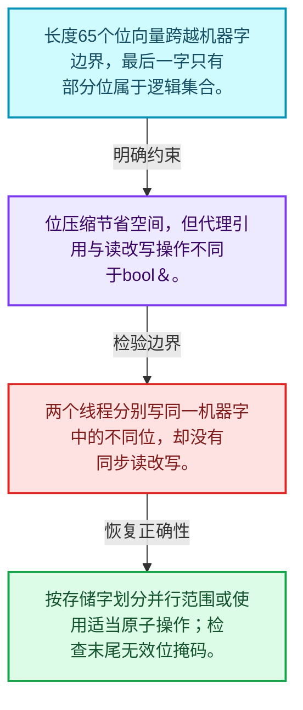
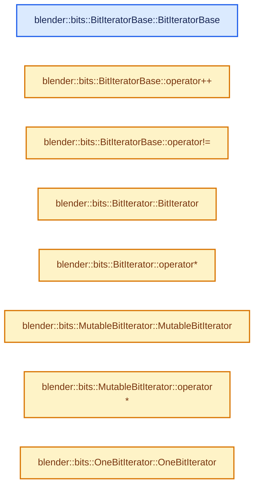
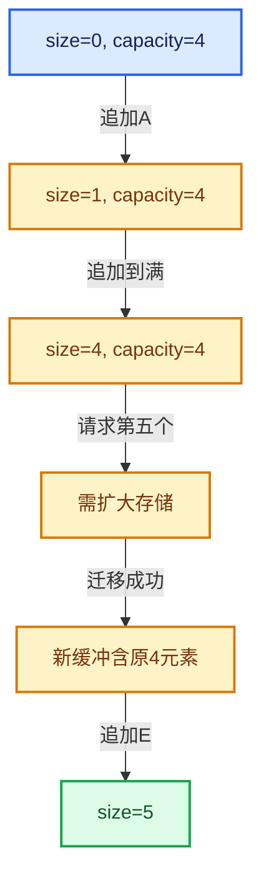

# 01-19 BitSpan与BitVector

[方向导航](README.md) · [总目录](../README.md) · [实现索引](../00-课程指南/02-源码与提交索引/符号依赖与实现索引.md)

## 从问题到实现

按位存储为什么不能像普通bool数组那样处理引用？

一个机器字包含多个位，写入单个位往往是读改写；代理引用、边界掩码和并发写入需要单独推理。

**数据模型**

长度65个位向量跨越机器字边界，最后一字只有部分位属于逻辑集合。

**设计取舍**

位压缩节省空间，但代理引用与读改写操作不同于bool&。

**最小反例**

两个线程分别写同一机器字中的不同位，却没有同步读改写。

**推导**

按存储字划分并行范围或使用适当原子操作；检查末尾无效位掩码。

## 阅读地图与执行推演








图中的数值推演是本方向的教学模型；实际函数之间的调用边与概念分析边分别标注，不能把概念关系当作运行时调度顺序。

## 完整源码单元与就地讲解

中文讲解直接放在相关代码旁，复杂机制在代码下展开。原文折叠区保留基准行号；不需要在行号表和函数之间来回查找。类布局可分段展示，函数实现不按固定行数切开。

### 类型布局、声明与编译条件 · BLI_bit_span.hh L1—L28

<a id="t-3b521b61abea"></a>

`BitIteratorBase`在这里声明的数据成员：

- `BitInt data_`
- `int64_t bit_index_`

<!-- annotated:368e3b7be169a2 -->

```cpp
/* SPDX-FileCopyrightText: 2023 Blender Authors
 *
 * SPDX-License-Identifier: GPL-2.0-or-later */

/** \file
 * \ingroup bli
 */

#pragma once

#include <optional>

#include "BLI_bit_ref.hh"
#include "BLI_index_range.hh"
#include "BLI_math_bits.hh"
#include "BLI_memory_utils.hh"

namespace blender {

namespace bits {

/** Base class for a const and non-const bit-iterator. */
class BitIteratorBase {
 protected:
  const BitInt *data_;
  int64_t bit_index_;

 public:
```

<details>
<summary>核对原始源码：source/blender/blenlib/BLI_bit_span.hh · L1—L28</summary>

<!-- original:368e3b7be169a2:source/blender/blenlib/BLI_bit_span.hh:1:28 -->

```cpp
/* SPDX-FileCopyrightText: 2023 Blender Authors
 *
 * SPDX-License-Identifier: GPL-2.0-or-later */

/** \file
 * \ingroup bli
 */

#pragma once

#include <optional>

#include "BLI_bit_ref.hh"
#include "BLI_index_range.hh"
#include "BLI_math_bits.hh"
#include "BLI_memory_utils.hh"

namespace blender {

namespace bits {

/** Base class for a const and non-const bit-iterator. */
class BitIteratorBase {
 protected:
  const BitInt *data_;
  int64_t bit_index_;

 public:
```

</details>

<a id="f-566dbb6a47d0b80c"></a>

### `blender::bits::BitIteratorBase::BitIteratorBase`

实现位置：[source/blender/blenlib/BLI_bit_span.hh](../../../../../source/blender/blenlib/BLI_bit_span.hh) · L29—L31。

接口参数：

- `const BitInt *data`
- `const int64_t bit_index`

**教学注释版**

<!-- annotated:6b0dd2deb4fffc -->

```cpp
  BitIteratorBase(const BitInt *data, const int64_t bit_index) : data_(data), bit_index_(bit_index)
  {
  }
```

<details>
<summary>核对原始源码：source/blender/blenlib/BLI_bit_span.hh · L29—L31</summary>

<!-- original:6b0dd2deb4fffc:source/blender/blenlib/BLI_bit_span.hh:29:31 -->

```cpp
  BitIteratorBase(const BitInt *data, const int64_t bit_index) : data_(data), bit_index_(bit_index)
  {
  }
```

</details>

**继续追踪实现**

本实现没有需要继续展开的显式调用；检查返回表达式、对象转换和调用者前置条件。

<!-- annotated:ce795569552172 -->

```cpp

```

<details>
<summary>核对原始源码：source/blender/blenlib/BLI_bit_span.hh · L32—L32</summary>

<!-- original:ce795569552172:source/blender/blenlib/BLI_bit_span.hh:32:32 -->

```cpp

```

</details>

<a id="f-5093249b73d63043"></a>

### `blender::bits::BitIteratorBase::operator++`

实现位置：[source/blender/blenlib/BLI_bit_span.hh](../../../../../source/blender/blenlib/BLI_bit_span.hh) · L33—L37。

**教学注释版**

<!-- annotated:e8752c432bc635 -->

```cpp
  BitIteratorBase &operator++()
  {
    bit_index_++;
    return *this;
  }
```

<details>
<summary>核对原始源码：source/blender/blenlib/BLI_bit_span.hh · L33—L37</summary>

<!-- original:e8752c432bc635:source/blender/blenlib/BLI_bit_span.hh:33:37 -->

```cpp
  BitIteratorBase &operator++()
  {
    bit_index_++;
    return *this;
  }
```

</details>

**结果出口**

- `return *this;`

**继续追踪实现**

本实现没有需要继续展开的显式调用；检查返回表达式、对象转换和调用者前置条件。

<!-- annotated:e4808c0c784d8f -->

```cpp

```

<details>
<summary>核对原始源码：source/blender/blenlib/BLI_bit_span.hh · L38—L38</summary>

<!-- original:e4808c0c784d8f:source/blender/blenlib/BLI_bit_span.hh:38:38 -->

```cpp

```

</details>

<a id="f-317f789b06d60d50"></a>

### `blender::bits::BitIteratorBase::operator!=`

实现位置：[source/blender/blenlib/BLI_bit_span.hh](../../../../../source/blender/blenlib/BLI_bit_span.hh) · L39—L43。

接口参数：

- `const BitIteratorBase &a`
- `const BitIteratorBase &b`

**教学注释版**

<!-- annotated:c4409040d316c4 -->

```cpp
  friend bool operator!=(const BitIteratorBase &a, const BitIteratorBase &b)
  {
    BLI_assert(a.data_ == b.data_);
    return a.bit_index_ != b.bit_index_;
  }
```

<details>
<summary>核对原始源码：source/blender/blenlib/BLI_bit_span.hh · L39—L43</summary>

<!-- original:c4409040d316c4:source/blender/blenlib/BLI_bit_span.hh:39:43 -->

```cpp
  friend bool operator!=(const BitIteratorBase &a, const BitIteratorBase &b)
  {
    BLI_assert(a.data_ == b.data_);
    return a.bit_index_ != b.bit_index_;
  }
```

</details>

**结果出口**

- `return a.bit_index_ != b.bit_index_;`

**继续追踪实现**

- `BLI_assert` → [BLI_assert · L48](../90-实现依赖专题/01-BLI基础库/BLI_assert.hh.md#m-57a88495704d)；[BLI_assert · L63](../90-实现依赖专题/01-BLI基础库/BLI_assert.hh.md#m-d07050020cb5)。宏定义由构建条件选择。

### 类型布局、声明与编译条件 · BLI_bit_span.hh L44—L48

<a id="t-66c4328b5c2e"></a>

<!-- annotated:fad9d1fcd91a43 -->

```cpp
};

/** Allows iterating over the bits in a memory buffer. */
class BitIterator : public BitIteratorBase {
 public:
```

<details>
<summary>核对原始源码：source/blender/blenlib/BLI_bit_span.hh · L44—L48</summary>

<!-- original:fad9d1fcd91a43:source/blender/blenlib/BLI_bit_span.hh:44:48 -->

```cpp
};

/** Allows iterating over the bits in a memory buffer. */
class BitIterator : public BitIteratorBase {
 public:
```

</details>

<a id="f-97991474ea4ebbf9"></a>

### `blender::bits::BitIterator::BitIterator`

实现位置：[source/blender/blenlib/BLI_bit_span.hh](../../../../../source/blender/blenlib/BLI_bit_span.hh) · L49—L49。

接口参数：

- `const BitInt *data`
- `const int64_t bit_index`

**教学注释版**

<!-- annotated:82856a4cfb6f5a -->

```cpp
  BitIterator(const BitInt *data, const int64_t bit_index) : BitIteratorBase(data, bit_index) {}
```

<details>
<summary>核对原始源码：source/blender/blenlib/BLI_bit_span.hh · L49—L49</summary>

<!-- original:82856a4cfb6f5a:source/blender/blenlib/BLI_bit_span.hh:49:49 -->

```cpp
  BitIterator(const BitInt *data, const int64_t bit_index) : BitIteratorBase(data, bit_index) {}
```

</details>

**继续追踪实现**

本实现没有需要继续展开的显式调用；检查返回表达式、对象转换和调用者前置条件。

<!-- annotated:6472490cde7786 -->

```cpp

```

<details>
<summary>核对原始源码：source/blender/blenlib/BLI_bit_span.hh · L50—L50</summary>

<!-- original:6472490cde7786:source/blender/blenlib/BLI_bit_span.hh:50:50 -->

```cpp

```

</details>

<a id="f-d64bc10301b947ff"></a>

### `blender::bits::BitIterator::operator*`

实现位置：[source/blender/blenlib/BLI_bit_span.hh](../../../../../source/blender/blenlib/BLI_bit_span.hh) · L51—L54。

**教学注释版**

<!-- annotated:5be93f1fb379ee -->

```cpp
  BitRef operator*() const
  {
    return BitRef(data_, bit_index_);
  }
```

<details>
<summary>核对原始源码：source/blender/blenlib/BLI_bit_span.hh · L51—L54</summary>

<!-- original:5be93f1fb379ee:source/blender/blenlib/BLI_bit_span.hh:51:54 -->

```cpp
  BitRef operator*() const
  {
    return BitRef(data_, bit_index_);
  }
```

</details>

**结果出口**

- `return BitRef(data_, bit_index_);`

**继续追踪实现**

- `BitRef` → [blender::bits::BitRef::BitRef · L96](../90-实现依赖专题/01-BLI基础库/BLI_bit_ref.hh.md#f-3232b097aac6b63c)；[blender::bits::BitRef::BitRef · L102](../90-实现依赖专题/01-BLI基础库/BLI_bit_ref.hh.md#f-bc1f6add7403fe2f)。同名重载需按实参类型选择。

### 类型布局、声明与编译条件 · BLI_bit_span.hh L55—L59

<a id="t-75ec6bf8a888"></a>

<!-- annotated:4c781b5d10f3ce -->

```cpp
};

/** Allows iterating over the bits in a memory buffer. */
class MutableBitIterator : public BitIteratorBase {
 public:
```

<details>
<summary>核对原始源码：source/blender/blenlib/BLI_bit_span.hh · L55—L59</summary>

<!-- original:4c781b5d10f3ce:source/blender/blenlib/BLI_bit_span.hh:55:59 -->

```cpp
};

/** Allows iterating over the bits in a memory buffer. */
class MutableBitIterator : public BitIteratorBase {
 public:
```

</details>

<a id="f-e0140cbf1074a83d"></a>

### `blender::bits::MutableBitIterator::MutableBitIterator`

实现位置：[source/blender/blenlib/BLI_bit_span.hh](../../../../../source/blender/blenlib/BLI_bit_span.hh) · L60—L60。

接口参数：

- `BitInt *data`
- `const int64_t bit_index`

**教学注释版**

<!-- annotated:9226a679294e10 -->

```cpp
  MutableBitIterator(BitInt *data, const int64_t bit_index) : BitIteratorBase(data, bit_index) {}
```

<details>
<summary>核对原始源码：source/blender/blenlib/BLI_bit_span.hh · L60—L60</summary>

<!-- original:9226a679294e10:source/blender/blenlib/BLI_bit_span.hh:60:60 -->

```cpp
  MutableBitIterator(BitInt *data, const int64_t bit_index) : BitIteratorBase(data, bit_index) {}
```

</details>

**继续追踪实现**

本实现没有需要继续展开的显式调用；检查返回表达式、对象转换和调用者前置条件。

<!-- annotated:76603904371ba9 -->

```cpp

```

<details>
<summary>核对原始源码：source/blender/blenlib/BLI_bit_span.hh · L61—L61</summary>

<!-- original:76603904371ba9:source/blender/blenlib/BLI_bit_span.hh:61:61 -->

```cpp

```

</details>

<a id="f-acc2bffd6c1281c3"></a>

### `blender::bits::MutableBitIterator::operator*`

实现位置：[source/blender/blenlib/BLI_bit_span.hh](../../../../../source/blender/blenlib/BLI_bit_span.hh) · L62—L65。

**教学注释版**

<!-- annotated:2a4096e41b110c -->

```cpp
  MutableBitRef operator*() const
  {
    return MutableBitRef(const_cast<BitInt *>(data_), bit_index_);
  }
```

<details>
<summary>核对原始源码：source/blender/blenlib/BLI_bit_span.hh · L62—L65</summary>

<!-- original:2a4096e41b110c:source/blender/blenlib/BLI_bit_span.hh:62:65 -->

```cpp
  MutableBitRef operator*() const
  {
    return MutableBitRef(const_cast<BitInt *>(data_), bit_index_);
  }
```

</details>

**结果出口**

- `return MutableBitRef(const_cast<BitInt *>(data_), bit_index_);`

**继续追踪实现**

- `MutableBitRef` → [blender::bits::MutableBitRef::MutableBitRef · L135](../90-实现依赖专题/01-BLI基础库/BLI_bit_ref.hh.md#f-23b4dd05da7142b5)；[blender::bits::MutableBitRef::MutableBitRef · L141](../90-实现依赖专题/01-BLI基础库/BLI_bit_ref.hh.md#f-10beea2cd369d835)。同名重载需按实参类型选择。

### 类型布局、声明与编译条件 · BLI_bit_span.hh L66—L73

<a id="t-21d69b6a938a"></a>

`OneBitIterator`在这里声明的数据成员：

- `BitInt data_`
- `int current_bit_`

<!-- annotated:2260e9da89cc66 -->

```cpp
};

class OneBitIterator {
 private:
  BitInt data_;
  int current_bit_;

 public:
```

<details>
<summary>核对原始源码：source/blender/blenlib/BLI_bit_span.hh · L66—L73</summary>

<!-- original:2260e9da89cc66:source/blender/blenlib/BLI_bit_span.hh:66:73 -->

```cpp
};

class OneBitIterator {
 private:
  BitInt data_;
  int current_bit_;

 public:
```

</details>

<a id="f-109a651a8d2c3ce6"></a>

### `blender::bits::OneBitIterator::OneBitIterator`

实现位置：[source/blender/blenlib/BLI_bit_span.hh](../../../../../source/blender/blenlib/BLI_bit_span.hh) · L74—L77。

接口参数：

- `BitInt data`

**教学注释版**

<!-- annotated:2c68c84a578d67 -->

```cpp
  explicit OneBitIterator(BitInt data) : data_(data)
  {
    this->operator++();
  }
```

<details>
<summary>核对原始源码：source/blender/blenlib/BLI_bit_span.hh · L74—L77</summary>

<!-- original:2c68c84a578d67:source/blender/blenlib/BLI_bit_span.hh:74:77 -->

```cpp
  explicit OneBitIterator(BitInt data) : data_(data)
  {
    this->operator++();
  }
```

</details>

**继续追踪实现**

- `this` → [调用协议](../00-课程指南/01-路线与规范/模板宏与动态分派协议.md)：函数指针、局部可调用对象或未展开的宏；必须结合调用者环境。调用位置L76。

<!-- annotated:84800450f8a263 -->

```cpp

```

<details>
<summary>核对原始源码：source/blender/blenlib/BLI_bit_span.hh · L78—L78</summary>

<!-- original:84800450f8a263:source/blender/blenlib/BLI_bit_span.hh:78:78 -->

```cpp

```

</details>

<a id="f-22c6e9ec0e303245"></a>

### `blender::bits::OneBitIterator::operator*`

实现位置：[source/blender/blenlib/BLI_bit_span.hh](../../../../../source/blender/blenlib/BLI_bit_span.hh) · L79—L82。

**教学注释版**

<!-- annotated:3faf185d51280b -->

```cpp
  int operator*() const
  {
    return current_bit_;
  }
```

<details>
<summary>核对原始源码：source/blender/blenlib/BLI_bit_span.hh · L79—L82</summary>

<!-- original:3faf185d51280b:source/blender/blenlib/BLI_bit_span.hh:79:82 -->

```cpp
  int operator*() const
  {
    return current_bit_;
  }
```

</details>

**结果出口**

- `return current_bit_;`

**继续追踪实现**

本实现没有需要继续展开的显式调用；检查返回表达式、对象转换和调用者前置条件。

<!-- annotated:6b1a084620073e -->

```cpp

```

<details>
<summary>核对原始源码：source/blender/blenlib/BLI_bit_span.hh · L83—L83</summary>

<!-- original:6b1a084620073e:source/blender/blenlib/BLI_bit_span.hh:83:83 -->

```cpp

```

</details>

<a id="f-8ce8ff8984c66e7f"></a>

### `blender::bits::OneBitIterator::operator++`

实现位置：[source/blender/blenlib/BLI_bit_span.hh](../../../../../source/blender/blenlib/BLI_bit_span.hh) · L84—L93。

**教学注释版**

<!-- annotated:44fce9e4ab5ef5 -->

```cpp
  OneBitIterator &operator++()
  {
    if (data_ > 0) {
      current_bit_ = bitscan_forward_clear_uint64(&data_);
    }
    else {
      current_bit_ = -1;
    }
    return *this;
  }
```

<details>
<summary>核对原始源码：source/blender/blenlib/BLI_bit_span.hh · L84—L93</summary>

<!-- original:44fce9e4ab5ef5:source/blender/blenlib/BLI_bit_span.hh:84:93 -->

```cpp
  OneBitIterator &operator++()
  {
    if (data_ > 0) {
      current_bit_ = bitscan_forward_clear_uint64(&data_);
    }
    else {
      current_bit_ = -1;
    }
    return *this;
  }
```

</details>

**沿实际写入检查状态**

- `current_bit_ = bitscan_forward_clear_uint64(&data_);`
- `current_bit_ = -1;`

**结果出口**

- `return *this;`

**继续追踪实现**

- `bitscan_forward_clear_uint64` → [blender::bitscan_forward_clear_uint64 · L56](../90-实现依赖专题/01-BLI基础库/intern/math_bits_inline.cc.md#f-2a2b9af8175029c7)。

<!-- annotated:6b785a791d5214 -->

```cpp

```

<details>
<summary>核对原始源码：source/blender/blenlib/BLI_bit_span.hh · L94—L94</summary>

<!-- original:6b785a791d5214:source/blender/blenlib/BLI_bit_span.hh:94:94 -->

```cpp

```

</details>

<a id="f-60757c91250d10ce"></a>

### `blender::bits::OneBitIterator::operator!=`

实现位置：[source/blender/blenlib/BLI_bit_span.hh](../../../../../source/blender/blenlib/BLI_bit_span.hh) · L95—L98。

接口参数：

- `const OneBitIterator &a`
- `const OneBitIterator &b`

**教学注释版**

<!-- annotated:4b5e3c5deab866 -->

```cpp
  friend bool operator!=(const OneBitIterator &a, const OneBitIterator &b)
  {
    return a.current_bit_ != b.current_bit_;
  }
```

<details>
<summary>核对原始源码：source/blender/blenlib/BLI_bit_span.hh · L95—L98</summary>

<!-- original:4b5e3c5deab866:source/blender/blenlib/BLI_bit_span.hh:95:98 -->

```cpp
  friend bool operator!=(const OneBitIterator &a, const OneBitIterator &b)
  {
    return a.current_bit_ != b.current_bit_;
  }
```

</details>

**结果出口**

- `return a.current_bit_ != b.current_bit_;`

**继续追踪实现**

本实现没有需要继续展开的显式调用；检查返回表达式、对象转换和调用者前置条件。

### 类型布局、声明与编译条件 · BLI_bit_span.hh L99—L105

<a id="t-d6693a387bb7"></a>

`OneBitIteratorRange`在这里声明的数据成员：

- `BitInt data_`

<!-- annotated:3f9b35497888e5 -->

```cpp
};

class OneBitIteratorRange {
 private:
  const BitInt data_;

 public:
```

<details>
<summary>核对原始源码：source/blender/blenlib/BLI_bit_span.hh · L99—L105</summary>

<!-- original:3f9b35497888e5:source/blender/blenlib/BLI_bit_span.hh:99:105 -->

```cpp
};

class OneBitIteratorRange {
 private:
  const BitInt data_;

 public:
```

</details>

<a id="f-951e4a3ffd86e85a"></a>

### `blender::bits::OneBitIteratorRange::OneBitIteratorRange`

实现位置：[source/blender/blenlib/BLI_bit_span.hh](../../../../../source/blender/blenlib/BLI_bit_span.hh) · L106—L106。

接口参数：

- `BitInt data`

**教学注释版**

<!-- annotated:f3e503a96e239f -->

```cpp
  OneBitIteratorRange(BitInt data) : data_(data) {}
```

<details>
<summary>核对原始源码：source/blender/blenlib/BLI_bit_span.hh · L106—L106</summary>

<!-- original:f3e503a96e239f:source/blender/blenlib/BLI_bit_span.hh:106:106 -->

```cpp
  OneBitIteratorRange(BitInt data) : data_(data) {}
```

</details>

**继续追踪实现**

本实现没有需要继续展开的显式调用；检查返回表达式、对象转换和调用者前置条件。

<!-- annotated:f3abff8870c361 -->

```cpp

```

<details>
<summary>核对原始源码：source/blender/blenlib/BLI_bit_span.hh · L107—L107</summary>

<!-- original:f3abff8870c361:source/blender/blenlib/BLI_bit_span.hh:107:107 -->

```cpp

```

</details>

<a id="f-050923e4c44f9f9a"></a>

### `blender::bits::OneBitIteratorRange::begin`

实现位置：[source/blender/blenlib/BLI_bit_span.hh](../../../../../source/blender/blenlib/BLI_bit_span.hh) · L108—L111。

**教学注释版**

<!-- annotated:41a3e4f5d4b400 -->

```cpp
  OneBitIterator begin() const
  {
    return OneBitIterator(data_);
  }
```

<details>
<summary>核对原始源码：source/blender/blenlib/BLI_bit_span.hh · L108—L111</summary>

<!-- original:41a3e4f5d4b400:source/blender/blenlib/BLI_bit_span.hh:108:111 -->

```cpp
  OneBitIterator begin() const
  {
    return OneBitIterator(data_);
  }
```

</details>

**结果出口**

- `return OneBitIterator(data_);`

**继续追踪实现**

- `OneBitIterator` → [blender::bits::OneBitIterator::OneBitIterator · L74](19-BitSpan与BitVector.md#f-109a651a8d2c3ce6)。

<a id="f-a2accf9d07735340"></a>

### `blender::bits::OneBitIteratorRange::end`

实现位置：[source/blender/blenlib/BLI_bit_span.hh](../../../../../source/blender/blenlib/BLI_bit_span.hh) · L112—L115。

**教学注释版**

<!-- annotated:554abf48d8065c -->

```cpp
  OneBitIterator end() const
  {
    return OneBitIterator(0);
  }
```

<details>
<summary>核对原始源码：source/blender/blenlib/BLI_bit_span.hh · L112—L115</summary>

<!-- original:554abf48d8065c:source/blender/blenlib/BLI_bit_span.hh:112:115 -->

```cpp
  OneBitIterator end() const
  {
    return OneBitIterator(0);
  }
```

</details>

**结果出口**

- `return OneBitIterator(0);`

**继续追踪实现**

- `OneBitIterator` → [blender::bits::OneBitIterator::OneBitIterator · L74](19-BitSpan与BitVector.md#f-109a651a8d2c3ce6)。

### 类型布局、声明与编译条件 · BLI_bit_span.hh L116—L117

<!-- annotated:33a681dc52e4e4 -->

```cpp
};

```

<details>
<summary>核对原始源码：source/blender/blenlib/BLI_bit_span.hh · L116—L117</summary>

<!-- original:33a681dc52e4e4:source/blender/blenlib/BLI_bit_span.hh:116:117 -->

```cpp
};

```

</details>

<a id="f-eb4a8451a9086ff1"></a>

### `blender::bits::iter_1_indices`

实现位置：[source/blender/blenlib/BLI_bit_span.hh](../../../../../source/blender/blenlib/BLI_bit_span.hh) · L118—L121。

接口参数：

- `BitInt value`

**教学注释版**

<!-- annotated:6c0074d364433c -->

```cpp
inline OneBitIteratorRange iter_1_indices(BitInt value)
{
  return OneBitIteratorRange(value);
}
```

<details>
<summary>核对原始源码：source/blender/blenlib/BLI_bit_span.hh · L118—L121</summary>

<!-- original:6c0074d364433c:source/blender/blenlib/BLI_bit_span.hh:118:121 -->

```cpp
inline OneBitIteratorRange iter_1_indices(BitInt value)
{
  return OneBitIteratorRange(value);
}
```

</details>

**结果出口**

- `return OneBitIteratorRange(value);`

**继续追踪实现**

- `OneBitIteratorRange` → [blender::bits::OneBitIteratorRange::OneBitIteratorRange · L106](19-BitSpan与BitVector.md#f-951e4a3ffd86e85a)。

### 类型布局、声明与编译条件 · BLI_bit_span.hh L122—L141

<a id="t-40ebe7ddf0e5"></a>

`BitSpan`在这里声明的数据成员：

- `BitInt data_`
- `IndexRange bit_range_`

<!-- annotated:93736c24cf1722 -->

```cpp

/**
 * Similar to #Span, but references a range of bits instead of normal C++ types (which must be at
 * least one byte large). Use #MutableBitSpan if the values are supposed to be modified.
 *
 * The beginning and end of a #BitSpan does *not* have to be at byte/int boundaries. It can start
 * and end at any bit.
 */
class BitSpan {
 protected:
  /**
   * Base pointer to the integers containing the bits. The actual bit span might start at a much
   * higher address when `bit_range_.start()` is large.
   */
  const BitInt *data_ = nullptr;
  /** The range of referenced bits. */
  IndexRange bit_range_ = {0, 0};

 public:
  /** Construct an empty span. */
```

<details>
<summary>核对原始源码：source/blender/blenlib/BLI_bit_span.hh · L122—L141</summary>

<!-- original:93736c24cf1722:source/blender/blenlib/BLI_bit_span.hh:122:141 -->

```cpp

/**
 * Similar to #Span, but references a range of bits instead of normal C++ types (which must be at
 * least one byte large). Use #MutableBitSpan if the values are supposed to be modified.
 *
 * The beginning and end of a #BitSpan does *not* have to be at byte/int boundaries. It can start
 * and end at any bit.
 */
class BitSpan {
 protected:
  /**
   * Base pointer to the integers containing the bits. The actual bit span might start at a much
   * higher address when `bit_range_.start()` is large.
   */
  const BitInt *data_ = nullptr;
  /** The range of referenced bits. */
  IndexRange bit_range_ = {0, 0};

 public:
  /** Construct an empty span. */
```

</details>

<a id="f-910f6695cf3e6c50"></a>

### `blender::bits::BitSpan::BitSpan`

实现位置：[source/blender/blenlib/BLI_bit_span.hh](../../../../../source/blender/blenlib/BLI_bit_span.hh) · L142—L142。

**教学注释版**

<!-- annotated:29c3bd9c3ed58a -->

```cpp
  BitSpan() = default;
```

<details>
<summary>核对原始源码：source/blender/blenlib/BLI_bit_span.hh · L142—L142</summary>

<!-- original:29c3bd9c3ed58a:source/blender/blenlib/BLI_bit_span.hh:142:142 -->

```cpp
  BitSpan() = default;
```

</details>

**继续追踪实现**

本实现没有需要继续展开的显式调用；检查返回表达式、对象转换和调用者前置条件。

<!-- annotated:a1e3c465db046c -->

```cpp

```

<details>
<summary>核对原始源码：source/blender/blenlib/BLI_bit_span.hh · L143—L143</summary>

<!-- original:a1e3c465db046c:source/blender/blenlib/BLI_bit_span.hh:143:143 -->

```cpp

```

</details>

<a id="f-01ead3d0eaf1cbb8"></a>

### `blender::bits::BitSpan::BitSpan`

实现位置：[source/blender/blenlib/BLI_bit_span.hh](../../../../../source/blender/blenlib/BLI_bit_span.hh) · L144—L146。

接口参数：

- `const BitInt *data`
- `const int64_t size_in_bits`

**教学注释版**

<!-- annotated:0aaf4a809aa46d -->

```cpp
  BitSpan(const BitInt *data, const int64_t size_in_bits) : data_(data), bit_range_(size_in_bits)
  {
  }
```

<details>
<summary>核对原始源码：source/blender/blenlib/BLI_bit_span.hh · L144—L146</summary>

<!-- original:0aaf4a809aa46d:source/blender/blenlib/BLI_bit_span.hh:144:146 -->

```cpp
  BitSpan(const BitInt *data, const int64_t size_in_bits) : data_(data), bit_range_(size_in_bits)
  {
  }
```

</details>

**继续追踪实现**

本实现没有需要继续展开的显式调用；检查返回表达式、对象转换和调用者前置条件。

<!-- annotated:2001c44312e1d4 -->

```cpp

```

<details>
<summary>核对原始源码：source/blender/blenlib/BLI_bit_span.hh · L147—L147</summary>

<!-- original:2001c44312e1d4:source/blender/blenlib/BLI_bit_span.hh:147:147 -->

```cpp

```

</details>

<a id="f-424d11167d1bc782"></a>

### `blender::bits::BitSpan::BitSpan`

实现位置：[source/blender/blenlib/BLI_bit_span.hh](../../../../../source/blender/blenlib/BLI_bit_span.hh) · L148—L148。

接口参数：

- `const BitInt *data`
- `const IndexRange bit_range`

**教学注释版**

<!-- annotated:2527eb4126d120 -->

```cpp
  BitSpan(const BitInt *data, const IndexRange bit_range) : data_(data), bit_range_(bit_range) {}
```

<details>
<summary>核对原始源码：source/blender/blenlib/BLI_bit_span.hh · L148—L148</summary>

<!-- original:2527eb4126d120:source/blender/blenlib/BLI_bit_span.hh:148:148 -->

```cpp
  BitSpan(const BitInt *data, const IndexRange bit_range) : data_(data), bit_range_(bit_range) {}
```

</details>

**继续追踪实现**

本实现没有需要继续展开的显式调用；检查返回表达式、对象转换和调用者前置条件。

### 类型布局、声明与编译条件 · BLI_bit_span.hh L149—L150

<!-- annotated:dd92023ac37abc -->

```cpp

  /** Number of bits referenced by the span. */
```

<details>
<summary>核对原始源码：source/blender/blenlib/BLI_bit_span.hh · L149—L150</summary>

<!-- original:dd92023ac37abc:source/blender/blenlib/BLI_bit_span.hh:149:150 -->

```cpp

  /** Number of bits referenced by the span. */
```

</details>

<a id="f-619593bac6a150f5"></a>

### `blender::bits::BitSpan::size`

实现位置：[source/blender/blenlib/BLI_bit_span.hh](../../../../../source/blender/blenlib/BLI_bit_span.hh) · L151—L154。

**教学注释版**

<!-- annotated:9fa3bc9a055388 -->

```cpp
  int64_t size() const
  {
    // [讲解] bit_range_.size：读取连续区间或分组的边界信息。
    return bit_range_.size();
  }
```

<details>
<summary>核对原始源码：source/blender/blenlib/BLI_bit_span.hh · L151—L154</summary>

<!-- original:9fa3bc9a055388:source/blender/blenlib/BLI_bit_span.hh:151:154 -->

```cpp
  int64_t size() const
  {
    return bit_range_.size();
  }
```

</details>

**结果出口**

- `return bit_range_.size();`

**继续追踪实现**

- `bit_range_.size` → [blender::IndexRange::size · L156](04-IndexRange连续整数区间.md#f-05f66c3ebb2fdfec)。

<!-- annotated:c60c923c2f0d8e -->

```cpp

```

<details>
<summary>核对原始源码：source/blender/blenlib/BLI_bit_span.hh · L155—L155</summary>

<!-- original:c60c923c2f0d8e:source/blender/blenlib/BLI_bit_span.hh:155:155 -->

```cpp

```

</details>

<a id="f-9e464d71eeb9d5c6"></a>

### `blender::bits::BitSpan::is_empty`

实现位置：[source/blender/blenlib/BLI_bit_span.hh](../../../../../source/blender/blenlib/BLI_bit_span.hh) · L156—L159。

**教学注释版**

<!-- annotated:6e418dddde9a96 -->

```cpp
  bool is_empty() const
  {
    // [讲解] bit_range_.is_empty：读取连续区间或分组的边界信息。
    return bit_range_.is_empty();
  }
```

<details>
<summary>核对原始源码：source/blender/blenlib/BLI_bit_span.hh · L156—L159</summary>

<!-- original:6e418dddde9a96:source/blender/blenlib/BLI_bit_span.hh:156:159 -->

```cpp
  bool is_empty() const
  {
    return bit_range_.is_empty();
  }
```

</details>

**结果出口**

- `return bit_range_.is_empty();`

**继续追踪实现**

- `bit_range_.is_empty` → [blender::IndexRange::is_empty · L169](04-IndexRange连续整数区间.md#f-9501e070be01ff71)。

<!-- annotated:b67511ed5c0c8c -->

```cpp

```

<details>
<summary>核对原始源码：source/blender/blenlib/BLI_bit_span.hh · L160—L160</summary>

<!-- original:b67511ed5c0c8c:source/blender/blenlib/BLI_bit_span.hh:160:160 -->

```cpp

```

</details>

<a id="f-be50d7b366362ae1"></a>

### `blender::bits::BitSpan::index_range`

实现位置：[source/blender/blenlib/BLI_bit_span.hh](../../../../../source/blender/blenlib/BLI_bit_span.hh) · L161—L164。

**教学注释版**

<!-- annotated:afa96c42a9ee3c -->

```cpp
  IndexRange index_range() const
  {
    // [讲解] bit_range_.size：读取连续区间或分组的边界信息。
    return IndexRange(bit_range_.size());
  }
```

<details>
<summary>核对原始源码：source/blender/blenlib/BLI_bit_span.hh · L161—L164</summary>

<!-- original:afa96c42a9ee3c:source/blender/blenlib/BLI_bit_span.hh:161:164 -->

```cpp
  IndexRange index_range() const
  {
    return IndexRange(bit_range_.size());
  }
```

</details>

**结果出口**

- `return IndexRange(bit_range_.size());`

**继续追踪实现**

- `IndexRange` → [blender::IndexRange](../90-实现依赖专题/01-BLI基础库/BLI_index_range.hh.md#t-caa3466d6776)；[blender::gpu::shader::parser::IndexRange](../90-实现依赖专题/08-其他Blender模块/gpu/shader_tool/utils.hh.md#t-82d2bd4ea71c)；[blender::IndexRange](../90-实现依赖专题/08-其他Blender模块/makesdna/DNA_node_types.h.md#t-0448cc889d39)。
- `bit_range_.size` → [blender::IndexRange::size · L156](04-IndexRange连续整数区间.md#f-05f66c3ebb2fdfec)。

<!-- annotated:5ebfd0427af861 -->

```cpp

```

<details>
<summary>核对原始源码：source/blender/blenlib/BLI_bit_span.hh · L165—L165</summary>

<!-- original:5ebfd0427af861:source/blender/blenlib/BLI_bit_span.hh:165:165 -->

```cpp

```

</details>

<a id="f-2803637807349bfc"></a>

### `blender::bits::BitSpan::operator[]`

实现位置：[source/blender/blenlib/BLI_bit_span.hh](../../../../../source/blender/blenlib/BLI_bit_span.hh) · L166—L171。

接口参数：

- `const int64_t index`

**教学注释版**

<!-- annotated:475ba0abd9e0b5 -->

```cpp
  [[nodiscard]] BitRef operator[](const int64_t index) const
  {
    BLI_assert(index >= 0);
    // [讲解] bit_range_.size：读取连续区间或分组的边界信息。
    BLI_assert(index < bit_range_.size());
    // [讲解] bit_range_.start：读取连续区间或分组的边界信息。
    return {data_, bit_range_.start() + index};
  }
```

<details>
<summary>核对原始源码：source/blender/blenlib/BLI_bit_span.hh · L166—L171</summary>

<!-- original:475ba0abd9e0b5:source/blender/blenlib/BLI_bit_span.hh:166:171 -->

```cpp
  [[nodiscard]] BitRef operator[](const int64_t index) const
  {
    BLI_assert(index >= 0);
    BLI_assert(index < bit_range_.size());
    return {data_, bit_range_.start() + index};
  }
```

</details>

**结果出口**

- `return {data_, bit_range_.start() + index};`

**继续追踪实现**

- `BLI_assert` → [BLI_assert · L48](../90-实现依赖专题/01-BLI基础库/BLI_assert.hh.md#m-57a88495704d)；[BLI_assert · L63](../90-实现依赖专题/01-BLI基础库/BLI_assert.hh.md#m-d07050020cb5)。宏定义由构建条件选择。
- `bit_range_.size` → [blender::IndexRange::size · L156](04-IndexRange连续整数区间.md#f-05f66c3ebb2fdfec)。
- `bit_range_.start` → [blender::IndexRange::start · L243](04-IndexRange连续整数区间.md#f-99d2195bd9cfd1f0)。

<!-- annotated:e8a7857f06e34e -->

```cpp

```

<details>
<summary>核对原始源码：source/blender/blenlib/BLI_bit_span.hh · L172—L172</summary>

<!-- original:e8a7857f06e34e:source/blender/blenlib/BLI_bit_span.hh:172:172 -->

```cpp

```

</details>

<a id="f-3f83a2bfddce7a17"></a>

### `blender::bits::BitSpan::slice`

实现位置：[source/blender/blenlib/BLI_bit_span.hh](../../../../../source/blender/blenlib/BLI_bit_span.hh) · L173—L176。

接口参数：

- `const IndexRange range`

**教学注释版**

<!-- annotated:06f6e1d5b1c9d3 -->

```cpp
  [[nodiscard]] BitSpan slice(const IndexRange range) const
  {
    // [讲解] bit_range_.slice：从已有范围生成子范围。
    return {data_, bit_range_.slice(range)};
  }
```

<details>
<summary>核对原始源码：source/blender/blenlib/BLI_bit_span.hh · L173—L176</summary>

<!-- original:06f6e1d5b1c9d3:source/blender/blenlib/BLI_bit_span.hh:173:176 -->

```cpp
  [[nodiscard]] BitSpan slice(const IndexRange range) const
  {
    return {data_, bit_range_.slice(range)};
  }
```

</details>

**结果出口**

- `return {data_, bit_range_.slice(range)};`

**继续追踪实现**

- `bit_range_.slice` → [blender::IndexRange::slice · L276](04-IndexRange连续整数区间.md#f-6249bf624e38d609)；[blender::IndexRange::slice · L284](04-IndexRange连续整数区间.md#f-eb80885fefc31b6f)。同名重载需按实参类型选择。

<!-- annotated:3096218729d43d -->

```cpp

```

<details>
<summary>核对原始源码：source/blender/blenlib/BLI_bit_span.hh · L177—L177</summary>

<!-- original:3096218729d43d:source/blender/blenlib/BLI_bit_span.hh:177:177 -->

```cpp

```

</details>

<a id="f-1afba0c992ebf775"></a>

### `blender::bits::BitSpan::take_front`

实现位置：[source/blender/blenlib/BLI_bit_span.hh](../../../../../source/blender/blenlib/BLI_bit_span.hh) · L178—L181。

接口参数：

- `const int64_t n`

**教学注释版**

<!-- annotated:3884b626e5db47 -->

```cpp
  BitSpan take_front(const int64_t n) const
  {
    return {data_, bit_range_.take_front(n)};
  }
```

<details>
<summary>核对原始源码：source/blender/blenlib/BLI_bit_span.hh · L178—L181</summary>

<!-- original:3884b626e5db47:source/blender/blenlib/BLI_bit_span.hh:178:181 -->

```cpp
  BitSpan take_front(const int64_t n) const
  {
    return {data_, bit_range_.take_front(n)};
  }
```

</details>

**结果出口**

- `return {data_, bit_range_.take_front(n)};`

**继续追踪实现**

- `bit_range_.take_front` → [blender::IndexRange::take_front · L328](04-IndexRange连续整数区间.md#f-63ad1817cc7169c5)。

<!-- annotated:073669ac4fb2e9 -->

```cpp

```

<details>
<summary>核对原始源码：source/blender/blenlib/BLI_bit_span.hh · L182—L182</summary>

<!-- original:073669ac4fb2e9:source/blender/blenlib/BLI_bit_span.hh:182:182 -->

```cpp

```

</details>

<a id="f-b5e56079380e9e4b"></a>

### `blender::bits::BitSpan::take_back`

实现位置：[source/blender/blenlib/BLI_bit_span.hh](../../../../../source/blender/blenlib/BLI_bit_span.hh) · L183—L186。

接口参数：

- `const int64_t n`

**教学注释版**

<!-- annotated:e5aade07b3b01a -->

```cpp
  BitSpan take_back(const int64_t n) const
  {
    return {data_, bit_range_.take_back(n)};
  }
```

<details>
<summary>核对原始源码：source/blender/blenlib/BLI_bit_span.hh · L183—L186</summary>

<!-- original:e5aade07b3b01a:source/blender/blenlib/BLI_bit_span.hh:183:186 -->

```cpp
  BitSpan take_back(const int64_t n) const
  {
    return {data_, bit_range_.take_back(n)};
  }
```

</details>

**结果出口**

- `return {data_, bit_range_.take_back(n)};`

**继续追踪实现**

- `bit_range_.take_back` → [blender::IndexRange::take_back · L339](04-IndexRange连续整数区间.md#f-90cb4525591ba822)。

<!-- annotated:dba8363af6a897 -->

```cpp

```

<details>
<summary>核对原始源码：source/blender/blenlib/BLI_bit_span.hh · L187—L187</summary>

<!-- original:dba8363af6a897:source/blender/blenlib/BLI_bit_span.hh:187:187 -->

```cpp

```

</details>

<a id="f-dd957c52b8737102"></a>

### `blender::bits::BitSpan::drop_front`

实现位置：[source/blender/blenlib/BLI_bit_span.hh](../../../../../source/blender/blenlib/BLI_bit_span.hh) · L188—L191。

接口参数：

- `const int64_t n`

**教学注释版**

<!-- annotated:8b8e862e0cef53 -->

```cpp
  BitSpan drop_front(const int64_t n) const
  {
    return {data_, bit_range_.drop_front(n)};
  }
```

<details>
<summary>核对原始源码：source/blender/blenlib/BLI_bit_span.hh · L188—L191</summary>

<!-- original:8b8e862e0cef53:source/blender/blenlib/BLI_bit_span.hh:188:191 -->

```cpp
  BitSpan drop_front(const int64_t n) const
  {
    return {data_, bit_range_.drop_front(n)};
  }
```

</details>

**结果出口**

- `return {data_, bit_range_.drop_front(n)};`

**继续追踪实现**

- `bit_range_.drop_front` → [blender::IndexRange::drop_front · L306](04-IndexRange连续整数区间.md#f-ef3101407d982c90)。

<!-- annotated:05347e22560e2f -->

```cpp

```

<details>
<summary>核对原始源码：source/blender/blenlib/BLI_bit_span.hh · L192—L192</summary>

<!-- original:05347e22560e2f:source/blender/blenlib/BLI_bit_span.hh:192:192 -->

```cpp

```

</details>

<a id="f-dfacaf9d87804c5e"></a>

### `blender::bits::BitSpan::drop_back`

实现位置：[source/blender/blenlib/BLI_bit_span.hh](../../../../../source/blender/blenlib/BLI_bit_span.hh) · L193—L196。

接口参数：

- `const int64_t n`

**教学注释版**

<!-- annotated:adc97b6ef485a0 -->

```cpp
  BitSpan drop_back(const int64_t n) const
  {
    return {data_, bit_range_.drop_back(n)};
  }
```

<details>
<summary>核对原始源码：source/blender/blenlib/BLI_bit_span.hh · L193—L196</summary>

<!-- original:adc97b6ef485a0:source/blender/blenlib/BLI_bit_span.hh:193:196 -->

```cpp
  BitSpan drop_back(const int64_t n) const
  {
    return {data_, bit_range_.drop_back(n)};
  }
```

</details>

**结果出口**

- `return {data_, bit_range_.drop_back(n)};`

**继续追踪实现**

- `bit_range_.drop_back` → [blender::IndexRange::drop_back · L317](04-IndexRange连续整数区间.md#f-be17c307e5b14575)。

<!-- annotated:41aa26e797f469 -->

```cpp

```

<details>
<summary>核对原始源码：source/blender/blenlib/BLI_bit_span.hh · L197—L197</summary>

<!-- original:41aa26e797f469:source/blender/blenlib/BLI_bit_span.hh:197:197 -->

```cpp

```

</details>

<a id="f-7fb8ab932727dff6"></a>

### `blender::bits::BitSpan::data`

实现位置：[source/blender/blenlib/BLI_bit_span.hh](../../../../../source/blender/blenlib/BLI_bit_span.hh) · L198—L201。

**教学注释版**

<!-- annotated:0eff75d6d9bfed -->

```cpp
  const BitInt *data() const
  {
    return data_;
  }
```

<details>
<summary>核对原始源码：source/blender/blenlib/BLI_bit_span.hh · L198—L201</summary>

<!-- original:0eff75d6d9bfed:source/blender/blenlib/BLI_bit_span.hh:198:201 -->

```cpp
  const BitInt *data() const
  {
    return data_;
  }
```

</details>

**结果出口**

- `return data_;`

**继续追踪实现**

本实现没有需要继续展开的显式调用；检查返回表达式、对象转换和调用者前置条件。

<!-- annotated:05a3431e3f6e8b -->

```cpp

```

<details>
<summary>核对原始源码：source/blender/blenlib/BLI_bit_span.hh · L202—L202</summary>

<!-- original:05a3431e3f6e8b:source/blender/blenlib/BLI_bit_span.hh:202:202 -->

```cpp

```

</details>

<a id="f-8752cfebfc5d5dc6"></a>

### `blender::bits::BitSpan::bit_range`

实现位置：[source/blender/blenlib/BLI_bit_span.hh](../../../../../source/blender/blenlib/BLI_bit_span.hh) · L203—L206。

**教学注释版**

<!-- annotated:e5b7aeabfe198e -->

```cpp
  const IndexRange &bit_range() const
  {
    return bit_range_;
  }
```

<details>
<summary>核对原始源码：source/blender/blenlib/BLI_bit_span.hh · L203—L206</summary>

<!-- original:e5b7aeabfe198e:source/blender/blenlib/BLI_bit_span.hh:203:206 -->

```cpp
  const IndexRange &bit_range() const
  {
    return bit_range_;
  }
```

</details>

**结果出口**

- `return bit_range_;`

**继续追踪实现**

本实现没有需要继续展开的显式调用；检查返回表达式、对象转换和调用者前置条件。

<!-- annotated:a5ea904398395c -->

```cpp

```

<details>
<summary>核对原始源码：source/blender/blenlib/BLI_bit_span.hh · L207—L207</summary>

<!-- original:a5ea904398395c:source/blender/blenlib/BLI_bit_span.hh:207:207 -->

```cpp

```

</details>

<a id="f-37c1e44c5b89e9bb"></a>

### `blender::bits::BitSpan::begin`

实现位置：[source/blender/blenlib/BLI_bit_span.hh](../../../../../source/blender/blenlib/BLI_bit_span.hh) · L208—L211。

**教学注释版**

<!-- annotated:0649e00bfe2501 -->

```cpp
  BitIterator begin() const
  {
    // [讲解] bit_range_.start：读取连续区间或分组的边界信息。
    return {data_, bit_range_.start()};
  }
```

<details>
<summary>核对原始源码：source/blender/blenlib/BLI_bit_span.hh · L208—L211</summary>

<!-- original:0649e00bfe2501:source/blender/blenlib/BLI_bit_span.hh:208:211 -->

```cpp
  BitIterator begin() const
  {
    return {data_, bit_range_.start()};
  }
```

</details>

**结果出口**

- `return {data_, bit_range_.start()};`

**继续追踪实现**

- `bit_range_.start` → [blender::IndexRange::start · L243](04-IndexRange连续整数区间.md#f-99d2195bd9cfd1f0)。

<!-- annotated:93b37635646fe6 -->

```cpp

```

<details>
<summary>核对原始源码：source/blender/blenlib/BLI_bit_span.hh · L212—L212</summary>

<!-- original:93b37635646fe6:source/blender/blenlib/BLI_bit_span.hh:212:212 -->

```cpp

```

</details>

<a id="f-6750f56465994072"></a>

### `blender::bits::BitSpan::end`

实现位置：[source/blender/blenlib/BLI_bit_span.hh](../../../../../source/blender/blenlib/BLI_bit_span.hh) · L213—L216。

**教学注释版**

<!-- annotated:4d8a9e0c129a92 -->

```cpp
  BitIterator end() const
  {
    // [讲解] bit_range_.one_after_last：读取连续区间或分组的边界信息。
    return {data_, bit_range_.one_after_last()};
  }
```

<details>
<summary>核对原始源码：source/blender/blenlib/BLI_bit_span.hh · L213—L216</summary>

<!-- original:4d8a9e0c129a92:source/blender/blenlib/BLI_bit_span.hh:213:216 -->

```cpp
  BitIterator end() const
  {
    return {data_, bit_range_.one_after_last()};
  }
```

</details>

**结果出口**

- `return {data_, bit_range_.one_after_last()};`

**继续追踪实现**

- `bit_range_.one_after_last` → [blender::IndexRange::one_after_last · L235](04-IndexRange连续整数区间.md#f-ed04bec9c731fc86)。

### 类型布局、声明与编译条件 · BLI_bit_span.hh L217—L225

<!-- annotated:08d5838fbc46b0 -->

```cpp
};

/**
 * Checks if the span fulfills the requirements for a bounded span. Bounded spans can often be
 * processed more efficiently, because fewer cases have to be considered when aligning multiple
 * such spans.
 *
 * See comments in the function for the exact requirements.
 */
```

<details>
<summary>核对原始源码：source/blender/blenlib/BLI_bit_span.hh · L217—L225</summary>

<!-- original:08d5838fbc46b0:source/blender/blenlib/BLI_bit_span.hh:217:225 -->

```cpp
};

/**
 * Checks if the span fulfills the requirements for a bounded span. Bounded spans can often be
 * processed more efficiently, because fewer cases have to be considered when aligning multiple
 * such spans.
 *
 * See comments in the function for the exact requirements.
 */
```

</details>

<a id="f-319fb838ca0d0737"></a>

### `blender::bits::is_bounded_span`

实现位置：[source/blender/blenlib/BLI_bit_span.hh](../../../../../source/blender/blenlib/BLI_bit_span.hh) · L226—L245。

接口参数：

- `const BitSpan span`

**教学注释版**

<!-- annotated:8df54921addea2 -->

```cpp
inline bool is_bounded_span(const BitSpan span)
{
  const int64_t offset = span.bit_range().start();
  const int64_t size = span.size();
  if (offset >= BitsPerInt) {
    /* The data pointer must point at the first int already. If the offset is a multiple of
     * #BitsPerInt, the bit span could theoretically become bounded as well if the data pointer is
     * adjusted. But that is not handled here. */
    return false;
  }
  if (size < BitsPerInt) {
    /** Don't allow small sized spans to cross `BitInt` boundaries. */
    return offset + size <= 64;
  }
  if (offset != 0) {
    /* Start of larger spans must be aligned to `BitInt` boundaries. */
    return false;
  }
  return true;
}
```

<details>
<summary>核对原始源码：source/blender/blenlib/BLI_bit_span.hh · L226—L245</summary>

<!-- original:8df54921addea2:source/blender/blenlib/BLI_bit_span.hh:226:245 -->

```cpp
inline bool is_bounded_span(const BitSpan span)
{
  const int64_t offset = span.bit_range().start();
  const int64_t size = span.size();
  if (offset >= BitsPerInt) {
    /* The data pointer must point at the first int already. If the offset is a multiple of
     * #BitsPerInt, the bit span could theoretically become bounded as well if the data pointer is
     * adjusted. But that is not handled here. */
    return false;
  }
  if (size < BitsPerInt) {
    /** Don't allow small sized spans to cross `BitInt` boundaries. */
    return offset + size <= 64;
  }
  if (offset != 0) {
    /* Start of larger spans must be aligned to `BitInt` boundaries. */
    return false;
  }
  return true;
}
```

</details>

**结果出口**

- `return false;`
- `return offset + size <= 64;`
- `return true;`

**继续追踪实现**

- `span.bit_range().start` → [调用协议](../00-课程指南/01-路线与规范/模板宏与动态分派协议.md)：接收对象类型依赖auto、返回值或模板实例；不按同名猜测目标。调用位置L228。
- `span.bit_range` → [blender::bits::BitSpan::bit_range · L203](19-BitSpan与BitVector.md#f-8752cfebfc5d5dc6)。
- `span.size` → [blender::bits::BitSpan::size · L151](19-BitSpan与BitVector.md#f-619593bac6a150f5)。

### 类型布局、声明与编译条件 · BLI_bit_span.hh L246—L251

<a id="t-57c89b17615b"></a>

<!-- annotated:06f1e82c952022 -->

```cpp

/**
 * Same as #BitSpan but fulfills the requirements mentioned on #is_bounded_span.
 */
class BoundedBitSpan : public BitSpan {
 public:
```

<details>
<summary>核对原始源码：source/blender/blenlib/BLI_bit_span.hh · L246—L251</summary>

<!-- original:06f1e82c952022:source/blender/blenlib/BLI_bit_span.hh:246:251 -->

```cpp

/**
 * Same as #BitSpan but fulfills the requirements mentioned on #is_bounded_span.
 */
class BoundedBitSpan : public BitSpan {
 public:
```

</details>

<a id="f-32131d22e1d5bfb9"></a>

### `blender::bits::BoundedBitSpan::BoundedBitSpan`

实现位置：[source/blender/blenlib/BLI_bit_span.hh](../../../../../source/blender/blenlib/BLI_bit_span.hh) · L252—L252。

**教学注释版**

<!-- annotated:1d1e54254b29e2 -->

```cpp
  BoundedBitSpan() = default;
```

<details>
<summary>核对原始源码：source/blender/blenlib/BLI_bit_span.hh · L252—L252</summary>

<!-- original:1d1e54254b29e2:source/blender/blenlib/BLI_bit_span.hh:252:252 -->

```cpp
  BoundedBitSpan() = default;
```

</details>

**继续追踪实现**

本实现没有需要继续展开的显式调用；检查返回表达式、对象转换和调用者前置条件。

<!-- annotated:86283a49a644f9 -->

```cpp

```

<details>
<summary>核对原始源码：source/blender/blenlib/BLI_bit_span.hh · L253—L253</summary>

<!-- original:86283a49a644f9:source/blender/blenlib/BLI_bit_span.hh:253:253 -->

```cpp

```

</details>

<a id="f-4486a1f04b261177"></a>

### `blender::bits::BoundedBitSpan::BoundedBitSpan`

实现位置：[source/blender/blenlib/BLI_bit_span.hh](../../../../../source/blender/blenlib/BLI_bit_span.hh) · L254—L257。

接口参数：

- `const BitInt *data`
- `const int64_t size_in_bits`

**教学注释版**

<!-- annotated:30af6a6e2080f0 -->

```cpp
  BoundedBitSpan(const BitInt *data, const int64_t size_in_bits) : BitSpan(data, size_in_bits)
  {
    BLI_assert(is_bounded_span(*this));
  }
```

<details>
<summary>核对原始源码：source/blender/blenlib/BLI_bit_span.hh · L254—L257</summary>

<!-- original:30af6a6e2080f0:source/blender/blenlib/BLI_bit_span.hh:254:257 -->

```cpp
  BoundedBitSpan(const BitInt *data, const int64_t size_in_bits) : BitSpan(data, size_in_bits)
  {
    BLI_assert(is_bounded_span(*this));
  }
```

</details>

**继续追踪实现**

- `BLI_assert` → [BLI_assert · L48](../90-实现依赖专题/01-BLI基础库/BLI_assert.hh.md#m-57a88495704d)；[BLI_assert · L63](../90-实现依赖专题/01-BLI基础库/BLI_assert.hh.md#m-d07050020cb5)。宏定义由构建条件选择。
- `is_bounded_span` → [blender::bits::is_bounded_span · L226](19-BitSpan与BitVector.md#f-319fb838ca0d0737)。

<!-- annotated:b3d089f3ea8244 -->

```cpp

```

<details>
<summary>核对原始源码：source/blender/blenlib/BLI_bit_span.hh · L258—L258</summary>

<!-- original:b3d089f3ea8244:source/blender/blenlib/BLI_bit_span.hh:258:258 -->

```cpp

```

</details>

<a id="f-79f2490316451de0"></a>

### `blender::bits::BoundedBitSpan::BoundedBitSpan`

实现位置：[source/blender/blenlib/BLI_bit_span.hh](../../../../../source/blender/blenlib/BLI_bit_span.hh) · L259—L262。

接口参数：

- `const BitInt *data`
- `const IndexRange bit_range`

**教学注释版**

<!-- annotated:647ceedfba4e6d -->

```cpp
  BoundedBitSpan(const BitInt *data, const IndexRange bit_range) : BitSpan(data, bit_range)
  {
    BLI_assert(is_bounded_span(*this));
  }
```

<details>
<summary>核对原始源码：source/blender/blenlib/BLI_bit_span.hh · L259—L262</summary>

<!-- original:647ceedfba4e6d:source/blender/blenlib/BLI_bit_span.hh:259:262 -->

```cpp
  BoundedBitSpan(const BitInt *data, const IndexRange bit_range) : BitSpan(data, bit_range)
  {
    BLI_assert(is_bounded_span(*this));
  }
```

</details>

**继续追踪实现**

- `BLI_assert` → [BLI_assert · L48](../90-实现依赖专题/01-BLI基础库/BLI_assert.hh.md#m-57a88495704d)；[BLI_assert · L63](../90-实现依赖专题/01-BLI基础库/BLI_assert.hh.md#m-d07050020cb5)。宏定义由构建条件选择。
- `is_bounded_span` → [blender::bits::is_bounded_span · L226](19-BitSpan与BitVector.md#f-319fb838ca0d0737)。

<!-- annotated:cc60c42b925466 -->

```cpp

```

<details>
<summary>核对原始源码：source/blender/blenlib/BLI_bit_span.hh · L263—L263</summary>

<!-- original:cc60c42b925466:source/blender/blenlib/BLI_bit_span.hh:263:263 -->

```cpp

```

</details>

<a id="f-0264bf64a7ffe34e"></a>

### `blender::bits::BoundedBitSpan::BoundedBitSpan`

实现位置：[source/blender/blenlib/BLI_bit_span.hh](../../../../../source/blender/blenlib/BLI_bit_span.hh) · L264—L267。

接口参数：

- `const BitSpan other`

**教学注释版**

<!-- annotated:df7a18f70032af -->

```cpp
  explicit BoundedBitSpan(const BitSpan other) : BitSpan(other)
  {
    BLI_assert(is_bounded_span(*this));
  }
```

<details>
<summary>核对原始源码：source/blender/blenlib/BLI_bit_span.hh · L264—L267</summary>

<!-- original:df7a18f70032af:source/blender/blenlib/BLI_bit_span.hh:264:267 -->

```cpp
  explicit BoundedBitSpan(const BitSpan other) : BitSpan(other)
  {
    BLI_assert(is_bounded_span(*this));
  }
```

</details>

**继续追踪实现**

- `BLI_assert` → [BLI_assert · L48](../90-实现依赖专题/01-BLI基础库/BLI_assert.hh.md#m-57a88495704d)；[BLI_assert · L63](../90-实现依赖专题/01-BLI基础库/BLI_assert.hh.md#m-d07050020cb5)。宏定义由构建条件选择。
- `is_bounded_span` → [blender::bits::is_bounded_span · L226](19-BitSpan与BitVector.md#f-319fb838ca0d0737)。

<!-- annotated:4a05d97e70ca64 -->

```cpp

```

<details>
<summary>核对原始源码：source/blender/blenlib/BLI_bit_span.hh · L268—L268</summary>

<!-- original:4a05d97e70ca64:source/blender/blenlib/BLI_bit_span.hh:268:268 -->

```cpp

```

</details>

<a id="f-c9adae950e66ddd6"></a>

### `blender::bits::BoundedBitSpan::offset`

实现位置：[source/blender/blenlib/BLI_bit_span.hh](../../../../../source/blender/blenlib/BLI_bit_span.hh) · L269—L272。

**教学注释版**

<!-- annotated:8cbfa6b3685688 -->

```cpp
  int64_t offset() const
  {
    return bit_range_.start();
  }
```

<details>
<summary>核对原始源码：source/blender/blenlib/BLI_bit_span.hh · L269—L272</summary>

<!-- original:8cbfa6b3685688:source/blender/blenlib/BLI_bit_span.hh:269:272 -->

```cpp
  int64_t offset() const
  {
    return bit_range_.start();
  }
```

</details>

**结果出口**

- `return bit_range_.start();`

**继续追踪实现**

- `bit_range_.start` → [调用协议](../00-课程指南/01-路线与规范/模板宏与动态分派协议.md)：接收对象类型依赖auto、返回值或模板实例；不按同名猜测目标。调用位置L271。

<!-- annotated:36f186b95f7de4 -->

```cpp

```

<details>
<summary>核对原始源码：source/blender/blenlib/BLI_bit_span.hh · L273—L273</summary>

<!-- original:36f186b95f7de4:source/blender/blenlib/BLI_bit_span.hh:273:273 -->

```cpp

```

</details>

<a id="f-e2913cd46d3ecd5c"></a>

### `blender::bits::BoundedBitSpan::full_ints_num`

实现位置：[source/blender/blenlib/BLI_bit_span.hh](../../../../../source/blender/blenlib/BLI_bit_span.hh) · L274—L277。

**教学注释版**

<!-- annotated:bcc21bb60776eb -->

```cpp
  int64_t full_ints_num() const
  {
    return bit_range_.size() >> BitToIntIndexShift;
  }
```

<details>
<summary>核对原始源码：source/blender/blenlib/BLI_bit_span.hh · L274—L277</summary>

<!-- original:bcc21bb60776eb:source/blender/blenlib/BLI_bit_span.hh:274:277 -->

```cpp
  int64_t full_ints_num() const
  {
    return bit_range_.size() >> BitToIntIndexShift;
  }
```

</details>

**结果出口**

- `return bit_range_.size() >> BitToIntIndexShift;`

**继续追踪实现**

- `bit_range_.size` → [调用协议](../00-课程指南/01-路线与规范/模板宏与动态分派协议.md)：接收对象类型依赖auto、返回值或模板实例；不按同名猜测目标。调用位置L276。

<!-- annotated:596ca72abe3e34 -->

```cpp

```

<details>
<summary>核对原始源码：source/blender/blenlib/BLI_bit_span.hh · L278—L278</summary>

<!-- original:596ca72abe3e34:source/blender/blenlib/BLI_bit_span.hh:278:278 -->

```cpp

```

</details>

<a id="f-847de2476cddf160"></a>

### `blender::bits::BoundedBitSpan::final_bits_num`

实现位置：[source/blender/blenlib/BLI_bit_span.hh](../../../../../source/blender/blenlib/BLI_bit_span.hh) · L279—L282。

**教学注释版**

<!-- annotated:5e29eca020de38 -->

```cpp
  int64_t final_bits_num() const
  {
    return bit_range_.size() & BitIndexMask;
  }
```

<details>
<summary>核对原始源码：source/blender/blenlib/BLI_bit_span.hh · L279—L282</summary>

<!-- original:5e29eca020de38:source/blender/blenlib/BLI_bit_span.hh:279:282 -->

```cpp
  int64_t final_bits_num() const
  {
    return bit_range_.size() & BitIndexMask;
  }
```

</details>

**结果出口**

- `return bit_range_.size() & BitIndexMask;`

**继续追踪实现**

- `bit_range_.size` → [调用协议](../00-课程指南/01-路线与规范/模板宏与动态分派协议.md)：接收对象类型依赖auto、返回值或模板实例；不按同名猜测目标。调用位置L281。

<!-- annotated:f2dd3f3b596114 -->

```cpp

```

<details>
<summary>核对原始源码：source/blender/blenlib/BLI_bit_span.hh · L283—L283</summary>

<!-- original:f2dd3f3b596114:source/blender/blenlib/BLI_bit_span.hh:283:283 -->

```cpp

```

</details>

<a id="f-629656ccb49a92f4"></a>

### `blender::bits::BoundedBitSpan::take_front`

实现位置：[source/blender/blenlib/BLI_bit_span.hh](../../../../../source/blender/blenlib/BLI_bit_span.hh) · L284—L287。

接口参数：

- `const int64_t n`

**教学注释版**

<!-- annotated:1b77c879991ab6 -->

```cpp
  BoundedBitSpan take_front(const int64_t n) const
  {
    return {data_, bit_range_.take_front(n)};
  }
```

<details>
<summary>核对原始源码：source/blender/blenlib/BLI_bit_span.hh · L284—L287</summary>

<!-- original:1b77c879991ab6:source/blender/blenlib/BLI_bit_span.hh:284:287 -->

```cpp
  BoundedBitSpan take_front(const int64_t n) const
  {
    return {data_, bit_range_.take_front(n)};
  }
```

</details>

**结果出口**

- `return {data_, bit_range_.take_front(n)};`

**继续追踪实现**

- `bit_range_.take_front` → [调用协议](../00-课程指南/01-路线与规范/模板宏与动态分派协议.md)：接收对象类型依赖auto、返回值或模板实例；不按同名猜测目标。调用位置L286。

### 类型布局、声明与编译条件 · BLI_bit_span.hh L288—L296

<a id="t-134b1c569c8a"></a>

`MutableBitSpan`在这里声明的数据成员：

- `BitInt data_`
- `IndexRange bit_range_`

<!-- annotated:e4101f9484f950 -->

```cpp
};

/** Same as #BitSpan, but also allows modifying the referenced bits. */
class MutableBitSpan {
 protected:
  BitInt *data_ = nullptr;
  IndexRange bit_range_ = {0, 0};

 public:
```

<details>
<summary>核对原始源码：source/blender/blenlib/BLI_bit_span.hh · L288—L296</summary>

<!-- original:e4101f9484f950:source/blender/blenlib/BLI_bit_span.hh:288:296 -->

```cpp
};

/** Same as #BitSpan, but also allows modifying the referenced bits. */
class MutableBitSpan {
 protected:
  BitInt *data_ = nullptr;
  IndexRange bit_range_ = {0, 0};

 public:
```

</details>

<a id="f-84ef7fce1e590bd4"></a>

### `blender::bits::MutableBitSpan::MutableBitSpan`

实现位置：[source/blender/blenlib/BLI_bit_span.hh](../../../../../source/blender/blenlib/BLI_bit_span.hh) · L297—L297。

**教学注释版**

<!-- annotated:14d0d1605aba4c -->

```cpp
  MutableBitSpan() = default;
```

<details>
<summary>核对原始源码：source/blender/blenlib/BLI_bit_span.hh · L297—L297</summary>

<!-- original:14d0d1605aba4c:source/blender/blenlib/BLI_bit_span.hh:297:297 -->

```cpp
  MutableBitSpan() = default;
```

</details>

**继续追踪实现**

本实现没有需要继续展开的显式调用；检查返回表达式、对象转换和调用者前置条件。

<!-- annotated:c5beb09b722cd7 -->

```cpp

```

<details>
<summary>核对原始源码：source/blender/blenlib/BLI_bit_span.hh · L298—L298</summary>

<!-- original:c5beb09b722cd7:source/blender/blenlib/BLI_bit_span.hh:298:298 -->

```cpp

```

</details>

<a id="f-7736cbfc8277cb34"></a>

### `blender::bits::MutableBitSpan::MutableBitSpan`

实现位置：[source/blender/blenlib/BLI_bit_span.hh](../../../../../source/blender/blenlib/BLI_bit_span.hh) · L299—L299。

接口参数：

- `BitInt *data`
- `const int64_t size`

**教学注释版**

<!-- annotated:e9858447fe299b -->

```cpp
  MutableBitSpan(BitInt *data, const int64_t size) : data_(data), bit_range_(size) {}
```

<details>
<summary>核对原始源码：source/blender/blenlib/BLI_bit_span.hh · L299—L299</summary>

<!-- original:e9858447fe299b:source/blender/blenlib/BLI_bit_span.hh:299:299 -->

```cpp
  MutableBitSpan(BitInt *data, const int64_t size) : data_(data), bit_range_(size) {}
```

</details>

**继续追踪实现**

本实现没有需要继续展开的显式调用；检查返回表达式、对象转换和调用者前置条件。

<!-- annotated:f3a95d9660b861 -->

```cpp

```

<details>
<summary>核对原始源码：source/blender/blenlib/BLI_bit_span.hh · L300—L300</summary>

<!-- original:f3a95d9660b861:source/blender/blenlib/BLI_bit_span.hh:300:300 -->

```cpp

```

</details>

<a id="f-840e1097a65b5c26"></a>

### `blender::bits::MutableBitSpan::MutableBitSpan`

实现位置：[source/blender/blenlib/BLI_bit_span.hh](../../../../../source/blender/blenlib/BLI_bit_span.hh) · L301—L301。

接口参数：

- `BitInt *data`
- `const IndexRange bit_range`

**教学注释版**

<!-- annotated:1ced66a150815c -->

```cpp
  MutableBitSpan(BitInt *data, const IndexRange bit_range) : data_(data), bit_range_(bit_range) {}
```

<details>
<summary>核对原始源码：source/blender/blenlib/BLI_bit_span.hh · L301—L301</summary>

<!-- original:1ced66a150815c:source/blender/blenlib/BLI_bit_span.hh:301:301 -->

```cpp
  MutableBitSpan(BitInt *data, const IndexRange bit_range) : data_(data), bit_range_(bit_range) {}
```

</details>

**继续追踪实现**

本实现没有需要继续展开的显式调用；检查返回表达式、对象转换和调用者前置条件。

<!-- annotated:4d206b3d4c1629 -->

```cpp

```

<details>
<summary>核对原始源码：source/blender/blenlib/BLI_bit_span.hh · L302—L302</summary>

<!-- original:4d206b3d4c1629:source/blender/blenlib/BLI_bit_span.hh:302:302 -->

```cpp

```

</details>

<a id="f-9ffa8a62bb4f9736"></a>

### `blender::bits::MutableBitSpan::size`

实现位置：[source/blender/blenlib/BLI_bit_span.hh](../../../../../source/blender/blenlib/BLI_bit_span.hh) · L303—L306。

**教学注释版**

<!-- annotated:058ee994d0a6ae -->

```cpp
  int64_t size() const
  {
    // [讲解] bit_range_.size：读取连续区间或分组的边界信息。
    return bit_range_.size();
  }
```

<details>
<summary>核对原始源码：source/blender/blenlib/BLI_bit_span.hh · L303—L306</summary>

<!-- original:058ee994d0a6ae:source/blender/blenlib/BLI_bit_span.hh:303:306 -->

```cpp
  int64_t size() const
  {
    return bit_range_.size();
  }
```

</details>

**结果出口**

- `return bit_range_.size();`

**继续追踪实现**

- `bit_range_.size` → [blender::IndexRange::size · L156](04-IndexRange连续整数区间.md#f-05f66c3ebb2fdfec)。

<!-- annotated:9bd186c65c130e -->

```cpp

```

<details>
<summary>核对原始源码：source/blender/blenlib/BLI_bit_span.hh · L307—L307</summary>

<!-- original:9bd186c65c130e:source/blender/blenlib/BLI_bit_span.hh:307:307 -->

```cpp

```

</details>

<a id="f-35c62b2f24a38b37"></a>

### `blender::bits::MutableBitSpan::is_empty`

实现位置：[source/blender/blenlib/BLI_bit_span.hh](../../../../../source/blender/blenlib/BLI_bit_span.hh) · L308—L311。

**教学注释版**

<!-- annotated:0477ee308a1a8c -->

```cpp
  bool is_empty() const
  {
    // [讲解] bit_range_.is_empty：读取连续区间或分组的边界信息。
    return bit_range_.is_empty();
  }
```

<details>
<summary>核对原始源码：source/blender/blenlib/BLI_bit_span.hh · L308—L311</summary>

<!-- original:0477ee308a1a8c:source/blender/blenlib/BLI_bit_span.hh:308:311 -->

```cpp
  bool is_empty() const
  {
    return bit_range_.is_empty();
  }
```

</details>

**结果出口**

- `return bit_range_.is_empty();`

**继续追踪实现**

- `bit_range_.is_empty` → [blender::IndexRange::is_empty · L169](04-IndexRange连续整数区间.md#f-9501e070be01ff71)。

<!-- annotated:dbacdd0c132836 -->

```cpp

```

<details>
<summary>核对原始源码：source/blender/blenlib/BLI_bit_span.hh · L312—L312</summary>

<!-- original:dbacdd0c132836:source/blender/blenlib/BLI_bit_span.hh:312:312 -->

```cpp

```

</details>

<a id="f-e0c5e51264ebfb22"></a>

### `blender::bits::MutableBitSpan::index_range`

实现位置：[source/blender/blenlib/BLI_bit_span.hh](../../../../../source/blender/blenlib/BLI_bit_span.hh) · L313—L316。

**教学注释版**

<!-- annotated:afb9e8250fed08 -->

```cpp
  IndexRange index_range() const
  {
    // [讲解] bit_range_.size：读取连续区间或分组的边界信息。
    return IndexRange(bit_range_.size());
  }
```

<details>
<summary>核对原始源码：source/blender/blenlib/BLI_bit_span.hh · L313—L316</summary>

<!-- original:afb9e8250fed08:source/blender/blenlib/BLI_bit_span.hh:313:316 -->

```cpp
  IndexRange index_range() const
  {
    return IndexRange(bit_range_.size());
  }
```

</details>

**结果出口**

- `return IndexRange(bit_range_.size());`

**继续追踪实现**

- `IndexRange` → [blender::IndexRange](../90-实现依赖专题/01-BLI基础库/BLI_index_range.hh.md#t-caa3466d6776)；[blender::gpu::shader::parser::IndexRange](../90-实现依赖专题/08-其他Blender模块/gpu/shader_tool/utils.hh.md#t-82d2bd4ea71c)；[blender::IndexRange](../90-实现依赖专题/08-其他Blender模块/makesdna/DNA_node_types.h.md#t-0448cc889d39)。
- `bit_range_.size` → [blender::IndexRange::size · L156](04-IndexRange连续整数区间.md#f-05f66c3ebb2fdfec)。

<!-- annotated:0807c1633ea759 -->

```cpp

```

<details>
<summary>核对原始源码：source/blender/blenlib/BLI_bit_span.hh · L317—L317</summary>

<!-- original:0807c1633ea759:source/blender/blenlib/BLI_bit_span.hh:317:317 -->

```cpp

```

</details>

<a id="f-5de98801abb4511b"></a>

### `blender::bits::MutableBitSpan::operator[]`

实现位置：[source/blender/blenlib/BLI_bit_span.hh](../../../../../source/blender/blenlib/BLI_bit_span.hh) · L318—L323。

接口参数：

- `const int64_t index`

**教学注释版**

<!-- annotated:57f4387f1035f1 -->

```cpp
  MutableBitRef operator[](const int64_t index) const
  {
    BLI_assert(index >= 0);
    // [讲解] bit_range_.size：读取连续区间或分组的边界信息。
    BLI_assert(index < bit_range_.size());
    // [讲解] bit_range_.start：读取连续区间或分组的边界信息。
    return {data_, bit_range_.start() + index};
  }
```

<details>
<summary>核对原始源码：source/blender/blenlib/BLI_bit_span.hh · L318—L323</summary>

<!-- original:57f4387f1035f1:source/blender/blenlib/BLI_bit_span.hh:318:323 -->

```cpp
  MutableBitRef operator[](const int64_t index) const
  {
    BLI_assert(index >= 0);
    BLI_assert(index < bit_range_.size());
    return {data_, bit_range_.start() + index};
  }
```

</details>

**结果出口**

- `return {data_, bit_range_.start() + index};`

**继续追踪实现**

- `BLI_assert` → [BLI_assert · L48](../90-实现依赖专题/01-BLI基础库/BLI_assert.hh.md#m-57a88495704d)；[BLI_assert · L63](../90-实现依赖专题/01-BLI基础库/BLI_assert.hh.md#m-d07050020cb5)。宏定义由构建条件选择。
- `bit_range_.size` → [blender::IndexRange::size · L156](04-IndexRange连续整数区间.md#f-05f66c3ebb2fdfec)。
- `bit_range_.start` → [blender::IndexRange::start · L243](04-IndexRange连续整数区间.md#f-99d2195bd9cfd1f0)。

<!-- annotated:7e328e862403f2 -->

```cpp

```

<details>
<summary>核对原始源码：source/blender/blenlib/BLI_bit_span.hh · L324—L324</summary>

<!-- original:7e328e862403f2:source/blender/blenlib/BLI_bit_span.hh:324:324 -->

```cpp

```

</details>

<a id="f-a82fe11b24635930"></a>

### `blender::bits::MutableBitSpan::slice`

实现位置：[source/blender/blenlib/BLI_bit_span.hh](../../../../../source/blender/blenlib/BLI_bit_span.hh) · L325—L328。

接口参数：

- `const IndexRange range`

**教学注释版**

<!-- annotated:0dec9dcf903b4d -->

```cpp
  MutableBitSpan slice(const IndexRange range) const
  {
    // [讲解] bit_range_.slice：从已有范围生成子范围。
    return {data_, bit_range_.slice(range)};
  }
```

<details>
<summary>核对原始源码：source/blender/blenlib/BLI_bit_span.hh · L325—L328</summary>

<!-- original:0dec9dcf903b4d:source/blender/blenlib/BLI_bit_span.hh:325:328 -->

```cpp
  MutableBitSpan slice(const IndexRange range) const
  {
    return {data_, bit_range_.slice(range)};
  }
```

</details>

**结果出口**

- `return {data_, bit_range_.slice(range)};`

**继续追踪实现**

- `bit_range_.slice` → [blender::IndexRange::slice · L276](04-IndexRange连续整数区间.md#f-6249bf624e38d609)；[blender::IndexRange::slice · L284](04-IndexRange连续整数区间.md#f-eb80885fefc31b6f)。同名重载需按实参类型选择。

<!-- annotated:42ba9da04126dd -->

```cpp

```

<details>
<summary>核对原始源码：source/blender/blenlib/BLI_bit_span.hh · L329—L329</summary>

<!-- original:42ba9da04126dd:source/blender/blenlib/BLI_bit_span.hh:329:329 -->

```cpp

```

</details>

<a id="f-94ccea9f67f4c922"></a>

### `blender::bits::MutableBitSpan::take_front`

实现位置：[source/blender/blenlib/BLI_bit_span.hh](../../../../../source/blender/blenlib/BLI_bit_span.hh) · L330—L333。

接口参数：

- `const int64_t n`

**教学注释版**

<!-- annotated:5161a6ea248759 -->

```cpp
  MutableBitSpan take_front(const int64_t n) const
  {
    return {data_, bit_range_.take_front(n)};
  }
```

<details>
<summary>核对原始源码：source/blender/blenlib/BLI_bit_span.hh · L330—L333</summary>

<!-- original:5161a6ea248759:source/blender/blenlib/BLI_bit_span.hh:330:333 -->

```cpp
  MutableBitSpan take_front(const int64_t n) const
  {
    return {data_, bit_range_.take_front(n)};
  }
```

</details>

**结果出口**

- `return {data_, bit_range_.take_front(n)};`

**继续追踪实现**

- `bit_range_.take_front` → [blender::IndexRange::take_front · L328](04-IndexRange连续整数区间.md#f-63ad1817cc7169c5)。

<!-- annotated:203326a7b918e4 -->

```cpp

```

<details>
<summary>核对原始源码：source/blender/blenlib/BLI_bit_span.hh · L334—L334</summary>

<!-- original:203326a7b918e4:source/blender/blenlib/BLI_bit_span.hh:334:334 -->

```cpp

```

</details>

<a id="f-d6a5df8e9b56ae02"></a>

### `blender::bits::MutableBitSpan::take_back`

实现位置：[source/blender/blenlib/BLI_bit_span.hh](../../../../../source/blender/blenlib/BLI_bit_span.hh) · L335—L338。

接口参数：

- `const int64_t n`

**教学注释版**

<!-- annotated:1d45f1f8893389 -->

```cpp
  MutableBitSpan take_back(const int64_t n) const
  {
    return {data_, bit_range_.take_back(n)};
  }
```

<details>
<summary>核对原始源码：source/blender/blenlib/BLI_bit_span.hh · L335—L338</summary>

<!-- original:1d45f1f8893389:source/blender/blenlib/BLI_bit_span.hh:335:338 -->

```cpp
  MutableBitSpan take_back(const int64_t n) const
  {
    return {data_, bit_range_.take_back(n)};
  }
```

</details>

**结果出口**

- `return {data_, bit_range_.take_back(n)};`

**继续追踪实现**

- `bit_range_.take_back` → [blender::IndexRange::take_back · L339](04-IndexRange连续整数区间.md#f-90cb4525591ba822)。

<!-- annotated:7a369ddac3099d -->

```cpp

```

<details>
<summary>核对原始源码：source/blender/blenlib/BLI_bit_span.hh · L339—L339</summary>

<!-- original:7a369ddac3099d:source/blender/blenlib/BLI_bit_span.hh:339:339 -->

```cpp

```

</details>

<a id="f-eacb49b07ccc79d2"></a>

### `blender::bits::MutableBitSpan::data`

实现位置：[source/blender/blenlib/BLI_bit_span.hh](../../../../../source/blender/blenlib/BLI_bit_span.hh) · L340—L343。

**教学注释版**

<!-- annotated:03b5932a069d8b -->

```cpp
  BitInt *data() const
  {
    return data_;
  }
```

<details>
<summary>核对原始源码：source/blender/blenlib/BLI_bit_span.hh · L340—L343</summary>

<!-- original:03b5932a069d8b:source/blender/blenlib/BLI_bit_span.hh:340:343 -->

```cpp
  BitInt *data() const
  {
    return data_;
  }
```

</details>

**结果出口**

- `return data_;`

**继续追踪实现**

本实现没有需要继续展开的显式调用；检查返回表达式、对象转换和调用者前置条件。

<!-- annotated:9cc3ce17c4a984 -->

```cpp

```

<details>
<summary>核对原始源码：source/blender/blenlib/BLI_bit_span.hh · L344—L344</summary>

<!-- original:9cc3ce17c4a984:source/blender/blenlib/BLI_bit_span.hh:344:344 -->

```cpp

```

</details>

<a id="f-0f66b0c373e90c42"></a>

### `blender::bits::MutableBitSpan::bit_range`

实现位置：[source/blender/blenlib/BLI_bit_span.hh](../../../../../source/blender/blenlib/BLI_bit_span.hh) · L345—L348。

**教学注释版**

<!-- annotated:d7645e05edf1cd -->

```cpp
  const IndexRange &bit_range() const
  {
    return bit_range_;
  }
```

<details>
<summary>核对原始源码：source/blender/blenlib/BLI_bit_span.hh · L345—L348</summary>

<!-- original:d7645e05edf1cd:source/blender/blenlib/BLI_bit_span.hh:345:348 -->

```cpp
  const IndexRange &bit_range() const
  {
    return bit_range_;
  }
```

</details>

**结果出口**

- `return bit_range_;`

**继续追踪实现**

本实现没有需要继续展开的显式调用；检查返回表达式、对象转换和调用者前置条件。

<!-- annotated:36af25ef5aa2c8 -->

```cpp

```

<details>
<summary>核对原始源码：source/blender/blenlib/BLI_bit_span.hh · L349—L349</summary>

<!-- original:36af25ef5aa2c8:source/blender/blenlib/BLI_bit_span.hh:349:349 -->

```cpp

```

</details>

<a id="f-93bd9f64c4c3c6ec"></a>

### `blender::bits::MutableBitSpan::begin`

实现位置：[source/blender/blenlib/BLI_bit_span.hh](../../../../../source/blender/blenlib/BLI_bit_span.hh) · L350—L353。

**教学注释版**

<!-- annotated:d879c740d62d0f -->

```cpp
  MutableBitIterator begin() const
  {
    // [讲解] bit_range_.start：读取连续区间或分组的边界信息。
    return {data_, bit_range_.start()};
  }
```

<details>
<summary>核对原始源码：source/blender/blenlib/BLI_bit_span.hh · L350—L353</summary>

<!-- original:d879c740d62d0f:source/blender/blenlib/BLI_bit_span.hh:350:353 -->

```cpp
  MutableBitIterator begin() const
  {
    return {data_, bit_range_.start()};
  }
```

</details>

**结果出口**

- `return {data_, bit_range_.start()};`

**继续追踪实现**

- `bit_range_.start` → [blender::IndexRange::start · L243](04-IndexRange连续整数区间.md#f-99d2195bd9cfd1f0)。

<!-- annotated:476f64b80b7a08 -->

```cpp

```

<details>
<summary>核对原始源码：source/blender/blenlib/BLI_bit_span.hh · L354—L354</summary>

<!-- original:476f64b80b7a08:source/blender/blenlib/BLI_bit_span.hh:354:354 -->

```cpp

```

</details>

<a id="f-03437c4e7e5b8158"></a>

### `blender::bits::MutableBitSpan::end`

实现位置：[source/blender/blenlib/BLI_bit_span.hh](../../../../../source/blender/blenlib/BLI_bit_span.hh) · L355—L358。

**教学注释版**

<!-- annotated:fb411e5d3c3fbc -->

```cpp
  MutableBitIterator end() const
  {
    // [讲解] bit_range_.one_after_last：读取连续区间或分组的边界信息。
    return {data_, bit_range_.one_after_last()};
  }
```

<details>
<summary>核对原始源码：source/blender/blenlib/BLI_bit_span.hh · L355—L358</summary>

<!-- original:fb411e5d3c3fbc:source/blender/blenlib/BLI_bit_span.hh:355:358 -->

```cpp
  MutableBitIterator end() const
  {
    return {data_, bit_range_.one_after_last()};
  }
```

</details>

**结果出口**

- `return {data_, bit_range_.one_after_last()};`

**继续追踪实现**

- `bit_range_.one_after_last` → [blender::IndexRange::one_after_last · L235](04-IndexRange连续整数区间.md#f-ed04bec9c731fc86)。

<!-- annotated:0f2c8dea078aee -->

```cpp

```

<details>
<summary>核对原始源码：source/blender/blenlib/BLI_bit_span.hh · L359—L359</summary>

<!-- original:0f2c8dea078aee:source/blender/blenlib/BLI_bit_span.hh:359:359 -->

```cpp

```

</details>

<a id="f-88f875c8435f1dec"></a>

### `blender::bits::MutableBitSpan::() const`

实现位置：[source/blender/blenlib/BLI_bit_span.hh](../../../../../source/blender/blenlib/BLI_bit_span.hh) · L360—L363。

**教学注释版**

<!-- annotated:80bbffe2d89730 -->

```cpp
  operator BitSpan() const
  {
    return {data_, bit_range_};
  }
```

<details>
<summary>核对原始源码：source/blender/blenlib/BLI_bit_span.hh · L360—L363</summary>

<!-- original:80bbffe2d89730:source/blender/blenlib/BLI_bit_span.hh:360:363 -->

```cpp
  operator BitSpan() const
  {
    return {data_, bit_range_};
  }
```

</details>

**结果出口**

- `return {data_, bit_range_};`

**继续追踪实现**

本实现没有需要继续展开的显式调用；检查返回表达式、对象转换和调用者前置条件。

### 类型布局、声明与编译条件 · BLI_bit_span.hh L364—L374

<!-- annotated:ffea2bfc2ba053 -->

```cpp

  /** Sets all referenced bits to 1. */
  void set_all();

  /** Sets all referenced bits to 0. */
  void reset_all();

  void copy_from(const BitSpan other);
  void copy_from(const BoundedBitSpan other);

  /** Sets all referenced bits to either 0 or 1. */
```

<details>
<summary>核对原始源码：source/blender/blenlib/BLI_bit_span.hh · L364—L374</summary>

<!-- original:ffea2bfc2ba053:source/blender/blenlib/BLI_bit_span.hh:364:374 -->

```cpp

  /** Sets all referenced bits to 1. */
  void set_all();

  /** Sets all referenced bits to 0. */
  void reset_all();

  void copy_from(const BitSpan other);
  void copy_from(const BoundedBitSpan other);

  /** Sets all referenced bits to either 0 or 1. */
```

</details>

<a id="f-c716291e63f0f992"></a>

### `blender::bits::MutableBitSpan::set_all`

实现位置：[source/blender/blenlib/BLI_bit_span.hh](../../../../../source/blender/blenlib/BLI_bit_span.hh) · L375—L383。

接口参数：

- `const bool value`

**教学注释版**

<!-- annotated:441f02c80cbde4 -->

```cpp
  void set_all(const bool value)
  {
    if (value) {
      this->set_all();
    }
    else {
      this->reset_all();
    }
  }
```

<details>
<summary>核对原始源码：source/blender/blenlib/BLI_bit_span.hh · L375—L383</summary>

<!-- original:441f02c80cbde4:source/blender/blenlib/BLI_bit_span.hh:375:383 -->

```cpp
  void set_all(const bool value)
  {
    if (value) {
      this->set_all();
    }
    else {
      this->reset_all();
    }
  }
```

</details>

**继续追踪实现**

- `this->set_all` → [blender::bits::MutableBitSpan::set_all · L375](19-BitSpan与BitVector.md#f-c716291e63f0f992)。
- `this->reset_all` → [blender::bits::MutableBitSpan::reset_all · L41](../90-实现依赖专题/01-BLI基础库/intern/bit_span.cc.md#f-db6f6242245cb907)。

### 类型布局、声明与编译条件 · BLI_bit_span.hh L384—L385

<!-- annotated:e1235a940e5b32 -->

```cpp

  /** Same as #set_all to mirror #MutableSpan. */
```

<details>
<summary>核对原始源码：source/blender/blenlib/BLI_bit_span.hh · L384—L385</summary>

<!-- original:e1235a940e5b32:source/blender/blenlib/BLI_bit_span.hh:384:385 -->

```cpp

  /** Same as #set_all to mirror #MutableSpan. */
```

</details>

<a id="f-cfd7d75d122f41c6"></a>

### `blender::bits::MutableBitSpan::fill`

实现位置：[source/blender/blenlib/BLI_bit_span.hh](../../../../../source/blender/blenlib/BLI_bit_span.hh) · L386—L389。

接口参数：

- `const bool value`

**教学注释版**

<!-- annotated:61a9128706c98d -->

```cpp
  void fill(const bool value)
  {
    this->set_all(value);
  }
```

<details>
<summary>核对原始源码：source/blender/blenlib/BLI_bit_span.hh · L386—L389</summary>

<!-- original:61a9128706c98d:source/blender/blenlib/BLI_bit_span.hh:386:389 -->

```cpp
  void fill(const bool value)
  {
    this->set_all(value);
  }
```

</details>

**继续追踪实现**

- `this->set_all` → [blender::bits::MutableBitSpan::set_all · L375](19-BitSpan与BitVector.md#f-c716291e63f0f992)。

### 类型布局、声明与编译条件 · BLI_bit_span.hh L390—L396

<a id="t-4736959dbdf9"></a>

<!-- annotated:dc4ebceb21a308 -->

```cpp
};

/**
 * Same as #MutableBitSpan but fulfills the requirements mentioned on #is_bounded_span.
 */
class MutableBoundedBitSpan : public MutableBitSpan {
 public:
```

<details>
<summary>核对原始源码：source/blender/blenlib/BLI_bit_span.hh · L390—L396</summary>

<!-- original:dc4ebceb21a308:source/blender/blenlib/BLI_bit_span.hh:390:396 -->

```cpp
};

/**
 * Same as #MutableBitSpan but fulfills the requirements mentioned on #is_bounded_span.
 */
class MutableBoundedBitSpan : public MutableBitSpan {
 public:
```

</details>

<a id="f-45192a8e7f0f68d2"></a>

### `blender::bits::MutableBoundedBitSpan::MutableBoundedBitSpan`

实现位置：[source/blender/blenlib/BLI_bit_span.hh](../../../../../source/blender/blenlib/BLI_bit_span.hh) · L397—L397。

**教学注释版**

<!-- annotated:bd3c723bacfae9 -->

```cpp
  MutableBoundedBitSpan() = default;
```

<details>
<summary>核对原始源码：source/blender/blenlib/BLI_bit_span.hh · L397—L397</summary>

<!-- original:bd3c723bacfae9:source/blender/blenlib/BLI_bit_span.hh:397:397 -->

```cpp
  MutableBoundedBitSpan() = default;
```

</details>

**继续追踪实现**

本实现没有需要继续展开的显式调用；检查返回表达式、对象转换和调用者前置条件。

<!-- annotated:a4170438e5602f -->

```cpp

```

<details>
<summary>核对原始源码：source/blender/blenlib/BLI_bit_span.hh · L398—L398</summary>

<!-- original:a4170438e5602f:source/blender/blenlib/BLI_bit_span.hh:398:398 -->

```cpp

```

</details>

<a id="f-b5d0feb2179fa0dc"></a>

### `blender::bits::MutableBoundedBitSpan::MutableBoundedBitSpan`

实现位置：[source/blender/blenlib/BLI_bit_span.hh](../../../../../source/blender/blenlib/BLI_bit_span.hh) · L399—L402。

接口参数：

- `BitInt *data`
- `const int64_t size`

**教学注释版**

<!-- annotated:9083cdd980c451 -->

```cpp
  MutableBoundedBitSpan(BitInt *data, const int64_t size) : MutableBitSpan(data, size)
  {
    BLI_assert(is_bounded_span(*this));
  }
```

<details>
<summary>核对原始源码：source/blender/blenlib/BLI_bit_span.hh · L399—L402</summary>

<!-- original:9083cdd980c451:source/blender/blenlib/BLI_bit_span.hh:399:402 -->

```cpp
  MutableBoundedBitSpan(BitInt *data, const int64_t size) : MutableBitSpan(data, size)
  {
    BLI_assert(is_bounded_span(*this));
  }
```

</details>

**继续追踪实现**

- `BLI_assert` → [BLI_assert · L48](../90-实现依赖专题/01-BLI基础库/BLI_assert.hh.md#m-57a88495704d)；[BLI_assert · L63](../90-实现依赖专题/01-BLI基础库/BLI_assert.hh.md#m-d07050020cb5)。宏定义由构建条件选择。
- `is_bounded_span` → [blender::bits::is_bounded_span · L226](19-BitSpan与BitVector.md#f-319fb838ca0d0737)。

<!-- annotated:176ef8858e6229 -->

```cpp

```

<details>
<summary>核对原始源码：source/blender/blenlib/BLI_bit_span.hh · L403—L403</summary>

<!-- original:176ef8858e6229:source/blender/blenlib/BLI_bit_span.hh:403:403 -->

```cpp

```

</details>

<a id="f-5beb9b5b301bb097"></a>

### `blender::bits::MutableBoundedBitSpan::MutableBoundedBitSpan`

实现位置：[source/blender/blenlib/BLI_bit_span.hh](../../../../../source/blender/blenlib/BLI_bit_span.hh) · L404—L407。

接口参数：

- `BitInt *data`
- `const IndexRange bit_range`

**教学注释版**

<!-- annotated:b22dae4dfbcca8 -->

```cpp
  MutableBoundedBitSpan(BitInt *data, const IndexRange bit_range) : MutableBitSpan(data, bit_range)
  {
    BLI_assert(is_bounded_span(*this));
  }
```

<details>
<summary>核对原始源码：source/blender/blenlib/BLI_bit_span.hh · L404—L407</summary>

<!-- original:b22dae4dfbcca8:source/blender/blenlib/BLI_bit_span.hh:404:407 -->

```cpp
  MutableBoundedBitSpan(BitInt *data, const IndexRange bit_range) : MutableBitSpan(data, bit_range)
  {
    BLI_assert(is_bounded_span(*this));
  }
```

</details>

**继续追踪实现**

- `BLI_assert` → [BLI_assert · L48](../90-实现依赖专题/01-BLI基础库/BLI_assert.hh.md#m-57a88495704d)；[BLI_assert · L63](../90-实现依赖专题/01-BLI基础库/BLI_assert.hh.md#m-d07050020cb5)。宏定义由构建条件选择。
- `is_bounded_span` → [blender::bits::is_bounded_span · L226](19-BitSpan与BitVector.md#f-319fb838ca0d0737)。

<!-- annotated:2aa40fe76e25d2 -->

```cpp

```

<details>
<summary>核对原始源码：source/blender/blenlib/BLI_bit_span.hh · L408—L408</summary>

<!-- original:2aa40fe76e25d2:source/blender/blenlib/BLI_bit_span.hh:408:408 -->

```cpp

```

</details>

<a id="f-05a04d90eb69029c"></a>

### `blender::bits::MutableBoundedBitSpan::MutableBoundedBitSpan`

实现位置：[source/blender/blenlib/BLI_bit_span.hh](../../../../../source/blender/blenlib/BLI_bit_span.hh) · L409—L412。

接口参数：

- `const MutableBitSpan other`

**教学注释版**

<!-- annotated:a671e9c6631a0c -->

```cpp
  explicit MutableBoundedBitSpan(const MutableBitSpan other) : MutableBitSpan(other)
  {
    BLI_assert(is_bounded_span(*this));
  }
```

<details>
<summary>核对原始源码：source/blender/blenlib/BLI_bit_span.hh · L409—L412</summary>

<!-- original:a671e9c6631a0c:source/blender/blenlib/BLI_bit_span.hh:409:412 -->

```cpp
  explicit MutableBoundedBitSpan(const MutableBitSpan other) : MutableBitSpan(other)
  {
    BLI_assert(is_bounded_span(*this));
  }
```

</details>

**继续追踪实现**

- `BLI_assert` → [BLI_assert · L48](../90-实现依赖专题/01-BLI基础库/BLI_assert.hh.md#m-57a88495704d)；[BLI_assert · L63](../90-实现依赖专题/01-BLI基础库/BLI_assert.hh.md#m-d07050020cb5)。宏定义由构建条件选择。
- `is_bounded_span` → [blender::bits::is_bounded_span · L226](19-BitSpan与BitVector.md#f-319fb838ca0d0737)。

<!-- annotated:d44d618990be90 -->

```cpp

```

<details>
<summary>核对原始源码：source/blender/blenlib/BLI_bit_span.hh · L413—L413</summary>

<!-- original:d44d618990be90:source/blender/blenlib/BLI_bit_span.hh:413:413 -->

```cpp

```

</details>

<a id="f-d151d86212ca24e6"></a>

### `blender::bits::MutableBoundedBitSpan::() const`

实现位置：[source/blender/blenlib/BLI_bit_span.hh](../../../../../source/blender/blenlib/BLI_bit_span.hh) · L414—L417。

**教学注释版**

<!-- annotated:0acd734f80fc5a -->

```cpp
  operator BoundedBitSpan() const
  {
    return BoundedBitSpan{BitSpan(*this)};
  }
```

<details>
<summary>核对原始源码：source/blender/blenlib/BLI_bit_span.hh · L414—L417</summary>

<!-- original:0acd734f80fc5a:source/blender/blenlib/BLI_bit_span.hh:414:417 -->

```cpp
  operator BoundedBitSpan() const
  {
    return BoundedBitSpan{BitSpan(*this)};
  }
```

</details>

**结果出口**

- `return BoundedBitSpan{BitSpan(*this)};`

**继续追踪实现**

- `BitSpan` → [blender::bits::BitSpan::BitSpan · L142](19-BitSpan与BitVector.md#f-910f6695cf3e6c50)；[blender::bits::BitSpan::BitSpan · L144](19-BitSpan与BitVector.md#f-01ead3d0eaf1cbb8)；[blender::bits::BitSpan::BitSpan · L148](19-BitSpan与BitVector.md#f-424d11167d1bc782)。同名重载需按实参类型选择。

<!-- annotated:c4db42a959b7c9 -->

```cpp

```

<details>
<summary>核对原始源码：source/blender/blenlib/BLI_bit_span.hh · L418—L418</summary>

<!-- original:c4db42a959b7c9:source/blender/blenlib/BLI_bit_span.hh:418:418 -->

```cpp

```

</details>

<a id="f-07fa36a7229192a6"></a>

### `blender::bits::MutableBoundedBitSpan::offset`

实现位置：[source/blender/blenlib/BLI_bit_span.hh](../../../../../source/blender/blenlib/BLI_bit_span.hh) · L419—L422。

**教学注释版**

<!-- annotated:1685b3c5649fe6 -->

```cpp
  int64_t offset() const
  {
    return bit_range_.start();
  }
```

<details>
<summary>核对原始源码：source/blender/blenlib/BLI_bit_span.hh · L419—L422</summary>

<!-- original:1685b3c5649fe6:source/blender/blenlib/BLI_bit_span.hh:419:422 -->

```cpp
  int64_t offset() const
  {
    return bit_range_.start();
  }
```

</details>

**结果出口**

- `return bit_range_.start();`

**继续追踪实现**

- `bit_range_.start` → [调用协议](../00-课程指南/01-路线与规范/模板宏与动态分派协议.md)：接收对象类型依赖auto、返回值或模板实例；不按同名猜测目标。调用位置L421。

<!-- annotated:83562e5ffede20 -->

```cpp

```

<details>
<summary>核对原始源码：source/blender/blenlib/BLI_bit_span.hh · L423—L423</summary>

<!-- original:83562e5ffede20:source/blender/blenlib/BLI_bit_span.hh:423:423 -->

```cpp

```

</details>

<a id="f-da3a6679a324bab1"></a>

### `blender::bits::MutableBoundedBitSpan::full_ints_num`

实现位置：[source/blender/blenlib/BLI_bit_span.hh](../../../../../source/blender/blenlib/BLI_bit_span.hh) · L424—L427。

**教学注释版**

<!-- annotated:e5e4162a83179a -->

```cpp
  int64_t full_ints_num() const
  {
    return bit_range_.size() >> BitToIntIndexShift;
  }
```

<details>
<summary>核对原始源码：source/blender/blenlib/BLI_bit_span.hh · L424—L427</summary>

<!-- original:e5e4162a83179a:source/blender/blenlib/BLI_bit_span.hh:424:427 -->

```cpp
  int64_t full_ints_num() const
  {
    return bit_range_.size() >> BitToIntIndexShift;
  }
```

</details>

**结果出口**

- `return bit_range_.size() >> BitToIntIndexShift;`

**继续追踪实现**

- `bit_range_.size` → [调用协议](../00-课程指南/01-路线与规范/模板宏与动态分派协议.md)：接收对象类型依赖auto、返回值或模板实例；不按同名猜测目标。调用位置L426。

<!-- annotated:7602c32a809e50 -->

```cpp

```

<details>
<summary>核对原始源码：source/blender/blenlib/BLI_bit_span.hh · L428—L428</summary>

<!-- original:7602c32a809e50:source/blender/blenlib/BLI_bit_span.hh:428:428 -->

```cpp

```

</details>

<a id="f-68367f9dd6744dc4"></a>

### `blender::bits::MutableBoundedBitSpan::final_bits_num`

实现位置：[source/blender/blenlib/BLI_bit_span.hh](../../../../../source/blender/blenlib/BLI_bit_span.hh) · L429—L432。

**教学注释版**

<!-- annotated:8ec8feca93252c -->

```cpp
  int64_t final_bits_num() const
  {
    return bit_range_.size() & BitIndexMask;
  }
```

<details>
<summary>核对原始源码：source/blender/blenlib/BLI_bit_span.hh · L429—L432</summary>

<!-- original:8ec8feca93252c:source/blender/blenlib/BLI_bit_span.hh:429:432 -->

```cpp
  int64_t final_bits_num() const
  {
    return bit_range_.size() & BitIndexMask;
  }
```

</details>

**结果出口**

- `return bit_range_.size() & BitIndexMask;`

**继续追踪实现**

- `bit_range_.size` → [调用协议](../00-课程指南/01-路线与规范/模板宏与动态分派协议.md)：接收对象类型依赖auto、返回值或模板实例；不按同名猜测目标。调用位置L431。

<!-- annotated:c514c20dfa69fd -->

```cpp

```

<details>
<summary>核对原始源码：source/blender/blenlib/BLI_bit_span.hh · L433—L433</summary>

<!-- original:c514c20dfa69fd:source/blender/blenlib/BLI_bit_span.hh:433:433 -->

```cpp

```

</details>

<a id="f-f5930953c2d9944e"></a>

### `blender::bits::MutableBoundedBitSpan::take_front`

实现位置：[source/blender/blenlib/BLI_bit_span.hh](../../../../../source/blender/blenlib/BLI_bit_span.hh) · L434—L437。

接口参数：

- `const int64_t n`

**教学注释版**

<!-- annotated:38594b420fc6c4 -->

```cpp
  MutableBoundedBitSpan take_front(const int64_t n) const
  {
    return {data_, bit_range_.take_front(n)};
  }
```

<details>
<summary>核对原始源码：source/blender/blenlib/BLI_bit_span.hh · L434—L437</summary>

<!-- original:38594b420fc6c4:source/blender/blenlib/BLI_bit_span.hh:434:437 -->

```cpp
  MutableBoundedBitSpan take_front(const int64_t n) const
  {
    return {data_, bit_range_.take_front(n)};
  }
```

</details>

**结果出口**

- `return {data_, bit_range_.take_front(n)};`

**继续追踪实现**

- `bit_range_.take_front` → [调用协议](../00-课程指南/01-路线与规范/模板宏与动态分派协议.md)：接收对象类型依赖auto、返回值或模板实例；不按同名猜测目标。调用位置L436。

<!-- annotated:c5f28d4610aad3 -->

```cpp

```

<details>
<summary>核对原始源码：source/blender/blenlib/BLI_bit_span.hh · L438—L438</summary>

<!-- original:c5f28d4610aad3:source/blender/blenlib/BLI_bit_span.hh:438:438 -->

```cpp

```

</details>

<a id="f-440832f6359e4588"></a>

### `blender::bits::MutableBoundedBitSpan::as_span`

实现位置：[source/blender/blenlib/BLI_bit_span.hh](../../../../../source/blender/blenlib/BLI_bit_span.hh) · L439—L442。

**教学注释版**

<!-- annotated:4f446d15f71b58 -->

```cpp
  BoundedBitSpan as_span() const
  {
    return BoundedBitSpan(data_, bit_range_);
  }
```

<details>
<summary>核对原始源码：source/blender/blenlib/BLI_bit_span.hh · L439—L442</summary>

<!-- original:4f446d15f71b58:source/blender/blenlib/BLI_bit_span.hh:439:442 -->

```cpp
  BoundedBitSpan as_span() const
  {
    return BoundedBitSpan(data_, bit_range_);
  }
```

</details>

**结果出口**

- `return BoundedBitSpan(data_, bit_range_);`

**继续追踪实现**

- `BoundedBitSpan` → [blender::bits::BoundedBitSpan::BoundedBitSpan · L252](19-BitSpan与BitVector.md#f-32131d22e1d5bfb9)；[blender::bits::BoundedBitSpan::BoundedBitSpan · L254](19-BitSpan与BitVector.md#f-4486a1f04b261177)；[blender::bits::BoundedBitSpan::BoundedBitSpan · L259](19-BitSpan与BitVector.md#f-79f2490316451de0)；[blender::bits::BoundedBitSpan::BoundedBitSpan · L264](19-BitSpan与BitVector.md#f-0264bf64a7ffe34e)。同名重载需按实参类型选择。

### 类型布局、声明与编译条件 · BLI_bit_span.hh L443—L447

<!-- annotated:a1c2bd468d82a7 -->

```cpp

  void copy_from(const BitSpan other);
  void copy_from(const BoundedBitSpan other);
};

```

<details>
<summary>核对原始源码：source/blender/blenlib/BLI_bit_span.hh · L443—L447</summary>

<!-- original:a1c2bd468d82a7:source/blender/blenlib/BLI_bit_span.hh:443:447 -->

```cpp

  void copy_from(const BitSpan other);
  void copy_from(const BoundedBitSpan other);
};

```

</details>

<a id="f-41ec4d2628969e47"></a>

### `blender::bits::try_get_bounded_span`

实现位置：[source/blender/blenlib/BLI_bit_span.hh](../../../../../source/blender/blenlib/BLI_bit_span.hh) · L448—L458。

接口参数：

- `const BitSpan span`

**教学注释版**

<!-- annotated:d6efcad9690d34 -->

```cpp
inline std::optional<BoundedBitSpan> try_get_bounded_span(const BitSpan span)
{
  if (is_bounded_span(span)) {
    return BoundedBitSpan(span);
  }
  if (span.bit_range().start() % BitsPerInt == 0) {
    return BoundedBitSpan(span.data() + (span.bit_range().start() >> BitToIntIndexShift),
                          span.size());
  }
  return std::nullopt;
}
```

<details>
<summary>核对原始源码：source/blender/blenlib/BLI_bit_span.hh · L448—L458</summary>

<!-- original:d6efcad9690d34:source/blender/blenlib/BLI_bit_span.hh:448:458 -->

```cpp
inline std::optional<BoundedBitSpan> try_get_bounded_span(const BitSpan span)
{
  if (is_bounded_span(span)) {
    return BoundedBitSpan(span);
  }
  if (span.bit_range().start() % BitsPerInt == 0) {
    return BoundedBitSpan(span.data() + (span.bit_range().start() >> BitToIntIndexShift),
                          span.size());
  }
  return std::nullopt;
}
```

</details>

**结果出口**

- `return BoundedBitSpan(span);`
- `return BoundedBitSpan(span.data() + (span.bit_range().start() >> BitToIntIndexShift),`
- `return std::nullopt;`

**继续追踪实现**

- `is_bounded_span` → [blender::bits::is_bounded_span · L226](19-BitSpan与BitVector.md#f-319fb838ca0d0737)。
- `BoundedBitSpan` → [blender::bits::BoundedBitSpan::BoundedBitSpan · L252](19-BitSpan与BitVector.md#f-32131d22e1d5bfb9)；[blender::bits::BoundedBitSpan::BoundedBitSpan · L254](19-BitSpan与BitVector.md#f-4486a1f04b261177)；[blender::bits::BoundedBitSpan::BoundedBitSpan · L259](19-BitSpan与BitVector.md#f-79f2490316451de0)；[blender::bits::BoundedBitSpan::BoundedBitSpan · L264](19-BitSpan与BitVector.md#f-0264bf64a7ffe34e)。同名重载需按实参类型选择。
- `span.bit_range().start` → [调用协议](../00-课程指南/01-路线与规范/模板宏与动态分派协议.md)：接收对象类型依赖auto、返回值或模板实例；不按同名猜测目标。调用位置L453。
- `span.bit_range` → [blender::bits::BitSpan::bit_range · L203](19-BitSpan与BitVector.md#f-8752cfebfc5d5dc6)。
- `span.data` → [blender::bits::BitSpan::data · L198](19-BitSpan与BitVector.md#f-7fb8ab932727dff6)。
- `span.size` → [blender::bits::BitSpan::size · L151](19-BitSpan与BitVector.md#f-619593bac6a150f5)。

### 类型布局、声明与编译条件 · BLI_bit_span.hh L459—L463

<!-- annotated:3be6e576584d3a -->

```cpp

/**
 * Overloaded in BLI_bit_vector.hh. The purpose is to make passing #BitVector into bit span
 * operations more efficient (interpreting it as `BoundedBitSpan` instead of just `BitSpan`).
 */
```

<details>
<summary>核对原始源码：source/blender/blenlib/BLI_bit_span.hh · L459—L463</summary>

<!-- original:3be6e576584d3a:source/blender/blenlib/BLI_bit_span.hh:459:463 -->

```cpp

/**
 * Overloaded in BLI_bit_vector.hh. The purpose is to make passing #BitVector into bit span
 * operations more efficient (interpreting it as `BoundedBitSpan` instead of just `BitSpan`).
 */
```

</details>

<a id="f-6022c3f014aff6c7"></a>

### `blender::bits::to_best_bit_span`

实现位置：[source/blender/blenlib/BLI_bit_span.hh](../../../../../source/blender/blenlib/BLI_bit_span.hh) · L464—L472。

接口参数：

- `const T &data`

**教学注释版**

<!-- annotated:d5fcea6f1df583 -->

```cpp
template<typename T> inline T to_best_bit_span(const T &data)
{
  static_assert(is_same_any_v<std::decay_t<T>,
                              BitSpan,
                              MutableBitSpan,
                              BoundedBitSpan,
                              MutableBoundedBitSpan>);
  return data;
}
```

<details>
<summary>核对原始源码：source/blender/blenlib/BLI_bit_span.hh · L464—L472</summary>

<!-- original:d5fcea6f1df583:source/blender/blenlib/BLI_bit_span.hh:464:472 -->

```cpp
template<typename T> inline T to_best_bit_span(const T &data)
{
  static_assert(is_same_any_v<std::decay_t<T>,
                              BitSpan,
                              MutableBitSpan,
                              BoundedBitSpan,
                              MutableBoundedBitSpan>);
  return data;
}
```

</details>

**结果出口**

- `return data;`

**继续追踪实现**

本实现没有需要继续展开的显式调用；检查返回表达式、对象转换和调用者前置条件。

### 类型布局、声明与编译条件 · BLI_bit_span.hh L473—L488

<!-- annotated:e720a5feb78d61 -->

```cpp

template<typename... Args>
constexpr bool all_bounded_spans =
    (is_same_any_v<std::decay_t<Args>, BoundedBitSpan, MutableBoundedBitSpan> && ...);

std::ostream &operator<<(std::ostream &stream, const BitSpan &span);
std::ostream &operator<<(std::ostream &stream, const MutableBitSpan &span);

}  // namespace bits

using bits::BitSpan;
using bits::BoundedBitSpan;
using bits::MutableBitSpan;
using bits::MutableBoundedBitSpan;

}  // namespace blender
```

<details>
<summary>核对原始源码：source/blender/blenlib/BLI_bit_span.hh · L473—L488</summary>

<!-- original:e720a5feb78d61:source/blender/blenlib/BLI_bit_span.hh:473:488 -->

```cpp

template<typename... Args>
constexpr bool all_bounded_spans =
    (is_same_any_v<std::decay_t<Args>, BoundedBitSpan, MutableBoundedBitSpan> && ...);

std::ostream &operator<<(std::ostream &stream, const BitSpan &span);
std::ostream &operator<<(std::ostream &stream, const MutableBitSpan &span);

}  // namespace bits

using bits::BitSpan;
using bits::BoundedBitSpan;
using bits::MutableBitSpan;
using bits::MutableBoundedBitSpan;

}  // namespace blender
```

</details>

### 类型布局、声明与编译条件 · BLI_bit_vector.hh L1—L60

<a id="t-b0b102ab0ac5"></a>

<!-- annotated:bef7a0eae96b6a -->

```cpp
/* SPDX-FileCopyrightText: 2023 Blender Authors
 *
 * SPDX-License-Identifier: GPL-2.0-or-later */

#pragma once

/** \file
 * \ingroup bli
 *
 * A `BitVector` is a dynamically growing contiguous arrays of bits. Its main purpose is
 * to provide a compact way to map indices to bools. It requires 8 times less memory compared to a
 * `Vector<bool>`.
 *
 * Advantages of using a bit- instead of byte-vector are:
 * - Uses less memory.
 * - Allows checking the state of many elements at the same time (8 times more bits than bytes fit
 *   into a CPU register). This can improve performance.
 *
 * The compact nature of storing bools in individual bits has some downsides that have to be kept
 * in mind:
 * - Writing to separate bits in the same int is not thread-safe. Therefore, an existing vector of
 *   bool can't easily be replaced with a bit vector, if it is written to from multiple threads.
 *   Read-only access from multiple threads is fine though.
 * - Writing individual elements is more expensive when the array is in cache already. That is
 *   because changing a bit is always a read-modify-write operation on the int the bit resides in.
 * - Reading individual elements is more expensive when the array is in cache already. That is
 *   because additional bit-wise operations have to be applied after the corresponding int is
 *   read.
 *
 * Comparison to `std::vector<bool>`:
 * - `BitVector` has an interface that is more optimized for dealing with bits.
 * - `BitVector` has an inline buffer that is used to avoid allocations when the vector is
 *   small.
 *
 * Comparison to `BLI_bitmap`:
 * - `BitVector` offers a more C++ friendly interface.
 * - `BLI_bitmap` should only be used in C code that can not use `BitVector`.
 */

#include "BLI_allocator.hh"
#include "BLI_bit_bool_conversion.hh"
#include "BLI_bit_span.hh"
#include "BLI_span.hh"

namespace blender {

namespace bits {

template<
    /**
     * Number of bits that can be stored in the vector without doing an allocation.
     */
    int64_t InlineBufferCapacity = 64,
    /**
     * The allocator used by this vector. Should rarely be changed, except when you don't want that
     * MEM_* is used internally.
     */
    typename Allocator = GuardedAllocator>
class BitVector {
 private:
```

<details>
<summary>核对原始源码：source/blender/blenlib/BLI_bit_vector.hh · L1—L60</summary>

<!-- original:bef7a0eae96b6a:source/blender/blenlib/BLI_bit_vector.hh:1:60 -->

```cpp
/* SPDX-FileCopyrightText: 2023 Blender Authors
 *
 * SPDX-License-Identifier: GPL-2.0-or-later */

#pragma once

/** \file
 * \ingroup bli
 *
 * A `BitVector` is a dynamically growing contiguous arrays of bits. Its main purpose is
 * to provide a compact way to map indices to bools. It requires 8 times less memory compared to a
 * `Vector<bool>`.
 *
 * Advantages of using a bit- instead of byte-vector are:
 * - Uses less memory.
 * - Allows checking the state of many elements at the same time (8 times more bits than bytes fit
 *   into a CPU register). This can improve performance.
 *
 * The compact nature of storing bools in individual bits has some downsides that have to be kept
 * in mind:
 * - Writing to separate bits in the same int is not thread-safe. Therefore, an existing vector of
 *   bool can't easily be replaced with a bit vector, if it is written to from multiple threads.
 *   Read-only access from multiple threads is fine though.
 * - Writing individual elements is more expensive when the array is in cache already. That is
 *   because changing a bit is always a read-modify-write operation on the int the bit resides in.
 * - Reading individual elements is more expensive when the array is in cache already. That is
 *   because additional bit-wise operations have to be applied after the corresponding int is
 *   read.
 *
 * Comparison to `std::vector<bool>`:
 * - `BitVector` has an interface that is more optimized for dealing with bits.
 * - `BitVector` has an inline buffer that is used to avoid allocations when the vector is
 *   small.
 *
 * Comparison to `BLI_bitmap`:
 * - `BitVector` offers a more C++ friendly interface.
 * - `BLI_bitmap` should only be used in C code that can not use `BitVector`.
 */

#include "BLI_allocator.hh"
#include "BLI_bit_bool_conversion.hh"
#include "BLI_bit_span.hh"
#include "BLI_span.hh"

namespace blender {

namespace bits {

template<
    /**
     * Number of bits that can be stored in the vector without doing an allocation.
     */
    int64_t InlineBufferCapacity = 64,
    /**
     * The allocator used by this vector. Should rarely be changed, except when you don't want that
     * MEM_* is used internally.
     */
    typename Allocator = GuardedAllocator>
class BitVector {
 private:
```

</details>

<a id="f-1a38d1364142c5e6"></a>

### `blender::bits::BitVector::required_ints_for_bits`

实现位置：[source/blender/blenlib/BLI_bit_vector.hh](../../../../../source/blender/blenlib/BLI_bit_vector.hh) · L61—L64。

接口参数：

- `const int64_t number_of_bits`

**教学注释版**

<!-- annotated:6c60ac96848596 -->

```cpp
  static constexpr int64_t required_ints_for_bits(const int64_t number_of_bits)
  {
    return (number_of_bits + BitsPerInt - 1) / BitsPerInt;
  }
```

<details>
<summary>核对原始源码：source/blender/blenlib/BLI_bit_vector.hh · L61—L64</summary>

<!-- original:6c60ac96848596:source/blender/blenlib/BLI_bit_vector.hh:61:64 -->

```cpp
  static constexpr int64_t required_ints_for_bits(const int64_t number_of_bits)
  {
    return (number_of_bits + BitsPerInt - 1) / BitsPerInt;
  }
```

</details>

**结果出口**

- `return (number_of_bits + BitsPerInt - 1) / BitsPerInt;`

**继续追踪实现**

本实现没有需要继续展开的显式调用；检查返回表达式、对象转换和调用者前置条件。

### 类型布局、声明与编译条件 · BLI_bit_vector.hh L65—L88

<!-- annotated:64f3dd55f778b5 -->

```cpp

  static constexpr int64_t IntsInInlineBuffer = required_ints_for_bits(InlineBufferCapacity);
  static constexpr int64_t BitsInInlineBuffer = IntsInInlineBuffer * BitsPerInt;
  static constexpr int64_t AllocationAlignment = alignof(BitInt);

  /**
   * Points to the first integer used by the vector. It might point to the memory in the inline
   * buffer.
   */
  BitInt *data_;

  /** Current size of the vector in bits. */
  int64_t size_in_bits_;

  /** Number of bits that fit into the vector until a reallocation has to occur. */
  int64_t capacity_in_bits_;

  /** Used for allocations when the inline buffer is too small. */
  BLI_NO_UNIQUE_ADDRESS Allocator allocator_;

  /** Contains the bits as long as the vector is small enough. */
  BLI_NO_UNIQUE_ADDRESS TypedBuffer<BitInt, IntsInInlineBuffer> inline_buffer_;

 public:
```

<details>
<summary>核对原始源码：source/blender/blenlib/BLI_bit_vector.hh · L65—L88</summary>

<!-- original:64f3dd55f778b5:source/blender/blenlib/BLI_bit_vector.hh:65:88 -->

```cpp

  static constexpr int64_t IntsInInlineBuffer = required_ints_for_bits(InlineBufferCapacity);
  static constexpr int64_t BitsInInlineBuffer = IntsInInlineBuffer * BitsPerInt;
  static constexpr int64_t AllocationAlignment = alignof(BitInt);

  /**
   * Points to the first integer used by the vector. It might point to the memory in the inline
   * buffer.
   */
  BitInt *data_;

  /** Current size of the vector in bits. */
  int64_t size_in_bits_;

  /** Number of bits that fit into the vector until a reallocation has to occur. */
  int64_t capacity_in_bits_;

  /** Used for allocations when the inline buffer is too small. */
  BLI_NO_UNIQUE_ADDRESS Allocator allocator_;

  /** Contains the bits as long as the vector is small enough. */
  BLI_NO_UNIQUE_ADDRESS TypedBuffer<BitInt, IntsInInlineBuffer> inline_buffer_;

 public:
```

</details>

<a id="f-90975b5628d14a10"></a>

### `blender::bits::BitVector::BitVector`

实现位置：[source/blender/blenlib/BLI_bit_vector.hh](../../../../../source/blender/blenlib/BLI_bit_vector.hh) · L89—L95。

接口参数：

- `Allocator allocator = {}`

**教学注释版**

<!-- annotated:6ded4cd4164ecc -->

```cpp
  BitVector(Allocator allocator = {}) noexcept : allocator_(allocator)
  {
    data_ = inline_buffer_;
    size_in_bits_ = 0;
    capacity_in_bits_ = BitsInInlineBuffer;
    // [讲解] uninitialized_fill_n：从同一个value复制构造目标n个T。
    uninitialized_fill_n(data_, IntsInInlineBuffer, BitInt(0));
  }
```

<details>
<summary>核对原始源码：source/blender/blenlib/BLI_bit_vector.hh · L89—L95</summary>

<!-- original:6ded4cd4164ecc:source/blender/blenlib/BLI_bit_vector.hh:89:95 -->

```cpp
  BitVector(Allocator allocator = {}) noexcept : allocator_(allocator)
  {
    data_ = inline_buffer_;
    size_in_bits_ = 0;
    capacity_in_bits_ = BitsInInlineBuffer;
    uninitialized_fill_n(data_, IntsInInlineBuffer, BitInt(0));
  }
```

</details>

**沿实际写入检查状态**

- `data_ = inline_buffer_;`
- `size_in_bits_ = 0;`
- `capacity_in_bits_ = BitsInInlineBuffer;`

**继续追踪实现**

- `uninitialized_fill_n` → [blender::uninitialized_fill_n · L91](01-对象生命周期与值类别.md#f-020ca78eff5f9227)。
- `BitInt` → [调用协议](../00-课程指南/01-路线与规范/模板宏与动态分派协议.md)：函数指针、局部可调用对象或未展开的宏；必须结合调用者环境。调用位置L94。

<!-- annotated:bac455697c1a7d -->

```cpp

```

<details>
<summary>核对原始源码：source/blender/blenlib/BLI_bit_vector.hh · L96—L96</summary>

<!-- original:bac455697c1a7d:source/blender/blenlib/BLI_bit_vector.hh:96:96 -->

```cpp

```

</details>

<a id="f-9f2d13628c1fd34c"></a>

### `blender::bits::BitVector::BitVector`

实现位置：[source/blender/blenlib/BLI_bit_vector.hh](../../../../../source/blender/blenlib/BLI_bit_vector.hh) · L97—L97。

接口参数：

- `NoExceptConstructor`
- `Allocator allocator = {}`

**教学注释版**

<!-- annotated:0f0bb0240f18f9 -->

```cpp
  BitVector(NoExceptConstructor, Allocator allocator = {}) noexcept : BitVector(allocator) {}
```

<details>
<summary>核对原始源码：source/blender/blenlib/BLI_bit_vector.hh · L97—L97</summary>

<!-- original:0f0bb0240f18f9:source/blender/blenlib/BLI_bit_vector.hh:97:97 -->

```cpp
  BitVector(NoExceptConstructor, Allocator allocator = {}) noexcept : BitVector(allocator) {}
```

</details>

**继续追踪实现**

本实现没有需要继续展开的显式调用；检查返回表达式、对象转换和调用者前置条件。

<!-- annotated:b793f9fe7bba03 -->

```cpp

```

<details>
<summary>核对原始源码：source/blender/blenlib/BLI_bit_vector.hh · L98—L98</summary>

<!-- original:b793f9fe7bba03:source/blender/blenlib/BLI_bit_vector.hh:98:98 -->

```cpp

```

</details>

<a id="f-6370d12fe2a8e1a6"></a>

### `blender::bits::BitVector::BitVector`

实现位置：[source/blender/blenlib/BLI_bit_vector.hh](../../../../../source/blender/blenlib/BLI_bit_vector.hh) · L99—L115。

接口参数：

- `const BoundedBitSpan span`

**教学注释版**

<!-- annotated:557c15d5bf71a7 -->

```cpp
  BitVector(const BoundedBitSpan span) : BitVector(NoExceptConstructor())
  {
    const int64_t ints_to_copy = required_ints_for_bits(span.size());
    if (span.size() <= BitsInInlineBuffer) {
      /* The data is copied into the owned inline buffer. */
      data_ = inline_buffer_;
      capacity_in_bits_ = BitsInInlineBuffer;
    }
    else {
      /* Allocate a new array because the inline buffer is too small. */
      data_ = static_cast<BitInt *>(
          allocator_.allocate(ints_to_copy * sizeof(BitInt), AllocationAlignment, __func__));
      capacity_in_bits_ = ints_to_copy * BitsPerInt;
    }
    size_in_bits_ = span.size();
    uninitialized_copy_n(span.data(), ints_to_copy, data_);
  }
```

<details>
<summary>核对原始源码：source/blender/blenlib/BLI_bit_vector.hh · L99—L115</summary>

<!-- original:557c15d5bf71a7:source/blender/blenlib/BLI_bit_vector.hh:99:115 -->

```cpp
  BitVector(const BoundedBitSpan span) : BitVector(NoExceptConstructor())
  {
    const int64_t ints_to_copy = required_ints_for_bits(span.size());
    if (span.size() <= BitsInInlineBuffer) {
      /* The data is copied into the owned inline buffer. */
      data_ = inline_buffer_;
      capacity_in_bits_ = BitsInInlineBuffer;
    }
    else {
      /* Allocate a new array because the inline buffer is too small. */
      data_ = static_cast<BitInt *>(
          allocator_.allocate(ints_to_copy * sizeof(BitInt), AllocationAlignment, __func__));
      capacity_in_bits_ = ints_to_copy * BitsPerInt;
    }
    size_in_bits_ = span.size();
    uninitialized_copy_n(span.data(), ints_to_copy, data_);
  }
```

</details>

**沿实际写入检查状态**

- `data_ = inline_buffer_;`
- `capacity_in_bits_ = BitsInInlineBuffer;`
- `data_ = static_cast<BitInt *>(`
- `capacity_in_bits_ = ints_to_copy * BitsPerInt;`
- `size_in_bits_ = span.size();`

**继续追踪实现**

- `required_ints_for_bits` → [blender::bits::BitVector::required_ints_for_bits · L61](19-BitSpan与BitVector.md#f-1a38d1364142c5e6)。
- `span.size` → [blender::bits::BitVector::size · L198](19-BitSpan与BitVector.md#f-a7b6c5beecee4b89)。
- `allocator_.allocate` → [调用协议](../00-课程指南/01-路线与规范/模板宏与动态分派协议.md)：由接收对象具体类型或运行时策略提供实现。调用位置L110。
- `uninitialized_copy_n` → [blender::uninitialized_copy_n · L53](01-对象生命周期与值类别.md#f-6cd63ebede164cd2)。
- `span.data` → [blender::bits::BitVector::data · L216](19-BitSpan与BitVector.md#f-a9301c662d0e70bf)；[blender::bits::BitVector::data · L221](19-BitSpan与BitVector.md#f-08d0139b117e5585)。同名重载需按实参类型选择。

<!-- annotated:85b2004b6c9cec -->

```cpp

```

<details>
<summary>核对原始源码：source/blender/blenlib/BLI_bit_vector.hh · L116—L116</summary>

<!-- original:85b2004b6c9cec:source/blender/blenlib/BLI_bit_vector.hh:116:116 -->

```cpp

```

</details>

<a id="f-1775d911682b513c"></a>

### `blender::bits::BitVector::BitVector`

实现位置：[source/blender/blenlib/BLI_bit_vector.hh](../../../../../source/blender/blenlib/BLI_bit_vector.hh) · L117—L120。

接口参数：

- `const BitVector &other`

**教学注释版**

<!-- annotated:1d2c75b25d353a -->

```cpp
  BitVector(const BitVector &other) : BitVector(BoundedBitSpan(other))
  {
    allocator_ = other.allocator_;
  }
```

<details>
<summary>核对原始源码：source/blender/blenlib/BLI_bit_vector.hh · L117—L120</summary>

<!-- original:1d2c75b25d353a:source/blender/blenlib/BLI_bit_vector.hh:117:120 -->

```cpp
  BitVector(const BitVector &other) : BitVector(BoundedBitSpan(other))
  {
    allocator_ = other.allocator_;
  }
```

</details>

**沿实际写入检查状态**

- `allocator_ = other.allocator_;`

**继续追踪实现**

本实现没有需要继续展开的显式调用；检查返回表达式、对象转换和调用者前置条件。

<!-- annotated:1052210123560b -->

```cpp

```

<details>
<summary>核对原始源码：source/blender/blenlib/BLI_bit_vector.hh · L121—L121</summary>

<!-- original:1052210123560b:source/blender/blenlib/BLI_bit_vector.hh:121:121 -->

```cpp

```

</details>

<a id="f-dfea00b77bfa0a09"></a>

### `blender::bits::BitVector::BitVector`

实现位置：[source/blender/blenlib/BLI_bit_vector.hh](../../../../../source/blender/blenlib/BLI_bit_vector.hh) · L122—L147。

接口参数：

- `BitVector &&other`

**教学注释版**

<!-- annotated:02ae057f83df0c -->

```cpp
  BitVector(BitVector &&other) noexcept : BitVector(NoExceptConstructor(), other.allocator_)
  {
    if (other.is_inline()) {
      /* Copy the data into the inline buffer. */
      /* For small inline buffers, always copy all the bits because checking how many bits to copy
       * would add additional overhead. */
      int64_t ints_to_copy = IntsInInlineBuffer;
      if constexpr (IntsInInlineBuffer > 8) {
        /* Avoid copying too much unnecessary data in case the inline buffer is large. */
        ints_to_copy = other.used_ints_amount();
      }
      data_ = inline_buffer_;
      uninitialized_copy_n(other.data_, ints_to_copy, data_);
    }
    else {
      /* Steal the pointer. */
      data_ = other.data_;
    }
    size_in_bits_ = other.size_in_bits_;
    capacity_in_bits_ = other.capacity_in_bits_;

    /* Clear the other vector because it has been moved from. */
    other.data_ = other.inline_buffer_;
    other.size_in_bits_ = 0;
    other.capacity_in_bits_ = BitsInInlineBuffer;
  }
```

<details>
<summary>核对原始源码：source/blender/blenlib/BLI_bit_vector.hh · L122—L147</summary>

<!-- original:02ae057f83df0c:source/blender/blenlib/BLI_bit_vector.hh:122:147 -->

```cpp
  BitVector(BitVector &&other) noexcept : BitVector(NoExceptConstructor(), other.allocator_)
  {
    if (other.is_inline()) {
      /* Copy the data into the inline buffer. */
      /* For small inline buffers, always copy all the bits because checking how many bits to copy
       * would add additional overhead. */
      int64_t ints_to_copy = IntsInInlineBuffer;
      if constexpr (IntsInInlineBuffer > 8) {
        /* Avoid copying too much unnecessary data in case the inline buffer is large. */
        ints_to_copy = other.used_ints_amount();
      }
      data_ = inline_buffer_;
      uninitialized_copy_n(other.data_, ints_to_copy, data_);
    }
    else {
      /* Steal the pointer. */
      data_ = other.data_;
    }
    size_in_bits_ = other.size_in_bits_;
    capacity_in_bits_ = other.capacity_in_bits_;

    /* Clear the other vector because it has been moved from. */
    other.data_ = other.inline_buffer_;
    other.size_in_bits_ = 0;
    other.capacity_in_bits_ = BitsInInlineBuffer;
  }
```

</details>

**沿实际写入检查状态**

- `ints_to_copy = other.used_ints_amount();`
- `data_ = inline_buffer_;`
- `data_ = other.data_;`
- `size_in_bits_ = other.size_in_bits_;`
- `capacity_in_bits_ = other.capacity_in_bits_;`
- `other.data_ = other.inline_buffer_;`
- `other.size_in_bits_ = 0;`
- `other.capacity_in_bits_ = BitsInInlineBuffer;`

**继续追踪实现**

- `other.is_inline` → [blender::bits::BitVector::is_inline · L379](19-BitSpan与BitVector.md#f-f5129a79970cea79)。
- `other.used_ints_amount` → [blender::bits::BitVector::used_ints_amount · L384](19-BitSpan与BitVector.md#f-c163a82e76b7acb7)。
- `uninitialized_copy_n` → [blender::uninitialized_copy_n · L53](01-对象生命周期与值类别.md#f-6cd63ebede164cd2)。

### 类型布局、声明与编译条件 · BLI_bit_vector.hh L148—L151

<!-- annotated:bfa9a3745fb995 -->

```cpp

  /**
   * Create a new vector with the given size and fill it with #value.
   */
```

<details>
<summary>核对原始源码：source/blender/blenlib/BLI_bit_vector.hh · L148—L151</summary>

<!-- original:bfa9a3745fb995:source/blender/blenlib/BLI_bit_vector.hh:148:151 -->

```cpp

  /**
   * Create a new vector with the given size and fill it with #value.
   */
```

</details>

<a id="f-2504a5a062cfd92b"></a>

### `blender::bits::BitVector::BitVector`

实现位置：[source/blender/blenlib/BLI_bit_vector.hh](../../../../../source/blender/blenlib/BLI_bit_vector.hh) · L152—L156。

接口参数：

- `const int64_t size_in_bits`
- `const bool value = false`
- `Allocator allocator = {}`

**教学注释版**

<!-- annotated:0f92e15d24691c -->

```cpp
  BitVector(const int64_t size_in_bits, const bool value = false, Allocator allocator = {})
      : BitVector(NoExceptConstructor(), allocator)
  {
    this->resize(size_in_bits, value);
  }
```

<details>
<summary>核对原始源码：source/blender/blenlib/BLI_bit_vector.hh · L152—L156</summary>

<!-- original:0f92e15d24691c:source/blender/blenlib/BLI_bit_vector.hh:152:156 -->

```cpp
  BitVector(const int64_t size_in_bits, const bool value = false, Allocator allocator = {})
      : BitVector(NoExceptConstructor(), allocator)
  {
    this->resize(size_in_bits, value);
  }
```

</details>

**继续追踪实现**

- `this->resize` → [blender::bits::BitVector::resize · L286](19-BitSpan与BitVector.md#f-eeab855041750a13)。

### 类型布局、声明与编译条件 · BLI_bit_vector.hh L157—L160

<!-- annotated:0a98f25756c49b -->

```cpp

  /**
   * Create a bit vector based on an array of bools. Each byte of the input array maps to one bit.
   */
```

<details>
<summary>核对原始源码：source/blender/blenlib/BLI_bit_vector.hh · L157—L160</summary>

<!-- original:0a98f25756c49b:source/blender/blenlib/BLI_bit_vector.hh:157:160 -->

```cpp

  /**
   * Create a bit vector based on an array of bools. Each byte of the input array maps to one bit.
   */
```

</details>

<a id="f-bde2d7db9a78cc54"></a>

### `blender::bits::BitVector::BitVector`

实现位置：[source/blender/blenlib/BLI_bit_vector.hh](../../../../../source/blender/blenlib/BLI_bit_vector.hh) · L161—L166。

接口参数：

- `const Span<bool> values`
- `Allocator allocator = {}`

**教学注释版**

<!-- annotated:cfc5cf0d737552 -->

```cpp
  explicit BitVector(const Span<bool> values, Allocator allocator = {})
      : BitVector(NoExceptConstructor(), allocator)
  {
    // [讲解] values.size：查询视图长度或生成对应有效索引区间。
    this->resize(values.size(), false);
    or_bools_into_bits(values, *this);
  }
```

<details>
<summary>核对原始源码：source/blender/blenlib/BLI_bit_vector.hh · L161—L166</summary>

<!-- original:cfc5cf0d737552:source/blender/blenlib/BLI_bit_vector.hh:161:166 -->

```cpp
  explicit BitVector(const Span<bool> values, Allocator allocator = {})
      : BitVector(NoExceptConstructor(), allocator)
  {
    this->resize(values.size(), false);
    or_bools_into_bits(values, *this);
  }
```

</details>

**继续追踪实现**

- `this->resize` → [blender::bits::BitVector::resize · L286](19-BitSpan与BitVector.md#f-eeab855041750a13)。
- `values.size` → [blender::Span::size · L256](05-Span只读连续视图.md#f-5f80fa006089c998)。
- `or_bools_into_bits` → [blender::bits::or_bools_into_bits · L88](../90-实现依赖专题/01-BLI基础库/intern/bit_bool_conversion.cc.md#f-6ecebb0659e9185a)。

<!-- annotated:0a210f2f21fffa -->

```cpp

```

<details>
<summary>核对原始源码：source/blender/blenlib/BLI_bit_vector.hh · L167—L167</summary>

<!-- original:0a210f2f21fffa:source/blender/blenlib/BLI_bit_vector.hh:167:167 -->

```cpp

```

</details>

<a id="f-8c2b889adbc4e32d"></a>

### `blender::bits::BitVector::~BitVector`

实现位置：[source/blender/blenlib/BLI_bit_vector.hh](../../../../../source/blender/blenlib/BLI_bit_vector.hh) · L168—L173。

**教学注释版**

<!-- annotated:bc1358912302d3 -->

```cpp
  ~BitVector()
  {
    if (!this->is_inline()) {
      allocator_.deallocate(data_);
    }
  }
```

<details>
<summary>核对原始源码：source/blender/blenlib/BLI_bit_vector.hh · L168—L173</summary>

<!-- original:bc1358912302d3:source/blender/blenlib/BLI_bit_vector.hh:168:173 -->

```cpp
  ~BitVector()
  {
    if (!this->is_inline()) {
      allocator_.deallocate(data_);
    }
  }
```

</details>

**继续追踪实现**

- `this->is_inline` → [blender::bits::BitVector::is_inline · L379](19-BitSpan与BitVector.md#f-f5129a79970cea79)。
- `allocator_.deallocate` → [调用协议](../00-课程指南/01-路线与规范/模板宏与动态分派协议.md)：由接收对象具体类型或运行时策略提供实现。调用位置L171。

<!-- annotated:abdc71aafbe645 -->

```cpp

```

<details>
<summary>核对原始源码：source/blender/blenlib/BLI_bit_vector.hh · L174—L174</summary>

<!-- original:abdc71aafbe645:source/blender/blenlib/BLI_bit_vector.hh:174:174 -->

```cpp

```

</details>

<a id="f-777eb0d9648b3c8c"></a>

### `blender::bits::BitVector::operator=`

实现位置：[source/blender/blenlib/BLI_bit_vector.hh](../../../../../source/blender/blenlib/BLI_bit_vector.hh) · L175—L178。

接口参数：

- `const BitVector &other`

**教学注释版**

<!-- annotated:922bb98250f88a -->

```cpp
  BitVector &operator=(const BitVector &other)
  {
    return copy_assign_container(*this, other);
  }
```

<details>
<summary>核对原始源码：source/blender/blenlib/BLI_bit_vector.hh · L175—L178</summary>

<!-- original:922bb98250f88a:source/blender/blenlib/BLI_bit_vector.hh:175:178 -->

```cpp
  BitVector &operator=(const BitVector &other)
  {
    return copy_assign_container(*this, other);
  }
```

</details>

**结果出口**

- `return copy_assign_container(*this, other);`

**继续追踪实现**

- `copy_assign_container` → [blender::copy_assign_container · L284](../03-内存分配与运行时类型/01-对齐与未初始化存储.md#f-546a45b4d8b5ab44)。

<!-- annotated:a66b44edd1c6f0 -->

```cpp

```

<details>
<summary>核对原始源码：source/blender/blenlib/BLI_bit_vector.hh · L179—L179</summary>

<!-- original:a66b44edd1c6f0:source/blender/blenlib/BLI_bit_vector.hh:179:179 -->

```cpp

```

</details>

<a id="f-625c650255dc5a79"></a>

### `blender::bits::BitVector::operator=`

实现位置：[source/blender/blenlib/BLI_bit_vector.hh](../../../../../source/blender/blenlib/BLI_bit_vector.hh) · L180—L183。

接口参数：

- `BitVector &&other`

**教学注释版**

<!-- annotated:a2747b6ad159fe -->

```cpp
  BitVector &operator=(BitVector &&other)
  {
    // [讲解] std::move：把表达式转换成可供移动重载选择的值类别；不保证真的移动，不结束源对象寿命，对const值可能选择复制。
    return move_assign_container(*this, std::move(other));
  }
```

<details>
<summary>核对原始源码：source/blender/blenlib/BLI_bit_vector.hh · L180—L183</summary>

<!-- original:a2747b6ad159fe:source/blender/blenlib/BLI_bit_vector.hh:180:183 -->

```cpp
  BitVector &operator=(BitVector &&other)
  {
    return move_assign_container(*this, std::move(other));
  }
```

</details>

**结果出口**

- `return move_assign_container(*this, std::move(other));`

**继续追踪实现**

- `move_assign_container` → [blender::move_assign_container · L300](../03-内存分配与运行时类型/01-对齐与未初始化存储.md#f-5144b56be86e6f42)。
- `std::move` → [外部契约](https://eel.is/c++draft/utility.forward)：把表达式转换成可供移动重载选择的值类别；不保证真的移动，不结束源对象寿命，对const值可能选择复制。

<!-- annotated:16d4c141630804 -->

```cpp

```

<details>
<summary>核对原始源码：source/blender/blenlib/BLI_bit_vector.hh · L184—L184</summary>

<!-- original:16d4c141630804:source/blender/blenlib/BLI_bit_vector.hh:184:184 -->

```cpp

```

</details>

<a id="f-254764265cfc7259"></a>

### `blender::bits::BitVector::() const`

实现位置：[source/blender/blenlib/BLI_bit_vector.hh](../../../../../source/blender/blenlib/BLI_bit_vector.hh) · L185—L188。

**教学注释版**

<!-- annotated:8b3ec3c213b253 -->

```cpp
  operator BoundedBitSpan() const
  {
    return {data_, IndexRange(size_in_bits_)};
  }
```

<details>
<summary>核对原始源码：source/blender/blenlib/BLI_bit_vector.hh · L185—L188</summary>

<!-- original:8b3ec3c213b253:source/blender/blenlib/BLI_bit_vector.hh:185:188 -->

```cpp
  operator BoundedBitSpan() const
  {
    return {data_, IndexRange(size_in_bits_)};
  }
```

</details>

**结果出口**

- `return {data_, IndexRange(size_in_bits_)};`

**继续追踪实现**

- `IndexRange` → [blender::IndexRange](../90-实现依赖专题/01-BLI基础库/BLI_index_range.hh.md#t-caa3466d6776)；[blender::gpu::shader::parser::IndexRange](../90-实现依赖专题/08-其他Blender模块/gpu/shader_tool/utils.hh.md#t-82d2bd4ea71c)；[blender::IndexRange](../90-实现依赖专题/08-其他Blender模块/makesdna/DNA_node_types.h.md#t-0448cc889d39)。

<!-- annotated:db875ce87b1240 -->

```cpp

```

<details>
<summary>核对原始源码：source/blender/blenlib/BLI_bit_vector.hh · L189—L189</summary>

<!-- original:db875ce87b1240:source/blender/blenlib/BLI_bit_vector.hh:189:189 -->

```cpp

```

</details>

<a id="f-da7e8aa00c4221eb"></a>

### `blender::bits::BitVector::()`

实现位置：[source/blender/blenlib/BLI_bit_vector.hh](../../../../../source/blender/blenlib/BLI_bit_vector.hh) · L190—L193。

**教学注释版**

<!-- annotated:553e0316471b14 -->

```cpp
  operator MutableBoundedBitSpan()
  {
    return {data_, IndexRange(size_in_bits_)};
  }
```

<details>
<summary>核对原始源码：source/blender/blenlib/BLI_bit_vector.hh · L190—L193</summary>

<!-- original:553e0316471b14:source/blender/blenlib/BLI_bit_vector.hh:190:193 -->

```cpp
  operator MutableBoundedBitSpan()
  {
    return {data_, IndexRange(size_in_bits_)};
  }
```

</details>

**结果出口**

- `return {data_, IndexRange(size_in_bits_)};`

**继续追踪实现**

- `IndexRange` → [blender::IndexRange](../90-实现依赖专题/01-BLI基础库/BLI_index_range.hh.md#t-caa3466d6776)；[blender::gpu::shader::parser::IndexRange](../90-实现依赖专题/08-其他Blender模块/gpu/shader_tool/utils.hh.md#t-82d2bd4ea71c)；[blender::IndexRange](../90-实现依赖专题/08-其他Blender模块/makesdna/DNA_node_types.h.md#t-0448cc889d39)。

### 类型布局、声明与编译条件 · BLI_bit_vector.hh L194—L197

<!-- annotated:6d6ba1a85bc18c -->

```cpp

  /**
   * Number of bits in the bit vector.
   */
```

<details>
<summary>核对原始源码：source/blender/blenlib/BLI_bit_vector.hh · L194—L197</summary>

<!-- original:6d6ba1a85bc18c:source/blender/blenlib/BLI_bit_vector.hh:194:197 -->

```cpp

  /**
   * Number of bits in the bit vector.
   */
```

</details>

<a id="f-a7b6c5beecee4b89"></a>

### `blender::bits::BitVector::size`

实现位置：[source/blender/blenlib/BLI_bit_vector.hh](../../../../../source/blender/blenlib/BLI_bit_vector.hh) · L198—L201。

**教学注释版**

<!-- annotated:bfa9752a5c968c -->

```cpp
  int64_t size() const
  {
    return size_in_bits_;
  }
```

<details>
<summary>核对原始源码：source/blender/blenlib/BLI_bit_vector.hh · L198—L201</summary>

<!-- original:bfa9752a5c968c:source/blender/blenlib/BLI_bit_vector.hh:198:201 -->

```cpp
  int64_t size() const
  {
    return size_in_bits_;
  }
```

</details>

**结果出口**

- `return size_in_bits_;`

**继续追踪实现**

本实现没有需要继续展开的显式调用；检查返回表达式、对象转换和调用者前置条件。

### 类型布局、声明与编译条件 · BLI_bit_vector.hh L202—L205

<!-- annotated:6ac2e713655305 -->

```cpp

  /**
   * Number of bits that can be stored before the BitVector has to grow.
   */
```

<details>
<summary>核对原始源码：source/blender/blenlib/BLI_bit_vector.hh · L202—L205</summary>

<!-- original:6ac2e713655305:source/blender/blenlib/BLI_bit_vector.hh:202:205 -->

```cpp

  /**
   * Number of bits that can be stored before the BitVector has to grow.
   */
```

</details>

<a id="f-c8c80d4fa68616c1"></a>

### `blender::bits::BitVector::capacity`

实现位置：[source/blender/blenlib/BLI_bit_vector.hh](../../../../../source/blender/blenlib/BLI_bit_vector.hh) · L206—L209。

**教学注释版**

<!-- annotated:d9281242ac22c6 -->

```cpp
  int64_t capacity() const
  {
    return capacity_in_bits_;
  }
```

<details>
<summary>核对原始源码：source/blender/blenlib/BLI_bit_vector.hh · L206—L209</summary>

<!-- original:d9281242ac22c6:source/blender/blenlib/BLI_bit_vector.hh:206:209 -->

```cpp
  int64_t capacity() const
  {
    return capacity_in_bits_;
  }
```

</details>

**结果出口**

- `return capacity_in_bits_;`

**继续追踪实现**

本实现没有需要继续展开的显式调用；检查返回表达式、对象转换和调用者前置条件。

<!-- annotated:1f8c6c8c6ba661 -->

```cpp

```

<details>
<summary>核对原始源码：source/blender/blenlib/BLI_bit_vector.hh · L210—L210</summary>

<!-- original:1f8c6c8c6ba661:source/blender/blenlib/BLI_bit_vector.hh:210:210 -->

```cpp

```

</details>

<a id="f-1a7e379badc265d3"></a>

### `blender::bits::BitVector::is_empty`

实现位置：[source/blender/blenlib/BLI_bit_vector.hh](../../../../../source/blender/blenlib/BLI_bit_vector.hh) · L211—L214。

**教学注释版**

<!-- annotated:613739f7aa0cab -->

```cpp
  bool is_empty() const
  {
    return size_in_bits_ == 0;
  }
```

<details>
<summary>核对原始源码：source/blender/blenlib/BLI_bit_vector.hh · L211—L214</summary>

<!-- original:613739f7aa0cab:source/blender/blenlib/BLI_bit_vector.hh:211:214 -->

```cpp
  bool is_empty() const
  {
    return size_in_bits_ == 0;
  }
```

</details>

**结果出口**

- `return size_in_bits_ == 0;`

**继续追踪实现**

本实现没有需要继续展开的显式调用；检查返回表达式、对象转换和调用者前置条件。

<!-- annotated:da28f3540c822b -->

```cpp

```

<details>
<summary>核对原始源码：source/blender/blenlib/BLI_bit_vector.hh · L215—L215</summary>

<!-- original:da28f3540c822b:source/blender/blenlib/BLI_bit_vector.hh:215:215 -->

```cpp

```

</details>

<a id="f-a9301c662d0e70bf"></a>

### `blender::bits::BitVector::data`

实现位置：[source/blender/blenlib/BLI_bit_vector.hh](../../../../../source/blender/blenlib/BLI_bit_vector.hh) · L216—L219。

**教学注释版**

<!-- annotated:da0fadd9ed7e70 -->

```cpp
  BitInt *data()
  {
    return data_;
  }
```

<details>
<summary>核对原始源码：source/blender/blenlib/BLI_bit_vector.hh · L216—L219</summary>

<!-- original:da0fadd9ed7e70:source/blender/blenlib/BLI_bit_vector.hh:216:219 -->

```cpp
  BitInt *data()
  {
    return data_;
  }
```

</details>

**结果出口**

- `return data_;`

**继续追踪实现**

本实现没有需要继续展开的显式调用；检查返回表达式、对象转换和调用者前置条件。

<!-- annotated:740320315fbb25 -->

```cpp

```

<details>
<summary>核对原始源码：source/blender/blenlib/BLI_bit_vector.hh · L220—L220</summary>

<!-- original:740320315fbb25:source/blender/blenlib/BLI_bit_vector.hh:220:220 -->

```cpp

```

</details>

<a id="f-08d0139b117e5585"></a>

### `blender::bits::BitVector::data`

实现位置：[source/blender/blenlib/BLI_bit_vector.hh](../../../../../source/blender/blenlib/BLI_bit_vector.hh) · L221—L224。

**教学注释版**

<!-- annotated:264e433a41cf37 -->

```cpp
  const BitInt *data() const
  {
    return data_;
  }
```

<details>
<summary>核对原始源码：source/blender/blenlib/BLI_bit_vector.hh · L221—L224</summary>

<!-- original:264e433a41cf37:source/blender/blenlib/BLI_bit_vector.hh:221:224 -->

```cpp
  const BitInt *data() const
  {
    return data_;
  }
```

</details>

**结果出口**

- `return data_;`

**继续追踪实现**

本实现没有需要继续展开的显式调用；检查返回表达式、对象转换和调用者前置条件。

### 类型布局、声明与编译条件 · BLI_bit_vector.hh L225—L228

<!-- annotated:9211bd366c3a83 -->

```cpp

  /**
   * Get a read-only reference to a specific bit.
   */
```

<details>
<summary>核对原始源码：source/blender/blenlib/BLI_bit_vector.hh · L225—L228</summary>

<!-- original:9211bd366c3a83:source/blender/blenlib/BLI_bit_vector.hh:225:228 -->

```cpp

  /**
   * Get a read-only reference to a specific bit.
   */
```

</details>

<a id="f-ff2822cdaf81de7a"></a>

### `blender::bits::BitVector::operator[]`

实现位置：[source/blender/blenlib/BLI_bit_vector.hh](../../../../../source/blender/blenlib/BLI_bit_vector.hh) · L229—L234。

接口参数：

- `const int64_t index`

**教学注释版**

<!-- annotated:d7c6c4276914ed -->

```cpp
  [[nodiscard]] BitRef operator[](const int64_t index) const
  {
    BLI_assert(index >= 0);
    BLI_assert(index < size_in_bits_);
    return {data_, index};
  }
```

<details>
<summary>核对原始源码：source/blender/blenlib/BLI_bit_vector.hh · L229—L234</summary>

<!-- original:d7c6c4276914ed:source/blender/blenlib/BLI_bit_vector.hh:229:234 -->

```cpp
  [[nodiscard]] BitRef operator[](const int64_t index) const
  {
    BLI_assert(index >= 0);
    BLI_assert(index < size_in_bits_);
    return {data_, index};
  }
```

</details>

**结果出口**

- `return {data_, index};`

**继续追踪实现**

- `BLI_assert` → [BLI_assert · L48](../90-实现依赖专题/01-BLI基础库/BLI_assert.hh.md#m-57a88495704d)；[BLI_assert · L63](../90-实现依赖专题/01-BLI基础库/BLI_assert.hh.md#m-d07050020cb5)。宏定义由构建条件选择。

### 类型布局、声明与编译条件 · BLI_bit_vector.hh L235—L238

<!-- annotated:4241fb827b0a4b -->

```cpp

  /**
   * Get a mutable reference to a specific bit.
   */
```

<details>
<summary>核对原始源码：source/blender/blenlib/BLI_bit_vector.hh · L235—L238</summary>

<!-- original:4241fb827b0a4b:source/blender/blenlib/BLI_bit_vector.hh:235:238 -->

```cpp

  /**
   * Get a mutable reference to a specific bit.
   */
```

</details>

<a id="f-9756eb3746054773"></a>

### `blender::bits::BitVector::operator[]`

实现位置：[source/blender/blenlib/BLI_bit_vector.hh](../../../../../source/blender/blenlib/BLI_bit_vector.hh) · L239—L244。

接口参数：

- `const int64_t index`

**教学注释版**

<!-- annotated:d90deb8d9d6967 -->

```cpp
  [[nodiscard]] MutableBitRef operator[](const int64_t index)
  {
    BLI_assert(index >= 0);
    BLI_assert(index < size_in_bits_);
    return {data_, index};
  }
```

<details>
<summary>核对原始源码：source/blender/blenlib/BLI_bit_vector.hh · L239—L244</summary>

<!-- original:d90deb8d9d6967:source/blender/blenlib/BLI_bit_vector.hh:239:244 -->

```cpp
  [[nodiscard]] MutableBitRef operator[](const int64_t index)
  {
    BLI_assert(index >= 0);
    BLI_assert(index < size_in_bits_);
    return {data_, index};
  }
```

</details>

**结果出口**

- `return {data_, index};`

**继续追踪实现**

- `BLI_assert` → [BLI_assert · L48](../90-实现依赖专题/01-BLI基础库/BLI_assert.hh.md#m-57a88495704d)；[BLI_assert · L63](../90-实现依赖专题/01-BLI基础库/BLI_assert.hh.md#m-d07050020cb5)。宏定义由构建条件选择。

<!-- annotated:08ab945225bfe5 -->

```cpp

```

<details>
<summary>核对原始源码：source/blender/blenlib/BLI_bit_vector.hh · L245—L245</summary>

<!-- original:08ab945225bfe5:source/blender/blenlib/BLI_bit_vector.hh:245:245 -->

```cpp

```

</details>

<a id="f-0aea2de9e95e0e03"></a>

### `blender::bits::BitVector::index_range`

实现位置：[source/blender/blenlib/BLI_bit_vector.hh](../../../../../source/blender/blenlib/BLI_bit_vector.hh) · L246—L249。

**教学注释版**

<!-- annotated:d64187ba37e5f3 -->

```cpp
  IndexRange index_range() const
  {
    return IndexRange(size_in_bits_);
  }
```

<details>
<summary>核对原始源码：source/blender/blenlib/BLI_bit_vector.hh · L246—L249</summary>

<!-- original:d64187ba37e5f3:source/blender/blenlib/BLI_bit_vector.hh:246:249 -->

```cpp
  IndexRange index_range() const
  {
    return IndexRange(size_in_bits_);
  }
```

</details>

**结果出口**

- `return IndexRange(size_in_bits_);`

**继续追踪实现**

- `IndexRange` → [blender::IndexRange](../90-实现依赖专题/01-BLI基础库/BLI_index_range.hh.md#t-caa3466d6776)；[blender::gpu::shader::parser::IndexRange](../90-实现依赖专题/08-其他Blender模块/gpu/shader_tool/utils.hh.md#t-82d2bd4ea71c)；[blender::IndexRange](../90-实现依赖专题/08-其他Blender模块/makesdna/DNA_node_types.h.md#t-0448cc889d39)。

### 类型布局、声明与编译条件 · BLI_bit_vector.hh L250—L253

<!-- annotated:eeeb1c3bf202c8 -->

```cpp

  /**
   * Add a new bit to the end of the vector.
   */
```

<details>
<summary>核对原始源码：source/blender/blenlib/BLI_bit_vector.hh · L250—L253</summary>

<!-- original:eeeb1c3bf202c8:source/blender/blenlib/BLI_bit_vector.hh:250:253 -->

```cpp

  /**
   * Add a new bit to the end of the vector.
   */
```

</details>

<a id="f-9c33b7056c2bfc24"></a>

### `blender::bits::BitVector::append`

实现位置：[source/blender/blenlib/BLI_bit_vector.hh](../../../../../source/blender/blenlib/BLI_bit_vector.hh) · L254—L260。

接口参数：

- `const bool value`

**教学注释版**

<!-- annotated:82ec5000632252 -->

```cpp
  void append(const bool value)
  {
    this->ensure_space_for_one();
    MutableBitRef bit{data_, size_in_bits_};
    bit.set(value);
    size_in_bits_++;
  }
```

<details>
<summary>核对原始源码：source/blender/blenlib/BLI_bit_vector.hh · L254—L260</summary>

<!-- original:82ec5000632252:source/blender/blenlib/BLI_bit_vector.hh:254:260 -->

```cpp
  void append(const bool value)
  {
    this->ensure_space_for_one();
    MutableBitRef bit{data_, size_in_bits_};
    bit.set(value);
    size_in_bits_++;
  }
```

</details>

**继续追踪实现**

- `this->ensure_space_for_one` → [blender::bits::BitVector::ensure_space_for_one · L340](19-BitSpan与BitVector.md#f-928c1ea7459b573f)。
- `bit.set` → [blender::bits::MutableBitRef::set · L176](../90-实现依赖专题/01-BLI基础库/BLI_bit_ref.hh.md#f-598a402a4d1cd233)；[blender::bits::MutableBitRef::set · L193](../90-实现依赖专题/01-BLI基础库/BLI_bit_ref.hh.md#f-aefc2b6946e75707)。同名重载需按实参类型选择。

<!-- annotated:f7d4615fb742a3 -->

```cpp

```

<details>
<summary>核对原始源码：source/blender/blenlib/BLI_bit_vector.hh · L261—L261</summary>

<!-- original:f7d4615fb742a3:source/blender/blenlib/BLI_bit_vector.hh:261:261 -->

```cpp

```

</details>

<a id="f-3caa0599974c5858"></a>

### `blender::bits::BitVector::begin`

实现位置：[source/blender/blenlib/BLI_bit_vector.hh](../../../../../source/blender/blenlib/BLI_bit_vector.hh) · L262—L265。

**教学注释版**

<!-- annotated:ea9e6092bd51ba -->

```cpp
  BitIterator begin() const
  {
    return {data_, 0};
  }
```

<details>
<summary>核对原始源码：source/blender/blenlib/BLI_bit_vector.hh · L262—L265</summary>

<!-- original:ea9e6092bd51ba:source/blender/blenlib/BLI_bit_vector.hh:262:265 -->

```cpp
  BitIterator begin() const
  {
    return {data_, 0};
  }
```

</details>

**结果出口**

- `return {data_, 0};`

**继续追踪实现**

本实现没有需要继续展开的显式调用；检查返回表达式、对象转换和调用者前置条件。

<!-- annotated:cdc88298eddc29 -->

```cpp

```

<details>
<summary>核对原始源码：source/blender/blenlib/BLI_bit_vector.hh · L266—L266</summary>

<!-- original:cdc88298eddc29:source/blender/blenlib/BLI_bit_vector.hh:266:266 -->

```cpp

```

</details>

<a id="f-a84b3c9c3876cf92"></a>

### `blender::bits::BitVector::end`

实现位置：[source/blender/blenlib/BLI_bit_vector.hh](../../../../../source/blender/blenlib/BLI_bit_vector.hh) · L267—L270。

**教学注释版**

<!-- annotated:95c32663dacf1a -->

```cpp
  BitIterator end() const
  {
    return {data_, size_in_bits_};
  }
```

<details>
<summary>核对原始源码：source/blender/blenlib/BLI_bit_vector.hh · L267—L270</summary>

<!-- original:95c32663dacf1a:source/blender/blenlib/BLI_bit_vector.hh:267:270 -->

```cpp
  BitIterator end() const
  {
    return {data_, size_in_bits_};
  }
```

</details>

**结果出口**

- `return {data_, size_in_bits_};`

**继续追踪实现**

本实现没有需要继续展开的显式调用；检查返回表达式、对象转换和调用者前置条件。

<!-- annotated:ee2555ee37c675 -->

```cpp

```

<details>
<summary>核对原始源码：source/blender/blenlib/BLI_bit_vector.hh · L271—L271</summary>

<!-- original:ee2555ee37c675:source/blender/blenlib/BLI_bit_vector.hh:271:271 -->

```cpp

```

</details>

<a id="f-84784dada44a3ec3"></a>

### `blender::bits::BitVector::begin`

实现位置：[source/blender/blenlib/BLI_bit_vector.hh](../../../../../source/blender/blenlib/BLI_bit_vector.hh) · L272—L275。

**教学注释版**

<!-- annotated:a9aaaffa7a46c9 -->

```cpp
  MutableBitIterator begin()
  {
    return {data_, 0};
  }
```

<details>
<summary>核对原始源码：source/blender/blenlib/BLI_bit_vector.hh · L272—L275</summary>

<!-- original:a9aaaffa7a46c9:source/blender/blenlib/BLI_bit_vector.hh:272:275 -->

```cpp
  MutableBitIterator begin()
  {
    return {data_, 0};
  }
```

</details>

**结果出口**

- `return {data_, 0};`

**继续追踪实现**

本实现没有需要继续展开的显式调用；检查返回表达式、对象转换和调用者前置条件。

<!-- annotated:b41167cfae9063 -->

```cpp

```

<details>
<summary>核对原始源码：source/blender/blenlib/BLI_bit_vector.hh · L276—L276</summary>

<!-- original:b41167cfae9063:source/blender/blenlib/BLI_bit_vector.hh:276:276 -->

```cpp

```

</details>

<a id="f-f3ad7c62c6619397"></a>

### `blender::bits::BitVector::end`

实现位置：[source/blender/blenlib/BLI_bit_vector.hh](../../../../../source/blender/blenlib/BLI_bit_vector.hh) · L277—L280。

**教学注释版**

<!-- annotated:8cc4f5d1022531 -->

```cpp
  MutableBitIterator end()
  {
    return {data_, size_in_bits_};
  }
```

<details>
<summary>核对原始源码：source/blender/blenlib/BLI_bit_vector.hh · L277—L280</summary>

<!-- original:8cc4f5d1022531:source/blender/blenlib/BLI_bit_vector.hh:277:280 -->

```cpp
  MutableBitIterator end()
  {
    return {data_, size_in_bits_};
  }
```

</details>

**结果出口**

- `return {data_, size_in_bits_};`

**继续追踪实现**

本实现没有需要继续展开的显式调用；检查返回表达式、对象转换和调用者前置条件。

### 类型布局、声明与编译条件 · BLI_bit_vector.hh L281—L285

<!-- annotated:78a3b0f328fbea -->

```cpp

  /**
   * Change the size of the vector. If the new vector is larger than the old one, the new elements
   * are filled with #value.
   */
```

<details>
<summary>核对原始源码：source/blender/blenlib/BLI_bit_vector.hh · L281—L285</summary>

<!-- original:78a3b0f328fbea:source/blender/blenlib/BLI_bit_vector.hh:281:285 -->

```cpp

  /**
   * Change the size of the vector. If the new vector is larger than the old one, the new elements
   * are filled with #value.
   */
```

</details>

<a id="f-eeab855041750a13"></a>

### `blender::bits::BitVector::resize`

实现位置：[source/blender/blenlib/BLI_bit_vector.hh](../../../../../source/blender/blenlib/BLI_bit_vector.hh) · L286—L298。

接口参数：

- `const int64_t new_size_in_bits`
- `const bool value = false`

**教学注释版**

<!-- annotated:68d927b57704ee -->

```cpp
  void resize(const int64_t new_size_in_bits, const bool value = false)
  {
    BLI_assert(new_size_in_bits >= 0);
    const int64_t old_size_in_bits = size_in_bits_;
    if (new_size_in_bits > old_size_in_bits) {
      this->reserve(new_size_in_bits);
    }
    size_in_bits_ = new_size_in_bits;
    if (old_size_in_bits < new_size_in_bits) {
      MutableBitSpan(data_, IndexRange::from_begin_end(old_size_in_bits, new_size_in_bits))
          .set_all(value);
    }
  }
```

<details>
<summary>核对原始源码：source/blender/blenlib/BLI_bit_vector.hh · L286—L298</summary>

<!-- original:68d927b57704ee:source/blender/blenlib/BLI_bit_vector.hh:286:298 -->

```cpp
  void resize(const int64_t new_size_in_bits, const bool value = false)
  {
    BLI_assert(new_size_in_bits >= 0);
    const int64_t old_size_in_bits = size_in_bits_;
    if (new_size_in_bits > old_size_in_bits) {
      this->reserve(new_size_in_bits);
    }
    size_in_bits_ = new_size_in_bits;
    if (old_size_in_bits < new_size_in_bits) {
      MutableBitSpan(data_, IndexRange::from_begin_end(old_size_in_bits, new_size_in_bits))
          .set_all(value);
    }
  }
```

</details>

**沿实际写入检查状态**

- `size_in_bits_ = new_size_in_bits;`

**继续追踪实现**

- `BLI_assert` → [BLI_assert · L48](../90-实现依赖专题/01-BLI基础库/BLI_assert.hh.md#m-57a88495704d)；[BLI_assert · L63](../90-实现依赖专题/01-BLI基础库/BLI_assert.hh.md#m-d07050020cb5)。宏定义由构建条件选择。
- `this->reserve` → [blender::bits::BitVector::reserve · L312](19-BitSpan与BitVector.md#f-8190103e0c15f743)。
- `MutableBitSpan(data_, IndexRange::from_begin_end(old_size_in_bits, new_size_in_bits)) .set_all` → [调用协议](../00-课程指南/01-路线与规范/模板宏与动态分派协议.md)：接收对象类型依赖auto、返回值或模板实例；不按同名猜测目标。调用位置L295。
- `MutableBitSpan` → [blender::bits::MutableBitSpan::MutableBitSpan · L297](19-BitSpan与BitVector.md#f-84ef7fce1e590bd4)；[blender::bits::MutableBitSpan::MutableBitSpan · L299](19-BitSpan与BitVector.md#f-7736cbfc8277cb34)；[blender::bits::MutableBitSpan::MutableBitSpan · L301](19-BitSpan与BitVector.md#f-840e1097a65b5c26)。同名重载需按实参类型选择。
- `IndexRange::from_begin_end` → [blender::IndexRange::from_begin_end · L78](04-IndexRange连续整数区间.md#f-a523839fb9650253)。

### 类型布局、声明与编译条件 · BLI_bit_vector.hh L299—L302

<!-- annotated:b0fb4eb035f1ef -->

```cpp

  /**
   * Set #value on every element.
   */
```

<details>
<summary>核对原始源码：source/blender/blenlib/BLI_bit_vector.hh · L299—L302</summary>

<!-- original:b0fb4eb035f1ef:source/blender/blenlib/BLI_bit_vector.hh:299:302 -->

```cpp

  /**
   * Set #value on every element.
   */
```

</details>

<a id="f-ebe084fd083316a3"></a>

### `blender::bits::BitVector::fill`

实现位置：[source/blender/blenlib/BLI_bit_vector.hh](../../../../../source/blender/blenlib/BLI_bit_vector.hh) · L303—L306。

接口参数：

- `const bool value`

**教学注释版**

<!-- annotated:cb335eb029215b -->

```cpp
  void fill(const bool value)
  {
    MutableBitSpan(data_, size_in_bits_).set_all(value);
  }
```

<details>
<summary>核对原始源码：source/blender/blenlib/BLI_bit_vector.hh · L303—L306</summary>

<!-- original:cb335eb029215b:source/blender/blenlib/BLI_bit_vector.hh:303:306 -->

```cpp
  void fill(const bool value)
  {
    MutableBitSpan(data_, size_in_bits_).set_all(value);
  }
```

</details>

**继续追踪实现**

- `MutableBitSpan(data_, size_in_bits_).set_all` → [调用协议](../00-课程指南/01-路线与规范/模板宏与动态分派协议.md)：接收对象类型依赖auto、返回值或模板实例；不按同名猜测目标。调用位置L305。
- `MutableBitSpan` → [blender::bits::MutableBitSpan::MutableBitSpan · L297](19-BitSpan与BitVector.md#f-84ef7fce1e590bd4)；[blender::bits::MutableBitSpan::MutableBitSpan · L299](19-BitSpan与BitVector.md#f-7736cbfc8277cb34)；[blender::bits::MutableBitSpan::MutableBitSpan · L301](19-BitSpan与BitVector.md#f-840e1097a65b5c26)。同名重载需按实参类型选择。

### 类型布局、声明与编译条件 · BLI_bit_vector.hh L307—L311

<!-- annotated:39e37c6399f834 -->

```cpp

  /**
   * Make sure that the capacity of the vector is large enough to hold the given amount of bits.
   * The actual size is not changed.
   */
```

<details>
<summary>核对原始源码：source/blender/blenlib/BLI_bit_vector.hh · L307—L311</summary>

<!-- original:39e37c6399f834:source/blender/blenlib/BLI_bit_vector.hh:307:311 -->

```cpp

  /**
   * Make sure that the capacity of the vector is large enough to hold the given amount of bits.
   * The actual size is not changed.
   */
```

</details>

<a id="f-8190103e0c15f743"></a>

### `blender::bits::BitVector::reserve`

实现位置：[source/blender/blenlib/BLI_bit_vector.hh](../../../../../source/blender/blenlib/BLI_bit_vector.hh) · L312—L315。

接口参数：

- `const int new_capacity_in_bits`

**教学注释版**

<!-- annotated:2fe55ad1c51eab -->

```cpp
  void reserve(const int new_capacity_in_bits)
  {
    this->realloc_to_at_least(new_capacity_in_bits);
  }
```

<details>
<summary>核对原始源码：source/blender/blenlib/BLI_bit_vector.hh · L312—L315</summary>

<!-- original:2fe55ad1c51eab:source/blender/blenlib/BLI_bit_vector.hh:312:315 -->

```cpp
  void reserve(const int new_capacity_in_bits)
  {
    this->realloc_to_at_least(new_capacity_in_bits);
  }
```

</details>

**继续追踪实现**

- `this->realloc_to_at_least` → [blender::bits::BitVector::realloc_to_at_least · L347](19-BitSpan与BitVector.md#f-bc52520c3f09e80f)。

### 类型布局、声明与编译条件 · BLI_bit_vector.hh L316—L320

<!-- annotated:1d17c3569fef2a -->

```cpp

  /**
   * Reset the size of the vector to zero elements, but keep the same memory capacity to be
   * refilled again.
   */
```

<details>
<summary>核对原始源码：source/blender/blenlib/BLI_bit_vector.hh · L316—L320</summary>

<!-- original:1d17c3569fef2a:source/blender/blenlib/BLI_bit_vector.hh:316:320 -->

```cpp

  /**
   * Reset the size of the vector to zero elements, but keep the same memory capacity to be
   * refilled again.
   */
```

</details>

<a id="f-4291cadca390b3e4"></a>

### `blender::bits::BitVector::clear`

实现位置：[source/blender/blenlib/BLI_bit_vector.hh](../../../../../source/blender/blenlib/BLI_bit_vector.hh) · L321—L324。

**教学注释版**

<!-- annotated:567de11164cacc -->

```cpp
  void clear()
  {
    size_in_bits_ = 0;
  }
```

<details>
<summary>核对原始源码：source/blender/blenlib/BLI_bit_vector.hh · L321—L324</summary>

<!-- original:567de11164cacc:source/blender/blenlib/BLI_bit_vector.hh:321:324 -->

```cpp
  void clear()
  {
    size_in_bits_ = 0;
  }
```

</details>

**沿实际写入检查状态**

- `size_in_bits_ = 0;`

**继续追踪实现**

本实现没有需要继续展开的显式调用；检查返回表达式、对象转换和调用者前置条件。

### 类型布局、声明与编译条件 · BLI_bit_vector.hh L325—L328

<!-- annotated:fb9ada83f21453 -->

```cpp

  /**
   * Free memory and reset the vector to zero elements.
   */
```

<details>
<summary>核对原始源码：source/blender/blenlib/BLI_bit_vector.hh · L325—L328</summary>

<!-- original:fb9ada83f21453:source/blender/blenlib/BLI_bit_vector.hh:325:328 -->

```cpp

  /**
   * Free memory and reset the vector to zero elements.
   */
```

</details>

<a id="f-ddcefa4d7a343589"></a>

### `blender::bits::BitVector::clear_and_shrink`

实现位置：[source/blender/blenlib/BLI_bit_vector.hh](../../../../../source/blender/blenlib/BLI_bit_vector.hh) · L329—L337。

**教学注释版**

<!-- annotated:de9002e70e0f8d -->

```cpp
  void clear_and_shrink()
  {
    size_in_bits_ = 0;
    capacity_in_bits_ = 0;
    if (!this->is_inline()) {
      allocator_.deallocate(data_);
    }
    data_ = inline_buffer_;
  }
```

<details>
<summary>核对原始源码：source/blender/blenlib/BLI_bit_vector.hh · L329—L337</summary>

<!-- original:de9002e70e0f8d:source/blender/blenlib/BLI_bit_vector.hh:329:337 -->

```cpp
  void clear_and_shrink()
  {
    size_in_bits_ = 0;
    capacity_in_bits_ = 0;
    if (!this->is_inline()) {
      allocator_.deallocate(data_);
    }
    data_ = inline_buffer_;
  }
```

</details>

**沿实际写入检查状态**

- `size_in_bits_ = 0;`
- `capacity_in_bits_ = 0;`
- `data_ = inline_buffer_;`

**继续追踪实现**

- `this->is_inline` → [blender::bits::BitVector::is_inline · L379](19-BitSpan与BitVector.md#f-f5129a79970cea79)。
- `allocator_.deallocate` → [调用协议](../00-课程指南/01-路线与规范/模板宏与动态分派协议.md)：由接收对象具体类型或运行时策略提供实现。调用位置L334。

### 类型布局、声明与编译条件 · BLI_bit_vector.hh L338—L339

<!-- annotated:d1359aa572cad3 -->

```cpp

 private:
```

<details>
<summary>核对原始源码：source/blender/blenlib/BLI_bit_vector.hh · L338—L339</summary>

<!-- original:d1359aa572cad3:source/blender/blenlib/BLI_bit_vector.hh:338:339 -->

```cpp

 private:
```

</details>

<a id="f-928c1ea7459b573f"></a>

### `blender::bits::BitVector::ensure_space_for_one`

实现位置：[source/blender/blenlib/BLI_bit_vector.hh](../../../../../source/blender/blenlib/BLI_bit_vector.hh) · L340—L345。

**教学注释版**

<!-- annotated:02745d01898af0 -->

```cpp
  void ensure_space_for_one()
  {
    if (size_in_bits_ >= capacity_in_bits_) [[unlikely]] {
      this->realloc_to_at_least(size_in_bits_ + 1);
    }
  }
```

<details>
<summary>核对原始源码：source/blender/blenlib/BLI_bit_vector.hh · L340—L345</summary>

<!-- original:02745d01898af0:source/blender/blenlib/BLI_bit_vector.hh:340:345 -->

```cpp
  void ensure_space_for_one()
  {
    if (size_in_bits_ >= capacity_in_bits_) [[unlikely]] {
      this->realloc_to_at_least(size_in_bits_ + 1);
    }
  }
```

</details>

**继续追踪实现**

- `this->realloc_to_at_least` → [blender::bits::BitVector::realloc_to_at_least · L347](19-BitSpan与BitVector.md#f-bc52520c3f09e80f)。

<!-- annotated:d0185ef43da236 -->

```cpp

```

<details>
<summary>核对原始源码：source/blender/blenlib/BLI_bit_vector.hh · L346—L346</summary>

<!-- original:d0185ef43da236:source/blender/blenlib/BLI_bit_vector.hh:346:346 -->

```cpp

```

</details>

<a id="f-bc52520c3f09e80f"></a>

### `blender::bits::BitVector::realloc_to_at_least`

实现位置：[source/blender/blenlib/BLI_bit_vector.hh](../../../../../source/blender/blenlib/BLI_bit_vector.hh) · L347—L377。

接口参数：

- `const int64_t min_capacity_in_bits`
- `const BitInt initial_value_for_new_ints = 0`

**教学注释版**

<!-- annotated:f341af9ff08877 -->

```cpp
  BLI_NOINLINE void realloc_to_at_least(const int64_t min_capacity_in_bits,
                                        const BitInt initial_value_for_new_ints = 0)
  {
    if (capacity_in_bits_ >= min_capacity_in_bits) {
      return;
    }

    const int64_t min_capacity_in_ints = this->required_ints_for_bits(min_capacity_in_bits);

    /* At least double the size of the previous allocation. */
    const int64_t min_new_capacity_in_ints = 2 * this->required_ints_for_bits(capacity_in_bits_);

    // [讲解] std::max：按比较关系选取较大值。本讲解中的增长公式同时满足最低请求和几何增长；若保存返回引用，还需注意实参寿命。
    const int64_t new_capacity_in_ints = std::max(min_capacity_in_ints, min_new_capacity_in_ints);
    const int64_t ints_to_copy = this->used_ints_amount();

    BitInt *new_data = static_cast<BitInt *>(
        allocator_.allocate(new_capacity_in_ints * sizeof(BitInt), AllocationAlignment, __func__));
    uninitialized_copy_n(data_, ints_to_copy, new_data);
    /* Always initialize new capacity even if it isn't used yet. That's necessary to avoid warnings
     * caused by using uninitialized memory. This happens when e.g. setting a clearing a bit in an
     * uninitialized int. */
    // [讲解] uninitialized_fill_n：从同一个value复制构造目标n个T。
    uninitialized_fill_n(
        new_data + ints_to_copy, new_capacity_in_ints - ints_to_copy, initial_value_for_new_ints);

    if (!this->is_inline()) {
      allocator_.deallocate(data_);
    }

    data_ = new_data;
    capacity_in_bits_ = new_capacity_in_ints * BitsPerInt;
  }
```

<details>
<summary>核对原始源码：source/blender/blenlib/BLI_bit_vector.hh · L347—L377</summary>

<!-- original:f341af9ff08877:source/blender/blenlib/BLI_bit_vector.hh:347:377 -->

```cpp
  BLI_NOINLINE void realloc_to_at_least(const int64_t min_capacity_in_bits,
                                        const BitInt initial_value_for_new_ints = 0)
  {
    if (capacity_in_bits_ >= min_capacity_in_bits) {
      return;
    }

    const int64_t min_capacity_in_ints = this->required_ints_for_bits(min_capacity_in_bits);

    /* At least double the size of the previous allocation. */
    const int64_t min_new_capacity_in_ints = 2 * this->required_ints_for_bits(capacity_in_bits_);

    const int64_t new_capacity_in_ints = std::max(min_capacity_in_ints, min_new_capacity_in_ints);
    const int64_t ints_to_copy = this->used_ints_amount();

    BitInt *new_data = static_cast<BitInt *>(
        allocator_.allocate(new_capacity_in_ints * sizeof(BitInt), AllocationAlignment, __func__));
    uninitialized_copy_n(data_, ints_to_copy, new_data);
    /* Always initialize new capacity even if it isn't used yet. That's necessary to avoid warnings
     * caused by using uninitialized memory. This happens when e.g. setting a clearing a bit in an
     * uninitialized int. */
    uninitialized_fill_n(
        new_data + ints_to_copy, new_capacity_in_ints - ints_to_copy, initial_value_for_new_ints);

    if (!this->is_inline()) {
      allocator_.deallocate(data_);
    }

    data_ = new_data;
    capacity_in_bits_ = new_capacity_in_ints * BitsPerInt;
  }
```

</details>

**沿实际写入检查状态**

- `data_ = new_data;`
- `capacity_in_bits_ = new_capacity_in_ints * BitsPerInt;`

**继续追踪实现**

- `this->required_ints_for_bits` → [blender::bits::BitVector::required_ints_for_bits · L61](19-BitSpan与BitVector.md#f-1a38d1364142c5e6)。
- `std::max` → [外部契约](https://eel.is/c++draft/alg.min.max)：按比较关系选取较大值。本讲解中的增长公式同时满足最低请求和几何增长；若保存返回引用，还需注意实参寿命。
- `this->used_ints_amount` → [blender::bits::BitVector::used_ints_amount · L384](19-BitSpan与BitVector.md#f-c163a82e76b7acb7)。
- `allocator_.allocate` → [调用协议](../00-课程指南/01-路线与规范/模板宏与动态分派协议.md)：由接收对象具体类型或运行时策略提供实现。调用位置L363。
- `uninitialized_copy_n` → [blender::uninitialized_copy_n · L53](01-对象生命周期与值类别.md#f-6cd63ebede164cd2)。
- `uninitialized_fill_n` → [blender::uninitialized_fill_n · L91](01-对象生命周期与值类别.md#f-020ca78eff5f9227)。
- `this->is_inline` → [blender::bits::BitVector::is_inline · L379](19-BitSpan与BitVector.md#f-f5129a79970cea79)。
- `allocator_.deallocate` → [调用协议](../00-课程指南/01-路线与规范/模板宏与动态分派协议.md)：由接收对象具体类型或运行时策略提供实现。调用位置L372。

<!-- annotated:c5ba9fb2025d86 -->

```cpp

```

<details>
<summary>核对原始源码：source/blender/blenlib/BLI_bit_vector.hh · L378—L378</summary>

<!-- original:c5ba9fb2025d86:source/blender/blenlib/BLI_bit_vector.hh:378:378 -->

```cpp

```

</details>

<a id="f-f5129a79970cea79"></a>

### `blender::bits::BitVector::is_inline`

实现位置：[source/blender/blenlib/BLI_bit_vector.hh](../../../../../source/blender/blenlib/BLI_bit_vector.hh) · L379—L382。

**教学注释版**

<!-- annotated:b8e05b1497b091 -->

```cpp
  bool is_inline() const
  {
    return data_ == inline_buffer_;
  }
```

<details>
<summary>核对原始源码：source/blender/blenlib/BLI_bit_vector.hh · L379—L382</summary>

<!-- original:b8e05b1497b091:source/blender/blenlib/BLI_bit_vector.hh:379:382 -->

```cpp
  bool is_inline() const
  {
    return data_ == inline_buffer_;
  }
```

</details>

**结果出口**

- `return data_ == inline_buffer_;`

**继续追踪实现**

本实现没有需要继续展开的显式调用；检查返回表达式、对象转换和调用者前置条件。

<!-- annotated:5245e30d6bd52e -->

```cpp

```

<details>
<summary>核对原始源码：source/blender/blenlib/BLI_bit_vector.hh · L383—L383</summary>

<!-- original:5245e30d6bd52e:source/blender/blenlib/BLI_bit_vector.hh:383:383 -->

```cpp

```

</details>

<a id="f-c163a82e76b7acb7"></a>

### `blender::bits::BitVector::used_ints_amount`

实现位置：[source/blender/blenlib/BLI_bit_vector.hh](../../../../../source/blender/blenlib/BLI_bit_vector.hh) · L384—L387。

**教学注释版**

<!-- annotated:eca867c4a6ff58 -->

```cpp
  int64_t used_ints_amount() const
  {
    return this->required_ints_for_bits(size_in_bits_);
  }
```

<details>
<summary>核对原始源码：source/blender/blenlib/BLI_bit_vector.hh · L384—L387</summary>

<!-- original:eca867c4a6ff58:source/blender/blenlib/BLI_bit_vector.hh:384:387 -->

```cpp
  int64_t used_ints_amount() const
  {
    return this->required_ints_for_bits(size_in_bits_);
  }
```

</details>

**结果出口**

- `return this->required_ints_for_bits(size_in_bits_);`

**继续追踪实现**

- `this->required_ints_for_bits` → [blender::bits::BitVector::required_ints_for_bits · L61](19-BitSpan与BitVector.md#f-1a38d1364142c5e6)。

### 类型布局、声明与编译条件 · BLI_bit_vector.hh L388—L389

<!-- annotated:7bb310f323fa47 -->

```cpp
};

```

<details>
<summary>核对原始源码：source/blender/blenlib/BLI_bit_vector.hh · L388—L389</summary>

<!-- original:7bb310f323fa47:source/blender/blenlib/BLI_bit_vector.hh:388:389 -->

```cpp
};

```

</details>

<a id="f-3fc666cf00474745"></a>

### `blender::bits::to_best_bit_span`

实现位置：[source/blender/blenlib/BLI_bit_vector.hh](../../../../../source/blender/blenlib/BLI_bit_vector.hh) · L390—L394。

接口参数：

- `const BitVector<InlineBufferCapacity, Allocator> &data`

**教学注释版**

<!-- annotated:d9501a14e6da1e -->

```cpp
template<int64_t InlineBufferCapacity, typename Allocator>
inline BoundedBitSpan to_best_bit_span(const BitVector<InlineBufferCapacity, Allocator> &data)
{
  return data;
}
```

<details>
<summary>核对原始源码：source/blender/blenlib/BLI_bit_vector.hh · L390—L394</summary>

<!-- original:d9501a14e6da1e:source/blender/blenlib/BLI_bit_vector.hh:390:394 -->

```cpp
template<int64_t InlineBufferCapacity, typename Allocator>
inline BoundedBitSpan to_best_bit_span(const BitVector<InlineBufferCapacity, Allocator> &data)
{
  return data;
}
```

</details>

**结果出口**

- `return data;`

**继续追踪实现**

本实现没有需要继续展开的显式调用；检查返回表达式、对象转换和调用者前置条件。

<!-- annotated:d2cf12252ba0c6 -->

```cpp

```

<details>
<summary>核对原始源码：source/blender/blenlib/BLI_bit_vector.hh · L395—L395</summary>

<!-- original:d2cf12252ba0c6:source/blender/blenlib/BLI_bit_vector.hh:395:395 -->

```cpp

```

</details>

<a id="f-60527b8413fafc8b"></a>

### `blender::bits::to_best_bit_span`

实现位置：[source/blender/blenlib/BLI_bit_vector.hh](../../../../../source/blender/blenlib/BLI_bit_vector.hh) · L396—L400。

接口参数：

- `BitVector<InlineBufferCapacity, Allocator> &data`

**教学注释版**

<!-- annotated:b297f855a588b4 -->

```cpp
template<int64_t InlineBufferCapacity, typename Allocator>
inline MutableBoundedBitSpan to_best_bit_span(BitVector<InlineBufferCapacity, Allocator> &data)
{
  return data;
}
```

<details>
<summary>核对原始源码：source/blender/blenlib/BLI_bit_vector.hh · L396—L400</summary>

<!-- original:b297f855a588b4:source/blender/blenlib/BLI_bit_vector.hh:396:400 -->

```cpp
template<int64_t InlineBufferCapacity, typename Allocator>
inline MutableBoundedBitSpan to_best_bit_span(BitVector<InlineBufferCapacity, Allocator> &data)
{
  return data;
}
```

</details>

**结果出口**

- `return data;`

**继续追踪实现**

本实现没有需要继续展开的显式调用；检查返回表达式、对象转换和调用者前置条件。

### 类型布局、声明与编译条件 · BLI_bit_vector.hh L401—L406

<!-- annotated:981e2e0bbcd63b -->

```cpp

}  // namespace bits

using bits::BitVector;

}  // namespace blender
```

<details>
<summary>核对原始源码：source/blender/blenlib/BLI_bit_vector.hh · L401—L406</summary>

<!-- original:981e2e0bbcd63b:source/blender/blenlib/BLI_bit_vector.hh:401:406 -->

```cpp

}  // namespace bits

using bits::BitVector;

}  // namespace blender
```

</details>

## 语法与相关类型

### 模板 template

模板把类型或常量作为生成实现的参数。读声明时先列出类型参数、非类型参数和默认值，再看使用者实际实例化了什么。模板声明本身不意味着每种T都支持其全部成员。

把T替换为int、string、只能移动的类型，分别检查每个被调用操作是否成立。

### 依赖名称 typename

typename既可引入类型模板参数，也可告诉编译器某个依赖名称是类型。它不创建运行时对象；解析期确认语法类别与实例化期检查具体类型是不同阶段。

区分typename T::value_type和T::size()，前者标记类型，后者是表达式。

### 约束 requires

requires表达式或requires子句限制模板参与重载的条件。它提供编译期可用性检查，不是运行时if，不能指望输入到达程序后再被这一机制验证。

构造满足和不满足约束的两个类型，观察候选被排除而不是在函数内返回错误。

### 常量求值 constexpr

constexpr声明允许相应实体参与常量求值，但constexpr函数仍可以在运行时执行。是否常量求值由调用场景和表达式合法性共同决定。

比较constexpr变量初始化和从运行时输入调用同一函数。

### 只读限定 const

const约束当前访问路径可做的修改。const指针、指向const的指针、const视图对象、const元素是不同位置的限定；其他别名可能仍可修改原对象。

分别写T* const、const T*与const T* const，并画出不可修改的层次。

### 移动转换 std::move

std::move把表达式转换为可供移动重载选择的值类别，实际资源转移发生在被选中的构造或赋值中。对const对象move可能仍调用复制，对视图move也不会获得底层数据所有权。

记录移动构造调用次数，不用变量名或std::move的出现次数替代测量。

### 异常约定 noexcept

noexcept表达式可以依赖类型特征。违反不抛异常约定会终止程序；它不是自动捕获异常，也不是资源回滚代码。

找出声明的条件与实际可能抛出的分配、构造操作是否一致。

### 异常边界 try与catch

try定义异常传播的局部边界。失败路径需要销毁已经成功构造的部分并释放相应存储；未构造的对象不能被析构。

在第k次构造失败，列出已经存在的对象集合与待释放缓冲。

### 显式静态转换 static_cast

static_cast表达编译期允许的转换，不会自动验证运行时真实类型、指针寿命或索引边界。由void指针恢复T指针时，调用者仍须保证实际存储中确有合法T对象。

标出转换前后的类型以及正确性依据来自哪里。

### 限定转换 const_cast

const_cast可以改变访问路径的限定，但不能让本来就是const的对象合法可写。常用于复用只读实现时，仍需检查底层对象是否实际可变。

对非const对象的const引用与真正const对象分别分析修改是否合法。

### 可选值 optional

optional把不存在与存在的T区分开，T的构造和析构跟随engaged状态变化。访问前应由has_value或条件分支证明存在。

把空Field状态与合法常量零区分，不能用某个普通值代替不存在。

### 对齐 alignof

alignof得到类型要求的地址对齐。分配足够字节后仍需把地址对齐到相应边界，内嵌缓冲也一样。

对齐a为2的幂时可推导向上取整，但仍要考虑溢出与边界。

### 对象表示 sizeof

sizeof给出对象表示大小，不是其引用的所有堆内存总量。sizeof视图很小并不说明底层数组很小。

分别统计容器对象、容量字节和元素拥有的间接资源。

### 构造与new表达式

普通new可能分配并构造；placement new在给定地址构造，存储由其他机制提供。失败回滚应区分两类责任。

追踪地址来自哪里、构造何时成功、由谁析构、由谁释放。

### 内部断言 assert

断言表达开发者预期成立的内部契约，发布构建可能关闭。它不能替代对不可信输入的完整错误处理，也不保证后续操作被运行时保护。

对每条断言构造违反条件的输入，区分调用者错误与应向用户报告的错误。

### 编译期分支 if constexpr

条件在实例化时决定被保留的分支，这常用于不同类型的合法操作选择。它与运行时if有不同的实例化检查规则。

找出每个分支依赖哪些类型特征，再使用满足与不满足条件的类型。

### 受控访问 friend

friend授予指定函数或类访问非公开成员的权限，并不意味着继承，也不自动扩展到友元的派生类。

解释执行器为何需要访问包装器的内部映射，同时检查边界是否仍清楚。

### 类型别名 using

类型别名为已有类型建立名字，不创建运行期对象。它常把模板内部使用的类型统一暴露给泛型调用者。

展开别名直到基础类型，区分类型别名和变量声明。

## 实现练习与验证

建立长度跨越字边界的位集合，验证首尾部分字和邻位保护。

参考推理：按存储字划分并行范围或使用适当原子操作；检查末尾无效位掩码。

构造成功次数减析构次数应等于当前存活对象数；异常之后资源计数应回到合法状态。

## 历史、跨库比较与证据

对比std::vector、std::array、std::span与LLVM SmallVector、ArrayRef时，分别比较拥有关系、内嵌存储、大小是否属于类型和失效条件。不要根据同名方法推断完全相同契约。

[历史提交索引](../00-课程指南/02-源码与提交索引/历史提交与设计演化索引.md) · [源码基准](../00-课程指南/02-源码与提交索引/源码版本与覆盖索引.md) · [验收报告](../00-课程指南/03-验收报告/验收报告.md)
