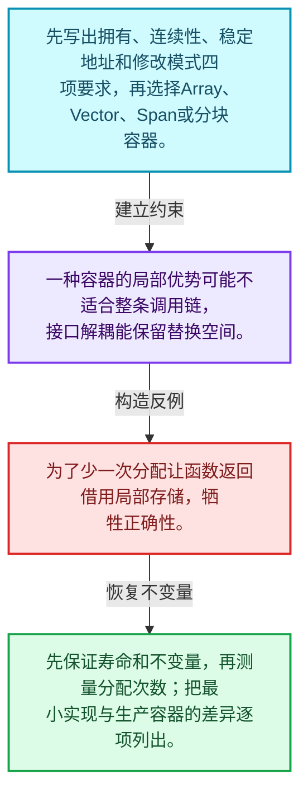
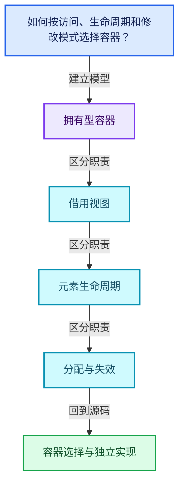
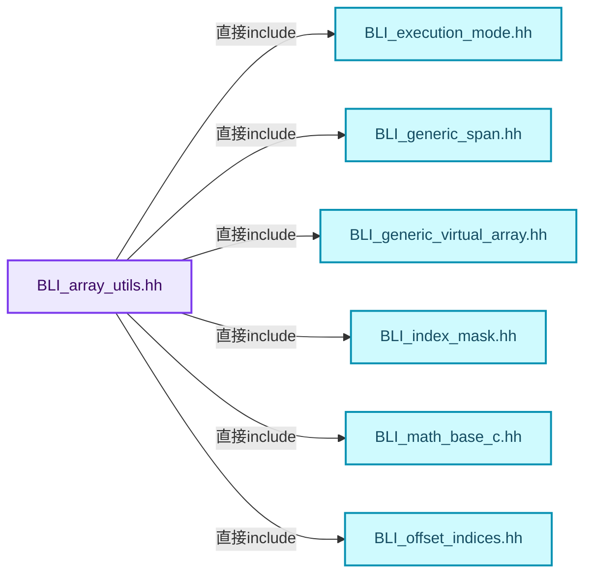
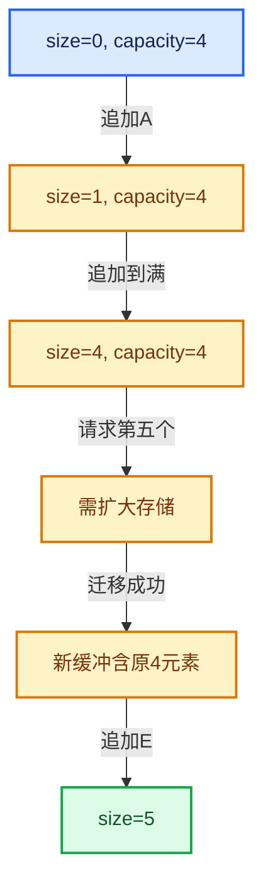

# 01-20 容器选择与独立实现

[方向导航](README.md) · [总目录](../README.md) · [覆盖索引](../%E6%BA%90%E7%A0%81%E7%89%88%E6%9C%AC%E4%B8%8E%E8%A6%86%E7%9B%96%E7%B4%A2%E5%BC%95.md)

> 阅读顺序：问题与数据模型 → 语法与类型 → 源码逐行 → 调用线索 → 历史与取舍 → 推演和练习。

- 基准 HEAD：`cbda6b96c26c0dee3c3b5cbb93960c4ac06a6b30`。
- 记录日期：2026-10-14。
- 教学示例状态：正文中的推演不是本机性能实测；已运行练习见验收报告。

## 一、从问题到设计

如何按访问、生命周期和修改模式选择容器？

先明确数据是否连续、是否拥有、是否需要稳定地址，再比较布局和分配；容器名不是设计依据。

本篇把语法、数据语义和系统取舍连接起来。先证明对象存活，再讨论索引；先区分借用与拥有，再讨论复制移动。

### 本篇独立模型与设计推理

先写出拥有、连续性、稳定地址和修改模式四项要求，再选择Array、Vector、Span或分块容器。

设计取舍：一种容器的局部优势可能不适合整条调用链，接口解耦能保留替换空间。

最小反例：为了少一次分配让函数返回借用局部存储，牺牲正确性。

推导与处理：先保证寿命和不变量，再测量分配次数；把最小实现与生产容器的差异逐项列出。



### 源码范围与相邻篇章

| 文件 | 本篇逐行范围 | 基准SHA-256 |
|---|---|---|
| [source/blender/blenlib/BLI_array_utils.hh](../../../../../source/blender/blenlib/BLI_array_utils.hh) | L1—L272 | `4d17392df7c8d116f2c5bf8cf49c19241d58903bf94783ef1e5f5e452a011274` |

同一主讲文件可能分多篇覆盖；超出本篇范围的符号通过覆盖索引定位。空行与纯注释保留在源码摘录中，逐行表解释有效语句与语法边界；许可证头统一保留。

前篇：[BitSpan与BitVector](19-BitSpan%E4%B8%8EBitVector.md).

## 二、类型、数据与阅读地图



这是概念依赖图，边表示阅读关系，不声称是运行时调用顺序。

### 直接编译依赖



箭头只表示头文件包含关系；完整调用线索见后面的符号定位表。

## 三、关键词、语法与类型角色

### 模板 template

模板把类型或常量作为生成实现的参数。读声明时先列出类型参数、非类型参数和默认值，再看使用者实际实例化了什么。模板声明本身不意味着每种T都支持其全部成员。

具体检查：把T替换为int、string、只能移动的类型，分别检查每个被调用操作是否成立。

### 依赖名称 typename

typename既可引入类型模板参数，也可告诉编译器某个依赖名称是类型。它不创建运行时对象；解析期确认语法类别与实例化期检查具体类型是不同阶段。

具体检查：区分typename T::value_type和T::size()，前者标记类型，后者是表达式。

### 常量求值 constexpr

constexpr声明允许相应实体参与常量求值，但constexpr函数仍可以在运行时执行。是否常量求值由调用场景和表达式合法性共同决定。

具体检查：比较constexpr变量初始化和从运行时输入调用同一函数。

### 只读限定 const

const约束当前访问路径可做的修改。const指针、指向const的指针、const视图对象、const元素是不同位置的限定；其他别名可能仍可修改原对象。

具体检查：分别写T* const、const T*与const T* const，并画出不可修改的层次。

### 显式静态转换 static_cast

static_cast表达编译期允许的转换，不会自动验证运行时真实类型、指针寿命或索引边界。由void指针恢复T指针时，调用者仍须保证实际存储中确有合法T对象。

具体检查：标出转换前后的类型以及正确性依据来自哪里。

### 运行时多态 virtual

虚调用根据实际动态类型选择实现；经基类指针销毁对象时通常需要相应虚析构契约。每元素虚调用和循环外一次分派有不同开销。

具体检查：找出虚接口的实现类和调用频率，再讨论是否值得去虚拟化。

### 对象表示 sizeof

sizeof给出对象表示大小，不是其引用的所有堆内存总量。sizeof视图很小并不说明底层数组很小。

具体检查：分别统计容器对象、容量字节和元素拥有的间接资源。

### 内部断言 assert

断言表达开发者预期成立的内部契约，发布构建可能关闭。它不能替代对不可信输入的完整错误处理，也不保证后续操作被运行时保护。

具体检查：对每条断言构造违反条件的输入，区分调用者错误与应向用户报告的错误。

### 编译期分支 if constexpr

条件在实例化时决定被保留的分支，这常用于不同类型的合法操作选择。它与运行时if有不同的实例化检查规则。

具体检查：找出每个分支依赖哪些类型特征，再使用满足与不满足条件的类型。

### 类型别名 using

类型别名为已有类型建立名字，不创建运行期对象。它常把模板内部使用的类型统一暴露给泛型调用者。

具体检查：展开别名直到基础类型，区分类型别名和变量声明。

## 四、真实源码与逐行讲解

源码块保持原行内容，原始行号由小节标题及逐行表给出。表中的调用定位是静态阅读辅助；重载、模板实例化、宏展开和虚调用需结合完整声明，不能仅凭词法出现证明动态调用。

### BLI_array_utils.hh：L1—L48

<!-- source:source/blender/blenlib/BLI_array_utils.hh:1:48 -->

```cpp
/* SPDX-FileCopyrightText: 2023 Blender Authors
 *
 * SPDX-License-Identifier: GPL-2.0-or-later */

/** \file
 * \ingroup bli
 */

#pragma once

#include <numeric>

#include "BLI_execution_mode.hh"
#include "BLI_generic_span.hh"
#include "BLI_generic_virtual_array.hh"
#include "BLI_index_mask.hh"
#include "BLI_math_base_c.hh"
#include "BLI_offset_indices.hh"
#include "BLI_task.hh"
#include "BLI_virtual_array.hh"

#include "PRF_profile.hh"

namespace blender::array_utils {

constexpr int64_t calc_copy_grain_size(const exec_mode::Tag auto mode, const int64_t type_size)
{
  /* The grain size should roughly depend on the work being done per index, which roughly
   * corresponds with the size of the type being copied. */
  return mode.grain_size(std::max<int64_t>(1, 32768 / type_size));
}

constexpr int64_t calc_copy_grain_size(const exec_mode::Mode mode, const int64_t type_size)
{
  return mode.grain_size(std::max<int64_t>(1, 32768 / type_size));
}

/** Similar to #Mode::grain_size(int), but also returns a tag type. */
template<exec_mode::Tag Mode>
constexpr auto exec_mode_tag_for_copy(const Mode mode, const int64_t type_size)
{
  if constexpr (mode.is_parallel) {
    return exec_mode::ParallelGrainSize{mode.grain_size(std::max<int64_t>(1, 32768 / type_size))};
  }
  else {
    return Mode{mode};
  }
}
```

本段语义重点：

- `std::max`：取较大值，在容量计算中常用于同时满足请求量和增长策略。

| 原始行 | 语义、约束与检查 |
|---|---|
| L9 | 防止同一头文件在一个翻译单元中重复展开；不控制多个源文件之间的链接或对象寿命。 |
| L11 | 引入编译依赖 <numeric>；这是声明可见性关系，不表示运行时一定调用该文件的所有接口。 |
| L13 | 引入编译依赖 "BLI_execution_mode.hh"；这是声明可见性关系，不表示运行时一定调用该文件的所有接口。 |
| L14 | 引入编译依赖 "BLI_generic_span.hh"；这是声明可见性关系，不表示运行时一定调用该文件的所有接口。 |
| L15 | 引入编译依赖 "BLI_generic_virtual_array.hh"；这是声明可见性关系，不表示运行时一定调用该文件的所有接口。 |
| L16 | 引入编译依赖 "BLI_index_mask.hh"；这是声明可见性关系，不表示运行时一定调用该文件的所有接口。 |
| L17 | 引入编译依赖 "BLI_math_base_c.hh"；这是声明可见性关系，不表示运行时一定调用该文件的所有接口。 |
| L18 | 引入编译依赖 "BLI_offset_indices.hh"；这是声明可见性关系，不表示运行时一定调用该文件的所有接口。 |
| L19 | 引入编译依赖 "BLI_task.hh"；这是声明可见性关系，不表示运行时一定调用该文件的所有接口。 |
| L20 | 引入编译依赖 "BLI_virtual_array.hh"；这是声明可见性关系，不表示运行时一定调用该文件的所有接口。 |
| L22 | 引入编译依赖 "PRF_profile.hh"；这是声明可见性关系，不表示运行时一定调用该文件的所有接口。 |
| L24 | 把后续声明放入 blender::array_utils 命名空间，影响名称查找和符号归属，不创建运行时对象。 |
| L26 | 出现调用或函数声明 `calc_copy_grain_size`，对应表达式为 `constexpr int64_t calc_copy_grain_size(const exec_mode::Tag auto mode, const int64_t type_size)`。参数求值、返回类型与重载需结合前后完整语句；静态文本引用不能证明动态目标。 |
| L27 | 连接上一行的声明或控制结构与其语句块；后续行在这个作用域中执行或声明。 |
| L30 | 本行使用 `std::max`：取较大值，在容量计算中常用于同时满足请求量和增长策略。 |
| L31 | 结束当前语法单元。局部自动对象在离开其作用域时按规则销毁；这不等于所有被引用的外部数据也被释放。 |
| L33 | 出现调用或函数声明 `calc_copy_grain_size`，对应表达式为 `constexpr int64_t calc_copy_grain_size(const exec_mode::Mode mode, const int64_t type_size)`。参数求值、返回类型与重载需结合前后完整语句；静态文本引用不能证明动态目标。 |
| L34 | 连接上一行的声明或控制结构与其语句块；后续行在这个作用域中执行或声明。 |
| L35 | 本行使用 `std::max`：取较大值，在容量计算中常用于同时满足请求量和增长策略。 |
| L36 | 结束当前语法单元。局部自动对象在离开其作用域时按规则销毁；这不等于所有被引用的外部数据也被释放。 |
| L39 | 声明模板参数 `template<exec_mode::Tag Mode>`。类型参数决定生成操作的类型，非类型参数可决定内嵌容量或编译期分支。 |
| L40 | 出现调用或函数声明 `exec_mode_tag_for_copy`，对应表达式为 `constexpr auto exec_mode_tag_for_copy(const Mode mode, const int64_t type_size)`。参数求值、返回类型与重载需结合前后完整语句；静态文本引用不能证明动态目标。 |
| L41 | 连接上一行的声明或控制结构与其语句块；后续行在这个作用域中执行或声明。 |
| L42 | 编译期条件分支 `if constexpr (mode.is_parallel)`。按实例化类型选择相应实现；被舍弃分支和运行期if具有不同检查规则，不能当作运行时输入验证。 |
| L43 | 本行使用 `std::max`：取较大值，在容量计算中常用于同时满足请求量和增长策略。 |
| L44 | 结束当前语法单元。局部自动对象在离开其作用域时按规则销毁；这不等于所有被引用的外部数据也被释放。 |
| L45 | 处理前一条件不成立的互补路径。比较两条路径最后是否恢复同一不变量，以及是否产生不同的资源责任。 |
| L46 | 返回表达式 `Mode{mode}`。 |
| L47 | 结束当前语法单元。局部自动对象在离开其作用域时按规则销毁；这不等于所有被引用的外部数据也被释放。 |
| L48 | 结束当前语法单元。局部自动对象在离开其作用域时按规则销毁；这不等于所有被引用的外部数据也被释放。 |

### BLI_array_utils.hh：L49—L93

<!-- source:source/blender/blenlib/BLI_array_utils.hh:49:93 -->

```cpp

/**
 * Fill the destination span by copying all values from the `src` array.
 */
void copy(const GVArray &src, GMutableSpan dst, exec_mode::Mode mode = exec_mode::parallel);
template<typename T, exec_mode::Tag Mode = exec_mode::Parallel>
inline void copy(const VArray<T> &src, MutableSpan<T> dst, const Mode mode = {})
{
  BLI_assert(src.size() == dst.size());
  if constexpr (!mode.is_parallel) {
    src.materialize_compressed(dst.index_range(), dst);
  }
  else {
    const int64_t grain_size = calc_copy_grain_size(mode, sizeof(T));
    threading::parallel_for(src.index_range(), grain_size, [&](const IndexRange range) {
      src.materialize(range, dst);
    });
  }
}

/**
 * Fill the destination span by copying all values from the `src` array.
 */
template<typename T, exec_mode::Tag Mode = exec_mode::Parallel>
inline void copy(const Span<T> src, MutableSpan<T> dst, const Mode mode = {})
{
  BLI_assert(src.size() == dst.size());
  if constexpr (!mode.is_parallel) {
    dst.copy_from(src);
  }
  else {
    const int64_t grain_size = calc_copy_grain_size(mode, sizeof(T));
    threading::parallel_for(src.index_range(), grain_size, [&](const IndexRange range) {
      copy(src.slice(range), dst.slice(range), exec_mode::serial);
    });
  }
}

/**
 * Fill the destination span by copying masked values from the `src` array.
 */
void copy(const GVArray &src,
          const IndexMask &selection,
          GMutableSpan dst,
          exec_mode::Mode mode = exec_mode::parallel);
```

| 原始行 | 语义、约束与检查 |
|---|---|
| L53 | 把右侧 `exec_mode::parallel)` 用于初始化或更新左侧 `void copy(const GVArray &src, GMutableSpan dst, exec_mode::Mode mode`。声明初始化与已有对象赋值应按上下文区分；有资源的类型会调用相应特殊成员。 |
| L54 | 声明模板参数 `template<typename T, exec_mode::Tag Mode = exec_mode::Parallel>`。类型参数决定生成操作的类型，非类型参数可决定内嵌容量或编译期分支。 |
| L55 | 把右侧 `{})` 用于初始化或更新左侧 `inline void copy(const VArray<T> &src, MutableSpan<T> dst, const Mode mode`。声明初始化与已有对象赋值应按上下文区分；有资源的类型会调用相应特殊成员。 |
| L56 | 连接上一行的声明或控制结构与其语句块；后续行在这个作用域中执行或声明。 |
| L57 | 断言约束 `BLI_assert(src.size() == dst.size());`。条件是后续访问的内部前置条件；发布构建可能不执行，不能把断言当作输入修复。 |
| L58 | 编译期条件分支 `if constexpr (!mode.is_parallel)`。按实例化类型选择相应实现；被舍弃分支和运行期if具有不同检查规则，不能当作运行时输入验证。 |
| L59 | 出现调用或函数声明 `materialize_compressed`，对应表达式为 `src.materialize_compressed(dst.index_range(), dst);`。参数求值、返回类型与重载需结合前后完整语句；静态文本引用不能证明动态目标。 |
| L60 | 结束当前语法单元。局部自动对象在离开其作用域时按规则销毁；这不等于所有被引用的外部数据也被释放。 |
| L61 | 处理前一条件不成立的互补路径。比较两条路径最后是否恢复同一不变量，以及是否产生不同的资源责任。 |
| L62 | 把右侧 `calc_copy_grain_size(mode, sizeof(T))` 用于初始化或更新左侧 `const int64_t grain_size`。声明初始化与已有对象赋值应按上下文区分；有资源的类型会调用相应特殊成员。 |
| L63 | 出现调用或函数声明 `threading::parallel_for`，对应表达式为 `threading::parallel_for(src.index_range(), grain_size, [&](const IndexRange range) {`。参数求值、返回类型与重载需结合前后完整语句；静态文本引用不能证明动态目标。 |
| L64 | 出现调用或函数声明 `materialize`，对应表达式为 `src.materialize(range, dst);`。参数求值、返回类型与重载需结合前后完整语句；静态文本引用不能证明动态目标。 |
| L65 | 结束当前语法单元。局部自动对象在离开其作用域时按规则销毁；这不等于所有被引用的外部数据也被释放。 |
| L66 | 结束当前语法单元。局部自动对象在离开其作用域时按规则销毁；这不等于所有被引用的外部数据也被释放。 |
| L67 | 结束当前语法单元。局部自动对象在离开其作用域时按规则销毁；这不等于所有被引用的外部数据也被释放。 |
| L72 | 声明模板参数 `template<typename T, exec_mode::Tag Mode = exec_mode::Parallel>`。类型参数决定生成操作的类型，非类型参数可决定内嵌容量或编译期分支。 |
| L73 | 把右侧 `{})` 用于初始化或更新左侧 `inline void copy(const Span<T> src, MutableSpan<T> dst, const Mode mode`。声明初始化与已有对象赋值应按上下文区分；有资源的类型会调用相应特殊成员。 |
| L74 | 连接上一行的声明或控制结构与其语句块；后续行在这个作用域中执行或声明。 |
| L75 | 断言约束 `BLI_assert(src.size() == dst.size());`。条件是后续访问的内部前置条件；发布构建可能不执行，不能把断言当作输入修复。 |
| L76 | 编译期条件分支 `if constexpr (!mode.is_parallel)`。按实例化类型选择相应实现；被舍弃分支和运行期if具有不同检查规则，不能当作运行时输入验证。 |
| L77 | 出现调用或函数声明 `copy_from`，对应表达式为 `dst.copy_from(src);`。参数求值、返回类型与重载需结合前后完整语句；静态文本引用不能证明动态目标。 |
| L78 | 结束当前语法单元。局部自动对象在离开其作用域时按规则销毁；这不等于所有被引用的外部数据也被释放。 |
| L79 | 处理前一条件不成立的互补路径。比较两条路径最后是否恢复同一不变量，以及是否产生不同的资源责任。 |
| L80 | 把右侧 `calc_copy_grain_size(mode, sizeof(T))` 用于初始化或更新左侧 `const int64_t grain_size`。声明初始化与已有对象赋值应按上下文区分；有资源的类型会调用相应特殊成员。 |
| L81 | 出现调用或函数声明 `threading::parallel_for`，对应表达式为 `threading::parallel_for(src.index_range(), grain_size, [&](const IndexRange range) {`。参数求值、返回类型与重载需结合前后完整语句；静态文本引用不能证明动态目标。 |
| L82 | 出现调用或函数声明 `copy`，对应表达式为 `copy(src.slice(range), dst.slice(range), exec_mode::serial);`。参数求值、返回类型与重载需结合前后完整语句；静态文本引用不能证明动态目标。 |
| L83 | 结束当前语法单元。局部自动对象在离开其作用域时按规则销毁；这不等于所有被引用的外部数据也被释放。 |
| L84 | 结束当前语法单元。局部自动对象在离开其作用域时按规则销毁；这不等于所有被引用的外部数据也被释放。 |
| L85 | 结束当前语法单元。局部自动对象在离开其作用域时按规则销毁；这不等于所有被引用的外部数据也被释放。 |
| L90 | 出现调用或函数声明 `copy`，对应表达式为 `void copy(const GVArray &src,`。参数求值、返回类型与重载需结合前后完整语句；静态文本引用不能证明动态目标。 |
| L91 | 本行是连续声明或表达式的一部分：`const IndexMask &selection,`。与本段前后行合读；逗号、括号和限定符决定它属于参数、初始化列表还是实际计算。 |
| L92 | 本行是连续声明或表达式的一部分：`GMutableSpan dst,`。与本段前后行合读；逗号、括号和限定符决定它属于参数、初始化列表还是实际计算。 |
| L93 | 把右侧 `exec_mode::parallel)` 用于初始化或更新左侧 `exec_mode::Mode mode`。声明初始化与已有对象赋值应按上下文区分；有资源的类型会调用相应特殊成员。 |

### BLI_array_utils.hh：L94—L141

<!-- source:source/blender/blenlib/BLI_array_utils.hh:94:141 -->

```cpp

/**
 * Fill the destination span by copying values from the `src` array.
 */
template<typename T, exec_mode::Tag Mode = exec_mode::Parallel>
inline void copy(const Span<T> src,
                 const IndexMask &selection,
                 MutableSpan<T> dst,
                 const Mode mode = {})
{
  BLI_assert(src.size() == dst.size());
  selection.foreach_index_optimized<int64_t>([&](const int64_t i) { dst[i] = src[i]; },
                                             exec_mode_tag_for_copy(mode, sizeof(T)));
}

template<typename T> T compute_sum(const Span<T> data)
{
  /* Explicitly splitting work into chunks for a couple of reasons:
   * - Improve numerical stability. While there are even more stable algorithms (e.g. Kahan
   *   summation), they also add more complexity to the hot code path. So far, this simple approach
   *   seems to solve the common issues people run into.
   * - Support computing the sum using multiple threads.
   * - Ensure deterministic results even with floating point numbers.
   */
  constexpr int64_t chunk_size = 1024;
  const int64_t chunks_num = divide_ceil_ul(data.size(), chunk_size);
  Array<T> partial_sums(chunks_num);
  threading::parallel_for(partial_sums.index_range(), 1, [&](const IndexRange range) {
    for (const int64_t i : range) {
      const int64_t start = i * chunk_size;
      const Span<T> chunk = data.slice_safe(start, chunk_size);
      const T partial_sum = std::accumulate(chunk.begin(), chunk.end(), T());
      partial_sums[i] = partial_sum;
    }
  });
  return std::accumulate(partial_sums.begin(), partial_sums.end(), T());
}

/**
 * Fill the specified indices of the destination with the values in the source span.
 */
template<typename T, typename IndexT, exec_mode::Tag Mode = exec_mode::Parallel>
inline void scatter(const Span<T> src,
                    const Span<IndexT> indices,
                    MutableSpan<T> dst,
                    const Mode mode = {})
{
  BLI_assert(indices.size() == src.size());
```

| 原始行 | 语义、约束与检查 |
|---|---|
| L98 | 声明模板参数 `template<typename T, exec_mode::Tag Mode = exec_mode::Parallel>`。类型参数决定生成操作的类型，非类型参数可决定内嵌容量或编译期分支。 |
| L99 | 出现调用或函数声明 `copy`，对应表达式为 `inline void copy(const Span<T> src,`。参数求值、返回类型与重载需结合前后完整语句；静态文本引用不能证明动态目标。 |
| L100 | 本行是连续声明或表达式的一部分：`const IndexMask &selection,`。与本段前后行合读；逗号、括号和限定符决定它属于参数、初始化列表还是实际计算。 |
| L101 | 本行是连续声明或表达式的一部分：`MutableSpan<T> dst,`。与本段前后行合读；逗号、括号和限定符决定它属于参数、初始化列表还是实际计算。 |
| L102 | 把右侧 `{})` 用于初始化或更新左侧 `const Mode mode`。声明初始化与已有对象赋值应按上下文区分；有资源的类型会调用相应特殊成员。 |
| L103 | 连接上一行的声明或控制结构与其语句块；后续行在这个作用域中执行或声明。 |
| L104 | 断言约束 `BLI_assert(src.size() == dst.size());`。条件是后续访问的内部前置条件；发布构建可能不执行，不能把断言当作输入修复。 |
| L105 | 把右侧 `src[i]; },` 用于初始化或更新左侧 `selection.foreach_index_optimized<int64_t>([&](const int64_t i) { dst[i]`。声明初始化与已有对象赋值应按上下文区分；有资源的类型会调用相应特殊成员。 |
| L106 | 出现调用或函数声明 `exec_mode_tag_for_copy`，对应表达式为 `exec_mode_tag_for_copy(mode, sizeof(T)));`。参数求值、返回类型与重载需结合前后完整语句；静态文本引用不能证明动态目标。 |
| L107 | 结束当前语法单元。局部自动对象在离开其作用域时按规则销毁；这不等于所有被引用的外部数据也被释放。 |
| L109 | 声明模板参数 `template<typename T> T compute_sum(const Span<T> data)`。类型参数决定生成操作的类型，非类型参数可决定内嵌容量或编译期分支。 |
| L110 | 连接上一行的声明或控制结构与其语句块；后续行在这个作用域中执行或声明。 |
| L118 | 把右侧 `1024` 用于初始化或更新左侧 `constexpr int64_t chunk_size`。声明初始化与已有对象赋值应按上下文区分；有资源的类型会调用相应特殊成员。 |
| L119 | 把右侧 `divide_ceil_ul(data.size(), chunk_size)` 用于初始化或更新左侧 `const int64_t chunks_num`。声明初始化与已有对象赋值应按上下文区分；有资源的类型会调用相应特殊成员。 |
| L120 | 出现调用或函数声明 `partial_sums`，对应表达式为 `Array<T> partial_sums(chunks_num);`。参数求值、返回类型与重载需结合前后完整语句；静态文本引用不能证明动态目标。 |
| L121 | 出现调用或函数声明 `threading::parallel_for`，对应表达式为 `threading::parallel_for(partial_sums.index_range(), 1, [&](const IndexRange range) {`。参数求值、返回类型与重载需结合前后完整语句；静态文本引用不能证明动态目标。 |
| L122 | 按 `for (const int64_t i : range)` 指定的范围或条件重复执行。对照循环变量与真实元素编号；循环内调用成本乘以实际迭代次数。 |
| L123 | 把右侧 `i * chunk_size` 用于初始化或更新左侧 `const int64_t start`。声明初始化与已有对象赋值应按上下文区分；有资源的类型会调用相应特殊成员。 |
| L124 | 把右侧 `data.slice_safe(start, chunk_size)` 用于初始化或更新左侧 `const Span<T> chunk`。声明初始化与已有对象赋值应按上下文区分；有资源的类型会调用相应特殊成员。 |
| L125 | 把右侧 `std::accumulate(chunk.begin(), chunk.end(), T())` 用于初始化或更新左侧 `const T partial_sum`。声明初始化与已有对象赋值应按上下文区分；有资源的类型会调用相应特殊成员。 |
| L126 | 把右侧 `partial_sum` 用于初始化或更新左侧 `partial_sums[i]`。声明初始化与已有对象赋值应按上下文区分；有资源的类型会调用相应特殊成员。 |
| L127 | 结束当前语法单元。局部自动对象在离开其作用域时按规则销毁；这不等于所有被引用的外部数据也被释放。 |
| L128 | 结束当前语法单元。局部自动对象在离开其作用域时按规则销毁；这不等于所有被引用的外部数据也被释放。 |
| L129 | 返回表达式 `std::accumulate(partial_sums.begin(), partial_sums.end(), T())`。 |
| L130 | 结束当前语法单元。局部自动对象在离开其作用域时按规则销毁；这不等于所有被引用的外部数据也被释放。 |
| L135 | 声明模板参数 `template<typename T, typename IndexT, exec_mode::Tag Mode = exec_mode::Parallel>`。类型参数决定生成操作的类型，非类型参数可决定内嵌容量或编译期分支。 |
| L136 | 出现调用或函数声明 `scatter`，对应表达式为 `inline void scatter(const Span<T> src,`。参数求值、返回类型与重载需结合前后完整语句；静态文本引用不能证明动态目标。 |
| L137 | 本行是连续声明或表达式的一部分：`const Span<IndexT> indices,`。与本段前后行合读；逗号、括号和限定符决定它属于参数、初始化列表还是实际计算。 |
| L138 | 本行是连续声明或表达式的一部分：`MutableSpan<T> dst,`。与本段前后行合读；逗号、括号和限定符决定它属于参数、初始化列表还是实际计算。 |
| L139 | 把右侧 `{})` 用于初始化或更新左侧 `const Mode mode`。声明初始化与已有对象赋值应按上下文区分；有资源的类型会调用相应特殊成员。 |
| L140 | 连接上一行的声明或控制结构与其语句块；后续行在这个作用域中执行或声明。 |
| L141 | 断言约束 `BLI_assert(indices.size() == src.size());`。条件是后续访问的内部前置条件；发布构建可能不执行，不能把断言当作输入修复。 |

### BLI_array_utils.hh：L142—L191

<!-- source:source/blender/blenlib/BLI_array_utils.hh:142:191 -->

```cpp
  if constexpr (!mode.is_parallel) {
    for (const int64_t i : indices.index_range()) {
      dst[indices[i]] = src[i];
    }
  }
  else {
    const int64_t grain_size = calc_copy_grain_size(mode, sizeof(T));
    threading::parallel_for(indices.index_range(), grain_size, [&](const IndexRange range) {
      scatter(src.slice(range), indices.slice(range), dst, exec_mode::serial);
    });
  }
}

template<typename T, exec_mode::Tag Mode = exec_mode::Parallel>
inline void scatter(const Span<T> src,
                    const IndexMask &indices,
                    MutableSpan<T> dst,
                    const Mode mode = {})
{
  BLI_assert(indices.size() == src.size());
  BLI_assert(indices.min_array_size() <= dst.size());
  indices.foreach_index_optimized<int64_t>(
      [&](const int64_t index, const int64_t pos) { dst[index] = src[pos]; },
      exec_mode_tag_for_copy(mode, sizeof(T)));
}

/**
 * Fill the destination span by gathering indexed values from the `src` array.
 */
void gather(const GVArray &src,
            const IndexMask &indices,
            GMutableSpan dst,
            exec_mode::Mode mode = exec_mode::parallel);

/**
 * Fill the destination span by gathering indexed values from the `src` array.
 */
void gather(GSpan src,
            const IndexMask &indices,
            GMutableSpan dst,
            exec_mode::Mode mode = exec_mode::parallel);

/**
 * Fill the destination span by gathering indexed values from the `src` array.
 */
template<typename T, exec_mode::Tag Mode = exec_mode::Parallel>
inline void gather(const VArray<T> &src,
                   const IndexMask &indices,
                   MutableSpan<T> dst,
                   const Mode mode = {})
```

| 原始行 | 语义、约束与检查 |
|---|---|
| L142 | 编译期条件分支 `if constexpr (!mode.is_parallel)`。按实例化类型选择相应实现；被舍弃分支和运行期if具有不同检查规则，不能当作运行时输入验证。 |
| L143 | 按 `for (const int64_t i : indices.index_range())` 指定的范围或条件重复执行。对照循环变量与真实元素编号；循环内调用成本乘以实际迭代次数。 |
| L144 | 把右侧 `src[i]` 用于初始化或更新左侧 `dst[indices[i]]`。声明初始化与已有对象赋值应按上下文区分；有资源的类型会调用相应特殊成员。 |
| L145 | 结束当前语法单元。局部自动对象在离开其作用域时按规则销毁；这不等于所有被引用的外部数据也被释放。 |
| L146 | 结束当前语法单元。局部自动对象在离开其作用域时按规则销毁；这不等于所有被引用的外部数据也被释放。 |
| L147 | 处理前一条件不成立的互补路径。比较两条路径最后是否恢复同一不变量，以及是否产生不同的资源责任。 |
| L148 | 把右侧 `calc_copy_grain_size(mode, sizeof(T))` 用于初始化或更新左侧 `const int64_t grain_size`。声明初始化与已有对象赋值应按上下文区分；有资源的类型会调用相应特殊成员。 |
| L149 | 出现调用或函数声明 `threading::parallel_for`，对应表达式为 `threading::parallel_for(indices.index_range(), grain_size, [&](const IndexRange range) {`。参数求值、返回类型与重载需结合前后完整语句；静态文本引用不能证明动态目标。 |
| L150 | 出现调用或函数声明 `scatter`，对应表达式为 `scatter(src.slice(range), indices.slice(range), dst, exec_mode::serial);`。参数求值、返回类型与重载需结合前后完整语句；静态文本引用不能证明动态目标。 |
| L151 | 结束当前语法单元。局部自动对象在离开其作用域时按规则销毁；这不等于所有被引用的外部数据也被释放。 |
| L152 | 结束当前语法单元。局部自动对象在离开其作用域时按规则销毁；这不等于所有被引用的外部数据也被释放。 |
| L153 | 结束当前语法单元。局部自动对象在离开其作用域时按规则销毁；这不等于所有被引用的外部数据也被释放。 |
| L155 | 声明模板参数 `template<typename T, exec_mode::Tag Mode = exec_mode::Parallel>`。类型参数决定生成操作的类型，非类型参数可决定内嵌容量或编译期分支。 |
| L156 | 出现调用或函数声明 `scatter`，对应表达式为 `inline void scatter(const Span<T> src,`。参数求值、返回类型与重载需结合前后完整语句；静态文本引用不能证明动态目标。 |
| L157 | 本行是连续声明或表达式的一部分：`const IndexMask &indices,`。与本段前后行合读；逗号、括号和限定符决定它属于参数、初始化列表还是实际计算。 |
| L158 | 本行是连续声明或表达式的一部分：`MutableSpan<T> dst,`。与本段前后行合读；逗号、括号和限定符决定它属于参数、初始化列表还是实际计算。 |
| L159 | 把右侧 `{})` 用于初始化或更新左侧 `const Mode mode`。声明初始化与已有对象赋值应按上下文区分；有资源的类型会调用相应特殊成员。 |
| L160 | 连接上一行的声明或控制结构与其语句块；后续行在这个作用域中执行或声明。 |
| L161 | 断言约束 `BLI_assert(indices.size() == src.size());`。条件是后续访问的内部前置条件；发布构建可能不执行，不能把断言当作输入修复。 |
| L162 | 断言约束 `BLI_assert(indices.min_array_size() <= dst.size());`。条件是后续访问的内部前置条件；发布构建可能不执行，不能把断言当作输入修复。 |
| L163 | 出现调用或函数声明 `foreach_index_optimized`，对应表达式为 `indices.foreach_index_optimized<int64_t>(`。参数求值、返回类型与重载需结合前后完整语句；静态文本引用不能证明动态目标。 |
| L164 | 把右侧 `src[pos]; },` 用于初始化或更新左侧 `[&](const int64_t index, const int64_t pos) { dst[index]`。声明初始化与已有对象赋值应按上下文区分；有资源的类型会调用相应特殊成员。 |
| L165 | 出现调用或函数声明 `exec_mode_tag_for_copy`，对应表达式为 `exec_mode_tag_for_copy(mode, sizeof(T)));`。参数求值、返回类型与重载需结合前后完整语句；静态文本引用不能证明动态目标。 |
| L166 | 结束当前语法单元。局部自动对象在离开其作用域时按规则销毁；这不等于所有被引用的外部数据也被释放。 |
| L171 | 出现调用或函数声明 `gather`，对应表达式为 `void gather(const GVArray &src,`。参数求值、返回类型与重载需结合前后完整语句；静态文本引用不能证明动态目标。 |
| L172 | 本行是连续声明或表达式的一部分：`const IndexMask &indices,`。与本段前后行合读；逗号、括号和限定符决定它属于参数、初始化列表还是实际计算。 |
| L173 | 本行是连续声明或表达式的一部分：`GMutableSpan dst,`。与本段前后行合读；逗号、括号和限定符决定它属于参数、初始化列表还是实际计算。 |
| L174 | 把右侧 `exec_mode::parallel)` 用于初始化或更新左侧 `exec_mode::Mode mode`。声明初始化与已有对象赋值应按上下文区分；有资源的类型会调用相应特殊成员。 |
| L179 | 出现调用或函数声明 `gather`，对应表达式为 `void gather(GSpan src,`。参数求值、返回类型与重载需结合前后完整语句；静态文本引用不能证明动态目标。 |
| L180 | 本行是连续声明或表达式的一部分：`const IndexMask &indices,`。与本段前后行合读；逗号、括号和限定符决定它属于参数、初始化列表还是实际计算。 |
| L181 | 本行是连续声明或表达式的一部分：`GMutableSpan dst,`。与本段前后行合读；逗号、括号和限定符决定它属于参数、初始化列表还是实际计算。 |
| L182 | 把右侧 `exec_mode::parallel)` 用于初始化或更新左侧 `exec_mode::Mode mode`。声明初始化与已有对象赋值应按上下文区分；有资源的类型会调用相应特殊成员。 |
| L187 | 声明模板参数 `template<typename T, exec_mode::Tag Mode = exec_mode::Parallel>`。类型参数决定生成操作的类型，非类型参数可决定内嵌容量或编译期分支。 |
| L188 | 出现调用或函数声明 `gather`，对应表达式为 `inline void gather(const VArray<T> &src,`。参数求值、返回类型与重载需结合前后完整语句；静态文本引用不能证明动态目标。 |
| L189 | 本行是连续声明或表达式的一部分：`const IndexMask &indices,`。与本段前后行合读；逗号、括号和限定符决定它属于参数、初始化列表还是实际计算。 |
| L190 | 本行是连续声明或表达式的一部分：`MutableSpan<T> dst,`。与本段前后行合读；逗号、括号和限定符决定它属于参数、初始化列表还是实际计算。 |
| L191 | 把右侧 `{})` 用于初始化或更新左侧 `const Mode mode`。声明初始化与已有对象赋值应按上下文区分；有资源的类型会调用相应特殊成员。 |

### BLI_array_utils.hh：L192—L242

<!-- source:source/blender/blenlib/BLI_array_utils.hh:192:242 -->

```cpp
{
  PRF_scope_with_name("array_utils::gather", ProfileCategory::Default);
  BLI_assert(indices.size() >= dst.size());
  if constexpr (!mode.is_parallel) {
    src.materialize_compressed(indices, dst);
  }
  else {
    const int64_t grain_size = calc_copy_grain_size(mode, sizeof(T));
    threading::parallel_for(indices.index_range(), grain_size, [&](const IndexRange range) {
      src.materialize_compressed(indices.slice(range), dst.slice(range));
    });
  }
}

/**
 * Fill the destination span by gathering indexed values from the `src` array.
 */
template<typename T, typename IndexT, exec_mode::Tag Mode = exec_mode::Parallel>
inline void gather(const Span<T> src,
                   const Span<IndexT> indices,
                   const IndexMask &dst_mask,
                   MutableSpan<T> dst,
                   const Mode mode = {})
{
  PRF_scope_with_name("array_utils::gather", ProfileCategory::Default);
  BLI_assert(indices.size() >= dst.size());
  dst_mask.foreach_index_optimized<int64_t>([&](const int64_t i) { dst[i] = src[indices[i]]; },
                                            exec_mode_tag_for_copy(mode, sizeof(T)));
}

/**
 * Fill the destination span by gathering indexed values from the `src` array.
 */
template<typename T, typename IndexT, exec_mode::Tag Mode = exec_mode::Parallel>
inline void gather(const Span<T> src,
                   const Span<IndexT> indices,
                   MutableSpan<T> dst,
                   const Mode mode = {})
{
  gather(src, indices, IndexMask(dst.size()), dst, mode);
}

/**
 * Fill the destination span by gathering indexed values from the `src` array.
 */
template<typename T, typename IndexT, exec_mode::Tag Mode = exec_mode::Parallel>
inline void gather(const VArray<T> &src,
                   const Span<IndexT> indices,
                   const IndexMask &dst_mask,
                   MutableSpan<T> dst,
                   const Mode mode = {})
```

| 原始行 | 语义、约束与检查 |
|---|---|
| L192 | 连接上一行的声明或控制结构与其语句块；后续行在这个作用域中执行或声明。 |
| L193 | 出现调用或函数声明 `PRF_scope_with_name`，对应表达式为 `PRF_scope_with_name("array_utils::gather", ProfileCategory::Default);`。参数求值、返回类型与重载需结合前后完整语句；静态文本引用不能证明动态目标。 |
| L194 | 断言约束 `BLI_assert(indices.size() >= dst.size());`。条件是后续访问的内部前置条件；发布构建可能不执行，不能把断言当作输入修复。 |
| L195 | 编译期条件分支 `if constexpr (!mode.is_parallel)`。按实例化类型选择相应实现；被舍弃分支和运行期if具有不同检查规则，不能当作运行时输入验证。 |
| L196 | 出现调用或函数声明 `materialize_compressed`，对应表达式为 `src.materialize_compressed(indices, dst);`。参数求值、返回类型与重载需结合前后完整语句；静态文本引用不能证明动态目标。 |
| L197 | 结束当前语法单元。局部自动对象在离开其作用域时按规则销毁；这不等于所有被引用的外部数据也被释放。 |
| L198 | 处理前一条件不成立的互补路径。比较两条路径最后是否恢复同一不变量，以及是否产生不同的资源责任。 |
| L199 | 把右侧 `calc_copy_grain_size(mode, sizeof(T))` 用于初始化或更新左侧 `const int64_t grain_size`。声明初始化与已有对象赋值应按上下文区分；有资源的类型会调用相应特殊成员。 |
| L200 | 出现调用或函数声明 `threading::parallel_for`，对应表达式为 `threading::parallel_for(indices.index_range(), grain_size, [&](const IndexRange range) {`。参数求值、返回类型与重载需结合前后完整语句；静态文本引用不能证明动态目标。 |
| L201 | 出现调用或函数声明 `materialize_compressed`，对应表达式为 `src.materialize_compressed(indices.slice(range), dst.slice(range));`。参数求值、返回类型与重载需结合前后完整语句；静态文本引用不能证明动态目标。 |
| L202 | 结束当前语法单元。局部自动对象在离开其作用域时按规则销毁；这不等于所有被引用的外部数据也被释放。 |
| L203 | 结束当前语法单元。局部自动对象在离开其作用域时按规则销毁；这不等于所有被引用的外部数据也被释放。 |
| L204 | 结束当前语法单元。局部自动对象在离开其作用域时按规则销毁；这不等于所有被引用的外部数据也被释放。 |
| L209 | 声明模板参数 `template<typename T, typename IndexT, exec_mode::Tag Mode = exec_mode::Parallel>`。类型参数决定生成操作的类型，非类型参数可决定内嵌容量或编译期分支。 |
| L210 | 出现调用或函数声明 `gather`，对应表达式为 `inline void gather(const Span<T> src,`。参数求值、返回类型与重载需结合前后完整语句；静态文本引用不能证明动态目标。 |
| L211 | 本行是连续声明或表达式的一部分：`const Span<IndexT> indices,`。与本段前后行合读；逗号、括号和限定符决定它属于参数、初始化列表还是实际计算。 |
| L212 | 本行是连续声明或表达式的一部分：`const IndexMask &dst_mask,`。与本段前后行合读；逗号、括号和限定符决定它属于参数、初始化列表还是实际计算。 |
| L213 | 本行是连续声明或表达式的一部分：`MutableSpan<T> dst,`。与本段前后行合读；逗号、括号和限定符决定它属于参数、初始化列表还是实际计算。 |
| L214 | 把右侧 `{})` 用于初始化或更新左侧 `const Mode mode`。声明初始化与已有对象赋值应按上下文区分；有资源的类型会调用相应特殊成员。 |
| L215 | 连接上一行的声明或控制结构与其语句块；后续行在这个作用域中执行或声明。 |
| L216 | 出现调用或函数声明 `PRF_scope_with_name`，对应表达式为 `PRF_scope_with_name("array_utils::gather", ProfileCategory::Default);`。参数求值、返回类型与重载需结合前后完整语句；静态文本引用不能证明动态目标。 |
| L217 | 断言约束 `BLI_assert(indices.size() >= dst.size());`。条件是后续访问的内部前置条件；发布构建可能不执行，不能把断言当作输入修复。 |
| L218 | 把右侧 `src[indices[i]]; },` 用于初始化或更新左侧 `dst_mask.foreach_index_optimized<int64_t>([&](const int64_t i) { dst[i]`。声明初始化与已有对象赋值应按上下文区分；有资源的类型会调用相应特殊成员。 |
| L219 | 出现调用或函数声明 `exec_mode_tag_for_copy`，对应表达式为 `exec_mode_tag_for_copy(mode, sizeof(T)));`。参数求值、返回类型与重载需结合前后完整语句；静态文本引用不能证明动态目标。 |
| L220 | 结束当前语法单元。局部自动对象在离开其作用域时按规则销毁；这不等于所有被引用的外部数据也被释放。 |
| L225 | 声明模板参数 `template<typename T, typename IndexT, exec_mode::Tag Mode = exec_mode::Parallel>`。类型参数决定生成操作的类型，非类型参数可决定内嵌容量或编译期分支。 |
| L226 | 出现调用或函数声明 `gather`，对应表达式为 `inline void gather(const Span<T> src,`。参数求值、返回类型与重载需结合前后完整语句；静态文本引用不能证明动态目标。 |
| L227 | 本行是连续声明或表达式的一部分：`const Span<IndexT> indices,`。与本段前后行合读；逗号、括号和限定符决定它属于参数、初始化列表还是实际计算。 |
| L228 | 本行是连续声明或表达式的一部分：`MutableSpan<T> dst,`。与本段前后行合读；逗号、括号和限定符决定它属于参数、初始化列表还是实际计算。 |
| L229 | 把右侧 `{})` 用于初始化或更新左侧 `const Mode mode`。声明初始化与已有对象赋值应按上下文区分；有资源的类型会调用相应特殊成员。 |
| L230 | 连接上一行的声明或控制结构与其语句块；后续行在这个作用域中执行或声明。 |
| L231 | 出现调用或函数声明 `gather`，对应表达式为 `gather(src, indices, IndexMask(dst.size()), dst, mode);`。参数求值、返回类型与重载需结合前后完整语句；静态文本引用不能证明动态目标。 |
| L232 | 结束当前语法单元。局部自动对象在离开其作用域时按规则销毁；这不等于所有被引用的外部数据也被释放。 |
| L237 | 声明模板参数 `template<typename T, typename IndexT, exec_mode::Tag Mode = exec_mode::Parallel>`。类型参数决定生成操作的类型，非类型参数可决定内嵌容量或编译期分支。 |
| L238 | 出现调用或函数声明 `gather`，对应表达式为 `inline void gather(const VArray<T> &src,`。参数求值、返回类型与重载需结合前后完整语句；静态文本引用不能证明动态目标。 |
| L239 | 本行是连续声明或表达式的一部分：`const Span<IndexT> indices,`。与本段前后行合读；逗号、括号和限定符决定它属于参数、初始化列表还是实际计算。 |
| L240 | 本行是连续声明或表达式的一部分：`const IndexMask &dst_mask,`。与本段前后行合读；逗号、括号和限定符决定它属于参数、初始化列表还是实际计算。 |
| L241 | 本行是连续声明或表达式的一部分：`MutableSpan<T> dst,`。与本段前后行合读；逗号、括号和限定符决定它属于参数、初始化列表还是实际计算。 |
| L242 | 把右侧 `{})` 用于初始化或更新左侧 `const Mode mode`。声明初始化与已有对象赋值应按上下文区分；有资源的类型会调用相应特殊成员。 |

### BLI_array_utils.hh：L243—L272

<!-- source:source/blender/blenlib/BLI_array_utils.hh:243:272 -->

```cpp
{
  PRF_scope_with_name("array_utils::gather", ProfileCategory::Default);
  BLI_assert(indices.size() >= dst_mask.min_array_size());
  const CommonVArrayInfo info = src.common_info();
  switch (info.type) {
    case CommonVArrayInfo::Type::Any: {
      dst_mask.foreach_index_optimized<int64_t>([&](const int64_t i) { dst[i] = src[indices[i]]; },
                                                exec_mode_tag_for_copy(mode, sizeof(T)));
      break;
    }
    case CommonVArrayInfo::Type::Span: {
      const Span span(static_cast<const T *>(info.data), src.size());
      gather(span, indices, dst_mask, dst, mode);
      break;
    }
    case CommonVArrayInfo::Type::Single: {
      index_mask::masked_fill(dst, *static_cast<const T *>(info.data), dst_mask);
      break;
    }
  }
}

/**
 * Fill the destination span by gathering indexed values from the `src` array.
 */
template<typename T, typename IndexT, exec_mode::Tag Mode = exec_mode::Parallel>
inline void gather(const VArray<T> &src,
                   const Span<IndexT> indices,
                   MutableSpan<T> dst,
                   const Mode mode = {})
```

| 原始行 | 语义、约束与检查 |
|---|---|
| L243 | 连接上一行的声明或控制结构与其语句块；后续行在这个作用域中执行或声明。 |
| L244 | 出现调用或函数声明 `PRF_scope_with_name`，对应表达式为 `PRF_scope_with_name("array_utils::gather", ProfileCategory::Default);`。参数求值、返回类型与重载需结合前后完整语句；静态文本引用不能证明动态目标。 |
| L245 | 断言约束 `BLI_assert(indices.size() >= dst_mask.min_array_size());`。条件是后续访问的内部前置条件；发布构建可能不执行，不能把断言当作输入修复。 |
| L246 | 把右侧 `src.common_info()` 用于初始化或更新左侧 `const CommonVArrayInfo info`。声明初始化与已有对象赋值应按上下文区分；有资源的类型会调用相应特殊成员。 |
| L247 | 按 switch (info.type) 选择状态处理路径；每个case的break、return或贯穿行为决定下一步。 |
| L248 | 进入枚举或判别值对应分支 case CommonVArrayInfo::Type::Any: {；结合状态定义和后续更新判断允许的转移。 |
| L249 | 把右侧 `src[indices[i]]; },` 用于初始化或更新左侧 `dst_mask.foreach_index_optimized<int64_t>([&](const int64_t i) { dst[i]`。声明初始化与已有对象赋值应按上下文区分；有资源的类型会调用相应特殊成员。 |
| L250 | 出现调用或函数声明 `exec_mode_tag_for_copy`，对应表达式为 `exec_mode_tag_for_copy(mode, sizeof(T)));`。参数求值、返回类型与重载需结合前后完整语句；静态文本引用不能证明动态目标。 |
| L251 | 离开最近的循环或switch；不是离开整个函数，后续清理和提交代码可能仍会执行。 |
| L252 | 结束当前语法单元。局部自动对象在离开其作用域时按规则销毁；这不等于所有被引用的外部数据也被释放。 |
| L253 | 进入枚举或判别值对应分支 case CommonVArrayInfo::Type::Span: {；结合状态定义和后续更新判断允许的转移。 |
| L254 | 声明接口 `const Span span(static_cast<const T *>(info.data), src.size())`，本行没有对应函数体；返回类型、参数限定和const/noexcept共同组成调用契约，实际行为需继续定位实现。 |
| L255 | 出现调用或函数声明 `gather`，对应表达式为 `gather(span, indices, dst_mask, dst, mode);`。参数求值、返回类型与重载需结合前后完整语句；静态文本引用不能证明动态目标。 |
| L256 | 离开最近的循环或switch；不是离开整个函数，后续清理和提交代码可能仍会执行。 |
| L257 | 结束当前语法单元。局部自动对象在离开其作用域时按规则销毁；这不等于所有被引用的外部数据也被释放。 |
| L258 | 进入枚举或判别值对应分支 case CommonVArrayInfo::Type::Single: {；结合状态定义和后续更新判断允许的转移。 |
| L259 | 出现调用或函数声明 `index_mask::masked_fill`，对应表达式为 `index_mask::masked_fill(dst, *static_cast<const T *>(info.data), dst_mask);`。参数求值、返回类型与重载需结合前后完整语句；静态文本引用不能证明动态目标。 |
| L260 | 离开最近的循环或switch；不是离开整个函数，后续清理和提交代码可能仍会执行。 |
| L261 | 结束当前语法单元。局部自动对象在离开其作用域时按规则销毁；这不等于所有被引用的外部数据也被释放。 |
| L262 | 结束当前语法单元。局部自动对象在离开其作用域时按规则销毁；这不等于所有被引用的外部数据也被释放。 |
| L263 | 结束当前语法单元。局部自动对象在离开其作用域时按规则销毁；这不等于所有被引用的外部数据也被释放。 |
| L268 | 声明模板参数 `template<typename T, typename IndexT, exec_mode::Tag Mode = exec_mode::Parallel>`。类型参数决定生成操作的类型，非类型参数可决定内嵌容量或编译期分支。 |
| L269 | 出现调用或函数声明 `gather`，对应表达式为 `inline void gather(const VArray<T> &src,`。参数求值、返回类型与重载需结合前后完整语句；静态文本引用不能证明动态目标。 |
| L270 | 本行是连续声明或表达式的一部分：`const Span<IndexT> indices,`。与本段前后行合读；逗号、括号和限定符决定它属于参数、初始化列表还是实际计算。 |
| L271 | 本行是连续声明或表达式的一部分：`MutableSpan<T> dst,`。与本段前后行合读；逗号、括号和限定符决定它属于参数、初始化列表还是实际计算。 |
| L272 | 把右侧 `{})` 用于初始化或更新左侧 `const Mode mode`。声明初始化与已有对象赋值应按上下文区分；有资源的类型会调用相应特殊成员。 |

## 五、接口定位、调用线索与生命周期

### 本篇声明与实现入口

| 源码位置 | 实际声明片段 |
|---|---|
| [BLI_array_utils.hh:L26](../../../../../source/blender/blenlib/BLI_array_utils.hh#L26) | `constexpr int64_t calc_copy_grain_size(const exec_mode::Tag auto mode, const int64_t type_size)` |
| [BLI_array_utils.hh:L33](../../../../../source/blender/blenlib/BLI_array_utils.hh#L33) | `constexpr int64_t calc_copy_grain_size(const exec_mode::Mode mode, const int64_t type_size)` |
| [BLI_array_utils.hh:L40](../../../../../source/blender/blenlib/BLI_array_utils.hh#L40) | `constexpr auto exec_mode_tag_for_copy(const Mode mode, const int64_t type_size)` |
| [BLI_array_utils.hh:L53](../../../../../source/blender/blenlib/BLI_array_utils.hh#L53) | `void copy(const GVArray &src, GMutableSpan dst, exec_mode::Mode mode = exec_mode::parallel);` |
| [BLI_array_utils.hh:L55](../../../../../source/blender/blenlib/BLI_array_utils.hh#L55) | `inline void copy(const VArray<T> &src, MutableSpan<T> dst, const Mode mode = {})` |
| [BLI_array_utils.hh:L73](../../../../../source/blender/blenlib/BLI_array_utils.hh#L73) | `inline void copy(const Span<T> src, MutableSpan<T> dst, const Mode mode = {})` |
| [BLI_array_utils.hh:L90](../../../../../source/blender/blenlib/BLI_array_utils.hh#L90) | `void copy(const GVArray &src,` |
| [BLI_array_utils.hh:L99](../../../../../source/blender/blenlib/BLI_array_utils.hh#L99) | `inline void copy(const Span<T> src,` |
| [BLI_array_utils.hh:L109](../../../../../source/blender/blenlib/BLI_array_utils.hh#L109) | `template<typename T> T compute_sum(const Span<T> data)` |
| [BLI_array_utils.hh:L120](../../../../../source/blender/blenlib/BLI_array_utils.hh#L120) | `Array<T> partial_sums(chunks_num);` |
| [BLI_array_utils.hh:L136](../../../../../source/blender/blenlib/BLI_array_utils.hh#L136) | `inline void scatter(const Span<T> src,` |
| [BLI_array_utils.hh:L156](../../../../../source/blender/blenlib/BLI_array_utils.hh#L156) | `inline void scatter(const Span<T> src,` |
| [BLI_array_utils.hh:L171](../../../../../source/blender/blenlib/BLI_array_utils.hh#L171) | `void gather(const GVArray &src,` |
| [BLI_array_utils.hh:L179](../../../../../source/blender/blenlib/BLI_array_utils.hh#L179) | `void gather(GSpan src,` |
| [BLI_array_utils.hh:L188](../../../../../source/blender/blenlib/BLI_array_utils.hh#L188) | `inline void gather(const VArray<T> &src,` |
| [BLI_array_utils.hh:L193](../../../../../source/blender/blenlib/BLI_array_utils.hh#L193) | `PRF_scope_with_name("array_utils::gather", ProfileCategory::Default);` |
| [BLI_array_utils.hh:L210](../../../../../source/blender/blenlib/BLI_array_utils.hh#L210) | `inline void gather(const Span<T> src,` |
| [BLI_array_utils.hh:L216](../../../../../source/blender/blenlib/BLI_array_utils.hh#L216) | `PRF_scope_with_name("array_utils::gather", ProfileCategory::Default);` |
| [BLI_array_utils.hh:L226](../../../../../source/blender/blenlib/BLI_array_utils.hh#L226) | `inline void gather(const Span<T> src,` |
| [BLI_array_utils.hh:L238](../../../../../source/blender/blenlib/BLI_array_utils.hh#L238) | `inline void gather(const VArray<T> &src,` |
| [BLI_array_utils.hh:L244](../../../../../source/blender/blenlib/BLI_array_utils.hh#L244) | `PRF_scope_with_name("array_utils::gather", ProfileCategory::Default);` |
| [BLI_array_utils.hh:L254](../../../../../source/blender/blenlib/BLI_array_utils.hh#L254) | `const Span span(static_cast<const T *>(info.data), src.size());` |
| [BLI_array_utils.hh:L269](../../../../../source/blender/blenlib/BLI_array_utils.hh#L269) | `inline void gather(const VArray<T> &src,` |

### 同名符号出现位置

以下表提供跨文件阅读入口，包含声明、调用或测试使用；没有经过完整C++名称解析，不把它命名为已证明的运行时调用图。

| 符号 | 位置 | 文本证据 |
|---|---|---|
| `copy` | [BKE_geometry_set.hh:L109](../../../../../source/blender/blenkernel/BKE_geometry_set.hh#L109) | `virtual GeometryComponentPtr copy() const = 0;` |
| `copy` | [BKE_geometry_set.hh:L504](../../../../../source/blender/blenkernel/BKE_geometry_set.hh#L504) | `GeometryComponentPtr copy() const override;` |
| `copy` | [BKE_geometry_set.hh:L562](../../../../../source/blender/blenkernel/BKE_geometry_set.hh#L562) | `GeometryComponentPtr copy() const override;` |
| `gather` | [geometry_fields.cc:L660](../../../../../source/blender/blenkernel/intern/geometry_fields.cc#L660) | `bke::attribute_math::gather(values, indices, valid_mask, dst_array);` |
| `gather` | [geometry_fields.cc:L752](../../../../../source/blender/blenkernel/intern/geometry_fields.cc#L752) | `bke::attribute_math::gather(*src_data_, indices, valid_mask, dst);` |
| `gather` | [mesh_normals.cc:L479](../../../../../source/blender/blenkernel/intern/mesh_normals.cc#L479) | `array_utils::gather(this->vert_normals(), this->corner_verts(), data);` |
| `PRF_scope_with_name` | [BLI_bounds.hh:L147](../../../../../source/blender/blenlib/BLI_bounds.hh#L147) | `PRF_scope_with_name("bounds::min_max", ProfileCategory::Default);` |
| `PRF_scope_with_name` | [BLI_bounds.hh:L169](../../../../../source/blender/blenlib/BLI_bounds.hh#L169) | `PRF_scope_with_name("bounds::min_max", ProfileCategory::Default);` |
| `PRF_scope_with_name` | [BLI_bounds.hh:L196](../../../../../source/blender/blenlib/BLI_bounds.hh#L196) | `PRF_scope_with_name("bounds::min_max_with_radii", ProfileCategory::Default);` |
| `span` | [BKE_attribute.hh:L263](../../../../../source/blender/blenkernel/BKE_attribute.hh#L263) | `: span(std::move(other.varray), copy_values_to_span),` |
| `span` | [BKE_attribute.hh:L361](../../../../../source/blender/blenkernel/BKE_attribute.hh#L361) | `: span(std::move(other.varray), copy_values_to_span),` |
| `span` | [BLI_bounds.hh:L224](../../../../../source/blender/blenlib/BLI_bounds.hh#L224) | `const Span<T> span(static_cast<const T *>(info.data), varray.size());` |

### 生命周期推理图


这是审查生命周期的通用模型。具体类是否拥有数据由本篇成员、构造、析构和调用者一起证明；任何箭头都不自动代表shared_ptr。

## 六、把代码放进具体数据中推演

本方向的共同数值模型如下。本篇的专门检查是：实现小型SmallVector并与数组视图配合，保留正确性对照与操作计数。

| 步骤 | 数据或状态 | 为什么需要这一步 |
|---|---|---|
| 初始 | size=0, capacity=4 | 只有存储，没有可读取的T元素 |
| 追加A | size=1, capacity=4 | 在第0个位置构造A |
| 追加到满 | size=4, capacity=4 | 四个位置均已构造 |
| 请求第五个 | 需扩大存储 | 旧地址仍需被正确管理 |
| 迁移成功 | 新缓冲含原4元素 | 提交新指针并释放旧存储 |
| 追加E | size=5 | 只在成功构造后扩大有效区间 |



图是教学推演模型；精确分支与状态更新以本篇摘录及调用契约为准。

### 本篇独立练习与参考思路

实现小型SmallVector并与数组视图配合，保留正确性对照与操作计数。

参考思路：先明确数据是否连续、是否拥有、是否需要稳定地址，再比较布局和分配；容器名不是设计依据。

将输入、预期结果和资源责任分成三张清单。先用最直接的实现给出可核对的答案，再替换成对应源码使用的表示；比较结果不变的条件，而不是只比较接口名字。

验收依据：构造成功次数减析构次数应等于当前存活对象数；异常之后资源计数应回到合法状态。

## 七、复杂度、设计取舍与其他基础库

对比std::vector、std::array、std::span与LLVM SmallVector、ArrayRef时，分别比较拥有关系、内嵌存储、大小是否属于类型和失效条件。不要根据同名方法推断完全相同契约。

本篇的具体取舍：先明确数据是否连续、是否拥有、是否需要稳定地址，再比较布局和分配；容器名不是设计依据。

| 观察维度 | 从源码取得证据的方法 | 本篇要避免的误判 |
|---|---|---|
| 时间 | 对循环次数、分派次数和重建频率分别计数 | 看到单次常数操作就断定整个操作序列是常数成本 |
| 内存 | 区分对象本体、容量存储、间接资源和共享控制块 | 用sizeof代替总内存 |
| 安全 | 沿构造、失败回滚、销毁与失效逐路径检查 | 把断言或非空指针当作完整安全证明 |
| 并发 | 逐字段确认锁、发布顺序和借用寿命 | 把引用计数线程安全等同数据读写线程安全 |

相关一手资料：

- [C++公开工作草案](https://eel.is/c++draft/)：持续更新的工作草案；语言与标准库语义以相应章节为准。
- [LLVM Programmer’s Manual](https://llvm.org/docs/ProgrammersManual.html)：在线版，2026-10-14查阅；仅比较设计思路，不保证与本地LLVM版本一致。

资料用于核对契约和进一步阅读；这里没有声称外部库与Blender实现相同，也没有把上游性能数字当作本机实测。

## 八、历史提交与设计演化

本篇主要讲当前接口或辅助实现，方向导航给出相关架构演化提交；没有把不涉及本篇文件的提交硬写成该实现的引入证据。

## 九、反例、测试入口与掌握标准

仓库测试入口：

- [BLI_array_utils_test.cc](../../../../../source/blender/blenlib/tests/BLI_array_utils_test.cc)：阅读输入、断言与覆盖边界；本篇不把“存在测试”写成“本轮已运行”。

需要实际构造的反例：

- 空输入或没有结果需求：确认接口允许的空状态与不允许访问的操作。
- 边界位置和退化结构：把长度为1、末尾位置、重复值或深链代入真实分支。
- 生命周期结束或修改之后：检查保存的指针、引用、结果视图是否仍有效。
- 与本篇核心不变量相冲突的输入：实现小型SmallVector并与数组视图配合，保留正确性对照与操作计数。

### 可运行的教学参考程序

[reference_exercises.cc](../_tools/reference_exercises.cc)包含独立于Blender的C++20参考检查：视图、简化SmallVector、异常回滚、哈希碰撞与删除、偏移数组、拓扑映射、共享缓存、表达式、惰性分支、闭包和暴力最近邻。

参考程序有意省略生产实现的完整能力。例如SmallVector禁止复制移动容器，不支持只能移动的元素，并禁止append参数别名到自身元素；TinyMap固定8槽，不提供增长。程序通过不能替代Blender实现测试。实际运行结果、编译器与命令见验收报告。

掌握标准：离开源码解释“如何按访问、生命周期和修改模式选择容器？”；独立完成上述练习；能指出一个会破坏拥有型容器相关约束的最小反例，并用具体代码行说明检查或修复应放在哪里。
