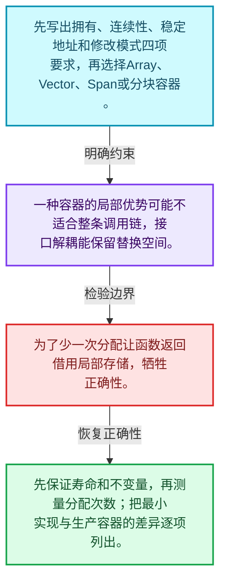
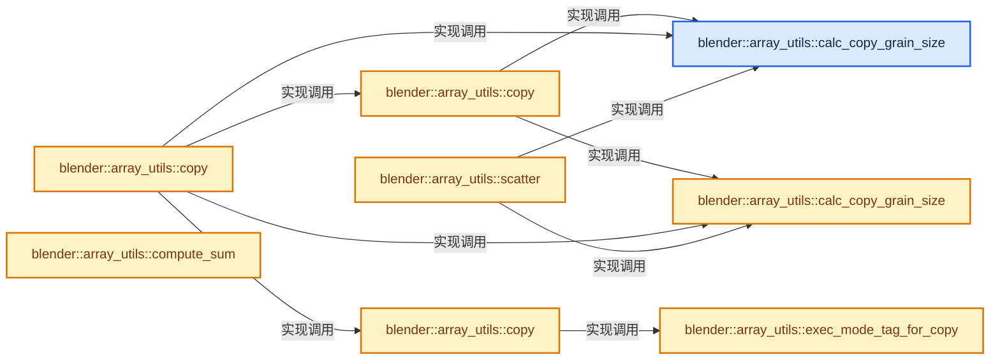
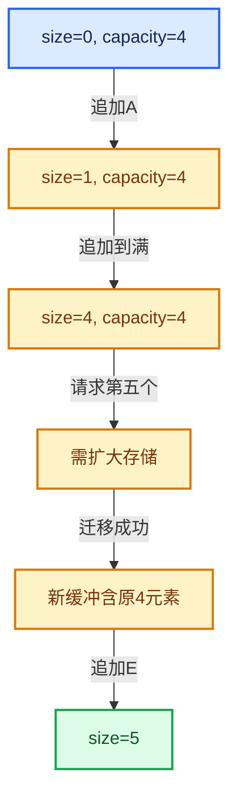

# 01-20 容器选择与独立实现

[方向导航](README.md) · [总目录](../README.md) · [实现索引](../%E7%AC%A6%E5%8F%B7%E4%BE%9D%E8%B5%96%E4%B8%8E%E5%AE%9E%E7%8E%B0%E7%B4%A2%E5%BC%95.md)

## 从问题到实现

如何按访问、生命周期和修改模式选择容器？

先明确数据是否连续、是否拥有、是否需要稳定地址，再比较布局和分配；容器名不是设计依据。

**数据模型**

先写出拥有、连续性、稳定地址和修改模式四项要求，再选择Array、Vector、Span或分块容器。

**设计取舍**

一种容器的局部优势可能不适合整条调用链，接口解耦能保留替换空间。

**最小反例**

为了少一次分配让函数返回借用局部存储，牺牲正确性。

**推导**

先保证寿命和不变量，再测量分配次数；把最小实现与生产容器的差异逐项列出。

## 阅读地图与执行推演








图中的数值推演是本方向的教学模型；实际函数之间的调用边与概念分析边分别标注，不能把概念关系当作运行时调度顺序。

## 完整源码单元与就地讲解

中文讲解直接放在相关代码旁，复杂机制在代码下展开。原文折叠区保留基准行号；不需要在行号表和函数之间来回查找。类布局可分段展示，函数实现不按固定行数切开。

### 类型布局、声明与编译条件 · BLI_array_utils.hh L1—L25

<!-- annotated:3bce7acb0aa6c8 -->

```cpp
/* SPDX-FileCopyrightText: 2023 Blender Authors
 *
 * SPDX-License-Identifier: GPL-2.0-or-later */

/** \file
 * \ingroup bli
 */

#pragma once

#include <numeric>

#include "BLI_execution_mode.hh"
#include "BLI_generic_span.hh"
#include "BLI_generic_virtual_array.hh"
#include "BLI_index_mask.hh"
#include "BLI_math_base_c.hh"
#include "BLI_offset_indices.hh"
#include "BLI_task.hh"
#include "BLI_virtual_array.hh"

#include "PRF_profile.hh"

namespace blender::array_utils {

```

<details>
<summary>核对原始源码：source/blender/blenlib/BLI_array_utils.hh · L1—L25</summary>

<!-- original:3bce7acb0aa6c8:source/blender/blenlib/BLI_array_utils.hh:1:25 -->

```cpp
/* SPDX-FileCopyrightText: 2023 Blender Authors
 *
 * SPDX-License-Identifier: GPL-2.0-or-later */

/** \file
 * \ingroup bli
 */

#pragma once

#include <numeric>

#include "BLI_execution_mode.hh"
#include "BLI_generic_span.hh"
#include "BLI_generic_virtual_array.hh"
#include "BLI_index_mask.hh"
#include "BLI_math_base_c.hh"
#include "BLI_offset_indices.hh"
#include "BLI_task.hh"
#include "BLI_virtual_array.hh"

#include "PRF_profile.hh"

namespace blender::array_utils {

```

</details>

<a id="f-c6af31786a6d8b20"></a>

### `blender::array_utils::calc_copy_grain_size`

实现位置：[source/blender/blenlib/BLI_array_utils.hh](../../../../../source/blender/blenlib/BLI_array_utils.hh) · L26—L31。

接口参数：

- `const exec_mode::Tag auto mode`
- `const int64_t type_size`

**教学注释版**

<!-- annotated:934e8c519b641d -->

```cpp
constexpr int64_t calc_copy_grain_size(const exec_mode::Tag auto mode, const int64_t type_size)
{
  /* The grain size should roughly depend on the work being done per index, which roughly
   * corresponds with the size of the type being copied. */
  // [讲解] std::max<int64_t>：按比较关系选取较大值。本讲解中的增长公式同时满足最低请求和几何增长；若保存返回引用，还需注意实参寿命。
  return mode.grain_size(std::max<int64_t>(1, 32768 / type_size));
}
```

<details>
<summary>核对原始源码：source/blender/blenlib/BLI_array_utils.hh · L26—L31</summary>

<!-- original:934e8c519b641d:source/blender/blenlib/BLI_array_utils.hh:26:31 -->

```cpp
constexpr int64_t calc_copy_grain_size(const exec_mode::Tag auto mode, const int64_t type_size)
{
  /* The grain size should roughly depend on the work being done per index, which roughly
   * corresponds with the size of the type being copied. */
  return mode.grain_size(std::max<int64_t>(1, 32768 / type_size));
}
```

</details>

**结果出口**

- `return mode.grain_size(std::max<int64_t>(1, 32768 / type_size));`

**继续追踪实现**

- `mode.grain_size` → [调用协议](../%E6%A8%A1%E6%9D%BF%E5%AE%8F%E4%B8%8E%E5%8A%A8%E6%80%81%E5%88%86%E6%B4%BE%E5%8D%8F%E8%AE%AE.md)：由接收对象具体类型或运行时策略提供实现。调用位置L30。
- `std::max<int64_t>` → [外部契约](https://eel.is/c++draft/alg.min.max)：按比较关系选取较大值。本讲解中的增长公式同时满足最低请求和几何增长；若保存返回引用，还需注意实参寿命。

<!-- annotated:0110c6c478591a -->

```cpp

```

<details>
<summary>核对原始源码：source/blender/blenlib/BLI_array_utils.hh · L32—L32</summary>

<!-- original:0110c6c478591a:source/blender/blenlib/BLI_array_utils.hh:32:32 -->

```cpp

```

</details>

<a id="f-c68d314ea462aa55"></a>

### `blender::array_utils::calc_copy_grain_size`

实现位置：[source/blender/blenlib/BLI_array_utils.hh](../../../../../source/blender/blenlib/BLI_array_utils.hh) · L33—L36。

接口参数：

- `const exec_mode::Mode mode`
- `const int64_t type_size`

**教学注释版**

<!-- annotated:011d743e0253c5 -->

```cpp
constexpr int64_t calc_copy_grain_size(const exec_mode::Mode mode, const int64_t type_size)
{
  // [讲解] std::max<int64_t>：按比较关系选取较大值。本讲解中的增长公式同时满足最低请求和几何增长；若保存返回引用，还需注意实参寿命。
  return mode.grain_size(std::max<int64_t>(1, 32768 / type_size));
}
```

<details>
<summary>核对原始源码：source/blender/blenlib/BLI_array_utils.hh · L33—L36</summary>

<!-- original:011d743e0253c5:source/blender/blenlib/BLI_array_utils.hh:33:36 -->

```cpp
constexpr int64_t calc_copy_grain_size(const exec_mode::Mode mode, const int64_t type_size)
{
  return mode.grain_size(std::max<int64_t>(1, 32768 / type_size));
}
```

</details>

**结果出口**

- `return mode.grain_size(std::max<int64_t>(1, 32768 / type_size));`

**继续追踪实现**

- `mode.grain_size` → [blender::exec_mode::Mode::grain_size · L70](%E4%BE%9D%E8%B5%96-BLI_execution_mode-1528fb.md#f-7a49477626a0a34d)。
- `std::max<int64_t>` → [外部契约](https://eel.is/c++draft/alg.min.max)：按比较关系选取较大值。本讲解中的增长公式同时满足最低请求和几何增长；若保存返回引用，还需注意实参寿命。

### 类型布局、声明与编译条件 · BLI_array_utils.hh L37—L38

<!-- annotated:b54ac1c5e480f7 -->

```cpp

/** Similar to #Mode::grain_size(int), but also returns a tag type. */
```

<details>
<summary>核对原始源码：source/blender/blenlib/BLI_array_utils.hh · L37—L38</summary>

<!-- original:b54ac1c5e480f7:source/blender/blenlib/BLI_array_utils.hh:37:38 -->

```cpp

/** Similar to #Mode::grain_size(int), but also returns a tag type. */
```

</details>

<a id="f-44241a45acb6e103"></a>

### `blender::array_utils::exec_mode_tag_for_copy`

实现位置：[source/blender/blenlib/BLI_array_utils.hh](../../../../../source/blender/blenlib/BLI_array_utils.hh) · L39—L48。

接口参数：

- `const Mode mode`
- `const int64_t type_size`

**教学注释版**

<!-- annotated:acbd597e821ef7 -->

```cpp
template<exec_mode::Tag Mode>
constexpr auto exec_mode_tag_for_copy(const Mode mode, const int64_t type_size)
{
  if constexpr (mode.is_parallel) {
    // [讲解] std::max<int64_t>：按比较关系选取较大值。本讲解中的增长公式同时满足最低请求和几何增长；若保存返回引用，还需注意实参寿命。
    return exec_mode::ParallelGrainSize{mode.grain_size(std::max<int64_t>(1, 32768 / type_size))};
  }
  else {
    return Mode{mode};
  }
}
```

<details>
<summary>核对原始源码：source/blender/blenlib/BLI_array_utils.hh · L39—L48</summary>

<!-- original:acbd597e821ef7:source/blender/blenlib/BLI_array_utils.hh:39:48 -->

```cpp
template<exec_mode::Tag Mode>
constexpr auto exec_mode_tag_for_copy(const Mode mode, const int64_t type_size)
{
  if constexpr (mode.is_parallel) {
    return exec_mode::ParallelGrainSize{mode.grain_size(std::max<int64_t>(1, 32768 / type_size))};
  }
  else {
    return Mode{mode};
  }
}
```

</details>

**结果出口**

- `return exec_mode::ParallelGrainSize{mode.grain_size(std::max<int64_t>(1, 32768 / type_size))};`
- `return Mode{mode};`

**继续追踪实现**

- `mode.grain_size` → [blender::exec_mode::Mode::grain_size · L70](%E4%BE%9D%E8%B5%96-BLI_execution_mode-1528fb.md#f-7a49477626a0a34d)。
- `std::max<int64_t>` → [外部契约](https://eel.is/c++draft/alg.min.max)：按比较关系选取较大值。本讲解中的增长公式同时满足最低请求和几何增长；若保存返回引用，还需注意实参寿命。

### 类型布局、声明与编译条件 · BLI_array_utils.hh L49—L53

<!-- annotated:d19f3c8ecab8fd -->

```cpp

/**
 * Fill the destination span by copying all values from the `src` array.
 */
void copy(const GVArray &src, GMutableSpan dst, exec_mode::Mode mode = exec_mode::parallel);
```

<details>
<summary>核对原始源码：source/blender/blenlib/BLI_array_utils.hh · L49—L53</summary>

<!-- original:d19f3c8ecab8fd:source/blender/blenlib/BLI_array_utils.hh:49:53 -->

```cpp

/**
 * Fill the destination span by copying all values from the `src` array.
 */
void copy(const GVArray &src, GMutableSpan dst, exec_mode::Mode mode = exec_mode::parallel);
```

</details>

<a id="f-82e21acdac93f91c"></a>

### `blender::array_utils::copy`

实现位置：[source/blender/blenlib/BLI_array_utils.hh](../../../../../source/blender/blenlib/BLI_array_utils.hh) · L54—L67。

接口参数：

- `const VArray<T> &src`
- `MutableSpan<T> dst`
- `const Mode mode = {}`

**教学注释版**

<!-- annotated:407cec29e1ba0c -->

```cpp
template<typename T, exec_mode::Tag Mode = exec_mode::Parallel>
inline void copy(const VArray<T> &src, MutableSpan<T> dst, const Mode mode = {})
{
  // [讲解] dst.size：查询视图长度或生成对应有效索引区间。
  BLI_assert(src.size() == dst.size());
  if constexpr (!mode.is_parallel) {
    // [讲解] dst.index_range：查询视图长度或生成对应有效索引区间。
    src.materialize_compressed(dst.index_range(), dst);
  }
  else {
    const int64_t grain_size = calc_copy_grain_size(mode, sizeof(T));
    threading::parallel_for(src.index_range(), grain_size, [&](const IndexRange range) {
      src.materialize(range, dst);
    });
  }
}
```

<details>
<summary>核对原始源码：source/blender/blenlib/BLI_array_utils.hh · L54—L67</summary>

<!-- original:407cec29e1ba0c:source/blender/blenlib/BLI_array_utils.hh:54:67 -->

```cpp
template<typename T, exec_mode::Tag Mode = exec_mode::Parallel>
inline void copy(const VArray<T> &src, MutableSpan<T> dst, const Mode mode = {})
{
  BLI_assert(src.size() == dst.size());
  if constexpr (!mode.is_parallel) {
    src.materialize_compressed(dst.index_range(), dst);
  }
  else {
    const int64_t grain_size = calc_copy_grain_size(mode, sizeof(T));
    threading::parallel_for(src.index_range(), grain_size, [&](const IndexRange range) {
      src.materialize(range, dst);
    });
  }
}
```

</details>

**继续追踪实现**

- `BLI_assert` → [BLI_assert · L48](%E4%BE%9D%E8%B5%96-BLI_assert-cc98e8.md#m-57a88495704d)；[BLI_assert · L63](%E4%BE%9D%E8%B5%96-BLI_assert-cc98e8.md#m-d07050020cb5)。宏定义由构建条件选择。
- `src.size` → [调用协议](../%E6%A8%A1%E6%9D%BF%E5%AE%8F%E4%B8%8E%E5%8A%A8%E6%80%81%E5%88%86%E6%B4%BE%E5%8D%8F%E8%AE%AE.md)：由接收对象具体类型或运行时策略提供实现。调用位置L57。
- `dst.size` → [blender::MutableSpan::size · L499](06-MutableSpan%E5%8F%AF%E5%86%99%E8%A7%86%E5%9B%BE.md#f-1de6a66839c304a8)。
- `src.materialize_compressed` → [调用协议](../%E6%A8%A1%E6%9D%BF%E5%AE%8F%E4%B8%8E%E5%8A%A8%E6%80%81%E5%88%86%E6%B4%BE%E5%8D%8F%E8%AE%AE.md)：由接收对象具体类型或运行时策略提供实现。调用位置L59。
- `dst.index_range` → [blender::MutableSpan::index_range · L676](06-MutableSpan%E5%8F%AF%E5%86%99%E8%A7%86%E5%9B%BE.md#f-f9a9d59a69ca64b5)。
- `calc_copy_grain_size` → [blender::array_utils::calc_copy_grain_size · L26](20-%E5%AE%B9%E5%99%A8%E9%80%89%E6%8B%A9%E4%B8%8E%E7%8B%AC%E7%AB%8B%E5%AE%9E%E7%8E%B0.md#f-c6af31786a6d8b20)；[blender::array_utils::calc_copy_grain_size · L33](20-%E5%AE%B9%E5%99%A8%E9%80%89%E6%8B%A9%E4%B8%8E%E7%8B%AC%E7%AB%8B%E5%AE%9E%E7%8E%B0.md#f-c68d314ea462aa55)。同名重载需按实参类型选择。
- `threading::parallel_for` → [blender::threading::parallel_for · L68](../11-Depsgraph%E4%B8%8E%E5%B9%B6%E8%A1%8C%E4%BB%BB%E5%8A%A1%E7%B3%BB%E7%BB%9F/07-%E4%BB%BB%E5%8A%A1%E6%B1%A0%E4%B8%8ETBB%E6%8E%A5%E5%85%A5.md#f-838294754c24426c)。
- `src.index_range` → [调用协议](../%E6%A8%A1%E6%9D%BF%E5%AE%8F%E4%B8%8E%E5%8A%A8%E6%80%81%E5%88%86%E6%B4%BE%E5%8D%8F%E8%AE%AE.md)：由接收对象具体类型或运行时策略提供实现。调用位置L63。
- `src.materialize` → [调用协议](../%E6%A8%A1%E6%9D%BF%E5%AE%8F%E4%B8%8E%E5%8A%A8%E6%80%81%E5%88%86%E6%B4%BE%E5%8D%8F%E8%AE%AE.md)：由接收对象具体类型或运行时策略提供实现。调用位置L64。

### 类型布局、声明与编译条件 · BLI_array_utils.hh L68—L71

<!-- annotated:b37140dd6946b1 -->

```cpp

/**
 * Fill the destination span by copying all values from the `src` array.
 */
```

<details>
<summary>核对原始源码：source/blender/blenlib/BLI_array_utils.hh · L68—L71</summary>

<!-- original:b37140dd6946b1:source/blender/blenlib/BLI_array_utils.hh:68:71 -->

```cpp

/**
 * Fill the destination span by copying all values from the `src` array.
 */
```

</details>

<a id="f-ee9c17de026a6c9a"></a>

### `blender::array_utils::copy`

实现位置：[source/blender/blenlib/BLI_array_utils.hh](../../../../../source/blender/blenlib/BLI_array_utils.hh) · L72—L85。

接口参数：

- `const Span<T> src`
- `MutableSpan<T> dst`
- `const Mode mode = {}`

**教学注释版**

<!-- annotated:c9cb6b1b273bb7 -->

```cpp
template<typename T, exec_mode::Tag Mode = exec_mode::Parallel>
inline void copy(const Span<T> src, MutableSpan<T> dst, const Mode mode = {})
{
  // [讲解] src.size：查询视图长度或生成对应有效索引区间。
  BLI_assert(src.size() == dst.size());
  if constexpr (!mode.is_parallel) {
    // [讲解] dst.copy_from：修改已有目标元素，不改变底层容器长度。
    dst.copy_from(src);
  }
  else {
    const int64_t grain_size = calc_copy_grain_size(mode, sizeof(T));
    // [讲解] src.index_range：查询视图长度或生成对应有效索引区间。
    threading::parallel_for(src.index_range(), grain_size, [&](const IndexRange range) {
      // [讲解] src.slice：建立原连续范围的子视图。
      copy(src.slice(range), dst.slice(range), exec_mode::serial);
    });
  }
}
```

<details>
<summary>核对原始源码：source/blender/blenlib/BLI_array_utils.hh · L72—L85</summary>

<!-- original:c9cb6b1b273bb7:source/blender/blenlib/BLI_array_utils.hh:72:85 -->

```cpp
template<typename T, exec_mode::Tag Mode = exec_mode::Parallel>
inline void copy(const Span<T> src, MutableSpan<T> dst, const Mode mode = {})
{
  BLI_assert(src.size() == dst.size());
  if constexpr (!mode.is_parallel) {
    dst.copy_from(src);
  }
  else {
    const int64_t grain_size = calc_copy_grain_size(mode, sizeof(T));
    threading::parallel_for(src.index_range(), grain_size, [&](const IndexRange range) {
      copy(src.slice(range), dst.slice(range), exec_mode::serial);
    });
  }
}
```

</details>

**继续追踪实现**

- `BLI_assert` → [BLI_assert · L48](%E4%BE%9D%E8%B5%96-BLI_assert-cc98e8.md#m-57a88495704d)；[BLI_assert · L63](%E4%BE%9D%E8%B5%96-BLI_assert-cc98e8.md#m-d07050020cb5)。宏定义由构建条件选择。
- `src.size` → [blender::Span::size · L256](05-Span%E5%8F%AA%E8%AF%BB%E8%BF%9E%E7%BB%AD%E8%A7%86%E5%9B%BE.md#f-5f80fa006089c998)。
- `dst.size` → [blender::MutableSpan::size · L499](06-MutableSpan%E5%8F%AF%E5%86%99%E8%A7%86%E5%9B%BE.md#f-1de6a66839c304a8)。
- `dst.copy_from` → [blender::MutableSpan::copy_from · L745](06-MutableSpan%E5%8F%AF%E5%86%99%E8%A7%86%E5%9B%BE.md#f-e4f099b1497adddb)。
- `calc_copy_grain_size` → [blender::array_utils::calc_copy_grain_size · L26](20-%E5%AE%B9%E5%99%A8%E9%80%89%E6%8B%A9%E4%B8%8E%E7%8B%AC%E7%AB%8B%E5%AE%9E%E7%8E%B0.md#f-c6af31786a6d8b20)；[blender::array_utils::calc_copy_grain_size · L33](20-%E5%AE%B9%E5%99%A8%E9%80%89%E6%8B%A9%E4%B8%8E%E7%8B%AC%E7%AB%8B%E5%AE%9E%E7%8E%B0.md#f-c68d314ea462aa55)。同名重载需按实参类型选择。
- `threading::parallel_for` → [blender::threading::parallel_for · L68](../11-Depsgraph%E4%B8%8E%E5%B9%B6%E8%A1%8C%E4%BB%BB%E5%8A%A1%E7%B3%BB%E7%BB%9F/07-%E4%BB%BB%E5%8A%A1%E6%B1%A0%E4%B8%8ETBB%E6%8E%A5%E5%85%A5.md#f-838294754c24426c)。
- `src.index_range` → [blender::Span::index_range · L405](05-Span%E5%8F%AA%E8%AF%BB%E8%BF%9E%E7%BB%AD%E8%A7%86%E5%9B%BE.md#f-caaa9b06e13e53e0)。
- `copy` → [blender::array_utils::copy · L54](20-%E5%AE%B9%E5%99%A8%E9%80%89%E6%8B%A9%E4%B8%8E%E7%8B%AC%E7%AB%8B%E5%AE%9E%E7%8E%B0.md#f-82e21acdac93f91c)；[blender::array_utils::copy · L72](20-%E5%AE%B9%E5%99%A8%E9%80%89%E6%8B%A9%E4%B8%8E%E7%8B%AC%E7%AB%8B%E5%AE%9E%E7%8E%B0.md#f-ee9c17de026a6c9a)；[blender::array_utils::copy · L98](20-%E5%AE%B9%E5%99%A8%E9%80%89%E6%8B%A9%E4%B8%8E%E7%8B%AC%E7%AB%8B%E5%AE%9E%E7%8E%B0.md#f-ec9fd099c7280717)。同名重载需按实参类型选择。
- `src.slice` → [blender::Span::slice · L141](05-Span%E5%8F%AA%E8%AF%BB%E8%BF%9E%E7%BB%AD%E8%A7%86%E5%9B%BE.md#f-380a0e8fdcbd53cc)；[blender::Span::slice · L149](05-Span%E5%8F%AA%E8%AF%BB%E8%BF%9E%E7%BB%AD%E8%A7%86%E5%9B%BE.md#f-9b9c15e78dd54eec)。同名重载需按实参类型选择。
- `dst.slice` → [blender::MutableSpan::slice · L579](06-MutableSpan%E5%8F%AF%E5%86%99%E8%A7%86%E5%9B%BE.md#f-6808b4aefbf58808)；[blender::MutableSpan::slice · L587](06-MutableSpan%E5%8F%AF%E5%86%99%E8%A7%86%E5%9B%BE.md#f-c05b010821861e4f)。同名重载需按实参类型选择。

### 类型布局、声明与编译条件 · BLI_array_utils.hh L86—L97

<!-- annotated:4fc39543a43c71 -->

```cpp

/**
 * Fill the destination span by copying masked values from the `src` array.
 */
void copy(const GVArray &src,
          const IndexMask &selection,
          GMutableSpan dst,
          exec_mode::Mode mode = exec_mode::parallel);

/**
 * Fill the destination span by copying values from the `src` array.
 */
```

<details>
<summary>核对原始源码：source/blender/blenlib/BLI_array_utils.hh · L86—L97</summary>

<!-- original:4fc39543a43c71:source/blender/blenlib/BLI_array_utils.hh:86:97 -->

```cpp

/**
 * Fill the destination span by copying masked values from the `src` array.
 */
void copy(const GVArray &src,
          const IndexMask &selection,
          GMutableSpan dst,
          exec_mode::Mode mode = exec_mode::parallel);

/**
 * Fill the destination span by copying values from the `src` array.
 */
```

</details>

<a id="f-ec9fd099c7280717"></a>

### `blender::array_utils::copy`

实现位置：[source/blender/blenlib/BLI_array_utils.hh](../../../../../source/blender/blenlib/BLI_array_utils.hh) · L98—L107。

接口参数：

- `const Span<T> src`
- `const IndexMask &selection`
- `MutableSpan<T> dst`
- `const Mode mode = {}`

**教学注释版**

<!-- annotated:fcfc6f1238f2c0 -->

```cpp
template<typename T, exec_mode::Tag Mode = exec_mode::Parallel>
inline void copy(const Span<T> src,
                 const IndexMask &selection,
                 MutableSpan<T> dst,
                 const Mode mode = {})
{
  // [讲解] src.size：查询视图长度或生成对应有效索引区间。
  BLI_assert(src.size() == dst.size());
  selection.foreach_index_optimized<int64_t>([&](const int64_t i) { dst[i] = src[i]; },
                                             exec_mode_tag_for_copy(mode, sizeof(T)));
}
```

<details>
<summary>核对原始源码：source/blender/blenlib/BLI_array_utils.hh · L98—L107</summary>

<!-- original:fcfc6f1238f2c0:source/blender/blenlib/BLI_array_utils.hh:98:107 -->

```cpp
template<typename T, exec_mode::Tag Mode = exec_mode::Parallel>
inline void copy(const Span<T> src,
                 const IndexMask &selection,
                 MutableSpan<T> dst,
                 const Mode mode = {})
{
  BLI_assert(src.size() == dst.size());
  selection.foreach_index_optimized<int64_t>([&](const int64_t i) { dst[i] = src[i]; },
                                             exec_mode_tag_for_copy(mode, sizeof(T)));
}
```

</details>

**继续追踪实现**

- `BLI_assert` → [BLI_assert · L48](%E4%BE%9D%E8%B5%96-BLI_assert-cc98e8.md#m-57a88495704d)；[BLI_assert · L63](%E4%BE%9D%E8%B5%96-BLI_assert-cc98e8.md#m-d07050020cb5)。宏定义由构建条件选择。
- `src.size` → [blender::Span::size · L256](05-Span%E5%8F%AA%E8%AF%BB%E8%BF%9E%E7%BB%AD%E8%A7%86%E5%9B%BE.md#f-5f80fa006089c998)。
- `dst.size` → [blender::MutableSpan::size · L499](06-MutableSpan%E5%8F%AF%E5%86%99%E8%A7%86%E5%9B%BE.md#f-1de6a66839c304a8)。
- `selection.foreach_index_optimized<int64_t>` → [blender::index_mask::IndexMask::foreach_index_optimized · L937](../04-%E8%99%9A%E6%8B%9F%E6%95%B0%E7%BB%84%E4%B8%8E%E7%B4%A2%E5%BC%95%E9%80%89%E6%8B%A9/12-%E9%87%8D%E6%9E%84%E5%8E%86%E5%8F%B2%E4%B8%8E%E5%9F%BA%E5%87%86%E7%BB%83%E4%B9%A0.md#f-a2c3e7876407eaaf)。
- `exec_mode_tag_for_copy` → [blender::array_utils::exec_mode_tag_for_copy · L39](20-%E5%AE%B9%E5%99%A8%E9%80%89%E6%8B%A9%E4%B8%8E%E7%8B%AC%E7%AB%8B%E5%AE%9E%E7%8E%B0.md#f-44241a45acb6e103)。

<!-- annotated:0612e36b5f552e -->

```cpp

```

<details>
<summary>核对原始源码：source/blender/blenlib/BLI_array_utils.hh · L108—L108</summary>

<!-- original:0612e36b5f552e:source/blender/blenlib/BLI_array_utils.hh:108:108 -->

```cpp

```

</details>

<a id="f-6fce617e91148c4c"></a>

### `blender::array_utils::compute_sum`

实现位置：[source/blender/blenlib/BLI_array_utils.hh](../../../../../source/blender/blenlib/BLI_array_utils.hh) · L109—L130。

接口参数：

- `const Span<T> data`

**教学注释版**

<!-- annotated:1b4ec6d47d0f08 -->

```cpp
template<typename T> T compute_sum(const Span<T> data)
{
  /* Explicitly splitting work into chunks for a couple of reasons:
   * - Improve numerical stability. While there are even more stable algorithms (e.g. Kahan
   *   summation), they also add more complexity to the hot code path. So far, this simple approach
   *   seems to solve the common issues people run into.
   * - Support computing the sum using multiple threads.
   * - Ensure deterministic results even with floating point numbers.
   */
  constexpr int64_t chunk_size = 1024;
  // [讲解] data.size：查询视图长度或生成对应有效索引区间。
  const int64_t chunks_num = divide_ceil_ul(data.size(), chunk_size);
  Array<T> partial_sums(chunks_num);
  // [讲解] partial_sums.index_range：查询固定有效长度及其索引范围。
  threading::parallel_for(partial_sums.index_range(), 1, [&](const IndexRange range) {
    for (const int64_t i : range) {
      const int64_t start = i * chunk_size;
      // [讲解] data.slice_safe：建立原连续范围的子视图。
      const Span<T> chunk = data.slice_safe(start, chunk_size);
      // [讲解] chunk.begin：返回借用范围的地址。
      const T partial_sum = std::accumulate(chunk.begin(), chunk.end(), T());
      partial_sums[i] = partial_sum;
    }
  });
  // [讲解] partial_sums.end：提供数组的借用访问入口。
  return std::accumulate(partial_sums.begin(), partial_sums.end(), T());
}
```

<details>
<summary>核对原始源码：source/blender/blenlib/BLI_array_utils.hh · L109—L130</summary>

<!-- original:1b4ec6d47d0f08:source/blender/blenlib/BLI_array_utils.hh:109:130 -->

```cpp
template<typename T> T compute_sum(const Span<T> data)
{
  /* Explicitly splitting work into chunks for a couple of reasons:
   * - Improve numerical stability. While there are even more stable algorithms (e.g. Kahan
   *   summation), they also add more complexity to the hot code path. So far, this simple approach
   *   seems to solve the common issues people run into.
   * - Support computing the sum using multiple threads.
   * - Ensure deterministic results even with floating point numbers.
   */
  constexpr int64_t chunk_size = 1024;
  const int64_t chunks_num = divide_ceil_ul(data.size(), chunk_size);
  Array<T> partial_sums(chunks_num);
  threading::parallel_for(partial_sums.index_range(), 1, [&](const IndexRange range) {
    for (const int64_t i : range) {
      const int64_t start = i * chunk_size;
      const Span<T> chunk = data.slice_safe(start, chunk_size);
      const T partial_sum = std::accumulate(chunk.begin(), chunk.end(), T());
      partial_sums[i] = partial_sum;
    }
  });
  return std::accumulate(partial_sums.begin(), partial_sums.end(), T());
}
```

</details>

**沿实际写入检查状态**

- `partial_sums[i] = partial_sum;`

**结果出口**

- `return std::accumulate(partial_sums.begin(), partial_sums.end(), T());`

**继续追踪实现**

- `divide_ceil_ul` → [blender::divide_ceil_ul · L240](../12-%E7%A9%BA%E9%97%B4%E6%95%B0%E6%8D%AE%E7%BB%93%E6%9E%84%E4%B8%8E%E5%87%A0%E4%BD%95%E7%AE%97%E6%B3%95/%E4%BE%9D%E8%B5%96-math_base_inline-546b00.md#f-0cb52ab4ea2cfdc5)。
- `data.size` → [blender::Span::size · L256](05-Span%E5%8F%AA%E8%AF%BB%E8%BF%9E%E7%BB%AD%E8%A7%86%E5%9B%BE.md#f-5f80fa006089c998)。
- `threading::parallel_for` → [blender::threading::parallel_for · L68](../11-Depsgraph%E4%B8%8E%E5%B9%B6%E8%A1%8C%E4%BB%BB%E5%8A%A1%E7%B3%BB%E7%BB%9F/07-%E4%BB%BB%E5%8A%A1%E6%B1%A0%E4%B8%8ETBB%E6%8E%A5%E5%85%A5.md#f-838294754c24426c)。
- `partial_sums.index_range` → [blender::Array::index_range · L371](08-Array%E5%A4%8D%E5%88%B6%E7%A7%BB%E5%8A%A8%E4%B8%8E%E9%94%80%E6%AF%81.md#f-50a09e14742887a0)。
- `data.slice_safe` → [blender::Span::slice_safe · L158](05-Span%E5%8F%AA%E8%AF%BB%E8%BF%9E%E7%BB%AD%E8%A7%86%E5%9B%BE.md#f-5ffbda70864e9d0b)；[blender::Span::slice_safe · L166](05-Span%E5%8F%AA%E8%AF%BB%E8%BF%9E%E7%BB%AD%E8%A7%86%E5%9B%BE.md#f-8438e78e505b5ff4)。同名重载需按实参类型选择。
- `std::accumulate` → [外部契约](https://eel.is/c++draft/)：这个边界按实际表达式及所属类型核对参数、返回值、寿命与失败行为。这里提供接口入口，不声称已解释该第三方版本的内部实现。
- `chunk.begin` → [blender::Span::begin · L224](05-Span%E5%8F%AA%E8%AF%BB%E8%BF%9E%E7%BB%AD%E8%A7%86%E5%9B%BE.md#f-415883b512284f46)。
- `chunk.end` → [blender::Span::end · L228](05-Span%E5%8F%AA%E8%AF%BB%E8%BF%9E%E7%BB%AD%E8%A7%86%E5%9B%BE.md#f-a7d8b9e494c291a7)。
- `T` → [DiagSplit::T · L96](../05-%E5%87%A0%E4%BD%95%E5%AD%98%E5%82%A8%E4%B8%8E%E6%8B%93%E6%89%91%E6%98%A0%E5%B0%84/%E4%BE%9D%E8%B5%96-split-5f5804.md#f-d5d0885c790cc4e4)。
- `partial_sums.begin` → [blender::Array::begin · L332](08-Array%E5%A4%8D%E5%88%B6%E7%A7%BB%E5%8A%A8%E4%B8%8E%E9%94%80%E6%AF%81.md#f-c8883b490929edac)；[blender::Array::begin · L341](08-Array%E5%A4%8D%E5%88%B6%E7%A7%BB%E5%8A%A8%E4%B8%8E%E9%94%80%E6%AF%81.md#f-62d7e9ae6a7826e8)。同名重载需按实参类型选择。
- `partial_sums.end` → [blender::Array::end · L336](08-Array%E5%A4%8D%E5%88%B6%E7%A7%BB%E5%8A%A8%E4%B8%8E%E9%94%80%E6%AF%81.md#f-3b7a7433862ab426)；[blender::Array::end · L345](08-Array%E5%A4%8D%E5%88%B6%E7%A7%BB%E5%8A%A8%E4%B8%8E%E9%94%80%E6%AF%81.md#f-c97b06b19f45e8ec)。同名重载需按实参类型选择。

### 类型布局、声明与编译条件 · BLI_array_utils.hh L131—L134

<!-- annotated:7669f44a6e1454 -->

```cpp

/**
 * Fill the specified indices of the destination with the values in the source span.
 */
```

<details>
<summary>核对原始源码：source/blender/blenlib/BLI_array_utils.hh · L131—L134</summary>

<!-- original:7669f44a6e1454:source/blender/blenlib/BLI_array_utils.hh:131:134 -->

```cpp

/**
 * Fill the specified indices of the destination with the values in the source span.
 */
```

</details>

<a id="f-b15429f5fef4369f"></a>

### `blender::array_utils::scatter`

实现位置：[source/blender/blenlib/BLI_array_utils.hh](../../../../../source/blender/blenlib/BLI_array_utils.hh) · L135—L153。

接口参数：

- `const Span<T> src`
- `const Span<IndexT> indices`
- `MutableSpan<T> dst`
- `const Mode mode = {}`

**教学注释版**

<!-- annotated:edc686f4aed674 -->

```cpp
template<typename T, typename IndexT, exec_mode::Tag Mode = exec_mode::Parallel>
inline void scatter(const Span<T> src,
                    const Span<IndexT> indices,
                    MutableSpan<T> dst,
                    const Mode mode = {})
{
  // [讲解] indices.size：查询视图长度或生成对应有效索引区间。
  BLI_assert(indices.size() == src.size());
  if constexpr (!mode.is_parallel) {
    // [讲解] indices.index_range：查询视图长度或生成对应有效索引区间。
    for (const int64_t i : indices.index_range()) {
      dst[indices[i]] = src[i];
    }
  }
  else {
    const int64_t grain_size = calc_copy_grain_size(mode, sizeof(T));
    threading::parallel_for(indices.index_range(), grain_size, [&](const IndexRange range) {
      // [讲解] src.slice：建立原连续范围的子视图。
      scatter(src.slice(range), indices.slice(range), dst, exec_mode::serial);
    });
  }
}
```

<details>
<summary>核对原始源码：source/blender/blenlib/BLI_array_utils.hh · L135—L153</summary>

<!-- original:edc686f4aed674:source/blender/blenlib/BLI_array_utils.hh:135:153 -->

```cpp
template<typename T, typename IndexT, exec_mode::Tag Mode = exec_mode::Parallel>
inline void scatter(const Span<T> src,
                    const Span<IndexT> indices,
                    MutableSpan<T> dst,
                    const Mode mode = {})
{
  BLI_assert(indices.size() == src.size());
  if constexpr (!mode.is_parallel) {
    for (const int64_t i : indices.index_range()) {
      dst[indices[i]] = src[i];
    }
  }
  else {
    const int64_t grain_size = calc_copy_grain_size(mode, sizeof(T));
    threading::parallel_for(indices.index_range(), grain_size, [&](const IndexRange range) {
      scatter(src.slice(range), indices.slice(range), dst, exec_mode::serial);
    });
  }
}
```

</details>

**沿实际写入检查状态**

- `dst[indices[i]] = src[i];`

**继续追踪实现**

- `BLI_assert` → [BLI_assert · L48](%E4%BE%9D%E8%B5%96-BLI_assert-cc98e8.md#m-57a88495704d)；[BLI_assert · L63](%E4%BE%9D%E8%B5%96-BLI_assert-cc98e8.md#m-d07050020cb5)。宏定义由构建条件选择。
- `indices.size` → [blender::Span::size · L256](05-Span%E5%8F%AA%E8%AF%BB%E8%BF%9E%E7%BB%AD%E8%A7%86%E5%9B%BE.md#f-5f80fa006089c998)。
- `src.size` → [blender::Span::size · L256](05-Span%E5%8F%AA%E8%AF%BB%E8%BF%9E%E7%BB%AD%E8%A7%86%E5%9B%BE.md#f-5f80fa006089c998)。
- `indices.index_range` → [blender::Span::index_range · L405](05-Span%E5%8F%AA%E8%AF%BB%E8%BF%9E%E7%BB%AD%E8%A7%86%E5%9B%BE.md#f-caaa9b06e13e53e0)。
- `calc_copy_grain_size` → [blender::array_utils::calc_copy_grain_size · L26](20-%E5%AE%B9%E5%99%A8%E9%80%89%E6%8B%A9%E4%B8%8E%E7%8B%AC%E7%AB%8B%E5%AE%9E%E7%8E%B0.md#f-c6af31786a6d8b20)；[blender::array_utils::calc_copy_grain_size · L33](20-%E5%AE%B9%E5%99%A8%E9%80%89%E6%8B%A9%E4%B8%8E%E7%8B%AC%E7%AB%8B%E5%AE%9E%E7%8E%B0.md#f-c68d314ea462aa55)。同名重载需按实参类型选择。
- `threading::parallel_for` → [blender::threading::parallel_for · L68](../11-Depsgraph%E4%B8%8E%E5%B9%B6%E8%A1%8C%E4%BB%BB%E5%8A%A1%E7%B3%BB%E7%BB%9F/07-%E4%BB%BB%E5%8A%A1%E6%B1%A0%E4%B8%8ETBB%E6%8E%A5%E5%85%A5.md#f-838294754c24426c)。
- `scatter` → [blender::array_utils::scatter · L135](20-%E5%AE%B9%E5%99%A8%E9%80%89%E6%8B%A9%E4%B8%8E%E7%8B%AC%E7%AB%8B%E5%AE%9E%E7%8E%B0.md#f-b15429f5fef4369f)；[blender::array_utils::scatter · L155](20-%E5%AE%B9%E5%99%A8%E9%80%89%E6%8B%A9%E4%B8%8E%E7%8B%AC%E7%AB%8B%E5%AE%9E%E7%8E%B0.md#f-6244f1765e33f6ab)。同名重载需按实参类型选择。
- `src.slice` → [blender::Span::slice · L141](05-Span%E5%8F%AA%E8%AF%BB%E8%BF%9E%E7%BB%AD%E8%A7%86%E5%9B%BE.md#f-380a0e8fdcbd53cc)；[blender::Span::slice · L149](05-Span%E5%8F%AA%E8%AF%BB%E8%BF%9E%E7%BB%AD%E8%A7%86%E5%9B%BE.md#f-9b9c15e78dd54eec)。同名重载需按实参类型选择。
- `indices.slice` → [blender::Span::slice · L141](05-Span%E5%8F%AA%E8%AF%BB%E8%BF%9E%E7%BB%AD%E8%A7%86%E5%9B%BE.md#f-380a0e8fdcbd53cc)；[blender::Span::slice · L149](05-Span%E5%8F%AA%E8%AF%BB%E8%BF%9E%E7%BB%AD%E8%A7%86%E5%9B%BE.md#f-9b9c15e78dd54eec)。同名重载需按实参类型选择。

<!-- annotated:6185b2ef7334eb -->

```cpp

```

<details>
<summary>核对原始源码：source/blender/blenlib/BLI_array_utils.hh · L154—L154</summary>

<!-- original:6185b2ef7334eb:source/blender/blenlib/BLI_array_utils.hh:154:154 -->

```cpp

```

</details>

<a id="f-6244f1765e33f6ab"></a>

### `blender::array_utils::scatter`

实现位置：[source/blender/blenlib/BLI_array_utils.hh](../../../../../source/blender/blenlib/BLI_array_utils.hh) · L155—L166。

接口参数：

- `const Span<T> src`
- `const IndexMask &indices`
- `MutableSpan<T> dst`
- `const Mode mode = {}`

**教学注释版**

<!-- annotated:79f31e41f3fe12 -->

```cpp
template<typename T, exec_mode::Tag Mode = exec_mode::Parallel>
inline void scatter(const Span<T> src,
                    const IndexMask &indices,
                    MutableSpan<T> dst,
                    const Mode mode = {})
{
  // [讲解] src.size：查询视图长度或生成对应有效索引区间。
  BLI_assert(indices.size() == src.size());
  BLI_assert(indices.min_array_size() <= dst.size());
  indices.foreach_index_optimized<int64_t>(
      [&](const int64_t index, const int64_t pos) { dst[index] = src[pos]; },
      exec_mode_tag_for_copy(mode, sizeof(T)));
}
```

<details>
<summary>核对原始源码：source/blender/blenlib/BLI_array_utils.hh · L155—L166</summary>

<!-- original:79f31e41f3fe12:source/blender/blenlib/BLI_array_utils.hh:155:166 -->

```cpp
template<typename T, exec_mode::Tag Mode = exec_mode::Parallel>
inline void scatter(const Span<T> src,
                    const IndexMask &indices,
                    MutableSpan<T> dst,
                    const Mode mode = {})
{
  BLI_assert(indices.size() == src.size());
  BLI_assert(indices.min_array_size() <= dst.size());
  indices.foreach_index_optimized<int64_t>(
      [&](const int64_t index, const int64_t pos) { dst[index] = src[pos]; },
      exec_mode_tag_for_copy(mode, sizeof(T)));
}
```

</details>

**继续追踪实现**

- `BLI_assert` → [BLI_assert · L48](%E4%BE%9D%E8%B5%96-BLI_assert-cc98e8.md#m-57a88495704d)；[BLI_assert · L63](%E4%BE%9D%E8%B5%96-BLI_assert-cc98e8.md#m-d07050020cb5)。宏定义由构建条件选择。
- `indices.size` → [blender::index_mask::IndexMask::size · L743](../04-%E8%99%9A%E6%8B%9F%E6%95%B0%E7%BB%84%E4%B8%8E%E7%B4%A2%E5%BC%95%E9%80%89%E6%8B%A9/09-%E5%88%86%E6%AE%B5%E5%AD%98%E5%82%A8%E4%B8%8E%E9%81%8D%E5%8E%86.md#f-0163b32abc9a0d9c)。
- `src.size` → [blender::Span::size · L256](05-Span%E5%8F%AA%E8%AF%BB%E8%BF%9E%E7%BB%AD%E8%A7%86%E5%9B%BE.md#f-5f80fa006089c998)。
- `indices.min_array_size` → [blender::index_mask::IndexMask::min_array_size · L782](../04-%E8%99%9A%E6%8B%9F%E6%95%B0%E7%BB%84%E4%B8%8E%E7%B4%A2%E5%BC%95%E9%80%89%E6%8B%A9/09-%E5%88%86%E6%AE%B5%E5%AD%98%E5%82%A8%E4%B8%8E%E9%81%8D%E5%8E%86.md#f-f3a460d74b4fc7d6)。
- `dst.size` → [blender::MutableSpan::size · L499](06-MutableSpan%E5%8F%AF%E5%86%99%E8%A7%86%E5%9B%BE.md#f-1de6a66839c304a8)。
- `indices.foreach_index_optimized<int64_t>` → [blender::index_mask::IndexMask::foreach_index_optimized · L937](../04-%E8%99%9A%E6%8B%9F%E6%95%B0%E7%BB%84%E4%B8%8E%E7%B4%A2%E5%BC%95%E9%80%89%E6%8B%A9/12-%E9%87%8D%E6%9E%84%E5%8E%86%E5%8F%B2%E4%B8%8E%E5%9F%BA%E5%87%86%E7%BB%83%E4%B9%A0.md#f-a2c3e7876407eaaf)。
- `exec_mode_tag_for_copy` → [blender::array_utils::exec_mode_tag_for_copy · L39](20-%E5%AE%B9%E5%99%A8%E9%80%89%E6%8B%A9%E4%B8%8E%E7%8B%AC%E7%AB%8B%E5%AE%9E%E7%8E%B0.md#f-44241a45acb6e103)。

### 类型布局、声明与编译条件 · BLI_array_utils.hh L167—L186

<!-- annotated:9fffd7b0e6bd4f -->

```cpp

/**
 * Fill the destination span by gathering indexed values from the `src` array.
 */
void gather(const GVArray &src,
            const IndexMask &indices,
            GMutableSpan dst,
            exec_mode::Mode mode = exec_mode::parallel);

/**
 * Fill the destination span by gathering indexed values from the `src` array.
 */
void gather(GSpan src,
            const IndexMask &indices,
            GMutableSpan dst,
            exec_mode::Mode mode = exec_mode::parallel);

/**
 * Fill the destination span by gathering indexed values from the `src` array.
 */
```

<details>
<summary>核对原始源码：source/blender/blenlib/BLI_array_utils.hh · L167—L186</summary>

<!-- original:9fffd7b0e6bd4f:source/blender/blenlib/BLI_array_utils.hh:167:186 -->

```cpp

/**
 * Fill the destination span by gathering indexed values from the `src` array.
 */
void gather(const GVArray &src,
            const IndexMask &indices,
            GMutableSpan dst,
            exec_mode::Mode mode = exec_mode::parallel);

/**
 * Fill the destination span by gathering indexed values from the `src` array.
 */
void gather(GSpan src,
            const IndexMask &indices,
            GMutableSpan dst,
            exec_mode::Mode mode = exec_mode::parallel);

/**
 * Fill the destination span by gathering indexed values from the `src` array.
 */
```

</details>

<a id="f-1760adec5858a42f"></a>

### `blender::array_utils::gather`

实现位置：[source/blender/blenlib/BLI_array_utils.hh](../../../../../source/blender/blenlib/BLI_array_utils.hh) · L187—L204。

接口参数：

- `const VArray<T> &src`
- `const IndexMask &indices`
- `MutableSpan<T> dst`
- `const Mode mode = {}`

**教学注释版**

<!-- annotated:ad7be67e20e94a -->

```cpp
template<typename T, exec_mode::Tag Mode = exec_mode::Parallel>
inline void gather(const VArray<T> &src,
                   const IndexMask &indices,
                   MutableSpan<T> dst,
                   const Mode mode = {})
{
  PRF_scope_with_name("array_utils::gather", ProfileCategory::Default);
  // [讲解] dst.size：查询视图长度或生成对应有效索引区间。
  BLI_assert(indices.size() >= dst.size());
  if constexpr (!mode.is_parallel) {
    src.materialize_compressed(indices, dst);
  }
  else {
    const int64_t grain_size = calc_copy_grain_size(mode, sizeof(T));
    threading::parallel_for(indices.index_range(), grain_size, [&](const IndexRange range) {
      // [讲解] dst.slice：建立原连续范围的子视图。
      src.materialize_compressed(indices.slice(range), dst.slice(range));
    });
  }
}
```

<details>
<summary>核对原始源码：source/blender/blenlib/BLI_array_utils.hh · L187—L204</summary>

<!-- original:ad7be67e20e94a:source/blender/blenlib/BLI_array_utils.hh:187:204 -->

```cpp
template<typename T, exec_mode::Tag Mode = exec_mode::Parallel>
inline void gather(const VArray<T> &src,
                   const IndexMask &indices,
                   MutableSpan<T> dst,
                   const Mode mode = {})
{
  PRF_scope_with_name("array_utils::gather", ProfileCategory::Default);
  BLI_assert(indices.size() >= dst.size());
  if constexpr (!mode.is_parallel) {
    src.materialize_compressed(indices, dst);
  }
  else {
    const int64_t grain_size = calc_copy_grain_size(mode, sizeof(T));
    threading::parallel_for(indices.index_range(), grain_size, [&](const IndexRange range) {
      src.materialize_compressed(indices.slice(range), dst.slice(range));
    });
  }
}
```

</details>

**继续追踪实现**

- `PRF_scope_with_name` → [PRF_scope_with_name · L52](../05-%E5%87%A0%E4%BD%95%E5%AD%98%E5%82%A8%E4%B8%8E%E6%8B%93%E6%89%91%E6%98%A0%E5%B0%84/%E4%BE%9D%E8%B5%96-PRF_profile-5a3577.md#m-adc22c3a3f8c)；[PRF_scope_with_name · L91](../05-%E5%87%A0%E4%BD%95%E5%AD%98%E5%82%A8%E4%B8%8E%E6%8B%93%E6%89%91%E6%98%A0%E5%B0%84/%E4%BE%9D%E8%B5%96-PRF_profile-5a3577.md#m-3cbbaddb89c4)。宏定义由构建条件选择。
- `BLI_assert` → [BLI_assert · L48](%E4%BE%9D%E8%B5%96-BLI_assert-cc98e8.md#m-57a88495704d)；[BLI_assert · L63](%E4%BE%9D%E8%B5%96-BLI_assert-cc98e8.md#m-d07050020cb5)。宏定义由构建条件选择。
- `indices.size` → [blender::index_mask::IndexMask::size · L743](../04-%E8%99%9A%E6%8B%9F%E6%95%B0%E7%BB%84%E4%B8%8E%E7%B4%A2%E5%BC%95%E9%80%89%E6%8B%A9/09-%E5%88%86%E6%AE%B5%E5%AD%98%E5%82%A8%E4%B8%8E%E9%81%8D%E5%8E%86.md#f-0163b32abc9a0d9c)。
- `dst.size` → [blender::MutableSpan::size · L499](06-MutableSpan%E5%8F%AF%E5%86%99%E8%A7%86%E5%9B%BE.md#f-1de6a66839c304a8)。
- `src.materialize_compressed` → [调用协议](../%E6%A8%A1%E6%9D%BF%E5%AE%8F%E4%B8%8E%E5%8A%A8%E6%80%81%E5%88%86%E6%B4%BE%E5%8D%8F%E8%AE%AE.md)：由接收对象具体类型或运行时策略提供实现。调用位置L196。
- `calc_copy_grain_size` → [blender::array_utils::calc_copy_grain_size · L26](20-%E5%AE%B9%E5%99%A8%E9%80%89%E6%8B%A9%E4%B8%8E%E7%8B%AC%E7%AB%8B%E5%AE%9E%E7%8E%B0.md#f-c6af31786a6d8b20)；[blender::array_utils::calc_copy_grain_size · L33](20-%E5%AE%B9%E5%99%A8%E9%80%89%E6%8B%A9%E4%B8%8E%E7%8B%AC%E7%AB%8B%E5%AE%9E%E7%8E%B0.md#f-c68d314ea462aa55)。同名重载需按实参类型选择。
- `threading::parallel_for` → [blender::threading::parallel_for · L68](../11-Depsgraph%E4%B8%8E%E5%B9%B6%E8%A1%8C%E4%BB%BB%E5%8A%A1%E7%B3%BB%E7%BB%9F/07-%E4%BB%BB%E5%8A%A1%E6%B1%A0%E4%B8%8ETBB%E6%8E%A5%E5%85%A5.md#f-838294754c24426c)。
- `indices.index_range` → [blender::index_mask::IndexMask::index_range · L753](../04-%E8%99%9A%E6%8B%9F%E6%95%B0%E7%BB%84%E4%B8%8E%E7%B4%A2%E5%BC%95%E9%80%89%E6%8B%A9/09-%E5%88%86%E6%AE%B5%E5%AD%98%E5%82%A8%E4%B8%8E%E9%81%8D%E5%8E%86.md#f-749c399cf5bc4035)。
- `indices.slice` → [blender::index_mask::IndexMask::slice · L845](../04-%E8%99%9A%E6%8B%9F%E6%95%B0%E7%BB%84%E4%B8%8E%E7%B4%A2%E5%BC%95%E9%80%89%E6%8B%A9/09-%E5%88%86%E6%AE%B5%E5%AD%98%E5%82%A8%E4%B8%8E%E9%81%8D%E5%8E%86.md#f-8c3ef56b66c5f123)。
- `dst.slice` → [blender::MutableSpan::slice · L579](06-MutableSpan%E5%8F%AF%E5%86%99%E8%A7%86%E5%9B%BE.md#f-6808b4aefbf58808)；[blender::MutableSpan::slice · L587](06-MutableSpan%E5%8F%AF%E5%86%99%E8%A7%86%E5%9B%BE.md#f-c05b010821861e4f)。同名重载需按实参类型选择。

### 类型布局、声明与编译条件 · BLI_array_utils.hh L205—L208

<!-- annotated:f89d56d1acd449 -->

```cpp

/**
 * Fill the destination span by gathering indexed values from the `src` array.
 */
```

<details>
<summary>核对原始源码：source/blender/blenlib/BLI_array_utils.hh · L205—L208</summary>

<!-- original:f89d56d1acd449:source/blender/blenlib/BLI_array_utils.hh:205:208 -->

```cpp

/**
 * Fill the destination span by gathering indexed values from the `src` array.
 */
```

</details>

<a id="f-a9f65820788454bf"></a>

### `blender::array_utils::gather`

实现位置：[source/blender/blenlib/BLI_array_utils.hh](../../../../../source/blender/blenlib/BLI_array_utils.hh) · L209—L220。

接口参数：

- `const Span<T> src`
- `const Span<IndexT> indices`
- `const IndexMask &dst_mask`
- `MutableSpan<T> dst`
- `const Mode mode = {}`

**教学注释版**

<!-- annotated:3b3dd3452e49c9 -->

```cpp
template<typename T, typename IndexT, exec_mode::Tag Mode = exec_mode::Parallel>
inline void gather(const Span<T> src,
                   const Span<IndexT> indices,
                   const IndexMask &dst_mask,
                   MutableSpan<T> dst,
                   const Mode mode = {})
{
  PRF_scope_with_name("array_utils::gather", ProfileCategory::Default);
  // [讲解] indices.size：查询视图长度或生成对应有效索引区间。
  BLI_assert(indices.size() >= dst.size());
  dst_mask.foreach_index_optimized<int64_t>([&](const int64_t i) { dst[i] = src[indices[i]]; },
                                            exec_mode_tag_for_copy(mode, sizeof(T)));
}
```

<details>
<summary>核对原始源码：source/blender/blenlib/BLI_array_utils.hh · L209—L220</summary>

<!-- original:3b3dd3452e49c9:source/blender/blenlib/BLI_array_utils.hh:209:220 -->

```cpp
template<typename T, typename IndexT, exec_mode::Tag Mode = exec_mode::Parallel>
inline void gather(const Span<T> src,
                   const Span<IndexT> indices,
                   const IndexMask &dst_mask,
                   MutableSpan<T> dst,
                   const Mode mode = {})
{
  PRF_scope_with_name("array_utils::gather", ProfileCategory::Default);
  BLI_assert(indices.size() >= dst.size());
  dst_mask.foreach_index_optimized<int64_t>([&](const int64_t i) { dst[i] = src[indices[i]]; },
                                            exec_mode_tag_for_copy(mode, sizeof(T)));
}
```

</details>

**继续追踪实现**

- `PRF_scope_with_name` → [PRF_scope_with_name · L52](../05-%E5%87%A0%E4%BD%95%E5%AD%98%E5%82%A8%E4%B8%8E%E6%8B%93%E6%89%91%E6%98%A0%E5%B0%84/%E4%BE%9D%E8%B5%96-PRF_profile-5a3577.md#m-adc22c3a3f8c)；[PRF_scope_with_name · L91](../05-%E5%87%A0%E4%BD%95%E5%AD%98%E5%82%A8%E4%B8%8E%E6%8B%93%E6%89%91%E6%98%A0%E5%B0%84/%E4%BE%9D%E8%B5%96-PRF_profile-5a3577.md#m-3cbbaddb89c4)。宏定义由构建条件选择。
- `BLI_assert` → [BLI_assert · L48](%E4%BE%9D%E8%B5%96-BLI_assert-cc98e8.md#m-57a88495704d)；[BLI_assert · L63](%E4%BE%9D%E8%B5%96-BLI_assert-cc98e8.md#m-d07050020cb5)。宏定义由构建条件选择。
- `indices.size` → [blender::Span::size · L256](05-Span%E5%8F%AA%E8%AF%BB%E8%BF%9E%E7%BB%AD%E8%A7%86%E5%9B%BE.md#f-5f80fa006089c998)。
- `dst.size` → [blender::MutableSpan::size · L499](06-MutableSpan%E5%8F%AF%E5%86%99%E8%A7%86%E5%9B%BE.md#f-1de6a66839c304a8)。
- `dst_mask.foreach_index_optimized<int64_t>` → [blender::index_mask::IndexMask::foreach_index_optimized · L937](../04-%E8%99%9A%E6%8B%9F%E6%95%B0%E7%BB%84%E4%B8%8E%E7%B4%A2%E5%BC%95%E9%80%89%E6%8B%A9/12-%E9%87%8D%E6%9E%84%E5%8E%86%E5%8F%B2%E4%B8%8E%E5%9F%BA%E5%87%86%E7%BB%83%E4%B9%A0.md#f-a2c3e7876407eaaf)。
- `exec_mode_tag_for_copy` → [blender::array_utils::exec_mode_tag_for_copy · L39](20-%E5%AE%B9%E5%99%A8%E9%80%89%E6%8B%A9%E4%B8%8E%E7%8B%AC%E7%AB%8B%E5%AE%9E%E7%8E%B0.md#f-44241a45acb6e103)。

### 类型布局、声明与编译条件 · BLI_array_utils.hh L221—L224

<!-- annotated:8499d9facaf557 -->

```cpp

/**
 * Fill the destination span by gathering indexed values from the `src` array.
 */
```

<details>
<summary>核对原始源码：source/blender/blenlib/BLI_array_utils.hh · L221—L224</summary>

<!-- original:8499d9facaf557:source/blender/blenlib/BLI_array_utils.hh:221:224 -->

```cpp

/**
 * Fill the destination span by gathering indexed values from the `src` array.
 */
```

</details>

<a id="f-279764b4196f0b63"></a>

### `blender::array_utils::gather`

实现位置：[source/blender/blenlib/BLI_array_utils.hh](../../../../../source/blender/blenlib/BLI_array_utils.hh) · L225—L232。

接口参数：

- `const Span<T> src`
- `const Span<IndexT> indices`
- `MutableSpan<T> dst`
- `const Mode mode = {}`

**教学注释版**

<!-- annotated:62c450a02b5f4e -->

```cpp
template<typename T, typename IndexT, exec_mode::Tag Mode = exec_mode::Parallel>
inline void gather(const Span<T> src,
                   const Span<IndexT> indices,
                   MutableSpan<T> dst,
                   const Mode mode = {})
{
  // [讲解] dst.size：查询视图长度或生成对应有效索引区间。
  gather(src, indices, IndexMask(dst.size()), dst, mode);
}
```

<details>
<summary>核对原始源码：source/blender/blenlib/BLI_array_utils.hh · L225—L232</summary>

<!-- original:62c450a02b5f4e:source/blender/blenlib/BLI_array_utils.hh:225:232 -->

```cpp
template<typename T, typename IndexT, exec_mode::Tag Mode = exec_mode::Parallel>
inline void gather(const Span<T> src,
                   const Span<IndexT> indices,
                   MutableSpan<T> dst,
                   const Mode mode = {})
{
  gather(src, indices, IndexMask(dst.size()), dst, mode);
}
```

</details>

**继续追踪实现**

- `gather` → [blender::array_utils::gather · L187](20-%E5%AE%B9%E5%99%A8%E9%80%89%E6%8B%A9%E4%B8%8E%E7%8B%AC%E7%AB%8B%E5%AE%9E%E7%8E%B0.md#f-1760adec5858a42f)；[blender::array_utils::gather · L209](20-%E5%AE%B9%E5%99%A8%E9%80%89%E6%8B%A9%E4%B8%8E%E7%8B%AC%E7%AB%8B%E5%AE%9E%E7%8E%B0.md#f-a9f65820788454bf)；[blender::array_utils::gather · L225](20-%E5%AE%B9%E5%99%A8%E9%80%89%E6%8B%A9%E4%B8%8E%E7%8B%AC%E7%AB%8B%E5%AE%9E%E7%8E%B0.md#f-279764b4196f0b63)；[blender::array_utils::gather · L237](20-%E5%AE%B9%E5%99%A8%E9%80%89%E6%8B%A9%E4%B8%8E%E7%8B%AC%E7%AB%8B%E5%AE%9E%E7%8E%B0.md#f-e310fd489b49341b)；[blender::array_utils::gather · L268](20-%E5%AE%B9%E5%99%A8%E9%80%89%E6%8B%A9%E4%B8%8E%E7%8B%AC%E7%AB%8B%E5%AE%9E%E7%8E%B0.md#f-7b21c29791903615)。同名重载需按实参类型选择。
- `IndexMask` → [blender::index_mask::IndexMask::IndexMask · L704](../04-%E8%99%9A%E6%8B%9F%E6%95%B0%E7%BB%84%E4%B8%8E%E7%B4%A2%E5%BC%95%E9%80%89%E6%8B%A9/09-%E5%88%86%E6%AE%B5%E5%AD%98%E5%82%A8%E4%B8%8E%E9%81%8D%E5%8E%86.md#f-8c95440e4c5fec78)；[blender::index_mask::IndexMask::IndexMask · L709](../04-%E8%99%9A%E6%8B%9F%E6%95%B0%E7%BB%84%E4%B8%8E%E7%B4%A2%E5%BC%95%E9%80%89%E6%8B%A9/09-%E5%88%86%E6%AE%B5%E5%AD%98%E5%82%A8%E4%B8%8E%E9%81%8D%E5%8E%86.md#f-fdd9dc18868bc0cd)；[blender::index_mask::IndexMask::IndexMask · L722](../04-%E8%99%9A%E6%8B%9F%E6%95%B0%E7%BB%84%E4%B8%8E%E7%B4%A2%E5%BC%95%E9%80%89%E6%8B%A9/09-%E5%88%86%E6%AE%B5%E5%AD%98%E5%82%A8%E4%B8%8E%E9%81%8D%E5%8E%86.md#f-4b32f3ba3de66d05)。同名重载需按实参类型选择。
- `dst.size` → [blender::MutableSpan::size · L499](06-MutableSpan%E5%8F%AF%E5%86%99%E8%A7%86%E5%9B%BE.md#f-1de6a66839c304a8)。

### 类型布局、声明与编译条件 · BLI_array_utils.hh L233—L236

<!-- annotated:1d5e6a0440680b -->

```cpp

/**
 * Fill the destination span by gathering indexed values from the `src` array.
 */
```

<details>
<summary>核对原始源码：source/blender/blenlib/BLI_array_utils.hh · L233—L236</summary>

<!-- original:1d5e6a0440680b:source/blender/blenlib/BLI_array_utils.hh:233:236 -->

```cpp

/**
 * Fill the destination span by gathering indexed values from the `src` array.
 */
```

</details>

<a id="f-e310fd489b49341b"></a>

### `blender::array_utils::gather`

实现位置：[source/blender/blenlib/BLI_array_utils.hh](../../../../../source/blender/blenlib/BLI_array_utils.hh) · L237—L263。

接口参数：

- `const VArray<T> &src`
- `const Span<IndexT> indices`
- `const IndexMask &dst_mask`
- `MutableSpan<T> dst`
- `const Mode mode = {}`

**教学注释版**

<!-- annotated:5c038be173f0b3 -->

```cpp
template<typename T, typename IndexT, exec_mode::Tag Mode = exec_mode::Parallel>
inline void gather(const VArray<T> &src,
                   const Span<IndexT> indices,
                   const IndexMask &dst_mask,
                   MutableSpan<T> dst,
                   const Mode mode = {})
{
  PRF_scope_with_name("array_utils::gather", ProfileCategory::Default);
  // [讲解] indices.size：查询视图长度或生成对应有效索引区间。
  BLI_assert(indices.size() >= dst_mask.min_array_size());
  const CommonVArrayInfo info = src.common_info();
  switch (info.type) {
    case CommonVArrayInfo::Type::Any: {
      dst_mask.foreach_index_optimized<int64_t>([&](const int64_t i) { dst[i] = src[indices[i]]; },
                                                exec_mode_tag_for_copy(mode, sizeof(T)));
      break;
    }
    case CommonVArrayInfo::Type::Span: {
      const Span span(static_cast<const T *>(info.data), src.size());
      gather(span, indices, dst_mask, dst, mode);
      break;
    }
    case CommonVArrayInfo::Type::Single: {
      index_mask::masked_fill(dst, *static_cast<const T *>(info.data), dst_mask);
      break;
    }
  }
}
```

<details>
<summary>核对原始源码：source/blender/blenlib/BLI_array_utils.hh · L237—L263</summary>

<!-- original:5c038be173f0b3:source/blender/blenlib/BLI_array_utils.hh:237:263 -->

```cpp
template<typename T, typename IndexT, exec_mode::Tag Mode = exec_mode::Parallel>
inline void gather(const VArray<T> &src,
                   const Span<IndexT> indices,
                   const IndexMask &dst_mask,
                   MutableSpan<T> dst,
                   const Mode mode = {})
{
  PRF_scope_with_name("array_utils::gather", ProfileCategory::Default);
  BLI_assert(indices.size() >= dst_mask.min_array_size());
  const CommonVArrayInfo info = src.common_info();
  switch (info.type) {
    case CommonVArrayInfo::Type::Any: {
      dst_mask.foreach_index_optimized<int64_t>([&](const int64_t i) { dst[i] = src[indices[i]]; },
                                                exec_mode_tag_for_copy(mode, sizeof(T)));
      break;
    }
    case CommonVArrayInfo::Type::Span: {
      const Span span(static_cast<const T *>(info.data), src.size());
      gather(span, indices, dst_mask, dst, mode);
      break;
    }
    case CommonVArrayInfo::Type::Single: {
      index_mask::masked_fill(dst, *static_cast<const T *>(info.data), dst_mask);
      break;
    }
  }
}
```

</details>

**继续追踪实现**

- `PRF_scope_with_name` → [PRF_scope_with_name · L52](../05-%E5%87%A0%E4%BD%95%E5%AD%98%E5%82%A8%E4%B8%8E%E6%8B%93%E6%89%91%E6%98%A0%E5%B0%84/%E4%BE%9D%E8%B5%96-PRF_profile-5a3577.md#m-adc22c3a3f8c)；[PRF_scope_with_name · L91](../05-%E5%87%A0%E4%BD%95%E5%AD%98%E5%82%A8%E4%B8%8E%E6%8B%93%E6%89%91%E6%98%A0%E5%B0%84/%E4%BE%9D%E8%B5%96-PRF_profile-5a3577.md#m-3cbbaddb89c4)。宏定义由构建条件选择。
- `BLI_assert` → [BLI_assert · L48](%E4%BE%9D%E8%B5%96-BLI_assert-cc98e8.md#m-57a88495704d)；[BLI_assert · L63](%E4%BE%9D%E8%B5%96-BLI_assert-cc98e8.md#m-d07050020cb5)。宏定义由构建条件选择。
- `indices.size` → [blender::Span::size · L256](05-Span%E5%8F%AA%E8%AF%BB%E8%BF%9E%E7%BB%AD%E8%A7%86%E5%9B%BE.md#f-5f80fa006089c998)。
- `dst_mask.min_array_size` → [blender::index_mask::IndexMask::min_array_size · L782](../04-%E8%99%9A%E6%8B%9F%E6%95%B0%E7%BB%84%E4%B8%8E%E7%B4%A2%E5%BC%95%E9%80%89%E6%8B%A9/09-%E5%88%86%E6%AE%B5%E5%AD%98%E5%82%A8%E4%B8%8E%E9%81%8D%E5%8E%86.md#f-f3a460d74b4fc7d6)。
- `src.common_info` → [调用协议](../%E6%A8%A1%E6%9D%BF%E5%AE%8F%E4%B8%8E%E5%8A%A8%E6%80%81%E5%88%86%E6%B4%BE%E5%8D%8F%E8%AE%AE.md)：由接收对象具体类型或运行时策略提供实现。调用位置L246。
- `dst_mask.foreach_index_optimized<int64_t>` → [blender::index_mask::IndexMask::foreach_index_optimized · L937](../04-%E8%99%9A%E6%8B%9F%E6%95%B0%E7%BB%84%E4%B8%8E%E7%B4%A2%E5%BC%95%E9%80%89%E6%8B%A9/12-%E9%87%8D%E6%9E%84%E5%8E%86%E5%8F%B2%E4%B8%8E%E5%9F%BA%E5%87%86%E7%BB%83%E4%B9%A0.md#f-a2c3e7876407eaaf)。
- `exec_mode_tag_for_copy` → [blender::array_utils::exec_mode_tag_for_copy · L39](20-%E5%AE%B9%E5%99%A8%E9%80%89%E6%8B%A9%E4%B8%8E%E7%8B%AC%E7%AB%8B%E5%AE%9E%E7%8E%B0.md#f-44241a45acb6e103)。
- `src.size` → [调用协议](../%E6%A8%A1%E6%9D%BF%E5%AE%8F%E4%B8%8E%E5%8A%A8%E6%80%81%E5%88%86%E6%B4%BE%E5%8D%8F%E8%AE%AE.md)：由接收对象具体类型或运行时策略提供实现。调用位置L254。
- `gather` → [blender::array_utils::gather · L187](20-%E5%AE%B9%E5%99%A8%E9%80%89%E6%8B%A9%E4%B8%8E%E7%8B%AC%E7%AB%8B%E5%AE%9E%E7%8E%B0.md#f-1760adec5858a42f)；[blender::array_utils::gather · L209](20-%E5%AE%B9%E5%99%A8%E9%80%89%E6%8B%A9%E4%B8%8E%E7%8B%AC%E7%AB%8B%E5%AE%9E%E7%8E%B0.md#f-a9f65820788454bf)；[blender::array_utils::gather · L225](20-%E5%AE%B9%E5%99%A8%E9%80%89%E6%8B%A9%E4%B8%8E%E7%8B%AC%E7%AB%8B%E5%AE%9E%E7%8E%B0.md#f-279764b4196f0b63)；[blender::array_utils::gather · L237](20-%E5%AE%B9%E5%99%A8%E9%80%89%E6%8B%A9%E4%B8%8E%E7%8B%AC%E7%AB%8B%E5%AE%9E%E7%8E%B0.md#f-e310fd489b49341b)；[blender::array_utils::gather · L268](20-%E5%AE%B9%E5%99%A8%E9%80%89%E6%8B%A9%E4%B8%8E%E7%8B%AC%E7%AB%8B%E5%AE%9E%E7%8E%B0.md#f-7b21c29791903615)。同名重载需按实参类型选择。
- `index_mask::masked_fill` → [blender::index_mask::masked_fill · L1261](../04-%E8%99%9A%E6%8B%9F%E6%95%B0%E7%BB%84%E4%B8%8E%E7%B4%A2%E5%BC%95%E9%80%89%E6%8B%A9/12-%E9%87%8D%E6%9E%84%E5%8E%86%E5%8F%B2%E4%B8%8E%E5%9F%BA%E5%87%86%E7%BB%83%E4%B9%A0.md#f-00f1f611c7000f05)。

### 类型布局、声明与编译条件 · BLI_array_utils.hh L264—L267

<!-- annotated:c3614da42319ef -->

```cpp

/**
 * Fill the destination span by gathering indexed values from the `src` array.
 */
```

<details>
<summary>核对原始源码：source/blender/blenlib/BLI_array_utils.hh · L264—L267</summary>

<!-- original:c3614da42319ef:source/blender/blenlib/BLI_array_utils.hh:264:267 -->

```cpp

/**
 * Fill the destination span by gathering indexed values from the `src` array.
 */
```

</details>

<a id="f-7b21c29791903615"></a>

### `blender::array_utils::gather`

实现位置：[source/blender/blenlib/BLI_array_utils.hh](../../../../../source/blender/blenlib/BLI_array_utils.hh) · L268—L275。

接口参数：

- `const VArray<T> &src`
- `const Span<IndexT> indices`
- `MutableSpan<T> dst`
- `const Mode mode = {}`

**教学注释版**

<!-- annotated:dd8efeefa05145 -->

```cpp
template<typename T, typename IndexT, exec_mode::Tag Mode = exec_mode::Parallel>
inline void gather(const VArray<T> &src,
                   const Span<IndexT> indices,
                   MutableSpan<T> dst,
                   const Mode mode = {})
{
  // [讲解] dst.index_range：查询视图长度或生成对应有效索引区间。
  gather(src, indices, dst.index_range(), dst, mode);
}
```

<details>
<summary>核对原始源码：source/blender/blenlib/BLI_array_utils.hh · L268—L275</summary>

<!-- original:dd8efeefa05145:source/blender/blenlib/BLI_array_utils.hh:268:275 -->

```cpp
template<typename T, typename IndexT, exec_mode::Tag Mode = exec_mode::Parallel>
inline void gather(const VArray<T> &src,
                   const Span<IndexT> indices,
                   MutableSpan<T> dst,
                   const Mode mode = {})
{
  gather(src, indices, dst.index_range(), dst, mode);
}
```

</details>

**继续追踪实现**

- `gather` → [blender::array_utils::gather · L187](20-%E5%AE%B9%E5%99%A8%E9%80%89%E6%8B%A9%E4%B8%8E%E7%8B%AC%E7%AB%8B%E5%AE%9E%E7%8E%B0.md#f-1760adec5858a42f)；[blender::array_utils::gather · L209](20-%E5%AE%B9%E5%99%A8%E9%80%89%E6%8B%A9%E4%B8%8E%E7%8B%AC%E7%AB%8B%E5%AE%9E%E7%8E%B0.md#f-a9f65820788454bf)；[blender::array_utils::gather · L225](20-%E5%AE%B9%E5%99%A8%E9%80%89%E6%8B%A9%E4%B8%8E%E7%8B%AC%E7%AB%8B%E5%AE%9E%E7%8E%B0.md#f-279764b4196f0b63)；[blender::array_utils::gather · L237](20-%E5%AE%B9%E5%99%A8%E9%80%89%E6%8B%A9%E4%B8%8E%E7%8B%AC%E7%AB%8B%E5%AE%9E%E7%8E%B0.md#f-e310fd489b49341b)；[blender::array_utils::gather · L268](20-%E5%AE%B9%E5%99%A8%E9%80%89%E6%8B%A9%E4%B8%8E%E7%8B%AC%E7%AB%8B%E5%AE%9E%E7%8E%B0.md#f-7b21c29791903615)。同名重载需按实参类型选择。
- `dst.index_range` → [blender::MutableSpan::index_range · L676](06-MutableSpan%E5%8F%AF%E5%86%99%E8%A7%86%E5%9B%BE.md#f-f9a9d59a69ca64b5)。

## 语法与相关类型

### 模板 template

模板把类型或常量作为生成实现的参数。读声明时先列出类型参数、非类型参数和默认值，再看使用者实际实例化了什么。模板声明本身不意味着每种T都支持其全部成员。

把T替换为int、string、只能移动的类型，分别检查每个被调用操作是否成立。

### 依赖名称 typename

typename既可引入类型模板参数，也可告诉编译器某个依赖名称是类型。它不创建运行时对象；解析期确认语法类别与实例化期检查具体类型是不同阶段。

区分typename T::value_type和T::size()，前者标记类型，后者是表达式。

### 常量求值 constexpr

constexpr声明允许相应实体参与常量求值，但constexpr函数仍可以在运行时执行。是否常量求值由调用场景和表达式合法性共同决定。

比较constexpr变量初始化和从运行时输入调用同一函数。

### 只读限定 const

const约束当前访问路径可做的修改。const指针、指向const的指针、const视图对象、const元素是不同位置的限定；其他别名可能仍可修改原对象。

分别写T* const、const T*与const T* const，并画出不可修改的层次。

### 显式静态转换 static_cast

static_cast表达编译期允许的转换，不会自动验证运行时真实类型、指针寿命或索引边界。由void指针恢复T指针时，调用者仍须保证实际存储中确有合法T对象。

标出转换前后的类型以及正确性依据来自哪里。

### 运行时多态 virtual

虚调用根据实际动态类型选择实现；经基类指针销毁对象时通常需要相应虚析构契约。每元素虚调用和循环外一次分派有不同开销。

找出虚接口的实现类和调用频率，再讨论是否值得去虚拟化。

### 对象表示 sizeof

sizeof给出对象表示大小，不是其引用的所有堆内存总量。sizeof视图很小并不说明底层数组很小。

分别统计容器对象、容量字节和元素拥有的间接资源。

### 内部断言 assert

断言表达开发者预期成立的内部契约，发布构建可能关闭。它不能替代对不可信输入的完整错误处理，也不保证后续操作被运行时保护。

对每条断言构造违反条件的输入，区分调用者错误与应向用户报告的错误。

### 编译期分支 if constexpr

条件在实例化时决定被保留的分支，这常用于不同类型的合法操作选择。它与运行时if有不同的实例化检查规则。

找出每个分支依赖哪些类型特征，再使用满足与不满足条件的类型。

### 类型别名 using

类型别名为已有类型建立名字，不创建运行期对象。它常把模板内部使用的类型统一暴露给泛型调用者。

展开别名直到基础类型，区分类型别名和变量声明。

## 实现练习与验证

实现小型SmallVector并与数组视图配合，保留正确性对照与操作计数。

参考推理：先保证寿命和不变量，再测量分配次数；把最小实现与生产容器的差异逐项列出。

构造成功次数减析构次数应等于当前存活对象数；异常之后资源计数应回到合法状态。

## 历史、跨库比较与证据

对比std::vector、std::array、std::span与LLVM SmallVector、ArrayRef时，分别比较拥有关系、内嵌存储、大小是否属于类型和失效条件。不要根据同名方法推断完全相同契约。

[历史提交索引](../%E5%8E%86%E5%8F%B2%E6%8F%90%E4%BA%A4%E4%B8%8E%E8%AE%BE%E8%AE%A1%E6%BC%94%E5%8C%96%E7%B4%A2%E5%BC%95.md) · [源码基准](../%E6%BA%90%E7%A0%81%E7%89%88%E6%9C%AC%E4%B8%8E%E8%A6%86%E7%9B%96%E7%B4%A2%E5%BC%95.md) · [验收报告](../%E9%AA%8C%E6%94%B6%E6%8A%A5%E5%91%8A.md)
