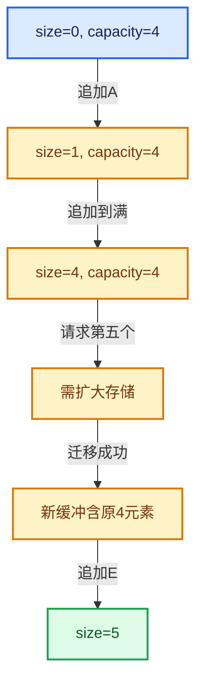

# 01-基础容器与现代CPP

[总目录](../README.md)

先证明对象存活，再讨论索引；先区分借用与拥有，再讨论复制移动。

## 前置知识与阅读层次

可以从本方向开始；不熟悉指针、引用或模板时先读语法章节，再进入源码表。

初读抓住数据模型，复读逐行检查，再完成反例和独立实现。方向间允许按实际问题回查，不要求机械线性阅读。

## 正文与源码范围

| 顺序 | 文档 | 主讲文件与范围 |
|---|---|---|
| 01-01 | [对象生命周期与值类别](01-%E5%AF%B9%E8%B1%A1%E7%94%9F%E5%91%BD%E5%91%A8%E6%9C%9F%E4%B8%8E%E5%80%BC%E7%B1%BB%E5%88%AB.md) | BLI_memory_utils.hh:L1—L184 |
| 01-02 | [模板与约束](02-%E6%A8%A1%E6%9D%BF%E4%B8%8E%E7%BA%A6%E6%9D%9F.md) | BLI_utility_mixins.hh:L1—L43 |
| 01-03 | [内存工具与分配器接口](03-%E5%86%85%E5%AD%98%E5%B7%A5%E5%85%B7%E4%B8%8E%E5%88%86%E9%85%8D%E5%99%A8%E6%8E%A5%E5%8F%A3.md) | BLI_allocator.hh:L1—L135 |
| 01-04 | [IndexRange连续整数区间](04-IndexRange%E8%BF%9E%E7%BB%AD%E6%95%B4%E6%95%B0%E5%8C%BA%E9%97%B4.md) | BLI_index_range.hh:L1—L373 |
| 01-05 | [Span只读连续视图](05-Span%E5%8F%AA%E8%AF%BB%E8%BF%9E%E7%BB%AD%E8%A7%86%E5%9B%BE.md) | BLI_span.hh:L1—L446 |
| 01-06 | [MutableSpan可写视图](06-MutableSpan%E5%8F%AF%E5%86%99%E8%A7%86%E5%9B%BE.md) | BLI_span.hh:L447—L763 |
| 01-07 | [Array构造与存储](07-Array%E6%9E%84%E9%80%A0%E4%B8%8E%E5%AD%98%E5%82%A8.md) | BLI_array.hh:L1—L245 |
| 01-08 | [Array复制移动与销毁](08-Array%E5%A4%8D%E5%88%B6%E7%A7%BB%E5%8A%A8%E4%B8%8E%E9%94%80%E6%AF%81.md) | BLI_array.hh:L246—L487 |
| 01-09 | [Vector存储与内嵌缓冲](09-Vector%E5%AD%98%E5%82%A8%E4%B8%8E%E5%86%85%E5%B5%8C%E7%BC%93%E5%86%B2.md) | BLI_vector.hh:L1—L139 |
| 01-10 | [Vector扩容与增长](10-Vector%E6%89%A9%E5%AE%B9%E4%B8%8E%E5%A2%9E%E9%95%BF.md) | BLI_vector.hh:L352—L497；BLI_vector.hh:L1113—L1153 |
| 01-11 | [Vector插入删除与重排](11-Vector%E6%8F%92%E5%85%A5%E5%88%A0%E9%99%A4%E4%B8%8E%E9%87%8D%E6%8E%92.md) | BLI_vector.hh:L498—L937 |
| 01-12 | [Vector异常安全与边界](12-Vector%E5%BC%82%E5%B8%B8%E5%AE%89%E5%85%A8%E4%B8%8E%E8%BE%B9%E7%95%8C.md) | BLI_vector.hh:L140—L351；BLI_vector.hh:L938—L1112；BLI_vector.hh:L1154—L1167 |
| 01-13 | [Stack与栈接口](13-Stack%E4%B8%8E%E6%A0%88%E6%8E%A5%E5%8F%A3.md) | BLI_stack.hh:L1—L417 |
| 01-14 | [VectorSet稳定索引与去重](14-VectorSet%E7%A8%B3%E5%AE%9A%E7%B4%A2%E5%BC%95%E4%B8%8E%E5%8E%BB%E9%87%8D.md) | BLI_vector_set.hh:L1—L1168 |
| 01-15 | [StringRef字符串视图](15-StringRef%E5%AD%97%E7%AC%A6%E4%B8%B2%E8%A7%86%E5%9B%BE.md) | BLI_string_ref.hh:L1—L727 |
| 01-16 | [FunctionRef非拥有回调](16-FunctionRef%E9%9D%9E%E6%8B%A5%E6%9C%89%E5%9B%9E%E8%B0%83.md) | BLI_function_ref.hh:L1—L165 |
| 01-17 | [Any类型擦除存储](17-Any%E7%B1%BB%E5%9E%8B%E6%93%A6%E9%99%A4%E5%AD%98%E5%82%A8.md) | BLI_any.hh:L1—L397 |
| 01-18 | [AnyDerived多态对象值封装](18-AnyDerived%E5%A4%9A%E6%80%81%E5%AF%B9%E8%B1%A1%E5%80%BC%E5%B0%81%E8%A3%85.md) | BLI_any_derived.hh:L1—L182 |
| 01-19 | [BitSpan与BitVector](19-BitSpan%E4%B8%8EBitVector.md) | BLI_bit_span.hh:L1—L488；BLI_bit_vector.hh:L1—L406 |
| 01-20 | [容器选择与独立实现](20-%E5%AE%B9%E5%99%A8%E9%80%89%E6%8B%A9%E4%B8%8E%E7%8B%AC%E7%AB%8B%E5%AE%9E%E7%8E%B0.md) | BLI_array_utils.hh:L1—L272 |

## 本方向的数据模型

## 状态推演

## 历史入口

- [BLI: new C++ ArrayRef, Vector, Stack, ... data structures](https://projects.blender.org/blender/blender/commit/369d5e8ad2bb7c249c6b941779066b6aa99f9ea0) · Jacques Lucke · 2019-09-12
- [BLI: improve exception safety of Vector, Array and Stack](https://projects.blender.org/blender/blender/commit/2aff45146f1464ba8899368ad004522cb6a1a98c) · Jacques Lucke · 2020-08-19
- [BLI: rename ArrayRef to Span](https://projects.blender.org/blender/blender/commit/f7c0f1b8b83ac475755b633abf59cf9f447b2d49) · Jacques Lucke · 2020-06-09

## 跨库比较与验收

对比std::vector、std::array、std::span与LLVM SmallVector、ArrayRef时，分别比较拥有关系、内嵌存储、大小是否属于类型和失效条件。不要根据同名方法推断完全相同契约。

构造成功次数减析构次数应等于当前存活对象数；异常之后资源计数应回到合法状态。

正文和源码区间已建立；自动检查结果见根目录验收报告。阅读者的掌握程度以独立练习与反例推理为准。
