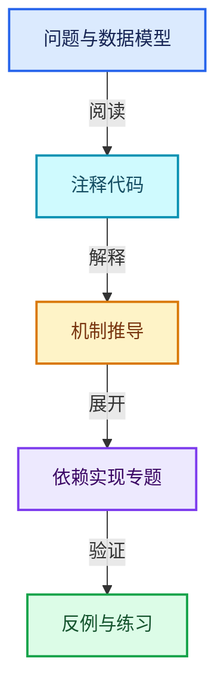
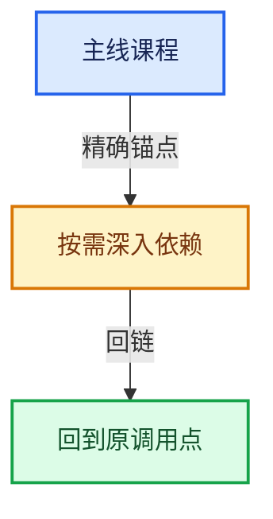

# 01-基础容器与现代CPP

[总目录](../README.md) · [实现索引](../%E7%AC%A6%E5%8F%B7%E4%BE%9D%E8%B5%96%E4%B8%8E%E5%AE%9E%E7%8E%B0%E7%B4%A2%E5%BC%95.md)

## 主线课程

- [01-01 对象生命周期与值类别](01-%E5%AF%B9%E8%B1%A1%E7%94%9F%E5%91%BD%E5%91%A8%E6%9C%9F%E4%B8%8E%E5%80%BC%E7%B1%BB%E5%88%AB.md)
- [01-02 模板与约束](02-%E6%A8%A1%E6%9D%BF%E4%B8%8E%E7%BA%A6%E6%9D%9F.md)
- [01-03 内存工具与分配器接口](03-%E5%86%85%E5%AD%98%E5%B7%A5%E5%85%B7%E4%B8%8E%E5%88%86%E9%85%8D%E5%99%A8%E6%8E%A5%E5%8F%A3.md)
- [01-04 IndexRange连续整数区间](04-IndexRange%E8%BF%9E%E7%BB%AD%E6%95%B4%E6%95%B0%E5%8C%BA%E9%97%B4.md)
- [01-05 Span只读连续视图](05-Span%E5%8F%AA%E8%AF%BB%E8%BF%9E%E7%BB%AD%E8%A7%86%E5%9B%BE.md)
- [01-06 MutableSpan可写视图](06-MutableSpan%E5%8F%AF%E5%86%99%E8%A7%86%E5%9B%BE.md)
- [01-07 Array构造与存储](07-Array%E6%9E%84%E9%80%A0%E4%B8%8E%E5%AD%98%E5%82%A8.md)
- [01-08 Array复制移动与销毁](08-Array%E5%A4%8D%E5%88%B6%E7%A7%BB%E5%8A%A8%E4%B8%8E%E9%94%80%E6%AF%81.md)
- [01-09 Vector存储与内嵌缓冲](09-Vector%E5%AD%98%E5%82%A8%E4%B8%8E%E5%86%85%E5%B5%8C%E7%BC%93%E5%86%B2.md)
- [01-10 Vector扩容与增长](10-Vector%E6%89%A9%E5%AE%B9%E4%B8%8E%E5%A2%9E%E9%95%BF.md)
- [01-11 Vector插入删除与重排](11-Vector%E6%8F%92%E5%85%A5%E5%88%A0%E9%99%A4%E4%B8%8E%E9%87%8D%E6%8E%92.md)
- [01-12 Vector异常安全与边界](12-Vector%E5%BC%82%E5%B8%B8%E5%AE%89%E5%85%A8%E4%B8%8E%E8%BE%B9%E7%95%8C.md)
- [01-13 Stack与栈接口](13-Stack%E4%B8%8E%E6%A0%88%E6%8E%A5%E5%8F%A3.md)
- [01-14 VectorSet稳定索引与去重](14-VectorSet%E7%A8%B3%E5%AE%9A%E7%B4%A2%E5%BC%95%E4%B8%8E%E5%8E%BB%E9%87%8D.md)
- [01-15 StringRef字符串视图](15-StringRef%E5%AD%97%E7%AC%A6%E4%B8%B2%E8%A7%86%E5%9B%BE.md)
- [01-16 FunctionRef非拥有回调](16-FunctionRef%E9%9D%9E%E6%8B%A5%E6%9C%89%E5%9B%9E%E8%B0%83.md)
- [01-17 Any类型擦除存储](17-Any%E7%B1%BB%E5%9E%8B%E6%93%A6%E9%99%A4%E5%AD%98%E5%82%A8.md)
- [01-18 AnyDerived多态对象值封装](18-AnyDerived%E5%A4%9A%E6%80%81%E5%AF%B9%E8%B1%A1%E5%80%BC%E5%B0%81%E8%A3%85.md)
- [01-19 BitSpan与BitVector](19-BitSpan%E4%B8%8EBitVector.md)
- [01-20 容器选择与独立实现](20-%E5%AE%B9%E5%99%A8%E9%80%89%E6%8B%A9%E4%B8%8E%E7%8B%AC%E7%AB%8B%E5%AE%9E%E7%8E%B0.md)

## 共享实现专题

- [source/blender/blenlib/BLI_alloca.hh](%E4%BE%9D%E8%B5%96-BLI_alloca-c79275.md)
- [source/blender/blenlib/BLI_array_state.hh](%E4%BE%9D%E8%B5%96-BLI_array_state-0ec7db.md)
- [source/blender/blenlib/BLI_array_utils_c.hh](%E4%BE%9D%E8%B5%96-BLI_array_utils_c-c93048.md)
- [source/blender/blenlib/BLI_asan.hh](%E4%BE%9D%E8%B5%96-BLI_asan-96bcf6.md)
- [source/blender/blenlib/BLI_assert.hh](%E4%BE%9D%E8%B5%96-BLI_assert-cc98e8.md)
- [source/blender/blenlib/BLI_binary_search.hh](%E4%BE%9D%E8%B5%96-BLI_binary_search-bd55e6.md)
- [source/blender/blenlib/BLI_bit_group_vector.hh](%E4%BE%9D%E8%B5%96-BLI_bit_group_vector-b34190.md)
- [source/blender/blenlib/BLI_bit_ref.hh](%E4%BE%9D%E8%B5%96-BLI_bit_ref-359167.md)
- [source/blender/blenlib/BLI_bit_span_ops.hh](%E4%BE%9D%E8%B5%96-BLI_bit_span_ops-63a2e2.md)
- [source/blender/blenlib/BLI_bit_span_to_index_ranges.hh](%E4%BE%9D%E8%B5%96-BLI_bit_span_to_index_ranges-ced673.md)
- [source/blender/blenlib/BLI_color.hh](%E4%BE%9D%E8%B5%96-BLI_color-328a20.md)
- [source/blender/blenlib/BLI_compiler_compat.hh](%E4%BE%9D%E8%B5%96-BLI_compiler_compat-2153af.md)
- [source/blender/blenlib/BLI_compute_context.hh](%E4%BE%9D%E8%B5%96-BLI_compute_context-ba44a7.md)
- [source/blender/blenlib/BLI_dot_export.hh](%E4%BE%9D%E8%B5%96-BLI_dot_export-eb2f54.md)
- [source/blender/blenlib/BLI_dot_export_attribute_enums.hh](%E4%BE%9D%E8%B5%96-BLI_dot_export_attribute_enums-3fbd45.md)
- [source/blender/blenlib/BLI_dynamic_stack_buffer.hh](%E4%BE%9D%E8%B5%96-BLI_dynamic_stack_buffer-a3a20b.md)
- [source/blender/blenlib/BLI_endian_switch_inline.hh](%E4%BE%9D%E8%B5%96-BLI_endian_switch_inline-fbfa0a.md)
- [source/blender/blenlib/BLI_enumerable_thread_specific.hh](%E4%BE%9D%E8%B5%96-BLI_enumerable_thread_specific-ceb6f9.md)
- [source/blender/blenlib/BLI_execution_mode.hh](%E4%BE%9D%E8%B5%96-BLI_execution_mode-1528fb.md)
- [source/blender/blenlib/BLI_fileops.hh](%E4%BE%9D%E8%B5%96-BLI_fileops-fa4e3e.md)
- [source/blender/blenlib/BLI_fileops_types.hh](%E4%BE%9D%E8%B5%96-BLI_fileops_types-50ea8d.md)
- [source/blender/blenlib/BLI_generic_vector_array.hh](%E4%BE%9D%E8%B5%96-BLI_generic_vector_array-cfb2af.md)
- [source/blender/blenlib/BLI_generic_virtual_vector_array.hh](%E4%BE%9D%E8%B5%96-BLI_generic_virtual_vector_array-f22b58.md)
- [source/blender/blenlib/BLI_index_range.hh](%E4%BE%9D%E8%B5%96-BLI_index_range-7d7cc5.md)
- [source/blender/blenlib/BLI_index_ranges_builder.hh](%E4%BE%9D%E8%B5%96-BLI_index_ranges_builder-425233.md)
- [source/blender/blenlib/BLI_iterator.hh](%E4%BE%9D%E8%B5%96-BLI_iterator-11f23e.md)
- [source/blender/blenlib/BLI_length_parameterize.hh](%E4%BE%9D%E8%B5%96-BLI_length_parameterize-d76620.md)
- [source/blender/blenlib/BLI_link_utils.hh](%E4%BE%9D%E8%B5%96-BLI_link_utils-e18cc1.md)
- [source/blender/blenlib/BLI_linklist.hh](%E4%BE%9D%E8%B5%96-BLI_linklist-c817f6.md)
- [source/blender/blenlib/BLI_linklist_stack.hh](%E4%BE%9D%E8%B5%96-BLI_linklist_stack-95930a.md)
- [source/blender/blenlib/BLI_listbase.hh](%E4%BE%9D%E8%B5%96-BLI_listbase-7dbed3.md)
- [source/blender/blenlib/BLI_listbase_wrapper.hh](%E4%BE%9D%E8%B5%96-BLI_listbase_wrapper-54cd44.md)
- [source/blender/blenlib/BLI_memarena.hh](%E4%BE%9D%E8%B5%96-BLI_memarena-d0ed90.md)
- [source/blender/blenlib/BLI_mempool.hh](%E4%BE%9D%E8%B5%96-BLI_mempool-4b5fa7.md)
- [source/blender/blenlib/BLI_mesh_intersect.hh](%E4%BE%9D%E8%B5%96-BLI_mesh_intersect-db7f59.md)
- [source/blender/blenlib/BLI_ordered_edge.hh](%E4%BE%9D%E8%B5%96-BLI_ordered_edge-c75bbf.md)
- [source/blender/blenlib/BLI_parameter_pack_utils.hh](%E4%BE%9D%E8%B5%96-BLI_parameter_pack_utils-bfb1cc.md)
- [source/blender/blenlib/BLI_path_utils.hh](%E4%BE%9D%E8%B5%96-BLI_path_utils-130405.md)
- [source/blender/blenlib/BLI_polyfill_2d_beautify.hh](%E4%BE%9D%E8%B5%96-BLI_polyfill_2d_beautify-3f6f75.md)
- [source/blender/blenlib/BLI_rand.hh](%E4%BE%9D%E8%B5%96-BLI_rand-a32134.md)
- [source/blender/blenlib/BLI_rect.hh](%E4%BE%9D%E8%B5%96-BLI_rect-2996c6.md)
- [source/blender/blenlib/BLI_serialize.hh](%E4%BE%9D%E8%B5%96-BLI_serialize-5b362e.md)
- [source/blender/blenlib/BLI_sort.hh](%E4%BE%9D%E8%B5%96-BLI_sort-1e6ad7.md)
- [source/blender/blenlib/BLI_span.hh](%E4%BE%9D%E8%B5%96-BLI_span-6aa95f.md)
- [source/blender/blenlib/BLI_string.hh](%E4%BE%9D%E8%B5%96-BLI_string-b43058.md)
- [source/blender/blenlib/BLI_string_search.hh](%E4%BE%9D%E8%B5%96-BLI_string_search-ba9e8b.md)
- [source/blender/blenlib/BLI_string_utf8.hh](%E4%BE%9D%E8%B5%96-BLI_string_utf8-bcc961.md)
- [source/blender/blenlib/BLI_string_utils.hh](%E4%BE%9D%E8%B5%96-BLI_string_utils-a32cc1.md)
- [source/blender/blenlib/BLI_task_c.hh](%E4%BE%9D%E8%B5%96-BLI_task_c-917a71.md)
- [source/blender/blenlib/BLI_task_size_hints.hh](%E4%BE%9D%E8%B5%96-BLI_task_size_hints-5d752d.md)
- [source/blender/blenlib/BLI_time_utildefines.hh](%E4%BE%9D%E8%B5%96-BLI_time_utildefines-9e60b7.md)
- [source/blender/blenlib/BLI_timeit.hh](%E4%BE%9D%E8%B5%96-BLI_timeit-5eb48e.md)
- [source/blender/blenlib/BLI_unique_sorted_indices.hh](%E4%BE%9D%E8%B5%96-BLI_unique_sorted_indices-4da7d3.md)
- [source/blender/blenlib/BLI_unroll.hh](%E4%BE%9D%E8%B5%96-BLI_unroll-d8590f.md)
- [source/blender/blenlib/BLI_ustring.hh](%E4%BE%9D%E8%B5%96-BLI_ustring-e50d0d.md)
- [source/blender/blenlib/BLI_utildefines.hh](%E4%BE%9D%E8%B5%96-BLI_utildefines-293a0a.md)
- [source/blender/blenlib/BLI_utildefines_stack.hh](%E4%BE%9D%E8%B5%96-BLI_utildefines_stack-a43a85.md)
- [source/blender/blenlib/BLI_vector.hh](%E4%BE%9D%E8%B5%96-BLI_vector-c355b1.md)
- [source/blender/blenlib/BLI_winstuff.hh](%E4%BE%9D%E8%B5%96-BLI_winstuff-71eba1.md)
- [source/blender/blenlib/intern/BLI_dynstr.cc](%E4%BE%9D%E8%B5%96-BLI_dynstr-0c174c.md)
- [source/blender/blenlib/intern/BLI_filelist.cc](%E4%BE%9D%E8%B5%96-BLI_filelist-84464e.md)
- [source/blender/blenlib/intern/BLI_heap.cc](%E4%BE%9D%E8%B5%96-BLI_heap-16714e.md)
- [source/blender/blenlib/intern/BLI_heap_simple.cc](%E4%BE%9D%E8%B5%96-BLI_heap_simple-50ae5b.md)
- [source/blender/blenlib/intern/BLI_linklist.cc](%E4%BE%9D%E8%B5%96-BLI_linklist-23c475.md)
- [source/blender/blenlib/intern/BLI_memarena.cc](%E4%BE%9D%E8%B5%96-BLI_memarena-aea32a.md)
- [source/blender/blenlib/intern/BLI_memblock.cc](%E4%BE%9D%E8%B5%96-BLI_memblock-8f646e.md)
- [source/blender/blenlib/intern/BLI_mempool.cc](%E4%BE%9D%E8%B5%96-BLI_mempool-991442.md)
- [source/blender/blenlib/intern/BLI_subprocess.cc](%E4%BE%9D%E8%B5%96-BLI_subprocess-32585a.md)
- [source/blender/blenlib/intern/array_utils.cc](%E4%BE%9D%E8%B5%96-array_utils-cbb70f.md)
- [source/blender/blenlib/intern/astar.cc](%E4%BE%9D%E8%B5%96-astar-648a4a.md)
- [source/blender/blenlib/intern/bit_bool_conversion.cc](%E4%BE%9D%E8%B5%96-bit_bool_conversion-6a719a.md)
- [source/blender/blenlib/intern/bit_span.cc](%E4%BE%9D%E8%B5%96-bit_span-6f3ef8.md)
- [source/blender/blenlib/intern/boxpack_2d.cc](%E4%BE%9D%E8%B5%96-boxpack_2d-593ace.md)
- [source/blender/blenlib/intern/compression.cc](%E4%BE%9D%E8%B5%96-compression-5b0560.md)
- [source/blender/blenlib/intern/delaunay_2d.cc](%E4%BE%9D%E8%B5%96-delaunay_2d-1b2d82.md)
- [source/blender/blenlib/intern/dot_export.cc](%E4%BE%9D%E8%B5%96-dot_export-b6a26f.md)
- [source/blender/blenlib/intern/easing.cc](%E4%BE%9D%E8%B5%96-easing-90b817.md)
- [source/blender/blenlib/intern/endian_switch.cc](%E4%BE%9D%E8%B5%96-endian_switch-d88f86.md)
- [source/blender/blenlib/intern/expr_pylike_eval.cc](%E4%BE%9D%E8%B5%96-expr_pylike_eval-bd9286.md)
- [source/blender/blenlib/intern/fileops.cc](%E4%BE%9D%E8%B5%96-fileops-0f6fa9.md)
- [source/blender/blenlib/intern/fileops_c.cc](%E4%BE%9D%E8%B5%96-fileops_c-add581.md)
- [source/blender/blenlib/intern/filereader_file.cc](%E4%BE%9D%E8%B5%96-filereader_file-dd6b97.md)
- [source/blender/blenlib/intern/filereader_gzip.cc](%E4%BE%9D%E8%B5%96-filereader_gzip-481c35.md)
- [source/blender/blenlib/intern/filereader_zstd.cc](%E4%BE%9D%E8%B5%96-filereader_zstd-93d7da.md)
- [source/blender/blenlib/intern/fnmatch.cc](%E4%BE%9D%E8%B5%96-fnmatch-f4d244.md)
- [source/blender/blenlib/intern/generic_vector_array.cc](%E4%BE%9D%E8%B5%96-generic_vector_array-7f86fb.md)
- [source/blender/blenlib/intern/generic_virtual_vector_array.cc](%E4%BE%9D%E8%B5%96-generic_virtual_vector_array-1f8a09.md)
- [source/blender/blenlib/intern/gsqueue.cc](%E4%BE%9D%E8%B5%96-gsqueue-c29474.md)
- [source/blender/blenlib/intern/index_range.cc](%E4%BE%9D%E8%B5%96-index_range-982286.md)
- [source/blender/blenlib/intern/jitter_2d.cc](%E4%BE%9D%E8%B5%96-jitter_2d-649056.md)
- [source/blender/blenlib/intern/lazy_threading.cc](%E4%BE%9D%E8%B5%96-lazy_threading-faad44.md)
- [source/blender/blenlib/intern/length_parameterize.cc](%E4%BE%9D%E8%B5%96-length_parameterize-44d2c4.md)
- [source/blender/blenlib/intern/listbase.cc](%E4%BE%9D%E8%B5%96-listbase-2816d9.md)
- [source/blender/blenlib/intern/mesh_boolean.cc](%E4%BE%9D%E8%B5%96-mesh_boolean-f80b18.md)
- [source/blender/blenlib/intern/mesh_intersect.cc](%E4%BE%9D%E8%B5%96-mesh_intersect-3f2f20.md)
- [source/blender/blenlib/intern/noise.cc](%E4%BE%9D%E8%B5%96-noise-a3f6de.md)
- [source/blender/blenlib/intern/noise_c.cc](%E4%BE%9D%E8%B5%96-noise_c-07a312.md)
- [source/blender/blenlib/intern/path_utils.cc](%E4%BE%9D%E8%B5%96-path_utils-b4d26a.md)
- [source/blender/blenlib/intern/polyfill_2d.cc](%E4%BE%9D%E8%B5%96-polyfill_2d-89228d.md)
- [source/blender/blenlib/intern/polyfill_2d_beautify.cc](%E4%BE%9D%E8%B5%96-polyfill_2d_beautify-cdcaad.md)
- [source/blender/blenlib/intern/quadric.cc](%E4%BE%9D%E8%B5%96-quadric-968a8d.md)
- [source/blender/blenlib/intern/radial_tiling_shared.hh](%E4%BE%9D%E8%B5%96-radial_tiling_shared-7989a4.md)
- [source/blender/blenlib/intern/rand.cc](%E4%BE%9D%E8%B5%96-rand-171ca2.md)
- [source/blender/blenlib/intern/rct.cc](%E4%BE%9D%E8%B5%96-rct-6e7349.md)
- [source/blender/blenlib/intern/scanfill.cc](%E4%BE%9D%E8%B5%96-scanfill-ec083a.md)
- [source/blender/blenlib/intern/session_uid.cc](%E4%BE%9D%E8%B5%96-session_uid-995b7c.md)
- [source/blender/blenlib/intern/sort.cc](%E4%BE%9D%E8%B5%96-sort-db51c6.md)
- [source/blender/blenlib/intern/stack.cc](%E4%BE%9D%E8%B5%96-stack-55c7b8.md)
- [source/blender/blenlib/intern/storage.cc](%E4%BE%9D%E8%B5%96-storage-bda15e.md)
- [source/blender/blenlib/intern/string.cc](%E4%BE%9D%E8%B5%96-string-1d986f.md)
- [source/blender/blenlib/intern/string_cursor_utf8.cc](%E4%BE%9D%E8%B5%96-string_cursor_utf8-8eefe2.md)
- [source/blender/blenlib/intern/string_ref.cc](%E4%BE%9D%E8%B5%96-string_ref-ed6905.md)
- [source/blender/blenlib/intern/string_search.cc](%E4%BE%9D%E8%B5%96-string_search-c3fc36.md)
- [source/blender/blenlib/intern/string_utf8.cc](%E4%BE%9D%E8%B5%96-string_utf8-3c62ca.md)
- [source/blender/blenlib/intern/string_utils.cc](%E4%BE%9D%E8%B5%96-string_utils-bbfe0c.md)
- [source/blender/blenlib/intern/system.cc](%E4%BE%9D%E8%B5%96-system-b462c0.md)
- [source/blender/blenlib/intern/task_iterator.cc](%E4%BE%9D%E8%B5%96-task_iterator-3c168e.md)
- [source/blender/blenlib/intern/tempfile.cc](%E4%BE%9D%E8%B5%96-tempfile-44197d.md)
- [source/blender/blenlib/intern/threads.cc](%E4%BE%9D%E8%B5%96-threads-a036bf.md)
- [source/blender/blenlib/intern/time.cc](%E4%BE%9D%E8%B5%96-time-be4317.md)
- [source/blender/blenlib/intern/vector.cc](%E4%BE%9D%E8%B5%96-vector-ee93db.md)
- [source/blender/blenlib/intern/voxel.cc](%E4%BE%9D%E8%B5%96-voxel-e3a467.md)
- [source/blender/blenlib/intern/winstuff.cc](%E4%BE%9D%E8%B5%96-winstuff-500d85.md)
- [source/blender/blenlib/intern/winstuff_dir.cc](%E4%BE%9D%E8%B5%96-winstuff_dir-302704.md)
- [source/blender/blenlib/tests/BLI_path_utils_test.cc](%E4%BE%9D%E8%B5%96-BLI_path_utils_test-727584.md)

