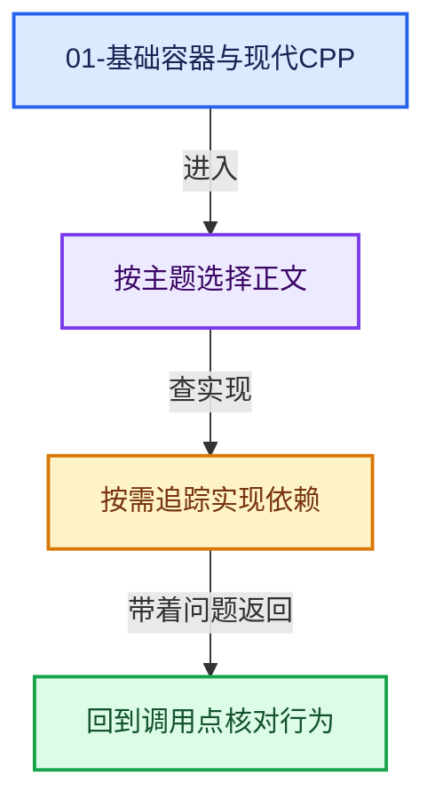
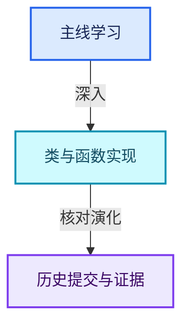

# 01-基础容器与现代CPP

[总入口](../README.md) · [几何节点专题](../13-几何节点专题/README.md) · [实现依赖](../90-实现依赖专题/README.md)

## 阅读顺序

- [01-01 对象生命周期与值类别](01-对象生命周期与值类别.md)
- [01-02 模板与约束](02-模板与约束.md)
- [01-03 内存工具与分配器接口](03-内存工具与分配器接口.md)
- [01-04 IndexRange连续整数区间](04-IndexRange连续整数区间.md)
- [01-05 Span只读连续视图](05-Span只读连续视图.md)
- [01-06 MutableSpan可写视图](06-MutableSpan可写视图.md)
- [01-07 Array构造与存储](07-Array构造与存储.md)
- [01-08 Array复制移动与销毁](08-Array复制移动与销毁.md)
- [01-09 Vector存储与内嵌缓冲](09-Vector存储与内嵌缓冲.md)
- [01-10 Vector扩容与增长](10-Vector扩容与增长.md)
- [01-11 Vector插入删除与重排](11-Vector插入删除与重排.md)
- [01-12 Vector异常安全与边界](12-Vector异常安全与边界.md)
- [01-13 Stack与栈接口](13-Stack与栈接口.md)
- [01-14 VectorSet稳定索引与去重](14-VectorSet稳定索引与去重.md)
- [01-15 StringRef字符串视图](15-StringRef字符串视图.md)
- [01-16 FunctionRef非拥有回调](16-FunctionRef非拥有回调.md)
- [01-17 Any类型擦除存储](17-Any类型擦除存储.md)
- [01-18 AnyDerived多态对象值封装](18-AnyDerived多态对象值封装.md)
- [01-19 BitSpan与BitVector](19-BitSpan与BitVector.md)
- [01-20 容器选择与独立实现](20-容器选择与独立实现.md)

