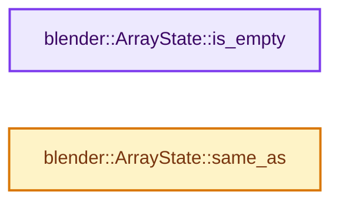
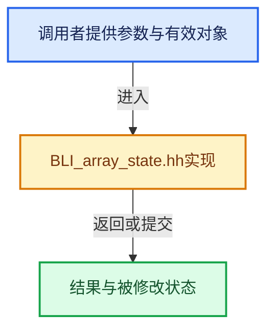

# 实现依赖专题：source/blender/blenlib/BLI_array_state.hh

[方向导航](README.md) · [符号索引](../%E7%AC%A6%E5%8F%B7%E4%BE%9D%E8%B5%96%E4%B8%8E%E5%AE%9E%E7%8E%B0%E7%B4%A2%E5%BC%95.md)

本专题从正文实际调用进入，集中保存共享实现。函数有稳定锚点，可从调用处直接跳到对应完整函数；递归与互相调用通过回链组织。

## 本文件的实现关系






## 完整成员与函数实现

<a id="f-77e30107b9c21728"></a>

### `blender::ArrayState::is_empty`

实现位置：[source/blender/blenlib/BLI_array_state.hh](../../../../../source/blender/blenlib/BLI_array_state.hh) · L60—L63。

**教学注释版**

<!-- annotated:cc3bd5755b7b1a -->

```cpp
  bool is_empty() const
  {
    // [讲解] values_.is_empty：查询视图长度或生成对应有效索引区间。
    return values_.is_empty();
  }
```

<details>
<summary>核对原始源码：source/blender/blenlib/BLI_array_state.hh · L60—L63</summary>

<!-- original:cc3bd5755b7b1a:source/blender/blenlib/BLI_array_state.hh:60:63 -->

```cpp
  bool is_empty() const
  {
    return values_.is_empty();
  }
```

</details>

**结果出口**

- `return values_.is_empty();`

**继续追踪实现**

- `values_.is_empty` → [blender::Span::is_empty · L264](05-Span%E5%8F%AA%E8%AF%BB%E8%BF%9E%E7%BB%AD%E8%A7%86%E5%9B%BE.md#f-8cc1d7ba8feb50e6)。

<a id="f-78602f992129ba54"></a>

### `blender::ArrayState::same_as`

实现位置：[source/blender/blenlib/BLI_array_state.hh](../../../../../source/blender/blenlib/BLI_array_state.hh) · L71—L86。

接口参数：

- `const VArray<T> &other_values`
- `const ImplicitSharingInfo *other_sharing_info`

**教学注释版**

<!-- annotated:7122be185b5965 -->

```cpp
  bool same_as(const VArray<T> &other_values, const ImplicitSharingInfo *other_sharing_info) const
  {
    if (sharing_info_ && other_sharing_info) {
      if (sharing_info_ == other_sharing_info) {
        /* The data is still shared. */
        return true;
      }
    }
    // [讲解] values_.size：查询视图长度或生成对应有效索引区间。
    if (values_.size() != other_values.size()) {
      /* The arrays can't be the same if their sizes differ. */
      return false;
    }
    /* Need to actually compare all elements. */
    VArraySpan<T> other_values_span(other_values);
    return values_ == other_values_span;
  }
```

<details>
<summary>核对原始源码：source/blender/blenlib/BLI_array_state.hh · L71—L86</summary>

<!-- original:7122be185b5965:source/blender/blenlib/BLI_array_state.hh:71:86 -->

```cpp
  bool same_as(const VArray<T> &other_values, const ImplicitSharingInfo *other_sharing_info) const
  {
    if (sharing_info_ && other_sharing_info) {
      if (sharing_info_ == other_sharing_info) {
        /* The data is still shared. */
        return true;
      }
    }
    if (values_.size() != other_values.size()) {
      /* The arrays can't be the same if their sizes differ. */
      return false;
    }
    /* Need to actually compare all elements. */
    VArraySpan<T> other_values_span(other_values);
    return values_ == other_values_span;
  }
```

</details>

**结果出口**

- `return true;`
- `return false;`
- `return values_ == other_values_span;`

**继续追踪实现**

- `values_.size` → [blender::Span::size · L256](05-Span%E5%8F%AA%E8%AF%BB%E8%BF%9E%E7%BB%AD%E8%A7%86%E5%9B%BE.md#f-5f80fa006089c998)。
- `other_values.size` → [调用协议](../%E6%A8%A1%E6%9D%BF%E5%AE%8F%E4%B8%8E%E5%8A%A8%E6%80%81%E5%88%86%E6%B4%BE%E5%8D%8F%E8%AE%AE.md)：由接收对象具体类型或运行时策略提供实现。调用位置L79。
